# Schema docs

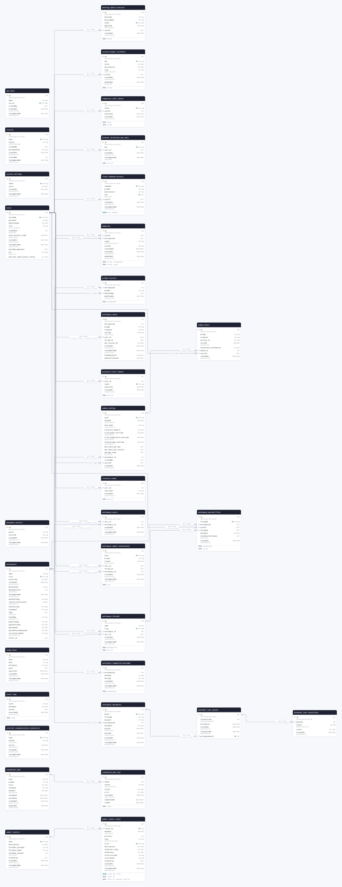

<details>
<summary>The whole schema as SQL</summary>

```sql
CREATE TABLE "api_keys" (
    "id" INTEGER NOT NULL PRIMARY KEY AUTOINCREMENT,
    "name" TEXT,
    "secret" TEXT,
    "createdBy" INTEGER,
    "createdAt" DATETIME NOT NULL DEFAULT CURRENT_TIMESTAMP,
    "lastUpdatedAt" DATETIME NOT NULL DEFAULT CURRENT_TIMESTAMP
);

CREATE TABLE "workspace_documents" (
    "id" INTEGER NOT NULL PRIMARY KEY AUTOINCREMENT,
    "docId" TEXT NOT NULL,
    "filename" TEXT NOT NULL,
    "docpath" TEXT NOT NULL,
    "workspaceId" INTEGER NOT NULL,
    "metadata" TEXT,
    "pinned" BOOLEAN DEFAULT false,
    "watched" BOOLEAN DEFAULT false,
    "createdAt" DATETIME NOT NULL DEFAULT CURRENT_TIMESTAMP,
    "lastUpdatedAt" DATETIME NOT NULL DEFAULT CURRENT_TIMESTAMP,
    CONSTRAINT "workspace_documents_workspaceId_fkey" FOREIGN KEY ("workspaceId") REFERENCES "workspaces" ("id") ON DELETE RESTRICT ON UPDATE CASCADE
);

CREATE TABLE "invites" (
    "id" INTEGER NOT NULL PRIMARY KEY AUTOINCREMENT,
    "code" TEXT NOT NULL,
    "status" TEXT NOT NULL DEFAULT 'pending',
    "claimedBy" INTEGER,
    "workspaceIds" TEXT,
    "createdAt" DATETIME NOT NULL DEFAULT CURRENT_TIMESTAMP,
    "createdBy" INTEGER NOT NULL,
    "lastUpdatedAt" DATETIME NOT NULL DEFAULT CURRENT_TIMESTAMP
);

CREATE TABLE "system_settings" (
    "id" INTEGER NOT NULL PRIMARY KEY AUTOINCREMENT,
    "label" TEXT NOT NULL,
    "value" TEXT,
    "createdAt" DATETIME NOT NULL DEFAULT CURRENT_TIMESTAMP,
    "lastUpdatedAt" DATETIME NOT NULL DEFAULT CURRENT_TIMESTAMP
);

CREATE TABLE "users" (
    "id" INTEGER NOT NULL PRIMARY KEY AUTOINCREMENT,
    "username" TEXT,
    "password" TEXT NOT NULL,
    "pfpFilename" TEXT,
    "role" TEXT NOT NULL DEFAULT 'default',
    "suspended" INTEGER NOT NULL DEFAULT 0,
    "seen_recovery_codes" BOOLEAN DEFAULT false,
    "createdAt" DATETIME NOT NULL DEFAULT CURRENT_TIMESTAMP,
    "lastUpdatedAt" DATETIME NOT NULL DEFAULT CURRENT_TIMESTAMP,
    "dailyMessageLimit" INTEGER,
    "bio" TEXT DEFAULT '',
    "web_push_subscription_config" TEXT
);

CREATE TABLE "recovery_codes" (
    "id" INTEGER NOT NULL PRIMARY KEY AUTOINCREMENT,
    "user_id" INTEGER NOT NULL,
    "code_hash" TEXT NOT NULL,
    "createdAt" DATETIME NOT NULL DEFAULT CURRENT_TIMESTAMP,
    CONSTRAINT "recovery_codes_user_id_fkey" FOREIGN KEY ("user_id") REFERENCES "users" ("id") ON DELETE CASCADE ON UPDATE CASCADE
);

CREATE TABLE "password_reset_tokens" (
    "id" INTEGER NOT NULL PRIMARY KEY AUTOINCREMENT,
    "user_id" INTEGER NOT NULL,
    "token" TEXT NOT NULL,
    "expiresAt" DATETIME NOT NULL,
    "createdAt" DATETIME NOT NULL DEFAULT CURRENT_TIMESTAMP,
    CONSTRAINT "password_reset_tokens_user_id_fkey" FOREIGN KEY ("user_id") REFERENCES "users" ("id") ON DELETE CASCADE ON UPDATE CASCADE
);

CREATE TABLE "document_vectors" (
    "id" INTEGER NOT NULL PRIMARY KEY AUTOINCREMENT,
    "docId" TEXT NOT NULL,
    "vectorId" TEXT NOT NULL,
    "createdAt" DATETIME NOT NULL DEFAULT CURRENT_TIMESTAMP,
    "lastUpdatedAt" DATETIME NOT NULL DEFAULT CURRENT_TIMESTAMP
);

CREATE TABLE "workspaces" (
    "id" INTEGER NOT NULL PRIMARY KEY AUTOINCREMENT,
    "name" TEXT NOT NULL,
    "slug" TEXT NOT NULL,
    "vectorTag" TEXT,
    "createdAt" DATETIME NOT NULL DEFAULT CURRENT_TIMESTAMP,
    "openAiTemp" REAL,
    "openAiHistory" INTEGER NOT NULL DEFAULT 20,
    "lastUpdatedAt" DATETIME NOT NULL DEFAULT CURRENT_TIMESTAMP,
    "openAiPrompt" TEXT,
    "similarityThreshold" REAL DEFAULT 0.25,
    "chatProvider" TEXT,
    "chatModel" TEXT,
    "topN" INTEGER DEFAULT 4,
    "chatMode" TEXT DEFAULT 'chat',
    "pfpFilename" TEXT,
    "agentProvider" TEXT,
    "agentModel" TEXT,
    "queryRefusalResponse" TEXT,
    "vectorSearchMode" TEXT DEFAULT 'default',
    "router_id" INTEGER
);

CREATE TABLE "workspace_threads" (
    "id" INTEGER NOT NULL PRIMARY KEY AUTOINCREMENT,
    "name" TEXT NOT NULL,
    "slug" TEXT NOT NULL,
    "workspace_id" INTEGER NOT NULL,
    "user_id" INTEGER,
    "createdAt" DATETIME NOT NULL DEFAULT CURRENT_TIMESTAMP,
    "lastUpdatedAt" DATETIME NOT NULL DEFAULT CURRENT_TIMESTAMP,
    CONSTRAINT "workspace_threads_workspace_id_fkey" FOREIGN KEY ("workspace_id") REFERENCES "workspaces" ("id") ON DELETE CASCADE ON UPDATE CASCADE,
    CONSTRAINT "workspace_threads_user_id_fkey" FOREIGN KEY ("user_id") REFERENCES "users" ("id") ON DELETE CASCADE ON UPDATE CASCADE
);

CREATE TABLE "workspace_suggested_messages" (
    "id" INTEGER NOT NULL PRIMARY KEY AUTOINCREMENT,
    "workspaceId" INTEGER NOT NULL,
    "heading" TEXT NOT NULL,
    "message" TEXT NOT NULL,
    "createdAt" DATETIME NOT NULL DEFAULT CURRENT_TIMESTAMP,
    "lastUpdatedAt" DATETIME NOT NULL DEFAULT CURRENT_TIMESTAMP,
    CONSTRAINT "workspace_suggested_messages_workspaceId_fkey" FOREIGN KEY ("workspaceId") REFERENCES "workspaces" ("id") ON DELETE CASCADE ON UPDATE CASCADE
);

CREATE TABLE "workspace_chats" (
    "id" INTEGER NOT NULL PRIMARY KEY AUTOINCREMENT,
    "workspaceId" INTEGER NOT NULL,
    "prompt" TEXT NOT NULL,
    "response" TEXT NOT NULL,
    "include" BOOLEAN NOT NULL DEFAULT true,
    "user_id" INTEGER,
    "thread_id" INTEGER,
    "api_session_id" TEXT,
    "createdAt" DATETIME NOT NULL DEFAULT CURRENT_TIMESTAMP,
    "lastUpdatedAt" DATETIME NOT NULL DEFAULT CURRENT_TIMESTAMP,
    "feedbackScore" BOOLEAN,
    "memory_processed" BOOLEAN,
    CONSTRAINT "workspace_chats_user_id_fkey" FOREIGN KEY ("user_id") REFERENCES "users" ("id") ON DELETE CASCADE ON UPDATE CASCADE
);

CREATE TABLE "workspace_agent_invocations" (
    "id" INTEGER NOT NULL PRIMARY KEY AUTOINCREMENT,
    "uuid" TEXT NOT NULL,
    "prompt" TEXT NOT NULL,
    "closed" BOOLEAN NOT NULL DEFAULT false,
    "user_id" INTEGER,
    "thread_id" INTEGER,
    "workspace_id" INTEGER NOT NULL,
    "createdAt" DATETIME NOT NULL DEFAULT CURRENT_TIMESTAMP,
    "lastUpdatedAt" DATETIME NOT NULL DEFAULT CURRENT_TIMESTAMP,
    CONSTRAINT "workspace_agent_invocations_user_id_fkey" FOREIGN KEY ("user_id") REFERENCES "users" ("id") ON DELETE CASCADE ON UPDATE CASCADE,
    CONSTRAINT "workspace_agent_invocations_workspace_id_fkey" FOREIGN KEY ("workspace_id") REFERENCES "workspaces" ("id") ON DELETE CASCADE ON UPDATE CASCADE
);

CREATE TABLE "workspace_users" (
    "id" INTEGER NOT NULL PRIMARY KEY AUTOINCREMENT,
    "user_id" INTEGER NOT NULL,
    "workspace_id" INTEGER NOT NULL,
    "createdAt" DATETIME NOT NULL DEFAULT CURRENT_TIMESTAMP,
    "lastUpdatedAt" DATETIME NOT NULL DEFAULT CURRENT_TIMESTAMP,
    CONSTRAINT "workspace_users_workspace_id_fkey" FOREIGN KEY ("workspace_id") REFERENCES "workspaces" ("id") ON DELETE CASCADE ON UPDATE CASCADE,
    CONSTRAINT "workspace_users_user_id_fkey" FOREIGN KEY ("user_id") REFERENCES "users" ("id") ON DELETE CASCADE ON UPDATE CASCADE
);

CREATE TABLE "cache_data" (
    "id" INTEGER NOT NULL PRIMARY KEY AUTOINCREMENT,
    "name" TEXT NOT NULL,
    "data" TEXT NOT NULL,
    "belongsTo" TEXT,
    "byId" INTEGER,
    "expiresAt" DATETIME,
    "createdAt" DATETIME NOT NULL DEFAULT CURRENT_TIMESTAMP,
    "lastUpdatedAt" DATETIME NOT NULL DEFAULT CURRENT_TIMESTAMP
);

CREATE TABLE "embed_configs" (
    "id" INTEGER NOT NULL PRIMARY KEY AUTOINCREMENT,
    "uuid" TEXT NOT NULL,
    "enabled" BOOLEAN NOT NULL DEFAULT false,
    "chat_mode" TEXT NOT NULL DEFAULT 'query',
    "allowlist_domains" TEXT,
    "allow_model_override" BOOLEAN NOT NULL DEFAULT false,
    "allow_temperature_override" BOOLEAN NOT NULL DEFAULT false,
    "allow_prompt_override" BOOLEAN NOT NULL DEFAULT false,
    "max_chats_per_day" INTEGER,
    "max_chats_per_session" INTEGER,
    "message_limit" INTEGER DEFAULT 20,
    "workspace_id" INTEGER NOT NULL,
    "createdBy" INTEGER,
    "usersId" INTEGER,
    "createdAt" DATETIME NOT NULL DEFAULT CURRENT_TIMESTAMP,
    CONSTRAINT "embed_configs_workspace_id_fkey" FOREIGN KEY ("workspace_id") REFERENCES "workspaces" ("id") ON DELETE CASCADE ON UPDATE CASCADE,
    CONSTRAINT "embed_configs_usersId_fkey" FOREIGN KEY ("usersId") REFERENCES "users" ("id") ON DELETE SET NULL ON UPDATE CASCADE
);

CREATE TABLE "embed_chats" (
    "id" INTEGER NOT NULL PRIMARY KEY AUTOINCREMENT,
    "prompt" TEXT NOT NULL,
    "response" TEXT NOT NULL,
    "session_id" TEXT NOT NULL,
    "include" BOOLEAN NOT NULL DEFAULT true,
    "connection_information" TEXT,
    "embed_id" INTEGER NOT NULL,
    "usersId" INTEGER,
    "createdAt" DATETIME NOT NULL DEFAULT CURRENT_TIMESTAMP,
    CONSTRAINT "embed_chats_embed_id_fkey" FOREIGN KEY ("embed_id") REFERENCES "embed_configs" ("id") ON DELETE CASCADE ON UPDATE CASCADE,
    CONSTRAINT "embed_chats_usersId_fkey" FOREIGN KEY ("usersId") REFERENCES "users" ("id") ON DELETE SET NULL ON UPDATE CASCADE
);

CREATE TABLE "event_logs" (
    "id" INTEGER NOT NULL PRIMARY KEY AUTOINCREMENT,
    "event" TEXT NOT NULL,
    "metadata" TEXT,
    "userId" INTEGER,
    "occurredAt" DATETIME NOT NULL DEFAULT CURRENT_TIMESTAMP
);

CREATE TABLE "slash_command_presets" (
    "id" INTEGER NOT NULL PRIMARY KEY AUTOINCREMENT,
    "command" TEXT NOT NULL,
    "prompt" TEXT NOT NULL,
    "description" TEXT NOT NULL,
    "uid" INTEGER NOT NULL DEFAULT 0,
    "userId" INTEGER,
    "createdAt" DATETIME NOT NULL DEFAULT CURRENT_TIMESTAMP,
    "lastUpdatedAt" DATETIME NOT NULL DEFAULT CURRENT_TIMESTAMP,
    CONSTRAINT "slash_command_presets_userId_fkey" FOREIGN KEY ("userId") REFERENCES "users" ("id") ON DELETE CASCADE ON UPDATE CASCADE
);

CREATE TABLE "document_sync_queues" (
    "id" INTEGER NOT NULL PRIMARY KEY AUTOINCREMENT,
    "staleAfterMs" INTEGER NOT NULL DEFAULT 604800000,
    "nextSyncAt" DATETIME NOT NULL,
    "createdAt" DATETIME NOT NULL DEFAULT CURRENT_TIMESTAMP,
    "lastSyncedAt" DATETIME NOT NULL DEFAULT CURRENT_TIMESTAMP,
    "workspaceDocId" INTEGER NOT NULL,
    CONSTRAINT "document_sync_queues_workspaceDocId_fkey" FOREIGN KEY ("workspaceDocId") REFERENCES "workspace_documents" ("id") ON DELETE CASCADE ON UPDATE CASCADE
);

CREATE TABLE "document_sync_executions" (
    "id" INTEGER NOT NULL PRIMARY KEY AUTOINCREMENT,
    "queueId" INTEGER NOT NULL,
    "status" TEXT NOT NULL DEFAULT 'unknown',
    "result" TEXT,
    "createdAt" DATETIME NOT NULL DEFAULT CURRENT_TIMESTAMP,
    CONSTRAINT "document_sync_executions_queueId_fkey" FOREIGN KEY ("queueId") REFERENCES "document_sync_queues" ("id") ON DELETE CASCADE ON UPDATE CASCADE
);

CREATE TABLE "browser_extension_api_keys" (
    "id" INTEGER NOT NULL PRIMARY KEY AUTOINCREMENT,
    "key" TEXT NOT NULL,
    "user_id" INTEGER,
    "createdAt" DATETIME NOT NULL DEFAULT CURRENT_TIMESTAMP,
    "lastUpdatedAt" DATETIME NOT NULL,
    CONSTRAINT "browser_extension_api_keys_user_id_fkey" FOREIGN KEY ("user_id") REFERENCES "users" ("id") ON DELETE CASCADE ON UPDATE CASCADE
);

CREATE TABLE "temporary_auth_tokens" (
    "id" INTEGER NOT NULL PRIMARY KEY AUTOINCREMENT,
    "token" TEXT NOT NULL,
    "userId" INTEGER NOT NULL,
    "expiresAt" DATETIME NOT NULL,
    "createdAt" DATETIME NOT NULL DEFAULT CURRENT_TIMESTAMP,
    CONSTRAINT "temporary_auth_tokens_userId_fkey" FOREIGN KEY ("userId") REFERENCES "users" ("id") ON DELETE CASCADE ON UPDATE CASCADE
);

CREATE TABLE "system_prompt_variables" (
    "id" INTEGER NOT NULL PRIMARY KEY AUTOINCREMENT,
    "key" TEXT NOT NULL,
    "value" TEXT,
    "description" TEXT,
    "type" TEXT NOT NULL DEFAULT 'system',
    "userId" INTEGER,
    "createdAt" DATETIME NOT NULL DEFAULT CURRENT_TIMESTAMP,
    "updatedAt" DATETIME NOT NULL,
    CONSTRAINT "system_prompt_variables_userId_fkey" FOREIGN KEY ("userId") REFERENCES "users" ("id") ON DELETE CASCADE ON UPDATE CASCADE
);

CREATE TABLE "prompt_history" (
    "id" INTEGER NOT NULL PRIMARY KEY AUTOINCREMENT,
    "workspaceId" INTEGER NOT NULL,
    "prompt" TEXT NOT NULL,
    "modifiedBy" INTEGER,
    "modifiedAt" DATETIME NOT NULL DEFAULT CURRENT_TIMESTAMP,
    CONSTRAINT "prompt_history_workspaceId_fkey" FOREIGN KEY ("workspaceId") REFERENCES "workspaces" ("id") ON DELETE CASCADE ON UPDATE CASCADE,
    CONSTRAINT "prompt_history_modifiedBy_fkey" FOREIGN KEY ("modifiedBy") REFERENCES "users" ("id") ON DELETE SET NULL ON UPDATE CASCADE
);

CREATE TABLE "desktop_mobile_devices" (
    "id" INTEGER NOT NULL PRIMARY KEY AUTOINCREMENT,
    "deviceOs" TEXT NOT NULL,
    "deviceName" TEXT NOT NULL,
    "token" TEXT NOT NULL,
    "approved" BOOLEAN NOT NULL DEFAULT false,
    "userId" INTEGER,
    "createdAt" DATETIME NOT NULL DEFAULT CURRENT_TIMESTAMP,
    CONSTRAINT "desktop_mobile_devices_userId_fkey" FOREIGN KEY ("userId") REFERENCES "users" ("id") ON DELETE CASCADE ON UPDATE CASCADE
);

CREATE TABLE "workspace_parsed_files" (
    "id" INTEGER NOT NULL PRIMARY KEY AUTOINCREMENT,
    "filename" TEXT NOT NULL,
    "workspaceId" INTEGER NOT NULL,
    "userId" INTEGER,
    "threadId" INTEGER,
    "metadata" TEXT,
    "tokenCountEstimate" INTEGER DEFAULT 0,
    "createdAt" DATETIME NOT NULL DEFAULT CURRENT_TIMESTAMP,
    CONSTRAINT "workspace_parsed_files_workspaceId_fkey" FOREIGN KEY ("workspaceId") REFERENCES "workspaces" ("id") ON DELETE CASCADE ON UPDATE CASCADE,
    CONSTRAINT "workspace_parsed_files_userId_fkey" FOREIGN KEY ("userId") REFERENCES "users" ("id") ON DELETE CASCADE ON UPDATE CASCADE,
    CONSTRAINT "workspace_parsed_files_threadId_fkey" FOREIGN KEY ("threadId") REFERENCES "workspace_threads" ("id") ON DELETE CASCADE ON UPDATE CASCADE
);

CREATE TABLE "external_communication_connectors" (
    "id" INTEGER NOT NULL PRIMARY KEY AUTOINCREMENT,
    "type" TEXT NOT NULL,
    "config" TEXT NOT NULL DEFAULT '{}',
    "active" BOOLEAN NOT NULL DEFAULT false,
    "createdAt" DATETIME NOT NULL DEFAULT CURRENT_TIMESTAMP,
    "lastUpdatedAt" DATETIME NOT NULL DEFAULT CURRENT_TIMESTAMP
);

CREATE TABLE "scheduled_jobs" (
    "id" INTEGER NOT NULL PRIMARY KEY AUTOINCREMENT,
    "name" TEXT NOT NULL,
    "prompt" TEXT NOT NULL,
    "tools" TEXT,
    "schedule" TEXT NOT NULL,
    "enabled" BOOLEAN NOT NULL DEFAULT true,
    "lastRunAt" DATETIME,
    "nextRunAt" DATETIME,
    "createdAt" DATETIME NOT NULL DEFAULT CURRENT_TIMESTAMP,
    "updatedAt" DATETIME NOT NULL DEFAULT CURRENT_TIMESTAMP
);

CREATE TABLE "scheduled_job_runs" (
    "id" INTEGER NOT NULL PRIMARY KEY AUTOINCREMENT,
    "jobId" INTEGER NOT NULL,
    "status" TEXT NOT NULL DEFAULT 'queued',
    "result" TEXT,
    "error" TEXT,
    "startedAt" DATETIME NOT NULL DEFAULT CURRENT_TIMESTAMP,
    "completedAt" DATETIME,
    "readAt" DATETIME,
    CONSTRAINT "scheduled_job_runs_jobId_fkey" FOREIGN KEY ("jobId") REFERENCES "scheduled_jobs" ("id") ON DELETE CASCADE ON UPDATE CASCADE
);

CREATE TABLE "memories" (
    "id" INTEGER NOT NULL PRIMARY KEY AUTOINCREMENT,
    "user_id" INTEGER,
    "workspace_id" INTEGER,
    "scope" TEXT NOT NULL DEFAULT 'workspace',
    "content" TEXT NOT NULL,
    "last_used_at" DATETIME,
    "created_at" DATETIME NOT NULL DEFAULT CURRENT_TIMESTAMP,
    "updated_at" DATETIME NOT NULL DEFAULT CURRENT_TIMESTAMP,
    CONSTRAINT "memories_user_id_fkey" FOREIGN KEY ("user_id") REFERENCES "users" ("id") ON DELETE CASCADE ON UPDATE CASCADE,
    CONSTRAINT "memories_workspace_id_fkey" FOREIGN KEY ("workspace_id") REFERENCES "workspaces" ("id") ON DELETE CASCADE ON UPDATE CASCADE
);

CREATE TABLE "model_routers" (
    "id" INTEGER NOT NULL PRIMARY KEY AUTOINCREMENT,
    "name" TEXT NOT NULL,
    "description" TEXT,
    "fallback_provider" TEXT NOT NULL,
    "fallback_model" TEXT NOT NULL,
    "cooldown_seconds" INTEGER NOT NULL DEFAULT 30,
    "created_by" INTEGER,
    "createdAt" DATETIME NOT NULL DEFAULT CURRENT_TIMESTAMP,
    "lastUpdatedAt" DATETIME NOT NULL DEFAULT CURRENT_TIMESTAMP
);

CREATE TABLE "model_router_rules" (
    "id" INTEGER NOT NULL PRIMARY KEY AUTOINCREMENT,
    "router_id" INTEGER NOT NULL,
    "enabled" BOOLEAN NOT NULL DEFAULT true,
    "priority" INTEGER NOT NULL,
    "type" TEXT NOT NULL DEFAULT 'calculated',
    "title" TEXT NOT NULL,
    "description" TEXT,
    "condition_logic" TEXT,
    "conditions" TEXT,
    "route_provider" TEXT NOT NULL,
    "route_model" TEXT NOT NULL,
    "created_by" INTEGER,
    "createdAt" DATETIME NOT NULL DEFAULT CURRENT_TIMESTAMP,
    "lastUpdatedAt" DATETIME NOT NULL DEFAULT CURRENT_TIMESTAMP,
    CONSTRAINT "model_router_rules_router_id_fkey" FOREIGN KEY ("router_id") REFERENCES "model_routers" ("id") ON DELETE CASCADE ON UPDATE CASCADE
);

CREATE UNIQUE INDEX "api_keys_secret_key" ON "api_keys"("secret");

CREATE UNIQUE INDEX "workspace_documents_docId_key" ON "workspace_documents"("docId");

CREATE UNIQUE INDEX "invites_code_key" ON "invites"("code");

CREATE UNIQUE INDEX "system_settings_label_key" ON "system_settings"("label");

CREATE UNIQUE INDEX "users_username_key" ON "users"("username");

CREATE INDEX "recovery_codes_user_id_idx" ON "recovery_codes"("user_id");

CREATE UNIQUE INDEX "password_reset_tokens_token_key" ON "password_reset_tokens"("token");

CREATE INDEX "password_reset_tokens_user_id_idx" ON "password_reset_tokens"("user_id");

CREATE UNIQUE INDEX "workspaces_slug_key" ON "workspaces"("slug");

CREATE UNIQUE INDEX "workspace_threads_slug_key" ON "workspace_threads"("slug");

CREATE INDEX "workspace_threads_workspace_id_idx" ON "workspace_threads"("workspace_id");

CREATE INDEX "workspace_threads_user_id_idx" ON "workspace_threads"("user_id");

CREATE INDEX "workspace_suggested_messages_workspaceId_idx" ON "workspace_suggested_messages"("workspaceId");

CREATE UNIQUE INDEX "workspace_agent_invocations_uuid_key" ON "workspace_agent_invocations"("uuid");

CREATE INDEX "workspace_agent_invocations_uuid_idx" ON "workspace_agent_invocations"("uuid");

CREATE UNIQUE INDEX "embed_configs_uuid_key" ON "embed_configs"("uuid");

CREATE INDEX "event_logs_event_idx" ON "event_logs"("event");

CREATE UNIQUE INDEX "slash_command_presets_uid_command_key" ON "slash_command_presets"("uid", "command");

CREATE UNIQUE INDEX "document_sync_queues_workspaceDocId_key" ON "document_sync_queues"("workspaceDocId");

CREATE UNIQUE INDEX "browser_extension_api_keys_key_key" ON "browser_extension_api_keys"("key");

CREATE INDEX "browser_extension_api_keys_user_id_idx" ON "browser_extension_api_keys"("user_id");

CREATE UNIQUE INDEX "temporary_auth_tokens_token_key" ON "temporary_auth_tokens"("token");

CREATE INDEX "temporary_auth_tokens_token_idx" ON "temporary_auth_tokens"("token");

CREATE INDEX "temporary_auth_tokens_userId_idx" ON "temporary_auth_tokens"("userId");

CREATE UNIQUE INDEX "system_prompt_variables_key_key" ON "system_prompt_variables"("key");

CREATE INDEX "system_prompt_variables_userId_idx" ON "system_prompt_variables"("userId");

CREATE INDEX "prompt_history_workspaceId_idx" ON "prompt_history"("workspaceId");

CREATE UNIQUE INDEX "desktop_mobile_devices_token_key" ON "desktop_mobile_devices"("token");

CREATE INDEX "desktop_mobile_devices_userId_idx" ON "desktop_mobile_devices"("userId");

CREATE UNIQUE INDEX "workspace_parsed_files_filename_key" ON "workspace_parsed_files"("filename");

CREATE INDEX "workspace_parsed_files_workspaceId_idx" ON "workspace_parsed_files"("workspaceId");

CREATE INDEX "workspace_parsed_files_userId_idx" ON "workspace_parsed_files"("userId");

CREATE UNIQUE INDEX "external_communication_connectors_type_key" ON "external_communication_connectors"("type");

CREATE INDEX "scheduled_job_runs_jobId_idx" ON "scheduled_job_runs"("jobId");

CREATE INDEX "memories_user_id_workspace_id_idx" ON "memories"("user_id", "workspace_id");

CREATE INDEX "memories_user_id_scope_idx" ON "memories"("user_id", "scope");

CREATE UNIQUE INDEX "model_routers_name_key" ON "model_routers"("name");

CREATE INDEX "model_router_rules_router_id_idx" ON "model_router_rules"("router_id");

CREATE INDEX "model_router_rules_router_id_enabled_priority_idx" ON "model_router_rules"("router_id", "enabled", "priority");

CREATE UNIQUE INDEX "model_router_rules_router_id_title_key" ON "model_router_rules"("router_id", "title");
```

</details>

## Contents

| Model                                                                         | Table                               | Description |
| ----------------------------------------------------------------------------- | ----------------------------------- | ----------- |
| [api_keys](#model-api_keys)                                                   | `api_keys`                          |             |
| [workspace_documents](#model-workspace_documents)                             | `workspace_documents`               |             |
| [invites](#model-invites)                                                     | `invites`                           |             |
| [system_settings](#model-system_settings)                                     | `system_settings`                   |             |
| [users](#model-users)                                                         | `users`                             |             |
| [recovery_codes](#model-recovery_codes)                                       | `recovery_codes`                    |             |
| [password_reset_tokens](#model-password_reset_tokens)                         | `password_reset_tokens`             |             |
| [document_vectors](#model-document_vectors)                                   | `document_vectors`                  |             |
| [workspaces](#model-workspaces)                                               | `workspaces`                        |             |
| [workspace_threads](#model-workspace_threads)                                 | `workspace_threads`                 |             |
| [workspace_suggested_messages](#model-workspace_suggested_messages)           | `workspace_suggested_messages`      |             |
| [workspace_chats](#model-workspace_chats)                                     | `workspace_chats`                   |             |
| [workspace_agent_invocations](#model-workspace_agent_invocations)             | `workspace_agent_invocations`       |             |
| [workspace_users](#model-workspace_users)                                     | `workspace_users`                   |             |
| [cache_data](#model-cache_data)                                               | `cache_data`                        |             |
| [embed_configs](#model-embed_configs)                                         | `embed_configs`                     |             |
| [embed_chats](#model-embed_chats)                                             | `embed_chats`                       |             |
| [event_logs](#model-event_logs)                                               | `event_logs`                        |             |
| [slash_command_presets](#model-slash_command_presets)                         | `slash_command_presets`             |             |
| [document_sync_queues](#model-document_sync_queues)                           | `document_sync_queues`              |             |
| [document_sync_executions](#model-document_sync_executions)                   | `document_sync_executions`          |             |
| [browser_extension_api_keys](#model-browser_extension_api_keys)               | `browser_extension_api_keys`        |             |
| [temporary_auth_tokens](#model-temporary_auth_tokens)                         | `temporary_auth_tokens`             |             |
| [system_prompt_variables](#model-system_prompt_variables)                     | `system_prompt_variables`           |             |
| [prompt_history](#model-prompt_history)                                       | `prompt_history`                    |             |
| [desktop_mobile_devices](#model-desktop_mobile_devices)                       | `desktop_mobile_devices`            |             |
| [workspace_parsed_files](#model-workspace_parsed_files)                       | `workspace_parsed_files`            |             |
| [external_communication_connectors](#model-external_communication_connectors) | `external_communication_connectors` |             |
| [scheduled_jobs](#model-scheduled_jobs)                                       | `scheduled_jobs`                    |             |
| [scheduled_job_runs](#model-scheduled_job_runs)                               | `scheduled_job_runs`                |             |
| [memories](#model-memories)                                                   | `memories`                          |             |
| [model_routers](#model-model_routers)                                         | `model_routers`                     |             |
| [model_router_rules](#model-model_router_rules)                               | `model_router_rules`                |             |

## Models

<a id="model-api_keys"></a>

### api_keys

| Field           | Type       | Constraints | Default           | Description |
| --------------- | ---------- | ----------- | ----------------- | ----------- |
| `id`            | `Int`      | PK NOT NULL | `autoincrement()` |             |
| `name`          | `String`   | NULL        |                   |             |
| `secret`        | `String`   | UNIQUE NULL |                   |             |
| `createdBy`     | `Int`      | NULL        |                   |             |
| `createdAt`     | `DateTime` | NOT NULL    | `now()`           |             |
| `lastUpdatedAt` | `DateTime` | NOT NULL    | `now()`           |             |

#### Definition

```sql
CREATE TABLE "api_keys" (
    "id" INTEGER NOT NULL PRIMARY KEY AUTOINCREMENT,
    "name" TEXT,
    "secret" TEXT,
    "createdBy" INTEGER,
    "createdAt" DATETIME NOT NULL DEFAULT CURRENT_TIMESTAMP,
    "lastUpdatedAt" DATETIME NOT NULL DEFAULT CURRENT_TIMESTAMP
);

CREATE UNIQUE INDEX "api_keys_secret_key" ON "api_keys"("secret");
```

<details>
<summary>Queries and their SQL</summary>

**findMany**: Every row

```ts
await prisma.api_keys.findMany();
```

```sql
SELECT
  `main`.`api_keys`.`id`,
  `main`.`api_keys`.`name`,
  `main`.`api_keys`.`secret`,
  `main`.`api_keys`.`createdBy`,
  `main`.`api_keys`.`createdAt`,
  `main`.`api_keys`.`lastUpdatedAt`
FROM
  `main`.`api_keys`
WHERE
  1 = 1
LIMIT
  ?
OFFSET
  ?
-- params: [-1,"0"]
```

**count**: How many rows there are

```ts
await prisma.api_keys.count();
```

```sql
SELECT
  COUNT(*) AS `_count$_all`
FROM
  (
    SELECT
      `main`.`api_keys`.`id`
    FROM
      `main`.`api_keys`
    WHERE
      1 = 1
    LIMIT
      ?
    OFFSET
      ?
  ) AS `sub`
-- params: [-1,"0"]
```

**findUnique**: One row by what is unique to it

```ts
await prisma.api_keys.findUnique({ where: { id: 1 } });
```

```sql
SELECT
  `main`.`api_keys`.`id`,
  `main`.`api_keys`.`name`,
  `main`.`api_keys`.`secret`,
  `main`.`api_keys`.`createdBy`,
  `main`.`api_keys`.`createdAt`,
  `main`.`api_keys`.`lastUpdatedAt`
FROM
  `main`.`api_keys`
WHERE
  (
    `main`.`api_keys`.`id` = ?
    AND 1 = 1
  )
LIMIT
  ?
OFFSET
  ?
-- params: ["1","1","0"]
```

**create**: Create a row

```ts
await prisma.api_keys.create({ data: {} });
```

```sql
INSERT INTO
  `main`.`api_keys` (`createdAt`, `lastUpdatedAt`)
VALUES
  (?, ?)
RETURNING
  `id` AS `id`,
  `name` AS `name`,
  `secret` AS `secret`,
  `createdBy` AS `createdBy`,
  `createdAt` AS `createdAt`,
  `lastUpdatedAt` AS `lastUpdatedAt`
-- params: ["<now()>","<now()>"]
```

**update**: Update a row

```ts
await prisma.api_keys.update({ where: { id: 1 }, data: { name: "example" } });
```

```sql
UPDATE `main`.`api_keys`
SET
  `name` = ?
WHERE
  (
    `main`.`api_keys`.`id` = ?
    AND 1 = 1
  )
RETURNING
  `id` AS `id`,
  `name` AS `name`,
  `secret` AS `secret`,
  `createdBy` AS `createdBy`,
  `createdAt` AS `createdAt`,
  `lastUpdatedAt` AS `lastUpdatedAt`
-- params: ["example","1"]
```

**delete**: Delete a row

```ts
await prisma.api_keys.delete({ where: { id: 1 } });
```

```sql
DELETE FROM `main`.`api_keys`
WHERE
  (
    `main`.`api_keys`.`id` = ?
    AND 1 = 1
  )
RETURNING
  `id` AS `id`,
  `name` AS `name`,
  `secret` AS `secret`,
  `createdBy` AS `createdBy`,
  `createdAt` AS `createdAt`,
  `lastUpdatedAt` AS `lastUpdatedAt`
-- params: ["1"]
```

</details>

<a id="model-workspace_documents"></a>

### workspace_documents

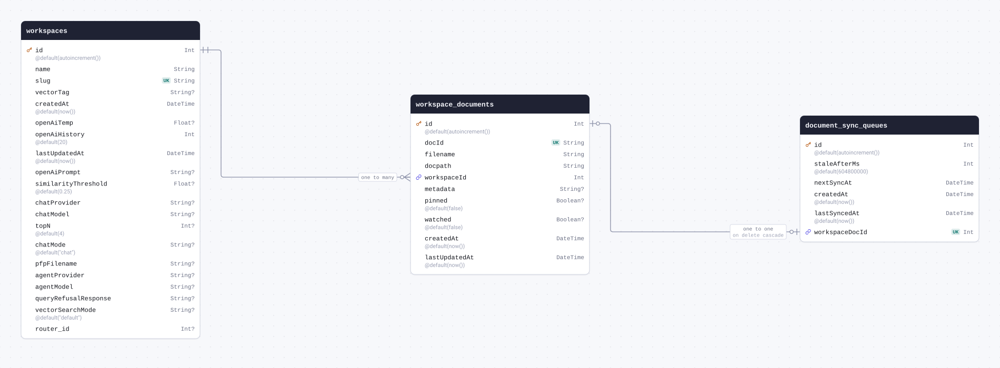

| Field           | Type       | Constraints                                   | Default           | Description |
| --------------- | ---------- | --------------------------------------------- | ----------------- | ----------- |
| `id`            | `Int`      | PK NOT NULL                                   | `autoincrement()` |             |
| `docId`         | `String`   | UNIQUE NOT NULL                               |                   |             |
| `filename`      | `String`   | NOT NULL                                      |                   |             |
| `docpath`       | `String`   | NOT NULL                                      |                   |             |
| `workspaceId`   | `Int`      | NOT NULL → [workspaces.id](#model-workspaces) |                   |             |
| `metadata`      | `String`   | NULL                                          |                   |             |
| `pinned`        | `Boolean`  | NULL                                          | `false`           |             |
| `watched`       | `Boolean`  | NULL                                          | `false`           |             |
| `createdAt`     | `DateTime` | NOT NULL                                      | `now()`           |             |
| `lastUpdatedAt` | `DateTime` | NOT NULL                                      | `now()`           |             |

#### References

- `workspaceId` → [workspaces.id](#model-workspaces) (many-to-one)

#### Referenced by

- `id` ← [document_sync_queues.workspaceDocId](#model-document_sync_queues) (one-to-one, on delete Cascade)

#### Definition

```sql
CREATE TABLE "workspace_documents" (
    "id" INTEGER NOT NULL PRIMARY KEY AUTOINCREMENT,
    "docId" TEXT NOT NULL,
    "filename" TEXT NOT NULL,
    "docpath" TEXT NOT NULL,
    "workspaceId" INTEGER NOT NULL,
    "metadata" TEXT,
    "pinned" BOOLEAN DEFAULT false,
    "watched" BOOLEAN DEFAULT false,
    "createdAt" DATETIME NOT NULL DEFAULT CURRENT_TIMESTAMP,
    "lastUpdatedAt" DATETIME NOT NULL DEFAULT CURRENT_TIMESTAMP,
    CONSTRAINT "workspace_documents_workspaceId_fkey" FOREIGN KEY ("workspaceId") REFERENCES "workspaces" ("id") ON DELETE RESTRICT ON UPDATE CASCADE
);

CREATE UNIQUE INDEX "workspace_documents_docId_key" ON "workspace_documents"("docId");
```

<details>
<summary>Queries and their SQL</summary>

**findMany**: Every row

```ts
await prisma.workspace_documents.findMany();
```

```sql
SELECT
  `main`.`workspace_documents`.`id`,
  `main`.`workspace_documents`.`docId`,
  `main`.`workspace_documents`.`filename`,
  `main`.`workspace_documents`.`docpath`,
  `main`.`workspace_documents`.`workspaceId`,
  `main`.`workspace_documents`.`metadata`,
  `main`.`workspace_documents`.`pinned`,
  `main`.`workspace_documents`.`watched`,
  `main`.`workspace_documents`.`createdAt`,
  `main`.`workspace_documents`.`lastUpdatedAt`
FROM
  `main`.`workspace_documents`
WHERE
  1 = 1
LIMIT
  ?
OFFSET
  ?
-- params: [-1,"0"]
```

**count**: How many rows there are

```ts
await prisma.workspace_documents.count();
```

```sql
SELECT
  COUNT(*) AS `_count$_all`
FROM
  (
    SELECT
      `main`.`workspace_documents`.`id`
    FROM
      `main`.`workspace_documents`
    WHERE
      1 = 1
    LIMIT
      ?
    OFFSET
      ?
  ) AS `sub`
-- params: [-1,"0"]
```

**findMany**: Every row with its relations

```ts
await prisma.workspace_documents.findMany({
  include: { workspace: true, document_sync_queues: true },
});
```

```sql
SELECT
  `main`.`workspace_documents`.`id`,
  `main`.`workspace_documents`.`docId`,
  `main`.`workspace_documents`.`filename`,
  `main`.`workspace_documents`.`docpath`,
  `main`.`workspace_documents`.`workspaceId`,
  `main`.`workspace_documents`.`metadata`,
  `main`.`workspace_documents`.`pinned`,
  `main`.`workspace_documents`.`watched`,
  `main`.`workspace_documents`.`createdAt`,
  `main`.`workspace_documents`.`lastUpdatedAt`
FROM
  `main`.`workspace_documents`
WHERE
  1 = 1
LIMIT
  ?
OFFSET
  ?
-- params: [-1,"0"]

SELECT
  `main`.`workspaces`.`id`,
  `main`.`workspaces`.`name`,
  `main`.`workspaces`.`slug`,
  `main`.`workspaces`.`vectorTag`,
  `main`.`workspaces`.`createdAt`,
  `main`.`workspaces`.`openAiTemp`,
  `main`.`workspaces`.`openAiHistory`,
  `main`.`workspaces`.`lastUpdatedAt`,
  `main`.`workspaces`.`openAiPrompt`,
  `main`.`workspaces`.`similarityThreshold`,
  `main`.`workspaces`.`chatProvider`,
  `main`.`workspaces`.`chatModel`,
  `main`.`workspaces`.`topN`,
  `main`.`workspaces`.`chatMode`,
  `main`.`workspaces`.`pfpFilename`,
  `main`.`workspaces`.`agentProvider`,
  `main`.`workspaces`.`agentModel`,
  `main`.`workspaces`.`queryRefusalResponse`,
  `main`.`workspaces`.`vectorSearchMode`,
  `main`.`workspaces`.`router_id`
FROM
  `main`.`workspaces`
WHERE
  `main`.`workspaces`.`id` IN (?)
LIMIT
  ?
OFFSET
  ?
-- params: ["<workspaceId of the rows above>",-1,"0"]

SELECT
  `main`.`document_sync_queues`.`id`,
  `main`.`document_sync_queues`.`staleAfterMs`,
  `main`.`document_sync_queues`.`nextSyncAt`,
  `main`.`document_sync_queues`.`createdAt`,
  `main`.`document_sync_queues`.`lastSyncedAt`,
  `main`.`document_sync_queues`.`workspaceDocId`
FROM
  `main`.`document_sync_queues`
WHERE
  `main`.`document_sync_queues`.`workspaceDocId` IN (?)
LIMIT
  ?
OFFSET
  ?
-- params: ["<id of the rows above>",-1,"0"]
```

**findUnique**: One row by what is unique to it

```ts
await prisma.workspace_documents.findUnique({ where: { id: 1 } });
```

```sql
SELECT
  `main`.`workspace_documents`.`id`,
  `main`.`workspace_documents`.`docId`,
  `main`.`workspace_documents`.`filename`,
  `main`.`workspace_documents`.`docpath`,
  `main`.`workspace_documents`.`workspaceId`,
  `main`.`workspace_documents`.`metadata`,
  `main`.`workspace_documents`.`pinned`,
  `main`.`workspace_documents`.`watched`,
  `main`.`workspace_documents`.`createdAt`,
  `main`.`workspace_documents`.`lastUpdatedAt`
FROM
  `main`.`workspace_documents`
WHERE
  (
    `main`.`workspace_documents`.`id` = ?
    AND 1 = 1
  )
LIMIT
  ?
OFFSET
  ?
-- params: ["1","1","0"]
```

**create**: Create a row

```ts
await prisma.workspace_documents.create({
  data: { docId: "example", filename: "example", docpath: "example", workspaceId: 1 },
});
```

```sql
INSERT INTO
  `main`.`workspace_documents` (
    `docId`,
    `filename`,
    `docpath`,
    `workspaceId`,
    `pinned`,
    `watched`,
    `createdAt`,
    `lastUpdatedAt`
  )
VALUES
  (?, ?, ?, ?, ?, ?, ?, ?)
RETURNING
  `id` AS `id`,
  `docId` AS `docId`,
  `filename` AS `filename`,
  `docpath` AS `docpath`,
  `workspaceId` AS `workspaceId`,
  `metadata` AS `metadata`,
  `pinned` AS `pinned`,
  `watched` AS `watched`,
  `createdAt` AS `createdAt`,
  `lastUpdatedAt` AS `lastUpdatedAt`
-- params: ["example","example","example","1",false,false,"<now()>","<now()>"]
```

**update**: Update a row

```ts
await prisma.workspace_documents.update({ where: { id: 1 }, data: { docId: "example" } });
```

```sql
UPDATE `main`.`workspace_documents`
SET
  `docId` = ?
WHERE
  (
    `main`.`workspace_documents`.`id` = ?
    AND 1 = 1
  )
RETURNING
  `id` AS `id`,
  `docId` AS `docId`,
  `filename` AS `filename`,
  `docpath` AS `docpath`,
  `workspaceId` AS `workspaceId`,
  `metadata` AS `metadata`,
  `pinned` AS `pinned`,
  `watched` AS `watched`,
  `createdAt` AS `createdAt`,
  `lastUpdatedAt` AS `lastUpdatedAt`
-- params: ["example","1"]
```

**delete**: Delete a row

```ts
await prisma.workspace_documents.delete({ where: { id: 1 } });
```

```sql
DELETE FROM `main`.`workspace_documents`
WHERE
  (
    `main`.`workspace_documents`.`id` = ?
    AND 1 = 1
  )
RETURNING
  `id` AS `id`,
  `docId` AS `docId`,
  `filename` AS `filename`,
  `docpath` AS `docpath`,
  `workspaceId` AS `workspaceId`,
  `metadata` AS `metadata`,
  `pinned` AS `pinned`,
  `watched` AS `watched`,
  `createdAt` AS `createdAt`,
  `lastUpdatedAt` AS `lastUpdatedAt`
-- params: ["1"]
```

</details>

<a id="model-invites"></a>

### invites

| Field           | Type       | Constraints     | Default           | Description |
| --------------- | ---------- | --------------- | ----------------- | ----------- |
| `id`            | `Int`      | PK NOT NULL     | `autoincrement()` |             |
| `code`          | `String`   | UNIQUE NOT NULL |                   |             |
| `status`        | `String`   | NOT NULL        | `"pending"`       |             |
| `claimedBy`     | `Int`      | NULL            |                   |             |
| `workspaceIds`  | `String`   | NULL            |                   |             |
| `createdAt`     | `DateTime` | NOT NULL        | `now()`           |             |
| `createdBy`     | `Int`      | NOT NULL        |                   |             |
| `lastUpdatedAt` | `DateTime` | NOT NULL        | `now()`           |             |

#### Definition

```sql
CREATE TABLE "invites" (
    "id" INTEGER NOT NULL PRIMARY KEY AUTOINCREMENT,
    "code" TEXT NOT NULL,
    "status" TEXT NOT NULL DEFAULT 'pending',
    "claimedBy" INTEGER,
    "workspaceIds" TEXT,
    "createdAt" DATETIME NOT NULL DEFAULT CURRENT_TIMESTAMP,
    "createdBy" INTEGER NOT NULL,
    "lastUpdatedAt" DATETIME NOT NULL DEFAULT CURRENT_TIMESTAMP
);

CREATE UNIQUE INDEX "invites_code_key" ON "invites"("code");
```

<details>
<summary>Queries and their SQL</summary>

**findMany**: Every row

```ts
await prisma.invites.findMany();
```

```sql
SELECT
  `main`.`invites`.`id`,
  `main`.`invites`.`code`,
  `main`.`invites`.`status`,
  `main`.`invites`.`claimedBy`,
  `main`.`invites`.`workspaceIds`,
  `main`.`invites`.`createdAt`,
  `main`.`invites`.`createdBy`,
  `main`.`invites`.`lastUpdatedAt`
FROM
  `main`.`invites`
WHERE
  1 = 1
LIMIT
  ?
OFFSET
  ?
-- params: [-1,"0"]
```

**count**: How many rows there are

```ts
await prisma.invites.count();
```

```sql
SELECT
  COUNT(*) AS `_count$_all`
FROM
  (
    SELECT
      `main`.`invites`.`id`
    FROM
      `main`.`invites`
    WHERE
      1 = 1
    LIMIT
      ?
    OFFSET
      ?
  ) AS `sub`
-- params: [-1,"0"]
```

**findUnique**: One row by what is unique to it

```ts
await prisma.invites.findUnique({ where: { id: 1 } });
```

```sql
SELECT
  `main`.`invites`.`id`,
  `main`.`invites`.`code`,
  `main`.`invites`.`status`,
  `main`.`invites`.`claimedBy`,
  `main`.`invites`.`workspaceIds`,
  `main`.`invites`.`createdAt`,
  `main`.`invites`.`createdBy`,
  `main`.`invites`.`lastUpdatedAt`
FROM
  `main`.`invites`
WHERE
  (
    `main`.`invites`.`id` = ?
    AND 1 = 1
  )
LIMIT
  ?
OFFSET
  ?
-- params: ["1","1","0"]
```

**create**: Create a row

```ts
await prisma.invites.create({ data: { code: "example", createdBy: 1 } });
```

```sql
INSERT INTO
  `main`.`invites` (
    `code`,
    `status`,
    `createdAt`,
    `createdBy`,
    `lastUpdatedAt`
  )
VALUES
  (?, ?, ?, ?, ?)
RETURNING
  `id` AS `id`,
  `code` AS `code`,
  `status` AS `status`,
  `claimedBy` AS `claimedBy`,
  `workspaceIds` AS `workspaceIds`,
  `createdAt` AS `createdAt`,
  `createdBy` AS `createdBy`,
  `lastUpdatedAt` AS `lastUpdatedAt`
-- params: ["example","pending","<now()>","1","<now()>"]
```

**update**: Update a row

```ts
await prisma.invites.update({ where: { id: 1 }, data: { code: "example" } });
```

```sql
UPDATE `main`.`invites`
SET
  `code` = ?
WHERE
  (
    `main`.`invites`.`id` = ?
    AND 1 = 1
  )
RETURNING
  `id` AS `id`,
  `code` AS `code`,
  `status` AS `status`,
  `claimedBy` AS `claimedBy`,
  `workspaceIds` AS `workspaceIds`,
  `createdAt` AS `createdAt`,
  `createdBy` AS `createdBy`,
  `lastUpdatedAt` AS `lastUpdatedAt`
-- params: ["example","1"]
```

**delete**: Delete a row

```ts
await prisma.invites.delete({ where: { id: 1 } });
```

```sql
DELETE FROM `main`.`invites`
WHERE
  (
    `main`.`invites`.`id` = ?
    AND 1 = 1
  )
RETURNING
  `id` AS `id`,
  `code` AS `code`,
  `status` AS `status`,
  `claimedBy` AS `claimedBy`,
  `workspaceIds` AS `workspaceIds`,
  `createdAt` AS `createdAt`,
  `createdBy` AS `createdBy`,
  `lastUpdatedAt` AS `lastUpdatedAt`
-- params: ["1"]
```

</details>

<a id="model-system_settings"></a>

### system_settings

| Field           | Type       | Constraints     | Default           | Description |
| --------------- | ---------- | --------------- | ----------------- | ----------- |
| `id`            | `Int`      | PK NOT NULL     | `autoincrement()` |             |
| `label`         | `String`   | UNIQUE NOT NULL |                   |             |
| `value`         | `String`   | NULL            |                   |             |
| `createdAt`     | `DateTime` | NOT NULL        | `now()`           |             |
| `lastUpdatedAt` | `DateTime` | NOT NULL        | `now()`           |             |

#### Definition

```sql
CREATE TABLE "system_settings" (
    "id" INTEGER NOT NULL PRIMARY KEY AUTOINCREMENT,
    "label" TEXT NOT NULL,
    "value" TEXT,
    "createdAt" DATETIME NOT NULL DEFAULT CURRENT_TIMESTAMP,
    "lastUpdatedAt" DATETIME NOT NULL DEFAULT CURRENT_TIMESTAMP
);

CREATE UNIQUE INDEX "system_settings_label_key" ON "system_settings"("label");
```

<details>
<summary>Queries and their SQL</summary>

**findMany**: Every row

```ts
await prisma.system_settings.findMany();
```

```sql
SELECT
  `main`.`system_settings`.`id`,
  `main`.`system_settings`.`label`,
  `main`.`system_settings`.`value`,
  `main`.`system_settings`.`createdAt`,
  `main`.`system_settings`.`lastUpdatedAt`
FROM
  `main`.`system_settings`
WHERE
  1 = 1
LIMIT
  ?
OFFSET
  ?
-- params: [-1,"0"]
```

**count**: How many rows there are

```ts
await prisma.system_settings.count();
```

```sql
SELECT
  COUNT(*) AS `_count$_all`
FROM
  (
    SELECT
      `main`.`system_settings`.`id`
    FROM
      `main`.`system_settings`
    WHERE
      1 = 1
    LIMIT
      ?
    OFFSET
      ?
  ) AS `sub`
-- params: [-1,"0"]
```

**findUnique**: One row by what is unique to it

```ts
await prisma.system_settings.findUnique({ where: { id: 1 } });
```

```sql
SELECT
  `main`.`system_settings`.`id`,
  `main`.`system_settings`.`label`,
  `main`.`system_settings`.`value`,
  `main`.`system_settings`.`createdAt`,
  `main`.`system_settings`.`lastUpdatedAt`
FROM
  `main`.`system_settings`
WHERE
  (
    `main`.`system_settings`.`id` = ?
    AND 1 = 1
  )
LIMIT
  ?
OFFSET
  ?
-- params: ["1","1","0"]
```

**create**: Create a row

```ts
await prisma.system_settings.create({ data: { label: "example" } });
```

```sql
INSERT INTO
  `main`.`system_settings` (`label`, `createdAt`, `lastUpdatedAt`)
VALUES
  (?, ?, ?)
RETURNING
  `id` AS `id`,
  `label` AS `label`,
  `value` AS `value`,
  `createdAt` AS `createdAt`,
  `lastUpdatedAt` AS `lastUpdatedAt`
-- params: ["example","<now()>","<now()>"]
```

**update**: Update a row

```ts
await prisma.system_settings.update({ where: { id: 1 }, data: { label: "example" } });
```

```sql
UPDATE `main`.`system_settings`
SET
  `label` = ?
WHERE
  (
    `main`.`system_settings`.`id` = ?
    AND 1 = 1
  )
RETURNING
  `id` AS `id`,
  `label` AS `label`,
  `value` AS `value`,
  `createdAt` AS `createdAt`,
  `lastUpdatedAt` AS `lastUpdatedAt`
-- params: ["example","1"]
```

**delete**: Delete a row

```ts
await prisma.system_settings.delete({ where: { id: 1 } });
```

```sql
DELETE FROM `main`.`system_settings`
WHERE
  (
    `main`.`system_settings`.`id` = ?
    AND 1 = 1
  )
RETURNING
  `id` AS `id`,
  `label` AS `label`,
  `value` AS `value`,
  `createdAt` AS `createdAt`,
  `lastUpdatedAt` AS `lastUpdatedAt`
-- params: ["1"]
```

</details>

<a id="model-users"></a>

### users

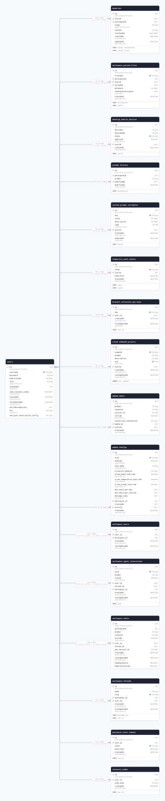

| Field                          | Type       | Constraints | Default           | Description |
| ------------------------------ | ---------- | ----------- | ----------------- | ----------- |
| `id`                           | `Int`      | PK NOT NULL | `autoincrement()` |             |
| `username`                     | `String`   | UNIQUE NULL |                   |             |
| `password`                     | `String`   | NOT NULL    |                   |             |
| `pfpFilename`                  | `String`   | NULL        |                   |             |
| `role`                         | `String`   | NOT NULL    | `"default"`       |             |
| `suspended`                    | `Int`      | NOT NULL    | `0`               |             |
| `seen_recovery_codes`          | `Boolean`  | NULL        | `false`           |             |
| `createdAt`                    | `DateTime` | NOT NULL    | `now()`           |             |
| `lastUpdatedAt`                | `DateTime` | NOT NULL    | `now()`           |             |
| `dailyMessageLimit`            | `Int`      | NULL        |                   |             |
| `bio`                          | `String`   | NULL        | `""`              |             |
| `web_push_subscription_config` | `String`   | NULL        |                   |             |

#### Referenced by

- `id` ← [recovery_codes.user_id](#model-recovery_codes) (one-to-many, on delete Cascade)
- `id` ← [password_reset_tokens.user_id](#model-password_reset_tokens) (one-to-many, on delete Cascade)
- `id` ← [workspace_threads.user_id](#model-workspace_threads) (one-to-many, on delete Cascade)
- `id` ← [workspace_chats.user_id](#model-workspace_chats) (one-to-many, on delete Cascade, on update Cascade)
- `id` ← [workspace_agent_invocations.user_id](#model-workspace_agent_invocations) (one-to-many, on delete Cascade, on update Cascade)
- `id` ← [workspace_users.user_id](#model-workspace_users) (one-to-many, on delete Cascade, on update Cascade)
- `id` ← [embed_configs.usersId](#model-embed_configs) (one-to-many)
- `id` ← [embed_chats.usersId](#model-embed_chats) (one-to-many)
- `id` ← [slash_command_presets.userId](#model-slash_command_presets) (one-to-many, on delete Cascade)
- `id` ← [browser_extension_api_keys.user_id](#model-browser_extension_api_keys) (one-to-many, on delete Cascade)
- `id` ← [temporary_auth_tokens.userId](#model-temporary_auth_tokens) (one-to-many, on delete Cascade)
- `id` ← [system_prompt_variables.userId](#model-system_prompt_variables) (one-to-many, on delete Cascade)
- `id` ← [prompt_history.modifiedBy](#model-prompt_history) (one-to-many)
- `id` ← [desktop_mobile_devices.userId](#model-desktop_mobile_devices) (one-to-many, on delete Cascade)
- `id` ← [workspace_parsed_files.userId](#model-workspace_parsed_files) (one-to-many, on delete Cascade)
- `id` ← [memories.userId](#model-memories) (one-to-many, on delete Cascade)

#### Definition

```sql
CREATE TABLE "users" (
    "id" INTEGER NOT NULL PRIMARY KEY AUTOINCREMENT,
    "username" TEXT,
    "password" TEXT NOT NULL,
    "pfpFilename" TEXT,
    "role" TEXT NOT NULL DEFAULT 'default',
    "suspended" INTEGER NOT NULL DEFAULT 0,
    "seen_recovery_codes" BOOLEAN DEFAULT false,
    "createdAt" DATETIME NOT NULL DEFAULT CURRENT_TIMESTAMP,
    "lastUpdatedAt" DATETIME NOT NULL DEFAULT CURRENT_TIMESTAMP,
    "dailyMessageLimit" INTEGER,
    "bio" TEXT DEFAULT '',
    "web_push_subscription_config" TEXT
);

CREATE UNIQUE INDEX "users_username_key" ON "users"("username");
```

<details>
<summary>Queries and their SQL</summary>

**findMany**: Every row

```ts
await prisma.users.findMany();
```

```sql
SELECT
  `main`.`users`.`id`,
  `main`.`users`.`username`,
  `main`.`users`.`password`,
  `main`.`users`.`pfpFilename`,
  `main`.`users`.`role`,
  `main`.`users`.`suspended`,
  `main`.`users`.`seen_recovery_codes`,
  `main`.`users`.`createdAt`,
  `main`.`users`.`lastUpdatedAt`,
  `main`.`users`.`dailyMessageLimit`,
  `main`.`users`.`bio`,
  `main`.`users`.`web_push_subscription_config`
FROM
  `main`.`users`
WHERE
  1 = 1
LIMIT
  ?
OFFSET
  ?
-- params: [-1,"0"]
```

**count**: How many rows there are

```ts
await prisma.users.count();
```

```sql
SELECT
  COUNT(*) AS `_count$_all`
FROM
  (
    SELECT
      `main`.`users`.`id`
    FROM
      `main`.`users`
    WHERE
      1 = 1
    LIMIT
      ?
    OFFSET
      ?
  ) AS `sub`
-- params: [-1,"0"]
```

**findMany**: Every row with its relations

```ts
await prisma.users.findMany({
  include: {
    workspace_chats: true,
    workspace_users: true,
    embed_configs: true,
    embed_chats: true,
    threads: true,
    recovery_codes: true,
    password_reset_tokens: true,
    workspace_agent_invocations: true,
    slash_command_presets: true,
    browser_extension_api_keys: true,
    temporary_auth_tokens: true,
    system_prompt_variables: true,
    prompt_history: true,
    desktop_mobile_devices: true,
    workspace_parsed_files: true,
    memories: true,
  },
});
```

```sql
SELECT
  `main`.`users`.`id`,
  `main`.`users`.`username`,
  `main`.`users`.`password`,
  `main`.`users`.`pfpFilename`,
  `main`.`users`.`role`,
  `main`.`users`.`suspended`,
  `main`.`users`.`seen_recovery_codes`,
  `main`.`users`.`createdAt`,
  `main`.`users`.`lastUpdatedAt`,
  `main`.`users`.`dailyMessageLimit`,
  `main`.`users`.`bio`,
  `main`.`users`.`web_push_subscription_config`
FROM
  `main`.`users`
WHERE
  1 = 1
LIMIT
  ?
OFFSET
  ?
-- params: [-1,"0"]

SELECT
  `main`.`workspace_chats`.`id`,
  `main`.`workspace_chats`.`workspaceId`,
  `main`.`workspace_chats`.`prompt`,
  `main`.`workspace_chats`.`response`,
  `main`.`workspace_chats`.`include`,
  `main`.`workspace_chats`.`user_id`,
  `main`.`workspace_chats`.`thread_id`,
  `main`.`workspace_chats`.`api_session_id`,
  `main`.`workspace_chats`.`createdAt`,
  `main`.`workspace_chats`.`lastUpdatedAt`,
  `main`.`workspace_chats`.`feedbackScore`,
  `main`.`workspace_chats`.`memory_processed`
FROM
  `main`.`workspace_chats`
WHERE
  `main`.`workspace_chats`.`user_id` IN (?)
LIMIT
  ?
OFFSET
  ?
-- params: ["<id of the rows above>",-1,"0"]

SELECT
  `main`.`workspace_users`.`id`,
  `main`.`workspace_users`.`user_id`,
  `main`.`workspace_users`.`workspace_id`,
  `main`.`workspace_users`.`createdAt`,
  `main`.`workspace_users`.`lastUpdatedAt`
FROM
  `main`.`workspace_users`
WHERE
  `main`.`workspace_users`.`user_id` IN (?)
LIMIT
  ?
OFFSET
  ?
-- params: ["<id of the rows above>",-1,"0"]

SELECT
  `main`.`embed_configs`.`id`,
  `main`.`embed_configs`.`uuid`,
  `main`.`embed_configs`.`enabled`,
  `main`.`embed_configs`.`chat_mode`,
  `main`.`embed_configs`.`allowlist_domains`,
  `main`.`embed_configs`.`allow_model_override`,
  `main`.`embed_configs`.`allow_temperature_override`,
  `main`.`embed_configs`.`allow_prompt_override`,
  `main`.`embed_configs`.`max_chats_per_day`,
  `main`.`embed_configs`.`max_chats_per_session`,
  `main`.`embed_configs`.`message_limit`,
  `main`.`embed_configs`.`workspace_id`,
  `main`.`embed_configs`.`createdBy`,
  `main`.`embed_configs`.`usersId`,
  `main`.`embed_configs`.`createdAt`
FROM
  `main`.`embed_configs`
WHERE
  `main`.`embed_configs`.`usersId` IN (?)
LIMIT
  ?
OFFSET
  ?
-- params: ["<id of the rows above>",-1,"0"]

SELECT
  `main`.`embed_chats`.`id`,
  `main`.`embed_chats`.`prompt`,
  `main`.`embed_chats`.`response`,
  `main`.`embed_chats`.`session_id`,
  `main`.`embed_chats`.`include`,
  `main`.`embed_chats`.`connection_information`,
  `main`.`embed_chats`.`embed_id`,
  `main`.`embed_chats`.`usersId`,
  `main`.`embed_chats`.`createdAt`
FROM
  `main`.`embed_chats`
WHERE
  `main`.`embed_chats`.`usersId` IN (?)
LIMIT
  ?
OFFSET
  ?
-- params: ["<id of the rows above>",-1,"0"]

SELECT
  `main`.`workspace_threads`.`id`,
  `main`.`workspace_threads`.`name`,
  `main`.`workspace_threads`.`slug`,
  `main`.`workspace_threads`.`workspace_id`,
  `main`.`workspace_threads`.`user_id`,
  `main`.`workspace_threads`.`createdAt`,
  `main`.`workspace_threads`.`lastUpdatedAt`
FROM
  `main`.`workspace_threads`
WHERE
  `main`.`workspace_threads`.`user_id` IN (?)
LIMIT
  ?
OFFSET
  ?
-- params: ["<id of the rows above>",-1,"0"]

SELECT
  `main`.`recovery_codes`.`id`,
  `main`.`recovery_codes`.`user_id`,
  `main`.`recovery_codes`.`code_hash`,
  `main`.`recovery_codes`.`createdAt`
FROM
  `main`.`recovery_codes`
WHERE
  `main`.`recovery_codes`.`user_id` IN (?)
LIMIT
  ?
OFFSET
  ?
-- params: ["<id of the rows above>",-1,"0"]

SELECT
  `main`.`password_reset_tokens`.`id`,
  `main`.`password_reset_tokens`.`user_id`,
  `main`.`password_reset_tokens`.`token`,
  `main`.`password_reset_tokens`.`expiresAt`,
  `main`.`password_reset_tokens`.`createdAt`
FROM
  `main`.`password_reset_tokens`
WHERE
  `main`.`password_reset_tokens`.`user_id` IN (?)
LIMIT
  ?
OFFSET
  ?
-- params: ["<id of the rows above>",-1,"0"]

SELECT
  `main`.`workspace_agent_invocations`.`id`,
  `main`.`workspace_agent_invocations`.`uuid`,
  `main`.`workspace_agent_invocations`.`prompt`,
  `main`.`workspace_agent_invocations`.`closed`,
  `main`.`workspace_agent_invocations`.`user_id`,
  `main`.`workspace_agent_invocations`.`thread_id`,
  `main`.`workspace_agent_invocations`.`workspace_id`,
  `main`.`workspace_agent_invocations`.`createdAt`,
  `main`.`workspace_agent_invocations`.`lastUpdatedAt`
FROM
  `main`.`workspace_agent_invocations`
WHERE
  `main`.`workspace_agent_invocations`.`user_id` IN (?)
LIMIT
  ?
OFFSET
  ?
-- params: ["<id of the rows above>",-1,"0"]

SELECT
  `main`.`slash_command_presets`.`id`,
  `main`.`slash_command_presets`.`command`,
  `main`.`slash_command_presets`.`prompt`,
  `main`.`slash_command_presets`.`description`,
  `main`.`slash_command_presets`.`uid`,
  `main`.`slash_command_presets`.`userId`,
  `main`.`slash_command_presets`.`createdAt`,
  `main`.`slash_command_presets`.`lastUpdatedAt`
FROM
  `main`.`slash_command_presets`
WHERE
  `main`.`slash_command_presets`.`userId` IN (?)
LIMIT
  ?
OFFSET
  ?
-- params: ["<id of the rows above>",-1,"0"]

SELECT
  `main`.`browser_extension_api_keys`.`id`,
  `main`.`browser_extension_api_keys`.`key`,
  `main`.`browser_extension_api_keys`.`user_id`,
  `main`.`browser_extension_api_keys`.`createdAt`,
  `main`.`browser_extension_api_keys`.`lastUpdatedAt`
FROM
  `main`.`browser_extension_api_keys`
WHERE
  `main`.`browser_extension_api_keys`.`user_id` IN (?)
LIMIT
  ?
OFFSET
  ?
-- params: ["<id of the rows above>",-1,"0"]

SELECT
  `main`.`temporary_auth_tokens`.`id`,
  `main`.`temporary_auth_tokens`.`token`,
  `main`.`temporary_auth_tokens`.`userId`,
  `main`.`temporary_auth_tokens`.`expiresAt`,
  `main`.`temporary_auth_tokens`.`createdAt`
FROM
  `main`.`temporary_auth_tokens`
WHERE
  `main`.`temporary_auth_tokens`.`userId` IN (?)
LIMIT
  ?
OFFSET
  ?
-- params: ["<id of the rows above>",-1,"0"]

SELECT
  `main`.`system_prompt_variables`.`id`,
  `main`.`system_prompt_variables`.`key`,
  `main`.`system_prompt_variables`.`value`,
  `main`.`system_prompt_variables`.`description`,
  `main`.`system_prompt_variables`.`type`,
  `main`.`system_prompt_variables`.`userId`,
  `main`.`system_prompt_variables`.`createdAt`,
  `main`.`system_prompt_variables`.`updatedAt`
FROM
  `main`.`system_prompt_variables`
WHERE
  `main`.`system_prompt_variables`.`userId` IN (?)
LIMIT
  ?
OFFSET
  ?
-- params: ["<id of the rows above>",-1,"0"]

SELECT
  `main`.`prompt_history`.`id`,
  `main`.`prompt_history`.`workspaceId`,
  `main`.`prompt_history`.`prompt`,
  `main`.`prompt_history`.`modifiedBy`,
  `main`.`prompt_history`.`modifiedAt`
FROM
  `main`.`prompt_history`
WHERE
  `main`.`prompt_history`.`modifiedBy` IN (?)
LIMIT
  ?
OFFSET
  ?
-- params: ["<id of the rows above>",-1,"0"]

SELECT
  `main`.`desktop_mobile_devices`.`id`,
  `main`.`desktop_mobile_devices`.`deviceOs`,
  `main`.`desktop_mobile_devices`.`deviceName`,
  `main`.`desktop_mobile_devices`.`token`,
  `main`.`desktop_mobile_devices`.`approved`,
  `main`.`desktop_mobile_devices`.`userId`,
  `main`.`desktop_mobile_devices`.`createdAt`
FROM
  `main`.`desktop_mobile_devices`
WHERE
  `main`.`desktop_mobile_devices`.`userId` IN (?)
LIMIT
  ?
OFFSET
  ?
-- params: ["<id of the rows above>",-1,"0"]

SELECT
  `main`.`workspace_parsed_files`.`id`,
  `main`.`workspace_parsed_files`.`filename`,
  `main`.`workspace_parsed_files`.`workspaceId`,
  `main`.`workspace_parsed_files`.`userId`,
  `main`.`workspace_parsed_files`.`threadId`,
  `main`.`workspace_parsed_files`.`metadata`,
  `main`.`workspace_parsed_files`.`tokenCountEstimate`,
  `main`.`workspace_parsed_files`.`createdAt`
FROM
  `main`.`workspace_parsed_files`
WHERE
  `main`.`workspace_parsed_files`.`userId` IN (?)
LIMIT
  ?
OFFSET
  ?
-- params: ["<id of the rows above>",-1,"0"]

SELECT
  `main`.`memories`.`id`,
  `main`.`memories`.`user_id`,
  `main`.`memories`.`workspace_id`,
  `main`.`memories`.`scope`,
  `main`.`memories`.`content`,
  `main`.`memories`.`last_used_at`,
  `main`.`memories`.`created_at`,
  `main`.`memories`.`updated_at`
FROM
  `main`.`memories`
WHERE
  `main`.`memories`.`user_id` IN (?)
LIMIT
  ?
OFFSET
  ?
-- params: ["<id of the rows above>",-1,"0"]
```

**findUnique**: One row by what is unique to it

```ts
await prisma.users.findUnique({ where: { id: 1 } });
```

```sql
SELECT
  `main`.`users`.`id`,
  `main`.`users`.`username`,
  `main`.`users`.`password`,
  `main`.`users`.`pfpFilename`,
  `main`.`users`.`role`,
  `main`.`users`.`suspended`,
  `main`.`users`.`seen_recovery_codes`,
  `main`.`users`.`createdAt`,
  `main`.`users`.`lastUpdatedAt`,
  `main`.`users`.`dailyMessageLimit`,
  `main`.`users`.`bio`,
  `main`.`users`.`web_push_subscription_config`
FROM
  `main`.`users`
WHERE
  (
    `main`.`users`.`id` = ?
    AND 1 = 1
  )
LIMIT
  ?
OFFSET
  ?
-- params: ["1","1","0"]
```

**create**: Create a row

```ts
await prisma.users.create({ data: { password: "example" } });
```

```sql
INSERT INTO
  `main`.`users` (
    `password`,
    `role`,
    `suspended`,
    `seen_recovery_codes`,
    `createdAt`,
    `lastUpdatedAt`,
    `bio`
  )
VALUES
  (?, ?, ?, ?, ?, ?, ?)
RETURNING
  `id` AS `id`,
  `username` AS `username`,
  `password` AS `password`,
  `pfpFilename` AS `pfpFilename`,
  `role` AS `role`,
  `suspended` AS `suspended`,
  `seen_recovery_codes` AS `seen_recovery_codes`,
  `createdAt` AS `createdAt`,
  `lastUpdatedAt` AS `lastUpdatedAt`,
  `dailyMessageLimit` AS `dailyMessageLimit`,
  `bio` AS `bio`,
  `web_push_subscription_config` AS `web_push_subscription_config`
-- params: ["example","default","0",false,"<now()>","<now()>",""]
```

**update**: Update a row

```ts
await prisma.users.update({ where: { id: 1 }, data: { username: "example" } });
```

```sql
UPDATE `main`.`users`
SET
  `username` = ?
WHERE
  (
    `main`.`users`.`id` = ?
    AND 1 = 1
  )
RETURNING
  `id` AS `id`,
  `username` AS `username`,
  `password` AS `password`,
  `pfpFilename` AS `pfpFilename`,
  `role` AS `role`,
  `suspended` AS `suspended`,
  `seen_recovery_codes` AS `seen_recovery_codes`,
  `createdAt` AS `createdAt`,
  `lastUpdatedAt` AS `lastUpdatedAt`,
  `dailyMessageLimit` AS `dailyMessageLimit`,
  `bio` AS `bio`,
  `web_push_subscription_config` AS `web_push_subscription_config`
-- params: ["example","1"]
```

**delete**: Delete a row

```ts
await prisma.users.delete({ where: { id: 1 } });
```

```sql
DELETE FROM `main`.`users`
WHERE
  (
    `main`.`users`.`id` = ?
    AND 1 = 1
  )
RETURNING
  `id` AS `id`,
  `username` AS `username`,
  `password` AS `password`,
  `pfpFilename` AS `pfpFilename`,
  `role` AS `role`,
  `suspended` AS `suspended`,
  `seen_recovery_codes` AS `seen_recovery_codes`,
  `createdAt` AS `createdAt`,
  `lastUpdatedAt` AS `lastUpdatedAt`,
  `dailyMessageLimit` AS `dailyMessageLimit`,
  `bio` AS `bio`,
  `web_push_subscription_config` AS `web_push_subscription_config`
-- params: ["1"]
```

</details>

<a id="model-recovery_codes"></a>

### recovery_codes

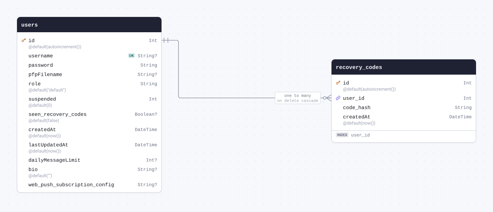

| Field       | Type       | Constraints                         | Default           | Description |
| ----------- | ---------- | ----------------------------------- | ----------------- | ----------- |
| `id`        | `Int`      | PK NOT NULL                         | `autoincrement()` |             |
| `user_id`   | `Int`      | NOT NULL → [users.id](#model-users) |                   |             |
| `code_hash` | `String`   | NOT NULL                            |                   |             |
| `createdAt` | `DateTime` | NOT NULL                            | `now()`           |             |

#### Indexes

- `@@index([user_id])`

#### References

- `user_id` → [users.id](#model-users) (many-to-one, on delete Cascade)

#### Definition

```sql
CREATE TABLE "recovery_codes" (
    "id" INTEGER NOT NULL PRIMARY KEY AUTOINCREMENT,
    "user_id" INTEGER NOT NULL,
    "code_hash" TEXT NOT NULL,
    "createdAt" DATETIME NOT NULL DEFAULT CURRENT_TIMESTAMP,
    CONSTRAINT "recovery_codes_user_id_fkey" FOREIGN KEY ("user_id") REFERENCES "users" ("id") ON DELETE CASCADE ON UPDATE CASCADE
);

CREATE INDEX "recovery_codes_user_id_idx" ON "recovery_codes"("user_id");
```

<details>
<summary>Queries and their SQL</summary>

**findMany**: Every row

```ts
await prisma.recovery_codes.findMany();
```

```sql
SELECT
  `main`.`recovery_codes`.`id`,
  `main`.`recovery_codes`.`user_id`,
  `main`.`recovery_codes`.`code_hash`,
  `main`.`recovery_codes`.`createdAt`
FROM
  `main`.`recovery_codes`
WHERE
  1 = 1
LIMIT
  ?
OFFSET
  ?
-- params: [-1,"0"]
```

**count**: How many rows there are

```ts
await prisma.recovery_codes.count();
```

```sql
SELECT
  COUNT(*) AS `_count$_all`
FROM
  (
    SELECT
      `main`.`recovery_codes`.`id`
    FROM
      `main`.`recovery_codes`
    WHERE
      1 = 1
    LIMIT
      ?
    OFFSET
      ?
  ) AS `sub`
-- params: [-1,"0"]
```

**findMany**: Every row with its relations

```ts
await prisma.recovery_codes.findMany({ include: { user: true } });
```

```sql
SELECT
  `main`.`recovery_codes`.`id`,
  `main`.`recovery_codes`.`user_id`,
  `main`.`recovery_codes`.`code_hash`,
  `main`.`recovery_codes`.`createdAt`
FROM
  `main`.`recovery_codes`
WHERE
  1 = 1
LIMIT
  ?
OFFSET
  ?
-- params: [-1,"0"]

SELECT
  `main`.`users`.`id`,
  `main`.`users`.`username`,
  `main`.`users`.`password`,
  `main`.`users`.`pfpFilename`,
  `main`.`users`.`role`,
  `main`.`users`.`suspended`,
  `main`.`users`.`seen_recovery_codes`,
  `main`.`users`.`createdAt`,
  `main`.`users`.`lastUpdatedAt`,
  `main`.`users`.`dailyMessageLimit`,
  `main`.`users`.`bio`,
  `main`.`users`.`web_push_subscription_config`
FROM
  `main`.`users`
WHERE
  `main`.`users`.`id` IN (?)
LIMIT
  ?
OFFSET
  ?
-- params: ["<user_id of the rows above>",-1,"0"]
```

**findUnique**: One row by what is unique to it

```ts
await prisma.recovery_codes.findUnique({ where: { id: 1 } });
```

```sql
SELECT
  `main`.`recovery_codes`.`id`,
  `main`.`recovery_codes`.`user_id`,
  `main`.`recovery_codes`.`code_hash`,
  `main`.`recovery_codes`.`createdAt`
FROM
  `main`.`recovery_codes`
WHERE
  (
    `main`.`recovery_codes`.`id` = ?
    AND 1 = 1
  )
LIMIT
  ?
OFFSET
  ?
-- params: ["1","1","0"]
```

**create**: Create a row

```ts
await prisma.recovery_codes.create({ data: { user_id: 1, code_hash: "example" } });
```

```sql
INSERT INTO
  `main`.`recovery_codes` (`user_id`, `code_hash`, `createdAt`)
VALUES
  (?, ?, ?)
RETURNING
  `id` AS `id`,
  `user_id` AS `user_id`,
  `code_hash` AS `code_hash`,
  `createdAt` AS `createdAt`
-- params: ["1","example","<now()>"]
```

**update**: Update a row

```ts
await prisma.recovery_codes.update({ where: { id: 1 }, data: { code_hash: "example" } });
```

```sql
UPDATE `main`.`recovery_codes`
SET
  `code_hash` = ?
WHERE
  (
    `main`.`recovery_codes`.`id` = ?
    AND 1 = 1
  )
RETURNING
  `id` AS `id`,
  `user_id` AS `user_id`,
  `code_hash` AS `code_hash`,
  `createdAt` AS `createdAt`
-- params: ["example","1"]
```

**delete**: Delete a row

```ts
await prisma.recovery_codes.delete({ where: { id: 1 } });
```

```sql
DELETE FROM `main`.`recovery_codes`
WHERE
  (
    `main`.`recovery_codes`.`id` = ?
    AND 1 = 1
  )
RETURNING
  `id` AS `id`,
  `user_id` AS `user_id`,
  `code_hash` AS `code_hash`,
  `createdAt` AS `createdAt`
-- params: ["1"]
```

</details>

<a id="model-password_reset_tokens"></a>

### password_reset_tokens

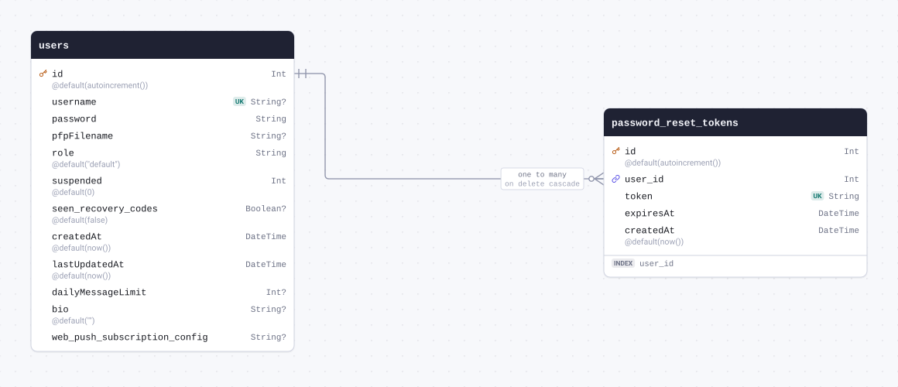

| Field       | Type       | Constraints                         | Default           | Description |
| ----------- | ---------- | ----------------------------------- | ----------------- | ----------- |
| `id`        | `Int`      | PK NOT NULL                         | `autoincrement()` |             |
| `user_id`   | `Int`      | NOT NULL → [users.id](#model-users) |                   |             |
| `token`     | `String`   | UNIQUE NOT NULL                     |                   |             |
| `expiresAt` | `DateTime` | NOT NULL                            |                   |             |
| `createdAt` | `DateTime` | NOT NULL                            | `now()`           |             |

#### Indexes

- `@@index([user_id])`

#### References

- `user_id` → [users.id](#model-users) (many-to-one, on delete Cascade)

#### Definition

```sql
CREATE TABLE "password_reset_tokens" (
    "id" INTEGER NOT NULL PRIMARY KEY AUTOINCREMENT,
    "user_id" INTEGER NOT NULL,
    "token" TEXT NOT NULL,
    "expiresAt" DATETIME NOT NULL,
    "createdAt" DATETIME NOT NULL DEFAULT CURRENT_TIMESTAMP,
    CONSTRAINT "password_reset_tokens_user_id_fkey" FOREIGN KEY ("user_id") REFERENCES "users" ("id") ON DELETE CASCADE ON UPDATE CASCADE
);

CREATE UNIQUE INDEX "password_reset_tokens_token_key" ON "password_reset_tokens"("token");

CREATE INDEX "password_reset_tokens_user_id_idx" ON "password_reset_tokens"("user_id");
```

<details>
<summary>Queries and their SQL</summary>

**findMany**: Every row

```ts
await prisma.password_reset_tokens.findMany();
```

```sql
SELECT
  `main`.`password_reset_tokens`.`id`,
  `main`.`password_reset_tokens`.`user_id`,
  `main`.`password_reset_tokens`.`token`,
  `main`.`password_reset_tokens`.`expiresAt`,
  `main`.`password_reset_tokens`.`createdAt`
FROM
  `main`.`password_reset_tokens`
WHERE
  1 = 1
LIMIT
  ?
OFFSET
  ?
-- params: [-1,"0"]
```

**count**: How many rows there are

```ts
await prisma.password_reset_tokens.count();
```

```sql
SELECT
  COUNT(*) AS `_count$_all`
FROM
  (
    SELECT
      `main`.`password_reset_tokens`.`id`
    FROM
      `main`.`password_reset_tokens`
    WHERE
      1 = 1
    LIMIT
      ?
    OFFSET
      ?
  ) AS `sub`
-- params: [-1,"0"]
```

**findMany**: Every row with its relations

```ts
await prisma.password_reset_tokens.findMany({ include: { user: true } });
```

```sql
SELECT
  `main`.`password_reset_tokens`.`id`,
  `main`.`password_reset_tokens`.`user_id`,
  `main`.`password_reset_tokens`.`token`,
  `main`.`password_reset_tokens`.`expiresAt`,
  `main`.`password_reset_tokens`.`createdAt`
FROM
  `main`.`password_reset_tokens`
WHERE
  1 = 1
LIMIT
  ?
OFFSET
  ?
-- params: [-1,"0"]

SELECT
  `main`.`users`.`id`,
  `main`.`users`.`username`,
  `main`.`users`.`password`,
  `main`.`users`.`pfpFilename`,
  `main`.`users`.`role`,
  `main`.`users`.`suspended`,
  `main`.`users`.`seen_recovery_codes`,
  `main`.`users`.`createdAt`,
  `main`.`users`.`lastUpdatedAt`,
  `main`.`users`.`dailyMessageLimit`,
  `main`.`users`.`bio`,
  `main`.`users`.`web_push_subscription_config`
FROM
  `main`.`users`
WHERE
  `main`.`users`.`id` IN (?)
LIMIT
  ?
OFFSET
  ?
-- params: ["<user_id of the rows above>",-1,"0"]
```

**findUnique**: One row by what is unique to it

```ts
await prisma.password_reset_tokens.findUnique({ where: { id: 1 } });
```

```sql
SELECT
  `main`.`password_reset_tokens`.`id`,
  `main`.`password_reset_tokens`.`user_id`,
  `main`.`password_reset_tokens`.`token`,
  `main`.`password_reset_tokens`.`expiresAt`,
  `main`.`password_reset_tokens`.`createdAt`
FROM
  `main`.`password_reset_tokens`
WHERE
  (
    `main`.`password_reset_tokens`.`id` = ?
    AND 1 = 1
  )
LIMIT
  ?
OFFSET
  ?
-- params: ["1","1","0"]
```

**create**: Create a row

```ts
await prisma.password_reset_tokens.create({
  data: { user_id: 1, token: "example", expiresAt: new Date("2026-01-01T00:00:00.000Z") },
});
```

```sql
INSERT INTO
  `main`.`password_reset_tokens` (`user_id`, `token`, `expiresAt`, `createdAt`)
VALUES
  (?, ?, ?, ?)
RETURNING
  `id` AS `id`,
  `user_id` AS `user_id`,
  `token` AS `token`,
  `expiresAt` AS `expiresAt`,
  `createdAt` AS `createdAt`
-- params: ["1","example","2026-01-01T00:00:00.000Z","<now()>"]
```

**update**: Update a row

```ts
await prisma.password_reset_tokens.update({ where: { id: 1 }, data: { token: "example" } });
```

```sql
UPDATE `main`.`password_reset_tokens`
SET
  `token` = ?
WHERE
  (
    `main`.`password_reset_tokens`.`id` = ?
    AND 1 = 1
  )
RETURNING
  `id` AS `id`,
  `user_id` AS `user_id`,
  `token` AS `token`,
  `expiresAt` AS `expiresAt`,
  `createdAt` AS `createdAt`
-- params: ["example","1"]
```

**delete**: Delete a row

```ts
await prisma.password_reset_tokens.delete({ where: { id: 1 } });
```

```sql
DELETE FROM `main`.`password_reset_tokens`
WHERE
  (
    `main`.`password_reset_tokens`.`id` = ?
    AND 1 = 1
  )
RETURNING
  `id` AS `id`,
  `user_id` AS `user_id`,
  `token` AS `token`,
  `expiresAt` AS `expiresAt`,
  `createdAt` AS `createdAt`
-- params: ["1"]
```

</details>

<a id="model-document_vectors"></a>

### document_vectors

| Field           | Type       | Constraints | Default           | Description |
| --------------- | ---------- | ----------- | ----------------- | ----------- |
| `id`            | `Int`      | PK NOT NULL | `autoincrement()` |             |
| `docId`         | `String`   | NOT NULL    |                   |             |
| `vectorId`      | `String`   | NOT NULL    |                   |             |
| `createdAt`     | `DateTime` | NOT NULL    | `now()`           |             |
| `lastUpdatedAt` | `DateTime` | NOT NULL    | `now()`           |             |

#### Definition

```sql
CREATE TABLE "document_vectors" (
    "id" INTEGER NOT NULL PRIMARY KEY AUTOINCREMENT,
    "docId" TEXT NOT NULL,
    "vectorId" TEXT NOT NULL,
    "createdAt" DATETIME NOT NULL DEFAULT CURRENT_TIMESTAMP,
    "lastUpdatedAt" DATETIME NOT NULL DEFAULT CURRENT_TIMESTAMP
);
```

<details>
<summary>Queries and their SQL</summary>

**findMany**: Every row

```ts
await prisma.document_vectors.findMany();
```

```sql
SELECT
  `main`.`document_vectors`.`id`,
  `main`.`document_vectors`.`docId`,
  `main`.`document_vectors`.`vectorId`,
  `main`.`document_vectors`.`createdAt`,
  `main`.`document_vectors`.`lastUpdatedAt`
FROM
  `main`.`document_vectors`
WHERE
  1 = 1
LIMIT
  ?
OFFSET
  ?
-- params: [-1,"0"]
```

**count**: How many rows there are

```ts
await prisma.document_vectors.count();
```

```sql
SELECT
  COUNT(*) AS `_count$_all`
FROM
  (
    SELECT
      `main`.`document_vectors`.`id`
    FROM
      `main`.`document_vectors`
    WHERE
      1 = 1
    LIMIT
      ?
    OFFSET
      ?
  ) AS `sub`
-- params: [-1,"0"]
```

**findUnique**: One row by what is unique to it

```ts
await prisma.document_vectors.findUnique({ where: { id: 1 } });
```

```sql
SELECT
  `main`.`document_vectors`.`id`,
  `main`.`document_vectors`.`docId`,
  `main`.`document_vectors`.`vectorId`,
  `main`.`document_vectors`.`createdAt`,
  `main`.`document_vectors`.`lastUpdatedAt`
FROM
  `main`.`document_vectors`
WHERE
  (
    `main`.`document_vectors`.`id` = ?
    AND 1 = 1
  )
LIMIT
  ?
OFFSET
  ?
-- params: ["1","1","0"]
```

**create**: Create a row

```ts
await prisma.document_vectors.create({ data: { docId: "example", vectorId: "example" } });
```

```sql
INSERT INTO
  `main`.`document_vectors` (`docId`, `vectorId`, `createdAt`, `lastUpdatedAt`)
VALUES
  (?, ?, ?, ?)
RETURNING
  `id` AS `id`,
  `docId` AS `docId`,
  `vectorId` AS `vectorId`,
  `createdAt` AS `createdAt`,
  `lastUpdatedAt` AS `lastUpdatedAt`
-- params: ["example","example","<now()>","<now()>"]
```

**update**: Update a row

```ts
await prisma.document_vectors.update({ where: { id: 1 }, data: { docId: "example" } });
```

```sql
UPDATE `main`.`document_vectors`
SET
  `docId` = ?
WHERE
  (
    `main`.`document_vectors`.`id` = ?
    AND 1 = 1
  )
RETURNING
  `id` AS `id`,
  `docId` AS `docId`,
  `vectorId` AS `vectorId`,
  `createdAt` AS `createdAt`,
  `lastUpdatedAt` AS `lastUpdatedAt`
-- params: ["example","1"]
```

**delete**: Delete a row

```ts
await prisma.document_vectors.delete({ where: { id: 1 } });
```

```sql
DELETE FROM `main`.`document_vectors`
WHERE
  (
    `main`.`document_vectors`.`id` = ?
    AND 1 = 1
  )
RETURNING
  `id` AS `id`,
  `docId` AS `docId`,
  `vectorId` AS `vectorId`,
  `createdAt` AS `createdAt`,
  `lastUpdatedAt` AS `lastUpdatedAt`
-- params: ["1"]
```

</details>

<a id="model-workspaces"></a>

### workspaces

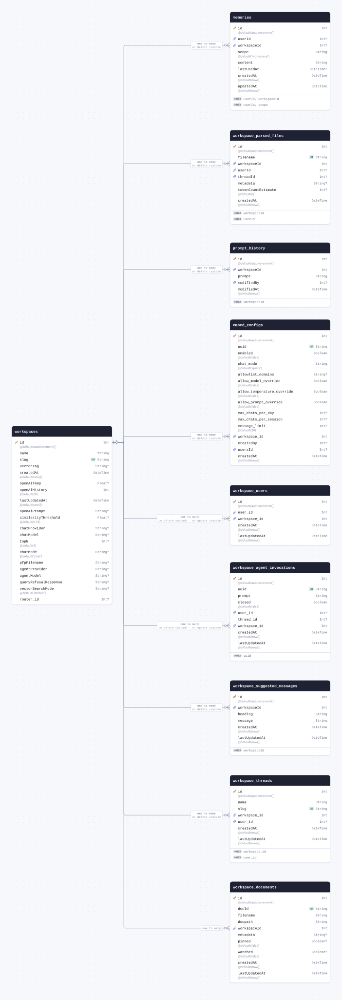

| Field                  | Type       | Constraints     | Default           | Description |
| ---------------------- | ---------- | --------------- | ----------------- | ----------- |
| `id`                   | `Int`      | PK NOT NULL     | `autoincrement()` |             |
| `name`                 | `String`   | NOT NULL        |                   |             |
| `slug`                 | `String`   | UNIQUE NOT NULL |                   |             |
| `vectorTag`            | `String`   | NULL            |                   |             |
| `createdAt`            | `DateTime` | NOT NULL        | `now()`           |             |
| `openAiTemp`           | `Float`    | NULL            |                   |             |
| `openAiHistory`        | `Int`      | NOT NULL        | `20`              |             |
| `lastUpdatedAt`        | `DateTime` | NOT NULL        | `now()`           |             |
| `openAiPrompt`         | `String`   | NULL            |                   |             |
| `similarityThreshold`  | `Float`    | NULL            | `0.25`            |             |
| `chatProvider`         | `String`   | NULL            |                   |             |
| `chatModel`            | `String`   | NULL            |                   |             |
| `topN`                 | `Int`      | NULL            | `4`               |             |
| `chatMode`             | `String`   | NULL            | `"chat"`          |             |
| `pfpFilename`          | `String`   | NULL            |                   |             |
| `agentProvider`        | `String`   | NULL            |                   |             |
| `agentModel`           | `String`   | NULL            |                   |             |
| `queryRefusalResponse` | `String`   | NULL            |                   |             |
| `vectorSearchMode`     | `String`   | NULL            | `"default"`       |             |
| `router_id`            | `Int`      | NULL            |                   |             |

#### Referenced by

- `id` ← [workspace_documents.workspaceId](#model-workspace_documents) (one-to-many)
- `id` ← [workspace_threads.workspace_id](#model-workspace_threads) (one-to-many, on delete Cascade)
- `id` ← [workspace_suggested_messages.workspaceId](#model-workspace_suggested_messages) (one-to-many, on delete Cascade)
- `id` ← [workspace_agent_invocations.workspace_id](#model-workspace_agent_invocations) (one-to-many, on delete Cascade, on update Cascade)
- `id` ← [workspace_users.workspace_id](#model-workspace_users) (one-to-many, on delete Cascade, on update Cascade)
- `id` ← [embed_configs.workspace_id](#model-embed_configs) (one-to-many, on delete Cascade)
- `id` ← [prompt_history.workspaceId](#model-prompt_history) (one-to-many, on delete Cascade)
- `id` ← [workspace_parsed_files.workspaceId](#model-workspace_parsed_files) (one-to-many, on delete Cascade)
- `id` ← [memories.workspaceId](#model-memories) (one-to-many, on delete Cascade)

#### Definition

```sql
CREATE TABLE "workspaces" (
    "id" INTEGER NOT NULL PRIMARY KEY AUTOINCREMENT,
    "name" TEXT NOT NULL,
    "slug" TEXT NOT NULL,
    "vectorTag" TEXT,
    "createdAt" DATETIME NOT NULL DEFAULT CURRENT_TIMESTAMP,
    "openAiTemp" REAL,
    "openAiHistory" INTEGER NOT NULL DEFAULT 20,
    "lastUpdatedAt" DATETIME NOT NULL DEFAULT CURRENT_TIMESTAMP,
    "openAiPrompt" TEXT,
    "similarityThreshold" REAL DEFAULT 0.25,
    "chatProvider" TEXT,
    "chatModel" TEXT,
    "topN" INTEGER DEFAULT 4,
    "chatMode" TEXT DEFAULT 'chat',
    "pfpFilename" TEXT,
    "agentProvider" TEXT,
    "agentModel" TEXT,
    "queryRefusalResponse" TEXT,
    "vectorSearchMode" TEXT DEFAULT 'default',
    "router_id" INTEGER
);

CREATE UNIQUE INDEX "workspaces_slug_key" ON "workspaces"("slug");
```

<details>
<summary>Queries and their SQL</summary>

**findMany**: Every row

```ts
await prisma.workspaces.findMany();
```

```sql
SELECT
  `main`.`workspaces`.`id`,
  `main`.`workspaces`.`name`,
  `main`.`workspaces`.`slug`,
  `main`.`workspaces`.`vectorTag`,
  `main`.`workspaces`.`createdAt`,
  `main`.`workspaces`.`openAiTemp`,
  `main`.`workspaces`.`openAiHistory`,
  `main`.`workspaces`.`lastUpdatedAt`,
  `main`.`workspaces`.`openAiPrompt`,
  `main`.`workspaces`.`similarityThreshold`,
  `main`.`workspaces`.`chatProvider`,
  `main`.`workspaces`.`chatModel`,
  `main`.`workspaces`.`topN`,
  `main`.`workspaces`.`chatMode`,
  `main`.`workspaces`.`pfpFilename`,
  `main`.`workspaces`.`agentProvider`,
  `main`.`workspaces`.`agentModel`,
  `main`.`workspaces`.`queryRefusalResponse`,
  `main`.`workspaces`.`vectorSearchMode`,
  `main`.`workspaces`.`router_id`
FROM
  `main`.`workspaces`
WHERE
  1 = 1
LIMIT
  ?
OFFSET
  ?
-- params: [-1,"0"]
```

**count**: How many rows there are

```ts
await prisma.workspaces.count();
```

```sql
SELECT
  COUNT(*) AS `_count$_all`
FROM
  (
    SELECT
      `main`.`workspaces`.`id`
    FROM
      `main`.`workspaces`
    WHERE
      1 = 1
    LIMIT
      ?
    OFFSET
      ?
  ) AS `sub`
-- params: [-1,"0"]
```

**findMany**: Every row with its relations

```ts
await prisma.workspaces.findMany({
  include: {
    workspace_users: true,
    documents: true,
    workspace_suggested_messages: true,
    embed_configs: true,
    threads: true,
    workspace_agent_invocations: true,
    prompt_history: true,
    workspace_parsed_files: true,
    memories: true,
  },
});
```

```sql
SELECT
  `main`.`workspaces`.`id`,
  `main`.`workspaces`.`name`,
  `main`.`workspaces`.`slug`,
  `main`.`workspaces`.`vectorTag`,
  `main`.`workspaces`.`createdAt`,
  `main`.`workspaces`.`openAiTemp`,
  `main`.`workspaces`.`openAiHistory`,
  `main`.`workspaces`.`lastUpdatedAt`,
  `main`.`workspaces`.`openAiPrompt`,
  `main`.`workspaces`.`similarityThreshold`,
  `main`.`workspaces`.`chatProvider`,
  `main`.`workspaces`.`chatModel`,
  `main`.`workspaces`.`topN`,
  `main`.`workspaces`.`chatMode`,
  `main`.`workspaces`.`pfpFilename`,
  `main`.`workspaces`.`agentProvider`,
  `main`.`workspaces`.`agentModel`,
  `main`.`workspaces`.`queryRefusalResponse`,
  `main`.`workspaces`.`vectorSearchMode`,
  `main`.`workspaces`.`router_id`
FROM
  `main`.`workspaces`
WHERE
  1 = 1
LIMIT
  ?
OFFSET
  ?
-- params: [-1,"0"]

SELECT
  `main`.`workspace_users`.`id`,
  `main`.`workspace_users`.`user_id`,
  `main`.`workspace_users`.`workspace_id`,
  `main`.`workspace_users`.`createdAt`,
  `main`.`workspace_users`.`lastUpdatedAt`
FROM
  `main`.`workspace_users`
WHERE
  `main`.`workspace_users`.`workspace_id` IN (?)
LIMIT
  ?
OFFSET
  ?
-- params: ["<id of the rows above>",-1,"0"]

SELECT
  `main`.`workspace_documents`.`id`,
  `main`.`workspace_documents`.`docId`,
  `main`.`workspace_documents`.`filename`,
  `main`.`workspace_documents`.`docpath`,
  `main`.`workspace_documents`.`workspaceId`,
  `main`.`workspace_documents`.`metadata`,
  `main`.`workspace_documents`.`pinned`,
  `main`.`workspace_documents`.`watched`,
  `main`.`workspace_documents`.`createdAt`,
  `main`.`workspace_documents`.`lastUpdatedAt`
FROM
  `main`.`workspace_documents`
WHERE
  `main`.`workspace_documents`.`workspaceId` IN (?)
LIMIT
  ?
OFFSET
  ?
-- params: ["<id of the rows above>",-1,"0"]

SELECT
  `main`.`workspace_suggested_messages`.`id`,
  `main`.`workspace_suggested_messages`.`workspaceId`,
  `main`.`workspace_suggested_messages`.`heading`,
  `main`.`workspace_suggested_messages`.`message`,
  `main`.`workspace_suggested_messages`.`createdAt`,
  `main`.`workspace_suggested_messages`.`lastUpdatedAt`
FROM
  `main`.`workspace_suggested_messages`
WHERE
  `main`.`workspace_suggested_messages`.`workspaceId` IN (?)
LIMIT
  ?
OFFSET
  ?
-- params: ["<id of the rows above>",-1,"0"]

SELECT
  `main`.`embed_configs`.`id`,
  `main`.`embed_configs`.`uuid`,
  `main`.`embed_configs`.`enabled`,
  `main`.`embed_configs`.`chat_mode`,
  `main`.`embed_configs`.`allowlist_domains`,
  `main`.`embed_configs`.`allow_model_override`,
  `main`.`embed_configs`.`allow_temperature_override`,
  `main`.`embed_configs`.`allow_prompt_override`,
  `main`.`embed_configs`.`max_chats_per_day`,
  `main`.`embed_configs`.`max_chats_per_session`,
  `main`.`embed_configs`.`message_limit`,
  `main`.`embed_configs`.`workspace_id`,
  `main`.`embed_configs`.`createdBy`,
  `main`.`embed_configs`.`usersId`,
  `main`.`embed_configs`.`createdAt`
FROM
  `main`.`embed_configs`
WHERE
  `main`.`embed_configs`.`workspace_id` IN (?)
LIMIT
  ?
OFFSET
  ?
-- params: ["<id of the rows above>",-1,"0"]

SELECT
  `main`.`workspace_threads`.`id`,
  `main`.`workspace_threads`.`name`,
  `main`.`workspace_threads`.`slug`,
  `main`.`workspace_threads`.`workspace_id`,
  `main`.`workspace_threads`.`user_id`,
  `main`.`workspace_threads`.`createdAt`,
  `main`.`workspace_threads`.`lastUpdatedAt`
FROM
  `main`.`workspace_threads`
WHERE
  `main`.`workspace_threads`.`workspace_id` IN (?)
LIMIT
  ?
OFFSET
  ?
-- params: ["<id of the rows above>",-1,"0"]

SELECT
  `main`.`workspace_agent_invocations`.`id`,
  `main`.`workspace_agent_invocations`.`uuid`,
  `main`.`workspace_agent_invocations`.`prompt`,
  `main`.`workspace_agent_invocations`.`closed`,
  `main`.`workspace_agent_invocations`.`user_id`,
  `main`.`workspace_agent_invocations`.`thread_id`,
  `main`.`workspace_agent_invocations`.`workspace_id`,
  `main`.`workspace_agent_invocations`.`createdAt`,
  `main`.`workspace_agent_invocations`.`lastUpdatedAt`
FROM
  `main`.`workspace_agent_invocations`
WHERE
  `main`.`workspace_agent_invocations`.`workspace_id` IN (?)
LIMIT
  ?
OFFSET
  ?
-- params: ["<id of the rows above>",-1,"0"]

SELECT
  `main`.`prompt_history`.`id`,
  `main`.`prompt_history`.`workspaceId`,
  `main`.`prompt_history`.`prompt`,
  `main`.`prompt_history`.`modifiedBy`,
  `main`.`prompt_history`.`modifiedAt`
FROM
  `main`.`prompt_history`
WHERE
  `main`.`prompt_history`.`workspaceId` IN (?)
LIMIT
  ?
OFFSET
  ?
-- params: ["<id of the rows above>",-1,"0"]

SELECT
  `main`.`workspace_parsed_files`.`id`,
  `main`.`workspace_parsed_files`.`filename`,
  `main`.`workspace_parsed_files`.`workspaceId`,
  `main`.`workspace_parsed_files`.`userId`,
  `main`.`workspace_parsed_files`.`threadId`,
  `main`.`workspace_parsed_files`.`metadata`,
  `main`.`workspace_parsed_files`.`tokenCountEstimate`,
  `main`.`workspace_parsed_files`.`createdAt`
FROM
  `main`.`workspace_parsed_files`
WHERE
  `main`.`workspace_parsed_files`.`workspaceId` IN (?)
LIMIT
  ?
OFFSET
  ?
-- params: ["<id of the rows above>",-1,"0"]

SELECT
  `main`.`memories`.`id`,
  `main`.`memories`.`user_id`,
  `main`.`memories`.`workspace_id`,
  `main`.`memories`.`scope`,
  `main`.`memories`.`content`,
  `main`.`memories`.`last_used_at`,
  `main`.`memories`.`created_at`,
  `main`.`memories`.`updated_at`
FROM
  `main`.`memories`
WHERE
  `main`.`memories`.`workspace_id` IN (?)
LIMIT
  ?
OFFSET
  ?
-- params: ["<id of the rows above>",-1,"0"]
```

**findUnique**: One row by what is unique to it

```ts
await prisma.workspaces.findUnique({ where: { id: 1 } });
```

```sql
SELECT
  `main`.`workspaces`.`id`,
  `main`.`workspaces`.`name`,
  `main`.`workspaces`.`slug`,
  `main`.`workspaces`.`vectorTag`,
  `main`.`workspaces`.`createdAt`,
  `main`.`workspaces`.`openAiTemp`,
  `main`.`workspaces`.`openAiHistory`,
  `main`.`workspaces`.`lastUpdatedAt`,
  `main`.`workspaces`.`openAiPrompt`,
  `main`.`workspaces`.`similarityThreshold`,
  `main`.`workspaces`.`chatProvider`,
  `main`.`workspaces`.`chatModel`,
  `main`.`workspaces`.`topN`,
  `main`.`workspaces`.`chatMode`,
  `main`.`workspaces`.`pfpFilename`,
  `main`.`workspaces`.`agentProvider`,
  `main`.`workspaces`.`agentModel`,
  `main`.`workspaces`.`queryRefusalResponse`,
  `main`.`workspaces`.`vectorSearchMode`,
  `main`.`workspaces`.`router_id`
FROM
  `main`.`workspaces`
WHERE
  (
    `main`.`workspaces`.`id` = ?
    AND 1 = 1
  )
LIMIT
  ?
OFFSET
  ?
-- params: ["1","1","0"]
```

**create**: Create a row

```ts
await prisma.workspaces.create({ data: { name: "example", slug: "example" } });
```

```sql
INSERT INTO
  `main`.`workspaces` (
    `name`,
    `slug`,
    `createdAt`,
    `openAiHistory`,
    `lastUpdatedAt`,
    `similarityThreshold`,
    `topN`,
    `chatMode`,
    `vectorSearchMode`
  )
VALUES
  (?, ?, ?, ?, ?, ?, ?, ?, ?)
RETURNING
  `id` AS `id`,
  `name` AS `name`,
  `slug` AS `slug`,
  `vectorTag` AS `vectorTag`,
  `createdAt` AS `createdAt`,
  `openAiTemp` AS `openAiTemp`,
  `openAiHistory` AS `openAiHistory`,
  `lastUpdatedAt` AS `lastUpdatedAt`,
  `openAiPrompt` AS `openAiPrompt`,
  `similarityThreshold` AS `similarityThreshold`,
  `chatProvider` AS `chatProvider`,
  `chatModel` AS `chatModel`,
  `topN` AS `topN`,
  `chatMode` AS `chatMode`,
  `pfpFilename` AS `pfpFilename`,
  `agentProvider` AS `agentProvider`,
  `agentModel` AS `agentModel`,
  `queryRefusalResponse` AS `queryRefusalResponse`,
  `vectorSearchMode` AS `vectorSearchMode`,
  `router_id` AS `router_id`
-- params: ["example","example","<now()>","20","<now()>","0.25","4","chat","default"]
```

**update**: Update a row

```ts
await prisma.workspaces.update({ where: { id: 1 }, data: { name: "example" } });
```

```sql
UPDATE `main`.`workspaces`
SET
  `name` = ?
WHERE
  (
    `main`.`workspaces`.`id` = ?
    AND 1 = 1
  )
RETURNING
  `id` AS `id`,
  `name` AS `name`,
  `slug` AS `slug`,
  `vectorTag` AS `vectorTag`,
  `createdAt` AS `createdAt`,
  `openAiTemp` AS `openAiTemp`,
  `openAiHistory` AS `openAiHistory`,
  `lastUpdatedAt` AS `lastUpdatedAt`,
  `openAiPrompt` AS `openAiPrompt`,
  `similarityThreshold` AS `similarityThreshold`,
  `chatProvider` AS `chatProvider`,
  `chatModel` AS `chatModel`,
  `topN` AS `topN`,
  `chatMode` AS `chatMode`,
  `pfpFilename` AS `pfpFilename`,
  `agentProvider` AS `agentProvider`,
  `agentModel` AS `agentModel`,
  `queryRefusalResponse` AS `queryRefusalResponse`,
  `vectorSearchMode` AS `vectorSearchMode`,
  `router_id` AS `router_id`
-- params: ["example","1"]
```

**delete**: Delete a row

```ts
await prisma.workspaces.delete({ where: { id: 1 } });
```

```sql
DELETE FROM `main`.`workspaces`
WHERE
  (
    `main`.`workspaces`.`id` = ?
    AND 1 = 1
  )
RETURNING
  `id` AS `id`,
  `name` AS `name`,
  `slug` AS `slug`,
  `vectorTag` AS `vectorTag`,
  `createdAt` AS `createdAt`,
  `openAiTemp` AS `openAiTemp`,
  `openAiHistory` AS `openAiHistory`,
  `lastUpdatedAt` AS `lastUpdatedAt`,
  `openAiPrompt` AS `openAiPrompt`,
  `similarityThreshold` AS `similarityThreshold`,
  `chatProvider` AS `chatProvider`,
  `chatModel` AS `chatModel`,
  `topN` AS `topN`,
  `chatMode` AS `chatMode`,
  `pfpFilename` AS `pfpFilename`,
  `agentProvider` AS `agentProvider`,
  `agentModel` AS `agentModel`,
  `queryRefusalResponse` AS `queryRefusalResponse`,
  `vectorSearchMode` AS `vectorSearchMode`,
  `router_id` AS `router_id`
-- params: ["1"]
```

</details>

<a id="model-workspace_threads"></a>

### workspace_threads

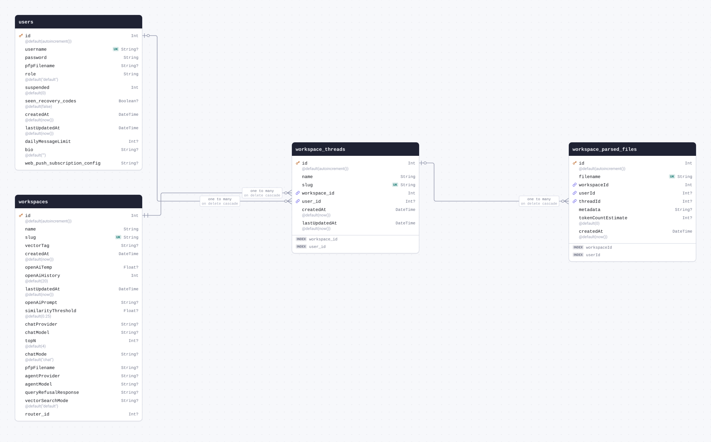

| Field           | Type       | Constraints                                   | Default           | Description |
| --------------- | ---------- | --------------------------------------------- | ----------------- | ----------- |
| `id`            | `Int`      | PK NOT NULL                                   | `autoincrement()` |             |
| `name`          | `String`   | NOT NULL                                      |                   |             |
| `slug`          | `String`   | UNIQUE NOT NULL                               |                   |             |
| `workspace_id`  | `Int`      | NOT NULL → [workspaces.id](#model-workspaces) |                   |             |
| `user_id`       | `Int`      | NULL → [users.id](#model-users)               |                   |             |
| `createdAt`     | `DateTime` | NOT NULL                                      | `now()`           |             |
| `lastUpdatedAt` | `DateTime` | NOT NULL                                      | `now()`           |             |

#### Indexes

- `@@index([workspace_id])`
- `@@index([user_id])`

#### References

- `workspace_id` → [workspaces.id](#model-workspaces) (many-to-one, on delete Cascade)
- `user_id` → [users.id](#model-users) (many-to-one, on delete Cascade)

#### Referenced by

- `id` ← [workspace_parsed_files.threadId](#model-workspace_parsed_files) (one-to-many, on delete Cascade)

#### Definition

```sql
CREATE TABLE "workspace_threads" (
    "id" INTEGER NOT NULL PRIMARY KEY AUTOINCREMENT,
    "name" TEXT NOT NULL,
    "slug" TEXT NOT NULL,
    "workspace_id" INTEGER NOT NULL,
    "user_id" INTEGER,
    "createdAt" DATETIME NOT NULL DEFAULT CURRENT_TIMESTAMP,
    "lastUpdatedAt" DATETIME NOT NULL DEFAULT CURRENT_TIMESTAMP,
    CONSTRAINT "workspace_threads_workspace_id_fkey" FOREIGN KEY ("workspace_id") REFERENCES "workspaces" ("id") ON DELETE CASCADE ON UPDATE CASCADE,
    CONSTRAINT "workspace_threads_user_id_fkey" FOREIGN KEY ("user_id") REFERENCES "users" ("id") ON DELETE CASCADE ON UPDATE CASCADE
);

CREATE UNIQUE INDEX "workspace_threads_slug_key" ON "workspace_threads"("slug");

CREATE INDEX "workspace_threads_workspace_id_idx" ON "workspace_threads"("workspace_id");

CREATE INDEX "workspace_threads_user_id_idx" ON "workspace_threads"("user_id");
```

<details>
<summary>Queries and their SQL</summary>

**findMany**: Every row

```ts
await prisma.workspace_threads.findMany();
```

```sql
SELECT
  `main`.`workspace_threads`.`id`,
  `main`.`workspace_threads`.`name`,
  `main`.`workspace_threads`.`slug`,
  `main`.`workspace_threads`.`workspace_id`,
  `main`.`workspace_threads`.`user_id`,
  `main`.`workspace_threads`.`createdAt`,
  `main`.`workspace_threads`.`lastUpdatedAt`
FROM
  `main`.`workspace_threads`
WHERE
  1 = 1
LIMIT
  ?
OFFSET
  ?
-- params: [-1,"0"]
```

**count**: How many rows there are

```ts
await prisma.workspace_threads.count();
```

```sql
SELECT
  COUNT(*) AS `_count$_all`
FROM
  (
    SELECT
      `main`.`workspace_threads`.`id`
    FROM
      `main`.`workspace_threads`
    WHERE
      1 = 1
    LIMIT
      ?
    OFFSET
      ?
  ) AS `sub`
-- params: [-1,"0"]
```

**findMany**: Every row with its relations

```ts
await prisma.workspace_threads.findMany({
  include: { workspace: true, user: true, workspace_parsed_files: true },
});
```

```sql
SELECT
  `main`.`workspace_threads`.`id`,
  `main`.`workspace_threads`.`name`,
  `main`.`workspace_threads`.`slug`,
  `main`.`workspace_threads`.`workspace_id`,
  `main`.`workspace_threads`.`user_id`,
  `main`.`workspace_threads`.`createdAt`,
  `main`.`workspace_threads`.`lastUpdatedAt`
FROM
  `main`.`workspace_threads`
WHERE
  1 = 1
LIMIT
  ?
OFFSET
  ?
-- params: [-1,"0"]

SELECT
  `main`.`workspaces`.`id`,
  `main`.`workspaces`.`name`,
  `main`.`workspaces`.`slug`,
  `main`.`workspaces`.`vectorTag`,
  `main`.`workspaces`.`createdAt`,
  `main`.`workspaces`.`openAiTemp`,
  `main`.`workspaces`.`openAiHistory`,
  `main`.`workspaces`.`lastUpdatedAt`,
  `main`.`workspaces`.`openAiPrompt`,
  `main`.`workspaces`.`similarityThreshold`,
  `main`.`workspaces`.`chatProvider`,
  `main`.`workspaces`.`chatModel`,
  `main`.`workspaces`.`topN`,
  `main`.`workspaces`.`chatMode`,
  `main`.`workspaces`.`pfpFilename`,
  `main`.`workspaces`.`agentProvider`,
  `main`.`workspaces`.`agentModel`,
  `main`.`workspaces`.`queryRefusalResponse`,
  `main`.`workspaces`.`vectorSearchMode`,
  `main`.`workspaces`.`router_id`
FROM
  `main`.`workspaces`
WHERE
  `main`.`workspaces`.`id` IN (?)
LIMIT
  ?
OFFSET
  ?
-- params: ["<workspace_id of the rows above>",-1,"0"]

SELECT
  `main`.`users`.`id`,
  `main`.`users`.`username`,
  `main`.`users`.`password`,
  `main`.`users`.`pfpFilename`,
  `main`.`users`.`role`,
  `main`.`users`.`suspended`,
  `main`.`users`.`seen_recovery_codes`,
  `main`.`users`.`createdAt`,
  `main`.`users`.`lastUpdatedAt`,
  `main`.`users`.`dailyMessageLimit`,
  `main`.`users`.`bio`,
  `main`.`users`.`web_push_subscription_config`
FROM
  `main`.`users`
WHERE
  `main`.`users`.`id` IN (?)
LIMIT
  ?
OFFSET
  ?
-- params: ["<user_id of the rows above>",-1,"0"]

SELECT
  `main`.`workspace_parsed_files`.`id`,
  `main`.`workspace_parsed_files`.`filename`,
  `main`.`workspace_parsed_files`.`workspaceId`,
  `main`.`workspace_parsed_files`.`userId`,
  `main`.`workspace_parsed_files`.`threadId`,
  `main`.`workspace_parsed_files`.`metadata`,
  `main`.`workspace_parsed_files`.`tokenCountEstimate`,
  `main`.`workspace_parsed_files`.`createdAt`
FROM
  `main`.`workspace_parsed_files`
WHERE
  `main`.`workspace_parsed_files`.`threadId` IN (?)
LIMIT
  ?
OFFSET
  ?
-- params: ["<id of the rows above>",-1,"0"]
```

**findUnique**: One row by what is unique to it

```ts
await prisma.workspace_threads.findUnique({ where: { id: 1 } });
```

```sql
SELECT
  `main`.`workspace_threads`.`id`,
  `main`.`workspace_threads`.`name`,
  `main`.`workspace_threads`.`slug`,
  `main`.`workspace_threads`.`workspace_id`,
  `main`.`workspace_threads`.`user_id`,
  `main`.`workspace_threads`.`createdAt`,
  `main`.`workspace_threads`.`lastUpdatedAt`
FROM
  `main`.`workspace_threads`
WHERE
  (
    `main`.`workspace_threads`.`id` = ?
    AND 1 = 1
  )
LIMIT
  ?
OFFSET
  ?
-- params: ["1","1","0"]
```

**create**: Create a row

```ts
await prisma.workspace_threads.create({
  data: { name: "example", slug: "example", workspace_id: 1 },
});
```

```sql
INSERT INTO
  `main`.`workspace_threads` (
    `name`,
    `slug`,
    `workspace_id`,
    `createdAt`,
    `lastUpdatedAt`
  )
VALUES
  (?, ?, ?, ?, ?)
RETURNING
  `id` AS `id`,
  `name` AS `name`,
  `slug` AS `slug`,
  `workspace_id` AS `workspace_id`,
  `user_id` AS `user_id`,
  `createdAt` AS `createdAt`,
  `lastUpdatedAt` AS `lastUpdatedAt`
-- params: ["example","example","1","<now()>","<now()>"]
```

**update**: Update a row

```ts
await prisma.workspace_threads.update({ where: { id: 1 }, data: { name: "example" } });
```

```sql
UPDATE `main`.`workspace_threads`
SET
  `name` = ?
WHERE
  (
    `main`.`workspace_threads`.`id` = ?
    AND 1 = 1
  )
RETURNING
  `id` AS `id`,
  `name` AS `name`,
  `slug` AS `slug`,
  `workspace_id` AS `workspace_id`,
  `user_id` AS `user_id`,
  `createdAt` AS `createdAt`,
  `lastUpdatedAt` AS `lastUpdatedAt`
-- params: ["example","1"]
```

**delete**: Delete a row

```ts
await prisma.workspace_threads.delete({ where: { id: 1 } });
```

```sql
DELETE FROM `main`.`workspace_threads`
WHERE
  (
    `main`.`workspace_threads`.`id` = ?
    AND 1 = 1
  )
RETURNING
  `id` AS `id`,
  `name` AS `name`,
  `slug` AS `slug`,
  `workspace_id` AS `workspace_id`,
  `user_id` AS `user_id`,
  `createdAt` AS `createdAt`,
  `lastUpdatedAt` AS `lastUpdatedAt`
-- params: ["1"]
```

</details>

<a id="model-workspace_suggested_messages"></a>

### workspace_suggested_messages

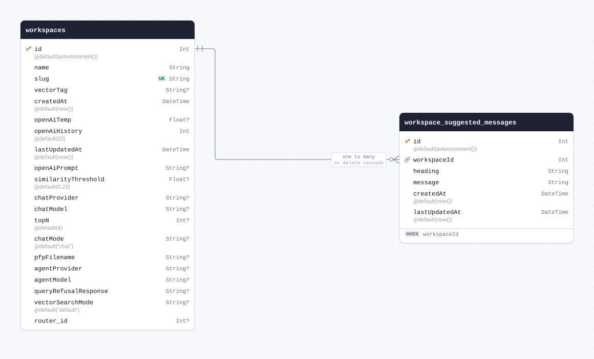

| Field           | Type       | Constraints                                   | Default           | Description |
| --------------- | ---------- | --------------------------------------------- | ----------------- | ----------- |
| `id`            | `Int`      | PK NOT NULL                                   | `autoincrement()` |             |
| `workspaceId`   | `Int`      | NOT NULL → [workspaces.id](#model-workspaces) |                   |             |
| `heading`       | `String`   | NOT NULL                                      |                   |             |
| `message`       | `String`   | NOT NULL                                      |                   |             |
| `createdAt`     | `DateTime` | NOT NULL                                      | `now()`           |             |
| `lastUpdatedAt` | `DateTime` | NOT NULL                                      | `now()`           |             |

#### Indexes

- `@@index([workspaceId])`

#### References

- `workspaceId` → [workspaces.id](#model-workspaces) (many-to-one, on delete Cascade)

#### Definition

```sql
CREATE TABLE "workspace_suggested_messages" (
    "id" INTEGER NOT NULL PRIMARY KEY AUTOINCREMENT,
    "workspaceId" INTEGER NOT NULL,
    "heading" TEXT NOT NULL,
    "message" TEXT NOT NULL,
    "createdAt" DATETIME NOT NULL DEFAULT CURRENT_TIMESTAMP,
    "lastUpdatedAt" DATETIME NOT NULL DEFAULT CURRENT_TIMESTAMP,
    CONSTRAINT "workspace_suggested_messages_workspaceId_fkey" FOREIGN KEY ("workspaceId") REFERENCES "workspaces" ("id") ON DELETE CASCADE ON UPDATE CASCADE
);

CREATE INDEX "workspace_suggested_messages_workspaceId_idx" ON "workspace_suggested_messages"("workspaceId");
```

<details>
<summary>Queries and their SQL</summary>

**findMany**: Every row

```ts
await prisma.workspace_suggested_messages.findMany();
```

```sql
SELECT
  `main`.`workspace_suggested_messages`.`id`,
  `main`.`workspace_suggested_messages`.`workspaceId`,
  `main`.`workspace_suggested_messages`.`heading`,
  `main`.`workspace_suggested_messages`.`message`,
  `main`.`workspace_suggested_messages`.`createdAt`,
  `main`.`workspace_suggested_messages`.`lastUpdatedAt`
FROM
  `main`.`workspace_suggested_messages`
WHERE
  1 = 1
LIMIT
  ?
OFFSET
  ?
-- params: [-1,"0"]
```

**count**: How many rows there are

```ts
await prisma.workspace_suggested_messages.count();
```

```sql
SELECT
  COUNT(*) AS `_count$_all`
FROM
  (
    SELECT
      `main`.`workspace_suggested_messages`.`id`
    FROM
      `main`.`workspace_suggested_messages`
    WHERE
      1 = 1
    LIMIT
      ?
    OFFSET
      ?
  ) AS `sub`
-- params: [-1,"0"]
```

**findMany**: Every row with its relations

```ts
await prisma.workspace_suggested_messages.findMany({ include: { workspace: true } });
```

```sql
SELECT
  `main`.`workspace_suggested_messages`.`id`,
  `main`.`workspace_suggested_messages`.`workspaceId`,
  `main`.`workspace_suggested_messages`.`heading`,
  `main`.`workspace_suggested_messages`.`message`,
  `main`.`workspace_suggested_messages`.`createdAt`,
  `main`.`workspace_suggested_messages`.`lastUpdatedAt`
FROM
  `main`.`workspace_suggested_messages`
WHERE
  1 = 1
LIMIT
  ?
OFFSET
  ?
-- params: [-1,"0"]

SELECT
  `main`.`workspaces`.`id`,
  `main`.`workspaces`.`name`,
  `main`.`workspaces`.`slug`,
  `main`.`workspaces`.`vectorTag`,
  `main`.`workspaces`.`createdAt`,
  `main`.`workspaces`.`openAiTemp`,
  `main`.`workspaces`.`openAiHistory`,
  `main`.`workspaces`.`lastUpdatedAt`,
  `main`.`workspaces`.`openAiPrompt`,
  `main`.`workspaces`.`similarityThreshold`,
  `main`.`workspaces`.`chatProvider`,
  `main`.`workspaces`.`chatModel`,
  `main`.`workspaces`.`topN`,
  `main`.`workspaces`.`chatMode`,
  `main`.`workspaces`.`pfpFilename`,
  `main`.`workspaces`.`agentProvider`,
  `main`.`workspaces`.`agentModel`,
  `main`.`workspaces`.`queryRefusalResponse`,
  `main`.`workspaces`.`vectorSearchMode`,
  `main`.`workspaces`.`router_id`
FROM
  `main`.`workspaces`
WHERE
  `main`.`workspaces`.`id` IN (?)
LIMIT
  ?
OFFSET
  ?
-- params: ["<workspaceId of the rows above>",-1,"0"]
```

**findUnique**: One row by what is unique to it

```ts
await prisma.workspace_suggested_messages.findUnique({ where: { id: 1 } });
```

```sql
SELECT
  `main`.`workspace_suggested_messages`.`id`,
  `main`.`workspace_suggested_messages`.`workspaceId`,
  `main`.`workspace_suggested_messages`.`heading`,
  `main`.`workspace_suggested_messages`.`message`,
  `main`.`workspace_suggested_messages`.`createdAt`,
  `main`.`workspace_suggested_messages`.`lastUpdatedAt`
FROM
  `main`.`workspace_suggested_messages`
WHERE
  (
    `main`.`workspace_suggested_messages`.`id` = ?
    AND 1 = 1
  )
LIMIT
  ?
OFFSET
  ?
-- params: ["1","1","0"]
```

**create**: Create a row

```ts
await prisma.workspace_suggested_messages.create({
  data: { workspaceId: 1, heading: "example", message: "example" },
});
```

```sql
INSERT INTO
  `main`.`workspace_suggested_messages` (
    `workspaceId`,
    `heading`,
    `message`,
    `createdAt`,
    `lastUpdatedAt`
  )
VALUES
  (?, ?, ?, ?, ?)
RETURNING
  `id` AS `id`,
  `workspaceId` AS `workspaceId`,
  `heading` AS `heading`,
  `message` AS `message`,
  `createdAt` AS `createdAt`,
  `lastUpdatedAt` AS `lastUpdatedAt`
-- params: ["1","example","example","<now()>","<now()>"]
```

**update**: Update a row

```ts
await prisma.workspace_suggested_messages.update({
  where: { id: 1 },
  data: { heading: "example" },
});
```

```sql
UPDATE `main`.`workspace_suggested_messages`
SET
  `heading` = ?
WHERE
  (
    `main`.`workspace_suggested_messages`.`id` = ?
    AND 1 = 1
  )
RETURNING
  `id` AS `id`,
  `workspaceId` AS `workspaceId`,
  `heading` AS `heading`,
  `message` AS `message`,
  `createdAt` AS `createdAt`,
  `lastUpdatedAt` AS `lastUpdatedAt`
-- params: ["example","1"]
```

**delete**: Delete a row

```ts
await prisma.workspace_suggested_messages.delete({ where: { id: 1 } });
```

```sql
DELETE FROM `main`.`workspace_suggested_messages`
WHERE
  (
    `main`.`workspace_suggested_messages`.`id` = ?
    AND 1 = 1
  )
RETURNING
  `id` AS `id`,
  `workspaceId` AS `workspaceId`,
  `heading` AS `heading`,
  `message` AS `message`,
  `createdAt` AS `createdAt`,
  `lastUpdatedAt` AS `lastUpdatedAt`
-- params: ["1"]
```

</details>

<a id="model-workspace_chats"></a>

### workspace_chats

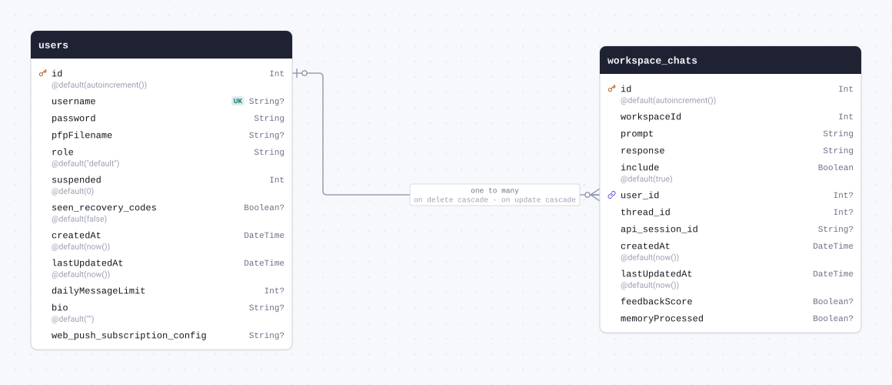

| Field                                  | Type       | Constraints                     | Default           | Description |
| -------------------------------------- | ---------- | ------------------------------- | ----------------- | ----------- |
| `id`                                   | `Int`      | PK NOT NULL                     | `autoincrement()` |             |
| `workspaceId`                          | `Int`      | NOT NULL                        |                   |             |
| `prompt`                               | `String`   | NOT NULL                        |                   |             |
| `response`                             | `String`   | NOT NULL                        |                   |             |
| `include`                              | `Boolean`  | NOT NULL                        | `true`            |             |
| `user_id`                              | `Int`      | NULL → [users.id](#model-users) |                   |             |
| `thread_id`                            | `Int`      | NULL                            |                   |             |
| `api_session_id`                       | `String`   | NULL                            |                   |             |
| `createdAt`                            | `DateTime` | NOT NULL                        | `now()`           |             |
| `lastUpdatedAt`                        | `DateTime` | NOT NULL                        | `now()`           |             |
| `feedbackScore`                        | `Boolean`  | NULL                            |                   |             |
| `memoryProcessed` (`memory_processed`) | `Boolean`  | NULL                            |                   |             |

#### References

- `user_id` → [users.id](#model-users) (many-to-one, on delete Cascade, on update Cascade)

#### Definition

```sql
CREATE TABLE "workspace_chats" (
    "id" INTEGER NOT NULL PRIMARY KEY AUTOINCREMENT,
    "workspaceId" INTEGER NOT NULL,
    "prompt" TEXT NOT NULL,
    "response" TEXT NOT NULL,
    "include" BOOLEAN NOT NULL DEFAULT true,
    "user_id" INTEGER,
    "thread_id" INTEGER,
    "api_session_id" TEXT,
    "createdAt" DATETIME NOT NULL DEFAULT CURRENT_TIMESTAMP,
    "lastUpdatedAt" DATETIME NOT NULL DEFAULT CURRENT_TIMESTAMP,
    "feedbackScore" BOOLEAN,
    "memory_processed" BOOLEAN,
    CONSTRAINT "workspace_chats_user_id_fkey" FOREIGN KEY ("user_id") REFERENCES "users" ("id") ON DELETE CASCADE ON UPDATE CASCADE
);
```

<details>
<summary>Queries and their SQL</summary>

**findMany**: Every row

```ts
await prisma.workspace_chats.findMany();
```

```sql
SELECT
  `main`.`workspace_chats`.`id`,
  `main`.`workspace_chats`.`workspaceId`,
  `main`.`workspace_chats`.`prompt`,
  `main`.`workspace_chats`.`response`,
  `main`.`workspace_chats`.`include`,
  `main`.`workspace_chats`.`user_id`,
  `main`.`workspace_chats`.`thread_id`,
  `main`.`workspace_chats`.`api_session_id`,
  `main`.`workspace_chats`.`createdAt`,
  `main`.`workspace_chats`.`lastUpdatedAt`,
  `main`.`workspace_chats`.`feedbackScore`,
  `main`.`workspace_chats`.`memory_processed`
FROM
  `main`.`workspace_chats`
WHERE
  1 = 1
LIMIT
  ?
OFFSET
  ?
-- params: [-1,"0"]
```

**count**: How many rows there are

```ts
await prisma.workspace_chats.count();
```

```sql
SELECT
  COUNT(*) AS `_count$_all`
FROM
  (
    SELECT
      `main`.`workspace_chats`.`id`
    FROM
      `main`.`workspace_chats`
    WHERE
      1 = 1
    LIMIT
      ?
    OFFSET
      ?
  ) AS `sub`
-- params: [-1,"0"]
```

**findMany**: Every row with its relations

```ts
await prisma.workspace_chats.findMany({ include: { users: true } });
```

```sql
SELECT
  `main`.`workspace_chats`.`id`,
  `main`.`workspace_chats`.`workspaceId`,
  `main`.`workspace_chats`.`prompt`,
  `main`.`workspace_chats`.`response`,
  `main`.`workspace_chats`.`include`,
  `main`.`workspace_chats`.`user_id`,
  `main`.`workspace_chats`.`thread_id`,
  `main`.`workspace_chats`.`api_session_id`,
  `main`.`workspace_chats`.`createdAt`,
  `main`.`workspace_chats`.`lastUpdatedAt`,
  `main`.`workspace_chats`.`feedbackScore`,
  `main`.`workspace_chats`.`memory_processed`
FROM
  `main`.`workspace_chats`
WHERE
  1 = 1
LIMIT
  ?
OFFSET
  ?
-- params: [-1,"0"]

SELECT
  `main`.`users`.`id`,
  `main`.`users`.`username`,
  `main`.`users`.`password`,
  `main`.`users`.`pfpFilename`,
  `main`.`users`.`role`,
  `main`.`users`.`suspended`,
  `main`.`users`.`seen_recovery_codes`,
  `main`.`users`.`createdAt`,
  `main`.`users`.`lastUpdatedAt`,
  `main`.`users`.`dailyMessageLimit`,
  `main`.`users`.`bio`,
  `main`.`users`.`web_push_subscription_config`
FROM
  `main`.`users`
WHERE
  `main`.`users`.`id` IN (?)
LIMIT
  ?
OFFSET
  ?
-- params: ["<user_id of the rows above>",-1,"0"]
```

**findUnique**: One row by what is unique to it

```ts
await prisma.workspace_chats.findUnique({ where: { id: 1 } });
```

```sql
SELECT
  `main`.`workspace_chats`.`id`,
  `main`.`workspace_chats`.`workspaceId`,
  `main`.`workspace_chats`.`prompt`,
  `main`.`workspace_chats`.`response`,
  `main`.`workspace_chats`.`include`,
  `main`.`workspace_chats`.`user_id`,
  `main`.`workspace_chats`.`thread_id`,
  `main`.`workspace_chats`.`api_session_id`,
  `main`.`workspace_chats`.`createdAt`,
  `main`.`workspace_chats`.`lastUpdatedAt`,
  `main`.`workspace_chats`.`feedbackScore`,
  `main`.`workspace_chats`.`memory_processed`
FROM
  `main`.`workspace_chats`
WHERE
  (
    `main`.`workspace_chats`.`id` = ?
    AND 1 = 1
  )
LIMIT
  ?
OFFSET
  ?
-- params: ["1","1","0"]
```

**create**: Create a row

```ts
await prisma.workspace_chats.create({
  data: { workspaceId: 1, prompt: "example", response: "example" },
});
```

```sql
INSERT INTO
  `main`.`workspace_chats` (
    `workspaceId`,
    `prompt`,
    `response`,
    `include`,
    `createdAt`,
    `lastUpdatedAt`
  )
VALUES
  (?, ?, ?, ?, ?, ?)
RETURNING
  `id` AS `id`,
  `workspaceId` AS `workspaceId`,
  `prompt` AS `prompt`,
  `response` AS `response`,
  `include` AS `include`,
  `user_id` AS `user_id`,
  `thread_id` AS `thread_id`,
  `api_session_id` AS `api_session_id`,
  `createdAt` AS `createdAt`,
  `lastUpdatedAt` AS `lastUpdatedAt`,
  `feedbackScore` AS `feedbackScore`,
  `memory_processed` AS `memory_processed`
-- params: ["1","example","example",true,"<now()>","<now()>"]
```

**update**: Update a row

```ts
await prisma.workspace_chats.update({ where: { id: 1 }, data: { workspaceId: 1 } });
```

```sql
UPDATE `main`.`workspace_chats`
SET
  `workspaceId` = ?
WHERE
  (
    `main`.`workspace_chats`.`id` = ?
    AND 1 = 1
  )
RETURNING
  `id` AS `id`,
  `workspaceId` AS `workspaceId`,
  `prompt` AS `prompt`,
  `response` AS `response`,
  `include` AS `include`,
  `user_id` AS `user_id`,
  `thread_id` AS `thread_id`,
  `api_session_id` AS `api_session_id`,
  `createdAt` AS `createdAt`,
  `lastUpdatedAt` AS `lastUpdatedAt`,
  `feedbackScore` AS `feedbackScore`,
  `memory_processed` AS `memory_processed`
-- params: ["1","1"]
```

**delete**: Delete a row

```ts
await prisma.workspace_chats.delete({ where: { id: 1 } });
```

```sql
DELETE FROM `main`.`workspace_chats`
WHERE
  (
    `main`.`workspace_chats`.`id` = ?
    AND 1 = 1
  )
RETURNING
  `id` AS `id`,
  `workspaceId` AS `workspaceId`,
  `prompt` AS `prompt`,
  `response` AS `response`,
  `include` AS `include`,
  `user_id` AS `user_id`,
  `thread_id` AS `thread_id`,
  `api_session_id` AS `api_session_id`,
  `createdAt` AS `createdAt`,
  `lastUpdatedAt` AS `lastUpdatedAt`,
  `feedbackScore` AS `feedbackScore`,
  `memory_processed` AS `memory_processed`
-- params: ["1"]
```

</details>

<a id="model-workspace_agent_invocations"></a>

### workspace_agent_invocations

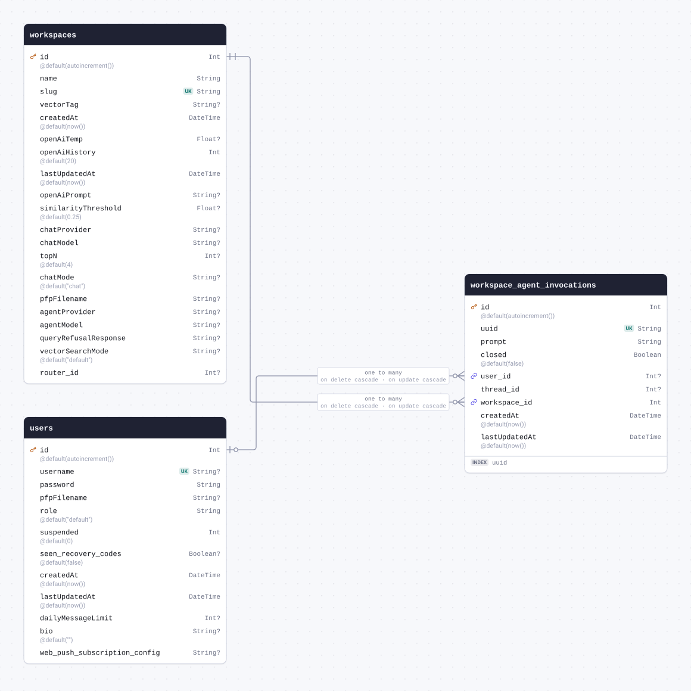

| Field           | Type       | Constraints                                   | Default           | Description |
| --------------- | ---------- | --------------------------------------------- | ----------------- | ----------- |
| `id`            | `Int`      | PK NOT NULL                                   | `autoincrement()` |             |
| `uuid`          | `String`   | UNIQUE NOT NULL                               |                   |             |
| `prompt`        | `String`   | NOT NULL                                      |                   |             |
| `closed`        | `Boolean`  | NOT NULL                                      | `false`           |             |
| `user_id`       | `Int`      | NULL → [users.id](#model-users)               |                   |             |
| `thread_id`     | `Int`      | NULL                                          |                   |             |
| `workspace_id`  | `Int`      | NOT NULL → [workspaces.id](#model-workspaces) |                   |             |
| `createdAt`     | `DateTime` | NOT NULL                                      | `now()`           |             |
| `lastUpdatedAt` | `DateTime` | NOT NULL                                      | `now()`           |             |

#### Indexes

- `@@index([uuid])`

#### References

- `user_id` → [users.id](#model-users) (many-to-one, on delete Cascade, on update Cascade)
- `workspace_id` → [workspaces.id](#model-workspaces) (many-to-one, on delete Cascade, on update Cascade)

#### Definition

```sql
CREATE TABLE "workspace_agent_invocations" (
    "id" INTEGER NOT NULL PRIMARY KEY AUTOINCREMENT,
    "uuid" TEXT NOT NULL,
    "prompt" TEXT NOT NULL,
    "closed" BOOLEAN NOT NULL DEFAULT false,
    "user_id" INTEGER,
    "thread_id" INTEGER,
    "workspace_id" INTEGER NOT NULL,
    "createdAt" DATETIME NOT NULL DEFAULT CURRENT_TIMESTAMP,
    "lastUpdatedAt" DATETIME NOT NULL DEFAULT CURRENT_TIMESTAMP,
    CONSTRAINT "workspace_agent_invocations_user_id_fkey" FOREIGN KEY ("user_id") REFERENCES "users" ("id") ON DELETE CASCADE ON UPDATE CASCADE,
    CONSTRAINT "workspace_agent_invocations_workspace_id_fkey" FOREIGN KEY ("workspace_id") REFERENCES "workspaces" ("id") ON DELETE CASCADE ON UPDATE CASCADE
);

CREATE UNIQUE INDEX "workspace_agent_invocations_uuid_key" ON "workspace_agent_invocations"("uuid");

CREATE INDEX "workspace_agent_invocations_uuid_idx" ON "workspace_agent_invocations"("uuid");
```

<details>
<summary>Queries and their SQL</summary>

**findMany**: Every row

```ts
await prisma.workspace_agent_invocations.findMany();
```

```sql
SELECT
  `main`.`workspace_agent_invocations`.`id`,
  `main`.`workspace_agent_invocations`.`uuid`,
  `main`.`workspace_agent_invocations`.`prompt`,
  `main`.`workspace_agent_invocations`.`closed`,
  `main`.`workspace_agent_invocations`.`user_id`,
  `main`.`workspace_agent_invocations`.`thread_id`,
  `main`.`workspace_agent_invocations`.`workspace_id`,
  `main`.`workspace_agent_invocations`.`createdAt`,
  `main`.`workspace_agent_invocations`.`lastUpdatedAt`
FROM
  `main`.`workspace_agent_invocations`
WHERE
  1 = 1
LIMIT
  ?
OFFSET
  ?
-- params: [-1,"0"]
```

**count**: How many rows there are

```ts
await prisma.workspace_agent_invocations.count();
```

```sql
SELECT
  COUNT(*) AS `_count$_all`
FROM
  (
    SELECT
      `main`.`workspace_agent_invocations`.`id`
    FROM
      `main`.`workspace_agent_invocations`
    WHERE
      1 = 1
    LIMIT
      ?
    OFFSET
      ?
  ) AS `sub`
-- params: [-1,"0"]
```

**findMany**: Every row with its relations

```ts
await prisma.workspace_agent_invocations.findMany({ include: { user: true, workspace: true } });
```

```sql
SELECT
  `main`.`workspace_agent_invocations`.`id`,
  `main`.`workspace_agent_invocations`.`uuid`,
  `main`.`workspace_agent_invocations`.`prompt`,
  `main`.`workspace_agent_invocations`.`closed`,
  `main`.`workspace_agent_invocations`.`user_id`,
  `main`.`workspace_agent_invocations`.`thread_id`,
  `main`.`workspace_agent_invocations`.`workspace_id`,
  `main`.`workspace_agent_invocations`.`createdAt`,
  `main`.`workspace_agent_invocations`.`lastUpdatedAt`
FROM
  `main`.`workspace_agent_invocations`
WHERE
  1 = 1
LIMIT
  ?
OFFSET
  ?
-- params: [-1,"0"]

SELECT
  `main`.`users`.`id`,
  `main`.`users`.`username`,
  `main`.`users`.`password`,
  `main`.`users`.`pfpFilename`,
  `main`.`users`.`role`,
  `main`.`users`.`suspended`,
  `main`.`users`.`seen_recovery_codes`,
  `main`.`users`.`createdAt`,
  `main`.`users`.`lastUpdatedAt`,
  `main`.`users`.`dailyMessageLimit`,
  `main`.`users`.`bio`,
  `main`.`users`.`web_push_subscription_config`
FROM
  `main`.`users`
WHERE
  `main`.`users`.`id` IN (?)
LIMIT
  ?
OFFSET
  ?
-- params: ["<user_id of the rows above>",-1,"0"]

SELECT
  `main`.`workspaces`.`id`,
  `main`.`workspaces`.`name`,
  `main`.`workspaces`.`slug`,
  `main`.`workspaces`.`vectorTag`,
  `main`.`workspaces`.`createdAt`,
  `main`.`workspaces`.`openAiTemp`,
  `main`.`workspaces`.`openAiHistory`,
  `main`.`workspaces`.`lastUpdatedAt`,
  `main`.`workspaces`.`openAiPrompt`,
  `main`.`workspaces`.`similarityThreshold`,
  `main`.`workspaces`.`chatProvider`,
  `main`.`workspaces`.`chatModel`,
  `main`.`workspaces`.`topN`,
  `main`.`workspaces`.`chatMode`,
  `main`.`workspaces`.`pfpFilename`,
  `main`.`workspaces`.`agentProvider`,
  `main`.`workspaces`.`agentModel`,
  `main`.`workspaces`.`queryRefusalResponse`,
  `main`.`workspaces`.`vectorSearchMode`,
  `main`.`workspaces`.`router_id`
FROM
  `main`.`workspaces`
WHERE
  `main`.`workspaces`.`id` IN (?)
LIMIT
  ?
OFFSET
  ?
-- params: ["<workspace_id of the rows above>",-1,"0"]
```

**findUnique**: One row by what is unique to it

```ts
await prisma.workspace_agent_invocations.findUnique({ where: { id: 1 } });
```

```sql
SELECT
  `main`.`workspace_agent_invocations`.`id`,
  `main`.`workspace_agent_invocations`.`uuid`,
  `main`.`workspace_agent_invocations`.`prompt`,
  `main`.`workspace_agent_invocations`.`closed`,
  `main`.`workspace_agent_invocations`.`user_id`,
  `main`.`workspace_agent_invocations`.`thread_id`,
  `main`.`workspace_agent_invocations`.`workspace_id`,
  `main`.`workspace_agent_invocations`.`createdAt`,
  `main`.`workspace_agent_invocations`.`lastUpdatedAt`
FROM
  `main`.`workspace_agent_invocations`
WHERE
  (
    `main`.`workspace_agent_invocations`.`id` = ?
    AND 1 = 1
  )
LIMIT
  ?
OFFSET
  ?
-- params: ["1","1","0"]
```

**create**: Create a row

```ts
await prisma.workspace_agent_invocations.create({
  data: { uuid: "example", prompt: "example", workspace_id: 1 },
});
```

```sql
INSERT INTO
  `main`.`workspace_agent_invocations` (
    `uuid`,
    `prompt`,
    `closed`,
    `workspace_id`,
    `createdAt`,
    `lastUpdatedAt`
  )
VALUES
  (?, ?, ?, ?, ?, ?)
RETURNING
  `id` AS `id`,
  `uuid` AS `uuid`,
  `prompt` AS `prompt`,
  `closed` AS `closed`,
  `user_id` AS `user_id`,
  `thread_id` AS `thread_id`,
  `workspace_id` AS `workspace_id`,
  `createdAt` AS `createdAt`,
  `lastUpdatedAt` AS `lastUpdatedAt`
-- params: ["example","example",false,"1","<now()>","<now()>"]
```

**update**: Update a row

```ts
await prisma.workspace_agent_invocations.update({ where: { id: 1 }, data: { uuid: "example" } });
```

```sql
UPDATE `main`.`workspace_agent_invocations`
SET
  `uuid` = ?
WHERE
  (
    `main`.`workspace_agent_invocations`.`id` = ?
    AND 1 = 1
  )
RETURNING
  `id` AS `id`,
  `uuid` AS `uuid`,
  `prompt` AS `prompt`,
  `closed` AS `closed`,
  `user_id` AS `user_id`,
  `thread_id` AS `thread_id`,
  `workspace_id` AS `workspace_id`,
  `createdAt` AS `createdAt`,
  `lastUpdatedAt` AS `lastUpdatedAt`
-- params: ["example","1"]
```

**delete**: Delete a row

```ts
await prisma.workspace_agent_invocations.delete({ where: { id: 1 } });
```

```sql
DELETE FROM `main`.`workspace_agent_invocations`
WHERE
  (
    `main`.`workspace_agent_invocations`.`id` = ?
    AND 1 = 1
  )
RETURNING
  `id` AS `id`,
  `uuid` AS `uuid`,
  `prompt` AS `prompt`,
  `closed` AS `closed`,
  `user_id` AS `user_id`,
  `thread_id` AS `thread_id`,
  `workspace_id` AS `workspace_id`,
  `createdAt` AS `createdAt`,
  `lastUpdatedAt` AS `lastUpdatedAt`
-- params: ["1"]
```

</details>

<a id="model-workspace_users"></a>

### workspace_users


| Field           | Type       | Constraints                                   | Default           | Description |
| --------------- | ---------- | --------------------------------------------- | ----------------- | ----------- |
| `id`            | `Int`      | PK NOT NULL                                   | `autoincrement()` |             |
| `user_id`       | `Int`      | NOT NULL → [users.id](#model-users)           |                   |             |
| `workspace_id`  | `Int`      | NOT NULL → [workspaces.id](#model-workspaces) |                   |             |
| `createdAt`     | `DateTime` | NOT NULL                                      | `now()`           |             |
| `lastUpdatedAt` | `DateTime` | NOT NULL                                      | `now()`           |             |

#### References

- `workspace_id` → [workspaces.id](#model-workspaces) (many-to-one, on delete Cascade, on update Cascade)
- `user_id` → [users.id](#model-users) (many-to-one, on delete Cascade, on update Cascade)

#### Definition

```sql
CREATE TABLE "workspace_users" (
    "id" INTEGER NOT NULL PRIMARY KEY AUTOINCREMENT,
    "user_id" INTEGER NOT NULL,
    "workspace_id" INTEGER NOT NULL,
    "createdAt" DATETIME NOT NULL DEFAULT CURRENT_TIMESTAMP,
    "lastUpdatedAt" DATETIME NOT NULL DEFAULT CURRENT_TIMESTAMP,
    CONSTRAINT "workspace_users_workspace_id_fkey" FOREIGN KEY ("workspace_id") REFERENCES "workspaces" ("id") ON DELETE CASCADE ON UPDATE CASCADE,
    CONSTRAINT "workspace_users_user_id_fkey" FOREIGN KEY ("user_id") REFERENCES "users" ("id") ON DELETE CASCADE ON UPDATE CASCADE
);
```

<details>
<summary>Queries and their SQL</summary>

**findMany**: Every row

```ts
await prisma.workspace_users.findMany();
```

```sql
SELECT
  `main`.`workspace_users`.`id`,
  `main`.`workspace_users`.`user_id`,
  `main`.`workspace_users`.`workspace_id`,
  `main`.`workspace_users`.`createdAt`,
  `main`.`workspace_users`.`lastUpdatedAt`
FROM
  `main`.`workspace_users`
WHERE
  1 = 1
LIMIT
  ?
OFFSET
  ?
-- params: [-1,"0"]
```

**count**: How many rows there are

```ts
await prisma.workspace_users.count();
```

```sql
SELECT
  COUNT(*) AS `_count$_all`
FROM
  (
    SELECT
      `main`.`workspace_users`.`id`
    FROM
      `main`.`workspace_users`
    WHERE
      1 = 1
    LIMIT
      ?
    OFFSET
      ?
  ) AS `sub`
-- params: [-1,"0"]
```

**findMany**: Every row with its relations

```ts
await prisma.workspace_users.findMany({ include: { workspaces: true, users: true } });
```

```sql
SELECT
  `main`.`workspace_users`.`id`,
  `main`.`workspace_users`.`user_id`,
  `main`.`workspace_users`.`workspace_id`,
  `main`.`workspace_users`.`createdAt`,
  `main`.`workspace_users`.`lastUpdatedAt`
FROM
  `main`.`workspace_users`
WHERE
  1 = 1
LIMIT
  ?
OFFSET
  ?
-- params: [-1,"0"]

SELECT
  `main`.`workspaces`.`id`,
  `main`.`workspaces`.`name`,
  `main`.`workspaces`.`slug`,
  `main`.`workspaces`.`vectorTag`,
  `main`.`workspaces`.`createdAt`,
  `main`.`workspaces`.`openAiTemp`,
  `main`.`workspaces`.`openAiHistory`,
  `main`.`workspaces`.`lastUpdatedAt`,
  `main`.`workspaces`.`openAiPrompt`,
  `main`.`workspaces`.`similarityThreshold`,
  `main`.`workspaces`.`chatProvider`,
  `main`.`workspaces`.`chatModel`,
  `main`.`workspaces`.`topN`,
  `main`.`workspaces`.`chatMode`,
  `main`.`workspaces`.`pfpFilename`,
  `main`.`workspaces`.`agentProvider`,
  `main`.`workspaces`.`agentModel`,
  `main`.`workspaces`.`queryRefusalResponse`,
  `main`.`workspaces`.`vectorSearchMode`,
  `main`.`workspaces`.`router_id`
FROM
  `main`.`workspaces`
WHERE
  `main`.`workspaces`.`id` IN (?)
LIMIT
  ?
OFFSET
  ?
-- params: ["<workspace_id of the rows above>",-1,"0"]

SELECT
  `main`.`users`.`id`,
  `main`.`users`.`username`,
  `main`.`users`.`password`,
  `main`.`users`.`pfpFilename`,
  `main`.`users`.`role`,
  `main`.`users`.`suspended`,
  `main`.`users`.`seen_recovery_codes`,
  `main`.`users`.`createdAt`,
  `main`.`users`.`lastUpdatedAt`,
  `main`.`users`.`dailyMessageLimit`,
  `main`.`users`.`bio`,
  `main`.`users`.`web_push_subscription_config`
FROM
  `main`.`users`
WHERE
  `main`.`users`.`id` IN (?)
LIMIT
  ?
OFFSET
  ?
-- params: ["<user_id of the rows above>",-1,"0"]
```

**findUnique**: One row by what is unique to it

```ts
await prisma.workspace_users.findUnique({ where: { id: 1 } });
```

```sql
SELECT
  `main`.`workspace_users`.`id`,
  `main`.`workspace_users`.`user_id`,
  `main`.`workspace_users`.`workspace_id`,
  `main`.`workspace_users`.`createdAt`,
  `main`.`workspace_users`.`lastUpdatedAt`
FROM
  `main`.`workspace_users`
WHERE
  (
    `main`.`workspace_users`.`id` = ?
    AND 1 = 1
  )
LIMIT
  ?
OFFSET
  ?
-- params: ["1","1","0"]
```

**create**: Create a row

```ts
await prisma.workspace_users.create({ data: { user_id: 1, workspace_id: 1 } });
```

```sql
INSERT INTO
  `main`.`workspace_users` (
    `user_id`,
    `workspace_id`,
    `createdAt`,
    `lastUpdatedAt`
  )
VALUES
  (?, ?, ?, ?)
RETURNING
  `id` AS `id`,
  `user_id` AS `user_id`,
  `workspace_id` AS `workspace_id`,
  `createdAt` AS `createdAt`,
  `lastUpdatedAt` AS `lastUpdatedAt`
-- params: ["1","1","<now()>","<now()>"]
```

**update**: Update a row

```ts
await prisma.workspace_users.update({
  where: { id: 1 },
  data: { createdAt: new Date("2026-01-01T00:00:00.000Z") },
});
```

```sql
UPDATE `main`.`workspace_users`
SET
  `createdAt` = ?
WHERE
  (
    `main`.`workspace_users`.`id` = ?
    AND 1 = 1
  )
RETURNING
  `id` AS `id`,
  `user_id` AS `user_id`,
  `workspace_id` AS `workspace_id`,
  `createdAt` AS `createdAt`,
  `lastUpdatedAt` AS `lastUpdatedAt`
-- params: ["2026-01-01T00:00:00.000Z","1"]
```

**delete**: Delete a row

```ts
await prisma.workspace_users.delete({ where: { id: 1 } });
```

```sql
DELETE FROM `main`.`workspace_users`
WHERE
  (
    `main`.`workspace_users`.`id` = ?
    AND 1 = 1
  )
RETURNING
  `id` AS `id`,
  `user_id` AS `user_id`,
  `workspace_id` AS `workspace_id`,
  `createdAt` AS `createdAt`,
  `lastUpdatedAt` AS `lastUpdatedAt`
-- params: ["1"]
```

</details>

<a id="model-cache_data"></a>

### cache_data

| Field           | Type       | Constraints | Default           | Description |
| --------------- | ---------- | ----------- | ----------------- | ----------- |
| `id`            | `Int`      | PK NOT NULL | `autoincrement()` |             |
| `name`          | `String`   | NOT NULL    |                   |             |
| `data`          | `String`   | NOT NULL    |                   |             |
| `belongsTo`     | `String`   | NULL        |                   |             |
| `byId`          | `Int`      | NULL        |                   |             |
| `expiresAt`     | `DateTime` | NULL        |                   |             |
| `createdAt`     | `DateTime` | NOT NULL    | `now()`           |             |
| `lastUpdatedAt` | `DateTime` | NOT NULL    | `now()`           |             |

#### Definition

```sql
CREATE TABLE "cache_data" (
    "id" INTEGER NOT NULL PRIMARY KEY AUTOINCREMENT,
    "name" TEXT NOT NULL,
    "data" TEXT NOT NULL,
    "belongsTo" TEXT,
    "byId" INTEGER,
    "expiresAt" DATETIME,
    "createdAt" DATETIME NOT NULL DEFAULT CURRENT_TIMESTAMP,
    "lastUpdatedAt" DATETIME NOT NULL DEFAULT CURRENT_TIMESTAMP
);
```

<details>
<summary>Queries and their SQL</summary>

**findMany**: Every row

```ts
await prisma.cache_data.findMany();
```

```sql
SELECT
  `main`.`cache_data`.`id`,
  `main`.`cache_data`.`name`,
  `main`.`cache_data`.`data`,
  `main`.`cache_data`.`belongsTo`,
  `main`.`cache_data`.`byId`,
  `main`.`cache_data`.`expiresAt`,
  `main`.`cache_data`.`createdAt`,
  `main`.`cache_data`.`lastUpdatedAt`
FROM
  `main`.`cache_data`
WHERE
  1 = 1
LIMIT
  ?
OFFSET
  ?
-- params: [-1,"0"]
```

**count**: How many rows there are

```ts
await prisma.cache_data.count();
```

```sql
SELECT
  COUNT(*) AS `_count$_all`
FROM
  (
    SELECT
      `main`.`cache_data`.`id`
    FROM
      `main`.`cache_data`
    WHERE
      1 = 1
    LIMIT
      ?
    OFFSET
      ?
  ) AS `sub`
-- params: [-1,"0"]
```

**findUnique**: One row by what is unique to it

```ts
await prisma.cache_data.findUnique({ where: { id: 1 } });
```

```sql
SELECT
  `main`.`cache_data`.`id`,
  `main`.`cache_data`.`name`,
  `main`.`cache_data`.`data`,
  `main`.`cache_data`.`belongsTo`,
  `main`.`cache_data`.`byId`,
  `main`.`cache_data`.`expiresAt`,
  `main`.`cache_data`.`createdAt`,
  `main`.`cache_data`.`lastUpdatedAt`
FROM
  `main`.`cache_data`
WHERE
  (
    `main`.`cache_data`.`id` = ?
    AND 1 = 1
  )
LIMIT
  ?
OFFSET
  ?
-- params: ["1","1","0"]
```

**create**: Create a row

```ts
await prisma.cache_data.create({ data: { name: "example", data: "example" } });
```

```sql
INSERT INTO
  `main`.`cache_data` (`name`, `data`, `createdAt`, `lastUpdatedAt`)
VALUES
  (?, ?, ?, ?)
RETURNING
  `id` AS `id`,
  `name` AS `name`,
  `data` AS `data`,
  `belongsTo` AS `belongsTo`,
  `byId` AS `byId`,
  `expiresAt` AS `expiresAt`,
  `createdAt` AS `createdAt`,
  `lastUpdatedAt` AS `lastUpdatedAt`
-- params: ["example","example","<now()>","<now()>"]
```

**update**: Update a row

```ts
await prisma.cache_data.update({ where: { id: 1 }, data: { name: "example" } });
```

```sql
UPDATE `main`.`cache_data`
SET
  `name` = ?
WHERE
  (
    `main`.`cache_data`.`id` = ?
    AND 1 = 1
  )
RETURNING
  `id` AS `id`,
  `name` AS `name`,
  `data` AS `data`,
  `belongsTo` AS `belongsTo`,
  `byId` AS `byId`,
  `expiresAt` AS `expiresAt`,
  `createdAt` AS `createdAt`,
  `lastUpdatedAt` AS `lastUpdatedAt`
-- params: ["example","1"]
```

**delete**: Delete a row

```ts
await prisma.cache_data.delete({ where: { id: 1 } });
```

```sql
DELETE FROM `main`.`cache_data`
WHERE
  (
    `main`.`cache_data`.`id` = ?
    AND 1 = 1
  )
RETURNING
  `id` AS `id`,
  `name` AS `name`,
  `data` AS `data`,
  `belongsTo` AS `belongsTo`,
  `byId` AS `byId`,
  `expiresAt` AS `expiresAt`,
  `createdAt` AS `createdAt`,
  `lastUpdatedAt` AS `lastUpdatedAt`
-- params: ["1"]
```

</details>

<a id="model-embed_configs"></a>

### embed_configs

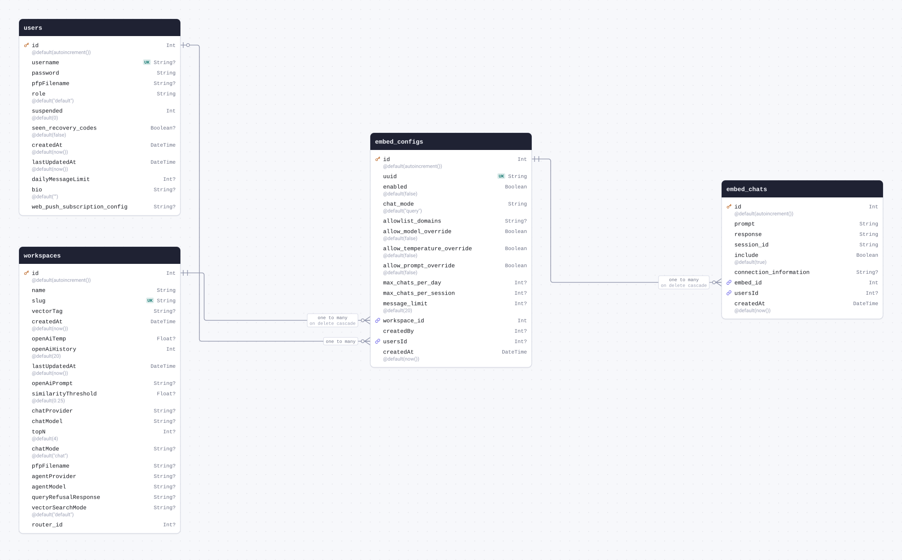

| Field                        | Type       | Constraints                                   | Default           | Description |
| ---------------------------- | ---------- | --------------------------------------------- | ----------------- | ----------- |
| `id`                         | `Int`      | PK NOT NULL                                   | `autoincrement()` |             |
| `uuid`                       | `String`   | UNIQUE NOT NULL                               |                   |             |
| `enabled`                    | `Boolean`  | NOT NULL                                      | `false`           |             |
| `chat_mode`                  | `String`   | NOT NULL                                      | `"query"`         |             |
| `allowlist_domains`          | `String`   | NULL                                          |                   |             |
| `allow_model_override`       | `Boolean`  | NOT NULL                                      | `false`           |             |
| `allow_temperature_override` | `Boolean`  | NOT NULL                                      | `false`           |             |
| `allow_prompt_override`      | `Boolean`  | NOT NULL                                      | `false`           |             |
| `max_chats_per_day`          | `Int`      | NULL                                          |                   |             |
| `max_chats_per_session`      | `Int`      | NULL                                          |                   |             |
| `message_limit`              | `Int`      | NULL                                          | `20`              |             |
| `workspace_id`               | `Int`      | NOT NULL → [workspaces.id](#model-workspaces) |                   |             |
| `createdBy`                  | `Int`      | NULL                                          |                   |             |
| `usersId`                    | `Int`      | NULL → [users.id](#model-users)               |                   |             |
| `createdAt`                  | `DateTime` | NOT NULL                                      | `now()`           |             |

#### References

- `workspace_id` → [workspaces.id](#model-workspaces) (many-to-one, on delete Cascade)
- `usersId` → [users.id](#model-users) (many-to-one)

#### Referenced by

- `id` ← [embed_chats.embed_id](#model-embed_chats) (one-to-many, on delete Cascade)

#### Definition

```sql
CREATE TABLE "embed_configs" (
    "id" INTEGER NOT NULL PRIMARY KEY AUTOINCREMENT,
    "uuid" TEXT NOT NULL,
    "enabled" BOOLEAN NOT NULL DEFAULT false,
    "chat_mode" TEXT NOT NULL DEFAULT 'query',
    "allowlist_domains" TEXT,
    "allow_model_override" BOOLEAN NOT NULL DEFAULT false,
    "allow_temperature_override" BOOLEAN NOT NULL DEFAULT false,
    "allow_prompt_override" BOOLEAN NOT NULL DEFAULT false,
    "max_chats_per_day" INTEGER,
    "max_chats_per_session" INTEGER,
    "message_limit" INTEGER DEFAULT 20,
    "workspace_id" INTEGER NOT NULL,
    "createdBy" INTEGER,
    "usersId" INTEGER,
    "createdAt" DATETIME NOT NULL DEFAULT CURRENT_TIMESTAMP,
    CONSTRAINT "embed_configs_workspace_id_fkey" FOREIGN KEY ("workspace_id") REFERENCES "workspaces" ("id") ON DELETE CASCADE ON UPDATE CASCADE,
    CONSTRAINT "embed_configs_usersId_fkey" FOREIGN KEY ("usersId") REFERENCES "users" ("id") ON DELETE SET NULL ON UPDATE CASCADE
);

CREATE UNIQUE INDEX "embed_configs_uuid_key" ON "embed_configs"("uuid");
```

<details>
<summary>Queries and their SQL</summary>

**findMany**: Every row

```ts
await prisma.embed_configs.findMany();
```

```sql
SELECT
  `main`.`embed_configs`.`id`,
  `main`.`embed_configs`.`uuid`,
  `main`.`embed_configs`.`enabled`,
  `main`.`embed_configs`.`chat_mode`,
  `main`.`embed_configs`.`allowlist_domains`,
  `main`.`embed_configs`.`allow_model_override`,
  `main`.`embed_configs`.`allow_temperature_override`,
  `main`.`embed_configs`.`allow_prompt_override`,
  `main`.`embed_configs`.`max_chats_per_day`,
  `main`.`embed_configs`.`max_chats_per_session`,
  `main`.`embed_configs`.`message_limit`,
  `main`.`embed_configs`.`workspace_id`,
  `main`.`embed_configs`.`createdBy`,
  `main`.`embed_configs`.`usersId`,
  `main`.`embed_configs`.`createdAt`
FROM
  `main`.`embed_configs`
WHERE
  1 = 1
LIMIT
  ?
OFFSET
  ?
-- params: [-1,"0"]
```

**count**: How many rows there are

```ts
await prisma.embed_configs.count();
```

```sql
SELECT
  COUNT(*) AS `_count$_all`
FROM
  (
    SELECT
      `main`.`embed_configs`.`id`
    FROM
      `main`.`embed_configs`
    WHERE
      1 = 1
    LIMIT
      ?
    OFFSET
      ?
  ) AS `sub`
-- params: [-1,"0"]
```

**findMany**: Every row with its relations

```ts
await prisma.embed_configs.findMany({
  include: { workspace: true, embed_chats: true, users: true },
});
```

```sql
SELECT
  `main`.`embed_configs`.`id`,
  `main`.`embed_configs`.`uuid`,
  `main`.`embed_configs`.`enabled`,
  `main`.`embed_configs`.`chat_mode`,
  `main`.`embed_configs`.`allowlist_domains`,
  `main`.`embed_configs`.`allow_model_override`,
  `main`.`embed_configs`.`allow_temperature_override`,
  `main`.`embed_configs`.`allow_prompt_override`,
  `main`.`embed_configs`.`max_chats_per_day`,
  `main`.`embed_configs`.`max_chats_per_session`,
  `main`.`embed_configs`.`message_limit`,
  `main`.`embed_configs`.`workspace_id`,
  `main`.`embed_configs`.`createdBy`,
  `main`.`embed_configs`.`usersId`,
  `main`.`embed_configs`.`createdAt`
FROM
  `main`.`embed_configs`
WHERE
  1 = 1
LIMIT
  ?
OFFSET
  ?
-- params: [-1,"0"]

SELECT
  `main`.`workspaces`.`id`,
  `main`.`workspaces`.`name`,
  `main`.`workspaces`.`slug`,
  `main`.`workspaces`.`vectorTag`,
  `main`.`workspaces`.`createdAt`,
  `main`.`workspaces`.`openAiTemp`,
  `main`.`workspaces`.`openAiHistory`,
  `main`.`workspaces`.`lastUpdatedAt`,
  `main`.`workspaces`.`openAiPrompt`,
  `main`.`workspaces`.`similarityThreshold`,
  `main`.`workspaces`.`chatProvider`,
  `main`.`workspaces`.`chatModel`,
  `main`.`workspaces`.`topN`,
  `main`.`workspaces`.`chatMode`,
  `main`.`workspaces`.`pfpFilename`,
  `main`.`workspaces`.`agentProvider`,
  `main`.`workspaces`.`agentModel`,
  `main`.`workspaces`.`queryRefusalResponse`,
  `main`.`workspaces`.`vectorSearchMode`,
  `main`.`workspaces`.`router_id`
FROM
  `main`.`workspaces`
WHERE
  `main`.`workspaces`.`id` IN (?)
LIMIT
  ?
OFFSET
  ?
-- params: ["<workspace_id of the rows above>",-1,"0"]

SELECT
  `main`.`embed_chats`.`id`,
  `main`.`embed_chats`.`prompt`,
  `main`.`embed_chats`.`response`,
  `main`.`embed_chats`.`session_id`,
  `main`.`embed_chats`.`include`,
  `main`.`embed_chats`.`connection_information`,
  `main`.`embed_chats`.`embed_id`,
  `main`.`embed_chats`.`usersId`,
  `main`.`embed_chats`.`createdAt`
FROM
  `main`.`embed_chats`
WHERE
  `main`.`embed_chats`.`embed_id` IN (?)
LIMIT
  ?
OFFSET
  ?
-- params: ["<id of the rows above>",-1,"0"]

SELECT
  `main`.`users`.`id`,
  `main`.`users`.`username`,
  `main`.`users`.`password`,
  `main`.`users`.`pfpFilename`,
  `main`.`users`.`role`,
  `main`.`users`.`suspended`,
  `main`.`users`.`seen_recovery_codes`,
  `main`.`users`.`createdAt`,
  `main`.`users`.`lastUpdatedAt`,
  `main`.`users`.`dailyMessageLimit`,
  `main`.`users`.`bio`,
  `main`.`users`.`web_push_subscription_config`
FROM
  `main`.`users`
WHERE
  `main`.`users`.`id` IN (?)
LIMIT
  ?
OFFSET
  ?
-- params: ["<usersId of the rows above>",-1,"0"]
```

**findUnique**: One row by what is unique to it

```ts
await prisma.embed_configs.findUnique({ where: { id: 1 } });
```

```sql
SELECT
  `main`.`embed_configs`.`id`,
  `main`.`embed_configs`.`uuid`,
  `main`.`embed_configs`.`enabled`,
  `main`.`embed_configs`.`chat_mode`,
  `main`.`embed_configs`.`allowlist_domains`,
  `main`.`embed_configs`.`allow_model_override`,
  `main`.`embed_configs`.`allow_temperature_override`,
  `main`.`embed_configs`.`allow_prompt_override`,
  `main`.`embed_configs`.`max_chats_per_day`,
  `main`.`embed_configs`.`max_chats_per_session`,
  `main`.`embed_configs`.`message_limit`,
  `main`.`embed_configs`.`workspace_id`,
  `main`.`embed_configs`.`createdBy`,
  `main`.`embed_configs`.`usersId`,
  `main`.`embed_configs`.`createdAt`
FROM
  `main`.`embed_configs`
WHERE
  (
    `main`.`embed_configs`.`id` = ?
    AND 1 = 1
  )
LIMIT
  ?
OFFSET
  ?
-- params: ["1","1","0"]
```

**create**: Create a row

```ts
await prisma.embed_configs.create({ data: { uuid: "example", workspace_id: 1 } });
```

```sql
INSERT INTO
  `main`.`embed_configs` (
    `uuid`,
    `enabled`,
    `chat_mode`,
    `allow_model_override`,
    `allow_temperature_override`,
    `allow_prompt_override`,
    `message_limit`,
    `workspace_id`,
    `createdAt`
  )
VALUES
  (?, ?, ?, ?, ?, ?, ?, ?, ?)
RETURNING
  `id` AS `id`,
  `uuid` AS `uuid`,
  `enabled` AS `enabled`,
  `chat_mode` AS `chat_mode`,
  `allowlist_domains` AS `allowlist_domains`,
  `allow_model_override` AS `allow_model_override`,
  `allow_temperature_override` AS `allow_temperature_override`,
  `allow_prompt_override` AS `allow_prompt_override`,
  `max_chats_per_day` AS `max_chats_per_day`,
  `max_chats_per_session` AS `max_chats_per_session`,
  `message_limit` AS `message_limit`,
  `workspace_id` AS `workspace_id`,
  `createdBy` AS `createdBy`,
  `usersId` AS `usersId`,
  `createdAt` AS `createdAt`
-- params: ["example",false,"query",false,false,false,"20","1","<now()>"]
```

**update**: Update a row

```ts
await prisma.embed_configs.update({ where: { id: 1 }, data: { uuid: "example" } });
```

```sql
UPDATE `main`.`embed_configs`
SET
  `uuid` = ?
WHERE
  (
    `main`.`embed_configs`.`id` = ?
    AND 1 = 1
  )
RETURNING
  `id` AS `id`,
  `uuid` AS `uuid`,
  `enabled` AS `enabled`,
  `chat_mode` AS `chat_mode`,
  `allowlist_domains` AS `allowlist_domains`,
  `allow_model_override` AS `allow_model_override`,
  `allow_temperature_override` AS `allow_temperature_override`,
  `allow_prompt_override` AS `allow_prompt_override`,
  `max_chats_per_day` AS `max_chats_per_day`,
  `max_chats_per_session` AS `max_chats_per_session`,
  `message_limit` AS `message_limit`,
  `workspace_id` AS `workspace_id`,
  `createdBy` AS `createdBy`,
  `usersId` AS `usersId`,
  `createdAt` AS `createdAt`
-- params: ["example","1"]
```

**delete**: Delete a row

```ts
await prisma.embed_configs.delete({ where: { id: 1 } });
```

```sql
DELETE FROM `main`.`embed_configs`
WHERE
  (
    `main`.`embed_configs`.`id` = ?
    AND 1 = 1
  )
RETURNING
  `id` AS `id`,
  `uuid` AS `uuid`,
  `enabled` AS `enabled`,
  `chat_mode` AS `chat_mode`,
  `allowlist_domains` AS `allowlist_domains`,
  `allow_model_override` AS `allow_model_override`,
  `allow_temperature_override` AS `allow_temperature_override`,
  `allow_prompt_override` AS `allow_prompt_override`,
  `max_chats_per_day` AS `max_chats_per_day`,
  `max_chats_per_session` AS `max_chats_per_session`,
  `message_limit` AS `message_limit`,
  `workspace_id` AS `workspace_id`,
  `createdBy` AS `createdBy`,
  `usersId` AS `usersId`,
  `createdAt` AS `createdAt`
-- params: ["1"]
```

</details>

<a id="model-embed_chats"></a>

### embed_chats

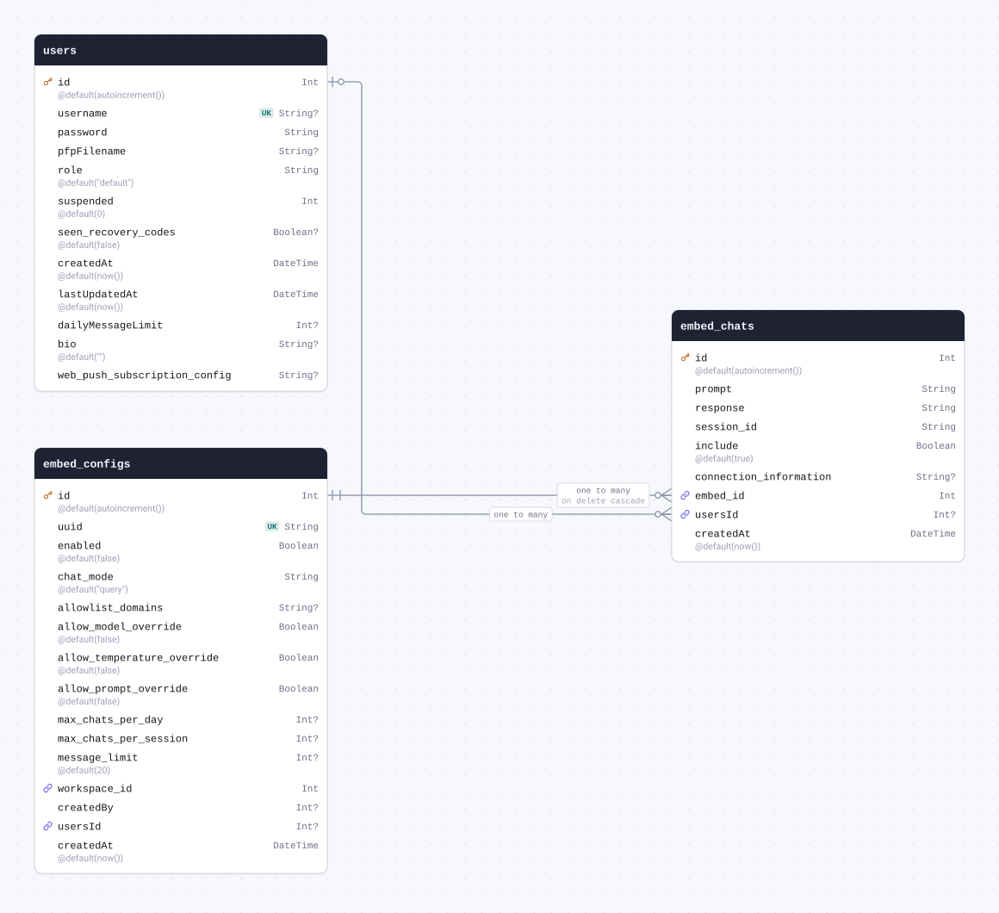

| Field                    | Type       | Constraints                                         | Default           | Description |
| ------------------------ | ---------- | --------------------------------------------------- | ----------------- | ----------- |
| `id`                     | `Int`      | PK NOT NULL                                         | `autoincrement()` |             |
| `prompt`                 | `String`   | NOT NULL                                            |                   |             |
| `response`               | `String`   | NOT NULL                                            |                   |             |
| `session_id`             | `String`   | NOT NULL                                            |                   |             |
| `include`                | `Boolean`  | NOT NULL                                            | `true`            |             |
| `connection_information` | `String`   | NULL                                                |                   |             |
| `embed_id`               | `Int`      | NOT NULL → [embed_configs.id](#model-embed_configs) |                   |             |
| `usersId`                | `Int`      | NULL → [users.id](#model-users)                     |                   |             |
| `createdAt`              | `DateTime` | NOT NULL                                            | `now()`           |             |

#### References

- `embed_id` → [embed_configs.id](#model-embed_configs) (many-to-one, on delete Cascade)
- `usersId` → [users.id](#model-users) (many-to-one)

#### Definition

```sql
CREATE TABLE "embed_chats" (
    "id" INTEGER NOT NULL PRIMARY KEY AUTOINCREMENT,
    "prompt" TEXT NOT NULL,
    "response" TEXT NOT NULL,
    "session_id" TEXT NOT NULL,
    "include" BOOLEAN NOT NULL DEFAULT true,
    "connection_information" TEXT,
    "embed_id" INTEGER NOT NULL,
    "usersId" INTEGER,
    "createdAt" DATETIME NOT NULL DEFAULT CURRENT_TIMESTAMP,
    CONSTRAINT "embed_chats_embed_id_fkey" FOREIGN KEY ("embed_id") REFERENCES "embed_configs" ("id") ON DELETE CASCADE ON UPDATE CASCADE,
    CONSTRAINT "embed_chats_usersId_fkey" FOREIGN KEY ("usersId") REFERENCES "users" ("id") ON DELETE SET NULL ON UPDATE CASCADE
);
```

<details>
<summary>Queries and their SQL</summary>

**findMany**: Every row

```ts
await prisma.embed_chats.findMany();
```

```sql
SELECT
  `main`.`embed_chats`.`id`,
  `main`.`embed_chats`.`prompt`,
  `main`.`embed_chats`.`response`,
  `main`.`embed_chats`.`session_id`,
  `main`.`embed_chats`.`include`,
  `main`.`embed_chats`.`connection_information`,
  `main`.`embed_chats`.`embed_id`,
  `main`.`embed_chats`.`usersId`,
  `main`.`embed_chats`.`createdAt`
FROM
  `main`.`embed_chats`
WHERE
  1 = 1
LIMIT
  ?
OFFSET
  ?
-- params: [-1,"0"]
```

**count**: How many rows there are

```ts
await prisma.embed_chats.count();
```

```sql
SELECT
  COUNT(*) AS `_count$_all`
FROM
  (
    SELECT
      `main`.`embed_chats`.`id`
    FROM
      `main`.`embed_chats`
    WHERE
      1 = 1
    LIMIT
      ?
    OFFSET
      ?
  ) AS `sub`
-- params: [-1,"0"]
```

**findMany**: Every row with its relations

```ts
await prisma.embed_chats.findMany({ include: { embed_config: true, users: true } });
```

```sql
SELECT
  `main`.`embed_chats`.`id`,
  `main`.`embed_chats`.`prompt`,
  `main`.`embed_chats`.`response`,
  `main`.`embed_chats`.`session_id`,
  `main`.`embed_chats`.`include`,
  `main`.`embed_chats`.`connection_information`,
  `main`.`embed_chats`.`embed_id`,
  `main`.`embed_chats`.`usersId`,
  `main`.`embed_chats`.`createdAt`
FROM
  `main`.`embed_chats`
WHERE
  1 = 1
LIMIT
  ?
OFFSET
  ?
-- params: [-1,"0"]

SELECT
  `main`.`embed_configs`.`id`,
  `main`.`embed_configs`.`uuid`,
  `main`.`embed_configs`.`enabled`,
  `main`.`embed_configs`.`chat_mode`,
  `main`.`embed_configs`.`allowlist_domains`,
  `main`.`embed_configs`.`allow_model_override`,
  `main`.`embed_configs`.`allow_temperature_override`,
  `main`.`embed_configs`.`allow_prompt_override`,
  `main`.`embed_configs`.`max_chats_per_day`,
  `main`.`embed_configs`.`max_chats_per_session`,
  `main`.`embed_configs`.`message_limit`,
  `main`.`embed_configs`.`workspace_id`,
  `main`.`embed_configs`.`createdBy`,
  `main`.`embed_configs`.`usersId`,
  `main`.`embed_configs`.`createdAt`
FROM
  `main`.`embed_configs`
WHERE
  `main`.`embed_configs`.`id` IN (?)
LIMIT
  ?
OFFSET
  ?
-- params: ["<embed_id of the rows above>",-1,"0"]

SELECT
  `main`.`users`.`id`,
  `main`.`users`.`username`,
  `main`.`users`.`password`,
  `main`.`users`.`pfpFilename`,
  `main`.`users`.`role`,
  `main`.`users`.`suspended`,
  `main`.`users`.`seen_recovery_codes`,
  `main`.`users`.`createdAt`,
  `main`.`users`.`lastUpdatedAt`,
  `main`.`users`.`dailyMessageLimit`,
  `main`.`users`.`bio`,
  `main`.`users`.`web_push_subscription_config`
FROM
  `main`.`users`
WHERE
  `main`.`users`.`id` IN (?)
LIMIT
  ?
OFFSET
  ?
-- params: ["<usersId of the rows above>",-1,"0"]
```

**findUnique**: One row by what is unique to it

```ts
await prisma.embed_chats.findUnique({ where: { id: 1 } });
```

```sql
SELECT
  `main`.`embed_chats`.`id`,
  `main`.`embed_chats`.`prompt`,
  `main`.`embed_chats`.`response`,
  `main`.`embed_chats`.`session_id`,
  `main`.`embed_chats`.`include`,
  `main`.`embed_chats`.`connection_information`,
  `main`.`embed_chats`.`embed_id`,
  `main`.`embed_chats`.`usersId`,
  `main`.`embed_chats`.`createdAt`
FROM
  `main`.`embed_chats`
WHERE
  (
    `main`.`embed_chats`.`id` = ?
    AND 1 = 1
  )
LIMIT
  ?
OFFSET
  ?
-- params: ["1","1","0"]
```

**create**: Create a row

```ts
await prisma.embed_chats.create({
  data: { prompt: "example", response: "example", session_id: "example", embed_id: 1 },
});
```

```sql
INSERT INTO
  `main`.`embed_chats` (
    `prompt`,
    `response`,
    `session_id`,
    `include`,
    `embed_id`,
    `createdAt`
  )
VALUES
  (?, ?, ?, ?, ?, ?)
RETURNING
  `id` AS `id`,
  `prompt` AS `prompt`,
  `response` AS `response`,
  `session_id` AS `session_id`,
  `include` AS `include`,
  `connection_information` AS `connection_information`,
  `embed_id` AS `embed_id`,
  `usersId` AS `usersId`,
  `createdAt` AS `createdAt`
-- params: ["example","example","example",true,"1","<now()>"]
```

**update**: Update a row

```ts
await prisma.embed_chats.update({ where: { id: 1 }, data: { prompt: "example" } });
```

```sql
UPDATE `main`.`embed_chats`
SET
  `prompt` = ?
WHERE
  (
    `main`.`embed_chats`.`id` = ?
    AND 1 = 1
  )
RETURNING
  `id` AS `id`,
  `prompt` AS `prompt`,
  `response` AS `response`,
  `session_id` AS `session_id`,
  `include` AS `include`,
  `connection_information` AS `connection_information`,
  `embed_id` AS `embed_id`,
  `usersId` AS `usersId`,
  `createdAt` AS `createdAt`
-- params: ["example","1"]
```

**delete**: Delete a row

```ts
await prisma.embed_chats.delete({ where: { id: 1 } });
```

```sql
DELETE FROM `main`.`embed_chats`
WHERE
  (
    `main`.`embed_chats`.`id` = ?
    AND 1 = 1
  )
RETURNING
  `id` AS `id`,
  `prompt` AS `prompt`,
  `response` AS `response`,
  `session_id` AS `session_id`,
  `include` AS `include`,
  `connection_information` AS `connection_information`,
  `embed_id` AS `embed_id`,
  `usersId` AS `usersId`,
  `createdAt` AS `createdAt`
-- params: ["1"]
```

</details>

<a id="model-event_logs"></a>

### event_logs

| Field        | Type       | Constraints | Default           | Description |
| ------------ | ---------- | ----------- | ----------------- | ----------- |
| `id`         | `Int`      | PK NOT NULL | `autoincrement()` |             |
| `event`      | `String`   | NOT NULL    |                   |             |
| `metadata`   | `String`   | NULL        |                   |             |
| `userId`     | `Int`      | NULL        |                   |             |
| `occurredAt` | `DateTime` | NOT NULL    | `now()`           |             |

#### Indexes

- `@@index([event])`

#### Definition

```sql
CREATE TABLE "event_logs" (
    "id" INTEGER NOT NULL PRIMARY KEY AUTOINCREMENT,
    "event" TEXT NOT NULL,
    "metadata" TEXT,
    "userId" INTEGER,
    "occurredAt" DATETIME NOT NULL DEFAULT CURRENT_TIMESTAMP
);

CREATE INDEX "event_logs_event_idx" ON "event_logs"("event");
```

<details>
<summary>Queries and their SQL</summary>

**findMany**: Every row

```ts
await prisma.event_logs.findMany();
```

```sql
SELECT
  `main`.`event_logs`.`id`,
  `main`.`event_logs`.`event`,
  `main`.`event_logs`.`metadata`,
  `main`.`event_logs`.`userId`,
  `main`.`event_logs`.`occurredAt`
FROM
  `main`.`event_logs`
WHERE
  1 = 1
LIMIT
  ?
OFFSET
  ?
-- params: [-1,"0"]
```

**count**: How many rows there are

```ts
await prisma.event_logs.count();
```

```sql
SELECT
  COUNT(*) AS `_count$_all`
FROM
  (
    SELECT
      `main`.`event_logs`.`id`
    FROM
      `main`.`event_logs`
    WHERE
      1 = 1
    LIMIT
      ?
    OFFSET
      ?
  ) AS `sub`
-- params: [-1,"0"]
```

**findUnique**: One row by what is unique to it

```ts
await prisma.event_logs.findUnique({ where: { id: 1 } });
```

```sql
SELECT
  `main`.`event_logs`.`id`,
  `main`.`event_logs`.`event`,
  `main`.`event_logs`.`metadata`,
  `main`.`event_logs`.`userId`,
  `main`.`event_logs`.`occurredAt`
FROM
  `main`.`event_logs`
WHERE
  (
    `main`.`event_logs`.`id` = ?
    AND 1 = 1
  )
LIMIT
  ?
OFFSET
  ?
-- params: ["1","1","0"]
```

**create**: Create a row

```ts
await prisma.event_logs.create({ data: { event: "example" } });
```

```sql
INSERT INTO
  `main`.`event_logs` (`event`, `occurredAt`)
VALUES
  (?, ?)
RETURNING
  `id` AS `id`,
  `event` AS `event`,
  `metadata` AS `metadata`,
  `userId` AS `userId`,
  `occurredAt` AS `occurredAt`
-- params: ["example","<now()>"]
```

**update**: Update a row

```ts
await prisma.event_logs.update({ where: { id: 1 }, data: { event: "example" } });
```

```sql
UPDATE `main`.`event_logs`
SET
  `event` = ?
WHERE
  (
    `main`.`event_logs`.`id` = ?
    AND 1 = 1
  )
RETURNING
  `id` AS `id`,
  `event` AS `event`,
  `metadata` AS `metadata`,
  `userId` AS `userId`,
  `occurredAt` AS `occurredAt`
-- params: ["example","1"]
```

**delete**: Delete a row

```ts
await prisma.event_logs.delete({ where: { id: 1 } });
```

```sql
DELETE FROM `main`.`event_logs`
WHERE
  (
    `main`.`event_logs`.`id` = ?
    AND 1 = 1
  )
RETURNING
  `id` AS `id`,
  `event` AS `event`,
  `metadata` AS `metadata`,
  `userId` AS `userId`,
  `occurredAt` AS `occurredAt`
-- params: ["1"]
```

</details>

<a id="model-slash_command_presets"></a>

### slash_command_presets

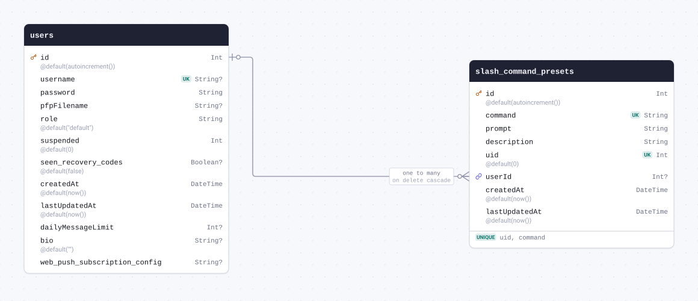

| Field           | Type       | Constraints                     | Default           | Description |
| --------------- | ---------- | ------------------------------- | ----------------- | ----------- |
| `id`            | `Int`      | PK NOT NULL                     | `autoincrement()` |             |
| `command`       | `String`   | NOT NULL                        |                   |             |
| `prompt`        | `String`   | NOT NULL                        |                   |             |
| `description`   | `String`   | NOT NULL                        |                   |             |
| `uid`           | `Int`      | NOT NULL                        | `0`               |             |
| `userId`        | `Int`      | NULL → [users.id](#model-users) |                   |             |
| `createdAt`     | `DateTime` | NOT NULL                        | `now()`           |             |
| `lastUpdatedAt` | `DateTime` | NOT NULL                        | `now()`           |             |

#### Indexes

- `@@unique([uid, command])`

#### References

- `userId` → [users.id](#model-users) (many-to-one, on delete Cascade)

#### Definition

```sql
CREATE TABLE "slash_command_presets" (
    "id" INTEGER NOT NULL PRIMARY KEY AUTOINCREMENT,
    "command" TEXT NOT NULL,
    "prompt" TEXT NOT NULL,
    "description" TEXT NOT NULL,
    "uid" INTEGER NOT NULL DEFAULT 0,
    "userId" INTEGER,
    "createdAt" DATETIME NOT NULL DEFAULT CURRENT_TIMESTAMP,
    "lastUpdatedAt" DATETIME NOT NULL DEFAULT CURRENT_TIMESTAMP,
    CONSTRAINT "slash_command_presets_userId_fkey" FOREIGN KEY ("userId") REFERENCES "users" ("id") ON DELETE CASCADE ON UPDATE CASCADE
);

CREATE UNIQUE INDEX "slash_command_presets_uid_command_key" ON "slash_command_presets"("uid", "command");
```

<details>
<summary>Queries and their SQL</summary>

**findMany**: Every row

```ts
await prisma.slash_command_presets.findMany();
```

```sql
SELECT
  `main`.`slash_command_presets`.`id`,
  `main`.`slash_command_presets`.`command`,
  `main`.`slash_command_presets`.`prompt`,
  `main`.`slash_command_presets`.`description`,
  `main`.`slash_command_presets`.`uid`,
  `main`.`slash_command_presets`.`userId`,
  `main`.`slash_command_presets`.`createdAt`,
  `main`.`slash_command_presets`.`lastUpdatedAt`
FROM
  `main`.`slash_command_presets`
WHERE
  1 = 1
LIMIT
  ?
OFFSET
  ?
-- params: [-1,"0"]
```

**count**: How many rows there are

```ts
await prisma.slash_command_presets.count();
```

```sql
SELECT
  COUNT(*) AS `_count$_all`
FROM
  (
    SELECT
      `main`.`slash_command_presets`.`id`
    FROM
      `main`.`slash_command_presets`
    WHERE
      1 = 1
    LIMIT
      ?
    OFFSET
      ?
  ) AS `sub`
-- params: [-1,"0"]
```

**findMany**: Every row with its relations

```ts
await prisma.slash_command_presets.findMany({ include: { user: true } });
```

```sql
SELECT
  `main`.`slash_command_presets`.`id`,
  `main`.`slash_command_presets`.`command`,
  `main`.`slash_command_presets`.`prompt`,
  `main`.`slash_command_presets`.`description`,
  `main`.`slash_command_presets`.`uid`,
  `main`.`slash_command_presets`.`userId`,
  `main`.`slash_command_presets`.`createdAt`,
  `main`.`slash_command_presets`.`lastUpdatedAt`
FROM
  `main`.`slash_command_presets`
WHERE
  1 = 1
LIMIT
  ?
OFFSET
  ?
-- params: [-1,"0"]

SELECT
  `main`.`users`.`id`,
  `main`.`users`.`username`,
  `main`.`users`.`password`,
  `main`.`users`.`pfpFilename`,
  `main`.`users`.`role`,
  `main`.`users`.`suspended`,
  `main`.`users`.`seen_recovery_codes`,
  `main`.`users`.`createdAt`,
  `main`.`users`.`lastUpdatedAt`,
  `main`.`users`.`dailyMessageLimit`,
  `main`.`users`.`bio`,
  `main`.`users`.`web_push_subscription_config`
FROM
  `main`.`users`
WHERE
  `main`.`users`.`id` IN (?)
LIMIT
  ?
OFFSET
  ?
-- params: ["<userId of the rows above>",-1,"0"]
```

**findUnique**: One row by what is unique to it

```ts
await prisma.slash_command_presets.findUnique({ where: { id: 1 } });
```

```sql
SELECT
  `main`.`slash_command_presets`.`id`,
  `main`.`slash_command_presets`.`command`,
  `main`.`slash_command_presets`.`prompt`,
  `main`.`slash_command_presets`.`description`,
  `main`.`slash_command_presets`.`uid`,
  `main`.`slash_command_presets`.`userId`,
  `main`.`slash_command_presets`.`createdAt`,
  `main`.`slash_command_presets`.`lastUpdatedAt`
FROM
  `main`.`slash_command_presets`
WHERE
  (
    `main`.`slash_command_presets`.`id` = ?
    AND 1 = 1
  )
LIMIT
  ?
OFFSET
  ?
-- params: ["1","1","0"]
```

**create**: Create a row

```ts
await prisma.slash_command_presets.create({
  data: { command: "example", prompt: "example", description: "example" },
});
```

```sql
INSERT INTO
  `main`.`slash_command_presets` (
    `command`,
    `prompt`,
    `description`,
    `uid`,
    `createdAt`,
    `lastUpdatedAt`
  )
VALUES
  (?, ?, ?, ?, ?, ?)
RETURNING
  `id` AS `id`,
  `command` AS `command`,
  `prompt` AS `prompt`,
  `description` AS `description`,
  `uid` AS `uid`,
  `userId` AS `userId`,
  `createdAt` AS `createdAt`,
  `lastUpdatedAt` AS `lastUpdatedAt`
-- params: ["example","example","example","0","<now()>","<now()>"]
```

**update**: Update a row

```ts
await prisma.slash_command_presets.update({ where: { id: 1 }, data: { command: "example" } });
```

```sql
UPDATE `main`.`slash_command_presets`
SET
  `command` = ?
WHERE
  (
    `main`.`slash_command_presets`.`id` = ?
    AND 1 = 1
  )
RETURNING
  `id` AS `id`,
  `command` AS `command`,
  `prompt` AS `prompt`,
  `description` AS `description`,
  `uid` AS `uid`,
  `userId` AS `userId`,
  `createdAt` AS `createdAt`,
  `lastUpdatedAt` AS `lastUpdatedAt`
-- params: ["example","1"]
```

**delete**: Delete a row

```ts
await prisma.slash_command_presets.delete({ where: { id: 1 } });
```

```sql
DELETE FROM `main`.`slash_command_presets`
WHERE
  (
    `main`.`slash_command_presets`.`id` = ?
    AND 1 = 1
  )
RETURNING
  `id` AS `id`,
  `command` AS `command`,
  `prompt` AS `prompt`,
  `description` AS `description`,
  `uid` AS `uid`,
  `userId` AS `userId`,
  `createdAt` AS `createdAt`,
  `lastUpdatedAt` AS `lastUpdatedAt`
-- params: ["1"]
```

</details>

<a id="model-document_sync_queues"></a>

### document_sync_queues

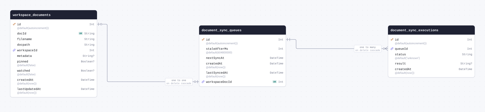

| Field            | Type       | Constraints                                                            | Default           | Description |
| ---------------- | ---------- | ---------------------------------------------------------------------- | ----------------- | ----------- |
| `id`             | `Int`      | PK NOT NULL                                                            | `autoincrement()` |             |
| `staleAfterMs`   | `Int`      | NOT NULL                                                               | `604800000`       |             |
| `nextSyncAt`     | `DateTime` | NOT NULL                                                               |                   |             |
| `createdAt`      | `DateTime` | NOT NULL                                                               | `now()`           |             |
| `lastSyncedAt`   | `DateTime` | NOT NULL                                                               | `now()`           |             |
| `workspaceDocId` | `Int`      | UNIQUE NOT NULL → [workspace_documents.id](#model-workspace_documents) |                   |             |

#### References

- `workspaceDocId` → [workspace_documents.id](#model-workspace_documents) (one-to-one, on delete Cascade)

#### Referenced by

- `id` ← [document_sync_executions.queueId](#model-document_sync_executions) (one-to-many, on delete Cascade)

#### Definition

```sql
CREATE TABLE "document_sync_queues" (
    "id" INTEGER NOT NULL PRIMARY KEY AUTOINCREMENT,
    "staleAfterMs" INTEGER NOT NULL DEFAULT 604800000,
    "nextSyncAt" DATETIME NOT NULL,
    "createdAt" DATETIME NOT NULL DEFAULT CURRENT_TIMESTAMP,
    "lastSyncedAt" DATETIME NOT NULL DEFAULT CURRENT_TIMESTAMP,
    "workspaceDocId" INTEGER NOT NULL,
    CONSTRAINT "document_sync_queues_workspaceDocId_fkey" FOREIGN KEY ("workspaceDocId") REFERENCES "workspace_documents" ("id") ON DELETE CASCADE ON UPDATE CASCADE
);

CREATE UNIQUE INDEX "document_sync_queues_workspaceDocId_key" ON "document_sync_queues"("workspaceDocId");
```

<details>
<summary>Queries and their SQL</summary>

**findMany**: Every row

```ts
await prisma.document_sync_queues.findMany();
```

```sql
SELECT
  `main`.`document_sync_queues`.`id`,
  `main`.`document_sync_queues`.`staleAfterMs`,
  `main`.`document_sync_queues`.`nextSyncAt`,
  `main`.`document_sync_queues`.`createdAt`,
  `main`.`document_sync_queues`.`lastSyncedAt`,
  `main`.`document_sync_queues`.`workspaceDocId`
FROM
  `main`.`document_sync_queues`
WHERE
  1 = 1
LIMIT
  ?
OFFSET
  ?
-- params: [-1,"0"]
```

**count**: How many rows there are

```ts
await prisma.document_sync_queues.count();
```

```sql
SELECT
  COUNT(*) AS `_count$_all`
FROM
  (
    SELECT
      `main`.`document_sync_queues`.`id`
    FROM
      `main`.`document_sync_queues`
    WHERE
      1 = 1
    LIMIT
      ?
    OFFSET
      ?
  ) AS `sub`
-- params: [-1,"0"]
```

**findMany**: Every row with its relations

```ts
await prisma.document_sync_queues.findMany({ include: { workspaceDoc: true, runs: true } });
```

```sql
SELECT
  `main`.`document_sync_queues`.`id`,
  `main`.`document_sync_queues`.`staleAfterMs`,
  `main`.`document_sync_queues`.`nextSyncAt`,
  `main`.`document_sync_queues`.`createdAt`,
  `main`.`document_sync_queues`.`lastSyncedAt`,
  `main`.`document_sync_queues`.`workspaceDocId`
FROM
  `main`.`document_sync_queues`
WHERE
  1 = 1
LIMIT
  ?
OFFSET
  ?
-- params: [-1,"0"]

SELECT
  `main`.`workspace_documents`.`id`,
  `main`.`workspace_documents`.`docId`,
  `main`.`workspace_documents`.`filename`,
  `main`.`workspace_documents`.`docpath`,
  `main`.`workspace_documents`.`workspaceId`,
  `main`.`workspace_documents`.`metadata`,
  `main`.`workspace_documents`.`pinned`,
  `main`.`workspace_documents`.`watched`,
  `main`.`workspace_documents`.`createdAt`,
  `main`.`workspace_documents`.`lastUpdatedAt`
FROM
  `main`.`workspace_documents`
WHERE
  `main`.`workspace_documents`.`id` IN (?)
LIMIT
  ?
OFFSET
  ?
-- params: ["<workspaceDocId of the rows above>",-1,"0"]

SELECT
  `main`.`document_sync_executions`.`id`,
  `main`.`document_sync_executions`.`queueId`,
  `main`.`document_sync_executions`.`status`,
  `main`.`document_sync_executions`.`result`,
  `main`.`document_sync_executions`.`createdAt`
FROM
  `main`.`document_sync_executions`
WHERE
  `main`.`document_sync_executions`.`queueId` IN (?)
LIMIT
  ?
OFFSET
  ?
-- params: ["<id of the rows above>",-1,"0"]
```

**findUnique**: One row by what is unique to it

```ts
await prisma.document_sync_queues.findUnique({ where: { id: 1 } });
```

```sql
SELECT
  `main`.`document_sync_queues`.`id`,
  `main`.`document_sync_queues`.`staleAfterMs`,
  `main`.`document_sync_queues`.`nextSyncAt`,
  `main`.`document_sync_queues`.`createdAt`,
  `main`.`document_sync_queues`.`lastSyncedAt`,
  `main`.`document_sync_queues`.`workspaceDocId`
FROM
  `main`.`document_sync_queues`
WHERE
  (
    `main`.`document_sync_queues`.`id` = ?
    AND 1 = 1
  )
LIMIT
  ?
OFFSET
  ?
-- params: ["1","1","0"]
```

**create**: Create a row

```ts
await prisma.document_sync_queues.create({
  data: { nextSyncAt: new Date("2026-01-01T00:00:00.000Z"), workspaceDocId: 1 },
});
```

```sql
INSERT INTO
  `main`.`document_sync_queues` (
    `staleAfterMs`,
    `nextSyncAt`,
    `createdAt`,
    `lastSyncedAt`,
    `workspaceDocId`
  )
VALUES
  (?, ?, ?, ?, ?)
RETURNING
  `id` AS `id`,
  `staleAfterMs` AS `staleAfterMs`,
  `nextSyncAt` AS `nextSyncAt`,
  `createdAt` AS `createdAt`,
  `lastSyncedAt` AS `lastSyncedAt`,
  `workspaceDocId` AS `workspaceDocId`
-- params: ["604800000","2026-01-01T00:00:00.000Z","<now()>","<now()>","1"]
```

**update**: Update a row

```ts
await prisma.document_sync_queues.update({ where: { id: 1 }, data: { staleAfterMs: 1 } });
```

```sql
UPDATE `main`.`document_sync_queues`
SET
  `staleAfterMs` = ?
WHERE
  (
    `main`.`document_sync_queues`.`id` = ?
    AND 1 = 1
  )
RETURNING
  `id` AS `id`,
  `staleAfterMs` AS `staleAfterMs`,
  `nextSyncAt` AS `nextSyncAt`,
  `createdAt` AS `createdAt`,
  `lastSyncedAt` AS `lastSyncedAt`,
  `workspaceDocId` AS `workspaceDocId`
-- params: ["1","1"]
```

**delete**: Delete a row

```ts
await prisma.document_sync_queues.delete({ where: { id: 1 } });
```

```sql
DELETE FROM `main`.`document_sync_queues`
WHERE
  (
    `main`.`document_sync_queues`.`id` = ?
    AND 1 = 1
  )
RETURNING
  `id` AS `id`,
  `staleAfterMs` AS `staleAfterMs`,
  `nextSyncAt` AS `nextSyncAt`,
  `createdAt` AS `createdAt`,
  `lastSyncedAt` AS `lastSyncedAt`,
  `workspaceDocId` AS `workspaceDocId`
-- params: ["1"]
```

</details>

<a id="model-document_sync_executions"></a>

### document_sync_executions

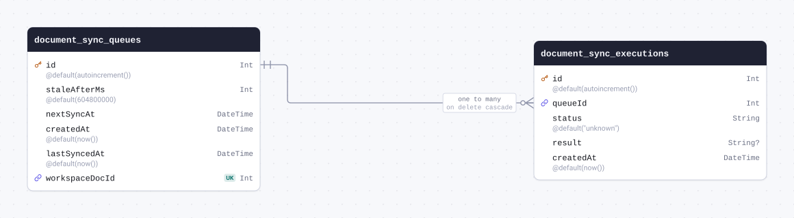

| Field       | Type       | Constraints                                                       | Default           | Description |
| ----------- | ---------- | ----------------------------------------------------------------- | ----------------- | ----------- |
| `id`        | `Int`      | PK NOT NULL                                                       | `autoincrement()` |             |
| `queueId`   | `Int`      | NOT NULL → [document_sync_queues.id](#model-document_sync_queues) |                   |             |
| `status`    | `String`   | NOT NULL                                                          | `"unknown"`       |             |
| `result`    | `String`   | NULL                                                              |                   |             |
| `createdAt` | `DateTime` | NOT NULL                                                          | `now()`           |             |

#### References

- `queueId` → [document_sync_queues.id](#model-document_sync_queues) (many-to-one, on delete Cascade)

#### Definition

```sql
CREATE TABLE "document_sync_executions" (
    "id" INTEGER NOT NULL PRIMARY KEY AUTOINCREMENT,
    "queueId" INTEGER NOT NULL,
    "status" TEXT NOT NULL DEFAULT 'unknown',
    "result" TEXT,
    "createdAt" DATETIME NOT NULL DEFAULT CURRENT_TIMESTAMP,
    CONSTRAINT "document_sync_executions_queueId_fkey" FOREIGN KEY ("queueId") REFERENCES "document_sync_queues" ("id") ON DELETE CASCADE ON UPDATE CASCADE
);
```

<details>
<summary>Queries and their SQL</summary>

**findMany**: Every row

```ts
await prisma.document_sync_executions.findMany();
```

```sql
SELECT
  `main`.`document_sync_executions`.`id`,
  `main`.`document_sync_executions`.`queueId`,
  `main`.`document_sync_executions`.`status`,
  `main`.`document_sync_executions`.`result`,
  `main`.`document_sync_executions`.`createdAt`
FROM
  `main`.`document_sync_executions`
WHERE
  1 = 1
LIMIT
  ?
OFFSET
  ?
-- params: [-1,"0"]
```

**count**: How many rows there are

```ts
await prisma.document_sync_executions.count();
```

```sql
SELECT
  COUNT(*) AS `_count$_all`
FROM
  (
    SELECT
      `main`.`document_sync_executions`.`id`
    FROM
      `main`.`document_sync_executions`
    WHERE
      1 = 1
    LIMIT
      ?
    OFFSET
      ?
  ) AS `sub`
-- params: [-1,"0"]
```

**findMany**: Every row with its relations

```ts
await prisma.document_sync_executions.findMany({ include: { queue: true } });
```

```sql
SELECT
  `main`.`document_sync_executions`.`id`,
  `main`.`document_sync_executions`.`queueId`,
  `main`.`document_sync_executions`.`status`,
  `main`.`document_sync_executions`.`result`,
  `main`.`document_sync_executions`.`createdAt`
FROM
  `main`.`document_sync_executions`
WHERE
  1 = 1
LIMIT
  ?
OFFSET
  ?
-- params: [-1,"0"]

SELECT
  `main`.`document_sync_queues`.`id`,
  `main`.`document_sync_queues`.`staleAfterMs`,
  `main`.`document_sync_queues`.`nextSyncAt`,
  `main`.`document_sync_queues`.`createdAt`,
  `main`.`document_sync_queues`.`lastSyncedAt`,
  `main`.`document_sync_queues`.`workspaceDocId`
FROM
  `main`.`document_sync_queues`
WHERE
  `main`.`document_sync_queues`.`id` IN (?)
LIMIT
  ?
OFFSET
  ?
-- params: ["<queueId of the rows above>",-1,"0"]
```

**findUnique**: One row by what is unique to it

```ts
await prisma.document_sync_executions.findUnique({ where: { id: 1 } });
```

```sql
SELECT
  `main`.`document_sync_executions`.`id`,
  `main`.`document_sync_executions`.`queueId`,
  `main`.`document_sync_executions`.`status`,
  `main`.`document_sync_executions`.`result`,
  `main`.`document_sync_executions`.`createdAt`
FROM
  `main`.`document_sync_executions`
WHERE
  (
    `main`.`document_sync_executions`.`id` = ?
    AND 1 = 1
  )
LIMIT
  ?
OFFSET
  ?
-- params: ["1","1","0"]
```

**create**: Create a row

```ts
await prisma.document_sync_executions.create({ data: { queueId: 1 } });
```

```sql
INSERT INTO
  `main`.`document_sync_executions` (`queueId`, `status`, `createdAt`)
VALUES
  (?, ?, ?)
RETURNING
  `id` AS `id`,
  `queueId` AS `queueId`,
  `status` AS `status`,
  `result` AS `result`,
  `createdAt` AS `createdAt`
-- params: ["1","unknown","<now()>"]
```

**update**: Update a row

```ts
await prisma.document_sync_executions.update({ where: { id: 1 }, data: { status: "example" } });
```

```sql
UPDATE `main`.`document_sync_executions`
SET
  `status` = ?
WHERE
  (
    `main`.`document_sync_executions`.`id` = ?
    AND 1 = 1
  )
RETURNING
  `id` AS `id`,
  `queueId` AS `queueId`,
  `status` AS `status`,
  `result` AS `result`,
  `createdAt` AS `createdAt`
-- params: ["example","1"]
```

**delete**: Delete a row

```ts
await prisma.document_sync_executions.delete({ where: { id: 1 } });
```

```sql
DELETE FROM `main`.`document_sync_executions`
WHERE
  (
    `main`.`document_sync_executions`.`id` = ?
    AND 1 = 1
  )
RETURNING
  `id` AS `id`,
  `queueId` AS `queueId`,
  `status` AS `status`,
  `result` AS `result`,
  `createdAt` AS `createdAt`
-- params: ["1"]
```

</details>

<a id="model-browser_extension_api_keys"></a>

### browser_extension_api_keys

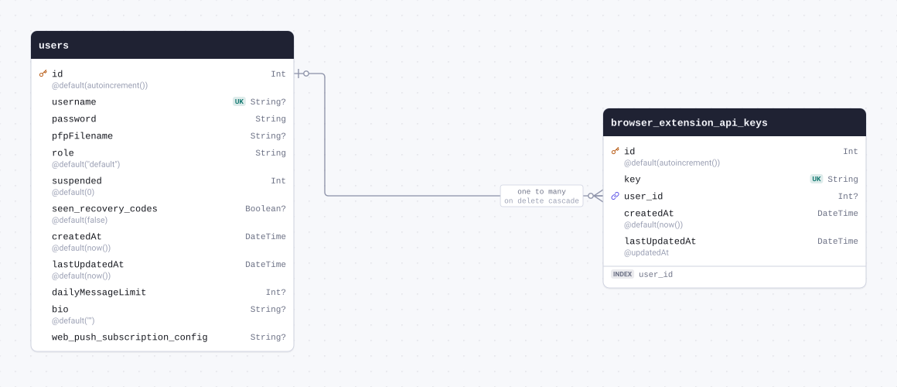

| Field           | Type       | Constraints                     | Default           | Description |
| --------------- | ---------- | ------------------------------- | ----------------- | ----------- |
| `id`            | `Int`      | PK NOT NULL                     | `autoincrement()` |             |
| `key`           | `String`   | UNIQUE NOT NULL                 |                   |             |
| `user_id`       | `Int`      | NULL → [users.id](#model-users) |                   |             |
| `createdAt`     | `DateTime` | NOT NULL                        | `now()`           |             |
| `lastUpdatedAt` | `DateTime` | NOT NULL                        | `@updatedAt`      |             |

#### Indexes

- `@@index([user_id])`

#### References

- `user_id` → [users.id](#model-users) (many-to-one, on delete Cascade)

#### Definition

```sql
CREATE TABLE "browser_extension_api_keys" (
    "id" INTEGER NOT NULL PRIMARY KEY AUTOINCREMENT,
    "key" TEXT NOT NULL,
    "user_id" INTEGER,
    "createdAt" DATETIME NOT NULL DEFAULT CURRENT_TIMESTAMP,
    "lastUpdatedAt" DATETIME NOT NULL,
    CONSTRAINT "browser_extension_api_keys_user_id_fkey" FOREIGN KEY ("user_id") REFERENCES "users" ("id") ON DELETE CASCADE ON UPDATE CASCADE
);

CREATE UNIQUE INDEX "browser_extension_api_keys_key_key" ON "browser_extension_api_keys"("key");

CREATE INDEX "browser_extension_api_keys_user_id_idx" ON "browser_extension_api_keys"("user_id");
```

<details>
<summary>Queries and their SQL</summary>

**findMany**: Every row

```ts
await prisma.browser_extension_api_keys.findMany();
```

```sql
SELECT
  `main`.`browser_extension_api_keys`.`id`,
  `main`.`browser_extension_api_keys`.`key`,
  `main`.`browser_extension_api_keys`.`user_id`,
  `main`.`browser_extension_api_keys`.`createdAt`,
  `main`.`browser_extension_api_keys`.`lastUpdatedAt`
FROM
  `main`.`browser_extension_api_keys`
WHERE
  1 = 1
LIMIT
  ?
OFFSET
  ?
-- params: [-1,"0"]
```

**count**: How many rows there are

```ts
await prisma.browser_extension_api_keys.count();
```

```sql
SELECT
  COUNT(*) AS `_count$_all`
FROM
  (
    SELECT
      `main`.`browser_extension_api_keys`.`id`
    FROM
      `main`.`browser_extension_api_keys`
    WHERE
      1 = 1
    LIMIT
      ?
    OFFSET
      ?
  ) AS `sub`
-- params: [-1,"0"]
```

**findMany**: Every row with its relations

```ts
await prisma.browser_extension_api_keys.findMany({ include: { user: true } });
```

```sql
SELECT
  `main`.`browser_extension_api_keys`.`id`,
  `main`.`browser_extension_api_keys`.`key`,
  `main`.`browser_extension_api_keys`.`user_id`,
  `main`.`browser_extension_api_keys`.`createdAt`,
  `main`.`browser_extension_api_keys`.`lastUpdatedAt`
FROM
  `main`.`browser_extension_api_keys`
WHERE
  1 = 1
LIMIT
  ?
OFFSET
  ?
-- params: [-1,"0"]

SELECT
  `main`.`users`.`id`,
  `main`.`users`.`username`,
  `main`.`users`.`password`,
  `main`.`users`.`pfpFilename`,
  `main`.`users`.`role`,
  `main`.`users`.`suspended`,
  `main`.`users`.`seen_recovery_codes`,
  `main`.`users`.`createdAt`,
  `main`.`users`.`lastUpdatedAt`,
  `main`.`users`.`dailyMessageLimit`,
  `main`.`users`.`bio`,
  `main`.`users`.`web_push_subscription_config`
FROM
  `main`.`users`
WHERE
  `main`.`users`.`id` IN (?)
LIMIT
  ?
OFFSET
  ?
-- params: ["<user_id of the rows above>",-1,"0"]
```

**findUnique**: One row by what is unique to it

```ts
await prisma.browser_extension_api_keys.findUnique({ where: { id: 1 } });
```

```sql
SELECT
  `main`.`browser_extension_api_keys`.`id`,
  `main`.`browser_extension_api_keys`.`key`,
  `main`.`browser_extension_api_keys`.`user_id`,
  `main`.`browser_extension_api_keys`.`createdAt`,
  `main`.`browser_extension_api_keys`.`lastUpdatedAt`
FROM
  `main`.`browser_extension_api_keys`
WHERE
  (
    `main`.`browser_extension_api_keys`.`id` = ?
    AND 1 = 1
  )
LIMIT
  ?
OFFSET
  ?
-- params: ["1","1","0"]
```

**create**: Create a row

```ts
await prisma.browser_extension_api_keys.create({ data: { key: "example" } });
```

```sql
INSERT INTO
  `main`.`browser_extension_api_keys` (`key`, `createdAt`, `lastUpdatedAt`)
VALUES
  (?, ?, ?)
RETURNING
  `id` AS `id`,
  `key` AS `key`,
  `user_id` AS `user_id`,
  `createdAt` AS `createdAt`,
  `lastUpdatedAt` AS `lastUpdatedAt`
-- params: ["example","<now()>","<now()>"]
```

**update**: Update a row

```ts
await prisma.browser_extension_api_keys.update({ where: { id: 1 }, data: { key: "example" } });
```

```sql
UPDATE `main`.`browser_extension_api_keys`
SET
  `key` = ?,
  `lastUpdatedAt` = ?
WHERE
  (
    `main`.`browser_extension_api_keys`.`id` = ?
    AND 1 = 1
  )
RETURNING
  `id` AS `id`,
  `key` AS `key`,
  `user_id` AS `user_id`,
  `createdAt` AS `createdAt`,
  `lastUpdatedAt` AS `lastUpdatedAt`
-- params: ["example",{"prisma__type":"generatorCall","prisma__value":{"name":"now","args":[],"returnType":{"type":"DateTime"}}},"1"]
```

**delete**: Delete a row

```ts
await prisma.browser_extension_api_keys.delete({ where: { id: 1 } });
```

```sql
DELETE FROM `main`.`browser_extension_api_keys`
WHERE
  (
    `main`.`browser_extension_api_keys`.`id` = ?
    AND 1 = 1
  )
RETURNING
  `id` AS `id`,
  `key` AS `key`,
  `user_id` AS `user_id`,
  `createdAt` AS `createdAt`,
  `lastUpdatedAt` AS `lastUpdatedAt`
-- params: ["1"]
```

</details>

<a id="model-temporary_auth_tokens"></a>

### temporary_auth_tokens

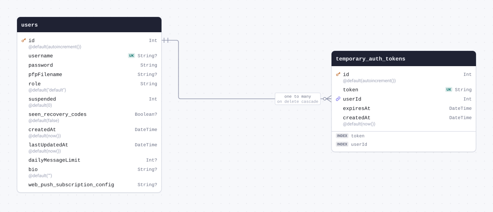

| Field       | Type       | Constraints                         | Default           | Description |
| ----------- | ---------- | ----------------------------------- | ----------------- | ----------- |
| `id`        | `Int`      | PK NOT NULL                         | `autoincrement()` |             |
| `token`     | `String`   | UNIQUE NOT NULL                     |                   |             |
| `userId`    | `Int`      | NOT NULL → [users.id](#model-users) |                   |             |
| `expiresAt` | `DateTime` | NOT NULL                            |                   |             |
| `createdAt` | `DateTime` | NOT NULL                            | `now()`           |             |

#### Indexes

- `@@index([token])`
- `@@index([userId])`

#### References

- `userId` → [users.id](#model-users) (many-to-one, on delete Cascade)

#### Definition

```sql
CREATE TABLE "temporary_auth_tokens" (
    "id" INTEGER NOT NULL PRIMARY KEY AUTOINCREMENT,
    "token" TEXT NOT NULL,
    "userId" INTEGER NOT NULL,
    "expiresAt" DATETIME NOT NULL,
    "createdAt" DATETIME NOT NULL DEFAULT CURRENT_TIMESTAMP,
    CONSTRAINT "temporary_auth_tokens_userId_fkey" FOREIGN KEY ("userId") REFERENCES "users" ("id") ON DELETE CASCADE ON UPDATE CASCADE
);

CREATE UNIQUE INDEX "temporary_auth_tokens_token_key" ON "temporary_auth_tokens"("token");

CREATE INDEX "temporary_auth_tokens_token_idx" ON "temporary_auth_tokens"("token");

CREATE INDEX "temporary_auth_tokens_userId_idx" ON "temporary_auth_tokens"("userId");
```

<details>
<summary>Queries and their SQL</summary>

**findMany**: Every row

```ts
await prisma.temporary_auth_tokens.findMany();
```

```sql
SELECT
  `main`.`temporary_auth_tokens`.`id`,
  `main`.`temporary_auth_tokens`.`token`,
  `main`.`temporary_auth_tokens`.`userId`,
  `main`.`temporary_auth_tokens`.`expiresAt`,
  `main`.`temporary_auth_tokens`.`createdAt`
FROM
  `main`.`temporary_auth_tokens`
WHERE
  1 = 1
LIMIT
  ?
OFFSET
  ?
-- params: [-1,"0"]
```

**count**: How many rows there are

```ts
await prisma.temporary_auth_tokens.count();
```

```sql
SELECT
  COUNT(*) AS `_count$_all`
FROM
  (
    SELECT
      `main`.`temporary_auth_tokens`.`id`
    FROM
      `main`.`temporary_auth_tokens`
    WHERE
      1 = 1
    LIMIT
      ?
    OFFSET
      ?
  ) AS `sub`
-- params: [-1,"0"]
```

**findMany**: Every row with its relations

```ts
await prisma.temporary_auth_tokens.findMany({ include: { user: true } });
```

```sql
SELECT
  `main`.`temporary_auth_tokens`.`id`,
  `main`.`temporary_auth_tokens`.`token`,
  `main`.`temporary_auth_tokens`.`userId`,
  `main`.`temporary_auth_tokens`.`expiresAt`,
  `main`.`temporary_auth_tokens`.`createdAt`
FROM
  `main`.`temporary_auth_tokens`
WHERE
  1 = 1
LIMIT
  ?
OFFSET
  ?
-- params: [-1,"0"]

SELECT
  `main`.`users`.`id`,
  `main`.`users`.`username`,
  `main`.`users`.`password`,
  `main`.`users`.`pfpFilename`,
  `main`.`users`.`role`,
  `main`.`users`.`suspended`,
  `main`.`users`.`seen_recovery_codes`,
  `main`.`users`.`createdAt`,
  `main`.`users`.`lastUpdatedAt`,
  `main`.`users`.`dailyMessageLimit`,
  `main`.`users`.`bio`,
  `main`.`users`.`web_push_subscription_config`
FROM
  `main`.`users`
WHERE
  `main`.`users`.`id` IN (?)
LIMIT
  ?
OFFSET
  ?
-- params: ["<userId of the rows above>",-1,"0"]
```

**findUnique**: One row by what is unique to it

```ts
await prisma.temporary_auth_tokens.findUnique({ where: { id: 1 } });
```

```sql
SELECT
  `main`.`temporary_auth_tokens`.`id`,
  `main`.`temporary_auth_tokens`.`token`,
  `main`.`temporary_auth_tokens`.`userId`,
  `main`.`temporary_auth_tokens`.`expiresAt`,
  `main`.`temporary_auth_tokens`.`createdAt`
FROM
  `main`.`temporary_auth_tokens`
WHERE
  (
    `main`.`temporary_auth_tokens`.`id` = ?
    AND 1 = 1
  )
LIMIT
  ?
OFFSET
  ?
-- params: ["1","1","0"]
```

**create**: Create a row

```ts
await prisma.temporary_auth_tokens.create({
  data: { token: "example", userId: 1, expiresAt: new Date("2026-01-01T00:00:00.000Z") },
});
```

```sql
INSERT INTO
  `main`.`temporary_auth_tokens` (`token`, `userId`, `expiresAt`, `createdAt`)
VALUES
  (?, ?, ?, ?)
RETURNING
  `id` AS `id`,
  `token` AS `token`,
  `userId` AS `userId`,
  `expiresAt` AS `expiresAt`,
  `createdAt` AS `createdAt`
-- params: ["example","1","2026-01-01T00:00:00.000Z","<now()>"]
```

**update**: Update a row

```ts
await prisma.temporary_auth_tokens.update({ where: { id: 1 }, data: { token: "example" } });
```

```sql
UPDATE `main`.`temporary_auth_tokens`
SET
  `token` = ?
WHERE
  (
    `main`.`temporary_auth_tokens`.`id` = ?
    AND 1 = 1
  )
RETURNING
  `id` AS `id`,
  `token` AS `token`,
  `userId` AS `userId`,
  `expiresAt` AS `expiresAt`,
  `createdAt` AS `createdAt`
-- params: ["example","1"]
```

**delete**: Delete a row

```ts
await prisma.temporary_auth_tokens.delete({ where: { id: 1 } });
```

```sql
DELETE FROM `main`.`temporary_auth_tokens`
WHERE
  (
    `main`.`temporary_auth_tokens`.`id` = ?
    AND 1 = 1
  )
RETURNING
  `id` AS `id`,
  `token` AS `token`,
  `userId` AS `userId`,
  `expiresAt` AS `expiresAt`,
  `createdAt` AS `createdAt`
-- params: ["1"]
```

</details>

<a id="model-system_prompt_variables"></a>

### system_prompt_variables

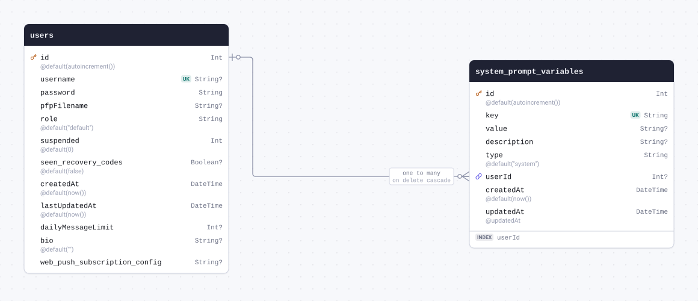

| Field         | Type       | Constraints                     | Default           | Description |
| ------------- | ---------- | ------------------------------- | ----------------- | ----------- |
| `id`          | `Int`      | PK NOT NULL                     | `autoincrement()` |             |
| `key`         | `String`   | UNIQUE NOT NULL                 |                   |             |
| `value`       | `String`   | NULL                            |                   |             |
| `description` | `String`   | NULL                            |                   |             |
| `type`        | `String`   | NOT NULL                        | `"system"`        |             |
| `userId`      | `Int`      | NULL → [users.id](#model-users) |                   |             |
| `createdAt`   | `DateTime` | NOT NULL                        | `now()`           |             |
| `updatedAt`   | `DateTime` | NOT NULL                        | `@updatedAt`      |             |

#### Indexes

- `@@index([userId])`

#### References

- `userId` → [users.id](#model-users) (many-to-one, on delete Cascade)

#### Definition

```sql
CREATE TABLE "system_prompt_variables" (
    "id" INTEGER NOT NULL PRIMARY KEY AUTOINCREMENT,
    "key" TEXT NOT NULL,
    "value" TEXT,
    "description" TEXT,
    "type" TEXT NOT NULL DEFAULT 'system',
    "userId" INTEGER,
    "createdAt" DATETIME NOT NULL DEFAULT CURRENT_TIMESTAMP,
    "updatedAt" DATETIME NOT NULL,
    CONSTRAINT "system_prompt_variables_userId_fkey" FOREIGN KEY ("userId") REFERENCES "users" ("id") ON DELETE CASCADE ON UPDATE CASCADE
);

CREATE UNIQUE INDEX "system_prompt_variables_key_key" ON "system_prompt_variables"("key");

CREATE INDEX "system_prompt_variables_userId_idx" ON "system_prompt_variables"("userId");
```

<details>
<summary>Queries and their SQL</summary>

**findMany**: Every row

```ts
await prisma.system_prompt_variables.findMany();
```

```sql
SELECT
  `main`.`system_prompt_variables`.`id`,
  `main`.`system_prompt_variables`.`key`,
  `main`.`system_prompt_variables`.`value`,
  `main`.`system_prompt_variables`.`description`,
  `main`.`system_prompt_variables`.`type`,
  `main`.`system_prompt_variables`.`userId`,
  `main`.`system_prompt_variables`.`createdAt`,
  `main`.`system_prompt_variables`.`updatedAt`
FROM
  `main`.`system_prompt_variables`
WHERE
  1 = 1
LIMIT
  ?
OFFSET
  ?
-- params: [-1,"0"]
```

**count**: How many rows there are

```ts
await prisma.system_prompt_variables.count();
```

```sql
SELECT
  COUNT(*) AS `_count$_all`
FROM
  (
    SELECT
      `main`.`system_prompt_variables`.`id`
    FROM
      `main`.`system_prompt_variables`
    WHERE
      1 = 1
    LIMIT
      ?
    OFFSET
      ?
  ) AS `sub`
-- params: [-1,"0"]
```

**findMany**: Every row with its relations

```ts
await prisma.system_prompt_variables.findMany({ include: { user: true } });
```

```sql
SELECT
  `main`.`system_prompt_variables`.`id`,
  `main`.`system_prompt_variables`.`key`,
  `main`.`system_prompt_variables`.`value`,
  `main`.`system_prompt_variables`.`description`,
  `main`.`system_prompt_variables`.`type`,
  `main`.`system_prompt_variables`.`userId`,
  `main`.`system_prompt_variables`.`createdAt`,
  `main`.`system_prompt_variables`.`updatedAt`
FROM
  `main`.`system_prompt_variables`
WHERE
  1 = 1
LIMIT
  ?
OFFSET
  ?
-- params: [-1,"0"]

SELECT
  `main`.`users`.`id`,
  `main`.`users`.`username`,
  `main`.`users`.`password`,
  `main`.`users`.`pfpFilename`,
  `main`.`users`.`role`,
  `main`.`users`.`suspended`,
  `main`.`users`.`seen_recovery_codes`,
  `main`.`users`.`createdAt`,
  `main`.`users`.`lastUpdatedAt`,
  `main`.`users`.`dailyMessageLimit`,
  `main`.`users`.`bio`,
  `main`.`users`.`web_push_subscription_config`
FROM
  `main`.`users`
WHERE
  `main`.`users`.`id` IN (?)
LIMIT
  ?
OFFSET
  ?
-- params: ["<userId of the rows above>",-1,"0"]
```

**findUnique**: One row by what is unique to it

```ts
await prisma.system_prompt_variables.findUnique({ where: { id: 1 } });
```

```sql
SELECT
  `main`.`system_prompt_variables`.`id`,
  `main`.`system_prompt_variables`.`key`,
  `main`.`system_prompt_variables`.`value`,
  `main`.`system_prompt_variables`.`description`,
  `main`.`system_prompt_variables`.`type`,
  `main`.`system_prompt_variables`.`userId`,
  `main`.`system_prompt_variables`.`createdAt`,
  `main`.`system_prompt_variables`.`updatedAt`
FROM
  `main`.`system_prompt_variables`
WHERE
  (
    `main`.`system_prompt_variables`.`id` = ?
    AND 1 = 1
  )
LIMIT
  ?
OFFSET
  ?
-- params: ["1","1","0"]
```

**create**: Create a row

```ts
await prisma.system_prompt_variables.create({ data: { key: "example" } });
```

```sql
INSERT INTO
  `main`.`system_prompt_variables` (`key`, `type`, `createdAt`, `updatedAt`)
VALUES
  (?, ?, ?, ?)
RETURNING
  `id` AS `id`,
  `key` AS `key`,
  `value` AS `value`,
  `description` AS `description`,
  `type` AS `type`,
  `userId` AS `userId`,
  `createdAt` AS `createdAt`,
  `updatedAt` AS `updatedAt`
-- params: ["example","system","<now()>","<now()>"]
```

**update**: Update a row

```ts
await prisma.system_prompt_variables.update({ where: { id: 1 }, data: { key: "example" } });
```

```sql
UPDATE `main`.`system_prompt_variables`
SET
  `key` = ?,
  `updatedAt` = ?
WHERE
  (
    `main`.`system_prompt_variables`.`id` = ?
    AND 1 = 1
  )
RETURNING
  `id` AS `id`,
  `key` AS `key`,
  `value` AS `value`,
  `description` AS `description`,
  `type` AS `type`,
  `userId` AS `userId`,
  `createdAt` AS `createdAt`,
  `updatedAt` AS `updatedAt`
-- params: ["example",{"prisma__type":"generatorCall","prisma__value":{"name":"now","args":[],"returnType":{"type":"DateTime"}}},"1"]
```

**delete**: Delete a row

```ts
await prisma.system_prompt_variables.delete({ where: { id: 1 } });
```

```sql
DELETE FROM `main`.`system_prompt_variables`
WHERE
  (
    `main`.`system_prompt_variables`.`id` = ?
    AND 1 = 1
  )
RETURNING
  `id` AS `id`,
  `key` AS `key`,
  `value` AS `value`,
  `description` AS `description`,
  `type` AS `type`,
  `userId` AS `userId`,
  `createdAt` AS `createdAt`,
  `updatedAt` AS `updatedAt`
-- params: ["1"]
```

</details>

<a id="model-prompt_history"></a>

### prompt_history

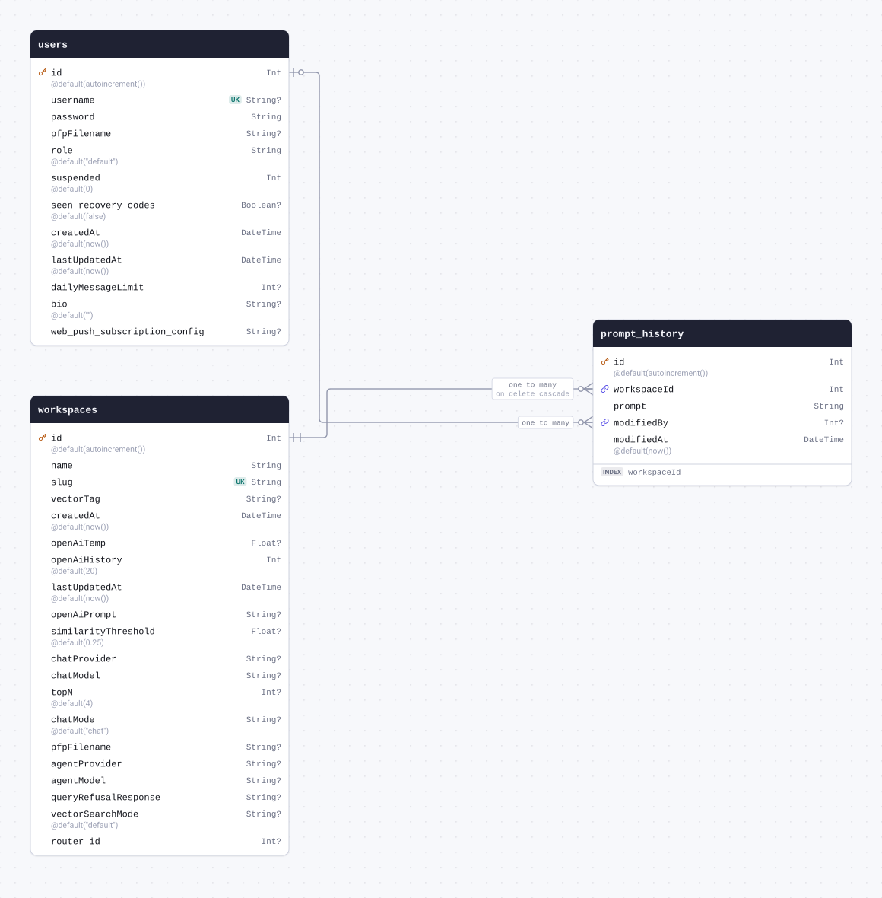

| Field         | Type       | Constraints                                   | Default           | Description |
| ------------- | ---------- | --------------------------------------------- | ----------------- | ----------- |
| `id`          | `Int`      | PK NOT NULL                                   | `autoincrement()` |             |
| `workspaceId` | `Int`      | NOT NULL → [workspaces.id](#model-workspaces) |                   |             |
| `prompt`      | `String`   | NOT NULL                                      |                   |             |
| `modifiedBy`  | `Int`      | NULL → [users.id](#model-users)               |                   |             |
| `modifiedAt`  | `DateTime` | NOT NULL                                      | `now()`           |             |

#### Indexes

- `@@index([workspaceId])`

#### References

- `workspaceId` → [workspaces.id](#model-workspaces) (many-to-one, on delete Cascade)
- `modifiedBy` → [users.id](#model-users) (many-to-one)

#### Definition

```sql
CREATE TABLE "prompt_history" (
    "id" INTEGER NOT NULL PRIMARY KEY AUTOINCREMENT,
    "workspaceId" INTEGER NOT NULL,
    "prompt" TEXT NOT NULL,
    "modifiedBy" INTEGER,
    "modifiedAt" DATETIME NOT NULL DEFAULT CURRENT_TIMESTAMP,
    CONSTRAINT "prompt_history_workspaceId_fkey" FOREIGN KEY ("workspaceId") REFERENCES "workspaces" ("id") ON DELETE CASCADE ON UPDATE CASCADE,
    CONSTRAINT "prompt_history_modifiedBy_fkey" FOREIGN KEY ("modifiedBy") REFERENCES "users" ("id") ON DELETE SET NULL ON UPDATE CASCADE
);

CREATE INDEX "prompt_history_workspaceId_idx" ON "prompt_history"("workspaceId");
```

<details>
<summary>Queries and their SQL</summary>

**findMany**: Every row

```ts
await prisma.prompt_history.findMany();
```

```sql
SELECT
  `main`.`prompt_history`.`id`,
  `main`.`prompt_history`.`workspaceId`,
  `main`.`prompt_history`.`prompt`,
  `main`.`prompt_history`.`modifiedBy`,
  `main`.`prompt_history`.`modifiedAt`
FROM
  `main`.`prompt_history`
WHERE
  1 = 1
LIMIT
  ?
OFFSET
  ?
-- params: [-1,"0"]
```

**count**: How many rows there are

```ts
await prisma.prompt_history.count();
```

```sql
SELECT
  COUNT(*) AS `_count$_all`
FROM
  (
    SELECT
      `main`.`prompt_history`.`id`
    FROM
      `main`.`prompt_history`
    WHERE
      1 = 1
    LIMIT
      ?
    OFFSET
      ?
  ) AS `sub`
-- params: [-1,"0"]
```

**findMany**: Every row with its relations

```ts
await prisma.prompt_history.findMany({ include: { workspace: true, user: true } });
```

```sql
SELECT
  `main`.`prompt_history`.`id`,
  `main`.`prompt_history`.`workspaceId`,
  `main`.`prompt_history`.`prompt`,
  `main`.`prompt_history`.`modifiedBy`,
  `main`.`prompt_history`.`modifiedAt`
FROM
  `main`.`prompt_history`
WHERE
  1 = 1
LIMIT
  ?
OFFSET
  ?
-- params: [-1,"0"]

SELECT
  `main`.`workspaces`.`id`,
  `main`.`workspaces`.`name`,
  `main`.`workspaces`.`slug`,
  `main`.`workspaces`.`vectorTag`,
  `main`.`workspaces`.`createdAt`,
  `main`.`workspaces`.`openAiTemp`,
  `main`.`workspaces`.`openAiHistory`,
  `main`.`workspaces`.`lastUpdatedAt`,
  `main`.`workspaces`.`openAiPrompt`,
  `main`.`workspaces`.`similarityThreshold`,
  `main`.`workspaces`.`chatProvider`,
  `main`.`workspaces`.`chatModel`,
  `main`.`workspaces`.`topN`,
  `main`.`workspaces`.`chatMode`,
  `main`.`workspaces`.`pfpFilename`,
  `main`.`workspaces`.`agentProvider`,
  `main`.`workspaces`.`agentModel`,
  `main`.`workspaces`.`queryRefusalResponse`,
  `main`.`workspaces`.`vectorSearchMode`,
  `main`.`workspaces`.`router_id`
FROM
  `main`.`workspaces`
WHERE
  `main`.`workspaces`.`id` IN (?)
LIMIT
  ?
OFFSET
  ?
-- params: ["<workspaceId of the rows above>",-1,"0"]

SELECT
  `main`.`users`.`id`,
  `main`.`users`.`username`,
  `main`.`users`.`password`,
  `main`.`users`.`pfpFilename`,
  `main`.`users`.`role`,
  `main`.`users`.`suspended`,
  `main`.`users`.`seen_recovery_codes`,
  `main`.`users`.`createdAt`,
  `main`.`users`.`lastUpdatedAt`,
  `main`.`users`.`dailyMessageLimit`,
  `main`.`users`.`bio`,
  `main`.`users`.`web_push_subscription_config`
FROM
  `main`.`users`
WHERE
  `main`.`users`.`id` IN (?)
LIMIT
  ?
OFFSET
  ?
-- params: ["<modifiedBy of the rows above>",-1,"0"]
```

**findUnique**: One row by what is unique to it

```ts
await prisma.prompt_history.findUnique({ where: { id: 1 } });
```

```sql
SELECT
  `main`.`prompt_history`.`id`,
  `main`.`prompt_history`.`workspaceId`,
  `main`.`prompt_history`.`prompt`,
  `main`.`prompt_history`.`modifiedBy`,
  `main`.`prompt_history`.`modifiedAt`
FROM
  `main`.`prompt_history`
WHERE
  (
    `main`.`prompt_history`.`id` = ?
    AND 1 = 1
  )
LIMIT
  ?
OFFSET
  ?
-- params: ["1","1","0"]
```

**create**: Create a row

```ts
await prisma.prompt_history.create({ data: { workspaceId: 1, prompt: "example" } });
```

```sql
INSERT INTO
  `main`.`prompt_history` (`workspaceId`, `prompt`, `modifiedAt`)
VALUES
  (?, ?, ?)
RETURNING
  `id` AS `id`,
  `workspaceId` AS `workspaceId`,
  `prompt` AS `prompt`,
  `modifiedBy` AS `modifiedBy`,
  `modifiedAt` AS `modifiedAt`
-- params: ["1","example","<now()>"]
```

**update**: Update a row

```ts
await prisma.prompt_history.update({ where: { id: 1 }, data: { prompt: "example" } });
```

```sql
UPDATE `main`.`prompt_history`
SET
  `prompt` = ?
WHERE
  (
    `main`.`prompt_history`.`id` = ?
    AND 1 = 1
  )
RETURNING
  `id` AS `id`,
  `workspaceId` AS `workspaceId`,
  `prompt` AS `prompt`,
  `modifiedBy` AS `modifiedBy`,
  `modifiedAt` AS `modifiedAt`
-- params: ["example","1"]
```

**delete**: Delete a row

```ts
await prisma.prompt_history.delete({ where: { id: 1 } });
```

```sql
DELETE FROM `main`.`prompt_history`
WHERE
  (
    `main`.`prompt_history`.`id` = ?
    AND 1 = 1
  )
RETURNING
  `id` AS `id`,
  `workspaceId` AS `workspaceId`,
  `prompt` AS `prompt`,
  `modifiedBy` AS `modifiedBy`,
  `modifiedAt` AS `modifiedAt`
-- params: ["1"]
```

</details>

<a id="model-desktop_mobile_devices"></a>

### desktop_mobile_devices

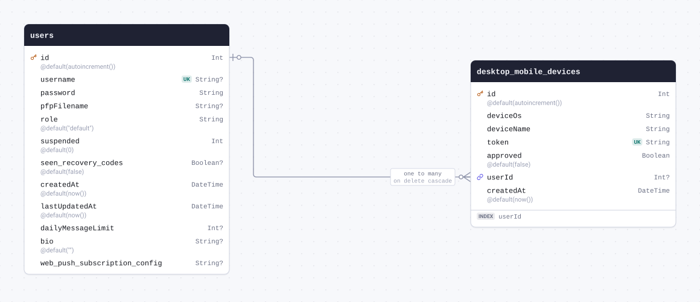

| Field        | Type       | Constraints                     | Default           | Description |
| ------------ | ---------- | ------------------------------- | ----------------- | ----------- |
| `id`         | `Int`      | PK NOT NULL                     | `autoincrement()` |             |
| `deviceOs`   | `String`   | NOT NULL                        |                   |             |
| `deviceName` | `String`   | NOT NULL                        |                   |             |
| `token`      | `String`   | UNIQUE NOT NULL                 |                   |             |
| `approved`   | `Boolean`  | NOT NULL                        | `false`           |             |
| `userId`     | `Int`      | NULL → [users.id](#model-users) |                   |             |
| `createdAt`  | `DateTime` | NOT NULL                        | `now()`           |             |

#### Indexes

- `@@index([userId])`

#### References

- `userId` → [users.id](#model-users) (many-to-one, on delete Cascade)

#### Definition

```sql
CREATE TABLE "desktop_mobile_devices" (
    "id" INTEGER NOT NULL PRIMARY KEY AUTOINCREMENT,
    "deviceOs" TEXT NOT NULL,
    "deviceName" TEXT NOT NULL,
    "token" TEXT NOT NULL,
    "approved" BOOLEAN NOT NULL DEFAULT false,
    "userId" INTEGER,
    "createdAt" DATETIME NOT NULL DEFAULT CURRENT_TIMESTAMP,
    CONSTRAINT "desktop_mobile_devices_userId_fkey" FOREIGN KEY ("userId") REFERENCES "users" ("id") ON DELETE CASCADE ON UPDATE CASCADE
);

CREATE UNIQUE INDEX "desktop_mobile_devices_token_key" ON "desktop_mobile_devices"("token");

CREATE INDEX "desktop_mobile_devices_userId_idx" ON "desktop_mobile_devices"("userId");
```

<details>
<summary>Queries and their SQL</summary>

**findMany**: Every row

```ts
await prisma.desktop_mobile_devices.findMany();
```

```sql
SELECT
  `main`.`desktop_mobile_devices`.`id`,
  `main`.`desktop_mobile_devices`.`deviceOs`,
  `main`.`desktop_mobile_devices`.`deviceName`,
  `main`.`desktop_mobile_devices`.`token`,
  `main`.`desktop_mobile_devices`.`approved`,
  `main`.`desktop_mobile_devices`.`userId`,
  `main`.`desktop_mobile_devices`.`createdAt`
FROM
  `main`.`desktop_mobile_devices`
WHERE
  1 = 1
LIMIT
  ?
OFFSET
  ?
-- params: [-1,"0"]
```

**count**: How many rows there are

```ts
await prisma.desktop_mobile_devices.count();
```

```sql
SELECT
  COUNT(*) AS `_count$_all`
FROM
  (
    SELECT
      `main`.`desktop_mobile_devices`.`id`
    FROM
      `main`.`desktop_mobile_devices`
    WHERE
      1 = 1
    LIMIT
      ?
    OFFSET
      ?
  ) AS `sub`
-- params: [-1,"0"]
```

**findMany**: Every row with its relations

```ts
await prisma.desktop_mobile_devices.findMany({ include: { user: true } });
```

```sql
SELECT
  `main`.`desktop_mobile_devices`.`id`,
  `main`.`desktop_mobile_devices`.`deviceOs`,
  `main`.`desktop_mobile_devices`.`deviceName`,
  `main`.`desktop_mobile_devices`.`token`,
  `main`.`desktop_mobile_devices`.`approved`,
  `main`.`desktop_mobile_devices`.`userId`,
  `main`.`desktop_mobile_devices`.`createdAt`
FROM
  `main`.`desktop_mobile_devices`
WHERE
  1 = 1
LIMIT
  ?
OFFSET
  ?
-- params: [-1,"0"]

SELECT
  `main`.`users`.`id`,
  `main`.`users`.`username`,
  `main`.`users`.`password`,
  `main`.`users`.`pfpFilename`,
  `main`.`users`.`role`,
  `main`.`users`.`suspended`,
  `main`.`users`.`seen_recovery_codes`,
  `main`.`users`.`createdAt`,
  `main`.`users`.`lastUpdatedAt`,
  `main`.`users`.`dailyMessageLimit`,
  `main`.`users`.`bio`,
  `main`.`users`.`web_push_subscription_config`
FROM
  `main`.`users`
WHERE
  `main`.`users`.`id` IN (?)
LIMIT
  ?
OFFSET
  ?
-- params: ["<userId of the rows above>",-1,"0"]
```

**findUnique**: One row by what is unique to it

```ts
await prisma.desktop_mobile_devices.findUnique({ where: { id: 1 } });
```

```sql
SELECT
  `main`.`desktop_mobile_devices`.`id`,
  `main`.`desktop_mobile_devices`.`deviceOs`,
  `main`.`desktop_mobile_devices`.`deviceName`,
  `main`.`desktop_mobile_devices`.`token`,
  `main`.`desktop_mobile_devices`.`approved`,
  `main`.`desktop_mobile_devices`.`userId`,
  `main`.`desktop_mobile_devices`.`createdAt`
FROM
  `main`.`desktop_mobile_devices`
WHERE
  (
    `main`.`desktop_mobile_devices`.`id` = ?
    AND 1 = 1
  )
LIMIT
  ?
OFFSET
  ?
-- params: ["1","1","0"]
```

**create**: Create a row

```ts
await prisma.desktop_mobile_devices.create({
  data: { deviceOs: "example", deviceName: "example", token: "example" },
});
```

```sql
INSERT INTO
  `main`.`desktop_mobile_devices` (
    `deviceOs`,
    `deviceName`,
    `token`,
    `approved`,
    `createdAt`
  )
VALUES
  (?, ?, ?, ?, ?)
RETURNING
  `id` AS `id`,
  `deviceOs` AS `deviceOs`,
  `deviceName` AS `deviceName`,
  `token` AS `token`,
  `approved` AS `approved`,
  `userId` AS `userId`,
  `createdAt` AS `createdAt`
-- params: ["example","example","example",false,"<now()>"]
```

**update**: Update a row

```ts
await prisma.desktop_mobile_devices.update({ where: { id: 1 }, data: { deviceOs: "example" } });
```

```sql
UPDATE `main`.`desktop_mobile_devices`
SET
  `deviceOs` = ?
WHERE
  (
    `main`.`desktop_mobile_devices`.`id` = ?
    AND 1 = 1
  )
RETURNING
  `id` AS `id`,
  `deviceOs` AS `deviceOs`,
  `deviceName` AS `deviceName`,
  `token` AS `token`,
  `approved` AS `approved`,
  `userId` AS `userId`,
  `createdAt` AS `createdAt`
-- params: ["example","1"]
```

**delete**: Delete a row

```ts
await prisma.desktop_mobile_devices.delete({ where: { id: 1 } });
```

```sql
DELETE FROM `main`.`desktop_mobile_devices`
WHERE
  (
    `main`.`desktop_mobile_devices`.`id` = ?
    AND 1 = 1
  )
RETURNING
  `id` AS `id`,
  `deviceOs` AS `deviceOs`,
  `deviceName` AS `deviceName`,
  `token` AS `token`,
  `approved` AS `approved`,
  `userId` AS `userId`,
  `createdAt` AS `createdAt`
-- params: ["1"]
```

</details>

<a id="model-workspace_parsed_files"></a>

### workspace_parsed_files

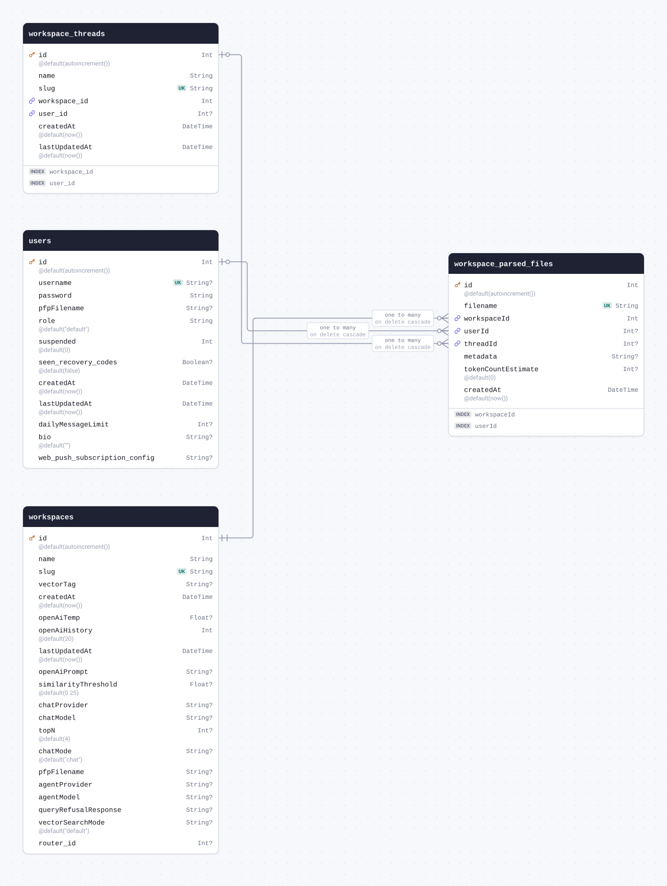

| Field                | Type       | Constraints                                             | Default           | Description |
| -------------------- | ---------- | ------------------------------------------------------- | ----------------- | ----------- |
| `id`                 | `Int`      | PK NOT NULL                                             | `autoincrement()` |             |
| `filename`           | `String`   | UNIQUE NOT NULL                                         |                   |             |
| `workspaceId`        | `Int`      | NOT NULL → [workspaces.id](#model-workspaces)           |                   |             |
| `userId`             | `Int`      | NULL → [users.id](#model-users)                         |                   |             |
| `threadId`           | `Int`      | NULL → [workspace_threads.id](#model-workspace_threads) |                   |             |
| `metadata`           | `String`   | NULL                                                    |                   |             |
| `tokenCountEstimate` | `Int`      | NULL                                                    | `0`               |             |
| `createdAt`          | `DateTime` | NOT NULL                                                | `now()`           |             |

#### Indexes

- `@@index([workspaceId])`
- `@@index([userId])`

#### References

- `workspaceId` → [workspaces.id](#model-workspaces) (many-to-one, on delete Cascade)
- `userId` → [users.id](#model-users) (many-to-one, on delete Cascade)
- `threadId` → [workspace_threads.id](#model-workspace_threads) (many-to-one, on delete Cascade)

#### Definition

```sql
CREATE TABLE "workspace_parsed_files" (
    "id" INTEGER NOT NULL PRIMARY KEY AUTOINCREMENT,
    "filename" TEXT NOT NULL,
    "workspaceId" INTEGER NOT NULL,
    "userId" INTEGER,
    "threadId" INTEGER,
    "metadata" TEXT,
    "tokenCountEstimate" INTEGER DEFAULT 0,
    "createdAt" DATETIME NOT NULL DEFAULT CURRENT_TIMESTAMP,
    CONSTRAINT "workspace_parsed_files_workspaceId_fkey" FOREIGN KEY ("workspaceId") REFERENCES "workspaces" ("id") ON DELETE CASCADE ON UPDATE CASCADE,
    CONSTRAINT "workspace_parsed_files_userId_fkey" FOREIGN KEY ("userId") REFERENCES "users" ("id") ON DELETE CASCADE ON UPDATE CASCADE,
    CONSTRAINT "workspace_parsed_files_threadId_fkey" FOREIGN KEY ("threadId") REFERENCES "workspace_threads" ("id") ON DELETE CASCADE ON UPDATE CASCADE
);

CREATE UNIQUE INDEX "workspace_parsed_files_filename_key" ON "workspace_parsed_files"("filename");

CREATE INDEX "workspace_parsed_files_workspaceId_idx" ON "workspace_parsed_files"("workspaceId");

CREATE INDEX "workspace_parsed_files_userId_idx" ON "workspace_parsed_files"("userId");
```

<details>
<summary>Queries and their SQL</summary>

**findMany**: Every row

```ts
await prisma.workspace_parsed_files.findMany();
```

```sql
SELECT
  `main`.`workspace_parsed_files`.`id`,
  `main`.`workspace_parsed_files`.`filename`,
  `main`.`workspace_parsed_files`.`workspaceId`,
  `main`.`workspace_parsed_files`.`userId`,
  `main`.`workspace_parsed_files`.`threadId`,
  `main`.`workspace_parsed_files`.`metadata`,
  `main`.`workspace_parsed_files`.`tokenCountEstimate`,
  `main`.`workspace_parsed_files`.`createdAt`
FROM
  `main`.`workspace_parsed_files`
WHERE
  1 = 1
LIMIT
  ?
OFFSET
  ?
-- params: [-1,"0"]
```

**count**: How many rows there are

```ts
await prisma.workspace_parsed_files.count();
```

```sql
SELECT
  COUNT(*) AS `_count$_all`
FROM
  (
    SELECT
      `main`.`workspace_parsed_files`.`id`
    FROM
      `main`.`workspace_parsed_files`
    WHERE
      1 = 1
    LIMIT
      ?
    OFFSET
      ?
  ) AS `sub`
-- params: [-1,"0"]
```

**findMany**: Every row with its relations

```ts
await prisma.workspace_parsed_files.findMany({
  include: { workspace: true, user: true, thread: true },
});
```

```sql
SELECT
  `main`.`workspace_parsed_files`.`id`,
  `main`.`workspace_parsed_files`.`filename`,
  `main`.`workspace_parsed_files`.`workspaceId`,
  `main`.`workspace_parsed_files`.`userId`,
  `main`.`workspace_parsed_files`.`threadId`,
  `main`.`workspace_parsed_files`.`metadata`,
  `main`.`workspace_parsed_files`.`tokenCountEstimate`,
  `main`.`workspace_parsed_files`.`createdAt`
FROM
  `main`.`workspace_parsed_files`
WHERE
  1 = 1
LIMIT
  ?
OFFSET
  ?
-- params: [-1,"0"]

SELECT
  `main`.`workspaces`.`id`,
  `main`.`workspaces`.`name`,
  `main`.`workspaces`.`slug`,
  `main`.`workspaces`.`vectorTag`,
  `main`.`workspaces`.`createdAt`,
  `main`.`workspaces`.`openAiTemp`,
  `main`.`workspaces`.`openAiHistory`,
  `main`.`workspaces`.`lastUpdatedAt`,
  `main`.`workspaces`.`openAiPrompt`,
  `main`.`workspaces`.`similarityThreshold`,
  `main`.`workspaces`.`chatProvider`,
  `main`.`workspaces`.`chatModel`,
  `main`.`workspaces`.`topN`,
  `main`.`workspaces`.`chatMode`,
  `main`.`workspaces`.`pfpFilename`,
  `main`.`workspaces`.`agentProvider`,
  `main`.`workspaces`.`agentModel`,
  `main`.`workspaces`.`queryRefusalResponse`,
  `main`.`workspaces`.`vectorSearchMode`,
  `main`.`workspaces`.`router_id`
FROM
  `main`.`workspaces`
WHERE
  `main`.`workspaces`.`id` IN (?)
LIMIT
  ?
OFFSET
  ?
-- params: ["<workspaceId of the rows above>",-1,"0"]

SELECT
  `main`.`users`.`id`,
  `main`.`users`.`username`,
  `main`.`users`.`password`,
  `main`.`users`.`pfpFilename`,
  `main`.`users`.`role`,
  `main`.`users`.`suspended`,
  `main`.`users`.`seen_recovery_codes`,
  `main`.`users`.`createdAt`,
  `main`.`users`.`lastUpdatedAt`,
  `main`.`users`.`dailyMessageLimit`,
  `main`.`users`.`bio`,
  `main`.`users`.`web_push_subscription_config`
FROM
  `main`.`users`
WHERE
  `main`.`users`.`id` IN (?)
LIMIT
  ?
OFFSET
  ?
-- params: ["<userId of the rows above>",-1,"0"]

SELECT
  `main`.`workspace_threads`.`id`,
  `main`.`workspace_threads`.`name`,
  `main`.`workspace_threads`.`slug`,
  `main`.`workspace_threads`.`workspace_id`,
  `main`.`workspace_threads`.`user_id`,
  `main`.`workspace_threads`.`createdAt`,
  `main`.`workspace_threads`.`lastUpdatedAt`
FROM
  `main`.`workspace_threads`
WHERE
  `main`.`workspace_threads`.`id` IN (?)
LIMIT
  ?
OFFSET
  ?
-- params: ["<threadId of the rows above>",-1,"0"]
```

**findUnique**: One row by what is unique to it

```ts
await prisma.workspace_parsed_files.findUnique({ where: { id: 1 } });
```

```sql
SELECT
  `main`.`workspace_parsed_files`.`id`,
  `main`.`workspace_parsed_files`.`filename`,
  `main`.`workspace_parsed_files`.`workspaceId`,
  `main`.`workspace_parsed_files`.`userId`,
  `main`.`workspace_parsed_files`.`threadId`,
  `main`.`workspace_parsed_files`.`metadata`,
  `main`.`workspace_parsed_files`.`tokenCountEstimate`,
  `main`.`workspace_parsed_files`.`createdAt`
FROM
  `main`.`workspace_parsed_files`
WHERE
  (
    `main`.`workspace_parsed_files`.`id` = ?
    AND 1 = 1
  )
LIMIT
  ?
OFFSET
  ?
-- params: ["1","1","0"]
```

**create**: Create a row

```ts
await prisma.workspace_parsed_files.create({ data: { filename: "example", workspaceId: 1 } });
```

```sql
INSERT INTO
  `main`.`workspace_parsed_files` (
    `filename`,
    `workspaceId`,
    `tokenCountEstimate`,
    `createdAt`
  )
VALUES
  (?, ?, ?, ?)
RETURNING
  `id` AS `id`,
  `filename` AS `filename`,
  `workspaceId` AS `workspaceId`,
  `userId` AS `userId`,
  `threadId` AS `threadId`,
  `metadata` AS `metadata`,
  `tokenCountEstimate` AS `tokenCountEstimate`,
  `createdAt` AS `createdAt`
-- params: ["example","1","0","<now()>"]
```

**update**: Update a row

```ts
await prisma.workspace_parsed_files.update({ where: { id: 1 }, data: { filename: "example" } });
```

```sql
UPDATE `main`.`workspace_parsed_files`
SET
  `filename` = ?
WHERE
  (
    `main`.`workspace_parsed_files`.`id` = ?
    AND 1 = 1
  )
RETURNING
  `id` AS `id`,
  `filename` AS `filename`,
  `workspaceId` AS `workspaceId`,
  `userId` AS `userId`,
  `threadId` AS `threadId`,
  `metadata` AS `metadata`,
  `tokenCountEstimate` AS `tokenCountEstimate`,
  `createdAt` AS `createdAt`
-- params: ["example","1"]
```

**delete**: Delete a row

```ts
await prisma.workspace_parsed_files.delete({ where: { id: 1 } });
```

```sql
DELETE FROM `main`.`workspace_parsed_files`
WHERE
  (
    `main`.`workspace_parsed_files`.`id` = ?
    AND 1 = 1
  )
RETURNING
  `id` AS `id`,
  `filename` AS `filename`,
  `workspaceId` AS `workspaceId`,
  `userId` AS `userId`,
  `threadId` AS `threadId`,
  `metadata` AS `metadata`,
  `tokenCountEstimate` AS `tokenCountEstimate`,
  `createdAt` AS `createdAt`
-- params: ["1"]
```

</details>

<a id="model-external_communication_connectors"></a>

### external_communication_connectors

| Field           | Type       | Constraints     | Default           | Description |
| --------------- | ---------- | --------------- | ----------------- | ----------- |
| `id`            | `Int`      | PK NOT NULL     | `autoincrement()` |             |
| `type`          | `String`   | UNIQUE NOT NULL |                   |             |
| `config`        | `String`   | NOT NULL        | `"{}"`            |             |
| `active`        | `Boolean`  | NOT NULL        | `false`           |             |
| `createdAt`     | `DateTime` | NOT NULL        | `now()`           |             |
| `lastUpdatedAt` | `DateTime` | NOT NULL        | `now()`           |             |

#### Definition

```sql
CREATE TABLE "external_communication_connectors" (
    "id" INTEGER NOT NULL PRIMARY KEY AUTOINCREMENT,
    "type" TEXT NOT NULL,
    "config" TEXT NOT NULL DEFAULT '{}',
    "active" BOOLEAN NOT NULL DEFAULT false,
    "createdAt" DATETIME NOT NULL DEFAULT CURRENT_TIMESTAMP,
    "lastUpdatedAt" DATETIME NOT NULL DEFAULT CURRENT_TIMESTAMP
);

CREATE UNIQUE INDEX "external_communication_connectors_type_key" ON "external_communication_connectors"("type");
```

<details>
<summary>Queries and their SQL</summary>

**findMany**: Every row

```ts
await prisma.external_communication_connectors.findMany();
```

```sql
SELECT
  `main`.`external_communication_connectors`.`id`,
  `main`.`external_communication_connectors`.`type`,
  `main`.`external_communication_connectors`.`config`,
  `main`.`external_communication_connectors`.`active`,
  `main`.`external_communication_connectors`.`createdAt`,
  `main`.`external_communication_connectors`.`lastUpdatedAt`
FROM
  `main`.`external_communication_connectors`
WHERE
  1 = 1
LIMIT
  ?
OFFSET
  ?
-- params: [-1,"0"]
```

**count**: How many rows there are

```ts
await prisma.external_communication_connectors.count();
```

```sql
SELECT
  COUNT(*) AS `_count$_all`
FROM
  (
    SELECT
      `main`.`external_communication_connectors`.`id`
    FROM
      `main`.`external_communication_connectors`
    WHERE
      1 = 1
    LIMIT
      ?
    OFFSET
      ?
  ) AS `sub`
-- params: [-1,"0"]
```

**findUnique**: One row by what is unique to it

```ts
await prisma.external_communication_connectors.findUnique({ where: { id: 1 } });
```

```sql
SELECT
  `main`.`external_communication_connectors`.`id`,
  `main`.`external_communication_connectors`.`type`,
  `main`.`external_communication_connectors`.`config`,
  `main`.`external_communication_connectors`.`active`,
  `main`.`external_communication_connectors`.`createdAt`,
  `main`.`external_communication_connectors`.`lastUpdatedAt`
FROM
  `main`.`external_communication_connectors`
WHERE
  (
    `main`.`external_communication_connectors`.`id` = ?
    AND 1 = 1
  )
LIMIT
  ?
OFFSET
  ?
-- params: ["1","1","0"]
```

**create**: Create a row

```ts
await prisma.external_communication_connectors.create({ data: { type: "example" } });
```

```sql
INSERT INTO
  `main`.`external_communication_connectors` (
    `type`,
    `config`,
    `active`,
    `createdAt`,
    `lastUpdatedAt`
  )
VALUES
  (?, ?, ?, ?, ?)
RETURNING
  `id` AS `id`,
  `type` AS `type`,
  `config` AS `config`,
  `active` AS `active`,
  `createdAt` AS `createdAt`,
  `lastUpdatedAt` AS `lastUpdatedAt`
-- params: ["example","{}",false,"<now()>","<now()>"]
```

**update**: Update a row

```ts
await prisma.external_communication_connectors.update({
  where: { id: 1 },
  data: { type: "example" },
});
```

```sql
UPDATE `main`.`external_communication_connectors`
SET
  `type` = ?
WHERE
  (
    `main`.`external_communication_connectors`.`id` = ?
    AND 1 = 1
  )
RETURNING
  `id` AS `id`,
  `type` AS `type`,
  `config` AS `config`,
  `active` AS `active`,
  `createdAt` AS `createdAt`,
  `lastUpdatedAt` AS `lastUpdatedAt`
-- params: ["example","1"]
```

**delete**: Delete a row

```ts
await prisma.external_communication_connectors.delete({ where: { id: 1 } });
```

```sql
DELETE FROM `main`.`external_communication_connectors`
WHERE
  (
    `main`.`external_communication_connectors`.`id` = ?
    AND 1 = 1
  )
RETURNING
  `id` AS `id`,
  `type` AS `type`,
  `config` AS `config`,
  `active` AS `active`,
  `createdAt` AS `createdAt`,
  `lastUpdatedAt` AS `lastUpdatedAt`
-- params: ["1"]
```

</details>

<a id="model-scheduled_jobs"></a>

### scheduled_jobs

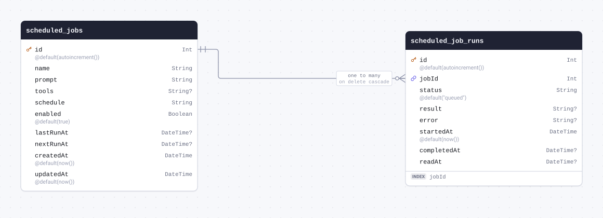

| Field       | Type       | Constraints | Default           | Description |
| ----------- | ---------- | ----------- | ----------------- | ----------- |
| `id`        | `Int`      | PK NOT NULL | `autoincrement()` |             |
| `name`      | `String`   | NOT NULL    |                   |             |
| `prompt`    | `String`   | NOT NULL    |                   |             |
| `tools`     | `String`   | NULL        |                   |             |
| `schedule`  | `String`   | NOT NULL    |                   |             |
| `enabled`   | `Boolean`  | NOT NULL    | `true`            |             |
| `lastRunAt` | `DateTime` | NULL        |                   |             |
| `nextRunAt` | `DateTime` | NULL        |                   |             |
| `createdAt` | `DateTime` | NOT NULL    | `now()`           |             |
| `updatedAt` | `DateTime` | NOT NULL    | `now()`           |             |

#### Referenced by

- `id` ← [scheduled_job_runs.jobId](#model-scheduled_job_runs) (one-to-many, on delete Cascade)

#### Definition

```sql
CREATE TABLE "scheduled_jobs" (
    "id" INTEGER NOT NULL PRIMARY KEY AUTOINCREMENT,
    "name" TEXT NOT NULL,
    "prompt" TEXT NOT NULL,
    "tools" TEXT,
    "schedule" TEXT NOT NULL,
    "enabled" BOOLEAN NOT NULL DEFAULT true,
    "lastRunAt" DATETIME,
    "nextRunAt" DATETIME,
    "createdAt" DATETIME NOT NULL DEFAULT CURRENT_TIMESTAMP,
    "updatedAt" DATETIME NOT NULL DEFAULT CURRENT_TIMESTAMP
);
```

<details>
<summary>Queries and their SQL</summary>

**findMany**: Every row

```ts
await prisma.scheduled_jobs.findMany();
```

```sql
SELECT
  `main`.`scheduled_jobs`.`id`,
  `main`.`scheduled_jobs`.`name`,
  `main`.`scheduled_jobs`.`prompt`,
  `main`.`scheduled_jobs`.`tools`,
  `main`.`scheduled_jobs`.`schedule`,
  `main`.`scheduled_jobs`.`enabled`,
  `main`.`scheduled_jobs`.`lastRunAt`,
  `main`.`scheduled_jobs`.`nextRunAt`,
  `main`.`scheduled_jobs`.`createdAt`,
  `main`.`scheduled_jobs`.`updatedAt`
FROM
  `main`.`scheduled_jobs`
WHERE
  1 = 1
LIMIT
  ?
OFFSET
  ?
-- params: [-1,"0"]
```

**count**: How many rows there are

```ts
await prisma.scheduled_jobs.count();
```

```sql
SELECT
  COUNT(*) AS `_count$_all`
FROM
  (
    SELECT
      `main`.`scheduled_jobs`.`id`
    FROM
      `main`.`scheduled_jobs`
    WHERE
      1 = 1
    LIMIT
      ?
    OFFSET
      ?
  ) AS `sub`
-- params: [-1,"0"]
```

**findMany**: Every row with its relations

```ts
await prisma.scheduled_jobs.findMany({ include: { runs: true } });
```

```sql
SELECT
  `main`.`scheduled_jobs`.`id`,
  `main`.`scheduled_jobs`.`name`,
  `main`.`scheduled_jobs`.`prompt`,
  `main`.`scheduled_jobs`.`tools`,
  `main`.`scheduled_jobs`.`schedule`,
  `main`.`scheduled_jobs`.`enabled`,
  `main`.`scheduled_jobs`.`lastRunAt`,
  `main`.`scheduled_jobs`.`nextRunAt`,
  `main`.`scheduled_jobs`.`createdAt`,
  `main`.`scheduled_jobs`.`updatedAt`
FROM
  `main`.`scheduled_jobs`
WHERE
  1 = 1
LIMIT
  ?
OFFSET
  ?
-- params: [-1,"0"]

SELECT
  `main`.`scheduled_job_runs`.`id`,
  `main`.`scheduled_job_runs`.`jobId`,
  `main`.`scheduled_job_runs`.`status`,
  `main`.`scheduled_job_runs`.`result`,
  `main`.`scheduled_job_runs`.`error`,
  `main`.`scheduled_job_runs`.`startedAt`,
  `main`.`scheduled_job_runs`.`completedAt`,
  `main`.`scheduled_job_runs`.`readAt`
FROM
  `main`.`scheduled_job_runs`
WHERE
  `main`.`scheduled_job_runs`.`jobId` IN (?)
LIMIT
  ?
OFFSET
  ?
-- params: ["<id of the rows above>",-1,"0"]
```

**findUnique**: One row by what is unique to it

```ts
await prisma.scheduled_jobs.findUnique({ where: { id: 1 } });
```

```sql
SELECT
  `main`.`scheduled_jobs`.`id`,
  `main`.`scheduled_jobs`.`name`,
  `main`.`scheduled_jobs`.`prompt`,
  `main`.`scheduled_jobs`.`tools`,
  `main`.`scheduled_jobs`.`schedule`,
  `main`.`scheduled_jobs`.`enabled`,
  `main`.`scheduled_jobs`.`lastRunAt`,
  `main`.`scheduled_jobs`.`nextRunAt`,
  `main`.`scheduled_jobs`.`createdAt`,
  `main`.`scheduled_jobs`.`updatedAt`
FROM
  `main`.`scheduled_jobs`
WHERE
  (
    `main`.`scheduled_jobs`.`id` = ?
    AND 1 = 1
  )
LIMIT
  ?
OFFSET
  ?
-- params: ["1","1","0"]
```

**create**: Create a row

```ts
await prisma.scheduled_jobs.create({
  data: { name: "example", prompt: "example", schedule: "example" },
});
```

```sql
INSERT INTO
  `main`.`scheduled_jobs` (
    `name`,
    `prompt`,
    `schedule`,
    `enabled`,
    `createdAt`,
    `updatedAt`
  )
VALUES
  (?, ?, ?, ?, ?, ?)
RETURNING
  `id` AS `id`,
  `name` AS `name`,
  `prompt` AS `prompt`,
  `tools` AS `tools`,
  `schedule` AS `schedule`,
  `enabled` AS `enabled`,
  `lastRunAt` AS `lastRunAt`,
  `nextRunAt` AS `nextRunAt`,
  `createdAt` AS `createdAt`,
  `updatedAt` AS `updatedAt`
-- params: ["example","example","example",true,"<now()>","<now()>"]
```

**update**: Update a row

```ts
await prisma.scheduled_jobs.update({ where: { id: 1 }, data: { name: "example" } });
```

```sql
UPDATE `main`.`scheduled_jobs`
SET
  `name` = ?
WHERE
  (
    `main`.`scheduled_jobs`.`id` = ?
    AND 1 = 1
  )
RETURNING
  `id` AS `id`,
  `name` AS `name`,
  `prompt` AS `prompt`,
  `tools` AS `tools`,
  `schedule` AS `schedule`,
  `enabled` AS `enabled`,
  `lastRunAt` AS `lastRunAt`,
  `nextRunAt` AS `nextRunAt`,
  `createdAt` AS `createdAt`,
  `updatedAt` AS `updatedAt`
-- params: ["example","1"]
```

**delete**: Delete a row

```ts
await prisma.scheduled_jobs.delete({ where: { id: 1 } });
```

```sql
DELETE FROM `main`.`scheduled_jobs`
WHERE
  (
    `main`.`scheduled_jobs`.`id` = ?
    AND 1 = 1
  )
RETURNING
  `id` AS `id`,
  `name` AS `name`,
  `prompt` AS `prompt`,
  `tools` AS `tools`,
  `schedule` AS `schedule`,
  `enabled` AS `enabled`,
  `lastRunAt` AS `lastRunAt`,
  `nextRunAt` AS `nextRunAt`,
  `createdAt` AS `createdAt`,
  `updatedAt` AS `updatedAt`
-- params: ["1"]
```

</details>

<a id="model-scheduled_job_runs"></a>

### scheduled_job_runs


| Field         | Type       | Constraints                                           | Default           | Description |
| ------------- | ---------- | ----------------------------------------------------- | ----------------- | ----------- |
| `id`          | `Int`      | PK NOT NULL                                           | `autoincrement()` |             |
| `jobId`       | `Int`      | NOT NULL → [scheduled_jobs.id](#model-scheduled_jobs) |                   |             |
| `status`      | `String`   | NOT NULL                                              | `"queued"`        |             |
| `result`      | `String`   | NULL                                                  |                   |             |
| `error`       | `String`   | NULL                                                  |                   |             |
| `startedAt`   | `DateTime` | NOT NULL                                              | `now()`           |             |
| `completedAt` | `DateTime` | NULL                                                  |                   |             |
| `readAt`      | `DateTime` | NULL                                                  |                   |             |

#### Indexes

- `@@index([jobId])`

#### References

- `jobId` → [scheduled_jobs.id](#model-scheduled_jobs) (many-to-one, on delete Cascade)

#### Definition

```sql
CREATE TABLE "scheduled_job_runs" (
    "id" INTEGER NOT NULL PRIMARY KEY AUTOINCREMENT,
    "jobId" INTEGER NOT NULL,
    "status" TEXT NOT NULL DEFAULT 'queued',
    "result" TEXT,
    "error" TEXT,
    "startedAt" DATETIME NOT NULL DEFAULT CURRENT_TIMESTAMP,
    "completedAt" DATETIME,
    "readAt" DATETIME,
    CONSTRAINT "scheduled_job_runs_jobId_fkey" FOREIGN KEY ("jobId") REFERENCES "scheduled_jobs" ("id") ON DELETE CASCADE ON UPDATE CASCADE
);

CREATE INDEX "scheduled_job_runs_jobId_idx" ON "scheduled_job_runs"("jobId");
```

<details>
<summary>Queries and their SQL</summary>

**findMany**: Every row

```ts
await prisma.scheduled_job_runs.findMany();
```

```sql
SELECT
  `main`.`scheduled_job_runs`.`id`,
  `main`.`scheduled_job_runs`.`jobId`,
  `main`.`scheduled_job_runs`.`status`,
  `main`.`scheduled_job_runs`.`result`,
  `main`.`scheduled_job_runs`.`error`,
  `main`.`scheduled_job_runs`.`startedAt`,
  `main`.`scheduled_job_runs`.`completedAt`,
  `main`.`scheduled_job_runs`.`readAt`
FROM
  `main`.`scheduled_job_runs`
WHERE
  1 = 1
LIMIT
  ?
OFFSET
  ?
-- params: [-1,"0"]
```

**count**: How many rows there are

```ts
await prisma.scheduled_job_runs.count();
```

```sql
SELECT
  COUNT(*) AS `_count$_all`
FROM
  (
    SELECT
      `main`.`scheduled_job_runs`.`id`
    FROM
      `main`.`scheduled_job_runs`
    WHERE
      1 = 1
    LIMIT
      ?
    OFFSET
      ?
  ) AS `sub`
-- params: [-1,"0"]
```

**findMany**: Every row with its relations

```ts
await prisma.scheduled_job_runs.findMany({ include: { job: true } });
```

```sql
SELECT
  `main`.`scheduled_job_runs`.`id`,
  `main`.`scheduled_job_runs`.`jobId`,
  `main`.`scheduled_job_runs`.`status`,
  `main`.`scheduled_job_runs`.`result`,
  `main`.`scheduled_job_runs`.`error`,
  `main`.`scheduled_job_runs`.`startedAt`,
  `main`.`scheduled_job_runs`.`completedAt`,
  `main`.`scheduled_job_runs`.`readAt`
FROM
  `main`.`scheduled_job_runs`
WHERE
  1 = 1
LIMIT
  ?
OFFSET
  ?
-- params: [-1,"0"]

SELECT
  `main`.`scheduled_jobs`.`id`,
  `main`.`scheduled_jobs`.`name`,
  `main`.`scheduled_jobs`.`prompt`,
  `main`.`scheduled_jobs`.`tools`,
  `main`.`scheduled_jobs`.`schedule`,
  `main`.`scheduled_jobs`.`enabled`,
  `main`.`scheduled_jobs`.`lastRunAt`,
  `main`.`scheduled_jobs`.`nextRunAt`,
  `main`.`scheduled_jobs`.`createdAt`,
  `main`.`scheduled_jobs`.`updatedAt`
FROM
  `main`.`scheduled_jobs`
WHERE
  `main`.`scheduled_jobs`.`id` IN (?)
LIMIT
  ?
OFFSET
  ?
-- params: ["<jobId of the rows above>",-1,"0"]
```

**findUnique**: One row by what is unique to it

```ts
await prisma.scheduled_job_runs.findUnique({ where: { id: 1 } });
```

```sql
SELECT
  `main`.`scheduled_job_runs`.`id`,
  `main`.`scheduled_job_runs`.`jobId`,
  `main`.`scheduled_job_runs`.`status`,
  `main`.`scheduled_job_runs`.`result`,
  `main`.`scheduled_job_runs`.`error`,
  `main`.`scheduled_job_runs`.`startedAt`,
  `main`.`scheduled_job_runs`.`completedAt`,
  `main`.`scheduled_job_runs`.`readAt`
FROM
  `main`.`scheduled_job_runs`
WHERE
  (
    `main`.`scheduled_job_runs`.`id` = ?
    AND 1 = 1
  )
LIMIT
  ?
OFFSET
  ?
-- params: ["1","1","0"]
```

**create**: Create a row

```ts
await prisma.scheduled_job_runs.create({ data: { jobId: 1 } });
```

```sql
INSERT INTO
  `main`.`scheduled_job_runs` (`jobId`, `status`, `startedAt`)
VALUES
  (?, ?, ?)
RETURNING
  `id` AS `id`,
  `jobId` AS `jobId`,
  `status` AS `status`,
  `result` AS `result`,
  `error` AS `error`,
  `startedAt` AS `startedAt`,
  `completedAt` AS `completedAt`,
  `readAt` AS `readAt`
-- params: ["1","queued","<now()>"]
```

**update**: Update a row

```ts
await prisma.scheduled_job_runs.update({ where: { id: 1 }, data: { status: "example" } });
```

```sql
UPDATE `main`.`scheduled_job_runs`
SET
  `status` = ?
WHERE
  (
    `main`.`scheduled_job_runs`.`id` = ?
    AND 1 = 1
  )
RETURNING
  `id` AS `id`,
  `jobId` AS `jobId`,
  `status` AS `status`,
  `result` AS `result`,
  `error` AS `error`,
  `startedAt` AS `startedAt`,
  `completedAt` AS `completedAt`,
  `readAt` AS `readAt`
-- params: ["example","1"]
```

**delete**: Delete a row

```ts
await prisma.scheduled_job_runs.delete({ where: { id: 1 } });
```

```sql
DELETE FROM `main`.`scheduled_job_runs`
WHERE
  (
    `main`.`scheduled_job_runs`.`id` = ?
    AND 1 = 1
  )
RETURNING
  `id` AS `id`,
  `jobId` AS `jobId`,
  `status` AS `status`,
  `result` AS `result`,
  `error` AS `error`,
  `startedAt` AS `startedAt`,
  `completedAt` AS `completedAt`,
  `readAt` AS `readAt`
-- params: ["1"]
```

</details>

<a id="model-memories"></a>

### memories

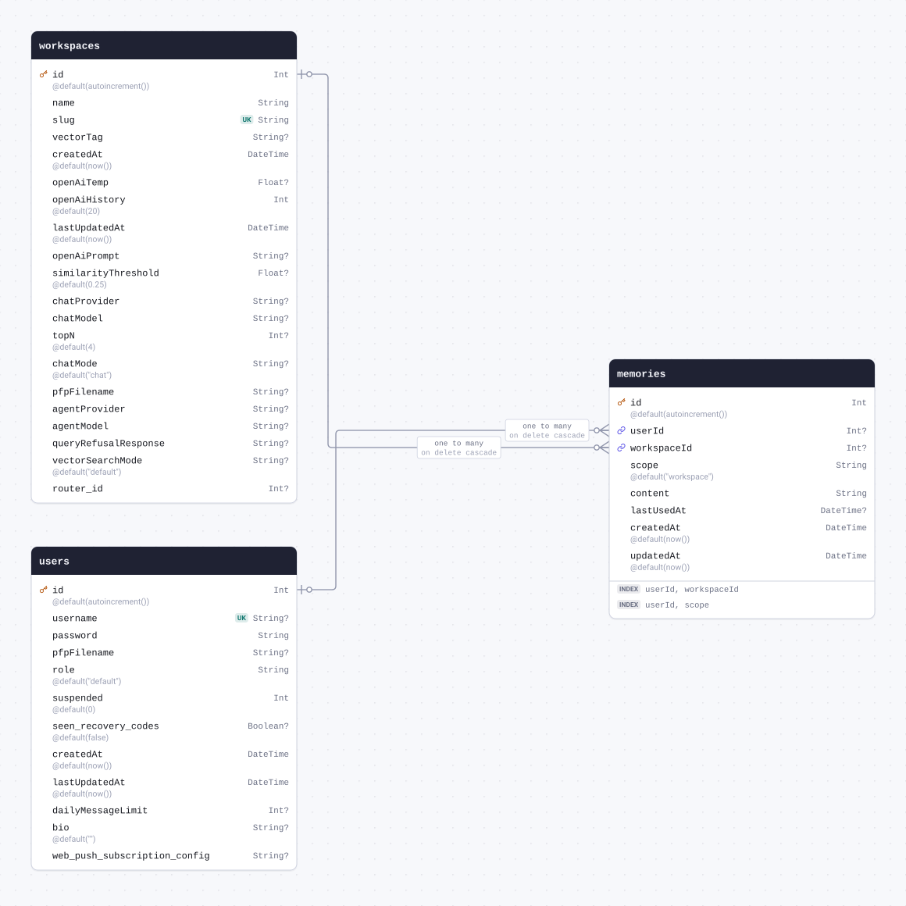

| Field                          | Type       | Constraints                               | Default           | Description |
| ------------------------------ | ---------- | ----------------------------------------- | ----------------- | ----------- |
| `id`                           | `Int`      | PK NOT NULL                               | `autoincrement()` |             |
| `userId` (`user_id`)           | `Int`      | NULL → [users.id](#model-users)           |                   |             |
| `workspaceId` (`workspace_id`) | `Int`      | NULL → [workspaces.id](#model-workspaces) |                   |             |
| `scope`                        | `String`   | NOT NULL                                  | `"workspace"`     |             |
| `content`                      | `String`   | NOT NULL                                  |                   |             |
| `lastUsedAt` (`last_used_at`)  | `DateTime` | NULL                                      |                   |             |
| `createdAt` (`created_at`)     | `DateTime` | NOT NULL                                  | `now()`           |             |
| `updatedAt` (`updated_at`)     | `DateTime` | NOT NULL                                  | `now()`           |             |

#### Indexes

- `@@index([userId, workspaceId])`
- `@@index([userId, scope])`

#### References

- `userId` → [users.id](#model-users) (many-to-one, on delete Cascade)
- `workspaceId` → [workspaces.id](#model-workspaces) (many-to-one, on delete Cascade)

#### Definition

```sql
CREATE TABLE "memories" (
    "id" INTEGER NOT NULL PRIMARY KEY AUTOINCREMENT,
    "user_id" INTEGER,
    "workspace_id" INTEGER,
    "scope" TEXT NOT NULL DEFAULT 'workspace',
    "content" TEXT NOT NULL,
    "last_used_at" DATETIME,
    "created_at" DATETIME NOT NULL DEFAULT CURRENT_TIMESTAMP,
    "updated_at" DATETIME NOT NULL DEFAULT CURRENT_TIMESTAMP,
    CONSTRAINT "memories_user_id_fkey" FOREIGN KEY ("user_id") REFERENCES "users" ("id") ON DELETE CASCADE ON UPDATE CASCADE,
    CONSTRAINT "memories_workspace_id_fkey" FOREIGN KEY ("workspace_id") REFERENCES "workspaces" ("id") ON DELETE CASCADE ON UPDATE CASCADE
);

CREATE INDEX "memories_user_id_workspace_id_idx" ON "memories"("user_id", "workspace_id");

CREATE INDEX "memories_user_id_scope_idx" ON "memories"("user_id", "scope");
```

<details>
<summary>Queries and their SQL</summary>

**findMany**: Every row

```ts
await prisma.memories.findMany();
```

```sql
SELECT
  `main`.`memories`.`id`,
  `main`.`memories`.`user_id`,
  `main`.`memories`.`workspace_id`,
  `main`.`memories`.`scope`,
  `main`.`memories`.`content`,
  `main`.`memories`.`last_used_at`,
  `main`.`memories`.`created_at`,
  `main`.`memories`.`updated_at`
FROM
  `main`.`memories`
WHERE
  1 = 1
LIMIT
  ?
OFFSET
  ?
-- params: [-1,"0"]
```

**count**: How many rows there are

```ts
await prisma.memories.count();
```

```sql
SELECT
  COUNT(*) AS `_count$_all`
FROM
  (
    SELECT
      `main`.`memories`.`id`
    FROM
      `main`.`memories`
    WHERE
      1 = 1
    LIMIT
      ?
    OFFSET
      ?
  ) AS `sub`
-- params: [-1,"0"]
```

**findMany**: Every row with its relations

```ts
await prisma.memories.findMany({ include: { user: true, workspace: true } });
```

```sql
SELECT
  `main`.`memories`.`id`,
  `main`.`memories`.`user_id`,
  `main`.`memories`.`workspace_id`,
  `main`.`memories`.`scope`,
  `main`.`memories`.`content`,
  `main`.`memories`.`last_used_at`,
  `main`.`memories`.`created_at`,
  `main`.`memories`.`updated_at`
FROM
  `main`.`memories`
WHERE
  1 = 1
LIMIT
  ?
OFFSET
  ?
-- params: [-1,"0"]

SELECT
  `main`.`users`.`id`,
  `main`.`users`.`username`,
  `main`.`users`.`password`,
  `main`.`users`.`pfpFilename`,
  `main`.`users`.`role`,
  `main`.`users`.`suspended`,
  `main`.`users`.`seen_recovery_codes`,
  `main`.`users`.`createdAt`,
  `main`.`users`.`lastUpdatedAt`,
  `main`.`users`.`dailyMessageLimit`,
  `main`.`users`.`bio`,
  `main`.`users`.`web_push_subscription_config`
FROM
  `main`.`users`
WHERE
  `main`.`users`.`id` IN (?)
LIMIT
  ?
OFFSET
  ?
-- params: ["<userId of the rows above>",-1,"0"]

SELECT
  `main`.`workspaces`.`id`,
  `main`.`workspaces`.`name`,
  `main`.`workspaces`.`slug`,
  `main`.`workspaces`.`vectorTag`,
  `main`.`workspaces`.`createdAt`,
  `main`.`workspaces`.`openAiTemp`,
  `main`.`workspaces`.`openAiHistory`,
  `main`.`workspaces`.`lastUpdatedAt`,
  `main`.`workspaces`.`openAiPrompt`,
  `main`.`workspaces`.`similarityThreshold`,
  `main`.`workspaces`.`chatProvider`,
  `main`.`workspaces`.`chatModel`,
  `main`.`workspaces`.`topN`,
  `main`.`workspaces`.`chatMode`,
  `main`.`workspaces`.`pfpFilename`,
  `main`.`workspaces`.`agentProvider`,
  `main`.`workspaces`.`agentModel`,
  `main`.`workspaces`.`queryRefusalResponse`,
  `main`.`workspaces`.`vectorSearchMode`,
  `main`.`workspaces`.`router_id`
FROM
  `main`.`workspaces`
WHERE
  `main`.`workspaces`.`id` IN (?)
LIMIT
  ?
OFFSET
  ?
-- params: ["<workspaceId of the rows above>",-1,"0"]
```

**findUnique**: One row by what is unique to it

```ts
await prisma.memories.findUnique({ where: { id: 1 } });
```

```sql
SELECT
  `main`.`memories`.`id`,
  `main`.`memories`.`user_id`,
  `main`.`memories`.`workspace_id`,
  `main`.`memories`.`scope`,
  `main`.`memories`.`content`,
  `main`.`memories`.`last_used_at`,
  `main`.`memories`.`created_at`,
  `main`.`memories`.`updated_at`
FROM
  `main`.`memories`
WHERE
  (
    `main`.`memories`.`id` = ?
    AND 1 = 1
  )
LIMIT
  ?
OFFSET
  ?
-- params: ["1","1","0"]
```

**create**: Create a row

```ts
await prisma.memories.create({ data: { content: "example" } });
```

```sql
INSERT INTO
  `main`.`memories` (`scope`, `content`, `created_at`, `updated_at`)
VALUES
  (?, ?, ?, ?)
RETURNING
  `id` AS `id`,
  `user_id` AS `user_id`,
  `workspace_id` AS `workspace_id`,
  `scope` AS `scope`,
  `content` AS `content`,
  `last_used_at` AS `last_used_at`,
  `created_at` AS `created_at`,
  `updated_at` AS `updated_at`
-- params: ["workspace","example","<now()>","<now()>"]
```

**update**: Update a row

```ts
await prisma.memories.update({ where: { id: 1 }, data: { scope: "example" } });
```

```sql
UPDATE `main`.`memories`
SET
  `scope` = ?
WHERE
  (
    `main`.`memories`.`id` = ?
    AND 1 = 1
  )
RETURNING
  `id` AS `id`,
  `user_id` AS `user_id`,
  `workspace_id` AS `workspace_id`,
  `scope` AS `scope`,
  `content` AS `content`,
  `last_used_at` AS `last_used_at`,
  `created_at` AS `created_at`,
  `updated_at` AS `updated_at`
-- params: ["example","1"]
```

**delete**: Delete a row

```ts
await prisma.memories.delete({ where: { id: 1 } });
```

```sql
DELETE FROM `main`.`memories`
WHERE
  (
    `main`.`memories`.`id` = ?
    AND 1 = 1
  )
RETURNING
  `id` AS `id`,
  `user_id` AS `user_id`,
  `workspace_id` AS `workspace_id`,
  `scope` AS `scope`,
  `content` AS `content`,
  `last_used_at` AS `last_used_at`,
  `created_at` AS `created_at`,
  `updated_at` AS `updated_at`
-- params: ["1"]
```

</details>

<a id="model-model_routers"></a>

### model_routers

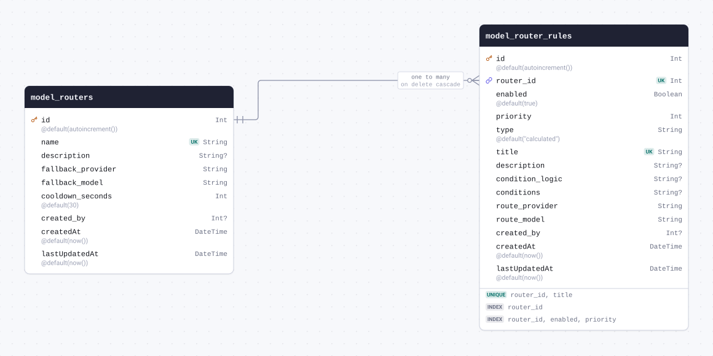

| Field               | Type       | Constraints     | Default           | Description |
| ------------------- | ---------- | --------------- | ----------------- | ----------- |
| `id`                | `Int`      | PK NOT NULL     | `autoincrement()` |             |
| `name`              | `String`   | UNIQUE NOT NULL |                   |             |
| `description`       | `String`   | NULL            |                   |             |
| `fallback_provider` | `String`   | NOT NULL        |                   |             |
| `fallback_model`    | `String`   | NOT NULL        |                   |             |
| `cooldown_seconds`  | `Int`      | NOT NULL        | `30`              |             |
| `created_by`        | `Int`      | NULL            |                   |             |
| `createdAt`         | `DateTime` | NOT NULL        | `now()`           |             |
| `lastUpdatedAt`     | `DateTime` | NOT NULL        | `now()`           |             |

#### Referenced by

- `id` ← [model_router_rules.router_id](#model-model_router_rules) (one-to-many, on delete Cascade)

#### Definition

```sql
CREATE TABLE "model_routers" (
    "id" INTEGER NOT NULL PRIMARY KEY AUTOINCREMENT,
    "name" TEXT NOT NULL,
    "description" TEXT,
    "fallback_provider" TEXT NOT NULL,
    "fallback_model" TEXT NOT NULL,
    "cooldown_seconds" INTEGER NOT NULL DEFAULT 30,
    "created_by" INTEGER,
    "createdAt" DATETIME NOT NULL DEFAULT CURRENT_TIMESTAMP,
    "lastUpdatedAt" DATETIME NOT NULL DEFAULT CURRENT_TIMESTAMP
);

CREATE UNIQUE INDEX "model_routers_name_key" ON "model_routers"("name");
```

<details>
<summary>Queries and their SQL</summary>

**findMany**: Every row

```ts
await prisma.model_routers.findMany();
```

```sql
SELECT
  `main`.`model_routers`.`id`,
  `main`.`model_routers`.`name`,
  `main`.`model_routers`.`description`,
  `main`.`model_routers`.`fallback_provider`,
  `main`.`model_routers`.`fallback_model`,
  `main`.`model_routers`.`cooldown_seconds`,
  `main`.`model_routers`.`created_by`,
  `main`.`model_routers`.`createdAt`,
  `main`.`model_routers`.`lastUpdatedAt`
FROM
  `main`.`model_routers`
WHERE
  1 = 1
LIMIT
  ?
OFFSET
  ?
-- params: [-1,"0"]
```

**count**: How many rows there are

```ts
await prisma.model_routers.count();
```

```sql
SELECT
  COUNT(*) AS `_count$_all`
FROM
  (
    SELECT
      `main`.`model_routers`.`id`
    FROM
      `main`.`model_routers`
    WHERE
      1 = 1
    LIMIT
      ?
    OFFSET
      ?
  ) AS `sub`
-- params: [-1,"0"]
```

**findMany**: Every row with its relations

```ts
await prisma.model_routers.findMany({ include: { rules: true } });
```

```sql
SELECT
  `main`.`model_routers`.`id`,
  `main`.`model_routers`.`name`,
  `main`.`model_routers`.`description`,
  `main`.`model_routers`.`fallback_provider`,
  `main`.`model_routers`.`fallback_model`,
  `main`.`model_routers`.`cooldown_seconds`,
  `main`.`model_routers`.`created_by`,
  `main`.`model_routers`.`createdAt`,
  `main`.`model_routers`.`lastUpdatedAt`
FROM
  `main`.`model_routers`
WHERE
  1 = 1
LIMIT
  ?
OFFSET
  ?
-- params: [-1,"0"]

SELECT
  `main`.`model_router_rules`.`id`,
  `main`.`model_router_rules`.`router_id`,
  `main`.`model_router_rules`.`enabled`,
  `main`.`model_router_rules`.`priority`,
  `main`.`model_router_rules`.`type`,
  `main`.`model_router_rules`.`title`,
  `main`.`model_router_rules`.`description`,
  `main`.`model_router_rules`.`condition_logic`,
  `main`.`model_router_rules`.`conditions`,
  `main`.`model_router_rules`.`route_provider`,
  `main`.`model_router_rules`.`route_model`,
  `main`.`model_router_rules`.`created_by`,
  `main`.`model_router_rules`.`createdAt`,
  `main`.`model_router_rules`.`lastUpdatedAt`
FROM
  `main`.`model_router_rules`
WHERE
  `main`.`model_router_rules`.`router_id` IN (?)
LIMIT
  ?
OFFSET
  ?
-- params: ["<id of the rows above>",-1,"0"]
```

**findUnique**: One row by what is unique to it

```ts
await prisma.model_routers.findUnique({ where: { id: 1 } });
```

```sql
SELECT
  `main`.`model_routers`.`id`,
  `main`.`model_routers`.`name`,
  `main`.`model_routers`.`description`,
  `main`.`model_routers`.`fallback_provider`,
  `main`.`model_routers`.`fallback_model`,
  `main`.`model_routers`.`cooldown_seconds`,
  `main`.`model_routers`.`created_by`,
  `main`.`model_routers`.`createdAt`,
  `main`.`model_routers`.`lastUpdatedAt`
FROM
  `main`.`model_routers`
WHERE
  (
    `main`.`model_routers`.`id` = ?
    AND 1 = 1
  )
LIMIT
  ?
OFFSET
  ?
-- params: ["1","1","0"]
```

**create**: Create a row

```ts
await prisma.model_routers.create({
  data: { name: "example", fallback_provider: "example", fallback_model: "example" },
});
```

```sql
INSERT INTO
  `main`.`model_routers` (
    `name`,
    `fallback_provider`,
    `fallback_model`,
    `cooldown_seconds`,
    `createdAt`,
    `lastUpdatedAt`
  )
VALUES
  (?, ?, ?, ?, ?, ?)
RETURNING
  `id` AS `id`,
  `name` AS `name`,
  `description` AS `description`,
  `fallback_provider` AS `fallback_provider`,
  `fallback_model` AS `fallback_model`,
  `cooldown_seconds` AS `cooldown_seconds`,
  `created_by` AS `created_by`,
  `createdAt` AS `createdAt`,
  `lastUpdatedAt` AS `lastUpdatedAt`
-- params: ["example","example","example","30","<now()>","<now()>"]
```

**update**: Update a row

```ts
await prisma.model_routers.update({ where: { id: 1 }, data: { name: "example" } });
```

```sql
UPDATE `main`.`model_routers`
SET
  `name` = ?
WHERE
  (
    `main`.`model_routers`.`id` = ?
    AND 1 = 1
  )
RETURNING
  `id` AS `id`,
  `name` AS `name`,
  `description` AS `description`,
  `fallback_provider` AS `fallback_provider`,
  `fallback_model` AS `fallback_model`,
  `cooldown_seconds` AS `cooldown_seconds`,
  `created_by` AS `created_by`,
  `createdAt` AS `createdAt`,
  `lastUpdatedAt` AS `lastUpdatedAt`
-- params: ["example","1"]
```

**delete**: Delete a row

```ts
await prisma.model_routers.delete({ where: { id: 1 } });
```

```sql
DELETE FROM `main`.`model_routers`
WHERE
  (
    `main`.`model_routers`.`id` = ?
    AND 1 = 1
  )
RETURNING
  `id` AS `id`,
  `name` AS `name`,
  `description` AS `description`,
  `fallback_provider` AS `fallback_provider`,
  `fallback_model` AS `fallback_model`,
  `cooldown_seconds` AS `cooldown_seconds`,
  `created_by` AS `created_by`,
  `createdAt` AS `createdAt`,
  `lastUpdatedAt` AS `lastUpdatedAt`
-- params: ["1"]
```

</details>

<a id="model-model_router_rules"></a>

### model_router_rules


| Field             | Type       | Constraints                                         | Default           | Description |
| ----------------- | ---------- | --------------------------------------------------- | ----------------- | ----------- |
| `id`              | `Int`      | PK NOT NULL                                         | `autoincrement()` |             |
| `router_id`       | `Int`      | NOT NULL → [model_routers.id](#model-model_routers) |                   |             |
| `enabled`         | `Boolean`  | NOT NULL                                            | `true`            |             |
| `priority`        | `Int`      | NOT NULL                                            |                   |             |
| `type`            | `String`   | NOT NULL                                            | `"calculated"`    |             |
| `title`           | `String`   | NOT NULL                                            |                   |             |
| `description`     | `String`   | NULL                                                |                   |             |
| `condition_logic` | `String`   | NULL                                                |                   |             |
| `conditions`      | `String`   | NULL                                                |                   |             |
| `route_provider`  | `String`   | NOT NULL                                            |                   |             |
| `route_model`     | `String`   | NOT NULL                                            |                   |             |
| `created_by`      | `Int`      | NULL                                                |                   |             |
| `createdAt`       | `DateTime` | NOT NULL                                            | `now()`           |             |
| `lastUpdatedAt`   | `DateTime` | NOT NULL                                            | `now()`           |             |

#### Indexes

- `@@index([router_id])`
- `@@index([router_id, enabled, priority])`
- `@@unique([router_id, title])`

#### References

- `router_id` → [model_routers.id](#model-model_routers) (many-to-one, on delete Cascade)

#### Definition

```sql
CREATE TABLE "model_router_rules" (
    "id" INTEGER NOT NULL PRIMARY KEY AUTOINCREMENT,
    "router_id" INTEGER NOT NULL,
    "enabled" BOOLEAN NOT NULL DEFAULT true,
    "priority" INTEGER NOT NULL,
    "type" TEXT NOT NULL DEFAULT 'calculated',
    "title" TEXT NOT NULL,
    "description" TEXT,
    "condition_logic" TEXT,
    "conditions" TEXT,
    "route_provider" TEXT NOT NULL,
    "route_model" TEXT NOT NULL,
    "created_by" INTEGER,
    "createdAt" DATETIME NOT NULL DEFAULT CURRENT_TIMESTAMP,
    "lastUpdatedAt" DATETIME NOT NULL DEFAULT CURRENT_TIMESTAMP,
    CONSTRAINT "model_router_rules_router_id_fkey" FOREIGN KEY ("router_id") REFERENCES "model_routers" ("id") ON DELETE CASCADE ON UPDATE CASCADE
);

CREATE INDEX "model_router_rules_router_id_idx" ON "model_router_rules"("router_id");

CREATE INDEX "model_router_rules_router_id_enabled_priority_idx" ON "model_router_rules"("router_id", "enabled", "priority");

CREATE UNIQUE INDEX "model_router_rules_router_id_title_key" ON "model_router_rules"("router_id", "title");
```

<details>
<summary>Queries and their SQL</summary>

**findMany**: Every row

```ts
await prisma.model_router_rules.findMany();
```

```sql
SELECT
  `main`.`model_router_rules`.`id`,
  `main`.`model_router_rules`.`router_id`,
  `main`.`model_router_rules`.`enabled`,
  `main`.`model_router_rules`.`priority`,
  `main`.`model_router_rules`.`type`,
  `main`.`model_router_rules`.`title`,
  `main`.`model_router_rules`.`description`,
  `main`.`model_router_rules`.`condition_logic`,
  `main`.`model_router_rules`.`conditions`,
  `main`.`model_router_rules`.`route_provider`,
  `main`.`model_router_rules`.`route_model`,
  `main`.`model_router_rules`.`created_by`,
  `main`.`model_router_rules`.`createdAt`,
  `main`.`model_router_rules`.`lastUpdatedAt`
FROM
  `main`.`model_router_rules`
WHERE
  1 = 1
LIMIT
  ?
OFFSET
  ?
-- params: [-1,"0"]
```

**count**: How many rows there are

```ts
await prisma.model_router_rules.count();
```

```sql
SELECT
  COUNT(*) AS `_count$_all`
FROM
  (
    SELECT
      `main`.`model_router_rules`.`id`
    FROM
      `main`.`model_router_rules`
    WHERE
      1 = 1
    LIMIT
      ?
    OFFSET
      ?
  ) AS `sub`
-- params: [-1,"0"]
```

**findMany**: Every row with its relations

```ts
await prisma.model_router_rules.findMany({ include: { router: true } });
```

```sql
SELECT
  `main`.`model_router_rules`.`id`,
  `main`.`model_router_rules`.`router_id`,
  `main`.`model_router_rules`.`enabled`,
  `main`.`model_router_rules`.`priority`,
  `main`.`model_router_rules`.`type`,
  `main`.`model_router_rules`.`title`,
  `main`.`model_router_rules`.`description`,
  `main`.`model_router_rules`.`condition_logic`,
  `main`.`model_router_rules`.`conditions`,
  `main`.`model_router_rules`.`route_provider`,
  `main`.`model_router_rules`.`route_model`,
  `main`.`model_router_rules`.`created_by`,
  `main`.`model_router_rules`.`createdAt`,
  `main`.`model_router_rules`.`lastUpdatedAt`
FROM
  `main`.`model_router_rules`
WHERE
  1 = 1
LIMIT
  ?
OFFSET
  ?
-- params: [-1,"0"]

SELECT
  `main`.`model_routers`.`id`,
  `main`.`model_routers`.`name`,
  `main`.`model_routers`.`description`,
  `main`.`model_routers`.`fallback_provider`,
  `main`.`model_routers`.`fallback_model`,
  `main`.`model_routers`.`cooldown_seconds`,
  `main`.`model_routers`.`created_by`,
  `main`.`model_routers`.`createdAt`,
  `main`.`model_routers`.`lastUpdatedAt`
FROM
  `main`.`model_routers`
WHERE
  `main`.`model_routers`.`id` IN (?)
LIMIT
  ?
OFFSET
  ?
-- params: ["<router_id of the rows above>",-1,"0"]
```

**findUnique**: One row by what is unique to it

```ts
await prisma.model_router_rules.findUnique({ where: { id: 1 } });
```

```sql
SELECT
  `main`.`model_router_rules`.`id`,
  `main`.`model_router_rules`.`router_id`,
  `main`.`model_router_rules`.`enabled`,
  `main`.`model_router_rules`.`priority`,
  `main`.`model_router_rules`.`type`,
  `main`.`model_router_rules`.`title`,
  `main`.`model_router_rules`.`description`,
  `main`.`model_router_rules`.`condition_logic`,
  `main`.`model_router_rules`.`conditions`,
  `main`.`model_router_rules`.`route_provider`,
  `main`.`model_router_rules`.`route_model`,
  `main`.`model_router_rules`.`created_by`,
  `main`.`model_router_rules`.`createdAt`,
  `main`.`model_router_rules`.`lastUpdatedAt`
FROM
  `main`.`model_router_rules`
WHERE
  (
    `main`.`model_router_rules`.`id` = ?
    AND 1 = 1
  )
LIMIT
  ?
OFFSET
  ?
-- params: ["1","1","0"]
```

**create**: Create a row

```ts
await prisma.model_router_rules.create({
  data: {
    router_id: 1,
    priority: 1,
    title: "example",
    route_provider: "example",
    route_model: "example",
  },
});
```

```sql
INSERT INTO
  `main`.`model_router_rules` (
    `router_id`,
    `enabled`,
    `priority`,
    `type`,
    `title`,
    `route_provider`,
    `route_model`,
    `createdAt`,
    `lastUpdatedAt`
  )
VALUES
  (?, ?, ?, ?, ?, ?, ?, ?, ?)
RETURNING
  `id` AS `id`,
  `router_id` AS `router_id`,
  `enabled` AS `enabled`,
  `priority` AS `priority`,
  `type` AS `type`,
  `title` AS `title`,
  `description` AS `description`,
  `condition_logic` AS `condition_logic`,
  `conditions` AS `conditions`,
  `route_provider` AS `route_provider`,
  `route_model` AS `route_model`,
  `created_by` AS `created_by`,
  `createdAt` AS `createdAt`,
  `lastUpdatedAt` AS `lastUpdatedAt`
-- params: ["1",true,"1","calculated","example","example","example","<now()>","<now()>"]
```

**update**: Update a row

```ts
await prisma.model_router_rules.update({ where: { id: 1 }, data: { enabled: true } });
```

```sql
UPDATE `main`.`model_router_rules`
SET
  `enabled` = ?
WHERE
  (
    `main`.`model_router_rules`.`id` = ?
    AND 1 = 1
  )
RETURNING
  `id` AS `id`,
  `router_id` AS `router_id`,
  `enabled` AS `enabled`,
  `priority` AS `priority`,
  `type` AS `type`,
  `title` AS `title`,
  `description` AS `description`,
  `condition_logic` AS `condition_logic`,
  `conditions` AS `conditions`,
  `route_provider` AS `route_provider`,
  `route_model` AS `route_model`,
  `created_by` AS `created_by`,
  `createdAt` AS `createdAt`,
  `lastUpdatedAt` AS `lastUpdatedAt`
-- params: [true,"1"]
```

**delete**: Delete a row

```ts
await prisma.model_router_rules.delete({ where: { id: 1 } });
```

```sql
DELETE FROM `main`.`model_router_rules`
WHERE
  (
    `main`.`model_router_rules`.`id` = ?
    AND 1 = 1
  )
RETURNING
  `id` AS `id`,
  `router_id` AS `router_id`,
  `enabled` AS `enabled`,
  `priority` AS `priority`,
  `type` AS `type`,
  `title` AS `title`,
  `description` AS `description`,
  `condition_logic` AS `condition_logic`,
  `conditions` AS `conditions`,
  `route_provider` AS `route_provider`,
  `route_model` AS `route_model`,
  `created_by` AS `created_by`,
  `createdAt` AS `createdAt`,
  `lastUpdatedAt` AS `lastUpdatedAt`
-- params: ["1"]
```

</details>
