# Schema docs

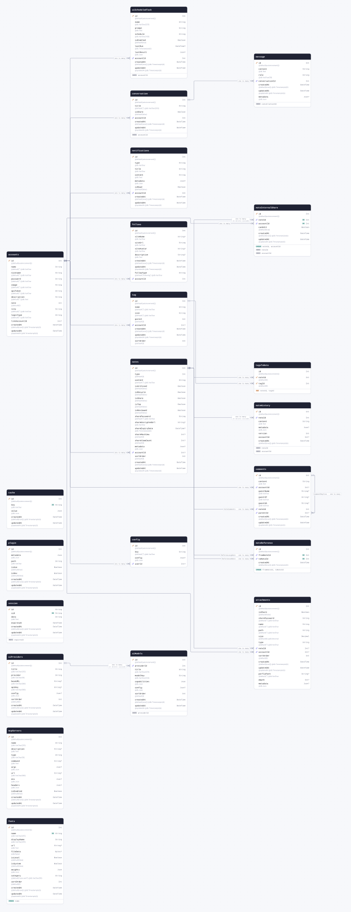

<details>
<summary>The whole schema as SQL</summary>

```sql
CREATE SCHEMA IF NOT EXISTS "public";

CREATE TABLE "accounts" (
    "id" SERIAL NOT NULL,
    "name" VARCHAR NOT NULL DEFAULT '',
    "nickname" VARCHAR NOT NULL DEFAULT '',
    "password" VARCHAR NOT NULL DEFAULT '',
    "image" VARCHAR NOT NULL DEFAULT '',
    "apiToken" VARCHAR NOT NULL DEFAULT '',
    "description" TEXT NOT NULL DEFAULT '',
    "note" INTEGER NOT NULL DEFAULT 0,
    "role" VARCHAR NOT NULL DEFAULT '',
    "loginType" VARCHAR NOT NULL DEFAULT '',
    "linkAccountId" INTEGER,
    "createdAt" TIMESTAMPTZ(6) NOT NULL DEFAULT CURRENT_TIMESTAMP,
    "updatedAt" TIMESTAMPTZ(6) NOT NULL,

    CONSTRAINT "accounts_pkey" PRIMARY KEY ("id")
);

CREATE TABLE "attachments" (
    "id" SERIAL NOT NULL,
    "isShare" BOOLEAN NOT NULL DEFAULT false,
    "sharePassword" VARCHAR NOT NULL DEFAULT '',
    "name" VARCHAR NOT NULL DEFAULT '',
    "path" VARCHAR NOT NULL DEFAULT '',
    "size" DECIMAL NOT NULL DEFAULT 0,
    "type" VARCHAR NOT NULL DEFAULT '',
    "noteId" INTEGER,
    "accountId" INTEGER,
    "sortOrder" INTEGER NOT NULL DEFAULT 0,
    "createdAt" TIMESTAMPTZ(6) NOT NULL DEFAULT CURRENT_TIMESTAMP,
    "updatedAt" TIMESTAMPTZ(6) NOT NULL,
    "perfixPath" VARCHAR DEFAULT '',
    "depth" INTEGER,
    "metadata" JSON,

    CONSTRAINT "attachments_pkey" PRIMARY KEY ("id")
);

CREATE TABLE "config" (
    "id" SERIAL NOT NULL,
    "key" VARCHAR NOT NULL DEFAULT '',
    "config" JSON,
    "userId" INTEGER,

    CONSTRAINT "config_pkey" PRIMARY KEY ("id")
);

CREATE TABLE "notes" (
    "id" SERIAL NOT NULL,
    "type" INTEGER NOT NULL DEFAULT 0,
    "content" VARCHAR NOT NULL DEFAULT '',
    "isArchived" BOOLEAN NOT NULL DEFAULT false,
    "isRecycle" BOOLEAN NOT NULL DEFAULT false,
    "isShare" BOOLEAN NOT NULL DEFAULT false,
    "isTop" BOOLEAN NOT NULL DEFAULT false,
    "isReviewed" BOOLEAN NOT NULL DEFAULT false,
    "sharePassword" VARCHAR NOT NULL DEFAULT '',
    "shareEncryptedUrl" VARCHAR,
    "shareExpiryDate" TIMESTAMPTZ(6),
    "shareMaxView" INTEGER DEFAULT 0,
    "shareViewCount" INTEGER DEFAULT 0,
    "metadata" JSON,
    "accountId" INTEGER,
    "sortOrder" INTEGER NOT NULL DEFAULT 0,
    "createdAt" TIMESTAMPTZ(6) NOT NULL DEFAULT CURRENT_TIMESTAMP,
    "updatedAt" TIMESTAMPTZ(6) NOT NULL,

    CONSTRAINT "notes_pkey" PRIMARY KEY ("id")
);

CREATE TABLE "comments" (
    "id" SERIAL NOT NULL,
    "content" TEXT NOT NULL,
    "accountId" INTEGER,
    "guestName" VARCHAR,
    "guestIP" VARCHAR,
    "guestUA" VARCHAR,
    "noteId" INTEGER NOT NULL,
    "parentId" INTEGER,
    "createdAt" TIMESTAMPTZ(6) NOT NULL DEFAULT CURRENT_TIMESTAMP,
    "updatedAt" TIMESTAMPTZ(6) NOT NULL,

    CONSTRAINT "comments_pkey" PRIMARY KEY ("id")
);

CREATE TABLE "tag" (
    "id" SERIAL NOT NULL,
    "name" VARCHAR NOT NULL DEFAULT '',
    "icon" VARCHAR NOT NULL DEFAULT '',
    "parent" INTEGER NOT NULL DEFAULT 0,
    "accountId" INTEGER,
    "createdAt" TIMESTAMPTZ(6) NOT NULL DEFAULT CURRENT_TIMESTAMP,
    "updatedAt" TIMESTAMPTZ(6) NOT NULL,
    "sortOrder" INTEGER NOT NULL DEFAULT 0,

    CONSTRAINT "tag_pkey" PRIMARY KEY ("id")
);

CREATE TABLE "tagsToNote" (
    "id" SERIAL NOT NULL,
    "noteId" INTEGER NOT NULL DEFAULT 0,
    "tagId" INTEGER NOT NULL DEFAULT 0,

    CONSTRAINT "tagsToNote_pkey" PRIMARY KEY ("noteId","tagId")
);

CREATE TABLE "noteReference" (
    "id" SERIAL NOT NULL,
    "fromNoteId" INTEGER NOT NULL,
    "toNoteId" INTEGER NOT NULL,
    "createdAt" TIMESTAMPTZ(6) NOT NULL DEFAULT CURRENT_TIMESTAMP,

    CONSTRAINT "noteReference_pkey" PRIMARY KEY ("id")
);

CREATE TABLE "follows" (
    "id" SERIAL NOT NULL,
    "siteName" VARCHAR,
    "siteUrl" VARCHAR NOT NULL,
    "siteAvatar" VARCHAR,
    "description" TEXT,
    "createdAt" TIMESTAMPTZ(6) NOT NULL DEFAULT CURRENT_TIMESTAMP,
    "updatedAt" TIMESTAMPTZ(6) NOT NULL,
    "followType" VARCHAR NOT NULL DEFAULT 'following',
    "accountId" INTEGER NOT NULL,

    CONSTRAINT "follows_pkey" PRIMARY KEY ("id")
);

CREATE TABLE "notifications" (
    "id" SERIAL NOT NULL,
    "type" VARCHAR NOT NULL,
    "title" VARCHAR NOT NULL,
    "content" TEXT NOT NULL,
    "metadata" JSON,
    "isRead" BOOLEAN NOT NULL DEFAULT false,
    "accountId" INTEGER NOT NULL,
    "createdAt" TIMESTAMPTZ(6) NOT NULL DEFAULT CURRENT_TIMESTAMP,
    "updatedAt" TIMESTAMPTZ(6) NOT NULL,

    CONSTRAINT "notifications_pkey" PRIMARY KEY ("id")
);

CREATE TABLE "cache" (
    "id" SERIAL NOT NULL,
    "key" VARCHAR NOT NULL,
    "value" JSON NOT NULL,
    "createdAt" TIMESTAMPTZ(6) NOT NULL DEFAULT CURRENT_TIMESTAMP,
    "updatedAt" TIMESTAMPTZ(6) NOT NULL,

    CONSTRAINT "cache_pkey" PRIMARY KEY ("id")
);

CREATE TABLE "plugin" (
    "id" SERIAL NOT NULL,
    "metadata" JSON NOT NULL,
    "path" VARCHAR NOT NULL,
    "isUse" BOOLEAN NOT NULL DEFAULT true,
    "isDev" BOOLEAN NOT NULL DEFAULT false,
    "createdAt" TIMESTAMPTZ(6) NOT NULL DEFAULT CURRENT_TIMESTAMP,
    "updatedAt" TIMESTAMPTZ(6) NOT NULL,

    CONSTRAINT "plugin_pkey" PRIMARY KEY ("id")
);

CREATE TABLE "conversation" (
    "id" SERIAL NOT NULL,
    "title" VARCHAR(255) NOT NULL DEFAULT '',
    "isShare" BOOLEAN NOT NULL DEFAULT false,
    "accountId" INTEGER NOT NULL,
    "createdAt" TIMESTAMPTZ(6) NOT NULL DEFAULT CURRENT_TIMESTAMP,
    "updatedAt" TIMESTAMPTZ(6) NOT NULL,

    CONSTRAINT "conversation_pkey" PRIMARY KEY ("id")
);

CREATE TABLE "message" (
    "id" SERIAL NOT NULL,
    "content" TEXT NOT NULL,
    "role" VARCHAR(50) NOT NULL,
    "conversationId" INTEGER NOT NULL,
    "createdAt" TIMESTAMPTZ(6) NOT NULL DEFAULT CURRENT_TIMESTAMP,
    "updatedAt" TIMESTAMPTZ(6) NOT NULL,
    "metadata" JSON,

    CONSTRAINT "message_pkey" PRIMARY KEY ("id")
);

CREATE TABLE "noteHistory" (
    "id" SERIAL NOT NULL,
    "noteId" INTEGER NOT NULL,
    "content" TEXT NOT NULL,
    "metadata" JSON,
    "version" INTEGER NOT NULL,
    "accountId" INTEGER,
    "createdAt" TIMESTAMPTZ(6) NOT NULL DEFAULT CURRENT_TIMESTAMP,

    CONSTRAINT "noteHistory_pkey" PRIMARY KEY ("id")
);

CREATE TABLE "noteInternalShare" (
    "id" SERIAL NOT NULL,
    "noteId" INTEGER NOT NULL,
    "accountId" INTEGER NOT NULL,
    "canEdit" BOOLEAN NOT NULL DEFAULT true,
    "createdAt" TIMESTAMPTZ(6) NOT NULL DEFAULT CURRENT_TIMESTAMP,
    "updatedAt" TIMESTAMPTZ(6) NOT NULL,

    CONSTRAINT "noteInternalShare_pkey" PRIMARY KEY ("id")
);

CREATE TABLE "session" (
    "id" TEXT NOT NULL,
    "sid" TEXT NOT NULL,
    "data" TEXT NOT NULL,
    "expiresAt" TIMESTAMP(3) NOT NULL,
    "createdAt" TIMESTAMPTZ(6) NOT NULL DEFAULT CURRENT_TIMESTAMP,
    "updatedAt" TIMESTAMPTZ(6) NOT NULL,

    CONSTRAINT "session_pkey" PRIMARY KEY ("id")
);

CREATE TABLE "aiProviders" (
    "id" SERIAL NOT NULL,
    "title" VARCHAR(255) NOT NULL,
    "provider" VARCHAR(50) NOT NULL,
    "baseURL" VARCHAR(500),
    "apiKey" VARCHAR(500),
    "config" JSON,
    "sortOrder" INTEGER NOT NULL DEFAULT 0,
    "createdAt" TIMESTAMPTZ(6) NOT NULL DEFAULT CURRENT_TIMESTAMP,
    "updatedAt" TIMESTAMPTZ(6) NOT NULL,

    CONSTRAINT "aiProviders_pkey" PRIMARY KEY ("id")
);

CREATE TABLE "aiModels" (
    "id" SERIAL NOT NULL,
    "providerId" INTEGER NOT NULL,
    "title" VARCHAR(255) NOT NULL,
    "modelKey" VARCHAR(255) NOT NULL,
    "capabilities" JSON NOT NULL,
    "config" JSON,
    "sortOrder" INTEGER NOT NULL DEFAULT 0,
    "createdAt" TIMESTAMPTZ(6) NOT NULL DEFAULT CURRENT_TIMESTAMP,
    "updatedAt" TIMESTAMPTZ(6) NOT NULL,

    CONSTRAINT "aiModels_pkey" PRIMARY KEY ("id")
);

CREATE TABLE "aiScheduledTask" (
    "id" SERIAL NOT NULL,
    "name" VARCHAR(255) NOT NULL,
    "prompt" TEXT NOT NULL,
    "schedule" VARCHAR(100) NOT NULL,
    "isEnabled" BOOLEAN NOT NULL DEFAULT true,
    "lastRun" TIMESTAMPTZ(6),
    "lastResult" JSON,
    "accountId" INTEGER NOT NULL,
    "createdAt" TIMESTAMPTZ(6) NOT NULL DEFAULT CURRENT_TIMESTAMP,
    "updatedAt" TIMESTAMPTZ(6) NOT NULL,

    CONSTRAINT "aiScheduledTask_pkey" PRIMARY KEY ("id")
);

CREATE TABLE "mcpServers" (
    "id" SERIAL NOT NULL,
    "name" VARCHAR(255) NOT NULL,
    "description" TEXT,
    "type" VARCHAR(50) NOT NULL,
    "command" TEXT,
    "args" JSON,
    "url" VARCHAR(500),
    "env" JSON,
    "headers" JSON,
    "isEnabled" BOOLEAN NOT NULL DEFAULT true,
    "createdAt" TIMESTAMPTZ(6) NOT NULL DEFAULT CURRENT_TIMESTAMP,
    "updatedAt" TIMESTAMPTZ(6) NOT NULL,

    CONSTRAINT "mcpServers_pkey" PRIMARY KEY ("id")
);

CREATE TABLE "fonts" (
    "id" SERIAL NOT NULL,
    "name" VARCHAR(255) NOT NULL,
    "displayName" VARCHAR(255) NOT NULL,
    "url" TEXT,
    "fileData" BYTEA,
    "isLocal" BOOLEAN NOT NULL DEFAULT false,
    "isSystem" BOOLEAN NOT NULL DEFAULT false,
    "weights" JSON NOT NULL,
    "category" VARCHAR(50) NOT NULL DEFAULT 'sans-serif',
    "sortOrder" INTEGER NOT NULL DEFAULT 0,
    "createdAt" TIMESTAMPTZ(6) NOT NULL DEFAULT CURRENT_TIMESTAMP,
    "updatedAt" TIMESTAMPTZ(6) NOT NULL,

    CONSTRAINT "fonts_pkey" PRIMARY KEY ("id")
);

CREATE UNIQUE INDEX "noteReference_fromNoteId_toNoteId_key" ON "noteReference"("fromNoteId", "toNoteId");

CREATE UNIQUE INDEX "cache_key_key" ON "cache"("key");

CREATE INDEX "conversation_accountId_idx" ON "conversation"("accountId");

CREATE INDEX "message_conversationId_idx" ON "message"("conversationId");

CREATE INDEX "noteHistory_noteId_idx" ON "noteHistory"("noteId");

CREATE INDEX "noteHistory_accountId_idx" ON "noteHistory"("accountId");

CREATE INDEX "noteInternalShare_noteId_idx" ON "noteInternalShare"("noteId");

CREATE INDEX "noteInternalShare_accountId_idx" ON "noteInternalShare"("accountId");

CREATE UNIQUE INDEX "noteInternalShare_noteId_accountId_key" ON "noteInternalShare"("noteId", "accountId");

CREATE UNIQUE INDEX "session_sid_key" ON "session"("sid");

CREATE INDEX "session_expiresAt_idx" ON "session"("expiresAt");

CREATE INDEX "aiModels_providerId_idx" ON "aiModels"("providerId");

CREATE INDEX "aiScheduledTask_accountId_idx" ON "aiScheduledTask"("accountId");

CREATE UNIQUE INDEX "fonts_name_key" ON "fonts"("name");

ALTER TABLE "attachments" ADD CONSTRAINT "attachments_noteId_fkey" FOREIGN KEY ("noteId") REFERENCES "notes"("id") ON DELETE SET NULL ON UPDATE CASCADE;

ALTER TABLE "attachments" ADD CONSTRAINT "attachments_accountId_fkey" FOREIGN KEY ("accountId") REFERENCES "accounts"("id") ON DELETE SET NULL ON UPDATE CASCADE;

ALTER TABLE "config" ADD CONSTRAINT "config_userId_fkey" FOREIGN KEY ("userId") REFERENCES "accounts"("id") ON DELETE SET NULL ON UPDATE CASCADE;

ALTER TABLE "notes" ADD CONSTRAINT "notes_accountId_fkey" FOREIGN KEY ("accountId") REFERENCES "accounts"("id") ON DELETE SET NULL ON UPDATE CASCADE;

ALTER TABLE "comments" ADD CONSTRAINT "comments_noteId_fkey" FOREIGN KEY ("noteId") REFERENCES "notes"("id") ON DELETE RESTRICT ON UPDATE CASCADE;

ALTER TABLE "comments" ADD CONSTRAINT "comments_accountId_fkey" FOREIGN KEY ("accountId") REFERENCES "accounts"("id") ON DELETE SET NULL ON UPDATE CASCADE;

ALTER TABLE "comments" ADD CONSTRAINT "comments_parentId_fkey" FOREIGN KEY ("parentId") REFERENCES "comments"("id") ON DELETE SET NULL ON UPDATE CASCADE;

ALTER TABLE "tag" ADD CONSTRAINT "tag_accountId_fkey" FOREIGN KEY ("accountId") REFERENCES "accounts"("id") ON DELETE SET NULL ON UPDATE CASCADE;

ALTER TABLE "tagsToNote" ADD CONSTRAINT "tagsToNote_noteId_fkey" FOREIGN KEY ("noteId") REFERENCES "notes"("id") ON DELETE RESTRICT ON UPDATE CASCADE;

ALTER TABLE "tagsToNote" ADD CONSTRAINT "tagsToNote_tagId_fkey" FOREIGN KEY ("tagId") REFERENCES "tag"("id") ON DELETE RESTRICT ON UPDATE CASCADE;

ALTER TABLE "noteReference" ADD CONSTRAINT "noteReference_fromNoteId_fkey" FOREIGN KEY ("fromNoteId") REFERENCES "notes"("id") ON DELETE RESTRICT ON UPDATE CASCADE;

ALTER TABLE "noteReference" ADD CONSTRAINT "noteReference_toNoteId_fkey" FOREIGN KEY ("toNoteId") REFERENCES "notes"("id") ON DELETE RESTRICT ON UPDATE CASCADE;

ALTER TABLE "follows" ADD CONSTRAINT "follows_accountId_fkey" FOREIGN KEY ("accountId") REFERENCES "accounts"("id") ON DELETE RESTRICT ON UPDATE CASCADE;

ALTER TABLE "notifications" ADD CONSTRAINT "notifications_accountId_fkey" FOREIGN KEY ("accountId") REFERENCES "accounts"("id") ON DELETE RESTRICT ON UPDATE CASCADE;

ALTER TABLE "conversation" ADD CONSTRAINT "conversation_accountId_fkey" FOREIGN KEY ("accountId") REFERENCES "accounts"("id") ON DELETE RESTRICT ON UPDATE CASCADE;

ALTER TABLE "message" ADD CONSTRAINT "message_conversationId_fkey" FOREIGN KEY ("conversationId") REFERENCES "conversation"("id") ON DELETE RESTRICT ON UPDATE CASCADE;

ALTER TABLE "noteHistory" ADD CONSTRAINT "noteHistory_noteId_fkey" FOREIGN KEY ("noteId") REFERENCES "notes"("id") ON DELETE CASCADE ON UPDATE CASCADE;

ALTER TABLE "noteInternalShare" ADD CONSTRAINT "noteInternalShare_noteId_fkey" FOREIGN KEY ("noteId") REFERENCES "notes"("id") ON DELETE CASCADE ON UPDATE CASCADE;

ALTER TABLE "noteInternalShare" ADD CONSTRAINT "noteInternalShare_accountId_fkey" FOREIGN KEY ("accountId") REFERENCES "accounts"("id") ON DELETE RESTRICT ON UPDATE CASCADE;

ALTER TABLE "aiModels" ADD CONSTRAINT "aiModels_providerId_fkey" FOREIGN KEY ("providerId") REFERENCES "aiProviders"("id") ON DELETE CASCADE ON UPDATE CASCADE;

ALTER TABLE "aiScheduledTask" ADD CONSTRAINT "aiScheduledTask_accountId_fkey" FOREIGN KEY ("accountId") REFERENCES "accounts"("id") ON DELETE RESTRICT ON UPDATE CASCADE;
```

</details>

## Contents

| Model                                         | Table               | Description |
| --------------------------------------------- | ------------------- | ----------- |
| [accounts](#model-accounts)                   | `accounts`          |             |
| [attachments](#model-attachments)             | `attachments`       |             |
| [config](#model-config)                       | `config`            |             |
| [notes](#model-notes)                         | `notes`             |             |
| [comments](#model-comments)                   | `comments`          |             |
| [tag](#model-tag)                             | `tag`               |             |
| [tagsToNote](#model-tagsToNote)               | `tagsToNote`        |             |
| [noteReference](#model-noteReference)         | `noteReference`     |             |
| [follows](#model-follows)                     | `follows`           |             |
| [notifications](#model-notifications)         | `notifications`     |             |
| [cache](#model-cache)                         | `cache`             |             |
| [plugin](#model-plugin)                       | `plugin`            |             |
| [conversation](#model-conversation)           | `conversation`      |             |
| [message](#model-message)                     | `message`           |             |
| [noteHistory](#model-noteHistory)             | `noteHistory`       |             |
| [noteInternalShare](#model-noteInternalShare) | `noteInternalShare` |             |
| [session](#model-session)                     | `session`           |             |
| [aiProviders](#model-aiProviders)             | `aiProviders`       |             |
| [aiModels](#model-aiModels)                   | `aiModels`          |             |
| [aiScheduledTask](#model-aiScheduledTask)     | `aiScheduledTask`   |             |
| [mcpServers](#model-mcpServers)               | `mcpServers`        |             |
| [fonts](#model-fonts)                         | `fonts`             |             |

## Models

<a id="model-accounts"></a>

### accounts

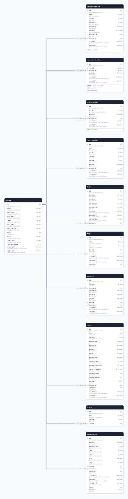

| Field           | Type                            | Constraints | Default           | Description |
| --------------- | ------------------------------- | ----------- | ----------------- | ----------- |
| `id`            | `Int`                           | PK NOT NULL | `autoincrement()` |             |
| `name`          | `String` `@db.VarChar`          | NOT NULL    | `""`              |             |
| `nickname`      | `String` `@db.VarChar`          | NOT NULL    | `""`              |             |
| `password`      | `String` `@db.VarChar`          | NOT NULL    | `""`              |             |
| `image`         | `String` `@db.VarChar`          | NOT NULL    | `""`              |             |
| `apiToken`      | `String` `@db.VarChar`          | NOT NULL    | `""`              |             |
| `description`   | `String` `@db.Text`             | NOT NULL    | `""`              |             |
| `note`          | `Int`                           | NOT NULL    | `0`               |             |
| `role`          | `String` `@db.VarChar`          | NOT NULL    | `""`              |             |
| `loginType`     | `String` `@db.VarChar`          | NOT NULL    | `""`              |             |
| `linkAccountId` | `Int`                           | NULL        |                   |             |
| `createdAt`     | `DateTime` `@db.Timestamptz(6)` | NOT NULL    | `now()`           |             |
| `updatedAt`     | `DateTime` `@db.Timestamptz(6)` | NOT NULL    | `@updatedAt`      |             |

#### Referenced by

- `id` ← [attachments.accountId](#model-attachments) (one-to-many)
- `id` ← [config.userId](#model-config) (one-to-many)
- `id` ← [notes.accountId](#model-notes) (one-to-many)
- `id` ← [comments.accountId](#model-comments) (one-to-many)
- `id` ← [tag.accountId](#model-tag) (one-to-many)
- `id` ← [follows.accountId](#model-follows) (one-to-many)
- `id` ← [notifications.accountId](#model-notifications) (one-to-many)
- `id` ← [conversation.accountId](#model-conversation) (one-to-many)
- `id` ← [noteInternalShare.accountId](#model-noteInternalShare) (one-to-many)
- `id` ← [aiScheduledTask.accountId](#model-aiScheduledTask) (one-to-many)

#### Definition

```sql
CREATE TABLE "accounts" (
    "id" SERIAL NOT NULL,
    "name" VARCHAR NOT NULL DEFAULT '',
    "nickname" VARCHAR NOT NULL DEFAULT '',
    "password" VARCHAR NOT NULL DEFAULT '',
    "image" VARCHAR NOT NULL DEFAULT '',
    "apiToken" VARCHAR NOT NULL DEFAULT '',
    "description" TEXT NOT NULL DEFAULT '',
    "note" INTEGER NOT NULL DEFAULT 0,
    "role" VARCHAR NOT NULL DEFAULT '',
    "loginType" VARCHAR NOT NULL DEFAULT '',
    "linkAccountId" INTEGER,
    "createdAt" TIMESTAMPTZ(6) NOT NULL DEFAULT CURRENT_TIMESTAMP,
    "updatedAt" TIMESTAMPTZ(6) NOT NULL,

    CONSTRAINT "accounts_pkey" PRIMARY KEY ("id")
);
```

<details>
<summary>Queries and their SQL</summary>

**findMany**: Every row

```ts
await prisma.accounts.findMany();
```

```sql
SELECT
  "public"."accounts"."id",
  "public"."accounts"."name",
  "public"."accounts"."nickname",
  "public"."accounts"."password",
  "public"."accounts"."image",
  "public"."accounts"."apiToken",
  "public"."accounts"."description",
  "public"."accounts"."note",
  "public"."accounts"."role",
  "public"."accounts"."loginType",
  "public"."accounts"."linkAccountId",
  "public"."accounts"."createdAt",
  "public"."accounts"."updatedAt"
FROM
  "public"."accounts"
WHERE
  1 = 1
OFFSET
  $1
-- params: ["0"]
```

**count**: How many rows there are

```ts
await prisma.accounts.count();
```

```sql
SELECT
  COUNT(*) AS "_count$_all"
FROM
  (
    SELECT
      "public"."accounts"."id"
    FROM
      "public"."accounts"
    WHERE
      1 = 1
    OFFSET
      $1
  ) AS "sub"
-- params: ["0"]
```

**findMany**: Every row with its relations

```ts
await prisma.accounts.findMany({
  include: {
    notes: true,
    configs: true,
    tags: true,
    comments: true,
    attachments: true,
    follows: true,
    notifications: true,
    conversations: true,
    sharedNotes: true,
    aiScheduledTasks: true,
  },
});
```

```sql
SELECT
  "public"."accounts"."id",
  "public"."accounts"."name",
  "public"."accounts"."nickname",
  "public"."accounts"."password",
  "public"."accounts"."image",
  "public"."accounts"."apiToken",
  "public"."accounts"."description",
  "public"."accounts"."note",
  "public"."accounts"."role",
  "public"."accounts"."loginType",
  "public"."accounts"."linkAccountId",
  "public"."accounts"."createdAt",
  "public"."accounts"."updatedAt"
FROM
  "public"."accounts"
WHERE
  1 = 1
OFFSET
  $1
-- params: ["0"]

SELECT
  "public"."notes"."id",
  "public"."notes"."type",
  "public"."notes"."content",
  "public"."notes"."isArchived",
  "public"."notes"."isRecycle",
  "public"."notes"."isShare",
  "public"."notes"."isTop",
  "public"."notes"."isReviewed",
  "public"."notes"."sharePassword",
  "public"."notes"."shareEncryptedUrl",
  "public"."notes"."shareExpiryDate",
  "public"."notes"."shareMaxView",
  "public"."notes"."shareViewCount",
  "public"."notes"."metadata",
  "public"."notes"."accountId",
  "public"."notes"."sortOrder",
  "public"."notes"."createdAt",
  "public"."notes"."updatedAt"
FROM
  "public"."notes"
WHERE
  "public"."notes"."accountId" IN ($1)
OFFSET
  $2
-- params: ["<id of the rows above>","0"]

SELECT
  "public"."config"."id",
  "public"."config"."key",
  "public"."config"."config",
  "public"."config"."userId"
FROM
  "public"."config"
WHERE
  "public"."config"."userId" IN ($1)
OFFSET
  $2
-- params: ["<id of the rows above>","0"]

SELECT
  "public"."tag"."id",
  "public"."tag"."name",
  "public"."tag"."icon",
  "public"."tag"."parent",
  "public"."tag"."accountId",
  "public"."tag"."createdAt",
  "public"."tag"."updatedAt",
  "public"."tag"."sortOrder"
FROM
  "public"."tag"
WHERE
  "public"."tag"."accountId" IN ($1)
OFFSET
  $2
-- params: ["<id of the rows above>","0"]

SELECT
  "public"."comments"."id",
  "public"."comments"."content",
  "public"."comments"."accountId",
  "public"."comments"."guestName",
  "public"."comments"."guestIP",
  "public"."comments"."guestUA",
  "public"."comments"."noteId",
  "public"."comments"."parentId",
  "public"."comments"."createdAt",
  "public"."comments"."updatedAt"
FROM
  "public"."comments"
WHERE
  "public"."comments"."accountId" IN ($1)
OFFSET
  $2
-- params: ["<id of the rows above>","0"]

SELECT
  "public"."attachments"."id",
  "public"."attachments"."isShare",
  "public"."attachments"."sharePassword",
  "public"."attachments"."name",
  "public"."attachments"."path",
  "public"."attachments"."size",
  "public"."attachments"."type",
  "public"."attachments"."noteId",
  "public"."attachments"."accountId",
  "public"."attachments"."sortOrder",
  "public"."attachments"."createdAt",
  "public"."attachments"."updatedAt",
  "public"."attachments"."perfixPath",
  "public"."attachments"."depth",
  "public"."attachments"."metadata"
FROM
  "public"."attachments"
WHERE
  "public"."attachments"."accountId" IN ($1)
OFFSET
  $2
-- params: ["<id of the rows above>","0"]

SELECT
  "public"."follows"."id",
  "public"."follows"."siteName",
  "public"."follows"."siteUrl",
  "public"."follows"."siteAvatar",
  "public"."follows"."description",
  "public"."follows"."createdAt",
  "public"."follows"."updatedAt",
  "public"."follows"."followType",
  "public"."follows"."accountId"
FROM
  "public"."follows"
WHERE
  "public"."follows"."accountId" IN ($1)
OFFSET
  $2
-- params: ["<id of the rows above>","0"]

SELECT
  "public"."notifications"."id",
  "public"."notifications"."type",
  "public"."notifications"."title",
  "public"."notifications"."content",
  "public"."notifications"."metadata",
  "public"."notifications"."isRead",
  "public"."notifications"."accountId",
  "public"."notifications"."createdAt",
  "public"."notifications"."updatedAt"
FROM
  "public"."notifications"
WHERE
  "public"."notifications"."accountId" IN ($1)
OFFSET
  $2
-- params: ["<id of the rows above>","0"]

SELECT
  "public"."conversation"."id",
  "public"."conversation"."title",
  "public"."conversation"."isShare",
  "public"."conversation"."accountId",
  "public"."conversation"."createdAt",
  "public"."conversation"."updatedAt"
FROM
  "public"."conversation"
WHERE
  "public"."conversation"."accountId" IN ($1)
OFFSET
  $2
-- params: ["<id of the rows above>","0"]

SELECT
  "public"."noteInternalShare"."id",
  "public"."noteInternalShare"."noteId",
  "public"."noteInternalShare"."accountId",
  "public"."noteInternalShare"."canEdit",
  "public"."noteInternalShare"."createdAt",
  "public"."noteInternalShare"."updatedAt"
FROM
  "public"."noteInternalShare"
WHERE
  "public"."noteInternalShare"."accountId" IN ($1)
OFFSET
  $2
-- params: ["<id of the rows above>","0"]

SELECT
  "public"."aiScheduledTask"."id",
  "public"."aiScheduledTask"."name",
  "public"."aiScheduledTask"."prompt",
  "public"."aiScheduledTask"."schedule",
  "public"."aiScheduledTask"."isEnabled",
  "public"."aiScheduledTask"."lastRun",
  "public"."aiScheduledTask"."lastResult",
  "public"."aiScheduledTask"."accountId",
  "public"."aiScheduledTask"."createdAt",
  "public"."aiScheduledTask"."updatedAt"
FROM
  "public"."aiScheduledTask"
WHERE
  "public"."aiScheduledTask"."accountId" IN ($1)
OFFSET
  $2
-- params: ["<id of the rows above>","0"]
```

**findUnique**: One row by what is unique to it

```ts
await prisma.accounts.findUnique({ where: { id: 1 } });
```

```sql
SELECT
  "public"."accounts"."id",
  "public"."accounts"."name",
  "public"."accounts"."nickname",
  "public"."accounts"."password",
  "public"."accounts"."image",
  "public"."accounts"."apiToken",
  "public"."accounts"."description",
  "public"."accounts"."note",
  "public"."accounts"."role",
  "public"."accounts"."loginType",
  "public"."accounts"."linkAccountId",
  "public"."accounts"."createdAt",
  "public"."accounts"."updatedAt"
FROM
  "public"."accounts"
WHERE
  (
    "public"."accounts"."id" = $1
    AND 1 = 1
  )
LIMIT
  $2
OFFSET
  $3
-- params: ["1","1","0"]
```

**create**: Create a row

```ts
await prisma.accounts.create({ data: {} });
```

```sql
INSERT INTO
  "public"."accounts" (
    "name",
    "nickname",
    "password",
    "image",
    "apiToken",
    "description",
    "note",
    "role",
    "loginType",
    "createdAt",
    "updatedAt"
  )
VALUES
  ($1, $2, $3, $4, $5, $6, $7, $8, $9, $10, $11)
RETURNING
  "public"."accounts"."id",
  "public"."accounts"."name",
  "public"."accounts"."nickname",
  "public"."accounts"."password",
  "public"."accounts"."image",
  "public"."accounts"."apiToken",
  "public"."accounts"."description",
  "public"."accounts"."note",
  "public"."accounts"."role",
  "public"."accounts"."loginType",
  "public"."accounts"."linkAccountId",
  "public"."accounts"."createdAt",
  "public"."accounts"."updatedAt"
-- params: ["","","","","","","0","","","<now()>","<now()>"]
```

**update**: Update a row

```ts
await prisma.accounts.update({ where: { id: 1 }, data: { name: "example" } });
```

```sql
UPDATE "public"."accounts"
SET
  "name" = $1,
  "updatedAt" = $2
WHERE
  (
    "public"."accounts"."id" = $3
    AND 1 = 1
  )
RETURNING
  "public"."accounts"."id",
  "public"."accounts"."name",
  "public"."accounts"."nickname",
  "public"."accounts"."password",
  "public"."accounts"."image",
  "public"."accounts"."apiToken",
  "public"."accounts"."description",
  "public"."accounts"."note",
  "public"."accounts"."role",
  "public"."accounts"."loginType",
  "public"."accounts"."linkAccountId",
  "public"."accounts"."createdAt",
  "public"."accounts"."updatedAt"
-- params: ["example",{"prisma__type":"generatorCall","prisma__value":{"name":"now","args":[],"returnType":{"type":"DateTime"}}},"1"]
```

**delete**: Delete a row

```ts
await prisma.accounts.delete({ where: { id: 1 } });
```

```sql
DELETE FROM "public"."accounts"
WHERE
  (
    "public"."accounts"."id" = $1
    AND 1 = 1
  )
RETURNING
  "public"."accounts"."id",
  "public"."accounts"."name",
  "public"."accounts"."nickname",
  "public"."accounts"."password",
  "public"."accounts"."image",
  "public"."accounts"."apiToken",
  "public"."accounts"."description",
  "public"."accounts"."note",
  "public"."accounts"."role",
  "public"."accounts"."loginType",
  "public"."accounts"."linkAccountId",
  "public"."accounts"."createdAt",
  "public"."accounts"."updatedAt"
-- params: ["1"]
```

</details>

<a id="model-attachments"></a>

### attachments

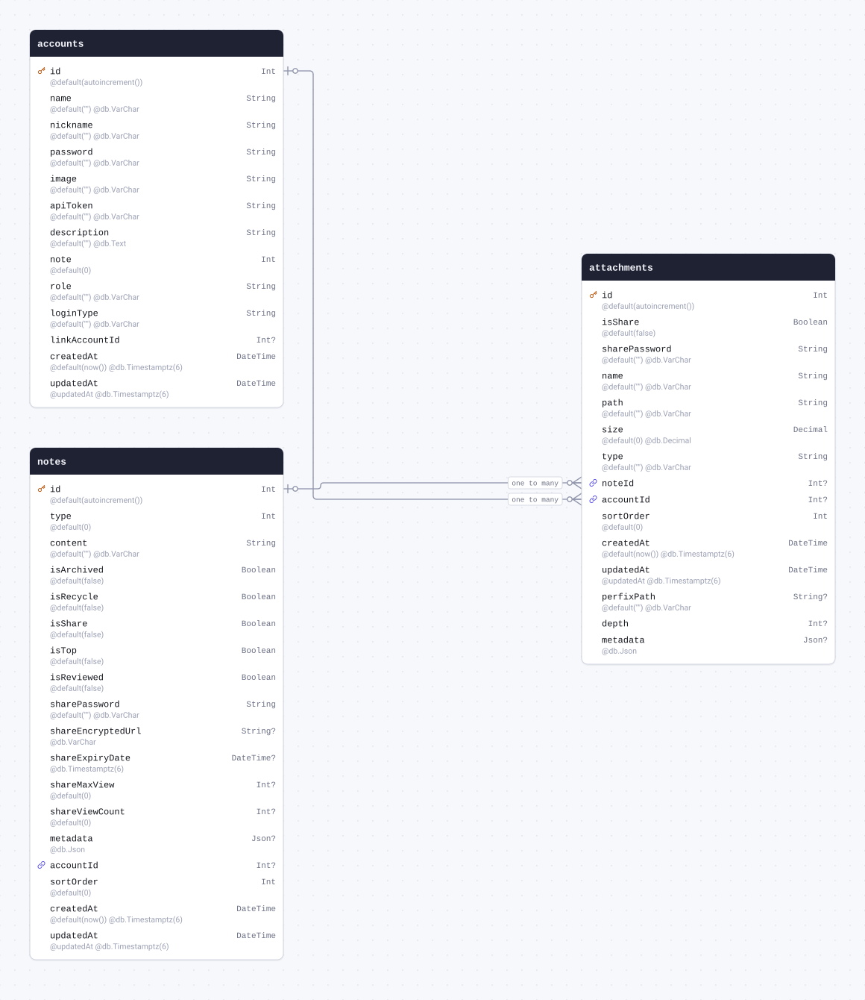

| Field           | Type                            | Constraints                           | Default           | Description |
| --------------- | ------------------------------- | ------------------------------------- | ----------------- | ----------- |
| `id`            | `Int`                           | PK NOT NULL                           | `autoincrement()` |             |
| `isShare`       | `Boolean`                       | NOT NULL                              | `false`           |             |
| `sharePassword` | `String` `@db.VarChar`          | NOT NULL                              | `""`              |             |
| `name`          | `String` `@db.VarChar`          | NOT NULL                              | `""`              |             |
| `path`          | `String` `@db.VarChar`          | NOT NULL                              | `""`              |             |
| `size`          | `Decimal` `@db.Decimal`         | NOT NULL                              | `0`               |             |
| `type`          | `String` `@db.VarChar`          | NOT NULL                              | `""`              |             |
| `noteId`        | `Int`                           | NULL → [notes.id](#model-notes)       |                   |             |
| `accountId`     | `Int`                           | NULL → [accounts.id](#model-accounts) |                   |             |
| `sortOrder`     | `Int`                           | NOT NULL                              | `0`               |             |
| `createdAt`     | `DateTime` `@db.Timestamptz(6)` | NOT NULL                              | `now()`           |             |
| `updatedAt`     | `DateTime` `@db.Timestamptz(6)` | NOT NULL                              | `@updatedAt`      |             |
| `perfixPath`    | `String` `@db.VarChar`          | NULL                                  | `""`              |             |
| `depth`         | `Int`                           | NULL                                  |                   |             |
| `metadata`      | `Json` `@db.Json`               | NULL                                  |                   |             |

#### References

- `noteId` → [notes.id](#model-notes) (many-to-one)
- `accountId` → [accounts.id](#model-accounts) (many-to-one)

#### Definition

```sql
CREATE TABLE "attachments" (
    "id" SERIAL NOT NULL,
    "isShare" BOOLEAN NOT NULL DEFAULT false,
    "sharePassword" VARCHAR NOT NULL DEFAULT '',
    "name" VARCHAR NOT NULL DEFAULT '',
    "path" VARCHAR NOT NULL DEFAULT '',
    "size" DECIMAL NOT NULL DEFAULT 0,
    "type" VARCHAR NOT NULL DEFAULT '',
    "noteId" INTEGER,
    "accountId" INTEGER,
    "sortOrder" INTEGER NOT NULL DEFAULT 0,
    "createdAt" TIMESTAMPTZ(6) NOT NULL DEFAULT CURRENT_TIMESTAMP,
    "updatedAt" TIMESTAMPTZ(6) NOT NULL,
    "perfixPath" VARCHAR DEFAULT '',
    "depth" INTEGER,
    "metadata" JSON,

    CONSTRAINT "attachments_pkey" PRIMARY KEY ("id")
);

ALTER TABLE "attachments" ADD CONSTRAINT "attachments_noteId_fkey" FOREIGN KEY ("noteId") REFERENCES "notes"("id") ON DELETE SET NULL ON UPDATE CASCADE;

ALTER TABLE "attachments" ADD CONSTRAINT "attachments_accountId_fkey" FOREIGN KEY ("accountId") REFERENCES "accounts"("id") ON DELETE SET NULL ON UPDATE CASCADE;
```

<details>
<summary>Queries and their SQL</summary>

**findMany**: Every row

```ts
await prisma.attachments.findMany();
```

```sql
SELECT
  "public"."attachments"."id",
  "public"."attachments"."isShare",
  "public"."attachments"."sharePassword",
  "public"."attachments"."name",
  "public"."attachments"."path",
  "public"."attachments"."size",
  "public"."attachments"."type",
  "public"."attachments"."noteId",
  "public"."attachments"."accountId",
  "public"."attachments"."sortOrder",
  "public"."attachments"."createdAt",
  "public"."attachments"."updatedAt",
  "public"."attachments"."perfixPath",
  "public"."attachments"."depth",
  "public"."attachments"."metadata"
FROM
  "public"."attachments"
WHERE
  1 = 1
OFFSET
  $1
-- params: ["0"]
```

**count**: How many rows there are

```ts
await prisma.attachments.count();
```

```sql
SELECT
  COUNT(*) AS "_count$_all"
FROM
  (
    SELECT
      "public"."attachments"."id"
    FROM
      "public"."attachments"
    WHERE
      1 = 1
    OFFSET
      $1
  ) AS "sub"
-- params: ["0"]
```

**findMany**: Every row with its relations

```ts
await prisma.attachments.findMany({ include: { note: true, account: true } });
```

```sql
SELECT
  "public"."attachments"."id",
  "public"."attachments"."isShare",
  "public"."attachments"."sharePassword",
  "public"."attachments"."name",
  "public"."attachments"."path",
  "public"."attachments"."size",
  "public"."attachments"."type",
  "public"."attachments"."noteId",
  "public"."attachments"."accountId",
  "public"."attachments"."sortOrder",
  "public"."attachments"."createdAt",
  "public"."attachments"."updatedAt",
  "public"."attachments"."perfixPath",
  "public"."attachments"."depth",
  "public"."attachments"."metadata"
FROM
  "public"."attachments"
WHERE
  1 = 1
OFFSET
  $1
-- params: ["0"]

SELECT
  "public"."notes"."id",
  "public"."notes"."type",
  "public"."notes"."content",
  "public"."notes"."isArchived",
  "public"."notes"."isRecycle",
  "public"."notes"."isShare",
  "public"."notes"."isTop",
  "public"."notes"."isReviewed",
  "public"."notes"."sharePassword",
  "public"."notes"."shareEncryptedUrl",
  "public"."notes"."shareExpiryDate",
  "public"."notes"."shareMaxView",
  "public"."notes"."shareViewCount",
  "public"."notes"."metadata",
  "public"."notes"."accountId",
  "public"."notes"."sortOrder",
  "public"."notes"."createdAt",
  "public"."notes"."updatedAt"
FROM
  "public"."notes"
WHERE
  "public"."notes"."id" IN ($1)
OFFSET
  $2
-- params: ["<noteId of the rows above>","0"]

SELECT
  "public"."accounts"."id",
  "public"."accounts"."name",
  "public"."accounts"."nickname",
  "public"."accounts"."password",
  "public"."accounts"."image",
  "public"."accounts"."apiToken",
  "public"."accounts"."description",
  "public"."accounts"."note",
  "public"."accounts"."role",
  "public"."accounts"."loginType",
  "public"."accounts"."linkAccountId",
  "public"."accounts"."createdAt",
  "public"."accounts"."updatedAt"
FROM
  "public"."accounts"
WHERE
  "public"."accounts"."id" IN ($1)
OFFSET
  $2
-- params: ["<accountId of the rows above>","0"]
```

**findUnique**: One row by what is unique to it

```ts
await prisma.attachments.findUnique({ where: { id: 1 } });
```

```sql
SELECT
  "public"."attachments"."id",
  "public"."attachments"."isShare",
  "public"."attachments"."sharePassword",
  "public"."attachments"."name",
  "public"."attachments"."path",
  "public"."attachments"."size",
  "public"."attachments"."type",
  "public"."attachments"."noteId",
  "public"."attachments"."accountId",
  "public"."attachments"."sortOrder",
  "public"."attachments"."createdAt",
  "public"."attachments"."updatedAt",
  "public"."attachments"."perfixPath",
  "public"."attachments"."depth",
  "public"."attachments"."metadata"
FROM
  "public"."attachments"
WHERE
  (
    "public"."attachments"."id" = $1
    AND 1 = 1
  )
LIMIT
  $2
OFFSET
  $3
-- params: ["1","1","0"]
```

**create**: Create a row

```ts
await prisma.attachments.create({ data: {} });
```

```sql
INSERT INTO
  "public"."attachments" (
    "isShare",
    "sharePassword",
    "name",
    "path",
    "size",
    "type",
    "sortOrder",
    "createdAt",
    "updatedAt",
    "perfixPath"
  )
VALUES
  ($1, $2, $3, $4, $5, $6, $7, $8, $9, $10)
RETURNING
  "public"."attachments"."id",
  "public"."attachments"."isShare",
  "public"."attachments"."sharePassword",
  "public"."attachments"."name",
  "public"."attachments"."path",
  "public"."attachments"."size",
  "public"."attachments"."type",
  "public"."attachments"."noteId",
  "public"."attachments"."accountId",
  "public"."attachments"."sortOrder",
  "public"."attachments"."createdAt",
  "public"."attachments"."updatedAt",
  "public"."attachments"."perfixPath",
  "public"."attachments"."depth",
  "public"."attachments"."metadata"
-- params: [false,"","","","0","","0","<now()>","<now()>",""]
```

**update**: Update a row

```ts
await prisma.attachments.update({ where: { id: 1 }, data: { isShare: true } });
```

```sql
UPDATE "public"."attachments"
SET
  "isShare" = $1,
  "updatedAt" = $2
WHERE
  (
    "public"."attachments"."id" = $3
    AND 1 = 1
  )
RETURNING
  "public"."attachments"."id",
  "public"."attachments"."isShare",
  "public"."attachments"."sharePassword",
  "public"."attachments"."name",
  "public"."attachments"."path",
  "public"."attachments"."size",
  "public"."attachments"."type",
  "public"."attachments"."noteId",
  "public"."attachments"."accountId",
  "public"."attachments"."sortOrder",
  "public"."attachments"."createdAt",
  "public"."attachments"."updatedAt",
  "public"."attachments"."perfixPath",
  "public"."attachments"."depth",
  "public"."attachments"."metadata"
-- params: [true,{"prisma__type":"generatorCall","prisma__value":{"name":"now","args":[],"returnType":{"type":"DateTime"}}},"1"]
```

**delete**: Delete a row

```ts
await prisma.attachments.delete({ where: { id: 1 } });
```

```sql
DELETE FROM "public"."attachments"
WHERE
  (
    "public"."attachments"."id" = $1
    AND 1 = 1
  )
RETURNING
  "public"."attachments"."id",
  "public"."attachments"."isShare",
  "public"."attachments"."sharePassword",
  "public"."attachments"."name",
  "public"."attachments"."path",
  "public"."attachments"."size",
  "public"."attachments"."type",
  "public"."attachments"."noteId",
  "public"."attachments"."accountId",
  "public"."attachments"."sortOrder",
  "public"."attachments"."createdAt",
  "public"."attachments"."updatedAt",
  "public"."attachments"."perfixPath",
  "public"."attachments"."depth",
  "public"."attachments"."metadata"
-- params: ["1"]
```

</details>

<a id="model-config"></a>

### config

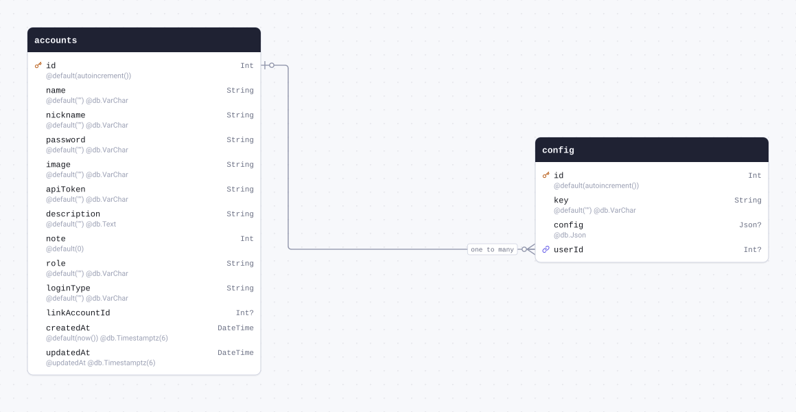

| Field    | Type                   | Constraints                           | Default           | Description |
| -------- | ---------------------- | ------------------------------------- | ----------------- | ----------- |
| `id`     | `Int`                  | PK NOT NULL                           | `autoincrement()` |             |
| `key`    | `String` `@db.VarChar` | NOT NULL                              | `""`              |             |
| `config` | `Json` `@db.Json`      | NULL                                  |                   |             |
| `userId` | `Int`                  | NULL → [accounts.id](#model-accounts) |                   |             |

#### References

- `userId` → [accounts.id](#model-accounts) (many-to-one)

#### Definition

```sql
CREATE TABLE "config" (
    "id" SERIAL NOT NULL,
    "key" VARCHAR NOT NULL DEFAULT '',
    "config" JSON,
    "userId" INTEGER,

    CONSTRAINT "config_pkey" PRIMARY KEY ("id")
);

ALTER TABLE "config" ADD CONSTRAINT "config_userId_fkey" FOREIGN KEY ("userId") REFERENCES "accounts"("id") ON DELETE SET NULL ON UPDATE CASCADE;
```

<details>
<summary>Queries and their SQL</summary>

**findMany**: Every row

```ts
await prisma.config.findMany();
```

```sql
SELECT
  "public"."config"."id",
  "public"."config"."key",
  "public"."config"."config",
  "public"."config"."userId"
FROM
  "public"."config"
WHERE
  1 = 1
OFFSET
  $1
-- params: ["0"]
```

**count**: How many rows there are

```ts
await prisma.config.count();
```

```sql
SELECT
  COUNT(*) AS "_count$_all"
FROM
  (
    SELECT
      "public"."config"."id"
    FROM
      "public"."config"
    WHERE
      1 = 1
    OFFSET
      $1
  ) AS "sub"
-- params: ["0"]
```

**findMany**: Every row with its relations

```ts
await prisma.config.findMany({ include: { user: true } });
```

```sql
SELECT
  "public"."config"."id",
  "public"."config"."key",
  "public"."config"."config",
  "public"."config"."userId"
FROM
  "public"."config"
WHERE
  1 = 1
OFFSET
  $1
-- params: ["0"]

SELECT
  "public"."accounts"."id",
  "public"."accounts"."name",
  "public"."accounts"."nickname",
  "public"."accounts"."password",
  "public"."accounts"."image",
  "public"."accounts"."apiToken",
  "public"."accounts"."description",
  "public"."accounts"."note",
  "public"."accounts"."role",
  "public"."accounts"."loginType",
  "public"."accounts"."linkAccountId",
  "public"."accounts"."createdAt",
  "public"."accounts"."updatedAt"
FROM
  "public"."accounts"
WHERE
  "public"."accounts"."id" IN ($1)
OFFSET
  $2
-- params: ["<userId of the rows above>","0"]
```

**findUnique**: One row by what is unique to it

```ts
await prisma.config.findUnique({ where: { id: 1 } });
```

```sql
SELECT
  "public"."config"."id",
  "public"."config"."key",
  "public"."config"."config",
  "public"."config"."userId"
FROM
  "public"."config"
WHERE
  (
    "public"."config"."id" = $1
    AND 1 = 1
  )
LIMIT
  $2
OFFSET
  $3
-- params: ["1","1","0"]
```

**create**: Create a row

```ts
await prisma.config.create({ data: {} });
```

```sql
INSERT INTO
  "public"."config" ("key")
VALUES
  ($1)
RETURNING
  "public"."config"."id",
  "public"."config"."key",
  "public"."config"."config",
  "public"."config"."userId"
-- params: [""]
```

**update**: Update a row

```ts
await prisma.config.update({ where: { id: 1 }, data: { key: "example" } });
```

```sql
UPDATE "public"."config"
SET
  "key" = $1
WHERE
  (
    "public"."config"."id" = $2
    AND 1 = 1
  )
RETURNING
  "public"."config"."id",
  "public"."config"."key",
  "public"."config"."config",
  "public"."config"."userId"
-- params: ["example","1"]
```

**delete**: Delete a row

```ts
await prisma.config.delete({ where: { id: 1 } });
```

```sql
DELETE FROM "public"."config"
WHERE
  (
    "public"."config"."id" = $1
    AND 1 = 1
  )
RETURNING
  "public"."config"."id",
  "public"."config"."key",
  "public"."config"."config",
  "public"."config"."userId"
-- params: ["1"]
```

</details>

<a id="model-notes"></a>

### notes

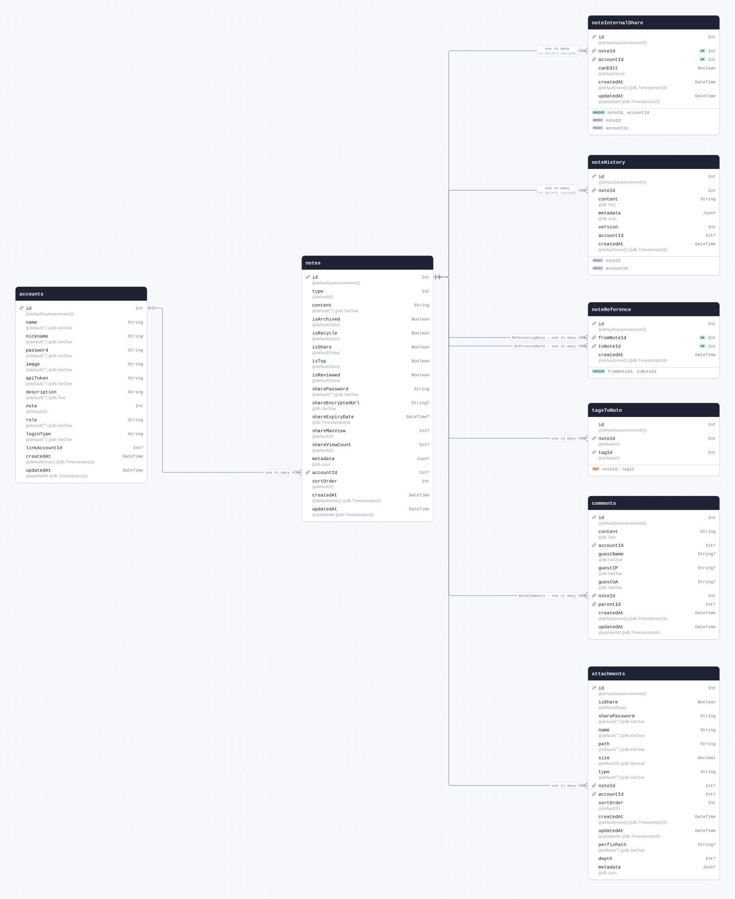

| Field               | Type                            | Constraints                           | Default           | Description |
| ------------------- | ------------------------------- | ------------------------------------- | ----------------- | ----------- |
| `id`                | `Int`                           | PK NOT NULL                           | `autoincrement()` |             |
| `type`              | `Int`                           | NOT NULL                              | `0`               |             |
| `content`           | `String` `@db.VarChar`          | NOT NULL                              | `""`              |             |
| `isArchived`        | `Boolean`                       | NOT NULL                              | `false`           |             |
| `isRecycle`         | `Boolean`                       | NOT NULL                              | `false`           |             |
| `isShare`           | `Boolean`                       | NOT NULL                              | `false`           |             |
| `isTop`             | `Boolean`                       | NOT NULL                              | `false`           |             |
| `isReviewed`        | `Boolean`                       | NOT NULL                              | `false`           |             |
| `sharePassword`     | `String` `@db.VarChar`          | NOT NULL                              | `""`              |             |
| `shareEncryptedUrl` | `String` `@db.VarChar`          | NULL                                  |                   |             |
| `shareExpiryDate`   | `DateTime` `@db.Timestamptz(6)` | NULL                                  |                   |             |
| `shareMaxView`      | `Int`                           | NULL                                  | `0`               |             |
| `shareViewCount`    | `Int`                           | NULL                                  | `0`               |             |
| `metadata`          | `Json` `@db.Json`               | NULL                                  |                   |             |
| `accountId`         | `Int`                           | NULL → [accounts.id](#model-accounts) |                   |             |
| `sortOrder`         | `Int`                           | NOT NULL                              | `0`               |             |
| `createdAt`         | `DateTime` `@db.Timestamptz(6)` | NOT NULL                              | `now()`           |             |
| `updatedAt`         | `DateTime` `@db.Timestamptz(6)` | NOT NULL                              | `@updatedAt`      |             |

#### References

- `accountId` → [accounts.id](#model-accounts) (many-to-one)

#### Referenced by

- `id` ← [attachments.noteId](#model-attachments) (one-to-many)
- `id` ← [comments.noteId](#model-comments) (one-to-many)
- `id` ← [tagsToNote.noteId](#model-tagsToNote) (one-to-many)
- `id` ← [noteReference.fromNoteId](#model-noteReference) (one-to-many)
- `id` ← [noteReference.toNoteId](#model-noteReference) (one-to-many)
- `id` ← [noteHistory.noteId](#model-noteHistory) (one-to-many, on delete Cascade)
- `id` ← [noteInternalShare.noteId](#model-noteInternalShare) (one-to-many, on delete Cascade)

#### Definition

```sql
CREATE TABLE "notes" (
    "id" SERIAL NOT NULL,
    "type" INTEGER NOT NULL DEFAULT 0,
    "content" VARCHAR NOT NULL DEFAULT '',
    "isArchived" BOOLEAN NOT NULL DEFAULT false,
    "isRecycle" BOOLEAN NOT NULL DEFAULT false,
    "isShare" BOOLEAN NOT NULL DEFAULT false,
    "isTop" BOOLEAN NOT NULL DEFAULT false,
    "isReviewed" BOOLEAN NOT NULL DEFAULT false,
    "sharePassword" VARCHAR NOT NULL DEFAULT '',
    "shareEncryptedUrl" VARCHAR,
    "shareExpiryDate" TIMESTAMPTZ(6),
    "shareMaxView" INTEGER DEFAULT 0,
    "shareViewCount" INTEGER DEFAULT 0,
    "metadata" JSON,
    "accountId" INTEGER,
    "sortOrder" INTEGER NOT NULL DEFAULT 0,
    "createdAt" TIMESTAMPTZ(6) NOT NULL DEFAULT CURRENT_TIMESTAMP,
    "updatedAt" TIMESTAMPTZ(6) NOT NULL,

    CONSTRAINT "notes_pkey" PRIMARY KEY ("id")
);

ALTER TABLE "notes" ADD CONSTRAINT "notes_accountId_fkey" FOREIGN KEY ("accountId") REFERENCES "accounts"("id") ON DELETE SET NULL ON UPDATE CASCADE;
```

<details>
<summary>Queries and their SQL</summary>

**findMany**: Every row

```ts
await prisma.notes.findMany();
```

```sql
SELECT
  "public"."notes"."id",
  "public"."notes"."type",
  "public"."notes"."content",
  "public"."notes"."isArchived",
  "public"."notes"."isRecycle",
  "public"."notes"."isShare",
  "public"."notes"."isTop",
  "public"."notes"."isReviewed",
  "public"."notes"."sharePassword",
  "public"."notes"."shareEncryptedUrl",
  "public"."notes"."shareExpiryDate",
  "public"."notes"."shareMaxView",
  "public"."notes"."shareViewCount",
  "public"."notes"."metadata",
  "public"."notes"."accountId",
  "public"."notes"."sortOrder",
  "public"."notes"."createdAt",
  "public"."notes"."updatedAt"
FROM
  "public"."notes"
WHERE
  1 = 1
OFFSET
  $1
-- params: ["0"]
```

**count**: How many rows there are

```ts
await prisma.notes.count();
```

```sql
SELECT
  COUNT(*) AS "_count$_all"
FROM
  (
    SELECT
      "public"."notes"."id"
    FROM
      "public"."notes"
    WHERE
      1 = 1
    OFFSET
      $1
  ) AS "sub"
-- params: ["0"]
```

**findMany**: Every row with its relations

```ts
await prisma.notes.findMany({
  include: {
    attachments: true,
    tags: true,
    account: true,
    referencedBy: true,
    references: true,
    comments: true,
    histories: true,
    internalShares: true,
  },
});
```

```sql
SELECT
  "public"."notes"."id",
  "public"."notes"."type",
  "public"."notes"."content",
  "public"."notes"."isArchived",
  "public"."notes"."isRecycle",
  "public"."notes"."isShare",
  "public"."notes"."isTop",
  "public"."notes"."isReviewed",
  "public"."notes"."sharePassword",
  "public"."notes"."shareEncryptedUrl",
  "public"."notes"."shareExpiryDate",
  "public"."notes"."shareMaxView",
  "public"."notes"."shareViewCount",
  "public"."notes"."metadata",
  "public"."notes"."accountId",
  "public"."notes"."sortOrder",
  "public"."notes"."createdAt",
  "public"."notes"."updatedAt"
FROM
  "public"."notes"
WHERE
  1 = 1
OFFSET
  $1
-- params: ["0"]

SELECT
  "public"."attachments"."id",
  "public"."attachments"."isShare",
  "public"."attachments"."sharePassword",
  "public"."attachments"."name",
  "public"."attachments"."path",
  "public"."attachments"."size",
  "public"."attachments"."type",
  "public"."attachments"."noteId",
  "public"."attachments"."accountId",
  "public"."attachments"."sortOrder",
  "public"."attachments"."createdAt",
  "public"."attachments"."updatedAt",
  "public"."attachments"."perfixPath",
  "public"."attachments"."depth",
  "public"."attachments"."metadata"
FROM
  "public"."attachments"
WHERE
  "public"."attachments"."noteId" IN ($1)
OFFSET
  $2
-- params: ["<id of the rows above>","0"]

SELECT
  "public"."tagsToNote"."noteId",
  "public"."tagsToNote"."tagId",
  "public"."tagsToNote"."id"
FROM
  "public"."tagsToNote"
WHERE
  "public"."tagsToNote"."noteId" IN ($1)
OFFSET
  $2
-- params: ["<id of the rows above>","0"]

SELECT
  "public"."accounts"."id",
  "public"."accounts"."name",
  "public"."accounts"."nickname",
  "public"."accounts"."password",
  "public"."accounts"."image",
  "public"."accounts"."apiToken",
  "public"."accounts"."description",
  "public"."accounts"."note",
  "public"."accounts"."role",
  "public"."accounts"."loginType",
  "public"."accounts"."linkAccountId",
  "public"."accounts"."createdAt",
  "public"."accounts"."updatedAt"
FROM
  "public"."accounts"
WHERE
  "public"."accounts"."id" IN ($1)
OFFSET
  $2
-- params: ["<accountId of the rows above>","0"]

SELECT
  "public"."noteReference"."id",
  "public"."noteReference"."fromNoteId",
  "public"."noteReference"."toNoteId",
  "public"."noteReference"."createdAt"
FROM
  "public"."noteReference"
WHERE
  "public"."noteReference"."toNoteId" IN ($1)
OFFSET
  $2
-- params: ["<id of the rows above>","0"]

SELECT
  "public"."noteReference"."id",
  "public"."noteReference"."fromNoteId",
  "public"."noteReference"."toNoteId",
  "public"."noteReference"."createdAt"
FROM
  "public"."noteReference"
WHERE
  "public"."noteReference"."fromNoteId" IN ($1)
OFFSET
  $2
-- params: ["<id of the rows above>","0"]

SELECT
  "public"."comments"."id",
  "public"."comments"."content",
  "public"."comments"."accountId",
  "public"."comments"."guestName",
  "public"."comments"."guestIP",
  "public"."comments"."guestUA",
  "public"."comments"."noteId",
  "public"."comments"."parentId",
  "public"."comments"."createdAt",
  "public"."comments"."updatedAt"
FROM
  "public"."comments"
WHERE
  "public"."comments"."noteId" IN ($1)
OFFSET
  $2
-- params: ["<id of the rows above>","0"]

SELECT
  "public"."noteHistory"."id",
  "public"."noteHistory"."noteId",
  "public"."noteHistory"."content",
  "public"."noteHistory"."metadata",
  "public"."noteHistory"."version",
  "public"."noteHistory"."accountId",
  "public"."noteHistory"."createdAt"
FROM
  "public"."noteHistory"
WHERE
  "public"."noteHistory"."noteId" IN ($1)
OFFSET
  $2
-- params: ["<id of the rows above>","0"]

SELECT
  "public"."noteInternalShare"."id",
  "public"."noteInternalShare"."noteId",
  "public"."noteInternalShare"."accountId",
  "public"."noteInternalShare"."canEdit",
  "public"."noteInternalShare"."createdAt",
  "public"."noteInternalShare"."updatedAt"
FROM
  "public"."noteInternalShare"
WHERE
  "public"."noteInternalShare"."noteId" IN ($1)
OFFSET
  $2
-- params: ["<id of the rows above>","0"]
```

**findUnique**: One row by what is unique to it

```ts
await prisma.notes.findUnique({ where: { id: 1 } });
```

```sql
SELECT
  "public"."notes"."id",
  "public"."notes"."type",
  "public"."notes"."content",
  "public"."notes"."isArchived",
  "public"."notes"."isRecycle",
  "public"."notes"."isShare",
  "public"."notes"."isTop",
  "public"."notes"."isReviewed",
  "public"."notes"."sharePassword",
  "public"."notes"."shareEncryptedUrl",
  "public"."notes"."shareExpiryDate",
  "public"."notes"."shareMaxView",
  "public"."notes"."shareViewCount",
  "public"."notes"."metadata",
  "public"."notes"."accountId",
  "public"."notes"."sortOrder",
  "public"."notes"."createdAt",
  "public"."notes"."updatedAt"
FROM
  "public"."notes"
WHERE
  (
    "public"."notes"."id" = $1
    AND 1 = 1
  )
LIMIT
  $2
OFFSET
  $3
-- params: ["1","1","0"]
```

**create**: Create a row

```ts
await prisma.notes.create({ data: {} });
```

```sql
INSERT INTO
  "public"."notes" (
    "type",
    "content",
    "isArchived",
    "isRecycle",
    "isShare",
    "isTop",
    "isReviewed",
    "sharePassword",
    "shareMaxView",
    "shareViewCount",
    "sortOrder",
    "createdAt",
    "updatedAt"
  )
VALUES
  (
    $1,
    $2,
    $3,
    $4,
    $5,
    $6,
    $7,
    $8,
    $9,
    $10,
    $11,
    $12,
    $13
  )
RETURNING
  "public"."notes"."id",
  "public"."notes"."type",
  "public"."notes"."content",
  "public"."notes"."isArchived",
  "public"."notes"."isRecycle",
  "public"."notes"."isShare",
  "public"."notes"."isTop",
  "public"."notes"."isReviewed",
  "public"."notes"."sharePassword",
  "public"."notes"."shareEncryptedUrl",
  "public"."notes"."shareExpiryDate",
  "public"."notes"."shareMaxView",
  "public"."notes"."shareViewCount",
  "public"."notes"."metadata",
  "public"."notes"."accountId",
  "public"."notes"."sortOrder",
  "public"."notes"."createdAt",
  "public"."notes"."updatedAt"
-- params: ["0","",false,false,false,false,false,"","0","0","0","<now()>","<now()>"]
```

**update**: Update a row

```ts
await prisma.notes.update({ where: { id: 1 }, data: { type: 1 } });
```

```sql
UPDATE "public"."notes"
SET
  "type" = $1,
  "updatedAt" = $2
WHERE
  (
    "public"."notes"."id" = $3
    AND 1 = 1
  )
RETURNING
  "public"."notes"."id",
  "public"."notes"."type",
  "public"."notes"."content",
  "public"."notes"."isArchived",
  "public"."notes"."isRecycle",
  "public"."notes"."isShare",
  "public"."notes"."isTop",
  "public"."notes"."isReviewed",
  "public"."notes"."sharePassword",
  "public"."notes"."shareEncryptedUrl",
  "public"."notes"."shareExpiryDate",
  "public"."notes"."shareMaxView",
  "public"."notes"."shareViewCount",
  "public"."notes"."metadata",
  "public"."notes"."accountId",
  "public"."notes"."sortOrder",
  "public"."notes"."createdAt",
  "public"."notes"."updatedAt"
-- params: ["1",{"prisma__type":"generatorCall","prisma__value":{"name":"now","args":[],"returnType":{"type":"DateTime"}}},"1"]
```

**delete**: Delete a row

```ts
await prisma.notes.delete({ where: { id: 1 } });
```

```sql
DELETE FROM "public"."notes"
WHERE
  (
    "public"."notes"."id" = $1
    AND 1 = 1
  )
RETURNING
  "public"."notes"."id",
  "public"."notes"."type",
  "public"."notes"."content",
  "public"."notes"."isArchived",
  "public"."notes"."isRecycle",
  "public"."notes"."isShare",
  "public"."notes"."isTop",
  "public"."notes"."isReviewed",
  "public"."notes"."sharePassword",
  "public"."notes"."shareEncryptedUrl",
  "public"."notes"."shareExpiryDate",
  "public"."notes"."shareMaxView",
  "public"."notes"."shareViewCount",
  "public"."notes"."metadata",
  "public"."notes"."accountId",
  "public"."notes"."sortOrder",
  "public"."notes"."createdAt",
  "public"."notes"."updatedAt"
-- params: ["1"]
```

</details>

<a id="model-comments"></a>

### comments

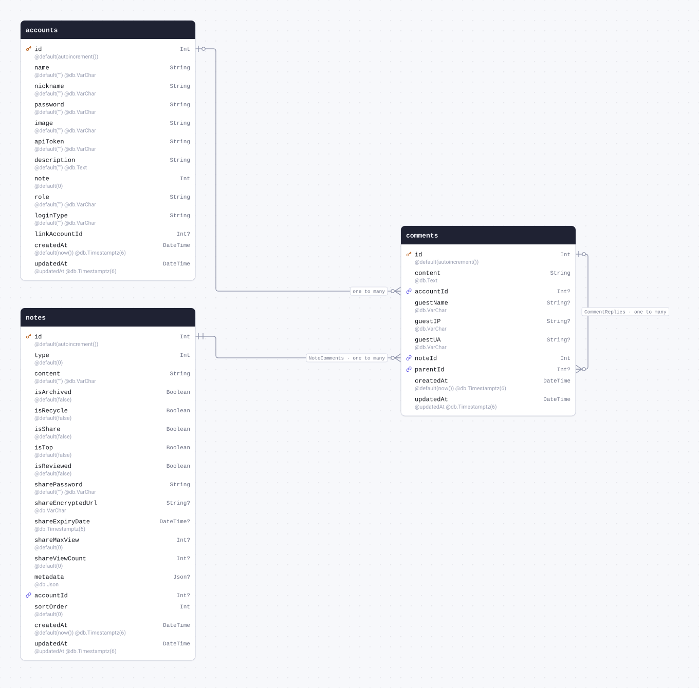

| Field       | Type                            | Constraints                           | Default           | Description |
| ----------- | ------------------------------- | ------------------------------------- | ----------------- | ----------- |
| `id`        | `Int`                           | PK NOT NULL                           | `autoincrement()` |             |
| `content`   | `String` `@db.Text`             | NOT NULL                              |                   |             |
| `accountId` | `Int`                           | NULL → [accounts.id](#model-accounts) |                   |             |
| `guestName` | `String` `@db.VarChar`          | NULL                                  |                   |             |
| `guestIP`   | `String` `@db.VarChar`          | NULL                                  |                   |             |
| `guestUA`   | `String` `@db.VarChar`          | NULL                                  |                   |             |
| `noteId`    | `Int`                           | NOT NULL → [notes.id](#model-notes)   |                   |             |
| `parentId`  | `Int`                           | NULL → [comments.id](#model-comments) |                   |             |
| `createdAt` | `DateTime` `@db.Timestamptz(6)` | NOT NULL                              | `now()`           |             |
| `updatedAt` | `DateTime` `@db.Timestamptz(6)` | NOT NULL                              | `@updatedAt`      |             |

#### References

- `noteId` → [notes.id](#model-notes) (many-to-one)
- `accountId` → [accounts.id](#model-accounts) (many-to-one)
- `parentId` → [comments.id](#model-comments) (many-to-one)

#### Referenced by

- `id` ← [comments.parentId](#model-comments) (one-to-many)

#### Definition

```sql
CREATE TABLE "comments" (
    "id" SERIAL NOT NULL,
    "content" TEXT NOT NULL,
    "accountId" INTEGER,
    "guestName" VARCHAR,
    "guestIP" VARCHAR,
    "guestUA" VARCHAR,
    "noteId" INTEGER NOT NULL,
    "parentId" INTEGER,
    "createdAt" TIMESTAMPTZ(6) NOT NULL DEFAULT CURRENT_TIMESTAMP,
    "updatedAt" TIMESTAMPTZ(6) NOT NULL,

    CONSTRAINT "comments_pkey" PRIMARY KEY ("id")
);

ALTER TABLE "comments" ADD CONSTRAINT "comments_noteId_fkey" FOREIGN KEY ("noteId") REFERENCES "notes"("id") ON DELETE RESTRICT ON UPDATE CASCADE;

ALTER TABLE "comments" ADD CONSTRAINT "comments_accountId_fkey" FOREIGN KEY ("accountId") REFERENCES "accounts"("id") ON DELETE SET NULL ON UPDATE CASCADE;

ALTER TABLE "comments" ADD CONSTRAINT "comments_parentId_fkey" FOREIGN KEY ("parentId") REFERENCES "comments"("id") ON DELETE SET NULL ON UPDATE CASCADE;
```

<details>
<summary>Queries and their SQL</summary>

**findMany**: Every row

```ts
await prisma.comments.findMany();
```

```sql
SELECT
  "public"."comments"."id",
  "public"."comments"."content",
  "public"."comments"."accountId",
  "public"."comments"."guestName",
  "public"."comments"."guestIP",
  "public"."comments"."guestUA",
  "public"."comments"."noteId",
  "public"."comments"."parentId",
  "public"."comments"."createdAt",
  "public"."comments"."updatedAt"
FROM
  "public"."comments"
WHERE
  1 = 1
OFFSET
  $1
-- params: ["0"]
```

**count**: How many rows there are

```ts
await prisma.comments.count();
```

```sql
SELECT
  COUNT(*) AS "_count$_all"
FROM
  (
    SELECT
      "public"."comments"."id"
    FROM
      "public"."comments"
    WHERE
      1 = 1
    OFFSET
      $1
  ) AS "sub"
-- params: ["0"]
```

**findMany**: Every row with its relations

```ts
await prisma.comments.findMany({
  include: { note: true, account: true, parent: true, replies: true },
});
```

```sql
SELECT
  "public"."comments"."id",
  "public"."comments"."content",
  "public"."comments"."accountId",
  "public"."comments"."guestName",
  "public"."comments"."guestIP",
  "public"."comments"."guestUA",
  "public"."comments"."noteId",
  "public"."comments"."parentId",
  "public"."comments"."createdAt",
  "public"."comments"."updatedAt"
FROM
  "public"."comments"
WHERE
  1 = 1
OFFSET
  $1
-- params: ["0"]

SELECT
  "public"."notes"."id",
  "public"."notes"."type",
  "public"."notes"."content",
  "public"."notes"."isArchived",
  "public"."notes"."isRecycle",
  "public"."notes"."isShare",
  "public"."notes"."isTop",
  "public"."notes"."isReviewed",
  "public"."notes"."sharePassword",
  "public"."notes"."shareEncryptedUrl",
  "public"."notes"."shareExpiryDate",
  "public"."notes"."shareMaxView",
  "public"."notes"."shareViewCount",
  "public"."notes"."metadata",
  "public"."notes"."accountId",
  "public"."notes"."sortOrder",
  "public"."notes"."createdAt",
  "public"."notes"."updatedAt"
FROM
  "public"."notes"
WHERE
  "public"."notes"."id" IN ($1)
OFFSET
  $2
-- params: ["<noteId of the rows above>","0"]

SELECT
  "public"."accounts"."id",
  "public"."accounts"."name",
  "public"."accounts"."nickname",
  "public"."accounts"."password",
  "public"."accounts"."image",
  "public"."accounts"."apiToken",
  "public"."accounts"."description",
  "public"."accounts"."note",
  "public"."accounts"."role",
  "public"."accounts"."loginType",
  "public"."accounts"."linkAccountId",
  "public"."accounts"."createdAt",
  "public"."accounts"."updatedAt"
FROM
  "public"."accounts"
WHERE
  "public"."accounts"."id" IN ($1)
OFFSET
  $2
-- params: ["<accountId of the rows above>","0"]

SELECT
  "public"."comments"."id",
  "public"."comments"."content",
  "public"."comments"."accountId",
  "public"."comments"."guestName",
  "public"."comments"."guestIP",
  "public"."comments"."guestUA",
  "public"."comments"."noteId",
  "public"."comments"."parentId",
  "public"."comments"."createdAt",
  "public"."comments"."updatedAt"
FROM
  "public"."comments"
WHERE
  "public"."comments"."id" IN ($1)
OFFSET
  $2
-- params: ["<parentId of the rows above>","0"]

SELECT
  "public"."comments"."id",
  "public"."comments"."content",
  "public"."comments"."accountId",
  "public"."comments"."guestName",
  "public"."comments"."guestIP",
  "public"."comments"."guestUA",
  "public"."comments"."noteId",
  "public"."comments"."parentId",
  "public"."comments"."createdAt",
  "public"."comments"."updatedAt"
FROM
  "public"."comments"
WHERE
  "public"."comments"."parentId" IN ($1)
OFFSET
  $2
-- params: ["<id of the rows above>","0"]
```

**findUnique**: One row by what is unique to it

```ts
await prisma.comments.findUnique({ where: { id: 1 } });
```

```sql
SELECT
  "public"."comments"."id",
  "public"."comments"."content",
  "public"."comments"."accountId",
  "public"."comments"."guestName",
  "public"."comments"."guestIP",
  "public"."comments"."guestUA",
  "public"."comments"."noteId",
  "public"."comments"."parentId",
  "public"."comments"."createdAt",
  "public"."comments"."updatedAt"
FROM
  "public"."comments"
WHERE
  (
    "public"."comments"."id" = $1
    AND 1 = 1
  )
LIMIT
  $2
OFFSET
  $3
-- params: ["1","1","0"]
```

**create**: Create a row

```ts
await prisma.comments.create({ data: { content: "example", noteId: 1 } });
```

```sql
INSERT INTO
  "public"."comments" ("content", "noteId", "createdAt", "updatedAt")
VALUES
  ($1, $2, $3, $4)
RETURNING
  "public"."comments"."id",
  "public"."comments"."content",
  "public"."comments"."accountId",
  "public"."comments"."guestName",
  "public"."comments"."guestIP",
  "public"."comments"."guestUA",
  "public"."comments"."noteId",
  "public"."comments"."parentId",
  "public"."comments"."createdAt",
  "public"."comments"."updatedAt"
-- params: ["example","1","<now()>","<now()>"]
```

**update**: Update a row

```ts
await prisma.comments.update({ where: { id: 1 }, data: { content: "example" } });
```

```sql
UPDATE "public"."comments"
SET
  "content" = $1,
  "updatedAt" = $2
WHERE
  (
    "public"."comments"."id" = $3
    AND 1 = 1
  )
RETURNING
  "public"."comments"."id",
  "public"."comments"."content",
  "public"."comments"."accountId",
  "public"."comments"."guestName",
  "public"."comments"."guestIP",
  "public"."comments"."guestUA",
  "public"."comments"."noteId",
  "public"."comments"."parentId",
  "public"."comments"."createdAt",
  "public"."comments"."updatedAt"
-- params: ["example",{"prisma__type":"generatorCall","prisma__value":{"name":"now","args":[],"returnType":{"type":"DateTime"}}},"1"]
```

**delete**: Delete a row

```ts
await prisma.comments.delete({ where: { id: 1 } });
```

```sql
DELETE FROM "public"."comments"
WHERE
  (
    "public"."comments"."id" = $1
    AND 1 = 1
  )
RETURNING
  "public"."comments"."id",
  "public"."comments"."content",
  "public"."comments"."accountId",
  "public"."comments"."guestName",
  "public"."comments"."guestIP",
  "public"."comments"."guestUA",
  "public"."comments"."noteId",
  "public"."comments"."parentId",
  "public"."comments"."createdAt",
  "public"."comments"."updatedAt"
-- params: ["1"]
```

</details>

<a id="model-tag"></a>

### tag

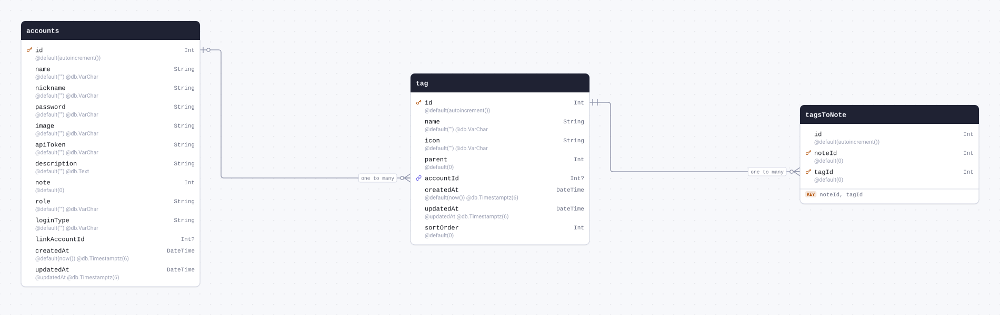

| Field       | Type                            | Constraints                           | Default           | Description |
| ----------- | ------------------------------- | ------------------------------------- | ----------------- | ----------- |
| `id`        | `Int`                           | PK NOT NULL                           | `autoincrement()` |             |
| `name`      | `String` `@db.VarChar`          | NOT NULL                              | `""`              |             |
| `icon`      | `String` `@db.VarChar`          | NOT NULL                              | `""`              |             |
| `parent`    | `Int`                           | NOT NULL                              | `0`               |             |
| `accountId` | `Int`                           | NULL → [accounts.id](#model-accounts) |                   |             |
| `createdAt` | `DateTime` `@db.Timestamptz(6)` | NOT NULL                              | `now()`           |             |
| `updatedAt` | `DateTime` `@db.Timestamptz(6)` | NOT NULL                              | `@updatedAt`      |             |
| `sortOrder` | `Int`                           | NOT NULL                              | `0`               |             |

#### References

- `accountId` → [accounts.id](#model-accounts) (many-to-one)

#### Referenced by

- `id` ← [tagsToNote.tagId](#model-tagsToNote) (one-to-many)

#### Definition

```sql
CREATE TABLE "tag" (
    "id" SERIAL NOT NULL,
    "name" VARCHAR NOT NULL DEFAULT '',
    "icon" VARCHAR NOT NULL DEFAULT '',
    "parent" INTEGER NOT NULL DEFAULT 0,
    "accountId" INTEGER,
    "createdAt" TIMESTAMPTZ(6) NOT NULL DEFAULT CURRENT_TIMESTAMP,
    "updatedAt" TIMESTAMPTZ(6) NOT NULL,
    "sortOrder" INTEGER NOT NULL DEFAULT 0,

    CONSTRAINT "tag_pkey" PRIMARY KEY ("id")
);

ALTER TABLE "tag" ADD CONSTRAINT "tag_accountId_fkey" FOREIGN KEY ("accountId") REFERENCES "accounts"("id") ON DELETE SET NULL ON UPDATE CASCADE;
```

<details>
<summary>Queries and their SQL</summary>

**findMany**: Every row

```ts
await prisma.tag.findMany();
```

```sql
SELECT
  "public"."tag"."id",
  "public"."tag"."name",
  "public"."tag"."icon",
  "public"."tag"."parent",
  "public"."tag"."accountId",
  "public"."tag"."createdAt",
  "public"."tag"."updatedAt",
  "public"."tag"."sortOrder"
FROM
  "public"."tag"
WHERE
  1 = 1
OFFSET
  $1
-- params: ["0"]
```

**count**: How many rows there are

```ts
await prisma.tag.count();
```

```sql
SELECT
  COUNT(*) AS "_count$_all"
FROM
  (
    SELECT
      "public"."tag"."id"
    FROM
      "public"."tag"
    WHERE
      1 = 1
    OFFSET
      $1
  ) AS "sub"
-- params: ["0"]
```

**findMany**: Every row with its relations

```ts
await prisma.tag.findMany({ include: { tagsToNote: true, account: true } });
```

```sql
SELECT
  "public"."tag"."id",
  "public"."tag"."name",
  "public"."tag"."icon",
  "public"."tag"."parent",
  "public"."tag"."accountId",
  "public"."tag"."createdAt",
  "public"."tag"."updatedAt",
  "public"."tag"."sortOrder"
FROM
  "public"."tag"
WHERE
  1 = 1
OFFSET
  $1
-- params: ["0"]

SELECT
  "public"."tagsToNote"."noteId",
  "public"."tagsToNote"."tagId",
  "public"."tagsToNote"."id"
FROM
  "public"."tagsToNote"
WHERE
  "public"."tagsToNote"."tagId" IN ($1)
OFFSET
  $2
-- params: ["<id of the rows above>","0"]

SELECT
  "public"."accounts"."id",
  "public"."accounts"."name",
  "public"."accounts"."nickname",
  "public"."accounts"."password",
  "public"."accounts"."image",
  "public"."accounts"."apiToken",
  "public"."accounts"."description",
  "public"."accounts"."note",
  "public"."accounts"."role",
  "public"."accounts"."loginType",
  "public"."accounts"."linkAccountId",
  "public"."accounts"."createdAt",
  "public"."accounts"."updatedAt"
FROM
  "public"."accounts"
WHERE
  "public"."accounts"."id" IN ($1)
OFFSET
  $2
-- params: ["<accountId of the rows above>","0"]
```

**findUnique**: One row by what is unique to it

```ts
await prisma.tag.findUnique({ where: { id: 1 } });
```

```sql
SELECT
  "public"."tag"."id",
  "public"."tag"."name",
  "public"."tag"."icon",
  "public"."tag"."parent",
  "public"."tag"."accountId",
  "public"."tag"."createdAt",
  "public"."tag"."updatedAt",
  "public"."tag"."sortOrder"
FROM
  "public"."tag"
WHERE
  (
    "public"."tag"."id" = $1
    AND 1 = 1
  )
LIMIT
  $2
OFFSET
  $3
-- params: ["1","1","0"]
```

**create**: Create a row

```ts
await prisma.tag.create({ data: {} });
```

```sql
INSERT INTO
  "public"."tag" (
    "name",
    "icon",
    "parent",
    "createdAt",
    "updatedAt",
    "sortOrder"
  )
VALUES
  ($1, $2, $3, $4, $5, $6)
RETURNING
  "public"."tag"."id",
  "public"."tag"."name",
  "public"."tag"."icon",
  "public"."tag"."parent",
  "public"."tag"."accountId",
  "public"."tag"."createdAt",
  "public"."tag"."updatedAt",
  "public"."tag"."sortOrder"
-- params: ["","","0","<now()>","<now()>","0"]
```

**update**: Update a row

```ts
await prisma.tag.update({ where: { id: 1 }, data: { name: "example" } });
```

```sql
UPDATE "public"."tag"
SET
  "name" = $1,
  "updatedAt" = $2
WHERE
  (
    "public"."tag"."id" = $3
    AND 1 = 1
  )
RETURNING
  "public"."tag"."id",
  "public"."tag"."name",
  "public"."tag"."icon",
  "public"."tag"."parent",
  "public"."tag"."accountId",
  "public"."tag"."createdAt",
  "public"."tag"."updatedAt",
  "public"."tag"."sortOrder"
-- params: ["example",{"prisma__type":"generatorCall","prisma__value":{"name":"now","args":[],"returnType":{"type":"DateTime"}}},"1"]
```

**delete**: Delete a row

```ts
await prisma.tag.delete({ where: { id: 1 } });
```

```sql
DELETE FROM "public"."tag"
WHERE
  (
    "public"."tag"."id" = $1
    AND 1 = 1
  )
RETURNING
  "public"."tag"."id",
  "public"."tag"."name",
  "public"."tag"."icon",
  "public"."tag"."parent",
  "public"."tag"."accountId",
  "public"."tag"."createdAt",
  "public"."tag"."updatedAt",
  "public"."tag"."sortOrder"
-- params: ["1"]
```

</details>

<a id="model-tagsToNote"></a>

### tagsToNote

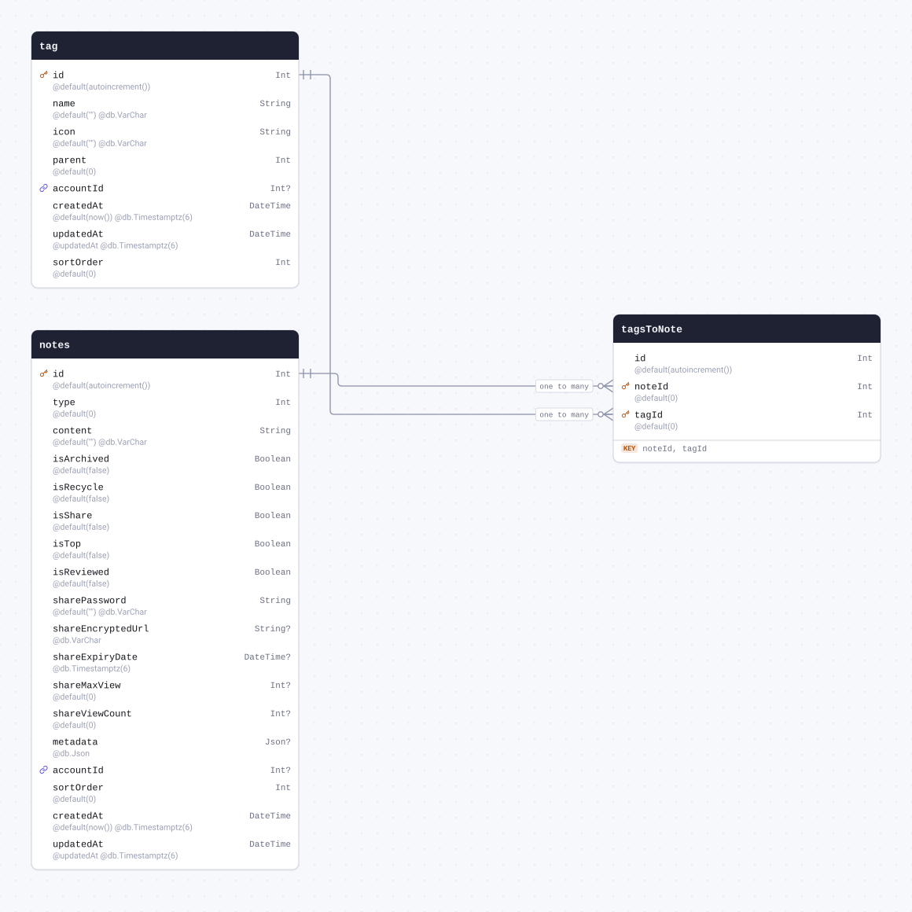

| Field    | Type  | Constraints                            | Default           | Description |
| -------- | ----- | -------------------------------------- | ----------------- | ----------- |
| `id`     | `Int` | NOT NULL                               | `autoincrement()` |             |
| `noteId` | `Int` | PK NOT NULL → [notes.id](#model-notes) | `0`               |             |
| `tagId`  | `Int` | PK NOT NULL → [tag.id](#model-tag)     | `0`               |             |

#### Indexes

- `@@id([noteId, tagId])`

#### References

- `noteId` → [notes.id](#model-notes) (many-to-one)
- `tagId` → [tag.id](#model-tag) (many-to-one)

#### Definition

```sql
CREATE TABLE "tagsToNote" (
    "id" SERIAL NOT NULL,
    "noteId" INTEGER NOT NULL DEFAULT 0,
    "tagId" INTEGER NOT NULL DEFAULT 0,

    CONSTRAINT "tagsToNote_pkey" PRIMARY KEY ("noteId","tagId")
);

ALTER TABLE "tagsToNote" ADD CONSTRAINT "tagsToNote_noteId_fkey" FOREIGN KEY ("noteId") REFERENCES "notes"("id") ON DELETE RESTRICT ON UPDATE CASCADE;

ALTER TABLE "tagsToNote" ADD CONSTRAINT "tagsToNote_tagId_fkey" FOREIGN KEY ("tagId") REFERENCES "tag"("id") ON DELETE RESTRICT ON UPDATE CASCADE;
```

<details>
<summary>Queries and their SQL</summary>

**findMany**: Every row

```ts
await prisma.tagsToNote.findMany();
```

```sql
SELECT
  "public"."tagsToNote"."noteId",
  "public"."tagsToNote"."tagId",
  "public"."tagsToNote"."id"
FROM
  "public"."tagsToNote"
WHERE
  1 = 1
OFFSET
  $1
-- params: ["0"]
```

**count**: How many rows there are

```ts
await prisma.tagsToNote.count();
```

```sql
SELECT
  COUNT(*) AS "_count$_all"
FROM
  (
    SELECT
      "public"."tagsToNote"."noteId",
      "public"."tagsToNote"."tagId"
    FROM
      "public"."tagsToNote"
    WHERE
      1 = 1
    OFFSET
      $1
  ) AS "sub"
-- params: ["0"]
```

**findMany**: Every row with its relations

```ts
await prisma.tagsToNote.findMany({ include: { note: true, tag: true } });
```

```sql
SELECT
  "public"."tagsToNote"."noteId",
  "public"."tagsToNote"."tagId",
  "public"."tagsToNote"."id"
FROM
  "public"."tagsToNote"
WHERE
  1 = 1
OFFSET
  $1
-- params: ["0"]

SELECT
  "public"."notes"."id",
  "public"."notes"."type",
  "public"."notes"."content",
  "public"."notes"."isArchived",
  "public"."notes"."isRecycle",
  "public"."notes"."isShare",
  "public"."notes"."isTop",
  "public"."notes"."isReviewed",
  "public"."notes"."sharePassword",
  "public"."notes"."shareEncryptedUrl",
  "public"."notes"."shareExpiryDate",
  "public"."notes"."shareMaxView",
  "public"."notes"."shareViewCount",
  "public"."notes"."metadata",
  "public"."notes"."accountId",
  "public"."notes"."sortOrder",
  "public"."notes"."createdAt",
  "public"."notes"."updatedAt"
FROM
  "public"."notes"
WHERE
  "public"."notes"."id" IN ($1)
OFFSET
  $2
-- params: ["<noteId of the rows above>","0"]

SELECT
  "public"."tag"."id",
  "public"."tag"."name",
  "public"."tag"."icon",
  "public"."tag"."parent",
  "public"."tag"."accountId",
  "public"."tag"."createdAt",
  "public"."tag"."updatedAt",
  "public"."tag"."sortOrder"
FROM
  "public"."tag"
WHERE
  "public"."tag"."id" IN ($1)
OFFSET
  $2
-- params: ["<tagId of the rows above>","0"]
```

**findUnique**: One row by what is unique to it

```ts
await prisma.tagsToNote.findUnique({ where: { noteId_tagId: { noteId: 1, tagId: 1 } } });
```

```sql
SELECT
  "public"."tagsToNote"."noteId",
  "public"."tagsToNote"."tagId",
  "public"."tagsToNote"."id"
FROM
  "public"."tagsToNote"
WHERE
  (
    (
      "public"."tagsToNote"."noteId" = $1
      AND "public"."tagsToNote"."tagId" = $2
    )
    AND 1 = 1
  )
LIMIT
  $3
OFFSET
  $4
-- params: ["1","1","1","0"]
```

**create**: Create a row

```ts
await prisma.tagsToNote.create({ data: {} });
```

```sql
INSERT INTO
  "public"."tagsToNote"
DEFAULT VALUES
RETURNING
  "public"."tagsToNote"."noteId",
  "public"."tagsToNote"."tagId",
  "public"."tagsToNote"."id"
```

**update**: Update a row

```ts
await prisma.tagsToNote.update({
  where: { noteId_tagId: { noteId: 1, tagId: 1 } },
  data: { id: 1 },
});
```

```sql
UPDATE "public"."tagsToNote"
SET
  "id" = $1
WHERE
  (
    (
      "public"."tagsToNote"."noteId" = $2
      AND "public"."tagsToNote"."tagId" = $3
    )
    AND 1 = 1
  )
RETURNING
  "public"."tagsToNote"."noteId",
  "public"."tagsToNote"."tagId",
  "public"."tagsToNote"."id"
-- params: ["1","1","1"]
```

**delete**: Delete a row

```ts
await prisma.tagsToNote.delete({ where: { noteId_tagId: { noteId: 1, tagId: 1 } } });
```

```sql
DELETE FROM "public"."tagsToNote"
WHERE
  (
    (
      "public"."tagsToNote"."noteId" = $1
      AND "public"."tagsToNote"."tagId" = $2
    )
    AND 1 = 1
  )
RETURNING
  "public"."tagsToNote"."noteId",
  "public"."tagsToNote"."tagId",
  "public"."tagsToNote"."id"
-- params: ["1","1"]
```

</details>

<a id="model-noteReference"></a>

### noteReference

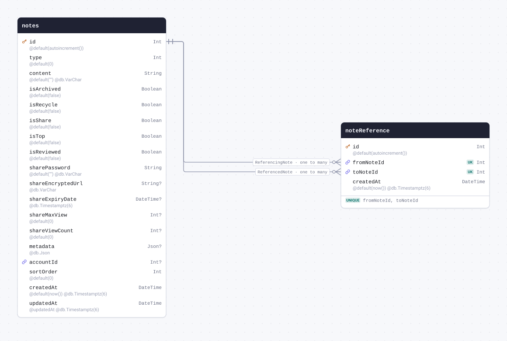

| Field        | Type                            | Constraints                         | Default           | Description |
| ------------ | ------------------------------- | ----------------------------------- | ----------------- | ----------- |
| `id`         | `Int`                           | PK NOT NULL                         | `autoincrement()` |             |
| `fromNoteId` | `Int`                           | NOT NULL → [notes.id](#model-notes) |                   |             |
| `toNoteId`   | `Int`                           | NOT NULL → [notes.id](#model-notes) |                   |             |
| `createdAt`  | `DateTime` `@db.Timestamptz(6)` | NOT NULL                            | `now()`           |             |

#### Indexes

- `@@unique([fromNoteId, toNoteId])`

#### References

- `fromNoteId` → [notes.id](#model-notes) (many-to-one)
- `toNoteId` → [notes.id](#model-notes) (many-to-one)

#### Definition

```sql
CREATE TABLE "noteReference" (
    "id" SERIAL NOT NULL,
    "fromNoteId" INTEGER NOT NULL,
    "toNoteId" INTEGER NOT NULL,
    "createdAt" TIMESTAMPTZ(6) NOT NULL DEFAULT CURRENT_TIMESTAMP,

    CONSTRAINT "noteReference_pkey" PRIMARY KEY ("id")
);

CREATE UNIQUE INDEX "noteReference_fromNoteId_toNoteId_key" ON "noteReference"("fromNoteId", "toNoteId");

ALTER TABLE "noteReference" ADD CONSTRAINT "noteReference_fromNoteId_fkey" FOREIGN KEY ("fromNoteId") REFERENCES "notes"("id") ON DELETE RESTRICT ON UPDATE CASCADE;

ALTER TABLE "noteReference" ADD CONSTRAINT "noteReference_toNoteId_fkey" FOREIGN KEY ("toNoteId") REFERENCES "notes"("id") ON DELETE RESTRICT ON UPDATE CASCADE;
```

<details>
<summary>Queries and their SQL</summary>

**findMany**: Every row

```ts
await prisma.noteReference.findMany();
```

```sql
SELECT
  "public"."noteReference"."id",
  "public"."noteReference"."fromNoteId",
  "public"."noteReference"."toNoteId",
  "public"."noteReference"."createdAt"
FROM
  "public"."noteReference"
WHERE
  1 = 1
OFFSET
  $1
-- params: ["0"]
```

**count**: How many rows there are

```ts
await prisma.noteReference.count();
```

```sql
SELECT
  COUNT(*) AS "_count$_all"
FROM
  (
    SELECT
      "public"."noteReference"."id"
    FROM
      "public"."noteReference"
    WHERE
      1 = 1
    OFFSET
      $1
  ) AS "sub"
-- params: ["0"]
```

**findMany**: Every row with its relations

```ts
await prisma.noteReference.findMany({ include: { fromNote: true, toNote: true } });
```

```sql
SELECT
  "public"."noteReference"."id",
  "public"."noteReference"."fromNoteId",
  "public"."noteReference"."toNoteId",
  "public"."noteReference"."createdAt"
FROM
  "public"."noteReference"
WHERE
  1 = 1
OFFSET
  $1
-- params: ["0"]

SELECT
  "public"."notes"."id",
  "public"."notes"."type",
  "public"."notes"."content",
  "public"."notes"."isArchived",
  "public"."notes"."isRecycle",
  "public"."notes"."isShare",
  "public"."notes"."isTop",
  "public"."notes"."isReviewed",
  "public"."notes"."sharePassword",
  "public"."notes"."shareEncryptedUrl",
  "public"."notes"."shareExpiryDate",
  "public"."notes"."shareMaxView",
  "public"."notes"."shareViewCount",
  "public"."notes"."metadata",
  "public"."notes"."accountId",
  "public"."notes"."sortOrder",
  "public"."notes"."createdAt",
  "public"."notes"."updatedAt"
FROM
  "public"."notes"
WHERE
  "public"."notes"."id" IN ($1)
OFFSET
  $2
-- params: ["<fromNoteId of the rows above>","0"]

SELECT
  "public"."notes"."id",
  "public"."notes"."type",
  "public"."notes"."content",
  "public"."notes"."isArchived",
  "public"."notes"."isRecycle",
  "public"."notes"."isShare",
  "public"."notes"."isTop",
  "public"."notes"."isReviewed",
  "public"."notes"."sharePassword",
  "public"."notes"."shareEncryptedUrl",
  "public"."notes"."shareExpiryDate",
  "public"."notes"."shareMaxView",
  "public"."notes"."shareViewCount",
  "public"."notes"."metadata",
  "public"."notes"."accountId",
  "public"."notes"."sortOrder",
  "public"."notes"."createdAt",
  "public"."notes"."updatedAt"
FROM
  "public"."notes"
WHERE
  "public"."notes"."id" IN ($1)
OFFSET
  $2
-- params: ["<toNoteId of the rows above>","0"]
```

**findUnique**: One row by what is unique to it

```ts
await prisma.noteReference.findUnique({ where: { id: 1 } });
```

```sql
SELECT
  "public"."noteReference"."id",
  "public"."noteReference"."fromNoteId",
  "public"."noteReference"."toNoteId",
  "public"."noteReference"."createdAt"
FROM
  "public"."noteReference"
WHERE
  (
    "public"."noteReference"."id" = $1
    AND 1 = 1
  )
LIMIT
  $2
OFFSET
  $3
-- params: ["1","1","0"]
```

**create**: Create a row

```ts
await prisma.noteReference.create({ data: { fromNoteId: 1, toNoteId: 1 } });
```

```sql
INSERT INTO
  "public"."noteReference" ("fromNoteId", "toNoteId", "createdAt")
VALUES
  ($1, $2, $3)
RETURNING
  "public"."noteReference"."id",
  "public"."noteReference"."fromNoteId",
  "public"."noteReference"."toNoteId",
  "public"."noteReference"."createdAt"
-- params: ["1","1","<now()>"]
```

**update**: Update a row

```ts
await prisma.noteReference.update({
  where: { id: 1 },
  data: { createdAt: new Date("2026-01-01T00:00:00.000Z") },
});
```

```sql
UPDATE "public"."noteReference"
SET
  "createdAt" = $1
WHERE
  (
    "public"."noteReference"."id" = $2
    AND 1 = 1
  )
RETURNING
  "public"."noteReference"."id",
  "public"."noteReference"."fromNoteId",
  "public"."noteReference"."toNoteId",
  "public"."noteReference"."createdAt"
-- params: ["2026-01-01T00:00:00.000Z","1"]
```

**delete**: Delete a row

```ts
await prisma.noteReference.delete({ where: { id: 1 } });
```

```sql
DELETE FROM "public"."noteReference"
WHERE
  (
    "public"."noteReference"."id" = $1
    AND 1 = 1
  )
RETURNING
  "public"."noteReference"."id",
  "public"."noteReference"."fromNoteId",
  "public"."noteReference"."toNoteId",
  "public"."noteReference"."createdAt"
-- params: ["1"]
```

</details>

<a id="model-follows"></a>

### follows

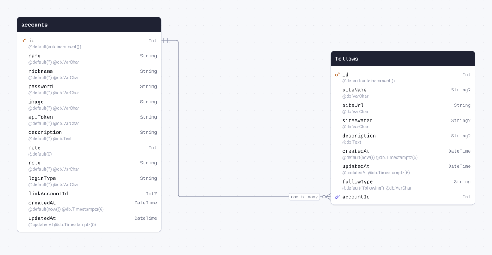

| Field         | Type                            | Constraints                               | Default           | Description |
| ------------- | ------------------------------- | ----------------------------------------- | ----------------- | ----------- |
| `id`          | `Int`                           | PK NOT NULL                               | `autoincrement()` |             |
| `siteName`    | `String` `@db.VarChar`          | NULL                                      |                   |             |
| `siteUrl`     | `String` `@db.VarChar`          | NOT NULL                                  |                   |             |
| `siteAvatar`  | `String` `@db.VarChar`          | NULL                                      |                   |             |
| `description` | `String` `@db.Text`             | NULL                                      |                   |             |
| `createdAt`   | `DateTime` `@db.Timestamptz(6)` | NOT NULL                                  | `now()`           |             |
| `updatedAt`   | `DateTime` `@db.Timestamptz(6)` | NOT NULL                                  | `@updatedAt`      |             |
| `followType`  | `String` `@db.VarChar`          | NOT NULL                                  | `"following"`     |             |
| `accountId`   | `Int`                           | NOT NULL → [accounts.id](#model-accounts) |                   |             |

#### References

- `accountId` → [accounts.id](#model-accounts) (many-to-one)

#### Definition

```sql
CREATE TABLE "follows" (
    "id" SERIAL NOT NULL,
    "siteName" VARCHAR,
    "siteUrl" VARCHAR NOT NULL,
    "siteAvatar" VARCHAR,
    "description" TEXT,
    "createdAt" TIMESTAMPTZ(6) NOT NULL DEFAULT CURRENT_TIMESTAMP,
    "updatedAt" TIMESTAMPTZ(6) NOT NULL,
    "followType" VARCHAR NOT NULL DEFAULT 'following',
    "accountId" INTEGER NOT NULL,

    CONSTRAINT "follows_pkey" PRIMARY KEY ("id")
);

ALTER TABLE "follows" ADD CONSTRAINT "follows_accountId_fkey" FOREIGN KEY ("accountId") REFERENCES "accounts"("id") ON DELETE RESTRICT ON UPDATE CASCADE;
```

<details>
<summary>Queries and their SQL</summary>

**findMany**: Every row

```ts
await prisma.follows.findMany();
```

```sql
SELECT
  "public"."follows"."id",
  "public"."follows"."siteName",
  "public"."follows"."siteUrl",
  "public"."follows"."siteAvatar",
  "public"."follows"."description",
  "public"."follows"."createdAt",
  "public"."follows"."updatedAt",
  "public"."follows"."followType",
  "public"."follows"."accountId"
FROM
  "public"."follows"
WHERE
  1 = 1
OFFSET
  $1
-- params: ["0"]
```

**count**: How many rows there are

```ts
await prisma.follows.count();
```

```sql
SELECT
  COUNT(*) AS "_count$_all"
FROM
  (
    SELECT
      "public"."follows"."id"
    FROM
      "public"."follows"
    WHERE
      1 = 1
    OFFSET
      $1
  ) AS "sub"
-- params: ["0"]
```

**findMany**: Every row with its relations

```ts
await prisma.follows.findMany({ include: { account: true } });
```

```sql
SELECT
  "public"."follows"."id",
  "public"."follows"."siteName",
  "public"."follows"."siteUrl",
  "public"."follows"."siteAvatar",
  "public"."follows"."description",
  "public"."follows"."createdAt",
  "public"."follows"."updatedAt",
  "public"."follows"."followType",
  "public"."follows"."accountId"
FROM
  "public"."follows"
WHERE
  1 = 1
OFFSET
  $1
-- params: ["0"]

SELECT
  "public"."accounts"."id",
  "public"."accounts"."name",
  "public"."accounts"."nickname",
  "public"."accounts"."password",
  "public"."accounts"."image",
  "public"."accounts"."apiToken",
  "public"."accounts"."description",
  "public"."accounts"."note",
  "public"."accounts"."role",
  "public"."accounts"."loginType",
  "public"."accounts"."linkAccountId",
  "public"."accounts"."createdAt",
  "public"."accounts"."updatedAt"
FROM
  "public"."accounts"
WHERE
  "public"."accounts"."id" IN ($1)
OFFSET
  $2
-- params: ["<accountId of the rows above>","0"]
```

**findUnique**: One row by what is unique to it

```ts
await prisma.follows.findUnique({ where: { id: 1 } });
```

```sql
SELECT
  "public"."follows"."id",
  "public"."follows"."siteName",
  "public"."follows"."siteUrl",
  "public"."follows"."siteAvatar",
  "public"."follows"."description",
  "public"."follows"."createdAt",
  "public"."follows"."updatedAt",
  "public"."follows"."followType",
  "public"."follows"."accountId"
FROM
  "public"."follows"
WHERE
  (
    "public"."follows"."id" = $1
    AND 1 = 1
  )
LIMIT
  $2
OFFSET
  $3
-- params: ["1","1","0"]
```

**create**: Create a row

```ts
await prisma.follows.create({ data: { siteUrl: "example", accountId: 1 } });
```

```sql
INSERT INTO
  "public"."follows" (
    "siteUrl",
    "createdAt",
    "updatedAt",
    "followType",
    "accountId"
  )
VALUES
  ($1, $2, $3, $4, $5)
RETURNING
  "public"."follows"."id",
  "public"."follows"."siteName",
  "public"."follows"."siteUrl",
  "public"."follows"."siteAvatar",
  "public"."follows"."description",
  "public"."follows"."createdAt",
  "public"."follows"."updatedAt",
  "public"."follows"."followType",
  "public"."follows"."accountId"
-- params: ["example","<now()>","<now()>","following","1"]
```

**update**: Update a row

```ts
await prisma.follows.update({ where: { id: 1 }, data: { siteName: "example" } });
```

```sql
UPDATE "public"."follows"
SET
  "siteName" = $1,
  "updatedAt" = $2
WHERE
  (
    "public"."follows"."id" = $3
    AND 1 = 1
  )
RETURNING
  "public"."follows"."id",
  "public"."follows"."siteName",
  "public"."follows"."siteUrl",
  "public"."follows"."siteAvatar",
  "public"."follows"."description",
  "public"."follows"."createdAt",
  "public"."follows"."updatedAt",
  "public"."follows"."followType",
  "public"."follows"."accountId"
-- params: ["example",{"prisma__type":"generatorCall","prisma__value":{"name":"now","args":[],"returnType":{"type":"DateTime"}}},"1"]
```

**delete**: Delete a row

```ts
await prisma.follows.delete({ where: { id: 1 } });
```

```sql
DELETE FROM "public"."follows"
WHERE
  (
    "public"."follows"."id" = $1
    AND 1 = 1
  )
RETURNING
  "public"."follows"."id",
  "public"."follows"."siteName",
  "public"."follows"."siteUrl",
  "public"."follows"."siteAvatar",
  "public"."follows"."description",
  "public"."follows"."createdAt",
  "public"."follows"."updatedAt",
  "public"."follows"."followType",
  "public"."follows"."accountId"
-- params: ["1"]
```

</details>

<a id="model-notifications"></a>

### notifications

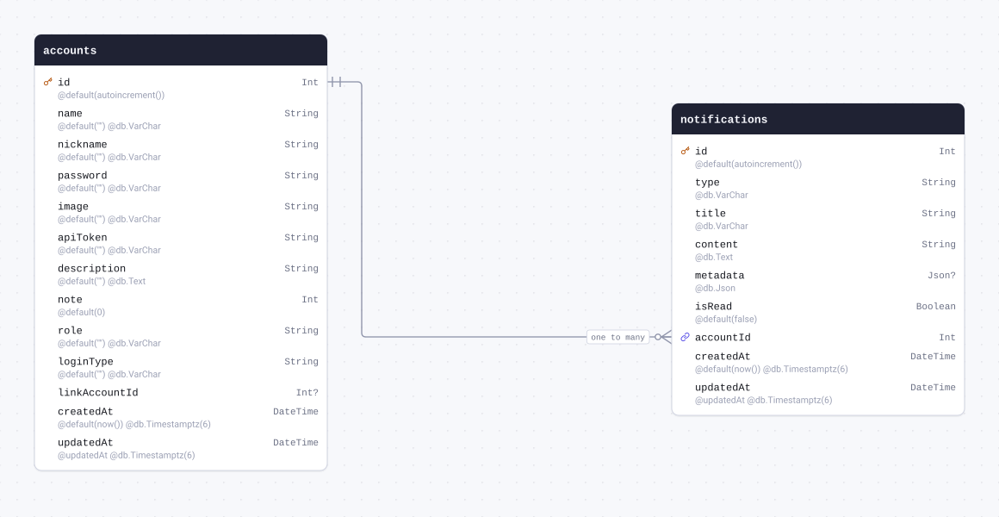

| Field       | Type                            | Constraints                               | Default           | Description |
| ----------- | ------------------------------- | ----------------------------------------- | ----------------- | ----------- |
| `id`        | `Int`                           | PK NOT NULL                               | `autoincrement()` |             |
| `type`      | `String` `@db.VarChar`          | NOT NULL                                  |                   |             |
| `title`     | `String` `@db.VarChar`          | NOT NULL                                  |                   |             |
| `content`   | `String` `@db.Text`             | NOT NULL                                  |                   |             |
| `metadata`  | `Json` `@db.Json`               | NULL                                      |                   |             |
| `isRead`    | `Boolean`                       | NOT NULL                                  | `false`           |             |
| `accountId` | `Int`                           | NOT NULL → [accounts.id](#model-accounts) |                   |             |
| `createdAt` | `DateTime` `@db.Timestamptz(6)` | NOT NULL                                  | `now()`           |             |
| `updatedAt` | `DateTime` `@db.Timestamptz(6)` | NOT NULL                                  | `@updatedAt`      |             |

#### References

- `accountId` → [accounts.id](#model-accounts) (many-to-one)

#### Definition

```sql
CREATE TABLE "notifications" (
    "id" SERIAL NOT NULL,
    "type" VARCHAR NOT NULL,
    "title" VARCHAR NOT NULL,
    "content" TEXT NOT NULL,
    "metadata" JSON,
    "isRead" BOOLEAN NOT NULL DEFAULT false,
    "accountId" INTEGER NOT NULL,
    "createdAt" TIMESTAMPTZ(6) NOT NULL DEFAULT CURRENT_TIMESTAMP,
    "updatedAt" TIMESTAMPTZ(6) NOT NULL,

    CONSTRAINT "notifications_pkey" PRIMARY KEY ("id")
);

ALTER TABLE "notifications" ADD CONSTRAINT "notifications_accountId_fkey" FOREIGN KEY ("accountId") REFERENCES "accounts"("id") ON DELETE RESTRICT ON UPDATE CASCADE;
```

<details>
<summary>Queries and their SQL</summary>

**findMany**: Every row

```ts
await prisma.notifications.findMany();
```

```sql
SELECT
  "public"."notifications"."id",
  "public"."notifications"."type",
  "public"."notifications"."title",
  "public"."notifications"."content",
  "public"."notifications"."metadata",
  "public"."notifications"."isRead",
  "public"."notifications"."accountId",
  "public"."notifications"."createdAt",
  "public"."notifications"."updatedAt"
FROM
  "public"."notifications"
WHERE
  1 = 1
OFFSET
  $1
-- params: ["0"]
```

**count**: How many rows there are

```ts
await prisma.notifications.count();
```

```sql
SELECT
  COUNT(*) AS "_count$_all"
FROM
  (
    SELECT
      "public"."notifications"."id"
    FROM
      "public"."notifications"
    WHERE
      1 = 1
    OFFSET
      $1
  ) AS "sub"
-- params: ["0"]
```

**findMany**: Every row with its relations

```ts
await prisma.notifications.findMany({ include: { account: true } });
```

```sql
SELECT
  "public"."notifications"."id",
  "public"."notifications"."type",
  "public"."notifications"."title",
  "public"."notifications"."content",
  "public"."notifications"."metadata",
  "public"."notifications"."isRead",
  "public"."notifications"."accountId",
  "public"."notifications"."createdAt",
  "public"."notifications"."updatedAt"
FROM
  "public"."notifications"
WHERE
  1 = 1
OFFSET
  $1
-- params: ["0"]

SELECT
  "public"."accounts"."id",
  "public"."accounts"."name",
  "public"."accounts"."nickname",
  "public"."accounts"."password",
  "public"."accounts"."image",
  "public"."accounts"."apiToken",
  "public"."accounts"."description",
  "public"."accounts"."note",
  "public"."accounts"."role",
  "public"."accounts"."loginType",
  "public"."accounts"."linkAccountId",
  "public"."accounts"."createdAt",
  "public"."accounts"."updatedAt"
FROM
  "public"."accounts"
WHERE
  "public"."accounts"."id" IN ($1)
OFFSET
  $2
-- params: ["<accountId of the rows above>","0"]
```

**findUnique**: One row by what is unique to it

```ts
await prisma.notifications.findUnique({ where: { id: 1 } });
```

```sql
SELECT
  "public"."notifications"."id",
  "public"."notifications"."type",
  "public"."notifications"."title",
  "public"."notifications"."content",
  "public"."notifications"."metadata",
  "public"."notifications"."isRead",
  "public"."notifications"."accountId",
  "public"."notifications"."createdAt",
  "public"."notifications"."updatedAt"
FROM
  "public"."notifications"
WHERE
  (
    "public"."notifications"."id" = $1
    AND 1 = 1
  )
LIMIT
  $2
OFFSET
  $3
-- params: ["1","1","0"]
```

**create**: Create a row

```ts
await prisma.notifications.create({
  data: { type: "example", title: "example", content: "example", accountId: 1 },
});
```

```sql
INSERT INTO
  "public"."notifications" (
    "type",
    "title",
    "content",
    "isRead",
    "accountId",
    "createdAt",
    "updatedAt"
  )
VALUES
  ($1, $2, $3, $4, $5, $6, $7)
RETURNING
  "public"."notifications"."id",
  "public"."notifications"."type",
  "public"."notifications"."title",
  "public"."notifications"."content",
  "public"."notifications"."metadata",
  "public"."notifications"."isRead",
  "public"."notifications"."accountId",
  "public"."notifications"."createdAt",
  "public"."notifications"."updatedAt"
-- params: ["example","example","example",false,"1","<now()>","<now()>"]
```

**update**: Update a row

```ts
await prisma.notifications.update({ where: { id: 1 }, data: { type: "example" } });
```

```sql
UPDATE "public"."notifications"
SET
  "type" = $1,
  "updatedAt" = $2
WHERE
  (
    "public"."notifications"."id" = $3
    AND 1 = 1
  )
RETURNING
  "public"."notifications"."id",
  "public"."notifications"."type",
  "public"."notifications"."title",
  "public"."notifications"."content",
  "public"."notifications"."metadata",
  "public"."notifications"."isRead",
  "public"."notifications"."accountId",
  "public"."notifications"."createdAt",
  "public"."notifications"."updatedAt"
-- params: ["example",{"prisma__type":"generatorCall","prisma__value":{"name":"now","args":[],"returnType":{"type":"DateTime"}}},"1"]
```

**delete**: Delete a row

```ts
await prisma.notifications.delete({ where: { id: 1 } });
```

```sql
DELETE FROM "public"."notifications"
WHERE
  (
    "public"."notifications"."id" = $1
    AND 1 = 1
  )
RETURNING
  "public"."notifications"."id",
  "public"."notifications"."type",
  "public"."notifications"."title",
  "public"."notifications"."content",
  "public"."notifications"."metadata",
  "public"."notifications"."isRead",
  "public"."notifications"."accountId",
  "public"."notifications"."createdAt",
  "public"."notifications"."updatedAt"
-- params: ["1"]
```

</details>

<a id="model-cache"></a>

### cache

| Field       | Type                            | Constraints     | Default           | Description |
| ----------- | ------------------------------- | --------------- | ----------------- | ----------- |
| `id`        | `Int`                           | PK NOT NULL     | `autoincrement()` |             |
| `key`       | `String` `@db.VarChar`          | UNIQUE NOT NULL |                   |             |
| `value`     | `Json` `@db.Json`               | NOT NULL        |                   |             |
| `createdAt` | `DateTime` `@db.Timestamptz(6)` | NOT NULL        | `now()`           |             |
| `updatedAt` | `DateTime` `@db.Timestamptz(6)` | NOT NULL        | `@updatedAt`      |             |

#### Definition

```sql
CREATE TABLE "cache" (
    "id" SERIAL NOT NULL,
    "key" VARCHAR NOT NULL,
    "value" JSON NOT NULL,
    "createdAt" TIMESTAMPTZ(6) NOT NULL DEFAULT CURRENT_TIMESTAMP,
    "updatedAt" TIMESTAMPTZ(6) NOT NULL,

    CONSTRAINT "cache_pkey" PRIMARY KEY ("id")
);

CREATE UNIQUE INDEX "cache_key_key" ON "cache"("key");
```

<details>
<summary>Queries and their SQL</summary>

**findMany**: Every row

```ts
await prisma.cache.findMany();
```

```sql
SELECT
  "public"."cache"."id",
  "public"."cache"."key",
  "public"."cache"."value",
  "public"."cache"."createdAt",
  "public"."cache"."updatedAt"
FROM
  "public"."cache"
WHERE
  1 = 1
OFFSET
  $1
-- params: ["0"]
```

**count**: How many rows there are

```ts
await prisma.cache.count();
```

```sql
SELECT
  COUNT(*) AS "_count$_all"
FROM
  (
    SELECT
      "public"."cache"."id"
    FROM
      "public"."cache"
    WHERE
      1 = 1
    OFFSET
      $1
  ) AS "sub"
-- params: ["0"]
```

**findUnique**: One row by what is unique to it

```ts
await prisma.cache.findUnique({ where: { id: 1 } });
```

```sql
SELECT
  "public"."cache"."id",
  "public"."cache"."key",
  "public"."cache"."value",
  "public"."cache"."createdAt",
  "public"."cache"."updatedAt"
FROM
  "public"."cache"
WHERE
  (
    "public"."cache"."id" = $1
    AND 1 = 1
  )
LIMIT
  $2
OFFSET
  $3
-- params: ["1","1","0"]
```

**create**: Create a row

```ts
await prisma.cache.create({ data: { key: "example", value: {} } });
```

```sql
INSERT INTO
  "public"."cache" ("key", "value", "createdAt", "updatedAt")
VALUES
  ($1, $2, $3, $4)
RETURNING
  "public"."cache"."id",
  "public"."cache"."key",
  "public"."cache"."value",
  "public"."cache"."createdAt",
  "public"."cache"."updatedAt"
-- params: ["example","{}","<now()>","<now()>"]
```

**update**: Update a row

```ts
await prisma.cache.update({ where: { id: 1 }, data: { key: "example" } });
```

```sql
UPDATE "public"."cache"
SET
  "key" = $1,
  "updatedAt" = $2
WHERE
  (
    "public"."cache"."id" = $3
    AND 1 = 1
  )
RETURNING
  "public"."cache"."id",
  "public"."cache"."key",
  "public"."cache"."value",
  "public"."cache"."createdAt",
  "public"."cache"."updatedAt"
-- params: ["example",{"prisma__type":"generatorCall","prisma__value":{"name":"now","args":[],"returnType":{"type":"DateTime"}}},"1"]
```

**delete**: Delete a row

```ts
await prisma.cache.delete({ where: { id: 1 } });
```

```sql
DELETE FROM "public"."cache"
WHERE
  (
    "public"."cache"."id" = $1
    AND 1 = 1
  )
RETURNING
  "public"."cache"."id",
  "public"."cache"."key",
  "public"."cache"."value",
  "public"."cache"."createdAt",
  "public"."cache"."updatedAt"
-- params: ["1"]
```

</details>

<a id="model-plugin"></a>

### plugin

| Field       | Type                            | Constraints | Default           | Description |
| ----------- | ------------------------------- | ----------- | ----------------- | ----------- |
| `id`        | `Int`                           | PK NOT NULL | `autoincrement()` |             |
| `metadata`  | `Json` `@db.Json`               | NOT NULL    |                   |             |
| `path`      | `String` `@db.VarChar`          | NOT NULL    |                   |             |
| `isUse`     | `Boolean`                       | NOT NULL    | `true`            |             |
| `isDev`     | `Boolean`                       | NOT NULL    | `false`           |             |
| `createdAt` | `DateTime` `@db.Timestamptz(6)` | NOT NULL    | `now()`           |             |
| `updatedAt` | `DateTime` `@db.Timestamptz(6)` | NOT NULL    | `@updatedAt`      |             |

#### Definition

```sql
CREATE TABLE "plugin" (
    "id" SERIAL NOT NULL,
    "metadata" JSON NOT NULL,
    "path" VARCHAR NOT NULL,
    "isUse" BOOLEAN NOT NULL DEFAULT true,
    "isDev" BOOLEAN NOT NULL DEFAULT false,
    "createdAt" TIMESTAMPTZ(6) NOT NULL DEFAULT CURRENT_TIMESTAMP,
    "updatedAt" TIMESTAMPTZ(6) NOT NULL,

    CONSTRAINT "plugin_pkey" PRIMARY KEY ("id")
);
```

<details>
<summary>Queries and their SQL</summary>

**findMany**: Every row

```ts
await prisma.plugin.findMany();
```

```sql
SELECT
  "public"."plugin"."id",
  "public"."plugin"."metadata",
  "public"."plugin"."path",
  "public"."plugin"."isUse",
  "public"."plugin"."isDev",
  "public"."plugin"."createdAt",
  "public"."plugin"."updatedAt"
FROM
  "public"."plugin"
WHERE
  1 = 1
OFFSET
  $1
-- params: ["0"]
```

**count**: How many rows there are

```ts
await prisma.plugin.count();
```

```sql
SELECT
  COUNT(*) AS "_count$_all"
FROM
  (
    SELECT
      "public"."plugin"."id"
    FROM
      "public"."plugin"
    WHERE
      1 = 1
    OFFSET
      $1
  ) AS "sub"
-- params: ["0"]
```

**findUnique**: One row by what is unique to it

```ts
await prisma.plugin.findUnique({ where: { id: 1 } });
```

```sql
SELECT
  "public"."plugin"."id",
  "public"."plugin"."metadata",
  "public"."plugin"."path",
  "public"."plugin"."isUse",
  "public"."plugin"."isDev",
  "public"."plugin"."createdAt",
  "public"."plugin"."updatedAt"
FROM
  "public"."plugin"
WHERE
  (
    "public"."plugin"."id" = $1
    AND 1 = 1
  )
LIMIT
  $2
OFFSET
  $3
-- params: ["1","1","0"]
```

**create**: Create a row

```ts
await prisma.plugin.create({ data: { metadata: {}, path: "example" } });
```

```sql
INSERT INTO
  "public"."plugin" (
    "metadata",
    "path",
    "isUse",
    "isDev",
    "createdAt",
    "updatedAt"
  )
VALUES
  ($1, $2, $3, $4, $5, $6)
RETURNING
  "public"."plugin"."id",
  "public"."plugin"."metadata",
  "public"."plugin"."path",
  "public"."plugin"."isUse",
  "public"."plugin"."isDev",
  "public"."plugin"."createdAt",
  "public"."plugin"."updatedAt"
-- params: ["{}","example",true,false,"<now()>","<now()>"]
```

**update**: Update a row

```ts
await prisma.plugin.update({ where: { id: 1 }, data: { metadata: {} } });
```

```sql
UPDATE "public"."plugin"
SET
  "metadata" = $1,
  "updatedAt" = $2
WHERE
  (
    "public"."plugin"."id" = $3
    AND 1 = 1
  )
RETURNING
  "public"."plugin"."id",
  "public"."plugin"."metadata",
  "public"."plugin"."path",
  "public"."plugin"."isUse",
  "public"."plugin"."isDev",
  "public"."plugin"."createdAt",
  "public"."plugin"."updatedAt"
-- params: ["{}",{"prisma__type":"generatorCall","prisma__value":{"name":"now","args":[],"returnType":{"type":"DateTime"}}},"1"]
```

**delete**: Delete a row

```ts
await prisma.plugin.delete({ where: { id: 1 } });
```

```sql
DELETE FROM "public"."plugin"
WHERE
  (
    "public"."plugin"."id" = $1
    AND 1 = 1
  )
RETURNING
  "public"."plugin"."id",
  "public"."plugin"."metadata",
  "public"."plugin"."path",
  "public"."plugin"."isUse",
  "public"."plugin"."isDev",
  "public"."plugin"."createdAt",
  "public"."plugin"."updatedAt"
-- params: ["1"]
```

</details>

<a id="model-conversation"></a>

### conversation

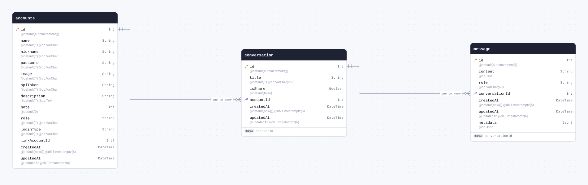

| Field       | Type                            | Constraints                               | Default           | Description |
| ----------- | ------------------------------- | ----------------------------------------- | ----------------- | ----------- |
| `id`        | `Int`                           | PK NOT NULL                               | `autoincrement()` |             |
| `title`     | `String` `@db.VarChar(255)`     | NOT NULL                                  | `""`              |             |
| `isShare`   | `Boolean`                       | NOT NULL                                  | `false`           |             |
| `accountId` | `Int`                           | NOT NULL → [accounts.id](#model-accounts) |                   |             |
| `createdAt` | `DateTime` `@db.Timestamptz(6)` | NOT NULL                                  | `now()`           |             |
| `updatedAt` | `DateTime` `@db.Timestamptz(6)` | NOT NULL                                  | `@updatedAt`      |             |

#### Indexes

- `@@index([accountId])`

#### References

- `accountId` → [accounts.id](#model-accounts) (many-to-one)

#### Referenced by

- `id` ← [message.conversationId](#model-message) (one-to-many)

#### Definition

```sql
CREATE TABLE "conversation" (
    "id" SERIAL NOT NULL,
    "title" VARCHAR(255) NOT NULL DEFAULT '',
    "isShare" BOOLEAN NOT NULL DEFAULT false,
    "accountId" INTEGER NOT NULL,
    "createdAt" TIMESTAMPTZ(6) NOT NULL DEFAULT CURRENT_TIMESTAMP,
    "updatedAt" TIMESTAMPTZ(6) NOT NULL,

    CONSTRAINT "conversation_pkey" PRIMARY KEY ("id")
);

CREATE INDEX "conversation_accountId_idx" ON "conversation"("accountId");

ALTER TABLE "conversation" ADD CONSTRAINT "conversation_accountId_fkey" FOREIGN KEY ("accountId") REFERENCES "accounts"("id") ON DELETE RESTRICT ON UPDATE CASCADE;
```

<details>
<summary>Queries and their SQL</summary>

**findMany**: Every row

```ts
await prisma.conversation.findMany();
```

```sql
SELECT
  "public"."conversation"."id",
  "public"."conversation"."title",
  "public"."conversation"."isShare",
  "public"."conversation"."accountId",
  "public"."conversation"."createdAt",
  "public"."conversation"."updatedAt"
FROM
  "public"."conversation"
WHERE
  1 = 1
OFFSET
  $1
-- params: ["0"]
```

**count**: How many rows there are

```ts
await prisma.conversation.count();
```

```sql
SELECT
  COUNT(*) AS "_count$_all"
FROM
  (
    SELECT
      "public"."conversation"."id"
    FROM
      "public"."conversation"
    WHERE
      1 = 1
    OFFSET
      $1
  ) AS "sub"
-- params: ["0"]
```

**findMany**: Every row with its relations

```ts
await prisma.conversation.findMany({ include: { messages: true, account: true } });
```

```sql
SELECT
  "public"."conversation"."id",
  "public"."conversation"."title",
  "public"."conversation"."isShare",
  "public"."conversation"."accountId",
  "public"."conversation"."createdAt",
  "public"."conversation"."updatedAt"
FROM
  "public"."conversation"
WHERE
  1 = 1
OFFSET
  $1
-- params: ["0"]

SELECT
  "public"."message"."id",
  "public"."message"."content",
  "public"."message"."role",
  "public"."message"."conversationId",
  "public"."message"."createdAt",
  "public"."message"."updatedAt",
  "public"."message"."metadata"
FROM
  "public"."message"
WHERE
  "public"."message"."conversationId" IN ($1)
OFFSET
  $2
-- params: ["<id of the rows above>","0"]

SELECT
  "public"."accounts"."id",
  "public"."accounts"."name",
  "public"."accounts"."nickname",
  "public"."accounts"."password",
  "public"."accounts"."image",
  "public"."accounts"."apiToken",
  "public"."accounts"."description",
  "public"."accounts"."note",
  "public"."accounts"."role",
  "public"."accounts"."loginType",
  "public"."accounts"."linkAccountId",
  "public"."accounts"."createdAt",
  "public"."accounts"."updatedAt"
FROM
  "public"."accounts"
WHERE
  "public"."accounts"."id" IN ($1)
OFFSET
  $2
-- params: ["<accountId of the rows above>","0"]
```

**findUnique**: One row by what is unique to it

```ts
await prisma.conversation.findUnique({ where: { id: 1 } });
```

```sql
SELECT
  "public"."conversation"."id",
  "public"."conversation"."title",
  "public"."conversation"."isShare",
  "public"."conversation"."accountId",
  "public"."conversation"."createdAt",
  "public"."conversation"."updatedAt"
FROM
  "public"."conversation"
WHERE
  (
    "public"."conversation"."id" = $1
    AND 1 = 1
  )
LIMIT
  $2
OFFSET
  $3
-- params: ["1","1","0"]
```

**create**: Create a row

```ts
await prisma.conversation.create({ data: { accountId: 1 } });
```

```sql
INSERT INTO
  "public"."conversation" (
    "title",
    "isShare",
    "accountId",
    "createdAt",
    "updatedAt"
  )
VALUES
  ($1, $2, $3, $4, $5)
RETURNING
  "public"."conversation"."id",
  "public"."conversation"."title",
  "public"."conversation"."isShare",
  "public"."conversation"."accountId",
  "public"."conversation"."createdAt",
  "public"."conversation"."updatedAt"
-- params: ["",false,"1","<now()>","<now()>"]
```

**update**: Update a row

```ts
await prisma.conversation.update({ where: { id: 1 }, data: { title: "example" } });
```

```sql
UPDATE "public"."conversation"
SET
  "title" = $1,
  "updatedAt" = $2
WHERE
  (
    "public"."conversation"."id" = $3
    AND 1 = 1
  )
RETURNING
  "public"."conversation"."id",
  "public"."conversation"."title",
  "public"."conversation"."isShare",
  "public"."conversation"."accountId",
  "public"."conversation"."createdAt",
  "public"."conversation"."updatedAt"
-- params: ["example",{"prisma__type":"generatorCall","prisma__value":{"name":"now","args":[],"returnType":{"type":"DateTime"}}},"1"]
```

**delete**: Delete a row

```ts
await prisma.conversation.delete({ where: { id: 1 } });
```

```sql
DELETE FROM "public"."conversation"
WHERE
  (
    "public"."conversation"."id" = $1
    AND 1 = 1
  )
RETURNING
  "public"."conversation"."id",
  "public"."conversation"."title",
  "public"."conversation"."isShare",
  "public"."conversation"."accountId",
  "public"."conversation"."createdAt",
  "public"."conversation"."updatedAt"
-- params: ["1"]
```

</details>

<a id="model-message"></a>

### message

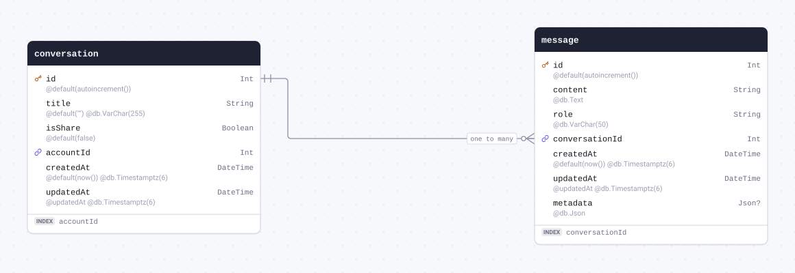

| Field            | Type                            | Constraints                                       | Default           | Description |
| ---------------- | ------------------------------- | ------------------------------------------------- | ----------------- | ----------- |
| `id`             | `Int`                           | PK NOT NULL                                       | `autoincrement()` |             |
| `content`        | `String` `@db.Text`             | NOT NULL                                          |                   |             |
| `role`           | `String` `@db.VarChar(50)`      | NOT NULL                                          |                   |             |
| `conversationId` | `Int`                           | NOT NULL → [conversation.id](#model-conversation) |                   |             |
| `createdAt`      | `DateTime` `@db.Timestamptz(6)` | NOT NULL                                          | `now()`           |             |
| `updatedAt`      | `DateTime` `@db.Timestamptz(6)` | NOT NULL                                          | `@updatedAt`      |             |
| `metadata`       | `Json` `@db.Json`               | NULL                                              |                   |             |

#### Indexes

- `@@index([conversationId])`

#### References

- `conversationId` → [conversation.id](#model-conversation) (many-to-one)

#### Definition

```sql
CREATE TABLE "message" (
    "id" SERIAL NOT NULL,
    "content" TEXT NOT NULL,
    "role" VARCHAR(50) NOT NULL,
    "conversationId" INTEGER NOT NULL,
    "createdAt" TIMESTAMPTZ(6) NOT NULL DEFAULT CURRENT_TIMESTAMP,
    "updatedAt" TIMESTAMPTZ(6) NOT NULL,
    "metadata" JSON,

    CONSTRAINT "message_pkey" PRIMARY KEY ("id")
);

CREATE INDEX "message_conversationId_idx" ON "message"("conversationId");

ALTER TABLE "message" ADD CONSTRAINT "message_conversationId_fkey" FOREIGN KEY ("conversationId") REFERENCES "conversation"("id") ON DELETE RESTRICT ON UPDATE CASCADE;
```

<details>
<summary>Queries and their SQL</summary>

**findMany**: Every row

```ts
await prisma.message.findMany();
```

```sql
SELECT
  "public"."message"."id",
  "public"."message"."content",
  "public"."message"."role",
  "public"."message"."conversationId",
  "public"."message"."createdAt",
  "public"."message"."updatedAt",
  "public"."message"."metadata"
FROM
  "public"."message"
WHERE
  1 = 1
OFFSET
  $1
-- params: ["0"]
```

**count**: How many rows there are

```ts
await prisma.message.count();
```

```sql
SELECT
  COUNT(*) AS "_count$_all"
FROM
  (
    SELECT
      "public"."message"."id"
    FROM
      "public"."message"
    WHERE
      1 = 1
    OFFSET
      $1
  ) AS "sub"
-- params: ["0"]
```

**findMany**: Every row with its relations

```ts
await prisma.message.findMany({ include: { conversation: true } });
```

```sql
SELECT
  "public"."message"."id",
  "public"."message"."content",
  "public"."message"."role",
  "public"."message"."conversationId",
  "public"."message"."createdAt",
  "public"."message"."updatedAt",
  "public"."message"."metadata"
FROM
  "public"."message"
WHERE
  1 = 1
OFFSET
  $1
-- params: ["0"]

SELECT
  "public"."conversation"."id",
  "public"."conversation"."title",
  "public"."conversation"."isShare",
  "public"."conversation"."accountId",
  "public"."conversation"."createdAt",
  "public"."conversation"."updatedAt"
FROM
  "public"."conversation"
WHERE
  "public"."conversation"."id" IN ($1)
OFFSET
  $2
-- params: ["<conversationId of the rows above>","0"]
```

**findUnique**: One row by what is unique to it

```ts
await prisma.message.findUnique({ where: { id: 1 } });
```

```sql
SELECT
  "public"."message"."id",
  "public"."message"."content",
  "public"."message"."role",
  "public"."message"."conversationId",
  "public"."message"."createdAt",
  "public"."message"."updatedAt",
  "public"."message"."metadata"
FROM
  "public"."message"
WHERE
  (
    "public"."message"."id" = $1
    AND 1 = 1
  )
LIMIT
  $2
OFFSET
  $3
-- params: ["1","1","0"]
```

**create**: Create a row

```ts
await prisma.message.create({ data: { content: "example", role: "example", conversationId: 1 } });
```

```sql
INSERT INTO
  "public"."message" (
    "content",
    "role",
    "conversationId",
    "createdAt",
    "updatedAt"
  )
VALUES
  ($1, $2, $3, $4, $5)
RETURNING
  "public"."message"."id",
  "public"."message"."content",
  "public"."message"."role",
  "public"."message"."conversationId",
  "public"."message"."createdAt",
  "public"."message"."updatedAt",
  "public"."message"."metadata"
-- params: ["example","example","1","<now()>","<now()>"]
```

**update**: Update a row

```ts
await prisma.message.update({ where: { id: 1 }, data: { content: "example" } });
```

```sql
UPDATE "public"."message"
SET
  "content" = $1,
  "updatedAt" = $2
WHERE
  (
    "public"."message"."id" = $3
    AND 1 = 1
  )
RETURNING
  "public"."message"."id",
  "public"."message"."content",
  "public"."message"."role",
  "public"."message"."conversationId",
  "public"."message"."createdAt",
  "public"."message"."updatedAt",
  "public"."message"."metadata"
-- params: ["example",{"prisma__type":"generatorCall","prisma__value":{"name":"now","args":[],"returnType":{"type":"DateTime"}}},"1"]
```

**delete**: Delete a row

```ts
await prisma.message.delete({ where: { id: 1 } });
```

```sql
DELETE FROM "public"."message"
WHERE
  (
    "public"."message"."id" = $1
    AND 1 = 1
  )
RETURNING
  "public"."message"."id",
  "public"."message"."content",
  "public"."message"."role",
  "public"."message"."conversationId",
  "public"."message"."createdAt",
  "public"."message"."updatedAt",
  "public"."message"."metadata"
-- params: ["1"]
```

</details>

<a id="model-noteHistory"></a>

### noteHistory

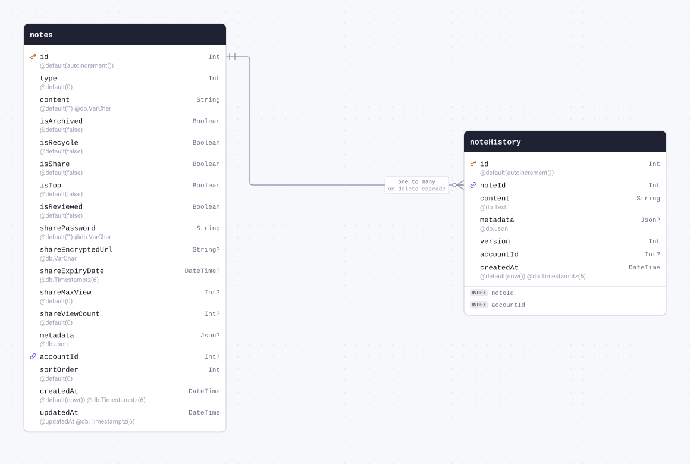

| Field       | Type                            | Constraints                         | Default           | Description |
| ----------- | ------------------------------- | ----------------------------------- | ----------------- | ----------- |
| `id`        | `Int`                           | PK NOT NULL                         | `autoincrement()` |             |
| `noteId`    | `Int`                           | NOT NULL → [notes.id](#model-notes) |                   |             |
| `content`   | `String` `@db.Text`             | NOT NULL                            |                   |             |
| `metadata`  | `Json` `@db.Json`               | NULL                                |                   |             |
| `version`   | `Int`                           | NOT NULL                            |                   |             |
| `accountId` | `Int`                           | NULL                                |                   |             |
| `createdAt` | `DateTime` `@db.Timestamptz(6)` | NOT NULL                            | `now()`           |             |

#### Indexes

- `@@index([noteId])`
- `@@index([accountId])`

#### References

- `noteId` → [notes.id](#model-notes) (many-to-one, on delete Cascade)

#### Definition

```sql
CREATE TABLE "noteHistory" (
    "id" SERIAL NOT NULL,
    "noteId" INTEGER NOT NULL,
    "content" TEXT NOT NULL,
    "metadata" JSON,
    "version" INTEGER NOT NULL,
    "accountId" INTEGER,
    "createdAt" TIMESTAMPTZ(6) NOT NULL DEFAULT CURRENT_TIMESTAMP,

    CONSTRAINT "noteHistory_pkey" PRIMARY KEY ("id")
);

CREATE INDEX "noteHistory_noteId_idx" ON "noteHistory"("noteId");

CREATE INDEX "noteHistory_accountId_idx" ON "noteHistory"("accountId");

ALTER TABLE "noteHistory" ADD CONSTRAINT "noteHistory_noteId_fkey" FOREIGN KEY ("noteId") REFERENCES "notes"("id") ON DELETE CASCADE ON UPDATE CASCADE;
```

<details>
<summary>Queries and their SQL</summary>

**findMany**: Every row

```ts
await prisma.noteHistory.findMany();
```

```sql
SELECT
  "public"."noteHistory"."id",
  "public"."noteHistory"."noteId",
  "public"."noteHistory"."content",
  "public"."noteHistory"."metadata",
  "public"."noteHistory"."version",
  "public"."noteHistory"."accountId",
  "public"."noteHistory"."createdAt"
FROM
  "public"."noteHistory"
WHERE
  1 = 1
OFFSET
  $1
-- params: ["0"]
```

**count**: How many rows there are

```ts
await prisma.noteHistory.count();
```

```sql
SELECT
  COUNT(*) AS "_count$_all"
FROM
  (
    SELECT
      "public"."noteHistory"."id"
    FROM
      "public"."noteHistory"
    WHERE
      1 = 1
    OFFSET
      $1
  ) AS "sub"
-- params: ["0"]
```

**findMany**: Every row with its relations

```ts
await prisma.noteHistory.findMany({ include: { note: true } });
```

```sql
SELECT
  "public"."noteHistory"."id",
  "public"."noteHistory"."noteId",
  "public"."noteHistory"."content",
  "public"."noteHistory"."metadata",
  "public"."noteHistory"."version",
  "public"."noteHistory"."accountId",
  "public"."noteHistory"."createdAt"
FROM
  "public"."noteHistory"
WHERE
  1 = 1
OFFSET
  $1
-- params: ["0"]

SELECT
  "public"."notes"."id",
  "public"."notes"."type",
  "public"."notes"."content",
  "public"."notes"."isArchived",
  "public"."notes"."isRecycle",
  "public"."notes"."isShare",
  "public"."notes"."isTop",
  "public"."notes"."isReviewed",
  "public"."notes"."sharePassword",
  "public"."notes"."shareEncryptedUrl",
  "public"."notes"."shareExpiryDate",
  "public"."notes"."shareMaxView",
  "public"."notes"."shareViewCount",
  "public"."notes"."metadata",
  "public"."notes"."accountId",
  "public"."notes"."sortOrder",
  "public"."notes"."createdAt",
  "public"."notes"."updatedAt"
FROM
  "public"."notes"
WHERE
  "public"."notes"."id" IN ($1)
OFFSET
  $2
-- params: ["<noteId of the rows above>","0"]
```

**findUnique**: One row by what is unique to it

```ts
await prisma.noteHistory.findUnique({ where: { id: 1 } });
```

```sql
SELECT
  "public"."noteHistory"."id",
  "public"."noteHistory"."noteId",
  "public"."noteHistory"."content",
  "public"."noteHistory"."metadata",
  "public"."noteHistory"."version",
  "public"."noteHistory"."accountId",
  "public"."noteHistory"."createdAt"
FROM
  "public"."noteHistory"
WHERE
  (
    "public"."noteHistory"."id" = $1
    AND 1 = 1
  )
LIMIT
  $2
OFFSET
  $3
-- params: ["1","1","0"]
```

**create**: Create a row

```ts
await prisma.noteHistory.create({ data: { noteId: 1, content: "example", version: 1 } });
```

```sql
INSERT INTO
  "public"."noteHistory" ("noteId", "content", "version", "createdAt")
VALUES
  ($1, $2, $3, $4)
RETURNING
  "public"."noteHistory"."id",
  "public"."noteHistory"."noteId",
  "public"."noteHistory"."content",
  "public"."noteHistory"."metadata",
  "public"."noteHistory"."version",
  "public"."noteHistory"."accountId",
  "public"."noteHistory"."createdAt"
-- params: ["1","example","1","<now()>"]
```

**update**: Update a row

```ts
await prisma.noteHistory.update({ where: { id: 1 }, data: { content: "example" } });
```

```sql
UPDATE "public"."noteHistory"
SET
  "content" = $1
WHERE
  (
    "public"."noteHistory"."id" = $2
    AND 1 = 1
  )
RETURNING
  "public"."noteHistory"."id",
  "public"."noteHistory"."noteId",
  "public"."noteHistory"."content",
  "public"."noteHistory"."metadata",
  "public"."noteHistory"."version",
  "public"."noteHistory"."accountId",
  "public"."noteHistory"."createdAt"
-- params: ["example","1"]
```

**delete**: Delete a row

```ts
await prisma.noteHistory.delete({ where: { id: 1 } });
```

```sql
DELETE FROM "public"."noteHistory"
WHERE
  (
    "public"."noteHistory"."id" = $1
    AND 1 = 1
  )
RETURNING
  "public"."noteHistory"."id",
  "public"."noteHistory"."noteId",
  "public"."noteHistory"."content",
  "public"."noteHistory"."metadata",
  "public"."noteHistory"."version",
  "public"."noteHistory"."accountId",
  "public"."noteHistory"."createdAt"
-- params: ["1"]
```

</details>

<a id="model-noteInternalShare"></a>

### noteInternalShare

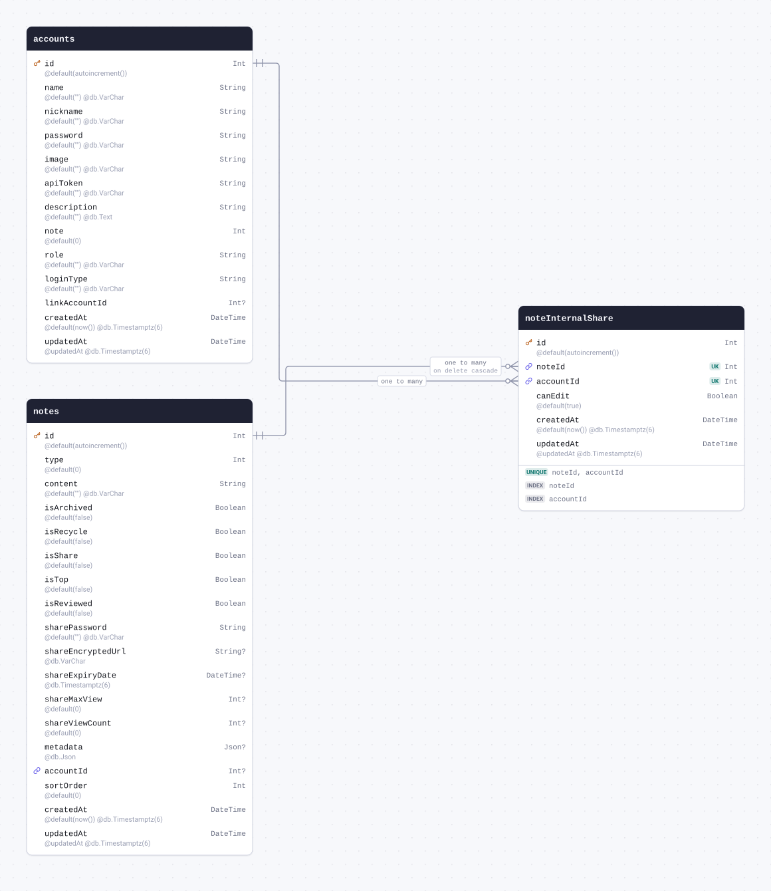

| Field       | Type                            | Constraints                               | Default           | Description |
| ----------- | ------------------------------- | ----------------------------------------- | ----------------- | ----------- |
| `id`        | `Int`                           | PK NOT NULL                               | `autoincrement()` |             |
| `noteId`    | `Int`                           | NOT NULL → [notes.id](#model-notes)       |                   |             |
| `accountId` | `Int`                           | NOT NULL → [accounts.id](#model-accounts) |                   |             |
| `canEdit`   | `Boolean`                       | NOT NULL                                  | `true`            |             |
| `createdAt` | `DateTime` `@db.Timestamptz(6)` | NOT NULL                                  | `now()`           |             |
| `updatedAt` | `DateTime` `@db.Timestamptz(6)` | NOT NULL                                  | `@updatedAt`      |             |

#### Indexes

- `@@index([noteId])`
- `@@index([accountId])`
- `@@unique([noteId, accountId])`

#### References

- `noteId` → [notes.id](#model-notes) (many-to-one, on delete Cascade)
- `accountId` → [accounts.id](#model-accounts) (many-to-one)

#### Definition

```sql
CREATE TABLE "noteInternalShare" (
    "id" SERIAL NOT NULL,
    "noteId" INTEGER NOT NULL,
    "accountId" INTEGER NOT NULL,
    "canEdit" BOOLEAN NOT NULL DEFAULT true,
    "createdAt" TIMESTAMPTZ(6) NOT NULL DEFAULT CURRENT_TIMESTAMP,
    "updatedAt" TIMESTAMPTZ(6) NOT NULL,

    CONSTRAINT "noteInternalShare_pkey" PRIMARY KEY ("id")
);

CREATE INDEX "noteInternalShare_noteId_idx" ON "noteInternalShare"("noteId");

CREATE INDEX "noteInternalShare_accountId_idx" ON "noteInternalShare"("accountId");

CREATE UNIQUE INDEX "noteInternalShare_noteId_accountId_key" ON "noteInternalShare"("noteId", "accountId");

ALTER TABLE "noteInternalShare" ADD CONSTRAINT "noteInternalShare_noteId_fkey" FOREIGN KEY ("noteId") REFERENCES "notes"("id") ON DELETE CASCADE ON UPDATE CASCADE;

ALTER TABLE "noteInternalShare" ADD CONSTRAINT "noteInternalShare_accountId_fkey" FOREIGN KEY ("accountId") REFERENCES "accounts"("id") ON DELETE RESTRICT ON UPDATE CASCADE;
```

<details>
<summary>Queries and their SQL</summary>

**findMany**: Every row

```ts
await prisma.noteInternalShare.findMany();
```

```sql
SELECT
  "public"."noteInternalShare"."id",
  "public"."noteInternalShare"."noteId",
  "public"."noteInternalShare"."accountId",
  "public"."noteInternalShare"."canEdit",
  "public"."noteInternalShare"."createdAt",
  "public"."noteInternalShare"."updatedAt"
FROM
  "public"."noteInternalShare"
WHERE
  1 = 1
OFFSET
  $1
-- params: ["0"]
```

**count**: How many rows there are

```ts
await prisma.noteInternalShare.count();
```

```sql
SELECT
  COUNT(*) AS "_count$_all"
FROM
  (
    SELECT
      "public"."noteInternalShare"."id"
    FROM
      "public"."noteInternalShare"
    WHERE
      1 = 1
    OFFSET
      $1
  ) AS "sub"
-- params: ["0"]
```

**findMany**: Every row with its relations

```ts
await prisma.noteInternalShare.findMany({ include: { note: true, account: true } });
```

```sql
SELECT
  "public"."noteInternalShare"."id",
  "public"."noteInternalShare"."noteId",
  "public"."noteInternalShare"."accountId",
  "public"."noteInternalShare"."canEdit",
  "public"."noteInternalShare"."createdAt",
  "public"."noteInternalShare"."updatedAt"
FROM
  "public"."noteInternalShare"
WHERE
  1 = 1
OFFSET
  $1
-- params: ["0"]

SELECT
  "public"."notes"."id",
  "public"."notes"."type",
  "public"."notes"."content",
  "public"."notes"."isArchived",
  "public"."notes"."isRecycle",
  "public"."notes"."isShare",
  "public"."notes"."isTop",
  "public"."notes"."isReviewed",
  "public"."notes"."sharePassword",
  "public"."notes"."shareEncryptedUrl",
  "public"."notes"."shareExpiryDate",
  "public"."notes"."shareMaxView",
  "public"."notes"."shareViewCount",
  "public"."notes"."metadata",
  "public"."notes"."accountId",
  "public"."notes"."sortOrder",
  "public"."notes"."createdAt",
  "public"."notes"."updatedAt"
FROM
  "public"."notes"
WHERE
  "public"."notes"."id" IN ($1)
OFFSET
  $2
-- params: ["<noteId of the rows above>","0"]

SELECT
  "public"."accounts"."id",
  "public"."accounts"."name",
  "public"."accounts"."nickname",
  "public"."accounts"."password",
  "public"."accounts"."image",
  "public"."accounts"."apiToken",
  "public"."accounts"."description",
  "public"."accounts"."note",
  "public"."accounts"."role",
  "public"."accounts"."loginType",
  "public"."accounts"."linkAccountId",
  "public"."accounts"."createdAt",
  "public"."accounts"."updatedAt"
FROM
  "public"."accounts"
WHERE
  "public"."accounts"."id" IN ($1)
OFFSET
  $2
-- params: ["<accountId of the rows above>","0"]
```

**findUnique**: One row by what is unique to it

```ts
await prisma.noteInternalShare.findUnique({ where: { id: 1 } });
```

```sql
SELECT
  "public"."noteInternalShare"."id",
  "public"."noteInternalShare"."noteId",
  "public"."noteInternalShare"."accountId",
  "public"."noteInternalShare"."canEdit",
  "public"."noteInternalShare"."createdAt",
  "public"."noteInternalShare"."updatedAt"
FROM
  "public"."noteInternalShare"
WHERE
  (
    "public"."noteInternalShare"."id" = $1
    AND 1 = 1
  )
LIMIT
  $2
OFFSET
  $3
-- params: ["1","1","0"]
```

**create**: Create a row

```ts
await prisma.noteInternalShare.create({ data: { noteId: 1, accountId: 1 } });
```

```sql
INSERT INTO
  "public"."noteInternalShare" (
    "noteId",
    "accountId",
    "canEdit",
    "createdAt",
    "updatedAt"
  )
VALUES
  ($1, $2, $3, $4, $5)
RETURNING
  "public"."noteInternalShare"."id",
  "public"."noteInternalShare"."noteId",
  "public"."noteInternalShare"."accountId",
  "public"."noteInternalShare"."canEdit",
  "public"."noteInternalShare"."createdAt",
  "public"."noteInternalShare"."updatedAt"
-- params: ["1","1",true,"<now()>","<now()>"]
```

**update**: Update a row

```ts
await prisma.noteInternalShare.update({ where: { id: 1 }, data: { canEdit: true } });
```

```sql
UPDATE "public"."noteInternalShare"
SET
  "canEdit" = $1,
  "updatedAt" = $2
WHERE
  (
    "public"."noteInternalShare"."id" = $3
    AND 1 = 1
  )
RETURNING
  "public"."noteInternalShare"."id",
  "public"."noteInternalShare"."noteId",
  "public"."noteInternalShare"."accountId",
  "public"."noteInternalShare"."canEdit",
  "public"."noteInternalShare"."createdAt",
  "public"."noteInternalShare"."updatedAt"
-- params: [true,{"prisma__type":"generatorCall","prisma__value":{"name":"now","args":[],"returnType":{"type":"DateTime"}}},"1"]
```

**delete**: Delete a row

```ts
await prisma.noteInternalShare.delete({ where: { id: 1 } });
```

```sql
DELETE FROM "public"."noteInternalShare"
WHERE
  (
    "public"."noteInternalShare"."id" = $1
    AND 1 = 1
  )
RETURNING
  "public"."noteInternalShare"."id",
  "public"."noteInternalShare"."noteId",
  "public"."noteInternalShare"."accountId",
  "public"."noteInternalShare"."canEdit",
  "public"."noteInternalShare"."createdAt",
  "public"."noteInternalShare"."updatedAt"
-- params: ["1"]
```

</details>

<a id="model-session"></a>

### session

| Field       | Type                            | Constraints     | Default      | Description |
| ----------- | ------------------------------- | --------------- | ------------ | ----------- |
| `id`        | `String`                        | PK NOT NULL     |              |             |
| `sid`       | `String`                        | UNIQUE NOT NULL |              |             |
| `data`      | `String` `@db.Text`             | NOT NULL        |              |             |
| `expiresAt` | `DateTime`                      | NOT NULL        |              |             |
| `createdAt` | `DateTime` `@db.Timestamptz(6)` | NOT NULL        | `now()`      |             |
| `updatedAt` | `DateTime` `@db.Timestamptz(6)` | NOT NULL        | `@updatedAt` |             |

#### Indexes

- `@@index([expiresAt])`

#### Definition

```sql
CREATE TABLE "session" (
    "id" TEXT NOT NULL,
    "sid" TEXT NOT NULL,
    "data" TEXT NOT NULL,
    "expiresAt" TIMESTAMP(3) NOT NULL,
    "createdAt" TIMESTAMPTZ(6) NOT NULL DEFAULT CURRENT_TIMESTAMP,
    "updatedAt" TIMESTAMPTZ(6) NOT NULL,

    CONSTRAINT "session_pkey" PRIMARY KEY ("id")
);

CREATE UNIQUE INDEX "session_sid_key" ON "session"("sid");

CREATE INDEX "session_expiresAt_idx" ON "session"("expiresAt");
```

<details>
<summary>Queries and their SQL</summary>

**findMany**: Every row

```ts
await prisma.session.findMany();
```

```sql
SELECT
  "public"."session"."id",
  "public"."session"."sid",
  "public"."session"."data",
  "public"."session"."expiresAt",
  "public"."session"."createdAt",
  "public"."session"."updatedAt"
FROM
  "public"."session"
WHERE
  1 = 1
OFFSET
  $1
-- params: ["0"]
```

**count**: How many rows there are

```ts
await prisma.session.count();
```

```sql
SELECT
  COUNT(*) AS "_count$_all"
FROM
  (
    SELECT
      "public"."session"."id"
    FROM
      "public"."session"
    WHERE
      1 = 1
    OFFSET
      $1
  ) AS "sub"
-- params: ["0"]
```

**findUnique**: One row by what is unique to it

```ts
await prisma.session.findUnique({ where: { id: "example" } });
```

```sql
SELECT
  "public"."session"."id",
  "public"."session"."sid",
  "public"."session"."data",
  "public"."session"."expiresAt",
  "public"."session"."createdAt",
  "public"."session"."updatedAt"
FROM
  "public"."session"
WHERE
  (
    "public"."session"."id" = $1
    AND 1 = 1
  )
LIMIT
  $2
OFFSET
  $3
-- params: ["example","1","0"]
```

**create**: Create a row

```ts
await prisma.session.create({
  data: {
    id: "example",
    sid: "example",
    data: "example",
    expiresAt: new Date("2026-01-01T00:00:00.000Z"),
  },
});
```

```sql
INSERT INTO
  "public"."session" (
    "id",
    "sid",
    "data",
    "expiresAt",
    "createdAt",
    "updatedAt"
  )
VALUES
  ($1, $2, $3, $4, $5, $6)
RETURNING
  "public"."session"."id",
  "public"."session"."sid",
  "public"."session"."data",
  "public"."session"."expiresAt",
  "public"."session"."createdAt",
  "public"."session"."updatedAt"
-- params: ["example","example","example","2026-01-01T00:00:00.000Z","<now()>","<now()>"]
```

**update**: Update a row

```ts
await prisma.session.update({ where: { id: "example" }, data: { sid: "example" } });
```

```sql
UPDATE "public"."session"
SET
  "sid" = $1,
  "updatedAt" = $2
WHERE
  (
    "public"."session"."id" = $3
    AND 1 = 1
  )
RETURNING
  "public"."session"."id",
  "public"."session"."sid",
  "public"."session"."data",
  "public"."session"."expiresAt",
  "public"."session"."createdAt",
  "public"."session"."updatedAt"
-- params: ["example",{"prisma__type":"generatorCall","prisma__value":{"name":"now","args":[],"returnType":{"type":"DateTime"}}},"example"]
```

**delete**: Delete a row

```ts
await prisma.session.delete({ where: { id: "example" } });
```

```sql
DELETE FROM "public"."session"
WHERE
  (
    "public"."session"."id" = $1
    AND 1 = 1
  )
RETURNING
  "public"."session"."id",
  "public"."session"."sid",
  "public"."session"."data",
  "public"."session"."expiresAt",
  "public"."session"."createdAt",
  "public"."session"."updatedAt"
-- params: ["example"]
```

</details>

<a id="model-aiProviders"></a>

### aiProviders


| Field       | Type                            | Constraints | Default           | Description |
| ----------- | ------------------------------- | ----------- | ----------------- | ----------- |
| `id`        | `Int`                           | PK NOT NULL | `autoincrement()` |             |
| `title`     | `String` `@db.VarChar(255)`     | NOT NULL    |                   |             |
| `provider`  | `String` `@db.VarChar(50)`      | NOT NULL    |                   |             |
| `baseURL`   | `String` `@db.VarChar(500)`     | NULL        |                   |             |
| `apiKey`    | `String` `@db.VarChar(500)`     | NULL        |                   |             |
| `config`    | `Json` `@db.Json`               | NULL        |                   |             |
| `sortOrder` | `Int`                           | NOT NULL    | `0`               |             |
| `createdAt` | `DateTime` `@db.Timestamptz(6)` | NOT NULL    | `now()`           |             |
| `updatedAt` | `DateTime` `@db.Timestamptz(6)` | NOT NULL    | `@updatedAt`      |             |

#### Referenced by

- `id` ← [aiModels.providerId](#model-aiModels) (one-to-many, on delete Cascade)

#### Definition

```sql
CREATE TABLE "aiProviders" (
    "id" SERIAL NOT NULL,
    "title" VARCHAR(255) NOT NULL,
    "provider" VARCHAR(50) NOT NULL,
    "baseURL" VARCHAR(500),
    "apiKey" VARCHAR(500),
    "config" JSON,
    "sortOrder" INTEGER NOT NULL DEFAULT 0,
    "createdAt" TIMESTAMPTZ(6) NOT NULL DEFAULT CURRENT_TIMESTAMP,
    "updatedAt" TIMESTAMPTZ(6) NOT NULL,

    CONSTRAINT "aiProviders_pkey" PRIMARY KEY ("id")
);
```

<details>
<summary>Queries and their SQL</summary>

**findMany**: Every row

```ts
await prisma.aiProviders.findMany();
```

```sql
SELECT
  "public"."aiProviders"."id",
  "public"."aiProviders"."title",
  "public"."aiProviders"."provider",
  "public"."aiProviders"."baseURL",
  "public"."aiProviders"."apiKey",
  "public"."aiProviders"."config",
  "public"."aiProviders"."sortOrder",
  "public"."aiProviders"."createdAt",
  "public"."aiProviders"."updatedAt"
FROM
  "public"."aiProviders"
WHERE
  1 = 1
OFFSET
  $1
-- params: ["0"]
```

**count**: How many rows there are

```ts
await prisma.aiProviders.count();
```

```sql
SELECT
  COUNT(*) AS "_count$_all"
FROM
  (
    SELECT
      "public"."aiProviders"."id"
    FROM
      "public"."aiProviders"
    WHERE
      1 = 1
    OFFSET
      $1
  ) AS "sub"
-- params: ["0"]
```

**findMany**: Every row with its relations

```ts
await prisma.aiProviders.findMany({ include: { models: true } });
```

```sql
SELECT
  "public"."aiProviders"."id",
  "public"."aiProviders"."title",
  "public"."aiProviders"."provider",
  "public"."aiProviders"."baseURL",
  "public"."aiProviders"."apiKey",
  "public"."aiProviders"."config",
  "public"."aiProviders"."sortOrder",
  "public"."aiProviders"."createdAt",
  "public"."aiProviders"."updatedAt"
FROM
  "public"."aiProviders"
WHERE
  1 = 1
OFFSET
  $1
-- params: ["0"]

SELECT
  "public"."aiModels"."id",
  "public"."aiModels"."providerId",
  "public"."aiModels"."title",
  "public"."aiModels"."modelKey",
  "public"."aiModels"."capabilities",
  "public"."aiModels"."config",
  "public"."aiModels"."sortOrder",
  "public"."aiModels"."createdAt",
  "public"."aiModels"."updatedAt"
FROM
  "public"."aiModels"
WHERE
  "public"."aiModels"."providerId" IN ($1)
OFFSET
  $2
-- params: ["<id of the rows above>","0"]
```

**findUnique**: One row by what is unique to it

```ts
await prisma.aiProviders.findUnique({ where: { id: 1 } });
```

```sql
SELECT
  "public"."aiProviders"."id",
  "public"."aiProviders"."title",
  "public"."aiProviders"."provider",
  "public"."aiProviders"."baseURL",
  "public"."aiProviders"."apiKey",
  "public"."aiProviders"."config",
  "public"."aiProviders"."sortOrder",
  "public"."aiProviders"."createdAt",
  "public"."aiProviders"."updatedAt"
FROM
  "public"."aiProviders"
WHERE
  (
    "public"."aiProviders"."id" = $1
    AND 1 = 1
  )
LIMIT
  $2
OFFSET
  $3
-- params: ["1","1","0"]
```

**create**: Create a row

```ts
await prisma.aiProviders.create({ data: { title: "example", provider: "example" } });
```

```sql
INSERT INTO
  "public"."aiProviders" (
    "title",
    "provider",
    "sortOrder",
    "createdAt",
    "updatedAt"
  )
VALUES
  ($1, $2, $3, $4, $5)
RETURNING
  "public"."aiProviders"."id",
  "public"."aiProviders"."title",
  "public"."aiProviders"."provider",
  "public"."aiProviders"."baseURL",
  "public"."aiProviders"."apiKey",
  "public"."aiProviders"."config",
  "public"."aiProviders"."sortOrder",
  "public"."aiProviders"."createdAt",
  "public"."aiProviders"."updatedAt"
-- params: ["example","example","0","<now()>","<now()>"]
```

**update**: Update a row

```ts
await prisma.aiProviders.update({ where: { id: 1 }, data: { title: "example" } });
```

```sql
UPDATE "public"."aiProviders"
SET
  "title" = $1,
  "updatedAt" = $2
WHERE
  (
    "public"."aiProviders"."id" = $3
    AND 1 = 1
  )
RETURNING
  "public"."aiProviders"."id",
  "public"."aiProviders"."title",
  "public"."aiProviders"."provider",
  "public"."aiProviders"."baseURL",
  "public"."aiProviders"."apiKey",
  "public"."aiProviders"."config",
  "public"."aiProviders"."sortOrder",
  "public"."aiProviders"."createdAt",
  "public"."aiProviders"."updatedAt"
-- params: ["example",{"prisma__type":"generatorCall","prisma__value":{"name":"now","args":[],"returnType":{"type":"DateTime"}}},"1"]
```

**delete**: Delete a row

```ts
await prisma.aiProviders.delete({ where: { id: 1 } });
```

```sql
DELETE FROM "public"."aiProviders"
WHERE
  (
    "public"."aiProviders"."id" = $1
    AND 1 = 1
  )
RETURNING
  "public"."aiProviders"."id",
  "public"."aiProviders"."title",
  "public"."aiProviders"."provider",
  "public"."aiProviders"."baseURL",
  "public"."aiProviders"."apiKey",
  "public"."aiProviders"."config",
  "public"."aiProviders"."sortOrder",
  "public"."aiProviders"."createdAt",
  "public"."aiProviders"."updatedAt"
-- params: ["1"]
```

</details>

<a id="model-aiModels"></a>

### aiModels

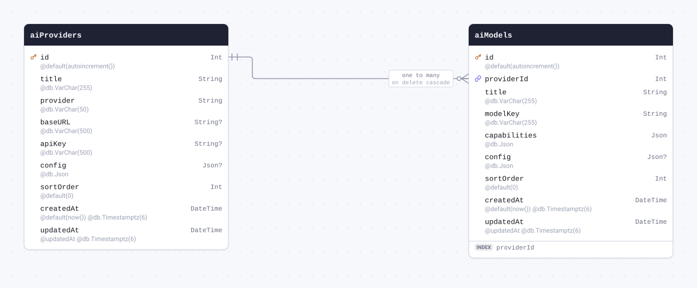

| Field          | Type                            | Constraints                                     | Default           | Description |
| -------------- | ------------------------------- | ----------------------------------------------- | ----------------- | ----------- |
| `id`           | `Int`                           | PK NOT NULL                                     | `autoincrement()` |             |
| `providerId`   | `Int`                           | NOT NULL → [aiProviders.id](#model-aiProviders) |                   |             |
| `title`        | `String` `@db.VarChar(255)`     | NOT NULL                                        |                   |             |
| `modelKey`     | `String` `@db.VarChar(255)`     | NOT NULL                                        |                   |             |
| `capabilities` | `Json` `@db.Json`               | NOT NULL                                        |                   |             |
| `config`       | `Json` `@db.Json`               | NULL                                            |                   |             |
| `sortOrder`    | `Int`                           | NOT NULL                                        | `0`               |             |
| `createdAt`    | `DateTime` `@db.Timestamptz(6)` | NOT NULL                                        | `now()`           |             |
| `updatedAt`    | `DateTime` `@db.Timestamptz(6)` | NOT NULL                                        | `@updatedAt`      |             |

#### Indexes

- `@@index([providerId])`

#### References

- `providerId` → [aiProviders.id](#model-aiProviders) (many-to-one, on delete Cascade)

#### Definition

```sql
CREATE TABLE "aiModels" (
    "id" SERIAL NOT NULL,
    "providerId" INTEGER NOT NULL,
    "title" VARCHAR(255) NOT NULL,
    "modelKey" VARCHAR(255) NOT NULL,
    "capabilities" JSON NOT NULL,
    "config" JSON,
    "sortOrder" INTEGER NOT NULL DEFAULT 0,
    "createdAt" TIMESTAMPTZ(6) NOT NULL DEFAULT CURRENT_TIMESTAMP,
    "updatedAt" TIMESTAMPTZ(6) NOT NULL,

    CONSTRAINT "aiModels_pkey" PRIMARY KEY ("id")
);

CREATE INDEX "aiModels_providerId_idx" ON "aiModels"("providerId");

ALTER TABLE "aiModels" ADD CONSTRAINT "aiModels_providerId_fkey" FOREIGN KEY ("providerId") REFERENCES "aiProviders"("id") ON DELETE CASCADE ON UPDATE CASCADE;
```

<details>
<summary>Queries and their SQL</summary>

**findMany**: Every row

```ts
await prisma.aiModels.findMany();
```

```sql
SELECT
  "public"."aiModels"."id",
  "public"."aiModels"."providerId",
  "public"."aiModels"."title",
  "public"."aiModels"."modelKey",
  "public"."aiModels"."capabilities",
  "public"."aiModels"."config",
  "public"."aiModels"."sortOrder",
  "public"."aiModels"."createdAt",
  "public"."aiModels"."updatedAt"
FROM
  "public"."aiModels"
WHERE
  1 = 1
OFFSET
  $1
-- params: ["0"]
```

**count**: How many rows there are

```ts
await prisma.aiModels.count();
```

```sql
SELECT
  COUNT(*) AS "_count$_all"
FROM
  (
    SELECT
      "public"."aiModels"."id"
    FROM
      "public"."aiModels"
    WHERE
      1 = 1
    OFFSET
      $1
  ) AS "sub"
-- params: ["0"]
```

**findMany**: Every row with its relations

```ts
await prisma.aiModels.findMany({ include: { provider: true } });
```

```sql
SELECT
  "public"."aiModels"."id",
  "public"."aiModels"."providerId",
  "public"."aiModels"."title",
  "public"."aiModels"."modelKey",
  "public"."aiModels"."capabilities",
  "public"."aiModels"."config",
  "public"."aiModels"."sortOrder",
  "public"."aiModels"."createdAt",
  "public"."aiModels"."updatedAt"
FROM
  "public"."aiModels"
WHERE
  1 = 1
OFFSET
  $1
-- params: ["0"]

SELECT
  "public"."aiProviders"."id",
  "public"."aiProviders"."title",
  "public"."aiProviders"."provider",
  "public"."aiProviders"."baseURL",
  "public"."aiProviders"."apiKey",
  "public"."aiProviders"."config",
  "public"."aiProviders"."sortOrder",
  "public"."aiProviders"."createdAt",
  "public"."aiProviders"."updatedAt"
FROM
  "public"."aiProviders"
WHERE
  "public"."aiProviders"."id" IN ($1)
OFFSET
  $2
-- params: ["<providerId of the rows above>","0"]
```

**findUnique**: One row by what is unique to it

```ts
await prisma.aiModels.findUnique({ where: { id: 1 } });
```

```sql
SELECT
  "public"."aiModels"."id",
  "public"."aiModels"."providerId",
  "public"."aiModels"."title",
  "public"."aiModels"."modelKey",
  "public"."aiModels"."capabilities",
  "public"."aiModels"."config",
  "public"."aiModels"."sortOrder",
  "public"."aiModels"."createdAt",
  "public"."aiModels"."updatedAt"
FROM
  "public"."aiModels"
WHERE
  (
    "public"."aiModels"."id" = $1
    AND 1 = 1
  )
LIMIT
  $2
OFFSET
  $3
-- params: ["1","1","0"]
```

**create**: Create a row

```ts
await prisma.aiModels.create({
  data: { providerId: 1, title: "example", modelKey: "example", capabilities: {} },
});
```

```sql
INSERT INTO
  "public"."aiModels" (
    "providerId",
    "title",
    "modelKey",
    "capabilities",
    "sortOrder",
    "createdAt",
    "updatedAt"
  )
VALUES
  ($1, $2, $3, $4, $5, $6, $7)
RETURNING
  "public"."aiModels"."id",
  "public"."aiModels"."providerId",
  "public"."aiModels"."title",
  "public"."aiModels"."modelKey",
  "public"."aiModels"."capabilities",
  "public"."aiModels"."config",
  "public"."aiModels"."sortOrder",
  "public"."aiModels"."createdAt",
  "public"."aiModels"."updatedAt"
-- params: ["1","example","example","{}","0","<now()>","<now()>"]
```

**update**: Update a row

```ts
await prisma.aiModels.update({ where: { id: 1 }, data: { title: "example" } });
```

```sql
UPDATE "public"."aiModels"
SET
  "title" = $1,
  "updatedAt" = $2
WHERE
  (
    "public"."aiModels"."id" = $3
    AND 1 = 1
  )
RETURNING
  "public"."aiModels"."id",
  "public"."aiModels"."providerId",
  "public"."aiModels"."title",
  "public"."aiModels"."modelKey",
  "public"."aiModels"."capabilities",
  "public"."aiModels"."config",
  "public"."aiModels"."sortOrder",
  "public"."aiModels"."createdAt",
  "public"."aiModels"."updatedAt"
-- params: ["example",{"prisma__type":"generatorCall","prisma__value":{"name":"now","args":[],"returnType":{"type":"DateTime"}}},"1"]
```

**delete**: Delete a row

```ts
await prisma.aiModels.delete({ where: { id: 1 } });
```

```sql
DELETE FROM "public"."aiModels"
WHERE
  (
    "public"."aiModels"."id" = $1
    AND 1 = 1
  )
RETURNING
  "public"."aiModels"."id",
  "public"."aiModels"."providerId",
  "public"."aiModels"."title",
  "public"."aiModels"."modelKey",
  "public"."aiModels"."capabilities",
  "public"."aiModels"."config",
  "public"."aiModels"."sortOrder",
  "public"."aiModels"."createdAt",
  "public"."aiModels"."updatedAt"
-- params: ["1"]
```

</details>

<a id="model-aiScheduledTask"></a>

### aiScheduledTask

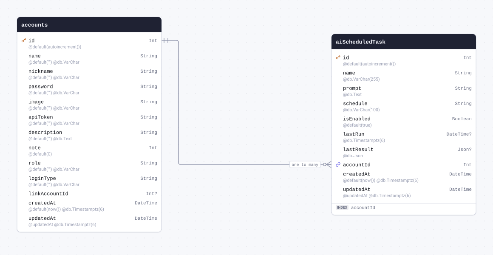

| Field        | Type                            | Constraints                               | Default           | Description |
| ------------ | ------------------------------- | ----------------------------------------- | ----------------- | ----------- |
| `id`         | `Int`                           | PK NOT NULL                               | `autoincrement()` |             |
| `name`       | `String` `@db.VarChar(255)`     | NOT NULL                                  |                   |             |
| `prompt`     | `String` `@db.Text`             | NOT NULL                                  |                   |             |
| `schedule`   | `String` `@db.VarChar(100)`     | NOT NULL                                  |                   |             |
| `isEnabled`  | `Boolean`                       | NOT NULL                                  | `true`            |             |
| `lastRun`    | `DateTime` `@db.Timestamptz(6)` | NULL                                      |                   |             |
| `lastResult` | `Json` `@db.Json`               | NULL                                      |                   |             |
| `accountId`  | `Int`                           | NOT NULL → [accounts.id](#model-accounts) |                   |             |
| `createdAt`  | `DateTime` `@db.Timestamptz(6)` | NOT NULL                                  | `now()`           |             |
| `updatedAt`  | `DateTime` `@db.Timestamptz(6)` | NOT NULL                                  | `@updatedAt`      |             |

#### Indexes

- `@@index([accountId])`

#### References

- `accountId` → [accounts.id](#model-accounts) (many-to-one)

#### Definition

```sql
CREATE TABLE "aiScheduledTask" (
    "id" SERIAL NOT NULL,
    "name" VARCHAR(255) NOT NULL,
    "prompt" TEXT NOT NULL,
    "schedule" VARCHAR(100) NOT NULL,
    "isEnabled" BOOLEAN NOT NULL DEFAULT true,
    "lastRun" TIMESTAMPTZ(6),
    "lastResult" JSON,
    "accountId" INTEGER NOT NULL,
    "createdAt" TIMESTAMPTZ(6) NOT NULL DEFAULT CURRENT_TIMESTAMP,
    "updatedAt" TIMESTAMPTZ(6) NOT NULL,

    CONSTRAINT "aiScheduledTask_pkey" PRIMARY KEY ("id")
);

CREATE INDEX "aiScheduledTask_accountId_idx" ON "aiScheduledTask"("accountId");

ALTER TABLE "aiScheduledTask" ADD CONSTRAINT "aiScheduledTask_accountId_fkey" FOREIGN KEY ("accountId") REFERENCES "accounts"("id") ON DELETE RESTRICT ON UPDATE CASCADE;
```

<details>
<summary>Queries and their SQL</summary>

**findMany**: Every row

```ts
await prisma.aiScheduledTask.findMany();
```

```sql
SELECT
  "public"."aiScheduledTask"."id",
  "public"."aiScheduledTask"."name",
  "public"."aiScheduledTask"."prompt",
  "public"."aiScheduledTask"."schedule",
  "public"."aiScheduledTask"."isEnabled",
  "public"."aiScheduledTask"."lastRun",
  "public"."aiScheduledTask"."lastResult",
  "public"."aiScheduledTask"."accountId",
  "public"."aiScheduledTask"."createdAt",
  "public"."aiScheduledTask"."updatedAt"
FROM
  "public"."aiScheduledTask"
WHERE
  1 = 1
OFFSET
  $1
-- params: ["0"]
```

**count**: How many rows there are

```ts
await prisma.aiScheduledTask.count();
```

```sql
SELECT
  COUNT(*) AS "_count$_all"
FROM
  (
    SELECT
      "public"."aiScheduledTask"."id"
    FROM
      "public"."aiScheduledTask"
    WHERE
      1 = 1
    OFFSET
      $1
  ) AS "sub"
-- params: ["0"]
```

**findMany**: Every row with its relations

```ts
await prisma.aiScheduledTask.findMany({ include: { account: true } });
```

```sql
SELECT
  "public"."aiScheduledTask"."id",
  "public"."aiScheduledTask"."name",
  "public"."aiScheduledTask"."prompt",
  "public"."aiScheduledTask"."schedule",
  "public"."aiScheduledTask"."isEnabled",
  "public"."aiScheduledTask"."lastRun",
  "public"."aiScheduledTask"."lastResult",
  "public"."aiScheduledTask"."accountId",
  "public"."aiScheduledTask"."createdAt",
  "public"."aiScheduledTask"."updatedAt"
FROM
  "public"."aiScheduledTask"
WHERE
  1 = 1
OFFSET
  $1
-- params: ["0"]

SELECT
  "public"."accounts"."id",
  "public"."accounts"."name",
  "public"."accounts"."nickname",
  "public"."accounts"."password",
  "public"."accounts"."image",
  "public"."accounts"."apiToken",
  "public"."accounts"."description",
  "public"."accounts"."note",
  "public"."accounts"."role",
  "public"."accounts"."loginType",
  "public"."accounts"."linkAccountId",
  "public"."accounts"."createdAt",
  "public"."accounts"."updatedAt"
FROM
  "public"."accounts"
WHERE
  "public"."accounts"."id" IN ($1)
OFFSET
  $2
-- params: ["<accountId of the rows above>","0"]
```

**findUnique**: One row by what is unique to it

```ts
await prisma.aiScheduledTask.findUnique({ where: { id: 1 } });
```

```sql
SELECT
  "public"."aiScheduledTask"."id",
  "public"."aiScheduledTask"."name",
  "public"."aiScheduledTask"."prompt",
  "public"."aiScheduledTask"."schedule",
  "public"."aiScheduledTask"."isEnabled",
  "public"."aiScheduledTask"."lastRun",
  "public"."aiScheduledTask"."lastResult",
  "public"."aiScheduledTask"."accountId",
  "public"."aiScheduledTask"."createdAt",
  "public"."aiScheduledTask"."updatedAt"
FROM
  "public"."aiScheduledTask"
WHERE
  (
    "public"."aiScheduledTask"."id" = $1
    AND 1 = 1
  )
LIMIT
  $2
OFFSET
  $3
-- params: ["1","1","0"]
```

**create**: Create a row

```ts
await prisma.aiScheduledTask.create({
  data: { name: "example", prompt: "example", schedule: "example", accountId: 1 },
});
```

```sql
INSERT INTO
  "public"."aiScheduledTask" (
    "name",
    "prompt",
    "schedule",
    "isEnabled",
    "accountId",
    "createdAt",
    "updatedAt"
  )
VALUES
  ($1, $2, $3, $4, $5, $6, $7)
RETURNING
  "public"."aiScheduledTask"."id",
  "public"."aiScheduledTask"."name",
  "public"."aiScheduledTask"."prompt",
  "public"."aiScheduledTask"."schedule",
  "public"."aiScheduledTask"."isEnabled",
  "public"."aiScheduledTask"."lastRun",
  "public"."aiScheduledTask"."lastResult",
  "public"."aiScheduledTask"."accountId",
  "public"."aiScheduledTask"."createdAt",
  "public"."aiScheduledTask"."updatedAt"
-- params: ["example","example","example",true,"1","<now()>","<now()>"]
```

**update**: Update a row

```ts
await prisma.aiScheduledTask.update({ where: { id: 1 }, data: { name: "example" } });
```

```sql
UPDATE "public"."aiScheduledTask"
SET
  "name" = $1,
  "updatedAt" = $2
WHERE
  (
    "public"."aiScheduledTask"."id" = $3
    AND 1 = 1
  )
RETURNING
  "public"."aiScheduledTask"."id",
  "public"."aiScheduledTask"."name",
  "public"."aiScheduledTask"."prompt",
  "public"."aiScheduledTask"."schedule",
  "public"."aiScheduledTask"."isEnabled",
  "public"."aiScheduledTask"."lastRun",
  "public"."aiScheduledTask"."lastResult",
  "public"."aiScheduledTask"."accountId",
  "public"."aiScheduledTask"."createdAt",
  "public"."aiScheduledTask"."updatedAt"
-- params: ["example",{"prisma__type":"generatorCall","prisma__value":{"name":"now","args":[],"returnType":{"type":"DateTime"}}},"1"]
```

**delete**: Delete a row

```ts
await prisma.aiScheduledTask.delete({ where: { id: 1 } });
```

```sql
DELETE FROM "public"."aiScheduledTask"
WHERE
  (
    "public"."aiScheduledTask"."id" = $1
    AND 1 = 1
  )
RETURNING
  "public"."aiScheduledTask"."id",
  "public"."aiScheduledTask"."name",
  "public"."aiScheduledTask"."prompt",
  "public"."aiScheduledTask"."schedule",
  "public"."aiScheduledTask"."isEnabled",
  "public"."aiScheduledTask"."lastRun",
  "public"."aiScheduledTask"."lastResult",
  "public"."aiScheduledTask"."accountId",
  "public"."aiScheduledTask"."createdAt",
  "public"."aiScheduledTask"."updatedAt"
-- params: ["1"]
```

</details>

<a id="model-mcpServers"></a>

### mcpServers

| Field         | Type                            | Constraints | Default           | Description |
| ------------- | ------------------------------- | ----------- | ----------------- | ----------- |
| `id`          | `Int`                           | PK NOT NULL | `autoincrement()` |             |
| `name`        | `String` `@db.VarChar(255)`     | NOT NULL    |                   |             |
| `description` | `String` `@db.Text`             | NULL        |                   |             |
| `type`        | `String` `@db.VarChar(50)`      | NOT NULL    |                   |             |
| `command`     | `String` `@db.Text`             | NULL        |                   |             |
| `args`        | `Json` `@db.Json`               | NULL        |                   |             |
| `url`         | `String` `@db.VarChar(500)`     | NULL        |                   |             |
| `env`         | `Json` `@db.Json`               | NULL        |                   |             |
| `headers`     | `Json` `@db.Json`               | NULL        |                   |             |
| `isEnabled`   | `Boolean`                       | NOT NULL    | `true`            |             |
| `createdAt`   | `DateTime` `@db.Timestamptz(6)` | NOT NULL    | `now()`           |             |
| `updatedAt`   | `DateTime` `@db.Timestamptz(6)` | NOT NULL    | `@updatedAt`      |             |

#### Definition

```sql
CREATE TABLE "mcpServers" (
    "id" SERIAL NOT NULL,
    "name" VARCHAR(255) NOT NULL,
    "description" TEXT,
    "type" VARCHAR(50) NOT NULL,
    "command" TEXT,
    "args" JSON,
    "url" VARCHAR(500),
    "env" JSON,
    "headers" JSON,
    "isEnabled" BOOLEAN NOT NULL DEFAULT true,
    "createdAt" TIMESTAMPTZ(6) NOT NULL DEFAULT CURRENT_TIMESTAMP,
    "updatedAt" TIMESTAMPTZ(6) NOT NULL,

    CONSTRAINT "mcpServers_pkey" PRIMARY KEY ("id")
);
```

<details>
<summary>Queries and their SQL</summary>

**findMany**: Every row

```ts
await prisma.mcpServers.findMany();
```

```sql
SELECT
  "public"."mcpServers"."id",
  "public"."mcpServers"."name",
  "public"."mcpServers"."description",
  "public"."mcpServers"."type",
  "public"."mcpServers"."command",
  "public"."mcpServers"."args",
  "public"."mcpServers"."url",
  "public"."mcpServers"."env",
  "public"."mcpServers"."headers",
  "public"."mcpServers"."isEnabled",
  "public"."mcpServers"."createdAt",
  "public"."mcpServers"."updatedAt"
FROM
  "public"."mcpServers"
WHERE
  1 = 1
OFFSET
  $1
-- params: ["0"]
```

**count**: How many rows there are

```ts
await prisma.mcpServers.count();
```

```sql
SELECT
  COUNT(*) AS "_count$_all"
FROM
  (
    SELECT
      "public"."mcpServers"."id"
    FROM
      "public"."mcpServers"
    WHERE
      1 = 1
    OFFSET
      $1
  ) AS "sub"
-- params: ["0"]
```

**findUnique**: One row by what is unique to it

```ts
await prisma.mcpServers.findUnique({ where: { id: 1 } });
```

```sql
SELECT
  "public"."mcpServers"."id",
  "public"."mcpServers"."name",
  "public"."mcpServers"."description",
  "public"."mcpServers"."type",
  "public"."mcpServers"."command",
  "public"."mcpServers"."args",
  "public"."mcpServers"."url",
  "public"."mcpServers"."env",
  "public"."mcpServers"."headers",
  "public"."mcpServers"."isEnabled",
  "public"."mcpServers"."createdAt",
  "public"."mcpServers"."updatedAt"
FROM
  "public"."mcpServers"
WHERE
  (
    "public"."mcpServers"."id" = $1
    AND 1 = 1
  )
LIMIT
  $2
OFFSET
  $3
-- params: ["1","1","0"]
```

**create**: Create a row

```ts
await prisma.mcpServers.create({ data: { name: "example", type: "example" } });
```

```sql
INSERT INTO
  "public"."mcpServers" (
    "name",
    "type",
    "isEnabled",
    "createdAt",
    "updatedAt"
  )
VALUES
  ($1, $2, $3, $4, $5)
RETURNING
  "public"."mcpServers"."id",
  "public"."mcpServers"."name",
  "public"."mcpServers"."description",
  "public"."mcpServers"."type",
  "public"."mcpServers"."command",
  "public"."mcpServers"."args",
  "public"."mcpServers"."url",
  "public"."mcpServers"."env",
  "public"."mcpServers"."headers",
  "public"."mcpServers"."isEnabled",
  "public"."mcpServers"."createdAt",
  "public"."mcpServers"."updatedAt"
-- params: ["example","example",true,"<now()>","<now()>"]
```

**update**: Update a row

```ts
await prisma.mcpServers.update({ where: { id: 1 }, data: { name: "example" } });
```

```sql
UPDATE "public"."mcpServers"
SET
  "name" = $1,
  "updatedAt" = $2
WHERE
  (
    "public"."mcpServers"."id" = $3
    AND 1 = 1
  )
RETURNING
  "public"."mcpServers"."id",
  "public"."mcpServers"."name",
  "public"."mcpServers"."description",
  "public"."mcpServers"."type",
  "public"."mcpServers"."command",
  "public"."mcpServers"."args",
  "public"."mcpServers"."url",
  "public"."mcpServers"."env",
  "public"."mcpServers"."headers",
  "public"."mcpServers"."isEnabled",
  "public"."mcpServers"."createdAt",
  "public"."mcpServers"."updatedAt"
-- params: ["example",{"prisma__type":"generatorCall","prisma__value":{"name":"now","args":[],"returnType":{"type":"DateTime"}}},"1"]
```

**delete**: Delete a row

```ts
await prisma.mcpServers.delete({ where: { id: 1 } });
```

```sql
DELETE FROM "public"."mcpServers"
WHERE
  (
    "public"."mcpServers"."id" = $1
    AND 1 = 1
  )
RETURNING
  "public"."mcpServers"."id",
  "public"."mcpServers"."name",
  "public"."mcpServers"."description",
  "public"."mcpServers"."type",
  "public"."mcpServers"."command",
  "public"."mcpServers"."args",
  "public"."mcpServers"."url",
  "public"."mcpServers"."env",
  "public"."mcpServers"."headers",
  "public"."mcpServers"."isEnabled",
  "public"."mcpServers"."createdAt",
  "public"."mcpServers"."updatedAt"
-- params: ["1"]
```

</details>

<a id="model-fonts"></a>

### fonts

| Field         | Type                            | Constraints     | Default           | Description |
| ------------- | ------------------------------- | --------------- | ----------------- | ----------- |
| `id`          | `Int`                           | PK NOT NULL     | `autoincrement()` |             |
| `name`        | `String` `@db.VarChar(255)`     | UNIQUE NOT NULL |                   |             |
| `displayName` | `String` `@db.VarChar(255)`     | NOT NULL        |                   |             |
| `url`         | `String` `@db.Text`             | NULL            |                   |             |
| `fileData`    | `Bytes` `@db.ByteA`             | NULL            |                   |             |
| `isLocal`     | `Boolean`                       | NOT NULL        | `false`           |             |
| `isSystem`    | `Boolean`                       | NOT NULL        | `false`           |             |
| `weights`     | `Json` `@db.Json`               | NOT NULL        |                   |             |
| `category`    | `String` `@db.VarChar(50)`      | NOT NULL        | `"sans-serif"`    |             |
| `sortOrder`   | `Int`                           | NOT NULL        | `0`               |             |
| `createdAt`   | `DateTime` `@db.Timestamptz(6)` | NOT NULL        | `now()`           |             |
| `updatedAt`   | `DateTime` `@db.Timestamptz(6)` | NOT NULL        | `@updatedAt`      |             |

#### Indexes

- `@@unique([name])`

#### Definition

```sql
CREATE TABLE "fonts" (
    "id" SERIAL NOT NULL,
    "name" VARCHAR(255) NOT NULL,
    "displayName" VARCHAR(255) NOT NULL,
    "url" TEXT,
    "fileData" BYTEA,
    "isLocal" BOOLEAN NOT NULL DEFAULT false,
    "isSystem" BOOLEAN NOT NULL DEFAULT false,
    "weights" JSON NOT NULL,
    "category" VARCHAR(50) NOT NULL DEFAULT 'sans-serif',
    "sortOrder" INTEGER NOT NULL DEFAULT 0,
    "createdAt" TIMESTAMPTZ(6) NOT NULL DEFAULT CURRENT_TIMESTAMP,
    "updatedAt" TIMESTAMPTZ(6) NOT NULL,

    CONSTRAINT "fonts_pkey" PRIMARY KEY ("id")
);

CREATE UNIQUE INDEX "fonts_name_key" ON "fonts"("name");
```

<details>
<summary>Queries and their SQL</summary>

**findMany**: Every row

```ts
await prisma.fonts.findMany();
```

```sql
SELECT
  "public"."fonts"."id",
  "public"."fonts"."name",
  "public"."fonts"."displayName",
  "public"."fonts"."url",
  "public"."fonts"."fileData",
  "public"."fonts"."isLocal",
  "public"."fonts"."isSystem",
  "public"."fonts"."weights",
  "public"."fonts"."category",
  "public"."fonts"."sortOrder",
  "public"."fonts"."createdAt",
  "public"."fonts"."updatedAt"
FROM
  "public"."fonts"
WHERE
  1 = 1
OFFSET
  $1
-- params: ["0"]
```

**count**: How many rows there are

```ts
await prisma.fonts.count();
```

```sql
SELECT
  COUNT(*) AS "_count$_all"
FROM
  (
    SELECT
      "public"."fonts"."id"
    FROM
      "public"."fonts"
    WHERE
      1 = 1
    OFFSET
      $1
  ) AS "sub"
-- params: ["0"]
```

**findUnique**: One row by what is unique to it

```ts
await prisma.fonts.findUnique({ where: { id: 1 } });
```

```sql
SELECT
  "public"."fonts"."id",
  "public"."fonts"."name",
  "public"."fonts"."displayName",
  "public"."fonts"."url",
  "public"."fonts"."fileData",
  "public"."fonts"."isLocal",
  "public"."fonts"."isSystem",
  "public"."fonts"."weights",
  "public"."fonts"."category",
  "public"."fonts"."sortOrder",
  "public"."fonts"."createdAt",
  "public"."fonts"."updatedAt"
FROM
  "public"."fonts"
WHERE
  (
    "public"."fonts"."id" = $1
    AND 1 = 1
  )
LIMIT
  $2
OFFSET
  $3
-- params: ["1","1","0"]
```

**create**: Create a row

```ts
await prisma.fonts.create({ data: { name: "example", displayName: "example", weights: {} } });
```

```sql
INSERT INTO
  "public"."fonts" (
    "name",
    "displayName",
    "isLocal",
    "isSystem",
    "weights",
    "category",
    "sortOrder",
    "createdAt",
    "updatedAt"
  )
VALUES
  ($1, $2, $3, $4, $5, $6, $7, $8, $9)
RETURNING
  "public"."fonts"."id",
  "public"."fonts"."name",
  "public"."fonts"."displayName",
  "public"."fonts"."url",
  "public"."fonts"."fileData",
  "public"."fonts"."isLocal",
  "public"."fonts"."isSystem",
  "public"."fonts"."weights",
  "public"."fonts"."category",
  "public"."fonts"."sortOrder",
  "public"."fonts"."createdAt",
  "public"."fonts"."updatedAt"
-- params: ["example","example",false,false,"{}","sans-serif","0","<now()>","<now()>"]
```

**update**: Update a row

```ts
await prisma.fonts.update({ where: { id: 1 }, data: { name: "example" } });
```

```sql
UPDATE "public"."fonts"
SET
  "name" = $1,
  "updatedAt" = $2
WHERE
  (
    "public"."fonts"."id" = $3
    AND 1 = 1
  )
RETURNING
  "public"."fonts"."id",
  "public"."fonts"."name",
  "public"."fonts"."displayName",
  "public"."fonts"."url",
  "public"."fonts"."fileData",
  "public"."fonts"."isLocal",
  "public"."fonts"."isSystem",
  "public"."fonts"."weights",
  "public"."fonts"."category",
  "public"."fonts"."sortOrder",
  "public"."fonts"."createdAt",
  "public"."fonts"."updatedAt"
-- params: ["example",{"prisma__type":"generatorCall","prisma__value":{"name":"now","args":[],"returnType":{"type":"DateTime"}}},"1"]
```

**delete**: Delete a row

```ts
await prisma.fonts.delete({ where: { id: 1 } });
```

```sql
DELETE FROM "public"."fonts"
WHERE
  (
    "public"."fonts"."id" = $1
    AND 1 = 1
  )
RETURNING
  "public"."fonts"."id",
  "public"."fonts"."name",
  "public"."fonts"."displayName",
  "public"."fonts"."url",
  "public"."fonts"."fileData",
  "public"."fonts"."isLocal",
  "public"."fonts"."isSystem",
  "public"."fonts"."weights",
  "public"."fonts"."category",
  "public"."fonts"."sortOrder",
  "public"."fonts"."createdAt",
  "public"."fonts"."updatedAt"
-- params: ["1"]
```

</details>
