# Schema docs

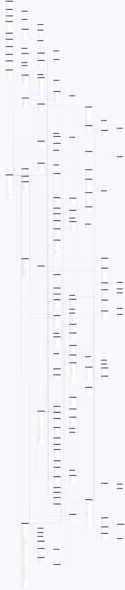

<details>
<summary>The whole schema as SQL</summary>

```sql
CREATE SCHEMA IF NOT EXISTS "public";

CREATE TYPE "SchedulingType" AS ENUM ('roundRobin', 'collective', 'managed');

CREATE TYPE "PeriodType" AS ENUM ('unlimited', 'rolling', 'rolling_window', 'range');

CREATE TYPE "CreationSource" AS ENUM ('api_v1', 'api_v2', 'webapp');

CREATE TYPE "CancellationReasonRequirement" AS ENUM ('MANDATORY_BOTH', 'MANDATORY_HOST_ONLY', 'MANDATORY_ATTENDEE_ONLY', 'OPTIONAL_BOTH');

CREATE TYPE "IdentityProvider" AS ENUM ('CAL', 'GOOGLE', 'SAML', 'AZUREAD');

CREATE TYPE "UserPermissionRole" AS ENUM ('USER', 'ADMIN');

CREATE TYPE "CreditUsageType" AS ENUM ('SMS', 'CAL_AI_PHONE_CALL');

CREATE TYPE "CreditType" AS ENUM ('MONTHLY', 'ADDITIONAL');

CREATE TYPE "MembershipRole" AS ENUM ('MEMBER', 'ADMIN', 'OWNER');

CREATE TYPE "BookingStatus" AS ENUM ('cancelled', 'accepted', 'rejected', 'pending', 'awaiting_host');

CREATE TYPE "EventTypeCustomInputType" AS ENUM ('text', 'textLong', 'number', 'bool', 'radio', 'phone');

CREATE TYPE "ReminderType" AS ENUM ('PENDING_BOOKING_CONFIRMATION');

CREATE TYPE "PaymentOption" AS ENUM ('ON_BOOKING', 'HOLD');

CREATE TYPE "WebhookTriggerEvents" AS ENUM ('BOOKING_CREATED', 'BOOKING_PAYMENT_INITIATED', 'BOOKING_PAID', 'BOOKING_RESCHEDULED', 'BOOKING_REQUESTED', 'BOOKING_CANCELLED', 'BOOKING_REJECTED', 'BOOKING_NO_SHOW_UPDATED', 'FORM_SUBMITTED', 'MEETING_ENDED', 'MEETING_STARTED', 'RECORDING_READY', 'RECORDING_TRANSCRIPTION_GENERATED', 'OOO_CREATED', 'AFTER_HOSTS_CAL_VIDEO_NO_SHOW', 'AFTER_GUESTS_CAL_VIDEO_NO_SHOW', 'FORM_SUBMITTED_NO_EVENT', 'DELEGATION_CREDENTIAL_ERROR', 'WRONG_ASSIGNMENT_REPORT');

CREATE TYPE "AppCategories" AS ENUM ('calendar', 'messaging', 'other', 'payment', 'video', 'web3', 'automation', 'analytics', 'conferencing', 'crm');

CREATE TYPE "TimeUnit" AS ENUM ('day', 'hour', 'minute');

CREATE TYPE "FeatureType" AS ENUM ('RELEASE', 'EXPERIMENT', 'OPERATIONAL', 'KILL_SWITCH', 'PERMISSION');

CREATE TYPE "RRResetInterval" AS ENUM ('MONTH', 'DAY');

CREATE TYPE "RRTimestampBasis" AS ENUM ('CREATED_AT', 'START_TIME');

CREATE TYPE "OAuthClientType" AS ENUM ('confidential', 'public');

CREATE TYPE "OAuthClientStatus" AS ENUM ('pending', 'approved', 'rejected');

CREATE TYPE "AccessScope" AS ENUM ('READ_BOOKING', 'READ_PROFILE');

CREATE TYPE "RedirectType" AS ENUM ('user-event-type', 'team-event-type', 'user', 'team');

CREATE TYPE "SMSLockState" AS ENUM ('LOCKED', 'UNLOCKED', 'REVIEW_NEEDED');

CREATE TYPE "AttributeType" AS ENUM ('TEXT', 'NUMBER', 'SINGLE_SELECT', 'MULTI_SELECT');

CREATE TYPE "AssignmentReasonEnum" AS ENUM ('REASSIGNED', 'RR_REASSIGNED', 'REROUTED', 'SALESFORCE_ASSIGNMENT');

CREATE TYPE "EventTypeAutoTranslatedField" AS ENUM ('DESCRIPTION', 'TITLE');

CREATE TYPE "WatchlistType" AS ENUM ('EMAIL', 'DOMAIN', 'USERNAME');

CREATE TYPE "WatchlistAction" AS ENUM ('REPORT', 'BLOCK', 'ALERT');

CREATE TYPE "WatchlistSource" AS ENUM ('MANUAL', 'FREE_DOMAIN_POLICY', 'SIGNUP');

CREATE TYPE "BookingReportReason" AS ENUM ('SPAM', 'dont_know_person', 'OTHER');

CREATE TYPE "BookingReportStatus" AS ENUM ('PENDING', 'DISMISSED', 'BLOCKED');

CREATE TYPE "SystemReportStatus" AS ENUM ('PENDING', 'BLOCKED', 'DISMISSED');

CREATE TYPE "WrongAssignmentReportStatus" AS ENUM ('PENDING', 'REVIEWED', 'RESOLVED', 'DISMISSED');

CREATE TYPE "BillingPeriod" AS ENUM ('MONTHLY', 'ANNUALLY');

CREATE TYPE "BillingMode" AS ENUM ('SEATS', 'ACTIVE_USERS');

CREATE TYPE "FilterSegmentScope" AS ENUM ('USER', 'TEAM');

CREATE TYPE "RoleType" AS ENUM ('SYSTEM', 'CUSTOM');

CREATE TYPE "BookingAuditType" AS ENUM ('record_created', 'record_updated', 'record_deleted');

CREATE TYPE "BookingAuditAction" AS ENUM ('created', 'cancelled', 'accepted', 'rejected', 'pending', 'awaiting_host', 'rescheduled', 'attendee_added', 'attendee_removed', 'reassignment', 'location_changed', 'no_show_updated', 'reschedule_requested', 'seat_booked', 'seat_rescheduled');

CREATE TYPE "BookingAuditSource" AS ENUM ('api_v1', 'api_v2', 'webapp', 'webhook', 'system', 'magic_link', 'unknown');

CREATE TYPE "AuditActorType" AS ENUM ('user', 'guest', 'attendee', 'system', 'app');

CREATE TYPE "PhoneNumberSubscriptionStatus" AS ENUM ('ACTIVE', 'PAST_DUE', 'CANCELLED', 'INCOMPLETE', 'INCOMPLETE_EXPIRED', 'TRIALING', 'UNPAID');

CREATE TYPE "SeatChangeType" AS ENUM ('ADDITION', 'REMOVAL');

CREATE TYPE "ProrationStatus" AS ENUM ('PENDING', 'INVOICE_CREATED', 'CHARGED', 'FAILED', 'CANCELLED');

CREATE TYPE "CalendarCacheEventStatus" AS ENUM ('confirmed', 'tentative', 'cancelled');

CREATE TABLE "Host" (
    "userId" INTEGER NOT NULL,
    "eventTypeId" INTEGER NOT NULL,
    "isFixed" BOOLEAN NOT NULL DEFAULT false,
    "priority" INTEGER,
    "weight" INTEGER,
    "weightAdjustment" INTEGER,
    "scheduleId" INTEGER,
    "createdAt" TIMESTAMP(3) NOT NULL DEFAULT CURRENT_TIMESTAMP,
    "groupId" TEXT,
    "memberId" INTEGER,

    CONSTRAINT "Host_pkey" PRIMARY KEY ("userId","eventTypeId")
);

CREATE TABLE "HostGroup" (
    "id" TEXT NOT NULL,
    "name" TEXT NOT NULL,
    "eventTypeId" INTEGER,
    "createdAt" TIMESTAMP(3) NOT NULL DEFAULT CURRENT_TIMESTAMP,
    "updatedAt" TIMESTAMP(3) NOT NULL,

    CONSTRAINT "HostGroup_pkey" PRIMARY KEY ("id")
);

CREATE TABLE "HostLocation" (
    "id" TEXT NOT NULL,
    "userId" INTEGER NOT NULL,
    "eventTypeId" INTEGER NOT NULL,
    "type" TEXT NOT NULL,
    "credentialId" INTEGER,
    "link" TEXT,
    "address" TEXT,
    "phoneNumber" TEXT,
    "createdAt" TIMESTAMP(3) NOT NULL DEFAULT CURRENT_TIMESTAMP,
    "updatedAt" TIMESTAMP(3) NOT NULL,

    CONSTRAINT "HostLocation_pkey" PRIMARY KEY ("id")
);

CREATE TABLE "CalVideoSettings" (
    "eventTypeId" INTEGER NOT NULL,
    "disableRecordingForOrganizer" BOOLEAN NOT NULL DEFAULT false,
    "disableRecordingForGuests" BOOLEAN NOT NULL DEFAULT false,
    "enableAutomaticTranscription" BOOLEAN NOT NULL DEFAULT false,
    "enableAutomaticRecordingForOrganizer" BOOLEAN NOT NULL DEFAULT false,
    "redirectUrlOnExit" TEXT,
    "disableTranscriptionForGuests" BOOLEAN NOT NULL DEFAULT false,
    "disableTranscriptionForOrganizer" BOOLEAN NOT NULL DEFAULT false,
    "requireEmailForGuests" BOOLEAN NOT NULL DEFAULT false,
    "createdAt" TIMESTAMP(3) NOT NULL DEFAULT CURRENT_TIMESTAMP,
    "updatedAt" TIMESTAMP(3) NOT NULL,

    CONSTRAINT "CalVideoSettings_pkey" PRIMARY KEY ("eventTypeId")
);

CREATE TABLE "VideoCallGuest" (
    "id" TEXT NOT NULL,
    "bookingUid" TEXT NOT NULL,
    "email" TEXT NOT NULL,
    "name" TEXT NOT NULL,
    "joinedAt" TIMESTAMP(3),
    "createdAt" TIMESTAMP(3) NOT NULL DEFAULT CURRENT_TIMESTAMP,
    "updatedAt" TIMESTAMP(3) NOT NULL,

    CONSTRAINT "VideoCallGuest_pkey" PRIMARY KEY ("id")
);

CREATE TABLE "EventType" (
    "id" SERIAL NOT NULL,
    "title" TEXT NOT NULL,
    "slug" TEXT NOT NULL,
    "description" TEXT,
    "interfaceLanguage" TEXT,
    "position" INTEGER NOT NULL DEFAULT 0,
    "locations" JSONB,
    "length" INTEGER NOT NULL,
    "offsetStart" INTEGER NOT NULL DEFAULT 0,
    "hidden" BOOLEAN NOT NULL DEFAULT false,
    "userId" INTEGER,
    "profileId" INTEGER,
    "teamId" INTEGER,
    "useEventLevelSelectedCalendars" BOOLEAN NOT NULL DEFAULT false,
    "eventName" TEXT,
    "parentId" INTEGER,
    "bookingFields" JSONB,
    "timeZone" TEXT,
    "periodType" "PeriodType" NOT NULL DEFAULT 'unlimited',
    "periodStartDate" TIMESTAMP(3),
    "periodEndDate" TIMESTAMP(3),
    "periodDays" INTEGER,
    "periodCountCalendarDays" BOOLEAN,
    "lockTimeZoneToggleOnBookingPage" BOOLEAN NOT NULL DEFAULT false,
    "lockedTimeZone" TEXT,
    "requiresConfirmation" BOOLEAN NOT NULL DEFAULT false,
    "requiresConfirmationWillBlockSlot" BOOLEAN NOT NULL DEFAULT false,
    "requiresConfirmationForFreeEmail" BOOLEAN NOT NULL DEFAULT false,
    "requiresBookerEmailVerification" BOOLEAN NOT NULL DEFAULT false,
    "canSendCalVideoTranscriptionEmails" BOOLEAN NOT NULL DEFAULT true,
    "autoTranslateDescriptionEnabled" BOOLEAN NOT NULL DEFAULT false,
    "autoTranslateInstantMeetingTitleEnabled" BOOLEAN NOT NULL DEFAULT true,
    "recurringEvent" JSONB,
    "disableGuests" BOOLEAN NOT NULL DEFAULT false,
    "hideCalendarNotes" BOOLEAN NOT NULL DEFAULT false,
    "hideCalendarEventDetails" BOOLEAN NOT NULL DEFAULT false,
    "minimumBookingNotice" INTEGER NOT NULL DEFAULT 120,
    "beforeEventBuffer" INTEGER NOT NULL DEFAULT 0,
    "afterEventBuffer" INTEGER NOT NULL DEFAULT 0,
    "seatsPerTimeSlot" INTEGER,
    "onlyShowFirstAvailableSlot" BOOLEAN NOT NULL DEFAULT false,
    "showOptimizedSlots" BOOLEAN DEFAULT false,
    "disableCancelling" BOOLEAN DEFAULT false,
    "disableRescheduling" BOOLEAN DEFAULT false,
    "minimumRescheduleNotice" INTEGER,
    "seatsShowAttendees" BOOLEAN DEFAULT false,
    "seatsShowAvailabilityCount" BOOLEAN DEFAULT true,
    "schedulingType" "SchedulingType",
    "scheduleId" INTEGER,
    "allowReschedulingCancelledBookings" BOOLEAN DEFAULT false,
    "price" INTEGER NOT NULL DEFAULT 0,
    "currency" TEXT NOT NULL DEFAULT 'usd',
    "slotInterval" INTEGER,
    "metadata" JSONB,
    "successRedirectUrl" TEXT,
    "forwardParamsSuccessRedirect" BOOLEAN DEFAULT true,
    "bookingLimits" JSONB,
    "durationLimits" JSONB,
    "isInstantEvent" BOOLEAN NOT NULL DEFAULT false,
    "instantMeetingExpiryTimeOffsetInSeconds" INTEGER NOT NULL DEFAULT 90,
    "instantMeetingScheduleId" INTEGER,
    "instantMeetingParameters" TEXT[],
    "assignAllTeamMembers" BOOLEAN NOT NULL DEFAULT false,
    "assignRRMembersUsingSegment" BOOLEAN NOT NULL DEFAULT false,
    "rrSegmentQueryValue" JSONB,
    "useEventTypeDestinationCalendarEmail" BOOLEAN NOT NULL DEFAULT false,
    "isRRWeightsEnabled" BOOLEAN NOT NULL DEFAULT false,
    "maxLeadThreshold" INTEGER,
    "includeNoShowInRRCalculation" BOOLEAN NOT NULL DEFAULT false,
    "allowReschedulingPastBookings" BOOLEAN NOT NULL DEFAULT false,
    "hideOrganizerEmail" BOOLEAN NOT NULL DEFAULT false,
    "maxActiveBookingsPerBooker" INTEGER,
    "maxActiveBookingPerBookerOfferReschedule" BOOLEAN NOT NULL DEFAULT false,
    "customReplyToEmail" TEXT,
    "eventTypeColor" JSONB,
    "rescheduleWithSameRoundRobinHost" BOOLEAN NOT NULL DEFAULT false,
    "secondaryEmailId" INTEGER,
    "useBookerTimezone" BOOLEAN NOT NULL DEFAULT false,
    "restrictionScheduleId" INTEGER,
    "bookingRequiresAuthentication" BOOLEAN NOT NULL DEFAULT false,
    "rrHostSubsetEnabled" BOOLEAN NOT NULL DEFAULT false,
    "requiresCancellationReason" "CancellationReasonRequirement" DEFAULT 'MANDATORY_HOST_ONLY',
    "enablePerHostLocations" BOOLEAN NOT NULL DEFAULT false,
    "createdAt" TIMESTAMP(3) DEFAULT CURRENT_TIMESTAMP,
    "updatedAt" TIMESTAMP(3),

    CONSTRAINT "EventType_pkey" PRIMARY KEY ("id")
);

CREATE TABLE "Credential" (
    "id" SERIAL NOT NULL,
    "type" TEXT NOT NULL,
    "key" JSONB NOT NULL,
    "encryptedKey" TEXT,
    "userId" INTEGER,
    "teamId" INTEGER,
    "appId" TEXT,
    "subscriptionId" TEXT,
    "paymentStatus" TEXT,
    "billingCycleStart" INTEGER,
    "invalid" BOOLEAN DEFAULT false,
    "delegationCredentialId" TEXT,

    CONSTRAINT "Credential_pkey" PRIMARY KEY ("id")
);

CREATE TABLE "DestinationCalendar" (
    "id" SERIAL NOT NULL,
    "integration" TEXT NOT NULL,
    "externalId" TEXT NOT NULL,
    "primaryEmail" TEXT,
    "userId" INTEGER,
    "eventTypeId" INTEGER,
    "credentialId" INTEGER,
    "createdAt" TIMESTAMP(3) DEFAULT CURRENT_TIMESTAMP,
    "updatedAt" TIMESTAMP(3),
    "delegationCredentialId" TEXT,
    "customCalendarReminder" INTEGER,

    CONSTRAINT "DestinationCalendar_pkey" PRIMARY KEY ("id")
);

CREATE TABLE "UserPassword" (
    "hash" TEXT NOT NULL,
    "userId" INTEGER NOT NULL
);

CREATE TABLE "TravelSchedule" (
    "id" SERIAL NOT NULL,
    "userId" INTEGER NOT NULL,
    "timeZone" TEXT NOT NULL,
    "startDate" TIMESTAMP(3) NOT NULL,
    "endDate" TIMESTAMP(3),
    "prevTimeZone" TEXT,

    CONSTRAINT "TravelSchedule_pkey" PRIMARY KEY ("id")
);

CREATE TABLE "users" (
    "id" SERIAL NOT NULL,
    "uuid" UUID NOT NULL,
    "username" TEXT,
    "name" TEXT,
    "email" TEXT NOT NULL,
    "emailVerified" TIMESTAMP(3),
    "bio" TEXT,
    "avatarUrl" TEXT,
    "timeZone" TEXT NOT NULL DEFAULT 'Europe/London',
    "weekStart" TEXT NOT NULL DEFAULT 'Sunday',
    "bufferTime" INTEGER NOT NULL DEFAULT 0,
    "hideBranding" BOOLEAN NOT NULL DEFAULT false,
    "theme" TEXT,
    "appTheme" TEXT,
    "created" TIMESTAMP(3) NOT NULL DEFAULT CURRENT_TIMESTAMP,
    "trialEndsAt" TIMESTAMP(3),
    "lastActiveAt" TIMESTAMP(3),
    "defaultScheduleId" INTEGER,
    "completedOnboarding" BOOLEAN NOT NULL DEFAULT false,
    "locale" TEXT,
    "timeFormat" INTEGER DEFAULT 12,
    "twoFactorSecret" TEXT,
    "twoFactorEnabled" BOOLEAN NOT NULL DEFAULT false,
    "backupCodes" TEXT,
    "identityProvider" "IdentityProvider" NOT NULL DEFAULT 'CAL',
    "identityProviderId" TEXT,
    "invitedTo" INTEGER,
    "brandColor" TEXT,
    "darkBrandColor" TEXT,
    "allowDynamicBooking" BOOLEAN DEFAULT true,
    "allowSEOIndexing" BOOLEAN DEFAULT true,
    "receiveMonthlyDigestEmail" BOOLEAN DEFAULT true,
    "requiresBookerEmailVerification" BOOLEAN DEFAULT false,
    "metadata" JSONB,
    "verified" BOOLEAN DEFAULT false,
    "role" "UserPermissionRole" NOT NULL DEFAULT 'USER',
    "organizationId" INTEGER,
    "locked" BOOLEAN NOT NULL DEFAULT false,
    "movedToProfileId" INTEGER,
    "isPlatformManaged" BOOLEAN NOT NULL DEFAULT false,
    "smsLockState" "SMSLockState" NOT NULL DEFAULT 'UNLOCKED',
    "smsLockReviewedByAdmin" BOOLEAN NOT NULL DEFAULT false,
    "referralLinkId" TEXT,
    "creationSource" "CreationSource",
    "autoOptInFeatures" BOOLEAN NOT NULL DEFAULT false,

    CONSTRAINT "users_pkey" PRIMARY KEY ("id")
);

CREATE TABLE "NotificationsSubscriptions" (
    "id" SERIAL NOT NULL,
    "userId" INTEGER NOT NULL,
    "subscription" TEXT NOT NULL,

    CONSTRAINT "NotificationsSubscriptions_pkey" PRIMARY KEY ("id")
);

CREATE TABLE "Profile" (
    "id" SERIAL NOT NULL,
    "uid" TEXT NOT NULL,
    "userId" INTEGER NOT NULL,
    "organizationId" INTEGER NOT NULL,
    "username" TEXT NOT NULL,
    "createdAt" TIMESTAMP(3) NOT NULL DEFAULT CURRENT_TIMESTAMP,
    "updatedAt" TIMESTAMP(3) NOT NULL,

    CONSTRAINT "Profile_pkey" PRIMARY KEY ("id")
);

CREATE TABLE "Team" (
    "id" SERIAL NOT NULL,
    "name" TEXT NOT NULL,
    "slug" TEXT,
    "logoUrl" TEXT,
    "calVideoLogo" TEXT,
    "appLogo" TEXT,
    "appIconLogo" TEXT,
    "bio" TEXT,
    "hideBranding" BOOLEAN NOT NULL DEFAULT false,
    "hideTeamProfileLink" BOOLEAN NOT NULL DEFAULT false,
    "isPrivate" BOOLEAN NOT NULL DEFAULT false,
    "hideBookATeamMember" BOOLEAN NOT NULL DEFAULT false,
    "createdAt" TIMESTAMP(3) NOT NULL DEFAULT CURRENT_TIMESTAMP,
    "metadata" JSONB,
    "theme" TEXT,
    "rrResetInterval" "RRResetInterval" DEFAULT 'MONTH',
    "rrTimestampBasis" "RRTimestampBasis" NOT NULL DEFAULT 'CREATED_AT',
    "brandColor" TEXT,
    "darkBrandColor" TEXT,
    "bannerUrl" TEXT,
    "parentId" INTEGER,
    "timeFormat" INTEGER,
    "timeZone" TEXT NOT NULL DEFAULT 'Europe/London',
    "weekStart" TEXT NOT NULL DEFAULT 'Sunday',
    "isOrganization" BOOLEAN NOT NULL DEFAULT false,
    "pendingPayment" BOOLEAN NOT NULL DEFAULT false,
    "isPlatform" BOOLEAN NOT NULL DEFAULT false,
    "createdByOAuthClientId" TEXT,
    "smsLockState" "SMSLockState" NOT NULL DEFAULT 'UNLOCKED',
    "smsLockReviewedByAdmin" BOOLEAN NOT NULL DEFAULT false,
    "bookingLimits" JSONB,
    "includeManagedEventsInLimits" BOOLEAN NOT NULL DEFAULT false,
    "autoOptInFeatures" BOOLEAN NOT NULL DEFAULT false,

    CONSTRAINT "Team_pkey" PRIMARY KEY ("id")
);

CREATE TABLE "CreditBalance" (
    "id" TEXT NOT NULL,
    "teamId" INTEGER,
    "userId" INTEGER,
    "additionalCredits" INTEGER NOT NULL DEFAULT 0,
    "limitReachedAt" TIMESTAMP(3),
    "warningSentAt" TIMESTAMP(3),

    CONSTRAINT "CreditBalance_pkey" PRIMARY KEY ("id")
);

CREATE TABLE "CreditPurchaseLog" (
    "id" TEXT NOT NULL,
    "creditBalanceId" TEXT NOT NULL,
    "credits" INTEGER NOT NULL,
    "createdAt" TIMESTAMP(3) NOT NULL DEFAULT CURRENT_TIMESTAMP,

    CONSTRAINT "CreditPurchaseLog_pkey" PRIMARY KEY ("id")
);

CREATE TABLE "CreditExpenseLog" (
    "id" TEXT NOT NULL,
    "creditBalanceId" TEXT NOT NULL,
    "bookingUid" TEXT,
    "credits" INTEGER,
    "creditType" "CreditType" NOT NULL,
    "date" TIMESTAMP(3) NOT NULL,
    "smsSid" TEXT,
    "smsSegments" INTEGER,
    "phoneNumber" TEXT,
    "email" TEXT,
    "callDuration" INTEGER,
    "creditFor" "CreditUsageType",
    "externalRef" TEXT,

    CONSTRAINT "CreditExpenseLog_pkey" PRIMARY KEY ("id")
);

CREATE TABLE "OrganizationSettings" (
    "id" SERIAL NOT NULL,
    "organizationId" INTEGER NOT NULL,
    "isOrganizationConfigured" BOOLEAN NOT NULL DEFAULT false,
    "isOrganizationVerified" BOOLEAN NOT NULL DEFAULT false,
    "orgAutoAcceptEmail" TEXT NOT NULL,
    "lockEventTypeCreationForUsers" BOOLEAN NOT NULL DEFAULT false,
    "adminGetsNoSlotsNotification" BOOLEAN NOT NULL DEFAULT false,
    "isAdminReviewed" BOOLEAN NOT NULL DEFAULT false,
    "isAdminAPIEnabled" BOOLEAN NOT NULL DEFAULT false,
    "allowSEOIndexing" BOOLEAN NOT NULL DEFAULT false,
    "orgProfileRedirectsToVerifiedDomain" BOOLEAN NOT NULL DEFAULT false,
    "disablePhoneOnlySMSNotifications" BOOLEAN NOT NULL DEFAULT false,
    "disableAutofillOnBookingPage" BOOLEAN NOT NULL DEFAULT false,
    "orgAutoJoinOnSignup" BOOLEAN NOT NULL DEFAULT true,
    "disableAttendeeConfirmationEmail" BOOLEAN NOT NULL DEFAULT false,
    "disableAttendeeCancellationEmail" BOOLEAN NOT NULL DEFAULT false,
    "disableAttendeeRescheduledEmail" BOOLEAN NOT NULL DEFAULT false,
    "disableAttendeeRequestEmail" BOOLEAN NOT NULL DEFAULT false,
    "disableAttendeeReassignedEmail" BOOLEAN NOT NULL DEFAULT false,
    "disableAttendeeAwaitingPaymentEmail" BOOLEAN NOT NULL DEFAULT false,
    "disableAttendeeRescheduleRequestEmail" BOOLEAN NOT NULL DEFAULT false,
    "disableAttendeeLocationChangeEmail" BOOLEAN NOT NULL DEFAULT false,
    "disableAttendeeNewEventEmail" BOOLEAN NOT NULL DEFAULT false,

    CONSTRAINT "OrganizationSettings_pkey" PRIMARY KEY ("id")
);

CREATE TABLE "Membership" (
    "id" SERIAL NOT NULL,
    "teamId" INTEGER NOT NULL,
    "userId" INTEGER NOT NULL,
    "accepted" BOOLEAN NOT NULL DEFAULT false,
    "role" "MembershipRole" NOT NULL,
    "customRoleId" TEXT,
    "createdAt" TIMESTAMP(3) DEFAULT CURRENT_TIMESTAMP,
    "updatedAt" TIMESTAMP(3),

    CONSTRAINT "Membership_pkey" PRIMARY KEY ("id")
);

CREATE TABLE "VerificationToken" (
    "id" SERIAL NOT NULL,
    "identifier" TEXT NOT NULL,
    "token" TEXT NOT NULL,
    "expires" TIMESTAMP(3) NOT NULL,
    "expiresInDays" INTEGER,
    "createdAt" TIMESTAMP(3) NOT NULL DEFAULT CURRENT_TIMESTAMP,
    "updatedAt" TIMESTAMP(3) NOT NULL,
    "teamId" INTEGER,
    "secondaryEmailId" INTEGER,

    CONSTRAINT "VerificationToken_pkey" PRIMARY KEY ("id")
);

CREATE TABLE "InstantMeetingToken" (
    "id" SERIAL NOT NULL,
    "token" TEXT NOT NULL,
    "expires" TIMESTAMP(3) NOT NULL,
    "teamId" INTEGER NOT NULL,
    "bookingId" INTEGER,
    "createdAt" TIMESTAMP(3) NOT NULL DEFAULT CURRENT_TIMESTAMP,
    "updatedAt" TIMESTAMP(3) NOT NULL,

    CONSTRAINT "InstantMeetingToken_pkey" PRIMARY KEY ("id")
);

CREATE TABLE "BookingReference" (
    "id" SERIAL NOT NULL,
    "type" TEXT NOT NULL,
    "uid" TEXT NOT NULL,
    "meetingId" TEXT,
    "thirdPartyRecurringEventId" TEXT,
    "meetingPassword" TEXT,
    "meetingUrl" TEXT,
    "bookingId" INTEGER,
    "externalCalendarId" TEXT,
    "deleted" BOOLEAN,
    "credentialId" INTEGER,
    "delegationCredentialId" TEXT,

    CONSTRAINT "BookingReference_pkey" PRIMARY KEY ("id")
);

CREATE TABLE "Attendee" (
    "id" SERIAL NOT NULL,
    "email" TEXT NOT NULL,
    "name" TEXT NOT NULL,
    "timeZone" TEXT NOT NULL,
    "phoneNumber" TEXT,
    "locale" TEXT DEFAULT 'en',
    "bookingId" INTEGER,
    "noShow" BOOLEAN DEFAULT false,

    CONSTRAINT "Attendee_pkey" PRIMARY KEY ("id")
);

CREATE TABLE "Booking" (
    "id" SERIAL NOT NULL,
    "uid" TEXT NOT NULL,
    "idempotencyKey" TEXT,
    "userId" INTEGER,
    "userPrimaryEmail" TEXT,
    "eventTypeId" INTEGER,
    "title" TEXT NOT NULL,
    "description" TEXT,
    "customInputs" JSONB,
    "responses" JSONB,
    "startTime" TIMESTAMP(3) NOT NULL,
    "endTime" TIMESTAMP(3) NOT NULL,
    "location" TEXT,
    "createdAt" TIMESTAMP(3) NOT NULL DEFAULT CURRENT_TIMESTAMP,
    "updatedAt" TIMESTAMP(3),
    "status" "BookingStatus" NOT NULL DEFAULT 'accepted',
    "paid" BOOLEAN NOT NULL DEFAULT false,
    "destinationCalendarId" INTEGER,
    "cancellationReason" TEXT,
    "rejectionReason" TEXT,
    "reassignReason" TEXT,
    "reassignById" INTEGER,
    "dynamicEventSlugRef" TEXT,
    "dynamicGroupSlugRef" TEXT,
    "rescheduled" BOOLEAN,
    "fromReschedule" TEXT,
    "recurringEventId" TEXT,
    "smsReminderNumber" TEXT,
    "scheduledJobs" TEXT[],
    "metadata" JSONB,
    "isRecorded" BOOLEAN NOT NULL DEFAULT false,
    "iCalUID" TEXT DEFAULT '',
    "iCalSequence" INTEGER NOT NULL DEFAULT 0,
    "rating" INTEGER,
    "ratingFeedback" TEXT,
    "noShowHost" BOOLEAN DEFAULT false,
    "oneTimePassword" TEXT,
    "cancelledBy" TEXT,
    "rescheduledBy" TEXT,
    "creationSource" "CreationSource",

    CONSTRAINT "Booking_pkey" PRIMARY KEY ("id")
);

CREATE TABLE "Tracking" (
    "id" SERIAL NOT NULL,
    "bookingId" INTEGER NOT NULL,
    "utm_source" TEXT,
    "utm_medium" TEXT,
    "utm_campaign" TEXT,
    "utm_term" TEXT,
    "utm_content" TEXT,

    CONSTRAINT "Tracking_pkey" PRIMARY KEY ("id")
);

CREATE TABLE "Schedule" (
    "id" SERIAL NOT NULL,
    "userId" INTEGER NOT NULL,
    "name" TEXT NOT NULL,
    "timeZone" TEXT,

    CONSTRAINT "Schedule_pkey" PRIMARY KEY ("id")
);

CREATE TABLE "Availability" (
    "id" SERIAL NOT NULL,
    "userId" INTEGER,
    "eventTypeId" INTEGER,
    "days" INTEGER[],
    "startTime" TIME NOT NULL,
    "endTime" TIME NOT NULL,
    "date" DATE,
    "scheduleId" INTEGER,

    CONSTRAINT "Availability_pkey" PRIMARY KEY ("id")
);

CREATE TABLE "SelectedCalendar" (
    "id" TEXT NOT NULL,
    "userId" INTEGER NOT NULL,
    "integration" TEXT NOT NULL,
    "externalId" TEXT NOT NULL,
    "credentialId" INTEGER,
    "createdAt" TIMESTAMP(3) DEFAULT CURRENT_TIMESTAMP,
    "updatedAt" TIMESTAMP(3),
    "googleChannelId" TEXT,
    "googleChannelKind" TEXT,
    "googleChannelResourceId" TEXT,
    "googleChannelResourceUri" TEXT,
    "googleChannelExpiration" TEXT,
    "channelId" TEXT,
    "channelKind" TEXT,
    "channelResourceId" TEXT,
    "channelResourceUri" TEXT,
    "channelExpiration" TIMESTAMP(3),
    "syncSubscribedAt" TIMESTAMP(3),
    "syncSubscribedErrorAt" TIMESTAMP(3),
    "syncSubscribedErrorCount" INTEGER NOT NULL DEFAULT 0,
    "syncToken" TEXT,
    "syncedAt" TIMESTAMP(3),
    "syncErrorAt" TIMESTAMP(3),
    "syncErrorCount" INTEGER DEFAULT 0,
    "delegationCredentialId" TEXT,
    "error" TEXT,
    "lastErrorAt" TIMESTAMP(3),
    "watchAttempts" INTEGER NOT NULL DEFAULT 0,
    "unwatchAttempts" INTEGER NOT NULL DEFAULT 0,
    "maxAttempts" INTEGER NOT NULL DEFAULT 3,
    "eventTypeId" INTEGER,

    CONSTRAINT "SelectedCalendar_pkey" PRIMARY KEY ("id")
);

CREATE TABLE "EventTypeCustomInput" (
    "id" SERIAL NOT NULL,
    "eventTypeId" INTEGER NOT NULL,
    "label" TEXT NOT NULL,
    "type" "EventTypeCustomInputType" NOT NULL,
    "options" JSONB,
    "required" BOOLEAN NOT NULL,
    "placeholder" TEXT NOT NULL DEFAULT '',

    CONSTRAINT "EventTypeCustomInput_pkey" PRIMARY KEY ("id")
);

CREATE TABLE "ResetPasswordRequest" (
    "id" TEXT NOT NULL,
    "createdAt" TIMESTAMP(3) NOT NULL DEFAULT CURRENT_TIMESTAMP,
    "updatedAt" TIMESTAMP(3) NOT NULL,
    "email" TEXT NOT NULL,
    "expires" TIMESTAMP(3) NOT NULL,

    CONSTRAINT "ResetPasswordRequest_pkey" PRIMARY KEY ("id")
);

CREATE TABLE "ReminderMail" (
    "id" SERIAL NOT NULL,
    "referenceId" INTEGER NOT NULL,
    "reminderType" "ReminderType" NOT NULL,
    "elapsedMinutes" INTEGER NOT NULL,
    "createdAt" TIMESTAMP(3) NOT NULL DEFAULT CURRENT_TIMESTAMP,

    CONSTRAINT "ReminderMail_pkey" PRIMARY KEY ("id")
);

CREATE TABLE "Payment" (
    "id" SERIAL NOT NULL,
    "uid" TEXT NOT NULL,
    "appId" TEXT,
    "bookingId" INTEGER NOT NULL,
    "amount" INTEGER NOT NULL,
    "fee" INTEGER NOT NULL,
    "currency" TEXT NOT NULL,
    "success" BOOLEAN NOT NULL,
    "refunded" BOOLEAN NOT NULL,
    "data" JSONB NOT NULL,
    "externalId" TEXT NOT NULL,
    "paymentOption" "PaymentOption" DEFAULT 'ON_BOOKING',

    CONSTRAINT "Payment_pkey" PRIMARY KEY ("id")
);

CREATE TABLE "Webhook" (
    "id" TEXT NOT NULL,
    "userId" INTEGER,
    "teamId" INTEGER,
    "eventTypeId" INTEGER,
    "platformOAuthClientId" TEXT,
    "subscriberUrl" TEXT NOT NULL,
    "payloadTemplate" TEXT,
    "createdAt" TIMESTAMP(3) NOT NULL DEFAULT CURRENT_TIMESTAMP,
    "active" BOOLEAN NOT NULL DEFAULT true,
    "eventTriggers" "WebhookTriggerEvents"[],
    "appId" TEXT,
    "secret" TEXT,
    "platform" BOOLEAN NOT NULL DEFAULT false,
    "time" INTEGER,
    "timeUnit" "TimeUnit",
    "version" TEXT NOT NULL DEFAULT '2021-10-20',

    CONSTRAINT "Webhook_pkey" PRIMARY KEY ("id")
);

CREATE TABLE "ApiKey" (
    "id" TEXT NOT NULL,
    "userId" INTEGER NOT NULL,
    "teamId" INTEGER,
    "note" TEXT,
    "createdAt" TIMESTAMP(3) NOT NULL DEFAULT CURRENT_TIMESTAMP,
    "expiresAt" TIMESTAMP(3),
    "lastUsedAt" TIMESTAMP(3),
    "hashedKey" TEXT NOT NULL,
    "appId" TEXT,

    CONSTRAINT "ApiKey_pkey" PRIMARY KEY ("id")
);

CREATE TABLE "RateLimit" (
    "id" TEXT NOT NULL,
    "name" TEXT NOT NULL,
    "apiKeyId" TEXT NOT NULL,
    "ttl" INTEGER NOT NULL,
    "limit" INTEGER NOT NULL,
    "blockDuration" INTEGER NOT NULL,
    "createdAt" TIMESTAMP(3) NOT NULL DEFAULT CURRENT_TIMESTAMP,
    "updatedAt" TIMESTAMP(3) NOT NULL,

    CONSTRAINT "RateLimit_pkey" PRIMARY KEY ("id")
);

CREATE TABLE "HashedLink" (
    "id" SERIAL NOT NULL,
    "link" TEXT NOT NULL,
    "eventTypeId" INTEGER NOT NULL,
    "expiresAt" TIMESTAMP(3),
    "maxUsageCount" INTEGER NOT NULL DEFAULT 1,
    "usageCount" INTEGER NOT NULL DEFAULT 0,

    CONSTRAINT "HashedLink_pkey" PRIMARY KEY ("id")
);

CREATE TABLE "Account" (
    "id" TEXT NOT NULL,
    "userId" INTEGER NOT NULL,
    "type" TEXT NOT NULL,
    "provider" TEXT NOT NULL,
    "providerAccountId" TEXT NOT NULL,
    "providerEmail" TEXT,
    "refresh_token" TEXT,
    "access_token" TEXT,
    "expires_at" INTEGER,
    "token_type" TEXT,
    "scope" TEXT,
    "id_token" TEXT,
    "session_state" TEXT,

    CONSTRAINT "Account_pkey" PRIMARY KEY ("id")
);

CREATE TABLE "Session" (
    "id" TEXT NOT NULL,
    "sessionToken" TEXT NOT NULL,
    "userId" INTEGER NOT NULL,
    "expires" TIMESTAMP(3) NOT NULL,

    CONSTRAINT "Session_pkey" PRIMARY KEY ("id")
);

CREATE TABLE "App" (
    "slug" TEXT NOT NULL,
    "dirName" TEXT NOT NULL,
    "keys" JSONB,
    "categories" "AppCategories"[],
    "createdAt" TIMESTAMP(3) NOT NULL DEFAULT CURRENT_TIMESTAMP,
    "updatedAt" TIMESTAMP(3) NOT NULL,
    "enabled" BOOLEAN NOT NULL DEFAULT false,

    CONSTRAINT "App_pkey" PRIMARY KEY ("slug")
);

CREATE TABLE "Feedback" (
    "id" SERIAL NOT NULL,
    "date" TIMESTAMP(3) NOT NULL DEFAULT CURRENT_TIMESTAMP,
    "userId" INTEGER NOT NULL,
    "rating" TEXT NOT NULL,
    "comment" TEXT,

    CONSTRAINT "Feedback_pkey" PRIMARY KEY ("id")
);

CREATE TABLE "Deployment" (
    "id" INTEGER NOT NULL DEFAULT 1,
    "logo" TEXT,
    "theme" JSONB,
    "licenseKey" TEXT,
    "signatureTokenEncrypted" TEXT,
    "agreedLicenseAt" TIMESTAMP(3),

    CONSTRAINT "Deployment_pkey" PRIMARY KEY ("id")
);

CREATE TABLE "WebhookScheduledTriggers" (
    "id" SERIAL NOT NULL,
    "jobName" TEXT,
    "subscriberUrl" TEXT NOT NULL,
    "payload" TEXT NOT NULL,
    "startAfter" TIMESTAMP(3) NOT NULL,
    "retryCount" INTEGER NOT NULL DEFAULT 0,
    "createdAt" TIMESTAMP(3) DEFAULT CURRENT_TIMESTAMP,
    "appId" TEXT,
    "webhookId" TEXT,
    "bookingId" INTEGER,

    CONSTRAINT "WebhookScheduledTriggers_pkey" PRIMARY KEY ("id")
);

CREATE TABLE "BookingSeat" (
    "id" SERIAL NOT NULL,
    "referenceUid" TEXT NOT NULL,
    "bookingId" INTEGER NOT NULL,
    "attendeeId" INTEGER NOT NULL,
    "data" JSONB,
    "metadata" JSONB,

    CONSTRAINT "BookingSeat_pkey" PRIMARY KEY ("id")
);

CREATE TABLE "VerifiedNumber" (
    "id" SERIAL NOT NULL,
    "userId" INTEGER,
    "teamId" INTEGER,
    "phoneNumber" TEXT NOT NULL,

    CONSTRAINT "VerifiedNumber_pkey" PRIMARY KEY ("id")
);

CREATE TABLE "VerifiedEmail" (
    "id" SERIAL NOT NULL,
    "userId" INTEGER,
    "teamId" INTEGER,
    "email" TEXT NOT NULL,

    CONSTRAINT "VerifiedEmail_pkey" PRIMARY KEY ("id")
);

CREATE TABLE "Feature" (
    "slug" TEXT NOT NULL,
    "enabled" BOOLEAN NOT NULL DEFAULT false,
    "description" TEXT,
    "type" "FeatureType" DEFAULT 'RELEASE',
    "stale" BOOLEAN DEFAULT false,
    "lastUsedAt" TIMESTAMP(3),
    "createdAt" TIMESTAMP(3) DEFAULT CURRENT_TIMESTAMP,
    "updatedAt" TIMESTAMP(3) DEFAULT CURRENT_TIMESTAMP,
    "updatedBy" INTEGER,

    CONSTRAINT "Feature_pkey" PRIMARY KEY ("slug")
);

CREATE TABLE "UserFeatures" (
    "userId" INTEGER NOT NULL,
    "featureId" TEXT NOT NULL,
    "enabled" BOOLEAN NOT NULL,
    "assignedAt" TIMESTAMP(3) NOT NULL DEFAULT CURRENT_TIMESTAMP,
    "assignedBy" TEXT NOT NULL,
    "updatedAt" TIMESTAMP(3) NOT NULL,

    CONSTRAINT "UserFeatures_pkey" PRIMARY KEY ("userId","featureId")
);

CREATE TABLE "TeamFeatures" (
    "teamId" INTEGER NOT NULL,
    "featureId" TEXT NOT NULL,
    "enabled" BOOLEAN NOT NULL,
    "assignedAt" TIMESTAMP(3) NOT NULL DEFAULT CURRENT_TIMESTAMP,
    "assignedBy" TEXT NOT NULL,
    "updatedAt" TIMESTAMP(3) NOT NULL,

    CONSTRAINT "TeamFeatures_pkey" PRIMARY KEY ("teamId","featureId")
);

CREATE TABLE "SelectedSlots" (
    "id" SERIAL NOT NULL,
    "eventTypeId" INTEGER NOT NULL,
    "userId" INTEGER NOT NULL,
    "slotUtcStartDate" TIMESTAMP(3) NOT NULL,
    "slotUtcEndDate" TIMESTAMP(3) NOT NULL,
    "uid" TEXT NOT NULL,
    "releaseAt" TIMESTAMP(3) NOT NULL,
    "isSeat" BOOLEAN NOT NULL DEFAULT false,

    CONSTRAINT "SelectedSlots_pkey" PRIMARY KEY ("id")
);

CREATE TABLE "OAuthClient" (
    "clientId" TEXT NOT NULL,
    "redirectUri" TEXT NOT NULL,
    "clientSecret" TEXT,
    "clientType" "OAuthClientType" NOT NULL DEFAULT 'confidential',
    "name" TEXT NOT NULL,
    "purpose" TEXT,
    "logo" TEXT,
    "websiteUrl" TEXT,
    "rejectionReason" TEXT,
    "isTrusted" BOOLEAN NOT NULL DEFAULT false,
    "status" "OAuthClientStatus" NOT NULL DEFAULT 'approved',
    "userId" INTEGER,
    "createdAt" TIMESTAMP(3) NOT NULL DEFAULT CURRENT_TIMESTAMP,

    CONSTRAINT "OAuthClient_pkey" PRIMARY KEY ("clientId")
);

CREATE TABLE "AccessCode" (
    "id" SERIAL NOT NULL,
    "code" TEXT NOT NULL,
    "clientId" TEXT,
    "expiresAt" TIMESTAMP(3) NOT NULL,
    "scopes" "AccessScope"[],
    "userId" INTEGER,
    "teamId" INTEGER,
    "codeChallenge" TEXT,
    "codeChallengeMethod" TEXT DEFAULT 'S256',

    CONSTRAINT "AccessCode_pkey" PRIMARY KEY ("id")
);

CREATE TABLE "BookingDenormalized" (
    "id" INTEGER NOT NULL,
    "uid" TEXT NOT NULL,
    "eventTypeId" INTEGER,
    "title" TEXT NOT NULL,
    "description" TEXT,
    "startTime" TIMESTAMP(3) NOT NULL,
    "endTime" TIMESTAMP(3) NOT NULL,
    "createdAt" TIMESTAMP(3) NOT NULL,
    "updatedAt" TIMESTAMP(3),
    "location" TEXT,
    "paid" BOOLEAN NOT NULL,
    "status" "BookingStatus" NOT NULL,
    "rescheduled" BOOLEAN,
    "userId" INTEGER,
    "teamId" INTEGER,
    "eventLength" INTEGER,
    "eventParentId" INTEGER,
    "userEmail" TEXT,
    "userName" TEXT,
    "userUsername" TEXT,
    "ratingFeedback" TEXT,
    "rating" INTEGER,
    "noShowHost" BOOLEAN,
    "isTeamBooking" BOOLEAN NOT NULL,

    CONSTRAINT "BookingDenormalized_pkey" PRIMARY KEY ("id")
);

CREATE TABLE "CalendarCache" (
    "id" TEXT,
    "key" TEXT NOT NULL,
    "value" JSONB NOT NULL,
    "expiresAt" TIMESTAMP(3) NOT NULL,
    "updatedAt" TIMESTAMP(3) NOT NULL DEFAULT CURRENT_TIMESTAMP,
    "credentialId" INTEGER NOT NULL,
    "userId" INTEGER,

    CONSTRAINT "CalendarCache_pkey" PRIMARY KEY ("credentialId","key")
);

CREATE TABLE "TempOrgRedirect" (
    "id" SERIAL NOT NULL,
    "from" TEXT NOT NULL,
    "fromOrgId" INTEGER NOT NULL,
    "type" "RedirectType" NOT NULL,
    "toUrl" TEXT NOT NULL,
    "enabled" BOOLEAN NOT NULL DEFAULT true,
    "createdAt" TIMESTAMP(3) NOT NULL DEFAULT CURRENT_TIMESTAMP,
    "updatedAt" TIMESTAMP(3) NOT NULL,

    CONSTRAINT "TempOrgRedirect_pkey" PRIMARY KEY ("id")
);

CREATE TABLE "avatars" (
    "teamId" INTEGER NOT NULL DEFAULT 0,
    "userId" INTEGER NOT NULL DEFAULT 0,
    "data" TEXT NOT NULL,
    "objectKey" TEXT NOT NULL,
    "isBanner" BOOLEAN NOT NULL DEFAULT false
);

CREATE TABLE "OutOfOfficeEntry" (
    "id" SERIAL NOT NULL,
    "uuid" TEXT NOT NULL,
    "start" TIMESTAMP(3) NOT NULL,
    "end" TIMESTAMP(3) NOT NULL,
    "notes" TEXT,
    "showNotePublicly" BOOLEAN NOT NULL DEFAULT false,
    "userId" INTEGER NOT NULL,
    "toUserId" INTEGER,
    "reasonId" INTEGER,
    "createdAt" TIMESTAMP(3) NOT NULL DEFAULT CURRENT_TIMESTAMP,
    "updatedAt" TIMESTAMP(3) NOT NULL,

    CONSTRAINT "OutOfOfficeEntry_pkey" PRIMARY KEY ("id")
);

CREATE TABLE "OutOfOfficeReason" (
    "id" SERIAL NOT NULL,
    "emoji" TEXT NOT NULL,
    "reason" TEXT NOT NULL,
    "enabled" BOOLEAN NOT NULL DEFAULT true,
    "userId" INTEGER,

    CONSTRAINT "OutOfOfficeReason_pkey" PRIMARY KEY ("id")
);

CREATE TABLE "UserHolidaySettings" (
    "id" SERIAL NOT NULL,
    "userId" INTEGER NOT NULL,
    "countryCode" TEXT,
    "disabledIds" TEXT[],
    "createdAt" TIMESTAMP(3) NOT NULL DEFAULT CURRENT_TIMESTAMP,
    "updatedAt" TIMESTAMP(3) NOT NULL,

    CONSTRAINT "UserHolidaySettings_pkey" PRIMARY KEY ("id")
);

CREATE TABLE "HolidayCache" (
    "id" TEXT NOT NULL,
    "countryCode" TEXT NOT NULL,
    "calendarId" TEXT NOT NULL,
    "eventId" TEXT NOT NULL,
    "name" TEXT NOT NULL,
    "date" TIMESTAMP(3) NOT NULL,
    "year" INTEGER NOT NULL,
    "createdAt" TIMESTAMP(3) NOT NULL DEFAULT CURRENT_TIMESTAMP,
    "updatedAt" TIMESTAMP(3) NOT NULL,

    CONSTRAINT "HolidayCache_pkey" PRIMARY KEY ("id")
);

CREATE TABLE "PlatformOAuthClient" (
    "id" TEXT NOT NULL,
    "name" TEXT NOT NULL,
    "secret" TEXT NOT NULL,
    "permissions" INTEGER NOT NULL,
    "logo" TEXT,
    "redirectUris" TEXT[],
    "organizationId" INTEGER NOT NULL,
    "bookingRedirectUri" TEXT,
    "bookingCancelRedirectUri" TEXT,
    "bookingRescheduleRedirectUri" TEXT,
    "areEmailsEnabled" BOOLEAN NOT NULL DEFAULT false,
    "areDefaultEventTypesEnabled" BOOLEAN NOT NULL DEFAULT true,
    "areCalendarEventsEnabled" BOOLEAN NOT NULL DEFAULT true,
    "createdAt" TIMESTAMP(3) NOT NULL DEFAULT CURRENT_TIMESTAMP,

    CONSTRAINT "PlatformOAuthClient_pkey" PRIMARY KEY ("id")
);

CREATE TABLE "PlatformAuthorizationToken" (
    "id" TEXT NOT NULL,
    "platformOAuthClientId" TEXT NOT NULL,
    "userId" INTEGER NOT NULL,
    "createdAt" TIMESTAMP(3) NOT NULL DEFAULT CURRENT_TIMESTAMP,

    CONSTRAINT "PlatformAuthorizationToken_pkey" PRIMARY KEY ("id")
);

CREATE TABLE "AccessToken" (
    "id" SERIAL NOT NULL,
    "secret" TEXT NOT NULL,
    "createdAt" TIMESTAMP(3) NOT NULL DEFAULT CURRENT_TIMESTAMP,
    "expiresAt" TIMESTAMP(3) NOT NULL,
    "platformOAuthClientId" TEXT NOT NULL,
    "userId" INTEGER NOT NULL,

    CONSTRAINT "AccessToken_pkey" PRIMARY KEY ("id")
);

CREATE TABLE "RefreshToken" (
    "id" SERIAL NOT NULL,
    "secret" TEXT NOT NULL,
    "createdAt" TIMESTAMP(3) NOT NULL DEFAULT CURRENT_TIMESTAMP,
    "expiresAt" TIMESTAMP(3) NOT NULL,
    "platformOAuthClientId" TEXT NOT NULL,
    "userId" INTEGER NOT NULL,

    CONSTRAINT "RefreshToken_pkey" PRIMARY KEY ("id")
);

CREATE TABLE "DSyncData" (
    "id" SERIAL NOT NULL,
    "directoryId" TEXT NOT NULL,
    "tenant" TEXT NOT NULL,
    "organizationId" INTEGER,

    CONSTRAINT "DSyncData_pkey" PRIMARY KEY ("id")
);

CREATE TABLE "DSyncTeamGroupMapping" (
    "id" SERIAL NOT NULL,
    "organizationId" INTEGER NOT NULL,
    "teamId" INTEGER NOT NULL,
    "directoryId" TEXT NOT NULL,
    "groupName" TEXT NOT NULL,

    CONSTRAINT "DSyncTeamGroupMapping_pkey" PRIMARY KEY ("id")
);

CREATE TABLE "SecondaryEmail" (
    "id" SERIAL NOT NULL,
    "userId" INTEGER NOT NULL,
    "email" TEXT NOT NULL,
    "emailVerified" TIMESTAMP(3),

    CONSTRAINT "SecondaryEmail_pkey" PRIMARY KEY ("id")
);

CREATE TABLE "Task" (
    "id" TEXT NOT NULL,
    "createdAt" TIMESTAMP(3) NOT NULL DEFAULT CURRENT_TIMESTAMP,
    "updatedAt" TIMESTAMP(3) NOT NULL,
    "scheduledAt" TIMESTAMP(3) NOT NULL DEFAULT CURRENT_TIMESTAMP,
    "succeededAt" TIMESTAMP(3),
    "type" TEXT NOT NULL,
    "payload" TEXT NOT NULL,
    "attempts" INTEGER NOT NULL DEFAULT 0,
    "maxAttempts" INTEGER NOT NULL DEFAULT 3,
    "lastError" TEXT,
    "lastFailedAttemptAt" TIMESTAMP(3),
    "referenceUid" TEXT,

    CONSTRAINT "Task_pkey" PRIMARY KEY ("id")
);

CREATE TABLE "ManagedOrganization" (
    "managedOrganizationId" INTEGER NOT NULL,
    "managerOrganizationId" INTEGER NOT NULL,
    "createdAt" TIMESTAMP(3) NOT NULL DEFAULT CURRENT_TIMESTAMP
);

CREATE TABLE "PlatformBilling" (
    "id" INTEGER NOT NULL,
    "customerId" TEXT NOT NULL,
    "subscriptionId" TEXT,
    "priceId" TEXT,
    "plan" TEXT NOT NULL DEFAULT 'none',
    "billingCycleStart" INTEGER,
    "billingCycleEnd" INTEGER,
    "overdue" BOOLEAN DEFAULT false,
    "managerBillingId" INTEGER,

    CONSTRAINT "PlatformBilling_pkey" PRIMARY KEY ("id")
);

CREATE TABLE "AttributeOption" (
    "id" TEXT NOT NULL,
    "attributeId" TEXT NOT NULL,
    "value" TEXT NOT NULL,
    "slug" TEXT NOT NULL,
    "isGroup" BOOLEAN NOT NULL DEFAULT false,
    "contains" TEXT[],

    CONSTRAINT "AttributeOption_pkey" PRIMARY KEY ("id")
);

CREATE TABLE "Attribute" (
    "id" TEXT NOT NULL,
    "teamId" INTEGER NOT NULL,
    "type" "AttributeType" NOT NULL,
    "name" TEXT NOT NULL,
    "slug" TEXT NOT NULL,
    "enabled" BOOLEAN NOT NULL DEFAULT true,
    "usersCanEditRelation" BOOLEAN NOT NULL DEFAULT false,
    "createdAt" TIMESTAMP(3) NOT NULL DEFAULT CURRENT_TIMESTAMP,
    "updatedAt" TIMESTAMP(3) NOT NULL,
    "isWeightsEnabled" BOOLEAN NOT NULL DEFAULT false,
    "isLocked" BOOLEAN NOT NULL DEFAULT false,

    CONSTRAINT "Attribute_pkey" PRIMARY KEY ("id")
);

CREATE TABLE "AttributeToUser" (
    "id" TEXT NOT NULL,
    "memberId" INTEGER NOT NULL,
    "attributeOptionId" TEXT NOT NULL,
    "weight" INTEGER,
    "createdAt" TIMESTAMP(3) NOT NULL DEFAULT CURRENT_TIMESTAMP,
    "createdById" INTEGER,
    "createdByDSyncId" TEXT,
    "updatedAt" TIMESTAMP(3),
    "updatedById" INTEGER,
    "updatedByDSyncId" TEXT,

    CONSTRAINT "AttributeToUser_pkey" PRIMARY KEY ("id")
);

CREATE TABLE "AssignmentReason" (
    "id" SERIAL NOT NULL,
    "createdAt" TIMESTAMP(3) NOT NULL DEFAULT CURRENT_TIMESTAMP,
    "bookingId" INTEGER NOT NULL,
    "reasonEnum" "AssignmentReasonEnum" NOT NULL,
    "reasonString" TEXT NOT NULL,

    CONSTRAINT "AssignmentReason_pkey" PRIMARY KEY ("id")
);

CREATE TABLE "DelegationCredential" (
    "id" TEXT NOT NULL,
    "workspacePlatformId" INTEGER NOT NULL,
    "serviceAccountKey" JSONB NOT NULL,
    "enabled" BOOLEAN NOT NULL DEFAULT false,
    "lastEnabledAt" TIMESTAMP(3),
    "lastDisabledAt" TIMESTAMP(3),
    "organizationId" INTEGER NOT NULL,
    "domain" TEXT NOT NULL,
    "createdAt" TIMESTAMP(3) NOT NULL DEFAULT CURRENT_TIMESTAMP,
    "updatedAt" TIMESTAMP(3) NOT NULL,

    CONSTRAINT "DelegationCredential_pkey" PRIMARY KEY ("id")
);

CREATE TABLE "WorkspacePlatform" (
    "id" SERIAL NOT NULL,
    "slug" TEXT NOT NULL,
    "name" TEXT NOT NULL,
    "description" TEXT NOT NULL,
    "defaultServiceAccountKey" JSONB NOT NULL,
    "createdAt" TIMESTAMP(3) NOT NULL DEFAULT CURRENT_TIMESTAMP,
    "updatedAt" TIMESTAMP(3) NOT NULL,
    "enabled" BOOLEAN NOT NULL DEFAULT false,

    CONSTRAINT "WorkspacePlatform_pkey" PRIMARY KEY ("id")
);

CREATE TABLE "EventTypeTranslation" (
    "uid" TEXT NOT NULL,
    "eventTypeId" INTEGER NOT NULL,
    "field" "EventTypeAutoTranslatedField" NOT NULL,
    "sourceLocale" TEXT NOT NULL,
    "targetLocale" TEXT NOT NULL,
    "translatedText" TEXT NOT NULL,
    "createdAt" TIMESTAMP(3) NOT NULL DEFAULT CURRENT_TIMESTAMP,
    "createdBy" INTEGER NOT NULL,
    "updatedAt" TIMESTAMP(3) NOT NULL,
    "updatedBy" INTEGER,

    CONSTRAINT "EventTypeTranslation_pkey" PRIMARY KEY ("uid")
);

CREATE TABLE "Watchlist" (
    "id" UUID NOT NULL,
    "type" "WatchlistType" NOT NULL,
    "value" TEXT NOT NULL,
    "description" TEXT,
    "isGlobal" BOOLEAN NOT NULL DEFAULT false,
    "organizationId" INTEGER,
    "action" "WatchlistAction" NOT NULL DEFAULT 'REPORT',
    "source" "WatchlistSource" NOT NULL DEFAULT 'MANUAL',
    "lastUpdatedAt" TIMESTAMP(3) NOT NULL DEFAULT CURRENT_TIMESTAMP,

    CONSTRAINT "Watchlist_pkey" PRIMARY KEY ("id")
);

CREATE TABLE "WatchlistAudit" (
    "id" UUID NOT NULL,
    "type" "WatchlistType" NOT NULL,
    "value" TEXT NOT NULL,
    "description" TEXT,
    "action" "WatchlistAction" NOT NULL DEFAULT 'REPORT',
    "changedAt" TIMESTAMP(3) NOT NULL DEFAULT CURRENT_TIMESTAMP,
    "changedByUserId" INTEGER,
    "watchlistId" UUID,

    CONSTRAINT "WatchlistAudit_pkey" PRIMARY KEY ("id")
);

CREATE TABLE "WatchlistEventAudit" (
    "id" UUID NOT NULL,
    "watchlistId" UUID NOT NULL,
    "eventTypeId" INTEGER NOT NULL,
    "actionTaken" "WatchlistAction" NOT NULL,
    "timestamp" TIMESTAMP(3) NOT NULL DEFAULT CURRENT_TIMESTAMP,

    CONSTRAINT "WatchlistEventAudit_pkey" PRIMARY KEY ("id")
);

CREATE TABLE "BookingReport" (
    "id" UUID NOT NULL,
    "bookingUid" TEXT NOT NULL,
    "bookerEmail" TEXT NOT NULL,
    "reportedById" INTEGER,
    "organizationId" INTEGER,
    "reason" "BookingReportReason" NOT NULL,
    "description" TEXT,
    "cancelled" BOOLEAN NOT NULL DEFAULT false,
    "createdAt" TIMESTAMP(3) NOT NULL DEFAULT CURRENT_TIMESTAMP,
    "updatedAt" TIMESTAMP(3) NOT NULL,
    "status" "BookingReportStatus" NOT NULL DEFAULT 'PENDING',
    "systemStatus" "SystemReportStatus" NOT NULL DEFAULT 'PENDING',
    "watchlistId" UUID,
    "globalWatchlistId" UUID,

    CONSTRAINT "BookingReport_pkey" PRIMARY KEY ("id")
);

CREATE TABLE "WrongAssignmentReport" (
    "id" UUID NOT NULL,
    "bookingUid" TEXT NOT NULL,
    "reportedById" INTEGER,
    "correctAssignee" TEXT,
    "additionalNotes" TEXT NOT NULL,
    "teamId" INTEGER,
    "status" "WrongAssignmentReportStatus" NOT NULL DEFAULT 'PENDING',
    "reviewedById" INTEGER,
    "reviewedAt" TIMESTAMP(3),
    "createdAt" TIMESTAMP(3) NOT NULL DEFAULT CURRENT_TIMESTAMP,
    "updatedAt" TIMESTAMP(3) NOT NULL,

    CONSTRAINT "WrongAssignmentReport_pkey" PRIMARY KEY ("id")
);

CREATE TABLE "OrganizationOnboarding" (
    "id" TEXT NOT NULL,
    "createdById" INTEGER NOT NULL,
    "createdAt" TIMESTAMP(3) NOT NULL DEFAULT CURRENT_TIMESTAMP,
    "orgOwnerEmail" TEXT NOT NULL,
    "error" TEXT,
    "updatedAt" TIMESTAMP(3) NOT NULL,
    "organizationId" INTEGER,
    "billingPeriod" "BillingPeriod" NOT NULL,
    "pricePerSeat" DOUBLE PRECISION NOT NULL,
    "seats" INTEGER NOT NULL,
    "isPlatform" BOOLEAN NOT NULL DEFAULT false,
    "name" TEXT NOT NULL,
    "slug" TEXT NOT NULL,
    "logo" TEXT,
    "bio" TEXT,
    "brandColor" TEXT,
    "bannerUrl" TEXT,
    "isDomainConfigured" BOOLEAN NOT NULL DEFAULT false,
    "stripeCustomerId" TEXT,
    "stripeSubscriptionId" TEXT,
    "stripeSubscriptionItemId" TEXT,
    "invitedMembers" JSONB NOT NULL DEFAULT '[]',
    "teams" JSONB NOT NULL DEFAULT '[]',
    "isComplete" BOOLEAN NOT NULL DEFAULT false,

    CONSTRAINT "OrganizationOnboarding_pkey" PRIMARY KEY ("id")
);

CREATE TABLE "InternalNotePreset" (
    "id" SERIAL NOT NULL,
    "name" TEXT NOT NULL,
    "cancellationReason" TEXT,
    "teamId" INTEGER NOT NULL,
    "createdAt" TIMESTAMP(3) NOT NULL DEFAULT CURRENT_TIMESTAMP,

    CONSTRAINT "InternalNotePreset_pkey" PRIMARY KEY ("id")
);

CREATE TABLE "FilterSegment" (
    "id" SERIAL NOT NULL,
    "name" TEXT NOT NULL,
    "tableIdentifier" TEXT NOT NULL,
    "scope" "FilterSegmentScope" NOT NULL,
    "activeFilters" JSONB,
    "sorting" JSONB,
    "columnVisibility" JSONB,
    "columnSizing" JSONB,
    "perPage" INTEGER NOT NULL,
    "searchTerm" TEXT,
    "createdAt" TIMESTAMP(3) NOT NULL DEFAULT CURRENT_TIMESTAMP,
    "updatedAt" TIMESTAMP(3) NOT NULL,
    "userId" INTEGER NOT NULL,
    "teamId" INTEGER,

    CONSTRAINT "FilterSegment_pkey" PRIMARY KEY ("id")
);

CREATE TABLE "UserFilterSegmentPreference" (
    "id" SERIAL NOT NULL,
    "userId" INTEGER NOT NULL,
    "tableIdentifier" TEXT NOT NULL,
    "segmentId" INTEGER,
    "systemSegmentId" TEXT,
    "createdAt" TIMESTAMP(3) NOT NULL DEFAULT CURRENT_TIMESTAMP,
    "updatedAt" TIMESTAMP(3) NOT NULL,

    CONSTRAINT "UserFilterSegmentPreference_pkey" PRIMARY KEY ("id")
);

CREATE TABLE "BookingInternalNote" (
    "id" SERIAL NOT NULL,
    "notePresetId" INTEGER,
    "text" TEXT,
    "bookingId" INTEGER NOT NULL,
    "createdById" INTEGER NOT NULL,
    "createdAt" TIMESTAMP(3) NOT NULL DEFAULT CURRENT_TIMESTAMP,

    CONSTRAINT "BookingInternalNote_pkey" PRIMARY KEY ("id")
);

CREATE TABLE "Role" (
    "id" TEXT NOT NULL,
    "name" TEXT NOT NULL,
    "color" TEXT,
    "description" TEXT,
    "teamId" INTEGER,
    "createdAt" TIMESTAMP(3) NOT NULL DEFAULT CURRENT_TIMESTAMP,
    "updatedAt" TIMESTAMP(3) NOT NULL,
    "type" "RoleType" NOT NULL DEFAULT 'CUSTOM',

    CONSTRAINT "Role_pkey" PRIMARY KEY ("id")
);

CREATE TABLE "RolePermission" (
    "id" TEXT NOT NULL,
    "roleId" TEXT NOT NULL,
    "resource" TEXT NOT NULL,
    "action" TEXT NOT NULL,
    "createdAt" TIMESTAMP(3) NOT NULL DEFAULT CURRENT_TIMESTAMP,

    CONSTRAINT "RolePermission_pkey" PRIMARY KEY ("id")
);

CREATE TABLE "AuditActor" (
    "id" UUID NOT NULL,
    "type" "AuditActorType" NOT NULL,
    "userUuid" UUID,
    "attendeeId" INTEGER,
    "credentialId" INTEGER,
    "email" TEXT,
    "phone" TEXT,
    "name" TEXT,
    "createdAt" TIMESTAMP(3) NOT NULL DEFAULT CURRENT_TIMESTAMP,

    CONSTRAINT "AuditActor_pkey" PRIMARY KEY ("id")
);

CREATE TABLE "BookingAudit" (
    "id" UUID NOT NULL,
    "bookingUid" TEXT NOT NULL,
    "actorId" UUID NOT NULL,
    "type" "BookingAuditType" NOT NULL,
    "action" "BookingAuditAction" NOT NULL,
    "timestamp" TIMESTAMP(3) NOT NULL,
    "createdAt" TIMESTAMP(3) NOT NULL DEFAULT CURRENT_TIMESTAMP,
    "updatedAt" TIMESTAMP(3) NOT NULL,
    "source" "BookingAuditSource" NOT NULL,
    "operationId" TEXT NOT NULL,
    "data" JSONB,
    "context" JSONB,

    CONSTRAINT "BookingAudit_pkey" PRIMARY KEY ("id")
);

CREATE TABLE "Agent" (
    "id" TEXT NOT NULL,
    "name" TEXT NOT NULL,
    "userId" INTEGER,
    "teamId" INTEGER,
    "providerAgentId" TEXT NOT NULL,
    "inboundEventTypeId" INTEGER,
    "outboundEventTypeId" INTEGER,
    "enabled" BOOLEAN NOT NULL DEFAULT true,
    "createdAt" TIMESTAMP(3) NOT NULL DEFAULT CURRENT_TIMESTAMP,
    "updatedAt" TIMESTAMP(3) NOT NULL,

    CONSTRAINT "Agent_pkey" PRIMARY KEY ("id")
);

CREATE TABLE "CalAiPhoneNumber" (
    "id" SERIAL NOT NULL,
    "userId" INTEGER,
    "teamId" INTEGER,
    "phoneNumber" TEXT NOT NULL,
    "provider" TEXT NOT NULL,
    "providerPhoneNumberId" TEXT,
    "createdAt" TIMESTAMP(3) NOT NULL DEFAULT CURRENT_TIMESTAMP,
    "updatedAt" TIMESTAMP(3) NOT NULL,
    "stripeCustomerId" TEXT,
    "stripeSubscriptionId" TEXT,
    "subscriptionStatus" "PhoneNumberSubscriptionStatus",
    "inboundAgentId" TEXT,
    "outboundAgentId" TEXT,

    CONSTRAINT "CalAiPhoneNumber_pkey" PRIMARY KEY ("id")
);

CREATE TABLE "TeamBilling" (
    "id" TEXT NOT NULL,
    "teamId" INTEGER NOT NULL,
    "subscriptionId" TEXT NOT NULL,
    "subscriptionItemId" TEXT NOT NULL,
    "customerId" TEXT NOT NULL,
    "status" TEXT NOT NULL,
    "planName" TEXT NOT NULL,
    "subscriptionStart" TIMESTAMP(3),
    "subscriptionTrialEnd" TIMESTAMP(3),
    "subscriptionEnd" TIMESTAMP(3),
    "billingPeriod" "BillingPeriod",
    "billingMode" "BillingMode" NOT NULL DEFAULT 'SEATS',
    "pricePerSeat" INTEGER,
    "paidSeats" INTEGER,
    "highWaterMark" INTEGER,
    "highWaterMarkPeriodStart" TIMESTAMP(3),
    "createdAt" TIMESTAMP(3) NOT NULL DEFAULT CURRENT_TIMESTAMP,
    "updatedAt" TIMESTAMP(3) NOT NULL,

    CONSTRAINT "TeamBilling_pkey" PRIMARY KEY ("id")
);

CREATE TABLE "OrganizationBilling" (
    "id" TEXT NOT NULL,
    "teamId" INTEGER NOT NULL,
    "subscriptionId" TEXT NOT NULL,
    "subscriptionItemId" TEXT NOT NULL,
    "customerId" TEXT NOT NULL,
    "status" TEXT NOT NULL,
    "planName" TEXT NOT NULL,
    "subscriptionStart" TIMESTAMP(3),
    "subscriptionTrialEnd" TIMESTAMP(3),
    "subscriptionEnd" TIMESTAMP(3),
    "billingPeriod" "BillingPeriod",
    "billingMode" "BillingMode" NOT NULL DEFAULT 'SEATS',
    "pricePerSeat" INTEGER,
    "paidSeats" INTEGER,
    "highWaterMark" INTEGER,
    "highWaterMarkPeriodStart" TIMESTAMP(3),
    "createdAt" TIMESTAMP(3) NOT NULL DEFAULT CURRENT_TIMESTAMP,
    "updatedAt" TIMESTAMP(3) NOT NULL,

    CONSTRAINT "OrganizationBilling_pkey" PRIMARY KEY ("id")
);

CREATE TABLE "SeatChangeLog" (
    "id" TEXT NOT NULL,
    "teamId" INTEGER NOT NULL,
    "changeType" "SeatChangeType" NOT NULL,
    "seatCount" INTEGER NOT NULL,
    "userId" INTEGER,
    "triggeredBy" INTEGER,
    "changeDate" TIMESTAMP(3) NOT NULL DEFAULT CURRENT_TIMESTAMP,
    "monthKey" TEXT NOT NULL,
    "operationId" TEXT,
    "processedInProrationId" TEXT,
    "metadata" JSONB,
    "createdAt" TIMESTAMP(3) NOT NULL DEFAULT CURRENT_TIMESTAMP,
    "teamBillingId" TEXT,
    "organizationBillingId" TEXT,

    CONSTRAINT "SeatChangeLog_pkey" PRIMARY KEY ("id")
);

CREATE TABLE "MonthlyProration" (
    "id" TEXT NOT NULL,
    "teamId" INTEGER NOT NULL,
    "monthKey" TEXT NOT NULL,
    "periodStart" TIMESTAMP(3) NOT NULL,
    "periodEnd" TIMESTAMP(3) NOT NULL,
    "seatsAtStart" INTEGER NOT NULL,
    "seatsAdded" INTEGER NOT NULL,
    "seatsRemoved" INTEGER NOT NULL,
    "netSeatIncrease" INTEGER NOT NULL,
    "seatsAtEnd" INTEGER NOT NULL,
    "subscriptionId" TEXT NOT NULL,
    "subscriptionItemId" TEXT NOT NULL,
    "customerId" TEXT NOT NULL,
    "subscriptionStart" TIMESTAMP(3) NOT NULL,
    "subscriptionEnd" TIMESTAMP(3) NOT NULL,
    "remainingDays" INTEGER NOT NULL,
    "pricePerSeat" INTEGER NOT NULL,
    "proratedAmount" INTEGER NOT NULL,
    "invoiceItemId" TEXT,
    "invoiceId" TEXT,
    "invoiceUrl" TEXT,
    "status" "ProrationStatus" NOT NULL DEFAULT 'PENDING',
    "chargedAt" TIMESTAMP(3),
    "failedAt" TIMESTAMP(3),
    "failureReason" TEXT,
    "retryCount" INTEGER NOT NULL DEFAULT 0,
    "metadata" JSONB,
    "createdAt" TIMESTAMP(3) NOT NULL DEFAULT CURRENT_TIMESTAMP,
    "updatedAt" TIMESTAMP(3) NOT NULL,
    "teamBillingId" TEXT,
    "organizationBillingId" TEXT,

    CONSTRAINT "MonthlyProration_pkey" PRIMARY KEY ("id")
);

CREATE TABLE "CalendarCacheEvent" (
    "id" TEXT NOT NULL,
    "selectedCalendarId" TEXT NOT NULL,
    "externalId" TEXT NOT NULL,
    "externalEtag" TEXT NOT NULL,
    "iCalUID" TEXT,
    "iCalSequence" INTEGER NOT NULL DEFAULT 0,
    "summary" TEXT,
    "description" TEXT,
    "location" TEXT,
    "start" TIMESTAMP(3) NOT NULL,
    "end" TIMESTAMP(3) NOT NULL,
    "isAllDay" BOOLEAN NOT NULL DEFAULT false,
    "timeZone" TEXT,
    "status" "CalendarCacheEventStatus" NOT NULL DEFAULT 'confirmed',
    "recurringEventId" TEXT,
    "originalStartTime" TIMESTAMP(3),
    "createdAt" TIMESTAMP(3) NOT NULL DEFAULT CURRENT_TIMESTAMP,
    "updatedAt" TIMESTAMP(3) NOT NULL,
    "externalCreatedAt" TIMESTAMP(3),
    "externalUpdatedAt" TIMESTAMP(3),

    CONSTRAINT "CalendarCacheEvent_pkey" PRIMARY KEY ("id")
);

CREATE TABLE "IntegrationAttributeSync" (
    "id" TEXT NOT NULL,
    "organizationId" INTEGER NOT NULL,
    "name" TEXT NOT NULL,
    "integration" TEXT NOT NULL,
    "credentialId" INTEGER,
    "enabled" BOOLEAN NOT NULL,
    "createdAt" TIMESTAMP(3) NOT NULL DEFAULT CURRENT_TIMESTAMP,
    "updatedAt" TIMESTAMP(3) NOT NULL,

    CONSTRAINT "IntegrationAttributeSync_pkey" PRIMARY KEY ("id")
);

CREATE TABLE "AttributeSyncRule" (
    "id" TEXT NOT NULL,
    "integrationAttributeSyncId" TEXT NOT NULL,
    "rule" JSONB NOT NULL,
    "createdAt" TIMESTAMP(3) NOT NULL DEFAULT CURRENT_TIMESTAMP,
    "updatedAt" TIMESTAMP(3) NOT NULL,

    CONSTRAINT "AttributeSyncRule_pkey" PRIMARY KEY ("id")
);

CREATE TABLE "AttributeSyncFieldMapping" (
    "id" TEXT NOT NULL,
    "integrationFieldName" TEXT NOT NULL,
    "attributeId" TEXT NOT NULL,
    "enabled" BOOLEAN NOT NULL,
    "integrationAttributeSyncId" TEXT NOT NULL,
    "createdAt" TIMESTAMP(3) NOT NULL DEFAULT CURRENT_TIMESTAMP,
    "updatedAt" TIMESTAMP(3) NOT NULL,

    CONSTRAINT "AttributeSyncFieldMapping_pkey" PRIMARY KEY ("id")
);

CREATE TABLE "_user_eventtype" (
    "A" INTEGER NOT NULL,
    "B" INTEGER NOT NULL,

    CONSTRAINT "_user_eventtype_AB_pkey" PRIMARY KEY ("A","B")
);

CREATE TABLE "_PlatformOAuthClientToUser" (
    "A" TEXT NOT NULL,
    "B" INTEGER NOT NULL,

    CONSTRAINT "_PlatformOAuthClientToUser_AB_pkey" PRIMARY KEY ("A","B")
);

CREATE INDEX "Host_memberId_idx" ON "Host"("memberId");

CREATE INDEX "Host_userId_idx" ON "Host"("userId");

CREATE INDEX "Host_eventTypeId_idx" ON "Host"("eventTypeId");

CREATE INDEX "Host_scheduleId_idx" ON "Host"("scheduleId");

CREATE INDEX "HostGroup_name_idx" ON "HostGroup"("name");

CREATE INDEX "HostGroup_eventTypeId_idx" ON "HostGroup"("eventTypeId");

CREATE INDEX "HostLocation_credentialId_idx" ON "HostLocation"("credentialId");

CREATE INDEX "HostLocation_eventTypeId_idx" ON "HostLocation"("eventTypeId");

CREATE UNIQUE INDEX "HostLocation_userId_eventTypeId_key" ON "HostLocation"("userId", "eventTypeId");

CREATE INDEX "VideoCallGuest_bookingUid_idx" ON "VideoCallGuest"("bookingUid");

CREATE INDEX "VideoCallGuest_email_idx" ON "VideoCallGuest"("email");

CREATE UNIQUE INDEX "VideoCallGuest_bookingUid_email_key" ON "VideoCallGuest"("bookingUid", "email");

CREATE INDEX "EventType_userId_idx" ON "EventType"("userId");

CREATE INDEX "EventType_teamId_idx" ON "EventType"("teamId");

CREATE INDEX "EventType_profileId_idx" ON "EventType"("profileId");

CREATE INDEX "EventType_scheduleId_idx" ON "EventType"("scheduleId");

CREATE INDEX "EventType_secondaryEmailId_idx" ON "EventType"("secondaryEmailId");

CREATE INDEX "EventType_parentId_idx" ON "EventType"("parentId");

CREATE INDEX "EventType_parentId_teamId_idx" ON "EventType"("parentId", "teamId");

CREATE INDEX "EventType_restrictionScheduleId_idx" ON "EventType"("restrictionScheduleId");

CREATE UNIQUE INDEX "EventType_userId_slug_key" ON "EventType"("userId", "slug");

CREATE UNIQUE INDEX "EventType_teamId_slug_key" ON "EventType"("teamId", "slug");

CREATE UNIQUE INDEX "EventType_userId_parentId_key" ON "EventType"("userId", "parentId");

CREATE INDEX "Credential_appId_idx" ON "Credential"("appId");

CREATE INDEX "Credential_subscriptionId_idx" ON "Credential"("subscriptionId");

CREATE INDEX "Credential_invalid_idx" ON "Credential"("invalid");

CREATE INDEX "Credential_userId_delegationCredentialId_idx" ON "Credential"("userId", "delegationCredentialId");

CREATE INDEX "Credential_teamId_idx" ON "Credential"("teamId");

CREATE UNIQUE INDEX "DestinationCalendar_userId_key" ON "DestinationCalendar"("userId");

CREATE UNIQUE INDEX "DestinationCalendar_eventTypeId_key" ON "DestinationCalendar"("eventTypeId");

CREATE INDEX "DestinationCalendar_userId_idx" ON "DestinationCalendar"("userId");

CREATE INDEX "DestinationCalendar_eventTypeId_idx" ON "DestinationCalendar"("eventTypeId");

CREATE INDEX "DestinationCalendar_credentialId_idx" ON "DestinationCalendar"("credentialId");

CREATE UNIQUE INDEX "UserPassword_userId_key" ON "UserPassword"("userId");

CREATE INDEX "TravelSchedule_startDate_idx" ON "TravelSchedule"("startDate");

CREATE INDEX "TravelSchedule_endDate_idx" ON "TravelSchedule"("endDate");

CREATE UNIQUE INDEX "users_uuid_key" ON "users"("uuid");

CREATE INDEX "users_username_idx" ON "users"("username");

CREATE INDEX "users_emailVerified_idx" ON "users"("emailVerified");

CREATE INDEX "users_identityProvider_idx" ON "users"("identityProvider");

CREATE INDEX "users_identityProviderId_idx" ON "users"("identityProviderId");

CREATE UNIQUE INDEX "users_email_key" ON "users"("email");

CREATE UNIQUE INDEX "users_email_username_key" ON "users"("email", "username");

CREATE UNIQUE INDEX "users_username_organizationId_key" ON "users"("username", "organizationId");

CREATE UNIQUE INDEX "users_movedToProfileId_key" ON "users"("movedToProfileId");

CREATE INDEX "NotificationsSubscriptions_userId_subscription_idx" ON "NotificationsSubscriptions"("userId", "subscription");

CREATE INDEX "Profile_uid_idx" ON "Profile"("uid");

CREATE INDEX "Profile_userId_idx" ON "Profile"("userId");

CREATE INDEX "Profile_organizationId_idx" ON "Profile"("organizationId");

CREATE UNIQUE INDEX "Profile_userId_organizationId_key" ON "Profile"("userId", "organizationId");

CREATE UNIQUE INDEX "Profile_username_organizationId_key" ON "Profile"("username", "organizationId");

CREATE INDEX "Team_parentId_idx" ON "Team"("parentId");

CREATE UNIQUE INDEX "Team_slug_parentId_key" ON "Team"("slug", "parentId");

CREATE UNIQUE INDEX "CreditBalance_teamId_key" ON "CreditBalance"("teamId");

CREATE UNIQUE INDEX "CreditBalance_userId_key" ON "CreditBalance"("userId");

CREATE UNIQUE INDEX "CreditExpenseLog_externalRef_key" ON "CreditExpenseLog"("externalRef");

CREATE UNIQUE INDEX "OrganizationSettings_organizationId_key" ON "OrganizationSettings"("organizationId");

CREATE INDEX "Membership_teamId_idx" ON "Membership"("teamId");

CREATE INDEX "Membership_userId_idx" ON "Membership"("userId");

CREATE INDEX "Membership_accepted_idx" ON "Membership"("accepted");

CREATE INDEX "Membership_role_idx" ON "Membership"("role");

CREATE INDEX "Membership_customRoleId_idx" ON "Membership"("customRoleId");

CREATE UNIQUE INDEX "Membership_userId_teamId_key" ON "Membership"("userId", "teamId");

CREATE UNIQUE INDEX "VerificationToken_token_key" ON "VerificationToken"("token");

CREATE INDEX "VerificationToken_token_idx" ON "VerificationToken"("token");

CREATE INDEX "VerificationToken_teamId_idx" ON "VerificationToken"("teamId");

CREATE INDEX "VerificationToken_secondaryEmailId_idx" ON "VerificationToken"("secondaryEmailId");

CREATE UNIQUE INDEX "VerificationToken_identifier_token_key" ON "VerificationToken"("identifier", "token");

CREATE UNIQUE INDEX "InstantMeetingToken_token_key" ON "InstantMeetingToken"("token");

CREATE UNIQUE INDEX "InstantMeetingToken_bookingId_key" ON "InstantMeetingToken"("bookingId");

CREATE INDEX "InstantMeetingToken_token_idx" ON "InstantMeetingToken"("token");

CREATE INDEX "BookingReference_bookingId_idx" ON "BookingReference"("bookingId");

CREATE INDEX "BookingReference_type_idx" ON "BookingReference"("type");

CREATE INDEX "BookingReference_uid_idx" ON "BookingReference"("uid");

CREATE INDEX "Attendee_email_idx" ON "Attendee"("email");

CREATE INDEX "Attendee_bookingId_idx" ON "Attendee"("bookingId");

CREATE INDEX "Attendee_email_bookingId_idx" ON "Attendee"("email", "bookingId");

CREATE UNIQUE INDEX "Booking_uid_key" ON "Booking"("uid");

CREATE UNIQUE INDEX "Booking_idempotencyKey_key" ON "Booking"("idempotencyKey");

CREATE UNIQUE INDEX "Booking_oneTimePassword_key" ON "Booking"("oneTimePassword");

CREATE INDEX "Booking_eventTypeId_idx" ON "Booking"("eventTypeId");

CREATE INDEX "Booking_userId_idx" ON "Booking"("userId");

CREATE INDEX "Booking_destinationCalendarId_idx" ON "Booking"("destinationCalendarId");

CREATE INDEX "Booking_recurringEventId_idx" ON "Booking"("recurringEventId");

CREATE INDEX "Booking_uid_idx" ON "Booking"("uid");

CREATE INDEX "Booking_status_idx" ON "Booking"("status");

CREATE INDEX "Booking_startTime_endTime_status_idx" ON "Booking"("startTime", "endTime", "status");

CREATE INDEX "Booking_fromReschedule_idx" ON "Booking"("fromReschedule");

CREATE INDEX "Booking_userId_endTime_idx" ON "Booking"("userId", "endTime");

CREATE INDEX "Booking_userId_status_startTime_idx" ON "Booking"("userId", "status", "startTime");

CREATE INDEX "Booking_eventTypeId_status_idx" ON "Booking"("eventTypeId", "status");

CREATE INDEX "Booking_userId_createdAt_idx" ON "Booking"("userId", "createdAt");

CREATE UNIQUE INDEX "Tracking_bookingId_key" ON "Tracking"("bookingId");

CREATE INDEX "Schedule_userId_idx" ON "Schedule"("userId");

CREATE INDEX "Availability_userId_idx" ON "Availability"("userId");

CREATE INDEX "Availability_eventTypeId_idx" ON "Availability"("eventTypeId");

CREATE INDEX "Availability_scheduleId_idx" ON "Availability"("scheduleId");

CREATE INDEX "SelectedCalendar_userId_idx" ON "SelectedCalendar"("userId");

CREATE INDEX "SelectedCalendar_externalId_idx" ON "SelectedCalendar"("externalId");

CREATE INDEX "SelectedCalendar_eventTypeId_idx" ON "SelectedCalendar"("eventTypeId");

CREATE INDEX "SelectedCalendar_credentialId_idx" ON "SelectedCalendar"("credentialId");

CREATE INDEX "SelectedCalendar_channelId_idx" ON "SelectedCalendar"("channelId");

CREATE INDEX "SelectedCalendar_watch_idx" ON "SelectedCalendar"("integration", "googleChannelExpiration", "error", "watchAttempts", "maxAttempts");

CREATE INDEX "SelectedCalendar_unwatch_idx" ON "SelectedCalendar"("integration", "googleChannelExpiration", "error", "unwatchAttempts", "maxAttempts");

CREATE UNIQUE INDEX "SelectedCalendar_userId_integration_externalId_eventTypeId_key" ON "SelectedCalendar"("userId", "integration", "externalId", "eventTypeId");

CREATE UNIQUE INDEX "SelectedCalendar_googleChannelId_eventTypeId_key" ON "SelectedCalendar"("googleChannelId", "eventTypeId");

CREATE INDEX "EventTypeCustomInput_eventTypeId_idx" ON "EventTypeCustomInput"("eventTypeId");

CREATE INDEX "ReminderMail_referenceId_idx" ON "ReminderMail"("referenceId");

CREATE INDEX "ReminderMail_reminderType_idx" ON "ReminderMail"("reminderType");

CREATE UNIQUE INDEX "Payment_uid_key" ON "Payment"("uid");

CREATE UNIQUE INDEX "Payment_externalId_key" ON "Payment"("externalId");

CREATE INDEX "Payment_bookingId_idx" ON "Payment"("bookingId");

CREATE INDEX "Payment_externalId_idx" ON "Payment"("externalId");

CREATE UNIQUE INDEX "Webhook_id_key" ON "Webhook"("id");

CREATE INDEX "Webhook_active_idx" ON "Webhook"("active");

CREATE UNIQUE INDEX "Webhook_userId_subscriberUrl_key" ON "Webhook"("userId", "subscriberUrl");

CREATE UNIQUE INDEX "Webhook_platformOAuthClientId_subscriberUrl_key" ON "Webhook"("platformOAuthClientId", "subscriberUrl");

CREATE UNIQUE INDEX "ApiKey_id_key" ON "ApiKey"("id");

CREATE UNIQUE INDEX "ApiKey_hashedKey_key" ON "ApiKey"("hashedKey");

CREATE INDEX "ApiKey_userId_idx" ON "ApiKey"("userId");

CREATE INDEX "RateLimit_apiKeyId_idx" ON "RateLimit"("apiKeyId");

CREATE UNIQUE INDEX "HashedLink_link_key" ON "HashedLink"("link");

CREATE INDEX "HashedLink_eventTypeId_idx" ON "HashedLink"("eventTypeId");

CREATE INDEX "Account_userId_idx" ON "Account"("userId");

CREATE INDEX "Account_type_idx" ON "Account"("type");

CREATE UNIQUE INDEX "Account_provider_providerAccountId_key" ON "Account"("provider", "providerAccountId");

CREATE UNIQUE INDEX "Session_sessionToken_key" ON "Session"("sessionToken");

CREATE INDEX "Session_userId_idx" ON "Session"("userId");

CREATE UNIQUE INDEX "App_slug_key" ON "App"("slug");

CREATE UNIQUE INDEX "App_dirName_key" ON "App"("dirName");

CREATE INDEX "App_enabled_idx" ON "App"("enabled");

CREATE INDEX "Feedback_userId_idx" ON "Feedback"("userId");

CREATE INDEX "Feedback_rating_idx" ON "Feedback"("rating");

CREATE UNIQUE INDEX "BookingSeat_referenceUid_key" ON "BookingSeat"("referenceUid");

CREATE UNIQUE INDEX "BookingSeat_attendeeId_key" ON "BookingSeat"("attendeeId");

CREATE INDEX "BookingSeat_bookingId_idx" ON "BookingSeat"("bookingId");

CREATE INDEX "BookingSeat_attendeeId_idx" ON "BookingSeat"("attendeeId");

CREATE INDEX "VerifiedNumber_userId_idx" ON "VerifiedNumber"("userId");

CREATE INDEX "VerifiedNumber_teamId_idx" ON "VerifiedNumber"("teamId");

CREATE INDEX "VerifiedEmail_userId_idx" ON "VerifiedEmail"("userId");

CREATE INDEX "VerifiedEmail_teamId_idx" ON "VerifiedEmail"("teamId");

CREATE UNIQUE INDEX "Feature_slug_key" ON "Feature"("slug");

CREATE INDEX "Feature_enabled_idx" ON "Feature"("enabled");

CREATE INDEX "Feature_stale_idx" ON "Feature"("stale");

CREATE INDEX "UserFeatures_userId_featureId_idx" ON "UserFeatures"("userId", "featureId");

CREATE INDEX "TeamFeatures_teamId_featureId_idx" ON "TeamFeatures"("teamId", "featureId");

CREATE UNIQUE INDEX "SelectedSlots_userId_slotUtcStartDate_slotUtcEndDate_uid_key" ON "SelectedSlots"("userId", "slotUtcStartDate", "slotUtcEndDate", "uid");

CREATE UNIQUE INDEX "OAuthClient_clientId_key" ON "OAuthClient"("clientId");

CREATE INDEX "OAuthClient_userId_idx" ON "OAuthClient"("userId");

CREATE UNIQUE INDEX "BookingDenormalized_id_key" ON "BookingDenormalized"("id");

CREATE INDEX "BookingDenormalized_userId_idx" ON "BookingDenormalized"("userId");

CREATE INDEX "BookingDenormalized_createdAt_idx" ON "BookingDenormalized"("createdAt");

CREATE INDEX "BookingDenormalized_eventTypeId_idx" ON "BookingDenormalized"("eventTypeId");

CREATE INDEX "BookingDenormalized_eventParentId_idx" ON "BookingDenormalized"("eventParentId");

CREATE INDEX "BookingDenormalized_teamId_idx" ON "BookingDenormalized"("teamId");

CREATE INDEX "BookingDenormalized_startTime_idx" ON "BookingDenormalized"("startTime");

CREATE INDEX "BookingDenormalized_endTime_idx" ON "BookingDenormalized"("endTime");

CREATE INDEX "BookingDenormalized_status_idx" ON "BookingDenormalized"("status");

CREATE INDEX "BookingDenormalized_teamId_isTeamBooking_idx" ON "BookingDenormalized"("teamId", "isTeamBooking");

CREATE INDEX "BookingDenormalized_userId_isTeamBooking_idx" ON "BookingDenormalized"("userId", "isTeamBooking");

CREATE INDEX "BookingDenormalized_startTime_endTime_idx" ON "BookingDenormalized"("startTime", "endTime");

CREATE INDEX "CalendarCache_userId_key_idx" ON "CalendarCache"("userId", "key");

CREATE UNIQUE INDEX "CalendarCache_credentialId_key_key" ON "CalendarCache"("credentialId", "key");

CREATE UNIQUE INDEX "TempOrgRedirect_from_type_fromOrgId_key" ON "TempOrgRedirect"("from", "type", "fromOrgId");

CREATE UNIQUE INDEX "avatars_objectKey_key" ON "avatars"("objectKey");

CREATE UNIQUE INDEX "avatars_teamId_userId_isBanner_key" ON "avatars"("teamId", "userId", "isBanner");

CREATE UNIQUE INDEX "OutOfOfficeEntry_uuid_key" ON "OutOfOfficeEntry"("uuid");

CREATE INDEX "OutOfOfficeEntry_uuid_idx" ON "OutOfOfficeEntry"("uuid");

CREATE INDEX "OutOfOfficeEntry_userId_idx" ON "OutOfOfficeEntry"("userId");

CREATE INDEX "OutOfOfficeEntry_toUserId_idx" ON "OutOfOfficeEntry"("toUserId");

CREATE INDEX "OutOfOfficeEntry_start_end_idx" ON "OutOfOfficeEntry"("start", "end");

CREATE UNIQUE INDEX "OutOfOfficeReason_reason_key" ON "OutOfOfficeReason"("reason");

CREATE UNIQUE INDEX "UserHolidaySettings_userId_key" ON "UserHolidaySettings"("userId");

CREATE INDEX "HolidayCache_countryCode_year_idx" ON "HolidayCache"("countryCode", "year");

CREATE INDEX "HolidayCache_countryCode_date_idx" ON "HolidayCache"("countryCode", "date");

CREATE UNIQUE INDEX "HolidayCache_countryCode_eventId_key" ON "HolidayCache"("countryCode", "eventId");

CREATE UNIQUE INDEX "PlatformAuthorizationToken_userId_platformOAuthClientId_key" ON "PlatformAuthorizationToken"("userId", "platformOAuthClientId");

CREATE UNIQUE INDEX "AccessToken_secret_key" ON "AccessToken"("secret");

CREATE UNIQUE INDEX "RefreshToken_secret_key" ON "RefreshToken"("secret");

CREATE UNIQUE INDEX "DSyncData_directoryId_key" ON "DSyncData"("directoryId");

CREATE UNIQUE INDEX "DSyncData_organizationId_key" ON "DSyncData"("organizationId");

CREATE UNIQUE INDEX "DSyncTeamGroupMapping_teamId_groupName_key" ON "DSyncTeamGroupMapping"("teamId", "groupName");

CREATE INDEX "SecondaryEmail_userId_idx" ON "SecondaryEmail"("userId");

CREATE INDEX "SecondaryEmail_email_emailVerified_idx" ON "SecondaryEmail"("email", "emailVerified");

CREATE UNIQUE INDEX "SecondaryEmail_email_key" ON "SecondaryEmail"("email");

CREATE UNIQUE INDEX "SecondaryEmail_userId_email_key" ON "SecondaryEmail"("userId", "email");

CREATE UNIQUE INDEX "Task_id_key" ON "Task"("id");

CREATE INDEX "Task_succeededAt_idx" ON "Task"("succeededAt");

CREATE INDEX "Task_scheduledAt_succeededAt_idx" ON "Task"("scheduledAt", "succeededAt");

CREATE UNIQUE INDEX "Task_referenceUid_type_key" ON "Task"("referenceUid", "type");

CREATE UNIQUE INDEX "ManagedOrganization_managedOrganizationId_key" ON "ManagedOrganization"("managedOrganizationId");

CREATE INDEX "ManagedOrganization_managerOrganizationId_idx" ON "ManagedOrganization"("managerOrganizationId");

CREATE UNIQUE INDEX "ManagedOrganization_managerOrganizationId_managedOrganizati_key" ON "ManagedOrganization"("managerOrganizationId", "managedOrganizationId");

CREATE UNIQUE INDEX "PlatformBilling_id_key" ON "PlatformBilling"("id");

CREATE INDEX "Attribute_teamId_idx" ON "Attribute"("teamId");

CREATE UNIQUE INDEX "Attribute_teamId_slug_key" ON "Attribute"("teamId", "slug");

CREATE UNIQUE INDEX "AttributeToUser_memberId_attributeOptionId_key" ON "AttributeToUser"("memberId", "attributeOptionId");

CREATE UNIQUE INDEX "AssignmentReason_id_key" ON "AssignmentReason"("id");

CREATE INDEX "AssignmentReason_bookingId_idx" ON "AssignmentReason"("bookingId");

CREATE INDEX "DelegationCredential_enabled_idx" ON "DelegationCredential"("enabled");

CREATE UNIQUE INDEX "DelegationCredential_organizationId_domain_key" ON "DelegationCredential"("organizationId", "domain");

CREATE UNIQUE INDEX "WorkspacePlatform_slug_key" ON "WorkspacePlatform"("slug");

CREATE INDEX "EventTypeTranslation_eventTypeId_field_targetLocale_idx" ON "EventTypeTranslation"("eventTypeId", "field", "targetLocale");

CREATE UNIQUE INDEX "EventTypeTranslation_eventTypeId_field_targetLocale_key" ON "EventTypeTranslation"("eventTypeId", "field", "targetLocale");

CREATE INDEX "Watchlist_isGlobal_action_organizationId_type_value_idx" ON "Watchlist"("isGlobal", "action", "organizationId", "type", "value");

CREATE UNIQUE INDEX "Watchlist_type_value_organizationId_key" ON "Watchlist"("type", "value", "organizationId");

CREATE INDEX "WatchlistAudit_watchlistId_changedAt_idx" ON "WatchlistAudit"("watchlistId", "changedAt");

CREATE UNIQUE INDEX "BookingReport_bookingUid_key" ON "BookingReport"("bookingUid");

CREATE INDEX "BookingReport_bookerEmail_idx" ON "BookingReport"("bookerEmail");

CREATE INDEX "BookingReport_reportedById_idx" ON "BookingReport"("reportedById");

CREATE INDEX "BookingReport_organizationId_idx" ON "BookingReport"("organizationId");

CREATE INDEX "BookingReport_watchlistId_idx" ON "BookingReport"("watchlistId");

CREATE INDEX "BookingReport_globalWatchlistId_idx" ON "BookingReport"("globalWatchlistId");

CREATE INDEX "BookingReport_systemStatus_idx" ON "BookingReport"("systemStatus");

CREATE INDEX "BookingReport_createdAt_idx" ON "BookingReport"("createdAt");

CREATE UNIQUE INDEX "WrongAssignmentReport_bookingUid_key" ON "WrongAssignmentReport"("bookingUid");

CREATE INDEX "WrongAssignmentReport_reportedById_idx" ON "WrongAssignmentReport"("reportedById");

CREATE INDEX "WrongAssignmentReport_teamId_idx" ON "WrongAssignmentReport"("teamId");

CREATE INDEX "WrongAssignmentReport_status_idx" ON "WrongAssignmentReport"("status");

CREATE INDEX "WrongAssignmentReport_reviewedById_idx" ON "WrongAssignmentReport"("reviewedById");

CREATE INDEX "WrongAssignmentReport_createdAt_idx" ON "WrongAssignmentReport"("createdAt");

CREATE INDEX "WrongAssignmentReport_teamId_status_createdAt_idx" ON "WrongAssignmentReport"("teamId", "status", "createdAt");

CREATE UNIQUE INDEX "OrganizationOnboarding_orgOwnerEmail_key" ON "OrganizationOnboarding"("orgOwnerEmail");

CREATE UNIQUE INDEX "OrganizationOnboarding_organizationId_key" ON "OrganizationOnboarding"("organizationId");

CREATE UNIQUE INDEX "OrganizationOnboarding_stripeCustomerId_key" ON "OrganizationOnboarding"("stripeCustomerId");

CREATE INDEX "OrganizationOnboarding_orgOwnerEmail_idx" ON "OrganizationOnboarding"("orgOwnerEmail");

CREATE INDEX "OrganizationOnboarding_stripeCustomerId_idx" ON "OrganizationOnboarding"("stripeCustomerId");

CREATE INDEX "InternalNotePreset_teamId_idx" ON "InternalNotePreset"("teamId");

CREATE UNIQUE INDEX "InternalNotePreset_teamId_name_key" ON "InternalNotePreset"("teamId", "name");

CREATE INDEX "FilterSegment_scope_userId_tableIdentifier_idx" ON "FilterSegment"("scope", "userId", "tableIdentifier");

CREATE INDEX "FilterSegment_scope_teamId_tableIdentifier_idx" ON "FilterSegment"("scope", "teamId", "tableIdentifier");

CREATE INDEX "UserFilterSegmentPreference_userId_idx" ON "UserFilterSegmentPreference"("userId");

CREATE INDEX "UserFilterSegmentPreference_segmentId_idx" ON "UserFilterSegmentPreference"("segmentId");

CREATE UNIQUE INDEX "UserFilterSegmentPreference_userId_tableIdentifier_key" ON "UserFilterSegmentPreference"("userId", "tableIdentifier");

CREATE INDEX "BookingInternalNote_bookingId_idx" ON "BookingInternalNote"("bookingId");

CREATE UNIQUE INDEX "BookingInternalNote_bookingId_notePresetId_key" ON "BookingInternalNote"("bookingId", "notePresetId");

CREATE INDEX "Role_teamId_idx" ON "Role"("teamId");

CREATE UNIQUE INDEX "Role_name_teamId_key" ON "Role"("name", "teamId");

CREATE INDEX "RolePermission_roleId_idx" ON "RolePermission"("roleId");

CREATE INDEX "RolePermission_action_idx" ON "RolePermission"("action");

CREATE UNIQUE INDEX "RolePermission_roleId_resource_action_key" ON "RolePermission"("roleId", "resource", "action");

CREATE INDEX "AuditActor_email_idx" ON "AuditActor"("email");

CREATE INDEX "AuditActor_userUuid_idx" ON "AuditActor"("userUuid");

CREATE INDEX "AuditActor_attendeeId_idx" ON "AuditActor"("attendeeId");

CREATE INDEX "AuditActor_credentialId_idx" ON "AuditActor"("credentialId");

CREATE UNIQUE INDEX "AuditActor_userUuid_key" ON "AuditActor"("userUuid");

CREATE UNIQUE INDEX "AuditActor_attendeeId_key" ON "AuditActor"("attendeeId");

CREATE UNIQUE INDEX "AuditActor_credentialId_key" ON "AuditActor"("credentialId");

CREATE UNIQUE INDEX "AuditActor_email_key" ON "AuditActor"("email");

CREATE UNIQUE INDEX "AuditActor_phone_key" ON "AuditActor"("phone");

CREATE INDEX "BookingAudit_actorId_idx" ON "BookingAudit"("actorId");

CREATE INDEX "BookingAudit_bookingUid_idx" ON "BookingAudit"("bookingUid");

CREATE INDEX "BookingAudit_timestamp_idx" ON "BookingAudit"("timestamp");

CREATE INDEX "BookingAudit_operationId_idx" ON "BookingAudit"("operationId");

CREATE UNIQUE INDEX "Agent_providerAgentId_key" ON "Agent"("providerAgentId");

CREATE INDEX "Agent_userId_idx" ON "Agent"("userId");

CREATE INDEX "Agent_teamId_idx" ON "Agent"("teamId");

CREATE INDEX "Agent_inboundEventTypeId_idx" ON "Agent"("inboundEventTypeId");

CREATE INDEX "Agent_outboundEventTypeId_idx" ON "Agent"("outboundEventTypeId");

CREATE UNIQUE INDEX "CalAiPhoneNumber_phoneNumber_key" ON "CalAiPhoneNumber"("phoneNumber");

CREATE UNIQUE INDEX "CalAiPhoneNumber_providerPhoneNumberId_key" ON "CalAiPhoneNumber"("providerPhoneNumberId");

CREATE UNIQUE INDEX "CalAiPhoneNumber_stripeSubscriptionId_key" ON "CalAiPhoneNumber"("stripeSubscriptionId");

CREATE INDEX "CalAiPhoneNumber_userId_idx" ON "CalAiPhoneNumber"("userId");

CREATE INDEX "CalAiPhoneNumber_teamId_idx" ON "CalAiPhoneNumber"("teamId");

CREATE INDEX "CalAiPhoneNumber_inboundAgentId_idx" ON "CalAiPhoneNumber"("inboundAgentId");

CREATE INDEX "CalAiPhoneNumber_outboundAgentId_idx" ON "CalAiPhoneNumber"("outboundAgentId");

CREATE UNIQUE INDEX "TeamBilling_teamId_key" ON "TeamBilling"("teamId");

CREATE UNIQUE INDEX "TeamBilling_subscriptionId_key" ON "TeamBilling"("subscriptionId");

CREATE UNIQUE INDEX "OrganizationBilling_teamId_key" ON "OrganizationBilling"("teamId");

CREATE UNIQUE INDEX "OrganizationBilling_subscriptionId_key" ON "OrganizationBilling"("subscriptionId");

CREATE INDEX "SeatChangeLog_teamId_monthKey_idx" ON "SeatChangeLog"("teamId", "monthKey");

CREATE INDEX "SeatChangeLog_teamId_processedInProrationId_idx" ON "SeatChangeLog"("teamId", "processedInProrationId");

CREATE INDEX "SeatChangeLog_monthKey_idx" ON "SeatChangeLog"("monthKey");

CREATE UNIQUE INDEX "SeatChangeLog_teamId_operationId_key" ON "SeatChangeLog"("teamId", "operationId");

CREATE INDEX "MonthlyProration_monthKey_status_idx" ON "MonthlyProration"("monthKey", "status");

CREATE INDEX "MonthlyProration_status_idx" ON "MonthlyProration"("status");

CREATE INDEX "MonthlyProration_teamId_idx" ON "MonthlyProration"("teamId");

CREATE UNIQUE INDEX "MonthlyProration_teamId_monthKey_key" ON "MonthlyProration"("teamId", "monthKey");

CREATE INDEX "CalendarCacheEvent_start_end_status_idx" ON "CalendarCacheEvent"("start", "end", "status");

CREATE INDEX "CalendarCacheEvent_selectedCalendarId_iCalUID_idx" ON "CalendarCacheEvent"("selectedCalendarId", "iCalUID");

CREATE UNIQUE INDEX "CalendarCacheEvent_selectedCalendarId_externalId_key" ON "CalendarCacheEvent"("selectedCalendarId", "externalId");

CREATE INDEX "IntegrationAttributeSync_organizationId_idx" ON "IntegrationAttributeSync"("organizationId");

CREATE INDEX "IntegrationAttributeSync_credentialId_idx" ON "IntegrationAttributeSync"("credentialId");

CREATE UNIQUE INDEX "AttributeSyncRule_integrationAttributeSyncId_key" ON "AttributeSyncRule"("integrationAttributeSyncId");

CREATE INDEX "AttributeSyncFieldMapping_integrationAttributeSyncId_idx" ON "AttributeSyncFieldMapping"("integrationAttributeSyncId");

CREATE UNIQUE INDEX "AttributeSyncFieldMapping_integrationAttributeSyncId_attrib_key" ON "AttributeSyncFieldMapping"("integrationAttributeSyncId", "attributeId");

CREATE INDEX "_user_eventtype_B_index" ON "_user_eventtype"("B");

CREATE INDEX "_PlatformOAuthClientToUser_B_index" ON "_PlatformOAuthClientToUser"("B");

ALTER TABLE "Host" ADD CONSTRAINT "Host_userId_fkey" FOREIGN KEY ("userId") REFERENCES "users"("id") ON DELETE CASCADE ON UPDATE CASCADE;

ALTER TABLE "Host" ADD CONSTRAINT "Host_eventTypeId_fkey" FOREIGN KEY ("eventTypeId") REFERENCES "EventType"("id") ON DELETE CASCADE ON UPDATE CASCADE;

ALTER TABLE "Host" ADD CONSTRAINT "Host_scheduleId_fkey" FOREIGN KEY ("scheduleId") REFERENCES "Schedule"("id") ON DELETE SET NULL ON UPDATE CASCADE;

ALTER TABLE "Host" ADD CONSTRAINT "Host_groupId_fkey" FOREIGN KEY ("groupId") REFERENCES "HostGroup"("id") ON DELETE SET NULL ON UPDATE CASCADE;

ALTER TABLE "Host" ADD CONSTRAINT "Host_memberId_fkey" FOREIGN KEY ("memberId") REFERENCES "Membership"("id") ON DELETE CASCADE ON UPDATE CASCADE;

ALTER TABLE "HostGroup" ADD CONSTRAINT "HostGroup_eventTypeId_fkey" FOREIGN KEY ("eventTypeId") REFERENCES "EventType"("id") ON DELETE CASCADE ON UPDATE CASCADE;

ALTER TABLE "HostLocation" ADD CONSTRAINT "HostLocation_userId_eventTypeId_fkey" FOREIGN KEY ("userId", "eventTypeId") REFERENCES "Host"("userId", "eventTypeId") ON DELETE CASCADE ON UPDATE CASCADE;

ALTER TABLE "HostLocation" ADD CONSTRAINT "HostLocation_credentialId_fkey" FOREIGN KEY ("credentialId") REFERENCES "Credential"("id") ON DELETE SET NULL ON UPDATE CASCADE;

ALTER TABLE "CalVideoSettings" ADD CONSTRAINT "CalVideoSettings_eventTypeId_fkey" FOREIGN KEY ("eventTypeId") REFERENCES "EventType"("id") ON DELETE CASCADE ON UPDATE CASCADE;

ALTER TABLE "EventType" ADD CONSTRAINT "EventType_userId_fkey" FOREIGN KEY ("userId") REFERENCES "users"("id") ON DELETE CASCADE ON UPDATE CASCADE;

ALTER TABLE "EventType" ADD CONSTRAINT "EventType_profileId_fkey" FOREIGN KEY ("profileId") REFERENCES "Profile"("id") ON DELETE SET NULL ON UPDATE CASCADE;

ALTER TABLE "EventType" ADD CONSTRAINT "EventType_teamId_fkey" FOREIGN KEY ("teamId") REFERENCES "Team"("id") ON DELETE CASCADE ON UPDATE CASCADE;

ALTER TABLE "EventType" ADD CONSTRAINT "EventType_parentId_fkey" FOREIGN KEY ("parentId") REFERENCES "EventType"("id") ON DELETE CASCADE ON UPDATE CASCADE;

ALTER TABLE "EventType" ADD CONSTRAINT "EventType_scheduleId_fkey" FOREIGN KEY ("scheduleId") REFERENCES "Schedule"("id") ON DELETE SET NULL ON UPDATE CASCADE;

ALTER TABLE "EventType" ADD CONSTRAINT "EventType_instantMeetingScheduleId_fkey" FOREIGN KEY ("instantMeetingScheduleId") REFERENCES "Schedule"("id") ON DELETE SET NULL ON UPDATE CASCADE;

ALTER TABLE "EventType" ADD CONSTRAINT "EventType_secondaryEmailId_fkey" FOREIGN KEY ("secondaryEmailId") REFERENCES "SecondaryEmail"("id") ON DELETE CASCADE ON UPDATE CASCADE;

ALTER TABLE "EventType" ADD CONSTRAINT "EventType_restrictionScheduleId_fkey" FOREIGN KEY ("restrictionScheduleId") REFERENCES "Schedule"("id") ON DELETE SET NULL ON UPDATE CASCADE;

ALTER TABLE "Credential" ADD CONSTRAINT "Credential_userId_fkey" FOREIGN KEY ("userId") REFERENCES "users"("id") ON DELETE CASCADE ON UPDATE CASCADE;

ALTER TABLE "Credential" ADD CONSTRAINT "Credential_teamId_fkey" FOREIGN KEY ("teamId") REFERENCES "Team"("id") ON DELETE CASCADE ON UPDATE CASCADE;

ALTER TABLE "Credential" ADD CONSTRAINT "Credential_appId_fkey" FOREIGN KEY ("appId") REFERENCES "App"("slug") ON DELETE CASCADE ON UPDATE CASCADE;

ALTER TABLE "Credential" ADD CONSTRAINT "Credential_delegationCredentialId_fkey" FOREIGN KEY ("delegationCredentialId") REFERENCES "DelegationCredential"("id") ON DELETE CASCADE ON UPDATE CASCADE;

ALTER TABLE "DestinationCalendar" ADD CONSTRAINT "DestinationCalendar_userId_fkey" FOREIGN KEY ("userId") REFERENCES "users"("id") ON DELETE CASCADE ON UPDATE CASCADE;

ALTER TABLE "DestinationCalendar" ADD CONSTRAINT "DestinationCalendar_eventTypeId_fkey" FOREIGN KEY ("eventTypeId") REFERENCES "EventType"("id") ON DELETE CASCADE ON UPDATE CASCADE;

ALTER TABLE "DestinationCalendar" ADD CONSTRAINT "DestinationCalendar_credentialId_fkey" FOREIGN KEY ("credentialId") REFERENCES "Credential"("id") ON DELETE CASCADE ON UPDATE CASCADE;

ALTER TABLE "DestinationCalendar" ADD CONSTRAINT "DestinationCalendar_delegationCredentialId_fkey" FOREIGN KEY ("delegationCredentialId") REFERENCES "DelegationCredential"("id") ON DELETE CASCADE ON UPDATE CASCADE;

ALTER TABLE "UserPassword" ADD CONSTRAINT "UserPassword_userId_fkey" FOREIGN KEY ("userId") REFERENCES "users"("id") ON DELETE CASCADE ON UPDATE CASCADE;

ALTER TABLE "TravelSchedule" ADD CONSTRAINT "TravelSchedule_userId_fkey" FOREIGN KEY ("userId") REFERENCES "users"("id") ON DELETE CASCADE ON UPDATE CASCADE;

ALTER TABLE "users" ADD CONSTRAINT "users_organizationId_fkey" FOREIGN KEY ("organizationId") REFERENCES "Team"("id") ON DELETE SET NULL ON UPDATE CASCADE;

ALTER TABLE "users" ADD CONSTRAINT "users_movedToProfileId_fkey" FOREIGN KEY ("movedToProfileId") REFERENCES "Profile"("id") ON DELETE SET NULL ON UPDATE CASCADE;

ALTER TABLE "NotificationsSubscriptions" ADD CONSTRAINT "NotificationsSubscriptions_userId_fkey" FOREIGN KEY ("userId") REFERENCES "users"("id") ON DELETE CASCADE ON UPDATE CASCADE;

ALTER TABLE "Profile" ADD CONSTRAINT "Profile_userId_fkey" FOREIGN KEY ("userId") REFERENCES "users"("id") ON DELETE CASCADE ON UPDATE CASCADE;

ALTER TABLE "Profile" ADD CONSTRAINT "Profile_organizationId_fkey" FOREIGN KEY ("organizationId") REFERENCES "Team"("id") ON DELETE CASCADE ON UPDATE CASCADE;

ALTER TABLE "Team" ADD CONSTRAINT "Team_parentId_fkey" FOREIGN KEY ("parentId") REFERENCES "Team"("id") ON DELETE CASCADE ON UPDATE CASCADE;

ALTER TABLE "Team" ADD CONSTRAINT "Team_createdByOAuthClientId_fkey" FOREIGN KEY ("createdByOAuthClientId") REFERENCES "PlatformOAuthClient"("id") ON DELETE CASCADE ON UPDATE CASCADE;

ALTER TABLE "CreditBalance" ADD CONSTRAINT "CreditBalance_teamId_fkey" FOREIGN KEY ("teamId") REFERENCES "Team"("id") ON DELETE CASCADE ON UPDATE CASCADE;

ALTER TABLE "CreditBalance" ADD CONSTRAINT "CreditBalance_userId_fkey" FOREIGN KEY ("userId") REFERENCES "users"("id") ON DELETE CASCADE ON UPDATE CASCADE;

ALTER TABLE "CreditPurchaseLog" ADD CONSTRAINT "CreditPurchaseLog_creditBalanceId_fkey" FOREIGN KEY ("creditBalanceId") REFERENCES "CreditBalance"("id") ON DELETE CASCADE ON UPDATE CASCADE;

ALTER TABLE "CreditExpenseLog" ADD CONSTRAINT "CreditExpenseLog_creditBalanceId_fkey" FOREIGN KEY ("creditBalanceId") REFERENCES "CreditBalance"("id") ON DELETE CASCADE ON UPDATE CASCADE;

ALTER TABLE "CreditExpenseLog" ADD CONSTRAINT "CreditExpenseLog_bookingUid_fkey" FOREIGN KEY ("bookingUid") REFERENCES "Booking"("uid") ON DELETE CASCADE ON UPDATE CASCADE;

ALTER TABLE "OrganizationSettings" ADD CONSTRAINT "OrganizationSettings_organizationId_fkey" FOREIGN KEY ("organizationId") REFERENCES "Team"("id") ON DELETE CASCADE ON UPDATE CASCADE;

ALTER TABLE "Membership" ADD CONSTRAINT "Membership_customRoleId_fkey" FOREIGN KEY ("customRoleId") REFERENCES "Role"("id") ON DELETE SET NULL ON UPDATE CASCADE;

ALTER TABLE "Membership" ADD CONSTRAINT "Membership_teamId_fkey" FOREIGN KEY ("teamId") REFERENCES "Team"("id") ON DELETE CASCADE ON UPDATE CASCADE;

ALTER TABLE "Membership" ADD CONSTRAINT "Membership_userId_fkey" FOREIGN KEY ("userId") REFERENCES "users"("id") ON DELETE CASCADE ON UPDATE CASCADE;

ALTER TABLE "VerificationToken" ADD CONSTRAINT "VerificationToken_teamId_fkey" FOREIGN KEY ("teamId") REFERENCES "Team"("id") ON DELETE SET NULL ON UPDATE CASCADE;

ALTER TABLE "VerificationToken" ADD CONSTRAINT "VerificationToken_secondaryEmailId_fkey" FOREIGN KEY ("secondaryEmailId") REFERENCES "SecondaryEmail"("id") ON DELETE SET NULL ON UPDATE CASCADE;

ALTER TABLE "InstantMeetingToken" ADD CONSTRAINT "InstantMeetingToken_teamId_fkey" FOREIGN KEY ("teamId") REFERENCES "Team"("id") ON DELETE CASCADE ON UPDATE CASCADE;

ALTER TABLE "InstantMeetingToken" ADD CONSTRAINT "InstantMeetingToken_bookingId_fkey" FOREIGN KEY ("bookingId") REFERENCES "Booking"("id") ON DELETE CASCADE ON UPDATE CASCADE;

ALTER TABLE "BookingReference" ADD CONSTRAINT "BookingReference_bookingId_fkey" FOREIGN KEY ("bookingId") REFERENCES "Booking"("id") ON DELETE CASCADE ON UPDATE CASCADE;

ALTER TABLE "BookingReference" ADD CONSTRAINT "BookingReference_credentialId_fkey" FOREIGN KEY ("credentialId") REFERENCES "Credential"("id") ON DELETE SET NULL ON UPDATE CASCADE;

ALTER TABLE "BookingReference" ADD CONSTRAINT "BookingReference_delegationCredentialId_fkey" FOREIGN KEY ("delegationCredentialId") REFERENCES "DelegationCredential"("id") ON DELETE SET NULL ON UPDATE CASCADE;

ALTER TABLE "Attendee" ADD CONSTRAINT "Attendee_bookingId_fkey" FOREIGN KEY ("bookingId") REFERENCES "Booking"("id") ON DELETE CASCADE ON UPDATE CASCADE;

ALTER TABLE "Booking" ADD CONSTRAINT "Booking_userId_fkey" FOREIGN KEY ("userId") REFERENCES "users"("id") ON DELETE CASCADE ON UPDATE CASCADE;

ALTER TABLE "Booking" ADD CONSTRAINT "Booking_eventTypeId_fkey" FOREIGN KEY ("eventTypeId") REFERENCES "EventType"("id") ON DELETE SET NULL ON UPDATE CASCADE;

ALTER TABLE "Booking" ADD CONSTRAINT "Booking_destinationCalendarId_fkey" FOREIGN KEY ("destinationCalendarId") REFERENCES "DestinationCalendar"("id") ON DELETE SET NULL ON UPDATE CASCADE;

ALTER TABLE "Booking" ADD CONSTRAINT "Booking_reassignById_fkey" FOREIGN KEY ("reassignById") REFERENCES "users"("id") ON DELETE SET NULL ON UPDATE CASCADE;

ALTER TABLE "Tracking" ADD CONSTRAINT "Tracking_bookingId_fkey" FOREIGN KEY ("bookingId") REFERENCES "Booking"("id") ON DELETE CASCADE ON UPDATE CASCADE;

ALTER TABLE "Schedule" ADD CONSTRAINT "Schedule_userId_fkey" FOREIGN KEY ("userId") REFERENCES "users"("id") ON DELETE CASCADE ON UPDATE CASCADE;

ALTER TABLE "Availability" ADD CONSTRAINT "Availability_userId_fkey" FOREIGN KEY ("userId") REFERENCES "users"("id") ON DELETE CASCADE ON UPDATE CASCADE;

ALTER TABLE "Availability" ADD CONSTRAINT "Availability_eventTypeId_fkey" FOREIGN KEY ("eventTypeId") REFERENCES "EventType"("id") ON DELETE SET NULL ON UPDATE CASCADE;

ALTER TABLE "Availability" ADD CONSTRAINT "Availability_scheduleId_fkey" FOREIGN KEY ("scheduleId") REFERENCES "Schedule"("id") ON DELETE SET NULL ON UPDATE CASCADE;

ALTER TABLE "SelectedCalendar" ADD CONSTRAINT "SelectedCalendar_userId_fkey" FOREIGN KEY ("userId") REFERENCES "users"("id") ON DELETE CASCADE ON UPDATE CASCADE;

ALTER TABLE "SelectedCalendar" ADD CONSTRAINT "SelectedCalendar_credentialId_fkey" FOREIGN KEY ("credentialId") REFERENCES "Credential"("id") ON DELETE CASCADE ON UPDATE CASCADE;

ALTER TABLE "SelectedCalendar" ADD CONSTRAINT "SelectedCalendar_delegationCredentialId_fkey" FOREIGN KEY ("delegationCredentialId") REFERENCES "DelegationCredential"("id") ON DELETE CASCADE ON UPDATE CASCADE;

ALTER TABLE "SelectedCalendar" ADD CONSTRAINT "SelectedCalendar_eventTypeId_fkey" FOREIGN KEY ("eventTypeId") REFERENCES "EventType"("id") ON DELETE SET NULL ON UPDATE CASCADE;

ALTER TABLE "EventTypeCustomInput" ADD CONSTRAINT "EventTypeCustomInput_eventTypeId_fkey" FOREIGN KEY ("eventTypeId") REFERENCES "EventType"("id") ON DELETE CASCADE ON UPDATE CASCADE;

ALTER TABLE "Payment" ADD CONSTRAINT "Payment_appId_fkey" FOREIGN KEY ("appId") REFERENCES "App"("slug") ON DELETE CASCADE ON UPDATE CASCADE;

ALTER TABLE "Payment" ADD CONSTRAINT "Payment_bookingId_fkey" FOREIGN KEY ("bookingId") REFERENCES "Booking"("id") ON DELETE CASCADE ON UPDATE CASCADE;

ALTER TABLE "Webhook" ADD CONSTRAINT "Webhook_userId_fkey" FOREIGN KEY ("userId") REFERENCES "users"("id") ON DELETE CASCADE ON UPDATE CASCADE;

ALTER TABLE "Webhook" ADD CONSTRAINT "Webhook_teamId_fkey" FOREIGN KEY ("teamId") REFERENCES "Team"("id") ON DELETE CASCADE ON UPDATE CASCADE;

ALTER TABLE "Webhook" ADD CONSTRAINT "Webhook_eventTypeId_fkey" FOREIGN KEY ("eventTypeId") REFERENCES "EventType"("id") ON DELETE CASCADE ON UPDATE CASCADE;

ALTER TABLE "Webhook" ADD CONSTRAINT "Webhook_platformOAuthClientId_fkey" FOREIGN KEY ("platformOAuthClientId") REFERENCES "PlatformOAuthClient"("id") ON DELETE CASCADE ON UPDATE CASCADE;

ALTER TABLE "Webhook" ADD CONSTRAINT "Webhook_appId_fkey" FOREIGN KEY ("appId") REFERENCES "App"("slug") ON DELETE CASCADE ON UPDATE CASCADE;

ALTER TABLE "ApiKey" ADD CONSTRAINT "ApiKey_userId_fkey" FOREIGN KEY ("userId") REFERENCES "users"("id") ON DELETE CASCADE ON UPDATE CASCADE;

ALTER TABLE "ApiKey" ADD CONSTRAINT "ApiKey_teamId_fkey" FOREIGN KEY ("teamId") REFERENCES "Team"("id") ON DELETE CASCADE ON UPDATE CASCADE;

ALTER TABLE "ApiKey" ADD CONSTRAINT "ApiKey_appId_fkey" FOREIGN KEY ("appId") REFERENCES "App"("slug") ON DELETE CASCADE ON UPDATE CASCADE;

ALTER TABLE "RateLimit" ADD CONSTRAINT "RateLimit_apiKeyId_fkey" FOREIGN KEY ("apiKeyId") REFERENCES "ApiKey"("id") ON DELETE CASCADE ON UPDATE CASCADE;

ALTER TABLE "HashedLink" ADD CONSTRAINT "HashedLink_eventTypeId_fkey" FOREIGN KEY ("eventTypeId") REFERENCES "EventType"("id") ON DELETE CASCADE ON UPDATE CASCADE;

ALTER TABLE "Account" ADD CONSTRAINT "Account_userId_fkey" FOREIGN KEY ("userId") REFERENCES "users"("id") ON DELETE CASCADE ON UPDATE CASCADE;

ALTER TABLE "Session" ADD CONSTRAINT "Session_userId_fkey" FOREIGN KEY ("userId") REFERENCES "users"("id") ON DELETE CASCADE ON UPDATE CASCADE;

ALTER TABLE "Feedback" ADD CONSTRAINT "Feedback_userId_fkey" FOREIGN KEY ("userId") REFERENCES "users"("id") ON DELETE CASCADE ON UPDATE CASCADE;

ALTER TABLE "WebhookScheduledTriggers" ADD CONSTRAINT "WebhookScheduledTriggers_webhookId_fkey" FOREIGN KEY ("webhookId") REFERENCES "Webhook"("id") ON DELETE CASCADE ON UPDATE CASCADE;

ALTER TABLE "WebhookScheduledTriggers" ADD CONSTRAINT "WebhookScheduledTriggers_bookingId_fkey" FOREIGN KEY ("bookingId") REFERENCES "Booking"("id") ON DELETE CASCADE ON UPDATE CASCADE;

ALTER TABLE "BookingSeat" ADD CONSTRAINT "BookingSeat_bookingId_fkey" FOREIGN KEY ("bookingId") REFERENCES "Booking"("id") ON DELETE CASCADE ON UPDATE CASCADE;

ALTER TABLE "BookingSeat" ADD CONSTRAINT "BookingSeat_attendeeId_fkey" FOREIGN KEY ("attendeeId") REFERENCES "Attendee"("id") ON DELETE CASCADE ON UPDATE CASCADE;

ALTER TABLE "VerifiedNumber" ADD CONSTRAINT "VerifiedNumber_userId_fkey" FOREIGN KEY ("userId") REFERENCES "users"("id") ON DELETE CASCADE ON UPDATE CASCADE;

ALTER TABLE "VerifiedNumber" ADD CONSTRAINT "VerifiedNumber_teamId_fkey" FOREIGN KEY ("teamId") REFERENCES "Team"("id") ON DELETE CASCADE ON UPDATE CASCADE;

ALTER TABLE "VerifiedEmail" ADD CONSTRAINT "VerifiedEmail_userId_fkey" FOREIGN KEY ("userId") REFERENCES "users"("id") ON DELETE CASCADE ON UPDATE CASCADE;

ALTER TABLE "VerifiedEmail" ADD CONSTRAINT "VerifiedEmail_teamId_fkey" FOREIGN KEY ("teamId") REFERENCES "Team"("id") ON DELETE CASCADE ON UPDATE CASCADE;

ALTER TABLE "UserFeatures" ADD CONSTRAINT "UserFeatures_userId_fkey" FOREIGN KEY ("userId") REFERENCES "users"("id") ON DELETE CASCADE ON UPDATE CASCADE;

ALTER TABLE "UserFeatures" ADD CONSTRAINT "UserFeatures_featureId_fkey" FOREIGN KEY ("featureId") REFERENCES "Feature"("slug") ON DELETE CASCADE ON UPDATE CASCADE;

ALTER TABLE "TeamFeatures" ADD CONSTRAINT "TeamFeatures_teamId_fkey" FOREIGN KEY ("teamId") REFERENCES "Team"("id") ON DELETE CASCADE ON UPDATE CASCADE;

ALTER TABLE "TeamFeatures" ADD CONSTRAINT "TeamFeatures_featureId_fkey" FOREIGN KEY ("featureId") REFERENCES "Feature"("slug") ON DELETE CASCADE ON UPDATE CASCADE;

ALTER TABLE "OAuthClient" ADD CONSTRAINT "OAuthClient_userId_fkey" FOREIGN KEY ("userId") REFERENCES "users"("id") ON DELETE SET NULL ON UPDATE CASCADE;

ALTER TABLE "AccessCode" ADD CONSTRAINT "AccessCode_clientId_fkey" FOREIGN KEY ("clientId") REFERENCES "OAuthClient"("clientId") ON DELETE CASCADE ON UPDATE CASCADE;

ALTER TABLE "AccessCode" ADD CONSTRAINT "AccessCode_userId_fkey" FOREIGN KEY ("userId") REFERENCES "users"("id") ON DELETE CASCADE ON UPDATE CASCADE;

ALTER TABLE "AccessCode" ADD CONSTRAINT "AccessCode_teamId_fkey" FOREIGN KEY ("teamId") REFERENCES "Team"("id") ON DELETE CASCADE ON UPDATE CASCADE;

ALTER TABLE "CalendarCache" ADD CONSTRAINT "CalendarCache_credentialId_fkey" FOREIGN KEY ("credentialId") REFERENCES "Credential"("id") ON DELETE CASCADE ON UPDATE CASCADE;

ALTER TABLE "OutOfOfficeEntry" ADD CONSTRAINT "OutOfOfficeEntry_userId_fkey" FOREIGN KEY ("userId") REFERENCES "users"("id") ON DELETE CASCADE ON UPDATE CASCADE;

ALTER TABLE "OutOfOfficeEntry" ADD CONSTRAINT "OutOfOfficeEntry_toUserId_fkey" FOREIGN KEY ("toUserId") REFERENCES "users"("id") ON DELETE CASCADE ON UPDATE CASCADE;

ALTER TABLE "OutOfOfficeEntry" ADD CONSTRAINT "OutOfOfficeEntry_reasonId_fkey" FOREIGN KEY ("reasonId") REFERENCES "OutOfOfficeReason"("id") ON DELETE SET NULL ON UPDATE CASCADE;

ALTER TABLE "OutOfOfficeReason" ADD CONSTRAINT "OutOfOfficeReason_userId_fkey" FOREIGN KEY ("userId") REFERENCES "users"("id") ON DELETE CASCADE ON UPDATE CASCADE;

ALTER TABLE "UserHolidaySettings" ADD CONSTRAINT "UserHolidaySettings_userId_fkey" FOREIGN KEY ("userId") REFERENCES "users"("id") ON DELETE CASCADE ON UPDATE CASCADE;

ALTER TABLE "PlatformOAuthClient" ADD CONSTRAINT "PlatformOAuthClient_organizationId_fkey" FOREIGN KEY ("organizationId") REFERENCES "Team"("id") ON DELETE CASCADE ON UPDATE CASCADE;

ALTER TABLE "PlatformAuthorizationToken" ADD CONSTRAINT "PlatformAuthorizationToken_userId_fkey" FOREIGN KEY ("userId") REFERENCES "users"("id") ON DELETE CASCADE ON UPDATE CASCADE;

ALTER TABLE "PlatformAuthorizationToken" ADD CONSTRAINT "PlatformAuthorizationToken_platformOAuthClientId_fkey" FOREIGN KEY ("platformOAuthClientId") REFERENCES "PlatformOAuthClient"("id") ON DELETE CASCADE ON UPDATE CASCADE;

ALTER TABLE "AccessToken" ADD CONSTRAINT "AccessToken_userId_fkey" FOREIGN KEY ("userId") REFERENCES "users"("id") ON DELETE CASCADE ON UPDATE CASCADE;

ALTER TABLE "AccessToken" ADD CONSTRAINT "AccessToken_platformOAuthClientId_fkey" FOREIGN KEY ("platformOAuthClientId") REFERENCES "PlatformOAuthClient"("id") ON DELETE CASCADE ON UPDATE CASCADE;

ALTER TABLE "RefreshToken" ADD CONSTRAINT "RefreshToken_userId_fkey" FOREIGN KEY ("userId") REFERENCES "users"("id") ON DELETE CASCADE ON UPDATE CASCADE;

ALTER TABLE "RefreshToken" ADD CONSTRAINT "RefreshToken_platformOAuthClientId_fkey" FOREIGN KEY ("platformOAuthClientId") REFERENCES "PlatformOAuthClient"("id") ON DELETE CASCADE ON UPDATE CASCADE;

ALTER TABLE "DSyncData" ADD CONSTRAINT "DSyncData_organizationId_fkey" FOREIGN KEY ("organizationId") REFERENCES "OrganizationSettings"("organizationId") ON DELETE CASCADE ON UPDATE CASCADE;

ALTER TABLE "DSyncTeamGroupMapping" ADD CONSTRAINT "DSyncTeamGroupMapping_teamId_fkey" FOREIGN KEY ("teamId") REFERENCES "Team"("id") ON DELETE CASCADE ON UPDATE CASCADE;

ALTER TABLE "DSyncTeamGroupMapping" ADD CONSTRAINT "DSyncTeamGroupMapping_directoryId_fkey" FOREIGN KEY ("directoryId") REFERENCES "DSyncData"("directoryId") ON DELETE CASCADE ON UPDATE CASCADE;

ALTER TABLE "SecondaryEmail" ADD CONSTRAINT "SecondaryEmail_userId_fkey" FOREIGN KEY ("userId") REFERENCES "users"("id") ON DELETE CASCADE ON UPDATE CASCADE;

ALTER TABLE "ManagedOrganization" ADD CONSTRAINT "ManagedOrganization_managedOrganizationId_fkey" FOREIGN KEY ("managedOrganizationId") REFERENCES "Team"("id") ON DELETE CASCADE ON UPDATE CASCADE;

ALTER TABLE "ManagedOrganization" ADD CONSTRAINT "ManagedOrganization_managerOrganizationId_fkey" FOREIGN KEY ("managerOrganizationId") REFERENCES "Team"("id") ON DELETE CASCADE ON UPDATE CASCADE;

ALTER TABLE "PlatformBilling" ADD CONSTRAINT "PlatformBilling_managerBillingId_fkey" FOREIGN KEY ("managerBillingId") REFERENCES "PlatformBilling"("id") ON DELETE SET NULL ON UPDATE CASCADE;

ALTER TABLE "PlatformBilling" ADD CONSTRAINT "PlatformBilling_id_fkey" FOREIGN KEY ("id") REFERENCES "Team"("id") ON DELETE CASCADE ON UPDATE CASCADE;

ALTER TABLE "AttributeOption" ADD CONSTRAINT "AttributeOption_attributeId_fkey" FOREIGN KEY ("attributeId") REFERENCES "Attribute"("id") ON DELETE CASCADE ON UPDATE CASCADE;

ALTER TABLE "Attribute" ADD CONSTRAINT "Attribute_teamId_fkey" FOREIGN KEY ("teamId") REFERENCES "Team"("id") ON DELETE CASCADE ON UPDATE CASCADE;

ALTER TABLE "AttributeToUser" ADD CONSTRAINT "AttributeToUser_memberId_fkey" FOREIGN KEY ("memberId") REFERENCES "Membership"("id") ON DELETE CASCADE ON UPDATE CASCADE;

ALTER TABLE "AttributeToUser" ADD CONSTRAINT "AttributeToUser_attributeOptionId_fkey" FOREIGN KEY ("attributeOptionId") REFERENCES "AttributeOption"("id") ON DELETE CASCADE ON UPDATE CASCADE;

ALTER TABLE "AttributeToUser" ADD CONSTRAINT "AttributeToUser_createdById_fkey" FOREIGN KEY ("createdById") REFERENCES "users"("id") ON DELETE SET NULL ON UPDATE CASCADE;

ALTER TABLE "AttributeToUser" ADD CONSTRAINT "AttributeToUser_createdByDSyncId_fkey" FOREIGN KEY ("createdByDSyncId") REFERENCES "DSyncData"("directoryId") ON DELETE SET NULL ON UPDATE CASCADE;

ALTER TABLE "AttributeToUser" ADD CONSTRAINT "AttributeToUser_updatedById_fkey" FOREIGN KEY ("updatedById") REFERENCES "users"("id") ON DELETE SET NULL ON UPDATE CASCADE;

ALTER TABLE "AttributeToUser" ADD CONSTRAINT "AttributeToUser_updatedByDSyncId_fkey" FOREIGN KEY ("updatedByDSyncId") REFERENCES "DSyncData"("directoryId") ON DELETE SET NULL ON UPDATE CASCADE;

ALTER TABLE "AssignmentReason" ADD CONSTRAINT "AssignmentReason_bookingId_fkey" FOREIGN KEY ("bookingId") REFERENCES "Booking"("id") ON DELETE CASCADE ON UPDATE CASCADE;

ALTER TABLE "DelegationCredential" ADD CONSTRAINT "DelegationCredential_workspacePlatformId_fkey" FOREIGN KEY ("workspacePlatformId") REFERENCES "WorkspacePlatform"("id") ON DELETE CASCADE ON UPDATE CASCADE;

ALTER TABLE "DelegationCredential" ADD CONSTRAINT "DelegationCredential_organizationId_fkey" FOREIGN KEY ("organizationId") REFERENCES "Team"("id") ON DELETE CASCADE ON UPDATE CASCADE;

ALTER TABLE "EventTypeTranslation" ADD CONSTRAINT "EventTypeTranslation_eventTypeId_fkey" FOREIGN KEY ("eventTypeId") REFERENCES "EventType"("id") ON DELETE CASCADE ON UPDATE CASCADE;

ALTER TABLE "EventTypeTranslation" ADD CONSTRAINT "EventTypeTranslation_createdBy_fkey" FOREIGN KEY ("createdBy") REFERENCES "users"("id") ON DELETE RESTRICT ON UPDATE CASCADE;

ALTER TABLE "EventTypeTranslation" ADD CONSTRAINT "EventTypeTranslation_updatedBy_fkey" FOREIGN KEY ("updatedBy") REFERENCES "users"("id") ON DELETE SET NULL ON UPDATE CASCADE;

ALTER TABLE "WatchlistAudit" ADD CONSTRAINT "WatchlistAudit_watchlistId_fkey" FOREIGN KEY ("watchlistId") REFERENCES "Watchlist"("id") ON DELETE SET NULL ON UPDATE CASCADE;

ALTER TABLE "BookingReport" ADD CONSTRAINT "BookingReport_bookingUid_fkey" FOREIGN KEY ("bookingUid") REFERENCES "Booking"("uid") ON DELETE CASCADE ON UPDATE CASCADE;

ALTER TABLE "BookingReport" ADD CONSTRAINT "BookingReport_reportedById_fkey" FOREIGN KEY ("reportedById") REFERENCES "users"("id") ON DELETE SET NULL ON UPDATE CASCADE;

ALTER TABLE "BookingReport" ADD CONSTRAINT "BookingReport_organizationId_fkey" FOREIGN KEY ("organizationId") REFERENCES "Team"("id") ON DELETE CASCADE ON UPDATE CASCADE;

ALTER TABLE "BookingReport" ADD CONSTRAINT "BookingReport_watchlistId_fkey" FOREIGN KEY ("watchlistId") REFERENCES "Watchlist"("id") ON DELETE SET NULL ON UPDATE CASCADE;

ALTER TABLE "BookingReport" ADD CONSTRAINT "BookingReport_globalWatchlistId_fkey" FOREIGN KEY ("globalWatchlistId") REFERENCES "Watchlist"("id") ON DELETE SET NULL ON UPDATE CASCADE;

ALTER TABLE "WrongAssignmentReport" ADD CONSTRAINT "WrongAssignmentReport_bookingUid_fkey" FOREIGN KEY ("bookingUid") REFERENCES "Booking"("uid") ON DELETE CASCADE ON UPDATE CASCADE;

ALTER TABLE "WrongAssignmentReport" ADD CONSTRAINT "WrongAssignmentReport_reportedById_fkey" FOREIGN KEY ("reportedById") REFERENCES "users"("id") ON DELETE SET NULL ON UPDATE CASCADE;

ALTER TABLE "WrongAssignmentReport" ADD CONSTRAINT "WrongAssignmentReport_teamId_fkey" FOREIGN KEY ("teamId") REFERENCES "Team"("id") ON DELETE SET NULL ON UPDATE CASCADE;

ALTER TABLE "WrongAssignmentReport" ADD CONSTRAINT "WrongAssignmentReport_reviewedById_fkey" FOREIGN KEY ("reviewedById") REFERENCES "users"("id") ON DELETE SET NULL ON UPDATE CASCADE;

ALTER TABLE "OrganizationOnboarding" ADD CONSTRAINT "OrganizationOnboarding_createdById_fkey" FOREIGN KEY ("createdById") REFERENCES "users"("id") ON DELETE CASCADE ON UPDATE CASCADE;

ALTER TABLE "OrganizationOnboarding" ADD CONSTRAINT "OrganizationOnboarding_organizationId_fkey" FOREIGN KEY ("organizationId") REFERENCES "Team"("id") ON DELETE CASCADE ON UPDATE CASCADE;

ALTER TABLE "InternalNotePreset" ADD CONSTRAINT "InternalNotePreset_teamId_fkey" FOREIGN KEY ("teamId") REFERENCES "Team"("id") ON DELETE CASCADE ON UPDATE CASCADE;

ALTER TABLE "FilterSegment" ADD CONSTRAINT "FilterSegment_userId_fkey" FOREIGN KEY ("userId") REFERENCES "users"("id") ON DELETE CASCADE ON UPDATE CASCADE;

ALTER TABLE "FilterSegment" ADD CONSTRAINT "FilterSegment_teamId_fkey" FOREIGN KEY ("teamId") REFERENCES "Team"("id") ON DELETE CASCADE ON UPDATE CASCADE;

ALTER TABLE "UserFilterSegmentPreference" ADD CONSTRAINT "UserFilterSegmentPreference_userId_fkey" FOREIGN KEY ("userId") REFERENCES "users"("id") ON DELETE CASCADE ON UPDATE CASCADE;

ALTER TABLE "UserFilterSegmentPreference" ADD CONSTRAINT "UserFilterSegmentPreference_segmentId_fkey" FOREIGN KEY ("segmentId") REFERENCES "FilterSegment"("id") ON DELETE CASCADE ON UPDATE CASCADE;

ALTER TABLE "BookingInternalNote" ADD CONSTRAINT "BookingInternalNote_notePresetId_fkey" FOREIGN KEY ("notePresetId") REFERENCES "InternalNotePreset"("id") ON DELETE CASCADE ON UPDATE CASCADE;

ALTER TABLE "BookingInternalNote" ADD CONSTRAINT "BookingInternalNote_bookingId_fkey" FOREIGN KEY ("bookingId") REFERENCES "Booking"("id") ON DELETE CASCADE ON UPDATE CASCADE;

ALTER TABLE "BookingInternalNote" ADD CONSTRAINT "BookingInternalNote_createdById_fkey" FOREIGN KEY ("createdById") REFERENCES "users"("id") ON DELETE RESTRICT ON UPDATE CASCADE;

ALTER TABLE "Role" ADD CONSTRAINT "Role_teamId_fkey" FOREIGN KEY ("teamId") REFERENCES "Team"("id") ON DELETE CASCADE ON UPDATE CASCADE;

ALTER TABLE "RolePermission" ADD CONSTRAINT "RolePermission_roleId_fkey" FOREIGN KEY ("roleId") REFERENCES "Role"("id") ON DELETE CASCADE ON UPDATE CASCADE;

ALTER TABLE "BookingAudit" ADD CONSTRAINT "BookingAudit_actorId_fkey" FOREIGN KEY ("actorId") REFERENCES "AuditActor"("id") ON DELETE RESTRICT ON UPDATE CASCADE;

ALTER TABLE "Agent" ADD CONSTRAINT "Agent_userId_fkey" FOREIGN KEY ("userId") REFERENCES "users"("id") ON DELETE CASCADE ON UPDATE CASCADE;

ALTER TABLE "Agent" ADD CONSTRAINT "Agent_teamId_fkey" FOREIGN KEY ("teamId") REFERENCES "Team"("id") ON DELETE CASCADE ON UPDATE CASCADE;

ALTER TABLE "CalAiPhoneNumber" ADD CONSTRAINT "CalAiPhoneNumber_userId_fkey" FOREIGN KEY ("userId") REFERENCES "users"("id") ON DELETE CASCADE ON UPDATE CASCADE;

ALTER TABLE "CalAiPhoneNumber" ADD CONSTRAINT "CalAiPhoneNumber_teamId_fkey" FOREIGN KEY ("teamId") REFERENCES "Team"("id") ON DELETE CASCADE ON UPDATE CASCADE;

ALTER TABLE "CalAiPhoneNumber" ADD CONSTRAINT "CalAiPhoneNumber_inboundAgentId_fkey" FOREIGN KEY ("inboundAgentId") REFERENCES "Agent"("id") ON DELETE SET NULL ON UPDATE CASCADE;

ALTER TABLE "CalAiPhoneNumber" ADD CONSTRAINT "CalAiPhoneNumber_outboundAgentId_fkey" FOREIGN KEY ("outboundAgentId") REFERENCES "Agent"("id") ON DELETE SET NULL ON UPDATE CASCADE;

ALTER TABLE "TeamBilling" ADD CONSTRAINT "TeamBilling_teamId_fkey" FOREIGN KEY ("teamId") REFERENCES "Team"("id") ON DELETE CASCADE ON UPDATE CASCADE;

ALTER TABLE "OrganizationBilling" ADD CONSTRAINT "OrganizationBilling_teamId_fkey" FOREIGN KEY ("teamId") REFERENCES "Team"("id") ON DELETE CASCADE ON UPDATE CASCADE;

ALTER TABLE "SeatChangeLog" ADD CONSTRAINT "SeatChangeLog_teamId_fkey" FOREIGN KEY ("teamId") REFERENCES "Team"("id") ON DELETE CASCADE ON UPDATE CASCADE;

ALTER TABLE "SeatChangeLog" ADD CONSTRAINT "SeatChangeLog_processedInProrationId_fkey" FOREIGN KEY ("processedInProrationId") REFERENCES "MonthlyProration"("id") ON DELETE SET NULL ON UPDATE CASCADE;

ALTER TABLE "SeatChangeLog" ADD CONSTRAINT "SeatChangeLog_teamBillingId_fkey" FOREIGN KEY ("teamBillingId") REFERENCES "TeamBilling"("id") ON DELETE SET NULL ON UPDATE CASCADE;

ALTER TABLE "SeatChangeLog" ADD CONSTRAINT "SeatChangeLog_organizationBillingId_fkey" FOREIGN KEY ("organizationBillingId") REFERENCES "OrganizationBilling"("id") ON DELETE SET NULL ON UPDATE CASCADE;

ALTER TABLE "MonthlyProration" ADD CONSTRAINT "MonthlyProration_teamId_fkey" FOREIGN KEY ("teamId") REFERENCES "Team"("id") ON DELETE CASCADE ON UPDATE CASCADE;

ALTER TABLE "MonthlyProration" ADD CONSTRAINT "MonthlyProration_teamBillingId_fkey" FOREIGN KEY ("teamBillingId") REFERENCES "TeamBilling"("id") ON DELETE SET NULL ON UPDATE CASCADE;

ALTER TABLE "MonthlyProration" ADD CONSTRAINT "MonthlyProration_organizationBillingId_fkey" FOREIGN KEY ("organizationBillingId") REFERENCES "OrganizationBilling"("id") ON DELETE SET NULL ON UPDATE CASCADE;

ALTER TABLE "CalendarCacheEvent" ADD CONSTRAINT "CalendarCacheEvent_selectedCalendarId_fkey" FOREIGN KEY ("selectedCalendarId") REFERENCES "SelectedCalendar"("id") ON DELETE CASCADE ON UPDATE CASCADE;

ALTER TABLE "IntegrationAttributeSync" ADD CONSTRAINT "IntegrationAttributeSync_organizationId_fkey" FOREIGN KEY ("organizationId") REFERENCES "Team"("id") ON DELETE CASCADE ON UPDATE CASCADE;

ALTER TABLE "IntegrationAttributeSync" ADD CONSTRAINT "IntegrationAttributeSync_credentialId_fkey" FOREIGN KEY ("credentialId") REFERENCES "Credential"("id") ON DELETE CASCADE ON UPDATE CASCADE;

ALTER TABLE "AttributeSyncRule" ADD CONSTRAINT "AttributeSyncRule_integrationAttributeSyncId_fkey" FOREIGN KEY ("integrationAttributeSyncId") REFERENCES "IntegrationAttributeSync"("id") ON DELETE CASCADE ON UPDATE CASCADE;

ALTER TABLE "AttributeSyncFieldMapping" ADD CONSTRAINT "AttributeSyncFieldMapping_attributeId_fkey" FOREIGN KEY ("attributeId") REFERENCES "Attribute"("id") ON DELETE CASCADE ON UPDATE CASCADE;

ALTER TABLE "AttributeSyncFieldMapping" ADD CONSTRAINT "AttributeSyncFieldMapping_integrationAttributeSyncId_fkey" FOREIGN KEY ("integrationAttributeSyncId") REFERENCES "IntegrationAttributeSync"("id") ON DELETE CASCADE ON UPDATE CASCADE;

ALTER TABLE "_user_eventtype" ADD CONSTRAINT "_user_eventtype_A_fkey" FOREIGN KEY ("A") REFERENCES "EventType"("id") ON DELETE CASCADE ON UPDATE CASCADE;

ALTER TABLE "_user_eventtype" ADD CONSTRAINT "_user_eventtype_B_fkey" FOREIGN KEY ("B") REFERENCES "users"("id") ON DELETE CASCADE ON UPDATE CASCADE;

ALTER TABLE "_PlatformOAuthClientToUser" ADD CONSTRAINT "_PlatformOAuthClientToUser_A_fkey" FOREIGN KEY ("A") REFERENCES "PlatformOAuthClient"("id") ON DELETE CASCADE ON UPDATE CASCADE;

ALTER TABLE "_PlatformOAuthClientToUser" ADD CONSTRAINT "_PlatformOAuthClientToUser_B_fkey" FOREIGN KEY ("B") REFERENCES "users"("id") ON DELETE CASCADE ON UPDATE CASCADE;
```

</details>

## Contents

| Model                                                                 | Table                           | Description |
| --------------------------------------------------------------------- | ------------------------------- | ----------- |
| [Host](#model-Host)                                                   | `Host`                          |             |
| [HostGroup](#model-HostGroup)                                         | `HostGroup`                     |             |
| [HostLocation](#model-HostLocation)                                   | `HostLocation`                  |             |
| [CalVideoSettings](#model-CalVideoSettings)                           | `CalVideoSettings`              |             |
| [VideoCallGuest](#model-VideoCallGuest)                               | `VideoCallGuest`                |             |
| [EventType](#model-EventType)                                         | `EventType`                     |             |
| [Credential](#model-Credential)                                       | `Credential`                    |             |
| [DestinationCalendar](#model-DestinationCalendar)                     | `DestinationCalendar`           |             |
| [UserPassword](#model-UserPassword)                                   | `UserPassword`                  |             |
| [TravelSchedule](#model-TravelSchedule)                               | `TravelSchedule`                |             |
| [User](#model-User)                                                   | `users`                         |             |
| [NotificationsSubscriptions](#model-NotificationsSubscriptions)       | `NotificationsSubscriptions`    |             |
| [Profile](#model-Profile)                                             | `Profile`                       |             |
| [Team](#model-Team)                                                   | `Team`                          |             |
| [CreditBalance](#model-CreditBalance)                                 | `CreditBalance`                 |             |
| [CreditPurchaseLog](#model-CreditPurchaseLog)                         | `CreditPurchaseLog`             |             |
| [CreditExpenseLog](#model-CreditExpenseLog)                           | `CreditExpenseLog`              |             |
| [OrganizationSettings](#model-OrganizationSettings)                   | `OrganizationSettings`          |             |
| [Membership](#model-Membership)                                       | `Membership`                    |             |
| [VerificationToken](#model-VerificationToken)                         | `VerificationToken`             |             |
| [InstantMeetingToken](#model-InstantMeetingToken)                     | `InstantMeetingToken`           |             |
| [BookingReference](#model-BookingReference)                           | `BookingReference`              |             |
| [Attendee](#model-Attendee)                                           | `Attendee`                      |             |
| [Booking](#model-Booking)                                             | `Booking`                       |             |
| [Tracking](#model-Tracking)                                           | `Tracking`                      |             |
| [Schedule](#model-Schedule)                                           | `Schedule`                      |             |
| [Availability](#model-Availability)                                   | `Availability`                  |             |
| [SelectedCalendar](#model-SelectedCalendar)                           | `SelectedCalendar`              |             |
| [EventTypeCustomInput](#model-EventTypeCustomInput)                   | `EventTypeCustomInput`          |             |
| [ResetPasswordRequest](#model-ResetPasswordRequest)                   | `ResetPasswordRequest`          |             |
| [ReminderMail](#model-ReminderMail)                                   | `ReminderMail`                  |             |
| [Payment](#model-Payment)                                             | `Payment`                       |             |
| [Webhook](#model-Webhook)                                             | `Webhook`                       |             |
| [ApiKey](#model-ApiKey)                                               | `ApiKey`                        |             |
| [RateLimit](#model-RateLimit)                                         | `RateLimit`                     |             |
| [HashedLink](#model-HashedLink)                                       | `HashedLink`                    |             |
| [Account](#model-Account)                                             | `Account`                       |             |
| [Session](#model-Session)                                             | `Session`                       |             |
| [App](#model-App)                                                     | `App`                           |             |
| [Feedback](#model-Feedback)                                           | `Feedback`                      |             |
| [Deployment](#model-Deployment)                                       | `Deployment`                    |             |
| [WebhookScheduledTriggers](#model-WebhookScheduledTriggers)           | `WebhookScheduledTriggers`      |             |
| [BookingSeat](#model-BookingSeat)                                     | `BookingSeat`                   |             |
| [VerifiedNumber](#model-VerifiedNumber)                               | `VerifiedNumber`                |             |
| [VerifiedEmail](#model-VerifiedEmail)                                 | `VerifiedEmail`                 |             |
| [Feature](#model-Feature)                                             | `Feature`                       |             |
| [UserFeatures](#model-UserFeatures)                                   | `UserFeatures`                  |             |
| [TeamFeatures](#model-TeamFeatures)                                   | `TeamFeatures`                  |             |
| [SelectedSlots](#model-SelectedSlots)                                 | `SelectedSlots`                 |             |
| [OAuthClient](#model-OAuthClient)                                     | `OAuthClient`                   |             |
| [AccessCode](#model-AccessCode)                                       | `AccessCode`                    |             |
| [BookingDenormalized](#model-BookingDenormalized)                     | `BookingDenormalized`           |             |
| [CalendarCache](#model-CalendarCache)                                 | `CalendarCache`                 |             |
| [TempOrgRedirect](#model-TempOrgRedirect)                             | `TempOrgRedirect`               |             |
| [Avatar](#model-Avatar)                                               | `avatars`                       |             |
| [OutOfOfficeEntry](#model-OutOfOfficeEntry)                           | `OutOfOfficeEntry`              |             |
| [OutOfOfficeReason](#model-OutOfOfficeReason)                         | `OutOfOfficeReason`             |             |
| [UserHolidaySettings](#model-UserHolidaySettings)                     | `UserHolidaySettings`           |             |
| [HolidayCache](#model-HolidayCache)                                   | `HolidayCache`                  |             |
| [PlatformOAuthClient](#model-PlatformOAuthClient)                     | `PlatformOAuthClient`           |             |
| [PlatformAuthorizationToken](#model-PlatformAuthorizationToken)       | `PlatformAuthorizationToken`    |             |
| [AccessToken](#model-AccessToken)                                     | `AccessToken`                   |             |
| [RefreshToken](#model-RefreshToken)                                   | `RefreshToken`                  |             |
| [DSyncData](#model-DSyncData)                                         | `DSyncData`                     |             |
| [DSyncTeamGroupMapping](#model-DSyncTeamGroupMapping)                 | `DSyncTeamGroupMapping`         |             |
| [SecondaryEmail](#model-SecondaryEmail)                               | `SecondaryEmail`                |             |
| [Task](#model-Task)                                                   | `Task`                          |             |
| [ManagedOrganization](#model-ManagedOrganization)                     | `ManagedOrganization`           |             |
| [PlatformBilling](#model-PlatformBilling)                             | `PlatformBilling`               |             |
| [AttributeOption](#model-AttributeOption)                             | `AttributeOption`               |             |
| [Attribute](#model-Attribute)                                         | `Attribute`                     |             |
| [AttributeToUser](#model-AttributeToUser)                             | `AttributeToUser`               |             |
| [AssignmentReason](#model-AssignmentReason)                           | `AssignmentReason`              |             |
| [DelegationCredential](#model-DelegationCredential)                   | `DelegationCredential`          |             |
| [WorkspacePlatform](#model-WorkspacePlatform)                         | `WorkspacePlatform`             |             |
| [EventTypeTranslation](#model-EventTypeTranslation)                   | `EventTypeTranslation`          |             |
| [Watchlist](#model-Watchlist)                                         | `Watchlist`                     |             |
| [WatchlistAudit](#model-WatchlistAudit)                               | `WatchlistAudit`                |             |
| [WatchlistEventAudit](#model-WatchlistEventAudit)                     | `WatchlistEventAudit`           |             |
| [BookingReport](#model-BookingReport)                                 | `BookingReport`                 |             |
| [WrongAssignmentReport](#model-WrongAssignmentReport)                 | `WrongAssignmentReport`         |             |
| [OrganizationOnboarding](#model-OrganizationOnboarding)               | `OrganizationOnboarding`        |             |
| [InternalNotePreset](#model-InternalNotePreset)                       | `InternalNotePreset`            |             |
| [FilterSegment](#model-FilterSegment)                                 | `FilterSegment`                 |             |
| [UserFilterSegmentPreference](#model-UserFilterSegmentPreference)     | `UserFilterSegmentPreference`   |             |
| [BookingInternalNote](#model-BookingInternalNote)                     | `BookingInternalNote`           |             |
| [Role](#model-Role)                                                   | `Role`                          |             |
| [RolePermission](#model-RolePermission)                               | `RolePermission`                |             |
| [AuditActor](#model-AuditActor)                                       | `AuditActor`                    |             |
| [BookingAudit](#model-BookingAudit)                                   | `BookingAudit`                  |             |
| [Agent](#model-Agent)                                                 | `Agent`                         |             |
| [CalAiPhoneNumber](#model-CalAiPhoneNumber)                           | `CalAiPhoneNumber`              |             |
| [TeamBilling](#model-TeamBilling)                                     | `TeamBilling`                   |             |
| [OrganizationBilling](#model-OrganizationBilling)                     | `OrganizationBilling`           |             |
| [SeatChangeLog](#model-SeatChangeLog)                                 | `SeatChangeLog`                 |             |
| [MonthlyProration](#model-MonthlyProration)                           | `MonthlyProration`              |             |
| [CalendarCacheEvent](#model-CalendarCacheEvent)                       | `CalendarCacheEvent`            |             |
| [IntegrationAttributeSync](#model-IntegrationAttributeSync)           | `IntegrationAttributeSync`      |             |
| [AttributeSyncRule](#model-AttributeSyncRule)                         | `AttributeSyncRule`             |             |
| [AttributeSyncFieldMapping](#model-AttributeSyncFieldMapping)         | `AttributeSyncFieldMapping`     |             |
| [BookingTimeStatus](#model-BookingTimeStatus)                         | `BookingTimeStatus`             |             |
| [BookingTimeStatusDenormalized](#model-BookingTimeStatusDenormalized) | `BookingTimeStatusDenormalized` |             |

| Enum                                                                 | Name in the database            | Description |
| -------------------------------------------------------------------- | ------------------------------- | ----------- |
| [SchedulingType](#enum-SchedulingType)                               | `SchedulingType`                |             |
| [PeriodType](#enum-PeriodType)                                       | `PeriodType`                    |             |
| [CreationSource](#enum-CreationSource)                               | `CreationSource`                |             |
| [CancellationReasonRequirement](#enum-CancellationReasonRequirement) | `CancellationReasonRequirement` |             |
| [IdentityProvider](#enum-IdentityProvider)                           | `IdentityProvider`              |             |
| [UserPermissionRole](#enum-UserPermissionRole)                       | `UserPermissionRole`            |             |
| [CreditUsageType](#enum-CreditUsageType)                             | `CreditUsageType`               |             |
| [CreditType](#enum-CreditType)                                       | `CreditType`                    |             |
| [MembershipRole](#enum-MembershipRole)                               | `MembershipRole`                |             |
| [BookingStatus](#enum-BookingStatus)                                 | `BookingStatus`                 |             |
| [EventTypeCustomInputType](#enum-EventTypeCustomInputType)           | `EventTypeCustomInputType`      |             |
| [ReminderType](#enum-ReminderType)                                   | `ReminderType`                  |             |
| [PaymentOption](#enum-PaymentOption)                                 | `PaymentOption`                 |             |
| [WebhookTriggerEvents](#enum-WebhookTriggerEvents)                   | `WebhookTriggerEvents`          |             |
| [AppCategories](#enum-AppCategories)                                 | `AppCategories`                 |             |
| [TimeUnit](#enum-TimeUnit)                                           | `TimeUnit`                      |             |
| [FeatureType](#enum-FeatureType)                                     | `FeatureType`                   |             |
| [RRResetInterval](#enum-RRResetInterval)                             | `RRResetInterval`               |             |
| [RRTimestampBasis](#enum-RRTimestampBasis)                           | `RRTimestampBasis`              |             |
| [OAuthClientType](#enum-OAuthClientType)                             | `OAuthClientType`               |             |
| [OAuthClientStatus](#enum-OAuthClientStatus)                         | `OAuthClientStatus`             |             |
| [AccessScope](#enum-AccessScope)                                     | `AccessScope`                   |             |
| [RedirectType](#enum-RedirectType)                                   | `RedirectType`                  |             |
| [SMSLockState](#enum-SMSLockState)                                   | `SMSLockState`                  |             |
| [AttributeType](#enum-AttributeType)                                 | `AttributeType`                 |             |
| [AssignmentReasonEnum](#enum-AssignmentReasonEnum)                   | `AssignmentReasonEnum`          |             |
| [EventTypeAutoTranslatedField](#enum-EventTypeAutoTranslatedField)   | `EventTypeAutoTranslatedField`  |             |
| [WatchlistType](#enum-WatchlistType)                                 | `WatchlistType`                 |             |
| [WatchlistAction](#enum-WatchlistAction)                             | `WatchlistAction`               |             |
| [WatchlistSource](#enum-WatchlistSource)                             | `WatchlistSource`               |             |
| [BookingReportReason](#enum-BookingReportReason)                     | `BookingReportReason`           |             |
| [BookingReportStatus](#enum-BookingReportStatus)                     | `BookingReportStatus`           |             |
| [SystemReportStatus](#enum-SystemReportStatus)                       | `SystemReportStatus`            |             |
| [WrongAssignmentReportStatus](#enum-WrongAssignmentReportStatus)     | `WrongAssignmentReportStatus`   |             |
| [BillingPeriod](#enum-BillingPeriod)                                 | `BillingPeriod`                 |             |
| [BillingMode](#enum-BillingMode)                                     | `BillingMode`                   |             |
| [FilterSegmentScope](#enum-FilterSegmentScope)                       | `FilterSegmentScope`            |             |
| [RoleType](#enum-RoleType)                                           | `RoleType`                      |             |
| [BookingAuditType](#enum-BookingAuditType)                           | `BookingAuditType`              |             |
| [BookingAuditAction](#enum-BookingAuditAction)                       | `BookingAuditAction`            |             |
| [BookingAuditSource](#enum-BookingAuditSource)                       | `BookingAuditSource`            |             |
| [AuditActorType](#enum-AuditActorType)                               | `AuditActorType`                |             |
| [PhoneNumberSubscriptionStatus](#enum-PhoneNumberSubscriptionStatus) | `PhoneNumberSubscriptionStatus` |             |
| [SeatChangeType](#enum-SeatChangeType)                               | `SeatChangeType`                |             |
| [ProrationStatus](#enum-ProrationStatus)                             | `ProrationStatus`               |             |
| [CalendarCacheEventStatus](#enum-CalendarCacheEventStatus)           | `CalendarCacheEventStatus`      |             |

## Models

<a id="model-Host"></a>

### Host

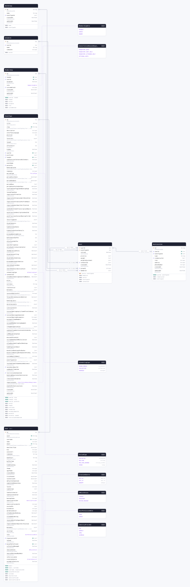

| Field              | Type       | Constraints                                    | Default | Description |
| ------------------ | ---------- | ---------------------------------------------- | ------- | ----------- |
| `userId`           | `Int`      | PK NOT NULL → [User.id](#model-User)           |         |             |
| `eventTypeId`      | `Int`      | PK NOT NULL → [EventType.id](#model-EventType) |         |             |
| `isFixed`          | `Boolean`  | NOT NULL                                       | `false` |             |
| `priority`         | `Int`      | NULL                                           |         |             |
| `weight`           | `Int`      | NULL                                           |         |             |
| `weightAdjustment` | `Int`      | NULL                                           |         |             |
| `scheduleId`       | `Int`      | NULL → [Schedule.id](#model-Schedule)          |         |             |
| `createdAt`        | `DateTime` | NOT NULL                                       | `now()` |             |
| `groupId`          | `String`   | NULL → [HostGroup.id](#model-HostGroup)        |         |             |
| `memberId`         | `Int`      | NULL → [Membership.id](#model-Membership)      |         |             |

#### Indexes

- `@@id([userId, eventTypeId])`
- `@@index([memberId])`
- `@@index([userId])`
- `@@index([eventTypeId])`
- `@@index([scheduleId])`

#### References

- `userId` → [User.id](#model-User) (many-to-one, on delete Cascade)
- `eventTypeId` → [EventType.id](#model-EventType) (many-to-one, on delete Cascade)
- `scheduleId` → [Schedule.id](#model-Schedule) (many-to-one)
- `groupId` → [HostGroup.id](#model-HostGroup) (many-to-one)
- `memberId` → [Membership.id](#model-Membership) (many-to-one, on delete Cascade)

#### Referenced by

- `userId` ← [HostLocation.userId](#model-HostLocation) (one-to-one, on delete Cascade)

#### Definition

```sql
CREATE TABLE "Host" (
    "userId" INTEGER NOT NULL,
    "eventTypeId" INTEGER NOT NULL,
    "isFixed" BOOLEAN NOT NULL DEFAULT false,
    "priority" INTEGER,
    "weight" INTEGER,
    "weightAdjustment" INTEGER,
    "scheduleId" INTEGER,
    "createdAt" TIMESTAMP(3) NOT NULL DEFAULT CURRENT_TIMESTAMP,
    "groupId" TEXT,
    "memberId" INTEGER,

    CONSTRAINT "Host_pkey" PRIMARY KEY ("userId","eventTypeId")
);

CREATE INDEX "Host_memberId_idx" ON "Host"("memberId");

CREATE INDEX "Host_userId_idx" ON "Host"("userId");

CREATE INDEX "Host_eventTypeId_idx" ON "Host"("eventTypeId");

CREATE INDEX "Host_scheduleId_idx" ON "Host"("scheduleId");

ALTER TABLE "Host" ADD CONSTRAINT "Host_userId_fkey" FOREIGN KEY ("userId") REFERENCES "users"("id") ON DELETE CASCADE ON UPDATE CASCADE;

ALTER TABLE "Host" ADD CONSTRAINT "Host_eventTypeId_fkey" FOREIGN KEY ("eventTypeId") REFERENCES "EventType"("id") ON DELETE CASCADE ON UPDATE CASCADE;

ALTER TABLE "Host" ADD CONSTRAINT "Host_scheduleId_fkey" FOREIGN KEY ("scheduleId") REFERENCES "Schedule"("id") ON DELETE SET NULL ON UPDATE CASCADE;

ALTER TABLE "Host" ADD CONSTRAINT "Host_groupId_fkey" FOREIGN KEY ("groupId") REFERENCES "HostGroup"("id") ON DELETE SET NULL ON UPDATE CASCADE;

ALTER TABLE "Host" ADD CONSTRAINT "Host_memberId_fkey" FOREIGN KEY ("memberId") REFERENCES "Membership"("id") ON DELETE CASCADE ON UPDATE CASCADE;
```

<details>
<summary>Queries and their SQL</summary>

**findMany**: Every row

```ts
await prisma.host.findMany();
```

```sql
SELECT
  "public"."Host"."userId",
  "public"."Host"."eventTypeId",
  "public"."Host"."isFixed",
  "public"."Host"."priority",
  "public"."Host"."weight",
  "public"."Host"."weightAdjustment",
  "public"."Host"."scheduleId",
  "public"."Host"."createdAt",
  "public"."Host"."groupId",
  "public"."Host"."memberId"
FROM
  "public"."Host"
WHERE
  1 = 1
OFFSET
  $1
-- params: ["0"]
```

**count**: How many rows there are

```ts
await prisma.host.count();
```

```sql
SELECT
  COUNT(*) AS "_count$_all"
FROM
  (
    SELECT
      "public"."Host"."userId",
      "public"."Host"."eventTypeId"
    FROM
      "public"."Host"
    WHERE
      1 = 1
    OFFSET
      $1
  ) AS "sub"
-- params: ["0"]
```

**findMany**: Every row with its relations

```ts
await prisma.host.findMany({
  include: {
    user: true,
    eventType: true,
    schedule: true,
    group: true,
    member: true,
    location: true,
  },
});
```

```sql
SELECT
  "public"."Host"."userId",
  "public"."Host"."eventTypeId",
  "public"."Host"."isFixed",
  "public"."Host"."priority",
  "public"."Host"."weight",
  "public"."Host"."weightAdjustment",
  "public"."Host"."scheduleId",
  "public"."Host"."createdAt",
  "public"."Host"."groupId",
  "public"."Host"."memberId"
FROM
  "public"."Host"
WHERE
  1 = 1
OFFSET
  $1
-- params: ["0"]

SELECT
  "public"."users"."id",
  "public"."users"."uuid",
  "public"."users"."username",
  "public"."users"."name",
  "public"."users"."email",
  "public"."users"."emailVerified",
  "public"."users"."bio",
  "public"."users"."avatarUrl",
  "public"."users"."timeZone",
  "public"."users"."weekStart",
  "public"."users"."bufferTime",
  "public"."users"."hideBranding",
  "public"."users"."theme",
  "public"."users"."appTheme",
  "public"."users"."created",
  "public"."users"."trialEndsAt",
  "public"."users"."lastActiveAt",
  "public"."users"."defaultScheduleId",
  "public"."users"."completedOnboarding",
  "public"."users"."locale",
  "public"."users"."timeFormat",
  "public"."users"."twoFactorSecret",
  "public"."users"."twoFactorEnabled",
  "public"."users"."backupCodes",
  "public"."users"."identityProvider"::text,
  "public"."users"."identityProviderId",
  "public"."users"."invitedTo",
  "public"."users"."brandColor",
  "public"."users"."darkBrandColor",
  "public"."users"."allowDynamicBooking",
  "public"."users"."allowSEOIndexing",
  "public"."users"."receiveMonthlyDigestEmail",
  "public"."users"."requiresBookerEmailVerification",
  "public"."users"."metadata",
  "public"."users"."verified",
  "public"."users"."role"::text,
  "public"."users"."organizationId",
  "public"."users"."locked",
  "public"."users"."movedToProfileId",
  "public"."users"."isPlatformManaged",
  "public"."users"."smsLockState"::text,
  "public"."users"."smsLockReviewedByAdmin",
  "public"."users"."referralLinkId",
  "public"."users"."creationSource"::text,
  "public"."users"."autoOptInFeatures"
FROM
  "public"."users"
WHERE
  "public"."users"."id" IN ($1)
OFFSET
  $2
-- params: ["<userId of the rows above>","0"]

SELECT
  "public"."EventType"."id",
  "public"."EventType"."title",
  "public"."EventType"."slug",
  "public"."EventType"."description",
  "public"."EventType"."interfaceLanguage",
  "public"."EventType"."position",
  "public"."EventType"."locations",
  "public"."EventType"."length",
  "public"."EventType"."offsetStart",
  "public"."EventType"."hidden",
  "public"."EventType"."userId",
  "public"."EventType"."profileId",
  "public"."EventType"."teamId",
  "public"."EventType"."useEventLevelSelectedCalendars",
  "public"."EventType"."eventName",
  "public"."EventType"."parentId",
  "public"."EventType"."bookingFields",
  "public"."EventType"."timeZone",
  "public"."EventType"."periodType"::text,
  "public"."EventType"."periodStartDate",
  "public"."EventType"."periodEndDate",
  "public"."EventType"."periodDays",
  "public"."EventType"."periodCountCalendarDays",
  "public"."EventType"."lockTimeZoneToggleOnBookingPage",
  "public"."EventType"."lockedTimeZone",
  "public"."EventType"."requiresConfirmation",
  "public"."EventType"."requiresConfirmationWillBlockSlot",
  "public"."EventType"."requiresConfirmationForFreeEmail",
  "public"."EventType"."requiresBookerEmailVerification",
  "public"."EventType"."canSendCalVideoTranscriptionEmails",
  "public"."EventType"."autoTranslateDescriptionEnabled",
  "public"."EventType"."autoTranslateInstantMeetingTitleEnabled",
  "public"."EventType"."recurringEvent",
  "public"."EventType"."disableGuests",
  "public"."EventType"."hideCalendarNotes",
  "public"."EventType"."hideCalendarEventDetails",
  "public"."EventType"."minimumBookingNotice",
  "public"."EventType"."beforeEventBuffer",
  "public"."EventType"."afterEventBuffer",
  "public"."EventType"."seatsPerTimeSlot",
  "public"."EventType"."onlyShowFirstAvailableSlot",
  "public"."EventType"."showOptimizedSlots",
  "public"."EventType"."disableCancelling",
  "public"."EventType"."disableRescheduling",
  "public"."EventType"."minimumRescheduleNotice",
  "public"."EventType"."seatsShowAttendees",
  "public"."EventType"."seatsShowAvailabilityCount",
  "public"."EventType"."schedulingType"::text,
  "public"."EventType"."scheduleId",
  "public"."EventType"."allowReschedulingCancelledBookings",
  "public"."EventType"."price",
  "public"."EventType"."currency",
  "public"."EventType"."slotInterval",
  "public"."EventType"."metadata",
  "public"."EventType"."successRedirectUrl",
  "public"."EventType"."forwardParamsSuccessRedirect",
  "public"."EventType"."bookingLimits",
  "public"."EventType"."durationLimits",
  "public"."EventType"."isInstantEvent",
  "public"."EventType"."instantMeetingExpiryTimeOffsetInSeconds",
  "public"."EventType"."instantMeetingScheduleId",
  "public"."EventType"."instantMeetingParameters",
  "public"."EventType"."assignAllTeamMembers",
  "public"."EventType"."assignRRMembersUsingSegment",
  "public"."EventType"."rrSegmentQueryValue",
  "public"."EventType"."useEventTypeDestinationCalendarEmail",
  "public"."EventType"."isRRWeightsEnabled",
  "public"."EventType"."maxLeadThreshold",
  "public"."EventType"."includeNoShowInRRCalculation",
  "public"."EventType"."allowReschedulingPastBookings",
  "public"."EventType"."hideOrganizerEmail",
  "public"."EventType"."maxActiveBookingsPerBooker",
  "public"."EventType"."maxActiveBookingPerBookerOfferReschedule",
  "public"."EventType"."customReplyToEmail",
  "public"."EventType"."eventTypeColor",
  "public"."EventType"."rescheduleWithSameRoundRobinHost",
  "public"."EventType"."secondaryEmailId",
  "public"."EventType"."useBookerTimezone",
  "public"."EventType"."restrictionScheduleId",
  "public"."EventType"."bookingRequiresAuthentication",
  "public"."EventType"."rrHostSubsetEnabled",
  "public"."EventType"."requiresCancellationReason"::text,
  "public"."EventType"."enablePerHostLocations",
  "public"."EventType"."createdAt",
  "public"."EventType"."updatedAt"
FROM
  "public"."EventType"
WHERE
  "public"."EventType"."id" IN ($1)
OFFSET
  $2
-- params: ["<eventTypeId of the rows above>","0"]

SELECT
  "public"."Schedule"."id",
  "public"."Schedule"."userId",
  "public"."Schedule"."name",
  "public"."Schedule"."timeZone"
FROM
  "public"."Schedule"
WHERE
  "public"."Schedule"."id" IN ($1)
OFFSET
  $2
-- params: ["<scheduleId of the rows above>","0"]

SELECT
  "public"."HostGroup"."id",
  "public"."HostGroup"."name",
  "public"."HostGroup"."eventTypeId",
  "public"."HostGroup"."createdAt",
  "public"."HostGroup"."updatedAt"
FROM
  "public"."HostGroup"
WHERE
  "public"."HostGroup"."id" IN ($1)
OFFSET
  $2
-- params: ["<groupId of the rows above>","0"]

SELECT
  "public"."Membership"."id",
  "public"."Membership"."teamId",
  "public"."Membership"."userId",
  "public"."Membership"."accepted",
  "public"."Membership"."role"::text,
  "public"."Membership"."customRoleId",
  "public"."Membership"."createdAt",
  "public"."Membership"."updatedAt"
FROM
  "public"."Membership"
WHERE
  "public"."Membership"."id" IN ($1)
OFFSET
  $2
-- params: ["<memberId of the rows above>","0"]

SELECT
  "public"."HostLocation"."id",
  "public"."HostLocation"."userId",
  "public"."HostLocation"."eventTypeId",
  "public"."HostLocation"."type",
  "public"."HostLocation"."credentialId",
  "public"."HostLocation"."link",
  "public"."HostLocation"."address",
  "public"."HostLocation"."phoneNumber",
  "public"."HostLocation"."createdAt",
  "public"."HostLocation"."updatedAt"
FROM
  "public"."HostLocation"
WHERE
  (
    "public"."HostLocation"."userId" IN ($1)
    AND "public"."HostLocation"."eventTypeId" IN ($2)
  )
OFFSET
  $3
-- params: ["<userId of the rows above>","<eventTypeId of the rows above>","0"]
```

**findUnique**: One row by what is unique to it

```ts
await prisma.host.findUnique({ where: { userId_eventTypeId: { userId: 1, eventTypeId: 1 } } });
```

```sql
SELECT
  "public"."Host"."userId",
  "public"."Host"."eventTypeId",
  "public"."Host"."isFixed",
  "public"."Host"."priority",
  "public"."Host"."weight",
  "public"."Host"."weightAdjustment",
  "public"."Host"."scheduleId",
  "public"."Host"."createdAt",
  "public"."Host"."groupId",
  "public"."Host"."memberId"
FROM
  "public"."Host"
WHERE
  (
    (
      "public"."Host"."userId" = $1
      AND "public"."Host"."eventTypeId" = $2
    )
    AND 1 = 1
  )
LIMIT
  $3
OFFSET
  $4
-- params: ["1","1","1","0"]
```

**create**: Create a row

```ts
await prisma.host.create({ data: { userId: 1, eventTypeId: 1 } });
```

```sql
INSERT INTO
  "public"."Host" ("userId", "eventTypeId", "isFixed", "createdAt")
VALUES
  ($1, $2, $3, $4)
RETURNING
  "public"."Host"."userId",
  "public"."Host"."eventTypeId",
  "public"."Host"."isFixed",
  "public"."Host"."priority",
  "public"."Host"."weight",
  "public"."Host"."weightAdjustment",
  "public"."Host"."scheduleId",
  "public"."Host"."createdAt",
  "public"."Host"."groupId",
  "public"."Host"."memberId"
-- params: ["1","1",false,"<now()>"]
```

**update**: Update a row

```ts
await prisma.host.update({
  where: { userId_eventTypeId: { userId: 1, eventTypeId: 1 } },
  data: { isFixed: true },
});
```

```sql
UPDATE "public"."Host"
SET
  "isFixed" = $1
WHERE
  (
    (
      "public"."Host"."userId" = $2
      AND "public"."Host"."eventTypeId" = $3
    )
    AND 1 = 1
  )
RETURNING
  "public"."Host"."userId",
  "public"."Host"."eventTypeId",
  "public"."Host"."isFixed",
  "public"."Host"."priority",
  "public"."Host"."weight",
  "public"."Host"."weightAdjustment",
  "public"."Host"."scheduleId",
  "public"."Host"."createdAt",
  "public"."Host"."groupId",
  "public"."Host"."memberId"
-- params: [true,"1","1"]
```

**delete**: Delete a row

```ts
await prisma.host.delete({ where: { userId_eventTypeId: { userId: 1, eventTypeId: 1 } } });
```

```sql
DELETE FROM "public"."Host"
WHERE
  (
    (
      "public"."Host"."userId" = $1
      AND "public"."Host"."eventTypeId" = $2
    )
    AND 1 = 1
  )
RETURNING
  "public"."Host"."userId",
  "public"."Host"."eventTypeId",
  "public"."Host"."isFixed",
  "public"."Host"."priority",
  "public"."Host"."weight",
  "public"."Host"."weightAdjustment",
  "public"."Host"."scheduleId",
  "public"."Host"."createdAt",
  "public"."Host"."groupId",
  "public"."Host"."memberId"
-- params: ["1","1"]
```

</details>

<a id="model-HostGroup"></a>

### HostGroup

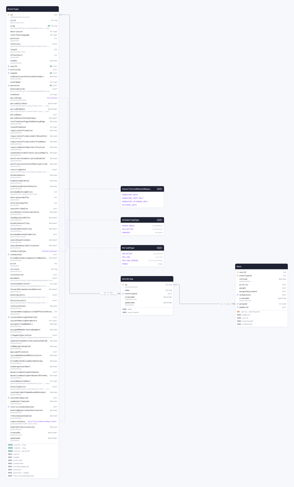

| Field         | Type       | Constraints                             | Default      | Description |
| ------------- | ---------- | --------------------------------------- | ------------ | ----------- |
| `id`          | `String`   | PK NOT NULL                             | `uuid(4)`    |             |
| `name`        | `String`   | NOT NULL                                |              |             |
| `eventTypeId` | `Int`      | NULL → [EventType.id](#model-EventType) |              |             |
| `createdAt`   | `DateTime` | NOT NULL                                | `now()`      |             |
| `updatedAt`   | `DateTime` | NOT NULL                                | `@updatedAt` |             |

#### Indexes

- `@@index([name])`
- `@@index([eventTypeId])`

#### References

- `eventTypeId` → [EventType.id](#model-EventType) (many-to-one, on delete Cascade)

#### Referenced by

- `id` ← [Host.groupId](#model-Host) (one-to-many)

#### Definition

```sql
CREATE TABLE "HostGroup" (
    "id" TEXT NOT NULL,
    "name" TEXT NOT NULL,
    "eventTypeId" INTEGER,
    "createdAt" TIMESTAMP(3) NOT NULL DEFAULT CURRENT_TIMESTAMP,
    "updatedAt" TIMESTAMP(3) NOT NULL,

    CONSTRAINT "HostGroup_pkey" PRIMARY KEY ("id")
);

CREATE INDEX "HostGroup_name_idx" ON "HostGroup"("name");

CREATE INDEX "HostGroup_eventTypeId_idx" ON "HostGroup"("eventTypeId");

ALTER TABLE "HostGroup" ADD CONSTRAINT "HostGroup_eventTypeId_fkey" FOREIGN KEY ("eventTypeId") REFERENCES "EventType"("id") ON DELETE CASCADE ON UPDATE CASCADE;
```

<details>
<summary>Queries and their SQL</summary>

**findMany**: Every row

```ts
await prisma.hostGroup.findMany();
```

```sql
SELECT
  "public"."HostGroup"."id",
  "public"."HostGroup"."name",
  "public"."HostGroup"."eventTypeId",
  "public"."HostGroup"."createdAt",
  "public"."HostGroup"."updatedAt"
FROM
  "public"."HostGroup"
WHERE
  1 = 1
OFFSET
  $1
-- params: ["0"]
```

**count**: How many rows there are

```ts
await prisma.hostGroup.count();
```

```sql
SELECT
  COUNT(*) AS "_count$_all"
FROM
  (
    SELECT
      "public"."HostGroup"."id"
    FROM
      "public"."HostGroup"
    WHERE
      1 = 1
    OFFSET
      $1
  ) AS "sub"
-- params: ["0"]
```

**findMany**: Every row with its relations

```ts
await prisma.hostGroup.findMany({ include: { hosts: true, eventType: true } });
```

```sql
SELECT
  "public"."HostGroup"."id",
  "public"."HostGroup"."name",
  "public"."HostGroup"."eventTypeId",
  "public"."HostGroup"."createdAt",
  "public"."HostGroup"."updatedAt"
FROM
  "public"."HostGroup"
WHERE
  1 = 1
OFFSET
  $1
-- params: ["0"]

SELECT
  "public"."Host"."userId",
  "public"."Host"."eventTypeId",
  "public"."Host"."isFixed",
  "public"."Host"."priority",
  "public"."Host"."weight",
  "public"."Host"."weightAdjustment",
  "public"."Host"."scheduleId",
  "public"."Host"."createdAt",
  "public"."Host"."groupId",
  "public"."Host"."memberId"
FROM
  "public"."Host"
WHERE
  "public"."Host"."groupId" IN ($1)
OFFSET
  $2
-- params: ["<id of the rows above>","0"]

SELECT
  "public"."EventType"."id",
  "public"."EventType"."title",
  "public"."EventType"."slug",
  "public"."EventType"."description",
  "public"."EventType"."interfaceLanguage",
  "public"."EventType"."position",
  "public"."EventType"."locations",
  "public"."EventType"."length",
  "public"."EventType"."offsetStart",
  "public"."EventType"."hidden",
  "public"."EventType"."userId",
  "public"."EventType"."profileId",
  "public"."EventType"."teamId",
  "public"."EventType"."useEventLevelSelectedCalendars",
  "public"."EventType"."eventName",
  "public"."EventType"."parentId",
  "public"."EventType"."bookingFields",
  "public"."EventType"."timeZone",
  "public"."EventType"."periodType"::text,
  "public"."EventType"."periodStartDate",
  "public"."EventType"."periodEndDate",
  "public"."EventType"."periodDays",
  "public"."EventType"."periodCountCalendarDays",
  "public"."EventType"."lockTimeZoneToggleOnBookingPage",
  "public"."EventType"."lockedTimeZone",
  "public"."EventType"."requiresConfirmation",
  "public"."EventType"."requiresConfirmationWillBlockSlot",
  "public"."EventType"."requiresConfirmationForFreeEmail",
  "public"."EventType"."requiresBookerEmailVerification",
  "public"."EventType"."canSendCalVideoTranscriptionEmails",
  "public"."EventType"."autoTranslateDescriptionEnabled",
  "public"."EventType"."autoTranslateInstantMeetingTitleEnabled",
  "public"."EventType"."recurringEvent",
  "public"."EventType"."disableGuests",
  "public"."EventType"."hideCalendarNotes",
  "public"."EventType"."hideCalendarEventDetails",
  "public"."EventType"."minimumBookingNotice",
  "public"."EventType"."beforeEventBuffer",
  "public"."EventType"."afterEventBuffer",
  "public"."EventType"."seatsPerTimeSlot",
  "public"."EventType"."onlyShowFirstAvailableSlot",
  "public"."EventType"."showOptimizedSlots",
  "public"."EventType"."disableCancelling",
  "public"."EventType"."disableRescheduling",
  "public"."EventType"."minimumRescheduleNotice",
  "public"."EventType"."seatsShowAttendees",
  "public"."EventType"."seatsShowAvailabilityCount",
  "public"."EventType"."schedulingType"::text,
  "public"."EventType"."scheduleId",
  "public"."EventType"."allowReschedulingCancelledBookings",
  "public"."EventType"."price",
  "public"."EventType"."currency",
  "public"."EventType"."slotInterval",
  "public"."EventType"."metadata",
  "public"."EventType"."successRedirectUrl",
  "public"."EventType"."forwardParamsSuccessRedirect",
  "public"."EventType"."bookingLimits",
  "public"."EventType"."durationLimits",
  "public"."EventType"."isInstantEvent",
  "public"."EventType"."instantMeetingExpiryTimeOffsetInSeconds",
  "public"."EventType"."instantMeetingScheduleId",
  "public"."EventType"."instantMeetingParameters",
  "public"."EventType"."assignAllTeamMembers",
  "public"."EventType"."assignRRMembersUsingSegment",
  "public"."EventType"."rrSegmentQueryValue",
  "public"."EventType"."useEventTypeDestinationCalendarEmail",
  "public"."EventType"."isRRWeightsEnabled",
  "public"."EventType"."maxLeadThreshold",
  "public"."EventType"."includeNoShowInRRCalculation",
  "public"."EventType"."allowReschedulingPastBookings",
  "public"."EventType"."hideOrganizerEmail",
  "public"."EventType"."maxActiveBookingsPerBooker",
  "public"."EventType"."maxActiveBookingPerBookerOfferReschedule",
  "public"."EventType"."customReplyToEmail",
  "public"."EventType"."eventTypeColor",
  "public"."EventType"."rescheduleWithSameRoundRobinHost",
  "public"."EventType"."secondaryEmailId",
  "public"."EventType"."useBookerTimezone",
  "public"."EventType"."restrictionScheduleId",
  "public"."EventType"."bookingRequiresAuthentication",
  "public"."EventType"."rrHostSubsetEnabled",
  "public"."EventType"."requiresCancellationReason"::text,
  "public"."EventType"."enablePerHostLocations",
  "public"."EventType"."createdAt",
  "public"."EventType"."updatedAt"
FROM
  "public"."EventType"
WHERE
  "public"."EventType"."id" IN ($1)
OFFSET
  $2
-- params: ["<eventTypeId of the rows above>","0"]
```

**findUnique**: One row by what is unique to it

```ts
await prisma.hostGroup.findUnique({ where: { id: "example" } });
```

```sql
SELECT
  "public"."HostGroup"."id",
  "public"."HostGroup"."name",
  "public"."HostGroup"."eventTypeId",
  "public"."HostGroup"."createdAt",
  "public"."HostGroup"."updatedAt"
FROM
  "public"."HostGroup"
WHERE
  (
    "public"."HostGroup"."id" = $1
    AND 1 = 1
  )
LIMIT
  $2
OFFSET
  $3
-- params: ["example","1","0"]
```

**create**: Create a row

```ts
await prisma.hostGroup.create({ data: { name: "example" } });
```

```sql
INSERT INTO
  "public"."HostGroup" ("id", "name", "createdAt", "updatedAt")
VALUES
  ($1, $2, $3, $4)
RETURNING
  "public"."HostGroup"."id",
  "public"."HostGroup"."name",
  "public"."HostGroup"."eventTypeId",
  "public"."HostGroup"."createdAt",
  "public"."HostGroup"."updatedAt"
-- params: ["<uuid(4)>","example","<now()>","<now()>"]
```

**update**: Update a row

```ts
await prisma.hostGroup.update({ where: { id: "example" }, data: { name: "example" } });
```

```sql
UPDATE "public"."HostGroup"
SET
  "name" = $1,
  "updatedAt" = $2
WHERE
  (
    "public"."HostGroup"."id" = $3
    AND 1 = 1
  )
RETURNING
  "public"."HostGroup"."id",
  "public"."HostGroup"."name",
  "public"."HostGroup"."eventTypeId",
  "public"."HostGroup"."createdAt",
  "public"."HostGroup"."updatedAt"
-- params: ["example",{"prisma__type":"generatorCall","prisma__value":{"name":"now","args":[],"returnType":{"type":"DateTime"}}},"example"]
```

**delete**: Delete a row

```ts
await prisma.hostGroup.delete({ where: { id: "example" } });
```

```sql
DELETE FROM "public"."HostGroup"
WHERE
  (
    "public"."HostGroup"."id" = $1
    AND 1 = 1
  )
RETURNING
  "public"."HostGroup"."id",
  "public"."HostGroup"."name",
  "public"."HostGroup"."eventTypeId",
  "public"."HostGroup"."createdAt",
  "public"."HostGroup"."updatedAt"
-- params: ["example"]
```

</details>

<a id="model-HostLocation"></a>

### HostLocation

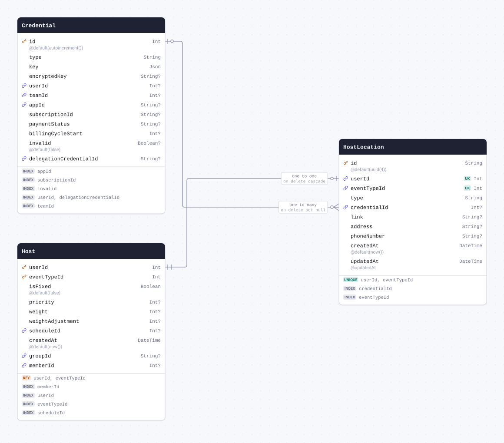

| Field          | Type       | Constraints                                | Default      | Description |
| -------------- | ---------- | ------------------------------------------ | ------------ | ----------- |
| `id`           | `String`   | PK NOT NULL                                | `uuid(4)`    |             |
| `userId`       | `Int`      | NOT NULL → [Host.userId](#model-Host)      |              |             |
| `eventTypeId`  | `Int`      | NOT NULL → [Host.eventTypeId](#model-Host) |              |             |
| `type`         | `String`   | NOT NULL                                   |              |             |
| `credentialId` | `Int`      | NULL → [Credential.id](#model-Credential)  |              |             |
| `link`         | `String`   | NULL                                       |              |             |
| `address`      | `String`   | NULL                                       |              |             |
| `phoneNumber`  | `String`   | NULL                                       |              |             |
| `createdAt`    | `DateTime` | NOT NULL                                   | `now()`      |             |
| `updatedAt`    | `DateTime` | NOT NULL                                   | `@updatedAt` |             |

#### Indexes

- `@@index([credentialId])`
- `@@index([eventTypeId])`
- `@@unique([userId, eventTypeId])`

#### References

- `userId` → [Host.userId](#model-Host) (one-to-one, on delete Cascade)
- `credentialId` → [Credential.id](#model-Credential) (many-to-one, on delete SetNull)

#### Definition

```sql
CREATE TABLE "HostLocation" (
    "id" TEXT NOT NULL,
    "userId" INTEGER NOT NULL,
    "eventTypeId" INTEGER NOT NULL,
    "type" TEXT NOT NULL,
    "credentialId" INTEGER,
    "link" TEXT,
    "address" TEXT,
    "phoneNumber" TEXT,
    "createdAt" TIMESTAMP(3) NOT NULL DEFAULT CURRENT_TIMESTAMP,
    "updatedAt" TIMESTAMP(3) NOT NULL,

    CONSTRAINT "HostLocation_pkey" PRIMARY KEY ("id")
);

CREATE INDEX "HostLocation_credentialId_idx" ON "HostLocation"("credentialId");

CREATE INDEX "HostLocation_eventTypeId_idx" ON "HostLocation"("eventTypeId");

CREATE UNIQUE INDEX "HostLocation_userId_eventTypeId_key" ON "HostLocation"("userId", "eventTypeId");

ALTER TABLE "HostLocation" ADD CONSTRAINT "HostLocation_userId_eventTypeId_fkey" FOREIGN KEY ("userId", "eventTypeId") REFERENCES "Host"("userId", "eventTypeId") ON DELETE CASCADE ON UPDATE CASCADE;

ALTER TABLE "HostLocation" ADD CONSTRAINT "HostLocation_credentialId_fkey" FOREIGN KEY ("credentialId") REFERENCES "Credential"("id") ON DELETE SET NULL ON UPDATE CASCADE;
```

<details>
<summary>Queries and their SQL</summary>

**findMany**: Every row

```ts
await prisma.hostLocation.findMany();
```

```sql
SELECT
  "public"."HostLocation"."id",
  "public"."HostLocation"."userId",
  "public"."HostLocation"."eventTypeId",
  "public"."HostLocation"."type",
  "public"."HostLocation"."credentialId",
  "public"."HostLocation"."link",
  "public"."HostLocation"."address",
  "public"."HostLocation"."phoneNumber",
  "public"."HostLocation"."createdAt",
  "public"."HostLocation"."updatedAt"
FROM
  "public"."HostLocation"
WHERE
  1 = 1
OFFSET
  $1
-- params: ["0"]
```

**count**: How many rows there are

```ts
await prisma.hostLocation.count();
```

```sql
SELECT
  COUNT(*) AS "_count$_all"
FROM
  (
    SELECT
      "public"."HostLocation"."id"
    FROM
      "public"."HostLocation"
    WHERE
      1 = 1
    OFFSET
      $1
  ) AS "sub"
-- params: ["0"]
```

**findMany**: Every row with its relations

```ts
await prisma.hostLocation.findMany({ include: { host: true, credential: true } });
```

```sql
SELECT
  "public"."HostLocation"."id",
  "public"."HostLocation"."userId",
  "public"."HostLocation"."eventTypeId",
  "public"."HostLocation"."type",
  "public"."HostLocation"."credentialId",
  "public"."HostLocation"."link",
  "public"."HostLocation"."address",
  "public"."HostLocation"."phoneNumber",
  "public"."HostLocation"."createdAt",
  "public"."HostLocation"."updatedAt"
FROM
  "public"."HostLocation"
WHERE
  1 = 1
OFFSET
  $1
-- params: ["0"]

SELECT
  "public"."Host"."userId",
  "public"."Host"."eventTypeId",
  "public"."Host"."isFixed",
  "public"."Host"."priority",
  "public"."Host"."weight",
  "public"."Host"."weightAdjustment",
  "public"."Host"."scheduleId",
  "public"."Host"."createdAt",
  "public"."Host"."groupId",
  "public"."Host"."memberId"
FROM
  "public"."Host"
WHERE
  (
    "public"."Host"."userId" IN ($1)
    AND "public"."Host"."eventTypeId" IN ($2)
  )
OFFSET
  $3
-- params: ["<userId of the rows above>","<eventTypeId of the rows above>","0"]

SELECT
  "public"."Credential"."id",
  "public"."Credential"."type",
  "public"."Credential"."key",
  "public"."Credential"."encryptedKey",
  "public"."Credential"."userId",
  "public"."Credential"."teamId",
  "public"."Credential"."appId",
  "public"."Credential"."subscriptionId",
  "public"."Credential"."paymentStatus",
  "public"."Credential"."billingCycleStart",
  "public"."Credential"."invalid",
  "public"."Credential"."delegationCredentialId"
FROM
  "public"."Credential"
WHERE
  "public"."Credential"."id" IN ($1)
OFFSET
  $2
-- params: ["<credentialId of the rows above>","0"]
```

**findUnique**: One row by what is unique to it

```ts
await prisma.hostLocation.findUnique({ where: { id: "example" } });
```

```sql
SELECT
  "public"."HostLocation"."id",
  "public"."HostLocation"."userId",
  "public"."HostLocation"."eventTypeId",
  "public"."HostLocation"."type",
  "public"."HostLocation"."credentialId",
  "public"."HostLocation"."link",
  "public"."HostLocation"."address",
  "public"."HostLocation"."phoneNumber",
  "public"."HostLocation"."createdAt",
  "public"."HostLocation"."updatedAt"
FROM
  "public"."HostLocation"
WHERE
  (
    "public"."HostLocation"."id" = $1
    AND 1 = 1
  )
LIMIT
  $2
OFFSET
  $3
-- params: ["example","1","0"]
```

**create**: Create a row

```ts
await prisma.hostLocation.create({ data: { userId: 1, eventTypeId: 1, type: "example" } });
```

```sql
INSERT INTO
  "public"."HostLocation" (
    "id",
    "userId",
    "eventTypeId",
    "type",
    "createdAt",
    "updatedAt"
  )
VALUES
  ($1, $2, $3, $4, $5, $6)
RETURNING
  "public"."HostLocation"."id",
  "public"."HostLocation"."userId",
  "public"."HostLocation"."eventTypeId",
  "public"."HostLocation"."type",
  "public"."HostLocation"."credentialId",
  "public"."HostLocation"."link",
  "public"."HostLocation"."address",
  "public"."HostLocation"."phoneNumber",
  "public"."HostLocation"."createdAt",
  "public"."HostLocation"."updatedAt"
-- params: ["<uuid(4)>","1","1","example","<now()>","<now()>"]
```

**update**: Update a row

```ts
await prisma.hostLocation.update({ where: { id: "example" }, data: { type: "example" } });
```

```sql
UPDATE "public"."HostLocation"
SET
  "type" = $1,
  "updatedAt" = $2
WHERE
  (
    "public"."HostLocation"."id" = $3
    AND 1 = 1
  )
RETURNING
  "public"."HostLocation"."id",
  "public"."HostLocation"."userId",
  "public"."HostLocation"."eventTypeId",
  "public"."HostLocation"."type",
  "public"."HostLocation"."credentialId",
  "public"."HostLocation"."link",
  "public"."HostLocation"."address",
  "public"."HostLocation"."phoneNumber",
  "public"."HostLocation"."createdAt",
  "public"."HostLocation"."updatedAt"
-- params: ["example",{"prisma__type":"generatorCall","prisma__value":{"name":"now","args":[],"returnType":{"type":"DateTime"}}},"example"]
```

**delete**: Delete a row

```ts
await prisma.hostLocation.delete({ where: { id: "example" } });
```

```sql
DELETE FROM "public"."HostLocation"
WHERE
  (
    "public"."HostLocation"."id" = $1
    AND 1 = 1
  )
RETURNING
  "public"."HostLocation"."id",
  "public"."HostLocation"."userId",
  "public"."HostLocation"."eventTypeId",
  "public"."HostLocation"."type",
  "public"."HostLocation"."credentialId",
  "public"."HostLocation"."link",
  "public"."HostLocation"."address",
  "public"."HostLocation"."phoneNumber",
  "public"."HostLocation"."createdAt",
  "public"."HostLocation"."updatedAt"
-- params: ["example"]
```

</details>

<a id="model-CalVideoSettings"></a>

### CalVideoSettings

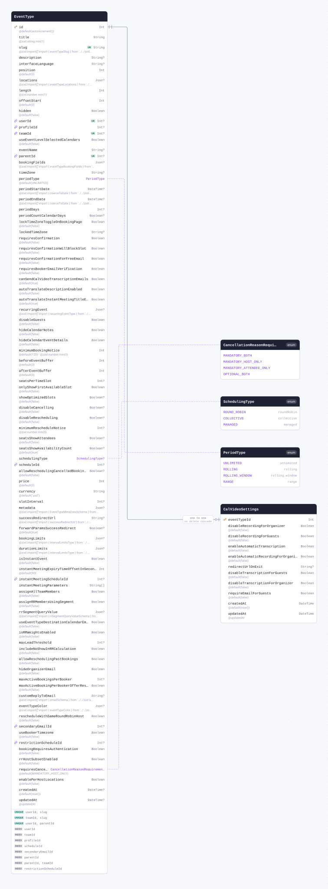

| Field                                  | Type       | Constraints                                    | Default      | Description |
| -------------------------------------- | ---------- | ---------------------------------------------- | ------------ | ----------- |
| `eventTypeId`                          | `Int`      | PK NOT NULL → [EventType.id](#model-EventType) |              |             |
| `disableRecordingForOrganizer`         | `Boolean`  | NOT NULL                                       | `false`      |             |
| `disableRecordingForGuests`            | `Boolean`  | NOT NULL                                       | `false`      |             |
| `enableAutomaticTranscription`         | `Boolean`  | NOT NULL                                       | `false`      |             |
| `enableAutomaticRecordingForOrganizer` | `Boolean`  | NOT NULL                                       | `false`      |             |
| `redirectUrlOnExit`                    | `String`   | NULL                                           |              |             |
| `disableTranscriptionForGuests`        | `Boolean`  | NOT NULL                                       | `false`      |             |
| `disableTranscriptionForOrganizer`     | `Boolean`  | NOT NULL                                       | `false`      |             |
| `requireEmailForGuests`                | `Boolean`  | NOT NULL                                       | `false`      |             |
| `createdAt`                            | `DateTime` | NOT NULL                                       | `now()`      |             |
| `updatedAt`                            | `DateTime` | NOT NULL                                       | `@updatedAt` |             |

#### References

- `eventTypeId` → [EventType.id](#model-EventType) (one-to-one, on delete Cascade)

#### Definition

```sql
CREATE TABLE "CalVideoSettings" (
    "eventTypeId" INTEGER NOT NULL,
    "disableRecordingForOrganizer" BOOLEAN NOT NULL DEFAULT false,
    "disableRecordingForGuests" BOOLEAN NOT NULL DEFAULT false,
    "enableAutomaticTranscription" BOOLEAN NOT NULL DEFAULT false,
    "enableAutomaticRecordingForOrganizer" BOOLEAN NOT NULL DEFAULT false,
    "redirectUrlOnExit" TEXT,
    "disableTranscriptionForGuests" BOOLEAN NOT NULL DEFAULT false,
    "disableTranscriptionForOrganizer" BOOLEAN NOT NULL DEFAULT false,
    "requireEmailForGuests" BOOLEAN NOT NULL DEFAULT false,
    "createdAt" TIMESTAMP(3) NOT NULL DEFAULT CURRENT_TIMESTAMP,
    "updatedAt" TIMESTAMP(3) NOT NULL,

    CONSTRAINT "CalVideoSettings_pkey" PRIMARY KEY ("eventTypeId")
);

ALTER TABLE "CalVideoSettings" ADD CONSTRAINT "CalVideoSettings_eventTypeId_fkey" FOREIGN KEY ("eventTypeId") REFERENCES "EventType"("id") ON DELETE CASCADE ON UPDATE CASCADE;
```

<details>
<summary>Queries and their SQL</summary>

**findMany**: Every row

```ts
await prisma.calVideoSettings.findMany();
```

```sql
SELECT
  "public"."CalVideoSettings"."eventTypeId",
  "public"."CalVideoSettings"."disableRecordingForOrganizer",
  "public"."CalVideoSettings"."disableRecordingForGuests",
  "public"."CalVideoSettings"."enableAutomaticTranscription",
  "public"."CalVideoSettings"."enableAutomaticRecordingForOrganizer",
  "public"."CalVideoSettings"."redirectUrlOnExit",
  "public"."CalVideoSettings"."disableTranscriptionForGuests",
  "public"."CalVideoSettings"."disableTranscriptionForOrganizer",
  "public"."CalVideoSettings"."requireEmailForGuests",
  "public"."CalVideoSettings"."createdAt",
  "public"."CalVideoSettings"."updatedAt"
FROM
  "public"."CalVideoSettings"
WHERE
  1 = 1
OFFSET
  $1
-- params: ["0"]
```

**count**: How many rows there are

```ts
await prisma.calVideoSettings.count();
```

```sql
SELECT
  COUNT(*) AS "_count$_all"
FROM
  (
    SELECT
      "public"."CalVideoSettings"."eventTypeId"
    FROM
      "public"."CalVideoSettings"
    WHERE
      1 = 1
    OFFSET
      $1
  ) AS "sub"
-- params: ["0"]
```

**findMany**: Every row with its relations

```ts
await prisma.calVideoSettings.findMany({ include: { eventType: true } });
```

```sql
SELECT
  "public"."CalVideoSettings"."eventTypeId",
  "public"."CalVideoSettings"."disableRecordingForOrganizer",
  "public"."CalVideoSettings"."disableRecordingForGuests",
  "public"."CalVideoSettings"."enableAutomaticTranscription",
  "public"."CalVideoSettings"."enableAutomaticRecordingForOrganizer",
  "public"."CalVideoSettings"."redirectUrlOnExit",
  "public"."CalVideoSettings"."disableTranscriptionForGuests",
  "public"."CalVideoSettings"."disableTranscriptionForOrganizer",
  "public"."CalVideoSettings"."requireEmailForGuests",
  "public"."CalVideoSettings"."createdAt",
  "public"."CalVideoSettings"."updatedAt"
FROM
  "public"."CalVideoSettings"
WHERE
  1 = 1
OFFSET
  $1
-- params: ["0"]

SELECT
  "public"."EventType"."id",
  "public"."EventType"."title",
  "public"."EventType"."slug",
  "public"."EventType"."description",
  "public"."EventType"."interfaceLanguage",
  "public"."EventType"."position",
  "public"."EventType"."locations",
  "public"."EventType"."length",
  "public"."EventType"."offsetStart",
  "public"."EventType"."hidden",
  "public"."EventType"."userId",
  "public"."EventType"."profileId",
  "public"."EventType"."teamId",
  "public"."EventType"."useEventLevelSelectedCalendars",
  "public"."EventType"."eventName",
  "public"."EventType"."parentId",
  "public"."EventType"."bookingFields",
  "public"."EventType"."timeZone",
  "public"."EventType"."periodType"::text,
  "public"."EventType"."periodStartDate",
  "public"."EventType"."periodEndDate",
  "public"."EventType"."periodDays",
  "public"."EventType"."periodCountCalendarDays",
  "public"."EventType"."lockTimeZoneToggleOnBookingPage",
  "public"."EventType"."lockedTimeZone",
  "public"."EventType"."requiresConfirmation",
  "public"."EventType"."requiresConfirmationWillBlockSlot",
  "public"."EventType"."requiresConfirmationForFreeEmail",
  "public"."EventType"."requiresBookerEmailVerification",
  "public"."EventType"."canSendCalVideoTranscriptionEmails",
  "public"."EventType"."autoTranslateDescriptionEnabled",
  "public"."EventType"."autoTranslateInstantMeetingTitleEnabled",
  "public"."EventType"."recurringEvent",
  "public"."EventType"."disableGuests",
  "public"."EventType"."hideCalendarNotes",
  "public"."EventType"."hideCalendarEventDetails",
  "public"."EventType"."minimumBookingNotice",
  "public"."EventType"."beforeEventBuffer",
  "public"."EventType"."afterEventBuffer",
  "public"."EventType"."seatsPerTimeSlot",
  "public"."EventType"."onlyShowFirstAvailableSlot",
  "public"."EventType"."showOptimizedSlots",
  "public"."EventType"."disableCancelling",
  "public"."EventType"."disableRescheduling",
  "public"."EventType"."minimumRescheduleNotice",
  "public"."EventType"."seatsShowAttendees",
  "public"."EventType"."seatsShowAvailabilityCount",
  "public"."EventType"."schedulingType"::text,
  "public"."EventType"."scheduleId",
  "public"."EventType"."allowReschedulingCancelledBookings",
  "public"."EventType"."price",
  "public"."EventType"."currency",
  "public"."EventType"."slotInterval",
  "public"."EventType"."metadata",
  "public"."EventType"."successRedirectUrl",
  "public"."EventType"."forwardParamsSuccessRedirect",
  "public"."EventType"."bookingLimits",
  "public"."EventType"."durationLimits",
  "public"."EventType"."isInstantEvent",
  "public"."EventType"."instantMeetingExpiryTimeOffsetInSeconds",
  "public"."EventType"."instantMeetingScheduleId",
  "public"."EventType"."instantMeetingParameters",
  "public"."EventType"."assignAllTeamMembers",
  "public"."EventType"."assignRRMembersUsingSegment",
  "public"."EventType"."rrSegmentQueryValue",
  "public"."EventType"."useEventTypeDestinationCalendarEmail",
  "public"."EventType"."isRRWeightsEnabled",
  "public"."EventType"."maxLeadThreshold",
  "public"."EventType"."includeNoShowInRRCalculation",
  "public"."EventType"."allowReschedulingPastBookings",
  "public"."EventType"."hideOrganizerEmail",
  "public"."EventType"."maxActiveBookingsPerBooker",
  "public"."EventType"."maxActiveBookingPerBookerOfferReschedule",
  "public"."EventType"."customReplyToEmail",
  "public"."EventType"."eventTypeColor",
  "public"."EventType"."rescheduleWithSameRoundRobinHost",
  "public"."EventType"."secondaryEmailId",
  "public"."EventType"."useBookerTimezone",
  "public"."EventType"."restrictionScheduleId",
  "public"."EventType"."bookingRequiresAuthentication",
  "public"."EventType"."rrHostSubsetEnabled",
  "public"."EventType"."requiresCancellationReason"::text,
  "public"."EventType"."enablePerHostLocations",
  "public"."EventType"."createdAt",
  "public"."EventType"."updatedAt"
FROM
  "public"."EventType"
WHERE
  "public"."EventType"."id" IN ($1)
OFFSET
  $2
-- params: ["<eventTypeId of the rows above>","0"]
```

**findUnique**: One row by what is unique to it

```ts
await prisma.calVideoSettings.findUnique({ where: { eventTypeId: 1 } });
```

```sql
SELECT
  "public"."CalVideoSettings"."eventTypeId",
  "public"."CalVideoSettings"."disableRecordingForOrganizer",
  "public"."CalVideoSettings"."disableRecordingForGuests",
  "public"."CalVideoSettings"."enableAutomaticTranscription",
  "public"."CalVideoSettings"."enableAutomaticRecordingForOrganizer",
  "public"."CalVideoSettings"."redirectUrlOnExit",
  "public"."CalVideoSettings"."disableTranscriptionForGuests",
  "public"."CalVideoSettings"."disableTranscriptionForOrganizer",
  "public"."CalVideoSettings"."requireEmailForGuests",
  "public"."CalVideoSettings"."createdAt",
  "public"."CalVideoSettings"."updatedAt"
FROM
  "public"."CalVideoSettings"
WHERE
  (
    "public"."CalVideoSettings"."eventTypeId" = $1
    AND 1 = 1
  )
LIMIT
  $2
OFFSET
  $3
-- params: ["1","1","0"]
```

**create**: Create a row

```ts
await prisma.calVideoSettings.create({ data: { eventTypeId: 1 } });
```

```sql
INSERT INTO
  "public"."CalVideoSettings" (
    "eventTypeId",
    "disableRecordingForOrganizer",
    "disableRecordingForGuests",
    "enableAutomaticTranscription",
    "enableAutomaticRecordingForOrganizer",
    "disableTranscriptionForGuests",
    "disableTranscriptionForOrganizer",
    "requireEmailForGuests",
    "createdAt",
    "updatedAt"
  )
VALUES
  ($1, $2, $3, $4, $5, $6, $7, $8, $9, $10)
RETURNING
  "public"."CalVideoSettings"."eventTypeId",
  "public"."CalVideoSettings"."disableRecordingForOrganizer",
  "public"."CalVideoSettings"."disableRecordingForGuests",
  "public"."CalVideoSettings"."enableAutomaticTranscription",
  "public"."CalVideoSettings"."enableAutomaticRecordingForOrganizer",
  "public"."CalVideoSettings"."redirectUrlOnExit",
  "public"."CalVideoSettings"."disableTranscriptionForGuests",
  "public"."CalVideoSettings"."disableTranscriptionForOrganizer",
  "public"."CalVideoSettings"."requireEmailForGuests",
  "public"."CalVideoSettings"."createdAt",
  "public"."CalVideoSettings"."updatedAt"
-- params: ["1",false,false,false,false,false,false,false,"<now()>","<now()>"]
```

**update**: Update a row

```ts
await prisma.calVideoSettings.update({
  where: { eventTypeId: 1 },
  data: { disableRecordingForOrganizer: true },
});
```

```sql
UPDATE "public"."CalVideoSettings"
SET
  "disableRecordingForOrganizer" = $1,
  "updatedAt" = $2
WHERE
  (
    "public"."CalVideoSettings"."eventTypeId" = $3
    AND 1 = 1
  )
RETURNING
  "public"."CalVideoSettings"."eventTypeId",
  "public"."CalVideoSettings"."disableRecordingForOrganizer",
  "public"."CalVideoSettings"."disableRecordingForGuests",
  "public"."CalVideoSettings"."enableAutomaticTranscription",
  "public"."CalVideoSettings"."enableAutomaticRecordingForOrganizer",
  "public"."CalVideoSettings"."redirectUrlOnExit",
  "public"."CalVideoSettings"."disableTranscriptionForGuests",
  "public"."CalVideoSettings"."disableTranscriptionForOrganizer",
  "public"."CalVideoSettings"."requireEmailForGuests",
  "public"."CalVideoSettings"."createdAt",
  "public"."CalVideoSettings"."updatedAt"
-- params: [true,{"prisma__type":"generatorCall","prisma__value":{"name":"now","args":[],"returnType":{"type":"DateTime"}}},"1"]
```

**delete**: Delete a row

```ts
await prisma.calVideoSettings.delete({ where: { eventTypeId: 1 } });
```

```sql
DELETE FROM "public"."CalVideoSettings"
WHERE
  (
    "public"."CalVideoSettings"."eventTypeId" = $1
    AND 1 = 1
  )
RETURNING
  "public"."CalVideoSettings"."eventTypeId",
  "public"."CalVideoSettings"."disableRecordingForOrganizer",
  "public"."CalVideoSettings"."disableRecordingForGuests",
  "public"."CalVideoSettings"."enableAutomaticTranscription",
  "public"."CalVideoSettings"."enableAutomaticRecordingForOrganizer",
  "public"."CalVideoSettings"."redirectUrlOnExit",
  "public"."CalVideoSettings"."disableTranscriptionForGuests",
  "public"."CalVideoSettings"."disableTranscriptionForOrganizer",
  "public"."CalVideoSettings"."requireEmailForGuests",
  "public"."CalVideoSettings"."createdAt",
  "public"."CalVideoSettings"."updatedAt"
-- params: ["1"]
```

</details>

<a id="model-VideoCallGuest"></a>

### VideoCallGuest

| Field        | Type       | Constraints | Default      | Description |
| ------------ | ---------- | ----------- | ------------ | ----------- |
| `id`         | `String`   | PK NOT NULL | `uuid(4)`    |             |
| `bookingUid` | `String`   | NOT NULL    |              |             |
| `email`      | `String`   | NOT NULL    |              |             |
| `name`       | `String`   | NOT NULL    |              |             |
| `joinedAt`   | `DateTime` | NULL        |              |             |
| `createdAt`  | `DateTime` | NOT NULL    | `now()`      |             |
| `updatedAt`  | `DateTime` | NOT NULL    | `@updatedAt` |             |

#### Indexes

- `@@index([bookingUid])`
- `@@index([email])`
- `@@unique([bookingUid, email])`

#### Definition

```sql
CREATE TABLE "VideoCallGuest" (
    "id" TEXT NOT NULL,
    "bookingUid" TEXT NOT NULL,
    "email" TEXT NOT NULL,
    "name" TEXT NOT NULL,
    "joinedAt" TIMESTAMP(3),
    "createdAt" TIMESTAMP(3) NOT NULL DEFAULT CURRENT_TIMESTAMP,
    "updatedAt" TIMESTAMP(3) NOT NULL,

    CONSTRAINT "VideoCallGuest_pkey" PRIMARY KEY ("id")
);

CREATE INDEX "VideoCallGuest_bookingUid_idx" ON "VideoCallGuest"("bookingUid");

CREATE INDEX "VideoCallGuest_email_idx" ON "VideoCallGuest"("email");

CREATE UNIQUE INDEX "VideoCallGuest_bookingUid_email_key" ON "VideoCallGuest"("bookingUid", "email");
```

<details>
<summary>Queries and their SQL</summary>

**findMany**: Every row

```ts
await prisma.videoCallGuest.findMany();
```

```sql
SELECT
  "public"."VideoCallGuest"."id",
  "public"."VideoCallGuest"."bookingUid",
  "public"."VideoCallGuest"."email",
  "public"."VideoCallGuest"."name",
  "public"."VideoCallGuest"."joinedAt",
  "public"."VideoCallGuest"."createdAt",
  "public"."VideoCallGuest"."updatedAt"
FROM
  "public"."VideoCallGuest"
WHERE
  1 = 1
OFFSET
  $1
-- params: ["0"]
```

**count**: How many rows there are

```ts
await prisma.videoCallGuest.count();
```

```sql
SELECT
  COUNT(*) AS "_count$_all"
FROM
  (
    SELECT
      "public"."VideoCallGuest"."id"
    FROM
      "public"."VideoCallGuest"
    WHERE
      1 = 1
    OFFSET
      $1
  ) AS "sub"
-- params: ["0"]
```

**findUnique**: One row by what is unique to it

```ts
await prisma.videoCallGuest.findUnique({ where: { id: "example" } });
```

```sql
SELECT
  "public"."VideoCallGuest"."id",
  "public"."VideoCallGuest"."bookingUid",
  "public"."VideoCallGuest"."email",
  "public"."VideoCallGuest"."name",
  "public"."VideoCallGuest"."joinedAt",
  "public"."VideoCallGuest"."createdAt",
  "public"."VideoCallGuest"."updatedAt"
FROM
  "public"."VideoCallGuest"
WHERE
  (
    "public"."VideoCallGuest"."id" = $1
    AND 1 = 1
  )
LIMIT
  $2
OFFSET
  $3
-- params: ["example","1","0"]
```

**create**: Create a row

```ts
await prisma.videoCallGuest.create({
  data: { bookingUid: "example", email: "example", name: "example" },
});
```

```sql
INSERT INTO
  "public"."VideoCallGuest" (
    "id",
    "bookingUid",
    "email",
    "name",
    "createdAt",
    "updatedAt"
  )
VALUES
  ($1, $2, $3, $4, $5, $6)
RETURNING
  "public"."VideoCallGuest"."id",
  "public"."VideoCallGuest"."bookingUid",
  "public"."VideoCallGuest"."email",
  "public"."VideoCallGuest"."name",
  "public"."VideoCallGuest"."joinedAt",
  "public"."VideoCallGuest"."createdAt",
  "public"."VideoCallGuest"."updatedAt"
-- params: ["<uuid(4)>","example","example","example","<now()>","<now()>"]
```

**update**: Update a row

```ts
await prisma.videoCallGuest.update({ where: { id: "example" }, data: { bookingUid: "example" } });
```

```sql
UPDATE "public"."VideoCallGuest"
SET
  "bookingUid" = $1,
  "updatedAt" = $2
WHERE
  (
    "public"."VideoCallGuest"."id" = $3
    AND 1 = 1
  )
RETURNING
  "public"."VideoCallGuest"."id",
  "public"."VideoCallGuest"."bookingUid",
  "public"."VideoCallGuest"."email",
  "public"."VideoCallGuest"."name",
  "public"."VideoCallGuest"."joinedAt",
  "public"."VideoCallGuest"."createdAt",
  "public"."VideoCallGuest"."updatedAt"
-- params: ["example",{"prisma__type":"generatorCall","prisma__value":{"name":"now","args":[],"returnType":{"type":"DateTime"}}},"example"]
```

**delete**: Delete a row

```ts
await prisma.videoCallGuest.delete({ where: { id: "example" } });
```

```sql
DELETE FROM "public"."VideoCallGuest"
WHERE
  (
    "public"."VideoCallGuest"."id" = $1
    AND 1 = 1
  )
RETURNING
  "public"."VideoCallGuest"."id",
  "public"."VideoCallGuest"."bookingUid",
  "public"."VideoCallGuest"."email",
  "public"."VideoCallGuest"."name",
  "public"."VideoCallGuest"."joinedAt",
  "public"."VideoCallGuest"."createdAt",
  "public"."VideoCallGuest"."updatedAt"
-- params: ["example"]
```

</details>

<a id="model-EventType"></a>

### EventType

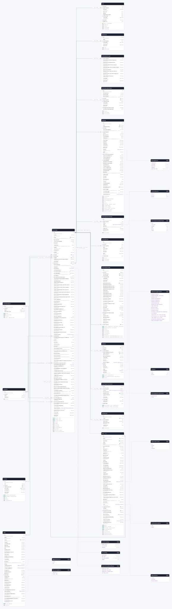

| Field                                      | Type                                                                   | Constraints                                       | Default               | Description                                                                                                        |
| ------------------------------------------ | ---------------------------------------------------------------------- | ------------------------------------------------- | --------------------- | ------------------------------------------------------------------------------------------------------------------ |
| `id`                                       | `Int`                                                                  | PK NOT NULL                                       | `autoincrement()`     |                                                                                                                    |
| `title`                                    | `String`                                                               | NOT NULL                                          |                       | @zod.string.min(1)                                                                                                 |
| `slug`                                     | `String`                                                               | NOT NULL                                          |                       | @zod.import(["import { eventTypeSlug } from '../../zod-utils'"]).custom.use(eventTypeSlug)                         |
| `description`                              | `String`                                                               | NULL                                              |                       |                                                                                                                    |
| `interfaceLanguage`                        | `String`                                                               | NULL                                              |                       |                                                                                                                    |
| `position`                                 | `Int`                                                                  | NOT NULL                                          | `0`                   |                                                                                                                    |
| `locations`                                | `Json`                                                                 | NULL                                              |                       | @zod.import(["import { eventTypeLocations } from '../../zod-utils'"]).custom.use(eventTypeLocations)               |
| `length`                                   | `Int`                                                                  | NOT NULL                                          |                       | @zod.number.min(1)                                                                                                 |
| `offsetStart`                              | `Int`                                                                  | NOT NULL                                          | `0`                   |                                                                                                                    |
| `hidden`                                   | `Boolean`                                                              | NOT NULL                                          | `false`               |                                                                                                                    |
| `userId`                                   | `Int`                                                                  | NULL → [User.id](#model-User)                     |                       |                                                                                                                    |
| `profileId`                                | `Int`                                                                  | NULL → [Profile.id](#model-Profile)               |                       |                                                                                                                    |
| `teamId`                                   | `Int`                                                                  | NULL → [Team.id](#model-Team)                     |                       |                                                                                                                    |
| `useEventLevelSelectedCalendars`           | `Boolean`                                                              | NOT NULL                                          | `false`               |                                                                                                                    |
| `eventName`                                | `String`                                                               | NULL                                              |                       |                                                                                                                    |
| `parentId`                                 | `Int`                                                                  | NULL → [EventType.id](#model-EventType)           |                       |                                                                                                                    |
| `bookingFields`                            | `Json`                                                                 | NULL                                              |                       | @zod.import(["import { eventTypeBookingFields } from '../../zod-utils'"]).custom.use(eventTypeBookingFields)       |
| `timeZone`                                 | `String`                                                               | NULL                                              |                       |                                                                                                                    |
| `periodType`                               | [`PeriodType`](#enum-PeriodType)                                       | NOT NULL                                          | `UNLIMITED`           |                                                                                                                    |
| `periodStartDate`                          | `DateTime`                                                             | NULL                                              |                       | @zod.import(["import { coerceToDate } from '../../zod-utils'"]).custom.use(coerceToDate)                           |
| `periodEndDate`                            | `DateTime`                                                             | NULL                                              |                       | @zod.import(["import { coerceToDate } from '../../zod-utils'"]).custom.use(coerceToDate)                           |
| `periodDays`                               | `Int`                                                                  | NULL                                              |                       |                                                                                                                    |
| `periodCountCalendarDays`                  | `Boolean`                                                              | NULL                                              |                       |                                                                                                                    |
| `lockTimeZoneToggleOnBookingPage`          | `Boolean`                                                              | NOT NULL                                          | `false`               |                                                                                                                    |
| `lockedTimeZone`                           | `String`                                                               | NULL                                              |                       |                                                                                                                    |
| `requiresConfirmation`                     | `Boolean`                                                              | NOT NULL                                          | `false`               |                                                                                                                    |
| `requiresConfirmationWillBlockSlot`        | `Boolean`                                                              | NOT NULL                                          | `false`               |                                                                                                                    |
| `requiresConfirmationForFreeEmail`         | `Boolean`                                                              | NOT NULL                                          | `false`               |                                                                                                                    |
| `requiresBookerEmailVerification`          | `Boolean`                                                              | NOT NULL                                          | `false`               |                                                                                                                    |
| `canSendCalVideoTranscriptionEmails`       | `Boolean`                                                              | NOT NULL                                          | `true`                |                                                                                                                    |
| `autoTranslateDescriptionEnabled`          | `Boolean`                                                              | NOT NULL                                          | `false`               |                                                                                                                    |
| `autoTranslateInstantMeetingTitleEnabled`  | `Boolean`                                                              | NOT NULL                                          | `true`                |                                                                                                                    |
| `recurringEvent`                           | `Json`                                                                 | NULL                                              |                       | @zod.import(["import { recurringEventType } from '../../zod-utils'"]).custom.use(recurringEventType)               |
| `disableGuests`                            | `Boolean`                                                              | NOT NULL                                          | `false`               |                                                                                                                    |
| `hideCalendarNotes`                        | `Boolean`                                                              | NOT NULL                                          | `false`               |                                                                                                                    |
| `hideCalendarEventDetails`                 | `Boolean`                                                              | NOT NULL                                          | `false`               |                                                                                                                    |
| `minimumBookingNotice`                     | `Int`                                                                  | NOT NULL                                          | `120`                 | @zod.number.min(0)                                                                                                 |
| `beforeEventBuffer`                        | `Int`                                                                  | NOT NULL                                          | `0`                   |                                                                                                                    |
| `afterEventBuffer`                         | `Int`                                                                  | NOT NULL                                          | `0`                   |                                                                                                                    |
| `seatsPerTimeSlot`                         | `Int`                                                                  | NULL                                              |                       |                                                                                                                    |
| `onlyShowFirstAvailableSlot`               | `Boolean`                                                              | NOT NULL                                          | `false`               |                                                                                                                    |
| `showOptimizedSlots`                       | `Boolean`                                                              | NULL                                              | `false`               |                                                                                                                    |
| `disableCancelling`                        | `Boolean`                                                              | NULL                                              | `false`               |                                                                                                                    |
| `disableRescheduling`                      | `Boolean`                                                              | NULL                                              | `false`               |                                                                                                                    |
| `minimumRescheduleNotice`                  | `Int`                                                                  | NULL                                              |                       | @zod.number.min(0)                                                                                                 |
| `seatsShowAttendees`                       | `Boolean`                                                              | NULL                                              | `false`               |                                                                                                                    |
| `seatsShowAvailabilityCount`               | `Boolean`                                                              | NULL                                              | `true`                |                                                                                                                    |
| `schedulingType`                           | [`SchedulingType`](#enum-SchedulingType)                               | NULL                                              |                       |                                                                                                                    |
| `scheduleId`                               | `Int`                                                                  | NULL → [Schedule.id](#model-Schedule)             |                       |                                                                                                                    |
| `allowReschedulingCancelledBookings`       | `Boolean`                                                              | NULL                                              | `false`               |                                                                                                                    |
| `price`                                    | `Int`                                                                  | NOT NULL                                          | `0`                   |                                                                                                                    |
| `currency`                                 | `String`                                                               | NOT NULL                                          | `"usd"`               |                                                                                                                    |
| `slotInterval`                             | `Int`                                                                  | NULL                                              |                       |                                                                                                                    |
| `metadata`                                 | `Json`                                                                 | NULL                                              |                       | @zod.import(["import { EventTypeMetaDataSchema } from '../../zod-utils'"]).custom.use(EventTypeMetaDataSchema)     |
| `successRedirectUrl`                       | `String`                                                               | NULL                                              |                       | @zod.import(["import { successRedirectUrl } from '../../zod-utils'"]).custom.use(successRedirectUrl)               |
| `forwardParamsSuccessRedirect`             | `Boolean`                                                              | NULL                                              | `true`                |                                                                                                                    |
| `bookingLimits`                            | `Json`                                                                 | NULL                                              |                       | @zod.import(["import { intervalLimitsType } from '../../zod-utils'"]).custom.use(intervalLimitsType)               |
| `durationLimits`                           | `Json`                                                                 | NULL                                              |                       | @zod.import(["import { intervalLimitsType } from '../../zod-utils'"]).custom.use(intervalLimitsType)               |
| `isInstantEvent`                           | `Boolean`                                                              | NOT NULL                                          | `false`               |                                                                                                                    |
| `instantMeetingExpiryTimeOffsetInSeconds`  | `Int`                                                                  | NOT NULL                                          | `90`                  |                                                                                                                    |
| `instantMeetingScheduleId`                 | `Int`                                                                  | NULL → [Schedule.id](#model-Schedule)             |                       |                                                                                                                    |
| `instantMeetingParameters`                 | `String[]`                                                             | NOT NULL                                          |                       |                                                                                                                    |
| `assignAllTeamMembers`                     | `Boolean`                                                              | NOT NULL                                          | `false`               |                                                                                                                    |
| `assignRRMembersUsingSegment`              | `Boolean`                                                              | NOT NULL                                          | `false`               |                                                                                                                    |
| `rrSegmentQueryValue`                      | `Json`                                                                 | NULL                                              |                       | @zod.import(["import { rrSegmentQueryValueSchema } from '../../zod-utils'"]).custom.use(rrSegmentQueryValueSchema) |
| `useEventTypeDestinationCalendarEmail`     | `Boolean`                                                              | NOT NULL                                          | `false`               |                                                                                                                    |
| `isRRWeightsEnabled`                       | `Boolean`                                                              | NOT NULL                                          | `false`               |                                                                                                                    |
| `maxLeadThreshold`                         | `Int`                                                                  | NULL                                              |                       |                                                                                                                    |
| `includeNoShowInRRCalculation`             | `Boolean`                                                              | NOT NULL                                          | `false`               |                                                                                                                    |
| `allowReschedulingPastBookings`            | `Boolean`                                                              | NOT NULL                                          | `false`               |                                                                                                                    |
| `hideOrganizerEmail`                       | `Boolean`                                                              | NOT NULL                                          | `false`               |                                                                                                                    |
| `maxActiveBookingsPerBooker`               | `Int`                                                                  | NULL                                              |                       |                                                                                                                    |
| `maxActiveBookingPerBookerOfferReschedule` | `Boolean`                                                              | NOT NULL                                          | `false`               |                                                                                                                    |
| `customReplyToEmail`                       | `String`                                                               | NULL                                              |                       | @zod.import(["import { emailSchema } from '../../zod-utils'"]).custom.use(emailSchema)                             |
| `eventTypeColor`                           | `Json`                                                                 | NULL                                              |                       | @zod.import(["import { eventTypeColor } from '../../zod-utils'"]).custom.use(eventTypeColor)                       |
| `rescheduleWithSameRoundRobinHost`         | `Boolean`                                                              | NOT NULL                                          | `false`               |                                                                                                                    |
| `secondaryEmailId`                         | `Int`                                                                  | NULL → [SecondaryEmail.id](#model-SecondaryEmail) |                       |                                                                                                                    |
| `useBookerTimezone`                        | `Boolean`                                                              | NOT NULL                                          | `false`               |                                                                                                                    |
| `restrictionScheduleId`                    | `Int`                                                                  | NULL → [Schedule.id](#model-Schedule)             |                       |                                                                                                                    |
| `bookingRequiresAuthentication`            | `Boolean`                                                              | NOT NULL                                          | `false`               |                                                                                                                    |
| `rrHostSubsetEnabled`                      | `Boolean`                                                              | NOT NULL                                          | `false`               |                                                                                                                    |
| `requiresCancellationReason`               | [`CancellationReasonRequirement`](#enum-CancellationReasonRequirement) | NULL                                              | `MANDATORY_HOST_ONLY` |                                                                                                                    |
| `enablePerHostLocations`                   | `Boolean`                                                              | NOT NULL                                          | `false`               |                                                                                                                    |
| `createdAt`                                | `DateTime`                                                             | NULL                                              | `now()`               |                                                                                                                    |
| `updatedAt`                                | `DateTime`                                                             | NULL                                              | `@updatedAt`          |                                                                                                                    |

#### Indexes

- `@@index([userId])`
- `@@index([teamId])`
- `@@index([profileId])`
- `@@index([scheduleId])`
- `@@index([secondaryEmailId])`
- `@@index([parentId])`
- `@@index([parentId, teamId])`
- `@@index([restrictionScheduleId])`
- `@@unique([userId, slug])`
- `@@unique([teamId, slug])`
- `@@unique([userId, parentId])`

#### References

- `userId` → [User.id](#model-User) (many-to-one, on delete Cascade)
- `profileId` → [Profile.id](#model-Profile) (many-to-one)
- `teamId` → [Team.id](#model-Team) (many-to-one, on delete Cascade)
- `parentId` → [EventType.id](#model-EventType) (many-to-one, on delete Cascade)
- `scheduleId` → [Schedule.id](#model-Schedule) (many-to-one)
- `instantMeetingScheduleId` → [Schedule.id](#model-Schedule) (many-to-one)
- `secondaryEmailId` → [SecondaryEmail.id](#model-SecondaryEmail) (many-to-one, on delete Cascade)
- `restrictionScheduleId` → [Schedule.id](#model-Schedule) (many-to-one)

#### Referenced by

- `id` ← [Host.eventTypeId](#model-Host) (one-to-many, on delete Cascade)
- `id` ← [HostGroup.eventTypeId](#model-HostGroup) (one-to-many, on delete Cascade)
- `id` ← [CalVideoSettings.eventTypeId](#model-CalVideoSettings) (one-to-one, on delete Cascade)
- `id` ← [EventType.parentId](#model-EventType) (one-to-many, on delete Cascade)
- `id` ← [DestinationCalendar.eventTypeId](#model-DestinationCalendar) (one-to-one, on delete Cascade)
- `id` ← [Booking.eventTypeId](#model-Booking) (one-to-many)
- `id` ← [Availability.eventTypeId](#model-Availability) (one-to-many)
- `id` ← [SelectedCalendar.eventTypeId](#model-SelectedCalendar) (one-to-many)
- `id` ← [EventTypeCustomInput.eventTypeId](#model-EventTypeCustomInput) (one-to-many, on delete Cascade)
- `id` ← [Webhook.eventTypeId](#model-Webhook) (one-to-many, on delete Cascade)
- `id` ← [HashedLink.eventTypeId](#model-HashedLink) (one-to-many, on delete Cascade)
- `id` ← [EventTypeTranslation.eventTypeId](#model-EventTypeTranslation) (one-to-many, on delete Cascade)

#### Many to many

- `users` ↔ [User.eventTypes](#model-User) through `_user_eventtype`

#### Definition

```sql
CREATE TABLE "EventType" (
    "id" SERIAL NOT NULL,
    "title" TEXT NOT NULL,
    "slug" TEXT NOT NULL,
    "description" TEXT,
    "interfaceLanguage" TEXT,
    "position" INTEGER NOT NULL DEFAULT 0,
    "locations" JSONB,
    "length" INTEGER NOT NULL,
    "offsetStart" INTEGER NOT NULL DEFAULT 0,
    "hidden" BOOLEAN NOT NULL DEFAULT false,
    "userId" INTEGER,
    "profileId" INTEGER,
    "teamId" INTEGER,
    "useEventLevelSelectedCalendars" BOOLEAN NOT NULL DEFAULT false,
    "eventName" TEXT,
    "parentId" INTEGER,
    "bookingFields" JSONB,
    "timeZone" TEXT,
    "periodType" "PeriodType" NOT NULL DEFAULT 'unlimited',
    "periodStartDate" TIMESTAMP(3),
    "periodEndDate" TIMESTAMP(3),
    "periodDays" INTEGER,
    "periodCountCalendarDays" BOOLEAN,
    "lockTimeZoneToggleOnBookingPage" BOOLEAN NOT NULL DEFAULT false,
    "lockedTimeZone" TEXT,
    "requiresConfirmation" BOOLEAN NOT NULL DEFAULT false,
    "requiresConfirmationWillBlockSlot" BOOLEAN NOT NULL DEFAULT false,
    "requiresConfirmationForFreeEmail" BOOLEAN NOT NULL DEFAULT false,
    "requiresBookerEmailVerification" BOOLEAN NOT NULL DEFAULT false,
    "canSendCalVideoTranscriptionEmails" BOOLEAN NOT NULL DEFAULT true,
    "autoTranslateDescriptionEnabled" BOOLEAN NOT NULL DEFAULT false,
    "autoTranslateInstantMeetingTitleEnabled" BOOLEAN NOT NULL DEFAULT true,
    "recurringEvent" JSONB,
    "disableGuests" BOOLEAN NOT NULL DEFAULT false,
    "hideCalendarNotes" BOOLEAN NOT NULL DEFAULT false,
    "hideCalendarEventDetails" BOOLEAN NOT NULL DEFAULT false,
    "minimumBookingNotice" INTEGER NOT NULL DEFAULT 120,
    "beforeEventBuffer" INTEGER NOT NULL DEFAULT 0,
    "afterEventBuffer" INTEGER NOT NULL DEFAULT 0,
    "seatsPerTimeSlot" INTEGER,
    "onlyShowFirstAvailableSlot" BOOLEAN NOT NULL DEFAULT false,
    "showOptimizedSlots" BOOLEAN DEFAULT false,
    "disableCancelling" BOOLEAN DEFAULT false,
    "disableRescheduling" BOOLEAN DEFAULT false,
    "minimumRescheduleNotice" INTEGER,
    "seatsShowAttendees" BOOLEAN DEFAULT false,
    "seatsShowAvailabilityCount" BOOLEAN DEFAULT true,
    "schedulingType" "SchedulingType",
    "scheduleId" INTEGER,
    "allowReschedulingCancelledBookings" BOOLEAN DEFAULT false,
    "price" INTEGER NOT NULL DEFAULT 0,
    "currency" TEXT NOT NULL DEFAULT 'usd',
    "slotInterval" INTEGER,
    "metadata" JSONB,
    "successRedirectUrl" TEXT,
    "forwardParamsSuccessRedirect" BOOLEAN DEFAULT true,
    "bookingLimits" JSONB,
    "durationLimits" JSONB,
    "isInstantEvent" BOOLEAN NOT NULL DEFAULT false,
    "instantMeetingExpiryTimeOffsetInSeconds" INTEGER NOT NULL DEFAULT 90,
    "instantMeetingScheduleId" INTEGER,
    "instantMeetingParameters" TEXT[],
    "assignAllTeamMembers" BOOLEAN NOT NULL DEFAULT false,
    "assignRRMembersUsingSegment" BOOLEAN NOT NULL DEFAULT false,
    "rrSegmentQueryValue" JSONB,
    "useEventTypeDestinationCalendarEmail" BOOLEAN NOT NULL DEFAULT false,
    "isRRWeightsEnabled" BOOLEAN NOT NULL DEFAULT false,
    "maxLeadThreshold" INTEGER,
    "includeNoShowInRRCalculation" BOOLEAN NOT NULL DEFAULT false,
    "allowReschedulingPastBookings" BOOLEAN NOT NULL DEFAULT false,
    "hideOrganizerEmail" BOOLEAN NOT NULL DEFAULT false,
    "maxActiveBookingsPerBooker" INTEGER,
    "maxActiveBookingPerBookerOfferReschedule" BOOLEAN NOT NULL DEFAULT false,
    "customReplyToEmail" TEXT,
    "eventTypeColor" JSONB,
    "rescheduleWithSameRoundRobinHost" BOOLEAN NOT NULL DEFAULT false,
    "secondaryEmailId" INTEGER,
    "useBookerTimezone" BOOLEAN NOT NULL DEFAULT false,
    "restrictionScheduleId" INTEGER,
    "bookingRequiresAuthentication" BOOLEAN NOT NULL DEFAULT false,
    "rrHostSubsetEnabled" BOOLEAN NOT NULL DEFAULT false,
    "requiresCancellationReason" "CancellationReasonRequirement" DEFAULT 'MANDATORY_HOST_ONLY',
    "enablePerHostLocations" BOOLEAN NOT NULL DEFAULT false,
    "createdAt" TIMESTAMP(3) DEFAULT CURRENT_TIMESTAMP,
    "updatedAt" TIMESTAMP(3),

    CONSTRAINT "EventType_pkey" PRIMARY KEY ("id")
);

CREATE INDEX "EventType_userId_idx" ON "EventType"("userId");

CREATE INDEX "EventType_teamId_idx" ON "EventType"("teamId");

CREATE INDEX "EventType_profileId_idx" ON "EventType"("profileId");

CREATE INDEX "EventType_scheduleId_idx" ON "EventType"("scheduleId");

CREATE INDEX "EventType_secondaryEmailId_idx" ON "EventType"("secondaryEmailId");

CREATE INDEX "EventType_parentId_idx" ON "EventType"("parentId");

CREATE INDEX "EventType_parentId_teamId_idx" ON "EventType"("parentId", "teamId");

CREATE INDEX "EventType_restrictionScheduleId_idx" ON "EventType"("restrictionScheduleId");

CREATE UNIQUE INDEX "EventType_userId_slug_key" ON "EventType"("userId", "slug");

CREATE UNIQUE INDEX "EventType_teamId_slug_key" ON "EventType"("teamId", "slug");

CREATE UNIQUE INDEX "EventType_userId_parentId_key" ON "EventType"("userId", "parentId");

ALTER TABLE "EventType" ADD CONSTRAINT "EventType_userId_fkey" FOREIGN KEY ("userId") REFERENCES "users"("id") ON DELETE CASCADE ON UPDATE CASCADE;

ALTER TABLE "EventType" ADD CONSTRAINT "EventType_profileId_fkey" FOREIGN KEY ("profileId") REFERENCES "Profile"("id") ON DELETE SET NULL ON UPDATE CASCADE;

ALTER TABLE "EventType" ADD CONSTRAINT "EventType_teamId_fkey" FOREIGN KEY ("teamId") REFERENCES "Team"("id") ON DELETE CASCADE ON UPDATE CASCADE;

ALTER TABLE "EventType" ADD CONSTRAINT "EventType_parentId_fkey" FOREIGN KEY ("parentId") REFERENCES "EventType"("id") ON DELETE CASCADE ON UPDATE CASCADE;

ALTER TABLE "EventType" ADD CONSTRAINT "EventType_scheduleId_fkey" FOREIGN KEY ("scheduleId") REFERENCES "Schedule"("id") ON DELETE SET NULL ON UPDATE CASCADE;

ALTER TABLE "EventType" ADD CONSTRAINT "EventType_instantMeetingScheduleId_fkey" FOREIGN KEY ("instantMeetingScheduleId") REFERENCES "Schedule"("id") ON DELETE SET NULL ON UPDATE CASCADE;

ALTER TABLE "EventType" ADD CONSTRAINT "EventType_secondaryEmailId_fkey" FOREIGN KEY ("secondaryEmailId") REFERENCES "SecondaryEmail"("id") ON DELETE CASCADE ON UPDATE CASCADE;

ALTER TABLE "EventType" ADD CONSTRAINT "EventType_restrictionScheduleId_fkey" FOREIGN KEY ("restrictionScheduleId") REFERENCES "Schedule"("id") ON DELETE SET NULL ON UPDATE CASCADE;
```

<details>
<summary>Queries and their SQL</summary>

**findMany**: Every row

```ts
await prisma.eventType.findMany();
```

```sql
SELECT
  "public"."EventType"."id",
  "public"."EventType"."title",
  "public"."EventType"."slug",
  "public"."EventType"."description",
  "public"."EventType"."interfaceLanguage",
  "public"."EventType"."position",
  "public"."EventType"."locations",
  "public"."EventType"."length",
  "public"."EventType"."offsetStart",
  "public"."EventType"."hidden",
  "public"."EventType"."userId",
  "public"."EventType"."profileId",
  "public"."EventType"."teamId",
  "public"."EventType"."useEventLevelSelectedCalendars",
  "public"."EventType"."eventName",
  "public"."EventType"."parentId",
  "public"."EventType"."bookingFields",
  "public"."EventType"."timeZone",
  "public"."EventType"."periodType"::text,
  "public"."EventType"."periodStartDate",
  "public"."EventType"."periodEndDate",
  "public"."EventType"."periodDays",
  "public"."EventType"."periodCountCalendarDays",
  "public"."EventType"."lockTimeZoneToggleOnBookingPage",
  "public"."EventType"."lockedTimeZone",
  "public"."EventType"."requiresConfirmation",
  "public"."EventType"."requiresConfirmationWillBlockSlot",
  "public"."EventType"."requiresConfirmationForFreeEmail",
  "public"."EventType"."requiresBookerEmailVerification",
  "public"."EventType"."canSendCalVideoTranscriptionEmails",
  "public"."EventType"."autoTranslateDescriptionEnabled",
  "public"."EventType"."autoTranslateInstantMeetingTitleEnabled",
  "public"."EventType"."recurringEvent",
  "public"."EventType"."disableGuests",
  "public"."EventType"."hideCalendarNotes",
  "public"."EventType"."hideCalendarEventDetails",
  "public"."EventType"."minimumBookingNotice",
  "public"."EventType"."beforeEventBuffer",
  "public"."EventType"."afterEventBuffer",
  "public"."EventType"."seatsPerTimeSlot",
  "public"."EventType"."onlyShowFirstAvailableSlot",
  "public"."EventType"."showOptimizedSlots",
  "public"."EventType"."disableCancelling",
  "public"."EventType"."disableRescheduling",
  "public"."EventType"."minimumRescheduleNotice",
  "public"."EventType"."seatsShowAttendees",
  "public"."EventType"."seatsShowAvailabilityCount",
  "public"."EventType"."schedulingType"::text,
  "public"."EventType"."scheduleId",
  "public"."EventType"."allowReschedulingCancelledBookings",
  "public"."EventType"."price",
  "public"."EventType"."currency",
  "public"."EventType"."slotInterval",
  "public"."EventType"."metadata",
  "public"."EventType"."successRedirectUrl",
  "public"."EventType"."forwardParamsSuccessRedirect",
  "public"."EventType"."bookingLimits",
  "public"."EventType"."durationLimits",
  "public"."EventType"."isInstantEvent",
  "public"."EventType"."instantMeetingExpiryTimeOffsetInSeconds",
  "public"."EventType"."instantMeetingScheduleId",
  "public"."EventType"."instantMeetingParameters",
  "public"."EventType"."assignAllTeamMembers",
  "public"."EventType"."assignRRMembersUsingSegment",
  "public"."EventType"."rrSegmentQueryValue",
  "public"."EventType"."useEventTypeDestinationCalendarEmail",
  "public"."EventType"."isRRWeightsEnabled",
  "public"."EventType"."maxLeadThreshold",
  "public"."EventType"."includeNoShowInRRCalculation",
  "public"."EventType"."allowReschedulingPastBookings",
  "public"."EventType"."hideOrganizerEmail",
  "public"."EventType"."maxActiveBookingsPerBooker",
  "public"."EventType"."maxActiveBookingPerBookerOfferReschedule",
  "public"."EventType"."customReplyToEmail",
  "public"."EventType"."eventTypeColor",
  "public"."EventType"."rescheduleWithSameRoundRobinHost",
  "public"."EventType"."secondaryEmailId",
  "public"."EventType"."useBookerTimezone",
  "public"."EventType"."restrictionScheduleId",
  "public"."EventType"."bookingRequiresAuthentication",
  "public"."EventType"."rrHostSubsetEnabled",
  "public"."EventType"."requiresCancellationReason"::text,
  "public"."EventType"."enablePerHostLocations",
  "public"."EventType"."createdAt",
  "public"."EventType"."updatedAt"
FROM
  "public"."EventType"
WHERE
  1 = 1
OFFSET
  $1
-- params: ["0"]
```

**count**: How many rows there are

```ts
await prisma.eventType.count();
```

```sql
SELECT
  COUNT(*) AS "_count$_all"
FROM
  (
    SELECT
      "public"."EventType"."id"
    FROM
      "public"."EventType"
    WHERE
      1 = 1
    OFFSET
      $1
  ) AS "sub"
-- params: ["0"]
```

**findMany**: Every row with its relations

```ts
await prisma.eventType.findMany({
  include: {
    hosts: true,
    users: true,
    owner: true,
    profile: true,
    team: true,
    hashedLink: true,
    bookings: true,
    availability: true,
    webhooks: true,
    destinationCalendar: true,
    customInputs: true,
    parent: true,
    children: true,
    schedule: true,
    instantMeetingSchedule: true,
    fieldTranslations: true,
    selectedCalendars: true,
    calVideoSettings: true,
    secondaryEmail: true,
    restrictionSchedule: true,
    hostGroups: true,
  },
});
```

```sql
SELECT
  "public"."EventType"."id",
  "public"."EventType"."title",
  "public"."EventType"."slug",
  "public"."EventType"."description",
  "public"."EventType"."interfaceLanguage",
  "public"."EventType"."position",
  "public"."EventType"."locations",
  "public"."EventType"."length",
  "public"."EventType"."offsetStart",
  "public"."EventType"."hidden",
  "public"."EventType"."userId",
  "public"."EventType"."profileId",
  "public"."EventType"."teamId",
  "public"."EventType"."useEventLevelSelectedCalendars",
  "public"."EventType"."eventName",
  "public"."EventType"."parentId",
  "public"."EventType"."bookingFields",
  "public"."EventType"."timeZone",
  "public"."EventType"."periodType"::text,
  "public"."EventType"."periodStartDate",
  "public"."EventType"."periodEndDate",
  "public"."EventType"."periodDays",
  "public"."EventType"."periodCountCalendarDays",
  "public"."EventType"."lockTimeZoneToggleOnBookingPage",
  "public"."EventType"."lockedTimeZone",
  "public"."EventType"."requiresConfirmation",
  "public"."EventType"."requiresConfirmationWillBlockSlot",
  "public"."EventType"."requiresConfirmationForFreeEmail",
  "public"."EventType"."requiresBookerEmailVerification",
  "public"."EventType"."canSendCalVideoTranscriptionEmails",
  "public"."EventType"."autoTranslateDescriptionEnabled",
  "public"."EventType"."autoTranslateInstantMeetingTitleEnabled",
  "public"."EventType"."recurringEvent",
  "public"."EventType"."disableGuests",
  "public"."EventType"."hideCalendarNotes",
  "public"."EventType"."hideCalendarEventDetails",
  "public"."EventType"."minimumBookingNotice",
  "public"."EventType"."beforeEventBuffer",
  "public"."EventType"."afterEventBuffer",
  "public"."EventType"."seatsPerTimeSlot",
  "public"."EventType"."onlyShowFirstAvailableSlot",
  "public"."EventType"."showOptimizedSlots",
  "public"."EventType"."disableCancelling",
  "public"."EventType"."disableRescheduling",
  "public"."EventType"."minimumRescheduleNotice",
  "public"."EventType"."seatsShowAttendees",
  "public"."EventType"."seatsShowAvailabilityCount",
  "public"."EventType"."schedulingType"::text,
  "public"."EventType"."scheduleId",
  "public"."EventType"."allowReschedulingCancelledBookings",
  "public"."EventType"."price",
  "public"."EventType"."currency",
  "public"."EventType"."slotInterval",
  "public"."EventType"."metadata",
  "public"."EventType"."successRedirectUrl",
  "public"."EventType"."forwardParamsSuccessRedirect",
  "public"."EventType"."bookingLimits",
  "public"."EventType"."durationLimits",
  "public"."EventType"."isInstantEvent",
  "public"."EventType"."instantMeetingExpiryTimeOffsetInSeconds",
  "public"."EventType"."instantMeetingScheduleId",
  "public"."EventType"."instantMeetingParameters",
  "public"."EventType"."assignAllTeamMembers",
  "public"."EventType"."assignRRMembersUsingSegment",
  "public"."EventType"."rrSegmentQueryValue",
  "public"."EventType"."useEventTypeDestinationCalendarEmail",
  "public"."EventType"."isRRWeightsEnabled",
  "public"."EventType"."maxLeadThreshold",
  "public"."EventType"."includeNoShowInRRCalculation",
  "public"."EventType"."allowReschedulingPastBookings",
  "public"."EventType"."hideOrganizerEmail",
  "public"."EventType"."maxActiveBookingsPerBooker",
  "public"."EventType"."maxActiveBookingPerBookerOfferReschedule",
  "public"."EventType"."customReplyToEmail",
  "public"."EventType"."eventTypeColor",
  "public"."EventType"."rescheduleWithSameRoundRobinHost",
  "public"."EventType"."secondaryEmailId",
  "public"."EventType"."useBookerTimezone",
  "public"."EventType"."restrictionScheduleId",
  "public"."EventType"."bookingRequiresAuthentication",
  "public"."EventType"."rrHostSubsetEnabled",
  "public"."EventType"."requiresCancellationReason"::text,
  "public"."EventType"."enablePerHostLocations",
  "public"."EventType"."createdAt",
  "public"."EventType"."updatedAt"
FROM
  "public"."EventType"
WHERE
  1 = 1
OFFSET
  $1
-- params: ["0"]

SELECT
  "public"."Host"."userId",
  "public"."Host"."eventTypeId",
  "public"."Host"."isFixed",
  "public"."Host"."priority",
  "public"."Host"."weight",
  "public"."Host"."weightAdjustment",
  "public"."Host"."scheduleId",
  "public"."Host"."createdAt",
  "public"."Host"."groupId",
  "public"."Host"."memberId"
FROM
  "public"."Host"
WHERE
  "public"."Host"."eventTypeId" IN ($1)
OFFSET
  $2
-- params: ["<id of the rows above>","0"]

SELECT
  "public"."users"."id",
  "public"."users"."uuid",
  "public"."users"."username",
  "public"."users"."name",
  "public"."users"."email",
  "public"."users"."emailVerified",
  "public"."users"."bio",
  "public"."users"."avatarUrl",
  "public"."users"."timeZone",
  "public"."users"."weekStart",
  "public"."users"."bufferTime",
  "public"."users"."hideBranding",
  "public"."users"."theme",
  "public"."users"."appTheme",
  "public"."users"."created",
  "public"."users"."trialEndsAt",
  "public"."users"."lastActiveAt",
  "public"."users"."defaultScheduleId",
  "public"."users"."completedOnboarding",
  "public"."users"."locale",
  "public"."users"."timeFormat",
  "public"."users"."twoFactorSecret",
  "public"."users"."twoFactorEnabled",
  "public"."users"."backupCodes",
  "public"."users"."identityProvider"::text,
  "public"."users"."identityProviderId",
  "public"."users"."invitedTo",
  "public"."users"."brandColor",
  "public"."users"."darkBrandColor",
  "public"."users"."allowDynamicBooking",
  "public"."users"."allowSEOIndexing",
  "public"."users"."receiveMonthlyDigestEmail",
  "public"."users"."requiresBookerEmailVerification",
  "public"."users"."metadata",
  "public"."users"."verified",
  "public"."users"."role"::text,
  "public"."users"."organizationId",
  "public"."users"."locked",
  "public"."users"."movedToProfileId",
  "public"."users"."isPlatformManaged",
  "public"."users"."smsLockState"::text,
  "public"."users"."smsLockReviewedByAdmin",
  "public"."users"."referralLinkId",
  "public"."users"."creationSource"::text,
  "public"."users"."autoOptInFeatures",
  "t0"."A" AS "user_eventtype@EventType"
FROM
  "public"."users"
  INNER JOIN "public"."_user_eventtype" AS "t0" ON "t0"."B" = "public"."users"."id"
WHERE
  (
    1 = 1
    AND "t0"."A" IN ($1)
  )
OFFSET
  $2
-- params: ["<id of the rows above>","0"]

SELECT
  "public"."users"."id",
  "public"."users"."uuid",
  "public"."users"."username",
  "public"."users"."name",
  "public"."users"."email",
  "public"."users"."emailVerified",
  "public"."users"."bio",
  "public"."users"."avatarUrl",
  "public"."users"."timeZone",
  "public"."users"."weekStart",
  "public"."users"."bufferTime",
  "public"."users"."hideBranding",
  "public"."users"."theme",
  "public"."users"."appTheme",
  "public"."users"."created",
  "public"."users"."trialEndsAt",
  "public"."users"."lastActiveAt",
  "public"."users"."defaultScheduleId",
  "public"."users"."completedOnboarding",
  "public"."users"."locale",
  "public"."users"."timeFormat",
  "public"."users"."twoFactorSecret",
  "public"."users"."twoFactorEnabled",
  "public"."users"."backupCodes",
  "public"."users"."identityProvider"::text,
  "public"."users"."identityProviderId",
  "public"."users"."invitedTo",
  "public"."users"."brandColor",
  "public"."users"."darkBrandColor",
  "public"."users"."allowDynamicBooking",
  "public"."users"."allowSEOIndexing",
  "public"."users"."receiveMonthlyDigestEmail",
  "public"."users"."requiresBookerEmailVerification",
  "public"."users"."metadata",
  "public"."users"."verified",
  "public"."users"."role"::text,
  "public"."users"."organizationId",
  "public"."users"."locked",
  "public"."users"."movedToProfileId",
  "public"."users"."isPlatformManaged",
  "public"."users"."smsLockState"::text,
  "public"."users"."smsLockReviewedByAdmin",
  "public"."users"."referralLinkId",
  "public"."users"."creationSource"::text,
  "public"."users"."autoOptInFeatures"
FROM
  "public"."users"
WHERE
  "public"."users"."id" IN ($1)
OFFSET
  $2
-- params: ["<userId of the rows above>","0"]

SELECT
  "public"."Profile"."id",
  "public"."Profile"."uid",
  "public"."Profile"."userId",
  "public"."Profile"."organizationId",
  "public"."Profile"."username",
  "public"."Profile"."createdAt",
  "public"."Profile"."updatedAt"
FROM
  "public"."Profile"
WHERE
  "public"."Profile"."id" IN ($1)
OFFSET
  $2
-- params: ["<profileId of the rows above>","0"]

SELECT
  "public"."Team"."id",
  "public"."Team"."name",
  "public"."Team"."slug",
  "public"."Team"."logoUrl",
  "public"."Team"."calVideoLogo",
  "public"."Team"."appLogo",
  "public"."Team"."appIconLogo",
  "public"."Team"."bio",
  "public"."Team"."hideBranding",
  "public"."Team"."hideTeamProfileLink",
  "public"."Team"."isPrivate",
  "public"."Team"."hideBookATeamMember",
  "public"."Team"."createdAt",
  "public"."Team"."metadata",
  "public"."Team"."theme",
  "public"."Team"."rrResetInterval"::text,
  "public"."Team"."rrTimestampBasis"::text,
  "public"."Team"."brandColor",
  "public"."Team"."darkBrandColor",
  "public"."Team"."bannerUrl",
  "public"."Team"."parentId",
  "public"."Team"."timeFormat",
  "public"."Team"."timeZone",
  "public"."Team"."weekStart",
  "public"."Team"."isOrganization",
  "public"."Team"."pendingPayment",
  "public"."Team"."isPlatform",
  "public"."Team"."createdByOAuthClientId",
  "public"."Team"."smsLockState"::text,
  "public"."Team"."smsLockReviewedByAdmin",
  "public"."Team"."bookingLimits",
  "public"."Team"."includeManagedEventsInLimits",
  "public"."Team"."autoOptInFeatures"
FROM
  "public"."Team"
WHERE
  "public"."Team"."id" IN ($1)
OFFSET
  $2
-- params: ["<teamId of the rows above>","0"]

SELECT
  "public"."HashedLink"."id",
  "public"."HashedLink"."link",
  "public"."HashedLink"."eventTypeId",
  "public"."HashedLink"."expiresAt",
  "public"."HashedLink"."maxUsageCount",
  "public"."HashedLink"."usageCount"
FROM
  "public"."HashedLink"
WHERE
  "public"."HashedLink"."eventTypeId" IN ($1)
OFFSET
  $2
-- params: ["<id of the rows above>","0"]

SELECT
  "public"."Booking"."id",
  "public"."Booking"."uid",
  "public"."Booking"."idempotencyKey",
  "public"."Booking"."userId",
  "public"."Booking"."userPrimaryEmail",
  "public"."Booking"."eventTypeId",
  "public"."Booking"."title",
  "public"."Booking"."description",
  "public"."Booking"."customInputs",
  "public"."Booking"."responses",
  "public"."Booking"."startTime",
  "public"."Booking"."endTime",
  "public"."Booking"."location",
  "public"."Booking"."createdAt",
  "public"."Booking"."updatedAt",
  "public"."Booking"."status"::text,
  "public"."Booking"."paid",
  "public"."Booking"."destinationCalendarId",
  "public"."Booking"."cancellationReason",
  "public"."Booking"."rejectionReason",
  "public"."Booking"."reassignReason",
  "public"."Booking"."reassignById",
  "public"."Booking"."dynamicEventSlugRef",
  "public"."Booking"."dynamicGroupSlugRef",
  "public"."Booking"."rescheduled",
  "public"."Booking"."fromReschedule",
  "public"."Booking"."recurringEventId",
  "public"."Booking"."smsReminderNumber",
  "public"."Booking"."scheduledJobs",
  "public"."Booking"."metadata",
  "public"."Booking"."isRecorded",
  "public"."Booking"."iCalUID",
  "public"."Booking"."iCalSequence",
  "public"."Booking"."rating",
  "public"."Booking"."ratingFeedback",
  "public"."Booking"."noShowHost",
  "public"."Booking"."oneTimePassword",
  "public"."Booking"."cancelledBy",
  "public"."Booking"."rescheduledBy",
  "public"."Booking"."creationSource"::text
FROM
  "public"."Booking"
WHERE
  "public"."Booking"."eventTypeId" IN ($1)
OFFSET
  $2
-- params: ["<id of the rows above>","0"]

SELECT
  "public"."Availability"."id",
  "public"."Availability"."userId",
  "public"."Availability"."eventTypeId",
  "public"."Availability"."days",
  "public"."Availability"."startTime",
  "public"."Availability"."endTime",
  "public"."Availability"."date",
  "public"."Availability"."scheduleId"
FROM
  "public"."Availability"
WHERE
  "public"."Availability"."eventTypeId" IN ($1)
OFFSET
  $2
-- params: ["<id of the rows above>","0"]

SELECT
  "public"."Webhook"."id",
  "public"."Webhook"."userId",
  "public"."Webhook"."teamId",
  "public"."Webhook"."eventTypeId",
  "public"."Webhook"."platformOAuthClientId",
  "public"."Webhook"."subscriberUrl",
  "public"."Webhook"."payloadTemplate",
  "public"."Webhook"."createdAt",
  "public"."Webhook"."active",
  "public"."Webhook"."eventTriggers"::text[],
  "public"."Webhook"."appId",
  "public"."Webhook"."secret",
  "public"."Webhook"."platform",
  "public"."Webhook"."time",
  "public"."Webhook"."timeUnit"::text,
  "public"."Webhook"."version"
FROM
  "public"."Webhook"
WHERE
  "public"."Webhook"."eventTypeId" IN ($1)
OFFSET
  $2
-- params: ["<id of the rows above>","0"]

SELECT
  "public"."DestinationCalendar"."id",
  "public"."DestinationCalendar"."integration",
  "public"."DestinationCalendar"."externalId",
  "public"."DestinationCalendar"."primaryEmail",
  "public"."DestinationCalendar"."userId",
  "public"."DestinationCalendar"."eventTypeId",
  "public"."DestinationCalendar"."credentialId",
  "public"."DestinationCalendar"."createdAt",
  "public"."DestinationCalendar"."updatedAt",
  "public"."DestinationCalendar"."delegationCredentialId",
  "public"."DestinationCalendar"."customCalendarReminder"
FROM
  "public"."DestinationCalendar"
WHERE
  "public"."DestinationCalendar"."eventTypeId" IN ($1)
OFFSET
  $2
-- params: ["<id of the rows above>","0"]

SELECT
  "public"."EventTypeCustomInput"."id",
  "public"."EventTypeCustomInput"."eventTypeId",
  "public"."EventTypeCustomInput"."label",
  "public"."EventTypeCustomInput"."type"::text,
  "public"."EventTypeCustomInput"."options",
  "public"."EventTypeCustomInput"."required",
  "public"."EventTypeCustomInput"."placeholder"
FROM
  "public"."EventTypeCustomInput"
WHERE
  "public"."EventTypeCustomInput"."eventTypeId" IN ($1)
OFFSET
  $2
-- params: ["<id of the rows above>","0"]

SELECT
  "public"."EventType"."id",
  "public"."EventType"."title",
  "public"."EventType"."slug",
  "public"."EventType"."description",
  "public"."EventType"."interfaceLanguage",
  "public"."EventType"."position",
  "public"."EventType"."locations",
  "public"."EventType"."length",
  "public"."EventType"."offsetStart",
  "public"."EventType"."hidden",
  "public"."EventType"."userId",
  "public"."EventType"."profileId",
  "public"."EventType"."teamId",
  "public"."EventType"."useEventLevelSelectedCalendars",
  "public"."EventType"."eventName",
  "public"."EventType"."parentId",
  "public"."EventType"."bookingFields",
  "public"."EventType"."timeZone",
  "public"."EventType"."periodType"::text,
  "public"."EventType"."periodStartDate",
  "public"."EventType"."periodEndDate",
  "public"."EventType"."periodDays",
  "public"."EventType"."periodCountCalendarDays",
  "public"."EventType"."lockTimeZoneToggleOnBookingPage",
  "public"."EventType"."lockedTimeZone",
  "public"."EventType"."requiresConfirmation",
  "public"."EventType"."requiresConfirmationWillBlockSlot",
  "public"."EventType"."requiresConfirmationForFreeEmail",
  "public"."EventType"."requiresBookerEmailVerification",
  "public"."EventType"."canSendCalVideoTranscriptionEmails",
  "public"."EventType"."autoTranslateDescriptionEnabled",
  "public"."EventType"."autoTranslateInstantMeetingTitleEnabled",
  "public"."EventType"."recurringEvent",
  "public"."EventType"."disableGuests",
  "public"."EventType"."hideCalendarNotes",
  "public"."EventType"."hideCalendarEventDetails",
  "public"."EventType"."minimumBookingNotice",
  "public"."EventType"."beforeEventBuffer",
  "public"."EventType"."afterEventBuffer",
  "public"."EventType"."seatsPerTimeSlot",
  "public"."EventType"."onlyShowFirstAvailableSlot",
  "public"."EventType"."showOptimizedSlots",
  "public"."EventType"."disableCancelling",
  "public"."EventType"."disableRescheduling",
  "public"."EventType"."minimumRescheduleNotice",
  "public"."EventType"."seatsShowAttendees",
  "public"."EventType"."seatsShowAvailabilityCount",
  "public"."EventType"."schedulingType"::text,
  "public"."EventType"."scheduleId",
  "public"."EventType"."allowReschedulingCancelledBookings",
  "public"."EventType"."price",
  "public"."EventType"."currency",
  "public"."EventType"."slotInterval",
  "public"."EventType"."metadata",
  "public"."EventType"."successRedirectUrl",
  "public"."EventType"."forwardParamsSuccessRedirect",
  "public"."EventType"."bookingLimits",
  "public"."EventType"."durationLimits",
  "public"."EventType"."isInstantEvent",
  "public"."EventType"."instantMeetingExpiryTimeOffsetInSeconds",
  "public"."EventType"."instantMeetingScheduleId",
  "public"."EventType"."instantMeetingParameters",
  "public"."EventType"."assignAllTeamMembers",
  "public"."EventType"."assignRRMembersUsingSegment",
  "public"."EventType"."rrSegmentQueryValue",
  "public"."EventType"."useEventTypeDestinationCalendarEmail",
  "public"."EventType"."isRRWeightsEnabled",
  "public"."EventType"."maxLeadThreshold",
  "public"."EventType"."includeNoShowInRRCalculation",
  "public"."EventType"."allowReschedulingPastBookings",
  "public"."EventType"."hideOrganizerEmail",
  "public"."EventType"."maxActiveBookingsPerBooker",
  "public"."EventType"."maxActiveBookingPerBookerOfferReschedule",
  "public"."EventType"."customReplyToEmail",
  "public"."EventType"."eventTypeColor",
  "public"."EventType"."rescheduleWithSameRoundRobinHost",
  "public"."EventType"."secondaryEmailId",
  "public"."EventType"."useBookerTimezone",
  "public"."EventType"."restrictionScheduleId",
  "public"."EventType"."bookingRequiresAuthentication",
  "public"."EventType"."rrHostSubsetEnabled",
  "public"."EventType"."requiresCancellationReason"::text,
  "public"."EventType"."enablePerHostLocations",
  "public"."EventType"."createdAt",
  "public"."EventType"."updatedAt"
FROM
  "public"."EventType"
WHERE
  "public"."EventType"."id" IN ($1)
OFFSET
  $2
-- params: ["<parentId of the rows above>","0"]

SELECT
  "public"."EventType"."id",
  "public"."EventType"."title",
  "public"."EventType"."slug",
  "public"."EventType"."description",
  "public"."EventType"."interfaceLanguage",
  "public"."EventType"."position",
  "public"."EventType"."locations",
  "public"."EventType"."length",
  "public"."EventType"."offsetStart",
  "public"."EventType"."hidden",
  "public"."EventType"."userId",
  "public"."EventType"."profileId",
  "public"."EventType"."teamId",
  "public"."EventType"."useEventLevelSelectedCalendars",
  "public"."EventType"."eventName",
  "public"."EventType"."parentId",
  "public"."EventType"."bookingFields",
  "public"."EventType"."timeZone",
  "public"."EventType"."periodType"::text,
  "public"."EventType"."periodStartDate",
  "public"."EventType"."periodEndDate",
  "public"."EventType"."periodDays",
  "public"."EventType"."periodCountCalendarDays",
  "public"."EventType"."lockTimeZoneToggleOnBookingPage",
  "public"."EventType"."lockedTimeZone",
  "public"."EventType"."requiresConfirmation",
  "public"."EventType"."requiresConfirmationWillBlockSlot",
  "public"."EventType"."requiresConfirmationForFreeEmail",
  "public"."EventType"."requiresBookerEmailVerification",
  "public"."EventType"."canSendCalVideoTranscriptionEmails",
  "public"."EventType"."autoTranslateDescriptionEnabled",
  "public"."EventType"."autoTranslateInstantMeetingTitleEnabled",
  "public"."EventType"."recurringEvent",
  "public"."EventType"."disableGuests",
  "public"."EventType"."hideCalendarNotes",
  "public"."EventType"."hideCalendarEventDetails",
  "public"."EventType"."minimumBookingNotice",
  "public"."EventType"."beforeEventBuffer",
  "public"."EventType"."afterEventBuffer",
  "public"."EventType"."seatsPerTimeSlot",
  "public"."EventType"."onlyShowFirstAvailableSlot",
  "public"."EventType"."showOptimizedSlots",
  "public"."EventType"."disableCancelling",
  "public"."EventType"."disableRescheduling",
  "public"."EventType"."minimumRescheduleNotice",
  "public"."EventType"."seatsShowAttendees",
  "public"."EventType"."seatsShowAvailabilityCount",
  "public"."EventType"."schedulingType"::text,
  "public"."EventType"."scheduleId",
  "public"."EventType"."allowReschedulingCancelledBookings",
  "public"."EventType"."price",
  "public"."EventType"."currency",
  "public"."EventType"."slotInterval",
  "public"."EventType"."metadata",
  "public"."EventType"."successRedirectUrl",
  "public"."EventType"."forwardParamsSuccessRedirect",
  "public"."EventType"."bookingLimits",
  "public"."EventType"."durationLimits",
  "public"."EventType"."isInstantEvent",
  "public"."EventType"."instantMeetingExpiryTimeOffsetInSeconds",
  "public"."EventType"."instantMeetingScheduleId",
  "public"."EventType"."instantMeetingParameters",
  "public"."EventType"."assignAllTeamMembers",
  "public"."EventType"."assignRRMembersUsingSegment",
  "public"."EventType"."rrSegmentQueryValue",
  "public"."EventType"."useEventTypeDestinationCalendarEmail",
  "public"."EventType"."isRRWeightsEnabled",
  "public"."EventType"."maxLeadThreshold",
  "public"."EventType"."includeNoShowInRRCalculation",
  "public"."EventType"."allowReschedulingPastBookings",
  "public"."EventType"."hideOrganizerEmail",
  "public"."EventType"."maxActiveBookingsPerBooker",
  "public"."EventType"."maxActiveBookingPerBookerOfferReschedule",
  "public"."EventType"."customReplyToEmail",
  "public"."EventType"."eventTypeColor",
  "public"."EventType"."rescheduleWithSameRoundRobinHost",
  "public"."EventType"."secondaryEmailId",
  "public"."EventType"."useBookerTimezone",
  "public"."EventType"."restrictionScheduleId",
  "public"."EventType"."bookingRequiresAuthentication",
  "public"."EventType"."rrHostSubsetEnabled",
  "public"."EventType"."requiresCancellationReason"::text,
  "public"."EventType"."enablePerHostLocations",
  "public"."EventType"."createdAt",
  "public"."EventType"."updatedAt"
FROM
  "public"."EventType"
WHERE
  "public"."EventType"."parentId" IN ($1)
OFFSET
  $2
-- params: ["<id of the rows above>","0"]

SELECT
  "public"."Schedule"."id",
  "public"."Schedule"."userId",
  "public"."Schedule"."name",
  "public"."Schedule"."timeZone"
FROM
  "public"."Schedule"
WHERE
  "public"."Schedule"."id" IN ($1)
OFFSET
  $2
-- params: ["<scheduleId of the rows above>","0"]

SELECT
  "public"."Schedule"."id",
  "public"."Schedule"."userId",
  "public"."Schedule"."name",
  "public"."Schedule"."timeZone"
FROM
  "public"."Schedule"
WHERE
  "public"."Schedule"."id" IN ($1)
OFFSET
  $2
-- params: ["<instantMeetingScheduleId of the rows above>","0"]

SELECT
  "public"."EventTypeTranslation"."uid",
  "public"."EventTypeTranslation"."eventTypeId",
  "public"."EventTypeTranslation"."field"::text,
  "public"."EventTypeTranslation"."sourceLocale",
  "public"."EventTypeTranslation"."targetLocale",
  "public"."EventTypeTranslation"."translatedText",
  "public"."EventTypeTranslation"."createdAt",
  "public"."EventTypeTranslation"."createdBy",
  "public"."EventTypeTranslation"."updatedAt",
  "public"."EventTypeTranslation"."updatedBy"
FROM
  "public"."EventTypeTranslation"
WHERE
  "public"."EventTypeTranslation"."eventTypeId" IN ($1)
OFFSET
  $2
-- params: ["<id of the rows above>","0"]

SELECT
  "public"."SelectedCalendar"."id",
  "public"."SelectedCalendar"."userId",
  "public"."SelectedCalendar"."integration",
  "public"."SelectedCalendar"."externalId",
  "public"."SelectedCalendar"."credentialId",
  "public"."SelectedCalendar"."createdAt",
  "public"."SelectedCalendar"."updatedAt",
  "public"."SelectedCalendar"."googleChannelId",
  "public"."SelectedCalendar"."googleChannelKind",
  "public"."SelectedCalendar"."googleChannelResourceId",
  "public"."SelectedCalendar"."googleChannelResourceUri",
  "public"."SelectedCalendar"."googleChannelExpiration",
  "public"."SelectedCalendar"."channelId",
  "public"."SelectedCalendar"."channelKind",
  "public"."SelectedCalendar"."channelResourceId",
  "public"."SelectedCalendar"."channelResourceUri",
  "public"."SelectedCalendar"."channelExpiration",
  "public"."SelectedCalendar"."syncSubscribedAt",
  "public"."SelectedCalendar"."syncSubscribedErrorAt",
  "public"."SelectedCalendar"."syncSubscribedErrorCount",
  "public"."SelectedCalendar"."syncToken",
  "public"."SelectedCalendar"."syncedAt",
  "public"."SelectedCalendar"."syncErrorAt",
  "public"."SelectedCalendar"."syncErrorCount",
  "public"."SelectedCalendar"."delegationCredentialId",
  "public"."SelectedCalendar"."error",
  "public"."SelectedCalendar"."lastErrorAt",
  "public"."SelectedCalendar"."watchAttempts",
  "public"."SelectedCalendar"."unwatchAttempts",
  "public"."SelectedCalendar"."maxAttempts",
  "public"."SelectedCalendar"."eventTypeId"
FROM
  "public"."SelectedCalendar"
WHERE
  "public"."SelectedCalendar"."eventTypeId" IN ($1)
OFFSET
  $2
-- params: ["<id of the rows above>","0"]

SELECT
  "public"."CalVideoSettings"."eventTypeId",
  "public"."CalVideoSettings"."disableRecordingForOrganizer",
  "public"."CalVideoSettings"."disableRecordingForGuests",
  "public"."CalVideoSettings"."enableAutomaticTranscription",
  "public"."CalVideoSettings"."enableAutomaticRecordingForOrganizer",
  "public"."CalVideoSettings"."redirectUrlOnExit",
  "public"."CalVideoSettings"."disableTranscriptionForGuests",
  "public"."CalVideoSettings"."disableTranscriptionForOrganizer",
  "public"."CalVideoSettings"."requireEmailForGuests",
  "public"."CalVideoSettings"."createdAt",
  "public"."CalVideoSettings"."updatedAt"
FROM
  "public"."CalVideoSettings"
WHERE
  "public"."CalVideoSettings"."eventTypeId" IN ($1)
OFFSET
  $2
-- params: ["<id of the rows above>","0"]

SELECT
  "public"."SecondaryEmail"."id",
  "public"."SecondaryEmail"."userId",
  "public"."SecondaryEmail"."email",
  "public"."SecondaryEmail"."emailVerified"
FROM
  "public"."SecondaryEmail"
WHERE
  "public"."SecondaryEmail"."id" IN ($1)
OFFSET
  $2
-- params: ["<secondaryEmailId of the rows above>","0"]

SELECT
  "public"."Schedule"."id",
  "public"."Schedule"."userId",
  "public"."Schedule"."name",
  "public"."Schedule"."timeZone"
FROM
  "public"."Schedule"
WHERE
  "public"."Schedule"."id" IN ($1)
OFFSET
  $2
-- params: ["<restrictionScheduleId of the rows above>","0"]

SELECT
  "public"."HostGroup"."id",
  "public"."HostGroup"."name",
  "public"."HostGroup"."eventTypeId",
  "public"."HostGroup"."createdAt",
  "public"."HostGroup"."updatedAt"
FROM
  "public"."HostGroup"
WHERE
  "public"."HostGroup"."eventTypeId" IN ($1)
OFFSET
  $2
-- params: ["<id of the rows above>","0"]
```

**findUnique**: One row by what is unique to it

```ts
await prisma.eventType.findUnique({ where: { id: 1 } });
```

```sql
SELECT
  "public"."EventType"."id",
  "public"."EventType"."title",
  "public"."EventType"."slug",
  "public"."EventType"."description",
  "public"."EventType"."interfaceLanguage",
  "public"."EventType"."position",
  "public"."EventType"."locations",
  "public"."EventType"."length",
  "public"."EventType"."offsetStart",
  "public"."EventType"."hidden",
  "public"."EventType"."userId",
  "public"."EventType"."profileId",
  "public"."EventType"."teamId",
  "public"."EventType"."useEventLevelSelectedCalendars",
  "public"."EventType"."eventName",
  "public"."EventType"."parentId",
  "public"."EventType"."bookingFields",
  "public"."EventType"."timeZone",
  "public"."EventType"."periodType"::text,
  "public"."EventType"."periodStartDate",
  "public"."EventType"."periodEndDate",
  "public"."EventType"."periodDays",
  "public"."EventType"."periodCountCalendarDays",
  "public"."EventType"."lockTimeZoneToggleOnBookingPage",
  "public"."EventType"."lockedTimeZone",
  "public"."EventType"."requiresConfirmation",
  "public"."EventType"."requiresConfirmationWillBlockSlot",
  "public"."EventType"."requiresConfirmationForFreeEmail",
  "public"."EventType"."requiresBookerEmailVerification",
  "public"."EventType"."canSendCalVideoTranscriptionEmails",
  "public"."EventType"."autoTranslateDescriptionEnabled",
  "public"."EventType"."autoTranslateInstantMeetingTitleEnabled",
  "public"."EventType"."recurringEvent",
  "public"."EventType"."disableGuests",
  "public"."EventType"."hideCalendarNotes",
  "public"."EventType"."hideCalendarEventDetails",
  "public"."EventType"."minimumBookingNotice",
  "public"."EventType"."beforeEventBuffer",
  "public"."EventType"."afterEventBuffer",
  "public"."EventType"."seatsPerTimeSlot",
  "public"."EventType"."onlyShowFirstAvailableSlot",
  "public"."EventType"."showOptimizedSlots",
  "public"."EventType"."disableCancelling",
  "public"."EventType"."disableRescheduling",
  "public"."EventType"."minimumRescheduleNotice",
  "public"."EventType"."seatsShowAttendees",
  "public"."EventType"."seatsShowAvailabilityCount",
  "public"."EventType"."schedulingType"::text,
  "public"."EventType"."scheduleId",
  "public"."EventType"."allowReschedulingCancelledBookings",
  "public"."EventType"."price",
  "public"."EventType"."currency",
  "public"."EventType"."slotInterval",
  "public"."EventType"."metadata",
  "public"."EventType"."successRedirectUrl",
  "public"."EventType"."forwardParamsSuccessRedirect",
  "public"."EventType"."bookingLimits",
  "public"."EventType"."durationLimits",
  "public"."EventType"."isInstantEvent",
  "public"."EventType"."instantMeetingExpiryTimeOffsetInSeconds",
  "public"."EventType"."instantMeetingScheduleId",
  "public"."EventType"."instantMeetingParameters",
  "public"."EventType"."assignAllTeamMembers",
  "public"."EventType"."assignRRMembersUsingSegment",
  "public"."EventType"."rrSegmentQueryValue",
  "public"."EventType"."useEventTypeDestinationCalendarEmail",
  "public"."EventType"."isRRWeightsEnabled",
  "public"."EventType"."maxLeadThreshold",
  "public"."EventType"."includeNoShowInRRCalculation",
  "public"."EventType"."allowReschedulingPastBookings",
  "public"."EventType"."hideOrganizerEmail",
  "public"."EventType"."maxActiveBookingsPerBooker",
  "public"."EventType"."maxActiveBookingPerBookerOfferReschedule",
  "public"."EventType"."customReplyToEmail",
  "public"."EventType"."eventTypeColor",
  "public"."EventType"."rescheduleWithSameRoundRobinHost",
  "public"."EventType"."secondaryEmailId",
  "public"."EventType"."useBookerTimezone",
  "public"."EventType"."restrictionScheduleId",
  "public"."EventType"."bookingRequiresAuthentication",
  "public"."EventType"."rrHostSubsetEnabled",
  "public"."EventType"."requiresCancellationReason"::text,
  "public"."EventType"."enablePerHostLocations",
  "public"."EventType"."createdAt",
  "public"."EventType"."updatedAt"
FROM
  "public"."EventType"
WHERE
  (
    "public"."EventType"."id" = $1
    AND 1 = 1
  )
LIMIT
  $2
OFFSET
  $3
-- params: ["1","1","0"]
```

**create**: Create a row

```ts
await prisma.eventType.create({
  data: { title: "example", slug: "example", length: 1, instantMeetingParameters: ["example"] },
});
```

```sql
INSERT INTO
  "public"."EventType" (
    "title",
    "slug",
    "position",
    "length",
    "offsetStart",
    "hidden",
    "useEventLevelSelectedCalendars",
    "periodType",
    "lockTimeZoneToggleOnBookingPage",
    "requiresConfirmation",
    "requiresConfirmationWillBlockSlot",
    "requiresConfirmationForFreeEmail",
    "requiresBookerEmailVerification",
    "canSendCalVideoTranscriptionEmails",
    "autoTranslateDescriptionEnabled",
    "autoTranslateInstantMeetingTitleEnabled",
    "disableGuests",
    "hideCalendarNotes",
    "hideCalendarEventDetails",
    "minimumBookingNotice",
    "beforeEventBuffer",
    "afterEventBuffer",
    "onlyShowFirstAvailableSlot",
    "showOptimizedSlots",
    "disableCancelling",
    "disableRescheduling",
    "seatsShowAttendees",
    "seatsShowAvailabilityCount",
    "allowReschedulingCancelledBookings",
    "price",
    "currency",
    "forwardParamsSuccessRedirect",
    "isInstantEvent",
    "instantMeetingExpiryTimeOffsetInSeconds",
    "instantMeetingParameters",
    "assignAllTeamMembers",
    "assignRRMembersUsingSegment",
    "useEventTypeDestinationCalendarEmail",
    "isRRWeightsEnabled",
    "includeNoShowInRRCalculation",
    "allowReschedulingPastBookings",
    "hideOrganizerEmail",
    "maxActiveBookingPerBookerOfferReschedule",
    "rescheduleWithSameRoundRobinHost",
    "useBookerTimezone",
    "bookingRequiresAuthentication",
    "rrHostSubsetEnabled",
    "requiresCancellationReason",
    "enablePerHostLocations",
    "createdAt",
    "updatedAt"
  )
VALUES
  (
    $1,
    $2,
    $3,
    $4,
    $5,
    $6,
    $7,
    CAST($8::text AS "public"."PeriodType"),
    $9,
    $10,
    $11,
    $12,
    $13,
    $14,
    $15,
    $16,
    $17,
    $18,
    $19,
    $20,
    $21,
    $22,
    $23,
    $24,
    $25,
    $26,
    $27,
    $28,
    $29,
    $30,
    $31,
    $32,
    $33,
    $34,
    $35,
    $36,
    $37,
    $38,
    $39,
    $40,
    $41,
    $42,
    $43,
    $44,
    $45,
    $46,
    $47,
    CAST(
      $48::text AS "public"."CancellationReasonRequirement"
    ),
    $49,
    $50,
    $51
  )
RETURNING
  "public"."EventType"."id",
  "public"."EventType"."title",
  "public"."EventType"."slug",
  "public"."EventType"."description",
  "public"."EventType"."interfaceLanguage",
  "public"."EventType"."position",
  "public"."EventType"."locations",
  "public"."EventType"."length",
  "public"."EventType"."offsetStart",
  "public"."EventType"."hidden",
  "public"."EventType"."userId",
  "public"."EventType"."profileId",
  "public"."EventType"."teamId",
  "public"."EventType"."useEventLevelSelectedCalendars",
  "public"."EventType"."eventName",
  "public"."EventType"."parentId",
  "public"."EventType"."bookingFields",
  "public"."EventType"."timeZone",
  "public"."EventType"."periodType"::text,
  "public"."EventType"."periodStartDate",
  "public"."EventType"."periodEndDate",
  "public"."EventType"."periodDays",
  "public"."EventType"."periodCountCalendarDays",
  "public"."EventType"."lockTimeZoneToggleOnBookingPage",
  "public"."EventType"."lockedTimeZone",
  "public"."EventType"."requiresConfirmation",
  "public"."EventType"."requiresConfirmationWillBlockSlot",
  "public"."EventType"."requiresConfirmationForFreeEmail",
  "public"."EventType"."requiresBookerEmailVerification",
  "public"."EventType"."canSendCalVideoTranscriptionEmails",
  "public"."EventType"."autoTranslateDescriptionEnabled",
  "public"."EventType"."autoTranslateInstantMeetingTitleEnabled",
  "public"."EventType"."recurringEvent",
  "public"."EventType"."disableGuests",
  "public"."EventType"."hideCalendarNotes",
  "public"."EventType"."hideCalendarEventDetails",
  "public"."EventType"."minimumBookingNotice",
  "public"."EventType"."beforeEventBuffer",
  "public"."EventType"."afterEventBuffer",
  "public"."EventType"."seatsPerTimeSlot",
  "public"."EventType"."onlyShowFirstAvailableSlot",
  "public"."EventType"."showOptimizedSlots",
  "public"."EventType"."disableCancelling",
  "public"."EventType"."disableRescheduling",
  "public"."EventType"."minimumRescheduleNotice",
  "public"."EventType"."seatsShowAttendees",
  "public"."EventType"."seatsShowAvailabilityCount",
  "public"."EventType"."schedulingType"::text,
  "public"."EventType"."scheduleId",
  "public"."EventType"."allowReschedulingCancelledBookings",
  "public"."EventType"."price",
  "public"."EventType"."currency",
  "public"."EventType"."slotInterval",
  "public"."EventType"."metadata",
  "public"."EventType"."successRedirectUrl",
  "public"."EventType"."forwardParamsSuccessRedirect",
  "public"."EventType"."bookingLimits",
  "public"."EventType"."durationLimits",
  "public"."EventType"."isInstantEvent",
  "public"."EventType"."instantMeetingExpiryTimeOffsetInSeconds",
  "public"."EventType"."instantMeetingScheduleId",
  "public"."EventType"."instantMeetingParameters",
  "public"."EventType"."assignAllTeamMembers",
  "public"."EventType"."assignRRMembersUsingSegment",
  "public"."EventType"."rrSegmentQueryValue",
  "public"."EventType"."useEventTypeDestinationCalendarEmail",
  "public"."EventType"."isRRWeightsEnabled",
  "public"."EventType"."maxLeadThreshold",
  "public"."EventType"."includeNoShowInRRCalculation",
  "public"."EventType"."allowReschedulingPastBookings",
  "public"."EventType"."hideOrganizerEmail",
  "public"."EventType"."maxActiveBookingsPerBooker",
  "public"."EventType"."maxActiveBookingPerBookerOfferReschedule",
  "public"."EventType"."customReplyToEmail",
  "public"."EventType"."eventTypeColor",
  "public"."EventType"."rescheduleWithSameRoundRobinHost",
  "public"."EventType"."secondaryEmailId",
  "public"."EventType"."useBookerTimezone",
  "public"."EventType"."restrictionScheduleId",
  "public"."EventType"."bookingRequiresAuthentication",
  "public"."EventType"."rrHostSubsetEnabled",
  "public"."EventType"."requiresCancellationReason"::text,
  "public"."EventType"."enablePerHostLocations",
  "public"."EventType"."createdAt",
  "public"."EventType"."updatedAt"
-- params: ["example","example","0","1","0",false,false,"unlimited",false,false,false,false,false,true,false,true,false,false,false,"120","0","0",false,false,false,false,false,true,false,"0","usd",true,false,"90",["example"],false,false,false,false,false,false,false,false,false,false,false,false,"MANDATORY_HOST_ONLY",false,"<now()>","<now()>"]
```

**update**: Update a row

```ts
await prisma.eventType.update({ where: { id: 1 }, data: { title: "example" } });
```

```sql
UPDATE "public"."EventType"
SET
  "title" = $1,
  "updatedAt" = $2
WHERE
  (
    "public"."EventType"."id" = $3
    AND 1 = 1
  )
RETURNING
  "public"."EventType"."id",
  "public"."EventType"."title",
  "public"."EventType"."slug",
  "public"."EventType"."description",
  "public"."EventType"."interfaceLanguage",
  "public"."EventType"."position",
  "public"."EventType"."locations",
  "public"."EventType"."length",
  "public"."EventType"."offsetStart",
  "public"."EventType"."hidden",
  "public"."EventType"."userId",
  "public"."EventType"."profileId",
  "public"."EventType"."teamId",
  "public"."EventType"."useEventLevelSelectedCalendars",
  "public"."EventType"."eventName",
  "public"."EventType"."parentId",
  "public"."EventType"."bookingFields",
  "public"."EventType"."timeZone",
  "public"."EventType"."periodType"::text,
  "public"."EventType"."periodStartDate",
  "public"."EventType"."periodEndDate",
  "public"."EventType"."periodDays",
  "public"."EventType"."periodCountCalendarDays",
  "public"."EventType"."lockTimeZoneToggleOnBookingPage",
  "public"."EventType"."lockedTimeZone",
  "public"."EventType"."requiresConfirmation",
  "public"."EventType"."requiresConfirmationWillBlockSlot",
  "public"."EventType"."requiresConfirmationForFreeEmail",
  "public"."EventType"."requiresBookerEmailVerification",
  "public"."EventType"."canSendCalVideoTranscriptionEmails",
  "public"."EventType"."autoTranslateDescriptionEnabled",
  "public"."EventType"."autoTranslateInstantMeetingTitleEnabled",
  "public"."EventType"."recurringEvent",
  "public"."EventType"."disableGuests",
  "public"."EventType"."hideCalendarNotes",
  "public"."EventType"."hideCalendarEventDetails",
  "public"."EventType"."minimumBookingNotice",
  "public"."EventType"."beforeEventBuffer",
  "public"."EventType"."afterEventBuffer",
  "public"."EventType"."seatsPerTimeSlot",
  "public"."EventType"."onlyShowFirstAvailableSlot",
  "public"."EventType"."showOptimizedSlots",
  "public"."EventType"."disableCancelling",
  "public"."EventType"."disableRescheduling",
  "public"."EventType"."minimumRescheduleNotice",
  "public"."EventType"."seatsShowAttendees",
  "public"."EventType"."seatsShowAvailabilityCount",
  "public"."EventType"."schedulingType"::text,
  "public"."EventType"."scheduleId",
  "public"."EventType"."allowReschedulingCancelledBookings",
  "public"."EventType"."price",
  "public"."EventType"."currency",
  "public"."EventType"."slotInterval",
  "public"."EventType"."metadata",
  "public"."EventType"."successRedirectUrl",
  "public"."EventType"."forwardParamsSuccessRedirect",
  "public"."EventType"."bookingLimits",
  "public"."EventType"."durationLimits",
  "public"."EventType"."isInstantEvent",
  "public"."EventType"."instantMeetingExpiryTimeOffsetInSeconds",
  "public"."EventType"."instantMeetingScheduleId",
  "public"."EventType"."instantMeetingParameters",
  "public"."EventType"."assignAllTeamMembers",
  "public"."EventType"."assignRRMembersUsingSegment",
  "public"."EventType"."rrSegmentQueryValue",
  "public"."EventType"."useEventTypeDestinationCalendarEmail",
  "public"."EventType"."isRRWeightsEnabled",
  "public"."EventType"."maxLeadThreshold",
  "public"."EventType"."includeNoShowInRRCalculation",
  "public"."EventType"."allowReschedulingPastBookings",
  "public"."EventType"."hideOrganizerEmail",
  "public"."EventType"."maxActiveBookingsPerBooker",
  "public"."EventType"."maxActiveBookingPerBookerOfferReschedule",
  "public"."EventType"."customReplyToEmail",
  "public"."EventType"."eventTypeColor",
  "public"."EventType"."rescheduleWithSameRoundRobinHost",
  "public"."EventType"."secondaryEmailId",
  "public"."EventType"."useBookerTimezone",
  "public"."EventType"."restrictionScheduleId",
  "public"."EventType"."bookingRequiresAuthentication",
  "public"."EventType"."rrHostSubsetEnabled",
  "public"."EventType"."requiresCancellationReason"::text,
  "public"."EventType"."enablePerHostLocations",
  "public"."EventType"."createdAt",
  "public"."EventType"."updatedAt"
-- params: ["example",{"prisma__type":"generatorCall","prisma__value":{"name":"now","args":[],"returnType":{"type":"DateTime"}}},"1"]
```

**delete**: Delete a row

```ts
await prisma.eventType.delete({ where: { id: 1 } });
```

```sql
DELETE FROM "public"."EventType"
WHERE
  (
    "public"."EventType"."id" = $1
    AND 1 = 1
  )
RETURNING
  "public"."EventType"."id",
  "public"."EventType"."title",
  "public"."EventType"."slug",
  "public"."EventType"."description",
  "public"."EventType"."interfaceLanguage",
  "public"."EventType"."position",
  "public"."EventType"."locations",
  "public"."EventType"."length",
  "public"."EventType"."offsetStart",
  "public"."EventType"."hidden",
  "public"."EventType"."userId",
  "public"."EventType"."profileId",
  "public"."EventType"."teamId",
  "public"."EventType"."useEventLevelSelectedCalendars",
  "public"."EventType"."eventName",
  "public"."EventType"."parentId",
  "public"."EventType"."bookingFields",
  "public"."EventType"."timeZone",
  "public"."EventType"."periodType"::text,
  "public"."EventType"."periodStartDate",
  "public"."EventType"."periodEndDate",
  "public"."EventType"."periodDays",
  "public"."EventType"."periodCountCalendarDays",
  "public"."EventType"."lockTimeZoneToggleOnBookingPage",
  "public"."EventType"."lockedTimeZone",
  "public"."EventType"."requiresConfirmation",
  "public"."EventType"."requiresConfirmationWillBlockSlot",
  "public"."EventType"."requiresConfirmationForFreeEmail",
  "public"."EventType"."requiresBookerEmailVerification",
  "public"."EventType"."canSendCalVideoTranscriptionEmails",
  "public"."EventType"."autoTranslateDescriptionEnabled",
  "public"."EventType"."autoTranslateInstantMeetingTitleEnabled",
  "public"."EventType"."recurringEvent",
  "public"."EventType"."disableGuests",
  "public"."EventType"."hideCalendarNotes",
  "public"."EventType"."hideCalendarEventDetails",
  "public"."EventType"."minimumBookingNotice",
  "public"."EventType"."beforeEventBuffer",
  "public"."EventType"."afterEventBuffer",
  "public"."EventType"."seatsPerTimeSlot",
  "public"."EventType"."onlyShowFirstAvailableSlot",
  "public"."EventType"."showOptimizedSlots",
  "public"."EventType"."disableCancelling",
  "public"."EventType"."disableRescheduling",
  "public"."EventType"."minimumRescheduleNotice",
  "public"."EventType"."seatsShowAttendees",
  "public"."EventType"."seatsShowAvailabilityCount",
  "public"."EventType"."schedulingType"::text,
  "public"."EventType"."scheduleId",
  "public"."EventType"."allowReschedulingCancelledBookings",
  "public"."EventType"."price",
  "public"."EventType"."currency",
  "public"."EventType"."slotInterval",
  "public"."EventType"."metadata",
  "public"."EventType"."successRedirectUrl",
  "public"."EventType"."forwardParamsSuccessRedirect",
  "public"."EventType"."bookingLimits",
  "public"."EventType"."durationLimits",
  "public"."EventType"."isInstantEvent",
  "public"."EventType"."instantMeetingExpiryTimeOffsetInSeconds",
  "public"."EventType"."instantMeetingScheduleId",
  "public"."EventType"."instantMeetingParameters",
  "public"."EventType"."assignAllTeamMembers",
  "public"."EventType"."assignRRMembersUsingSegment",
  "public"."EventType"."rrSegmentQueryValue",
  "public"."EventType"."useEventTypeDestinationCalendarEmail",
  "public"."EventType"."isRRWeightsEnabled",
  "public"."EventType"."maxLeadThreshold",
  "public"."EventType"."includeNoShowInRRCalculation",
  "public"."EventType"."allowReschedulingPastBookings",
  "public"."EventType"."hideOrganizerEmail",
  "public"."EventType"."maxActiveBookingsPerBooker",
  "public"."EventType"."maxActiveBookingPerBookerOfferReschedule",
  "public"."EventType"."customReplyToEmail",
  "public"."EventType"."eventTypeColor",
  "public"."EventType"."rescheduleWithSameRoundRobinHost",
  "public"."EventType"."secondaryEmailId",
  "public"."EventType"."useBookerTimezone",
  "public"."EventType"."restrictionScheduleId",
  "public"."EventType"."bookingRequiresAuthentication",
  "public"."EventType"."rrHostSubsetEnabled",
  "public"."EventType"."requiresCancellationReason"::text,
  "public"."EventType"."enablePerHostLocations",
  "public"."EventType"."createdAt",
  "public"."EventType"."updatedAt"
-- params: ["1"]
```

</details>

<a id="model-Credential"></a>

### Credential

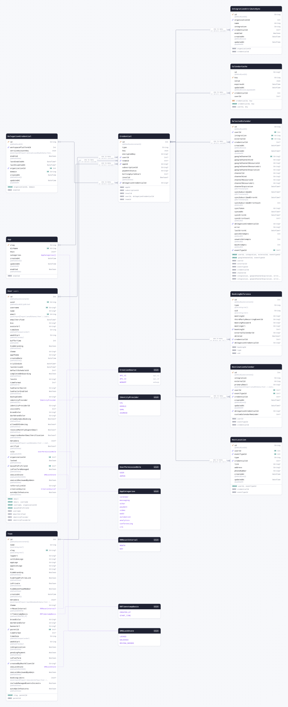

| Field                    | Type      | Constraints                                                   | Default           | Description |
| ------------------------ | --------- | ------------------------------------------------------------- | ----------------- | ----------- |
| `id`                     | `Int`     | PK NOT NULL                                                   | `autoincrement()` |             |
| `type`                   | `String`  | NOT NULL                                                      |                   |             |
| `key`                    | `Json`    | NOT NULL                                                      |                   |             |
| `encryptedKey`           | `String`  | NULL                                                          |                   |             |
| `userId`                 | `Int`     | NULL → [User.id](#model-User)                                 |                   |             |
| `teamId`                 | `Int`     | NULL → [Team.id](#model-Team)                                 |                   |             |
| `appId`                  | `String`  | NULL → [App.slug](#model-App)                                 |                   |             |
| `subscriptionId`         | `String`  | NULL                                                          |                   |             |
| `paymentStatus`          | `String`  | NULL                                                          |                   |             |
| `billingCycleStart`      | `Int`     | NULL                                                          |                   |             |
| `invalid`                | `Boolean` | NULL                                                          | `false`           |             |
| `delegationCredentialId` | `String`  | NULL → [DelegationCredential.id](#model-DelegationCredential) |                   |             |

#### Indexes

- `@@index([appId])`
- `@@index([subscriptionId])`
- `@@index([invalid])`
- `@@index([userId, delegationCredentialId])`
- `@@index([teamId])`

#### References

- `userId` → [User.id](#model-User) (many-to-one, on delete Cascade)
- `teamId` → [Team.id](#model-Team) (many-to-one, on delete Cascade)
- `appId` → [App.slug](#model-App) (many-to-one, on delete Cascade)
- `delegationCredentialId` → [DelegationCredential.id](#model-DelegationCredential) (many-to-one, on delete Cascade)

#### Referenced by

- `id` ← [HostLocation.credentialId](#model-HostLocation) (one-to-many, on delete SetNull)
- `id` ← [DestinationCalendar.credentialId](#model-DestinationCalendar) (one-to-many, on delete Cascade)
- `id` ← [BookingReference.credentialId](#model-BookingReference) (one-to-many, on delete SetNull)
- `id` ← [SelectedCalendar.credentialId](#model-SelectedCalendar) (one-to-many, on delete Cascade)
- `id` ← [CalendarCache.credentialId](#model-CalendarCache) (one-to-many, on delete Cascade)
- `id` ← [IntegrationAttributeSync.credentialId](#model-IntegrationAttributeSync) (one-to-many, on delete Cascade)

#### Definition

```sql
CREATE TABLE "Credential" (
    "id" SERIAL NOT NULL,
    "type" TEXT NOT NULL,
    "key" JSONB NOT NULL,
    "encryptedKey" TEXT,
    "userId" INTEGER,
    "teamId" INTEGER,
    "appId" TEXT,
    "subscriptionId" TEXT,
    "paymentStatus" TEXT,
    "billingCycleStart" INTEGER,
    "invalid" BOOLEAN DEFAULT false,
    "delegationCredentialId" TEXT,

    CONSTRAINT "Credential_pkey" PRIMARY KEY ("id")
);

CREATE INDEX "Credential_appId_idx" ON "Credential"("appId");

CREATE INDEX "Credential_subscriptionId_idx" ON "Credential"("subscriptionId");

CREATE INDEX "Credential_invalid_idx" ON "Credential"("invalid");

CREATE INDEX "Credential_userId_delegationCredentialId_idx" ON "Credential"("userId", "delegationCredentialId");

CREATE INDEX "Credential_teamId_idx" ON "Credential"("teamId");

ALTER TABLE "Credential" ADD CONSTRAINT "Credential_userId_fkey" FOREIGN KEY ("userId") REFERENCES "users"("id") ON DELETE CASCADE ON UPDATE CASCADE;

ALTER TABLE "Credential" ADD CONSTRAINT "Credential_teamId_fkey" FOREIGN KEY ("teamId") REFERENCES "Team"("id") ON DELETE CASCADE ON UPDATE CASCADE;

ALTER TABLE "Credential" ADD CONSTRAINT "Credential_appId_fkey" FOREIGN KEY ("appId") REFERENCES "App"("slug") ON DELETE CASCADE ON UPDATE CASCADE;

ALTER TABLE "Credential" ADD CONSTRAINT "Credential_delegationCredentialId_fkey" FOREIGN KEY ("delegationCredentialId") REFERENCES "DelegationCredential"("id") ON DELETE CASCADE ON UPDATE CASCADE;
```

<details>
<summary>Queries and their SQL</summary>

**findMany**: Every row

```ts
await prisma.credential.findMany();
```

```sql
SELECT
  "public"."Credential"."id",
  "public"."Credential"."type",
  "public"."Credential"."key",
  "public"."Credential"."encryptedKey",
  "public"."Credential"."userId",
  "public"."Credential"."teamId",
  "public"."Credential"."appId",
  "public"."Credential"."subscriptionId",
  "public"."Credential"."paymentStatus",
  "public"."Credential"."billingCycleStart",
  "public"."Credential"."invalid",
  "public"."Credential"."delegationCredentialId"
FROM
  "public"."Credential"
WHERE
  1 = 1
OFFSET
  $1
-- params: ["0"]
```

**count**: How many rows there are

```ts
await prisma.credential.count();
```

```sql
SELECT
  COUNT(*) AS "_count$_all"
FROM
  (
    SELECT
      "public"."Credential"."id"
    FROM
      "public"."Credential"
    WHERE
      1 = 1
    OFFSET
      $1
  ) AS "sub"
-- params: ["0"]
```

**findMany**: Every row with its relations

```ts
await prisma.credential.findMany({
  include: {
    user: true,
    team: true,
    app: true,
    destinationCalendars: true,
    selectedCalendars: true,
    CalendarCache: true,
    references: true,
    delegationCredential: true,
    integrationAttributeSyncs: true,
    hostLocations: true,
  },
});
```

```sql
SELECT
  "public"."Credential"."id",
  "public"."Credential"."type",
  "public"."Credential"."key",
  "public"."Credential"."encryptedKey",
  "public"."Credential"."userId",
  "public"."Credential"."teamId",
  "public"."Credential"."appId",
  "public"."Credential"."subscriptionId",
  "public"."Credential"."paymentStatus",
  "public"."Credential"."billingCycleStart",
  "public"."Credential"."invalid",
  "public"."Credential"."delegationCredentialId"
FROM
  "public"."Credential"
WHERE
  1 = 1
OFFSET
  $1
-- params: ["0"]

SELECT
  "public"."users"."id",
  "public"."users"."uuid",
  "public"."users"."username",
  "public"."users"."name",
  "public"."users"."email",
  "public"."users"."emailVerified",
  "public"."users"."bio",
  "public"."users"."avatarUrl",
  "public"."users"."timeZone",
  "public"."users"."weekStart",
  "public"."users"."bufferTime",
  "public"."users"."hideBranding",
  "public"."users"."theme",
  "public"."users"."appTheme",
  "public"."users"."created",
  "public"."users"."trialEndsAt",
  "public"."users"."lastActiveAt",
  "public"."users"."defaultScheduleId",
  "public"."users"."completedOnboarding",
  "public"."users"."locale",
  "public"."users"."timeFormat",
  "public"."users"."twoFactorSecret",
  "public"."users"."twoFactorEnabled",
  "public"."users"."backupCodes",
  "public"."users"."identityProvider"::text,
  "public"."users"."identityProviderId",
  "public"."users"."invitedTo",
  "public"."users"."brandColor",
  "public"."users"."darkBrandColor",
  "public"."users"."allowDynamicBooking",
  "public"."users"."allowSEOIndexing",
  "public"."users"."receiveMonthlyDigestEmail",
  "public"."users"."requiresBookerEmailVerification",
  "public"."users"."metadata",
  "public"."users"."verified",
  "public"."users"."role"::text,
  "public"."users"."organizationId",
  "public"."users"."locked",
  "public"."users"."movedToProfileId",
  "public"."users"."isPlatformManaged",
  "public"."users"."smsLockState"::text,
  "public"."users"."smsLockReviewedByAdmin",
  "public"."users"."referralLinkId",
  "public"."users"."creationSource"::text,
  "public"."users"."autoOptInFeatures"
FROM
  "public"."users"
WHERE
  "public"."users"."id" IN ($1)
OFFSET
  $2
-- params: ["<userId of the rows above>","0"]

SELECT
  "public"."Team"."id",
  "public"."Team"."name",
  "public"."Team"."slug",
  "public"."Team"."logoUrl",
  "public"."Team"."calVideoLogo",
  "public"."Team"."appLogo",
  "public"."Team"."appIconLogo",
  "public"."Team"."bio",
  "public"."Team"."hideBranding",
  "public"."Team"."hideTeamProfileLink",
  "public"."Team"."isPrivate",
  "public"."Team"."hideBookATeamMember",
  "public"."Team"."createdAt",
  "public"."Team"."metadata",
  "public"."Team"."theme",
  "public"."Team"."rrResetInterval"::text,
  "public"."Team"."rrTimestampBasis"::text,
  "public"."Team"."brandColor",
  "public"."Team"."darkBrandColor",
  "public"."Team"."bannerUrl",
  "public"."Team"."parentId",
  "public"."Team"."timeFormat",
  "public"."Team"."timeZone",
  "public"."Team"."weekStart",
  "public"."Team"."isOrganization",
  "public"."Team"."pendingPayment",
  "public"."Team"."isPlatform",
  "public"."Team"."createdByOAuthClientId",
  "public"."Team"."smsLockState"::text,
  "public"."Team"."smsLockReviewedByAdmin",
  "public"."Team"."bookingLimits",
  "public"."Team"."includeManagedEventsInLimits",
  "public"."Team"."autoOptInFeatures"
FROM
  "public"."Team"
WHERE
  "public"."Team"."id" IN ($1)
OFFSET
  $2
-- params: ["<teamId of the rows above>","0"]

SELECT
  "public"."App"."slug",
  "public"."App"."dirName",
  "public"."App"."keys",
  "public"."App"."categories"::text[],
  "public"."App"."createdAt",
  "public"."App"."updatedAt",
  "public"."App"."enabled"
FROM
  "public"."App"
WHERE
  "public"."App"."slug" IN ($1)
OFFSET
  $2
-- params: ["<appId of the rows above>","0"]

SELECT
  "public"."DestinationCalendar"."id",
  "public"."DestinationCalendar"."integration",
  "public"."DestinationCalendar"."externalId",
  "public"."DestinationCalendar"."primaryEmail",
  "public"."DestinationCalendar"."userId",
  "public"."DestinationCalendar"."eventTypeId",
  "public"."DestinationCalendar"."credentialId",
  "public"."DestinationCalendar"."createdAt",
  "public"."DestinationCalendar"."updatedAt",
  "public"."DestinationCalendar"."delegationCredentialId",
  "public"."DestinationCalendar"."customCalendarReminder"
FROM
  "public"."DestinationCalendar"
WHERE
  "public"."DestinationCalendar"."credentialId" IN ($1)
OFFSET
  $2
-- params: ["<id of the rows above>","0"]

SELECT
  "public"."SelectedCalendar"."id",
  "public"."SelectedCalendar"."userId",
  "public"."SelectedCalendar"."integration",
  "public"."SelectedCalendar"."externalId",
  "public"."SelectedCalendar"."credentialId",
  "public"."SelectedCalendar"."createdAt",
  "public"."SelectedCalendar"."updatedAt",
  "public"."SelectedCalendar"."googleChannelId",
  "public"."SelectedCalendar"."googleChannelKind",
  "public"."SelectedCalendar"."googleChannelResourceId",
  "public"."SelectedCalendar"."googleChannelResourceUri",
  "public"."SelectedCalendar"."googleChannelExpiration",
  "public"."SelectedCalendar"."channelId",
  "public"."SelectedCalendar"."channelKind",
  "public"."SelectedCalendar"."channelResourceId",
  "public"."SelectedCalendar"."channelResourceUri",
  "public"."SelectedCalendar"."channelExpiration",
  "public"."SelectedCalendar"."syncSubscribedAt",
  "public"."SelectedCalendar"."syncSubscribedErrorAt",
  "public"."SelectedCalendar"."syncSubscribedErrorCount",
  "public"."SelectedCalendar"."syncToken",
  "public"."SelectedCalendar"."syncedAt",
  "public"."SelectedCalendar"."syncErrorAt",
  "public"."SelectedCalendar"."syncErrorCount",
  "public"."SelectedCalendar"."delegationCredentialId",
  "public"."SelectedCalendar"."error",
  "public"."SelectedCalendar"."lastErrorAt",
  "public"."SelectedCalendar"."watchAttempts",
  "public"."SelectedCalendar"."unwatchAttempts",
  "public"."SelectedCalendar"."maxAttempts",
  "public"."SelectedCalendar"."eventTypeId"
FROM
  "public"."SelectedCalendar"
WHERE
  "public"."SelectedCalendar"."credentialId" IN ($1)
OFFSET
  $2
-- params: ["<id of the rows above>","0"]

SELECT
  "public"."CalendarCache"."credentialId",
  "public"."CalendarCache"."key",
  "public"."CalendarCache"."id",
  "public"."CalendarCache"."value",
  "public"."CalendarCache"."expiresAt",
  "public"."CalendarCache"."updatedAt",
  "public"."CalendarCache"."userId"
FROM
  "public"."CalendarCache"
WHERE
  "public"."CalendarCache"."credentialId" IN ($1)
OFFSET
  $2
-- params: ["<id of the rows above>","0"]

SELECT
  "public"."BookingReference"."id",
  "public"."BookingReference"."type",
  "public"."BookingReference"."uid",
  "public"."BookingReference"."meetingId",
  "public"."BookingReference"."thirdPartyRecurringEventId",
  "public"."BookingReference"."meetingPassword",
  "public"."BookingReference"."meetingUrl",
  "public"."BookingReference"."bookingId",
  "public"."BookingReference"."externalCalendarId",
  "public"."BookingReference"."deleted",
  "public"."BookingReference"."credentialId",
  "public"."BookingReference"."delegationCredentialId"
FROM
  "public"."BookingReference"
WHERE
  "public"."BookingReference"."credentialId" IN ($1)
OFFSET
  $2
-- params: ["<id of the rows above>","0"]

SELECT
  "public"."DelegationCredential"."id",
  "public"."DelegationCredential"."workspacePlatformId",
  "public"."DelegationCredential"."serviceAccountKey",
  "public"."DelegationCredential"."enabled",
  "public"."DelegationCredential"."lastEnabledAt",
  "public"."DelegationCredential"."lastDisabledAt",
  "public"."DelegationCredential"."organizationId",
  "public"."DelegationCredential"."domain",
  "public"."DelegationCredential"."createdAt",
  "public"."DelegationCredential"."updatedAt"
FROM
  "public"."DelegationCredential"
WHERE
  "public"."DelegationCredential"."id" IN ($1)
OFFSET
  $2
-- params: ["<delegationCredentialId of the rows above>","0"]

SELECT
  "public"."IntegrationAttributeSync"."id",
  "public"."IntegrationAttributeSync"."organizationId",
  "public"."IntegrationAttributeSync"."name",
  "public"."IntegrationAttributeSync"."integration",
  "public"."IntegrationAttributeSync"."credentialId",
  "public"."IntegrationAttributeSync"."enabled",
  "public"."IntegrationAttributeSync"."createdAt",
  "public"."IntegrationAttributeSync"."updatedAt"
FROM
  "public"."IntegrationAttributeSync"
WHERE
  "public"."IntegrationAttributeSync"."credentialId" IN ($1)
OFFSET
  $2
-- params: ["<id of the rows above>","0"]

SELECT
  "public"."HostLocation"."id",
  "public"."HostLocation"."userId",
  "public"."HostLocation"."eventTypeId",
  "public"."HostLocation"."type",
  "public"."HostLocation"."credentialId",
  "public"."HostLocation"."link",
  "public"."HostLocation"."address",
  "public"."HostLocation"."phoneNumber",
  "public"."HostLocation"."createdAt",
  "public"."HostLocation"."updatedAt"
FROM
  "public"."HostLocation"
WHERE
  "public"."HostLocation"."credentialId" IN ($1)
OFFSET
  $2
-- params: ["<id of the rows above>","0"]
```

**findUnique**: One row by what is unique to it

```ts
await prisma.credential.findUnique({ where: { id: 1 } });
```

```sql
SELECT
  "public"."Credential"."id",
  "public"."Credential"."type",
  "public"."Credential"."key",
  "public"."Credential"."encryptedKey",
  "public"."Credential"."userId",
  "public"."Credential"."teamId",
  "public"."Credential"."appId",
  "public"."Credential"."subscriptionId",
  "public"."Credential"."paymentStatus",
  "public"."Credential"."billingCycleStart",
  "public"."Credential"."invalid",
  "public"."Credential"."delegationCredentialId"
FROM
  "public"."Credential"
WHERE
  (
    "public"."Credential"."id" = $1
    AND 1 = 1
  )
LIMIT
  $2
OFFSET
  $3
-- params: ["1","1","0"]
```

**create**: Create a row

```ts
await prisma.credential.create({ data: { type: "example", key: {} } });
```

```sql
INSERT INTO
  "public"."Credential" ("type", "key", "invalid")
VALUES
  ($1, $2, $3)
RETURNING
  "public"."Credential"."id",
  "public"."Credential"."type",
  "public"."Credential"."key",
  "public"."Credential"."encryptedKey",
  "public"."Credential"."userId",
  "public"."Credential"."teamId",
  "public"."Credential"."appId",
  "public"."Credential"."subscriptionId",
  "public"."Credential"."paymentStatus",
  "public"."Credential"."billingCycleStart",
  "public"."Credential"."invalid",
  "public"."Credential"."delegationCredentialId"
-- params: ["example","{}",false]
```

**update**: Update a row

```ts
await prisma.credential.update({ where: { id: 1 }, data: { type: "example" } });
```

```sql
UPDATE "public"."Credential"
SET
  "type" = $1
WHERE
  (
    "public"."Credential"."id" = $2
    AND 1 = 1
  )
RETURNING
  "public"."Credential"."id",
  "public"."Credential"."type",
  "public"."Credential"."key",
  "public"."Credential"."encryptedKey",
  "public"."Credential"."userId",
  "public"."Credential"."teamId",
  "public"."Credential"."appId",
  "public"."Credential"."subscriptionId",
  "public"."Credential"."paymentStatus",
  "public"."Credential"."billingCycleStart",
  "public"."Credential"."invalid",
  "public"."Credential"."delegationCredentialId"
-- params: ["example","1"]
```

**delete**: Delete a row

```ts
await prisma.credential.delete({ where: { id: 1 } });
```

```sql
DELETE FROM "public"."Credential"
WHERE
  (
    "public"."Credential"."id" = $1
    AND 1 = 1
  )
RETURNING
  "public"."Credential"."id",
  "public"."Credential"."type",
  "public"."Credential"."key",
  "public"."Credential"."encryptedKey",
  "public"."Credential"."userId",
  "public"."Credential"."teamId",
  "public"."Credential"."appId",
  "public"."Credential"."subscriptionId",
  "public"."Credential"."paymentStatus",
  "public"."Credential"."billingCycleStart",
  "public"."Credential"."invalid",
  "public"."Credential"."delegationCredentialId"
-- params: ["1"]
```

</details>

<a id="model-DestinationCalendar"></a>

### DestinationCalendar

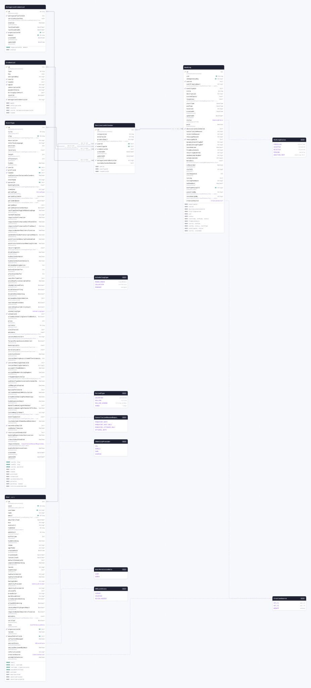

| Field                    | Type       | Constraints                                                   | Default           | Description                                                                            |
| ------------------------ | ---------- | ------------------------------------------------------------- | ----------------- | -------------------------------------------------------------------------------------- |
| `id`                     | `Int`      | PK NOT NULL                                                   | `autoincrement()` |                                                                                        |
| `integration`            | `String`   | NOT NULL                                                      |                   |                                                                                        |
| `externalId`             | `String`   | NOT NULL                                                      |                   |                                                                                        |
| `primaryEmail`           | `String`   | NULL                                                          |                   | @zod.import(["import { emailSchema } from '../../zod-utils'"]).custom.use(emailSchema) |
| `userId`                 | `Int`      | UNIQUE NULL → [User.id](#model-User)                          |                   |                                                                                        |
| `eventTypeId`            | `Int`      | UNIQUE NULL → [EventType.id](#model-EventType)                |                   |                                                                                        |
| `credentialId`           | `Int`      | NULL → [Credential.id](#model-Credential)                     |                   |                                                                                        |
| `createdAt`              | `DateTime` | NULL                                                          | `now()`           |                                                                                        |
| `updatedAt`              | `DateTime` | NULL                                                          | `@updatedAt`      |                                                                                        |
| `delegationCredentialId` | `String`   | NULL → [DelegationCredential.id](#model-DelegationCredential) |                   |                                                                                        |
| `customCalendarReminder` | `Int`      | NULL                                                          |                   |                                                                                        |

#### Indexes

- `@@index([userId])`
- `@@index([eventTypeId])`
- `@@index([credentialId])`

#### References

- `userId` → [User.id](#model-User) (one-to-one, on delete Cascade)
- `eventTypeId` → [EventType.id](#model-EventType) (one-to-one, on delete Cascade)
- `credentialId` → [Credential.id](#model-Credential) (many-to-one, on delete Cascade)
- `delegationCredentialId` → [DelegationCredential.id](#model-DelegationCredential) (many-to-one, on delete Cascade)

#### Referenced by

- `id` ← [Booking.destinationCalendarId](#model-Booking) (one-to-many)

#### Definition

```sql
CREATE TABLE "DestinationCalendar" (
    "id" SERIAL NOT NULL,
    "integration" TEXT NOT NULL,
    "externalId" TEXT NOT NULL,
    "primaryEmail" TEXT,
    "userId" INTEGER,
    "eventTypeId" INTEGER,
    "credentialId" INTEGER,
    "createdAt" TIMESTAMP(3) DEFAULT CURRENT_TIMESTAMP,
    "updatedAt" TIMESTAMP(3),
    "delegationCredentialId" TEXT,
    "customCalendarReminder" INTEGER,

    CONSTRAINT "DestinationCalendar_pkey" PRIMARY KEY ("id")
);

CREATE UNIQUE INDEX "DestinationCalendar_userId_key" ON "DestinationCalendar"("userId");

CREATE UNIQUE INDEX "DestinationCalendar_eventTypeId_key" ON "DestinationCalendar"("eventTypeId");

CREATE INDEX "DestinationCalendar_userId_idx" ON "DestinationCalendar"("userId");

CREATE INDEX "DestinationCalendar_eventTypeId_idx" ON "DestinationCalendar"("eventTypeId");

CREATE INDEX "DestinationCalendar_credentialId_idx" ON "DestinationCalendar"("credentialId");

ALTER TABLE "DestinationCalendar" ADD CONSTRAINT "DestinationCalendar_userId_fkey" FOREIGN KEY ("userId") REFERENCES "users"("id") ON DELETE CASCADE ON UPDATE CASCADE;

ALTER TABLE "DestinationCalendar" ADD CONSTRAINT "DestinationCalendar_eventTypeId_fkey" FOREIGN KEY ("eventTypeId") REFERENCES "EventType"("id") ON DELETE CASCADE ON UPDATE CASCADE;

ALTER TABLE "DestinationCalendar" ADD CONSTRAINT "DestinationCalendar_credentialId_fkey" FOREIGN KEY ("credentialId") REFERENCES "Credential"("id") ON DELETE CASCADE ON UPDATE CASCADE;

ALTER TABLE "DestinationCalendar" ADD CONSTRAINT "DestinationCalendar_delegationCredentialId_fkey" FOREIGN KEY ("delegationCredentialId") REFERENCES "DelegationCredential"("id") ON DELETE CASCADE ON UPDATE CASCADE;
```

<details>
<summary>Queries and their SQL</summary>

**findMany**: Every row

```ts
await prisma.destinationCalendar.findMany();
```

```sql
SELECT
  "public"."DestinationCalendar"."id",
  "public"."DestinationCalendar"."integration",
  "public"."DestinationCalendar"."externalId",
  "public"."DestinationCalendar"."primaryEmail",
  "public"."DestinationCalendar"."userId",
  "public"."DestinationCalendar"."eventTypeId",
  "public"."DestinationCalendar"."credentialId",
  "public"."DestinationCalendar"."createdAt",
  "public"."DestinationCalendar"."updatedAt",
  "public"."DestinationCalendar"."delegationCredentialId",
  "public"."DestinationCalendar"."customCalendarReminder"
FROM
  "public"."DestinationCalendar"
WHERE
  1 = 1
OFFSET
  $1
-- params: ["0"]
```

**count**: How many rows there are

```ts
await prisma.destinationCalendar.count();
```

```sql
SELECT
  COUNT(*) AS "_count$_all"
FROM
  (
    SELECT
      "public"."DestinationCalendar"."id"
    FROM
      "public"."DestinationCalendar"
    WHERE
      1 = 1
    OFFSET
      $1
  ) AS "sub"
-- params: ["0"]
```

**findMany**: Every row with its relations

```ts
await prisma.destinationCalendar.findMany({
  include: {
    user: true,
    booking: true,
    eventType: true,
    credential: true,
    delegationCredential: true,
  },
});
```

```sql
SELECT
  "public"."DestinationCalendar"."id",
  "public"."DestinationCalendar"."integration",
  "public"."DestinationCalendar"."externalId",
  "public"."DestinationCalendar"."primaryEmail",
  "public"."DestinationCalendar"."userId",
  "public"."DestinationCalendar"."eventTypeId",
  "public"."DestinationCalendar"."credentialId",
  "public"."DestinationCalendar"."createdAt",
  "public"."DestinationCalendar"."updatedAt",
  "public"."DestinationCalendar"."delegationCredentialId",
  "public"."DestinationCalendar"."customCalendarReminder"
FROM
  "public"."DestinationCalendar"
WHERE
  1 = 1
OFFSET
  $1
-- params: ["0"]

SELECT
  "public"."users"."id",
  "public"."users"."uuid",
  "public"."users"."username",
  "public"."users"."name",
  "public"."users"."email",
  "public"."users"."emailVerified",
  "public"."users"."bio",
  "public"."users"."avatarUrl",
  "public"."users"."timeZone",
  "public"."users"."weekStart",
  "public"."users"."bufferTime",
  "public"."users"."hideBranding",
  "public"."users"."theme",
  "public"."users"."appTheme",
  "public"."users"."created",
  "public"."users"."trialEndsAt",
  "public"."users"."lastActiveAt",
  "public"."users"."defaultScheduleId",
  "public"."users"."completedOnboarding",
  "public"."users"."locale",
  "public"."users"."timeFormat",
  "public"."users"."twoFactorSecret",
  "public"."users"."twoFactorEnabled",
  "public"."users"."backupCodes",
  "public"."users"."identityProvider"::text,
  "public"."users"."identityProviderId",
  "public"."users"."invitedTo",
  "public"."users"."brandColor",
  "public"."users"."darkBrandColor",
  "public"."users"."allowDynamicBooking",
  "public"."users"."allowSEOIndexing",
  "public"."users"."receiveMonthlyDigestEmail",
  "public"."users"."requiresBookerEmailVerification",
  "public"."users"."metadata",
  "public"."users"."verified",
  "public"."users"."role"::text,
  "public"."users"."organizationId",
  "public"."users"."locked",
  "public"."users"."movedToProfileId",
  "public"."users"."isPlatformManaged",
  "public"."users"."smsLockState"::text,
  "public"."users"."smsLockReviewedByAdmin",
  "public"."users"."referralLinkId",
  "public"."users"."creationSource"::text,
  "public"."users"."autoOptInFeatures"
FROM
  "public"."users"
WHERE
  "public"."users"."id" IN ($1)
OFFSET
  $2
-- params: ["<userId of the rows above>","0"]

SELECT
  "public"."Booking"."id",
  "public"."Booking"."uid",
  "public"."Booking"."idempotencyKey",
  "public"."Booking"."userId",
  "public"."Booking"."userPrimaryEmail",
  "public"."Booking"."eventTypeId",
  "public"."Booking"."title",
  "public"."Booking"."description",
  "public"."Booking"."customInputs",
  "public"."Booking"."responses",
  "public"."Booking"."startTime",
  "public"."Booking"."endTime",
  "public"."Booking"."location",
  "public"."Booking"."createdAt",
  "public"."Booking"."updatedAt",
  "public"."Booking"."status"::text,
  "public"."Booking"."paid",
  "public"."Booking"."destinationCalendarId",
  "public"."Booking"."cancellationReason",
  "public"."Booking"."rejectionReason",
  "public"."Booking"."reassignReason",
  "public"."Booking"."reassignById",
  "public"."Booking"."dynamicEventSlugRef",
  "public"."Booking"."dynamicGroupSlugRef",
  "public"."Booking"."rescheduled",
  "public"."Booking"."fromReschedule",
  "public"."Booking"."recurringEventId",
  "public"."Booking"."smsReminderNumber",
  "public"."Booking"."scheduledJobs",
  "public"."Booking"."metadata",
  "public"."Booking"."isRecorded",
  "public"."Booking"."iCalUID",
  "public"."Booking"."iCalSequence",
  "public"."Booking"."rating",
  "public"."Booking"."ratingFeedback",
  "public"."Booking"."noShowHost",
  "public"."Booking"."oneTimePassword",
  "public"."Booking"."cancelledBy",
  "public"."Booking"."rescheduledBy",
  "public"."Booking"."creationSource"::text
FROM
  "public"."Booking"
WHERE
  "public"."Booking"."destinationCalendarId" IN ($1)
OFFSET
  $2
-- params: ["<id of the rows above>","0"]

SELECT
  "public"."EventType"."id",
  "public"."EventType"."title",
  "public"."EventType"."slug",
  "public"."EventType"."description",
  "public"."EventType"."interfaceLanguage",
  "public"."EventType"."position",
  "public"."EventType"."locations",
  "public"."EventType"."length",
  "public"."EventType"."offsetStart",
  "public"."EventType"."hidden",
  "public"."EventType"."userId",
  "public"."EventType"."profileId",
  "public"."EventType"."teamId",
  "public"."EventType"."useEventLevelSelectedCalendars",
  "public"."EventType"."eventName",
  "public"."EventType"."parentId",
  "public"."EventType"."bookingFields",
  "public"."EventType"."timeZone",
  "public"."EventType"."periodType"::text,
  "public"."EventType"."periodStartDate",
  "public"."EventType"."periodEndDate",
  "public"."EventType"."periodDays",
  "public"."EventType"."periodCountCalendarDays",
  "public"."EventType"."lockTimeZoneToggleOnBookingPage",
  "public"."EventType"."lockedTimeZone",
  "public"."EventType"."requiresConfirmation",
  "public"."EventType"."requiresConfirmationWillBlockSlot",
  "public"."EventType"."requiresConfirmationForFreeEmail",
  "public"."EventType"."requiresBookerEmailVerification",
  "public"."EventType"."canSendCalVideoTranscriptionEmails",
  "public"."EventType"."autoTranslateDescriptionEnabled",
  "public"."EventType"."autoTranslateInstantMeetingTitleEnabled",
  "public"."EventType"."recurringEvent",
  "public"."EventType"."disableGuests",
  "public"."EventType"."hideCalendarNotes",
  "public"."EventType"."hideCalendarEventDetails",
  "public"."EventType"."minimumBookingNotice",
  "public"."EventType"."beforeEventBuffer",
  "public"."EventType"."afterEventBuffer",
  "public"."EventType"."seatsPerTimeSlot",
  "public"."EventType"."onlyShowFirstAvailableSlot",
  "public"."EventType"."showOptimizedSlots",
  "public"."EventType"."disableCancelling",
  "public"."EventType"."disableRescheduling",
  "public"."EventType"."minimumRescheduleNotice",
  "public"."EventType"."seatsShowAttendees",
  "public"."EventType"."seatsShowAvailabilityCount",
  "public"."EventType"."schedulingType"::text,
  "public"."EventType"."scheduleId",
  "public"."EventType"."allowReschedulingCancelledBookings",
  "public"."EventType"."price",
  "public"."EventType"."currency",
  "public"."EventType"."slotInterval",
  "public"."EventType"."metadata",
  "public"."EventType"."successRedirectUrl",
  "public"."EventType"."forwardParamsSuccessRedirect",
  "public"."EventType"."bookingLimits",
  "public"."EventType"."durationLimits",
  "public"."EventType"."isInstantEvent",
  "public"."EventType"."instantMeetingExpiryTimeOffsetInSeconds",
  "public"."EventType"."instantMeetingScheduleId",
  "public"."EventType"."instantMeetingParameters",
  "public"."EventType"."assignAllTeamMembers",
  "public"."EventType"."assignRRMembersUsingSegment",
  "public"."EventType"."rrSegmentQueryValue",
  "public"."EventType"."useEventTypeDestinationCalendarEmail",
  "public"."EventType"."isRRWeightsEnabled",
  "public"."EventType"."maxLeadThreshold",
  "public"."EventType"."includeNoShowInRRCalculation",
  "public"."EventType"."allowReschedulingPastBookings",
  "public"."EventType"."hideOrganizerEmail",
  "public"."EventType"."maxActiveBookingsPerBooker",
  "public"."EventType"."maxActiveBookingPerBookerOfferReschedule",
  "public"."EventType"."customReplyToEmail",
  "public"."EventType"."eventTypeColor",
  "public"."EventType"."rescheduleWithSameRoundRobinHost",
  "public"."EventType"."secondaryEmailId",
  "public"."EventType"."useBookerTimezone",
  "public"."EventType"."restrictionScheduleId",
  "public"."EventType"."bookingRequiresAuthentication",
  "public"."EventType"."rrHostSubsetEnabled",
  "public"."EventType"."requiresCancellationReason"::text,
  "public"."EventType"."enablePerHostLocations",
  "public"."EventType"."createdAt",
  "public"."EventType"."updatedAt"
FROM
  "public"."EventType"
WHERE
  "public"."EventType"."id" IN ($1)
OFFSET
  $2
-- params: ["<eventTypeId of the rows above>","0"]

SELECT
  "public"."Credential"."id",
  "public"."Credential"."type",
  "public"."Credential"."key",
  "public"."Credential"."encryptedKey",
  "public"."Credential"."userId",
  "public"."Credential"."teamId",
  "public"."Credential"."appId",
  "public"."Credential"."subscriptionId",
  "public"."Credential"."paymentStatus",
  "public"."Credential"."billingCycleStart",
  "public"."Credential"."invalid",
  "public"."Credential"."delegationCredentialId"
FROM
  "public"."Credential"
WHERE
  "public"."Credential"."id" IN ($1)
OFFSET
  $2
-- params: ["<credentialId of the rows above>","0"]

SELECT
  "public"."DelegationCredential"."id",
  "public"."DelegationCredential"."workspacePlatformId",
  "public"."DelegationCredential"."serviceAccountKey",
  "public"."DelegationCredential"."enabled",
  "public"."DelegationCredential"."lastEnabledAt",
  "public"."DelegationCredential"."lastDisabledAt",
  "public"."DelegationCredential"."organizationId",
  "public"."DelegationCredential"."domain",
  "public"."DelegationCredential"."createdAt",
  "public"."DelegationCredential"."updatedAt"
FROM
  "public"."DelegationCredential"
WHERE
  "public"."DelegationCredential"."id" IN ($1)
OFFSET
  $2
-- params: ["<delegationCredentialId of the rows above>","0"]
```

**findUnique**: One row by what is unique to it

```ts
await prisma.destinationCalendar.findUnique({ where: { id: 1 } });
```

```sql
SELECT
  "public"."DestinationCalendar"."id",
  "public"."DestinationCalendar"."integration",
  "public"."DestinationCalendar"."externalId",
  "public"."DestinationCalendar"."primaryEmail",
  "public"."DestinationCalendar"."userId",
  "public"."DestinationCalendar"."eventTypeId",
  "public"."DestinationCalendar"."credentialId",
  "public"."DestinationCalendar"."createdAt",
  "public"."DestinationCalendar"."updatedAt",
  "public"."DestinationCalendar"."delegationCredentialId",
  "public"."DestinationCalendar"."customCalendarReminder"
FROM
  "public"."DestinationCalendar"
WHERE
  (
    "public"."DestinationCalendar"."id" = $1
    AND 1 = 1
  )
LIMIT
  $2
OFFSET
  $3
-- params: ["1","1","0"]
```

**create**: Create a row

```ts
await prisma.destinationCalendar.create({
  data: { integration: "example", externalId: "example" },
});
```

```sql
INSERT INTO
  "public"."DestinationCalendar" (
    "integration",
    "externalId",
    "createdAt",
    "updatedAt"
  )
VALUES
  ($1, $2, $3, $4)
RETURNING
  "public"."DestinationCalendar"."id",
  "public"."DestinationCalendar"."integration",
  "public"."DestinationCalendar"."externalId",
  "public"."DestinationCalendar"."primaryEmail",
  "public"."DestinationCalendar"."userId",
  "public"."DestinationCalendar"."eventTypeId",
  "public"."DestinationCalendar"."credentialId",
  "public"."DestinationCalendar"."createdAt",
  "public"."DestinationCalendar"."updatedAt",
  "public"."DestinationCalendar"."delegationCredentialId",
  "public"."DestinationCalendar"."customCalendarReminder"
-- params: ["example","example","<now()>","<now()>"]
```

**update**: Update a row

```ts
await prisma.destinationCalendar.update({ where: { id: 1 }, data: { integration: "example" } });
```

```sql
UPDATE "public"."DestinationCalendar"
SET
  "integration" = $1,
  "updatedAt" = $2
WHERE
  (
    "public"."DestinationCalendar"."id" = $3
    AND 1 = 1
  )
RETURNING
  "public"."DestinationCalendar"."id",
  "public"."DestinationCalendar"."integration",
  "public"."DestinationCalendar"."externalId",
  "public"."DestinationCalendar"."primaryEmail",
  "public"."DestinationCalendar"."userId",
  "public"."DestinationCalendar"."eventTypeId",
  "public"."DestinationCalendar"."credentialId",
  "public"."DestinationCalendar"."createdAt",
  "public"."DestinationCalendar"."updatedAt",
  "public"."DestinationCalendar"."delegationCredentialId",
  "public"."DestinationCalendar"."customCalendarReminder"
-- params: ["example",{"prisma__type":"generatorCall","prisma__value":{"name":"now","args":[],"returnType":{"type":"DateTime"}}},"1"]
```

**delete**: Delete a row

```ts
await prisma.destinationCalendar.delete({ where: { id: 1 } });
```

```sql
DELETE FROM "public"."DestinationCalendar"
WHERE
  (
    "public"."DestinationCalendar"."id" = $1
    AND 1 = 1
  )
RETURNING
  "public"."DestinationCalendar"."id",
  "public"."DestinationCalendar"."integration",
  "public"."DestinationCalendar"."externalId",
  "public"."DestinationCalendar"."primaryEmail",
  "public"."DestinationCalendar"."userId",
  "public"."DestinationCalendar"."eventTypeId",
  "public"."DestinationCalendar"."credentialId",
  "public"."DestinationCalendar"."createdAt",
  "public"."DestinationCalendar"."updatedAt",
  "public"."DestinationCalendar"."delegationCredentialId",
  "public"."DestinationCalendar"."customCalendarReminder"
-- params: ["1"]
```

</details>

<a id="model-UserPassword"></a>

### UserPassword

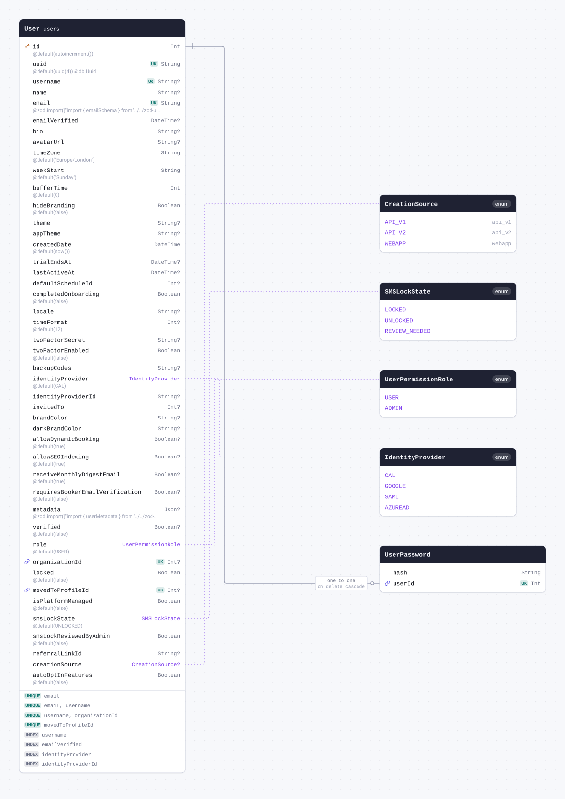

| Field    | Type     | Constraints                              | Default | Description |
| -------- | -------- | ---------------------------------------- | ------- | ----------- |
| `hash`   | `String` | NOT NULL                                 |         |             |
| `userId` | `Int`    | UNIQUE NOT NULL → [User.id](#model-User) |         |             |

#### References

- `userId` → [User.id](#model-User) (one-to-one, on delete Cascade)

#### Definition

```sql
CREATE TABLE "UserPassword" (
    "hash" TEXT NOT NULL,
    "userId" INTEGER NOT NULL
);

CREATE UNIQUE INDEX "UserPassword_userId_key" ON "UserPassword"("userId");

ALTER TABLE "UserPassword" ADD CONSTRAINT "UserPassword_userId_fkey" FOREIGN KEY ("userId") REFERENCES "users"("id") ON DELETE CASCADE ON UPDATE CASCADE;
```

<details>
<summary>Queries and their SQL</summary>

**findMany**: Every row

```ts
await prisma.userPassword.findMany();
```

```sql
SELECT
  "public"."UserPassword"."userId",
  "public"."UserPassword"."hash"
FROM
  "public"."UserPassword"
WHERE
  1 = 1
OFFSET
  $1
-- params: ["0"]
```

**count**: How many rows there are

```ts
await prisma.userPassword.count();
```

```sql
SELECT
  COUNT(*) AS "_count$_all"
FROM
  (
    SELECT
      "public"."UserPassword"."userId"
    FROM
      "public"."UserPassword"
    WHERE
      1 = 1
    OFFSET
      $1
  ) AS "sub"
-- params: ["0"]
```

**findMany**: Every row with its relations

```ts
await prisma.userPassword.findMany({ include: { user: true } });
```

```sql
SELECT
  "public"."UserPassword"."userId",
  "public"."UserPassword"."hash"
FROM
  "public"."UserPassword"
WHERE
  1 = 1
OFFSET
  $1
-- params: ["0"]

SELECT
  "public"."users"."id",
  "public"."users"."uuid",
  "public"."users"."username",
  "public"."users"."name",
  "public"."users"."email",
  "public"."users"."emailVerified",
  "public"."users"."bio",
  "public"."users"."avatarUrl",
  "public"."users"."timeZone",
  "public"."users"."weekStart",
  "public"."users"."bufferTime",
  "public"."users"."hideBranding",
  "public"."users"."theme",
  "public"."users"."appTheme",
  "public"."users"."created",
  "public"."users"."trialEndsAt",
  "public"."users"."lastActiveAt",
  "public"."users"."defaultScheduleId",
  "public"."users"."completedOnboarding",
  "public"."users"."locale",
  "public"."users"."timeFormat",
  "public"."users"."twoFactorSecret",
  "public"."users"."twoFactorEnabled",
  "public"."users"."backupCodes",
  "public"."users"."identityProvider"::text,
  "public"."users"."identityProviderId",
  "public"."users"."invitedTo",
  "public"."users"."brandColor",
  "public"."users"."darkBrandColor",
  "public"."users"."allowDynamicBooking",
  "public"."users"."allowSEOIndexing",
  "public"."users"."receiveMonthlyDigestEmail",
  "public"."users"."requiresBookerEmailVerification",
  "public"."users"."metadata",
  "public"."users"."verified",
  "public"."users"."role"::text,
  "public"."users"."organizationId",
  "public"."users"."locked",
  "public"."users"."movedToProfileId",
  "public"."users"."isPlatformManaged",
  "public"."users"."smsLockState"::text,
  "public"."users"."smsLockReviewedByAdmin",
  "public"."users"."referralLinkId",
  "public"."users"."creationSource"::text,
  "public"."users"."autoOptInFeatures"
FROM
  "public"."users"
WHERE
  "public"."users"."id" IN ($1)
OFFSET
  $2
-- params: ["<userId of the rows above>","0"]
```

**findUnique**: One row by what is unique to it

```ts
await prisma.userPassword.findUnique({ where: { userId: 1 } });
```

```sql
SELECT
  "public"."UserPassword"."userId",
  "public"."UserPassword"."hash"
FROM
  "public"."UserPassword"
WHERE
  (
    "public"."UserPassword"."userId" = $1
    AND 1 = 1
  )
LIMIT
  $2
OFFSET
  $3
-- params: ["1","1","0"]
```

**create**: Create a row

```ts
await prisma.userPassword.create({ data: { hash: "example", userId: 1 } });
```

```sql
INSERT INTO
  "public"."UserPassword" ("hash", "userId")
VALUES
  ($1, $2)
RETURNING
  "public"."UserPassword"."userId",
  "public"."UserPassword"."hash"
-- params: ["example","1"]
```

**update**: Update a row

```ts
await prisma.userPassword.update({ where: { userId: 1 }, data: { hash: "example" } });
```

```sql
UPDATE "public"."UserPassword"
SET
  "hash" = $1
WHERE
  (
    "public"."UserPassword"."userId" = $2
    AND 1 = 1
  )
RETURNING
  "public"."UserPassword"."userId",
  "public"."UserPassword"."hash"
-- params: ["example","1"]
```

**delete**: Delete a row

```ts
await prisma.userPassword.delete({ where: { userId: 1 } });
```

```sql
DELETE FROM "public"."UserPassword"
WHERE
  (
    "public"."UserPassword"."userId" = $1
    AND 1 = 1
  )
RETURNING
  "public"."UserPassword"."userId",
  "public"."UserPassword"."hash"
-- params: ["1"]
```

</details>

<a id="model-TravelSchedule"></a>

### TravelSchedule


| Field          | Type       | Constraints                       | Default           | Description |
| -------------- | ---------- | --------------------------------- | ----------------- | ----------- |
| `id`           | `Int`      | PK NOT NULL                       | `autoincrement()` |             |
| `userId`       | `Int`      | NOT NULL → [User.id](#model-User) |                   |             |
| `timeZone`     | `String`   | NOT NULL                          |                   |             |
| `startDate`    | `DateTime` | NOT NULL                          |                   |             |
| `endDate`      | `DateTime` | NULL                              |                   |             |
| `prevTimeZone` | `String`   | NULL                              |                   |             |

#### Indexes

- `@@index([startDate])`
- `@@index([endDate])`

#### References

- `userId` → [User.id](#model-User) (many-to-one, on delete Cascade)

#### Definition

```sql
CREATE TABLE "TravelSchedule" (
    "id" SERIAL NOT NULL,
    "userId" INTEGER NOT NULL,
    "timeZone" TEXT NOT NULL,
    "startDate" TIMESTAMP(3) NOT NULL,
    "endDate" TIMESTAMP(3),
    "prevTimeZone" TEXT,

    CONSTRAINT "TravelSchedule_pkey" PRIMARY KEY ("id")
);

CREATE INDEX "TravelSchedule_startDate_idx" ON "TravelSchedule"("startDate");

CREATE INDEX "TravelSchedule_endDate_idx" ON "TravelSchedule"("endDate");

ALTER TABLE "TravelSchedule" ADD CONSTRAINT "TravelSchedule_userId_fkey" FOREIGN KEY ("userId") REFERENCES "users"("id") ON DELETE CASCADE ON UPDATE CASCADE;
```

<details>
<summary>Queries and their SQL</summary>

**findMany**: Every row

```ts
await prisma.travelSchedule.findMany();
```

```sql
SELECT
  "public"."TravelSchedule"."id",
  "public"."TravelSchedule"."userId",
  "public"."TravelSchedule"."timeZone",
  "public"."TravelSchedule"."startDate",
  "public"."TravelSchedule"."endDate",
  "public"."TravelSchedule"."prevTimeZone"
FROM
  "public"."TravelSchedule"
WHERE
  1 = 1
OFFSET
  $1
-- params: ["0"]
```

**count**: How many rows there are

```ts
await prisma.travelSchedule.count();
```

```sql
SELECT
  COUNT(*) AS "_count$_all"
FROM
  (
    SELECT
      "public"."TravelSchedule"."id"
    FROM
      "public"."TravelSchedule"
    WHERE
      1 = 1
    OFFSET
      $1
  ) AS "sub"
-- params: ["0"]
```

**findMany**: Every row with its relations

```ts
await prisma.travelSchedule.findMany({ include: { user: true } });
```

```sql
SELECT
  "public"."TravelSchedule"."id",
  "public"."TravelSchedule"."userId",
  "public"."TravelSchedule"."timeZone",
  "public"."TravelSchedule"."startDate",
  "public"."TravelSchedule"."endDate",
  "public"."TravelSchedule"."prevTimeZone"
FROM
  "public"."TravelSchedule"
WHERE
  1 = 1
OFFSET
  $1
-- params: ["0"]

SELECT
  "public"."users"."id",
  "public"."users"."uuid",
  "public"."users"."username",
  "public"."users"."name",
  "public"."users"."email",
  "public"."users"."emailVerified",
  "public"."users"."bio",
  "public"."users"."avatarUrl",
  "public"."users"."timeZone",
  "public"."users"."weekStart",
  "public"."users"."bufferTime",
  "public"."users"."hideBranding",
  "public"."users"."theme",
  "public"."users"."appTheme",
  "public"."users"."created",
  "public"."users"."trialEndsAt",
  "public"."users"."lastActiveAt",
  "public"."users"."defaultScheduleId",
  "public"."users"."completedOnboarding",
  "public"."users"."locale",
  "public"."users"."timeFormat",
  "public"."users"."twoFactorSecret",
  "public"."users"."twoFactorEnabled",
  "public"."users"."backupCodes",
  "public"."users"."identityProvider"::text,
  "public"."users"."identityProviderId",
  "public"."users"."invitedTo",
  "public"."users"."brandColor",
  "public"."users"."darkBrandColor",
  "public"."users"."allowDynamicBooking",
  "public"."users"."allowSEOIndexing",
  "public"."users"."receiveMonthlyDigestEmail",
  "public"."users"."requiresBookerEmailVerification",
  "public"."users"."metadata",
  "public"."users"."verified",
  "public"."users"."role"::text,
  "public"."users"."organizationId",
  "public"."users"."locked",
  "public"."users"."movedToProfileId",
  "public"."users"."isPlatformManaged",
  "public"."users"."smsLockState"::text,
  "public"."users"."smsLockReviewedByAdmin",
  "public"."users"."referralLinkId",
  "public"."users"."creationSource"::text,
  "public"."users"."autoOptInFeatures"
FROM
  "public"."users"
WHERE
  "public"."users"."id" IN ($1)
OFFSET
  $2
-- params: ["<userId of the rows above>","0"]
```

**findUnique**: One row by what is unique to it

```ts
await prisma.travelSchedule.findUnique({ where: { id: 1 } });
```

```sql
SELECT
  "public"."TravelSchedule"."id",
  "public"."TravelSchedule"."userId",
  "public"."TravelSchedule"."timeZone",
  "public"."TravelSchedule"."startDate",
  "public"."TravelSchedule"."endDate",
  "public"."TravelSchedule"."prevTimeZone"
FROM
  "public"."TravelSchedule"
WHERE
  (
    "public"."TravelSchedule"."id" = $1
    AND 1 = 1
  )
LIMIT
  $2
OFFSET
  $3
-- params: ["1","1","0"]
```

**create**: Create a row

```ts
await prisma.travelSchedule.create({
  data: { userId: 1, timeZone: "example", startDate: new Date("2026-01-01T00:00:00.000Z") },
});
```

```sql
INSERT INTO
  "public"."TravelSchedule" ("userId", "timeZone", "startDate")
VALUES
  ($1, $2, $3)
RETURNING
  "public"."TravelSchedule"."id",
  "public"."TravelSchedule"."userId",
  "public"."TravelSchedule"."timeZone",
  "public"."TravelSchedule"."startDate",
  "public"."TravelSchedule"."endDate",
  "public"."TravelSchedule"."prevTimeZone"
-- params: ["1","example","2026-01-01T00:00:00.000Z"]
```

**update**: Update a row

```ts
await prisma.travelSchedule.update({ where: { id: 1 }, data: { timeZone: "example" } });
```

```sql
UPDATE "public"."TravelSchedule"
SET
  "timeZone" = $1
WHERE
  (
    "public"."TravelSchedule"."id" = $2
    AND 1 = 1
  )
RETURNING
  "public"."TravelSchedule"."id",
  "public"."TravelSchedule"."userId",
  "public"."TravelSchedule"."timeZone",
  "public"."TravelSchedule"."startDate",
  "public"."TravelSchedule"."endDate",
  "public"."TravelSchedule"."prevTimeZone"
-- params: ["example","1"]
```

**delete**: Delete a row

```ts
await prisma.travelSchedule.delete({ where: { id: 1 } });
```

```sql
DELETE FROM "public"."TravelSchedule"
WHERE
  (
    "public"."TravelSchedule"."id" = $1
    AND 1 = 1
  )
RETURNING
  "public"."TravelSchedule"."id",
  "public"."TravelSchedule"."userId",
  "public"."TravelSchedule"."timeZone",
  "public"."TravelSchedule"."startDate",
  "public"."TravelSchedule"."endDate",
  "public"."TravelSchedule"."prevTimeZone"
-- params: ["1"]
```

</details>

<a id="model-User"></a>

### User

Table `users`.

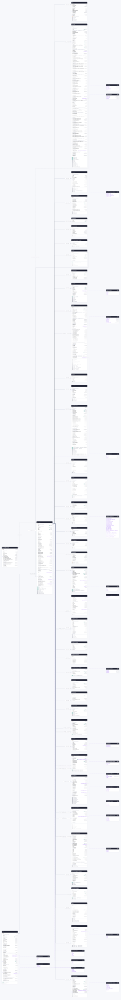

| Field                             | Type                                             | Constraints                                | Default           | Description                                                                              |
| --------------------------------- | ------------------------------------------------ | ------------------------------------------ | ----------------- | ---------------------------------------------------------------------------------------- |
| `id`                              | `Int`                                            | PK NOT NULL                                | `autoincrement()` |                                                                                          |
| `uuid`                            | `String` `@db.Uuid`                              | UNIQUE NOT NULL                            | `uuid(4)`         |                                                                                          |
| `username`                        | `String`                                         | NULL                                       |                   |                                                                                          |
| `name`                            | `String`                                         | NULL                                       |                   |                                                                                          |
| `email`                           | `String`                                         | UNIQUE NOT NULL                            |                   | @zod.import(["import { emailSchema } from '../../zod-utils'"]).custom.use(emailSchema)   |
| `emailVerified`                   | `DateTime`                                       | NULL                                       |                   |                                                                                          |
| `bio`                             | `String`                                         | NULL                                       |                   |                                                                                          |
| `avatarUrl`                       | `String`                                         | NULL                                       |                   |                                                                                          |
| `timeZone`                        | `String`                                         | NOT NULL                                   | `"Europe/London"` |                                                                                          |
| `weekStart`                       | `String`                                         | NOT NULL                                   | `"Sunday"`        |                                                                                          |
| `bufferTime`                      | `Int`                                            | NOT NULL                                   | `0`               |                                                                                          |
| `hideBranding`                    | `Boolean`                                        | NOT NULL                                   | `false`           |                                                                                          |
| `theme`                           | `String`                                         | NULL                                       |                   |                                                                                          |
| `appTheme`                        | `String`                                         | NULL                                       |                   |                                                                                          |
| `createdDate` (`created`)         | `DateTime`                                       | NOT NULL                                   | `now()`           |                                                                                          |
| `trialEndsAt`                     | `DateTime`                                       | NULL                                       |                   |                                                                                          |
| `lastActiveAt`                    | `DateTime`                                       | NULL                                       |                   |                                                                                          |
| `defaultScheduleId`               | `Int`                                            | NULL                                       |                   |                                                                                          |
| `completedOnboarding`             | `Boolean`                                        | NOT NULL                                   | `false`           |                                                                                          |
| `locale`                          | `String`                                         | NULL                                       |                   |                                                                                          |
| `timeFormat`                      | `Int`                                            | NULL                                       | `12`              |                                                                                          |
| `twoFactorSecret`                 | `String`                                         | NULL                                       |                   |                                                                                          |
| `twoFactorEnabled`                | `Boolean`                                        | NOT NULL                                   | `false`           |                                                                                          |
| `backupCodes`                     | `String`                                         | NULL                                       |                   |                                                                                          |
| `identityProvider`                | [`IdentityProvider`](#enum-IdentityProvider)     | NOT NULL                                   | `CAL`             |                                                                                          |
| `identityProviderId`              | `String`                                         | NULL                                       |                   |                                                                                          |
| `invitedTo`                       | `Int`                                            | NULL                                       |                   |                                                                                          |
| `brandColor`                      | `String`                                         | NULL                                       |                   |                                                                                          |
| `darkBrandColor`                  | `String`                                         | NULL                                       |                   |                                                                                          |
| `allowDynamicBooking`             | `Boolean`                                        | NULL                                       | `true`            |                                                                                          |
| `allowSEOIndexing`                | `Boolean`                                        | NULL                                       | `true`            |                                                                                          |
| `receiveMonthlyDigestEmail`       | `Boolean`                                        | NULL                                       | `true`            |                                                                                          |
| `requiresBookerEmailVerification` | `Boolean`                                        | NULL                                       | `false`           |                                                                                          |
| `metadata`                        | `Json`                                           | NULL                                       |                   | @zod.import(["import { userMetadata } from '../../zod-utils'"]).custom.use(userMetadata) |
| `verified`                        | `Boolean`                                        | NULL                                       | `false`           |                                                                                          |
| `role`                            | [`UserPermissionRole`](#enum-UserPermissionRole) | NOT NULL                                   | `USER`            |                                                                                          |
| `organizationId`                  | `Int`                                            | NULL → [Team.id](#model-Team)              |                   |                                                                                          |
| `locked`                          | `Boolean`                                        | NOT NULL                                   | `false`           |                                                                                          |
| `movedToProfileId`                | `Int`                                            | UNIQUE NULL → [Profile.id](#model-Profile) |                   |                                                                                          |
| `isPlatformManaged`               | `Boolean`                                        | NOT NULL                                   | `false`           |                                                                                          |
| `smsLockState`                    | [`SMSLockState`](#enum-SMSLockState)             | NOT NULL                                   | `UNLOCKED`        |                                                                                          |
| `smsLockReviewedByAdmin`          | `Boolean`                                        | NOT NULL                                   | `false`           |                                                                                          |
| `referralLinkId`                  | `String`                                         | NULL                                       |                   |                                                                                          |
| `creationSource`                  | [`CreationSource`](#enum-CreationSource)         | NULL                                       |                   |                                                                                          |
| `autoOptInFeatures`               | `Boolean`                                        | NOT NULL                                   | `false`           |                                                                                          |

#### Indexes

- `@@index([username])`
- `@@index([emailVerified])`
- `@@index([identityProvider])`
- `@@index([identityProviderId])`
- `@@unique([email])`
- `@@unique([email, username])`
- `@@unique([username, organizationId])`
- `@@unique([movedToProfileId])`

#### References

- `organizationId` → [Team.id](#model-Team) (many-to-one, on delete SetNull)
- `movedToProfileId` → [Profile.id](#model-Profile) (one-to-one, on delete SetNull)

#### Referenced by

- `id` ← [Host.userId](#model-Host) (one-to-many, on delete Cascade)
- `id` ← [EventType.userId](#model-EventType) (one-to-many, on delete Cascade)
- `id` ← [Credential.userId](#model-Credential) (one-to-many, on delete Cascade)
- `id` ← [DestinationCalendar.userId](#model-DestinationCalendar) (one-to-one, on delete Cascade)
- `id` ← [UserPassword.userId](#model-UserPassword) (one-to-one, on delete Cascade)
- `id` ← [TravelSchedule.userId](#model-TravelSchedule) (one-to-many, on delete Cascade)
- `id` ← [NotificationsSubscriptions.userId](#model-NotificationsSubscriptions) (one-to-many, on delete Cascade)
- `id` ← [Profile.userId](#model-Profile) (one-to-many, on delete Cascade)
- `id` ← [CreditBalance.userId](#model-CreditBalance) (one-to-one, on delete Cascade)
- `id` ← [Membership.userId](#model-Membership) (one-to-many, on delete Cascade)
- `id` ← [Booking.userId](#model-Booking) (one-to-many, on delete Cascade)
- `id` ← [Booking.reassignById](#model-Booking) (one-to-many)
- `id` ← [Schedule.userId](#model-Schedule) (one-to-many, on delete Cascade)
- `id` ← [Availability.userId](#model-Availability) (one-to-many, on delete Cascade)
- `id` ← [SelectedCalendar.userId](#model-SelectedCalendar) (one-to-many, on delete Cascade)
- `id` ← [Webhook.userId](#model-Webhook) (one-to-many, on delete Cascade)
- `id` ← [ApiKey.userId](#model-ApiKey) (one-to-many, on delete Cascade)
- `id` ← [Account.userId](#model-Account) (one-to-many, on delete Cascade)
- `id` ← [Session.userId](#model-Session) (one-to-many, on delete Cascade)
- `id` ← [Feedback.userId](#model-Feedback) (one-to-many, on delete Cascade)
- `id` ← [VerifiedNumber.userId](#model-VerifiedNumber) (one-to-many, on delete Cascade)
- `id` ← [VerifiedEmail.userId](#model-VerifiedEmail) (one-to-many, on delete Cascade)
- `id` ← [UserFeatures.userId](#model-UserFeatures) (one-to-many, on delete Cascade)
- `id` ← [OAuthClient.userId](#model-OAuthClient) (one-to-many, on delete SetNull)
- `id` ← [AccessCode.userId](#model-AccessCode) (one-to-many, on delete Cascade)
- `id` ← [OutOfOfficeEntry.userId](#model-OutOfOfficeEntry) (one-to-many, on delete Cascade)
- `id` ← [OutOfOfficeEntry.toUserId](#model-OutOfOfficeEntry) (one-to-many, on delete Cascade)
- `id` ← [OutOfOfficeReason.userId](#model-OutOfOfficeReason) (one-to-many, on delete Cascade)
- `id` ← [UserHolidaySettings.userId](#model-UserHolidaySettings) (one-to-one, on delete Cascade)
- `id` ← [PlatformAuthorizationToken.userId](#model-PlatformAuthorizationToken) (one-to-many, on delete Cascade)
- `id` ← [AccessToken.userId](#model-AccessToken) (one-to-many, on delete Cascade)
- `id` ← [RefreshToken.userId](#model-RefreshToken) (one-to-many, on delete Cascade)
- `id` ← [SecondaryEmail.userId](#model-SecondaryEmail) (one-to-many, on delete Cascade)
- `id` ← [AttributeToUser.createdById](#model-AttributeToUser) (one-to-many, on delete SetNull)
- `id` ← [AttributeToUser.updatedById](#model-AttributeToUser) (one-to-many, on delete SetNull)
- `id` ← [EventTypeTranslation.createdBy](#model-EventTypeTranslation) (one-to-many)
- `id` ← [EventTypeTranslation.updatedBy](#model-EventTypeTranslation) (one-to-many, on delete SetNull)
- `id` ← [BookingReport.reportedById](#model-BookingReport) (one-to-many, on delete SetNull)
- `id` ← [WrongAssignmentReport.reportedById](#model-WrongAssignmentReport) (one-to-many, on delete SetNull)
- `id` ← [WrongAssignmentReport.reviewedById](#model-WrongAssignmentReport) (one-to-many, on delete SetNull)
- `id` ← [OrganizationOnboarding.createdById](#model-OrganizationOnboarding) (one-to-many, on delete Cascade)
- `id` ← [FilterSegment.userId](#model-FilterSegment) (one-to-many, on delete Cascade)
- `id` ← [UserFilterSegmentPreference.userId](#model-UserFilterSegmentPreference) (one-to-many, on delete Cascade)
- `id` ← [BookingInternalNote.createdById](#model-BookingInternalNote) (one-to-many)
- `id` ← [Agent.userId](#model-Agent) (one-to-many, on delete Cascade)
- `id` ← [CalAiPhoneNumber.userId](#model-CalAiPhoneNumber) (one-to-many, on delete Cascade)

#### Many to many

- `eventTypes` ↔ [EventType.users](#model-EventType) through `_user_eventtype`
- `platformOAuthClients` ↔ [PlatformOAuthClient.users](#model-PlatformOAuthClient) through `_PlatformOAuthClientToUser`

#### Definition

```sql
CREATE TABLE "users" (
    "id" SERIAL NOT NULL,
    "uuid" UUID NOT NULL,
    "username" TEXT,
    "name" TEXT,
    "email" TEXT NOT NULL,
    "emailVerified" TIMESTAMP(3),
    "bio" TEXT,
    "avatarUrl" TEXT,
    "timeZone" TEXT NOT NULL DEFAULT 'Europe/London',
    "weekStart" TEXT NOT NULL DEFAULT 'Sunday',
    "bufferTime" INTEGER NOT NULL DEFAULT 0,
    "hideBranding" BOOLEAN NOT NULL DEFAULT false,
    "theme" TEXT,
    "appTheme" TEXT,
    "created" TIMESTAMP(3) NOT NULL DEFAULT CURRENT_TIMESTAMP,
    "trialEndsAt" TIMESTAMP(3),
    "lastActiveAt" TIMESTAMP(3),
    "defaultScheduleId" INTEGER,
    "completedOnboarding" BOOLEAN NOT NULL DEFAULT false,
    "locale" TEXT,
    "timeFormat" INTEGER DEFAULT 12,
    "twoFactorSecret" TEXT,
    "twoFactorEnabled" BOOLEAN NOT NULL DEFAULT false,
    "backupCodes" TEXT,
    "identityProvider" "IdentityProvider" NOT NULL DEFAULT 'CAL',
    "identityProviderId" TEXT,
    "invitedTo" INTEGER,
    "brandColor" TEXT,
    "darkBrandColor" TEXT,
    "allowDynamicBooking" BOOLEAN DEFAULT true,
    "allowSEOIndexing" BOOLEAN DEFAULT true,
    "receiveMonthlyDigestEmail" BOOLEAN DEFAULT true,
    "requiresBookerEmailVerification" BOOLEAN DEFAULT false,
    "metadata" JSONB,
    "verified" BOOLEAN DEFAULT false,
    "role" "UserPermissionRole" NOT NULL DEFAULT 'USER',
    "organizationId" INTEGER,
    "locked" BOOLEAN NOT NULL DEFAULT false,
    "movedToProfileId" INTEGER,
    "isPlatformManaged" BOOLEAN NOT NULL DEFAULT false,
    "smsLockState" "SMSLockState" NOT NULL DEFAULT 'UNLOCKED',
    "smsLockReviewedByAdmin" BOOLEAN NOT NULL DEFAULT false,
    "referralLinkId" TEXT,
    "creationSource" "CreationSource",
    "autoOptInFeatures" BOOLEAN NOT NULL DEFAULT false,

    CONSTRAINT "users_pkey" PRIMARY KEY ("id")
);

CREATE UNIQUE INDEX "users_uuid_key" ON "users"("uuid");

CREATE INDEX "users_username_idx" ON "users"("username");

CREATE INDEX "users_emailVerified_idx" ON "users"("emailVerified");

CREATE INDEX "users_identityProvider_idx" ON "users"("identityProvider");

CREATE INDEX "users_identityProviderId_idx" ON "users"("identityProviderId");

CREATE UNIQUE INDEX "users_email_key" ON "users"("email");

CREATE UNIQUE INDEX "users_email_username_key" ON "users"("email", "username");

CREATE UNIQUE INDEX "users_username_organizationId_key" ON "users"("username", "organizationId");

CREATE UNIQUE INDEX "users_movedToProfileId_key" ON "users"("movedToProfileId");

ALTER TABLE "users" ADD CONSTRAINT "users_organizationId_fkey" FOREIGN KEY ("organizationId") REFERENCES "Team"("id") ON DELETE SET NULL ON UPDATE CASCADE;

ALTER TABLE "users" ADD CONSTRAINT "users_movedToProfileId_fkey" FOREIGN KEY ("movedToProfileId") REFERENCES "Profile"("id") ON DELETE SET NULL ON UPDATE CASCADE;
```

<details>
<summary>Queries and their SQL</summary>

**findMany**: Every row

```ts
await prisma.user.findMany();
```

```sql
SELECT
  "public"."users"."id",
  "public"."users"."uuid",
  "public"."users"."username",
  "public"."users"."name",
  "public"."users"."email",
  "public"."users"."emailVerified",
  "public"."users"."bio",
  "public"."users"."avatarUrl",
  "public"."users"."timeZone",
  "public"."users"."weekStart",
  "public"."users"."bufferTime",
  "public"."users"."hideBranding",
  "public"."users"."theme",
  "public"."users"."appTheme",
  "public"."users"."created",
  "public"."users"."trialEndsAt",
  "public"."users"."lastActiveAt",
  "public"."users"."defaultScheduleId",
  "public"."users"."completedOnboarding",
  "public"."users"."locale",
  "public"."users"."timeFormat",
  "public"."users"."twoFactorSecret",
  "public"."users"."twoFactorEnabled",
  "public"."users"."backupCodes",
  "public"."users"."identityProvider"::text,
  "public"."users"."identityProviderId",
  "public"."users"."invitedTo",
  "public"."users"."brandColor",
  "public"."users"."darkBrandColor",
  "public"."users"."allowDynamicBooking",
  "public"."users"."allowSEOIndexing",
  "public"."users"."receiveMonthlyDigestEmail",
  "public"."users"."requiresBookerEmailVerification",
  "public"."users"."metadata",
  "public"."users"."verified",
  "public"."users"."role"::text,
  "public"."users"."organizationId",
  "public"."users"."locked",
  "public"."users"."movedToProfileId",
  "public"."users"."isPlatformManaged",
  "public"."users"."smsLockState"::text,
  "public"."users"."smsLockReviewedByAdmin",
  "public"."users"."referralLinkId",
  "public"."users"."creationSource"::text,
  "public"."users"."autoOptInFeatures"
FROM
  "public"."users"
WHERE
  1 = 1
OFFSET
  $1
-- params: ["0"]
```

**count**: How many rows there are

```ts
await prisma.user.count();
```

```sql
SELECT
  COUNT(*) AS "_count$_all"
FROM
  (
    SELECT
      "public"."users"."id"
    FROM
      "public"."users"
    WHERE
      1 = 1
    OFFSET
      $1
  ) AS "sub"
-- params: ["0"]
```

**findMany**: Every row with its relations

```ts
await prisma.user.findMany({
  include: {
    password: true,
    travelSchedules: true,
    eventTypes: true,
    credentials: true,
    teams: true,
    bookings: true,
    schedules: true,
    selectedCalendars: true,
    availability: true,
    webhooks: true,
    destinationCalendar: true,
    apiKeys: true,
    accounts: true,
    sessions: true,
    Feedback: true,
    ownedEventTypes: true,
    verifiedNumbers: true,
    verifiedEmails: true,
    hosts: true,
    organization: true,
    accessCodes: true,
    bookingRedirects: true,
    bookingRedirectsTo: true,
    platformOAuthClients: true,
    AccessToken: true,
    RefreshToken: true,
    PlatformAuthorizationToken: true,
    profiles: true,
    movedToProfile: true,
    secondaryEmails: true,
    OutOfOfficeReasons: true,
    NotificationsSubscriptions: true,
    features: true,
    reassignedBookings: true,
    createdAttributeToUsers: true,
    updatedAttributeToUsers: true,
    createdTranslations: true,
    updatedTranslations: true,
    reportedBookings: true,
    wrongAssignmentReports: true,
    reviewedWrongAssignmentReports: true,
    BookingInternalNote: true,
    createdOrganizationOnboardings: true,
    filterSegments: true,
    filterSegmentPreferences: true,
    creditBalance: true,
    calAiPhoneNumbers: true,
    agents: true,
    oAuthClients: true,
    holidaySettings: true,
  },
});
```

```sql
SELECT
  "public"."users"."id",
  "public"."users"."uuid",
  "public"."users"."username",
  "public"."users"."name",
  "public"."users"."email",
  "public"."users"."emailVerified",
  "public"."users"."bio",
  "public"."users"."avatarUrl",
  "public"."users"."timeZone",
  "public"."users"."weekStart",
  "public"."users"."bufferTime",
  "public"."users"."hideBranding",
  "public"."users"."theme",
  "public"."users"."appTheme",
  "public"."users"."created",
  "public"."users"."trialEndsAt",
  "public"."users"."lastActiveAt",
  "public"."users"."defaultScheduleId",
  "public"."users"."completedOnboarding",
  "public"."users"."locale",
  "public"."users"."timeFormat",
  "public"."users"."twoFactorSecret",
  "public"."users"."twoFactorEnabled",
  "public"."users"."backupCodes",
  "public"."users"."identityProvider"::text,
  "public"."users"."identityProviderId",
  "public"."users"."invitedTo",
  "public"."users"."brandColor",
  "public"."users"."darkBrandColor",
  "public"."users"."allowDynamicBooking",
  "public"."users"."allowSEOIndexing",
  "public"."users"."receiveMonthlyDigestEmail",
  "public"."users"."requiresBookerEmailVerification",
  "public"."users"."metadata",
  "public"."users"."verified",
  "public"."users"."role"::text,
  "public"."users"."organizationId",
  "public"."users"."locked",
  "public"."users"."movedToProfileId",
  "public"."users"."isPlatformManaged",
  "public"."users"."smsLockState"::text,
  "public"."users"."smsLockReviewedByAdmin",
  "public"."users"."referralLinkId",
  "public"."users"."creationSource"::text,
  "public"."users"."autoOptInFeatures"
FROM
  "public"."users"
WHERE
  1 = 1
OFFSET
  $1
-- params: ["0"]

SELECT
  "public"."UserPassword"."userId",
  "public"."UserPassword"."hash"
FROM
  "public"."UserPassword"
WHERE
  "public"."UserPassword"."userId" IN ($1)
OFFSET
  $2
-- params: ["<id of the rows above>","0"]

SELECT
  "public"."TravelSchedule"."id",
  "public"."TravelSchedule"."userId",
  "public"."TravelSchedule"."timeZone",
  "public"."TravelSchedule"."startDate",
  "public"."TravelSchedule"."endDate",
  "public"."TravelSchedule"."prevTimeZone"
FROM
  "public"."TravelSchedule"
WHERE
  "public"."TravelSchedule"."userId" IN ($1)
OFFSET
  $2
-- params: ["<id of the rows above>","0"]

SELECT
  "public"."EventType"."id",
  "public"."EventType"."title",
  "public"."EventType"."slug",
  "public"."EventType"."description",
  "public"."EventType"."interfaceLanguage",
  "public"."EventType"."position",
  "public"."EventType"."locations",
  "public"."EventType"."length",
  "public"."EventType"."offsetStart",
  "public"."EventType"."hidden",
  "public"."EventType"."userId",
  "public"."EventType"."profileId",
  "public"."EventType"."teamId",
  "public"."EventType"."useEventLevelSelectedCalendars",
  "public"."EventType"."eventName",
  "public"."EventType"."parentId",
  "public"."EventType"."bookingFields",
  "public"."EventType"."timeZone",
  "public"."EventType"."periodType"::text,
  "public"."EventType"."periodStartDate",
  "public"."EventType"."periodEndDate",
  "public"."EventType"."periodDays",
  "public"."EventType"."periodCountCalendarDays",
  "public"."EventType"."lockTimeZoneToggleOnBookingPage",
  "public"."EventType"."lockedTimeZone",
  "public"."EventType"."requiresConfirmation",
  "public"."EventType"."requiresConfirmationWillBlockSlot",
  "public"."EventType"."requiresConfirmationForFreeEmail",
  "public"."EventType"."requiresBookerEmailVerification",
  "public"."EventType"."canSendCalVideoTranscriptionEmails",
  "public"."EventType"."autoTranslateDescriptionEnabled",
  "public"."EventType"."autoTranslateInstantMeetingTitleEnabled",
  "public"."EventType"."recurringEvent",
  "public"."EventType"."disableGuests",
  "public"."EventType"."hideCalendarNotes",
  "public"."EventType"."hideCalendarEventDetails",
  "public"."EventType"."minimumBookingNotice",
  "public"."EventType"."beforeEventBuffer",
  "public"."EventType"."afterEventBuffer",
  "public"."EventType"."seatsPerTimeSlot",
  "public"."EventType"."onlyShowFirstAvailableSlot",
  "public"."EventType"."showOptimizedSlots",
  "public"."EventType"."disableCancelling",
  "public"."EventType"."disableRescheduling",
  "public"."EventType"."minimumRescheduleNotice",
  "public"."EventType"."seatsShowAttendees",
  "public"."EventType"."seatsShowAvailabilityCount",
  "public"."EventType"."schedulingType"::text,
  "public"."EventType"."scheduleId",
  "public"."EventType"."allowReschedulingCancelledBookings",
  "public"."EventType"."price",
  "public"."EventType"."currency",
  "public"."EventType"."slotInterval",
  "public"."EventType"."metadata",
  "public"."EventType"."successRedirectUrl",
  "public"."EventType"."forwardParamsSuccessRedirect",
  "public"."EventType"."bookingLimits",
  "public"."EventType"."durationLimits",
  "public"."EventType"."isInstantEvent",
  "public"."EventType"."instantMeetingExpiryTimeOffsetInSeconds",
  "public"."EventType"."instantMeetingScheduleId",
  "public"."EventType"."instantMeetingParameters",
  "public"."EventType"."assignAllTeamMembers",
  "public"."EventType"."assignRRMembersUsingSegment",
  "public"."EventType"."rrSegmentQueryValue",
  "public"."EventType"."useEventTypeDestinationCalendarEmail",
  "public"."EventType"."isRRWeightsEnabled",
  "public"."EventType"."maxLeadThreshold",
  "public"."EventType"."includeNoShowInRRCalculation",
  "public"."EventType"."allowReschedulingPastBookings",
  "public"."EventType"."hideOrganizerEmail",
  "public"."EventType"."maxActiveBookingsPerBooker",
  "public"."EventType"."maxActiveBookingPerBookerOfferReschedule",
  "public"."EventType"."customReplyToEmail",
  "public"."EventType"."eventTypeColor",
  "public"."EventType"."rescheduleWithSameRoundRobinHost",
  "public"."EventType"."secondaryEmailId",
  "public"."EventType"."useBookerTimezone",
  "public"."EventType"."restrictionScheduleId",
  "public"."EventType"."bookingRequiresAuthentication",
  "public"."EventType"."rrHostSubsetEnabled",
  "public"."EventType"."requiresCancellationReason"::text,
  "public"."EventType"."enablePerHostLocations",
  "public"."EventType"."createdAt",
  "public"."EventType"."updatedAt",
  "t0"."B" AS "user_eventtype@User"
FROM
  "public"."EventType"
  INNER JOIN "public"."_user_eventtype" AS "t0" ON "t0"."A" = "public"."EventType"."id"
WHERE
  (
    1 = 1
    AND "t0"."B" IN ($1)
  )
OFFSET
  $2
-- params: ["<id of the rows above>","0"]

SELECT
  "public"."Credential"."id",
  "public"."Credential"."type",
  "public"."Credential"."key",
  "public"."Credential"."encryptedKey",
  "public"."Credential"."userId",
  "public"."Credential"."teamId",
  "public"."Credential"."appId",
  "public"."Credential"."subscriptionId",
  "public"."Credential"."paymentStatus",
  "public"."Credential"."billingCycleStart",
  "public"."Credential"."invalid",
  "public"."Credential"."delegationCredentialId"
FROM
  "public"."Credential"
WHERE
  "public"."Credential"."userId" IN ($1)
OFFSET
  $2
-- params: ["<id of the rows above>","0"]

SELECT
  "public"."Membership"."id",
  "public"."Membership"."teamId",
  "public"."Membership"."userId",
  "public"."Membership"."accepted",
  "public"."Membership"."role"::text,
  "public"."Membership"."customRoleId",
  "public"."Membership"."createdAt",
  "public"."Membership"."updatedAt"
FROM
  "public"."Membership"
WHERE
  "public"."Membership"."userId" IN ($1)
OFFSET
  $2
-- params: ["<id of the rows above>","0"]

SELECT
  "public"."Booking"."id",
  "public"."Booking"."uid",
  "public"."Booking"."idempotencyKey",
  "public"."Booking"."userId",
  "public"."Booking"."userPrimaryEmail",
  "public"."Booking"."eventTypeId",
  "public"."Booking"."title",
  "public"."Booking"."description",
  "public"."Booking"."customInputs",
  "public"."Booking"."responses",
  "public"."Booking"."startTime",
  "public"."Booking"."endTime",
  "public"."Booking"."location",
  "public"."Booking"."createdAt",
  "public"."Booking"."updatedAt",
  "public"."Booking"."status"::text,
  "public"."Booking"."paid",
  "public"."Booking"."destinationCalendarId",
  "public"."Booking"."cancellationReason",
  "public"."Booking"."rejectionReason",
  "public"."Booking"."reassignReason",
  "public"."Booking"."reassignById",
  "public"."Booking"."dynamicEventSlugRef",
  "public"."Booking"."dynamicGroupSlugRef",
  "public"."Booking"."rescheduled",
  "public"."Booking"."fromReschedule",
  "public"."Booking"."recurringEventId",
  "public"."Booking"."smsReminderNumber",
  "public"."Booking"."scheduledJobs",
  "public"."Booking"."metadata",
  "public"."Booking"."isRecorded",
  "public"."Booking"."iCalUID",
  "public"."Booking"."iCalSequence",
  "public"."Booking"."rating",
  "public"."Booking"."ratingFeedback",
  "public"."Booking"."noShowHost",
  "public"."Booking"."oneTimePassword",
  "public"."Booking"."cancelledBy",
  "public"."Booking"."rescheduledBy",
  "public"."Booking"."creationSource"::text
FROM
  "public"."Booking"
WHERE
  "public"."Booking"."userId" IN ($1)
OFFSET
  $2
-- params: ["<id of the rows above>","0"]

SELECT
  "public"."Schedule"."id",
  "public"."Schedule"."userId",
  "public"."Schedule"."name",
  "public"."Schedule"."timeZone"
FROM
  "public"."Schedule"
WHERE
  "public"."Schedule"."userId" IN ($1)
OFFSET
  $2
-- params: ["<id of the rows above>","0"]

SELECT
  "public"."SelectedCalendar"."id",
  "public"."SelectedCalendar"."userId",
  "public"."SelectedCalendar"."integration",
  "public"."SelectedCalendar"."externalId",
  "public"."SelectedCalendar"."credentialId",
  "public"."SelectedCalendar"."createdAt",
  "public"."SelectedCalendar"."updatedAt",
  "public"."SelectedCalendar"."googleChannelId",
  "public"."SelectedCalendar"."googleChannelKind",
  "public"."SelectedCalendar"."googleChannelResourceId",
  "public"."SelectedCalendar"."googleChannelResourceUri",
  "public"."SelectedCalendar"."googleChannelExpiration",
  "public"."SelectedCalendar"."channelId",
  "public"."SelectedCalendar"."channelKind",
  "public"."SelectedCalendar"."channelResourceId",
  "public"."SelectedCalendar"."channelResourceUri",
  "public"."SelectedCalendar"."channelExpiration",
  "public"."SelectedCalendar"."syncSubscribedAt",
  "public"."SelectedCalendar"."syncSubscribedErrorAt",
  "public"."SelectedCalendar"."syncSubscribedErrorCount",
  "public"."SelectedCalendar"."syncToken",
  "public"."SelectedCalendar"."syncedAt",
  "public"."SelectedCalendar"."syncErrorAt",
  "public"."SelectedCalendar"."syncErrorCount",
  "public"."SelectedCalendar"."delegationCredentialId",
  "public"."SelectedCalendar"."error",
  "public"."SelectedCalendar"."lastErrorAt",
  "public"."SelectedCalendar"."watchAttempts",
  "public"."SelectedCalendar"."unwatchAttempts",
  "public"."SelectedCalendar"."maxAttempts",
  "public"."SelectedCalendar"."eventTypeId"
FROM
  "public"."SelectedCalendar"
WHERE
  "public"."SelectedCalendar"."userId" IN ($1)
OFFSET
  $2
-- params: ["<id of the rows above>","0"]

SELECT
  "public"."Availability"."id",
  "public"."Availability"."userId",
  "public"."Availability"."eventTypeId",
  "public"."Availability"."days",
  "public"."Availability"."startTime",
  "public"."Availability"."endTime",
  "public"."Availability"."date",
  "public"."Availability"."scheduleId"
FROM
  "public"."Availability"
WHERE
  "public"."Availability"."userId" IN ($1)
OFFSET
  $2
-- params: ["<id of the rows above>","0"]

SELECT
  "public"."Webhook"."id",
  "public"."Webhook"."userId",
  "public"."Webhook"."teamId",
  "public"."Webhook"."eventTypeId",
  "public"."Webhook"."platformOAuthClientId",
  "public"."Webhook"."subscriberUrl",
  "public"."Webhook"."payloadTemplate",
  "public"."Webhook"."createdAt",
  "public"."Webhook"."active",
  "public"."Webhook"."eventTriggers"::text[],
  "public"."Webhook"."appId",
  "public"."Webhook"."secret",
  "public"."Webhook"."platform",
  "public"."Webhook"."time",
  "public"."Webhook"."timeUnit"::text,
  "public"."Webhook"."version"
FROM
  "public"."Webhook"
WHERE
  "public"."Webhook"."userId" IN ($1)
OFFSET
  $2
-- params: ["<id of the rows above>","0"]

SELECT
  "public"."DestinationCalendar"."id",
  "public"."DestinationCalendar"."integration",
  "public"."DestinationCalendar"."externalId",
  "public"."DestinationCalendar"."primaryEmail",
  "public"."DestinationCalendar"."userId",
  "public"."DestinationCalendar"."eventTypeId",
  "public"."DestinationCalendar"."credentialId",
  "public"."DestinationCalendar"."createdAt",
  "public"."DestinationCalendar"."updatedAt",
  "public"."DestinationCalendar"."delegationCredentialId",
  "public"."DestinationCalendar"."customCalendarReminder"
FROM
  "public"."DestinationCalendar"
WHERE
  "public"."DestinationCalendar"."userId" IN ($1)
OFFSET
  $2
-- params: ["<id of the rows above>","0"]

SELECT
  "public"."ApiKey"."id",
  "public"."ApiKey"."userId",
  "public"."ApiKey"."teamId",
  "public"."ApiKey"."note",
  "public"."ApiKey"."createdAt",
  "public"."ApiKey"."expiresAt",
  "public"."ApiKey"."lastUsedAt",
  "public"."ApiKey"."hashedKey",
  "public"."ApiKey"."appId"
FROM
  "public"."ApiKey"
WHERE
  "public"."ApiKey"."userId" IN ($1)
OFFSET
  $2
-- params: ["<id of the rows above>","0"]

SELECT
  "public"."Account"."id",
  "public"."Account"."userId",
  "public"."Account"."type",
  "public"."Account"."provider",
  "public"."Account"."providerAccountId",
  "public"."Account"."providerEmail",
  "public"."Account"."refresh_token",
  "public"."Account"."access_token",
  "public"."Account"."expires_at",
  "public"."Account"."token_type",
  "public"."Account"."scope",
  "public"."Account"."id_token",
  "public"."Account"."session_state"
FROM
  "public"."Account"
WHERE
  "public"."Account"."userId" IN ($1)
OFFSET
  $2
-- params: ["<id of the rows above>","0"]

SELECT
  "public"."Session"."id",
  "public"."Session"."sessionToken",
  "public"."Session"."userId",
  "public"."Session"."expires"
FROM
  "public"."Session"
WHERE
  "public"."Session"."userId" IN ($1)
OFFSET
  $2
-- params: ["<id of the rows above>","0"]

SELECT
  "public"."Feedback"."id",
  "public"."Feedback"."date",
  "public"."Feedback"."userId",
  "public"."Feedback"."rating",
  "public"."Feedback"."comment"
FROM
  "public"."Feedback"
WHERE
  "public"."Feedback"."userId" IN ($1)
OFFSET
  $2
-- params: ["<id of the rows above>","0"]

SELECT
  "public"."EventType"."id",
  "public"."EventType"."title",
  "public"."EventType"."slug",
  "public"."EventType"."description",
  "public"."EventType"."interfaceLanguage",
  "public"."EventType"."position",
  "public"."EventType"."locations",
  "public"."EventType"."length",
  "public"."EventType"."offsetStart",
  "public"."EventType"."hidden",
  "public"."EventType"."userId",
  "public"."EventType"."profileId",
  "public"."EventType"."teamId",
  "public"."EventType"."useEventLevelSelectedCalendars",
  "public"."EventType"."eventName",
  "public"."EventType"."parentId",
  "public"."EventType"."bookingFields",
  "public"."EventType"."timeZone",
  "public"."EventType"."periodType"::text,
  "public"."EventType"."periodStartDate",
  "public"."EventType"."periodEndDate",
  "public"."EventType"."periodDays",
  "public"."EventType"."periodCountCalendarDays",
  "public"."EventType"."lockTimeZoneToggleOnBookingPage",
  "public"."EventType"."lockedTimeZone",
  "public"."EventType"."requiresConfirmation",
  "public"."EventType"."requiresConfirmationWillBlockSlot",
  "public"."EventType"."requiresConfirmationForFreeEmail",
  "public"."EventType"."requiresBookerEmailVerification",
  "public"."EventType"."canSendCalVideoTranscriptionEmails",
  "public"."EventType"."autoTranslateDescriptionEnabled",
  "public"."EventType"."autoTranslateInstantMeetingTitleEnabled",
  "public"."EventType"."recurringEvent",
  "public"."EventType"."disableGuests",
  "public"."EventType"."hideCalendarNotes",
  "public"."EventType"."hideCalendarEventDetails",
  "public"."EventType"."minimumBookingNotice",
  "public"."EventType"."beforeEventBuffer",
  "public"."EventType"."afterEventBuffer",
  "public"."EventType"."seatsPerTimeSlot",
  "public"."EventType"."onlyShowFirstAvailableSlot",
  "public"."EventType"."showOptimizedSlots",
  "public"."EventType"."disableCancelling",
  "public"."EventType"."disableRescheduling",
  "public"."EventType"."minimumRescheduleNotice",
  "public"."EventType"."seatsShowAttendees",
  "public"."EventType"."seatsShowAvailabilityCount",
  "public"."EventType"."schedulingType"::text,
  "public"."EventType"."scheduleId",
  "public"."EventType"."allowReschedulingCancelledBookings",
  "public"."EventType"."price",
  "public"."EventType"."currency",
  "public"."EventType"."slotInterval",
  "public"."EventType"."metadata",
  "public"."EventType"."successRedirectUrl",
  "public"."EventType"."forwardParamsSuccessRedirect",
  "public"."EventType"."bookingLimits",
  "public"."EventType"."durationLimits",
  "public"."EventType"."isInstantEvent",
  "public"."EventType"."instantMeetingExpiryTimeOffsetInSeconds",
  "public"."EventType"."instantMeetingScheduleId",
  "public"."EventType"."instantMeetingParameters",
  "public"."EventType"."assignAllTeamMembers",
  "public"."EventType"."assignRRMembersUsingSegment",
  "public"."EventType"."rrSegmentQueryValue",
  "public"."EventType"."useEventTypeDestinationCalendarEmail",
  "public"."EventType"."isRRWeightsEnabled",
  "public"."EventType"."maxLeadThreshold",
  "public"."EventType"."includeNoShowInRRCalculation",
  "public"."EventType"."allowReschedulingPastBookings",
  "public"."EventType"."hideOrganizerEmail",
  "public"."EventType"."maxActiveBookingsPerBooker",
  "public"."EventType"."maxActiveBookingPerBookerOfferReschedule",
  "public"."EventType"."customReplyToEmail",
  "public"."EventType"."eventTypeColor",
  "public"."EventType"."rescheduleWithSameRoundRobinHost",
  "public"."EventType"."secondaryEmailId",
  "public"."EventType"."useBookerTimezone",
  "public"."EventType"."restrictionScheduleId",
  "public"."EventType"."bookingRequiresAuthentication",
  "public"."EventType"."rrHostSubsetEnabled",
  "public"."EventType"."requiresCancellationReason"::text,
  "public"."EventType"."enablePerHostLocations",
  "public"."EventType"."createdAt",
  "public"."EventType"."updatedAt"
FROM
  "public"."EventType"
WHERE
  "public"."EventType"."userId" IN ($1)
OFFSET
  $2
-- params: ["<id of the rows above>","0"]

SELECT
  "public"."VerifiedNumber"."id",
  "public"."VerifiedNumber"."userId",
  "public"."VerifiedNumber"."teamId",
  "public"."VerifiedNumber"."phoneNumber"
FROM
  "public"."VerifiedNumber"
WHERE
  "public"."VerifiedNumber"."userId" IN ($1)
OFFSET
  $2
-- params: ["<id of the rows above>","0"]

SELECT
  "public"."VerifiedEmail"."id",
  "public"."VerifiedEmail"."userId",
  "public"."VerifiedEmail"."teamId",
  "public"."VerifiedEmail"."email"
FROM
  "public"."VerifiedEmail"
WHERE
  "public"."VerifiedEmail"."userId" IN ($1)
OFFSET
  $2
-- params: ["<id of the rows above>","0"]

SELECT
  "public"."Host"."userId",
  "public"."Host"."eventTypeId",
  "public"."Host"."isFixed",
  "public"."Host"."priority",
  "public"."Host"."weight",
  "public"."Host"."weightAdjustment",
  "public"."Host"."scheduleId",
  "public"."Host"."createdAt",
  "public"."Host"."groupId",
  "public"."Host"."memberId"
FROM
  "public"."Host"
WHERE
  "public"."Host"."userId" IN ($1)
OFFSET
  $2
-- params: ["<id of the rows above>","0"]

SELECT
  "public"."Team"."id",
  "public"."Team"."name",
  "public"."Team"."slug",
  "public"."Team"."logoUrl",
  "public"."Team"."calVideoLogo",
  "public"."Team"."appLogo",
  "public"."Team"."appIconLogo",
  "public"."Team"."bio",
  "public"."Team"."hideBranding",
  "public"."Team"."hideTeamProfileLink",
  "public"."Team"."isPrivate",
  "public"."Team"."hideBookATeamMember",
  "public"."Team"."createdAt",
  "public"."Team"."metadata",
  "public"."Team"."theme",
  "public"."Team"."rrResetInterval"::text,
  "public"."Team"."rrTimestampBasis"::text,
  "public"."Team"."brandColor",
  "public"."Team"."darkBrandColor",
  "public"."Team"."bannerUrl",
  "public"."Team"."parentId",
  "public"."Team"."timeFormat",
  "public"."Team"."timeZone",
  "public"."Team"."weekStart",
  "public"."Team"."isOrganization",
  "public"."Team"."pendingPayment",
  "public"."Team"."isPlatform",
  "public"."Team"."createdByOAuthClientId",
  "public"."Team"."smsLockState"::text,
  "public"."Team"."smsLockReviewedByAdmin",
  "public"."Team"."bookingLimits",
  "public"."Team"."includeManagedEventsInLimits",
  "public"."Team"."autoOptInFeatures"
FROM
  "public"."Team"
WHERE
  "public"."Team"."id" IN ($1)
OFFSET
  $2
-- params: ["<organizationId of the rows above>","0"]

SELECT
  "public"."AccessCode"."id",
  "public"."AccessCode"."code",
  "public"."AccessCode"."clientId",
  "public"."AccessCode"."expiresAt",
  "public"."AccessCode"."scopes"::text[],
  "public"."AccessCode"."userId",
  "public"."AccessCode"."teamId",
  "public"."AccessCode"."codeChallenge",
  "public"."AccessCode"."codeChallengeMethod"
FROM
  "public"."AccessCode"
WHERE
  "public"."AccessCode"."userId" IN ($1)
OFFSET
  $2
-- params: ["<id of the rows above>","0"]

SELECT
  "public"."OutOfOfficeEntry"."id",
  "public"."OutOfOfficeEntry"."uuid",
  "public"."OutOfOfficeEntry"."start",
  "public"."OutOfOfficeEntry"."end",
  "public"."OutOfOfficeEntry"."notes",
  "public"."OutOfOfficeEntry"."showNotePublicly",
  "public"."OutOfOfficeEntry"."userId",
  "public"."OutOfOfficeEntry"."toUserId",
  "public"."OutOfOfficeEntry"."reasonId",
  "public"."OutOfOfficeEntry"."createdAt",
  "public"."OutOfOfficeEntry"."updatedAt"
FROM
  "public"."OutOfOfficeEntry"
WHERE
  "public"."OutOfOfficeEntry"."userId" IN ($1)
OFFSET
  $2
-- params: ["<id of the rows above>","0"]

SELECT
  "public"."OutOfOfficeEntry"."id",
  "public"."OutOfOfficeEntry"."uuid",
  "public"."OutOfOfficeEntry"."start",
  "public"."OutOfOfficeEntry"."end",
  "public"."OutOfOfficeEntry"."notes",
  "public"."OutOfOfficeEntry"."showNotePublicly",
  "public"."OutOfOfficeEntry"."userId",
  "public"."OutOfOfficeEntry"."toUserId",
  "public"."OutOfOfficeEntry"."reasonId",
  "public"."OutOfOfficeEntry"."createdAt",
  "public"."OutOfOfficeEntry"."updatedAt"
FROM
  "public"."OutOfOfficeEntry"
WHERE
  "public"."OutOfOfficeEntry"."toUserId" IN ($1)
OFFSET
  $2
-- params: ["<id of the rows above>","0"]

SELECT
  "public"."PlatformOAuthClient"."id",
  "public"."PlatformOAuthClient"."name",
  "public"."PlatformOAuthClient"."secret",
  "public"."PlatformOAuthClient"."permissions",
  "public"."PlatformOAuthClient"."logo",
  "public"."PlatformOAuthClient"."redirectUris",
  "public"."PlatformOAuthClient"."organizationId",
  "public"."PlatformOAuthClient"."bookingRedirectUri",
  "public"."PlatformOAuthClient"."bookingCancelRedirectUri",
  "public"."PlatformOAuthClient"."bookingRescheduleRedirectUri",
  "public"."PlatformOAuthClient"."areEmailsEnabled",
  "public"."PlatformOAuthClient"."areDefaultEventTypesEnabled",
  "public"."PlatformOAuthClient"."areCalendarEventsEnabled",
  "public"."PlatformOAuthClient"."createdAt",
  "t1"."B" AS "PlatformOAuthClientToUser@User"
FROM
  "public"."PlatformOAuthClient"
  INNER JOIN "public"."_PlatformOAuthClientToUser" AS "t1" ON "t1"."A" = "public"."PlatformOAuthClient"."id"
WHERE
  (
    1 = 1
    AND "t1"."B" IN ($1)
  )
OFFSET
  $2
-- params: ["<id of the rows above>","0"]

SELECT
  "public"."AccessToken"."id",
  "public"."AccessToken"."secret",
  "public"."AccessToken"."createdAt",
  "public"."AccessToken"."expiresAt",
  "public"."AccessToken"."platformOAuthClientId",
  "public"."AccessToken"."userId"
FROM
  "public"."AccessToken"
WHERE
  "public"."AccessToken"."userId" IN ($1)
OFFSET
  $2
-- params: ["<id of the rows above>","0"]

SELECT
  "public"."RefreshToken"."id",
  "public"."RefreshToken"."secret",
  "public"."RefreshToken"."createdAt",
  "public"."RefreshToken"."expiresAt",
  "public"."RefreshToken"."platformOAuthClientId",
  "public"."RefreshToken"."userId"
FROM
  "public"."RefreshToken"
WHERE
  "public"."RefreshToken"."userId" IN ($1)
OFFSET
  $2
-- params: ["<id of the rows above>","0"]

SELECT
  "public"."PlatformAuthorizationToken"."id",
  "public"."PlatformAuthorizationToken"."platformOAuthClientId",
  "public"."PlatformAuthorizationToken"."userId",
  "public"."PlatformAuthorizationToken"."createdAt"
FROM
  "public"."PlatformAuthorizationToken"
WHERE
  "public"."PlatformAuthorizationToken"."userId" IN ($1)
OFFSET
  $2
-- params: ["<id of the rows above>","0"]

SELECT
  "public"."Profile"."id",
  "public"."Profile"."uid",
  "public"."Profile"."userId",
  "public"."Profile"."organizationId",
  "public"."Profile"."username",
  "public"."Profile"."createdAt",
  "public"."Profile"."updatedAt"
FROM
  "public"."Profile"
WHERE
  "public"."Profile"."userId" IN ($1)
OFFSET
  $2
-- params: ["<id of the rows above>","0"]

SELECT
  "public"."Profile"."id",
  "public"."Profile"."uid",
  "public"."Profile"."userId",
  "public"."Profile"."organizationId",
  "public"."Profile"."username",
  "public"."Profile"."createdAt",
  "public"."Profile"."updatedAt"
FROM
  "public"."Profile"
WHERE
  "public"."Profile"."id" IN ($1)
OFFSET
  $2
-- params: ["<movedToProfileId of the rows above>","0"]

SELECT
  "public"."SecondaryEmail"."id",
  "public"."SecondaryEmail"."userId",
  "public"."SecondaryEmail"."email",
  "public"."SecondaryEmail"."emailVerified"
FROM
  "public"."SecondaryEmail"
WHERE
  "public"."SecondaryEmail"."userId" IN ($1)
OFFSET
  $2
-- params: ["<id of the rows above>","0"]

SELECT
  "public"."OutOfOfficeReason"."id",
  "public"."OutOfOfficeReason"."emoji",
  "public"."OutOfOfficeReason"."reason",
  "public"."OutOfOfficeReason"."enabled",
  "public"."OutOfOfficeReason"."userId"
FROM
  "public"."OutOfOfficeReason"
WHERE
  "public"."OutOfOfficeReason"."userId" IN ($1)
OFFSET
  $2
-- params: ["<id of the rows above>","0"]

SELECT
  "public"."NotificationsSubscriptions"."id",
  "public"."NotificationsSubscriptions"."userId",
  "public"."NotificationsSubscriptions"."subscription"
FROM
  "public"."NotificationsSubscriptions"
WHERE
  "public"."NotificationsSubscriptions"."userId" IN ($1)
OFFSET
  $2
-- params: ["<id of the rows above>","0"]

SELECT
  "public"."UserFeatures"."userId",
  "public"."UserFeatures"."featureId",
  "public"."UserFeatures"."enabled",
  "public"."UserFeatures"."assignedAt",
  "public"."UserFeatures"."assignedBy",
  "public"."UserFeatures"."updatedAt"
FROM
  "public"."UserFeatures"
WHERE
  "public"."UserFeatures"."userId" IN ($1)
OFFSET
  $2
-- params: ["<id of the rows above>","0"]

SELECT
  "public"."Booking"."id",
  "public"."Booking"."uid",
  "public"."Booking"."idempotencyKey",
  "public"."Booking"."userId",
  "public"."Booking"."userPrimaryEmail",
  "public"."Booking"."eventTypeId",
  "public"."Booking"."title",
  "public"."Booking"."description",
  "public"."Booking"."customInputs",
  "public"."Booking"."responses",
  "public"."Booking"."startTime",
  "public"."Booking"."endTime",
  "public"."Booking"."location",
  "public"."Booking"."createdAt",
  "public"."Booking"."updatedAt",
  "public"."Booking"."status"::text,
  "public"."Booking"."paid",
  "public"."Booking"."destinationCalendarId",
  "public"."Booking"."cancellationReason",
  "public"."Booking"."rejectionReason",
  "public"."Booking"."reassignReason",
  "public"."Booking"."reassignById",
  "public"."Booking"."dynamicEventSlugRef",
  "public"."Booking"."dynamicGroupSlugRef",
  "public"."Booking"."rescheduled",
  "public"."Booking"."fromReschedule",
  "public"."Booking"."recurringEventId",
  "public"."Booking"."smsReminderNumber",
  "public"."Booking"."scheduledJobs",
  "public"."Booking"."metadata",
  "public"."Booking"."isRecorded",
  "public"."Booking"."iCalUID",
  "public"."Booking"."iCalSequence",
  "public"."Booking"."rating",
  "public"."Booking"."ratingFeedback",
  "public"."Booking"."noShowHost",
  "public"."Booking"."oneTimePassword",
  "public"."Booking"."cancelledBy",
  "public"."Booking"."rescheduledBy",
  "public"."Booking"."creationSource"::text
FROM
  "public"."Booking"
WHERE
  "public"."Booking"."reassignById" IN ($1)
OFFSET
  $2
-- params: ["<id of the rows above>","0"]

SELECT
  "public"."AttributeToUser"."id",
  "public"."AttributeToUser"."memberId",
  "public"."AttributeToUser"."attributeOptionId",
  "public"."AttributeToUser"."weight",
  "public"."AttributeToUser"."createdAt",
  "public"."AttributeToUser"."createdById",
  "public"."AttributeToUser"."createdByDSyncId",
  "public"."AttributeToUser"."updatedAt",
  "public"."AttributeToUser"."updatedById",
  "public"."AttributeToUser"."updatedByDSyncId"
FROM
  "public"."AttributeToUser"
WHERE
  "public"."AttributeToUser"."createdById" IN ($1)
OFFSET
  $2
-- params: ["<id of the rows above>","0"]

SELECT
  "public"."AttributeToUser"."id",
  "public"."AttributeToUser"."memberId",
  "public"."AttributeToUser"."attributeOptionId",
  "public"."AttributeToUser"."weight",
  "public"."AttributeToUser"."createdAt",
  "public"."AttributeToUser"."createdById",
  "public"."AttributeToUser"."createdByDSyncId",
  "public"."AttributeToUser"."updatedAt",
  "public"."AttributeToUser"."updatedById",
  "public"."AttributeToUser"."updatedByDSyncId"
FROM
  "public"."AttributeToUser"
WHERE
  "public"."AttributeToUser"."updatedById" IN ($1)
OFFSET
  $2
-- params: ["<id of the rows above>","0"]

SELECT
  "public"."EventTypeTranslation"."uid",
  "public"."EventTypeTranslation"."eventTypeId",
  "public"."EventTypeTranslation"."field"::text,
  "public"."EventTypeTranslation"."sourceLocale",
  "public"."EventTypeTranslation"."targetLocale",
  "public"."EventTypeTranslation"."translatedText",
  "public"."EventTypeTranslation"."createdAt",
  "public"."EventTypeTranslation"."createdBy",
  "public"."EventTypeTranslation"."updatedAt",
  "public"."EventTypeTranslation"."updatedBy"
FROM
  "public"."EventTypeTranslation"
WHERE
  "public"."EventTypeTranslation"."createdBy" IN ($1)
OFFSET
  $2
-- params: ["<id of the rows above>","0"]

SELECT
  "public"."EventTypeTranslation"."uid",
  "public"."EventTypeTranslation"."eventTypeId",
  "public"."EventTypeTranslation"."field"::text,
  "public"."EventTypeTranslation"."sourceLocale",
  "public"."EventTypeTranslation"."targetLocale",
  "public"."EventTypeTranslation"."translatedText",
  "public"."EventTypeTranslation"."createdAt",
  "public"."EventTypeTranslation"."createdBy",
  "public"."EventTypeTranslation"."updatedAt",
  "public"."EventTypeTranslation"."updatedBy"
FROM
  "public"."EventTypeTranslation"
WHERE
  "public"."EventTypeTranslation"."updatedBy" IN ($1)
OFFSET
  $2
-- params: ["<id of the rows above>","0"]

SELECT
  "public"."BookingReport"."id",
  "public"."BookingReport"."bookingUid",
  "public"."BookingReport"."bookerEmail",
  "public"."BookingReport"."reportedById",
  "public"."BookingReport"."organizationId",
  "public"."BookingReport"."reason"::text,
  "public"."BookingReport"."description",
  "public"."BookingReport"."cancelled",
  "public"."BookingReport"."createdAt",
  "public"."BookingReport"."updatedAt",
  "public"."BookingReport"."status"::text,
  "public"."BookingReport"."systemStatus"::text,
  "public"."BookingReport"."watchlistId",
  "public"."BookingReport"."globalWatchlistId"
FROM
  "public"."BookingReport"
WHERE
  "public"."BookingReport"."reportedById" IN ($1)
OFFSET
  $2
-- params: ["<id of the rows above>","0"]

SELECT
  "public"."WrongAssignmentReport"."id",
  "public"."WrongAssignmentReport"."bookingUid",
  "public"."WrongAssignmentReport"."reportedById",
  "public"."WrongAssignmentReport"."correctAssignee",
  "public"."WrongAssignmentReport"."additionalNotes",
  "public"."WrongAssignmentReport"."teamId",
  "public"."WrongAssignmentReport"."status"::text,
  "public"."WrongAssignmentReport"."reviewedById",
  "public"."WrongAssignmentReport"."reviewedAt",
  "public"."WrongAssignmentReport"."createdAt",
  "public"."WrongAssignmentReport"."updatedAt"
FROM
  "public"."WrongAssignmentReport"
WHERE
  "public"."WrongAssignmentReport"."reportedById" IN ($1)
OFFSET
  $2
-- params: ["<id of the rows above>","0"]

SELECT
  "public"."WrongAssignmentReport"."id",
  "public"."WrongAssignmentReport"."bookingUid",
  "public"."WrongAssignmentReport"."reportedById",
  "public"."WrongAssignmentReport"."correctAssignee",
  "public"."WrongAssignmentReport"."additionalNotes",
  "public"."WrongAssignmentReport"."teamId",
  "public"."WrongAssignmentReport"."status"::text,
  "public"."WrongAssignmentReport"."reviewedById",
  "public"."WrongAssignmentReport"."reviewedAt",
  "public"."WrongAssignmentReport"."createdAt",
  "public"."WrongAssignmentReport"."updatedAt"
FROM
  "public"."WrongAssignmentReport"
WHERE
  "public"."WrongAssignmentReport"."reviewedById" IN ($1)
OFFSET
  $2
-- params: ["<id of the rows above>","0"]

SELECT
  "public"."BookingInternalNote"."id",
  "public"."BookingInternalNote"."notePresetId",
  "public"."BookingInternalNote"."text",
  "public"."BookingInternalNote"."bookingId",
  "public"."BookingInternalNote"."createdById",
  "public"."BookingInternalNote"."createdAt"
FROM
  "public"."BookingInternalNote"
WHERE
  "public"."BookingInternalNote"."createdById" IN ($1)
OFFSET
  $2
-- params: ["<id of the rows above>","0"]

SELECT
  "public"."OrganizationOnboarding"."id",
  "public"."OrganizationOnboarding"."createdById",
  "public"."OrganizationOnboarding"."createdAt",
  "public"."OrganizationOnboarding"."orgOwnerEmail",
  "public"."OrganizationOnboarding"."error",
  "public"."OrganizationOnboarding"."updatedAt",
  "public"."OrganizationOnboarding"."organizationId",
  "public"."OrganizationOnboarding"."billingPeriod"::text,
  "public"."OrganizationOnboarding"."pricePerSeat",
  "public"."OrganizationOnboarding"."seats",
  "public"."OrganizationOnboarding"."isPlatform",
  "public"."OrganizationOnboarding"."name",
  "public"."OrganizationOnboarding"."slug",
  "public"."OrganizationOnboarding"."logo",
  "public"."OrganizationOnboarding"."bio",
  "public"."OrganizationOnboarding"."brandColor",
  "public"."OrganizationOnboarding"."bannerUrl",
  "public"."OrganizationOnboarding"."isDomainConfigured",
  "public"."OrganizationOnboarding"."stripeCustomerId",
  "public"."OrganizationOnboarding"."stripeSubscriptionId",
  "public"."OrganizationOnboarding"."stripeSubscriptionItemId",
  "public"."OrganizationOnboarding"."invitedMembers",
  "public"."OrganizationOnboarding"."teams",
  "public"."OrganizationOnboarding"."isComplete"
FROM
  "public"."OrganizationOnboarding"
WHERE
  "public"."OrganizationOnboarding"."createdById" IN ($1)
OFFSET
  $2
-- params: ["<id of the rows above>","0"]

SELECT
  "public"."FilterSegment"."id",
  "public"."FilterSegment"."name",
  "public"."FilterSegment"."tableIdentifier",
  "public"."FilterSegment"."scope"::text,
  "public"."FilterSegment"."activeFilters",
  "public"."FilterSegment"."sorting",
  "public"."FilterSegment"."columnVisibility",
  "public"."FilterSegment"."columnSizing",
  "public"."FilterSegment"."perPage",
  "public"."FilterSegment"."searchTerm",
  "public"."FilterSegment"."createdAt",
  "public"."FilterSegment"."updatedAt",
  "public"."FilterSegment"."userId",
  "public"."FilterSegment"."teamId"
FROM
  "public"."FilterSegment"
WHERE
  "public"."FilterSegment"."userId" IN ($1)
OFFSET
  $2
-- params: ["<id of the rows above>","0"]

SELECT
  "public"."UserFilterSegmentPreference"."id",
  "public"."UserFilterSegmentPreference"."userId",
  "public"."UserFilterSegmentPreference"."tableIdentifier",
  "public"."UserFilterSegmentPreference"."segmentId",
  "public"."UserFilterSegmentPreference"."systemSegmentId",
  "public"."UserFilterSegmentPreference"."createdAt",
  "public"."UserFilterSegmentPreference"."updatedAt"
FROM
  "public"."UserFilterSegmentPreference"
WHERE
  "public"."UserFilterSegmentPreference"."userId" IN ($1)
OFFSET
  $2
-- params: ["<id of the rows above>","0"]

SELECT
  "public"."CreditBalance"."id",
  "public"."CreditBalance"."teamId",
  "public"."CreditBalance"."userId",
  "public"."CreditBalance"."additionalCredits",
  "public"."CreditBalance"."limitReachedAt",
  "public"."CreditBalance"."warningSentAt"
FROM
  "public"."CreditBalance"
WHERE
  "public"."CreditBalance"."userId" IN ($1)
OFFSET
  $2
-- params: ["<id of the rows above>","0"]

SELECT
  "public"."CalAiPhoneNumber"."id",
  "public"."CalAiPhoneNumber"."userId",
  "public"."CalAiPhoneNumber"."teamId",
  "public"."CalAiPhoneNumber"."phoneNumber",
  "public"."CalAiPhoneNumber"."provider",
  "public"."CalAiPhoneNumber"."providerPhoneNumberId",
  "public"."CalAiPhoneNumber"."createdAt",
  "public"."CalAiPhoneNumber"."updatedAt",
  "public"."CalAiPhoneNumber"."stripeCustomerId",
  "public"."CalAiPhoneNumber"."stripeSubscriptionId",
  "public"."CalAiPhoneNumber"."subscriptionStatus"::text,
  "public"."CalAiPhoneNumber"."inboundAgentId",
  "public"."CalAiPhoneNumber"."outboundAgentId"
FROM
  "public"."CalAiPhoneNumber"
WHERE
  "public"."CalAiPhoneNumber"."userId" IN ($1)
OFFSET
  $2
-- params: ["<id of the rows above>","0"]

SELECT
  "public"."Agent"."id",
  "public"."Agent"."name",
  "public"."Agent"."userId",
  "public"."Agent"."teamId",
  "public"."Agent"."providerAgentId",
  "public"."Agent"."inboundEventTypeId",
  "public"."Agent"."outboundEventTypeId",
  "public"."Agent"."enabled",
  "public"."Agent"."createdAt",
  "public"."Agent"."updatedAt"
FROM
  "public"."Agent"
WHERE
  "public"."Agent"."userId" IN ($1)
OFFSET
  $2
-- params: ["<id of the rows above>","0"]

SELECT
  "public"."OAuthClient"."clientId",
  "public"."OAuthClient"."redirectUri",
  "public"."OAuthClient"."clientSecret",
  "public"."OAuthClient"."clientType"::text,
  "public"."OAuthClient"."name",
  "public"."OAuthClient"."purpose",
  "public"."OAuthClient"."logo",
  "public"."OAuthClient"."websiteUrl",
  "public"."OAuthClient"."rejectionReason",
  "public"."OAuthClient"."isTrusted",
  "public"."OAuthClient"."status"::text,
  "public"."OAuthClient"."userId",
  "public"."OAuthClient"."createdAt"
FROM
  "public"."OAuthClient"
WHERE
  "public"."OAuthClient"."userId" IN ($1)
OFFSET
  $2
-- params: ["<id of the rows above>","0"]

SELECT
  "public"."UserHolidaySettings"."id",
  "public"."UserHolidaySettings"."userId",
  "public"."UserHolidaySettings"."countryCode",
  "public"."UserHolidaySettings"."disabledIds",
  "public"."UserHolidaySettings"."createdAt",
  "public"."UserHolidaySettings"."updatedAt"
FROM
  "public"."UserHolidaySettings"
WHERE
  "public"."UserHolidaySettings"."userId" IN ($1)
OFFSET
  $2
-- params: ["<id of the rows above>","0"]
```

**findUnique**: One row by what is unique to it

```ts
await prisma.user.findUnique({ where: { id: 1 } });
```

```sql
SELECT
  "public"."users"."id",
  "public"."users"."uuid",
  "public"."users"."username",
  "public"."users"."name",
  "public"."users"."email",
  "public"."users"."emailVerified",
  "public"."users"."bio",
  "public"."users"."avatarUrl",
  "public"."users"."timeZone",
  "public"."users"."weekStart",
  "public"."users"."bufferTime",
  "public"."users"."hideBranding",
  "public"."users"."theme",
  "public"."users"."appTheme",
  "public"."users"."created",
  "public"."users"."trialEndsAt",
  "public"."users"."lastActiveAt",
  "public"."users"."defaultScheduleId",
  "public"."users"."completedOnboarding",
  "public"."users"."locale",
  "public"."users"."timeFormat",
  "public"."users"."twoFactorSecret",
  "public"."users"."twoFactorEnabled",
  "public"."users"."backupCodes",
  "public"."users"."identityProvider"::text,
  "public"."users"."identityProviderId",
  "public"."users"."invitedTo",
  "public"."users"."brandColor",
  "public"."users"."darkBrandColor",
  "public"."users"."allowDynamicBooking",
  "public"."users"."allowSEOIndexing",
  "public"."users"."receiveMonthlyDigestEmail",
  "public"."users"."requiresBookerEmailVerification",
  "public"."users"."metadata",
  "public"."users"."verified",
  "public"."users"."role"::text,
  "public"."users"."organizationId",
  "public"."users"."locked",
  "public"."users"."movedToProfileId",
  "public"."users"."isPlatformManaged",
  "public"."users"."smsLockState"::text,
  "public"."users"."smsLockReviewedByAdmin",
  "public"."users"."referralLinkId",
  "public"."users"."creationSource"::text,
  "public"."users"."autoOptInFeatures"
FROM
  "public"."users"
WHERE
  (
    "public"."users"."id" = $1
    AND 1 = 1
  )
LIMIT
  $2
OFFSET
  $3
-- params: ["1","1","0"]
```

**create**: Create a row

```ts
await prisma.user.create({ data: { email: "example" } });
```

```sql
INSERT INTO
  "public"."users" (
    "uuid",
    "email",
    "timeZone",
    "weekStart",
    "bufferTime",
    "hideBranding",
    "created",
    "completedOnboarding",
    "timeFormat",
    "twoFactorEnabled",
    "identityProvider",
    "allowDynamicBooking",
    "allowSEOIndexing",
    "receiveMonthlyDigestEmail",
    "requiresBookerEmailVerification",
    "verified",
    "role",
    "locked",
    "isPlatformManaged",
    "smsLockState",
    "smsLockReviewedByAdmin",
    "autoOptInFeatures"
  )
VALUES
  (
    $1,
    $2,
    $3,
    $4,
    $5,
    $6,
    $7,
    $8,
    $9,
    $10,
    CAST($11::text AS "public"."IdentityProvider"),
    $12,
    $13,
    $14,
    $15,
    $16,
    CAST($17::text AS "public"."UserPermissionRole"),
    $18,
    $19,
    CAST($20::text AS "public"."SMSLockState"),
    $21,
    $22
  )
RETURNING
  "public"."users"."id",
  "public"."users"."uuid",
  "public"."users"."username",
  "public"."users"."name",
  "public"."users"."email",
  "public"."users"."emailVerified",
  "public"."users"."bio",
  "public"."users"."avatarUrl",
  "public"."users"."timeZone",
  "public"."users"."weekStart",
  "public"."users"."bufferTime",
  "public"."users"."hideBranding",
  "public"."users"."theme",
  "public"."users"."appTheme",
  "public"."users"."created",
  "public"."users"."trialEndsAt",
  "public"."users"."lastActiveAt",
  "public"."users"."defaultScheduleId",
  "public"."users"."completedOnboarding",
  "public"."users"."locale",
  "public"."users"."timeFormat",
  "public"."users"."twoFactorSecret",
  "public"."users"."twoFactorEnabled",
  "public"."users"."backupCodes",
  "public"."users"."identityProvider"::text,
  "public"."users"."identityProviderId",
  "public"."users"."invitedTo",
  "public"."users"."brandColor",
  "public"."users"."darkBrandColor",
  "public"."users"."allowDynamicBooking",
  "public"."users"."allowSEOIndexing",
  "public"."users"."receiveMonthlyDigestEmail",
  "public"."users"."requiresBookerEmailVerification",
  "public"."users"."metadata",
  "public"."users"."verified",
  "public"."users"."role"::text,
  "public"."users"."organizationId",
  "public"."users"."locked",
  "public"."users"."movedToProfileId",
  "public"."users"."isPlatformManaged",
  "public"."users"."smsLockState"::text,
  "public"."users"."smsLockReviewedByAdmin",
  "public"."users"."referralLinkId",
  "public"."users"."creationSource"::text,
  "public"."users"."autoOptInFeatures"
-- params: ["<uuid(4)>","example","Europe/London","Sunday","0",false,"<now()>",false,"12",false,"CAL",true,true,true,false,false,"USER",false,false,"UNLOCKED",false,false]
```

**update**: Update a row

```ts
await prisma.user.update({ where: { id: 1 }, data: { uuid: "example" } });
```

```sql
UPDATE "public"."users"
SET
  "uuid" = $1
WHERE
  (
    "public"."users"."id" = $2
    AND 1 = 1
  )
RETURNING
  "public"."users"."id",
  "public"."users"."uuid",
  "public"."users"."username",
  "public"."users"."name",
  "public"."users"."email",
  "public"."users"."emailVerified",
  "public"."users"."bio",
  "public"."users"."avatarUrl",
  "public"."users"."timeZone",
  "public"."users"."weekStart",
  "public"."users"."bufferTime",
  "public"."users"."hideBranding",
  "public"."users"."theme",
  "public"."users"."appTheme",
  "public"."users"."created",
  "public"."users"."trialEndsAt",
  "public"."users"."lastActiveAt",
  "public"."users"."defaultScheduleId",
  "public"."users"."completedOnboarding",
  "public"."users"."locale",
  "public"."users"."timeFormat",
  "public"."users"."twoFactorSecret",
  "public"."users"."twoFactorEnabled",
  "public"."users"."backupCodes",
  "public"."users"."identityProvider"::text,
  "public"."users"."identityProviderId",
  "public"."users"."invitedTo",
  "public"."users"."brandColor",
  "public"."users"."darkBrandColor",
  "public"."users"."allowDynamicBooking",
  "public"."users"."allowSEOIndexing",
  "public"."users"."receiveMonthlyDigestEmail",
  "public"."users"."requiresBookerEmailVerification",
  "public"."users"."metadata",
  "public"."users"."verified",
  "public"."users"."role"::text,
  "public"."users"."organizationId",
  "public"."users"."locked",
  "public"."users"."movedToProfileId",
  "public"."users"."isPlatformManaged",
  "public"."users"."smsLockState"::text,
  "public"."users"."smsLockReviewedByAdmin",
  "public"."users"."referralLinkId",
  "public"."users"."creationSource"::text,
  "public"."users"."autoOptInFeatures"
-- params: ["example","1"]
```

**delete**: Delete a row

```ts
await prisma.user.delete({ where: { id: 1 } });
```

```sql
DELETE FROM "public"."users"
WHERE
  (
    "public"."users"."id" = $1
    AND 1 = 1
  )
RETURNING
  "public"."users"."id",
  "public"."users"."uuid",
  "public"."users"."username",
  "public"."users"."name",
  "public"."users"."email",
  "public"."users"."emailVerified",
  "public"."users"."bio",
  "public"."users"."avatarUrl",
  "public"."users"."timeZone",
  "public"."users"."weekStart",
  "public"."users"."bufferTime",
  "public"."users"."hideBranding",
  "public"."users"."theme",
  "public"."users"."appTheme",
  "public"."users"."created",
  "public"."users"."trialEndsAt",
  "public"."users"."lastActiveAt",
  "public"."users"."defaultScheduleId",
  "public"."users"."completedOnboarding",
  "public"."users"."locale",
  "public"."users"."timeFormat",
  "public"."users"."twoFactorSecret",
  "public"."users"."twoFactorEnabled",
  "public"."users"."backupCodes",
  "public"."users"."identityProvider"::text,
  "public"."users"."identityProviderId",
  "public"."users"."invitedTo",
  "public"."users"."brandColor",
  "public"."users"."darkBrandColor",
  "public"."users"."allowDynamicBooking",
  "public"."users"."allowSEOIndexing",
  "public"."users"."receiveMonthlyDigestEmail",
  "public"."users"."requiresBookerEmailVerification",
  "public"."users"."metadata",
  "public"."users"."verified",
  "public"."users"."role"::text,
  "public"."users"."organizationId",
  "public"."users"."locked",
  "public"."users"."movedToProfileId",
  "public"."users"."isPlatformManaged",
  "public"."users"."smsLockState"::text,
  "public"."users"."smsLockReviewedByAdmin",
  "public"."users"."referralLinkId",
  "public"."users"."creationSource"::text,
  "public"."users"."autoOptInFeatures"
-- params: ["1"]
```

</details>

<a id="model-NotificationsSubscriptions"></a>

### NotificationsSubscriptions

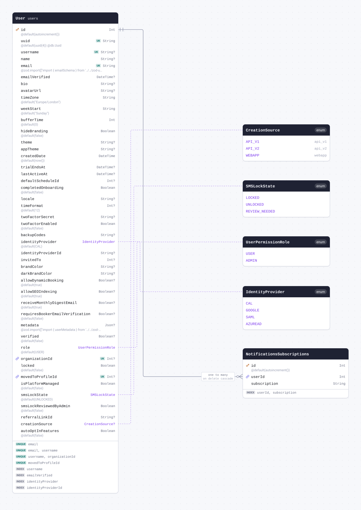

| Field          | Type     | Constraints                       | Default           | Description |
| -------------- | -------- | --------------------------------- | ----------------- | ----------- |
| `id`           | `Int`    | PK NOT NULL                       | `autoincrement()` |             |
| `userId`       | `Int`    | NOT NULL → [User.id](#model-User) |                   |             |
| `subscription` | `String` | NOT NULL                          |                   |             |

#### Indexes

- `@@index([userId, subscription])`

#### References

- `userId` → [User.id](#model-User) (many-to-one, on delete Cascade)

#### Definition

```sql
CREATE TABLE "NotificationsSubscriptions" (
    "id" SERIAL NOT NULL,
    "userId" INTEGER NOT NULL,
    "subscription" TEXT NOT NULL,

    CONSTRAINT "NotificationsSubscriptions_pkey" PRIMARY KEY ("id")
);

CREATE INDEX "NotificationsSubscriptions_userId_subscription_idx" ON "NotificationsSubscriptions"("userId", "subscription");

ALTER TABLE "NotificationsSubscriptions" ADD CONSTRAINT "NotificationsSubscriptions_userId_fkey" FOREIGN KEY ("userId") REFERENCES "users"("id") ON DELETE CASCADE ON UPDATE CASCADE;
```

<details>
<summary>Queries and their SQL</summary>

**findMany**: Every row

```ts
await prisma.notificationsSubscriptions.findMany();
```

```sql
SELECT
  "public"."NotificationsSubscriptions"."id",
  "public"."NotificationsSubscriptions"."userId",
  "public"."NotificationsSubscriptions"."subscription"
FROM
  "public"."NotificationsSubscriptions"
WHERE
  1 = 1
OFFSET
  $1
-- params: ["0"]
```

**count**: How many rows there are

```ts
await prisma.notificationsSubscriptions.count();
```

```sql
SELECT
  COUNT(*) AS "_count$_all"
FROM
  (
    SELECT
      "public"."NotificationsSubscriptions"."id"
    FROM
      "public"."NotificationsSubscriptions"
    WHERE
      1 = 1
    OFFSET
      $1
  ) AS "sub"
-- params: ["0"]
```

**findMany**: Every row with its relations

```ts
await prisma.notificationsSubscriptions.findMany({ include: { user: true } });
```

```sql
SELECT
  "public"."NotificationsSubscriptions"."id",
  "public"."NotificationsSubscriptions"."userId",
  "public"."NotificationsSubscriptions"."subscription"
FROM
  "public"."NotificationsSubscriptions"
WHERE
  1 = 1
OFFSET
  $1
-- params: ["0"]

SELECT
  "public"."users"."id",
  "public"."users"."uuid",
  "public"."users"."username",
  "public"."users"."name",
  "public"."users"."email",
  "public"."users"."emailVerified",
  "public"."users"."bio",
  "public"."users"."avatarUrl",
  "public"."users"."timeZone",
  "public"."users"."weekStart",
  "public"."users"."bufferTime",
  "public"."users"."hideBranding",
  "public"."users"."theme",
  "public"."users"."appTheme",
  "public"."users"."created",
  "public"."users"."trialEndsAt",
  "public"."users"."lastActiveAt",
  "public"."users"."defaultScheduleId",
  "public"."users"."completedOnboarding",
  "public"."users"."locale",
  "public"."users"."timeFormat",
  "public"."users"."twoFactorSecret",
  "public"."users"."twoFactorEnabled",
  "public"."users"."backupCodes",
  "public"."users"."identityProvider"::text,
  "public"."users"."identityProviderId",
  "public"."users"."invitedTo",
  "public"."users"."brandColor",
  "public"."users"."darkBrandColor",
  "public"."users"."allowDynamicBooking",
  "public"."users"."allowSEOIndexing",
  "public"."users"."receiveMonthlyDigestEmail",
  "public"."users"."requiresBookerEmailVerification",
  "public"."users"."metadata",
  "public"."users"."verified",
  "public"."users"."role"::text,
  "public"."users"."organizationId",
  "public"."users"."locked",
  "public"."users"."movedToProfileId",
  "public"."users"."isPlatformManaged",
  "public"."users"."smsLockState"::text,
  "public"."users"."smsLockReviewedByAdmin",
  "public"."users"."referralLinkId",
  "public"."users"."creationSource"::text,
  "public"."users"."autoOptInFeatures"
FROM
  "public"."users"
WHERE
  "public"."users"."id" IN ($1)
OFFSET
  $2
-- params: ["<userId of the rows above>","0"]
```

**findUnique**: One row by what is unique to it

```ts
await prisma.notificationsSubscriptions.findUnique({ where: { id: 1 } });
```

```sql
SELECT
  "public"."NotificationsSubscriptions"."id",
  "public"."NotificationsSubscriptions"."userId",
  "public"."NotificationsSubscriptions"."subscription"
FROM
  "public"."NotificationsSubscriptions"
WHERE
  (
    "public"."NotificationsSubscriptions"."id" = $1
    AND 1 = 1
  )
LIMIT
  $2
OFFSET
  $3
-- params: ["1","1","0"]
```

**create**: Create a row

```ts
await prisma.notificationsSubscriptions.create({ data: { userId: 1, subscription: "example" } });
```

```sql
INSERT INTO
  "public"."NotificationsSubscriptions" ("userId", "subscription")
VALUES
  ($1, $2)
RETURNING
  "public"."NotificationsSubscriptions"."id",
  "public"."NotificationsSubscriptions"."userId",
  "public"."NotificationsSubscriptions"."subscription"
-- params: ["1","example"]
```

**update**: Update a row

```ts
await prisma.notificationsSubscriptions.update({
  where: { id: 1 },
  data: { subscription: "example" },
});
```

```sql
UPDATE "public"."NotificationsSubscriptions"
SET
  "subscription" = $1
WHERE
  (
    "public"."NotificationsSubscriptions"."id" = $2
    AND 1 = 1
  )
RETURNING
  "public"."NotificationsSubscriptions"."id",
  "public"."NotificationsSubscriptions"."userId",
  "public"."NotificationsSubscriptions"."subscription"
-- params: ["example","1"]
```

**delete**: Delete a row

```ts
await prisma.notificationsSubscriptions.delete({ where: { id: 1 } });
```

```sql
DELETE FROM "public"."NotificationsSubscriptions"
WHERE
  (
    "public"."NotificationsSubscriptions"."id" = $1
    AND 1 = 1
  )
RETURNING
  "public"."NotificationsSubscriptions"."id",
  "public"."NotificationsSubscriptions"."userId",
  "public"."NotificationsSubscriptions"."subscription"
-- params: ["1"]
```

</details>

<a id="model-Profile"></a>

### Profile

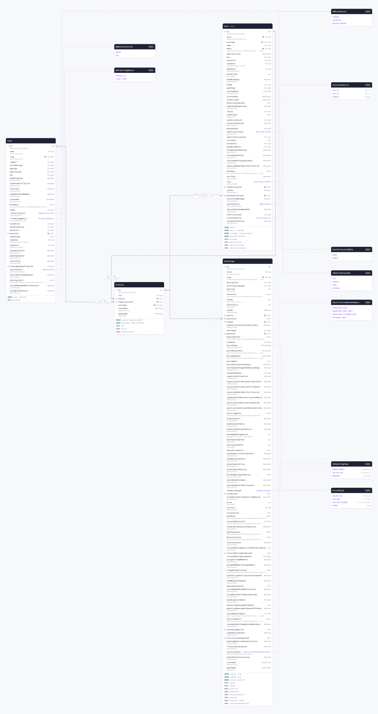

| Field            | Type       | Constraints                       | Default           | Description |
| ---------------- | ---------- | --------------------------------- | ----------------- | ----------- |
| `id`             | `Int`      | PK NOT NULL                       | `autoincrement()` |             |
| `uid`            | `String`   | NOT NULL                          |                   |             |
| `userId`         | `Int`      | NOT NULL → [User.id](#model-User) |                   |             |
| `organizationId` | `Int`      | NOT NULL → [Team.id](#model-Team) |                   |             |
| `username`       | `String`   | NOT NULL                          |                   |             |
| `createdAt`      | `DateTime` | NOT NULL                          | `now()`           |             |
| `updatedAt`      | `DateTime` | NOT NULL                          | `@updatedAt`      |             |

#### Indexes

- `@@index([uid])`
- `@@index([userId])`
- `@@index([organizationId])`
- `@@unique([userId, organizationId])`
- `@@unique([username, organizationId])`

#### References

- `userId` → [User.id](#model-User) (many-to-one, on delete Cascade)
- `organizationId` → [Team.id](#model-Team) (many-to-one, on delete Cascade)

#### Referenced by

- `id` ← [EventType.profileId](#model-EventType) (one-to-many)
- `id` ← [User.movedToProfileId](#model-User) (one-to-one, on delete SetNull)

#### Definition

```sql
CREATE TABLE "Profile" (
    "id" SERIAL NOT NULL,
    "uid" TEXT NOT NULL,
    "userId" INTEGER NOT NULL,
    "organizationId" INTEGER NOT NULL,
    "username" TEXT NOT NULL,
    "createdAt" TIMESTAMP(3) NOT NULL DEFAULT CURRENT_TIMESTAMP,
    "updatedAt" TIMESTAMP(3) NOT NULL,

    CONSTRAINT "Profile_pkey" PRIMARY KEY ("id")
);

CREATE INDEX "Profile_uid_idx" ON "Profile"("uid");

CREATE INDEX "Profile_userId_idx" ON "Profile"("userId");

CREATE INDEX "Profile_organizationId_idx" ON "Profile"("organizationId");

CREATE UNIQUE INDEX "Profile_userId_organizationId_key" ON "Profile"("userId", "organizationId");

CREATE UNIQUE INDEX "Profile_username_organizationId_key" ON "Profile"("username", "organizationId");

ALTER TABLE "Profile" ADD CONSTRAINT "Profile_userId_fkey" FOREIGN KEY ("userId") REFERENCES "users"("id") ON DELETE CASCADE ON UPDATE CASCADE;

ALTER TABLE "Profile" ADD CONSTRAINT "Profile_organizationId_fkey" FOREIGN KEY ("organizationId") REFERENCES "Team"("id") ON DELETE CASCADE ON UPDATE CASCADE;
```

<details>
<summary>Queries and their SQL</summary>

**findMany**: Every row

```ts
await prisma.profile.findMany();
```

```sql
SELECT
  "public"."Profile"."id",
  "public"."Profile"."uid",
  "public"."Profile"."userId",
  "public"."Profile"."organizationId",
  "public"."Profile"."username",
  "public"."Profile"."createdAt",
  "public"."Profile"."updatedAt"
FROM
  "public"."Profile"
WHERE
  1 = 1
OFFSET
  $1
-- params: ["0"]
```

**count**: How many rows there are

```ts
await prisma.profile.count();
```

```sql
SELECT
  COUNT(*) AS "_count$_all"
FROM
  (
    SELECT
      "public"."Profile"."id"
    FROM
      "public"."Profile"
    WHERE
      1 = 1
    OFFSET
      $1
  ) AS "sub"
-- params: ["0"]
```

**findMany**: Every row with its relations

```ts
await prisma.profile.findMany({
  include: { user: true, organization: true, eventTypes: true, movedFromUser: true },
});
```

```sql
SELECT
  "public"."Profile"."id",
  "public"."Profile"."uid",
  "public"."Profile"."userId",
  "public"."Profile"."organizationId",
  "public"."Profile"."username",
  "public"."Profile"."createdAt",
  "public"."Profile"."updatedAt"
FROM
  "public"."Profile"
WHERE
  1 = 1
OFFSET
  $1
-- params: ["0"]

SELECT
  "public"."users"."id",
  "public"."users"."uuid",
  "public"."users"."username",
  "public"."users"."name",
  "public"."users"."email",
  "public"."users"."emailVerified",
  "public"."users"."bio",
  "public"."users"."avatarUrl",
  "public"."users"."timeZone",
  "public"."users"."weekStart",
  "public"."users"."bufferTime",
  "public"."users"."hideBranding",
  "public"."users"."theme",
  "public"."users"."appTheme",
  "public"."users"."created",
  "public"."users"."trialEndsAt",
  "public"."users"."lastActiveAt",
  "public"."users"."defaultScheduleId",
  "public"."users"."completedOnboarding",
  "public"."users"."locale",
  "public"."users"."timeFormat",
  "public"."users"."twoFactorSecret",
  "public"."users"."twoFactorEnabled",
  "public"."users"."backupCodes",
  "public"."users"."identityProvider"::text,
  "public"."users"."identityProviderId",
  "public"."users"."invitedTo",
  "public"."users"."brandColor",
  "public"."users"."darkBrandColor",
  "public"."users"."allowDynamicBooking",
  "public"."users"."allowSEOIndexing",
  "public"."users"."receiveMonthlyDigestEmail",
  "public"."users"."requiresBookerEmailVerification",
  "public"."users"."metadata",
  "public"."users"."verified",
  "public"."users"."role"::text,
  "public"."users"."organizationId",
  "public"."users"."locked",
  "public"."users"."movedToProfileId",
  "public"."users"."isPlatformManaged",
  "public"."users"."smsLockState"::text,
  "public"."users"."smsLockReviewedByAdmin",
  "public"."users"."referralLinkId",
  "public"."users"."creationSource"::text,
  "public"."users"."autoOptInFeatures"
FROM
  "public"."users"
WHERE
  "public"."users"."id" IN ($1)
OFFSET
  $2
-- params: ["<userId of the rows above>","0"]

SELECT
  "public"."Team"."id",
  "public"."Team"."name",
  "public"."Team"."slug",
  "public"."Team"."logoUrl",
  "public"."Team"."calVideoLogo",
  "public"."Team"."appLogo",
  "public"."Team"."appIconLogo",
  "public"."Team"."bio",
  "public"."Team"."hideBranding",
  "public"."Team"."hideTeamProfileLink",
  "public"."Team"."isPrivate",
  "public"."Team"."hideBookATeamMember",
  "public"."Team"."createdAt",
  "public"."Team"."metadata",
  "public"."Team"."theme",
  "public"."Team"."rrResetInterval"::text,
  "public"."Team"."rrTimestampBasis"::text,
  "public"."Team"."brandColor",
  "public"."Team"."darkBrandColor",
  "public"."Team"."bannerUrl",
  "public"."Team"."parentId",
  "public"."Team"."timeFormat",
  "public"."Team"."timeZone",
  "public"."Team"."weekStart",
  "public"."Team"."isOrganization",
  "public"."Team"."pendingPayment",
  "public"."Team"."isPlatform",
  "public"."Team"."createdByOAuthClientId",
  "public"."Team"."smsLockState"::text,
  "public"."Team"."smsLockReviewedByAdmin",
  "public"."Team"."bookingLimits",
  "public"."Team"."includeManagedEventsInLimits",
  "public"."Team"."autoOptInFeatures"
FROM
  "public"."Team"
WHERE
  "public"."Team"."id" IN ($1)
OFFSET
  $2
-- params: ["<organizationId of the rows above>","0"]

SELECT
  "public"."EventType"."id",
  "public"."EventType"."title",
  "public"."EventType"."slug",
  "public"."EventType"."description",
  "public"."EventType"."interfaceLanguage",
  "public"."EventType"."position",
  "public"."EventType"."locations",
  "public"."EventType"."length",
  "public"."EventType"."offsetStart",
  "public"."EventType"."hidden",
  "public"."EventType"."userId",
  "public"."EventType"."profileId",
  "public"."EventType"."teamId",
  "public"."EventType"."useEventLevelSelectedCalendars",
  "public"."EventType"."eventName",
  "public"."EventType"."parentId",
  "public"."EventType"."bookingFields",
  "public"."EventType"."timeZone",
  "public"."EventType"."periodType"::text,
  "public"."EventType"."periodStartDate",
  "public"."EventType"."periodEndDate",
  "public"."EventType"."periodDays",
  "public"."EventType"."periodCountCalendarDays",
  "public"."EventType"."lockTimeZoneToggleOnBookingPage",
  "public"."EventType"."lockedTimeZone",
  "public"."EventType"."requiresConfirmation",
  "public"."EventType"."requiresConfirmationWillBlockSlot",
  "public"."EventType"."requiresConfirmationForFreeEmail",
  "public"."EventType"."requiresBookerEmailVerification",
  "public"."EventType"."canSendCalVideoTranscriptionEmails",
  "public"."EventType"."autoTranslateDescriptionEnabled",
  "public"."EventType"."autoTranslateInstantMeetingTitleEnabled",
  "public"."EventType"."recurringEvent",
  "public"."EventType"."disableGuests",
  "public"."EventType"."hideCalendarNotes",
  "public"."EventType"."hideCalendarEventDetails",
  "public"."EventType"."minimumBookingNotice",
  "public"."EventType"."beforeEventBuffer",
  "public"."EventType"."afterEventBuffer",
  "public"."EventType"."seatsPerTimeSlot",
  "public"."EventType"."onlyShowFirstAvailableSlot",
  "public"."EventType"."showOptimizedSlots",
  "public"."EventType"."disableCancelling",
  "public"."EventType"."disableRescheduling",
  "public"."EventType"."minimumRescheduleNotice",
  "public"."EventType"."seatsShowAttendees",
  "public"."EventType"."seatsShowAvailabilityCount",
  "public"."EventType"."schedulingType"::text,
  "public"."EventType"."scheduleId",
  "public"."EventType"."allowReschedulingCancelledBookings",
  "public"."EventType"."price",
  "public"."EventType"."currency",
  "public"."EventType"."slotInterval",
  "public"."EventType"."metadata",
  "public"."EventType"."successRedirectUrl",
  "public"."EventType"."forwardParamsSuccessRedirect",
  "public"."EventType"."bookingLimits",
  "public"."EventType"."durationLimits",
  "public"."EventType"."isInstantEvent",
  "public"."EventType"."instantMeetingExpiryTimeOffsetInSeconds",
  "public"."EventType"."instantMeetingScheduleId",
  "public"."EventType"."instantMeetingParameters",
  "public"."EventType"."assignAllTeamMembers",
  "public"."EventType"."assignRRMembersUsingSegment",
  "public"."EventType"."rrSegmentQueryValue",
  "public"."EventType"."useEventTypeDestinationCalendarEmail",
  "public"."EventType"."isRRWeightsEnabled",
  "public"."EventType"."maxLeadThreshold",
  "public"."EventType"."includeNoShowInRRCalculation",
  "public"."EventType"."allowReschedulingPastBookings",
  "public"."EventType"."hideOrganizerEmail",
  "public"."EventType"."maxActiveBookingsPerBooker",
  "public"."EventType"."maxActiveBookingPerBookerOfferReschedule",
  "public"."EventType"."customReplyToEmail",
  "public"."EventType"."eventTypeColor",
  "public"."EventType"."rescheduleWithSameRoundRobinHost",
  "public"."EventType"."secondaryEmailId",
  "public"."EventType"."useBookerTimezone",
  "public"."EventType"."restrictionScheduleId",
  "public"."EventType"."bookingRequiresAuthentication",
  "public"."EventType"."rrHostSubsetEnabled",
  "public"."EventType"."requiresCancellationReason"::text,
  "public"."EventType"."enablePerHostLocations",
  "public"."EventType"."createdAt",
  "public"."EventType"."updatedAt"
FROM
  "public"."EventType"
WHERE
  "public"."EventType"."profileId" IN ($1)
OFFSET
  $2
-- params: ["<id of the rows above>","0"]

SELECT
  "public"."users"."id",
  "public"."users"."uuid",
  "public"."users"."username",
  "public"."users"."name",
  "public"."users"."email",
  "public"."users"."emailVerified",
  "public"."users"."bio",
  "public"."users"."avatarUrl",
  "public"."users"."timeZone",
  "public"."users"."weekStart",
  "public"."users"."bufferTime",
  "public"."users"."hideBranding",
  "public"."users"."theme",
  "public"."users"."appTheme",
  "public"."users"."created",
  "public"."users"."trialEndsAt",
  "public"."users"."lastActiveAt",
  "public"."users"."defaultScheduleId",
  "public"."users"."completedOnboarding",
  "public"."users"."locale",
  "public"."users"."timeFormat",
  "public"."users"."twoFactorSecret",
  "public"."users"."twoFactorEnabled",
  "public"."users"."backupCodes",
  "public"."users"."identityProvider"::text,
  "public"."users"."identityProviderId",
  "public"."users"."invitedTo",
  "public"."users"."brandColor",
  "public"."users"."darkBrandColor",
  "public"."users"."allowDynamicBooking",
  "public"."users"."allowSEOIndexing",
  "public"."users"."receiveMonthlyDigestEmail",
  "public"."users"."requiresBookerEmailVerification",
  "public"."users"."metadata",
  "public"."users"."verified",
  "public"."users"."role"::text,
  "public"."users"."organizationId",
  "public"."users"."locked",
  "public"."users"."movedToProfileId",
  "public"."users"."isPlatformManaged",
  "public"."users"."smsLockState"::text,
  "public"."users"."smsLockReviewedByAdmin",
  "public"."users"."referralLinkId",
  "public"."users"."creationSource"::text,
  "public"."users"."autoOptInFeatures"
FROM
  "public"."users"
WHERE
  "public"."users"."movedToProfileId" IN ($1)
OFFSET
  $2
-- params: ["<id of the rows above>","0"]
```

**findUnique**: One row by what is unique to it

```ts
await prisma.profile.findUnique({ where: { id: 1 } });
```

```sql
SELECT
  "public"."Profile"."id",
  "public"."Profile"."uid",
  "public"."Profile"."userId",
  "public"."Profile"."organizationId",
  "public"."Profile"."username",
  "public"."Profile"."createdAt",
  "public"."Profile"."updatedAt"
FROM
  "public"."Profile"
WHERE
  (
    "public"."Profile"."id" = $1
    AND 1 = 1
  )
LIMIT
  $2
OFFSET
  $3
-- params: ["1","1","0"]
```

**create**: Create a row

```ts
await prisma.profile.create({
  data: { uid: "example", userId: 1, organizationId: 1, username: "example" },
});
```

```sql
INSERT INTO
  "public"."Profile" (
    "uid",
    "userId",
    "organizationId",
    "username",
    "createdAt",
    "updatedAt"
  )
VALUES
  ($1, $2, $3, $4, $5, $6)
RETURNING
  "public"."Profile"."id",
  "public"."Profile"."uid",
  "public"."Profile"."userId",
  "public"."Profile"."organizationId",
  "public"."Profile"."username",
  "public"."Profile"."createdAt",
  "public"."Profile"."updatedAt"
-- params: ["example","1","1","example","<now()>","<now()>"]
```

**update**: Update a row

```ts
await prisma.profile.update({ where: { id: 1 }, data: { uid: "example" } });
```

```sql
UPDATE "public"."Profile"
SET
  "uid" = $1,
  "updatedAt" = $2
WHERE
  (
    "public"."Profile"."id" = $3
    AND 1 = 1
  )
RETURNING
  "public"."Profile"."id",
  "public"."Profile"."uid",
  "public"."Profile"."userId",
  "public"."Profile"."organizationId",
  "public"."Profile"."username",
  "public"."Profile"."createdAt",
  "public"."Profile"."updatedAt"
-- params: ["example",{"prisma__type":"generatorCall","prisma__value":{"name":"now","args":[],"returnType":{"type":"DateTime"}}},"1"]
```

**delete**: Delete a row

```ts
await prisma.profile.delete({ where: { id: 1 } });
```

```sql
DELETE FROM "public"."Profile"
WHERE
  (
    "public"."Profile"."id" = $1
    AND 1 = 1
  )
RETURNING
  "public"."Profile"."id",
  "public"."Profile"."uid",
  "public"."Profile"."userId",
  "public"."Profile"."organizationId",
  "public"."Profile"."username",
  "public"."Profile"."createdAt",
  "public"."Profile"."updatedAt"
-- params: ["1"]
```

</details>

<a id="model-Team"></a>

### Team

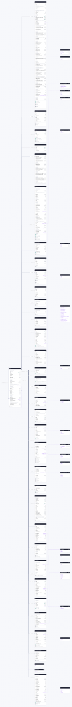

| Field                          | Type                                         | Constraints                                                 | Default           | Description                                                                                          |
| ------------------------------ | -------------------------------------------- | ----------------------------------------------------------- | ----------------- | ---------------------------------------------------------------------------------------------------- |
| `id`                           | `Int`                                        | PK NOT NULL                                                 | `autoincrement()` |                                                                                                      |
| `name`                         | `String`                                     | NOT NULL                                                    |                   | @zod.string.min(1)                                                                                   |
| `slug`                         | `String`                                     | NULL                                                        |                   | @zod.string.min(1)                                                                                   |
| `logoUrl`                      | `String`                                     | NULL                                                        |                   |                                                                                                      |
| `calVideoLogo`                 | `String`                                     | NULL                                                        |                   |                                                                                                      |
| `appLogo`                      | `String`                                     | NULL                                                        |                   |                                                                                                      |
| `appIconLogo`                  | `String`                                     | NULL                                                        |                   |                                                                                                      |
| `bio`                          | `String`                                     | NULL                                                        |                   |                                                                                                      |
| `hideBranding`                 | `Boolean`                                    | NOT NULL                                                    | `false`           |                                                                                                      |
| `hideTeamProfileLink`          | `Boolean`                                    | NOT NULL                                                    | `false`           |                                                                                                      |
| `isPrivate`                    | `Boolean`                                    | NOT NULL                                                    | `false`           |                                                                                                      |
| `hideBookATeamMember`          | `Boolean`                                    | NOT NULL                                                    | `false`           |                                                                                                      |
| `createdAt`                    | `DateTime`                                   | NOT NULL                                                    | `now()`           |                                                                                                      |
| `metadata`                     | `Json`                                       | NULL                                                        |                   | @zod.import(["import { teamMetadataSchema } from '../../zod-utils'"]).custom.use(teamMetadataSchema) |
| `theme`                        | `String`                                     | NULL                                                        |                   |                                                                                                      |
| `rrResetInterval`              | [`RRResetInterval`](#enum-RRResetInterval)   | NULL                                                        | `MONTH`           |                                                                                                      |
| `rrTimestampBasis`             | [`RRTimestampBasis`](#enum-RRTimestampBasis) | NOT NULL                                                    | `CREATED_AT`      |                                                                                                      |
| `brandColor`                   | `String`                                     | NULL                                                        |                   |                                                                                                      |
| `darkBrandColor`               | `String`                                     | NULL                                                        |                   |                                                                                                      |
| `bannerUrl`                    | `String`                                     | NULL                                                        |                   |                                                                                                      |
| `parentId`                     | `Int`                                        | NULL → [Team.id](#model-Team)                               |                   |                                                                                                      |
| `timeFormat`                   | `Int`                                        | NULL                                                        |                   |                                                                                                      |
| `timeZone`                     | `String`                                     | NOT NULL                                                    | `"Europe/London"` |                                                                                                      |
| `weekStart`                    | `String`                                     | NOT NULL                                                    | `"Sunday"`        |                                                                                                      |
| `isOrganization`               | `Boolean`                                    | NOT NULL                                                    | `false`           |                                                                                                      |
| `pendingPayment`               | `Boolean`                                    | NOT NULL                                                    | `false`           |                                                                                                      |
| `isPlatform`                   | `Boolean`                                    | NOT NULL                                                    | `false`           |                                                                                                      |
| `createdByOAuthClientId`       | `String`                                     | NULL → [PlatformOAuthClient.id](#model-PlatformOAuthClient) |                   |                                                                                                      |
| `smsLockState`                 | [`SMSLockState`](#enum-SMSLockState)         | NOT NULL                                                    | `UNLOCKED`        |                                                                                                      |
| `smsLockReviewedByAdmin`       | `Boolean`                                    | NOT NULL                                                    | `false`           |                                                                                                      |
| `bookingLimits`                | `Json`                                       | NULL                                                        |                   | @zod.import(["import { intervalLimitsType } from '../../zod-utils'"]).custom.use(intervalLimitsType) |
| `includeManagedEventsInLimits` | `Boolean`                                    | NOT NULL                                                    | `false`           |                                                                                                      |
| `autoOptInFeatures`            | `Boolean`                                    | NOT NULL                                                    | `false`           |                                                                                                      |

#### Indexes

- `@@index([parentId])`
- `@@unique([slug, parentId])`

#### References

- `parentId` → [Team.id](#model-Team) (many-to-one, on delete Cascade)
- `createdByOAuthClientId` → [PlatformOAuthClient.id](#model-PlatformOAuthClient) (many-to-one, on delete Cascade)

#### Referenced by

- `id` ← [EventType.teamId](#model-EventType) (one-to-many, on delete Cascade)
- `id` ← [Credential.teamId](#model-Credential) (one-to-many, on delete Cascade)
- `id` ← [User.organizationId](#model-User) (one-to-many, on delete SetNull)
- `id` ← [Profile.organizationId](#model-Profile) (one-to-many, on delete Cascade)
- `id` ← [Team.parentId](#model-Team) (one-to-many, on delete Cascade)
- `id` ← [CreditBalance.teamId](#model-CreditBalance) (one-to-one, on delete Cascade)
- `id` ← [OrganizationSettings.organizationId](#model-OrganizationSettings) (one-to-one, on delete Cascade)
- `id` ← [Membership.teamId](#model-Membership) (one-to-many, on delete Cascade)
- `id` ← [VerificationToken.teamId](#model-VerificationToken) (one-to-many)
- `id` ← [InstantMeetingToken.teamId](#model-InstantMeetingToken) (one-to-many, on delete Cascade)
- `id` ← [Webhook.teamId](#model-Webhook) (one-to-many, on delete Cascade)
- `id` ← [ApiKey.teamId](#model-ApiKey) (one-to-many, on delete Cascade)
- `id` ← [VerifiedNumber.teamId](#model-VerifiedNumber) (one-to-many, on delete Cascade)
- `id` ← [VerifiedEmail.teamId](#model-VerifiedEmail) (one-to-many, on delete Cascade)
- `id` ← [TeamFeatures.teamId](#model-TeamFeatures) (one-to-many, on delete Cascade)
- `id` ← [AccessCode.teamId](#model-AccessCode) (one-to-many, on delete Cascade)
- `id` ← [PlatformOAuthClient.organizationId](#model-PlatformOAuthClient) (one-to-many, on delete Cascade)
- `id` ← [DSyncTeamGroupMapping.teamId](#model-DSyncTeamGroupMapping) (one-to-many, on delete Cascade)
- `id` ← [ManagedOrganization.managedOrganizationId](#model-ManagedOrganization) (one-to-one, on delete Cascade)
- `id` ← [ManagedOrganization.managerOrganizationId](#model-ManagedOrganization) (one-to-many, on delete Cascade)
- `id` ← [PlatformBilling.id](#model-PlatformBilling) (one-to-one, on delete Cascade)
- `id` ← [Attribute.teamId](#model-Attribute) (one-to-many, on delete Cascade)
- `id` ← [DelegationCredential.organizationId](#model-DelegationCredential) (one-to-many, on delete Cascade)
- `id` ← [BookingReport.organizationId](#model-BookingReport) (one-to-many, on delete Cascade)
- `id` ← [WrongAssignmentReport.teamId](#model-WrongAssignmentReport) (one-to-many, on delete SetNull)
- `id` ← [OrganizationOnboarding.organizationId](#model-OrganizationOnboarding) (one-to-one, on delete Cascade)
- `id` ← [InternalNotePreset.teamId](#model-InternalNotePreset) (one-to-many, on delete Cascade)
- `id` ← [FilterSegment.teamId](#model-FilterSegment) (one-to-many, on delete Cascade)
- `id` ← [Role.teamId](#model-Role) (one-to-many, on delete Cascade)
- `id` ← [Agent.teamId](#model-Agent) (one-to-many, on delete Cascade)
- `id` ← [CalAiPhoneNumber.teamId](#model-CalAiPhoneNumber) (one-to-many, on delete Cascade)
- `id` ← [TeamBilling.teamId](#model-TeamBilling) (one-to-one, on delete Cascade)
- `id` ← [OrganizationBilling.teamId](#model-OrganizationBilling) (one-to-one, on delete Cascade)
- `id` ← [SeatChangeLog.teamId](#model-SeatChangeLog) (one-to-many, on delete Cascade)
- `id` ← [MonthlyProration.teamId](#model-MonthlyProration) (one-to-many, on delete Cascade)
- `id` ← [IntegrationAttributeSync.organizationId](#model-IntegrationAttributeSync) (one-to-many, on delete Cascade)

#### Definition

```sql
CREATE TABLE "Team" (
    "id" SERIAL NOT NULL,
    "name" TEXT NOT NULL,
    "slug" TEXT,
    "logoUrl" TEXT,
    "calVideoLogo" TEXT,
    "appLogo" TEXT,
    "appIconLogo" TEXT,
    "bio" TEXT,
    "hideBranding" BOOLEAN NOT NULL DEFAULT false,
    "hideTeamProfileLink" BOOLEAN NOT NULL DEFAULT false,
    "isPrivate" BOOLEAN NOT NULL DEFAULT false,
    "hideBookATeamMember" BOOLEAN NOT NULL DEFAULT false,
    "createdAt" TIMESTAMP(3) NOT NULL DEFAULT CURRENT_TIMESTAMP,
    "metadata" JSONB,
    "theme" TEXT,
    "rrResetInterval" "RRResetInterval" DEFAULT 'MONTH',
    "rrTimestampBasis" "RRTimestampBasis" NOT NULL DEFAULT 'CREATED_AT',
    "brandColor" TEXT,
    "darkBrandColor" TEXT,
    "bannerUrl" TEXT,
    "parentId" INTEGER,
    "timeFormat" INTEGER,
    "timeZone" TEXT NOT NULL DEFAULT 'Europe/London',
    "weekStart" TEXT NOT NULL DEFAULT 'Sunday',
    "isOrganization" BOOLEAN NOT NULL DEFAULT false,
    "pendingPayment" BOOLEAN NOT NULL DEFAULT false,
    "isPlatform" BOOLEAN NOT NULL DEFAULT false,
    "createdByOAuthClientId" TEXT,
    "smsLockState" "SMSLockState" NOT NULL DEFAULT 'UNLOCKED',
    "smsLockReviewedByAdmin" BOOLEAN NOT NULL DEFAULT false,
    "bookingLimits" JSONB,
    "includeManagedEventsInLimits" BOOLEAN NOT NULL DEFAULT false,
    "autoOptInFeatures" BOOLEAN NOT NULL DEFAULT false,

    CONSTRAINT "Team_pkey" PRIMARY KEY ("id")
);

CREATE INDEX "Team_parentId_idx" ON "Team"("parentId");

CREATE UNIQUE INDEX "Team_slug_parentId_key" ON "Team"("slug", "parentId");

ALTER TABLE "Team" ADD CONSTRAINT "Team_parentId_fkey" FOREIGN KEY ("parentId") REFERENCES "Team"("id") ON DELETE CASCADE ON UPDATE CASCADE;

ALTER TABLE "Team" ADD CONSTRAINT "Team_createdByOAuthClientId_fkey" FOREIGN KEY ("createdByOAuthClientId") REFERENCES "PlatformOAuthClient"("id") ON DELETE CASCADE ON UPDATE CASCADE;
```

<details>
<summary>Queries and their SQL</summary>

**findMany**: Every row

```ts
await prisma.team.findMany();
```

```sql
SELECT
  "public"."Team"."id",
  "public"."Team"."name",
  "public"."Team"."slug",
  "public"."Team"."logoUrl",
  "public"."Team"."calVideoLogo",
  "public"."Team"."appLogo",
  "public"."Team"."appIconLogo",
  "public"."Team"."bio",
  "public"."Team"."hideBranding",
  "public"."Team"."hideTeamProfileLink",
  "public"."Team"."isPrivate",
  "public"."Team"."hideBookATeamMember",
  "public"."Team"."createdAt",
  "public"."Team"."metadata",
  "public"."Team"."theme",
  "public"."Team"."rrResetInterval"::text,
  "public"."Team"."rrTimestampBasis"::text,
  "public"."Team"."brandColor",
  "public"."Team"."darkBrandColor",
  "public"."Team"."bannerUrl",
  "public"."Team"."parentId",
  "public"."Team"."timeFormat",
  "public"."Team"."timeZone",
  "public"."Team"."weekStart",
  "public"."Team"."isOrganization",
  "public"."Team"."pendingPayment",
  "public"."Team"."isPlatform",
  "public"."Team"."createdByOAuthClientId",
  "public"."Team"."smsLockState"::text,
  "public"."Team"."smsLockReviewedByAdmin",
  "public"."Team"."bookingLimits",
  "public"."Team"."includeManagedEventsInLimits",
  "public"."Team"."autoOptInFeatures"
FROM
  "public"."Team"
WHERE
  1 = 1
OFFSET
  $1
-- params: ["0"]
```

**count**: How many rows there are

```ts
await prisma.team.count();
```

```sql
SELECT
  COUNT(*) AS "_count$_all"
FROM
  (
    SELECT
      "public"."Team"."id"
    FROM
      "public"."Team"
    WHERE
      1 = 1
    OFFSET
      $1
  ) AS "sub"
-- params: ["0"]
```

**findMany**: Every row with its relations

```ts
await prisma.team.findMany({
  include: {
    members: true,
    eventTypes: true,
    verifiedNumbers: true,
    verifiedEmails: true,
    parent: true,
    children: true,
    orgUsers: true,
    inviteTokens: true,
    webhooks: true,
    apiKeys: true,
    credentials: true,
    accessCodes: true,
    organizationSettings: true,
    instantMeetingTokens: true,
    orgProfiles: true,
    dsyncTeamGroupMapping: true,
    platformOAuthClient: true,
    createdByOAuthClient: true,
    platformBilling: true,
    attributes: true,
    delegationCredentials: true,
    roles: true,
    calAiPhoneNumbers: true,
    agents: true,
    bookingReports: true,
    wrongAssignmentReports: true,
    features: true,
    internalNotePresets: true,
    creditBalance: true,
    organizationOnboarding: true,
    managedOrganization: true,
    managedOrganizations: true,
    filterSegments: true,
    teamBilling: true,
    organizationBilling: true,
    integrationAttributeSyncs: true,
    seatChangeLogs: true,
    monthlyProrations: true,
  },
});
```

```sql
SELECT
  "public"."Team"."id",
  "public"."Team"."name",
  "public"."Team"."slug",
  "public"."Team"."logoUrl",
  "public"."Team"."calVideoLogo",
  "public"."Team"."appLogo",
  "public"."Team"."appIconLogo",
  "public"."Team"."bio",
  "public"."Team"."hideBranding",
  "public"."Team"."hideTeamProfileLink",
  "public"."Team"."isPrivate",
  "public"."Team"."hideBookATeamMember",
  "public"."Team"."createdAt",
  "public"."Team"."metadata",
  "public"."Team"."theme",
  "public"."Team"."rrResetInterval"::text,
  "public"."Team"."rrTimestampBasis"::text,
  "public"."Team"."brandColor",
  "public"."Team"."darkBrandColor",
  "public"."Team"."bannerUrl",
  "public"."Team"."parentId",
  "public"."Team"."timeFormat",
  "public"."Team"."timeZone",
  "public"."Team"."weekStart",
  "public"."Team"."isOrganization",
  "public"."Team"."pendingPayment",
  "public"."Team"."isPlatform",
  "public"."Team"."createdByOAuthClientId",
  "public"."Team"."smsLockState"::text,
  "public"."Team"."smsLockReviewedByAdmin",
  "public"."Team"."bookingLimits",
  "public"."Team"."includeManagedEventsInLimits",
  "public"."Team"."autoOptInFeatures"
FROM
  "public"."Team"
WHERE
  1 = 1
OFFSET
  $1
-- params: ["0"]

SELECT
  "public"."Membership"."id",
  "public"."Membership"."teamId",
  "public"."Membership"."userId",
  "public"."Membership"."accepted",
  "public"."Membership"."role"::text,
  "public"."Membership"."customRoleId",
  "public"."Membership"."createdAt",
  "public"."Membership"."updatedAt"
FROM
  "public"."Membership"
WHERE
  "public"."Membership"."teamId" IN ($1)
OFFSET
  $2
-- params: ["<id of the rows above>","0"]

SELECT
  "public"."EventType"."id",
  "public"."EventType"."title",
  "public"."EventType"."slug",
  "public"."EventType"."description",
  "public"."EventType"."interfaceLanguage",
  "public"."EventType"."position",
  "public"."EventType"."locations",
  "public"."EventType"."length",
  "public"."EventType"."offsetStart",
  "public"."EventType"."hidden",
  "public"."EventType"."userId",
  "public"."EventType"."profileId",
  "public"."EventType"."teamId",
  "public"."EventType"."useEventLevelSelectedCalendars",
  "public"."EventType"."eventName",
  "public"."EventType"."parentId",
  "public"."EventType"."bookingFields",
  "public"."EventType"."timeZone",
  "public"."EventType"."periodType"::text,
  "public"."EventType"."periodStartDate",
  "public"."EventType"."periodEndDate",
  "public"."EventType"."periodDays",
  "public"."EventType"."periodCountCalendarDays",
  "public"."EventType"."lockTimeZoneToggleOnBookingPage",
  "public"."EventType"."lockedTimeZone",
  "public"."EventType"."requiresConfirmation",
  "public"."EventType"."requiresConfirmationWillBlockSlot",
  "public"."EventType"."requiresConfirmationForFreeEmail",
  "public"."EventType"."requiresBookerEmailVerification",
  "public"."EventType"."canSendCalVideoTranscriptionEmails",
  "public"."EventType"."autoTranslateDescriptionEnabled",
  "public"."EventType"."autoTranslateInstantMeetingTitleEnabled",
  "public"."EventType"."recurringEvent",
  "public"."EventType"."disableGuests",
  "public"."EventType"."hideCalendarNotes",
  "public"."EventType"."hideCalendarEventDetails",
  "public"."EventType"."minimumBookingNotice",
  "public"."EventType"."beforeEventBuffer",
  "public"."EventType"."afterEventBuffer",
  "public"."EventType"."seatsPerTimeSlot",
  "public"."EventType"."onlyShowFirstAvailableSlot",
  "public"."EventType"."showOptimizedSlots",
  "public"."EventType"."disableCancelling",
  "public"."EventType"."disableRescheduling",
  "public"."EventType"."minimumRescheduleNotice",
  "public"."EventType"."seatsShowAttendees",
  "public"."EventType"."seatsShowAvailabilityCount",
  "public"."EventType"."schedulingType"::text,
  "public"."EventType"."scheduleId",
  "public"."EventType"."allowReschedulingCancelledBookings",
  "public"."EventType"."price",
  "public"."EventType"."currency",
  "public"."EventType"."slotInterval",
  "public"."EventType"."metadata",
  "public"."EventType"."successRedirectUrl",
  "public"."EventType"."forwardParamsSuccessRedirect",
  "public"."EventType"."bookingLimits",
  "public"."EventType"."durationLimits",
  "public"."EventType"."isInstantEvent",
  "public"."EventType"."instantMeetingExpiryTimeOffsetInSeconds",
  "public"."EventType"."instantMeetingScheduleId",
  "public"."EventType"."instantMeetingParameters",
  "public"."EventType"."assignAllTeamMembers",
  "public"."EventType"."assignRRMembersUsingSegment",
  "public"."EventType"."rrSegmentQueryValue",
  "public"."EventType"."useEventTypeDestinationCalendarEmail",
  "public"."EventType"."isRRWeightsEnabled",
  "public"."EventType"."maxLeadThreshold",
  "public"."EventType"."includeNoShowInRRCalculation",
  "public"."EventType"."allowReschedulingPastBookings",
  "public"."EventType"."hideOrganizerEmail",
  "public"."EventType"."maxActiveBookingsPerBooker",
  "public"."EventType"."maxActiveBookingPerBookerOfferReschedule",
  "public"."EventType"."customReplyToEmail",
  "public"."EventType"."eventTypeColor",
  "public"."EventType"."rescheduleWithSameRoundRobinHost",
  "public"."EventType"."secondaryEmailId",
  "public"."EventType"."useBookerTimezone",
  "public"."EventType"."restrictionScheduleId",
  "public"."EventType"."bookingRequiresAuthentication",
  "public"."EventType"."rrHostSubsetEnabled",
  "public"."EventType"."requiresCancellationReason"::text,
  "public"."EventType"."enablePerHostLocations",
  "public"."EventType"."createdAt",
  "public"."EventType"."updatedAt"
FROM
  "public"."EventType"
WHERE
  "public"."EventType"."teamId" IN ($1)
OFFSET
  $2
-- params: ["<id of the rows above>","0"]

SELECT
  "public"."VerifiedNumber"."id",
  "public"."VerifiedNumber"."userId",
  "public"."VerifiedNumber"."teamId",
  "public"."VerifiedNumber"."phoneNumber"
FROM
  "public"."VerifiedNumber"
WHERE
  "public"."VerifiedNumber"."teamId" IN ($1)
OFFSET
  $2
-- params: ["<id of the rows above>","0"]

SELECT
  "public"."VerifiedEmail"."id",
  "public"."VerifiedEmail"."userId",
  "public"."VerifiedEmail"."teamId",
  "public"."VerifiedEmail"."email"
FROM
  "public"."VerifiedEmail"
WHERE
  "public"."VerifiedEmail"."teamId" IN ($1)
OFFSET
  $2
-- params: ["<id of the rows above>","0"]

SELECT
  "public"."Team"."id",
  "public"."Team"."name",
  "public"."Team"."slug",
  "public"."Team"."logoUrl",
  "public"."Team"."calVideoLogo",
  "public"."Team"."appLogo",
  "public"."Team"."appIconLogo",
  "public"."Team"."bio",
  "public"."Team"."hideBranding",
  "public"."Team"."hideTeamProfileLink",
  "public"."Team"."isPrivate",
  "public"."Team"."hideBookATeamMember",
  "public"."Team"."createdAt",
  "public"."Team"."metadata",
  "public"."Team"."theme",
  "public"."Team"."rrResetInterval"::text,
  "public"."Team"."rrTimestampBasis"::text,
  "public"."Team"."brandColor",
  "public"."Team"."darkBrandColor",
  "public"."Team"."bannerUrl",
  "public"."Team"."parentId",
  "public"."Team"."timeFormat",
  "public"."Team"."timeZone",
  "public"."Team"."weekStart",
  "public"."Team"."isOrganization",
  "public"."Team"."pendingPayment",
  "public"."Team"."isPlatform",
  "public"."Team"."createdByOAuthClientId",
  "public"."Team"."smsLockState"::text,
  "public"."Team"."smsLockReviewedByAdmin",
  "public"."Team"."bookingLimits",
  "public"."Team"."includeManagedEventsInLimits",
  "public"."Team"."autoOptInFeatures"
FROM
  "public"."Team"
WHERE
  "public"."Team"."id" IN ($1)
OFFSET
  $2
-- params: ["<parentId of the rows above>","0"]

SELECT
  "public"."Team"."id",
  "public"."Team"."name",
  "public"."Team"."slug",
  "public"."Team"."logoUrl",
  "public"."Team"."calVideoLogo",
  "public"."Team"."appLogo",
  "public"."Team"."appIconLogo",
  "public"."Team"."bio",
  "public"."Team"."hideBranding",
  "public"."Team"."hideTeamProfileLink",
  "public"."Team"."isPrivate",
  "public"."Team"."hideBookATeamMember",
  "public"."Team"."createdAt",
  "public"."Team"."metadata",
  "public"."Team"."theme",
  "public"."Team"."rrResetInterval"::text,
  "public"."Team"."rrTimestampBasis"::text,
  "public"."Team"."brandColor",
  "public"."Team"."darkBrandColor",
  "public"."Team"."bannerUrl",
  "public"."Team"."parentId",
  "public"."Team"."timeFormat",
  "public"."Team"."timeZone",
  "public"."Team"."weekStart",
  "public"."Team"."isOrganization",
  "public"."Team"."pendingPayment",
  "public"."Team"."isPlatform",
  "public"."Team"."createdByOAuthClientId",
  "public"."Team"."smsLockState"::text,
  "public"."Team"."smsLockReviewedByAdmin",
  "public"."Team"."bookingLimits",
  "public"."Team"."includeManagedEventsInLimits",
  "public"."Team"."autoOptInFeatures"
FROM
  "public"."Team"
WHERE
  "public"."Team"."parentId" IN ($1)
OFFSET
  $2
-- params: ["<id of the rows above>","0"]

SELECT
  "public"."users"."id",
  "public"."users"."uuid",
  "public"."users"."username",
  "public"."users"."name",
  "public"."users"."email",
  "public"."users"."emailVerified",
  "public"."users"."bio",
  "public"."users"."avatarUrl",
  "public"."users"."timeZone",
  "public"."users"."weekStart",
  "public"."users"."bufferTime",
  "public"."users"."hideBranding",
  "public"."users"."theme",
  "public"."users"."appTheme",
  "public"."users"."created",
  "public"."users"."trialEndsAt",
  "public"."users"."lastActiveAt",
  "public"."users"."defaultScheduleId",
  "public"."users"."completedOnboarding",
  "public"."users"."locale",
  "public"."users"."timeFormat",
  "public"."users"."twoFactorSecret",
  "public"."users"."twoFactorEnabled",
  "public"."users"."backupCodes",
  "public"."users"."identityProvider"::text,
  "public"."users"."identityProviderId",
  "public"."users"."invitedTo",
  "public"."users"."brandColor",
  "public"."users"."darkBrandColor",
  "public"."users"."allowDynamicBooking",
  "public"."users"."allowSEOIndexing",
  "public"."users"."receiveMonthlyDigestEmail",
  "public"."users"."requiresBookerEmailVerification",
  "public"."users"."metadata",
  "public"."users"."verified",
  "public"."users"."role"::text,
  "public"."users"."organizationId",
  "public"."users"."locked",
  "public"."users"."movedToProfileId",
  "public"."users"."isPlatformManaged",
  "public"."users"."smsLockState"::text,
  "public"."users"."smsLockReviewedByAdmin",
  "public"."users"."referralLinkId",
  "public"."users"."creationSource"::text,
  "public"."users"."autoOptInFeatures"
FROM
  "public"."users"
WHERE
  "public"."users"."organizationId" IN ($1)
OFFSET
  $2
-- params: ["<id of the rows above>","0"]

SELECT
  "public"."VerificationToken"."id",
  "public"."VerificationToken"."identifier",
  "public"."VerificationToken"."token",
  "public"."VerificationToken"."expires",
  "public"."VerificationToken"."expiresInDays",
  "public"."VerificationToken"."createdAt",
  "public"."VerificationToken"."updatedAt",
  "public"."VerificationToken"."teamId",
  "public"."VerificationToken"."secondaryEmailId"
FROM
  "public"."VerificationToken"
WHERE
  "public"."VerificationToken"."teamId" IN ($1)
OFFSET
  $2
-- params: ["<id of the rows above>","0"]

SELECT
  "public"."Webhook"."id",
  "public"."Webhook"."userId",
  "public"."Webhook"."teamId",
  "public"."Webhook"."eventTypeId",
  "public"."Webhook"."platformOAuthClientId",
  "public"."Webhook"."subscriberUrl",
  "public"."Webhook"."payloadTemplate",
  "public"."Webhook"."createdAt",
  "public"."Webhook"."active",
  "public"."Webhook"."eventTriggers"::text[],
  "public"."Webhook"."appId",
  "public"."Webhook"."secret",
  "public"."Webhook"."platform",
  "public"."Webhook"."time",
  "public"."Webhook"."timeUnit"::text,
  "public"."Webhook"."version"
FROM
  "public"."Webhook"
WHERE
  "public"."Webhook"."teamId" IN ($1)
OFFSET
  $2
-- params: ["<id of the rows above>","0"]

SELECT
  "public"."ApiKey"."id",
  "public"."ApiKey"."userId",
  "public"."ApiKey"."teamId",
  "public"."ApiKey"."note",
  "public"."ApiKey"."createdAt",
  "public"."ApiKey"."expiresAt",
  "public"."ApiKey"."lastUsedAt",
  "public"."ApiKey"."hashedKey",
  "public"."ApiKey"."appId"
FROM
  "public"."ApiKey"
WHERE
  "public"."ApiKey"."teamId" IN ($1)
OFFSET
  $2
-- params: ["<id of the rows above>","0"]

SELECT
  "public"."Credential"."id",
  "public"."Credential"."type",
  "public"."Credential"."key",
  "public"."Credential"."encryptedKey",
  "public"."Credential"."userId",
  "public"."Credential"."teamId",
  "public"."Credential"."appId",
  "public"."Credential"."subscriptionId",
  "public"."Credential"."paymentStatus",
  "public"."Credential"."billingCycleStart",
  "public"."Credential"."invalid",
  "public"."Credential"."delegationCredentialId"
FROM
  "public"."Credential"
WHERE
  "public"."Credential"."teamId" IN ($1)
OFFSET
  $2
-- params: ["<id of the rows above>","0"]

SELECT
  "public"."AccessCode"."id",
  "public"."AccessCode"."code",
  "public"."AccessCode"."clientId",
  "public"."AccessCode"."expiresAt",
  "public"."AccessCode"."scopes"::text[],
  "public"."AccessCode"."userId",
  "public"."AccessCode"."teamId",
  "public"."AccessCode"."codeChallenge",
  "public"."AccessCode"."codeChallengeMethod"
FROM
  "public"."AccessCode"
WHERE
  "public"."AccessCode"."teamId" IN ($1)
OFFSET
  $2
-- params: ["<id of the rows above>","0"]

SELECT
  "public"."OrganizationSettings"."id",
  "public"."OrganizationSettings"."organizationId",
  "public"."OrganizationSettings"."isOrganizationConfigured",
  "public"."OrganizationSettings"."isOrganizationVerified",
  "public"."OrganizationSettings"."orgAutoAcceptEmail",
  "public"."OrganizationSettings"."lockEventTypeCreationForUsers",
  "public"."OrganizationSettings"."adminGetsNoSlotsNotification",
  "public"."OrganizationSettings"."isAdminReviewed",
  "public"."OrganizationSettings"."isAdminAPIEnabled",
  "public"."OrganizationSettings"."allowSEOIndexing",
  "public"."OrganizationSettings"."orgProfileRedirectsToVerifiedDomain",
  "public"."OrganizationSettings"."disablePhoneOnlySMSNotifications",
  "public"."OrganizationSettings"."disableAutofillOnBookingPage",
  "public"."OrganizationSettings"."orgAutoJoinOnSignup",
  "public"."OrganizationSettings"."disableAttendeeConfirmationEmail",
  "public"."OrganizationSettings"."disableAttendeeCancellationEmail",
  "public"."OrganizationSettings"."disableAttendeeRescheduledEmail",
  "public"."OrganizationSettings"."disableAttendeeRequestEmail",
  "public"."OrganizationSettings"."disableAttendeeReassignedEmail",
  "public"."OrganizationSettings"."disableAttendeeAwaitingPaymentEmail",
  "public"."OrganizationSettings"."disableAttendeeRescheduleRequestEmail",
  "public"."OrganizationSettings"."disableAttendeeLocationChangeEmail",
  "public"."OrganizationSettings"."disableAttendeeNewEventEmail"
FROM
  "public"."OrganizationSettings"
WHERE
  "public"."OrganizationSettings"."organizationId" IN ($1)
OFFSET
  $2
-- params: ["<id of the rows above>","0"]

SELECT
  "public"."InstantMeetingToken"."id",
  "public"."InstantMeetingToken"."token",
  "public"."InstantMeetingToken"."expires",
  "public"."InstantMeetingToken"."teamId",
  "public"."InstantMeetingToken"."bookingId",
  "public"."InstantMeetingToken"."createdAt",
  "public"."InstantMeetingToken"."updatedAt"
FROM
  "public"."InstantMeetingToken"
WHERE
  "public"."InstantMeetingToken"."teamId" IN ($1)
OFFSET
  $2
-- params: ["<id of the rows above>","0"]

SELECT
  "public"."Profile"."id",
  "public"."Profile"."uid",
  "public"."Profile"."userId",
  "public"."Profile"."organizationId",
  "public"."Profile"."username",
  "public"."Profile"."createdAt",
  "public"."Profile"."updatedAt"
FROM
  "public"."Profile"
WHERE
  "public"."Profile"."organizationId" IN ($1)
OFFSET
  $2
-- params: ["<id of the rows above>","0"]

SELECT
  "public"."DSyncTeamGroupMapping"."id",
  "public"."DSyncTeamGroupMapping"."organizationId",
  "public"."DSyncTeamGroupMapping"."teamId",
  "public"."DSyncTeamGroupMapping"."directoryId",
  "public"."DSyncTeamGroupMapping"."groupName"
FROM
  "public"."DSyncTeamGroupMapping"
WHERE
  "public"."DSyncTeamGroupMapping"."teamId" IN ($1)
OFFSET
  $2
-- params: ["<id of the rows above>","0"]

SELECT
  "public"."PlatformOAuthClient"."id",
  "public"."PlatformOAuthClient"."name",
  "public"."PlatformOAuthClient"."secret",
  "public"."PlatformOAuthClient"."permissions",
  "public"."PlatformOAuthClient"."logo",
  "public"."PlatformOAuthClient"."redirectUris",
  "public"."PlatformOAuthClient"."organizationId",
  "public"."PlatformOAuthClient"."bookingRedirectUri",
  "public"."PlatformOAuthClient"."bookingCancelRedirectUri",
  "public"."PlatformOAuthClient"."bookingRescheduleRedirectUri",
  "public"."PlatformOAuthClient"."areEmailsEnabled",
  "public"."PlatformOAuthClient"."areDefaultEventTypesEnabled",
  "public"."PlatformOAuthClient"."areCalendarEventsEnabled",
  "public"."PlatformOAuthClient"."createdAt"
FROM
  "public"."PlatformOAuthClient"
WHERE
  "public"."PlatformOAuthClient"."organizationId" IN ($1)
OFFSET
  $2
-- params: ["<id of the rows above>","0"]

SELECT
  "public"."PlatformOAuthClient"."id",
  "public"."PlatformOAuthClient"."name",
  "public"."PlatformOAuthClient"."secret",
  "public"."PlatformOAuthClient"."permissions",
  "public"."PlatformOAuthClient"."logo",
  "public"."PlatformOAuthClient"."redirectUris",
  "public"."PlatformOAuthClient"."organizationId",
  "public"."PlatformOAuthClient"."bookingRedirectUri",
  "public"."PlatformOAuthClient"."bookingCancelRedirectUri",
  "public"."PlatformOAuthClient"."bookingRescheduleRedirectUri",
  "public"."PlatformOAuthClient"."areEmailsEnabled",
  "public"."PlatformOAuthClient"."areDefaultEventTypesEnabled",
  "public"."PlatformOAuthClient"."areCalendarEventsEnabled",
  "public"."PlatformOAuthClient"."createdAt"
FROM
  "public"."PlatformOAuthClient"
WHERE
  "public"."PlatformOAuthClient"."id" IN ($1)
OFFSET
  $2
-- params: ["<createdByOAuthClientId of the rows above>","0"]

SELECT
  "public"."PlatformBilling"."id",
  "public"."PlatformBilling"."customerId",
  "public"."PlatformBilling"."subscriptionId",
  "public"."PlatformBilling"."priceId",
  "public"."PlatformBilling"."plan",
  "public"."PlatformBilling"."billingCycleStart",
  "public"."PlatformBilling"."billingCycleEnd",
  "public"."PlatformBilling"."overdue",
  "public"."PlatformBilling"."managerBillingId"
FROM
  "public"."PlatformBilling"
WHERE
  "public"."PlatformBilling"."id" IN ($1)
OFFSET
  $2
-- params: ["<id of the rows above>","0"]

SELECT
  "public"."Attribute"."id",
  "public"."Attribute"."teamId",
  "public"."Attribute"."type"::text,
  "public"."Attribute"."name",
  "public"."Attribute"."slug",
  "public"."Attribute"."enabled",
  "public"."Attribute"."usersCanEditRelation",
  "public"."Attribute"."createdAt",
  "public"."Attribute"."updatedAt",
  "public"."Attribute"."isWeightsEnabled",
  "public"."Attribute"."isLocked"
FROM
  "public"."Attribute"
WHERE
  "public"."Attribute"."teamId" IN ($1)
OFFSET
  $2
-- params: ["<id of the rows above>","0"]

SELECT
  "public"."DelegationCredential"."id",
  "public"."DelegationCredential"."workspacePlatformId",
  "public"."DelegationCredential"."serviceAccountKey",
  "public"."DelegationCredential"."enabled",
  "public"."DelegationCredential"."lastEnabledAt",
  "public"."DelegationCredential"."lastDisabledAt",
  "public"."DelegationCredential"."organizationId",
  "public"."DelegationCredential"."domain",
  "public"."DelegationCredential"."createdAt",
  "public"."DelegationCredential"."updatedAt"
FROM
  "public"."DelegationCredential"
WHERE
  "public"."DelegationCredential"."organizationId" IN ($1)
OFFSET
  $2
-- params: ["<id of the rows above>","0"]

SELECT
  "public"."Role"."id",
  "public"."Role"."name",
  "public"."Role"."color",
  "public"."Role"."description",
  "public"."Role"."teamId",
  "public"."Role"."createdAt",
  "public"."Role"."updatedAt",
  "public"."Role"."type"::text
FROM
  "public"."Role"
WHERE
  "public"."Role"."teamId" IN ($1)
OFFSET
  $2
-- params: ["<id of the rows above>","0"]

SELECT
  "public"."CalAiPhoneNumber"."id",
  "public"."CalAiPhoneNumber"."userId",
  "public"."CalAiPhoneNumber"."teamId",
  "public"."CalAiPhoneNumber"."phoneNumber",
  "public"."CalAiPhoneNumber"."provider",
  "public"."CalAiPhoneNumber"."providerPhoneNumberId",
  "public"."CalAiPhoneNumber"."createdAt",
  "public"."CalAiPhoneNumber"."updatedAt",
  "public"."CalAiPhoneNumber"."stripeCustomerId",
  "public"."CalAiPhoneNumber"."stripeSubscriptionId",
  "public"."CalAiPhoneNumber"."subscriptionStatus"::text,
  "public"."CalAiPhoneNumber"."inboundAgentId",
  "public"."CalAiPhoneNumber"."outboundAgentId"
FROM
  "public"."CalAiPhoneNumber"
WHERE
  "public"."CalAiPhoneNumber"."teamId" IN ($1)
OFFSET
  $2
-- params: ["<id of the rows above>","0"]

SELECT
  "public"."Agent"."id",
  "public"."Agent"."name",
  "public"."Agent"."userId",
  "public"."Agent"."teamId",
  "public"."Agent"."providerAgentId",
  "public"."Agent"."inboundEventTypeId",
  "public"."Agent"."outboundEventTypeId",
  "public"."Agent"."enabled",
  "public"."Agent"."createdAt",
  "public"."Agent"."updatedAt"
FROM
  "public"."Agent"
WHERE
  "public"."Agent"."teamId" IN ($1)
OFFSET
  $2
-- params: ["<id of the rows above>","0"]

SELECT
  "public"."BookingReport"."id",
  "public"."BookingReport"."bookingUid",
  "public"."BookingReport"."bookerEmail",
  "public"."BookingReport"."reportedById",
  "public"."BookingReport"."organizationId",
  "public"."BookingReport"."reason"::text,
  "public"."BookingReport"."description",
  "public"."BookingReport"."cancelled",
  "public"."BookingReport"."createdAt",
  "public"."BookingReport"."updatedAt",
  "public"."BookingReport"."status"::text,
  "public"."BookingReport"."systemStatus"::text,
  "public"."BookingReport"."watchlistId",
  "public"."BookingReport"."globalWatchlistId"
FROM
  "public"."BookingReport"
WHERE
  "public"."BookingReport"."organizationId" IN ($1)
OFFSET
  $2
-- params: ["<id of the rows above>","0"]

SELECT
  "public"."WrongAssignmentReport"."id",
  "public"."WrongAssignmentReport"."bookingUid",
  "public"."WrongAssignmentReport"."reportedById",
  "public"."WrongAssignmentReport"."correctAssignee",
  "public"."WrongAssignmentReport"."additionalNotes",
  "public"."WrongAssignmentReport"."teamId",
  "public"."WrongAssignmentReport"."status"::text,
  "public"."WrongAssignmentReport"."reviewedById",
  "public"."WrongAssignmentReport"."reviewedAt",
  "public"."WrongAssignmentReport"."createdAt",
  "public"."WrongAssignmentReport"."updatedAt"
FROM
  "public"."WrongAssignmentReport"
WHERE
  "public"."WrongAssignmentReport"."teamId" IN ($1)
OFFSET
  $2
-- params: ["<id of the rows above>","0"]

SELECT
  "public"."TeamFeatures"."teamId",
  "public"."TeamFeatures"."featureId",
  "public"."TeamFeatures"."enabled",
  "public"."TeamFeatures"."assignedAt",
  "public"."TeamFeatures"."assignedBy",
  "public"."TeamFeatures"."updatedAt"
FROM
  "public"."TeamFeatures"
WHERE
  "public"."TeamFeatures"."teamId" IN ($1)
OFFSET
  $2
-- params: ["<id of the rows above>","0"]

SELECT
  "public"."InternalNotePreset"."id",
  "public"."InternalNotePreset"."name",
  "public"."InternalNotePreset"."cancellationReason",
  "public"."InternalNotePreset"."teamId",
  "public"."InternalNotePreset"."createdAt"
FROM
  "public"."InternalNotePreset"
WHERE
  "public"."InternalNotePreset"."teamId" IN ($1)
OFFSET
  $2
-- params: ["<id of the rows above>","0"]

SELECT
  "public"."CreditBalance"."id",
  "public"."CreditBalance"."teamId",
  "public"."CreditBalance"."userId",
  "public"."CreditBalance"."additionalCredits",
  "public"."CreditBalance"."limitReachedAt",
  "public"."CreditBalance"."warningSentAt"
FROM
  "public"."CreditBalance"
WHERE
  "public"."CreditBalance"."teamId" IN ($1)
OFFSET
  $2
-- params: ["<id of the rows above>","0"]

SELECT
  "public"."OrganizationOnboarding"."id",
  "public"."OrganizationOnboarding"."createdById",
  "public"."OrganizationOnboarding"."createdAt",
  "public"."OrganizationOnboarding"."orgOwnerEmail",
  "public"."OrganizationOnboarding"."error",
  "public"."OrganizationOnboarding"."updatedAt",
  "public"."OrganizationOnboarding"."organizationId",
  "public"."OrganizationOnboarding"."billingPeriod"::text,
  "public"."OrganizationOnboarding"."pricePerSeat",
  "public"."OrganizationOnboarding"."seats",
  "public"."OrganizationOnboarding"."isPlatform",
  "public"."OrganizationOnboarding"."name",
  "public"."OrganizationOnboarding"."slug",
  "public"."OrganizationOnboarding"."logo",
  "public"."OrganizationOnboarding"."bio",
  "public"."OrganizationOnboarding"."brandColor",
  "public"."OrganizationOnboarding"."bannerUrl",
  "public"."OrganizationOnboarding"."isDomainConfigured",
  "public"."OrganizationOnboarding"."stripeCustomerId",
  "public"."OrganizationOnboarding"."stripeSubscriptionId",
  "public"."OrganizationOnboarding"."stripeSubscriptionItemId",
  "public"."OrganizationOnboarding"."invitedMembers",
  "public"."OrganizationOnboarding"."teams",
  "public"."OrganizationOnboarding"."isComplete"
FROM
  "public"."OrganizationOnboarding"
WHERE
  "public"."OrganizationOnboarding"."organizationId" IN ($1)
OFFSET
  $2
-- params: ["<id of the rows above>","0"]

SELECT
  "public"."ManagedOrganization"."managedOrganizationId",
  "public"."ManagedOrganization"."managerOrganizationId",
  "public"."ManagedOrganization"."createdAt"
FROM
  "public"."ManagedOrganization"
WHERE
  "public"."ManagedOrganization"."managedOrganizationId" IN ($1)
OFFSET
  $2
-- params: ["<id of the rows above>","0"]

SELECT
  "public"."ManagedOrganization"."managedOrganizationId",
  "public"."ManagedOrganization"."managerOrganizationId",
  "public"."ManagedOrganization"."createdAt"
FROM
  "public"."ManagedOrganization"
WHERE
  "public"."ManagedOrganization"."managerOrganizationId" IN ($1)
OFFSET
  $2
-- params: ["<id of the rows above>","0"]

SELECT
  "public"."FilterSegment"."id",
  "public"."FilterSegment"."name",
  "public"."FilterSegment"."tableIdentifier",
  "public"."FilterSegment"."scope"::text,
  "public"."FilterSegment"."activeFilters",
  "public"."FilterSegment"."sorting",
  "public"."FilterSegment"."columnVisibility",
  "public"."FilterSegment"."columnSizing",
  "public"."FilterSegment"."perPage",
  "public"."FilterSegment"."searchTerm",
  "public"."FilterSegment"."createdAt",
  "public"."FilterSegment"."updatedAt",
  "public"."FilterSegment"."userId",
  "public"."FilterSegment"."teamId"
FROM
  "public"."FilterSegment"
WHERE
  "public"."FilterSegment"."teamId" IN ($1)
OFFSET
  $2
-- params: ["<id of the rows above>","0"]

SELECT
  "public"."TeamBilling"."id",
  "public"."TeamBilling"."teamId",
  "public"."TeamBilling"."subscriptionId",
  "public"."TeamBilling"."subscriptionItemId",
  "public"."TeamBilling"."customerId",
  "public"."TeamBilling"."status",
  "public"."TeamBilling"."planName",
  "public"."TeamBilling"."subscriptionStart",
  "public"."TeamBilling"."subscriptionTrialEnd",
  "public"."TeamBilling"."subscriptionEnd",
  "public"."TeamBilling"."billingPeriod"::text,
  "public"."TeamBilling"."billingMode"::text,
  "public"."TeamBilling"."pricePerSeat",
  "public"."TeamBilling"."paidSeats",
  "public"."TeamBilling"."highWaterMark",
  "public"."TeamBilling"."highWaterMarkPeriodStart",
  "public"."TeamBilling"."createdAt",
  "public"."TeamBilling"."updatedAt"
FROM
  "public"."TeamBilling"
WHERE
  "public"."TeamBilling"."teamId" IN ($1)
OFFSET
  $2
-- params: ["<id of the rows above>","0"]

SELECT
  "public"."OrganizationBilling"."id",
  "public"."OrganizationBilling"."teamId",
  "public"."OrganizationBilling"."subscriptionId",
  "public"."OrganizationBilling"."subscriptionItemId",
  "public"."OrganizationBilling"."customerId",
  "public"."OrganizationBilling"."status",
  "public"."OrganizationBilling"."planName",
  "public"."OrganizationBilling"."subscriptionStart",
  "public"."OrganizationBilling"."subscriptionTrialEnd",
  "public"."OrganizationBilling"."subscriptionEnd",
  "public"."OrganizationBilling"."billingPeriod"::text,
  "public"."OrganizationBilling"."billingMode"::text,
  "public"."OrganizationBilling"."pricePerSeat",
  "public"."OrganizationBilling"."paidSeats",
  "public"."OrganizationBilling"."highWaterMark",
  "public"."OrganizationBilling"."highWaterMarkPeriodStart",
  "public"."OrganizationBilling"."createdAt",
  "public"."OrganizationBilling"."updatedAt"
FROM
  "public"."OrganizationBilling"
WHERE
  "public"."OrganizationBilling"."teamId" IN ($1)
OFFSET
  $2
-- params: ["<id of the rows above>","0"]

SELECT
  "public"."IntegrationAttributeSync"."id",
  "public"."IntegrationAttributeSync"."organizationId",
  "public"."IntegrationAttributeSync"."name",
  "public"."IntegrationAttributeSync"."integration",
  "public"."IntegrationAttributeSync"."credentialId",
  "public"."IntegrationAttributeSync"."enabled",
  "public"."IntegrationAttributeSync"."createdAt",
  "public"."IntegrationAttributeSync"."updatedAt"
FROM
  "public"."IntegrationAttributeSync"
WHERE
  "public"."IntegrationAttributeSync"."organizationId" IN ($1)
OFFSET
  $2
-- params: ["<id of the rows above>","0"]

SELECT
  "public"."SeatChangeLog"."id",
  "public"."SeatChangeLog"."teamId",
  "public"."SeatChangeLog"."changeType"::text,
  "public"."SeatChangeLog"."seatCount",
  "public"."SeatChangeLog"."userId",
  "public"."SeatChangeLog"."triggeredBy",
  "public"."SeatChangeLog"."changeDate",
  "public"."SeatChangeLog"."monthKey",
  "public"."SeatChangeLog"."operationId",
  "public"."SeatChangeLog"."processedInProrationId",
  "public"."SeatChangeLog"."metadata",
  "public"."SeatChangeLog"."createdAt",
  "public"."SeatChangeLog"."teamBillingId",
  "public"."SeatChangeLog"."organizationBillingId"
FROM
  "public"."SeatChangeLog"
WHERE
  "public"."SeatChangeLog"."teamId" IN ($1)
OFFSET
  $2
-- params: ["<id of the rows above>","0"]

SELECT
  "public"."MonthlyProration"."id",
  "public"."MonthlyProration"."teamId",
  "public"."MonthlyProration"."monthKey",
  "public"."MonthlyProration"."periodStart",
  "public"."MonthlyProration"."periodEnd",
  "public"."MonthlyProration"."seatsAtStart",
  "public"."MonthlyProration"."seatsAdded",
  "public"."MonthlyProration"."seatsRemoved",
  "public"."MonthlyProration"."netSeatIncrease",
  "public"."MonthlyProration"."seatsAtEnd",
  "public"."MonthlyProration"."subscriptionId",
  "public"."MonthlyProration"."subscriptionItemId",
  "public"."MonthlyProration"."customerId",
  "public"."MonthlyProration"."subscriptionStart",
  "public"."MonthlyProration"."subscriptionEnd",
  "public"."MonthlyProration"."remainingDays",
  "public"."MonthlyProration"."pricePerSeat",
  "public"."MonthlyProration"."proratedAmount",
  "public"."MonthlyProration"."invoiceItemId",
  "public"."MonthlyProration"."invoiceId",
  "public"."MonthlyProration"."invoiceUrl",
  "public"."MonthlyProration"."status"::text,
  "public"."MonthlyProration"."chargedAt",
  "public"."MonthlyProration"."failedAt",
  "public"."MonthlyProration"."failureReason",
  "public"."MonthlyProration"."retryCount",
  "public"."MonthlyProration"."metadata",
  "public"."MonthlyProration"."createdAt",
  "public"."MonthlyProration"."updatedAt",
  "public"."MonthlyProration"."teamBillingId",
  "public"."MonthlyProration"."organizationBillingId"
FROM
  "public"."MonthlyProration"
WHERE
  "public"."MonthlyProration"."teamId" IN ($1)
OFFSET
  $2
-- params: ["<id of the rows above>","0"]
```

**findUnique**: One row by what is unique to it

```ts
await prisma.team.findUnique({ where: { id: 1 } });
```

```sql
SELECT
  "public"."Team"."id",
  "public"."Team"."name",
  "public"."Team"."slug",
  "public"."Team"."logoUrl",
  "public"."Team"."calVideoLogo",
  "public"."Team"."appLogo",
  "public"."Team"."appIconLogo",
  "public"."Team"."bio",
  "public"."Team"."hideBranding",
  "public"."Team"."hideTeamProfileLink",
  "public"."Team"."isPrivate",
  "public"."Team"."hideBookATeamMember",
  "public"."Team"."createdAt",
  "public"."Team"."metadata",
  "public"."Team"."theme",
  "public"."Team"."rrResetInterval"::text,
  "public"."Team"."rrTimestampBasis"::text,
  "public"."Team"."brandColor",
  "public"."Team"."darkBrandColor",
  "public"."Team"."bannerUrl",
  "public"."Team"."parentId",
  "public"."Team"."timeFormat",
  "public"."Team"."timeZone",
  "public"."Team"."weekStart",
  "public"."Team"."isOrganization",
  "public"."Team"."pendingPayment",
  "public"."Team"."isPlatform",
  "public"."Team"."createdByOAuthClientId",
  "public"."Team"."smsLockState"::text,
  "public"."Team"."smsLockReviewedByAdmin",
  "public"."Team"."bookingLimits",
  "public"."Team"."includeManagedEventsInLimits",
  "public"."Team"."autoOptInFeatures"
FROM
  "public"."Team"
WHERE
  (
    "public"."Team"."id" = $1
    AND 1 = 1
  )
LIMIT
  $2
OFFSET
  $3
-- params: ["1","1","0"]
```

**create**: Create a row

```ts
await prisma.team.create({ data: { name: "example" } });
```

```sql
INSERT INTO
  "public"."Team" (
    "name",
    "hideBranding",
    "hideTeamProfileLink",
    "isPrivate",
    "hideBookATeamMember",
    "createdAt",
    "rrResetInterval",
    "rrTimestampBasis",
    "timeZone",
    "weekStart",
    "isOrganization",
    "pendingPayment",
    "isPlatform",
    "smsLockState",
    "smsLockReviewedByAdmin",
    "includeManagedEventsInLimits",
    "autoOptInFeatures"
  )
VALUES
  (
    $1,
    $2,
    $3,
    $4,
    $5,
    $6,
    CAST($7::text AS "public"."RRResetInterval"),
    CAST($8::text AS "public"."RRTimestampBasis"),
    $9,
    $10,
    $11,
    $12,
    $13,
    CAST($14::text AS "public"."SMSLockState"),
    $15,
    $16,
    $17
  )
RETURNING
  "public"."Team"."id",
  "public"."Team"."name",
  "public"."Team"."slug",
  "public"."Team"."logoUrl",
  "public"."Team"."calVideoLogo",
  "public"."Team"."appLogo",
  "public"."Team"."appIconLogo",
  "public"."Team"."bio",
  "public"."Team"."hideBranding",
  "public"."Team"."hideTeamProfileLink",
  "public"."Team"."isPrivate",
  "public"."Team"."hideBookATeamMember",
  "public"."Team"."createdAt",
  "public"."Team"."metadata",
  "public"."Team"."theme",
  "public"."Team"."rrResetInterval"::text,
  "public"."Team"."rrTimestampBasis"::text,
  "public"."Team"."brandColor",
  "public"."Team"."darkBrandColor",
  "public"."Team"."bannerUrl",
  "public"."Team"."parentId",
  "public"."Team"."timeFormat",
  "public"."Team"."timeZone",
  "public"."Team"."weekStart",
  "public"."Team"."isOrganization",
  "public"."Team"."pendingPayment",
  "public"."Team"."isPlatform",
  "public"."Team"."createdByOAuthClientId",
  "public"."Team"."smsLockState"::text,
  "public"."Team"."smsLockReviewedByAdmin",
  "public"."Team"."bookingLimits",
  "public"."Team"."includeManagedEventsInLimits",
  "public"."Team"."autoOptInFeatures"
-- params: ["example",false,false,false,false,"<now()>","MONTH","CREATED_AT","Europe/London","Sunday",false,false,false,"UNLOCKED",false,false,false]
```

**update**: Update a row

```ts
await prisma.team.update({ where: { id: 1 }, data: { name: "example" } });
```

```sql
UPDATE "public"."Team"
SET
  "name" = $1
WHERE
  (
    "public"."Team"."id" = $2
    AND 1 = 1
  )
RETURNING
  "public"."Team"."id",
  "public"."Team"."name",
  "public"."Team"."slug",
  "public"."Team"."logoUrl",
  "public"."Team"."calVideoLogo",
  "public"."Team"."appLogo",
  "public"."Team"."appIconLogo",
  "public"."Team"."bio",
  "public"."Team"."hideBranding",
  "public"."Team"."hideTeamProfileLink",
  "public"."Team"."isPrivate",
  "public"."Team"."hideBookATeamMember",
  "public"."Team"."createdAt",
  "public"."Team"."metadata",
  "public"."Team"."theme",
  "public"."Team"."rrResetInterval"::text,
  "public"."Team"."rrTimestampBasis"::text,
  "public"."Team"."brandColor",
  "public"."Team"."darkBrandColor",
  "public"."Team"."bannerUrl",
  "public"."Team"."parentId",
  "public"."Team"."timeFormat",
  "public"."Team"."timeZone",
  "public"."Team"."weekStart",
  "public"."Team"."isOrganization",
  "public"."Team"."pendingPayment",
  "public"."Team"."isPlatform",
  "public"."Team"."createdByOAuthClientId",
  "public"."Team"."smsLockState"::text,
  "public"."Team"."smsLockReviewedByAdmin",
  "public"."Team"."bookingLimits",
  "public"."Team"."includeManagedEventsInLimits",
  "public"."Team"."autoOptInFeatures"
-- params: ["example","1"]
```

**delete**: Delete a row

```ts
await prisma.team.delete({ where: { id: 1 } });
```

```sql
DELETE FROM "public"."Team"
WHERE
  (
    "public"."Team"."id" = $1
    AND 1 = 1
  )
RETURNING
  "public"."Team"."id",
  "public"."Team"."name",
  "public"."Team"."slug",
  "public"."Team"."logoUrl",
  "public"."Team"."calVideoLogo",
  "public"."Team"."appLogo",
  "public"."Team"."appIconLogo",
  "public"."Team"."bio",
  "public"."Team"."hideBranding",
  "public"."Team"."hideTeamProfileLink",
  "public"."Team"."isPrivate",
  "public"."Team"."hideBookATeamMember",
  "public"."Team"."createdAt",
  "public"."Team"."metadata",
  "public"."Team"."theme",
  "public"."Team"."rrResetInterval"::text,
  "public"."Team"."rrTimestampBasis"::text,
  "public"."Team"."brandColor",
  "public"."Team"."darkBrandColor",
  "public"."Team"."bannerUrl",
  "public"."Team"."parentId",
  "public"."Team"."timeFormat",
  "public"."Team"."timeZone",
  "public"."Team"."weekStart",
  "public"."Team"."isOrganization",
  "public"."Team"."pendingPayment",
  "public"."Team"."isPlatform",
  "public"."Team"."createdByOAuthClientId",
  "public"."Team"."smsLockState"::text,
  "public"."Team"."smsLockReviewedByAdmin",
  "public"."Team"."bookingLimits",
  "public"."Team"."includeManagedEventsInLimits",
  "public"."Team"."autoOptInFeatures"
-- params: ["1"]
```

</details>

<a id="model-CreditBalance"></a>

### CreditBalance

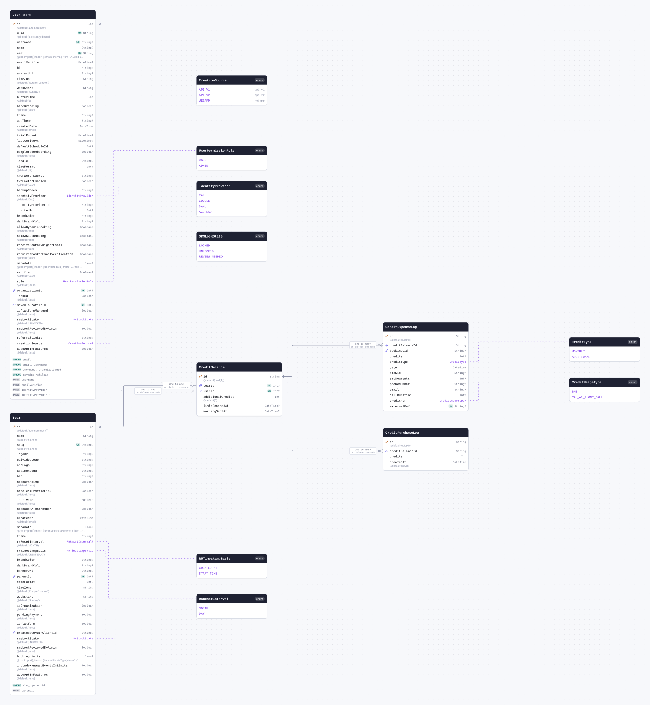

| Field               | Type       | Constraints                          | Default   | Description |
| ------------------- | ---------- | ------------------------------------ | --------- | ----------- |
| `id`                | `String`   | PK NOT NULL                          | `uuid(4)` |             |
| `teamId`            | `Int`      | UNIQUE NULL → [Team.id](#model-Team) |           |             |
| `userId`            | `Int`      | UNIQUE NULL → [User.id](#model-User) |           |             |
| `additionalCredits` | `Int`      | NOT NULL                             | `0`       |             |
| `limitReachedAt`    | `DateTime` | NULL                                 |           |             |
| `warningSentAt`     | `DateTime` | NULL                                 |           |             |

#### References

- `teamId` → [Team.id](#model-Team) (one-to-one, on delete Cascade)
- `userId` → [User.id](#model-User) (one-to-one, on delete Cascade)

#### Referenced by

- `id` ← [CreditPurchaseLog.creditBalanceId](#model-CreditPurchaseLog) (one-to-many, on delete Cascade)
- `id` ← [CreditExpenseLog.creditBalanceId](#model-CreditExpenseLog) (one-to-many, on delete Cascade)

#### Definition

```sql
CREATE TABLE "CreditBalance" (
    "id" TEXT NOT NULL,
    "teamId" INTEGER,
    "userId" INTEGER,
    "additionalCredits" INTEGER NOT NULL DEFAULT 0,
    "limitReachedAt" TIMESTAMP(3),
    "warningSentAt" TIMESTAMP(3),

    CONSTRAINT "CreditBalance_pkey" PRIMARY KEY ("id")
);

CREATE UNIQUE INDEX "CreditBalance_teamId_key" ON "CreditBalance"("teamId");

CREATE UNIQUE INDEX "CreditBalance_userId_key" ON "CreditBalance"("userId");

ALTER TABLE "CreditBalance" ADD CONSTRAINT "CreditBalance_teamId_fkey" FOREIGN KEY ("teamId") REFERENCES "Team"("id") ON DELETE CASCADE ON UPDATE CASCADE;

ALTER TABLE "CreditBalance" ADD CONSTRAINT "CreditBalance_userId_fkey" FOREIGN KEY ("userId") REFERENCES "users"("id") ON DELETE CASCADE ON UPDATE CASCADE;
```

<details>
<summary>Queries and their SQL</summary>

**findMany**: Every row

```ts
await prisma.creditBalance.findMany();
```

```sql
SELECT
  "public"."CreditBalance"."id",
  "public"."CreditBalance"."teamId",
  "public"."CreditBalance"."userId",
  "public"."CreditBalance"."additionalCredits",
  "public"."CreditBalance"."limitReachedAt",
  "public"."CreditBalance"."warningSentAt"
FROM
  "public"."CreditBalance"
WHERE
  1 = 1
OFFSET
  $1
-- params: ["0"]
```

**count**: How many rows there are

```ts
await prisma.creditBalance.count();
```

```sql
SELECT
  COUNT(*) AS "_count$_all"
FROM
  (
    SELECT
      "public"."CreditBalance"."id"
    FROM
      "public"."CreditBalance"
    WHERE
      1 = 1
    OFFSET
      $1
  ) AS "sub"
-- params: ["0"]
```

**findMany**: Every row with its relations

```ts
await prisma.creditBalance.findMany({
  include: { team: true, user: true, expenseLogs: true, purchaseLogs: true },
});
```

```sql
SELECT
  "public"."CreditBalance"."id",
  "public"."CreditBalance"."teamId",
  "public"."CreditBalance"."userId",
  "public"."CreditBalance"."additionalCredits",
  "public"."CreditBalance"."limitReachedAt",
  "public"."CreditBalance"."warningSentAt"
FROM
  "public"."CreditBalance"
WHERE
  1 = 1
OFFSET
  $1
-- params: ["0"]

SELECT
  "public"."Team"."id",
  "public"."Team"."name",
  "public"."Team"."slug",
  "public"."Team"."logoUrl",
  "public"."Team"."calVideoLogo",
  "public"."Team"."appLogo",
  "public"."Team"."appIconLogo",
  "public"."Team"."bio",
  "public"."Team"."hideBranding",
  "public"."Team"."hideTeamProfileLink",
  "public"."Team"."isPrivate",
  "public"."Team"."hideBookATeamMember",
  "public"."Team"."createdAt",
  "public"."Team"."metadata",
  "public"."Team"."theme",
  "public"."Team"."rrResetInterval"::text,
  "public"."Team"."rrTimestampBasis"::text,
  "public"."Team"."brandColor",
  "public"."Team"."darkBrandColor",
  "public"."Team"."bannerUrl",
  "public"."Team"."parentId",
  "public"."Team"."timeFormat",
  "public"."Team"."timeZone",
  "public"."Team"."weekStart",
  "public"."Team"."isOrganization",
  "public"."Team"."pendingPayment",
  "public"."Team"."isPlatform",
  "public"."Team"."createdByOAuthClientId",
  "public"."Team"."smsLockState"::text,
  "public"."Team"."smsLockReviewedByAdmin",
  "public"."Team"."bookingLimits",
  "public"."Team"."includeManagedEventsInLimits",
  "public"."Team"."autoOptInFeatures"
FROM
  "public"."Team"
WHERE
  "public"."Team"."id" IN ($1)
OFFSET
  $2
-- params: ["<teamId of the rows above>","0"]

SELECT
  "public"."users"."id",
  "public"."users"."uuid",
  "public"."users"."username",
  "public"."users"."name",
  "public"."users"."email",
  "public"."users"."emailVerified",
  "public"."users"."bio",
  "public"."users"."avatarUrl",
  "public"."users"."timeZone",
  "public"."users"."weekStart",
  "public"."users"."bufferTime",
  "public"."users"."hideBranding",
  "public"."users"."theme",
  "public"."users"."appTheme",
  "public"."users"."created",
  "public"."users"."trialEndsAt",
  "public"."users"."lastActiveAt",
  "public"."users"."defaultScheduleId",
  "public"."users"."completedOnboarding",
  "public"."users"."locale",
  "public"."users"."timeFormat",
  "public"."users"."twoFactorSecret",
  "public"."users"."twoFactorEnabled",
  "public"."users"."backupCodes",
  "public"."users"."identityProvider"::text,
  "public"."users"."identityProviderId",
  "public"."users"."invitedTo",
  "public"."users"."brandColor",
  "public"."users"."darkBrandColor",
  "public"."users"."allowDynamicBooking",
  "public"."users"."allowSEOIndexing",
  "public"."users"."receiveMonthlyDigestEmail",
  "public"."users"."requiresBookerEmailVerification",
  "public"."users"."metadata",
  "public"."users"."verified",
  "public"."users"."role"::text,
  "public"."users"."organizationId",
  "public"."users"."locked",
  "public"."users"."movedToProfileId",
  "public"."users"."isPlatformManaged",
  "public"."users"."smsLockState"::text,
  "public"."users"."smsLockReviewedByAdmin",
  "public"."users"."referralLinkId",
  "public"."users"."creationSource"::text,
  "public"."users"."autoOptInFeatures"
FROM
  "public"."users"
WHERE
  "public"."users"."id" IN ($1)
OFFSET
  $2
-- params: ["<userId of the rows above>","0"]

SELECT
  "public"."CreditExpenseLog"."id",
  "public"."CreditExpenseLog"."creditBalanceId",
  "public"."CreditExpenseLog"."bookingUid",
  "public"."CreditExpenseLog"."credits",
  "public"."CreditExpenseLog"."creditType"::text,
  "public"."CreditExpenseLog"."date",
  "public"."CreditExpenseLog"."smsSid",
  "public"."CreditExpenseLog"."smsSegments",
  "public"."CreditExpenseLog"."phoneNumber",
  "public"."CreditExpenseLog"."email",
  "public"."CreditExpenseLog"."callDuration",
  "public"."CreditExpenseLog"."creditFor"::text,
  "public"."CreditExpenseLog"."externalRef"
FROM
  "public"."CreditExpenseLog"
WHERE
  "public"."CreditExpenseLog"."creditBalanceId" IN ($1)
OFFSET
  $2
-- params: ["<id of the rows above>","0"]

SELECT
  "public"."CreditPurchaseLog"."id",
  "public"."CreditPurchaseLog"."creditBalanceId",
  "public"."CreditPurchaseLog"."credits",
  "public"."CreditPurchaseLog"."createdAt"
FROM
  "public"."CreditPurchaseLog"
WHERE
  "public"."CreditPurchaseLog"."creditBalanceId" IN ($1)
OFFSET
  $2
-- params: ["<id of the rows above>","0"]
```

**findUnique**: One row by what is unique to it

```ts
await prisma.creditBalance.findUnique({ where: { id: "example" } });
```

```sql
SELECT
  "public"."CreditBalance"."id",
  "public"."CreditBalance"."teamId",
  "public"."CreditBalance"."userId",
  "public"."CreditBalance"."additionalCredits",
  "public"."CreditBalance"."limitReachedAt",
  "public"."CreditBalance"."warningSentAt"
FROM
  "public"."CreditBalance"
WHERE
  (
    "public"."CreditBalance"."id" = $1
    AND 1 = 1
  )
LIMIT
  $2
OFFSET
  $3
-- params: ["example","1","0"]
```

**create**: Create a row

```ts
await prisma.creditBalance.create({ data: {} });
```

```sql
INSERT INTO
  "public"."CreditBalance" ("id", "additionalCredits")
VALUES
  ($1, $2)
RETURNING
  "public"."CreditBalance"."id",
  "public"."CreditBalance"."teamId",
  "public"."CreditBalance"."userId",
  "public"."CreditBalance"."additionalCredits",
  "public"."CreditBalance"."limitReachedAt",
  "public"."CreditBalance"."warningSentAt"
-- params: ["<uuid(4)>","0"]
```

**update**: Update a row

```ts
await prisma.creditBalance.update({ where: { id: "example" }, data: { additionalCredits: 1 } });
```

```sql
UPDATE "public"."CreditBalance"
SET
  "additionalCredits" = $1
WHERE
  (
    "public"."CreditBalance"."id" = $2
    AND 1 = 1
  )
RETURNING
  "public"."CreditBalance"."id",
  "public"."CreditBalance"."teamId",
  "public"."CreditBalance"."userId",
  "public"."CreditBalance"."additionalCredits",
  "public"."CreditBalance"."limitReachedAt",
  "public"."CreditBalance"."warningSentAt"
-- params: ["1","example"]
```

**delete**: Delete a row

```ts
await prisma.creditBalance.delete({ where: { id: "example" } });
```

```sql
DELETE FROM "public"."CreditBalance"
WHERE
  (
    "public"."CreditBalance"."id" = $1
    AND 1 = 1
  )
RETURNING
  "public"."CreditBalance"."id",
  "public"."CreditBalance"."teamId",
  "public"."CreditBalance"."userId",
  "public"."CreditBalance"."additionalCredits",
  "public"."CreditBalance"."limitReachedAt",
  "public"."CreditBalance"."warningSentAt"
-- params: ["example"]
```

</details>

<a id="model-CreditPurchaseLog"></a>

### CreditPurchaseLog

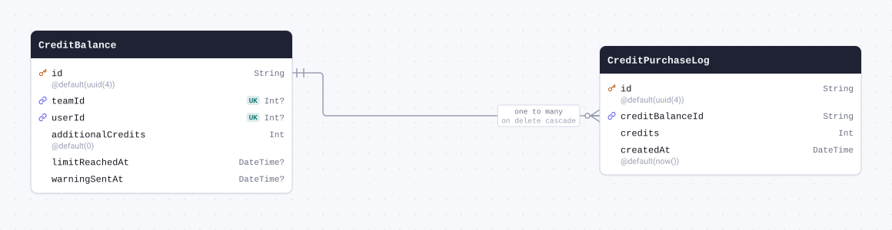

| Field             | Type       | Constraints                                         | Default   | Description |
| ----------------- | ---------- | --------------------------------------------------- | --------- | ----------- |
| `id`              | `String`   | PK NOT NULL                                         | `uuid(4)` |             |
| `creditBalanceId` | `String`   | NOT NULL → [CreditBalance.id](#model-CreditBalance) |           |             |
| `credits`         | `Int`      | NOT NULL                                            |           |             |
| `createdAt`       | `DateTime` | NOT NULL                                            | `now()`   |             |

#### References

- `creditBalanceId` → [CreditBalance.id](#model-CreditBalance) (many-to-one, on delete Cascade)

#### Definition

```sql
CREATE TABLE "CreditPurchaseLog" (
    "id" TEXT NOT NULL,
    "creditBalanceId" TEXT NOT NULL,
    "credits" INTEGER NOT NULL,
    "createdAt" TIMESTAMP(3) NOT NULL DEFAULT CURRENT_TIMESTAMP,

    CONSTRAINT "CreditPurchaseLog_pkey" PRIMARY KEY ("id")
);

ALTER TABLE "CreditPurchaseLog" ADD CONSTRAINT "CreditPurchaseLog_creditBalanceId_fkey" FOREIGN KEY ("creditBalanceId") REFERENCES "CreditBalance"("id") ON DELETE CASCADE ON UPDATE CASCADE;
```

<details>
<summary>Queries and their SQL</summary>

**findMany**: Every row

```ts
await prisma.creditPurchaseLog.findMany();
```

```sql
SELECT
  "public"."CreditPurchaseLog"."id",
  "public"."CreditPurchaseLog"."creditBalanceId",
  "public"."CreditPurchaseLog"."credits",
  "public"."CreditPurchaseLog"."createdAt"
FROM
  "public"."CreditPurchaseLog"
WHERE
  1 = 1
OFFSET
  $1
-- params: ["0"]
```

**count**: How many rows there are

```ts
await prisma.creditPurchaseLog.count();
```

```sql
SELECT
  COUNT(*) AS "_count$_all"
FROM
  (
    SELECT
      "public"."CreditPurchaseLog"."id"
    FROM
      "public"."CreditPurchaseLog"
    WHERE
      1 = 1
    OFFSET
      $1
  ) AS "sub"
-- params: ["0"]
```

**findMany**: Every row with its relations

```ts
await prisma.creditPurchaseLog.findMany({ include: { creditBalance: true } });
```

```sql
SELECT
  "public"."CreditPurchaseLog"."id",
  "public"."CreditPurchaseLog"."creditBalanceId",
  "public"."CreditPurchaseLog"."credits",
  "public"."CreditPurchaseLog"."createdAt"
FROM
  "public"."CreditPurchaseLog"
WHERE
  1 = 1
OFFSET
  $1
-- params: ["0"]

SELECT
  "public"."CreditBalance"."id",
  "public"."CreditBalance"."teamId",
  "public"."CreditBalance"."userId",
  "public"."CreditBalance"."additionalCredits",
  "public"."CreditBalance"."limitReachedAt",
  "public"."CreditBalance"."warningSentAt"
FROM
  "public"."CreditBalance"
WHERE
  "public"."CreditBalance"."id" IN ($1)
OFFSET
  $2
-- params: ["<creditBalanceId of the rows above>","0"]
```

**findUnique**: One row by what is unique to it

```ts
await prisma.creditPurchaseLog.findUnique({ where: { id: "example" } });
```

```sql
SELECT
  "public"."CreditPurchaseLog"."id",
  "public"."CreditPurchaseLog"."creditBalanceId",
  "public"."CreditPurchaseLog"."credits",
  "public"."CreditPurchaseLog"."createdAt"
FROM
  "public"."CreditPurchaseLog"
WHERE
  (
    "public"."CreditPurchaseLog"."id" = $1
    AND 1 = 1
  )
LIMIT
  $2
OFFSET
  $3
-- params: ["example","1","0"]
```

**create**: Create a row

```ts
await prisma.creditPurchaseLog.create({ data: { creditBalanceId: "example", credits: 1 } });
```

```sql
INSERT INTO
  "public"."CreditPurchaseLog" ("id", "creditBalanceId", "credits", "createdAt")
VALUES
  ($1, $2, $3, $4)
RETURNING
  "public"."CreditPurchaseLog"."id",
  "public"."CreditPurchaseLog"."creditBalanceId",
  "public"."CreditPurchaseLog"."credits",
  "public"."CreditPurchaseLog"."createdAt"
-- params: ["<uuid(4)>","example","1","<now()>"]
```

**update**: Update a row

```ts
await prisma.creditPurchaseLog.update({ where: { id: "example" }, data: { credits: 1 } });
```

```sql
UPDATE "public"."CreditPurchaseLog"
SET
  "credits" = $1
WHERE
  (
    "public"."CreditPurchaseLog"."id" = $2
    AND 1 = 1
  )
RETURNING
  "public"."CreditPurchaseLog"."id",
  "public"."CreditPurchaseLog"."creditBalanceId",
  "public"."CreditPurchaseLog"."credits",
  "public"."CreditPurchaseLog"."createdAt"
-- params: ["1","example"]
```

**delete**: Delete a row

```ts
await prisma.creditPurchaseLog.delete({ where: { id: "example" } });
```

```sql
DELETE FROM "public"."CreditPurchaseLog"
WHERE
  (
    "public"."CreditPurchaseLog"."id" = $1
    AND 1 = 1
  )
RETURNING
  "public"."CreditPurchaseLog"."id",
  "public"."CreditPurchaseLog"."creditBalanceId",
  "public"."CreditPurchaseLog"."credits",
  "public"."CreditPurchaseLog"."createdAt"
-- params: ["example"]
```

</details>

<a id="model-CreditExpenseLog"></a>

### CreditExpenseLog

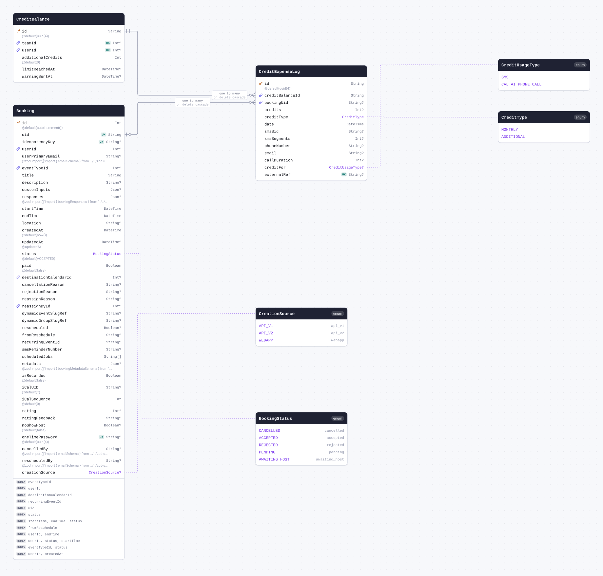

| Field             | Type                                       | Constraints                                         | Default   | Description |
| ----------------- | ------------------------------------------ | --------------------------------------------------- | --------- | ----------- |
| `id`              | `String`                                   | PK NOT NULL                                         | `uuid(4)` |             |
| `creditBalanceId` | `String`                                   | NOT NULL → [CreditBalance.id](#model-CreditBalance) |           |             |
| `bookingUid`      | `String`                                   | NULL → [Booking.uid](#model-Booking)                |           |             |
| `credits`         | `Int`                                      | NULL                                                |           |             |
| `creditType`      | [`CreditType`](#enum-CreditType)           | NOT NULL                                            |           |             |
| `date`            | `DateTime`                                 | NOT NULL                                            |           |             |
| `smsSid`          | `String`                                   | NULL                                                |           |             |
| `smsSegments`     | `Int`                                      | NULL                                                |           |             |
| `phoneNumber`     | `String`                                   | NULL                                                |           |             |
| `email`           | `String`                                   | NULL                                                |           |             |
| `callDuration`    | `Int`                                      | NULL                                                |           |             |
| `creditFor`       | [`CreditUsageType`](#enum-CreditUsageType) | NULL                                                |           |             |
| `externalRef`     | `String`                                   | UNIQUE NULL                                         |           |             |

#### References

- `creditBalanceId` → [CreditBalance.id](#model-CreditBalance) (many-to-one, on delete Cascade)
- `bookingUid` → [Booking.uid](#model-Booking) (many-to-one, on delete Cascade)

#### Definition

```sql
CREATE TABLE "CreditExpenseLog" (
    "id" TEXT NOT NULL,
    "creditBalanceId" TEXT NOT NULL,
    "bookingUid" TEXT,
    "credits" INTEGER,
    "creditType" "CreditType" NOT NULL,
    "date" TIMESTAMP(3) NOT NULL,
    "smsSid" TEXT,
    "smsSegments" INTEGER,
    "phoneNumber" TEXT,
    "email" TEXT,
    "callDuration" INTEGER,
    "creditFor" "CreditUsageType",
    "externalRef" TEXT,

    CONSTRAINT "CreditExpenseLog_pkey" PRIMARY KEY ("id")
);

CREATE UNIQUE INDEX "CreditExpenseLog_externalRef_key" ON "CreditExpenseLog"("externalRef");

ALTER TABLE "CreditExpenseLog" ADD CONSTRAINT "CreditExpenseLog_creditBalanceId_fkey" FOREIGN KEY ("creditBalanceId") REFERENCES "CreditBalance"("id") ON DELETE CASCADE ON UPDATE CASCADE;

ALTER TABLE "CreditExpenseLog" ADD CONSTRAINT "CreditExpenseLog_bookingUid_fkey" FOREIGN KEY ("bookingUid") REFERENCES "Booking"("uid") ON DELETE CASCADE ON UPDATE CASCADE;
```

<details>
<summary>Queries and their SQL</summary>

**findMany**: Every row

```ts
await prisma.creditExpenseLog.findMany();
```

```sql
SELECT
  "public"."CreditExpenseLog"."id",
  "public"."CreditExpenseLog"."creditBalanceId",
  "public"."CreditExpenseLog"."bookingUid",
  "public"."CreditExpenseLog"."credits",
  "public"."CreditExpenseLog"."creditType"::text,
  "public"."CreditExpenseLog"."date",
  "public"."CreditExpenseLog"."smsSid",
  "public"."CreditExpenseLog"."smsSegments",
  "public"."CreditExpenseLog"."phoneNumber",
  "public"."CreditExpenseLog"."email",
  "public"."CreditExpenseLog"."callDuration",
  "public"."CreditExpenseLog"."creditFor"::text,
  "public"."CreditExpenseLog"."externalRef"
FROM
  "public"."CreditExpenseLog"
WHERE
  1 = 1
OFFSET
  $1
-- params: ["0"]
```

**count**: How many rows there are

```ts
await prisma.creditExpenseLog.count();
```

```sql
SELECT
  COUNT(*) AS "_count$_all"
FROM
  (
    SELECT
      "public"."CreditExpenseLog"."id"
    FROM
      "public"."CreditExpenseLog"
    WHERE
      1 = 1
    OFFSET
      $1
  ) AS "sub"
-- params: ["0"]
```

**findMany**: Every row with its relations

```ts
await prisma.creditExpenseLog.findMany({ include: { creditBalance: true, booking: true } });
```

```sql
SELECT
  "public"."CreditExpenseLog"."id",
  "public"."CreditExpenseLog"."creditBalanceId",
  "public"."CreditExpenseLog"."bookingUid",
  "public"."CreditExpenseLog"."credits",
  "public"."CreditExpenseLog"."creditType"::text,
  "public"."CreditExpenseLog"."date",
  "public"."CreditExpenseLog"."smsSid",
  "public"."CreditExpenseLog"."smsSegments",
  "public"."CreditExpenseLog"."phoneNumber",
  "public"."CreditExpenseLog"."email",
  "public"."CreditExpenseLog"."callDuration",
  "public"."CreditExpenseLog"."creditFor"::text,
  "public"."CreditExpenseLog"."externalRef"
FROM
  "public"."CreditExpenseLog"
WHERE
  1 = 1
OFFSET
  $1
-- params: ["0"]

SELECT
  "public"."CreditBalance"."id",
  "public"."CreditBalance"."teamId",
  "public"."CreditBalance"."userId",
  "public"."CreditBalance"."additionalCredits",
  "public"."CreditBalance"."limitReachedAt",
  "public"."CreditBalance"."warningSentAt"
FROM
  "public"."CreditBalance"
WHERE
  "public"."CreditBalance"."id" IN ($1)
OFFSET
  $2
-- params: ["<creditBalanceId of the rows above>","0"]

SELECT
  "public"."Booking"."id",
  "public"."Booking"."uid",
  "public"."Booking"."idempotencyKey",
  "public"."Booking"."userId",
  "public"."Booking"."userPrimaryEmail",
  "public"."Booking"."eventTypeId",
  "public"."Booking"."title",
  "public"."Booking"."description",
  "public"."Booking"."customInputs",
  "public"."Booking"."responses",
  "public"."Booking"."startTime",
  "public"."Booking"."endTime",
  "public"."Booking"."location",
  "public"."Booking"."createdAt",
  "public"."Booking"."updatedAt",
  "public"."Booking"."status"::text,
  "public"."Booking"."paid",
  "public"."Booking"."destinationCalendarId",
  "public"."Booking"."cancellationReason",
  "public"."Booking"."rejectionReason",
  "public"."Booking"."reassignReason",
  "public"."Booking"."reassignById",
  "public"."Booking"."dynamicEventSlugRef",
  "public"."Booking"."dynamicGroupSlugRef",
  "public"."Booking"."rescheduled",
  "public"."Booking"."fromReschedule",
  "public"."Booking"."recurringEventId",
  "public"."Booking"."smsReminderNumber",
  "public"."Booking"."scheduledJobs",
  "public"."Booking"."metadata",
  "public"."Booking"."isRecorded",
  "public"."Booking"."iCalUID",
  "public"."Booking"."iCalSequence",
  "public"."Booking"."rating",
  "public"."Booking"."ratingFeedback",
  "public"."Booking"."noShowHost",
  "public"."Booking"."oneTimePassword",
  "public"."Booking"."cancelledBy",
  "public"."Booking"."rescheduledBy",
  "public"."Booking"."creationSource"::text
FROM
  "public"."Booking"
WHERE
  "public"."Booking"."uid" IN ($1)
OFFSET
  $2
-- params: ["<bookingUid of the rows above>","0"]
```

**findUnique**: One row by what is unique to it

```ts
await prisma.creditExpenseLog.findUnique({ where: { id: "example" } });
```

```sql
SELECT
  "public"."CreditExpenseLog"."id",
  "public"."CreditExpenseLog"."creditBalanceId",
  "public"."CreditExpenseLog"."bookingUid",
  "public"."CreditExpenseLog"."credits",
  "public"."CreditExpenseLog"."creditType"::text,
  "public"."CreditExpenseLog"."date",
  "public"."CreditExpenseLog"."smsSid",
  "public"."CreditExpenseLog"."smsSegments",
  "public"."CreditExpenseLog"."phoneNumber",
  "public"."CreditExpenseLog"."email",
  "public"."CreditExpenseLog"."callDuration",
  "public"."CreditExpenseLog"."creditFor"::text,
  "public"."CreditExpenseLog"."externalRef"
FROM
  "public"."CreditExpenseLog"
WHERE
  (
    "public"."CreditExpenseLog"."id" = $1
    AND 1 = 1
  )
LIMIT
  $2
OFFSET
  $3
-- params: ["example","1","0"]
```

**create**: Create a row

```ts
await prisma.creditExpenseLog.create({
  data: {
    creditBalanceId: "example",
    creditType: "MONTHLY",
    date: new Date("2026-01-01T00:00:00.000Z"),
  },
});
```

```sql
INSERT INTO
  "public"."CreditExpenseLog" ("id", "creditBalanceId", "creditType", "date")
VALUES
  (
    $1,
    $2,
    CAST($3::text AS "public"."CreditType"),
    $4
  )
RETURNING
  "public"."CreditExpenseLog"."id",
  "public"."CreditExpenseLog"."creditBalanceId",
  "public"."CreditExpenseLog"."bookingUid",
  "public"."CreditExpenseLog"."credits",
  "public"."CreditExpenseLog"."creditType"::text,
  "public"."CreditExpenseLog"."date",
  "public"."CreditExpenseLog"."smsSid",
  "public"."CreditExpenseLog"."smsSegments",
  "public"."CreditExpenseLog"."phoneNumber",
  "public"."CreditExpenseLog"."email",
  "public"."CreditExpenseLog"."callDuration",
  "public"."CreditExpenseLog"."creditFor"::text,
  "public"."CreditExpenseLog"."externalRef"
-- params: ["<uuid(4)>","example","MONTHLY","2026-01-01T00:00:00.000Z"]
```

**update**: Update a row

```ts
await prisma.creditExpenseLog.update({ where: { id: "example" }, data: { credits: 1 } });
```

```sql
UPDATE "public"."CreditExpenseLog"
SET
  "credits" = $1
WHERE
  (
    "public"."CreditExpenseLog"."id" = $2
    AND 1 = 1
  )
RETURNING
  "public"."CreditExpenseLog"."id",
  "public"."CreditExpenseLog"."creditBalanceId",
  "public"."CreditExpenseLog"."bookingUid",
  "public"."CreditExpenseLog"."credits",
  "public"."CreditExpenseLog"."creditType"::text,
  "public"."CreditExpenseLog"."date",
  "public"."CreditExpenseLog"."smsSid",
  "public"."CreditExpenseLog"."smsSegments",
  "public"."CreditExpenseLog"."phoneNumber",
  "public"."CreditExpenseLog"."email",
  "public"."CreditExpenseLog"."callDuration",
  "public"."CreditExpenseLog"."creditFor"::text,
  "public"."CreditExpenseLog"."externalRef"
-- params: ["1","example"]
```

**delete**: Delete a row

```ts
await prisma.creditExpenseLog.delete({ where: { id: "example" } });
```

```sql
DELETE FROM "public"."CreditExpenseLog"
WHERE
  (
    "public"."CreditExpenseLog"."id" = $1
    AND 1 = 1
  )
RETURNING
  "public"."CreditExpenseLog"."id",
  "public"."CreditExpenseLog"."creditBalanceId",
  "public"."CreditExpenseLog"."bookingUid",
  "public"."CreditExpenseLog"."credits",
  "public"."CreditExpenseLog"."creditType"::text,
  "public"."CreditExpenseLog"."date",
  "public"."CreditExpenseLog"."smsSid",
  "public"."CreditExpenseLog"."smsSegments",
  "public"."CreditExpenseLog"."phoneNumber",
  "public"."CreditExpenseLog"."email",
  "public"."CreditExpenseLog"."callDuration",
  "public"."CreditExpenseLog"."creditFor"::text,
  "public"."CreditExpenseLog"."externalRef"
-- params: ["example"]
```

</details>

<a id="model-OrganizationSettings"></a>

### OrganizationSettings

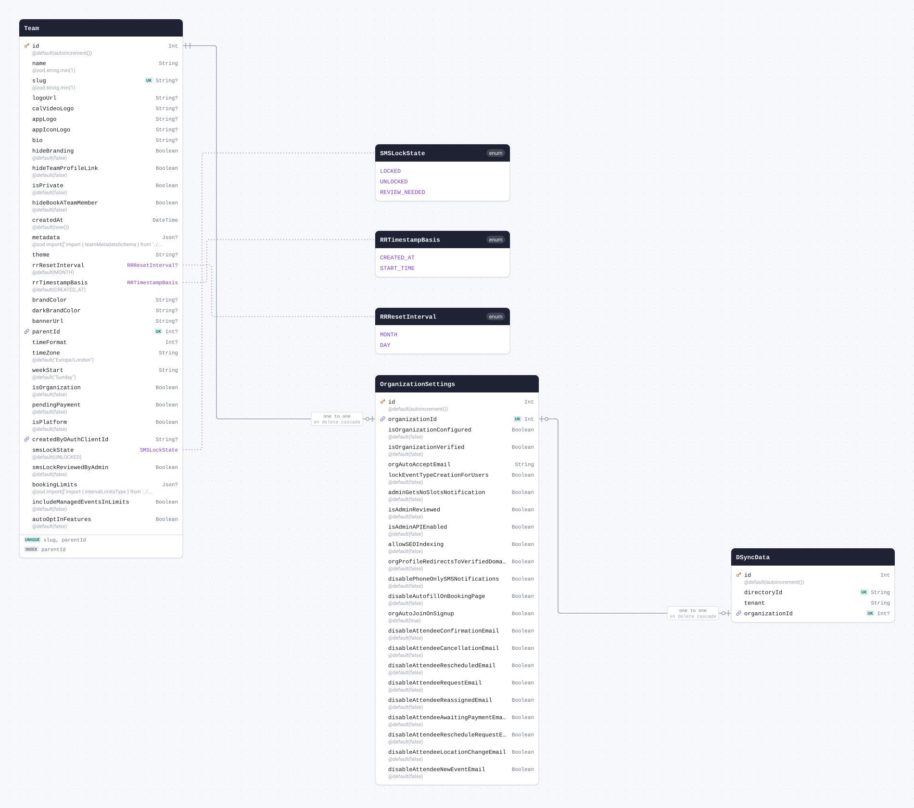

| Field                                   | Type      | Constraints                              | Default           | Description |
| --------------------------------------- | --------- | ---------------------------------------- | ----------------- | ----------- |
| `id`                                    | `Int`     | PK NOT NULL                              | `autoincrement()` |             |
| `organizationId`                        | `Int`     | UNIQUE NOT NULL → [Team.id](#model-Team) |                   |             |
| `isOrganizationConfigured`              | `Boolean` | NOT NULL                                 | `false`           |             |
| `isOrganizationVerified`                | `Boolean` | NOT NULL                                 | `false`           |             |
| `orgAutoAcceptEmail`                    | `String`  | NOT NULL                                 |                   |             |
| `lockEventTypeCreationForUsers`         | `Boolean` | NOT NULL                                 | `false`           |             |
| `adminGetsNoSlotsNotification`          | `Boolean` | NOT NULL                                 | `false`           |             |
| `isAdminReviewed`                       | `Boolean` | NOT NULL                                 | `false`           |             |
| `isAdminAPIEnabled`                     | `Boolean` | NOT NULL                                 | `false`           |             |
| `allowSEOIndexing`                      | `Boolean` | NOT NULL                                 | `false`           |             |
| `orgProfileRedirectsToVerifiedDomain`   | `Boolean` | NOT NULL                                 | `false`           |             |
| `disablePhoneOnlySMSNotifications`      | `Boolean` | NOT NULL                                 | `false`           |             |
| `disableAutofillOnBookingPage`          | `Boolean` | NOT NULL                                 | `false`           |             |
| `orgAutoJoinOnSignup`                   | `Boolean` | NOT NULL                                 | `true`            |             |
| `disableAttendeeConfirmationEmail`      | `Boolean` | NOT NULL                                 | `false`           |             |
| `disableAttendeeCancellationEmail`      | `Boolean` | NOT NULL                                 | `false`           |             |
| `disableAttendeeRescheduledEmail`       | `Boolean` | NOT NULL                                 | `false`           |             |
| `disableAttendeeRequestEmail`           | `Boolean` | NOT NULL                                 | `false`           |             |
| `disableAttendeeReassignedEmail`        | `Boolean` | NOT NULL                                 | `false`           |             |
| `disableAttendeeAwaitingPaymentEmail`   | `Boolean` | NOT NULL                                 | `false`           |             |
| `disableAttendeeRescheduleRequestEmail` | `Boolean` | NOT NULL                                 | `false`           |             |
| `disableAttendeeLocationChangeEmail`    | `Boolean` | NOT NULL                                 | `false`           |             |
| `disableAttendeeNewEventEmail`          | `Boolean` | NOT NULL                                 | `false`           |             |

#### References

- `organizationId` → [Team.id](#model-Team) (one-to-one, on delete Cascade)

#### Referenced by

- `organizationId` ← [DSyncData.organizationId](#model-DSyncData) (one-to-one, on delete Cascade)

#### Definition

```sql
CREATE TABLE "OrganizationSettings" (
    "id" SERIAL NOT NULL,
    "organizationId" INTEGER NOT NULL,
    "isOrganizationConfigured" BOOLEAN NOT NULL DEFAULT false,
    "isOrganizationVerified" BOOLEAN NOT NULL DEFAULT false,
    "orgAutoAcceptEmail" TEXT NOT NULL,
    "lockEventTypeCreationForUsers" BOOLEAN NOT NULL DEFAULT false,
    "adminGetsNoSlotsNotification" BOOLEAN NOT NULL DEFAULT false,
    "isAdminReviewed" BOOLEAN NOT NULL DEFAULT false,
    "isAdminAPIEnabled" BOOLEAN NOT NULL DEFAULT false,
    "allowSEOIndexing" BOOLEAN NOT NULL DEFAULT false,
    "orgProfileRedirectsToVerifiedDomain" BOOLEAN NOT NULL DEFAULT false,
    "disablePhoneOnlySMSNotifications" BOOLEAN NOT NULL DEFAULT false,
    "disableAutofillOnBookingPage" BOOLEAN NOT NULL DEFAULT false,
    "orgAutoJoinOnSignup" BOOLEAN NOT NULL DEFAULT true,
    "disableAttendeeConfirmationEmail" BOOLEAN NOT NULL DEFAULT false,
    "disableAttendeeCancellationEmail" BOOLEAN NOT NULL DEFAULT false,
    "disableAttendeeRescheduledEmail" BOOLEAN NOT NULL DEFAULT false,
    "disableAttendeeRequestEmail" BOOLEAN NOT NULL DEFAULT false,
    "disableAttendeeReassignedEmail" BOOLEAN NOT NULL DEFAULT false,
    "disableAttendeeAwaitingPaymentEmail" BOOLEAN NOT NULL DEFAULT false,
    "disableAttendeeRescheduleRequestEmail" BOOLEAN NOT NULL DEFAULT false,
    "disableAttendeeLocationChangeEmail" BOOLEAN NOT NULL DEFAULT false,
    "disableAttendeeNewEventEmail" BOOLEAN NOT NULL DEFAULT false,

    CONSTRAINT "OrganizationSettings_pkey" PRIMARY KEY ("id")
);

CREATE UNIQUE INDEX "OrganizationSettings_organizationId_key" ON "OrganizationSettings"("organizationId");

ALTER TABLE "OrganizationSettings" ADD CONSTRAINT "OrganizationSettings_organizationId_fkey" FOREIGN KEY ("organizationId") REFERENCES "Team"("id") ON DELETE CASCADE ON UPDATE CASCADE;
```

<details>
<summary>Queries and their SQL</summary>

**findMany**: Every row

```ts
await prisma.organizationSettings.findMany();
```

```sql
SELECT
  "public"."OrganizationSettings"."id",
  "public"."OrganizationSettings"."organizationId",
  "public"."OrganizationSettings"."isOrganizationConfigured",
  "public"."OrganizationSettings"."isOrganizationVerified",
  "public"."OrganizationSettings"."orgAutoAcceptEmail",
  "public"."OrganizationSettings"."lockEventTypeCreationForUsers",
  "public"."OrganizationSettings"."adminGetsNoSlotsNotification",
  "public"."OrganizationSettings"."isAdminReviewed",
  "public"."OrganizationSettings"."isAdminAPIEnabled",
  "public"."OrganizationSettings"."allowSEOIndexing",
  "public"."OrganizationSettings"."orgProfileRedirectsToVerifiedDomain",
  "public"."OrganizationSettings"."disablePhoneOnlySMSNotifications",
  "public"."OrganizationSettings"."disableAutofillOnBookingPage",
  "public"."OrganizationSettings"."orgAutoJoinOnSignup",
  "public"."OrganizationSettings"."disableAttendeeConfirmationEmail",
  "public"."OrganizationSettings"."disableAttendeeCancellationEmail",
  "public"."OrganizationSettings"."disableAttendeeRescheduledEmail",
  "public"."OrganizationSettings"."disableAttendeeRequestEmail",
  "public"."OrganizationSettings"."disableAttendeeReassignedEmail",
  "public"."OrganizationSettings"."disableAttendeeAwaitingPaymentEmail",
  "public"."OrganizationSettings"."disableAttendeeRescheduleRequestEmail",
  "public"."OrganizationSettings"."disableAttendeeLocationChangeEmail",
  "public"."OrganizationSettings"."disableAttendeeNewEventEmail"
FROM
  "public"."OrganizationSettings"
WHERE
  1 = 1
OFFSET
  $1
-- params: ["0"]
```

**count**: How many rows there are

```ts
await prisma.organizationSettings.count();
```

```sql
SELECT
  COUNT(*) AS "_count$_all"
FROM
  (
    SELECT
      "public"."OrganizationSettings"."id"
    FROM
      "public"."OrganizationSettings"
    WHERE
      1 = 1
    OFFSET
      $1
  ) AS "sub"
-- params: ["0"]
```

**findMany**: Every row with its relations

```ts
await prisma.organizationSettings.findMany({ include: { organization: true, dSyncData: true } });
```

```sql
SELECT
  "public"."OrganizationSettings"."id",
  "public"."OrganizationSettings"."organizationId",
  "public"."OrganizationSettings"."isOrganizationConfigured",
  "public"."OrganizationSettings"."isOrganizationVerified",
  "public"."OrganizationSettings"."orgAutoAcceptEmail",
  "public"."OrganizationSettings"."lockEventTypeCreationForUsers",
  "public"."OrganizationSettings"."adminGetsNoSlotsNotification",
  "public"."OrganizationSettings"."isAdminReviewed",
  "public"."OrganizationSettings"."isAdminAPIEnabled",
  "public"."OrganizationSettings"."allowSEOIndexing",
  "public"."OrganizationSettings"."orgProfileRedirectsToVerifiedDomain",
  "public"."OrganizationSettings"."disablePhoneOnlySMSNotifications",
  "public"."OrganizationSettings"."disableAutofillOnBookingPage",
  "public"."OrganizationSettings"."orgAutoJoinOnSignup",
  "public"."OrganizationSettings"."disableAttendeeConfirmationEmail",
  "public"."OrganizationSettings"."disableAttendeeCancellationEmail",
  "public"."OrganizationSettings"."disableAttendeeRescheduledEmail",
  "public"."OrganizationSettings"."disableAttendeeRequestEmail",
  "public"."OrganizationSettings"."disableAttendeeReassignedEmail",
  "public"."OrganizationSettings"."disableAttendeeAwaitingPaymentEmail",
  "public"."OrganizationSettings"."disableAttendeeRescheduleRequestEmail",
  "public"."OrganizationSettings"."disableAttendeeLocationChangeEmail",
  "public"."OrganizationSettings"."disableAttendeeNewEventEmail"
FROM
  "public"."OrganizationSettings"
WHERE
  1 = 1
OFFSET
  $1
-- params: ["0"]

SELECT
  "public"."Team"."id",
  "public"."Team"."name",
  "public"."Team"."slug",
  "public"."Team"."logoUrl",
  "public"."Team"."calVideoLogo",
  "public"."Team"."appLogo",
  "public"."Team"."appIconLogo",
  "public"."Team"."bio",
  "public"."Team"."hideBranding",
  "public"."Team"."hideTeamProfileLink",
  "public"."Team"."isPrivate",
  "public"."Team"."hideBookATeamMember",
  "public"."Team"."createdAt",
  "public"."Team"."metadata",
  "public"."Team"."theme",
  "public"."Team"."rrResetInterval"::text,
  "public"."Team"."rrTimestampBasis"::text,
  "public"."Team"."brandColor",
  "public"."Team"."darkBrandColor",
  "public"."Team"."bannerUrl",
  "public"."Team"."parentId",
  "public"."Team"."timeFormat",
  "public"."Team"."timeZone",
  "public"."Team"."weekStart",
  "public"."Team"."isOrganization",
  "public"."Team"."pendingPayment",
  "public"."Team"."isPlatform",
  "public"."Team"."createdByOAuthClientId",
  "public"."Team"."smsLockState"::text,
  "public"."Team"."smsLockReviewedByAdmin",
  "public"."Team"."bookingLimits",
  "public"."Team"."includeManagedEventsInLimits",
  "public"."Team"."autoOptInFeatures"
FROM
  "public"."Team"
WHERE
  "public"."Team"."id" IN ($1)
OFFSET
  $2
-- params: ["<organizationId of the rows above>","0"]

SELECT
  "public"."DSyncData"."id",
  "public"."DSyncData"."directoryId",
  "public"."DSyncData"."tenant",
  "public"."DSyncData"."organizationId"
FROM
  "public"."DSyncData"
WHERE
  "public"."DSyncData"."organizationId" IN ($1)
OFFSET
  $2
-- params: ["<organizationId of the rows above>","0"]
```

**findUnique**: One row by what is unique to it

```ts
await prisma.organizationSettings.findUnique({ where: { id: 1 } });
```

```sql
SELECT
  "public"."OrganizationSettings"."id",
  "public"."OrganizationSettings"."organizationId",
  "public"."OrganizationSettings"."isOrganizationConfigured",
  "public"."OrganizationSettings"."isOrganizationVerified",
  "public"."OrganizationSettings"."orgAutoAcceptEmail",
  "public"."OrganizationSettings"."lockEventTypeCreationForUsers",
  "public"."OrganizationSettings"."adminGetsNoSlotsNotification",
  "public"."OrganizationSettings"."isAdminReviewed",
  "public"."OrganizationSettings"."isAdminAPIEnabled",
  "public"."OrganizationSettings"."allowSEOIndexing",
  "public"."OrganizationSettings"."orgProfileRedirectsToVerifiedDomain",
  "public"."OrganizationSettings"."disablePhoneOnlySMSNotifications",
  "public"."OrganizationSettings"."disableAutofillOnBookingPage",
  "public"."OrganizationSettings"."orgAutoJoinOnSignup",
  "public"."OrganizationSettings"."disableAttendeeConfirmationEmail",
  "public"."OrganizationSettings"."disableAttendeeCancellationEmail",
  "public"."OrganizationSettings"."disableAttendeeRescheduledEmail",
  "public"."OrganizationSettings"."disableAttendeeRequestEmail",
  "public"."OrganizationSettings"."disableAttendeeReassignedEmail",
  "public"."OrganizationSettings"."disableAttendeeAwaitingPaymentEmail",
  "public"."OrganizationSettings"."disableAttendeeRescheduleRequestEmail",
  "public"."OrganizationSettings"."disableAttendeeLocationChangeEmail",
  "public"."OrganizationSettings"."disableAttendeeNewEventEmail"
FROM
  "public"."OrganizationSettings"
WHERE
  (
    "public"."OrganizationSettings"."id" = $1
    AND 1 = 1
  )
LIMIT
  $2
OFFSET
  $3
-- params: ["1","1","0"]
```

**create**: Create a row

```ts
await prisma.organizationSettings.create({
  data: { organizationId: 1, orgAutoAcceptEmail: "example" },
});
```

```sql
INSERT INTO
  "public"."OrganizationSettings" (
    "organizationId",
    "isOrganizationConfigured",
    "isOrganizationVerified",
    "orgAutoAcceptEmail",
    "lockEventTypeCreationForUsers",
    "adminGetsNoSlotsNotification",
    "isAdminReviewed",
    "isAdminAPIEnabled",
    "allowSEOIndexing",
    "orgProfileRedirectsToVerifiedDomain",
    "disablePhoneOnlySMSNotifications",
    "disableAutofillOnBookingPage",
    "orgAutoJoinOnSignup",
    "disableAttendeeConfirmationEmail",
    "disableAttendeeCancellationEmail",
    "disableAttendeeRescheduledEmail",
    "disableAttendeeRequestEmail",
    "disableAttendeeReassignedEmail",
    "disableAttendeeAwaitingPaymentEmail",
    "disableAttendeeRescheduleRequestEmail",
    "disableAttendeeLocationChangeEmail",
    "disableAttendeeNewEventEmail"
  )
VALUES
  (
    $1,
    $2,
    $3,
    $4,
    $5,
    $6,
    $7,
    $8,
    $9,
    $10,
    $11,
    $12,
    $13,
    $14,
    $15,
    $16,
    $17,
    $18,
    $19,
    $20,
    $21,
    $22
  )
RETURNING
  "public"."OrganizationSettings"."id",
  "public"."OrganizationSettings"."organizationId",
  "public"."OrganizationSettings"."isOrganizationConfigured",
  "public"."OrganizationSettings"."isOrganizationVerified",
  "public"."OrganizationSettings"."orgAutoAcceptEmail",
  "public"."OrganizationSettings"."lockEventTypeCreationForUsers",
  "public"."OrganizationSettings"."adminGetsNoSlotsNotification",
  "public"."OrganizationSettings"."isAdminReviewed",
  "public"."OrganizationSettings"."isAdminAPIEnabled",
  "public"."OrganizationSettings"."allowSEOIndexing",
  "public"."OrganizationSettings"."orgProfileRedirectsToVerifiedDomain",
  "public"."OrganizationSettings"."disablePhoneOnlySMSNotifications",
  "public"."OrganizationSettings"."disableAutofillOnBookingPage",
  "public"."OrganizationSettings"."orgAutoJoinOnSignup",
  "public"."OrganizationSettings"."disableAttendeeConfirmationEmail",
  "public"."OrganizationSettings"."disableAttendeeCancellationEmail",
  "public"."OrganizationSettings"."disableAttendeeRescheduledEmail",
  "public"."OrganizationSettings"."disableAttendeeRequestEmail",
  "public"."OrganizationSettings"."disableAttendeeReassignedEmail",
  "public"."OrganizationSettings"."disableAttendeeAwaitingPaymentEmail",
  "public"."OrganizationSettings"."disableAttendeeRescheduleRequestEmail",
  "public"."OrganizationSettings"."disableAttendeeLocationChangeEmail",
  "public"."OrganizationSettings"."disableAttendeeNewEventEmail"
-- params: ["1",false,false,"example",false,false,false,false,false,false,false,false,true,false,false,false,false,false,false,false,false,false]
```

**update**: Update a row

```ts
await prisma.organizationSettings.update({
  where: { id: 1 },
  data: { isOrganizationConfigured: true },
});
```

```sql
UPDATE "public"."OrganizationSettings"
SET
  "isOrganizationConfigured" = $1
WHERE
  (
    "public"."OrganizationSettings"."id" = $2
    AND 1 = 1
  )
RETURNING
  "public"."OrganizationSettings"."id",
  "public"."OrganizationSettings"."organizationId",
  "public"."OrganizationSettings"."isOrganizationConfigured",
  "public"."OrganizationSettings"."isOrganizationVerified",
  "public"."OrganizationSettings"."orgAutoAcceptEmail",
  "public"."OrganizationSettings"."lockEventTypeCreationForUsers",
  "public"."OrganizationSettings"."adminGetsNoSlotsNotification",
  "public"."OrganizationSettings"."isAdminReviewed",
  "public"."OrganizationSettings"."isAdminAPIEnabled",
  "public"."OrganizationSettings"."allowSEOIndexing",
  "public"."OrganizationSettings"."orgProfileRedirectsToVerifiedDomain",
  "public"."OrganizationSettings"."disablePhoneOnlySMSNotifications",
  "public"."OrganizationSettings"."disableAutofillOnBookingPage",
  "public"."OrganizationSettings"."orgAutoJoinOnSignup",
  "public"."OrganizationSettings"."disableAttendeeConfirmationEmail",
  "public"."OrganizationSettings"."disableAttendeeCancellationEmail",
  "public"."OrganizationSettings"."disableAttendeeRescheduledEmail",
  "public"."OrganizationSettings"."disableAttendeeRequestEmail",
  "public"."OrganizationSettings"."disableAttendeeReassignedEmail",
  "public"."OrganizationSettings"."disableAttendeeAwaitingPaymentEmail",
  "public"."OrganizationSettings"."disableAttendeeRescheduleRequestEmail",
  "public"."OrganizationSettings"."disableAttendeeLocationChangeEmail",
  "public"."OrganizationSettings"."disableAttendeeNewEventEmail"
-- params: [true,"1"]
```

**delete**: Delete a row

```ts
await prisma.organizationSettings.delete({ where: { id: 1 } });
```

```sql
DELETE FROM "public"."OrganizationSettings"
WHERE
  (
    "public"."OrganizationSettings"."id" = $1
    AND 1 = 1
  )
RETURNING
  "public"."OrganizationSettings"."id",
  "public"."OrganizationSettings"."organizationId",
  "public"."OrganizationSettings"."isOrganizationConfigured",
  "public"."OrganizationSettings"."isOrganizationVerified",
  "public"."OrganizationSettings"."orgAutoAcceptEmail",
  "public"."OrganizationSettings"."lockEventTypeCreationForUsers",
  "public"."OrganizationSettings"."adminGetsNoSlotsNotification",
  "public"."OrganizationSettings"."isAdminReviewed",
  "public"."OrganizationSettings"."isAdminAPIEnabled",
  "public"."OrganizationSettings"."allowSEOIndexing",
  "public"."OrganizationSettings"."orgProfileRedirectsToVerifiedDomain",
  "public"."OrganizationSettings"."disablePhoneOnlySMSNotifications",
  "public"."OrganizationSettings"."disableAutofillOnBookingPage",
  "public"."OrganizationSettings"."orgAutoJoinOnSignup",
  "public"."OrganizationSettings"."disableAttendeeConfirmationEmail",
  "public"."OrganizationSettings"."disableAttendeeCancellationEmail",
  "public"."OrganizationSettings"."disableAttendeeRescheduledEmail",
  "public"."OrganizationSettings"."disableAttendeeRequestEmail",
  "public"."OrganizationSettings"."disableAttendeeReassignedEmail",
  "public"."OrganizationSettings"."disableAttendeeAwaitingPaymentEmail",
  "public"."OrganizationSettings"."disableAttendeeRescheduleRequestEmail",
  "public"."OrganizationSettings"."disableAttendeeLocationChangeEmail",
  "public"."OrganizationSettings"."disableAttendeeNewEventEmail"
-- params: ["1"]
```

</details>

<a id="model-Membership"></a>

### Membership

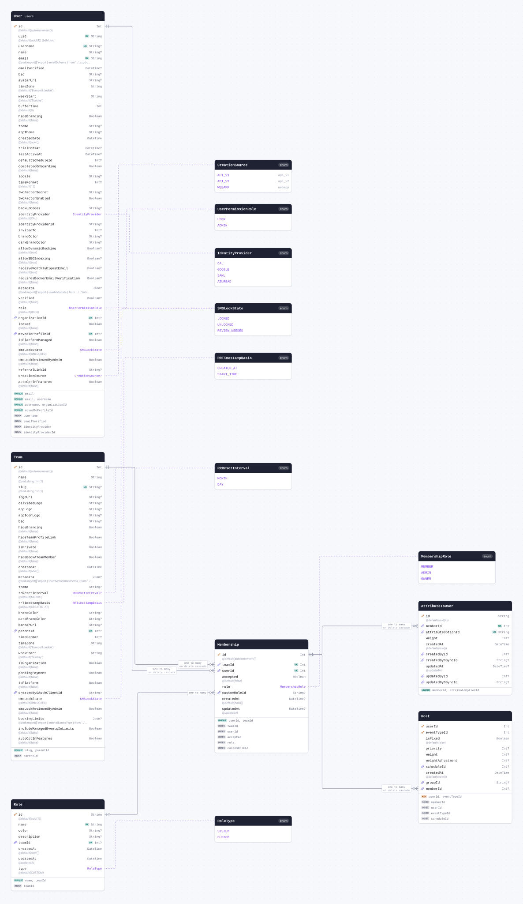

| Field          | Type                                     | Constraints                       | Default           | Description |
| -------------- | ---------------------------------------- | --------------------------------- | ----------------- | ----------- |
| `id`           | `Int`                                    | PK NOT NULL                       | `autoincrement()` |             |
| `teamId`       | `Int`                                    | NOT NULL → [Team.id](#model-Team) |                   |             |
| `userId`       | `Int`                                    | NOT NULL → [User.id](#model-User) |                   |             |
| `accepted`     | `Boolean`                                | NOT NULL                          | `false`           |             |
| `role`         | [`MembershipRole`](#enum-MembershipRole) | NOT NULL                          |                   |             |
| `customRoleId` | `String`                                 | NULL → [Role.id](#model-Role)     |                   |             |
| `createdAt`    | `DateTime`                               | NULL                              | `now()`           |             |
| `updatedAt`    | `DateTime`                               | NULL                              | `@updatedAt`      |             |

#### Indexes

- `@@index([teamId])`
- `@@index([userId])`
- `@@index([accepted])`
- `@@index([role])`
- `@@index([customRoleId])`
- `@@unique([userId, teamId])`

#### References

- `customRoleId` → [Role.id](#model-Role) (many-to-one)
- `teamId` → [Team.id](#model-Team) (many-to-one, on delete Cascade)
- `userId` → [User.id](#model-User) (many-to-one, on delete Cascade)

#### Referenced by

- `id` ← [Host.memberId](#model-Host) (one-to-many, on delete Cascade)
- `id` ← [AttributeToUser.memberId](#model-AttributeToUser) (one-to-many, on delete Cascade)

#### Definition

```sql
CREATE TABLE "Membership" (
    "id" SERIAL NOT NULL,
    "teamId" INTEGER NOT NULL,
    "userId" INTEGER NOT NULL,
    "accepted" BOOLEAN NOT NULL DEFAULT false,
    "role" "MembershipRole" NOT NULL,
    "customRoleId" TEXT,
    "createdAt" TIMESTAMP(3) DEFAULT CURRENT_TIMESTAMP,
    "updatedAt" TIMESTAMP(3),

    CONSTRAINT "Membership_pkey" PRIMARY KEY ("id")
);

CREATE INDEX "Membership_teamId_idx" ON "Membership"("teamId");

CREATE INDEX "Membership_userId_idx" ON "Membership"("userId");

CREATE INDEX "Membership_accepted_idx" ON "Membership"("accepted");

CREATE INDEX "Membership_role_idx" ON "Membership"("role");

CREATE INDEX "Membership_customRoleId_idx" ON "Membership"("customRoleId");

CREATE UNIQUE INDEX "Membership_userId_teamId_key" ON "Membership"("userId", "teamId");

ALTER TABLE "Membership" ADD CONSTRAINT "Membership_customRoleId_fkey" FOREIGN KEY ("customRoleId") REFERENCES "Role"("id") ON DELETE SET NULL ON UPDATE CASCADE;

ALTER TABLE "Membership" ADD CONSTRAINT "Membership_teamId_fkey" FOREIGN KEY ("teamId") REFERENCES "Team"("id") ON DELETE CASCADE ON UPDATE CASCADE;

ALTER TABLE "Membership" ADD CONSTRAINT "Membership_userId_fkey" FOREIGN KEY ("userId") REFERENCES "users"("id") ON DELETE CASCADE ON UPDATE CASCADE;
```

<details>
<summary>Queries and their SQL</summary>

**findMany**: Every row

```ts
await prisma.membership.findMany();
```

```sql
SELECT
  "public"."Membership"."id",
  "public"."Membership"."teamId",
  "public"."Membership"."userId",
  "public"."Membership"."accepted",
  "public"."Membership"."role"::text,
  "public"."Membership"."customRoleId",
  "public"."Membership"."createdAt",
  "public"."Membership"."updatedAt"
FROM
  "public"."Membership"
WHERE
  1 = 1
OFFSET
  $1
-- params: ["0"]
```

**count**: How many rows there are

```ts
await prisma.membership.count();
```

```sql
SELECT
  COUNT(*) AS "_count$_all"
FROM
  (
    SELECT
      "public"."Membership"."id"
    FROM
      "public"."Membership"
    WHERE
      1 = 1
    OFFSET
      $1
  ) AS "sub"
-- params: ["0"]
```

**findMany**: Every row with its relations

```ts
await prisma.membership.findMany({
  include: { customRole: true, team: true, user: true, AttributeToUser: true, Host: true },
});
```

```sql
SELECT
  "public"."Membership"."id",
  "public"."Membership"."teamId",
  "public"."Membership"."userId",
  "public"."Membership"."accepted",
  "public"."Membership"."role"::text,
  "public"."Membership"."customRoleId",
  "public"."Membership"."createdAt",
  "public"."Membership"."updatedAt"
FROM
  "public"."Membership"
WHERE
  1 = 1
OFFSET
  $1
-- params: ["0"]

SELECT
  "public"."Role"."id",
  "public"."Role"."name",
  "public"."Role"."color",
  "public"."Role"."description",
  "public"."Role"."teamId",
  "public"."Role"."createdAt",
  "public"."Role"."updatedAt",
  "public"."Role"."type"::text
FROM
  "public"."Role"
WHERE
  "public"."Role"."id" IN ($1)
OFFSET
  $2
-- params: ["<customRoleId of the rows above>","0"]

SELECT
  "public"."Team"."id",
  "public"."Team"."name",
  "public"."Team"."slug",
  "public"."Team"."logoUrl",
  "public"."Team"."calVideoLogo",
  "public"."Team"."appLogo",
  "public"."Team"."appIconLogo",
  "public"."Team"."bio",
  "public"."Team"."hideBranding",
  "public"."Team"."hideTeamProfileLink",
  "public"."Team"."isPrivate",
  "public"."Team"."hideBookATeamMember",
  "public"."Team"."createdAt",
  "public"."Team"."metadata",
  "public"."Team"."theme",
  "public"."Team"."rrResetInterval"::text,
  "public"."Team"."rrTimestampBasis"::text,
  "public"."Team"."brandColor",
  "public"."Team"."darkBrandColor",
  "public"."Team"."bannerUrl",
  "public"."Team"."parentId",
  "public"."Team"."timeFormat",
  "public"."Team"."timeZone",
  "public"."Team"."weekStart",
  "public"."Team"."isOrganization",
  "public"."Team"."pendingPayment",
  "public"."Team"."isPlatform",
  "public"."Team"."createdByOAuthClientId",
  "public"."Team"."smsLockState"::text,
  "public"."Team"."smsLockReviewedByAdmin",
  "public"."Team"."bookingLimits",
  "public"."Team"."includeManagedEventsInLimits",
  "public"."Team"."autoOptInFeatures"
FROM
  "public"."Team"
WHERE
  "public"."Team"."id" IN ($1)
OFFSET
  $2
-- params: ["<teamId of the rows above>","0"]

SELECT
  "public"."users"."id",
  "public"."users"."uuid",
  "public"."users"."username",
  "public"."users"."name",
  "public"."users"."email",
  "public"."users"."emailVerified",
  "public"."users"."bio",
  "public"."users"."avatarUrl",
  "public"."users"."timeZone",
  "public"."users"."weekStart",
  "public"."users"."bufferTime",
  "public"."users"."hideBranding",
  "public"."users"."theme",
  "public"."users"."appTheme",
  "public"."users"."created",
  "public"."users"."trialEndsAt",
  "public"."users"."lastActiveAt",
  "public"."users"."defaultScheduleId",
  "public"."users"."completedOnboarding",
  "public"."users"."locale",
  "public"."users"."timeFormat",
  "public"."users"."twoFactorSecret",
  "public"."users"."twoFactorEnabled",
  "public"."users"."backupCodes",
  "public"."users"."identityProvider"::text,
  "public"."users"."identityProviderId",
  "public"."users"."invitedTo",
  "public"."users"."brandColor",
  "public"."users"."darkBrandColor",
  "public"."users"."allowDynamicBooking",
  "public"."users"."allowSEOIndexing",
  "public"."users"."receiveMonthlyDigestEmail",
  "public"."users"."requiresBookerEmailVerification",
  "public"."users"."metadata",
  "public"."users"."verified",
  "public"."users"."role"::text,
  "public"."users"."organizationId",
  "public"."users"."locked",
  "public"."users"."movedToProfileId",
  "public"."users"."isPlatformManaged",
  "public"."users"."smsLockState"::text,
  "public"."users"."smsLockReviewedByAdmin",
  "public"."users"."referralLinkId",
  "public"."users"."creationSource"::text,
  "public"."users"."autoOptInFeatures"
FROM
  "public"."users"
WHERE
  "public"."users"."id" IN ($1)
OFFSET
  $2
-- params: ["<userId of the rows above>","0"]

SELECT
  "public"."AttributeToUser"."id",
  "public"."AttributeToUser"."memberId",
  "public"."AttributeToUser"."attributeOptionId",
  "public"."AttributeToUser"."weight",
  "public"."AttributeToUser"."createdAt",
  "public"."AttributeToUser"."createdById",
  "public"."AttributeToUser"."createdByDSyncId",
  "public"."AttributeToUser"."updatedAt",
  "public"."AttributeToUser"."updatedById",
  "public"."AttributeToUser"."updatedByDSyncId"
FROM
  "public"."AttributeToUser"
WHERE
  "public"."AttributeToUser"."memberId" IN ($1)
OFFSET
  $2
-- params: ["<id of the rows above>","0"]

SELECT
  "public"."Host"."userId",
  "public"."Host"."eventTypeId",
  "public"."Host"."isFixed",
  "public"."Host"."priority",
  "public"."Host"."weight",
  "public"."Host"."weightAdjustment",
  "public"."Host"."scheduleId",
  "public"."Host"."createdAt",
  "public"."Host"."groupId",
  "public"."Host"."memberId"
FROM
  "public"."Host"
WHERE
  "public"."Host"."memberId" IN ($1)
OFFSET
  $2
-- params: ["<id of the rows above>","0"]
```

**findUnique**: One row by what is unique to it

```ts
await prisma.membership.findUnique({ where: { id: 1 } });
```

```sql
SELECT
  "public"."Membership"."id",
  "public"."Membership"."teamId",
  "public"."Membership"."userId",
  "public"."Membership"."accepted",
  "public"."Membership"."role"::text,
  "public"."Membership"."customRoleId",
  "public"."Membership"."createdAt",
  "public"."Membership"."updatedAt"
FROM
  "public"."Membership"
WHERE
  (
    "public"."Membership"."id" = $1
    AND 1 = 1
  )
LIMIT
  $2
OFFSET
  $3
-- params: ["1","1","0"]
```

**create**: Create a row

```ts
await prisma.membership.create({ data: { teamId: 1, userId: 1, role: "MEMBER" } });
```

```sql
INSERT INTO
  "public"."Membership" (
    "teamId",
    "userId",
    "accepted",
    "role",
    "createdAt",
    "updatedAt"
  )
VALUES
  (
    $1,
    $2,
    $3,
    CAST($4::text AS "public"."MembershipRole"),
    $5,
    $6
  )
RETURNING
  "public"."Membership"."id",
  "public"."Membership"."teamId",
  "public"."Membership"."userId",
  "public"."Membership"."accepted",
  "public"."Membership"."role"::text,
  "public"."Membership"."customRoleId",
  "public"."Membership"."createdAt",
  "public"."Membership"."updatedAt"
-- params: ["1","1",false,"MEMBER","<now()>","<now()>"]
```

**update**: Update a row

```ts
await prisma.membership.update({ where: { id: 1 }, data: { accepted: true } });
```

```sql
UPDATE "public"."Membership"
SET
  "accepted" = $1,
  "updatedAt" = $2
WHERE
  (
    "public"."Membership"."id" = $3
    AND 1 = 1
  )
RETURNING
  "public"."Membership"."id",
  "public"."Membership"."teamId",
  "public"."Membership"."userId",
  "public"."Membership"."accepted",
  "public"."Membership"."role"::text,
  "public"."Membership"."customRoleId",
  "public"."Membership"."createdAt",
  "public"."Membership"."updatedAt"
-- params: [true,{"prisma__type":"generatorCall","prisma__value":{"name":"now","args":[],"returnType":{"type":"DateTime"}}},"1"]
```

**delete**: Delete a row

```ts
await prisma.membership.delete({ where: { id: 1 } });
```

```sql
DELETE FROM "public"."Membership"
WHERE
  (
    "public"."Membership"."id" = $1
    AND 1 = 1
  )
RETURNING
  "public"."Membership"."id",
  "public"."Membership"."teamId",
  "public"."Membership"."userId",
  "public"."Membership"."accepted",
  "public"."Membership"."role"::text,
  "public"."Membership"."customRoleId",
  "public"."Membership"."createdAt",
  "public"."Membership"."updatedAt"
-- params: ["1"]
```

</details>

<a id="model-VerificationToken"></a>

### VerificationToken

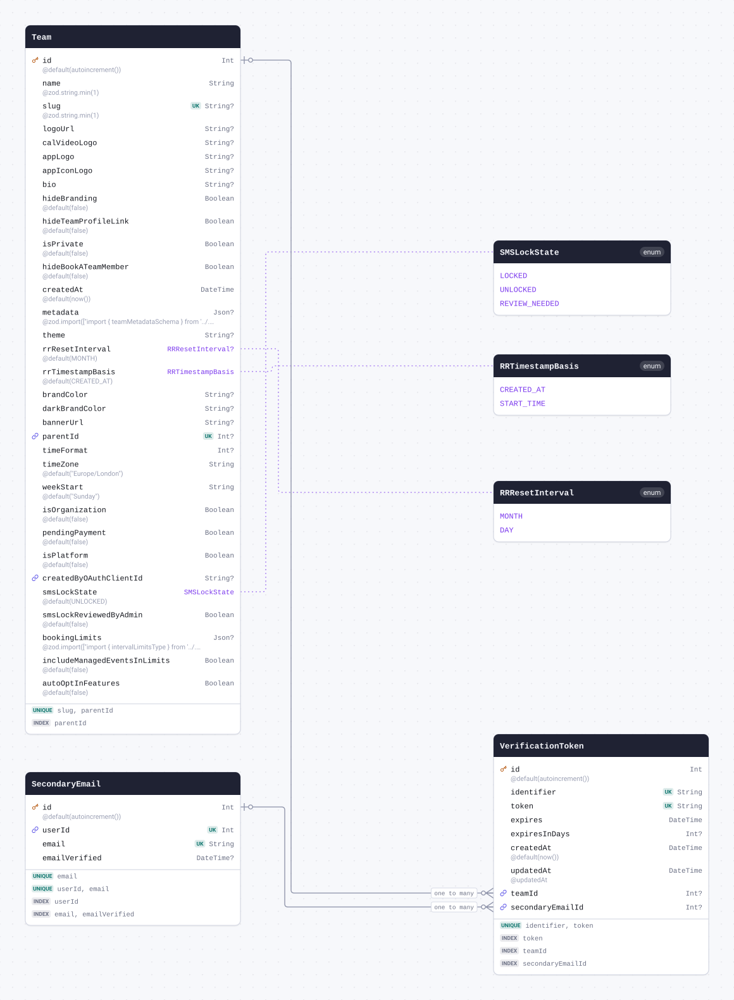

| Field              | Type       | Constraints                                       | Default           | Description |
| ------------------ | ---------- | ------------------------------------------------- | ----------------- | ----------- |
| `id`               | `Int`      | PK NOT NULL                                       | `autoincrement()` |             |
| `identifier`       | `String`   | NOT NULL                                          |                   |             |
| `token`            | `String`   | UNIQUE NOT NULL                                   |                   |             |
| `expires`          | `DateTime` | NOT NULL                                          |                   |             |
| `expiresInDays`    | `Int`      | NULL                                              |                   |             |
| `createdAt`        | `DateTime` | NOT NULL                                          | `now()`           |             |
| `updatedAt`        | `DateTime` | NOT NULL                                          | `@updatedAt`      |             |
| `teamId`           | `Int`      | NULL → [Team.id](#model-Team)                     |                   |             |
| `secondaryEmailId` | `Int`      | NULL → [SecondaryEmail.id](#model-SecondaryEmail) |                   |             |

#### Indexes

- `@@index([token])`
- `@@index([teamId])`
- `@@index([secondaryEmailId])`
- `@@unique([identifier, token])`

#### References

- `teamId` → [Team.id](#model-Team) (many-to-one)
- `secondaryEmailId` → [SecondaryEmail.id](#model-SecondaryEmail) (many-to-one)

#### Definition

```sql
CREATE TABLE "VerificationToken" (
    "id" SERIAL NOT NULL,
    "identifier" TEXT NOT NULL,
    "token" TEXT NOT NULL,
    "expires" TIMESTAMP(3) NOT NULL,
    "expiresInDays" INTEGER,
    "createdAt" TIMESTAMP(3) NOT NULL DEFAULT CURRENT_TIMESTAMP,
    "updatedAt" TIMESTAMP(3) NOT NULL,
    "teamId" INTEGER,
    "secondaryEmailId" INTEGER,

    CONSTRAINT "VerificationToken_pkey" PRIMARY KEY ("id")
);

CREATE UNIQUE INDEX "VerificationToken_token_key" ON "VerificationToken"("token");

CREATE INDEX "VerificationToken_token_idx" ON "VerificationToken"("token");

CREATE INDEX "VerificationToken_teamId_idx" ON "VerificationToken"("teamId");

CREATE INDEX "VerificationToken_secondaryEmailId_idx" ON "VerificationToken"("secondaryEmailId");

CREATE UNIQUE INDEX "VerificationToken_identifier_token_key" ON "VerificationToken"("identifier", "token");

ALTER TABLE "VerificationToken" ADD CONSTRAINT "VerificationToken_teamId_fkey" FOREIGN KEY ("teamId") REFERENCES "Team"("id") ON DELETE SET NULL ON UPDATE CASCADE;

ALTER TABLE "VerificationToken" ADD CONSTRAINT "VerificationToken_secondaryEmailId_fkey" FOREIGN KEY ("secondaryEmailId") REFERENCES "SecondaryEmail"("id") ON DELETE SET NULL ON UPDATE CASCADE;
```

<details>
<summary>Queries and their SQL</summary>

**findMany**: Every row

```ts
await prisma.verificationToken.findMany();
```

```sql
SELECT
  "public"."VerificationToken"."id",
  "public"."VerificationToken"."identifier",
  "public"."VerificationToken"."token",
  "public"."VerificationToken"."expires",
  "public"."VerificationToken"."expiresInDays",
  "public"."VerificationToken"."createdAt",
  "public"."VerificationToken"."updatedAt",
  "public"."VerificationToken"."teamId",
  "public"."VerificationToken"."secondaryEmailId"
FROM
  "public"."VerificationToken"
WHERE
  1 = 1
OFFSET
  $1
-- params: ["0"]
```

**count**: How many rows there are

```ts
await prisma.verificationToken.count();
```

```sql
SELECT
  COUNT(*) AS "_count$_all"
FROM
  (
    SELECT
      "public"."VerificationToken"."id"
    FROM
      "public"."VerificationToken"
    WHERE
      1 = 1
    OFFSET
      $1
  ) AS "sub"
-- params: ["0"]
```

**findMany**: Every row with its relations

```ts
await prisma.verificationToken.findMany({ include: { team: true, secondaryEmail: true } });
```

```sql
SELECT
  "public"."VerificationToken"."id",
  "public"."VerificationToken"."identifier",
  "public"."VerificationToken"."token",
  "public"."VerificationToken"."expires",
  "public"."VerificationToken"."expiresInDays",
  "public"."VerificationToken"."createdAt",
  "public"."VerificationToken"."updatedAt",
  "public"."VerificationToken"."teamId",
  "public"."VerificationToken"."secondaryEmailId"
FROM
  "public"."VerificationToken"
WHERE
  1 = 1
OFFSET
  $1
-- params: ["0"]

SELECT
  "public"."Team"."id",
  "public"."Team"."name",
  "public"."Team"."slug",
  "public"."Team"."logoUrl",
  "public"."Team"."calVideoLogo",
  "public"."Team"."appLogo",
  "public"."Team"."appIconLogo",
  "public"."Team"."bio",
  "public"."Team"."hideBranding",
  "public"."Team"."hideTeamProfileLink",
  "public"."Team"."isPrivate",
  "public"."Team"."hideBookATeamMember",
  "public"."Team"."createdAt",
  "public"."Team"."metadata",
  "public"."Team"."theme",
  "public"."Team"."rrResetInterval"::text,
  "public"."Team"."rrTimestampBasis"::text,
  "public"."Team"."brandColor",
  "public"."Team"."darkBrandColor",
  "public"."Team"."bannerUrl",
  "public"."Team"."parentId",
  "public"."Team"."timeFormat",
  "public"."Team"."timeZone",
  "public"."Team"."weekStart",
  "public"."Team"."isOrganization",
  "public"."Team"."pendingPayment",
  "public"."Team"."isPlatform",
  "public"."Team"."createdByOAuthClientId",
  "public"."Team"."smsLockState"::text,
  "public"."Team"."smsLockReviewedByAdmin",
  "public"."Team"."bookingLimits",
  "public"."Team"."includeManagedEventsInLimits",
  "public"."Team"."autoOptInFeatures"
FROM
  "public"."Team"
WHERE
  "public"."Team"."id" IN ($1)
OFFSET
  $2
-- params: ["<teamId of the rows above>","0"]

SELECT
  "public"."SecondaryEmail"."id",
  "public"."SecondaryEmail"."userId",
  "public"."SecondaryEmail"."email",
  "public"."SecondaryEmail"."emailVerified"
FROM
  "public"."SecondaryEmail"
WHERE
  "public"."SecondaryEmail"."id" IN ($1)
OFFSET
  $2
-- params: ["<secondaryEmailId of the rows above>","0"]
```

**findUnique**: One row by what is unique to it

```ts
await prisma.verificationToken.findUnique({ where: { id: 1 } });
```

```sql
SELECT
  "public"."VerificationToken"."id",
  "public"."VerificationToken"."identifier",
  "public"."VerificationToken"."token",
  "public"."VerificationToken"."expires",
  "public"."VerificationToken"."expiresInDays",
  "public"."VerificationToken"."createdAt",
  "public"."VerificationToken"."updatedAt",
  "public"."VerificationToken"."teamId",
  "public"."VerificationToken"."secondaryEmailId"
FROM
  "public"."VerificationToken"
WHERE
  (
    "public"."VerificationToken"."id" = $1
    AND 1 = 1
  )
LIMIT
  $2
OFFSET
  $3
-- params: ["1","1","0"]
```

**create**: Create a row

```ts
await prisma.verificationToken.create({
  data: { identifier: "example", token: "example", expires: new Date("2026-01-01T00:00:00.000Z") },
});
```

```sql
INSERT INTO
  "public"."VerificationToken" (
    "identifier",
    "token",
    "expires",
    "createdAt",
    "updatedAt"
  )
VALUES
  ($1, $2, $3, $4, $5)
RETURNING
  "public"."VerificationToken"."id",
  "public"."VerificationToken"."identifier",
  "public"."VerificationToken"."token",
  "public"."VerificationToken"."expires",
  "public"."VerificationToken"."expiresInDays",
  "public"."VerificationToken"."createdAt",
  "public"."VerificationToken"."updatedAt",
  "public"."VerificationToken"."teamId",
  "public"."VerificationToken"."secondaryEmailId"
-- params: ["example","example","2026-01-01T00:00:00.000Z","<now()>","<now()>"]
```

**update**: Update a row

```ts
await prisma.verificationToken.update({ where: { id: 1 }, data: { identifier: "example" } });
```

```sql
UPDATE "public"."VerificationToken"
SET
  "identifier" = $1,
  "updatedAt" = $2
WHERE
  (
    "public"."VerificationToken"."id" = $3
    AND 1 = 1
  )
RETURNING
  "public"."VerificationToken"."id",
  "public"."VerificationToken"."identifier",
  "public"."VerificationToken"."token",
  "public"."VerificationToken"."expires",
  "public"."VerificationToken"."expiresInDays",
  "public"."VerificationToken"."createdAt",
  "public"."VerificationToken"."updatedAt",
  "public"."VerificationToken"."teamId",
  "public"."VerificationToken"."secondaryEmailId"
-- params: ["example",{"prisma__type":"generatorCall","prisma__value":{"name":"now","args":[],"returnType":{"type":"DateTime"}}},"1"]
```

**delete**: Delete a row

```ts
await prisma.verificationToken.delete({ where: { id: 1 } });
```

```sql
DELETE FROM "public"."VerificationToken"
WHERE
  (
    "public"."VerificationToken"."id" = $1
    AND 1 = 1
  )
RETURNING
  "public"."VerificationToken"."id",
  "public"."VerificationToken"."identifier",
  "public"."VerificationToken"."token",
  "public"."VerificationToken"."expires",
  "public"."VerificationToken"."expiresInDays",
  "public"."VerificationToken"."createdAt",
  "public"."VerificationToken"."updatedAt",
  "public"."VerificationToken"."teamId",
  "public"."VerificationToken"."secondaryEmailId"
-- params: ["1"]
```

</details>

<a id="model-InstantMeetingToken"></a>

### InstantMeetingToken

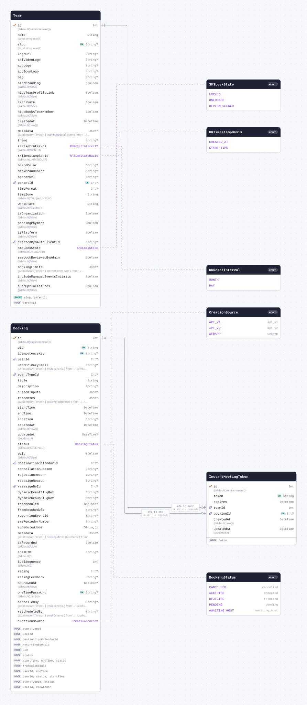

| Field       | Type       | Constraints                                | Default           | Description |
| ----------- | ---------- | ------------------------------------------ | ----------------- | ----------- |
| `id`        | `Int`      | PK NOT NULL                                | `autoincrement()` |             |
| `token`     | `String`   | UNIQUE NOT NULL                            |                   |             |
| `expires`   | `DateTime` | NOT NULL                                   |                   |             |
| `teamId`    | `Int`      | NOT NULL → [Team.id](#model-Team)          |                   |             |
| `bookingId` | `Int`      | UNIQUE NULL → [Booking.id](#model-Booking) |                   |             |
| `createdAt` | `DateTime` | NOT NULL                                   | `now()`           |             |
| `updatedAt` | `DateTime` | NOT NULL                                   | `@updatedAt`      |             |

#### Indexes

- `@@index([token])`

#### References

- `teamId` → [Team.id](#model-Team) (many-to-one, on delete Cascade)
- `bookingId` → [Booking.id](#model-Booking) (one-to-one, on delete Cascade)

#### Definition

```sql
CREATE TABLE "InstantMeetingToken" (
    "id" SERIAL NOT NULL,
    "token" TEXT NOT NULL,
    "expires" TIMESTAMP(3) NOT NULL,
    "teamId" INTEGER NOT NULL,
    "bookingId" INTEGER,
    "createdAt" TIMESTAMP(3) NOT NULL DEFAULT CURRENT_TIMESTAMP,
    "updatedAt" TIMESTAMP(3) NOT NULL,

    CONSTRAINT "InstantMeetingToken_pkey" PRIMARY KEY ("id")
);

CREATE UNIQUE INDEX "InstantMeetingToken_token_key" ON "InstantMeetingToken"("token");

CREATE UNIQUE INDEX "InstantMeetingToken_bookingId_key" ON "InstantMeetingToken"("bookingId");

CREATE INDEX "InstantMeetingToken_token_idx" ON "InstantMeetingToken"("token");

ALTER TABLE "InstantMeetingToken" ADD CONSTRAINT "InstantMeetingToken_teamId_fkey" FOREIGN KEY ("teamId") REFERENCES "Team"("id") ON DELETE CASCADE ON UPDATE CASCADE;

ALTER TABLE "InstantMeetingToken" ADD CONSTRAINT "InstantMeetingToken_bookingId_fkey" FOREIGN KEY ("bookingId") REFERENCES "Booking"("id") ON DELETE CASCADE ON UPDATE CASCADE;
```

<details>
<summary>Queries and their SQL</summary>

**findMany**: Every row

```ts
await prisma.instantMeetingToken.findMany();
```

```sql
SELECT
  "public"."InstantMeetingToken"."id",
  "public"."InstantMeetingToken"."token",
  "public"."InstantMeetingToken"."expires",
  "public"."InstantMeetingToken"."teamId",
  "public"."InstantMeetingToken"."bookingId",
  "public"."InstantMeetingToken"."createdAt",
  "public"."InstantMeetingToken"."updatedAt"
FROM
  "public"."InstantMeetingToken"
WHERE
  1 = 1
OFFSET
  $1
-- params: ["0"]
```

**count**: How many rows there are

```ts
await prisma.instantMeetingToken.count();
```

```sql
SELECT
  COUNT(*) AS "_count$_all"
FROM
  (
    SELECT
      "public"."InstantMeetingToken"."id"
    FROM
      "public"."InstantMeetingToken"
    WHERE
      1 = 1
    OFFSET
      $1
  ) AS "sub"
-- params: ["0"]
```

**findMany**: Every row with its relations

```ts
await prisma.instantMeetingToken.findMany({ include: { team: true, booking: true } });
```

```sql
SELECT
  "public"."InstantMeetingToken"."id",
  "public"."InstantMeetingToken"."token",
  "public"."InstantMeetingToken"."expires",
  "public"."InstantMeetingToken"."teamId",
  "public"."InstantMeetingToken"."bookingId",
  "public"."InstantMeetingToken"."createdAt",
  "public"."InstantMeetingToken"."updatedAt"
FROM
  "public"."InstantMeetingToken"
WHERE
  1 = 1
OFFSET
  $1
-- params: ["0"]

SELECT
  "public"."Team"."id",
  "public"."Team"."name",
  "public"."Team"."slug",
  "public"."Team"."logoUrl",
  "public"."Team"."calVideoLogo",
  "public"."Team"."appLogo",
  "public"."Team"."appIconLogo",
  "public"."Team"."bio",
  "public"."Team"."hideBranding",
  "public"."Team"."hideTeamProfileLink",
  "public"."Team"."isPrivate",
  "public"."Team"."hideBookATeamMember",
  "public"."Team"."createdAt",
  "public"."Team"."metadata",
  "public"."Team"."theme",
  "public"."Team"."rrResetInterval"::text,
  "public"."Team"."rrTimestampBasis"::text,
  "public"."Team"."brandColor",
  "public"."Team"."darkBrandColor",
  "public"."Team"."bannerUrl",
  "public"."Team"."parentId",
  "public"."Team"."timeFormat",
  "public"."Team"."timeZone",
  "public"."Team"."weekStart",
  "public"."Team"."isOrganization",
  "public"."Team"."pendingPayment",
  "public"."Team"."isPlatform",
  "public"."Team"."createdByOAuthClientId",
  "public"."Team"."smsLockState"::text,
  "public"."Team"."smsLockReviewedByAdmin",
  "public"."Team"."bookingLimits",
  "public"."Team"."includeManagedEventsInLimits",
  "public"."Team"."autoOptInFeatures"
FROM
  "public"."Team"
WHERE
  "public"."Team"."id" IN ($1)
OFFSET
  $2
-- params: ["<teamId of the rows above>","0"]

SELECT
  "public"."Booking"."id",
  "public"."Booking"."uid",
  "public"."Booking"."idempotencyKey",
  "public"."Booking"."userId",
  "public"."Booking"."userPrimaryEmail",
  "public"."Booking"."eventTypeId",
  "public"."Booking"."title",
  "public"."Booking"."description",
  "public"."Booking"."customInputs",
  "public"."Booking"."responses",
  "public"."Booking"."startTime",
  "public"."Booking"."endTime",
  "public"."Booking"."location",
  "public"."Booking"."createdAt",
  "public"."Booking"."updatedAt",
  "public"."Booking"."status"::text,
  "public"."Booking"."paid",
  "public"."Booking"."destinationCalendarId",
  "public"."Booking"."cancellationReason",
  "public"."Booking"."rejectionReason",
  "public"."Booking"."reassignReason",
  "public"."Booking"."reassignById",
  "public"."Booking"."dynamicEventSlugRef",
  "public"."Booking"."dynamicGroupSlugRef",
  "public"."Booking"."rescheduled",
  "public"."Booking"."fromReschedule",
  "public"."Booking"."recurringEventId",
  "public"."Booking"."smsReminderNumber",
  "public"."Booking"."scheduledJobs",
  "public"."Booking"."metadata",
  "public"."Booking"."isRecorded",
  "public"."Booking"."iCalUID",
  "public"."Booking"."iCalSequence",
  "public"."Booking"."rating",
  "public"."Booking"."ratingFeedback",
  "public"."Booking"."noShowHost",
  "public"."Booking"."oneTimePassword",
  "public"."Booking"."cancelledBy",
  "public"."Booking"."rescheduledBy",
  "public"."Booking"."creationSource"::text
FROM
  "public"."Booking"
WHERE
  "public"."Booking"."id" IN ($1)
OFFSET
  $2
-- params: ["<bookingId of the rows above>","0"]
```

**findUnique**: One row by what is unique to it

```ts
await prisma.instantMeetingToken.findUnique({ where: { id: 1 } });
```

```sql
SELECT
  "public"."InstantMeetingToken"."id",
  "public"."InstantMeetingToken"."token",
  "public"."InstantMeetingToken"."expires",
  "public"."InstantMeetingToken"."teamId",
  "public"."InstantMeetingToken"."bookingId",
  "public"."InstantMeetingToken"."createdAt",
  "public"."InstantMeetingToken"."updatedAt"
FROM
  "public"."InstantMeetingToken"
WHERE
  (
    "public"."InstantMeetingToken"."id" = $1
    AND 1 = 1
  )
LIMIT
  $2
OFFSET
  $3
-- params: ["1","1","0"]
```

**create**: Create a row

```ts
await prisma.instantMeetingToken.create({
  data: { token: "example", expires: new Date("2026-01-01T00:00:00.000Z"), teamId: 1 },
});
```

```sql
INSERT INTO
  "public"."InstantMeetingToken" (
    "token",
    "expires",
    "teamId",
    "createdAt",
    "updatedAt"
  )
VALUES
  ($1, $2, $3, $4, $5)
RETURNING
  "public"."InstantMeetingToken"."id",
  "public"."InstantMeetingToken"."token",
  "public"."InstantMeetingToken"."expires",
  "public"."InstantMeetingToken"."teamId",
  "public"."InstantMeetingToken"."bookingId",
  "public"."InstantMeetingToken"."createdAt",
  "public"."InstantMeetingToken"."updatedAt"
-- params: ["example","2026-01-01T00:00:00.000Z","1","<now()>","<now()>"]
```

**update**: Update a row

```ts
await prisma.instantMeetingToken.update({ where: { id: 1 }, data: { token: "example" } });
```

```sql
UPDATE "public"."InstantMeetingToken"
SET
  "token" = $1,
  "updatedAt" = $2
WHERE
  (
    "public"."InstantMeetingToken"."id" = $3
    AND 1 = 1
  )
RETURNING
  "public"."InstantMeetingToken"."id",
  "public"."InstantMeetingToken"."token",
  "public"."InstantMeetingToken"."expires",
  "public"."InstantMeetingToken"."teamId",
  "public"."InstantMeetingToken"."bookingId",
  "public"."InstantMeetingToken"."createdAt",
  "public"."InstantMeetingToken"."updatedAt"
-- params: ["example",{"prisma__type":"generatorCall","prisma__value":{"name":"now","args":[],"returnType":{"type":"DateTime"}}},"1"]
```

**delete**: Delete a row

```ts
await prisma.instantMeetingToken.delete({ where: { id: 1 } });
```

```sql
DELETE FROM "public"."InstantMeetingToken"
WHERE
  (
    "public"."InstantMeetingToken"."id" = $1
    AND 1 = 1
  )
RETURNING
  "public"."InstantMeetingToken"."id",
  "public"."InstantMeetingToken"."token",
  "public"."InstantMeetingToken"."expires",
  "public"."InstantMeetingToken"."teamId",
  "public"."InstantMeetingToken"."bookingId",
  "public"."InstantMeetingToken"."createdAt",
  "public"."InstantMeetingToken"."updatedAt"
-- params: ["1"]
```

</details>

<a id="model-BookingReference"></a>

### BookingReference

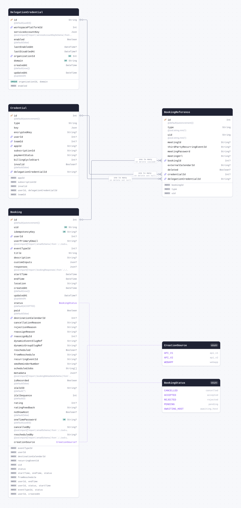

| Field                        | Type      | Constraints                                                   | Default           | Description        |
| ---------------------------- | --------- | ------------------------------------------------------------- | ----------------- | ------------------ |
| `id`                         | `Int`     | PK NOT NULL                                                   | `autoincrement()` |                    |
| `type`                       | `String`  | NOT NULL                                                      |                   | @zod.string.min(1) |
| `uid`                        | `String`  | NOT NULL                                                      |                   | @zod.string.min(1) |
| `meetingId`                  | `String`  | NULL                                                          |                   |                    |
| `thirdPartyRecurringEventId` | `String`  | NULL                                                          |                   |                    |
| `meetingPassword`            | `String`  | NULL                                                          |                   |                    |
| `meetingUrl`                 | `String`  | NULL                                                          |                   |                    |
| `bookingId`                  | `Int`     | NULL → [Booking.id](#model-Booking)                           |                   |                    |
| `externalCalendarId`         | `String`  | NULL                                                          |                   |                    |
| `deleted`                    | `Boolean` | NULL                                                          |                   |                    |
| `credentialId`               | `Int`     | NULL → [Credential.id](#model-Credential)                     |                   |                    |
| `delegationCredentialId`     | `String`  | NULL → [DelegationCredential.id](#model-DelegationCredential) |                   |                    |

#### Indexes

- `@@index([bookingId])`
- `@@index([type])`
- `@@index([uid])`

#### References

- `bookingId` → [Booking.id](#model-Booking) (many-to-one, on delete Cascade)
- `credentialId` → [Credential.id](#model-Credential) (many-to-one, on delete SetNull)
- `delegationCredentialId` → [DelegationCredential.id](#model-DelegationCredential) (many-to-one, on delete SetNull)

#### Definition

```sql
CREATE TABLE "BookingReference" (
    "id" SERIAL NOT NULL,
    "type" TEXT NOT NULL,
    "uid" TEXT NOT NULL,
    "meetingId" TEXT,
    "thirdPartyRecurringEventId" TEXT,
    "meetingPassword" TEXT,
    "meetingUrl" TEXT,
    "bookingId" INTEGER,
    "externalCalendarId" TEXT,
    "deleted" BOOLEAN,
    "credentialId" INTEGER,
    "delegationCredentialId" TEXT,

    CONSTRAINT "BookingReference_pkey" PRIMARY KEY ("id")
);

CREATE INDEX "BookingReference_bookingId_idx" ON "BookingReference"("bookingId");

CREATE INDEX "BookingReference_type_idx" ON "BookingReference"("type");

CREATE INDEX "BookingReference_uid_idx" ON "BookingReference"("uid");

ALTER TABLE "BookingReference" ADD CONSTRAINT "BookingReference_bookingId_fkey" FOREIGN KEY ("bookingId") REFERENCES "Booking"("id") ON DELETE CASCADE ON UPDATE CASCADE;

ALTER TABLE "BookingReference" ADD CONSTRAINT "BookingReference_credentialId_fkey" FOREIGN KEY ("credentialId") REFERENCES "Credential"("id") ON DELETE SET NULL ON UPDATE CASCADE;

ALTER TABLE "BookingReference" ADD CONSTRAINT "BookingReference_delegationCredentialId_fkey" FOREIGN KEY ("delegationCredentialId") REFERENCES "DelegationCredential"("id") ON DELETE SET NULL ON UPDATE CASCADE;
```

<details>
<summary>Queries and their SQL</summary>

**findMany**: Every row

```ts
await prisma.bookingReference.findMany();
```

```sql
SELECT
  "public"."BookingReference"."id",
  "public"."BookingReference"."type",
  "public"."BookingReference"."uid",
  "public"."BookingReference"."meetingId",
  "public"."BookingReference"."thirdPartyRecurringEventId",
  "public"."BookingReference"."meetingPassword",
  "public"."BookingReference"."meetingUrl",
  "public"."BookingReference"."bookingId",
  "public"."BookingReference"."externalCalendarId",
  "public"."BookingReference"."deleted",
  "public"."BookingReference"."credentialId",
  "public"."BookingReference"."delegationCredentialId"
FROM
  "public"."BookingReference"
WHERE
  1 = 1
OFFSET
  $1
-- params: ["0"]
```

**count**: How many rows there are

```ts
await prisma.bookingReference.count();
```

```sql
SELECT
  COUNT(*) AS "_count$_all"
FROM
  (
    SELECT
      "public"."BookingReference"."id"
    FROM
      "public"."BookingReference"
    WHERE
      1 = 1
    OFFSET
      $1
  ) AS "sub"
-- params: ["0"]
```

**findMany**: Every row with its relations

```ts
await prisma.bookingReference.findMany({
  include: { booking: true, credential: true, delegationCredential: true },
});
```

```sql
SELECT
  "public"."BookingReference"."id",
  "public"."BookingReference"."type",
  "public"."BookingReference"."uid",
  "public"."BookingReference"."meetingId",
  "public"."BookingReference"."thirdPartyRecurringEventId",
  "public"."BookingReference"."meetingPassword",
  "public"."BookingReference"."meetingUrl",
  "public"."BookingReference"."bookingId",
  "public"."BookingReference"."externalCalendarId",
  "public"."BookingReference"."deleted",
  "public"."BookingReference"."credentialId",
  "public"."BookingReference"."delegationCredentialId"
FROM
  "public"."BookingReference"
WHERE
  1 = 1
OFFSET
  $1
-- params: ["0"]

SELECT
  "public"."Booking"."id",
  "public"."Booking"."uid",
  "public"."Booking"."idempotencyKey",
  "public"."Booking"."userId",
  "public"."Booking"."userPrimaryEmail",
  "public"."Booking"."eventTypeId",
  "public"."Booking"."title",
  "public"."Booking"."description",
  "public"."Booking"."customInputs",
  "public"."Booking"."responses",
  "public"."Booking"."startTime",
  "public"."Booking"."endTime",
  "public"."Booking"."location",
  "public"."Booking"."createdAt",
  "public"."Booking"."updatedAt",
  "public"."Booking"."status"::text,
  "public"."Booking"."paid",
  "public"."Booking"."destinationCalendarId",
  "public"."Booking"."cancellationReason",
  "public"."Booking"."rejectionReason",
  "public"."Booking"."reassignReason",
  "public"."Booking"."reassignById",
  "public"."Booking"."dynamicEventSlugRef",
  "public"."Booking"."dynamicGroupSlugRef",
  "public"."Booking"."rescheduled",
  "public"."Booking"."fromReschedule",
  "public"."Booking"."recurringEventId",
  "public"."Booking"."smsReminderNumber",
  "public"."Booking"."scheduledJobs",
  "public"."Booking"."metadata",
  "public"."Booking"."isRecorded",
  "public"."Booking"."iCalUID",
  "public"."Booking"."iCalSequence",
  "public"."Booking"."rating",
  "public"."Booking"."ratingFeedback",
  "public"."Booking"."noShowHost",
  "public"."Booking"."oneTimePassword",
  "public"."Booking"."cancelledBy",
  "public"."Booking"."rescheduledBy",
  "public"."Booking"."creationSource"::text
FROM
  "public"."Booking"
WHERE
  "public"."Booking"."id" IN ($1)
OFFSET
  $2
-- params: ["<bookingId of the rows above>","0"]

SELECT
  "public"."Credential"."id",
  "public"."Credential"."type",
  "public"."Credential"."key",
  "public"."Credential"."encryptedKey",
  "public"."Credential"."userId",
  "public"."Credential"."teamId",
  "public"."Credential"."appId",
  "public"."Credential"."subscriptionId",
  "public"."Credential"."paymentStatus",
  "public"."Credential"."billingCycleStart",
  "public"."Credential"."invalid",
  "public"."Credential"."delegationCredentialId"
FROM
  "public"."Credential"
WHERE
  "public"."Credential"."id" IN ($1)
OFFSET
  $2
-- params: ["<credentialId of the rows above>","0"]

SELECT
  "public"."DelegationCredential"."id",
  "public"."DelegationCredential"."workspacePlatformId",
  "public"."DelegationCredential"."serviceAccountKey",
  "public"."DelegationCredential"."enabled",
  "public"."DelegationCredential"."lastEnabledAt",
  "public"."DelegationCredential"."lastDisabledAt",
  "public"."DelegationCredential"."organizationId",
  "public"."DelegationCredential"."domain",
  "public"."DelegationCredential"."createdAt",
  "public"."DelegationCredential"."updatedAt"
FROM
  "public"."DelegationCredential"
WHERE
  "public"."DelegationCredential"."id" IN ($1)
OFFSET
  $2
-- params: ["<delegationCredentialId of the rows above>","0"]
```

**findUnique**: One row by what is unique to it

```ts
await prisma.bookingReference.findUnique({ where: { id: 1 } });
```

```sql
SELECT
  "public"."BookingReference"."id",
  "public"."BookingReference"."type",
  "public"."BookingReference"."uid",
  "public"."BookingReference"."meetingId",
  "public"."BookingReference"."thirdPartyRecurringEventId",
  "public"."BookingReference"."meetingPassword",
  "public"."BookingReference"."meetingUrl",
  "public"."BookingReference"."bookingId",
  "public"."BookingReference"."externalCalendarId",
  "public"."BookingReference"."deleted",
  "public"."BookingReference"."credentialId",
  "public"."BookingReference"."delegationCredentialId"
FROM
  "public"."BookingReference"
WHERE
  (
    "public"."BookingReference"."id" = $1
    AND 1 = 1
  )
LIMIT
  $2
OFFSET
  $3
-- params: ["1","1","0"]
```

**create**: Create a row

```ts
await prisma.bookingReference.create({ data: { type: "example", uid: "example" } });
```

```sql
INSERT INTO
  "public"."BookingReference" ("type", "uid")
VALUES
  ($1, $2)
RETURNING
  "public"."BookingReference"."id",
  "public"."BookingReference"."type",
  "public"."BookingReference"."uid",
  "public"."BookingReference"."meetingId",
  "public"."BookingReference"."thirdPartyRecurringEventId",
  "public"."BookingReference"."meetingPassword",
  "public"."BookingReference"."meetingUrl",
  "public"."BookingReference"."bookingId",
  "public"."BookingReference"."externalCalendarId",
  "public"."BookingReference"."deleted",
  "public"."BookingReference"."credentialId",
  "public"."BookingReference"."delegationCredentialId"
-- params: ["example","example"]
```

**update**: Update a row

```ts
await prisma.bookingReference.update({ where: { id: 1 }, data: { type: "example" } });
```

```sql
UPDATE "public"."BookingReference"
SET
  "type" = $1
WHERE
  (
    "public"."BookingReference"."id" = $2
    AND 1 = 1
  )
RETURNING
  "public"."BookingReference"."id",
  "public"."BookingReference"."type",
  "public"."BookingReference"."uid",
  "public"."BookingReference"."meetingId",
  "public"."BookingReference"."thirdPartyRecurringEventId",
  "public"."BookingReference"."meetingPassword",
  "public"."BookingReference"."meetingUrl",
  "public"."BookingReference"."bookingId",
  "public"."BookingReference"."externalCalendarId",
  "public"."BookingReference"."deleted",
  "public"."BookingReference"."credentialId",
  "public"."BookingReference"."delegationCredentialId"
-- params: ["example","1"]
```

**delete**: Delete a row

```ts
await prisma.bookingReference.delete({ where: { id: 1 } });
```

```sql
DELETE FROM "public"."BookingReference"
WHERE
  (
    "public"."BookingReference"."id" = $1
    AND 1 = 1
  )
RETURNING
  "public"."BookingReference"."id",
  "public"."BookingReference"."type",
  "public"."BookingReference"."uid",
  "public"."BookingReference"."meetingId",
  "public"."BookingReference"."thirdPartyRecurringEventId",
  "public"."BookingReference"."meetingPassword",
  "public"."BookingReference"."meetingUrl",
  "public"."BookingReference"."bookingId",
  "public"."BookingReference"."externalCalendarId",
  "public"."BookingReference"."deleted",
  "public"."BookingReference"."credentialId",
  "public"."BookingReference"."delegationCredentialId"
-- params: ["1"]
```

</details>

<a id="model-Attendee"></a>

### Attendee

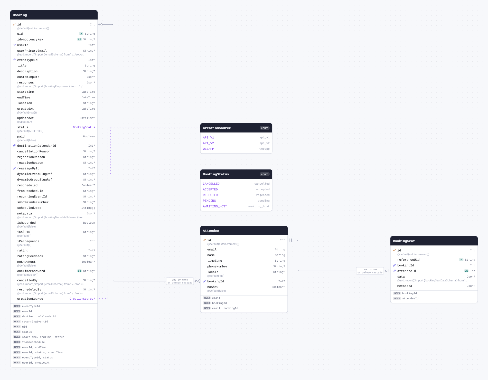

| Field         | Type      | Constraints                         | Default           | Description |
| ------------- | --------- | ----------------------------------- | ----------------- | ----------- |
| `id`          | `Int`     | PK NOT NULL                         | `autoincrement()` |             |
| `email`       | `String`  | NOT NULL                            |                   |             |
| `name`        | `String`  | NOT NULL                            |                   |             |
| `timeZone`    | `String`  | NOT NULL                            |                   |             |
| `phoneNumber` | `String`  | NULL                                |                   |             |
| `locale`      | `String`  | NULL                                | `"en"`            |             |
| `bookingId`   | `Int`     | NULL → [Booking.id](#model-Booking) |                   |             |
| `noShow`      | `Boolean` | NULL                                | `false`           |             |

#### Indexes

- `@@index([email])`
- `@@index([bookingId])`
- `@@index([email, bookingId])`

#### References

- `bookingId` → [Booking.id](#model-Booking) (many-to-one, on delete Cascade)

#### Referenced by

- `id` ← [BookingSeat.attendeeId](#model-BookingSeat) (one-to-one, on delete Cascade)

#### Definition

```sql
CREATE TABLE "Attendee" (
    "id" SERIAL NOT NULL,
    "email" TEXT NOT NULL,
    "name" TEXT NOT NULL,
    "timeZone" TEXT NOT NULL,
    "phoneNumber" TEXT,
    "locale" TEXT DEFAULT 'en',
    "bookingId" INTEGER,
    "noShow" BOOLEAN DEFAULT false,

    CONSTRAINT "Attendee_pkey" PRIMARY KEY ("id")
);

CREATE INDEX "Attendee_email_idx" ON "Attendee"("email");

CREATE INDEX "Attendee_bookingId_idx" ON "Attendee"("bookingId");

CREATE INDEX "Attendee_email_bookingId_idx" ON "Attendee"("email", "bookingId");

ALTER TABLE "Attendee" ADD CONSTRAINT "Attendee_bookingId_fkey" FOREIGN KEY ("bookingId") REFERENCES "Booking"("id") ON DELETE CASCADE ON UPDATE CASCADE;
```

<details>
<summary>Queries and their SQL</summary>

**findMany**: Every row

```ts
await prisma.attendee.findMany();
```

```sql
SELECT
  "public"."Attendee"."id",
  "public"."Attendee"."email",
  "public"."Attendee"."name",
  "public"."Attendee"."timeZone",
  "public"."Attendee"."phoneNumber",
  "public"."Attendee"."locale",
  "public"."Attendee"."bookingId",
  "public"."Attendee"."noShow"
FROM
  "public"."Attendee"
WHERE
  1 = 1
OFFSET
  $1
-- params: ["0"]
```

**count**: How many rows there are

```ts
await prisma.attendee.count();
```

```sql
SELECT
  COUNT(*) AS "_count$_all"
FROM
  (
    SELECT
      "public"."Attendee"."id"
    FROM
      "public"."Attendee"
    WHERE
      1 = 1
    OFFSET
      $1
  ) AS "sub"
-- params: ["0"]
```

**findMany**: Every row with its relations

```ts
await prisma.attendee.findMany({ include: { booking: true, bookingSeat: true } });
```

```sql
SELECT
  "public"."Attendee"."id",
  "public"."Attendee"."email",
  "public"."Attendee"."name",
  "public"."Attendee"."timeZone",
  "public"."Attendee"."phoneNumber",
  "public"."Attendee"."locale",
  "public"."Attendee"."bookingId",
  "public"."Attendee"."noShow"
FROM
  "public"."Attendee"
WHERE
  1 = 1
OFFSET
  $1
-- params: ["0"]

SELECT
  "public"."Booking"."id",
  "public"."Booking"."uid",
  "public"."Booking"."idempotencyKey",
  "public"."Booking"."userId",
  "public"."Booking"."userPrimaryEmail",
  "public"."Booking"."eventTypeId",
  "public"."Booking"."title",
  "public"."Booking"."description",
  "public"."Booking"."customInputs",
  "public"."Booking"."responses",
  "public"."Booking"."startTime",
  "public"."Booking"."endTime",
  "public"."Booking"."location",
  "public"."Booking"."createdAt",
  "public"."Booking"."updatedAt",
  "public"."Booking"."status"::text,
  "public"."Booking"."paid",
  "public"."Booking"."destinationCalendarId",
  "public"."Booking"."cancellationReason",
  "public"."Booking"."rejectionReason",
  "public"."Booking"."reassignReason",
  "public"."Booking"."reassignById",
  "public"."Booking"."dynamicEventSlugRef",
  "public"."Booking"."dynamicGroupSlugRef",
  "public"."Booking"."rescheduled",
  "public"."Booking"."fromReschedule",
  "public"."Booking"."recurringEventId",
  "public"."Booking"."smsReminderNumber",
  "public"."Booking"."scheduledJobs",
  "public"."Booking"."metadata",
  "public"."Booking"."isRecorded",
  "public"."Booking"."iCalUID",
  "public"."Booking"."iCalSequence",
  "public"."Booking"."rating",
  "public"."Booking"."ratingFeedback",
  "public"."Booking"."noShowHost",
  "public"."Booking"."oneTimePassword",
  "public"."Booking"."cancelledBy",
  "public"."Booking"."rescheduledBy",
  "public"."Booking"."creationSource"::text
FROM
  "public"."Booking"
WHERE
  "public"."Booking"."id" IN ($1)
OFFSET
  $2
-- params: ["<bookingId of the rows above>","0"]

SELECT
  "public"."BookingSeat"."id",
  "public"."BookingSeat"."referenceUid",
  "public"."BookingSeat"."bookingId",
  "public"."BookingSeat"."attendeeId",
  "public"."BookingSeat"."data",
  "public"."BookingSeat"."metadata"
FROM
  "public"."BookingSeat"
WHERE
  "public"."BookingSeat"."attendeeId" IN ($1)
OFFSET
  $2
-- params: ["<id of the rows above>","0"]
```

**findUnique**: One row by what is unique to it

```ts
await prisma.attendee.findUnique({ where: { id: 1 } });
```

```sql
SELECT
  "public"."Attendee"."id",
  "public"."Attendee"."email",
  "public"."Attendee"."name",
  "public"."Attendee"."timeZone",
  "public"."Attendee"."phoneNumber",
  "public"."Attendee"."locale",
  "public"."Attendee"."bookingId",
  "public"."Attendee"."noShow"
FROM
  "public"."Attendee"
WHERE
  (
    "public"."Attendee"."id" = $1
    AND 1 = 1
  )
LIMIT
  $2
OFFSET
  $3
-- params: ["1","1","0"]
```

**create**: Create a row

```ts
await prisma.attendee.create({ data: { email: "example", name: "example", timeZone: "example" } });
```

```sql
INSERT INTO
  "public"."Attendee" ("email", "name", "timeZone", "locale", "noShow")
VALUES
  ($1, $2, $3, $4, $5)
RETURNING
  "public"."Attendee"."id",
  "public"."Attendee"."email",
  "public"."Attendee"."name",
  "public"."Attendee"."timeZone",
  "public"."Attendee"."phoneNumber",
  "public"."Attendee"."locale",
  "public"."Attendee"."bookingId",
  "public"."Attendee"."noShow"
-- params: ["example","example","example","en",false]
```

**update**: Update a row

```ts
await prisma.attendee.update({ where: { id: 1 }, data: { email: "example" } });
```

```sql
UPDATE "public"."Attendee"
SET
  "email" = $1
WHERE
  (
    "public"."Attendee"."id" = $2
    AND 1 = 1
  )
RETURNING
  "public"."Attendee"."id",
  "public"."Attendee"."email",
  "public"."Attendee"."name",
  "public"."Attendee"."timeZone",
  "public"."Attendee"."phoneNumber",
  "public"."Attendee"."locale",
  "public"."Attendee"."bookingId",
  "public"."Attendee"."noShow"
-- params: ["example","1"]
```

**delete**: Delete a row

```ts
await prisma.attendee.delete({ where: { id: 1 } });
```

```sql
DELETE FROM "public"."Attendee"
WHERE
  (
    "public"."Attendee"."id" = $1
    AND 1 = 1
  )
RETURNING
  "public"."Attendee"."id",
  "public"."Attendee"."email",
  "public"."Attendee"."name",
  "public"."Attendee"."timeZone",
  "public"."Attendee"."phoneNumber",
  "public"."Attendee"."locale",
  "public"."Attendee"."bookingId",
  "public"."Attendee"."noShow"
-- params: ["1"]
```

</details>

<a id="model-Booking"></a>

### Booking

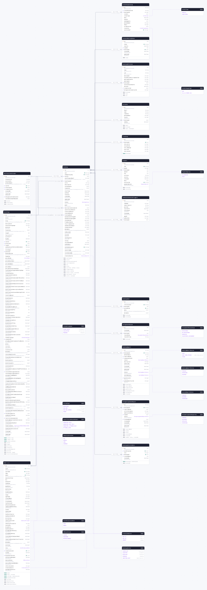

| Field                   | Type                                     | Constraints                                                 | Default           | Description                                                                                                |
| ----------------------- | ---------------------------------------- | ----------------------------------------------------------- | ----------------- | ---------------------------------------------------------------------------------------------------------- |
| `id`                    | `Int`                                    | PK NOT NULL                                                 | `autoincrement()` |                                                                                                            |
| `uid`                   | `String`                                 | UNIQUE NOT NULL                                             |                   |                                                                                                            |
| `idempotencyKey`        | `String`                                 | UNIQUE NULL                                                 |                   |                                                                                                            |
| `userId`                | `Int`                                    | NULL → [User.id](#model-User)                               |                   |                                                                                                            |
| `userPrimaryEmail`      | `String`                                 | NULL                                                        |                   | @zod.import(["import { emailSchema } from '../../zod-utils'"]).custom.use(emailSchema)                     |
| `eventTypeId`           | `Int`                                    | NULL → [EventType.id](#model-EventType)                     |                   |                                                                                                            |
| `title`                 | `String`                                 | NOT NULL                                                    |                   |                                                                                                            |
| `description`           | `String`                                 | NULL                                                        |                   |                                                                                                            |
| `customInputs`          | `Json`                                   | NULL                                                        |                   |                                                                                                            |
| `responses`             | `Json`                                   | NULL                                                        |                   | @zod.import(["import { bookingResponses } from '../../zod-utils'"]).custom.use(bookingResponses)           |
| `startTime`             | `DateTime`                               | NOT NULL                                                    |                   |                                                                                                            |
| `endTime`               | `DateTime`                               | NOT NULL                                                    |                   |                                                                                                            |
| `location`              | `String`                                 | NULL                                                        |                   |                                                                                                            |
| `createdAt`             | `DateTime`                               | NOT NULL                                                    | `now()`           |                                                                                                            |
| `updatedAt`             | `DateTime`                               | NULL                                                        | `@updatedAt`      |                                                                                                            |
| `status`                | [`BookingStatus`](#enum-BookingStatus)   | NOT NULL                                                    | `ACCEPTED`        |                                                                                                            |
| `paid`                  | `Boolean`                                | NOT NULL                                                    | `false`           |                                                                                                            |
| `destinationCalendarId` | `Int`                                    | NULL → [DestinationCalendar.id](#model-DestinationCalendar) |                   |                                                                                                            |
| `cancellationReason`    | `String`                                 | NULL                                                        |                   |                                                                                                            |
| `rejectionReason`       | `String`                                 | NULL                                                        |                   |                                                                                                            |
| `reassignReason`        | `String`                                 | NULL                                                        |                   |                                                                                                            |
| `reassignById`          | `Int`                                    | NULL → [User.id](#model-User)                               |                   |                                                                                                            |
| `dynamicEventSlugRef`   | `String`                                 | NULL                                                        |                   |                                                                                                            |
| `dynamicGroupSlugRef`   | `String`                                 | NULL                                                        |                   |                                                                                                            |
| `rescheduled`           | `Boolean`                                | NULL                                                        |                   |                                                                                                            |
| `fromReschedule`        | `String`                                 | NULL                                                        |                   |                                                                                                            |
| `recurringEventId`      | `String`                                 | NULL                                                        |                   |                                                                                                            |
| `smsReminderNumber`     | `String`                                 | NULL                                                        |                   |                                                                                                            |
| `scheduledJobs`         | `String[]`                               | NOT NULL                                                    |                   |                                                                                                            |
| `metadata`              | `Json`                                   | NULL                                                        |                   | @zod.import(["import { bookingMetadataSchema } from '../../zod-utils'"]).custom.use(bookingMetadataSchema) |
| `isRecorded`            | `Boolean`                                | NOT NULL                                                    | `false`           |                                                                                                            |
| `iCalUID`               | `String`                                 | NULL                                                        | `""`              |                                                                                                            |
| `iCalSequence`          | `Int`                                    | NOT NULL                                                    | `0`               |                                                                                                            |
| `rating`                | `Int`                                    | NULL                                                        |                   |                                                                                                            |
| `ratingFeedback`        | `String`                                 | NULL                                                        |                   |                                                                                                            |
| `noShowHost`            | `Boolean`                                | NULL                                                        | `false`           |                                                                                                            |
| `oneTimePassword`       | `String`                                 | UNIQUE NULL                                                 | `uuid(4)`         |                                                                                                            |
| `cancelledBy`           | `String`                                 | NULL                                                        |                   | @zod.import(["import { emailSchema } from '../../zod-utils'"]).custom.use(emailSchema)                     |
| `rescheduledBy`         | `String`                                 | NULL                                                        |                   | @zod.import(["import { emailSchema } from '../../zod-utils'"]).custom.use(emailSchema)                     |
| `creationSource`        | [`CreationSource`](#enum-CreationSource) | NULL                                                        |                   |                                                                                                            |

#### Indexes

- `@@index([eventTypeId])`
- `@@index([userId])`
- `@@index([destinationCalendarId])`
- `@@index([recurringEventId])`
- `@@index([uid])`
- `@@index([status])`
- `@@index([startTime, endTime, status])`
- `@@index([fromReschedule])`
- `@@index([userId, endTime])`
- `@@index([userId, status, startTime])`
- `@@index([eventTypeId, status])`
- `@@index([userId, createdAt])`

#### References

- `userId` → [User.id](#model-User) (many-to-one, on delete Cascade)
- `eventTypeId` → [EventType.id](#model-EventType) (many-to-one)
- `destinationCalendarId` → [DestinationCalendar.id](#model-DestinationCalendar) (many-to-one)
- `reassignById` → [User.id](#model-User) (many-to-one)

#### Referenced by

- `uid` ← [CreditExpenseLog.bookingUid](#model-CreditExpenseLog) (one-to-many, on delete Cascade)
- `id` ← [InstantMeetingToken.bookingId](#model-InstantMeetingToken) (one-to-one, on delete Cascade)
- `id` ← [BookingReference.bookingId](#model-BookingReference) (one-to-many, on delete Cascade)
- `id` ← [Attendee.bookingId](#model-Attendee) (one-to-many, on delete Cascade)
- `id` ← [Tracking.bookingId](#model-Tracking) (one-to-one, on delete Cascade)
- `id` ← [Payment.bookingId](#model-Payment) (one-to-many, on delete Cascade)
- `id` ← [WebhookScheduledTriggers.bookingId](#model-WebhookScheduledTriggers) (one-to-many, on delete Cascade)
- `id` ← [BookingSeat.bookingId](#model-BookingSeat) (one-to-many, on delete Cascade)
- `id` ← [AssignmentReason.bookingId](#model-AssignmentReason) (one-to-many, on delete Cascade)
- `uid` ← [BookingReport.bookingUid](#model-BookingReport) (one-to-one, on delete Cascade)
- `uid` ← [WrongAssignmentReport.bookingUid](#model-WrongAssignmentReport) (one-to-many, on delete Cascade)
- `id` ← [BookingInternalNote.bookingId](#model-BookingInternalNote) (one-to-many, on delete Cascade)

#### Definition

```sql
CREATE TABLE "Booking" (
    "id" SERIAL NOT NULL,
    "uid" TEXT NOT NULL,
    "idempotencyKey" TEXT,
    "userId" INTEGER,
    "userPrimaryEmail" TEXT,
    "eventTypeId" INTEGER,
    "title" TEXT NOT NULL,
    "description" TEXT,
    "customInputs" JSONB,
    "responses" JSONB,
    "startTime" TIMESTAMP(3) NOT NULL,
    "endTime" TIMESTAMP(3) NOT NULL,
    "location" TEXT,
    "createdAt" TIMESTAMP(3) NOT NULL DEFAULT CURRENT_TIMESTAMP,
    "updatedAt" TIMESTAMP(3),
    "status" "BookingStatus" NOT NULL DEFAULT 'accepted',
    "paid" BOOLEAN NOT NULL DEFAULT false,
    "destinationCalendarId" INTEGER,
    "cancellationReason" TEXT,
    "rejectionReason" TEXT,
    "reassignReason" TEXT,
    "reassignById" INTEGER,
    "dynamicEventSlugRef" TEXT,
    "dynamicGroupSlugRef" TEXT,
    "rescheduled" BOOLEAN,
    "fromReschedule" TEXT,
    "recurringEventId" TEXT,
    "smsReminderNumber" TEXT,
    "scheduledJobs" TEXT[],
    "metadata" JSONB,
    "isRecorded" BOOLEAN NOT NULL DEFAULT false,
    "iCalUID" TEXT DEFAULT '',
    "iCalSequence" INTEGER NOT NULL DEFAULT 0,
    "rating" INTEGER,
    "ratingFeedback" TEXT,
    "noShowHost" BOOLEAN DEFAULT false,
    "oneTimePassword" TEXT,
    "cancelledBy" TEXT,
    "rescheduledBy" TEXT,
    "creationSource" "CreationSource",

    CONSTRAINT "Booking_pkey" PRIMARY KEY ("id")
);

CREATE UNIQUE INDEX "Booking_uid_key" ON "Booking"("uid");

CREATE UNIQUE INDEX "Booking_idempotencyKey_key" ON "Booking"("idempotencyKey");

CREATE UNIQUE INDEX "Booking_oneTimePassword_key" ON "Booking"("oneTimePassword");

CREATE INDEX "Booking_eventTypeId_idx" ON "Booking"("eventTypeId");

CREATE INDEX "Booking_userId_idx" ON "Booking"("userId");

CREATE INDEX "Booking_destinationCalendarId_idx" ON "Booking"("destinationCalendarId");

CREATE INDEX "Booking_recurringEventId_idx" ON "Booking"("recurringEventId");

CREATE INDEX "Booking_uid_idx" ON "Booking"("uid");

CREATE INDEX "Booking_status_idx" ON "Booking"("status");

CREATE INDEX "Booking_startTime_endTime_status_idx" ON "Booking"("startTime", "endTime", "status");

CREATE INDEX "Booking_fromReschedule_idx" ON "Booking"("fromReschedule");

CREATE INDEX "Booking_userId_endTime_idx" ON "Booking"("userId", "endTime");

CREATE INDEX "Booking_userId_status_startTime_idx" ON "Booking"("userId", "status", "startTime");

CREATE INDEX "Booking_eventTypeId_status_idx" ON "Booking"("eventTypeId", "status");

CREATE INDEX "Booking_userId_createdAt_idx" ON "Booking"("userId", "createdAt");

ALTER TABLE "Booking" ADD CONSTRAINT "Booking_userId_fkey" FOREIGN KEY ("userId") REFERENCES "users"("id") ON DELETE CASCADE ON UPDATE CASCADE;

ALTER TABLE "Booking" ADD CONSTRAINT "Booking_eventTypeId_fkey" FOREIGN KEY ("eventTypeId") REFERENCES "EventType"("id") ON DELETE SET NULL ON UPDATE CASCADE;

ALTER TABLE "Booking" ADD CONSTRAINT "Booking_destinationCalendarId_fkey" FOREIGN KEY ("destinationCalendarId") REFERENCES "DestinationCalendar"("id") ON DELETE SET NULL ON UPDATE CASCADE;

ALTER TABLE "Booking" ADD CONSTRAINT "Booking_reassignById_fkey" FOREIGN KEY ("reassignById") REFERENCES "users"("id") ON DELETE SET NULL ON UPDATE CASCADE;
```

<details>
<summary>Queries and their SQL</summary>

**findMany**: Every row

```ts
await prisma.booking.findMany();
```

```sql
SELECT
  "public"."Booking"."id",
  "public"."Booking"."uid",
  "public"."Booking"."idempotencyKey",
  "public"."Booking"."userId",
  "public"."Booking"."userPrimaryEmail",
  "public"."Booking"."eventTypeId",
  "public"."Booking"."title",
  "public"."Booking"."description",
  "public"."Booking"."customInputs",
  "public"."Booking"."responses",
  "public"."Booking"."startTime",
  "public"."Booking"."endTime",
  "public"."Booking"."location",
  "public"."Booking"."createdAt",
  "public"."Booking"."updatedAt",
  "public"."Booking"."status"::text,
  "public"."Booking"."paid",
  "public"."Booking"."destinationCalendarId",
  "public"."Booking"."cancellationReason",
  "public"."Booking"."rejectionReason",
  "public"."Booking"."reassignReason",
  "public"."Booking"."reassignById",
  "public"."Booking"."dynamicEventSlugRef",
  "public"."Booking"."dynamicGroupSlugRef",
  "public"."Booking"."rescheduled",
  "public"."Booking"."fromReschedule",
  "public"."Booking"."recurringEventId",
  "public"."Booking"."smsReminderNumber",
  "public"."Booking"."scheduledJobs",
  "public"."Booking"."metadata",
  "public"."Booking"."isRecorded",
  "public"."Booking"."iCalUID",
  "public"."Booking"."iCalSequence",
  "public"."Booking"."rating",
  "public"."Booking"."ratingFeedback",
  "public"."Booking"."noShowHost",
  "public"."Booking"."oneTimePassword",
  "public"."Booking"."cancelledBy",
  "public"."Booking"."rescheduledBy",
  "public"."Booking"."creationSource"::text
FROM
  "public"."Booking"
WHERE
  1 = 1
OFFSET
  $1
-- params: ["0"]
```

**count**: How many rows there are

```ts
await prisma.booking.count();
```

```sql
SELECT
  COUNT(*) AS "_count$_all"
FROM
  (
    SELECT
      "public"."Booking"."id"
    FROM
      "public"."Booking"
    WHERE
      1 = 1
    OFFSET
      $1
  ) AS "sub"
-- params: ["0"]
```

**findMany**: Every row with its relations

```ts
await prisma.booking.findMany({
  include: {
    user: true,
    references: true,
    eventType: true,
    attendees: true,
    payment: true,
    destinationCalendar: true,
    reassignBy: true,
    seatsReferences: true,
    instantMeetingToken: true,
    scheduledTriggers: true,
    assignmentReason: true,
    internalNote: true,
    tracking: true,
    expenseLogs: true,
    report: true,
    wrongAssignmentReports: true,
  },
});
```

```sql
SELECT
  "public"."Booking"."id",
  "public"."Booking"."uid",
  "public"."Booking"."idempotencyKey",
  "public"."Booking"."userId",
  "public"."Booking"."userPrimaryEmail",
  "public"."Booking"."eventTypeId",
  "public"."Booking"."title",
  "public"."Booking"."description",
  "public"."Booking"."customInputs",
  "public"."Booking"."responses",
  "public"."Booking"."startTime",
  "public"."Booking"."endTime",
  "public"."Booking"."location",
  "public"."Booking"."createdAt",
  "public"."Booking"."updatedAt",
  "public"."Booking"."status"::text,
  "public"."Booking"."paid",
  "public"."Booking"."destinationCalendarId",
  "public"."Booking"."cancellationReason",
  "public"."Booking"."rejectionReason",
  "public"."Booking"."reassignReason",
  "public"."Booking"."reassignById",
  "public"."Booking"."dynamicEventSlugRef",
  "public"."Booking"."dynamicGroupSlugRef",
  "public"."Booking"."rescheduled",
  "public"."Booking"."fromReschedule",
  "public"."Booking"."recurringEventId",
  "public"."Booking"."smsReminderNumber",
  "public"."Booking"."scheduledJobs",
  "public"."Booking"."metadata",
  "public"."Booking"."isRecorded",
  "public"."Booking"."iCalUID",
  "public"."Booking"."iCalSequence",
  "public"."Booking"."rating",
  "public"."Booking"."ratingFeedback",
  "public"."Booking"."noShowHost",
  "public"."Booking"."oneTimePassword",
  "public"."Booking"."cancelledBy",
  "public"."Booking"."rescheduledBy",
  "public"."Booking"."creationSource"::text
FROM
  "public"."Booking"
WHERE
  1 = 1
OFFSET
  $1
-- params: ["0"]

SELECT
  "public"."users"."id",
  "public"."users"."uuid",
  "public"."users"."username",
  "public"."users"."name",
  "public"."users"."email",
  "public"."users"."emailVerified",
  "public"."users"."bio",
  "public"."users"."avatarUrl",
  "public"."users"."timeZone",
  "public"."users"."weekStart",
  "public"."users"."bufferTime",
  "public"."users"."hideBranding",
  "public"."users"."theme",
  "public"."users"."appTheme",
  "public"."users"."created",
  "public"."users"."trialEndsAt",
  "public"."users"."lastActiveAt",
  "public"."users"."defaultScheduleId",
  "public"."users"."completedOnboarding",
  "public"."users"."locale",
  "public"."users"."timeFormat",
  "public"."users"."twoFactorSecret",
  "public"."users"."twoFactorEnabled",
  "public"."users"."backupCodes",
  "public"."users"."identityProvider"::text,
  "public"."users"."identityProviderId",
  "public"."users"."invitedTo",
  "public"."users"."brandColor",
  "public"."users"."darkBrandColor",
  "public"."users"."allowDynamicBooking",
  "public"."users"."allowSEOIndexing",
  "public"."users"."receiveMonthlyDigestEmail",
  "public"."users"."requiresBookerEmailVerification",
  "public"."users"."metadata",
  "public"."users"."verified",
  "public"."users"."role"::text,
  "public"."users"."organizationId",
  "public"."users"."locked",
  "public"."users"."movedToProfileId",
  "public"."users"."isPlatformManaged",
  "public"."users"."smsLockState"::text,
  "public"."users"."smsLockReviewedByAdmin",
  "public"."users"."referralLinkId",
  "public"."users"."creationSource"::text,
  "public"."users"."autoOptInFeatures"
FROM
  "public"."users"
WHERE
  "public"."users"."id" IN ($1)
OFFSET
  $2
-- params: ["<userId of the rows above>","0"]

SELECT
  "public"."BookingReference"."id",
  "public"."BookingReference"."type",
  "public"."BookingReference"."uid",
  "public"."BookingReference"."meetingId",
  "public"."BookingReference"."thirdPartyRecurringEventId",
  "public"."BookingReference"."meetingPassword",
  "public"."BookingReference"."meetingUrl",
  "public"."BookingReference"."bookingId",
  "public"."BookingReference"."externalCalendarId",
  "public"."BookingReference"."deleted",
  "public"."BookingReference"."credentialId",
  "public"."BookingReference"."delegationCredentialId"
FROM
  "public"."BookingReference"
WHERE
  "public"."BookingReference"."bookingId" IN ($1)
OFFSET
  $2
-- params: ["<id of the rows above>","0"]

SELECT
  "public"."EventType"."id",
  "public"."EventType"."title",
  "public"."EventType"."slug",
  "public"."EventType"."description",
  "public"."EventType"."interfaceLanguage",
  "public"."EventType"."position",
  "public"."EventType"."locations",
  "public"."EventType"."length",
  "public"."EventType"."offsetStart",
  "public"."EventType"."hidden",
  "public"."EventType"."userId",
  "public"."EventType"."profileId",
  "public"."EventType"."teamId",
  "public"."EventType"."useEventLevelSelectedCalendars",
  "public"."EventType"."eventName",
  "public"."EventType"."parentId",
  "public"."EventType"."bookingFields",
  "public"."EventType"."timeZone",
  "public"."EventType"."periodType"::text,
  "public"."EventType"."periodStartDate",
  "public"."EventType"."periodEndDate",
  "public"."EventType"."periodDays",
  "public"."EventType"."periodCountCalendarDays",
  "public"."EventType"."lockTimeZoneToggleOnBookingPage",
  "public"."EventType"."lockedTimeZone",
  "public"."EventType"."requiresConfirmation",
  "public"."EventType"."requiresConfirmationWillBlockSlot",
  "public"."EventType"."requiresConfirmationForFreeEmail",
  "public"."EventType"."requiresBookerEmailVerification",
  "public"."EventType"."canSendCalVideoTranscriptionEmails",
  "public"."EventType"."autoTranslateDescriptionEnabled",
  "public"."EventType"."autoTranslateInstantMeetingTitleEnabled",
  "public"."EventType"."recurringEvent",
  "public"."EventType"."disableGuests",
  "public"."EventType"."hideCalendarNotes",
  "public"."EventType"."hideCalendarEventDetails",
  "public"."EventType"."minimumBookingNotice",
  "public"."EventType"."beforeEventBuffer",
  "public"."EventType"."afterEventBuffer",
  "public"."EventType"."seatsPerTimeSlot",
  "public"."EventType"."onlyShowFirstAvailableSlot",
  "public"."EventType"."showOptimizedSlots",
  "public"."EventType"."disableCancelling",
  "public"."EventType"."disableRescheduling",
  "public"."EventType"."minimumRescheduleNotice",
  "public"."EventType"."seatsShowAttendees",
  "public"."EventType"."seatsShowAvailabilityCount",
  "public"."EventType"."schedulingType"::text,
  "public"."EventType"."scheduleId",
  "public"."EventType"."allowReschedulingCancelledBookings",
  "public"."EventType"."price",
  "public"."EventType"."currency",
  "public"."EventType"."slotInterval",
  "public"."EventType"."metadata",
  "public"."EventType"."successRedirectUrl",
  "public"."EventType"."forwardParamsSuccessRedirect",
  "public"."EventType"."bookingLimits",
  "public"."EventType"."durationLimits",
  "public"."EventType"."isInstantEvent",
  "public"."EventType"."instantMeetingExpiryTimeOffsetInSeconds",
  "public"."EventType"."instantMeetingScheduleId",
  "public"."EventType"."instantMeetingParameters",
  "public"."EventType"."assignAllTeamMembers",
  "public"."EventType"."assignRRMembersUsingSegment",
  "public"."EventType"."rrSegmentQueryValue",
  "public"."EventType"."useEventTypeDestinationCalendarEmail",
  "public"."EventType"."isRRWeightsEnabled",
  "public"."EventType"."maxLeadThreshold",
  "public"."EventType"."includeNoShowInRRCalculation",
  "public"."EventType"."allowReschedulingPastBookings",
  "public"."EventType"."hideOrganizerEmail",
  "public"."EventType"."maxActiveBookingsPerBooker",
  "public"."EventType"."maxActiveBookingPerBookerOfferReschedule",
  "public"."EventType"."customReplyToEmail",
  "public"."EventType"."eventTypeColor",
  "public"."EventType"."rescheduleWithSameRoundRobinHost",
  "public"."EventType"."secondaryEmailId",
  "public"."EventType"."useBookerTimezone",
  "public"."EventType"."restrictionScheduleId",
  "public"."EventType"."bookingRequiresAuthentication",
  "public"."EventType"."rrHostSubsetEnabled",
  "public"."EventType"."requiresCancellationReason"::text,
  "public"."EventType"."enablePerHostLocations",
  "public"."EventType"."createdAt",
  "public"."EventType"."updatedAt"
FROM
  "public"."EventType"
WHERE
  "public"."EventType"."id" IN ($1)
OFFSET
  $2
-- params: ["<eventTypeId of the rows above>","0"]

SELECT
  "public"."Attendee"."id",
  "public"."Attendee"."email",
  "public"."Attendee"."name",
  "public"."Attendee"."timeZone",
  "public"."Attendee"."phoneNumber",
  "public"."Attendee"."locale",
  "public"."Attendee"."bookingId",
  "public"."Attendee"."noShow"
FROM
  "public"."Attendee"
WHERE
  "public"."Attendee"."bookingId" IN ($1)
OFFSET
  $2
-- params: ["<id of the rows above>","0"]

SELECT
  "public"."Payment"."id",
  "public"."Payment"."uid",
  "public"."Payment"."appId",
  "public"."Payment"."bookingId",
  "public"."Payment"."amount",
  "public"."Payment"."fee",
  "public"."Payment"."currency",
  "public"."Payment"."success",
  "public"."Payment"."refunded",
  "public"."Payment"."data",
  "public"."Payment"."externalId",
  "public"."Payment"."paymentOption"::text
FROM
  "public"."Payment"
WHERE
  "public"."Payment"."bookingId" IN ($1)
OFFSET
  $2
-- params: ["<id of the rows above>","0"]

SELECT
  "public"."DestinationCalendar"."id",
  "public"."DestinationCalendar"."integration",
  "public"."DestinationCalendar"."externalId",
  "public"."DestinationCalendar"."primaryEmail",
  "public"."DestinationCalendar"."userId",
  "public"."DestinationCalendar"."eventTypeId",
  "public"."DestinationCalendar"."credentialId",
  "public"."DestinationCalendar"."createdAt",
  "public"."DestinationCalendar"."updatedAt",
  "public"."DestinationCalendar"."delegationCredentialId",
  "public"."DestinationCalendar"."customCalendarReminder"
FROM
  "public"."DestinationCalendar"
WHERE
  "public"."DestinationCalendar"."id" IN ($1)
OFFSET
  $2
-- params: ["<destinationCalendarId of the rows above>","0"]

SELECT
  "public"."users"."id",
  "public"."users"."uuid",
  "public"."users"."username",
  "public"."users"."name",
  "public"."users"."email",
  "public"."users"."emailVerified",
  "public"."users"."bio",
  "public"."users"."avatarUrl",
  "public"."users"."timeZone",
  "public"."users"."weekStart",
  "public"."users"."bufferTime",
  "public"."users"."hideBranding",
  "public"."users"."theme",
  "public"."users"."appTheme",
  "public"."users"."created",
  "public"."users"."trialEndsAt",
  "public"."users"."lastActiveAt",
  "public"."users"."defaultScheduleId",
  "public"."users"."completedOnboarding",
  "public"."users"."locale",
  "public"."users"."timeFormat",
  "public"."users"."twoFactorSecret",
  "public"."users"."twoFactorEnabled",
  "public"."users"."backupCodes",
  "public"."users"."identityProvider"::text,
  "public"."users"."identityProviderId",
  "public"."users"."invitedTo",
  "public"."users"."brandColor",
  "public"."users"."darkBrandColor",
  "public"."users"."allowDynamicBooking",
  "public"."users"."allowSEOIndexing",
  "public"."users"."receiveMonthlyDigestEmail",
  "public"."users"."requiresBookerEmailVerification",
  "public"."users"."metadata",
  "public"."users"."verified",
  "public"."users"."role"::text,
  "public"."users"."organizationId",
  "public"."users"."locked",
  "public"."users"."movedToProfileId",
  "public"."users"."isPlatformManaged",
  "public"."users"."smsLockState"::text,
  "public"."users"."smsLockReviewedByAdmin",
  "public"."users"."referralLinkId",
  "public"."users"."creationSource"::text,
  "public"."users"."autoOptInFeatures"
FROM
  "public"."users"
WHERE
  "public"."users"."id" IN ($1)
OFFSET
  $2
-- params: ["<reassignById of the rows above>","0"]

SELECT
  "public"."BookingSeat"."id",
  "public"."BookingSeat"."referenceUid",
  "public"."BookingSeat"."bookingId",
  "public"."BookingSeat"."attendeeId",
  "public"."BookingSeat"."data",
  "public"."BookingSeat"."metadata"
FROM
  "public"."BookingSeat"
WHERE
  "public"."BookingSeat"."bookingId" IN ($1)
OFFSET
  $2
-- params: ["<id of the rows above>","0"]

SELECT
  "public"."InstantMeetingToken"."id",
  "public"."InstantMeetingToken"."token",
  "public"."InstantMeetingToken"."expires",
  "public"."InstantMeetingToken"."teamId",
  "public"."InstantMeetingToken"."bookingId",
  "public"."InstantMeetingToken"."createdAt",
  "public"."InstantMeetingToken"."updatedAt"
FROM
  "public"."InstantMeetingToken"
WHERE
  "public"."InstantMeetingToken"."bookingId" IN ($1)
OFFSET
  $2
-- params: ["<id of the rows above>","0"]

SELECT
  "public"."WebhookScheduledTriggers"."id",
  "public"."WebhookScheduledTriggers"."jobName",
  "public"."WebhookScheduledTriggers"."subscriberUrl",
  "public"."WebhookScheduledTriggers"."payload",
  "public"."WebhookScheduledTriggers"."startAfter",
  "public"."WebhookScheduledTriggers"."retryCount",
  "public"."WebhookScheduledTriggers"."createdAt",
  "public"."WebhookScheduledTriggers"."appId",
  "public"."WebhookScheduledTriggers"."webhookId",
  "public"."WebhookScheduledTriggers"."bookingId"
FROM
  "public"."WebhookScheduledTriggers"
WHERE
  "public"."WebhookScheduledTriggers"."bookingId" IN ($1)
OFFSET
  $2
-- params: ["<id of the rows above>","0"]

SELECT
  "public"."AssignmentReason"."id",
  "public"."AssignmentReason"."createdAt",
  "public"."AssignmentReason"."bookingId",
  "public"."AssignmentReason"."reasonEnum"::text,
  "public"."AssignmentReason"."reasonString"
FROM
  "public"."AssignmentReason"
WHERE
  "public"."AssignmentReason"."bookingId" IN ($1)
OFFSET
  $2
-- params: ["<id of the rows above>","0"]

SELECT
  "public"."BookingInternalNote"."id",
  "public"."BookingInternalNote"."notePresetId",
  "public"."BookingInternalNote"."text",
  "public"."BookingInternalNote"."bookingId",
  "public"."BookingInternalNote"."createdById",
  "public"."BookingInternalNote"."createdAt"
FROM
  "public"."BookingInternalNote"
WHERE
  "public"."BookingInternalNote"."bookingId" IN ($1)
OFFSET
  $2
-- params: ["<id of the rows above>","0"]

SELECT
  "public"."Tracking"."id",
  "public"."Tracking"."bookingId",
  "public"."Tracking"."utm_source",
  "public"."Tracking"."utm_medium",
  "public"."Tracking"."utm_campaign",
  "public"."Tracking"."utm_term",
  "public"."Tracking"."utm_content"
FROM
  "public"."Tracking"
WHERE
  "public"."Tracking"."bookingId" IN ($1)
OFFSET
  $2
-- params: ["<id of the rows above>","0"]

SELECT
  "public"."CreditExpenseLog"."id",
  "public"."CreditExpenseLog"."creditBalanceId",
  "public"."CreditExpenseLog"."bookingUid",
  "public"."CreditExpenseLog"."credits",
  "public"."CreditExpenseLog"."creditType"::text,
  "public"."CreditExpenseLog"."date",
  "public"."CreditExpenseLog"."smsSid",
  "public"."CreditExpenseLog"."smsSegments",
  "public"."CreditExpenseLog"."phoneNumber",
  "public"."CreditExpenseLog"."email",
  "public"."CreditExpenseLog"."callDuration",
  "public"."CreditExpenseLog"."creditFor"::text,
  "public"."CreditExpenseLog"."externalRef"
FROM
  "public"."CreditExpenseLog"
WHERE
  "public"."CreditExpenseLog"."bookingUid" IN ($1)
OFFSET
  $2
-- params: ["<uid of the rows above>","0"]

SELECT
  "public"."BookingReport"."id",
  "public"."BookingReport"."bookingUid",
  "public"."BookingReport"."bookerEmail",
  "public"."BookingReport"."reportedById",
  "public"."BookingReport"."organizationId",
  "public"."BookingReport"."reason"::text,
  "public"."BookingReport"."description",
  "public"."BookingReport"."cancelled",
  "public"."BookingReport"."createdAt",
  "public"."BookingReport"."updatedAt",
  "public"."BookingReport"."status"::text,
  "public"."BookingReport"."systemStatus"::text,
  "public"."BookingReport"."watchlistId",
  "public"."BookingReport"."globalWatchlistId"
FROM
  "public"."BookingReport"
WHERE
  "public"."BookingReport"."bookingUid" IN ($1)
OFFSET
  $2
-- params: ["<uid of the rows above>","0"]

SELECT
  "public"."WrongAssignmentReport"."id",
  "public"."WrongAssignmentReport"."bookingUid",
  "public"."WrongAssignmentReport"."reportedById",
  "public"."WrongAssignmentReport"."correctAssignee",
  "public"."WrongAssignmentReport"."additionalNotes",
  "public"."WrongAssignmentReport"."teamId",
  "public"."WrongAssignmentReport"."status"::text,
  "public"."WrongAssignmentReport"."reviewedById",
  "public"."WrongAssignmentReport"."reviewedAt",
  "public"."WrongAssignmentReport"."createdAt",
  "public"."WrongAssignmentReport"."updatedAt"
FROM
  "public"."WrongAssignmentReport"
WHERE
  "public"."WrongAssignmentReport"."bookingUid" IN ($1)
OFFSET
  $2
-- params: ["<uid of the rows above>","0"]
```

**findUnique**: One row by what is unique to it

```ts
await prisma.booking.findUnique({ where: { id: 1 } });
```

```sql
SELECT
  "public"."Booking"."id",
  "public"."Booking"."uid",
  "public"."Booking"."idempotencyKey",
  "public"."Booking"."userId",
  "public"."Booking"."userPrimaryEmail",
  "public"."Booking"."eventTypeId",
  "public"."Booking"."title",
  "public"."Booking"."description",
  "public"."Booking"."customInputs",
  "public"."Booking"."responses",
  "public"."Booking"."startTime",
  "public"."Booking"."endTime",
  "public"."Booking"."location",
  "public"."Booking"."createdAt",
  "public"."Booking"."updatedAt",
  "public"."Booking"."status"::text,
  "public"."Booking"."paid",
  "public"."Booking"."destinationCalendarId",
  "public"."Booking"."cancellationReason",
  "public"."Booking"."rejectionReason",
  "public"."Booking"."reassignReason",
  "public"."Booking"."reassignById",
  "public"."Booking"."dynamicEventSlugRef",
  "public"."Booking"."dynamicGroupSlugRef",
  "public"."Booking"."rescheduled",
  "public"."Booking"."fromReschedule",
  "public"."Booking"."recurringEventId",
  "public"."Booking"."smsReminderNumber",
  "public"."Booking"."scheduledJobs",
  "public"."Booking"."metadata",
  "public"."Booking"."isRecorded",
  "public"."Booking"."iCalUID",
  "public"."Booking"."iCalSequence",
  "public"."Booking"."rating",
  "public"."Booking"."ratingFeedback",
  "public"."Booking"."noShowHost",
  "public"."Booking"."oneTimePassword",
  "public"."Booking"."cancelledBy",
  "public"."Booking"."rescheduledBy",
  "public"."Booking"."creationSource"::text
FROM
  "public"."Booking"
WHERE
  (
    "public"."Booking"."id" = $1
    AND 1 = 1
  )
LIMIT
  $2
OFFSET
  $3
-- params: ["1","1","0"]
```

**create**: Create a row

```ts
await prisma.booking.create({
  data: {
    uid: "example",
    title: "example",
    startTime: new Date("2026-01-01T00:00:00.000Z"),
    endTime: new Date("2026-01-01T00:00:00.000Z"),
    scheduledJobs: ["example"],
  },
});
```

```sql
INSERT INTO
  "public"."Booking" (
    "uid",
    "title",
    "startTime",
    "endTime",
    "createdAt",
    "updatedAt",
    "status",
    "paid",
    "scheduledJobs",
    "isRecorded",
    "iCalUID",
    "iCalSequence",
    "noShowHost",
    "oneTimePassword"
  )
VALUES
  (
    $1,
    $2,
    $3,
    $4,
    $5,
    $6,
    CAST($7::text AS "public"."BookingStatus"),
    $8,
    $9,
    $10,
    $11,
    $12,
    $13,
    $14
  )
RETURNING
  "public"."Booking"."id",
  "public"."Booking"."uid",
  "public"."Booking"."idempotencyKey",
  "public"."Booking"."userId",
  "public"."Booking"."userPrimaryEmail",
  "public"."Booking"."eventTypeId",
  "public"."Booking"."title",
  "public"."Booking"."description",
  "public"."Booking"."customInputs",
  "public"."Booking"."responses",
  "public"."Booking"."startTime",
  "public"."Booking"."endTime",
  "public"."Booking"."location",
  "public"."Booking"."createdAt",
  "public"."Booking"."updatedAt",
  "public"."Booking"."status"::text,
  "public"."Booking"."paid",
  "public"."Booking"."destinationCalendarId",
  "public"."Booking"."cancellationReason",
  "public"."Booking"."rejectionReason",
  "public"."Booking"."reassignReason",
  "public"."Booking"."reassignById",
  "public"."Booking"."dynamicEventSlugRef",
  "public"."Booking"."dynamicGroupSlugRef",
  "public"."Booking"."rescheduled",
  "public"."Booking"."fromReschedule",
  "public"."Booking"."recurringEventId",
  "public"."Booking"."smsReminderNumber",
  "public"."Booking"."scheduledJobs",
  "public"."Booking"."metadata",
  "public"."Booking"."isRecorded",
  "public"."Booking"."iCalUID",
  "public"."Booking"."iCalSequence",
  "public"."Booking"."rating",
  "public"."Booking"."ratingFeedback",
  "public"."Booking"."noShowHost",
  "public"."Booking"."oneTimePassword",
  "public"."Booking"."cancelledBy",
  "public"."Booking"."rescheduledBy",
  "public"."Booking"."creationSource"::text
-- params: ["example","example","2026-01-01T00:00:00.000Z","2026-01-01T00:00:00.000Z","<now()>","<now()>","accepted",false,["example"],false,"","0",false,"<uuid(4)>"]
```

**update**: Update a row

```ts
await prisma.booking.update({ where: { id: 1 }, data: { uid: "example" } });
```

```sql
UPDATE "public"."Booking"
SET
  "uid" = $1,
  "updatedAt" = $2
WHERE
  (
    "public"."Booking"."id" = $3
    AND 1 = 1
  )
RETURNING
  "public"."Booking"."id",
  "public"."Booking"."uid",
  "public"."Booking"."idempotencyKey",
  "public"."Booking"."userId",
  "public"."Booking"."userPrimaryEmail",
  "public"."Booking"."eventTypeId",
  "public"."Booking"."title",
  "public"."Booking"."description",
  "public"."Booking"."customInputs",
  "public"."Booking"."responses",
  "public"."Booking"."startTime",
  "public"."Booking"."endTime",
  "public"."Booking"."location",
  "public"."Booking"."createdAt",
  "public"."Booking"."updatedAt",
  "public"."Booking"."status"::text,
  "public"."Booking"."paid",
  "public"."Booking"."destinationCalendarId",
  "public"."Booking"."cancellationReason",
  "public"."Booking"."rejectionReason",
  "public"."Booking"."reassignReason",
  "public"."Booking"."reassignById",
  "public"."Booking"."dynamicEventSlugRef",
  "public"."Booking"."dynamicGroupSlugRef",
  "public"."Booking"."rescheduled",
  "public"."Booking"."fromReschedule",
  "public"."Booking"."recurringEventId",
  "public"."Booking"."smsReminderNumber",
  "public"."Booking"."scheduledJobs",
  "public"."Booking"."metadata",
  "public"."Booking"."isRecorded",
  "public"."Booking"."iCalUID",
  "public"."Booking"."iCalSequence",
  "public"."Booking"."rating",
  "public"."Booking"."ratingFeedback",
  "public"."Booking"."noShowHost",
  "public"."Booking"."oneTimePassword",
  "public"."Booking"."cancelledBy",
  "public"."Booking"."rescheduledBy",
  "public"."Booking"."creationSource"::text
-- params: ["example",{"prisma__type":"generatorCall","prisma__value":{"name":"now","args":[],"returnType":{"type":"DateTime"}}},"1"]
```

**delete**: Delete a row

```ts
await prisma.booking.delete({ where: { id: 1 } });
```

```sql
DELETE FROM "public"."Booking"
WHERE
  (
    "public"."Booking"."id" = $1
    AND 1 = 1
  )
RETURNING
  "public"."Booking"."id",
  "public"."Booking"."uid",
  "public"."Booking"."idempotencyKey",
  "public"."Booking"."userId",
  "public"."Booking"."userPrimaryEmail",
  "public"."Booking"."eventTypeId",
  "public"."Booking"."title",
  "public"."Booking"."description",
  "public"."Booking"."customInputs",
  "public"."Booking"."responses",
  "public"."Booking"."startTime",
  "public"."Booking"."endTime",
  "public"."Booking"."location",
  "public"."Booking"."createdAt",
  "public"."Booking"."updatedAt",
  "public"."Booking"."status"::text,
  "public"."Booking"."paid",
  "public"."Booking"."destinationCalendarId",
  "public"."Booking"."cancellationReason",
  "public"."Booking"."rejectionReason",
  "public"."Booking"."reassignReason",
  "public"."Booking"."reassignById",
  "public"."Booking"."dynamicEventSlugRef",
  "public"."Booking"."dynamicGroupSlugRef",
  "public"."Booking"."rescheduled",
  "public"."Booking"."fromReschedule",
  "public"."Booking"."recurringEventId",
  "public"."Booking"."smsReminderNumber",
  "public"."Booking"."scheduledJobs",
  "public"."Booking"."metadata",
  "public"."Booking"."isRecorded",
  "public"."Booking"."iCalUID",
  "public"."Booking"."iCalSequence",
  "public"."Booking"."rating",
  "public"."Booking"."ratingFeedback",
  "public"."Booking"."noShowHost",
  "public"."Booking"."oneTimePassword",
  "public"."Booking"."cancelledBy",
  "public"."Booking"."rescheduledBy",
  "public"."Booking"."creationSource"::text
-- params: ["1"]
```

</details>

<a id="model-Tracking"></a>

### Tracking

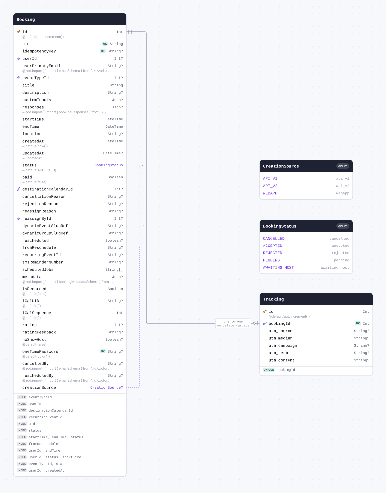

| Field          | Type     | Constraints                                    | Default           | Description |
| -------------- | -------- | ---------------------------------------------- | ----------------- | ----------- |
| `id`           | `Int`    | PK NOT NULL                                    | `autoincrement()` |             |
| `bookingId`    | `Int`    | UNIQUE NOT NULL → [Booking.id](#model-Booking) |                   |             |
| `utm_source`   | `String` | NULL                                           |                   |             |
| `utm_medium`   | `String` | NULL                                           |                   |             |
| `utm_campaign` | `String` | NULL                                           |                   |             |
| `utm_term`     | `String` | NULL                                           |                   |             |
| `utm_content`  | `String` | NULL                                           |                   |             |

#### Indexes

- `@@unique([bookingId])`

#### References

- `bookingId` → [Booking.id](#model-Booking) (one-to-one, on delete Cascade)

#### Definition

```sql
CREATE TABLE "Tracking" (
    "id" SERIAL NOT NULL,
    "bookingId" INTEGER NOT NULL,
    "utm_source" TEXT,
    "utm_medium" TEXT,
    "utm_campaign" TEXT,
    "utm_term" TEXT,
    "utm_content" TEXT,

    CONSTRAINT "Tracking_pkey" PRIMARY KEY ("id")
);

CREATE UNIQUE INDEX "Tracking_bookingId_key" ON "Tracking"("bookingId");

ALTER TABLE "Tracking" ADD CONSTRAINT "Tracking_bookingId_fkey" FOREIGN KEY ("bookingId") REFERENCES "Booking"("id") ON DELETE CASCADE ON UPDATE CASCADE;
```

<details>
<summary>Queries and their SQL</summary>

**findMany**: Every row

```ts
await prisma.tracking.findMany();
```

```sql
SELECT
  "public"."Tracking"."id",
  "public"."Tracking"."bookingId",
  "public"."Tracking"."utm_source",
  "public"."Tracking"."utm_medium",
  "public"."Tracking"."utm_campaign",
  "public"."Tracking"."utm_term",
  "public"."Tracking"."utm_content"
FROM
  "public"."Tracking"
WHERE
  1 = 1
OFFSET
  $1
-- params: ["0"]
```

**count**: How many rows there are

```ts
await prisma.tracking.count();
```

```sql
SELECT
  COUNT(*) AS "_count$_all"
FROM
  (
    SELECT
      "public"."Tracking"."id"
    FROM
      "public"."Tracking"
    WHERE
      1 = 1
    OFFSET
      $1
  ) AS "sub"
-- params: ["0"]
```

**findMany**: Every row with its relations

```ts
await prisma.tracking.findMany({ include: { booking: true } });
```

```sql
SELECT
  "public"."Tracking"."id",
  "public"."Tracking"."bookingId",
  "public"."Tracking"."utm_source",
  "public"."Tracking"."utm_medium",
  "public"."Tracking"."utm_campaign",
  "public"."Tracking"."utm_term",
  "public"."Tracking"."utm_content"
FROM
  "public"."Tracking"
WHERE
  1 = 1
OFFSET
  $1
-- params: ["0"]

SELECT
  "public"."Booking"."id",
  "public"."Booking"."uid",
  "public"."Booking"."idempotencyKey",
  "public"."Booking"."userId",
  "public"."Booking"."userPrimaryEmail",
  "public"."Booking"."eventTypeId",
  "public"."Booking"."title",
  "public"."Booking"."description",
  "public"."Booking"."customInputs",
  "public"."Booking"."responses",
  "public"."Booking"."startTime",
  "public"."Booking"."endTime",
  "public"."Booking"."location",
  "public"."Booking"."createdAt",
  "public"."Booking"."updatedAt",
  "public"."Booking"."status"::text,
  "public"."Booking"."paid",
  "public"."Booking"."destinationCalendarId",
  "public"."Booking"."cancellationReason",
  "public"."Booking"."rejectionReason",
  "public"."Booking"."reassignReason",
  "public"."Booking"."reassignById",
  "public"."Booking"."dynamicEventSlugRef",
  "public"."Booking"."dynamicGroupSlugRef",
  "public"."Booking"."rescheduled",
  "public"."Booking"."fromReschedule",
  "public"."Booking"."recurringEventId",
  "public"."Booking"."smsReminderNumber",
  "public"."Booking"."scheduledJobs",
  "public"."Booking"."metadata",
  "public"."Booking"."isRecorded",
  "public"."Booking"."iCalUID",
  "public"."Booking"."iCalSequence",
  "public"."Booking"."rating",
  "public"."Booking"."ratingFeedback",
  "public"."Booking"."noShowHost",
  "public"."Booking"."oneTimePassword",
  "public"."Booking"."cancelledBy",
  "public"."Booking"."rescheduledBy",
  "public"."Booking"."creationSource"::text
FROM
  "public"."Booking"
WHERE
  "public"."Booking"."id" IN ($1)
OFFSET
  $2
-- params: ["<bookingId of the rows above>","0"]
```

**findUnique**: One row by what is unique to it

```ts
await prisma.tracking.findUnique({ where: { id: 1 } });
```

```sql
SELECT
  "public"."Tracking"."id",
  "public"."Tracking"."bookingId",
  "public"."Tracking"."utm_source",
  "public"."Tracking"."utm_medium",
  "public"."Tracking"."utm_campaign",
  "public"."Tracking"."utm_term",
  "public"."Tracking"."utm_content"
FROM
  "public"."Tracking"
WHERE
  (
    "public"."Tracking"."id" = $1
    AND 1 = 1
  )
LIMIT
  $2
OFFSET
  $3
-- params: ["1","1","0"]
```

**create**: Create a row

```ts
await prisma.tracking.create({ data: { bookingId: 1 } });
```

```sql
INSERT INTO
  "public"."Tracking" ("bookingId")
VALUES
  ($1)
RETURNING
  "public"."Tracking"."id",
  "public"."Tracking"."bookingId",
  "public"."Tracking"."utm_source",
  "public"."Tracking"."utm_medium",
  "public"."Tracking"."utm_campaign",
  "public"."Tracking"."utm_term",
  "public"."Tracking"."utm_content"
-- params: ["1"]
```

**update**: Update a row

```ts
await prisma.tracking.update({ where: { id: 1 }, data: { utm_source: "example" } });
```

```sql
UPDATE "public"."Tracking"
SET
  "utm_source" = $1
WHERE
  (
    "public"."Tracking"."id" = $2
    AND 1 = 1
  )
RETURNING
  "public"."Tracking"."id",
  "public"."Tracking"."bookingId",
  "public"."Tracking"."utm_source",
  "public"."Tracking"."utm_medium",
  "public"."Tracking"."utm_campaign",
  "public"."Tracking"."utm_term",
  "public"."Tracking"."utm_content"
-- params: ["example","1"]
```

**delete**: Delete a row

```ts
await prisma.tracking.delete({ where: { id: 1 } });
```

```sql
DELETE FROM "public"."Tracking"
WHERE
  (
    "public"."Tracking"."id" = $1
    AND 1 = 1
  )
RETURNING
  "public"."Tracking"."id",
  "public"."Tracking"."bookingId",
  "public"."Tracking"."utm_source",
  "public"."Tracking"."utm_medium",
  "public"."Tracking"."utm_campaign",
  "public"."Tracking"."utm_term",
  "public"."Tracking"."utm_content"
-- params: ["1"]
```

</details>

<a id="model-Schedule"></a>

### Schedule

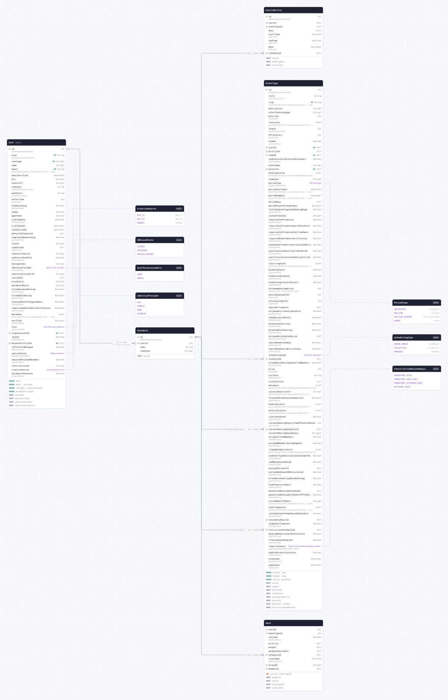

| Field      | Type     | Constraints                       | Default           | Description |
| ---------- | -------- | --------------------------------- | ----------------- | ----------- |
| `id`       | `Int`    | PK NOT NULL                       | `autoincrement()` |             |
| `userId`   | `Int`    | NOT NULL → [User.id](#model-User) |                   |             |
| `name`     | `String` | NOT NULL                          |                   |             |
| `timeZone` | `String` | NULL                              |                   |             |

#### Indexes

- `@@index([userId])`

#### References

- `userId` → [User.id](#model-User) (many-to-one, on delete Cascade)

#### Referenced by

- `id` ← [Host.scheduleId](#model-Host) (one-to-many)
- `id` ← [EventType.scheduleId](#model-EventType) (one-to-many)
- `id` ← [EventType.instantMeetingScheduleId](#model-EventType) (one-to-many)
- `id` ← [EventType.restrictionScheduleId](#model-EventType) (one-to-many)
- `id` ← [Availability.scheduleId](#model-Availability) (one-to-many)

#### Definition

```sql
CREATE TABLE "Schedule" (
    "id" SERIAL NOT NULL,
    "userId" INTEGER NOT NULL,
    "name" TEXT NOT NULL,
    "timeZone" TEXT,

    CONSTRAINT "Schedule_pkey" PRIMARY KEY ("id")
);

CREATE INDEX "Schedule_userId_idx" ON "Schedule"("userId");

ALTER TABLE "Schedule" ADD CONSTRAINT "Schedule_userId_fkey" FOREIGN KEY ("userId") REFERENCES "users"("id") ON DELETE CASCADE ON UPDATE CASCADE;
```

<details>
<summary>Queries and their SQL</summary>

**findMany**: Every row

```ts
await prisma.schedule.findMany();
```

```sql
SELECT
  "public"."Schedule"."id",
  "public"."Schedule"."userId",
  "public"."Schedule"."name",
  "public"."Schedule"."timeZone"
FROM
  "public"."Schedule"
WHERE
  1 = 1
OFFSET
  $1
-- params: ["0"]
```

**count**: How many rows there are

```ts
await prisma.schedule.count();
```

```sql
SELECT
  COUNT(*) AS "_count$_all"
FROM
  (
    SELECT
      "public"."Schedule"."id"
    FROM
      "public"."Schedule"
    WHERE
      1 = 1
    OFFSET
      $1
  ) AS "sub"
-- params: ["0"]
```

**findMany**: Every row with its relations

```ts
await prisma.schedule.findMany({
  include: {
    user: true,
    eventType: true,
    instantMeetingEvents: true,
    restrictionSchedule: true,
    availability: true,
    Host: true,
  },
});
```

```sql
SELECT
  "public"."Schedule"."id",
  "public"."Schedule"."userId",
  "public"."Schedule"."name",
  "public"."Schedule"."timeZone"
FROM
  "public"."Schedule"
WHERE
  1 = 1
OFFSET
  $1
-- params: ["0"]

SELECT
  "public"."users"."id",
  "public"."users"."uuid",
  "public"."users"."username",
  "public"."users"."name",
  "public"."users"."email",
  "public"."users"."emailVerified",
  "public"."users"."bio",
  "public"."users"."avatarUrl",
  "public"."users"."timeZone",
  "public"."users"."weekStart",
  "public"."users"."bufferTime",
  "public"."users"."hideBranding",
  "public"."users"."theme",
  "public"."users"."appTheme",
  "public"."users"."created",
  "public"."users"."trialEndsAt",
  "public"."users"."lastActiveAt",
  "public"."users"."defaultScheduleId",
  "public"."users"."completedOnboarding",
  "public"."users"."locale",
  "public"."users"."timeFormat",
  "public"."users"."twoFactorSecret",
  "public"."users"."twoFactorEnabled",
  "public"."users"."backupCodes",
  "public"."users"."identityProvider"::text,
  "public"."users"."identityProviderId",
  "public"."users"."invitedTo",
  "public"."users"."brandColor",
  "public"."users"."darkBrandColor",
  "public"."users"."allowDynamicBooking",
  "public"."users"."allowSEOIndexing",
  "public"."users"."receiveMonthlyDigestEmail",
  "public"."users"."requiresBookerEmailVerification",
  "public"."users"."metadata",
  "public"."users"."verified",
  "public"."users"."role"::text,
  "public"."users"."organizationId",
  "public"."users"."locked",
  "public"."users"."movedToProfileId",
  "public"."users"."isPlatformManaged",
  "public"."users"."smsLockState"::text,
  "public"."users"."smsLockReviewedByAdmin",
  "public"."users"."referralLinkId",
  "public"."users"."creationSource"::text,
  "public"."users"."autoOptInFeatures"
FROM
  "public"."users"
WHERE
  "public"."users"."id" IN ($1)
OFFSET
  $2
-- params: ["<userId of the rows above>","0"]

SELECT
  "public"."EventType"."id",
  "public"."EventType"."title",
  "public"."EventType"."slug",
  "public"."EventType"."description",
  "public"."EventType"."interfaceLanguage",
  "public"."EventType"."position",
  "public"."EventType"."locations",
  "public"."EventType"."length",
  "public"."EventType"."offsetStart",
  "public"."EventType"."hidden",
  "public"."EventType"."userId",
  "public"."EventType"."profileId",
  "public"."EventType"."teamId",
  "public"."EventType"."useEventLevelSelectedCalendars",
  "public"."EventType"."eventName",
  "public"."EventType"."parentId",
  "public"."EventType"."bookingFields",
  "public"."EventType"."timeZone",
  "public"."EventType"."periodType"::text,
  "public"."EventType"."periodStartDate",
  "public"."EventType"."periodEndDate",
  "public"."EventType"."periodDays",
  "public"."EventType"."periodCountCalendarDays",
  "public"."EventType"."lockTimeZoneToggleOnBookingPage",
  "public"."EventType"."lockedTimeZone",
  "public"."EventType"."requiresConfirmation",
  "public"."EventType"."requiresConfirmationWillBlockSlot",
  "public"."EventType"."requiresConfirmationForFreeEmail",
  "public"."EventType"."requiresBookerEmailVerification",
  "public"."EventType"."canSendCalVideoTranscriptionEmails",
  "public"."EventType"."autoTranslateDescriptionEnabled",
  "public"."EventType"."autoTranslateInstantMeetingTitleEnabled",
  "public"."EventType"."recurringEvent",
  "public"."EventType"."disableGuests",
  "public"."EventType"."hideCalendarNotes",
  "public"."EventType"."hideCalendarEventDetails",
  "public"."EventType"."minimumBookingNotice",
  "public"."EventType"."beforeEventBuffer",
  "public"."EventType"."afterEventBuffer",
  "public"."EventType"."seatsPerTimeSlot",
  "public"."EventType"."onlyShowFirstAvailableSlot",
  "public"."EventType"."showOptimizedSlots",
  "public"."EventType"."disableCancelling",
  "public"."EventType"."disableRescheduling",
  "public"."EventType"."minimumRescheduleNotice",
  "public"."EventType"."seatsShowAttendees",
  "public"."EventType"."seatsShowAvailabilityCount",
  "public"."EventType"."schedulingType"::text,
  "public"."EventType"."scheduleId",
  "public"."EventType"."allowReschedulingCancelledBookings",
  "public"."EventType"."price",
  "public"."EventType"."currency",
  "public"."EventType"."slotInterval",
  "public"."EventType"."metadata",
  "public"."EventType"."successRedirectUrl",
  "public"."EventType"."forwardParamsSuccessRedirect",
  "public"."EventType"."bookingLimits",
  "public"."EventType"."durationLimits",
  "public"."EventType"."isInstantEvent",
  "public"."EventType"."instantMeetingExpiryTimeOffsetInSeconds",
  "public"."EventType"."instantMeetingScheduleId",
  "public"."EventType"."instantMeetingParameters",
  "public"."EventType"."assignAllTeamMembers",
  "public"."EventType"."assignRRMembersUsingSegment",
  "public"."EventType"."rrSegmentQueryValue",
  "public"."EventType"."useEventTypeDestinationCalendarEmail",
  "public"."EventType"."isRRWeightsEnabled",
  "public"."EventType"."maxLeadThreshold",
  "public"."EventType"."includeNoShowInRRCalculation",
  "public"."EventType"."allowReschedulingPastBookings",
  "public"."EventType"."hideOrganizerEmail",
  "public"."EventType"."maxActiveBookingsPerBooker",
  "public"."EventType"."maxActiveBookingPerBookerOfferReschedule",
  "public"."EventType"."customReplyToEmail",
  "public"."EventType"."eventTypeColor",
  "public"."EventType"."rescheduleWithSameRoundRobinHost",
  "public"."EventType"."secondaryEmailId",
  "public"."EventType"."useBookerTimezone",
  "public"."EventType"."restrictionScheduleId",
  "public"."EventType"."bookingRequiresAuthentication",
  "public"."EventType"."rrHostSubsetEnabled",
  "public"."EventType"."requiresCancellationReason"::text,
  "public"."EventType"."enablePerHostLocations",
  "public"."EventType"."createdAt",
  "public"."EventType"."updatedAt"
FROM
  "public"."EventType"
WHERE
  "public"."EventType"."scheduleId" IN ($1)
OFFSET
  $2
-- params: ["<id of the rows above>","0"]

SELECT
  "public"."EventType"."id",
  "public"."EventType"."title",
  "public"."EventType"."slug",
  "public"."EventType"."description",
  "public"."EventType"."interfaceLanguage",
  "public"."EventType"."position",
  "public"."EventType"."locations",
  "public"."EventType"."length",
  "public"."EventType"."offsetStart",
  "public"."EventType"."hidden",
  "public"."EventType"."userId",
  "public"."EventType"."profileId",
  "public"."EventType"."teamId",
  "public"."EventType"."useEventLevelSelectedCalendars",
  "public"."EventType"."eventName",
  "public"."EventType"."parentId",
  "public"."EventType"."bookingFields",
  "public"."EventType"."timeZone",
  "public"."EventType"."periodType"::text,
  "public"."EventType"."periodStartDate",
  "public"."EventType"."periodEndDate",
  "public"."EventType"."periodDays",
  "public"."EventType"."periodCountCalendarDays",
  "public"."EventType"."lockTimeZoneToggleOnBookingPage",
  "public"."EventType"."lockedTimeZone",
  "public"."EventType"."requiresConfirmation",
  "public"."EventType"."requiresConfirmationWillBlockSlot",
  "public"."EventType"."requiresConfirmationForFreeEmail",
  "public"."EventType"."requiresBookerEmailVerification",
  "public"."EventType"."canSendCalVideoTranscriptionEmails",
  "public"."EventType"."autoTranslateDescriptionEnabled",
  "public"."EventType"."autoTranslateInstantMeetingTitleEnabled",
  "public"."EventType"."recurringEvent",
  "public"."EventType"."disableGuests",
  "public"."EventType"."hideCalendarNotes",
  "public"."EventType"."hideCalendarEventDetails",
  "public"."EventType"."minimumBookingNotice",
  "public"."EventType"."beforeEventBuffer",
  "public"."EventType"."afterEventBuffer",
  "public"."EventType"."seatsPerTimeSlot",
  "public"."EventType"."onlyShowFirstAvailableSlot",
  "public"."EventType"."showOptimizedSlots",
  "public"."EventType"."disableCancelling",
  "public"."EventType"."disableRescheduling",
  "public"."EventType"."minimumRescheduleNotice",
  "public"."EventType"."seatsShowAttendees",
  "public"."EventType"."seatsShowAvailabilityCount",
  "public"."EventType"."schedulingType"::text,
  "public"."EventType"."scheduleId",
  "public"."EventType"."allowReschedulingCancelledBookings",
  "public"."EventType"."price",
  "public"."EventType"."currency",
  "public"."EventType"."slotInterval",
  "public"."EventType"."metadata",
  "public"."EventType"."successRedirectUrl",
  "public"."EventType"."forwardParamsSuccessRedirect",
  "public"."EventType"."bookingLimits",
  "public"."EventType"."durationLimits",
  "public"."EventType"."isInstantEvent",
  "public"."EventType"."instantMeetingExpiryTimeOffsetInSeconds",
  "public"."EventType"."instantMeetingScheduleId",
  "public"."EventType"."instantMeetingParameters",
  "public"."EventType"."assignAllTeamMembers",
  "public"."EventType"."assignRRMembersUsingSegment",
  "public"."EventType"."rrSegmentQueryValue",
  "public"."EventType"."useEventTypeDestinationCalendarEmail",
  "public"."EventType"."isRRWeightsEnabled",
  "public"."EventType"."maxLeadThreshold",
  "public"."EventType"."includeNoShowInRRCalculation",
  "public"."EventType"."allowReschedulingPastBookings",
  "public"."EventType"."hideOrganizerEmail",
  "public"."EventType"."maxActiveBookingsPerBooker",
  "public"."EventType"."maxActiveBookingPerBookerOfferReschedule",
  "public"."EventType"."customReplyToEmail",
  "public"."EventType"."eventTypeColor",
  "public"."EventType"."rescheduleWithSameRoundRobinHost",
  "public"."EventType"."secondaryEmailId",
  "public"."EventType"."useBookerTimezone",
  "public"."EventType"."restrictionScheduleId",
  "public"."EventType"."bookingRequiresAuthentication",
  "public"."EventType"."rrHostSubsetEnabled",
  "public"."EventType"."requiresCancellationReason"::text,
  "public"."EventType"."enablePerHostLocations",
  "public"."EventType"."createdAt",
  "public"."EventType"."updatedAt"
FROM
  "public"."EventType"
WHERE
  "public"."EventType"."instantMeetingScheduleId" IN ($1)
OFFSET
  $2
-- params: ["<id of the rows above>","0"]

SELECT
  "public"."EventType"."id",
  "public"."EventType"."title",
  "public"."EventType"."slug",
  "public"."EventType"."description",
  "public"."EventType"."interfaceLanguage",
  "public"."EventType"."position",
  "public"."EventType"."locations",
  "public"."EventType"."length",
  "public"."EventType"."offsetStart",
  "public"."EventType"."hidden",
  "public"."EventType"."userId",
  "public"."EventType"."profileId",
  "public"."EventType"."teamId",
  "public"."EventType"."useEventLevelSelectedCalendars",
  "public"."EventType"."eventName",
  "public"."EventType"."parentId",
  "public"."EventType"."bookingFields",
  "public"."EventType"."timeZone",
  "public"."EventType"."periodType"::text,
  "public"."EventType"."periodStartDate",
  "public"."EventType"."periodEndDate",
  "public"."EventType"."periodDays",
  "public"."EventType"."periodCountCalendarDays",
  "public"."EventType"."lockTimeZoneToggleOnBookingPage",
  "public"."EventType"."lockedTimeZone",
  "public"."EventType"."requiresConfirmation",
  "public"."EventType"."requiresConfirmationWillBlockSlot",
  "public"."EventType"."requiresConfirmationForFreeEmail",
  "public"."EventType"."requiresBookerEmailVerification",
  "public"."EventType"."canSendCalVideoTranscriptionEmails",
  "public"."EventType"."autoTranslateDescriptionEnabled",
  "public"."EventType"."autoTranslateInstantMeetingTitleEnabled",
  "public"."EventType"."recurringEvent",
  "public"."EventType"."disableGuests",
  "public"."EventType"."hideCalendarNotes",
  "public"."EventType"."hideCalendarEventDetails",
  "public"."EventType"."minimumBookingNotice",
  "public"."EventType"."beforeEventBuffer",
  "public"."EventType"."afterEventBuffer",
  "public"."EventType"."seatsPerTimeSlot",
  "public"."EventType"."onlyShowFirstAvailableSlot",
  "public"."EventType"."showOptimizedSlots",
  "public"."EventType"."disableCancelling",
  "public"."EventType"."disableRescheduling",
  "public"."EventType"."minimumRescheduleNotice",
  "public"."EventType"."seatsShowAttendees",
  "public"."EventType"."seatsShowAvailabilityCount",
  "public"."EventType"."schedulingType"::text,
  "public"."EventType"."scheduleId",
  "public"."EventType"."allowReschedulingCancelledBookings",
  "public"."EventType"."price",
  "public"."EventType"."currency",
  "public"."EventType"."slotInterval",
  "public"."EventType"."metadata",
  "public"."EventType"."successRedirectUrl",
  "public"."EventType"."forwardParamsSuccessRedirect",
  "public"."EventType"."bookingLimits",
  "public"."EventType"."durationLimits",
  "public"."EventType"."isInstantEvent",
  "public"."EventType"."instantMeetingExpiryTimeOffsetInSeconds",
  "public"."EventType"."instantMeetingScheduleId",
  "public"."EventType"."instantMeetingParameters",
  "public"."EventType"."assignAllTeamMembers",
  "public"."EventType"."assignRRMembersUsingSegment",
  "public"."EventType"."rrSegmentQueryValue",
  "public"."EventType"."useEventTypeDestinationCalendarEmail",
  "public"."EventType"."isRRWeightsEnabled",
  "public"."EventType"."maxLeadThreshold",
  "public"."EventType"."includeNoShowInRRCalculation",
  "public"."EventType"."allowReschedulingPastBookings",
  "public"."EventType"."hideOrganizerEmail",
  "public"."EventType"."maxActiveBookingsPerBooker",
  "public"."EventType"."maxActiveBookingPerBookerOfferReschedule",
  "public"."EventType"."customReplyToEmail",
  "public"."EventType"."eventTypeColor",
  "public"."EventType"."rescheduleWithSameRoundRobinHost",
  "public"."EventType"."secondaryEmailId",
  "public"."EventType"."useBookerTimezone",
  "public"."EventType"."restrictionScheduleId",
  "public"."EventType"."bookingRequiresAuthentication",
  "public"."EventType"."rrHostSubsetEnabled",
  "public"."EventType"."requiresCancellationReason"::text,
  "public"."EventType"."enablePerHostLocations",
  "public"."EventType"."createdAt",
  "public"."EventType"."updatedAt"
FROM
  "public"."EventType"
WHERE
  "public"."EventType"."restrictionScheduleId" IN ($1)
OFFSET
  $2
-- params: ["<id of the rows above>","0"]

SELECT
  "public"."Availability"."id",
  "public"."Availability"."userId",
  "public"."Availability"."eventTypeId",
  "public"."Availability"."days",
  "public"."Availability"."startTime",
  "public"."Availability"."endTime",
  "public"."Availability"."date",
  "public"."Availability"."scheduleId"
FROM
  "public"."Availability"
WHERE
  "public"."Availability"."scheduleId" IN ($1)
OFFSET
  $2
-- params: ["<id of the rows above>","0"]

SELECT
  "public"."Host"."userId",
  "public"."Host"."eventTypeId",
  "public"."Host"."isFixed",
  "public"."Host"."priority",
  "public"."Host"."weight",
  "public"."Host"."weightAdjustment",
  "public"."Host"."scheduleId",
  "public"."Host"."createdAt",
  "public"."Host"."groupId",
  "public"."Host"."memberId"
FROM
  "public"."Host"
WHERE
  "public"."Host"."scheduleId" IN ($1)
OFFSET
  $2
-- params: ["<id of the rows above>","0"]
```

**findUnique**: One row by what is unique to it

```ts
await prisma.schedule.findUnique({ where: { id: 1 } });
```

```sql
SELECT
  "public"."Schedule"."id",
  "public"."Schedule"."userId",
  "public"."Schedule"."name",
  "public"."Schedule"."timeZone"
FROM
  "public"."Schedule"
WHERE
  (
    "public"."Schedule"."id" = $1
    AND 1 = 1
  )
LIMIT
  $2
OFFSET
  $3
-- params: ["1","1","0"]
```

**create**: Create a row

```ts
await prisma.schedule.create({ data: { userId: 1, name: "example" } });
```

```sql
INSERT INTO
  "public"."Schedule" ("userId", "name")
VALUES
  ($1, $2)
RETURNING
  "public"."Schedule"."id",
  "public"."Schedule"."userId",
  "public"."Schedule"."name",
  "public"."Schedule"."timeZone"
-- params: ["1","example"]
```

**update**: Update a row

```ts
await prisma.schedule.update({ where: { id: 1 }, data: { name: "example" } });
```

```sql
UPDATE "public"."Schedule"
SET
  "name" = $1
WHERE
  (
    "public"."Schedule"."id" = $2
    AND 1 = 1
  )
RETURNING
  "public"."Schedule"."id",
  "public"."Schedule"."userId",
  "public"."Schedule"."name",
  "public"."Schedule"."timeZone"
-- params: ["example","1"]
```

**delete**: Delete a row

```ts
await prisma.schedule.delete({ where: { id: 1 } });
```

```sql
DELETE FROM "public"."Schedule"
WHERE
  (
    "public"."Schedule"."id" = $1
    AND 1 = 1
  )
RETURNING
  "public"."Schedule"."id",
  "public"."Schedule"."userId",
  "public"."Schedule"."name",
  "public"."Schedule"."timeZone"
-- params: ["1"]
```

</details>

<a id="model-Availability"></a>

### Availability

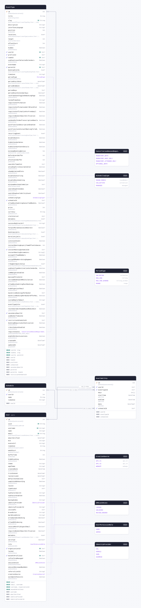

| Field         | Type                  | Constraints                             | Default           | Description |
| ------------- | --------------------- | --------------------------------------- | ----------------- | ----------- |
| `id`          | `Int`                 | PK NOT NULL                             | `autoincrement()` |             |
| `userId`      | `Int`                 | NULL → [User.id](#model-User)           |                   |             |
| `eventTypeId` | `Int`                 | NULL → [EventType.id](#model-EventType) |                   |             |
| `days`        | `Int[]`               | NOT NULL                                |                   |             |
| `startTime`   | `DateTime` `@db.Time` | NOT NULL                                |                   |             |
| `endTime`     | `DateTime` `@db.Time` | NOT NULL                                |                   |             |
| `date`        | `DateTime` `@db.Date` | NULL                                    |                   |             |
| `scheduleId`  | `Int`                 | NULL → [Schedule.id](#model-Schedule)   |                   |             |

#### Indexes

- `@@index([userId])`
- `@@index([eventTypeId])`
- `@@index([scheduleId])`

#### References

- `userId` → [User.id](#model-User) (many-to-one, on delete Cascade)
- `eventTypeId` → [EventType.id](#model-EventType) (many-to-one)
- `scheduleId` → [Schedule.id](#model-Schedule) (many-to-one)

#### Definition

```sql
CREATE TABLE "Availability" (
    "id" SERIAL NOT NULL,
    "userId" INTEGER,
    "eventTypeId" INTEGER,
    "days" INTEGER[],
    "startTime" TIME NOT NULL,
    "endTime" TIME NOT NULL,
    "date" DATE,
    "scheduleId" INTEGER,

    CONSTRAINT "Availability_pkey" PRIMARY KEY ("id")
);

CREATE INDEX "Availability_userId_idx" ON "Availability"("userId");

CREATE INDEX "Availability_eventTypeId_idx" ON "Availability"("eventTypeId");

CREATE INDEX "Availability_scheduleId_idx" ON "Availability"("scheduleId");

ALTER TABLE "Availability" ADD CONSTRAINT "Availability_userId_fkey" FOREIGN KEY ("userId") REFERENCES "users"("id") ON DELETE CASCADE ON UPDATE CASCADE;

ALTER TABLE "Availability" ADD CONSTRAINT "Availability_eventTypeId_fkey" FOREIGN KEY ("eventTypeId") REFERENCES "EventType"("id") ON DELETE SET NULL ON UPDATE CASCADE;

ALTER TABLE "Availability" ADD CONSTRAINT "Availability_scheduleId_fkey" FOREIGN KEY ("scheduleId") REFERENCES "Schedule"("id") ON DELETE SET NULL ON UPDATE CASCADE;
```

<details>
<summary>Queries and their SQL</summary>

**findMany**: Every row

```ts
await prisma.availability.findMany();
```

```sql
SELECT
  "public"."Availability"."id",
  "public"."Availability"."userId",
  "public"."Availability"."eventTypeId",
  "public"."Availability"."days",
  "public"."Availability"."startTime",
  "public"."Availability"."endTime",
  "public"."Availability"."date",
  "public"."Availability"."scheduleId"
FROM
  "public"."Availability"
WHERE
  1 = 1
OFFSET
  $1
-- params: ["0"]
```

**count**: How many rows there are

```ts
await prisma.availability.count();
```

```sql
SELECT
  COUNT(*) AS "_count$_all"
FROM
  (
    SELECT
      "public"."Availability"."id"
    FROM
      "public"."Availability"
    WHERE
      1 = 1
    OFFSET
      $1
  ) AS "sub"
-- params: ["0"]
```

**findMany**: Every row with its relations

```ts
await prisma.availability.findMany({ include: { user: true, eventType: true, Schedule: true } });
```

```sql
SELECT
  "public"."Availability"."id",
  "public"."Availability"."userId",
  "public"."Availability"."eventTypeId",
  "public"."Availability"."days",
  "public"."Availability"."startTime",
  "public"."Availability"."endTime",
  "public"."Availability"."date",
  "public"."Availability"."scheduleId"
FROM
  "public"."Availability"
WHERE
  1 = 1
OFFSET
  $1
-- params: ["0"]

SELECT
  "public"."users"."id",
  "public"."users"."uuid",
  "public"."users"."username",
  "public"."users"."name",
  "public"."users"."email",
  "public"."users"."emailVerified",
  "public"."users"."bio",
  "public"."users"."avatarUrl",
  "public"."users"."timeZone",
  "public"."users"."weekStart",
  "public"."users"."bufferTime",
  "public"."users"."hideBranding",
  "public"."users"."theme",
  "public"."users"."appTheme",
  "public"."users"."created",
  "public"."users"."trialEndsAt",
  "public"."users"."lastActiveAt",
  "public"."users"."defaultScheduleId",
  "public"."users"."completedOnboarding",
  "public"."users"."locale",
  "public"."users"."timeFormat",
  "public"."users"."twoFactorSecret",
  "public"."users"."twoFactorEnabled",
  "public"."users"."backupCodes",
  "public"."users"."identityProvider"::text,
  "public"."users"."identityProviderId",
  "public"."users"."invitedTo",
  "public"."users"."brandColor",
  "public"."users"."darkBrandColor",
  "public"."users"."allowDynamicBooking",
  "public"."users"."allowSEOIndexing",
  "public"."users"."receiveMonthlyDigestEmail",
  "public"."users"."requiresBookerEmailVerification",
  "public"."users"."metadata",
  "public"."users"."verified",
  "public"."users"."role"::text,
  "public"."users"."organizationId",
  "public"."users"."locked",
  "public"."users"."movedToProfileId",
  "public"."users"."isPlatformManaged",
  "public"."users"."smsLockState"::text,
  "public"."users"."smsLockReviewedByAdmin",
  "public"."users"."referralLinkId",
  "public"."users"."creationSource"::text,
  "public"."users"."autoOptInFeatures"
FROM
  "public"."users"
WHERE
  "public"."users"."id" IN ($1)
OFFSET
  $2
-- params: ["<userId of the rows above>","0"]

SELECT
  "public"."EventType"."id",
  "public"."EventType"."title",
  "public"."EventType"."slug",
  "public"."EventType"."description",
  "public"."EventType"."interfaceLanguage",
  "public"."EventType"."position",
  "public"."EventType"."locations",
  "public"."EventType"."length",
  "public"."EventType"."offsetStart",
  "public"."EventType"."hidden",
  "public"."EventType"."userId",
  "public"."EventType"."profileId",
  "public"."EventType"."teamId",
  "public"."EventType"."useEventLevelSelectedCalendars",
  "public"."EventType"."eventName",
  "public"."EventType"."parentId",
  "public"."EventType"."bookingFields",
  "public"."EventType"."timeZone",
  "public"."EventType"."periodType"::text,
  "public"."EventType"."periodStartDate",
  "public"."EventType"."periodEndDate",
  "public"."EventType"."periodDays",
  "public"."EventType"."periodCountCalendarDays",
  "public"."EventType"."lockTimeZoneToggleOnBookingPage",
  "public"."EventType"."lockedTimeZone",
  "public"."EventType"."requiresConfirmation",
  "public"."EventType"."requiresConfirmationWillBlockSlot",
  "public"."EventType"."requiresConfirmationForFreeEmail",
  "public"."EventType"."requiresBookerEmailVerification",
  "public"."EventType"."canSendCalVideoTranscriptionEmails",
  "public"."EventType"."autoTranslateDescriptionEnabled",
  "public"."EventType"."autoTranslateInstantMeetingTitleEnabled",
  "public"."EventType"."recurringEvent",
  "public"."EventType"."disableGuests",
  "public"."EventType"."hideCalendarNotes",
  "public"."EventType"."hideCalendarEventDetails",
  "public"."EventType"."minimumBookingNotice",
  "public"."EventType"."beforeEventBuffer",
  "public"."EventType"."afterEventBuffer",
  "public"."EventType"."seatsPerTimeSlot",
  "public"."EventType"."onlyShowFirstAvailableSlot",
  "public"."EventType"."showOptimizedSlots",
  "public"."EventType"."disableCancelling",
  "public"."EventType"."disableRescheduling",
  "public"."EventType"."minimumRescheduleNotice",
  "public"."EventType"."seatsShowAttendees",
  "public"."EventType"."seatsShowAvailabilityCount",
  "public"."EventType"."schedulingType"::text,
  "public"."EventType"."scheduleId",
  "public"."EventType"."allowReschedulingCancelledBookings",
  "public"."EventType"."price",
  "public"."EventType"."currency",
  "public"."EventType"."slotInterval",
  "public"."EventType"."metadata",
  "public"."EventType"."successRedirectUrl",
  "public"."EventType"."forwardParamsSuccessRedirect",
  "public"."EventType"."bookingLimits",
  "public"."EventType"."durationLimits",
  "public"."EventType"."isInstantEvent",
  "public"."EventType"."instantMeetingExpiryTimeOffsetInSeconds",
  "public"."EventType"."instantMeetingScheduleId",
  "public"."EventType"."instantMeetingParameters",
  "public"."EventType"."assignAllTeamMembers",
  "public"."EventType"."assignRRMembersUsingSegment",
  "public"."EventType"."rrSegmentQueryValue",
  "public"."EventType"."useEventTypeDestinationCalendarEmail",
  "public"."EventType"."isRRWeightsEnabled",
  "public"."EventType"."maxLeadThreshold",
  "public"."EventType"."includeNoShowInRRCalculation",
  "public"."EventType"."allowReschedulingPastBookings",
  "public"."EventType"."hideOrganizerEmail",
  "public"."EventType"."maxActiveBookingsPerBooker",
  "public"."EventType"."maxActiveBookingPerBookerOfferReschedule",
  "public"."EventType"."customReplyToEmail",
  "public"."EventType"."eventTypeColor",
  "public"."EventType"."rescheduleWithSameRoundRobinHost",
  "public"."EventType"."secondaryEmailId",
  "public"."EventType"."useBookerTimezone",
  "public"."EventType"."restrictionScheduleId",
  "public"."EventType"."bookingRequiresAuthentication",
  "public"."EventType"."rrHostSubsetEnabled",
  "public"."EventType"."requiresCancellationReason"::text,
  "public"."EventType"."enablePerHostLocations",
  "public"."EventType"."createdAt",
  "public"."EventType"."updatedAt"
FROM
  "public"."EventType"
WHERE
  "public"."EventType"."id" IN ($1)
OFFSET
  $2
-- params: ["<eventTypeId of the rows above>","0"]

SELECT
  "public"."Schedule"."id",
  "public"."Schedule"."userId",
  "public"."Schedule"."name",
  "public"."Schedule"."timeZone"
FROM
  "public"."Schedule"
WHERE
  "public"."Schedule"."id" IN ($1)
OFFSET
  $2
-- params: ["<scheduleId of the rows above>","0"]
```

**findUnique**: One row by what is unique to it

```ts
await prisma.availability.findUnique({ where: { id: 1 } });
```

```sql
SELECT
  "public"."Availability"."id",
  "public"."Availability"."userId",
  "public"."Availability"."eventTypeId",
  "public"."Availability"."days",
  "public"."Availability"."startTime",
  "public"."Availability"."endTime",
  "public"."Availability"."date",
  "public"."Availability"."scheduleId"
FROM
  "public"."Availability"
WHERE
  (
    "public"."Availability"."id" = $1
    AND 1 = 1
  )
LIMIT
  $2
OFFSET
  $3
-- params: ["1","1","0"]
```

**create**: Create a row

```ts
await prisma.availability.create({
  data: {
    days: [1],
    startTime: new Date("2026-01-01T00:00:00.000Z"),
    endTime: new Date("2026-01-01T00:00:00.000Z"),
  },
});
```

```sql
INSERT INTO
  "public"."Availability" ("days", "startTime", "endTime")
VALUES
  ($1, $2, $3)
RETURNING
  "public"."Availability"."id",
  "public"."Availability"."userId",
  "public"."Availability"."eventTypeId",
  "public"."Availability"."days",
  "public"."Availability"."startTime",
  "public"."Availability"."endTime",
  "public"."Availability"."date",
  "public"."Availability"."scheduleId"
-- params: [["1"],"2026-01-01T00:00:00.000Z","2026-01-01T00:00:00.000Z"]
```

**update**: Update a row

```ts
await prisma.availability.update({ where: { id: 1 }, data: { days: [1] } });
```

```sql
UPDATE "public"."Availability"
SET
  "days" = $1
WHERE
  (
    "public"."Availability"."id" = $2
    AND 1 = 1
  )
RETURNING
  "public"."Availability"."id",
  "public"."Availability"."userId",
  "public"."Availability"."eventTypeId",
  "public"."Availability"."days",
  "public"."Availability"."startTime",
  "public"."Availability"."endTime",
  "public"."Availability"."date",
  "public"."Availability"."scheduleId"
-- params: [["1"],"1"]
```

**delete**: Delete a row

```ts
await prisma.availability.delete({ where: { id: 1 } });
```

```sql
DELETE FROM "public"."Availability"
WHERE
  (
    "public"."Availability"."id" = $1
    AND 1 = 1
  )
RETURNING
  "public"."Availability"."id",
  "public"."Availability"."userId",
  "public"."Availability"."eventTypeId",
  "public"."Availability"."days",
  "public"."Availability"."startTime",
  "public"."Availability"."endTime",
  "public"."Availability"."date",
  "public"."Availability"."scheduleId"
-- params: ["1"]
```

</details>

<a id="model-SelectedCalendar"></a>

### SelectedCalendar

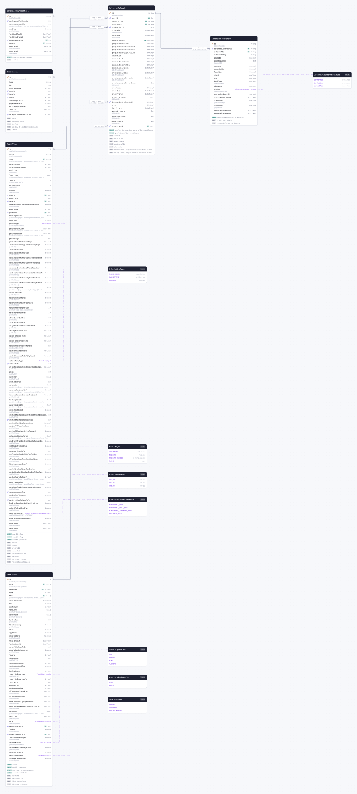

| Field                      | Type                          | Constraints                                                   | Default      | Description |
| -------------------------- | ----------------------------- | ------------------------------------------------------------- | ------------ | ----------- |
| `id`                       | `String`                      | PK NOT NULL                                                   | `uuid(4)`    |             |
| `userId`                   | `Int`                         | NOT NULL → [User.id](#model-User)                             |              |             |
| `integration`              | `String`                      | NOT NULL                                                      |              |             |
| `externalId`               | `String`                      | NOT NULL                                                      |              |             |
| `credentialId`             | `Int`                         | NULL → [Credential.id](#model-Credential)                     |              |             |
| `createdAt`                | `DateTime`                    | NULL                                                          | `now()`      |             |
| `updatedAt`                | `DateTime`                    | NULL                                                          | `@updatedAt` |             |
| `googleChannelId`          | `String`                      | NULL                                                          |              |             |
| `googleChannelKind`        | `String`                      | NULL                                                          |              |             |
| `googleChannelResourceId`  | `String`                      | NULL                                                          |              |             |
| `googleChannelResourceUri` | `String`                      | NULL                                                          |              |             |
| `googleChannelExpiration`  | `String`                      | NULL                                                          |              |             |
| `channelId`                | `String`                      | NULL                                                          |              |             |
| `channelKind`              | `String`                      | NULL                                                          |              |             |
| `channelResourceId`        | `String`                      | NULL                                                          |              |             |
| `channelResourceUri`       | `String`                      | NULL                                                          |              |             |
| `channelExpiration`        | `DateTime` `@db.Timestamp(3)` | NULL                                                          |              |             |
| `syncSubscribedAt`         | `DateTime` `@db.Timestamp(3)` | NULL                                                          |              |             |
| `syncSubscribedErrorAt`    | `DateTime` `@db.Timestamp(3)` | NULL                                                          |              |             |
| `syncSubscribedErrorCount` | `Int`                         | NOT NULL                                                      | `0`          |             |
| `syncToken`                | `String`                      | NULL                                                          |              |             |
| `syncedAt`                 | `DateTime`                    | NULL                                                          |              |             |
| `syncErrorAt`              | `DateTime`                    | NULL                                                          |              |             |
| `syncErrorCount`           | `Int`                         | NULL                                                          | `0`          |             |
| `delegationCredentialId`   | `String`                      | NULL → [DelegationCredential.id](#model-DelegationCredential) |              |             |
| `error`                    | `String`                      | NULL                                                          |              |             |
| `lastErrorAt`              | `DateTime`                    | NULL                                                          |              |             |
| `watchAttempts`            | `Int`                         | NOT NULL                                                      | `0`          |             |
| `unwatchAttempts`          | `Int`                         | NOT NULL                                                      | `0`          |             |
| `maxAttempts`              | `Int`                         | NOT NULL                                                      | `3`          |             |
| `eventTypeId`              | `Int`                         | NULL → [EventType.id](#model-EventType)                       |              |             |

#### Indexes

- `@@index([userId])`
- `@@index([externalId])`
- `@@index([eventTypeId])`
- `@@index([credentialId])`
- `@@index([channelId])`
- `@@index([integration, googleChannelExpiration, error, watchAttempts, maxAttempts], map: "SelectedCalendar_watch_idx")`
- `@@index([integration, googleChannelExpiration, error, unwatchAttempts, maxAttempts], map: "SelectedCalendar_unwatch_idx")`
- `@@unique([userId, integration, externalId, eventTypeId])`
- `@@unique([googleChannelId, eventTypeId])`

#### References

- `userId` → [User.id](#model-User) (many-to-one, on delete Cascade)
- `credentialId` → [Credential.id](#model-Credential) (many-to-one, on delete Cascade)
- `delegationCredentialId` → [DelegationCredential.id](#model-DelegationCredential) (many-to-one, on delete Cascade)
- `eventTypeId` → [EventType.id](#model-EventType) (many-to-one)

#### Referenced by

- `id` ← [CalendarCacheEvent.selectedCalendarId](#model-CalendarCacheEvent) (one-to-many, on delete Cascade)

#### Definition

```sql
CREATE TABLE "SelectedCalendar" (
    "id" TEXT NOT NULL,
    "userId" INTEGER NOT NULL,
    "integration" TEXT NOT NULL,
    "externalId" TEXT NOT NULL,
    "credentialId" INTEGER,
    "createdAt" TIMESTAMP(3) DEFAULT CURRENT_TIMESTAMP,
    "updatedAt" TIMESTAMP(3),
    "googleChannelId" TEXT,
    "googleChannelKind" TEXT,
    "googleChannelResourceId" TEXT,
    "googleChannelResourceUri" TEXT,
    "googleChannelExpiration" TEXT,
    "channelId" TEXT,
    "channelKind" TEXT,
    "channelResourceId" TEXT,
    "channelResourceUri" TEXT,
    "channelExpiration" TIMESTAMP(3),
    "syncSubscribedAt" TIMESTAMP(3),
    "syncSubscribedErrorAt" TIMESTAMP(3),
    "syncSubscribedErrorCount" INTEGER NOT NULL DEFAULT 0,
    "syncToken" TEXT,
    "syncedAt" TIMESTAMP(3),
    "syncErrorAt" TIMESTAMP(3),
    "syncErrorCount" INTEGER DEFAULT 0,
    "delegationCredentialId" TEXT,
    "error" TEXT,
    "lastErrorAt" TIMESTAMP(3),
    "watchAttempts" INTEGER NOT NULL DEFAULT 0,
    "unwatchAttempts" INTEGER NOT NULL DEFAULT 0,
    "maxAttempts" INTEGER NOT NULL DEFAULT 3,
    "eventTypeId" INTEGER,

    CONSTRAINT "SelectedCalendar_pkey" PRIMARY KEY ("id")
);

CREATE INDEX "SelectedCalendar_userId_idx" ON "SelectedCalendar"("userId");

CREATE INDEX "SelectedCalendar_externalId_idx" ON "SelectedCalendar"("externalId");

CREATE INDEX "SelectedCalendar_eventTypeId_idx" ON "SelectedCalendar"("eventTypeId");

CREATE INDEX "SelectedCalendar_credentialId_idx" ON "SelectedCalendar"("credentialId");

CREATE INDEX "SelectedCalendar_channelId_idx" ON "SelectedCalendar"("channelId");

CREATE INDEX "SelectedCalendar_watch_idx" ON "SelectedCalendar"("integration", "googleChannelExpiration", "error", "watchAttempts", "maxAttempts");

CREATE INDEX "SelectedCalendar_unwatch_idx" ON "SelectedCalendar"("integration", "googleChannelExpiration", "error", "unwatchAttempts", "maxAttempts");

CREATE UNIQUE INDEX "SelectedCalendar_userId_integration_externalId_eventTypeId_key" ON "SelectedCalendar"("userId", "integration", "externalId", "eventTypeId");

CREATE UNIQUE INDEX "SelectedCalendar_googleChannelId_eventTypeId_key" ON "SelectedCalendar"("googleChannelId", "eventTypeId");

ALTER TABLE "SelectedCalendar" ADD CONSTRAINT "SelectedCalendar_userId_fkey" FOREIGN KEY ("userId") REFERENCES "users"("id") ON DELETE CASCADE ON UPDATE CASCADE;

ALTER TABLE "SelectedCalendar" ADD CONSTRAINT "SelectedCalendar_credentialId_fkey" FOREIGN KEY ("credentialId") REFERENCES "Credential"("id") ON DELETE CASCADE ON UPDATE CASCADE;

ALTER TABLE "SelectedCalendar" ADD CONSTRAINT "SelectedCalendar_delegationCredentialId_fkey" FOREIGN KEY ("delegationCredentialId") REFERENCES "DelegationCredential"("id") ON DELETE CASCADE ON UPDATE CASCADE;

ALTER TABLE "SelectedCalendar" ADD CONSTRAINT "SelectedCalendar_eventTypeId_fkey" FOREIGN KEY ("eventTypeId") REFERENCES "EventType"("id") ON DELETE SET NULL ON UPDATE CASCADE;
```

<details>
<summary>Queries and their SQL</summary>

**findMany**: Every row

```ts
await prisma.selectedCalendar.findMany();
```

```sql
SELECT
  "public"."SelectedCalendar"."id",
  "public"."SelectedCalendar"."userId",
  "public"."SelectedCalendar"."integration",
  "public"."SelectedCalendar"."externalId",
  "public"."SelectedCalendar"."credentialId",
  "public"."SelectedCalendar"."createdAt",
  "public"."SelectedCalendar"."updatedAt",
  "public"."SelectedCalendar"."googleChannelId",
  "public"."SelectedCalendar"."googleChannelKind",
  "public"."SelectedCalendar"."googleChannelResourceId",
  "public"."SelectedCalendar"."googleChannelResourceUri",
  "public"."SelectedCalendar"."googleChannelExpiration",
  "public"."SelectedCalendar"."channelId",
  "public"."SelectedCalendar"."channelKind",
  "public"."SelectedCalendar"."channelResourceId",
  "public"."SelectedCalendar"."channelResourceUri",
  "public"."SelectedCalendar"."channelExpiration",
  "public"."SelectedCalendar"."syncSubscribedAt",
  "public"."SelectedCalendar"."syncSubscribedErrorAt",
  "public"."SelectedCalendar"."syncSubscribedErrorCount",
  "public"."SelectedCalendar"."syncToken",
  "public"."SelectedCalendar"."syncedAt",
  "public"."SelectedCalendar"."syncErrorAt",
  "public"."SelectedCalendar"."syncErrorCount",
  "public"."SelectedCalendar"."delegationCredentialId",
  "public"."SelectedCalendar"."error",
  "public"."SelectedCalendar"."lastErrorAt",
  "public"."SelectedCalendar"."watchAttempts",
  "public"."SelectedCalendar"."unwatchAttempts",
  "public"."SelectedCalendar"."maxAttempts",
  "public"."SelectedCalendar"."eventTypeId"
FROM
  "public"."SelectedCalendar"
WHERE
  1 = 1
OFFSET
  $1
-- params: ["0"]
```

**count**: How many rows there are

```ts
await prisma.selectedCalendar.count();
```

```sql
SELECT
  COUNT(*) AS "_count$_all"
FROM
  (
    SELECT
      "public"."SelectedCalendar"."id"
    FROM
      "public"."SelectedCalendar"
    WHERE
      1 = 1
    OFFSET
      $1
  ) AS "sub"
-- params: ["0"]
```

**findMany**: Every row with its relations

```ts
await prisma.selectedCalendar.findMany({
  include: {
    user: true,
    credential: true,
    delegationCredential: true,
    eventType: true,
    calendarCacheEvents: true,
  },
});
```

```sql
SELECT
  "public"."SelectedCalendar"."id",
  "public"."SelectedCalendar"."userId",
  "public"."SelectedCalendar"."integration",
  "public"."SelectedCalendar"."externalId",
  "public"."SelectedCalendar"."credentialId",
  "public"."SelectedCalendar"."createdAt",
  "public"."SelectedCalendar"."updatedAt",
  "public"."SelectedCalendar"."googleChannelId",
  "public"."SelectedCalendar"."googleChannelKind",
  "public"."SelectedCalendar"."googleChannelResourceId",
  "public"."SelectedCalendar"."googleChannelResourceUri",
  "public"."SelectedCalendar"."googleChannelExpiration",
  "public"."SelectedCalendar"."channelId",
  "public"."SelectedCalendar"."channelKind",
  "public"."SelectedCalendar"."channelResourceId",
  "public"."SelectedCalendar"."channelResourceUri",
  "public"."SelectedCalendar"."channelExpiration",
  "public"."SelectedCalendar"."syncSubscribedAt",
  "public"."SelectedCalendar"."syncSubscribedErrorAt",
  "public"."SelectedCalendar"."syncSubscribedErrorCount",
  "public"."SelectedCalendar"."syncToken",
  "public"."SelectedCalendar"."syncedAt",
  "public"."SelectedCalendar"."syncErrorAt",
  "public"."SelectedCalendar"."syncErrorCount",
  "public"."SelectedCalendar"."delegationCredentialId",
  "public"."SelectedCalendar"."error",
  "public"."SelectedCalendar"."lastErrorAt",
  "public"."SelectedCalendar"."watchAttempts",
  "public"."SelectedCalendar"."unwatchAttempts",
  "public"."SelectedCalendar"."maxAttempts",
  "public"."SelectedCalendar"."eventTypeId"
FROM
  "public"."SelectedCalendar"
WHERE
  1 = 1
OFFSET
  $1
-- params: ["0"]

SELECT
  "public"."users"."id",
  "public"."users"."uuid",
  "public"."users"."username",
  "public"."users"."name",
  "public"."users"."email",
  "public"."users"."emailVerified",
  "public"."users"."bio",
  "public"."users"."avatarUrl",
  "public"."users"."timeZone",
  "public"."users"."weekStart",
  "public"."users"."bufferTime",
  "public"."users"."hideBranding",
  "public"."users"."theme",
  "public"."users"."appTheme",
  "public"."users"."created",
  "public"."users"."trialEndsAt",
  "public"."users"."lastActiveAt",
  "public"."users"."defaultScheduleId",
  "public"."users"."completedOnboarding",
  "public"."users"."locale",
  "public"."users"."timeFormat",
  "public"."users"."twoFactorSecret",
  "public"."users"."twoFactorEnabled",
  "public"."users"."backupCodes",
  "public"."users"."identityProvider"::text,
  "public"."users"."identityProviderId",
  "public"."users"."invitedTo",
  "public"."users"."brandColor",
  "public"."users"."darkBrandColor",
  "public"."users"."allowDynamicBooking",
  "public"."users"."allowSEOIndexing",
  "public"."users"."receiveMonthlyDigestEmail",
  "public"."users"."requiresBookerEmailVerification",
  "public"."users"."metadata",
  "public"."users"."verified",
  "public"."users"."role"::text,
  "public"."users"."organizationId",
  "public"."users"."locked",
  "public"."users"."movedToProfileId",
  "public"."users"."isPlatformManaged",
  "public"."users"."smsLockState"::text,
  "public"."users"."smsLockReviewedByAdmin",
  "public"."users"."referralLinkId",
  "public"."users"."creationSource"::text,
  "public"."users"."autoOptInFeatures"
FROM
  "public"."users"
WHERE
  "public"."users"."id" IN ($1)
OFFSET
  $2
-- params: ["<userId of the rows above>","0"]

SELECT
  "public"."Credential"."id",
  "public"."Credential"."type",
  "public"."Credential"."key",
  "public"."Credential"."encryptedKey",
  "public"."Credential"."userId",
  "public"."Credential"."teamId",
  "public"."Credential"."appId",
  "public"."Credential"."subscriptionId",
  "public"."Credential"."paymentStatus",
  "public"."Credential"."billingCycleStart",
  "public"."Credential"."invalid",
  "public"."Credential"."delegationCredentialId"
FROM
  "public"."Credential"
WHERE
  "public"."Credential"."id" IN ($1)
OFFSET
  $2
-- params: ["<credentialId of the rows above>","0"]

SELECT
  "public"."DelegationCredential"."id",
  "public"."DelegationCredential"."workspacePlatformId",
  "public"."DelegationCredential"."serviceAccountKey",
  "public"."DelegationCredential"."enabled",
  "public"."DelegationCredential"."lastEnabledAt",
  "public"."DelegationCredential"."lastDisabledAt",
  "public"."DelegationCredential"."organizationId",
  "public"."DelegationCredential"."domain",
  "public"."DelegationCredential"."createdAt",
  "public"."DelegationCredential"."updatedAt"
FROM
  "public"."DelegationCredential"
WHERE
  "public"."DelegationCredential"."id" IN ($1)
OFFSET
  $2
-- params: ["<delegationCredentialId of the rows above>","0"]

SELECT
  "public"."EventType"."id",
  "public"."EventType"."title",
  "public"."EventType"."slug",
  "public"."EventType"."description",
  "public"."EventType"."interfaceLanguage",
  "public"."EventType"."position",
  "public"."EventType"."locations",
  "public"."EventType"."length",
  "public"."EventType"."offsetStart",
  "public"."EventType"."hidden",
  "public"."EventType"."userId",
  "public"."EventType"."profileId",
  "public"."EventType"."teamId",
  "public"."EventType"."useEventLevelSelectedCalendars",
  "public"."EventType"."eventName",
  "public"."EventType"."parentId",
  "public"."EventType"."bookingFields",
  "public"."EventType"."timeZone",
  "public"."EventType"."periodType"::text,
  "public"."EventType"."periodStartDate",
  "public"."EventType"."periodEndDate",
  "public"."EventType"."periodDays",
  "public"."EventType"."periodCountCalendarDays",
  "public"."EventType"."lockTimeZoneToggleOnBookingPage",
  "public"."EventType"."lockedTimeZone",
  "public"."EventType"."requiresConfirmation",
  "public"."EventType"."requiresConfirmationWillBlockSlot",
  "public"."EventType"."requiresConfirmationForFreeEmail",
  "public"."EventType"."requiresBookerEmailVerification",
  "public"."EventType"."canSendCalVideoTranscriptionEmails",
  "public"."EventType"."autoTranslateDescriptionEnabled",
  "public"."EventType"."autoTranslateInstantMeetingTitleEnabled",
  "public"."EventType"."recurringEvent",
  "public"."EventType"."disableGuests",
  "public"."EventType"."hideCalendarNotes",
  "public"."EventType"."hideCalendarEventDetails",
  "public"."EventType"."minimumBookingNotice",
  "public"."EventType"."beforeEventBuffer",
  "public"."EventType"."afterEventBuffer",
  "public"."EventType"."seatsPerTimeSlot",
  "public"."EventType"."onlyShowFirstAvailableSlot",
  "public"."EventType"."showOptimizedSlots",
  "public"."EventType"."disableCancelling",
  "public"."EventType"."disableRescheduling",
  "public"."EventType"."minimumRescheduleNotice",
  "public"."EventType"."seatsShowAttendees",
  "public"."EventType"."seatsShowAvailabilityCount",
  "public"."EventType"."schedulingType"::text,
  "public"."EventType"."scheduleId",
  "public"."EventType"."allowReschedulingCancelledBookings",
  "public"."EventType"."price",
  "public"."EventType"."currency",
  "public"."EventType"."slotInterval",
  "public"."EventType"."metadata",
  "public"."EventType"."successRedirectUrl",
  "public"."EventType"."forwardParamsSuccessRedirect",
  "public"."EventType"."bookingLimits",
  "public"."EventType"."durationLimits",
  "public"."EventType"."isInstantEvent",
  "public"."EventType"."instantMeetingExpiryTimeOffsetInSeconds",
  "public"."EventType"."instantMeetingScheduleId",
  "public"."EventType"."instantMeetingParameters",
  "public"."EventType"."assignAllTeamMembers",
  "public"."EventType"."assignRRMembersUsingSegment",
  "public"."EventType"."rrSegmentQueryValue",
  "public"."EventType"."useEventTypeDestinationCalendarEmail",
  "public"."EventType"."isRRWeightsEnabled",
  "public"."EventType"."maxLeadThreshold",
  "public"."EventType"."includeNoShowInRRCalculation",
  "public"."EventType"."allowReschedulingPastBookings",
  "public"."EventType"."hideOrganizerEmail",
  "public"."EventType"."maxActiveBookingsPerBooker",
  "public"."EventType"."maxActiveBookingPerBookerOfferReschedule",
  "public"."EventType"."customReplyToEmail",
  "public"."EventType"."eventTypeColor",
  "public"."EventType"."rescheduleWithSameRoundRobinHost",
  "public"."EventType"."secondaryEmailId",
  "public"."EventType"."useBookerTimezone",
  "public"."EventType"."restrictionScheduleId",
  "public"."EventType"."bookingRequiresAuthentication",
  "public"."EventType"."rrHostSubsetEnabled",
  "public"."EventType"."requiresCancellationReason"::text,
  "public"."EventType"."enablePerHostLocations",
  "public"."EventType"."createdAt",
  "public"."EventType"."updatedAt"
FROM
  "public"."EventType"
WHERE
  "public"."EventType"."id" IN ($1)
OFFSET
  $2
-- params: ["<eventTypeId of the rows above>","0"]

SELECT
  "public"."CalendarCacheEvent"."id",
  "public"."CalendarCacheEvent"."selectedCalendarId",
  "public"."CalendarCacheEvent"."externalId",
  "public"."CalendarCacheEvent"."externalEtag",
  "public"."CalendarCacheEvent"."iCalUID",
  "public"."CalendarCacheEvent"."iCalSequence",
  "public"."CalendarCacheEvent"."summary",
  "public"."CalendarCacheEvent"."description",
  "public"."CalendarCacheEvent"."location",
  "public"."CalendarCacheEvent"."start",
  "public"."CalendarCacheEvent"."end",
  "public"."CalendarCacheEvent"."isAllDay",
  "public"."CalendarCacheEvent"."timeZone",
  "public"."CalendarCacheEvent"."status"::text,
  "public"."CalendarCacheEvent"."recurringEventId",
  "public"."CalendarCacheEvent"."originalStartTime",
  "public"."CalendarCacheEvent"."createdAt",
  "public"."CalendarCacheEvent"."updatedAt",
  "public"."CalendarCacheEvent"."externalCreatedAt",
  "public"."CalendarCacheEvent"."externalUpdatedAt"
FROM
  "public"."CalendarCacheEvent"
WHERE
  "public"."CalendarCacheEvent"."selectedCalendarId" IN ($1)
OFFSET
  $2
-- params: ["<id of the rows above>","0"]
```

**findUnique**: One row by what is unique to it

```ts
await prisma.selectedCalendar.findUnique({ where: { id: "example" } });
```

```sql
SELECT
  "public"."SelectedCalendar"."id",
  "public"."SelectedCalendar"."userId",
  "public"."SelectedCalendar"."integration",
  "public"."SelectedCalendar"."externalId",
  "public"."SelectedCalendar"."credentialId",
  "public"."SelectedCalendar"."createdAt",
  "public"."SelectedCalendar"."updatedAt",
  "public"."SelectedCalendar"."googleChannelId",
  "public"."SelectedCalendar"."googleChannelKind",
  "public"."SelectedCalendar"."googleChannelResourceId",
  "public"."SelectedCalendar"."googleChannelResourceUri",
  "public"."SelectedCalendar"."googleChannelExpiration",
  "public"."SelectedCalendar"."channelId",
  "public"."SelectedCalendar"."channelKind",
  "public"."SelectedCalendar"."channelResourceId",
  "public"."SelectedCalendar"."channelResourceUri",
  "public"."SelectedCalendar"."channelExpiration",
  "public"."SelectedCalendar"."syncSubscribedAt",
  "public"."SelectedCalendar"."syncSubscribedErrorAt",
  "public"."SelectedCalendar"."syncSubscribedErrorCount",
  "public"."SelectedCalendar"."syncToken",
  "public"."SelectedCalendar"."syncedAt",
  "public"."SelectedCalendar"."syncErrorAt",
  "public"."SelectedCalendar"."syncErrorCount",
  "public"."SelectedCalendar"."delegationCredentialId",
  "public"."SelectedCalendar"."error",
  "public"."SelectedCalendar"."lastErrorAt",
  "public"."SelectedCalendar"."watchAttempts",
  "public"."SelectedCalendar"."unwatchAttempts",
  "public"."SelectedCalendar"."maxAttempts",
  "public"."SelectedCalendar"."eventTypeId"
FROM
  "public"."SelectedCalendar"
WHERE
  (
    "public"."SelectedCalendar"."id" = $1
    AND 1 = 1
  )
LIMIT
  $2
OFFSET
  $3
-- params: ["example","1","0"]
```

**create**: Create a row

```ts
await prisma.selectedCalendar.create({
  data: { userId: 1, integration: "example", externalId: "example" },
});
```

```sql
INSERT INTO
  "public"."SelectedCalendar" (
    "id",
    "userId",
    "integration",
    "externalId",
    "createdAt",
    "updatedAt",
    "syncSubscribedErrorCount",
    "syncErrorCount",
    "watchAttempts",
    "unwatchAttempts",
    "maxAttempts"
  )
VALUES
  ($1, $2, $3, $4, $5, $6, $7, $8, $9, $10, $11)
RETURNING
  "public"."SelectedCalendar"."id",
  "public"."SelectedCalendar"."userId",
  "public"."SelectedCalendar"."integration",
  "public"."SelectedCalendar"."externalId",
  "public"."SelectedCalendar"."credentialId",
  "public"."SelectedCalendar"."createdAt",
  "public"."SelectedCalendar"."updatedAt",
  "public"."SelectedCalendar"."googleChannelId",
  "public"."SelectedCalendar"."googleChannelKind",
  "public"."SelectedCalendar"."googleChannelResourceId",
  "public"."SelectedCalendar"."googleChannelResourceUri",
  "public"."SelectedCalendar"."googleChannelExpiration",
  "public"."SelectedCalendar"."channelId",
  "public"."SelectedCalendar"."channelKind",
  "public"."SelectedCalendar"."channelResourceId",
  "public"."SelectedCalendar"."channelResourceUri",
  "public"."SelectedCalendar"."channelExpiration",
  "public"."SelectedCalendar"."syncSubscribedAt",
  "public"."SelectedCalendar"."syncSubscribedErrorAt",
  "public"."SelectedCalendar"."syncSubscribedErrorCount",
  "public"."SelectedCalendar"."syncToken",
  "public"."SelectedCalendar"."syncedAt",
  "public"."SelectedCalendar"."syncErrorAt",
  "public"."SelectedCalendar"."syncErrorCount",
  "public"."SelectedCalendar"."delegationCredentialId",
  "public"."SelectedCalendar"."error",
  "public"."SelectedCalendar"."lastErrorAt",
  "public"."SelectedCalendar"."watchAttempts",
  "public"."SelectedCalendar"."unwatchAttempts",
  "public"."SelectedCalendar"."maxAttempts",
  "public"."SelectedCalendar"."eventTypeId"
-- params: ["<uuid(4)>","1","example","example","<now()>","<now()>","0","0","0","0","3"]
```

**update**: Update a row

```ts
await prisma.selectedCalendar.update({
  where: { id: "example" },
  data: { integration: "example" },
});
```

```sql
UPDATE "public"."SelectedCalendar"
SET
  "integration" = $1,
  "updatedAt" = $2
WHERE
  (
    "public"."SelectedCalendar"."id" = $3
    AND 1 = 1
  )
RETURNING
  "public"."SelectedCalendar"."id",
  "public"."SelectedCalendar"."userId",
  "public"."SelectedCalendar"."integration",
  "public"."SelectedCalendar"."externalId",
  "public"."SelectedCalendar"."credentialId",
  "public"."SelectedCalendar"."createdAt",
  "public"."SelectedCalendar"."updatedAt",
  "public"."SelectedCalendar"."googleChannelId",
  "public"."SelectedCalendar"."googleChannelKind",
  "public"."SelectedCalendar"."googleChannelResourceId",
  "public"."SelectedCalendar"."googleChannelResourceUri",
  "public"."SelectedCalendar"."googleChannelExpiration",
  "public"."SelectedCalendar"."channelId",
  "public"."SelectedCalendar"."channelKind",
  "public"."SelectedCalendar"."channelResourceId",
  "public"."SelectedCalendar"."channelResourceUri",
  "public"."SelectedCalendar"."channelExpiration",
  "public"."SelectedCalendar"."syncSubscribedAt",
  "public"."SelectedCalendar"."syncSubscribedErrorAt",
  "public"."SelectedCalendar"."syncSubscribedErrorCount",
  "public"."SelectedCalendar"."syncToken",
  "public"."SelectedCalendar"."syncedAt",
  "public"."SelectedCalendar"."syncErrorAt",
  "public"."SelectedCalendar"."syncErrorCount",
  "public"."SelectedCalendar"."delegationCredentialId",
  "public"."SelectedCalendar"."error",
  "public"."SelectedCalendar"."lastErrorAt",
  "public"."SelectedCalendar"."watchAttempts",
  "public"."SelectedCalendar"."unwatchAttempts",
  "public"."SelectedCalendar"."maxAttempts",
  "public"."SelectedCalendar"."eventTypeId"
-- params: ["example",{"prisma__type":"generatorCall","prisma__value":{"name":"now","args":[],"returnType":{"type":"DateTime"}}},"example"]
```

**delete**: Delete a row

```ts
await prisma.selectedCalendar.delete({ where: { id: "example" } });
```

```sql
DELETE FROM "public"."SelectedCalendar"
WHERE
  (
    "public"."SelectedCalendar"."id" = $1
    AND 1 = 1
  )
RETURNING
  "public"."SelectedCalendar"."id",
  "public"."SelectedCalendar"."userId",
  "public"."SelectedCalendar"."integration",
  "public"."SelectedCalendar"."externalId",
  "public"."SelectedCalendar"."credentialId",
  "public"."SelectedCalendar"."createdAt",
  "public"."SelectedCalendar"."updatedAt",
  "public"."SelectedCalendar"."googleChannelId",
  "public"."SelectedCalendar"."googleChannelKind",
  "public"."SelectedCalendar"."googleChannelResourceId",
  "public"."SelectedCalendar"."googleChannelResourceUri",
  "public"."SelectedCalendar"."googleChannelExpiration",
  "public"."SelectedCalendar"."channelId",
  "public"."SelectedCalendar"."channelKind",
  "public"."SelectedCalendar"."channelResourceId",
  "public"."SelectedCalendar"."channelResourceUri",
  "public"."SelectedCalendar"."channelExpiration",
  "public"."SelectedCalendar"."syncSubscribedAt",
  "public"."SelectedCalendar"."syncSubscribedErrorAt",
  "public"."SelectedCalendar"."syncSubscribedErrorCount",
  "public"."SelectedCalendar"."syncToken",
  "public"."SelectedCalendar"."syncedAt",
  "public"."SelectedCalendar"."syncErrorAt",
  "public"."SelectedCalendar"."syncErrorCount",
  "public"."SelectedCalendar"."delegationCredentialId",
  "public"."SelectedCalendar"."error",
  "public"."SelectedCalendar"."lastErrorAt",
  "public"."SelectedCalendar"."watchAttempts",
  "public"."SelectedCalendar"."unwatchAttempts",
  "public"."SelectedCalendar"."maxAttempts",
  "public"."SelectedCalendar"."eventTypeId"
-- params: ["example"]
```

</details>

<a id="model-EventTypeCustomInput"></a>

### EventTypeCustomInput

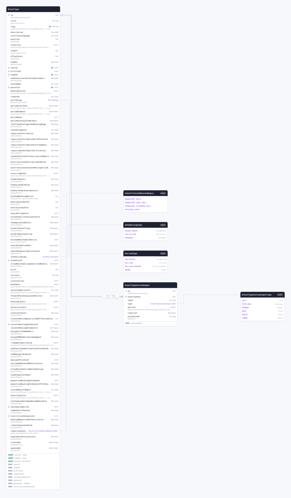

| Field         | Type                                                         | Constraints                                 | Default           | Description                                                                                                    |
| ------------- | ------------------------------------------------------------ | ------------------------------------------- | ----------------- | -------------------------------------------------------------------------------------------------------------- |
| `id`          | `Int`                                                        | PK NOT NULL                                 | `autoincrement()` |                                                                                                                |
| `eventTypeId` | `Int`                                                        | NOT NULL → [EventType.id](#model-EventType) |                   |                                                                                                                |
| `label`       | `String`                                                     | NOT NULL                                    |                   |                                                                                                                |
| `type`        | [`EventTypeCustomInputType`](#enum-EventTypeCustomInputType) | NOT NULL                                    |                   |                                                                                                                |
| `options`     | `Json`                                                       | NULL                                        |                   | @zod.import(["import { customInputOptionSchema } from '../../zod-utils'"]).custom.use(customInputOptionSchema) |
| `required`    | `Boolean`                                                    | NOT NULL                                    |                   |                                                                                                                |
| `placeholder` | `String`                                                     | NOT NULL                                    | `""`              |                                                                                                                |

#### Indexes

- `@@index([eventTypeId])`

#### References

- `eventTypeId` → [EventType.id](#model-EventType) (many-to-one, on delete Cascade)

#### Definition

```sql
CREATE TABLE "EventTypeCustomInput" (
    "id" SERIAL NOT NULL,
    "eventTypeId" INTEGER NOT NULL,
    "label" TEXT NOT NULL,
    "type" "EventTypeCustomInputType" NOT NULL,
    "options" JSONB,
    "required" BOOLEAN NOT NULL,
    "placeholder" TEXT NOT NULL DEFAULT '',

    CONSTRAINT "EventTypeCustomInput_pkey" PRIMARY KEY ("id")
);

CREATE INDEX "EventTypeCustomInput_eventTypeId_idx" ON "EventTypeCustomInput"("eventTypeId");

ALTER TABLE "EventTypeCustomInput" ADD CONSTRAINT "EventTypeCustomInput_eventTypeId_fkey" FOREIGN KEY ("eventTypeId") REFERENCES "EventType"("id") ON DELETE CASCADE ON UPDATE CASCADE;
```

<details>
<summary>Queries and their SQL</summary>

**findMany**: Every row

```ts
await prisma.eventTypeCustomInput.findMany();
```

```sql
SELECT
  "public"."EventTypeCustomInput"."id",
  "public"."EventTypeCustomInput"."eventTypeId",
  "public"."EventTypeCustomInput"."label",
  "public"."EventTypeCustomInput"."type"::text,
  "public"."EventTypeCustomInput"."options",
  "public"."EventTypeCustomInput"."required",
  "public"."EventTypeCustomInput"."placeholder"
FROM
  "public"."EventTypeCustomInput"
WHERE
  1 = 1
OFFSET
  $1
-- params: ["0"]
```

**count**: How many rows there are

```ts
await prisma.eventTypeCustomInput.count();
```

```sql
SELECT
  COUNT(*) AS "_count$_all"
FROM
  (
    SELECT
      "public"."EventTypeCustomInput"."id"
    FROM
      "public"."EventTypeCustomInput"
    WHERE
      1 = 1
    OFFSET
      $1
  ) AS "sub"
-- params: ["0"]
```

**findMany**: Every row with its relations

```ts
await prisma.eventTypeCustomInput.findMany({ include: { eventType: true } });
```

```sql
SELECT
  "public"."EventTypeCustomInput"."id",
  "public"."EventTypeCustomInput"."eventTypeId",
  "public"."EventTypeCustomInput"."label",
  "public"."EventTypeCustomInput"."type"::text,
  "public"."EventTypeCustomInput"."options",
  "public"."EventTypeCustomInput"."required",
  "public"."EventTypeCustomInput"."placeholder"
FROM
  "public"."EventTypeCustomInput"
WHERE
  1 = 1
OFFSET
  $1
-- params: ["0"]

SELECT
  "public"."EventType"."id",
  "public"."EventType"."title",
  "public"."EventType"."slug",
  "public"."EventType"."description",
  "public"."EventType"."interfaceLanguage",
  "public"."EventType"."position",
  "public"."EventType"."locations",
  "public"."EventType"."length",
  "public"."EventType"."offsetStart",
  "public"."EventType"."hidden",
  "public"."EventType"."userId",
  "public"."EventType"."profileId",
  "public"."EventType"."teamId",
  "public"."EventType"."useEventLevelSelectedCalendars",
  "public"."EventType"."eventName",
  "public"."EventType"."parentId",
  "public"."EventType"."bookingFields",
  "public"."EventType"."timeZone",
  "public"."EventType"."periodType"::text,
  "public"."EventType"."periodStartDate",
  "public"."EventType"."periodEndDate",
  "public"."EventType"."periodDays",
  "public"."EventType"."periodCountCalendarDays",
  "public"."EventType"."lockTimeZoneToggleOnBookingPage",
  "public"."EventType"."lockedTimeZone",
  "public"."EventType"."requiresConfirmation",
  "public"."EventType"."requiresConfirmationWillBlockSlot",
  "public"."EventType"."requiresConfirmationForFreeEmail",
  "public"."EventType"."requiresBookerEmailVerification",
  "public"."EventType"."canSendCalVideoTranscriptionEmails",
  "public"."EventType"."autoTranslateDescriptionEnabled",
  "public"."EventType"."autoTranslateInstantMeetingTitleEnabled",
  "public"."EventType"."recurringEvent",
  "public"."EventType"."disableGuests",
  "public"."EventType"."hideCalendarNotes",
  "public"."EventType"."hideCalendarEventDetails",
  "public"."EventType"."minimumBookingNotice",
  "public"."EventType"."beforeEventBuffer",
  "public"."EventType"."afterEventBuffer",
  "public"."EventType"."seatsPerTimeSlot",
  "public"."EventType"."onlyShowFirstAvailableSlot",
  "public"."EventType"."showOptimizedSlots",
  "public"."EventType"."disableCancelling",
  "public"."EventType"."disableRescheduling",
  "public"."EventType"."minimumRescheduleNotice",
  "public"."EventType"."seatsShowAttendees",
  "public"."EventType"."seatsShowAvailabilityCount",
  "public"."EventType"."schedulingType"::text,
  "public"."EventType"."scheduleId",
  "public"."EventType"."allowReschedulingCancelledBookings",
  "public"."EventType"."price",
  "public"."EventType"."currency",
  "public"."EventType"."slotInterval",
  "public"."EventType"."metadata",
  "public"."EventType"."successRedirectUrl",
  "public"."EventType"."forwardParamsSuccessRedirect",
  "public"."EventType"."bookingLimits",
  "public"."EventType"."durationLimits",
  "public"."EventType"."isInstantEvent",
  "public"."EventType"."instantMeetingExpiryTimeOffsetInSeconds",
  "public"."EventType"."instantMeetingScheduleId",
  "public"."EventType"."instantMeetingParameters",
  "public"."EventType"."assignAllTeamMembers",
  "public"."EventType"."assignRRMembersUsingSegment",
  "public"."EventType"."rrSegmentQueryValue",
  "public"."EventType"."useEventTypeDestinationCalendarEmail",
  "public"."EventType"."isRRWeightsEnabled",
  "public"."EventType"."maxLeadThreshold",
  "public"."EventType"."includeNoShowInRRCalculation",
  "public"."EventType"."allowReschedulingPastBookings",
  "public"."EventType"."hideOrganizerEmail",
  "public"."EventType"."maxActiveBookingsPerBooker",
  "public"."EventType"."maxActiveBookingPerBookerOfferReschedule",
  "public"."EventType"."customReplyToEmail",
  "public"."EventType"."eventTypeColor",
  "public"."EventType"."rescheduleWithSameRoundRobinHost",
  "public"."EventType"."secondaryEmailId",
  "public"."EventType"."useBookerTimezone",
  "public"."EventType"."restrictionScheduleId",
  "public"."EventType"."bookingRequiresAuthentication",
  "public"."EventType"."rrHostSubsetEnabled",
  "public"."EventType"."requiresCancellationReason"::text,
  "public"."EventType"."enablePerHostLocations",
  "public"."EventType"."createdAt",
  "public"."EventType"."updatedAt"
FROM
  "public"."EventType"
WHERE
  "public"."EventType"."id" IN ($1)
OFFSET
  $2
-- params: ["<eventTypeId of the rows above>","0"]
```

**findUnique**: One row by what is unique to it

```ts
await prisma.eventTypeCustomInput.findUnique({ where: { id: 1 } });
```

```sql
SELECT
  "public"."EventTypeCustomInput"."id",
  "public"."EventTypeCustomInput"."eventTypeId",
  "public"."EventTypeCustomInput"."label",
  "public"."EventTypeCustomInput"."type"::text,
  "public"."EventTypeCustomInput"."options",
  "public"."EventTypeCustomInput"."required",
  "public"."EventTypeCustomInput"."placeholder"
FROM
  "public"."EventTypeCustomInput"
WHERE
  (
    "public"."EventTypeCustomInput"."id" = $1
    AND 1 = 1
  )
LIMIT
  $2
OFFSET
  $3
-- params: ["1","1","0"]
```

**create**: Create a row

```ts
await prisma.eventTypeCustomInput.create({
  data: { eventTypeId: 1, label: "example", type: "TEXT", required: true },
});
```

```sql
INSERT INTO
  "public"."EventTypeCustomInput" (
    "eventTypeId",
    "label",
    "type",
    "required",
    "placeholder"
  )
VALUES
  (
    $1,
    $2,
    CAST($3::text AS "public"."EventTypeCustomInputType"),
    $4,
    $5
  )
RETURNING
  "public"."EventTypeCustomInput"."id",
  "public"."EventTypeCustomInput"."eventTypeId",
  "public"."EventTypeCustomInput"."label",
  "public"."EventTypeCustomInput"."type"::text,
  "public"."EventTypeCustomInput"."options",
  "public"."EventTypeCustomInput"."required",
  "public"."EventTypeCustomInput"."placeholder"
-- params: ["1","example","text",true,""]
```

**update**: Update a row

```ts
await prisma.eventTypeCustomInput.update({ where: { id: 1 }, data: { label: "example" } });
```

```sql
UPDATE "public"."EventTypeCustomInput"
SET
  "label" = $1
WHERE
  (
    "public"."EventTypeCustomInput"."id" = $2
    AND 1 = 1
  )
RETURNING
  "public"."EventTypeCustomInput"."id",
  "public"."EventTypeCustomInput"."eventTypeId",
  "public"."EventTypeCustomInput"."label",
  "public"."EventTypeCustomInput"."type"::text,
  "public"."EventTypeCustomInput"."options",
  "public"."EventTypeCustomInput"."required",
  "public"."EventTypeCustomInput"."placeholder"
-- params: ["example","1"]
```

**delete**: Delete a row

```ts
await prisma.eventTypeCustomInput.delete({ where: { id: 1 } });
```

```sql
DELETE FROM "public"."EventTypeCustomInput"
WHERE
  (
    "public"."EventTypeCustomInput"."id" = $1
    AND 1 = 1
  )
RETURNING
  "public"."EventTypeCustomInput"."id",
  "public"."EventTypeCustomInput"."eventTypeId",
  "public"."EventTypeCustomInput"."label",
  "public"."EventTypeCustomInput"."type"::text,
  "public"."EventTypeCustomInput"."options",
  "public"."EventTypeCustomInput"."required",
  "public"."EventTypeCustomInput"."placeholder"
-- params: ["1"]
```

</details>

<a id="model-ResetPasswordRequest"></a>

### ResetPasswordRequest

| Field       | Type       | Constraints | Default      | Description |
| ----------- | ---------- | ----------- | ------------ | ----------- |
| `id`        | `String`   | PK NOT NULL | `cuid(1)`    |             |
| `createdAt` | `DateTime` | NOT NULL    | `now()`      |             |
| `updatedAt` | `DateTime` | NOT NULL    | `@updatedAt` |             |
| `email`     | `String`   | NOT NULL    |              |             |
| `expires`   | `DateTime` | NOT NULL    |              |             |

#### Definition

```sql
CREATE TABLE "ResetPasswordRequest" (
    "id" TEXT NOT NULL,
    "createdAt" TIMESTAMP(3) NOT NULL DEFAULT CURRENT_TIMESTAMP,
    "updatedAt" TIMESTAMP(3) NOT NULL,
    "email" TEXT NOT NULL,
    "expires" TIMESTAMP(3) NOT NULL,

    CONSTRAINT "ResetPasswordRequest_pkey" PRIMARY KEY ("id")
);
```

<details>
<summary>Queries and their SQL</summary>

**findMany**: Every row

```ts
await prisma.resetPasswordRequest.findMany();
```

```sql
SELECT
  "public"."ResetPasswordRequest"."id",
  "public"."ResetPasswordRequest"."createdAt",
  "public"."ResetPasswordRequest"."updatedAt",
  "public"."ResetPasswordRequest"."email",
  "public"."ResetPasswordRequest"."expires"
FROM
  "public"."ResetPasswordRequest"
WHERE
  1 = 1
OFFSET
  $1
-- params: ["0"]
```

**count**: How many rows there are

```ts
await prisma.resetPasswordRequest.count();
```

```sql
SELECT
  COUNT(*) AS "_count$_all"
FROM
  (
    SELECT
      "public"."ResetPasswordRequest"."id"
    FROM
      "public"."ResetPasswordRequest"
    WHERE
      1 = 1
    OFFSET
      $1
  ) AS "sub"
-- params: ["0"]
```

**findUnique**: One row by what is unique to it

```ts
await prisma.resetPasswordRequest.findUnique({ where: { id: "example" } });
```

```sql
SELECT
  "public"."ResetPasswordRequest"."id",
  "public"."ResetPasswordRequest"."createdAt",
  "public"."ResetPasswordRequest"."updatedAt",
  "public"."ResetPasswordRequest"."email",
  "public"."ResetPasswordRequest"."expires"
FROM
  "public"."ResetPasswordRequest"
WHERE
  (
    "public"."ResetPasswordRequest"."id" = $1
    AND 1 = 1
  )
LIMIT
  $2
OFFSET
  $3
-- params: ["example","1","0"]
```

**create**: Create a row

```ts
await prisma.resetPasswordRequest.create({
  data: { email: "example", expires: new Date("2026-01-01T00:00:00.000Z") },
});
```

```sql
INSERT INTO
  "public"."ResetPasswordRequest" (
    "id",
    "createdAt",
    "updatedAt",
    "email",
    "expires"
  )
VALUES
  ($1, $2, $3, $4, $5)
RETURNING
  "public"."ResetPasswordRequest"."id",
  "public"."ResetPasswordRequest"."createdAt",
  "public"."ResetPasswordRequest"."updatedAt",
  "public"."ResetPasswordRequest"."email",
  "public"."ResetPasswordRequest"."expires"
-- params: ["<cuid(1)>","<now()>","<now()>","example","2026-01-01T00:00:00.000Z"]
```

**update**: Update a row

```ts
await prisma.resetPasswordRequest.update({
  where: { id: "example" },
  data: { createdAt: new Date("2026-01-01T00:00:00.000Z") },
});
```

```sql
UPDATE "public"."ResetPasswordRequest"
SET
  "createdAt" = $1,
  "updatedAt" = $2
WHERE
  (
    "public"."ResetPasswordRequest"."id" = $3
    AND 1 = 1
  )
RETURNING
  "public"."ResetPasswordRequest"."id",
  "public"."ResetPasswordRequest"."createdAt",
  "public"."ResetPasswordRequest"."updatedAt",
  "public"."ResetPasswordRequest"."email",
  "public"."ResetPasswordRequest"."expires"
-- params: ["2026-01-01T00:00:00.000Z",{"prisma__type":"generatorCall","prisma__value":{"name":"now","args":[],"returnType":{"type":"DateTime"}}},"example"]
```

**delete**: Delete a row

```ts
await prisma.resetPasswordRequest.delete({ where: { id: "example" } });
```

```sql
DELETE FROM "public"."ResetPasswordRequest"
WHERE
  (
    "public"."ResetPasswordRequest"."id" = $1
    AND 1 = 1
  )
RETURNING
  "public"."ResetPasswordRequest"."id",
  "public"."ResetPasswordRequest"."createdAt",
  "public"."ResetPasswordRequest"."updatedAt",
  "public"."ResetPasswordRequest"."email",
  "public"."ResetPasswordRequest"."expires"
-- params: ["example"]
```

</details>

<a id="model-ReminderMail"></a>

### ReminderMail

| Field            | Type                                 | Constraints | Default           | Description |
| ---------------- | ------------------------------------ | ----------- | ----------------- | ----------- |
| `id`             | `Int`                                | PK NOT NULL | `autoincrement()` |             |
| `referenceId`    | `Int`                                | NOT NULL    |                   |             |
| `reminderType`   | [`ReminderType`](#enum-ReminderType) | NOT NULL    |                   |             |
| `elapsedMinutes` | `Int`                                | NOT NULL    |                   |             |
| `createdAt`      | `DateTime`                           | NOT NULL    | `now()`           |             |

#### Indexes

- `@@index([referenceId])`
- `@@index([reminderType])`

#### Definition

```sql
CREATE TABLE "ReminderMail" (
    "id" SERIAL NOT NULL,
    "referenceId" INTEGER NOT NULL,
    "reminderType" "ReminderType" NOT NULL,
    "elapsedMinutes" INTEGER NOT NULL,
    "createdAt" TIMESTAMP(3) NOT NULL DEFAULT CURRENT_TIMESTAMP,

    CONSTRAINT "ReminderMail_pkey" PRIMARY KEY ("id")
);

CREATE INDEX "ReminderMail_referenceId_idx" ON "ReminderMail"("referenceId");

CREATE INDEX "ReminderMail_reminderType_idx" ON "ReminderMail"("reminderType");
```

<details>
<summary>Queries and their SQL</summary>

**findMany**: Every row

```ts
await prisma.reminderMail.findMany();
```

```sql
SELECT
  "public"."ReminderMail"."id",
  "public"."ReminderMail"."referenceId",
  "public"."ReminderMail"."reminderType"::text,
  "public"."ReminderMail"."elapsedMinutes",
  "public"."ReminderMail"."createdAt"
FROM
  "public"."ReminderMail"
WHERE
  1 = 1
OFFSET
  $1
-- params: ["0"]
```

**count**: How many rows there are

```ts
await prisma.reminderMail.count();
```

```sql
SELECT
  COUNT(*) AS "_count$_all"
FROM
  (
    SELECT
      "public"."ReminderMail"."id"
    FROM
      "public"."ReminderMail"
    WHERE
      1 = 1
    OFFSET
      $1
  ) AS "sub"
-- params: ["0"]
```

**findUnique**: One row by what is unique to it

```ts
await prisma.reminderMail.findUnique({ where: { id: 1 } });
```

```sql
SELECT
  "public"."ReminderMail"."id",
  "public"."ReminderMail"."referenceId",
  "public"."ReminderMail"."reminderType"::text,
  "public"."ReminderMail"."elapsedMinutes",
  "public"."ReminderMail"."createdAt"
FROM
  "public"."ReminderMail"
WHERE
  (
    "public"."ReminderMail"."id" = $1
    AND 1 = 1
  )
LIMIT
  $2
OFFSET
  $3
-- params: ["1","1","0"]
```

**create**: Create a row

```ts
await prisma.reminderMail.create({
  data: { referenceId: 1, reminderType: "PENDING_BOOKING_CONFIRMATION", elapsedMinutes: 1 },
});
```

```sql
INSERT INTO
  "public"."ReminderMail" (
    "referenceId",
    "reminderType",
    "elapsedMinutes",
    "createdAt"
  )
VALUES
  (
    $1,
    CAST($2::text AS "public"."ReminderType"),
    $3,
    $4
  )
RETURNING
  "public"."ReminderMail"."id",
  "public"."ReminderMail"."referenceId",
  "public"."ReminderMail"."reminderType"::text,
  "public"."ReminderMail"."elapsedMinutes",
  "public"."ReminderMail"."createdAt"
-- params: ["1","PENDING_BOOKING_CONFIRMATION","1","<now()>"]
```

**update**: Update a row

```ts
await prisma.reminderMail.update({ where: { id: 1 }, data: { referenceId: 1 } });
```

```sql
UPDATE "public"."ReminderMail"
SET
  "referenceId" = $1
WHERE
  (
    "public"."ReminderMail"."id" = $2
    AND 1 = 1
  )
RETURNING
  "public"."ReminderMail"."id",
  "public"."ReminderMail"."referenceId",
  "public"."ReminderMail"."reminderType"::text,
  "public"."ReminderMail"."elapsedMinutes",
  "public"."ReminderMail"."createdAt"
-- params: ["1","1"]
```

**delete**: Delete a row

```ts
await prisma.reminderMail.delete({ where: { id: 1 } });
```

```sql
DELETE FROM "public"."ReminderMail"
WHERE
  (
    "public"."ReminderMail"."id" = $1
    AND 1 = 1
  )
RETURNING
  "public"."ReminderMail"."id",
  "public"."ReminderMail"."referenceId",
  "public"."ReminderMail"."reminderType"::text,
  "public"."ReminderMail"."elapsedMinutes",
  "public"."ReminderMail"."createdAt"
-- params: ["1"]
```

</details>

<a id="model-Payment"></a>

### Payment

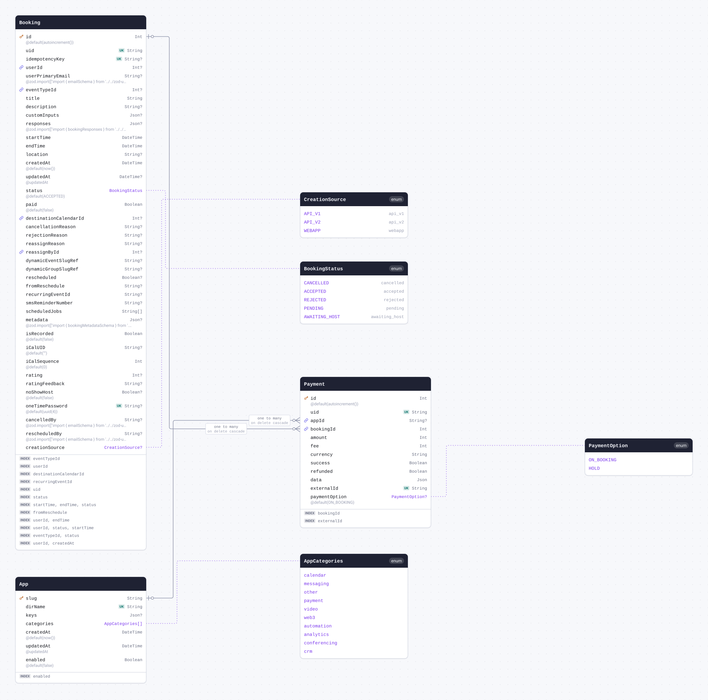

| Field           | Type                                   | Constraints                             | Default           | Description |
| --------------- | -------------------------------------- | --------------------------------------- | ----------------- | ----------- |
| `id`            | `Int`                                  | PK NOT NULL                             | `autoincrement()` |             |
| `uid`           | `String`                               | UNIQUE NOT NULL                         |                   |             |
| `appId`         | `String`                               | NULL → [App.slug](#model-App)           |                   |             |
| `bookingId`     | `Int`                                  | NOT NULL → [Booking.id](#model-Booking) |                   |             |
| `amount`        | `Int`                                  | NOT NULL                                |                   |             |
| `fee`           | `Int`                                  | NOT NULL                                |                   |             |
| `currency`      | `String`                               | NOT NULL                                |                   |             |
| `success`       | `Boolean`                              | NOT NULL                                |                   |             |
| `refunded`      | `Boolean`                              | NOT NULL                                |                   |             |
| `data`          | `Json`                                 | NOT NULL                                |                   |             |
| `externalId`    | `String`                               | UNIQUE NOT NULL                         |                   |             |
| `paymentOption` | [`PaymentOption`](#enum-PaymentOption) | NULL                                    | `ON_BOOKING`      |             |

#### Indexes

- `@@index([bookingId])`
- `@@index([externalId])`

#### References

- `appId` → [App.slug](#model-App) (many-to-one, on delete Cascade)
- `bookingId` → [Booking.id](#model-Booking) (many-to-one, on delete Cascade)

#### Definition

```sql
CREATE TABLE "Payment" (
    "id" SERIAL NOT NULL,
    "uid" TEXT NOT NULL,
    "appId" TEXT,
    "bookingId" INTEGER NOT NULL,
    "amount" INTEGER NOT NULL,
    "fee" INTEGER NOT NULL,
    "currency" TEXT NOT NULL,
    "success" BOOLEAN NOT NULL,
    "refunded" BOOLEAN NOT NULL,
    "data" JSONB NOT NULL,
    "externalId" TEXT NOT NULL,
    "paymentOption" "PaymentOption" DEFAULT 'ON_BOOKING',

    CONSTRAINT "Payment_pkey" PRIMARY KEY ("id")
);

CREATE UNIQUE INDEX "Payment_uid_key" ON "Payment"("uid");

CREATE UNIQUE INDEX "Payment_externalId_key" ON "Payment"("externalId");

CREATE INDEX "Payment_bookingId_idx" ON "Payment"("bookingId");

CREATE INDEX "Payment_externalId_idx" ON "Payment"("externalId");

ALTER TABLE "Payment" ADD CONSTRAINT "Payment_appId_fkey" FOREIGN KEY ("appId") REFERENCES "App"("slug") ON DELETE CASCADE ON UPDATE CASCADE;

ALTER TABLE "Payment" ADD CONSTRAINT "Payment_bookingId_fkey" FOREIGN KEY ("bookingId") REFERENCES "Booking"("id") ON DELETE CASCADE ON UPDATE CASCADE;
```

<details>
<summary>Queries and their SQL</summary>

**findMany**: Every row

```ts
await prisma.payment.findMany();
```

```sql
SELECT
  "public"."Payment"."id",
  "public"."Payment"."uid",
  "public"."Payment"."appId",
  "public"."Payment"."bookingId",
  "public"."Payment"."amount",
  "public"."Payment"."fee",
  "public"."Payment"."currency",
  "public"."Payment"."success",
  "public"."Payment"."refunded",
  "public"."Payment"."data",
  "public"."Payment"."externalId",
  "public"."Payment"."paymentOption"::text
FROM
  "public"."Payment"
WHERE
  1 = 1
OFFSET
  $1
-- params: ["0"]
```

**count**: How many rows there are

```ts
await prisma.payment.count();
```

```sql
SELECT
  COUNT(*) AS "_count$_all"
FROM
  (
    SELECT
      "public"."Payment"."id"
    FROM
      "public"."Payment"
    WHERE
      1 = 1
    OFFSET
      $1
  ) AS "sub"
-- params: ["0"]
```

**findMany**: Every row with its relations

```ts
await prisma.payment.findMany({ include: { app: true, booking: true } });
```

```sql
SELECT
  "public"."Payment"."id",
  "public"."Payment"."uid",
  "public"."Payment"."appId",
  "public"."Payment"."bookingId",
  "public"."Payment"."amount",
  "public"."Payment"."fee",
  "public"."Payment"."currency",
  "public"."Payment"."success",
  "public"."Payment"."refunded",
  "public"."Payment"."data",
  "public"."Payment"."externalId",
  "public"."Payment"."paymentOption"::text
FROM
  "public"."Payment"
WHERE
  1 = 1
OFFSET
  $1
-- params: ["0"]

SELECT
  "public"."App"."slug",
  "public"."App"."dirName",
  "public"."App"."keys",
  "public"."App"."categories"::text[],
  "public"."App"."createdAt",
  "public"."App"."updatedAt",
  "public"."App"."enabled"
FROM
  "public"."App"
WHERE
  "public"."App"."slug" IN ($1)
OFFSET
  $2
-- params: ["<appId of the rows above>","0"]

SELECT
  "public"."Booking"."id",
  "public"."Booking"."uid",
  "public"."Booking"."idempotencyKey",
  "public"."Booking"."userId",
  "public"."Booking"."userPrimaryEmail",
  "public"."Booking"."eventTypeId",
  "public"."Booking"."title",
  "public"."Booking"."description",
  "public"."Booking"."customInputs",
  "public"."Booking"."responses",
  "public"."Booking"."startTime",
  "public"."Booking"."endTime",
  "public"."Booking"."location",
  "public"."Booking"."createdAt",
  "public"."Booking"."updatedAt",
  "public"."Booking"."status"::text,
  "public"."Booking"."paid",
  "public"."Booking"."destinationCalendarId",
  "public"."Booking"."cancellationReason",
  "public"."Booking"."rejectionReason",
  "public"."Booking"."reassignReason",
  "public"."Booking"."reassignById",
  "public"."Booking"."dynamicEventSlugRef",
  "public"."Booking"."dynamicGroupSlugRef",
  "public"."Booking"."rescheduled",
  "public"."Booking"."fromReschedule",
  "public"."Booking"."recurringEventId",
  "public"."Booking"."smsReminderNumber",
  "public"."Booking"."scheduledJobs",
  "public"."Booking"."metadata",
  "public"."Booking"."isRecorded",
  "public"."Booking"."iCalUID",
  "public"."Booking"."iCalSequence",
  "public"."Booking"."rating",
  "public"."Booking"."ratingFeedback",
  "public"."Booking"."noShowHost",
  "public"."Booking"."oneTimePassword",
  "public"."Booking"."cancelledBy",
  "public"."Booking"."rescheduledBy",
  "public"."Booking"."creationSource"::text
FROM
  "public"."Booking"
WHERE
  "public"."Booking"."id" IN ($1)
OFFSET
  $2
-- params: ["<bookingId of the rows above>","0"]
```

**findUnique**: One row by what is unique to it

```ts
await prisma.payment.findUnique({ where: { id: 1 } });
```

```sql
SELECT
  "public"."Payment"."id",
  "public"."Payment"."uid",
  "public"."Payment"."appId",
  "public"."Payment"."bookingId",
  "public"."Payment"."amount",
  "public"."Payment"."fee",
  "public"."Payment"."currency",
  "public"."Payment"."success",
  "public"."Payment"."refunded",
  "public"."Payment"."data",
  "public"."Payment"."externalId",
  "public"."Payment"."paymentOption"::text
FROM
  "public"."Payment"
WHERE
  (
    "public"."Payment"."id" = $1
    AND 1 = 1
  )
LIMIT
  $2
OFFSET
  $3
-- params: ["1","1","0"]
```

**create**: Create a row

```ts
await prisma.payment.create({
  data: {
    uid: "example",
    bookingId: 1,
    amount: 1,
    fee: 1,
    currency: "example",
    success: true,
    refunded: true,
    data: {},
    externalId: "example",
  },
});
```

```sql
INSERT INTO
  "public"."Payment" (
    "uid",
    "bookingId",
    "amount",
    "fee",
    "currency",
    "success",
    "refunded",
    "data",
    "externalId",
    "paymentOption"
  )
VALUES
  (
    $1,
    $2,
    $3,
    $4,
    $5,
    $6,
    $7,
    $8,
    $9,
    CAST($10::text AS "public"."PaymentOption")
  )
RETURNING
  "public"."Payment"."id",
  "public"."Payment"."uid",
  "public"."Payment"."appId",
  "public"."Payment"."bookingId",
  "public"."Payment"."amount",
  "public"."Payment"."fee",
  "public"."Payment"."currency",
  "public"."Payment"."success",
  "public"."Payment"."refunded",
  "public"."Payment"."data",
  "public"."Payment"."externalId",
  "public"."Payment"."paymentOption"::text
-- params: ["example","1","1","1","example",true,true,"{}","example","ON_BOOKING"]
```

**update**: Update a row

```ts
await prisma.payment.update({ where: { id: 1 }, data: { uid: "example" } });
```

```sql
UPDATE "public"."Payment"
SET
  "uid" = $1
WHERE
  (
    "public"."Payment"."id" = $2
    AND 1 = 1
  )
RETURNING
  "public"."Payment"."id",
  "public"."Payment"."uid",
  "public"."Payment"."appId",
  "public"."Payment"."bookingId",
  "public"."Payment"."amount",
  "public"."Payment"."fee",
  "public"."Payment"."currency",
  "public"."Payment"."success",
  "public"."Payment"."refunded",
  "public"."Payment"."data",
  "public"."Payment"."externalId",
  "public"."Payment"."paymentOption"::text
-- params: ["example","1"]
```

**delete**: Delete a row

```ts
await prisma.payment.delete({ where: { id: 1 } });
```

```sql
DELETE FROM "public"."Payment"
WHERE
  (
    "public"."Payment"."id" = $1
    AND 1 = 1
  )
RETURNING
  "public"."Payment"."id",
  "public"."Payment"."uid",
  "public"."Payment"."appId",
  "public"."Payment"."bookingId",
  "public"."Payment"."amount",
  "public"."Payment"."fee",
  "public"."Payment"."currency",
  "public"."Payment"."success",
  "public"."Payment"."refunded",
  "public"."Payment"."data",
  "public"."Payment"."externalId",
  "public"."Payment"."paymentOption"::text
-- params: ["1"]
```

</details>

<a id="model-Webhook"></a>

### Webhook

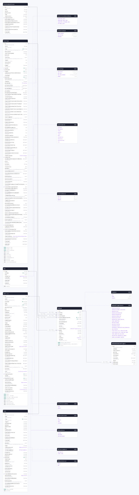

| Field                   | Type                                                   | Constraints                                                 | Default        | Description       |
| ----------------------- | ------------------------------------------------------ | ----------------------------------------------------------- | -------------- | ----------------- |
| `id`                    | `String`                                               | PK NOT NULL                                                 |                |                   |
| `userId`                | `Int`                                                  | NULL → [User.id](#model-User)                               |                |                   |
| `teamId`                | `Int`                                                  | NULL → [Team.id](#model-Team)                               |                |                   |
| `eventTypeId`           | `Int`                                                  | NULL → [EventType.id](#model-EventType)                     |                |                   |
| `platformOAuthClientId` | `String`                                               | NULL → [PlatformOAuthClient.id](#model-PlatformOAuthClient) |                |                   |
| `subscriberUrl`         | `String`                                               | NOT NULL                                                    |                | @zod.string.url() |
| `payloadTemplate`       | `String`                                               | NULL                                                        |                |                   |
| `createdAt`             | `DateTime`                                             | NOT NULL                                                    | `now()`        |                   |
| `active`                | `Boolean`                                              | NOT NULL                                                    | `true`         |                   |
| `eventTriggers`         | [`WebhookTriggerEvents[]`](#enum-WebhookTriggerEvents) | NOT NULL                                                    |                |                   |
| `appId`                 | `String`                                               | NULL → [App.slug](#model-App)                               |                |                   |
| `secret`                | `String`                                               | NULL                                                        |                |                   |
| `platform`              | `Boolean`                                              | NOT NULL                                                    | `false`        |                   |
| `time`                  | `Int`                                                  | NULL                                                        |                |                   |
| `timeUnit`              | [`TimeUnit`](#enum-TimeUnit)                           | NULL                                                        |                |                   |
| `version`               | `String`                                               | NOT NULL                                                    | `"2021-10-20"` |                   |

#### Indexes

- `@@index([active])`
- `@@unique([userId, subscriberUrl], name: "courseIdentifier")`
- `@@unique([platformOAuthClientId, subscriberUrl], name: "oauthclientwebhook")`

#### References

- `userId` → [User.id](#model-User) (many-to-one, on delete Cascade)
- `teamId` → [Team.id](#model-Team) (many-to-one, on delete Cascade)
- `eventTypeId` → [EventType.id](#model-EventType) (many-to-one, on delete Cascade)
- `platformOAuthClientId` → [PlatformOAuthClient.id](#model-PlatformOAuthClient) (many-to-one, on delete Cascade)
- `appId` → [App.slug](#model-App) (many-to-one, on delete Cascade)

#### Referenced by

- `id` ← [WebhookScheduledTriggers.webhookId](#model-WebhookScheduledTriggers) (one-to-many, on delete Cascade)

#### Definition

```sql
CREATE TABLE "Webhook" (
    "id" TEXT NOT NULL,
    "userId" INTEGER,
    "teamId" INTEGER,
    "eventTypeId" INTEGER,
    "platformOAuthClientId" TEXT,
    "subscriberUrl" TEXT NOT NULL,
    "payloadTemplate" TEXT,
    "createdAt" TIMESTAMP(3) NOT NULL DEFAULT CURRENT_TIMESTAMP,
    "active" BOOLEAN NOT NULL DEFAULT true,
    "eventTriggers" "WebhookTriggerEvents"[],
    "appId" TEXT,
    "secret" TEXT,
    "platform" BOOLEAN NOT NULL DEFAULT false,
    "time" INTEGER,
    "timeUnit" "TimeUnit",
    "version" TEXT NOT NULL DEFAULT '2021-10-20',

    CONSTRAINT "Webhook_pkey" PRIMARY KEY ("id")
);

CREATE UNIQUE INDEX "Webhook_id_key" ON "Webhook"("id");

CREATE INDEX "Webhook_active_idx" ON "Webhook"("active");

CREATE UNIQUE INDEX "Webhook_userId_subscriberUrl_key" ON "Webhook"("userId", "subscriberUrl");

CREATE UNIQUE INDEX "Webhook_platformOAuthClientId_subscriberUrl_key" ON "Webhook"("platformOAuthClientId", "subscriberUrl");

ALTER TABLE "Webhook" ADD CONSTRAINT "Webhook_userId_fkey" FOREIGN KEY ("userId") REFERENCES "users"("id") ON DELETE CASCADE ON UPDATE CASCADE;

ALTER TABLE "Webhook" ADD CONSTRAINT "Webhook_teamId_fkey" FOREIGN KEY ("teamId") REFERENCES "Team"("id") ON DELETE CASCADE ON UPDATE CASCADE;

ALTER TABLE "Webhook" ADD CONSTRAINT "Webhook_eventTypeId_fkey" FOREIGN KEY ("eventTypeId") REFERENCES "EventType"("id") ON DELETE CASCADE ON UPDATE CASCADE;

ALTER TABLE "Webhook" ADD CONSTRAINT "Webhook_platformOAuthClientId_fkey" FOREIGN KEY ("platformOAuthClientId") REFERENCES "PlatformOAuthClient"("id") ON DELETE CASCADE ON UPDATE CASCADE;

ALTER TABLE "Webhook" ADD CONSTRAINT "Webhook_appId_fkey" FOREIGN KEY ("appId") REFERENCES "App"("slug") ON DELETE CASCADE ON UPDATE CASCADE;
```

<details>
<summary>Queries and their SQL</summary>

**findMany**: Every row

```ts
await prisma.webhook.findMany();
```

```sql
SELECT
  "public"."Webhook"."id",
  "public"."Webhook"."userId",
  "public"."Webhook"."teamId",
  "public"."Webhook"."eventTypeId",
  "public"."Webhook"."platformOAuthClientId",
  "public"."Webhook"."subscriberUrl",
  "public"."Webhook"."payloadTemplate",
  "public"."Webhook"."createdAt",
  "public"."Webhook"."active",
  "public"."Webhook"."eventTriggers"::text[],
  "public"."Webhook"."appId",
  "public"."Webhook"."secret",
  "public"."Webhook"."platform",
  "public"."Webhook"."time",
  "public"."Webhook"."timeUnit"::text,
  "public"."Webhook"."version"
FROM
  "public"."Webhook"
WHERE
  1 = 1
OFFSET
  $1
-- params: ["0"]
```

**count**: How many rows there are

```ts
await prisma.webhook.count();
```

```sql
SELECT
  COUNT(*) AS "_count$_all"
FROM
  (
    SELECT
      "public"."Webhook"."id"
    FROM
      "public"."Webhook"
    WHERE
      1 = 1
    OFFSET
      $1
  ) AS "sub"
-- params: ["0"]
```

**findMany**: Every row with its relations

```ts
await prisma.webhook.findMany({
  include: {
    user: true,
    team: true,
    eventType: true,
    platformOAuthClient: true,
    app: true,
    scheduledTriggers: true,
  },
});
```

```sql
SELECT
  "public"."Webhook"."id",
  "public"."Webhook"."userId",
  "public"."Webhook"."teamId",
  "public"."Webhook"."eventTypeId",
  "public"."Webhook"."platformOAuthClientId",
  "public"."Webhook"."subscriberUrl",
  "public"."Webhook"."payloadTemplate",
  "public"."Webhook"."createdAt",
  "public"."Webhook"."active",
  "public"."Webhook"."eventTriggers"::text[],
  "public"."Webhook"."appId",
  "public"."Webhook"."secret",
  "public"."Webhook"."platform",
  "public"."Webhook"."time",
  "public"."Webhook"."timeUnit"::text,
  "public"."Webhook"."version"
FROM
  "public"."Webhook"
WHERE
  1 = 1
OFFSET
  $1
-- params: ["0"]

SELECT
  "public"."users"."id",
  "public"."users"."uuid",
  "public"."users"."username",
  "public"."users"."name",
  "public"."users"."email",
  "public"."users"."emailVerified",
  "public"."users"."bio",
  "public"."users"."avatarUrl",
  "public"."users"."timeZone",
  "public"."users"."weekStart",
  "public"."users"."bufferTime",
  "public"."users"."hideBranding",
  "public"."users"."theme",
  "public"."users"."appTheme",
  "public"."users"."created",
  "public"."users"."trialEndsAt",
  "public"."users"."lastActiveAt",
  "public"."users"."defaultScheduleId",
  "public"."users"."completedOnboarding",
  "public"."users"."locale",
  "public"."users"."timeFormat",
  "public"."users"."twoFactorSecret",
  "public"."users"."twoFactorEnabled",
  "public"."users"."backupCodes",
  "public"."users"."identityProvider"::text,
  "public"."users"."identityProviderId",
  "public"."users"."invitedTo",
  "public"."users"."brandColor",
  "public"."users"."darkBrandColor",
  "public"."users"."allowDynamicBooking",
  "public"."users"."allowSEOIndexing",
  "public"."users"."receiveMonthlyDigestEmail",
  "public"."users"."requiresBookerEmailVerification",
  "public"."users"."metadata",
  "public"."users"."verified",
  "public"."users"."role"::text,
  "public"."users"."organizationId",
  "public"."users"."locked",
  "public"."users"."movedToProfileId",
  "public"."users"."isPlatformManaged",
  "public"."users"."smsLockState"::text,
  "public"."users"."smsLockReviewedByAdmin",
  "public"."users"."referralLinkId",
  "public"."users"."creationSource"::text,
  "public"."users"."autoOptInFeatures"
FROM
  "public"."users"
WHERE
  "public"."users"."id" IN ($1)
OFFSET
  $2
-- params: ["<userId of the rows above>","0"]

SELECT
  "public"."Team"."id",
  "public"."Team"."name",
  "public"."Team"."slug",
  "public"."Team"."logoUrl",
  "public"."Team"."calVideoLogo",
  "public"."Team"."appLogo",
  "public"."Team"."appIconLogo",
  "public"."Team"."bio",
  "public"."Team"."hideBranding",
  "public"."Team"."hideTeamProfileLink",
  "public"."Team"."isPrivate",
  "public"."Team"."hideBookATeamMember",
  "public"."Team"."createdAt",
  "public"."Team"."metadata",
  "public"."Team"."theme",
  "public"."Team"."rrResetInterval"::text,
  "public"."Team"."rrTimestampBasis"::text,
  "public"."Team"."brandColor",
  "public"."Team"."darkBrandColor",
  "public"."Team"."bannerUrl",
  "public"."Team"."parentId",
  "public"."Team"."timeFormat",
  "public"."Team"."timeZone",
  "public"."Team"."weekStart",
  "public"."Team"."isOrganization",
  "public"."Team"."pendingPayment",
  "public"."Team"."isPlatform",
  "public"."Team"."createdByOAuthClientId",
  "public"."Team"."smsLockState"::text,
  "public"."Team"."smsLockReviewedByAdmin",
  "public"."Team"."bookingLimits",
  "public"."Team"."includeManagedEventsInLimits",
  "public"."Team"."autoOptInFeatures"
FROM
  "public"."Team"
WHERE
  "public"."Team"."id" IN ($1)
OFFSET
  $2
-- params: ["<teamId of the rows above>","0"]

SELECT
  "public"."EventType"."id",
  "public"."EventType"."title",
  "public"."EventType"."slug",
  "public"."EventType"."description",
  "public"."EventType"."interfaceLanguage",
  "public"."EventType"."position",
  "public"."EventType"."locations",
  "public"."EventType"."length",
  "public"."EventType"."offsetStart",
  "public"."EventType"."hidden",
  "public"."EventType"."userId",
  "public"."EventType"."profileId",
  "public"."EventType"."teamId",
  "public"."EventType"."useEventLevelSelectedCalendars",
  "public"."EventType"."eventName",
  "public"."EventType"."parentId",
  "public"."EventType"."bookingFields",
  "public"."EventType"."timeZone",
  "public"."EventType"."periodType"::text,
  "public"."EventType"."periodStartDate",
  "public"."EventType"."periodEndDate",
  "public"."EventType"."periodDays",
  "public"."EventType"."periodCountCalendarDays",
  "public"."EventType"."lockTimeZoneToggleOnBookingPage",
  "public"."EventType"."lockedTimeZone",
  "public"."EventType"."requiresConfirmation",
  "public"."EventType"."requiresConfirmationWillBlockSlot",
  "public"."EventType"."requiresConfirmationForFreeEmail",
  "public"."EventType"."requiresBookerEmailVerification",
  "public"."EventType"."canSendCalVideoTranscriptionEmails",
  "public"."EventType"."autoTranslateDescriptionEnabled",
  "public"."EventType"."autoTranslateInstantMeetingTitleEnabled",
  "public"."EventType"."recurringEvent",
  "public"."EventType"."disableGuests",
  "public"."EventType"."hideCalendarNotes",
  "public"."EventType"."hideCalendarEventDetails",
  "public"."EventType"."minimumBookingNotice",
  "public"."EventType"."beforeEventBuffer",
  "public"."EventType"."afterEventBuffer",
  "public"."EventType"."seatsPerTimeSlot",
  "public"."EventType"."onlyShowFirstAvailableSlot",
  "public"."EventType"."showOptimizedSlots",
  "public"."EventType"."disableCancelling",
  "public"."EventType"."disableRescheduling",
  "public"."EventType"."minimumRescheduleNotice",
  "public"."EventType"."seatsShowAttendees",
  "public"."EventType"."seatsShowAvailabilityCount",
  "public"."EventType"."schedulingType"::text,
  "public"."EventType"."scheduleId",
  "public"."EventType"."allowReschedulingCancelledBookings",
  "public"."EventType"."price",
  "public"."EventType"."currency",
  "public"."EventType"."slotInterval",
  "public"."EventType"."metadata",
  "public"."EventType"."successRedirectUrl",
  "public"."EventType"."forwardParamsSuccessRedirect",
  "public"."EventType"."bookingLimits",
  "public"."EventType"."durationLimits",
  "public"."EventType"."isInstantEvent",
  "public"."EventType"."instantMeetingExpiryTimeOffsetInSeconds",
  "public"."EventType"."instantMeetingScheduleId",
  "public"."EventType"."instantMeetingParameters",
  "public"."EventType"."assignAllTeamMembers",
  "public"."EventType"."assignRRMembersUsingSegment",
  "public"."EventType"."rrSegmentQueryValue",
  "public"."EventType"."useEventTypeDestinationCalendarEmail",
  "public"."EventType"."isRRWeightsEnabled",
  "public"."EventType"."maxLeadThreshold",
  "public"."EventType"."includeNoShowInRRCalculation",
  "public"."EventType"."allowReschedulingPastBookings",
  "public"."EventType"."hideOrganizerEmail",
  "public"."EventType"."maxActiveBookingsPerBooker",
  "public"."EventType"."maxActiveBookingPerBookerOfferReschedule",
  "public"."EventType"."customReplyToEmail",
  "public"."EventType"."eventTypeColor",
  "public"."EventType"."rescheduleWithSameRoundRobinHost",
  "public"."EventType"."secondaryEmailId",
  "public"."EventType"."useBookerTimezone",
  "public"."EventType"."restrictionScheduleId",
  "public"."EventType"."bookingRequiresAuthentication",
  "public"."EventType"."rrHostSubsetEnabled",
  "public"."EventType"."requiresCancellationReason"::text,
  "public"."EventType"."enablePerHostLocations",
  "public"."EventType"."createdAt",
  "public"."EventType"."updatedAt"
FROM
  "public"."EventType"
WHERE
  "public"."EventType"."id" IN ($1)
OFFSET
  $2
-- params: ["<eventTypeId of the rows above>","0"]

SELECT
  "public"."PlatformOAuthClient"."id",
  "public"."PlatformOAuthClient"."name",
  "public"."PlatformOAuthClient"."secret",
  "public"."PlatformOAuthClient"."permissions",
  "public"."PlatformOAuthClient"."logo",
  "public"."PlatformOAuthClient"."redirectUris",
  "public"."PlatformOAuthClient"."organizationId",
  "public"."PlatformOAuthClient"."bookingRedirectUri",
  "public"."PlatformOAuthClient"."bookingCancelRedirectUri",
  "public"."PlatformOAuthClient"."bookingRescheduleRedirectUri",
  "public"."PlatformOAuthClient"."areEmailsEnabled",
  "public"."PlatformOAuthClient"."areDefaultEventTypesEnabled",
  "public"."PlatformOAuthClient"."areCalendarEventsEnabled",
  "public"."PlatformOAuthClient"."createdAt"
FROM
  "public"."PlatformOAuthClient"
WHERE
  "public"."PlatformOAuthClient"."id" IN ($1)
OFFSET
  $2
-- params: ["<platformOAuthClientId of the rows above>","0"]

SELECT
  "public"."App"."slug",
  "public"."App"."dirName",
  "public"."App"."keys",
  "public"."App"."categories"::text[],
  "public"."App"."createdAt",
  "public"."App"."updatedAt",
  "public"."App"."enabled"
FROM
  "public"."App"
WHERE
  "public"."App"."slug" IN ($1)
OFFSET
  $2
-- params: ["<appId of the rows above>","0"]

SELECT
  "public"."WebhookScheduledTriggers"."id",
  "public"."WebhookScheduledTriggers"."jobName",
  "public"."WebhookScheduledTriggers"."subscriberUrl",
  "public"."WebhookScheduledTriggers"."payload",
  "public"."WebhookScheduledTriggers"."startAfter",
  "public"."WebhookScheduledTriggers"."retryCount",
  "public"."WebhookScheduledTriggers"."createdAt",
  "public"."WebhookScheduledTriggers"."appId",
  "public"."WebhookScheduledTriggers"."webhookId",
  "public"."WebhookScheduledTriggers"."bookingId"
FROM
  "public"."WebhookScheduledTriggers"
WHERE
  "public"."WebhookScheduledTriggers"."webhookId" IN ($1)
OFFSET
  $2
-- params: ["<id of the rows above>","0"]
```

**findUnique**: One row by what is unique to it

```ts
await prisma.webhook.findUnique({ where: { id: "example" } });
```

```sql
SELECT
  "public"."Webhook"."id",
  "public"."Webhook"."userId",
  "public"."Webhook"."teamId",
  "public"."Webhook"."eventTypeId",
  "public"."Webhook"."platformOAuthClientId",
  "public"."Webhook"."subscriberUrl",
  "public"."Webhook"."payloadTemplate",
  "public"."Webhook"."createdAt",
  "public"."Webhook"."active",
  "public"."Webhook"."eventTriggers"::text[],
  "public"."Webhook"."appId",
  "public"."Webhook"."secret",
  "public"."Webhook"."platform",
  "public"."Webhook"."time",
  "public"."Webhook"."timeUnit"::text,
  "public"."Webhook"."version"
FROM
  "public"."Webhook"
WHERE
  (
    "public"."Webhook"."id" = $1
    AND 1 = 1
  )
LIMIT
  $2
OFFSET
  $3
-- params: ["example","1","0"]
```

**create**: Create a row

```ts
await prisma.webhook.create({
  data: { id: "example", subscriberUrl: "example", eventTriggers: ["BOOKING_CREATED"] },
});
```

```sql
INSERT INTO
  "public"."Webhook" (
    "id",
    "subscriberUrl",
    "createdAt",
    "active",
    "eventTriggers",
    "platform",
    "version"
  )
VALUES
  (
    $1,
    $2,
    $3,
    $4,
    CAST($5::text[] AS "public"."WebhookTriggerEvents" []),
    $6,
    $7
  )
RETURNING
  "public"."Webhook"."id",
  "public"."Webhook"."userId",
  "public"."Webhook"."teamId",
  "public"."Webhook"."eventTypeId",
  "public"."Webhook"."platformOAuthClientId",
  "public"."Webhook"."subscriberUrl",
  "public"."Webhook"."payloadTemplate",
  "public"."Webhook"."createdAt",
  "public"."Webhook"."active",
  "public"."Webhook"."eventTriggers"::text[],
  "public"."Webhook"."appId",
  "public"."Webhook"."secret",
  "public"."Webhook"."platform",
  "public"."Webhook"."time",
  "public"."Webhook"."timeUnit"::text,
  "public"."Webhook"."version"
-- params: ["example","example","<now()>",true,["BOOKING_CREATED"],false,"2021-10-20"]
```

**update**: Update a row

```ts
await prisma.webhook.update({ where: { id: "example" }, data: { subscriberUrl: "example" } });
```

```sql
UPDATE "public"."Webhook"
SET
  "subscriberUrl" = $1
WHERE
  (
    "public"."Webhook"."id" = $2
    AND 1 = 1
  )
RETURNING
  "public"."Webhook"."id",
  "public"."Webhook"."userId",
  "public"."Webhook"."teamId",
  "public"."Webhook"."eventTypeId",
  "public"."Webhook"."platformOAuthClientId",
  "public"."Webhook"."subscriberUrl",
  "public"."Webhook"."payloadTemplate",
  "public"."Webhook"."createdAt",
  "public"."Webhook"."active",
  "public"."Webhook"."eventTriggers"::text[],
  "public"."Webhook"."appId",
  "public"."Webhook"."secret",
  "public"."Webhook"."platform",
  "public"."Webhook"."time",
  "public"."Webhook"."timeUnit"::text,
  "public"."Webhook"."version"
-- params: ["example","example"]
```

**delete**: Delete a row

```ts
await prisma.webhook.delete({ where: { id: "example" } });
```

```sql
DELETE FROM "public"."Webhook"
WHERE
  (
    "public"."Webhook"."id" = $1
    AND 1 = 1
  )
RETURNING
  "public"."Webhook"."id",
  "public"."Webhook"."userId",
  "public"."Webhook"."teamId",
  "public"."Webhook"."eventTypeId",
  "public"."Webhook"."platformOAuthClientId",
  "public"."Webhook"."subscriberUrl",
  "public"."Webhook"."payloadTemplate",
  "public"."Webhook"."createdAt",
  "public"."Webhook"."active",
  "public"."Webhook"."eventTriggers"::text[],
  "public"."Webhook"."appId",
  "public"."Webhook"."secret",
  "public"."Webhook"."platform",
  "public"."Webhook"."time",
  "public"."Webhook"."timeUnit"::text,
  "public"."Webhook"."version"
-- params: ["example"]
```

</details>

<a id="model-ApiKey"></a>

### ApiKey

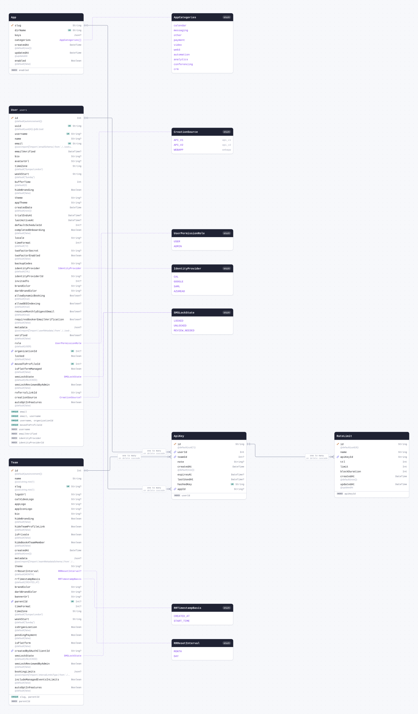

| Field        | Type       | Constraints                       | Default   | Description |
| ------------ | ---------- | --------------------------------- | --------- | ----------- |
| `id`         | `String`   | PK NOT NULL                       | `cuid(1)` |             |
| `userId`     | `Int`      | NOT NULL → [User.id](#model-User) |           |             |
| `teamId`     | `Int`      | NULL → [Team.id](#model-Team)     |           |             |
| `note`       | `String`   | NULL                              |           |             |
| `createdAt`  | `DateTime` | NOT NULL                          | `now()`   |             |
| `expiresAt`  | `DateTime` | NULL                              |           |             |
| `lastUsedAt` | `DateTime` | NULL                              |           |             |
| `hashedKey`  | `String`   | UNIQUE NOT NULL                   |           |             |
| `appId`      | `String`   | NULL → [App.slug](#model-App)     |           |             |

#### Indexes

- `@@index([userId])`

#### References

- `userId` → [User.id](#model-User) (many-to-one, on delete Cascade)
- `teamId` → [Team.id](#model-Team) (many-to-one, on delete Cascade)
- `appId` → [App.slug](#model-App) (many-to-one, on delete Cascade)

#### Referenced by

- `id` ← [RateLimit.apiKeyId](#model-RateLimit) (one-to-many, on delete Cascade)

#### Definition

```sql
CREATE TABLE "ApiKey" (
    "id" TEXT NOT NULL,
    "userId" INTEGER NOT NULL,
    "teamId" INTEGER,
    "note" TEXT,
    "createdAt" TIMESTAMP(3) NOT NULL DEFAULT CURRENT_TIMESTAMP,
    "expiresAt" TIMESTAMP(3),
    "lastUsedAt" TIMESTAMP(3),
    "hashedKey" TEXT NOT NULL,
    "appId" TEXT,

    CONSTRAINT "ApiKey_pkey" PRIMARY KEY ("id")
);

CREATE UNIQUE INDEX "ApiKey_id_key" ON "ApiKey"("id");

CREATE UNIQUE INDEX "ApiKey_hashedKey_key" ON "ApiKey"("hashedKey");

CREATE INDEX "ApiKey_userId_idx" ON "ApiKey"("userId");

ALTER TABLE "ApiKey" ADD CONSTRAINT "ApiKey_userId_fkey" FOREIGN KEY ("userId") REFERENCES "users"("id") ON DELETE CASCADE ON UPDATE CASCADE;

ALTER TABLE "ApiKey" ADD CONSTRAINT "ApiKey_teamId_fkey" FOREIGN KEY ("teamId") REFERENCES "Team"("id") ON DELETE CASCADE ON UPDATE CASCADE;

ALTER TABLE "ApiKey" ADD CONSTRAINT "ApiKey_appId_fkey" FOREIGN KEY ("appId") REFERENCES "App"("slug") ON DELETE CASCADE ON UPDATE CASCADE;
```

<details>
<summary>Queries and their SQL</summary>

**findMany**: Every row

```ts
await prisma.apiKey.findMany();
```

```sql
SELECT
  "public"."ApiKey"."id",
  "public"."ApiKey"."userId",
  "public"."ApiKey"."teamId",
  "public"."ApiKey"."note",
  "public"."ApiKey"."createdAt",
  "public"."ApiKey"."expiresAt",
  "public"."ApiKey"."lastUsedAt",
  "public"."ApiKey"."hashedKey",
  "public"."ApiKey"."appId"
FROM
  "public"."ApiKey"
WHERE
  1 = 1
OFFSET
  $1
-- params: ["0"]
```

**count**: How many rows there are

```ts
await prisma.apiKey.count();
```

```sql
SELECT
  COUNT(*) AS "_count$_all"
FROM
  (
    SELECT
      "public"."ApiKey"."id"
    FROM
      "public"."ApiKey"
    WHERE
      1 = 1
    OFFSET
      $1
  ) AS "sub"
-- params: ["0"]
```

**findMany**: Every row with its relations

```ts
await prisma.apiKey.findMany({ include: { user: true, team: true, app: true, rateLimits: true } });
```

```sql
SELECT
  "public"."ApiKey"."id",
  "public"."ApiKey"."userId",
  "public"."ApiKey"."teamId",
  "public"."ApiKey"."note",
  "public"."ApiKey"."createdAt",
  "public"."ApiKey"."expiresAt",
  "public"."ApiKey"."lastUsedAt",
  "public"."ApiKey"."hashedKey",
  "public"."ApiKey"."appId"
FROM
  "public"."ApiKey"
WHERE
  1 = 1
OFFSET
  $1
-- params: ["0"]

SELECT
  "public"."users"."id",
  "public"."users"."uuid",
  "public"."users"."username",
  "public"."users"."name",
  "public"."users"."email",
  "public"."users"."emailVerified",
  "public"."users"."bio",
  "public"."users"."avatarUrl",
  "public"."users"."timeZone",
  "public"."users"."weekStart",
  "public"."users"."bufferTime",
  "public"."users"."hideBranding",
  "public"."users"."theme",
  "public"."users"."appTheme",
  "public"."users"."created",
  "public"."users"."trialEndsAt",
  "public"."users"."lastActiveAt",
  "public"."users"."defaultScheduleId",
  "public"."users"."completedOnboarding",
  "public"."users"."locale",
  "public"."users"."timeFormat",
  "public"."users"."twoFactorSecret",
  "public"."users"."twoFactorEnabled",
  "public"."users"."backupCodes",
  "public"."users"."identityProvider"::text,
  "public"."users"."identityProviderId",
  "public"."users"."invitedTo",
  "public"."users"."brandColor",
  "public"."users"."darkBrandColor",
  "public"."users"."allowDynamicBooking",
  "public"."users"."allowSEOIndexing",
  "public"."users"."receiveMonthlyDigestEmail",
  "public"."users"."requiresBookerEmailVerification",
  "public"."users"."metadata",
  "public"."users"."verified",
  "public"."users"."role"::text,
  "public"."users"."organizationId",
  "public"."users"."locked",
  "public"."users"."movedToProfileId",
  "public"."users"."isPlatformManaged",
  "public"."users"."smsLockState"::text,
  "public"."users"."smsLockReviewedByAdmin",
  "public"."users"."referralLinkId",
  "public"."users"."creationSource"::text,
  "public"."users"."autoOptInFeatures"
FROM
  "public"."users"
WHERE
  "public"."users"."id" IN ($1)
OFFSET
  $2
-- params: ["<userId of the rows above>","0"]

SELECT
  "public"."Team"."id",
  "public"."Team"."name",
  "public"."Team"."slug",
  "public"."Team"."logoUrl",
  "public"."Team"."calVideoLogo",
  "public"."Team"."appLogo",
  "public"."Team"."appIconLogo",
  "public"."Team"."bio",
  "public"."Team"."hideBranding",
  "public"."Team"."hideTeamProfileLink",
  "public"."Team"."isPrivate",
  "public"."Team"."hideBookATeamMember",
  "public"."Team"."createdAt",
  "public"."Team"."metadata",
  "public"."Team"."theme",
  "public"."Team"."rrResetInterval"::text,
  "public"."Team"."rrTimestampBasis"::text,
  "public"."Team"."brandColor",
  "public"."Team"."darkBrandColor",
  "public"."Team"."bannerUrl",
  "public"."Team"."parentId",
  "public"."Team"."timeFormat",
  "public"."Team"."timeZone",
  "public"."Team"."weekStart",
  "public"."Team"."isOrganization",
  "public"."Team"."pendingPayment",
  "public"."Team"."isPlatform",
  "public"."Team"."createdByOAuthClientId",
  "public"."Team"."smsLockState"::text,
  "public"."Team"."smsLockReviewedByAdmin",
  "public"."Team"."bookingLimits",
  "public"."Team"."includeManagedEventsInLimits",
  "public"."Team"."autoOptInFeatures"
FROM
  "public"."Team"
WHERE
  "public"."Team"."id" IN ($1)
OFFSET
  $2
-- params: ["<teamId of the rows above>","0"]

SELECT
  "public"."App"."slug",
  "public"."App"."dirName",
  "public"."App"."keys",
  "public"."App"."categories"::text[],
  "public"."App"."createdAt",
  "public"."App"."updatedAt",
  "public"."App"."enabled"
FROM
  "public"."App"
WHERE
  "public"."App"."slug" IN ($1)
OFFSET
  $2
-- params: ["<appId of the rows above>","0"]

SELECT
  "public"."RateLimit"."id",
  "public"."RateLimit"."name",
  "public"."RateLimit"."apiKeyId",
  "public"."RateLimit"."ttl",
  "public"."RateLimit"."limit",
  "public"."RateLimit"."blockDuration",
  "public"."RateLimit"."createdAt",
  "public"."RateLimit"."updatedAt"
FROM
  "public"."RateLimit"
WHERE
  "public"."RateLimit"."apiKeyId" IN ($1)
OFFSET
  $2
-- params: ["<id of the rows above>","0"]
```

**findUnique**: One row by what is unique to it

```ts
await prisma.apiKey.findUnique({ where: { id: "example" } });
```

```sql
SELECT
  "public"."ApiKey"."id",
  "public"."ApiKey"."userId",
  "public"."ApiKey"."teamId",
  "public"."ApiKey"."note",
  "public"."ApiKey"."createdAt",
  "public"."ApiKey"."expiresAt",
  "public"."ApiKey"."lastUsedAt",
  "public"."ApiKey"."hashedKey",
  "public"."ApiKey"."appId"
FROM
  "public"."ApiKey"
WHERE
  (
    "public"."ApiKey"."id" = $1
    AND 1 = 1
  )
LIMIT
  $2
OFFSET
  $3
-- params: ["example","1","0"]
```

**create**: Create a row

```ts
await prisma.apiKey.create({ data: { userId: 1, hashedKey: "example" } });
```

```sql
INSERT INTO
  "public"."ApiKey" ("id", "userId", "createdAt", "hashedKey")
VALUES
  ($1, $2, $3, $4)
RETURNING
  "public"."ApiKey"."id",
  "public"."ApiKey"."userId",
  "public"."ApiKey"."teamId",
  "public"."ApiKey"."note",
  "public"."ApiKey"."createdAt",
  "public"."ApiKey"."expiresAt",
  "public"."ApiKey"."lastUsedAt",
  "public"."ApiKey"."hashedKey",
  "public"."ApiKey"."appId"
-- params: ["<cuid(1)>","1","<now()>","example"]
```

**update**: Update a row

```ts
await prisma.apiKey.update({ where: { id: "example" }, data: { note: "example" } });
```

```sql
UPDATE "public"."ApiKey"
SET
  "note" = $1
WHERE
  (
    "public"."ApiKey"."id" = $2
    AND 1 = 1
  )
RETURNING
  "public"."ApiKey"."id",
  "public"."ApiKey"."userId",
  "public"."ApiKey"."teamId",
  "public"."ApiKey"."note",
  "public"."ApiKey"."createdAt",
  "public"."ApiKey"."expiresAt",
  "public"."ApiKey"."lastUsedAt",
  "public"."ApiKey"."hashedKey",
  "public"."ApiKey"."appId"
-- params: ["example","example"]
```

**delete**: Delete a row

```ts
await prisma.apiKey.delete({ where: { id: "example" } });
```

```sql
DELETE FROM "public"."ApiKey"
WHERE
  (
    "public"."ApiKey"."id" = $1
    AND 1 = 1
  )
RETURNING
  "public"."ApiKey"."id",
  "public"."ApiKey"."userId",
  "public"."ApiKey"."teamId",
  "public"."ApiKey"."note",
  "public"."ApiKey"."createdAt",
  "public"."ApiKey"."expiresAt",
  "public"."ApiKey"."lastUsedAt",
  "public"."ApiKey"."hashedKey",
  "public"."ApiKey"."appId"
-- params: ["example"]
```

</details>

<a id="model-RateLimit"></a>

### RateLimit

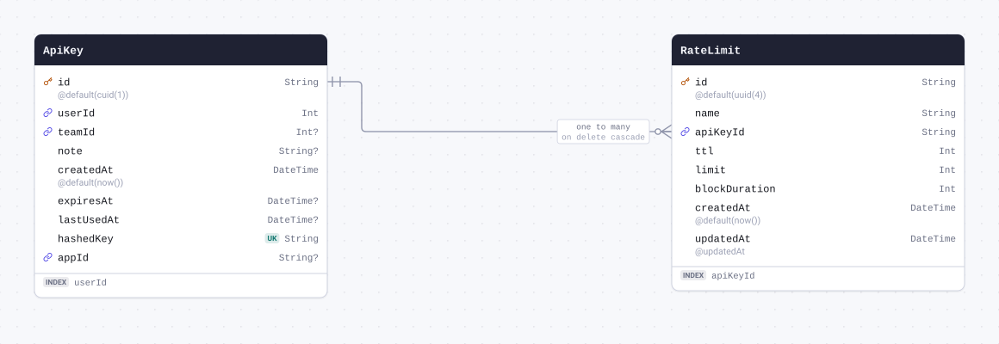

| Field           | Type       | Constraints                           | Default      | Description |
| --------------- | ---------- | ------------------------------------- | ------------ | ----------- |
| `id`            | `String`   | PK NOT NULL                           | `uuid(4)`    |             |
| `name`          | `String`   | NOT NULL                              |              |             |
| `apiKeyId`      | `String`   | NOT NULL → [ApiKey.id](#model-ApiKey) |              |             |
| `ttl`           | `Int`      | NOT NULL                              |              |             |
| `limit`         | `Int`      | NOT NULL                              |              |             |
| `blockDuration` | `Int`      | NOT NULL                              |              |             |
| `createdAt`     | `DateTime` | NOT NULL                              | `now()`      |             |
| `updatedAt`     | `DateTime` | NOT NULL                              | `@updatedAt` |             |

#### Indexes

- `@@index([apiKeyId])`

#### References

- `apiKeyId` → [ApiKey.id](#model-ApiKey) (many-to-one, on delete Cascade)

#### Definition

```sql
CREATE TABLE "RateLimit" (
    "id" TEXT NOT NULL,
    "name" TEXT NOT NULL,
    "apiKeyId" TEXT NOT NULL,
    "ttl" INTEGER NOT NULL,
    "limit" INTEGER NOT NULL,
    "blockDuration" INTEGER NOT NULL,
    "createdAt" TIMESTAMP(3) NOT NULL DEFAULT CURRENT_TIMESTAMP,
    "updatedAt" TIMESTAMP(3) NOT NULL,

    CONSTRAINT "RateLimit_pkey" PRIMARY KEY ("id")
);

CREATE INDEX "RateLimit_apiKeyId_idx" ON "RateLimit"("apiKeyId");

ALTER TABLE "RateLimit" ADD CONSTRAINT "RateLimit_apiKeyId_fkey" FOREIGN KEY ("apiKeyId") REFERENCES "ApiKey"("id") ON DELETE CASCADE ON UPDATE CASCADE;
```

<details>
<summary>Queries and their SQL</summary>

**findMany**: Every row

```ts
await prisma.rateLimit.findMany();
```

```sql
SELECT
  "public"."RateLimit"."id",
  "public"."RateLimit"."name",
  "public"."RateLimit"."apiKeyId",
  "public"."RateLimit"."ttl",
  "public"."RateLimit"."limit",
  "public"."RateLimit"."blockDuration",
  "public"."RateLimit"."createdAt",
  "public"."RateLimit"."updatedAt"
FROM
  "public"."RateLimit"
WHERE
  1 = 1
OFFSET
  $1
-- params: ["0"]
```

**count**: How many rows there are

```ts
await prisma.rateLimit.count();
```

```sql
SELECT
  COUNT(*) AS "_count$_all"
FROM
  (
    SELECT
      "public"."RateLimit"."id"
    FROM
      "public"."RateLimit"
    WHERE
      1 = 1
    OFFSET
      $1
  ) AS "sub"
-- params: ["0"]
```

**findMany**: Every row with its relations

```ts
await prisma.rateLimit.findMany({ include: { apiKey: true } });
```

```sql
SELECT
  "public"."RateLimit"."id",
  "public"."RateLimit"."name",
  "public"."RateLimit"."apiKeyId",
  "public"."RateLimit"."ttl",
  "public"."RateLimit"."limit",
  "public"."RateLimit"."blockDuration",
  "public"."RateLimit"."createdAt",
  "public"."RateLimit"."updatedAt"
FROM
  "public"."RateLimit"
WHERE
  1 = 1
OFFSET
  $1
-- params: ["0"]

SELECT
  "public"."ApiKey"."id",
  "public"."ApiKey"."userId",
  "public"."ApiKey"."teamId",
  "public"."ApiKey"."note",
  "public"."ApiKey"."createdAt",
  "public"."ApiKey"."expiresAt",
  "public"."ApiKey"."lastUsedAt",
  "public"."ApiKey"."hashedKey",
  "public"."ApiKey"."appId"
FROM
  "public"."ApiKey"
WHERE
  "public"."ApiKey"."id" IN ($1)
OFFSET
  $2
-- params: ["<apiKeyId of the rows above>","0"]
```

**findUnique**: One row by what is unique to it

```ts
await prisma.rateLimit.findUnique({ where: { id: "example" } });
```

```sql
SELECT
  "public"."RateLimit"."id",
  "public"."RateLimit"."name",
  "public"."RateLimit"."apiKeyId",
  "public"."RateLimit"."ttl",
  "public"."RateLimit"."limit",
  "public"."RateLimit"."blockDuration",
  "public"."RateLimit"."createdAt",
  "public"."RateLimit"."updatedAt"
FROM
  "public"."RateLimit"
WHERE
  (
    "public"."RateLimit"."id" = $1
    AND 1 = 1
  )
LIMIT
  $2
OFFSET
  $3
-- params: ["example","1","0"]
```

**create**: Create a row

```ts
await prisma.rateLimit.create({
  data: { name: "example", apiKeyId: "example", ttl: 1, limit: 1, blockDuration: 1 },
});
```

```sql
INSERT INTO
  "public"."RateLimit" (
    "id",
    "name",
    "apiKeyId",
    "ttl",
    "limit",
    "blockDuration",
    "createdAt",
    "updatedAt"
  )
VALUES
  ($1, $2, $3, $4, $5, $6, $7, $8)
RETURNING
  "public"."RateLimit"."id",
  "public"."RateLimit"."name",
  "public"."RateLimit"."apiKeyId",
  "public"."RateLimit"."ttl",
  "public"."RateLimit"."limit",
  "public"."RateLimit"."blockDuration",
  "public"."RateLimit"."createdAt",
  "public"."RateLimit"."updatedAt"
-- params: ["<uuid(4)>","example","example","1","1","1","<now()>","<now()>"]
```

**update**: Update a row

```ts
await prisma.rateLimit.update({ where: { id: "example" }, data: { name: "example" } });
```

```sql
UPDATE "public"."RateLimit"
SET
  "name" = $1,
  "updatedAt" = $2
WHERE
  (
    "public"."RateLimit"."id" = $3
    AND 1 = 1
  )
RETURNING
  "public"."RateLimit"."id",
  "public"."RateLimit"."name",
  "public"."RateLimit"."apiKeyId",
  "public"."RateLimit"."ttl",
  "public"."RateLimit"."limit",
  "public"."RateLimit"."blockDuration",
  "public"."RateLimit"."createdAt",
  "public"."RateLimit"."updatedAt"
-- params: ["example",{"prisma__type":"generatorCall","prisma__value":{"name":"now","args":[],"returnType":{"type":"DateTime"}}},"example"]
```

**delete**: Delete a row

```ts
await prisma.rateLimit.delete({ where: { id: "example" } });
```

```sql
DELETE FROM "public"."RateLimit"
WHERE
  (
    "public"."RateLimit"."id" = $1
    AND 1 = 1
  )
RETURNING
  "public"."RateLimit"."id",
  "public"."RateLimit"."name",
  "public"."RateLimit"."apiKeyId",
  "public"."RateLimit"."ttl",
  "public"."RateLimit"."limit",
  "public"."RateLimit"."blockDuration",
  "public"."RateLimit"."createdAt",
  "public"."RateLimit"."updatedAt"
-- params: ["example"]
```

</details>

<a id="model-HashedLink"></a>

### HashedLink

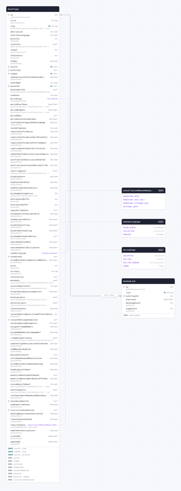

| Field           | Type       | Constraints                                 | Default           | Description |
| --------------- | ---------- | ------------------------------------------- | ----------------- | ----------- |
| `id`            | `Int`      | PK NOT NULL                                 | `autoincrement()` |             |
| `link`          | `String`   | UNIQUE NOT NULL                             |                   |             |
| `eventTypeId`   | `Int`      | NOT NULL → [EventType.id](#model-EventType) |                   |             |
| `expiresAt`     | `DateTime` | NULL                                        |                   |             |
| `maxUsageCount` | `Int`      | NOT NULL                                    | `1`               |             |
| `usageCount`    | `Int`      | NOT NULL                                    | `0`               |             |

#### Indexes

- `@@index([eventTypeId])`

#### References

- `eventTypeId` → [EventType.id](#model-EventType) (many-to-one, on delete Cascade)

#### Definition

```sql
CREATE TABLE "HashedLink" (
    "id" SERIAL NOT NULL,
    "link" TEXT NOT NULL,
    "eventTypeId" INTEGER NOT NULL,
    "expiresAt" TIMESTAMP(3),
    "maxUsageCount" INTEGER NOT NULL DEFAULT 1,
    "usageCount" INTEGER NOT NULL DEFAULT 0,

    CONSTRAINT "HashedLink_pkey" PRIMARY KEY ("id")
);

CREATE UNIQUE INDEX "HashedLink_link_key" ON "HashedLink"("link");

CREATE INDEX "HashedLink_eventTypeId_idx" ON "HashedLink"("eventTypeId");

ALTER TABLE "HashedLink" ADD CONSTRAINT "HashedLink_eventTypeId_fkey" FOREIGN KEY ("eventTypeId") REFERENCES "EventType"("id") ON DELETE CASCADE ON UPDATE CASCADE;
```

<details>
<summary>Queries and their SQL</summary>

**findMany**: Every row

```ts
await prisma.hashedLink.findMany();
```

```sql
SELECT
  "public"."HashedLink"."id",
  "public"."HashedLink"."link",
  "public"."HashedLink"."eventTypeId",
  "public"."HashedLink"."expiresAt",
  "public"."HashedLink"."maxUsageCount",
  "public"."HashedLink"."usageCount"
FROM
  "public"."HashedLink"
WHERE
  1 = 1
OFFSET
  $1
-- params: ["0"]
```

**count**: How many rows there are

```ts
await prisma.hashedLink.count();
```

```sql
SELECT
  COUNT(*) AS "_count$_all"
FROM
  (
    SELECT
      "public"."HashedLink"."id"
    FROM
      "public"."HashedLink"
    WHERE
      1 = 1
    OFFSET
      $1
  ) AS "sub"
-- params: ["0"]
```

**findMany**: Every row with its relations

```ts
await prisma.hashedLink.findMany({ include: { eventType: true } });
```

```sql
SELECT
  "public"."HashedLink"."id",
  "public"."HashedLink"."link",
  "public"."HashedLink"."eventTypeId",
  "public"."HashedLink"."expiresAt",
  "public"."HashedLink"."maxUsageCount",
  "public"."HashedLink"."usageCount"
FROM
  "public"."HashedLink"
WHERE
  1 = 1
OFFSET
  $1
-- params: ["0"]

SELECT
  "public"."EventType"."id",
  "public"."EventType"."title",
  "public"."EventType"."slug",
  "public"."EventType"."description",
  "public"."EventType"."interfaceLanguage",
  "public"."EventType"."position",
  "public"."EventType"."locations",
  "public"."EventType"."length",
  "public"."EventType"."offsetStart",
  "public"."EventType"."hidden",
  "public"."EventType"."userId",
  "public"."EventType"."profileId",
  "public"."EventType"."teamId",
  "public"."EventType"."useEventLevelSelectedCalendars",
  "public"."EventType"."eventName",
  "public"."EventType"."parentId",
  "public"."EventType"."bookingFields",
  "public"."EventType"."timeZone",
  "public"."EventType"."periodType"::text,
  "public"."EventType"."periodStartDate",
  "public"."EventType"."periodEndDate",
  "public"."EventType"."periodDays",
  "public"."EventType"."periodCountCalendarDays",
  "public"."EventType"."lockTimeZoneToggleOnBookingPage",
  "public"."EventType"."lockedTimeZone",
  "public"."EventType"."requiresConfirmation",
  "public"."EventType"."requiresConfirmationWillBlockSlot",
  "public"."EventType"."requiresConfirmationForFreeEmail",
  "public"."EventType"."requiresBookerEmailVerification",
  "public"."EventType"."canSendCalVideoTranscriptionEmails",
  "public"."EventType"."autoTranslateDescriptionEnabled",
  "public"."EventType"."autoTranslateInstantMeetingTitleEnabled",
  "public"."EventType"."recurringEvent",
  "public"."EventType"."disableGuests",
  "public"."EventType"."hideCalendarNotes",
  "public"."EventType"."hideCalendarEventDetails",
  "public"."EventType"."minimumBookingNotice",
  "public"."EventType"."beforeEventBuffer",
  "public"."EventType"."afterEventBuffer",
  "public"."EventType"."seatsPerTimeSlot",
  "public"."EventType"."onlyShowFirstAvailableSlot",
  "public"."EventType"."showOptimizedSlots",
  "public"."EventType"."disableCancelling",
  "public"."EventType"."disableRescheduling",
  "public"."EventType"."minimumRescheduleNotice",
  "public"."EventType"."seatsShowAttendees",
  "public"."EventType"."seatsShowAvailabilityCount",
  "public"."EventType"."schedulingType"::text,
  "public"."EventType"."scheduleId",
  "public"."EventType"."allowReschedulingCancelledBookings",
  "public"."EventType"."price",
  "public"."EventType"."currency",
  "public"."EventType"."slotInterval",
  "public"."EventType"."metadata",
  "public"."EventType"."successRedirectUrl",
  "public"."EventType"."forwardParamsSuccessRedirect",
  "public"."EventType"."bookingLimits",
  "public"."EventType"."durationLimits",
  "public"."EventType"."isInstantEvent",
  "public"."EventType"."instantMeetingExpiryTimeOffsetInSeconds",
  "public"."EventType"."instantMeetingScheduleId",
  "public"."EventType"."instantMeetingParameters",
  "public"."EventType"."assignAllTeamMembers",
  "public"."EventType"."assignRRMembersUsingSegment",
  "public"."EventType"."rrSegmentQueryValue",
  "public"."EventType"."useEventTypeDestinationCalendarEmail",
  "public"."EventType"."isRRWeightsEnabled",
  "public"."EventType"."maxLeadThreshold",
  "public"."EventType"."includeNoShowInRRCalculation",
  "public"."EventType"."allowReschedulingPastBookings",
  "public"."EventType"."hideOrganizerEmail",
  "public"."EventType"."maxActiveBookingsPerBooker",
  "public"."EventType"."maxActiveBookingPerBookerOfferReschedule",
  "public"."EventType"."customReplyToEmail",
  "public"."EventType"."eventTypeColor",
  "public"."EventType"."rescheduleWithSameRoundRobinHost",
  "public"."EventType"."secondaryEmailId",
  "public"."EventType"."useBookerTimezone",
  "public"."EventType"."restrictionScheduleId",
  "public"."EventType"."bookingRequiresAuthentication",
  "public"."EventType"."rrHostSubsetEnabled",
  "public"."EventType"."requiresCancellationReason"::text,
  "public"."EventType"."enablePerHostLocations",
  "public"."EventType"."createdAt",
  "public"."EventType"."updatedAt"
FROM
  "public"."EventType"
WHERE
  "public"."EventType"."id" IN ($1)
OFFSET
  $2
-- params: ["<eventTypeId of the rows above>","0"]
```

**findUnique**: One row by what is unique to it

```ts
await prisma.hashedLink.findUnique({ where: { id: 1 } });
```

```sql
SELECT
  "public"."HashedLink"."id",
  "public"."HashedLink"."link",
  "public"."HashedLink"."eventTypeId",
  "public"."HashedLink"."expiresAt",
  "public"."HashedLink"."maxUsageCount",
  "public"."HashedLink"."usageCount"
FROM
  "public"."HashedLink"
WHERE
  (
    "public"."HashedLink"."id" = $1
    AND 1 = 1
  )
LIMIT
  $2
OFFSET
  $3
-- params: ["1","1","0"]
```

**create**: Create a row

```ts
await prisma.hashedLink.create({ data: { link: "example", eventTypeId: 1 } });
```

```sql
INSERT INTO
  "public"."HashedLink" (
    "link",
    "eventTypeId",
    "maxUsageCount",
    "usageCount"
  )
VALUES
  ($1, $2, $3, $4)
RETURNING
  "public"."HashedLink"."id",
  "public"."HashedLink"."link",
  "public"."HashedLink"."eventTypeId",
  "public"."HashedLink"."expiresAt",
  "public"."HashedLink"."maxUsageCount",
  "public"."HashedLink"."usageCount"
-- params: ["example","1","1","0"]
```

**update**: Update a row

```ts
await prisma.hashedLink.update({ where: { id: 1 }, data: { link: "example" } });
```

```sql
UPDATE "public"."HashedLink"
SET
  "link" = $1
WHERE
  (
    "public"."HashedLink"."id" = $2
    AND 1 = 1
  )
RETURNING
  "public"."HashedLink"."id",
  "public"."HashedLink"."link",
  "public"."HashedLink"."eventTypeId",
  "public"."HashedLink"."expiresAt",
  "public"."HashedLink"."maxUsageCount",
  "public"."HashedLink"."usageCount"
-- params: ["example","1"]
```

**delete**: Delete a row

```ts
await prisma.hashedLink.delete({ where: { id: 1 } });
```

```sql
DELETE FROM "public"."HashedLink"
WHERE
  (
    "public"."HashedLink"."id" = $1
    AND 1 = 1
  )
RETURNING
  "public"."HashedLink"."id",
  "public"."HashedLink"."link",
  "public"."HashedLink"."eventTypeId",
  "public"."HashedLink"."expiresAt",
  "public"."HashedLink"."maxUsageCount",
  "public"."HashedLink"."usageCount"
-- params: ["1"]
```

</details>

<a id="model-Account"></a>

### Account

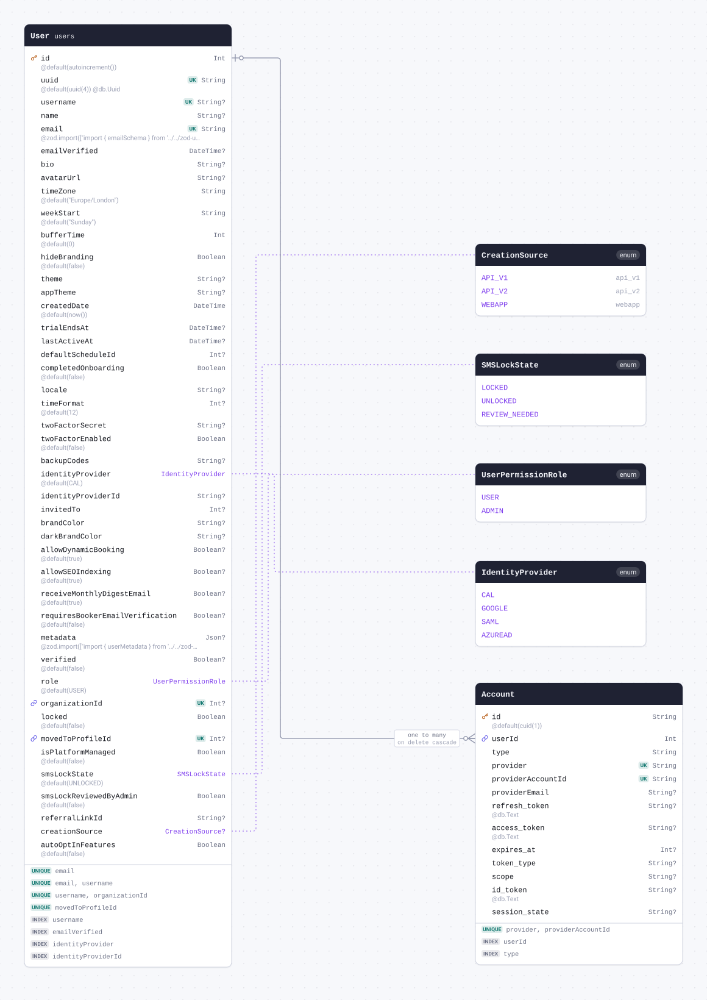

| Field               | Type                | Constraints                       | Default   | Description |
| ------------------- | ------------------- | --------------------------------- | --------- | ----------- |
| `id`                | `String`            | PK NOT NULL                       | `cuid(1)` |             |
| `userId`            | `Int`               | NOT NULL → [User.id](#model-User) |           |             |
| `type`              | `String`            | NOT NULL                          |           |             |
| `provider`          | `String`            | NOT NULL                          |           |             |
| `providerAccountId` | `String`            | NOT NULL                          |           |             |
| `providerEmail`     | `String`            | NULL                              |           |             |
| `refresh_token`     | `String` `@db.Text` | NULL                              |           |             |
| `access_token`      | `String` `@db.Text` | NULL                              |           |             |
| `expires_at`        | `Int`               | NULL                              |           |             |
| `token_type`        | `String`            | NULL                              |           |             |
| `scope`             | `String`            | NULL                              |           |             |
| `id_token`          | `String` `@db.Text` | NULL                              |           |             |
| `session_state`     | `String`            | NULL                              |           |             |

#### Indexes

- `@@index([userId])`
- `@@index([type])`
- `@@unique([provider, providerAccountId])`

#### References

- `userId` → [User.id](#model-User) (many-to-one, on delete Cascade)

#### Definition

```sql
CREATE TABLE "Account" (
    "id" TEXT NOT NULL,
    "userId" INTEGER NOT NULL,
    "type" TEXT NOT NULL,
    "provider" TEXT NOT NULL,
    "providerAccountId" TEXT NOT NULL,
    "providerEmail" TEXT,
    "refresh_token" TEXT,
    "access_token" TEXT,
    "expires_at" INTEGER,
    "token_type" TEXT,
    "scope" TEXT,
    "id_token" TEXT,
    "session_state" TEXT,

    CONSTRAINT "Account_pkey" PRIMARY KEY ("id")
);

CREATE INDEX "Account_userId_idx" ON "Account"("userId");

CREATE INDEX "Account_type_idx" ON "Account"("type");

CREATE UNIQUE INDEX "Account_provider_providerAccountId_key" ON "Account"("provider", "providerAccountId");

ALTER TABLE "Account" ADD CONSTRAINT "Account_userId_fkey" FOREIGN KEY ("userId") REFERENCES "users"("id") ON DELETE CASCADE ON UPDATE CASCADE;
```

<details>
<summary>Queries and their SQL</summary>

**findMany**: Every row

```ts
await prisma.account.findMany();
```

```sql
SELECT
  "public"."Account"."id",
  "public"."Account"."userId",
  "public"."Account"."type",
  "public"."Account"."provider",
  "public"."Account"."providerAccountId",
  "public"."Account"."providerEmail",
  "public"."Account"."refresh_token",
  "public"."Account"."access_token",
  "public"."Account"."expires_at",
  "public"."Account"."token_type",
  "public"."Account"."scope",
  "public"."Account"."id_token",
  "public"."Account"."session_state"
FROM
  "public"."Account"
WHERE
  1 = 1
OFFSET
  $1
-- params: ["0"]
```

**count**: How many rows there are

```ts
await prisma.account.count();
```

```sql
SELECT
  COUNT(*) AS "_count$_all"
FROM
  (
    SELECT
      "public"."Account"."id"
    FROM
      "public"."Account"
    WHERE
      1 = 1
    OFFSET
      $1
  ) AS "sub"
-- params: ["0"]
```

**findMany**: Every row with its relations

```ts
await prisma.account.findMany({ include: { user: true } });
```

```sql
SELECT
  "public"."Account"."id",
  "public"."Account"."userId",
  "public"."Account"."type",
  "public"."Account"."provider",
  "public"."Account"."providerAccountId",
  "public"."Account"."providerEmail",
  "public"."Account"."refresh_token",
  "public"."Account"."access_token",
  "public"."Account"."expires_at",
  "public"."Account"."token_type",
  "public"."Account"."scope",
  "public"."Account"."id_token",
  "public"."Account"."session_state"
FROM
  "public"."Account"
WHERE
  1 = 1
OFFSET
  $1
-- params: ["0"]

SELECT
  "public"."users"."id",
  "public"."users"."uuid",
  "public"."users"."username",
  "public"."users"."name",
  "public"."users"."email",
  "public"."users"."emailVerified",
  "public"."users"."bio",
  "public"."users"."avatarUrl",
  "public"."users"."timeZone",
  "public"."users"."weekStart",
  "public"."users"."bufferTime",
  "public"."users"."hideBranding",
  "public"."users"."theme",
  "public"."users"."appTheme",
  "public"."users"."created",
  "public"."users"."trialEndsAt",
  "public"."users"."lastActiveAt",
  "public"."users"."defaultScheduleId",
  "public"."users"."completedOnboarding",
  "public"."users"."locale",
  "public"."users"."timeFormat",
  "public"."users"."twoFactorSecret",
  "public"."users"."twoFactorEnabled",
  "public"."users"."backupCodes",
  "public"."users"."identityProvider"::text,
  "public"."users"."identityProviderId",
  "public"."users"."invitedTo",
  "public"."users"."brandColor",
  "public"."users"."darkBrandColor",
  "public"."users"."allowDynamicBooking",
  "public"."users"."allowSEOIndexing",
  "public"."users"."receiveMonthlyDigestEmail",
  "public"."users"."requiresBookerEmailVerification",
  "public"."users"."metadata",
  "public"."users"."verified",
  "public"."users"."role"::text,
  "public"."users"."organizationId",
  "public"."users"."locked",
  "public"."users"."movedToProfileId",
  "public"."users"."isPlatformManaged",
  "public"."users"."smsLockState"::text,
  "public"."users"."smsLockReviewedByAdmin",
  "public"."users"."referralLinkId",
  "public"."users"."creationSource"::text,
  "public"."users"."autoOptInFeatures"
FROM
  "public"."users"
WHERE
  "public"."users"."id" IN ($1)
OFFSET
  $2
-- params: ["<userId of the rows above>","0"]
```

**findUnique**: One row by what is unique to it

```ts
await prisma.account.findUnique({ where: { id: "example" } });
```

```sql
SELECT
  "public"."Account"."id",
  "public"."Account"."userId",
  "public"."Account"."type",
  "public"."Account"."provider",
  "public"."Account"."providerAccountId",
  "public"."Account"."providerEmail",
  "public"."Account"."refresh_token",
  "public"."Account"."access_token",
  "public"."Account"."expires_at",
  "public"."Account"."token_type",
  "public"."Account"."scope",
  "public"."Account"."id_token",
  "public"."Account"."session_state"
FROM
  "public"."Account"
WHERE
  (
    "public"."Account"."id" = $1
    AND 1 = 1
  )
LIMIT
  $2
OFFSET
  $3
-- params: ["example","1","0"]
```

**create**: Create a row

```ts
await prisma.account.create({
  data: { userId: 1, type: "example", provider: "example", providerAccountId: "example" },
});
```

```sql
INSERT INTO
  "public"."Account" (
    "id",
    "userId",
    "type",
    "provider",
    "providerAccountId"
  )
VALUES
  ($1, $2, $3, $4, $5)
RETURNING
  "public"."Account"."id",
  "public"."Account"."userId",
  "public"."Account"."type",
  "public"."Account"."provider",
  "public"."Account"."providerAccountId",
  "public"."Account"."providerEmail",
  "public"."Account"."refresh_token",
  "public"."Account"."access_token",
  "public"."Account"."expires_at",
  "public"."Account"."token_type",
  "public"."Account"."scope",
  "public"."Account"."id_token",
  "public"."Account"."session_state"
-- params: ["<cuid(1)>","1","example","example","example"]
```

**update**: Update a row

```ts
await prisma.account.update({ where: { id: "example" }, data: { type: "example" } });
```

```sql
UPDATE "public"."Account"
SET
  "type" = $1
WHERE
  (
    "public"."Account"."id" = $2
    AND 1 = 1
  )
RETURNING
  "public"."Account"."id",
  "public"."Account"."userId",
  "public"."Account"."type",
  "public"."Account"."provider",
  "public"."Account"."providerAccountId",
  "public"."Account"."providerEmail",
  "public"."Account"."refresh_token",
  "public"."Account"."access_token",
  "public"."Account"."expires_at",
  "public"."Account"."token_type",
  "public"."Account"."scope",
  "public"."Account"."id_token",
  "public"."Account"."session_state"
-- params: ["example","example"]
```

**delete**: Delete a row

```ts
await prisma.account.delete({ where: { id: "example" } });
```

```sql
DELETE FROM "public"."Account"
WHERE
  (
    "public"."Account"."id" = $1
    AND 1 = 1
  )
RETURNING
  "public"."Account"."id",
  "public"."Account"."userId",
  "public"."Account"."type",
  "public"."Account"."provider",
  "public"."Account"."providerAccountId",
  "public"."Account"."providerEmail",
  "public"."Account"."refresh_token",
  "public"."Account"."access_token",
  "public"."Account"."expires_at",
  "public"."Account"."token_type",
  "public"."Account"."scope",
  "public"."Account"."id_token",
  "public"."Account"."session_state"
-- params: ["example"]
```

</details>

<a id="model-Session"></a>

### Session


| Field          | Type       | Constraints                       | Default   | Description |
| -------------- | ---------- | --------------------------------- | --------- | ----------- |
| `id`           | `String`   | PK NOT NULL                       | `cuid(1)` |             |
| `sessionToken` | `String`   | UNIQUE NOT NULL                   |           |             |
| `userId`       | `Int`      | NOT NULL → [User.id](#model-User) |           |             |
| `expires`      | `DateTime` | NOT NULL                          |           |             |

#### Indexes

- `@@index([userId])`

#### References

- `userId` → [User.id](#model-User) (many-to-one, on delete Cascade)

#### Definition

```sql
CREATE TABLE "Session" (
    "id" TEXT NOT NULL,
    "sessionToken" TEXT NOT NULL,
    "userId" INTEGER NOT NULL,
    "expires" TIMESTAMP(3) NOT NULL,

    CONSTRAINT "Session_pkey" PRIMARY KEY ("id")
);

CREATE UNIQUE INDEX "Session_sessionToken_key" ON "Session"("sessionToken");

CREATE INDEX "Session_userId_idx" ON "Session"("userId");

ALTER TABLE "Session" ADD CONSTRAINT "Session_userId_fkey" FOREIGN KEY ("userId") REFERENCES "users"("id") ON DELETE CASCADE ON UPDATE CASCADE;
```

<details>
<summary>Queries and their SQL</summary>

**findMany**: Every row

```ts
await prisma.session.findMany();
```

```sql
SELECT
  "public"."Session"."id",
  "public"."Session"."sessionToken",
  "public"."Session"."userId",
  "public"."Session"."expires"
FROM
  "public"."Session"
WHERE
  1 = 1
OFFSET
  $1
-- params: ["0"]
```

**count**: How many rows there are

```ts
await prisma.session.count();
```

```sql
SELECT
  COUNT(*) AS "_count$_all"
FROM
  (
    SELECT
      "public"."Session"."id"
    FROM
      "public"."Session"
    WHERE
      1 = 1
    OFFSET
      $1
  ) AS "sub"
-- params: ["0"]
```

**findMany**: Every row with its relations

```ts
await prisma.session.findMany({ include: { user: true } });
```

```sql
SELECT
  "public"."Session"."id",
  "public"."Session"."sessionToken",
  "public"."Session"."userId",
  "public"."Session"."expires"
FROM
  "public"."Session"
WHERE
  1 = 1
OFFSET
  $1
-- params: ["0"]

SELECT
  "public"."users"."id",
  "public"."users"."uuid",
  "public"."users"."username",
  "public"."users"."name",
  "public"."users"."email",
  "public"."users"."emailVerified",
  "public"."users"."bio",
  "public"."users"."avatarUrl",
  "public"."users"."timeZone",
  "public"."users"."weekStart",
  "public"."users"."bufferTime",
  "public"."users"."hideBranding",
  "public"."users"."theme",
  "public"."users"."appTheme",
  "public"."users"."created",
  "public"."users"."trialEndsAt",
  "public"."users"."lastActiveAt",
  "public"."users"."defaultScheduleId",
  "public"."users"."completedOnboarding",
  "public"."users"."locale",
  "public"."users"."timeFormat",
  "public"."users"."twoFactorSecret",
  "public"."users"."twoFactorEnabled",
  "public"."users"."backupCodes",
  "public"."users"."identityProvider"::text,
  "public"."users"."identityProviderId",
  "public"."users"."invitedTo",
  "public"."users"."brandColor",
  "public"."users"."darkBrandColor",
  "public"."users"."allowDynamicBooking",
  "public"."users"."allowSEOIndexing",
  "public"."users"."receiveMonthlyDigestEmail",
  "public"."users"."requiresBookerEmailVerification",
  "public"."users"."metadata",
  "public"."users"."verified",
  "public"."users"."role"::text,
  "public"."users"."organizationId",
  "public"."users"."locked",
  "public"."users"."movedToProfileId",
  "public"."users"."isPlatformManaged",
  "public"."users"."smsLockState"::text,
  "public"."users"."smsLockReviewedByAdmin",
  "public"."users"."referralLinkId",
  "public"."users"."creationSource"::text,
  "public"."users"."autoOptInFeatures"
FROM
  "public"."users"
WHERE
  "public"."users"."id" IN ($1)
OFFSET
  $2
-- params: ["<userId of the rows above>","0"]
```

**findUnique**: One row by what is unique to it

```ts
await prisma.session.findUnique({ where: { id: "example" } });
```

```sql
SELECT
  "public"."Session"."id",
  "public"."Session"."sessionToken",
  "public"."Session"."userId",
  "public"."Session"."expires"
FROM
  "public"."Session"
WHERE
  (
    "public"."Session"."id" = $1
    AND 1 = 1
  )
LIMIT
  $2
OFFSET
  $3
-- params: ["example","1","0"]
```

**create**: Create a row

```ts
await prisma.session.create({
  data: { sessionToken: "example", userId: 1, expires: new Date("2026-01-01T00:00:00.000Z") },
});
```

```sql
INSERT INTO
  "public"."Session" ("id", "sessionToken", "userId", "expires")
VALUES
  ($1, $2, $3, $4)
RETURNING
  "public"."Session"."id",
  "public"."Session"."sessionToken",
  "public"."Session"."userId",
  "public"."Session"."expires"
-- params: ["<cuid(1)>","example","1","2026-01-01T00:00:00.000Z"]
```

**update**: Update a row

```ts
await prisma.session.update({ where: { id: "example" }, data: { sessionToken: "example" } });
```

```sql
UPDATE "public"."Session"
SET
  "sessionToken" = $1
WHERE
  (
    "public"."Session"."id" = $2
    AND 1 = 1
  )
RETURNING
  "public"."Session"."id",
  "public"."Session"."sessionToken",
  "public"."Session"."userId",
  "public"."Session"."expires"
-- params: ["example","example"]
```

**delete**: Delete a row

```ts
await prisma.session.delete({ where: { id: "example" } });
```

```sql
DELETE FROM "public"."Session"
WHERE
  (
    "public"."Session"."id" = $1
    AND 1 = 1
  )
RETURNING
  "public"."Session"."id",
  "public"."Session"."sessionToken",
  "public"."Session"."userId",
  "public"."Session"."expires"
-- params: ["example"]
```

</details>

<a id="model-App"></a>

### App

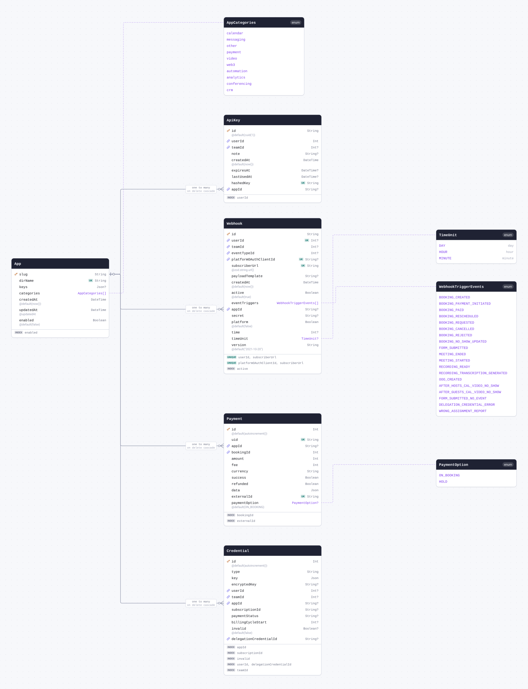

| Field        | Type                                     | Constraints     | Default      | Description |
| ------------ | ---------------------------------------- | --------------- | ------------ | ----------- |
| `slug`       | `String`                                 | PK NOT NULL     |              |             |
| `dirName`    | `String`                                 | UNIQUE NOT NULL |              |             |
| `keys`       | `Json`                                   | NULL            |              |             |
| `categories` | [`AppCategories[]`](#enum-AppCategories) | NOT NULL        |              |             |
| `createdAt`  | `DateTime`                               | NOT NULL        | `now()`      |             |
| `updatedAt`  | `DateTime`                               | NOT NULL        | `@updatedAt` |             |
| `enabled`    | `Boolean`                                | NOT NULL        | `false`      |             |

#### Indexes

- `@@index([enabled])`

#### Referenced by

- `slug` ← [Credential.appId](#model-Credential) (one-to-many, on delete Cascade)
- `slug` ← [Payment.appId](#model-Payment) (one-to-many, on delete Cascade)
- `slug` ← [Webhook.appId](#model-Webhook) (one-to-many, on delete Cascade)
- `slug` ← [ApiKey.appId](#model-ApiKey) (one-to-many, on delete Cascade)

#### Definition

```sql
CREATE TABLE "App" (
    "slug" TEXT NOT NULL,
    "dirName" TEXT NOT NULL,
    "keys" JSONB,
    "categories" "AppCategories"[],
    "createdAt" TIMESTAMP(3) NOT NULL DEFAULT CURRENT_TIMESTAMP,
    "updatedAt" TIMESTAMP(3) NOT NULL,
    "enabled" BOOLEAN NOT NULL DEFAULT false,

    CONSTRAINT "App_pkey" PRIMARY KEY ("slug")
);

CREATE UNIQUE INDEX "App_slug_key" ON "App"("slug");

CREATE UNIQUE INDEX "App_dirName_key" ON "App"("dirName");

CREATE INDEX "App_enabled_idx" ON "App"("enabled");
```

<details>
<summary>Queries and their SQL</summary>

**findMany**: Every row

```ts
await prisma.app.findMany();
```

```sql
SELECT
  "public"."App"."slug",
  "public"."App"."dirName",
  "public"."App"."keys",
  "public"."App"."categories"::text[],
  "public"."App"."createdAt",
  "public"."App"."updatedAt",
  "public"."App"."enabled"
FROM
  "public"."App"
WHERE
  1 = 1
OFFSET
  $1
-- params: ["0"]
```

**count**: How many rows there are

```ts
await prisma.app.count();
```

```sql
SELECT
  COUNT(*) AS "_count$_all"
FROM
  (
    SELECT
      "public"."App"."slug"
    FROM
      "public"."App"
    WHERE
      1 = 1
    OFFSET
      $1
  ) AS "sub"
-- params: ["0"]
```

**findMany**: Every row with its relations

```ts
await prisma.app.findMany({
  include: { credentials: true, payments: true, Webhook: true, ApiKey: true },
});
```

```sql
SELECT
  "public"."App"."slug",
  "public"."App"."dirName",
  "public"."App"."keys",
  "public"."App"."categories"::text[],
  "public"."App"."createdAt",
  "public"."App"."updatedAt",
  "public"."App"."enabled"
FROM
  "public"."App"
WHERE
  1 = 1
OFFSET
  $1
-- params: ["0"]

SELECT
  "public"."Credential"."id",
  "public"."Credential"."type",
  "public"."Credential"."key",
  "public"."Credential"."encryptedKey",
  "public"."Credential"."userId",
  "public"."Credential"."teamId",
  "public"."Credential"."appId",
  "public"."Credential"."subscriptionId",
  "public"."Credential"."paymentStatus",
  "public"."Credential"."billingCycleStart",
  "public"."Credential"."invalid",
  "public"."Credential"."delegationCredentialId"
FROM
  "public"."Credential"
WHERE
  "public"."Credential"."appId" IN ($1)
OFFSET
  $2
-- params: ["<slug of the rows above>","0"]

SELECT
  "public"."Payment"."id",
  "public"."Payment"."uid",
  "public"."Payment"."appId",
  "public"."Payment"."bookingId",
  "public"."Payment"."amount",
  "public"."Payment"."fee",
  "public"."Payment"."currency",
  "public"."Payment"."success",
  "public"."Payment"."refunded",
  "public"."Payment"."data",
  "public"."Payment"."externalId",
  "public"."Payment"."paymentOption"::text
FROM
  "public"."Payment"
WHERE
  "public"."Payment"."appId" IN ($1)
OFFSET
  $2
-- params: ["<slug of the rows above>","0"]

SELECT
  "public"."Webhook"."id",
  "public"."Webhook"."userId",
  "public"."Webhook"."teamId",
  "public"."Webhook"."eventTypeId",
  "public"."Webhook"."platformOAuthClientId",
  "public"."Webhook"."subscriberUrl",
  "public"."Webhook"."payloadTemplate",
  "public"."Webhook"."createdAt",
  "public"."Webhook"."active",
  "public"."Webhook"."eventTriggers"::text[],
  "public"."Webhook"."appId",
  "public"."Webhook"."secret",
  "public"."Webhook"."platform",
  "public"."Webhook"."time",
  "public"."Webhook"."timeUnit"::text,
  "public"."Webhook"."version"
FROM
  "public"."Webhook"
WHERE
  "public"."Webhook"."appId" IN ($1)
OFFSET
  $2
-- params: ["<slug of the rows above>","0"]

SELECT
  "public"."ApiKey"."id",
  "public"."ApiKey"."userId",
  "public"."ApiKey"."teamId",
  "public"."ApiKey"."note",
  "public"."ApiKey"."createdAt",
  "public"."ApiKey"."expiresAt",
  "public"."ApiKey"."lastUsedAt",
  "public"."ApiKey"."hashedKey",
  "public"."ApiKey"."appId"
FROM
  "public"."ApiKey"
WHERE
  "public"."ApiKey"."appId" IN ($1)
OFFSET
  $2
-- params: ["<slug of the rows above>","0"]
```

**findUnique**: One row by what is unique to it

```ts
await prisma.app.findUnique({ where: { slug: "example" } });
```

```sql
SELECT
  "public"."App"."slug",
  "public"."App"."dirName",
  "public"."App"."keys",
  "public"."App"."categories"::text[],
  "public"."App"."createdAt",
  "public"."App"."updatedAt",
  "public"."App"."enabled"
FROM
  "public"."App"
WHERE
  (
    "public"."App"."slug" = $1
    AND 1 = 1
  )
LIMIT
  $2
OFFSET
  $3
-- params: ["example","1","0"]
```

**create**: Create a row

```ts
await prisma.app.create({
  data: { slug: "example", dirName: "example", categories: ["calendar"] },
});
```

```sql
INSERT INTO
  "public"."App" (
    "slug",
    "dirName",
    "categories",
    "createdAt",
    "updatedAt",
    "enabled"
  )
VALUES
  (
    $1,
    $2,
    CAST($3::text[] AS "public"."AppCategories" []),
    $4,
    $5,
    $6
  )
RETURNING
  "public"."App"."slug",
  "public"."App"."dirName",
  "public"."App"."keys",
  "public"."App"."categories"::text[],
  "public"."App"."createdAt",
  "public"."App"."updatedAt",
  "public"."App"."enabled"
-- params: ["example","example",["calendar"],"<now()>","<now()>",false]
```

**update**: Update a row

```ts
await prisma.app.update({ where: { slug: "example" }, data: { dirName: "example" } });
```

```sql
UPDATE "public"."App"
SET
  "dirName" = $1,
  "updatedAt" = $2
WHERE
  (
    "public"."App"."slug" = $3
    AND 1 = 1
  )
RETURNING
  "public"."App"."slug",
  "public"."App"."dirName",
  "public"."App"."keys",
  "public"."App"."categories"::text[],
  "public"."App"."createdAt",
  "public"."App"."updatedAt",
  "public"."App"."enabled"
-- params: ["example",{"prisma__type":"generatorCall","prisma__value":{"name":"now","args":[],"returnType":{"type":"DateTime"}}},"example"]
```

**delete**: Delete a row

```ts
await prisma.app.delete({ where: { slug: "example" } });
```

```sql
DELETE FROM "public"."App"
WHERE
  (
    "public"."App"."slug" = $1
    AND 1 = 1
  )
RETURNING
  "public"."App"."slug",
  "public"."App"."dirName",
  "public"."App"."keys",
  "public"."App"."categories"::text[],
  "public"."App"."createdAt",
  "public"."App"."updatedAt",
  "public"."App"."enabled"
-- params: ["example"]
```

</details>

<a id="model-Feedback"></a>

### Feedback

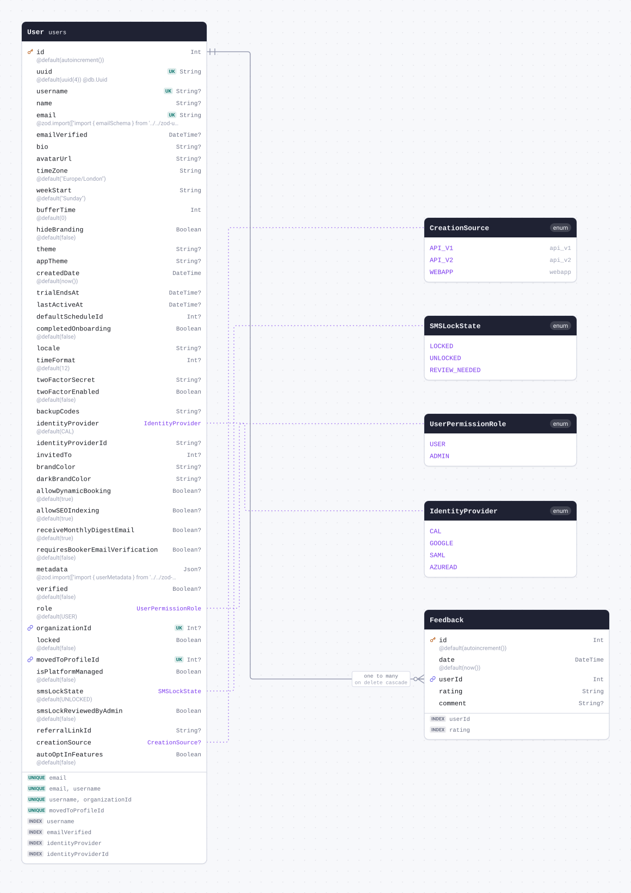

| Field     | Type       | Constraints                       | Default           | Description |
| --------- | ---------- | --------------------------------- | ----------------- | ----------- |
| `id`      | `Int`      | PK NOT NULL                       | `autoincrement()` |             |
| `date`    | `DateTime` | NOT NULL                          | `now()`           |             |
| `userId`  | `Int`      | NOT NULL → [User.id](#model-User) |                   |             |
| `rating`  | `String`   | NOT NULL                          |                   |             |
| `comment` | `String`   | NULL                              |                   |             |

#### Indexes

- `@@index([userId])`
- `@@index([rating])`

#### References

- `userId` → [User.id](#model-User) (many-to-one, on delete Cascade)

#### Definition

```sql
CREATE TABLE "Feedback" (
    "id" SERIAL NOT NULL,
    "date" TIMESTAMP(3) NOT NULL DEFAULT CURRENT_TIMESTAMP,
    "userId" INTEGER NOT NULL,
    "rating" TEXT NOT NULL,
    "comment" TEXT,

    CONSTRAINT "Feedback_pkey" PRIMARY KEY ("id")
);

CREATE INDEX "Feedback_userId_idx" ON "Feedback"("userId");

CREATE INDEX "Feedback_rating_idx" ON "Feedback"("rating");

ALTER TABLE "Feedback" ADD CONSTRAINT "Feedback_userId_fkey" FOREIGN KEY ("userId") REFERENCES "users"("id") ON DELETE CASCADE ON UPDATE CASCADE;
```

<details>
<summary>Queries and their SQL</summary>

**findMany**: Every row

```ts
await prisma.feedback.findMany();
```

```sql
SELECT
  "public"."Feedback"."id",
  "public"."Feedback"."date",
  "public"."Feedback"."userId",
  "public"."Feedback"."rating",
  "public"."Feedback"."comment"
FROM
  "public"."Feedback"
WHERE
  1 = 1
OFFSET
  $1
-- params: ["0"]
```

**count**: How many rows there are

```ts
await prisma.feedback.count();
```

```sql
SELECT
  COUNT(*) AS "_count$_all"
FROM
  (
    SELECT
      "public"."Feedback"."id"
    FROM
      "public"."Feedback"
    WHERE
      1 = 1
    OFFSET
      $1
  ) AS "sub"
-- params: ["0"]
```

**findMany**: Every row with its relations

```ts
await prisma.feedback.findMany({ include: { user: true } });
```

```sql
SELECT
  "public"."Feedback"."id",
  "public"."Feedback"."date",
  "public"."Feedback"."userId",
  "public"."Feedback"."rating",
  "public"."Feedback"."comment"
FROM
  "public"."Feedback"
WHERE
  1 = 1
OFFSET
  $1
-- params: ["0"]

SELECT
  "public"."users"."id",
  "public"."users"."uuid",
  "public"."users"."username",
  "public"."users"."name",
  "public"."users"."email",
  "public"."users"."emailVerified",
  "public"."users"."bio",
  "public"."users"."avatarUrl",
  "public"."users"."timeZone",
  "public"."users"."weekStart",
  "public"."users"."bufferTime",
  "public"."users"."hideBranding",
  "public"."users"."theme",
  "public"."users"."appTheme",
  "public"."users"."created",
  "public"."users"."trialEndsAt",
  "public"."users"."lastActiveAt",
  "public"."users"."defaultScheduleId",
  "public"."users"."completedOnboarding",
  "public"."users"."locale",
  "public"."users"."timeFormat",
  "public"."users"."twoFactorSecret",
  "public"."users"."twoFactorEnabled",
  "public"."users"."backupCodes",
  "public"."users"."identityProvider"::text,
  "public"."users"."identityProviderId",
  "public"."users"."invitedTo",
  "public"."users"."brandColor",
  "public"."users"."darkBrandColor",
  "public"."users"."allowDynamicBooking",
  "public"."users"."allowSEOIndexing",
  "public"."users"."receiveMonthlyDigestEmail",
  "public"."users"."requiresBookerEmailVerification",
  "public"."users"."metadata",
  "public"."users"."verified",
  "public"."users"."role"::text,
  "public"."users"."organizationId",
  "public"."users"."locked",
  "public"."users"."movedToProfileId",
  "public"."users"."isPlatformManaged",
  "public"."users"."smsLockState"::text,
  "public"."users"."smsLockReviewedByAdmin",
  "public"."users"."referralLinkId",
  "public"."users"."creationSource"::text,
  "public"."users"."autoOptInFeatures"
FROM
  "public"."users"
WHERE
  "public"."users"."id" IN ($1)
OFFSET
  $2
-- params: ["<userId of the rows above>","0"]
```

**findUnique**: One row by what is unique to it

```ts
await prisma.feedback.findUnique({ where: { id: 1 } });
```

```sql
SELECT
  "public"."Feedback"."id",
  "public"."Feedback"."date",
  "public"."Feedback"."userId",
  "public"."Feedback"."rating",
  "public"."Feedback"."comment"
FROM
  "public"."Feedback"
WHERE
  (
    "public"."Feedback"."id" = $1
    AND 1 = 1
  )
LIMIT
  $2
OFFSET
  $3
-- params: ["1","1","0"]
```

**create**: Create a row

```ts
await prisma.feedback.create({ data: { userId: 1, rating: "example" } });
```

```sql
INSERT INTO
  "public"."Feedback" ("date", "userId", "rating")
VALUES
  ($1, $2, $3)
RETURNING
  "public"."Feedback"."id",
  "public"."Feedback"."date",
  "public"."Feedback"."userId",
  "public"."Feedback"."rating",
  "public"."Feedback"."comment"
-- params: ["<now()>","1","example"]
```

**update**: Update a row

```ts
await prisma.feedback.update({
  where: { id: 1 },
  data: { date: new Date("2026-01-01T00:00:00.000Z") },
});
```

```sql
UPDATE "public"."Feedback"
SET
  "date" = $1
WHERE
  (
    "public"."Feedback"."id" = $2
    AND 1 = 1
  )
RETURNING
  "public"."Feedback"."id",
  "public"."Feedback"."date",
  "public"."Feedback"."userId",
  "public"."Feedback"."rating",
  "public"."Feedback"."comment"
-- params: ["2026-01-01T00:00:00.000Z","1"]
```

**delete**: Delete a row

```ts
await prisma.feedback.delete({ where: { id: 1 } });
```

```sql
DELETE FROM "public"."Feedback"
WHERE
  (
    "public"."Feedback"."id" = $1
    AND 1 = 1
  )
RETURNING
  "public"."Feedback"."id",
  "public"."Feedback"."date",
  "public"."Feedback"."userId",
  "public"."Feedback"."rating",
  "public"."Feedback"."comment"
-- params: ["1"]
```

</details>

<a id="model-Deployment"></a>

### Deployment

| Field                     | Type       | Constraints | Default | Description                                                                                    |
| ------------------------- | ---------- | ----------- | ------- | ---------------------------------------------------------------------------------------------- |
| `id`                      | `Int`      | PK NOT NULL | `1`     | This is a single row table, so we use a fixed id                                               |
| `logo`                    | `String`   | NULL        |         |                                                                                                |
| `theme`                   | `Json`     | NULL        |         | @zod.import(["import { DeploymentTheme } from '../../zod-utils'"]).custom.use(DeploymentTheme) |
| `licenseKey`              | `String`   | NULL        |         |                                                                                                |
| `signatureTokenEncrypted` | `String`   | NULL        |         |                                                                                                |
| `agreedLicenseAt`         | `DateTime` | NULL        |         |                                                                                                |

#### Definition

```sql
CREATE TABLE "Deployment" (
    "id" INTEGER NOT NULL DEFAULT 1,
    "logo" TEXT,
    "theme" JSONB,
    "licenseKey" TEXT,
    "signatureTokenEncrypted" TEXT,
    "agreedLicenseAt" TIMESTAMP(3),

    CONSTRAINT "Deployment_pkey" PRIMARY KEY ("id")
);
```

<details>
<summary>Queries and their SQL</summary>

**findMany**: Every row

```ts
await prisma.deployment.findMany();
```

```sql
SELECT
  "public"."Deployment"."id",
  "public"."Deployment"."logo",
  "public"."Deployment"."theme",
  "public"."Deployment"."licenseKey",
  "public"."Deployment"."signatureTokenEncrypted",
  "public"."Deployment"."agreedLicenseAt"
FROM
  "public"."Deployment"
WHERE
  1 = 1
OFFSET
  $1
-- params: ["0"]
```

**count**: How many rows there are

```ts
await prisma.deployment.count();
```

```sql
SELECT
  COUNT(*) AS "_count$_all"
FROM
  (
    SELECT
      "public"."Deployment"."id"
    FROM
      "public"."Deployment"
    WHERE
      1 = 1
    OFFSET
      $1
  ) AS "sub"
-- params: ["0"]
```

**findUnique**: One row by what is unique to it

```ts
await prisma.deployment.findUnique({ where: { id: 1 } });
```

```sql
SELECT
  "public"."Deployment"."id",
  "public"."Deployment"."logo",
  "public"."Deployment"."theme",
  "public"."Deployment"."licenseKey",
  "public"."Deployment"."signatureTokenEncrypted",
  "public"."Deployment"."agreedLicenseAt"
FROM
  "public"."Deployment"
WHERE
  (
    "public"."Deployment"."id" = $1
    AND 1 = 1
  )
LIMIT
  $2
OFFSET
  $3
-- params: ["1","1","0"]
```

**create**: Create a row

```ts
await prisma.deployment.create({ data: {} });
```

```sql
INSERT INTO
  "public"."Deployment" ("id")
VALUES
  ($1)
RETURNING
  "public"."Deployment"."id",
  "public"."Deployment"."logo",
  "public"."Deployment"."theme",
  "public"."Deployment"."licenseKey",
  "public"."Deployment"."signatureTokenEncrypted",
  "public"."Deployment"."agreedLicenseAt"
-- params: ["1"]
```

**update**: Update a row

```ts
await prisma.deployment.update({ where: { id: 1 }, data: { logo: "example" } });
```

```sql
UPDATE "public"."Deployment"
SET
  "logo" = $1
WHERE
  (
    "public"."Deployment"."id" = $2
    AND 1 = 1
  )
RETURNING
  "public"."Deployment"."id",
  "public"."Deployment"."logo",
  "public"."Deployment"."theme",
  "public"."Deployment"."licenseKey",
  "public"."Deployment"."signatureTokenEncrypted",
  "public"."Deployment"."agreedLicenseAt"
-- params: ["example","1"]
```

**delete**: Delete a row

```ts
await prisma.deployment.delete({ where: { id: 1 } });
```

```sql
DELETE FROM "public"."Deployment"
WHERE
  (
    "public"."Deployment"."id" = $1
    AND 1 = 1
  )
RETURNING
  "public"."Deployment"."id",
  "public"."Deployment"."logo",
  "public"."Deployment"."theme",
  "public"."Deployment"."licenseKey",
  "public"."Deployment"."signatureTokenEncrypted",
  "public"."Deployment"."agreedLicenseAt"
-- params: ["1"]
```

</details>

<a id="model-WebhookScheduledTriggers"></a>

### WebhookScheduledTriggers

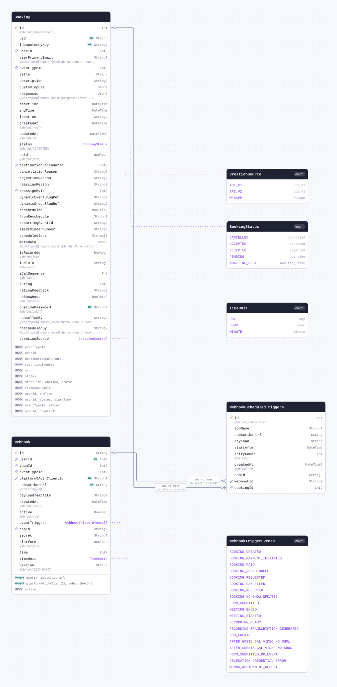

| Field           | Type       | Constraints                         | Default           | Description |
| --------------- | ---------- | ----------------------------------- | ----------------- | ----------- |
| `id`            | `Int`      | PK NOT NULL                         | `autoincrement()` |             |
| `jobName`       | `String`   | NULL                                |                   |             |
| `subscriberUrl` | `String`   | NOT NULL                            |                   |             |
| `payload`       | `String`   | NOT NULL                            |                   |             |
| `startAfter`    | `DateTime` | NOT NULL                            |                   |             |
| `retryCount`    | `Int`      | NOT NULL                            | `0`               |             |
| `createdAt`     | `DateTime` | NULL                                | `now()`           |             |
| `appId`         | `String`   | NULL                                |                   |             |
| `webhookId`     | `String`   | NULL → [Webhook.id](#model-Webhook) |                   |             |
| `bookingId`     | `Int`      | NULL → [Booking.id](#model-Booking) |                   |             |

#### References

- `webhookId` → [Webhook.id](#model-Webhook) (many-to-one, on delete Cascade)
- `bookingId` → [Booking.id](#model-Booking) (many-to-one, on delete Cascade)

#### Definition

```sql
CREATE TABLE "WebhookScheduledTriggers" (
    "id" SERIAL NOT NULL,
    "jobName" TEXT,
    "subscriberUrl" TEXT NOT NULL,
    "payload" TEXT NOT NULL,
    "startAfter" TIMESTAMP(3) NOT NULL,
    "retryCount" INTEGER NOT NULL DEFAULT 0,
    "createdAt" TIMESTAMP(3) DEFAULT CURRENT_TIMESTAMP,
    "appId" TEXT,
    "webhookId" TEXT,
    "bookingId" INTEGER,

    CONSTRAINT "WebhookScheduledTriggers_pkey" PRIMARY KEY ("id")
);

ALTER TABLE "WebhookScheduledTriggers" ADD CONSTRAINT "WebhookScheduledTriggers_webhookId_fkey" FOREIGN KEY ("webhookId") REFERENCES "Webhook"("id") ON DELETE CASCADE ON UPDATE CASCADE;

ALTER TABLE "WebhookScheduledTriggers" ADD CONSTRAINT "WebhookScheduledTriggers_bookingId_fkey" FOREIGN KEY ("bookingId") REFERENCES "Booking"("id") ON DELETE CASCADE ON UPDATE CASCADE;
```

<details>
<summary>Queries and their SQL</summary>

**findMany**: Every row

```ts
await prisma.webhookScheduledTriggers.findMany();
```

```sql
SELECT
  "public"."WebhookScheduledTriggers"."id",
  "public"."WebhookScheduledTriggers"."jobName",
  "public"."WebhookScheduledTriggers"."subscriberUrl",
  "public"."WebhookScheduledTriggers"."payload",
  "public"."WebhookScheduledTriggers"."startAfter",
  "public"."WebhookScheduledTriggers"."retryCount",
  "public"."WebhookScheduledTriggers"."createdAt",
  "public"."WebhookScheduledTriggers"."appId",
  "public"."WebhookScheduledTriggers"."webhookId",
  "public"."WebhookScheduledTriggers"."bookingId"
FROM
  "public"."WebhookScheduledTriggers"
WHERE
  1 = 1
OFFSET
  $1
-- params: ["0"]
```

**count**: How many rows there are

```ts
await prisma.webhookScheduledTriggers.count();
```

```sql
SELECT
  COUNT(*) AS "_count$_all"
FROM
  (
    SELECT
      "public"."WebhookScheduledTriggers"."id"
    FROM
      "public"."WebhookScheduledTriggers"
    WHERE
      1 = 1
    OFFSET
      $1
  ) AS "sub"
-- params: ["0"]
```

**findMany**: Every row with its relations

```ts
await prisma.webhookScheduledTriggers.findMany({ include: { webhook: true, booking: true } });
```

```sql
SELECT
  "public"."WebhookScheduledTriggers"."id",
  "public"."WebhookScheduledTriggers"."jobName",
  "public"."WebhookScheduledTriggers"."subscriberUrl",
  "public"."WebhookScheduledTriggers"."payload",
  "public"."WebhookScheduledTriggers"."startAfter",
  "public"."WebhookScheduledTriggers"."retryCount",
  "public"."WebhookScheduledTriggers"."createdAt",
  "public"."WebhookScheduledTriggers"."appId",
  "public"."WebhookScheduledTriggers"."webhookId",
  "public"."WebhookScheduledTriggers"."bookingId"
FROM
  "public"."WebhookScheduledTriggers"
WHERE
  1 = 1
OFFSET
  $1
-- params: ["0"]

SELECT
  "public"."Webhook"."id",
  "public"."Webhook"."userId",
  "public"."Webhook"."teamId",
  "public"."Webhook"."eventTypeId",
  "public"."Webhook"."platformOAuthClientId",
  "public"."Webhook"."subscriberUrl",
  "public"."Webhook"."payloadTemplate",
  "public"."Webhook"."createdAt",
  "public"."Webhook"."active",
  "public"."Webhook"."eventTriggers"::text[],
  "public"."Webhook"."appId",
  "public"."Webhook"."secret",
  "public"."Webhook"."platform",
  "public"."Webhook"."time",
  "public"."Webhook"."timeUnit"::text,
  "public"."Webhook"."version"
FROM
  "public"."Webhook"
WHERE
  "public"."Webhook"."id" IN ($1)
OFFSET
  $2
-- params: ["<webhookId of the rows above>","0"]

SELECT
  "public"."Booking"."id",
  "public"."Booking"."uid",
  "public"."Booking"."idempotencyKey",
  "public"."Booking"."userId",
  "public"."Booking"."userPrimaryEmail",
  "public"."Booking"."eventTypeId",
  "public"."Booking"."title",
  "public"."Booking"."description",
  "public"."Booking"."customInputs",
  "public"."Booking"."responses",
  "public"."Booking"."startTime",
  "public"."Booking"."endTime",
  "public"."Booking"."location",
  "public"."Booking"."createdAt",
  "public"."Booking"."updatedAt",
  "public"."Booking"."status"::text,
  "public"."Booking"."paid",
  "public"."Booking"."destinationCalendarId",
  "public"."Booking"."cancellationReason",
  "public"."Booking"."rejectionReason",
  "public"."Booking"."reassignReason",
  "public"."Booking"."reassignById",
  "public"."Booking"."dynamicEventSlugRef",
  "public"."Booking"."dynamicGroupSlugRef",
  "public"."Booking"."rescheduled",
  "public"."Booking"."fromReschedule",
  "public"."Booking"."recurringEventId",
  "public"."Booking"."smsReminderNumber",
  "public"."Booking"."scheduledJobs",
  "public"."Booking"."metadata",
  "public"."Booking"."isRecorded",
  "public"."Booking"."iCalUID",
  "public"."Booking"."iCalSequence",
  "public"."Booking"."rating",
  "public"."Booking"."ratingFeedback",
  "public"."Booking"."noShowHost",
  "public"."Booking"."oneTimePassword",
  "public"."Booking"."cancelledBy",
  "public"."Booking"."rescheduledBy",
  "public"."Booking"."creationSource"::text
FROM
  "public"."Booking"
WHERE
  "public"."Booking"."id" IN ($1)
OFFSET
  $2
-- params: ["<bookingId of the rows above>","0"]
```

**findUnique**: One row by what is unique to it

```ts
await prisma.webhookScheduledTriggers.findUnique({ where: { id: 1 } });
```

```sql
SELECT
  "public"."WebhookScheduledTriggers"."id",
  "public"."WebhookScheduledTriggers"."jobName",
  "public"."WebhookScheduledTriggers"."subscriberUrl",
  "public"."WebhookScheduledTriggers"."payload",
  "public"."WebhookScheduledTriggers"."startAfter",
  "public"."WebhookScheduledTriggers"."retryCount",
  "public"."WebhookScheduledTriggers"."createdAt",
  "public"."WebhookScheduledTriggers"."appId",
  "public"."WebhookScheduledTriggers"."webhookId",
  "public"."WebhookScheduledTriggers"."bookingId"
FROM
  "public"."WebhookScheduledTriggers"
WHERE
  (
    "public"."WebhookScheduledTriggers"."id" = $1
    AND 1 = 1
  )
LIMIT
  $2
OFFSET
  $3
-- params: ["1","1","0"]
```

**create**: Create a row

```ts
await prisma.webhookScheduledTriggers.create({
  data: {
    subscriberUrl: "example",
    payload: "example",
    startAfter: new Date("2026-01-01T00:00:00.000Z"),
  },
});
```

```sql
INSERT INTO
  "public"."WebhookScheduledTriggers" (
    "subscriberUrl",
    "payload",
    "startAfter",
    "retryCount",
    "createdAt"
  )
VALUES
  ($1, $2, $3, $4, $5)
RETURNING
  "public"."WebhookScheduledTriggers"."id",
  "public"."WebhookScheduledTriggers"."jobName",
  "public"."WebhookScheduledTriggers"."subscriberUrl",
  "public"."WebhookScheduledTriggers"."payload",
  "public"."WebhookScheduledTriggers"."startAfter",
  "public"."WebhookScheduledTriggers"."retryCount",
  "public"."WebhookScheduledTriggers"."createdAt",
  "public"."WebhookScheduledTriggers"."appId",
  "public"."WebhookScheduledTriggers"."webhookId",
  "public"."WebhookScheduledTriggers"."bookingId"
-- params: ["example","example","2026-01-01T00:00:00.000Z","0","<now()>"]
```

**update**: Update a row

```ts
await prisma.webhookScheduledTriggers.update({ where: { id: 1 }, data: { jobName: "example" } });
```

```sql
UPDATE "public"."WebhookScheduledTriggers"
SET
  "jobName" = $1
WHERE
  (
    "public"."WebhookScheduledTriggers"."id" = $2
    AND 1 = 1
  )
RETURNING
  "public"."WebhookScheduledTriggers"."id",
  "public"."WebhookScheduledTriggers"."jobName",
  "public"."WebhookScheduledTriggers"."subscriberUrl",
  "public"."WebhookScheduledTriggers"."payload",
  "public"."WebhookScheduledTriggers"."startAfter",
  "public"."WebhookScheduledTriggers"."retryCount",
  "public"."WebhookScheduledTriggers"."createdAt",
  "public"."WebhookScheduledTriggers"."appId",
  "public"."WebhookScheduledTriggers"."webhookId",
  "public"."WebhookScheduledTriggers"."bookingId"
-- params: ["example","1"]
```

**delete**: Delete a row

```ts
await prisma.webhookScheduledTriggers.delete({ where: { id: 1 } });
```

```sql
DELETE FROM "public"."WebhookScheduledTriggers"
WHERE
  (
    "public"."WebhookScheduledTriggers"."id" = $1
    AND 1 = 1
  )
RETURNING
  "public"."WebhookScheduledTriggers"."id",
  "public"."WebhookScheduledTriggers"."jobName",
  "public"."WebhookScheduledTriggers"."subscriberUrl",
  "public"."WebhookScheduledTriggers"."payload",
  "public"."WebhookScheduledTriggers"."startAfter",
  "public"."WebhookScheduledTriggers"."retryCount",
  "public"."WebhookScheduledTriggers"."createdAt",
  "public"."WebhookScheduledTriggers"."appId",
  "public"."WebhookScheduledTriggers"."webhookId",
  "public"."WebhookScheduledTriggers"."bookingId"
-- params: ["1"]
```

</details>

<a id="model-BookingSeat"></a>

### BookingSeat

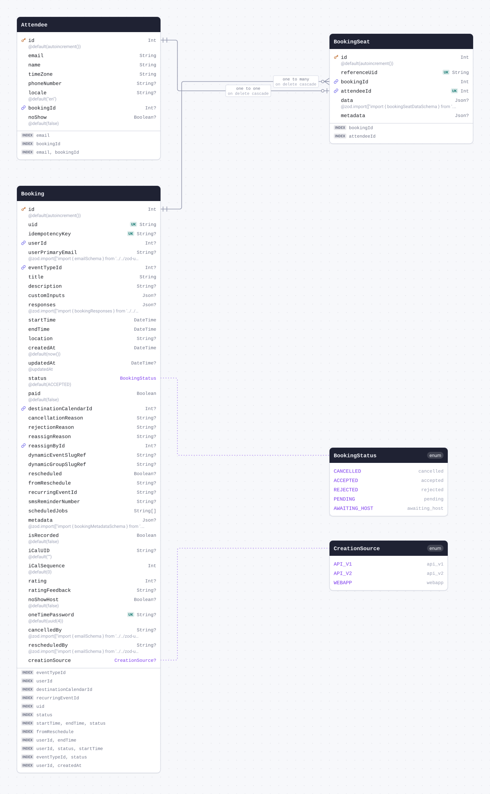

| Field          | Type     | Constraints                                      | Default           | Description                                                                                                |
| -------------- | -------- | ------------------------------------------------ | ----------------- | ---------------------------------------------------------------------------------------------------------- |
| `id`           | `Int`    | PK NOT NULL                                      | `autoincrement()` |                                                                                                            |
| `referenceUid` | `String` | UNIQUE NOT NULL                                  |                   |                                                                                                            |
| `bookingId`    | `Int`    | NOT NULL → [Booking.id](#model-Booking)          |                   |                                                                                                            |
| `attendeeId`   | `Int`    | UNIQUE NOT NULL → [Attendee.id](#model-Attendee) |                   |                                                                                                            |
| `data`         | `Json`   | NULL                                             |                   | @zod.import(["import { bookingSeatDataSchema } from '../../zod-utils'"]).custom.use(bookingSeatDataSchema) |
| `metadata`     | `Json`   | NULL                                             |                   |                                                                                                            |

#### Indexes

- `@@index([bookingId])`
- `@@index([attendeeId])`

#### References

- `bookingId` → [Booking.id](#model-Booking) (many-to-one, on delete Cascade)
- `attendeeId` → [Attendee.id](#model-Attendee) (one-to-one, on delete Cascade)

#### Definition

```sql
CREATE TABLE "BookingSeat" (
    "id" SERIAL NOT NULL,
    "referenceUid" TEXT NOT NULL,
    "bookingId" INTEGER NOT NULL,
    "attendeeId" INTEGER NOT NULL,
    "data" JSONB,
    "metadata" JSONB,

    CONSTRAINT "BookingSeat_pkey" PRIMARY KEY ("id")
);

CREATE UNIQUE INDEX "BookingSeat_referenceUid_key" ON "BookingSeat"("referenceUid");

CREATE UNIQUE INDEX "BookingSeat_attendeeId_key" ON "BookingSeat"("attendeeId");

CREATE INDEX "BookingSeat_bookingId_idx" ON "BookingSeat"("bookingId");

CREATE INDEX "BookingSeat_attendeeId_idx" ON "BookingSeat"("attendeeId");

ALTER TABLE "BookingSeat" ADD CONSTRAINT "BookingSeat_bookingId_fkey" FOREIGN KEY ("bookingId") REFERENCES "Booking"("id") ON DELETE CASCADE ON UPDATE CASCADE;

ALTER TABLE "BookingSeat" ADD CONSTRAINT "BookingSeat_attendeeId_fkey" FOREIGN KEY ("attendeeId") REFERENCES "Attendee"("id") ON DELETE CASCADE ON UPDATE CASCADE;
```

<details>
<summary>Queries and their SQL</summary>

**findMany**: Every row

```ts
await prisma.bookingSeat.findMany();
```

```sql
SELECT
  "public"."BookingSeat"."id",
  "public"."BookingSeat"."referenceUid",
  "public"."BookingSeat"."bookingId",
  "public"."BookingSeat"."attendeeId",
  "public"."BookingSeat"."data",
  "public"."BookingSeat"."metadata"
FROM
  "public"."BookingSeat"
WHERE
  1 = 1
OFFSET
  $1
-- params: ["0"]
```

**count**: How many rows there are

```ts
await prisma.bookingSeat.count();
```

```sql
SELECT
  COUNT(*) AS "_count$_all"
FROM
  (
    SELECT
      "public"."BookingSeat"."id"
    FROM
      "public"."BookingSeat"
    WHERE
      1 = 1
    OFFSET
      $1
  ) AS "sub"
-- params: ["0"]
```

**findMany**: Every row with its relations

```ts
await prisma.bookingSeat.findMany({ include: { booking: true, attendee: true } });
```

```sql
SELECT
  "public"."BookingSeat"."id",
  "public"."BookingSeat"."referenceUid",
  "public"."BookingSeat"."bookingId",
  "public"."BookingSeat"."attendeeId",
  "public"."BookingSeat"."data",
  "public"."BookingSeat"."metadata"
FROM
  "public"."BookingSeat"
WHERE
  1 = 1
OFFSET
  $1
-- params: ["0"]

SELECT
  "public"."Booking"."id",
  "public"."Booking"."uid",
  "public"."Booking"."idempotencyKey",
  "public"."Booking"."userId",
  "public"."Booking"."userPrimaryEmail",
  "public"."Booking"."eventTypeId",
  "public"."Booking"."title",
  "public"."Booking"."description",
  "public"."Booking"."customInputs",
  "public"."Booking"."responses",
  "public"."Booking"."startTime",
  "public"."Booking"."endTime",
  "public"."Booking"."location",
  "public"."Booking"."createdAt",
  "public"."Booking"."updatedAt",
  "public"."Booking"."status"::text,
  "public"."Booking"."paid",
  "public"."Booking"."destinationCalendarId",
  "public"."Booking"."cancellationReason",
  "public"."Booking"."rejectionReason",
  "public"."Booking"."reassignReason",
  "public"."Booking"."reassignById",
  "public"."Booking"."dynamicEventSlugRef",
  "public"."Booking"."dynamicGroupSlugRef",
  "public"."Booking"."rescheduled",
  "public"."Booking"."fromReschedule",
  "public"."Booking"."recurringEventId",
  "public"."Booking"."smsReminderNumber",
  "public"."Booking"."scheduledJobs",
  "public"."Booking"."metadata",
  "public"."Booking"."isRecorded",
  "public"."Booking"."iCalUID",
  "public"."Booking"."iCalSequence",
  "public"."Booking"."rating",
  "public"."Booking"."ratingFeedback",
  "public"."Booking"."noShowHost",
  "public"."Booking"."oneTimePassword",
  "public"."Booking"."cancelledBy",
  "public"."Booking"."rescheduledBy",
  "public"."Booking"."creationSource"::text
FROM
  "public"."Booking"
WHERE
  "public"."Booking"."id" IN ($1)
OFFSET
  $2
-- params: ["<bookingId of the rows above>","0"]

SELECT
  "public"."Attendee"."id",
  "public"."Attendee"."email",
  "public"."Attendee"."name",
  "public"."Attendee"."timeZone",
  "public"."Attendee"."phoneNumber",
  "public"."Attendee"."locale",
  "public"."Attendee"."bookingId",
  "public"."Attendee"."noShow"
FROM
  "public"."Attendee"
WHERE
  "public"."Attendee"."id" IN ($1)
OFFSET
  $2
-- params: ["<attendeeId of the rows above>","0"]
```

**findUnique**: One row by what is unique to it

```ts
await prisma.bookingSeat.findUnique({ where: { id: 1 } });
```

```sql
SELECT
  "public"."BookingSeat"."id",
  "public"."BookingSeat"."referenceUid",
  "public"."BookingSeat"."bookingId",
  "public"."BookingSeat"."attendeeId",
  "public"."BookingSeat"."data",
  "public"."BookingSeat"."metadata"
FROM
  "public"."BookingSeat"
WHERE
  (
    "public"."BookingSeat"."id" = $1
    AND 1 = 1
  )
LIMIT
  $2
OFFSET
  $3
-- params: ["1","1","0"]
```

**create**: Create a row

```ts
await prisma.bookingSeat.create({ data: { referenceUid: "example", bookingId: 1, attendeeId: 1 } });
```

```sql
INSERT INTO
  "public"."BookingSeat" ("referenceUid", "bookingId", "attendeeId")
VALUES
  ($1, $2, $3)
RETURNING
  "public"."BookingSeat"."id",
  "public"."BookingSeat"."referenceUid",
  "public"."BookingSeat"."bookingId",
  "public"."BookingSeat"."attendeeId",
  "public"."BookingSeat"."data",
  "public"."BookingSeat"."metadata"
-- params: ["example","1","1"]
```

**update**: Update a row

```ts
await prisma.bookingSeat.update({ where: { id: 1 }, data: { referenceUid: "example" } });
```

```sql
UPDATE "public"."BookingSeat"
SET
  "referenceUid" = $1
WHERE
  (
    "public"."BookingSeat"."id" = $2
    AND 1 = 1
  )
RETURNING
  "public"."BookingSeat"."id",
  "public"."BookingSeat"."referenceUid",
  "public"."BookingSeat"."bookingId",
  "public"."BookingSeat"."attendeeId",
  "public"."BookingSeat"."data",
  "public"."BookingSeat"."metadata"
-- params: ["example","1"]
```

**delete**: Delete a row

```ts
await prisma.bookingSeat.delete({ where: { id: 1 } });
```

```sql
DELETE FROM "public"."BookingSeat"
WHERE
  (
    "public"."BookingSeat"."id" = $1
    AND 1 = 1
  )
RETURNING
  "public"."BookingSeat"."id",
  "public"."BookingSeat"."referenceUid",
  "public"."BookingSeat"."bookingId",
  "public"."BookingSeat"."attendeeId",
  "public"."BookingSeat"."data",
  "public"."BookingSeat"."metadata"
-- params: ["1"]
```

</details>

<a id="model-VerifiedNumber"></a>

### VerifiedNumber

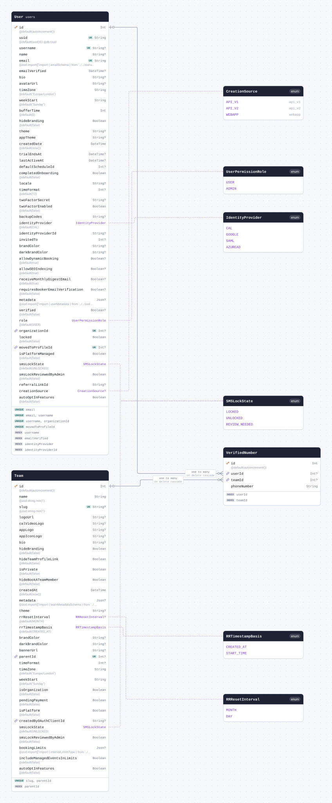

| Field         | Type     | Constraints                   | Default           | Description |
| ------------- | -------- | ----------------------------- | ----------------- | ----------- |
| `id`          | `Int`    | PK NOT NULL                   | `autoincrement()` |             |
| `userId`      | `Int`    | NULL → [User.id](#model-User) |                   |             |
| `teamId`      | `Int`    | NULL → [Team.id](#model-Team) |                   |             |
| `phoneNumber` | `String` | NOT NULL                      |                   |             |

#### Indexes

- `@@index([userId])`
- `@@index([teamId])`

#### References

- `userId` → [User.id](#model-User) (many-to-one, on delete Cascade)
- `teamId` → [Team.id](#model-Team) (many-to-one, on delete Cascade)

#### Definition

```sql
CREATE TABLE "VerifiedNumber" (
    "id" SERIAL NOT NULL,
    "userId" INTEGER,
    "teamId" INTEGER,
    "phoneNumber" TEXT NOT NULL,

    CONSTRAINT "VerifiedNumber_pkey" PRIMARY KEY ("id")
);

CREATE INDEX "VerifiedNumber_userId_idx" ON "VerifiedNumber"("userId");

CREATE INDEX "VerifiedNumber_teamId_idx" ON "VerifiedNumber"("teamId");

ALTER TABLE "VerifiedNumber" ADD CONSTRAINT "VerifiedNumber_userId_fkey" FOREIGN KEY ("userId") REFERENCES "users"("id") ON DELETE CASCADE ON UPDATE CASCADE;

ALTER TABLE "VerifiedNumber" ADD CONSTRAINT "VerifiedNumber_teamId_fkey" FOREIGN KEY ("teamId") REFERENCES "Team"("id") ON DELETE CASCADE ON UPDATE CASCADE;
```

<details>
<summary>Queries and their SQL</summary>

**findMany**: Every row

```ts
await prisma.verifiedNumber.findMany();
```

```sql
SELECT
  "public"."VerifiedNumber"."id",
  "public"."VerifiedNumber"."userId",
  "public"."VerifiedNumber"."teamId",
  "public"."VerifiedNumber"."phoneNumber"
FROM
  "public"."VerifiedNumber"
WHERE
  1 = 1
OFFSET
  $1
-- params: ["0"]
```

**count**: How many rows there are

```ts
await prisma.verifiedNumber.count();
```

```sql
SELECT
  COUNT(*) AS "_count$_all"
FROM
  (
    SELECT
      "public"."VerifiedNumber"."id"
    FROM
      "public"."VerifiedNumber"
    WHERE
      1 = 1
    OFFSET
      $1
  ) AS "sub"
-- params: ["0"]
```

**findMany**: Every row with its relations

```ts
await prisma.verifiedNumber.findMany({ include: { user: true, team: true } });
```

```sql
SELECT
  "public"."VerifiedNumber"."id",
  "public"."VerifiedNumber"."userId",
  "public"."VerifiedNumber"."teamId",
  "public"."VerifiedNumber"."phoneNumber"
FROM
  "public"."VerifiedNumber"
WHERE
  1 = 1
OFFSET
  $1
-- params: ["0"]

SELECT
  "public"."users"."id",
  "public"."users"."uuid",
  "public"."users"."username",
  "public"."users"."name",
  "public"."users"."email",
  "public"."users"."emailVerified",
  "public"."users"."bio",
  "public"."users"."avatarUrl",
  "public"."users"."timeZone",
  "public"."users"."weekStart",
  "public"."users"."bufferTime",
  "public"."users"."hideBranding",
  "public"."users"."theme",
  "public"."users"."appTheme",
  "public"."users"."created",
  "public"."users"."trialEndsAt",
  "public"."users"."lastActiveAt",
  "public"."users"."defaultScheduleId",
  "public"."users"."completedOnboarding",
  "public"."users"."locale",
  "public"."users"."timeFormat",
  "public"."users"."twoFactorSecret",
  "public"."users"."twoFactorEnabled",
  "public"."users"."backupCodes",
  "public"."users"."identityProvider"::text,
  "public"."users"."identityProviderId",
  "public"."users"."invitedTo",
  "public"."users"."brandColor",
  "public"."users"."darkBrandColor",
  "public"."users"."allowDynamicBooking",
  "public"."users"."allowSEOIndexing",
  "public"."users"."receiveMonthlyDigestEmail",
  "public"."users"."requiresBookerEmailVerification",
  "public"."users"."metadata",
  "public"."users"."verified",
  "public"."users"."role"::text,
  "public"."users"."organizationId",
  "public"."users"."locked",
  "public"."users"."movedToProfileId",
  "public"."users"."isPlatformManaged",
  "public"."users"."smsLockState"::text,
  "public"."users"."smsLockReviewedByAdmin",
  "public"."users"."referralLinkId",
  "public"."users"."creationSource"::text,
  "public"."users"."autoOptInFeatures"
FROM
  "public"."users"
WHERE
  "public"."users"."id" IN ($1)
OFFSET
  $2
-- params: ["<userId of the rows above>","0"]

SELECT
  "public"."Team"."id",
  "public"."Team"."name",
  "public"."Team"."slug",
  "public"."Team"."logoUrl",
  "public"."Team"."calVideoLogo",
  "public"."Team"."appLogo",
  "public"."Team"."appIconLogo",
  "public"."Team"."bio",
  "public"."Team"."hideBranding",
  "public"."Team"."hideTeamProfileLink",
  "public"."Team"."isPrivate",
  "public"."Team"."hideBookATeamMember",
  "public"."Team"."createdAt",
  "public"."Team"."metadata",
  "public"."Team"."theme",
  "public"."Team"."rrResetInterval"::text,
  "public"."Team"."rrTimestampBasis"::text,
  "public"."Team"."brandColor",
  "public"."Team"."darkBrandColor",
  "public"."Team"."bannerUrl",
  "public"."Team"."parentId",
  "public"."Team"."timeFormat",
  "public"."Team"."timeZone",
  "public"."Team"."weekStart",
  "public"."Team"."isOrganization",
  "public"."Team"."pendingPayment",
  "public"."Team"."isPlatform",
  "public"."Team"."createdByOAuthClientId",
  "public"."Team"."smsLockState"::text,
  "public"."Team"."smsLockReviewedByAdmin",
  "public"."Team"."bookingLimits",
  "public"."Team"."includeManagedEventsInLimits",
  "public"."Team"."autoOptInFeatures"
FROM
  "public"."Team"
WHERE
  "public"."Team"."id" IN ($1)
OFFSET
  $2
-- params: ["<teamId of the rows above>","0"]
```

**findUnique**: One row by what is unique to it

```ts
await prisma.verifiedNumber.findUnique({ where: { id: 1 } });
```

```sql
SELECT
  "public"."VerifiedNumber"."id",
  "public"."VerifiedNumber"."userId",
  "public"."VerifiedNumber"."teamId",
  "public"."VerifiedNumber"."phoneNumber"
FROM
  "public"."VerifiedNumber"
WHERE
  (
    "public"."VerifiedNumber"."id" = $1
    AND 1 = 1
  )
LIMIT
  $2
OFFSET
  $3
-- params: ["1","1","0"]
```

**create**: Create a row

```ts
await prisma.verifiedNumber.create({ data: { phoneNumber: "example" } });
```

```sql
INSERT INTO
  "public"."VerifiedNumber" ("phoneNumber")
VALUES
  ($1)
RETURNING
  "public"."VerifiedNumber"."id",
  "public"."VerifiedNumber"."userId",
  "public"."VerifiedNumber"."teamId",
  "public"."VerifiedNumber"."phoneNumber"
-- params: ["example"]
```

**update**: Update a row

```ts
await prisma.verifiedNumber.update({ where: { id: 1 }, data: { phoneNumber: "example" } });
```

```sql
UPDATE "public"."VerifiedNumber"
SET
  "phoneNumber" = $1
WHERE
  (
    "public"."VerifiedNumber"."id" = $2
    AND 1 = 1
  )
RETURNING
  "public"."VerifiedNumber"."id",
  "public"."VerifiedNumber"."userId",
  "public"."VerifiedNumber"."teamId",
  "public"."VerifiedNumber"."phoneNumber"
-- params: ["example","1"]
```

**delete**: Delete a row

```ts
await prisma.verifiedNumber.delete({ where: { id: 1 } });
```

```sql
DELETE FROM "public"."VerifiedNumber"
WHERE
  (
    "public"."VerifiedNumber"."id" = $1
    AND 1 = 1
  )
RETURNING
  "public"."VerifiedNumber"."id",
  "public"."VerifiedNumber"."userId",
  "public"."VerifiedNumber"."teamId",
  "public"."VerifiedNumber"."phoneNumber"
-- params: ["1"]
```

</details>

<a id="model-VerifiedEmail"></a>

### VerifiedEmail


| Field    | Type     | Constraints                   | Default           | Description |
| -------- | -------- | ----------------------------- | ----------------- | ----------- |
| `id`     | `Int`    | PK NOT NULL                   | `autoincrement()` |             |
| `userId` | `Int`    | NULL → [User.id](#model-User) |                   |             |
| `teamId` | `Int`    | NULL → [Team.id](#model-Team) |                   |             |
| `email`  | `String` | NOT NULL                      |                   |             |

#### Indexes

- `@@index([userId])`
- `@@index([teamId])`

#### References

- `userId` → [User.id](#model-User) (many-to-one, on delete Cascade)
- `teamId` → [Team.id](#model-Team) (many-to-one, on delete Cascade)

#### Definition

```sql
CREATE TABLE "VerifiedEmail" (
    "id" SERIAL NOT NULL,
    "userId" INTEGER,
    "teamId" INTEGER,
    "email" TEXT NOT NULL,

    CONSTRAINT "VerifiedEmail_pkey" PRIMARY KEY ("id")
);

CREATE INDEX "VerifiedEmail_userId_idx" ON "VerifiedEmail"("userId");

CREATE INDEX "VerifiedEmail_teamId_idx" ON "VerifiedEmail"("teamId");

ALTER TABLE "VerifiedEmail" ADD CONSTRAINT "VerifiedEmail_userId_fkey" FOREIGN KEY ("userId") REFERENCES "users"("id") ON DELETE CASCADE ON UPDATE CASCADE;

ALTER TABLE "VerifiedEmail" ADD CONSTRAINT "VerifiedEmail_teamId_fkey" FOREIGN KEY ("teamId") REFERENCES "Team"("id") ON DELETE CASCADE ON UPDATE CASCADE;
```

<details>
<summary>Queries and their SQL</summary>

**findMany**: Every row

```ts
await prisma.verifiedEmail.findMany();
```

```sql
SELECT
  "public"."VerifiedEmail"."id",
  "public"."VerifiedEmail"."userId",
  "public"."VerifiedEmail"."teamId",
  "public"."VerifiedEmail"."email"
FROM
  "public"."VerifiedEmail"
WHERE
  1 = 1
OFFSET
  $1
-- params: ["0"]
```

**count**: How many rows there are

```ts
await prisma.verifiedEmail.count();
```

```sql
SELECT
  COUNT(*) AS "_count$_all"
FROM
  (
    SELECT
      "public"."VerifiedEmail"."id"
    FROM
      "public"."VerifiedEmail"
    WHERE
      1 = 1
    OFFSET
      $1
  ) AS "sub"
-- params: ["0"]
```

**findMany**: Every row with its relations

```ts
await prisma.verifiedEmail.findMany({ include: { user: true, team: true } });
```

```sql
SELECT
  "public"."VerifiedEmail"."id",
  "public"."VerifiedEmail"."userId",
  "public"."VerifiedEmail"."teamId",
  "public"."VerifiedEmail"."email"
FROM
  "public"."VerifiedEmail"
WHERE
  1 = 1
OFFSET
  $1
-- params: ["0"]

SELECT
  "public"."users"."id",
  "public"."users"."uuid",
  "public"."users"."username",
  "public"."users"."name",
  "public"."users"."email",
  "public"."users"."emailVerified",
  "public"."users"."bio",
  "public"."users"."avatarUrl",
  "public"."users"."timeZone",
  "public"."users"."weekStart",
  "public"."users"."bufferTime",
  "public"."users"."hideBranding",
  "public"."users"."theme",
  "public"."users"."appTheme",
  "public"."users"."created",
  "public"."users"."trialEndsAt",
  "public"."users"."lastActiveAt",
  "public"."users"."defaultScheduleId",
  "public"."users"."completedOnboarding",
  "public"."users"."locale",
  "public"."users"."timeFormat",
  "public"."users"."twoFactorSecret",
  "public"."users"."twoFactorEnabled",
  "public"."users"."backupCodes",
  "public"."users"."identityProvider"::text,
  "public"."users"."identityProviderId",
  "public"."users"."invitedTo",
  "public"."users"."brandColor",
  "public"."users"."darkBrandColor",
  "public"."users"."allowDynamicBooking",
  "public"."users"."allowSEOIndexing",
  "public"."users"."receiveMonthlyDigestEmail",
  "public"."users"."requiresBookerEmailVerification",
  "public"."users"."metadata",
  "public"."users"."verified",
  "public"."users"."role"::text,
  "public"."users"."organizationId",
  "public"."users"."locked",
  "public"."users"."movedToProfileId",
  "public"."users"."isPlatformManaged",
  "public"."users"."smsLockState"::text,
  "public"."users"."smsLockReviewedByAdmin",
  "public"."users"."referralLinkId",
  "public"."users"."creationSource"::text,
  "public"."users"."autoOptInFeatures"
FROM
  "public"."users"
WHERE
  "public"."users"."id" IN ($1)
OFFSET
  $2
-- params: ["<userId of the rows above>","0"]

SELECT
  "public"."Team"."id",
  "public"."Team"."name",
  "public"."Team"."slug",
  "public"."Team"."logoUrl",
  "public"."Team"."calVideoLogo",
  "public"."Team"."appLogo",
  "public"."Team"."appIconLogo",
  "public"."Team"."bio",
  "public"."Team"."hideBranding",
  "public"."Team"."hideTeamProfileLink",
  "public"."Team"."isPrivate",
  "public"."Team"."hideBookATeamMember",
  "public"."Team"."createdAt",
  "public"."Team"."metadata",
  "public"."Team"."theme",
  "public"."Team"."rrResetInterval"::text,
  "public"."Team"."rrTimestampBasis"::text,
  "public"."Team"."brandColor",
  "public"."Team"."darkBrandColor",
  "public"."Team"."bannerUrl",
  "public"."Team"."parentId",
  "public"."Team"."timeFormat",
  "public"."Team"."timeZone",
  "public"."Team"."weekStart",
  "public"."Team"."isOrganization",
  "public"."Team"."pendingPayment",
  "public"."Team"."isPlatform",
  "public"."Team"."createdByOAuthClientId",
  "public"."Team"."smsLockState"::text,
  "public"."Team"."smsLockReviewedByAdmin",
  "public"."Team"."bookingLimits",
  "public"."Team"."includeManagedEventsInLimits",
  "public"."Team"."autoOptInFeatures"
FROM
  "public"."Team"
WHERE
  "public"."Team"."id" IN ($1)
OFFSET
  $2
-- params: ["<teamId of the rows above>","0"]
```

**findUnique**: One row by what is unique to it

```ts
await prisma.verifiedEmail.findUnique({ where: { id: 1 } });
```

```sql
SELECT
  "public"."VerifiedEmail"."id",
  "public"."VerifiedEmail"."userId",
  "public"."VerifiedEmail"."teamId",
  "public"."VerifiedEmail"."email"
FROM
  "public"."VerifiedEmail"
WHERE
  (
    "public"."VerifiedEmail"."id" = $1
    AND 1 = 1
  )
LIMIT
  $2
OFFSET
  $3
-- params: ["1","1","0"]
```

**create**: Create a row

```ts
await prisma.verifiedEmail.create({ data: { email: "example" } });
```

```sql
INSERT INTO
  "public"."VerifiedEmail" ("email")
VALUES
  ($1)
RETURNING
  "public"."VerifiedEmail"."id",
  "public"."VerifiedEmail"."userId",
  "public"."VerifiedEmail"."teamId",
  "public"."VerifiedEmail"."email"
-- params: ["example"]
```

**update**: Update a row

```ts
await prisma.verifiedEmail.update({ where: { id: 1 }, data: { email: "example" } });
```

```sql
UPDATE "public"."VerifiedEmail"
SET
  "email" = $1
WHERE
  (
    "public"."VerifiedEmail"."id" = $2
    AND 1 = 1
  )
RETURNING
  "public"."VerifiedEmail"."id",
  "public"."VerifiedEmail"."userId",
  "public"."VerifiedEmail"."teamId",
  "public"."VerifiedEmail"."email"
-- params: ["example","1"]
```

**delete**: Delete a row

```ts
await prisma.verifiedEmail.delete({ where: { id: 1 } });
```

```sql
DELETE FROM "public"."VerifiedEmail"
WHERE
  (
    "public"."VerifiedEmail"."id" = $1
    AND 1 = 1
  )
RETURNING
  "public"."VerifiedEmail"."id",
  "public"."VerifiedEmail"."userId",
  "public"."VerifiedEmail"."teamId",
  "public"."VerifiedEmail"."email"
-- params: ["1"]
```

</details>

<a id="model-Feature"></a>

### Feature

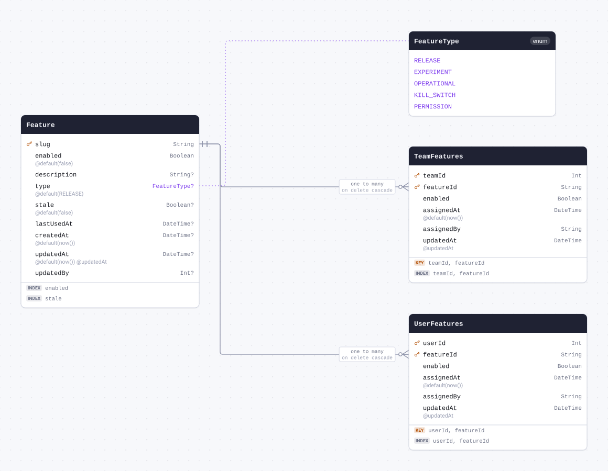

| Field         | Type                               | Constraints | Default              | Description |
| ------------- | ---------------------------------- | ----------- | -------------------- | ----------- |
| `slug`        | `String`                           | PK NOT NULL |                      |             |
| `enabled`     | `Boolean`                          | NOT NULL    | `false`              |             |
| `description` | `String`                           | NULL        |                      |             |
| `type`        | [`FeatureType`](#enum-FeatureType) | NULL        | `RELEASE`            |             |
| `stale`       | `Boolean`                          | NULL        | `false`              |             |
| `lastUsedAt`  | `DateTime`                         | NULL        |                      |             |
| `createdAt`   | `DateTime`                         | NULL        | `now()`              |             |
| `updatedAt`   | `DateTime`                         | NULL        | `now()` `@updatedAt` |             |
| `updatedBy`   | `Int`                              | NULL        |                      |             |

#### Indexes

- `@@index([enabled])`
- `@@index([stale])`

#### Referenced by

- `slug` ← [UserFeatures.featureId](#model-UserFeatures) (one-to-many, on delete Cascade)
- `slug` ← [TeamFeatures.featureId](#model-TeamFeatures) (one-to-many, on delete Cascade)

#### Definition

```sql
CREATE TABLE "Feature" (
    "slug" TEXT NOT NULL,
    "enabled" BOOLEAN NOT NULL DEFAULT false,
    "description" TEXT,
    "type" "FeatureType" DEFAULT 'RELEASE',
    "stale" BOOLEAN DEFAULT false,
    "lastUsedAt" TIMESTAMP(3),
    "createdAt" TIMESTAMP(3) DEFAULT CURRENT_TIMESTAMP,
    "updatedAt" TIMESTAMP(3) DEFAULT CURRENT_TIMESTAMP,
    "updatedBy" INTEGER,

    CONSTRAINT "Feature_pkey" PRIMARY KEY ("slug")
);

CREATE UNIQUE INDEX "Feature_slug_key" ON "Feature"("slug");

CREATE INDEX "Feature_enabled_idx" ON "Feature"("enabled");

CREATE INDEX "Feature_stale_idx" ON "Feature"("stale");
```

<details>
<summary>Queries and their SQL</summary>

**findMany**: Every row

```ts
await prisma.feature.findMany();
```

```sql
SELECT
  "public"."Feature"."slug",
  "public"."Feature"."enabled",
  "public"."Feature"."description",
  "public"."Feature"."type"::text,
  "public"."Feature"."stale",
  "public"."Feature"."lastUsedAt",
  "public"."Feature"."createdAt",
  "public"."Feature"."updatedAt",
  "public"."Feature"."updatedBy"
FROM
  "public"."Feature"
WHERE
  1 = 1
OFFSET
  $1
-- params: ["0"]
```

**count**: How many rows there are

```ts
await prisma.feature.count();
```

```sql
SELECT
  COUNT(*) AS "_count$_all"
FROM
  (
    SELECT
      "public"."Feature"."slug"
    FROM
      "public"."Feature"
    WHERE
      1 = 1
    OFFSET
      $1
  ) AS "sub"
-- params: ["0"]
```

**findMany**: Every row with its relations

```ts
await prisma.feature.findMany({ include: { users: true, teams: true } });
```

```sql
SELECT
  "public"."Feature"."slug",
  "public"."Feature"."enabled",
  "public"."Feature"."description",
  "public"."Feature"."type"::text,
  "public"."Feature"."stale",
  "public"."Feature"."lastUsedAt",
  "public"."Feature"."createdAt",
  "public"."Feature"."updatedAt",
  "public"."Feature"."updatedBy"
FROM
  "public"."Feature"
WHERE
  1 = 1
OFFSET
  $1
-- params: ["0"]

SELECT
  "public"."UserFeatures"."userId",
  "public"."UserFeatures"."featureId",
  "public"."UserFeatures"."enabled",
  "public"."UserFeatures"."assignedAt",
  "public"."UserFeatures"."assignedBy",
  "public"."UserFeatures"."updatedAt"
FROM
  "public"."UserFeatures"
WHERE
  "public"."UserFeatures"."featureId" IN ($1)
OFFSET
  $2
-- params: ["<slug of the rows above>","0"]

SELECT
  "public"."TeamFeatures"."teamId",
  "public"."TeamFeatures"."featureId",
  "public"."TeamFeatures"."enabled",
  "public"."TeamFeatures"."assignedAt",
  "public"."TeamFeatures"."assignedBy",
  "public"."TeamFeatures"."updatedAt"
FROM
  "public"."TeamFeatures"
WHERE
  "public"."TeamFeatures"."featureId" IN ($1)
OFFSET
  $2
-- params: ["<slug of the rows above>","0"]
```

**findUnique**: One row by what is unique to it

```ts
await prisma.feature.findUnique({ where: { slug: "example" } });
```

```sql
SELECT
  "public"."Feature"."slug",
  "public"."Feature"."enabled",
  "public"."Feature"."description",
  "public"."Feature"."type"::text,
  "public"."Feature"."stale",
  "public"."Feature"."lastUsedAt",
  "public"."Feature"."createdAt",
  "public"."Feature"."updatedAt",
  "public"."Feature"."updatedBy"
FROM
  "public"."Feature"
WHERE
  (
    "public"."Feature"."slug" = $1
    AND 1 = 1
  )
LIMIT
  $2
OFFSET
  $3
-- params: ["example","1","0"]
```

**create**: Create a row

```ts
await prisma.feature.create({ data: { slug: "example" } });
```

```sql
INSERT INTO
  "public"."Feature" (
    "slug",
    "enabled",
    "type",
    "stale",
    "createdAt",
    "updatedAt"
  )
VALUES
  (
    $1,
    $2,
    CAST($3::text AS "public"."FeatureType"),
    $4,
    $5,
    $6
  )
RETURNING
  "public"."Feature"."slug",
  "public"."Feature"."enabled",
  "public"."Feature"."description",
  "public"."Feature"."type"::text,
  "public"."Feature"."stale",
  "public"."Feature"."lastUsedAt",
  "public"."Feature"."createdAt",
  "public"."Feature"."updatedAt",
  "public"."Feature"."updatedBy"
-- params: ["example",false,"RELEASE",false,"<now()>","<now()>"]
```

**update**: Update a row

```ts
await prisma.feature.update({ where: { slug: "example" }, data: { enabled: true } });
```

```sql
UPDATE "public"."Feature"
SET
  "enabled" = $1,
  "updatedAt" = $2
WHERE
  (
    "public"."Feature"."slug" = $3
    AND 1 = 1
  )
RETURNING
  "public"."Feature"."slug",
  "public"."Feature"."enabled",
  "public"."Feature"."description",
  "public"."Feature"."type"::text,
  "public"."Feature"."stale",
  "public"."Feature"."lastUsedAt",
  "public"."Feature"."createdAt",
  "public"."Feature"."updatedAt",
  "public"."Feature"."updatedBy"
-- params: [true,{"prisma__type":"generatorCall","prisma__value":{"name":"now","args":[],"returnType":{"type":"DateTime"}}},"example"]
```

**delete**: Delete a row

```ts
await prisma.feature.delete({ where: { slug: "example" } });
```

```sql
DELETE FROM "public"."Feature"
WHERE
  (
    "public"."Feature"."slug" = $1
    AND 1 = 1
  )
RETURNING
  "public"."Feature"."slug",
  "public"."Feature"."enabled",
  "public"."Feature"."description",
  "public"."Feature"."type"::text,
  "public"."Feature"."stale",
  "public"."Feature"."lastUsedAt",
  "public"."Feature"."createdAt",
  "public"."Feature"."updatedAt",
  "public"."Feature"."updatedBy"
-- params: ["example"]
```

</details>

<a id="model-UserFeatures"></a>

### UserFeatures

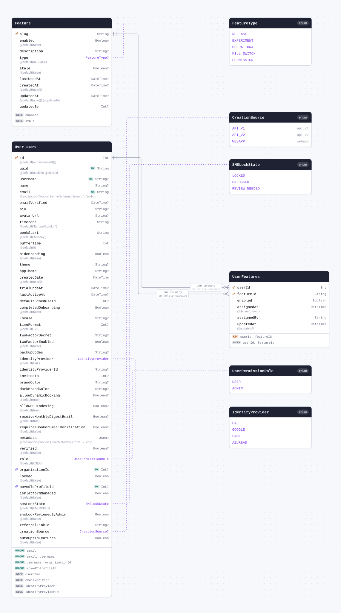

| Field        | Type       | Constraints                                  | Default      | Description |
| ------------ | ---------- | -------------------------------------------- | ------------ | ----------- |
| `userId`     | `Int`      | PK NOT NULL → [User.id](#model-User)         |              |             |
| `featureId`  | `String`   | PK NOT NULL → [Feature.slug](#model-Feature) |              |             |
| `enabled`    | `Boolean`  | NOT NULL                                     |              |             |
| `assignedAt` | `DateTime` | NOT NULL                                     | `now()`      |             |
| `assignedBy` | `String`   | NOT NULL                                     |              |             |
| `updatedAt`  | `DateTime` | NOT NULL                                     | `@updatedAt` |             |

#### Indexes

- `@@id([userId, featureId])`
- `@@index([userId, featureId])`

#### References

- `userId` → [User.id](#model-User) (many-to-one, on delete Cascade)
- `featureId` → [Feature.slug](#model-Feature) (many-to-one, on delete Cascade)

#### Definition

```sql
CREATE TABLE "UserFeatures" (
    "userId" INTEGER NOT NULL,
    "featureId" TEXT NOT NULL,
    "enabled" BOOLEAN NOT NULL,
    "assignedAt" TIMESTAMP(3) NOT NULL DEFAULT CURRENT_TIMESTAMP,
    "assignedBy" TEXT NOT NULL,
    "updatedAt" TIMESTAMP(3) NOT NULL,

    CONSTRAINT "UserFeatures_pkey" PRIMARY KEY ("userId","featureId")
);

CREATE INDEX "UserFeatures_userId_featureId_idx" ON "UserFeatures"("userId", "featureId");

ALTER TABLE "UserFeatures" ADD CONSTRAINT "UserFeatures_userId_fkey" FOREIGN KEY ("userId") REFERENCES "users"("id") ON DELETE CASCADE ON UPDATE CASCADE;

ALTER TABLE "UserFeatures" ADD CONSTRAINT "UserFeatures_featureId_fkey" FOREIGN KEY ("featureId") REFERENCES "Feature"("slug") ON DELETE CASCADE ON UPDATE CASCADE;
```

<details>
<summary>Queries and their SQL</summary>

**findMany**: Every row

```ts
await prisma.userFeatures.findMany();
```

```sql
SELECT
  "public"."UserFeatures"."userId",
  "public"."UserFeatures"."featureId",
  "public"."UserFeatures"."enabled",
  "public"."UserFeatures"."assignedAt",
  "public"."UserFeatures"."assignedBy",
  "public"."UserFeatures"."updatedAt"
FROM
  "public"."UserFeatures"
WHERE
  1 = 1
OFFSET
  $1
-- params: ["0"]
```

**count**: How many rows there are

```ts
await prisma.userFeatures.count();
```

```sql
SELECT
  COUNT(*) AS "_count$_all"
FROM
  (
    SELECT
      "public"."UserFeatures"."userId",
      "public"."UserFeatures"."featureId"
    FROM
      "public"."UserFeatures"
    WHERE
      1 = 1
    OFFSET
      $1
  ) AS "sub"
-- params: ["0"]
```

**findMany**: Every row with its relations

```ts
await prisma.userFeatures.findMany({ include: { user: true, feature: true } });
```

```sql
SELECT
  "public"."UserFeatures"."userId",
  "public"."UserFeatures"."featureId",
  "public"."UserFeatures"."enabled",
  "public"."UserFeatures"."assignedAt",
  "public"."UserFeatures"."assignedBy",
  "public"."UserFeatures"."updatedAt"
FROM
  "public"."UserFeatures"
WHERE
  1 = 1
OFFSET
  $1
-- params: ["0"]

SELECT
  "public"."users"."id",
  "public"."users"."uuid",
  "public"."users"."username",
  "public"."users"."name",
  "public"."users"."email",
  "public"."users"."emailVerified",
  "public"."users"."bio",
  "public"."users"."avatarUrl",
  "public"."users"."timeZone",
  "public"."users"."weekStart",
  "public"."users"."bufferTime",
  "public"."users"."hideBranding",
  "public"."users"."theme",
  "public"."users"."appTheme",
  "public"."users"."created",
  "public"."users"."trialEndsAt",
  "public"."users"."lastActiveAt",
  "public"."users"."defaultScheduleId",
  "public"."users"."completedOnboarding",
  "public"."users"."locale",
  "public"."users"."timeFormat",
  "public"."users"."twoFactorSecret",
  "public"."users"."twoFactorEnabled",
  "public"."users"."backupCodes",
  "public"."users"."identityProvider"::text,
  "public"."users"."identityProviderId",
  "public"."users"."invitedTo",
  "public"."users"."brandColor",
  "public"."users"."darkBrandColor",
  "public"."users"."allowDynamicBooking",
  "public"."users"."allowSEOIndexing",
  "public"."users"."receiveMonthlyDigestEmail",
  "public"."users"."requiresBookerEmailVerification",
  "public"."users"."metadata",
  "public"."users"."verified",
  "public"."users"."role"::text,
  "public"."users"."organizationId",
  "public"."users"."locked",
  "public"."users"."movedToProfileId",
  "public"."users"."isPlatformManaged",
  "public"."users"."smsLockState"::text,
  "public"."users"."smsLockReviewedByAdmin",
  "public"."users"."referralLinkId",
  "public"."users"."creationSource"::text,
  "public"."users"."autoOptInFeatures"
FROM
  "public"."users"
WHERE
  "public"."users"."id" IN ($1)
OFFSET
  $2
-- params: ["<userId of the rows above>","0"]

SELECT
  "public"."Feature"."slug",
  "public"."Feature"."enabled",
  "public"."Feature"."description",
  "public"."Feature"."type"::text,
  "public"."Feature"."stale",
  "public"."Feature"."lastUsedAt",
  "public"."Feature"."createdAt",
  "public"."Feature"."updatedAt",
  "public"."Feature"."updatedBy"
FROM
  "public"."Feature"
WHERE
  "public"."Feature"."slug" IN ($1)
OFFSET
  $2
-- params: ["<featureId of the rows above>","0"]
```

**findUnique**: One row by what is unique to it

```ts
await prisma.userFeatures.findUnique({
  where: { userId_featureId: { userId: 1, featureId: "example" } },
});
```

```sql
SELECT
  "public"."UserFeatures"."userId",
  "public"."UserFeatures"."featureId",
  "public"."UserFeatures"."enabled",
  "public"."UserFeatures"."assignedAt",
  "public"."UserFeatures"."assignedBy",
  "public"."UserFeatures"."updatedAt"
FROM
  "public"."UserFeatures"
WHERE
  (
    (
      "public"."UserFeatures"."userId" = $1
      AND "public"."UserFeatures"."featureId" = $2
    )
    AND 1 = 1
  )
LIMIT
  $3
OFFSET
  $4
-- params: ["1","example","1","0"]
```

**create**: Create a row

```ts
await prisma.userFeatures.create({
  data: { userId: 1, featureId: "example", enabled: true, assignedBy: "example" },
});
```

```sql
INSERT INTO
  "public"."UserFeatures" (
    "userId",
    "featureId",
    "enabled",
    "assignedAt",
    "assignedBy",
    "updatedAt"
  )
VALUES
  ($1, $2, $3, $4, $5, $6)
RETURNING
  "public"."UserFeatures"."userId",
  "public"."UserFeatures"."featureId",
  "public"."UserFeatures"."enabled",
  "public"."UserFeatures"."assignedAt",
  "public"."UserFeatures"."assignedBy",
  "public"."UserFeatures"."updatedAt"
-- params: ["1","example",true,"<now()>","example","<now()>"]
```

**update**: Update a row

```ts
await prisma.userFeatures.update({
  where: { userId_featureId: { userId: 1, featureId: "example" } },
  data: { enabled: true },
});
```

```sql
UPDATE "public"."UserFeatures"
SET
  "enabled" = $1,
  "updatedAt" = $2
WHERE
  (
    (
      "public"."UserFeatures"."userId" = $3
      AND "public"."UserFeatures"."featureId" = $4
    )
    AND 1 = 1
  )
RETURNING
  "public"."UserFeatures"."userId",
  "public"."UserFeatures"."featureId",
  "public"."UserFeatures"."enabled",
  "public"."UserFeatures"."assignedAt",
  "public"."UserFeatures"."assignedBy",
  "public"."UserFeatures"."updatedAt"
-- params: [true,{"prisma__type":"generatorCall","prisma__value":{"name":"now","args":[],"returnType":{"type":"DateTime"}}},"1","example"]
```

**delete**: Delete a row

```ts
await prisma.userFeatures.delete({
  where: { userId_featureId: { userId: 1, featureId: "example" } },
});
```

```sql
DELETE FROM "public"."UserFeatures"
WHERE
  (
    (
      "public"."UserFeatures"."userId" = $1
      AND "public"."UserFeatures"."featureId" = $2
    )
    AND 1 = 1
  )
RETURNING
  "public"."UserFeatures"."userId",
  "public"."UserFeatures"."featureId",
  "public"."UserFeatures"."enabled",
  "public"."UserFeatures"."assignedAt",
  "public"."UserFeatures"."assignedBy",
  "public"."UserFeatures"."updatedAt"
-- params: ["1","example"]
```

</details>

<a id="model-TeamFeatures"></a>

### TeamFeatures

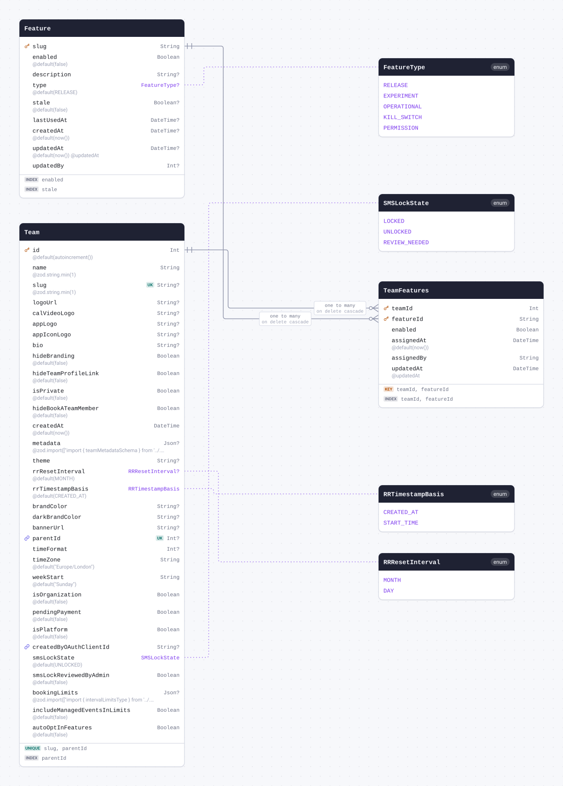

| Field        | Type       | Constraints                                  | Default      | Description |
| ------------ | ---------- | -------------------------------------------- | ------------ | ----------- |
| `teamId`     | `Int`      | PK NOT NULL → [Team.id](#model-Team)         |              |             |
| `featureId`  | `String`   | PK NOT NULL → [Feature.slug](#model-Feature) |              |             |
| `enabled`    | `Boolean`  | NOT NULL                                     |              |             |
| `assignedAt` | `DateTime` | NOT NULL                                     | `now()`      |             |
| `assignedBy` | `String`   | NOT NULL                                     |              |             |
| `updatedAt`  | `DateTime` | NOT NULL                                     | `@updatedAt` |             |

#### Indexes

- `@@id([teamId, featureId])`
- `@@index([teamId, featureId])`

#### References

- `teamId` → [Team.id](#model-Team) (many-to-one, on delete Cascade)
- `featureId` → [Feature.slug](#model-Feature) (many-to-one, on delete Cascade)

#### Definition

```sql
CREATE TABLE "TeamFeatures" (
    "teamId" INTEGER NOT NULL,
    "featureId" TEXT NOT NULL,
    "enabled" BOOLEAN NOT NULL,
    "assignedAt" TIMESTAMP(3) NOT NULL DEFAULT CURRENT_TIMESTAMP,
    "assignedBy" TEXT NOT NULL,
    "updatedAt" TIMESTAMP(3) NOT NULL,

    CONSTRAINT "TeamFeatures_pkey" PRIMARY KEY ("teamId","featureId")
);

CREATE INDEX "TeamFeatures_teamId_featureId_idx" ON "TeamFeatures"("teamId", "featureId");

ALTER TABLE "TeamFeatures" ADD CONSTRAINT "TeamFeatures_teamId_fkey" FOREIGN KEY ("teamId") REFERENCES "Team"("id") ON DELETE CASCADE ON UPDATE CASCADE;

ALTER TABLE "TeamFeatures" ADD CONSTRAINT "TeamFeatures_featureId_fkey" FOREIGN KEY ("featureId") REFERENCES "Feature"("slug") ON DELETE CASCADE ON UPDATE CASCADE;
```

<details>
<summary>Queries and their SQL</summary>

**findMany**: Every row

```ts
await prisma.teamFeatures.findMany();
```

```sql
SELECT
  "public"."TeamFeatures"."teamId",
  "public"."TeamFeatures"."featureId",
  "public"."TeamFeatures"."enabled",
  "public"."TeamFeatures"."assignedAt",
  "public"."TeamFeatures"."assignedBy",
  "public"."TeamFeatures"."updatedAt"
FROM
  "public"."TeamFeatures"
WHERE
  1 = 1
OFFSET
  $1
-- params: ["0"]
```

**count**: How many rows there are

```ts
await prisma.teamFeatures.count();
```

```sql
SELECT
  COUNT(*) AS "_count$_all"
FROM
  (
    SELECT
      "public"."TeamFeatures"."teamId",
      "public"."TeamFeatures"."featureId"
    FROM
      "public"."TeamFeatures"
    WHERE
      1 = 1
    OFFSET
      $1
  ) AS "sub"
-- params: ["0"]
```

**findMany**: Every row with its relations

```ts
await prisma.teamFeatures.findMany({ include: { team: true, feature: true } });
```

```sql
SELECT
  "public"."TeamFeatures"."teamId",
  "public"."TeamFeatures"."featureId",
  "public"."TeamFeatures"."enabled",
  "public"."TeamFeatures"."assignedAt",
  "public"."TeamFeatures"."assignedBy",
  "public"."TeamFeatures"."updatedAt"
FROM
  "public"."TeamFeatures"
WHERE
  1 = 1
OFFSET
  $1
-- params: ["0"]

SELECT
  "public"."Team"."id",
  "public"."Team"."name",
  "public"."Team"."slug",
  "public"."Team"."logoUrl",
  "public"."Team"."calVideoLogo",
  "public"."Team"."appLogo",
  "public"."Team"."appIconLogo",
  "public"."Team"."bio",
  "public"."Team"."hideBranding",
  "public"."Team"."hideTeamProfileLink",
  "public"."Team"."isPrivate",
  "public"."Team"."hideBookATeamMember",
  "public"."Team"."createdAt",
  "public"."Team"."metadata",
  "public"."Team"."theme",
  "public"."Team"."rrResetInterval"::text,
  "public"."Team"."rrTimestampBasis"::text,
  "public"."Team"."brandColor",
  "public"."Team"."darkBrandColor",
  "public"."Team"."bannerUrl",
  "public"."Team"."parentId",
  "public"."Team"."timeFormat",
  "public"."Team"."timeZone",
  "public"."Team"."weekStart",
  "public"."Team"."isOrganization",
  "public"."Team"."pendingPayment",
  "public"."Team"."isPlatform",
  "public"."Team"."createdByOAuthClientId",
  "public"."Team"."smsLockState"::text,
  "public"."Team"."smsLockReviewedByAdmin",
  "public"."Team"."bookingLimits",
  "public"."Team"."includeManagedEventsInLimits",
  "public"."Team"."autoOptInFeatures"
FROM
  "public"."Team"
WHERE
  "public"."Team"."id" IN ($1)
OFFSET
  $2
-- params: ["<teamId of the rows above>","0"]

SELECT
  "public"."Feature"."slug",
  "public"."Feature"."enabled",
  "public"."Feature"."description",
  "public"."Feature"."type"::text,
  "public"."Feature"."stale",
  "public"."Feature"."lastUsedAt",
  "public"."Feature"."createdAt",
  "public"."Feature"."updatedAt",
  "public"."Feature"."updatedBy"
FROM
  "public"."Feature"
WHERE
  "public"."Feature"."slug" IN ($1)
OFFSET
  $2
-- params: ["<featureId of the rows above>","0"]
```

**findUnique**: One row by what is unique to it

```ts
await prisma.teamFeatures.findUnique({
  where: { teamId_featureId: { teamId: 1, featureId: "example" } },
});
```

```sql
SELECT
  "public"."TeamFeatures"."teamId",
  "public"."TeamFeatures"."featureId",
  "public"."TeamFeatures"."enabled",
  "public"."TeamFeatures"."assignedAt",
  "public"."TeamFeatures"."assignedBy",
  "public"."TeamFeatures"."updatedAt"
FROM
  "public"."TeamFeatures"
WHERE
  (
    (
      "public"."TeamFeatures"."teamId" = $1
      AND "public"."TeamFeatures"."featureId" = $2
    )
    AND 1 = 1
  )
LIMIT
  $3
OFFSET
  $4
-- params: ["1","example","1","0"]
```

**create**: Create a row

```ts
await prisma.teamFeatures.create({
  data: { teamId: 1, featureId: "example", enabled: true, assignedBy: "example" },
});
```

```sql
INSERT INTO
  "public"."TeamFeatures" (
    "teamId",
    "featureId",
    "enabled",
    "assignedAt",
    "assignedBy",
    "updatedAt"
  )
VALUES
  ($1, $2, $3, $4, $5, $6)
RETURNING
  "public"."TeamFeatures"."teamId",
  "public"."TeamFeatures"."featureId",
  "public"."TeamFeatures"."enabled",
  "public"."TeamFeatures"."assignedAt",
  "public"."TeamFeatures"."assignedBy",
  "public"."TeamFeatures"."updatedAt"
-- params: ["1","example",true,"<now()>","example","<now()>"]
```

**update**: Update a row

```ts
await prisma.teamFeatures.update({
  where: { teamId_featureId: { teamId: 1, featureId: "example" } },
  data: { enabled: true },
});
```

```sql
UPDATE "public"."TeamFeatures"
SET
  "enabled" = $1,
  "updatedAt" = $2
WHERE
  (
    (
      "public"."TeamFeatures"."teamId" = $3
      AND "public"."TeamFeatures"."featureId" = $4
    )
    AND 1 = 1
  )
RETURNING
  "public"."TeamFeatures"."teamId",
  "public"."TeamFeatures"."featureId",
  "public"."TeamFeatures"."enabled",
  "public"."TeamFeatures"."assignedAt",
  "public"."TeamFeatures"."assignedBy",
  "public"."TeamFeatures"."updatedAt"
-- params: [true,{"prisma__type":"generatorCall","prisma__value":{"name":"now","args":[],"returnType":{"type":"DateTime"}}},"1","example"]
```

**delete**: Delete a row

```ts
await prisma.teamFeatures.delete({
  where: { teamId_featureId: { teamId: 1, featureId: "example" } },
});
```

```sql
DELETE FROM "public"."TeamFeatures"
WHERE
  (
    (
      "public"."TeamFeatures"."teamId" = $1
      AND "public"."TeamFeatures"."featureId" = $2
    )
    AND 1 = 1
  )
RETURNING
  "public"."TeamFeatures"."teamId",
  "public"."TeamFeatures"."featureId",
  "public"."TeamFeatures"."enabled",
  "public"."TeamFeatures"."assignedAt",
  "public"."TeamFeatures"."assignedBy",
  "public"."TeamFeatures"."updatedAt"
-- params: ["1","example"]
```

</details>

<a id="model-SelectedSlots"></a>

### SelectedSlots

| Field              | Type       | Constraints | Default           | Description |
| ------------------ | ---------- | ----------- | ----------------- | ----------- |
| `id`               | `Int`      | PK NOT NULL | `autoincrement()` |             |
| `eventTypeId`      | `Int`      | NOT NULL    |                   |             |
| `userId`           | `Int`      | NOT NULL    |                   |             |
| `slotUtcStartDate` | `DateTime` | NOT NULL    |                   |             |
| `slotUtcEndDate`   | `DateTime` | NOT NULL    |                   |             |
| `uid`              | `String`   | NOT NULL    |                   |             |
| `releaseAt`        | `DateTime` | NOT NULL    |                   |             |
| `isSeat`           | `Boolean`  | NOT NULL    | `false`           |             |

#### Indexes

- `@@unique([userId, slotUtcStartDate, slotUtcEndDate, uid], name: "selectedSlotUnique")`

#### Definition

```sql
CREATE TABLE "SelectedSlots" (
    "id" SERIAL NOT NULL,
    "eventTypeId" INTEGER NOT NULL,
    "userId" INTEGER NOT NULL,
    "slotUtcStartDate" TIMESTAMP(3) NOT NULL,
    "slotUtcEndDate" TIMESTAMP(3) NOT NULL,
    "uid" TEXT NOT NULL,
    "releaseAt" TIMESTAMP(3) NOT NULL,
    "isSeat" BOOLEAN NOT NULL DEFAULT false,

    CONSTRAINT "SelectedSlots_pkey" PRIMARY KEY ("id")
);

CREATE UNIQUE INDEX "SelectedSlots_userId_slotUtcStartDate_slotUtcEndDate_uid_key" ON "SelectedSlots"("userId", "slotUtcStartDate", "slotUtcEndDate", "uid");
```

<details>
<summary>Queries and their SQL</summary>

**findMany**: Every row

```ts
await prisma.selectedSlots.findMany();
```

```sql
SELECT
  "public"."SelectedSlots"."id",
  "public"."SelectedSlots"."eventTypeId",
  "public"."SelectedSlots"."userId",
  "public"."SelectedSlots"."slotUtcStartDate",
  "public"."SelectedSlots"."slotUtcEndDate",
  "public"."SelectedSlots"."uid",
  "public"."SelectedSlots"."releaseAt",
  "public"."SelectedSlots"."isSeat"
FROM
  "public"."SelectedSlots"
WHERE
  1 = 1
OFFSET
  $1
-- params: ["0"]
```

**count**: How many rows there are

```ts
await prisma.selectedSlots.count();
```

```sql
SELECT
  COUNT(*) AS "_count$_all"
FROM
  (
    SELECT
      "public"."SelectedSlots"."id"
    FROM
      "public"."SelectedSlots"
    WHERE
      1 = 1
    OFFSET
      $1
  ) AS "sub"
-- params: ["0"]
```

**findUnique**: One row by what is unique to it

```ts
await prisma.selectedSlots.findUnique({ where: { id: 1 } });
```

```sql
SELECT
  "public"."SelectedSlots"."id",
  "public"."SelectedSlots"."eventTypeId",
  "public"."SelectedSlots"."userId",
  "public"."SelectedSlots"."slotUtcStartDate",
  "public"."SelectedSlots"."slotUtcEndDate",
  "public"."SelectedSlots"."uid",
  "public"."SelectedSlots"."releaseAt",
  "public"."SelectedSlots"."isSeat"
FROM
  "public"."SelectedSlots"
WHERE
  (
    "public"."SelectedSlots"."id" = $1
    AND 1 = 1
  )
LIMIT
  $2
OFFSET
  $3
-- params: ["1","1","0"]
```

**create**: Create a row

```ts
await prisma.selectedSlots.create({
  data: {
    eventTypeId: 1,
    userId: 1,
    slotUtcStartDate: new Date("2026-01-01T00:00:00.000Z"),
    slotUtcEndDate: new Date("2026-01-01T00:00:00.000Z"),
    uid: "example",
    releaseAt: new Date("2026-01-01T00:00:00.000Z"),
  },
});
```

```sql
INSERT INTO
  "public"."SelectedSlots" (
    "eventTypeId",
    "userId",
    "slotUtcStartDate",
    "slotUtcEndDate",
    "uid",
    "releaseAt",
    "isSeat"
  )
VALUES
  ($1, $2, $3, $4, $5, $6, $7)
RETURNING
  "public"."SelectedSlots"."id",
  "public"."SelectedSlots"."eventTypeId",
  "public"."SelectedSlots"."userId",
  "public"."SelectedSlots"."slotUtcStartDate",
  "public"."SelectedSlots"."slotUtcEndDate",
  "public"."SelectedSlots"."uid",
  "public"."SelectedSlots"."releaseAt",
  "public"."SelectedSlots"."isSeat"
-- params: ["1","1","2026-01-01T00:00:00.000Z","2026-01-01T00:00:00.000Z","example","2026-01-01T00:00:00.000Z",false]
```

**update**: Update a row

```ts
await prisma.selectedSlots.update({ where: { id: 1 }, data: { eventTypeId: 1 } });
```

```sql
UPDATE "public"."SelectedSlots"
SET
  "eventTypeId" = $1
WHERE
  (
    "public"."SelectedSlots"."id" = $2
    AND 1 = 1
  )
RETURNING
  "public"."SelectedSlots"."id",
  "public"."SelectedSlots"."eventTypeId",
  "public"."SelectedSlots"."userId",
  "public"."SelectedSlots"."slotUtcStartDate",
  "public"."SelectedSlots"."slotUtcEndDate",
  "public"."SelectedSlots"."uid",
  "public"."SelectedSlots"."releaseAt",
  "public"."SelectedSlots"."isSeat"
-- params: ["1","1"]
```

**delete**: Delete a row

```ts
await prisma.selectedSlots.delete({ where: { id: 1 } });
```

```sql
DELETE FROM "public"."SelectedSlots"
WHERE
  (
    "public"."SelectedSlots"."id" = $1
    AND 1 = 1
  )
RETURNING
  "public"."SelectedSlots"."id",
  "public"."SelectedSlots"."eventTypeId",
  "public"."SelectedSlots"."userId",
  "public"."SelectedSlots"."slotUtcStartDate",
  "public"."SelectedSlots"."slotUtcEndDate",
  "public"."SelectedSlots"."uid",
  "public"."SelectedSlots"."releaseAt",
  "public"."SelectedSlots"."isSeat"
-- params: ["1"]
```

</details>

<a id="model-OAuthClient"></a>

### OAuthClient

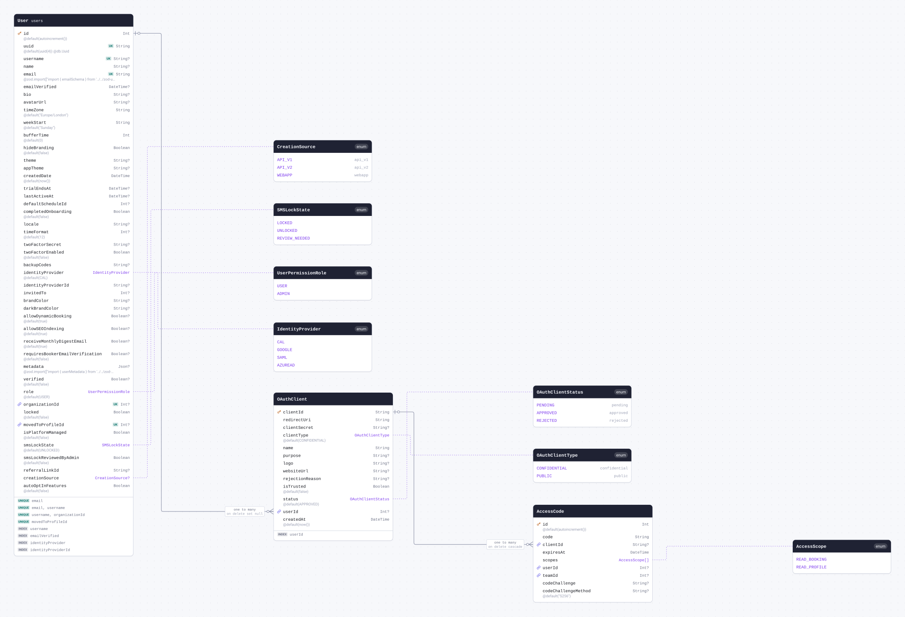

| Field             | Type                                           | Constraints                   | Default        | Description |
| ----------------- | ---------------------------------------------- | ----------------------------- | -------------- | ----------- |
| `clientId`        | `String`                                       | PK NOT NULL                   |                |             |
| `redirectUri`     | `String`                                       | NOT NULL                      |                |             |
| `clientSecret`    | `String`                                       | NULL                          |                |             |
| `clientType`      | [`OAuthClientType`](#enum-OAuthClientType)     | NOT NULL                      | `CONFIDENTIAL` |             |
| `name`            | `String`                                       | NOT NULL                      |                |             |
| `purpose`         | `String`                                       | NULL                          |                |             |
| `logo`            | `String`                                       | NULL                          |                |             |
| `websiteUrl`      | `String`                                       | NULL                          |                |             |
| `rejectionReason` | `String`                                       | NULL                          |                |             |
| `isTrusted`       | `Boolean`                                      | NOT NULL                      | `false`        |             |
| `status`          | [`OAuthClientStatus`](#enum-OAuthClientStatus) | NOT NULL                      | `APPROVED`     |             |
| `userId`          | `Int`                                          | NULL → [User.id](#model-User) |                |             |
| `createdAt`       | `DateTime`                                     | NOT NULL                      | `now()`        |             |

#### Indexes

- `@@index([userId])`

#### References

- `userId` → [User.id](#model-User) (many-to-one, on delete SetNull)

#### Referenced by

- `clientId` ← [AccessCode.clientId](#model-AccessCode) (one-to-many, on delete Cascade)

#### Definition

```sql
CREATE TABLE "OAuthClient" (
    "clientId" TEXT NOT NULL,
    "redirectUri" TEXT NOT NULL,
    "clientSecret" TEXT,
    "clientType" "OAuthClientType" NOT NULL DEFAULT 'confidential',
    "name" TEXT NOT NULL,
    "purpose" TEXT,
    "logo" TEXT,
    "websiteUrl" TEXT,
    "rejectionReason" TEXT,
    "isTrusted" BOOLEAN NOT NULL DEFAULT false,
    "status" "OAuthClientStatus" NOT NULL DEFAULT 'approved',
    "userId" INTEGER,
    "createdAt" TIMESTAMP(3) NOT NULL DEFAULT CURRENT_TIMESTAMP,

    CONSTRAINT "OAuthClient_pkey" PRIMARY KEY ("clientId")
);

CREATE UNIQUE INDEX "OAuthClient_clientId_key" ON "OAuthClient"("clientId");

CREATE INDEX "OAuthClient_userId_idx" ON "OAuthClient"("userId");

ALTER TABLE "OAuthClient" ADD CONSTRAINT "OAuthClient_userId_fkey" FOREIGN KEY ("userId") REFERENCES "users"("id") ON DELETE SET NULL ON UPDATE CASCADE;
```

<details>
<summary>Queries and their SQL</summary>

**findMany**: Every row

```ts
await prisma.oAuthClient.findMany();
```

```sql
SELECT
  "public"."OAuthClient"."clientId",
  "public"."OAuthClient"."redirectUri",
  "public"."OAuthClient"."clientSecret",
  "public"."OAuthClient"."clientType"::text,
  "public"."OAuthClient"."name",
  "public"."OAuthClient"."purpose",
  "public"."OAuthClient"."logo",
  "public"."OAuthClient"."websiteUrl",
  "public"."OAuthClient"."rejectionReason",
  "public"."OAuthClient"."isTrusted",
  "public"."OAuthClient"."status"::text,
  "public"."OAuthClient"."userId",
  "public"."OAuthClient"."createdAt"
FROM
  "public"."OAuthClient"
WHERE
  1 = 1
OFFSET
  $1
-- params: ["0"]
```

**count**: How many rows there are

```ts
await prisma.oAuthClient.count();
```

```sql
SELECT
  COUNT(*) AS "_count$_all"
FROM
  (
    SELECT
      "public"."OAuthClient"."clientId"
    FROM
      "public"."OAuthClient"
    WHERE
      1 = 1
    OFFSET
      $1
  ) AS "sub"
-- params: ["0"]
```

**findMany**: Every row with its relations

```ts
await prisma.oAuthClient.findMany({ include: { accessCodes: true, user: true } });
```

```sql
SELECT
  "public"."OAuthClient"."clientId",
  "public"."OAuthClient"."redirectUri",
  "public"."OAuthClient"."clientSecret",
  "public"."OAuthClient"."clientType"::text,
  "public"."OAuthClient"."name",
  "public"."OAuthClient"."purpose",
  "public"."OAuthClient"."logo",
  "public"."OAuthClient"."websiteUrl",
  "public"."OAuthClient"."rejectionReason",
  "public"."OAuthClient"."isTrusted",
  "public"."OAuthClient"."status"::text,
  "public"."OAuthClient"."userId",
  "public"."OAuthClient"."createdAt"
FROM
  "public"."OAuthClient"
WHERE
  1 = 1
OFFSET
  $1
-- params: ["0"]

SELECT
  "public"."AccessCode"."id",
  "public"."AccessCode"."code",
  "public"."AccessCode"."clientId",
  "public"."AccessCode"."expiresAt",
  "public"."AccessCode"."scopes"::text[],
  "public"."AccessCode"."userId",
  "public"."AccessCode"."teamId",
  "public"."AccessCode"."codeChallenge",
  "public"."AccessCode"."codeChallengeMethod"
FROM
  "public"."AccessCode"
WHERE
  "public"."AccessCode"."clientId" IN ($1)
OFFSET
  $2
-- params: ["<clientId of the rows above>","0"]

SELECT
  "public"."users"."id",
  "public"."users"."uuid",
  "public"."users"."username",
  "public"."users"."name",
  "public"."users"."email",
  "public"."users"."emailVerified",
  "public"."users"."bio",
  "public"."users"."avatarUrl",
  "public"."users"."timeZone",
  "public"."users"."weekStart",
  "public"."users"."bufferTime",
  "public"."users"."hideBranding",
  "public"."users"."theme",
  "public"."users"."appTheme",
  "public"."users"."created",
  "public"."users"."trialEndsAt",
  "public"."users"."lastActiveAt",
  "public"."users"."defaultScheduleId",
  "public"."users"."completedOnboarding",
  "public"."users"."locale",
  "public"."users"."timeFormat",
  "public"."users"."twoFactorSecret",
  "public"."users"."twoFactorEnabled",
  "public"."users"."backupCodes",
  "public"."users"."identityProvider"::text,
  "public"."users"."identityProviderId",
  "public"."users"."invitedTo",
  "public"."users"."brandColor",
  "public"."users"."darkBrandColor",
  "public"."users"."allowDynamicBooking",
  "public"."users"."allowSEOIndexing",
  "public"."users"."receiveMonthlyDigestEmail",
  "public"."users"."requiresBookerEmailVerification",
  "public"."users"."metadata",
  "public"."users"."verified",
  "public"."users"."role"::text,
  "public"."users"."organizationId",
  "public"."users"."locked",
  "public"."users"."movedToProfileId",
  "public"."users"."isPlatformManaged",
  "public"."users"."smsLockState"::text,
  "public"."users"."smsLockReviewedByAdmin",
  "public"."users"."referralLinkId",
  "public"."users"."creationSource"::text,
  "public"."users"."autoOptInFeatures"
FROM
  "public"."users"
WHERE
  "public"."users"."id" IN ($1)
OFFSET
  $2
-- params: ["<userId of the rows above>","0"]
```

**findUnique**: One row by what is unique to it

```ts
await prisma.oAuthClient.findUnique({ where: { clientId: "example" } });
```

```sql
SELECT
  "public"."OAuthClient"."clientId",
  "public"."OAuthClient"."redirectUri",
  "public"."OAuthClient"."clientSecret",
  "public"."OAuthClient"."clientType"::text,
  "public"."OAuthClient"."name",
  "public"."OAuthClient"."purpose",
  "public"."OAuthClient"."logo",
  "public"."OAuthClient"."websiteUrl",
  "public"."OAuthClient"."rejectionReason",
  "public"."OAuthClient"."isTrusted",
  "public"."OAuthClient"."status"::text,
  "public"."OAuthClient"."userId",
  "public"."OAuthClient"."createdAt"
FROM
  "public"."OAuthClient"
WHERE
  (
    "public"."OAuthClient"."clientId" = $1
    AND 1 = 1
  )
LIMIT
  $2
OFFSET
  $3
-- params: ["example","1","0"]
```

**create**: Create a row

```ts
await prisma.oAuthClient.create({
  data: { clientId: "example", redirectUri: "example", name: "example" },
});
```

```sql
INSERT INTO
  "public"."OAuthClient" (
    "clientId",
    "redirectUri",
    "clientType",
    "name",
    "isTrusted",
    "status",
    "createdAt"
  )
VALUES
  (
    $1,
    $2,
    CAST($3::text AS "public"."OAuthClientType"),
    $4,
    $5,
    CAST($6::text AS "public"."OAuthClientStatus"),
    $7
  )
RETURNING
  "public"."OAuthClient"."clientId",
  "public"."OAuthClient"."redirectUri",
  "public"."OAuthClient"."clientSecret",
  "public"."OAuthClient"."clientType"::text,
  "public"."OAuthClient"."name",
  "public"."OAuthClient"."purpose",
  "public"."OAuthClient"."logo",
  "public"."OAuthClient"."websiteUrl",
  "public"."OAuthClient"."rejectionReason",
  "public"."OAuthClient"."isTrusted",
  "public"."OAuthClient"."status"::text,
  "public"."OAuthClient"."userId",
  "public"."OAuthClient"."createdAt"
-- params: ["example","example","confidential","example",false,"approved","<now()>"]
```

**update**: Update a row

```ts
await prisma.oAuthClient.update({
  where: { clientId: "example" },
  data: { redirectUri: "example" },
});
```

```sql
UPDATE "public"."OAuthClient"
SET
  "redirectUri" = $1
WHERE
  (
    "public"."OAuthClient"."clientId" = $2
    AND 1 = 1
  )
RETURNING
  "public"."OAuthClient"."clientId",
  "public"."OAuthClient"."redirectUri",
  "public"."OAuthClient"."clientSecret",
  "public"."OAuthClient"."clientType"::text,
  "public"."OAuthClient"."name",
  "public"."OAuthClient"."purpose",
  "public"."OAuthClient"."logo",
  "public"."OAuthClient"."websiteUrl",
  "public"."OAuthClient"."rejectionReason",
  "public"."OAuthClient"."isTrusted",
  "public"."OAuthClient"."status"::text,
  "public"."OAuthClient"."userId",
  "public"."OAuthClient"."createdAt"
-- params: ["example","example"]
```

**delete**: Delete a row

```ts
await prisma.oAuthClient.delete({ where: { clientId: "example" } });
```

```sql
DELETE FROM "public"."OAuthClient"
WHERE
  (
    "public"."OAuthClient"."clientId" = $1
    AND 1 = 1
  )
RETURNING
  "public"."OAuthClient"."clientId",
  "public"."OAuthClient"."redirectUri",
  "public"."OAuthClient"."clientSecret",
  "public"."OAuthClient"."clientType"::text,
  "public"."OAuthClient"."name",
  "public"."OAuthClient"."purpose",
  "public"."OAuthClient"."logo",
  "public"."OAuthClient"."websiteUrl",
  "public"."OAuthClient"."rejectionReason",
  "public"."OAuthClient"."isTrusted",
  "public"."OAuthClient"."status"::text,
  "public"."OAuthClient"."userId",
  "public"."OAuthClient"."createdAt"
-- params: ["example"]
```

</details>

<a id="model-AccessCode"></a>

### AccessCode

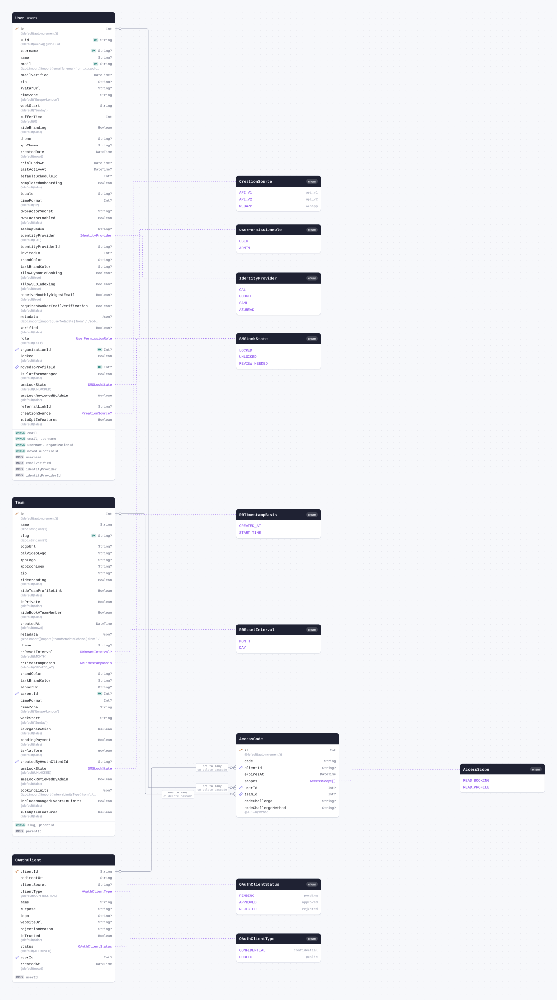

| Field                 | Type                                 | Constraints                                       | Default           | Description |
| --------------------- | ------------------------------------ | ------------------------------------------------- | ----------------- | ----------- |
| `id`                  | `Int`                                | PK NOT NULL                                       | `autoincrement()` |             |
| `code`                | `String`                             | NOT NULL                                          |                   |             |
| `clientId`            | `String`                             | NULL → [OAuthClient.clientId](#model-OAuthClient) |                   |             |
| `expiresAt`           | `DateTime`                           | NOT NULL                                          |                   |             |
| `scopes`              | [`AccessScope[]`](#enum-AccessScope) | NOT NULL                                          |                   |             |
| `userId`              | `Int`                                | NULL → [User.id](#model-User)                     |                   |             |
| `teamId`              | `Int`                                | NULL → [Team.id](#model-Team)                     |                   |             |
| `codeChallenge`       | `String`                             | NULL                                              |                   |             |
| `codeChallengeMethod` | `String`                             | NULL                                              | `"S256"`          |             |

#### References

- `clientId` → [OAuthClient.clientId](#model-OAuthClient) (many-to-one, on delete Cascade)
- `userId` → [User.id](#model-User) (many-to-one, on delete Cascade)
- `teamId` → [Team.id](#model-Team) (many-to-one, on delete Cascade)

#### Definition

```sql
CREATE TABLE "AccessCode" (
    "id" SERIAL NOT NULL,
    "code" TEXT NOT NULL,
    "clientId" TEXT,
    "expiresAt" TIMESTAMP(3) NOT NULL,
    "scopes" "AccessScope"[],
    "userId" INTEGER,
    "teamId" INTEGER,
    "codeChallenge" TEXT,
    "codeChallengeMethod" TEXT DEFAULT 'S256',

    CONSTRAINT "AccessCode_pkey" PRIMARY KEY ("id")
);

ALTER TABLE "AccessCode" ADD CONSTRAINT "AccessCode_clientId_fkey" FOREIGN KEY ("clientId") REFERENCES "OAuthClient"("clientId") ON DELETE CASCADE ON UPDATE CASCADE;

ALTER TABLE "AccessCode" ADD CONSTRAINT "AccessCode_userId_fkey" FOREIGN KEY ("userId") REFERENCES "users"("id") ON DELETE CASCADE ON UPDATE CASCADE;

ALTER TABLE "AccessCode" ADD CONSTRAINT "AccessCode_teamId_fkey" FOREIGN KEY ("teamId") REFERENCES "Team"("id") ON DELETE CASCADE ON UPDATE CASCADE;
```

<details>
<summary>Queries and their SQL</summary>

**findMany**: Every row

```ts
await prisma.accessCode.findMany();
```

```sql
SELECT
  "public"."AccessCode"."id",
  "public"."AccessCode"."code",
  "public"."AccessCode"."clientId",
  "public"."AccessCode"."expiresAt",
  "public"."AccessCode"."scopes"::text[],
  "public"."AccessCode"."userId",
  "public"."AccessCode"."teamId",
  "public"."AccessCode"."codeChallenge",
  "public"."AccessCode"."codeChallengeMethod"
FROM
  "public"."AccessCode"
WHERE
  1 = 1
OFFSET
  $1
-- params: ["0"]
```

**count**: How many rows there are

```ts
await prisma.accessCode.count();
```

```sql
SELECT
  COUNT(*) AS "_count$_all"
FROM
  (
    SELECT
      "public"."AccessCode"."id"
    FROM
      "public"."AccessCode"
    WHERE
      1 = 1
    OFFSET
      $1
  ) AS "sub"
-- params: ["0"]
```

**findMany**: Every row with its relations

```ts
await prisma.accessCode.findMany({ include: { client: true, user: true, team: true } });
```

```sql
SELECT
  "public"."AccessCode"."id",
  "public"."AccessCode"."code",
  "public"."AccessCode"."clientId",
  "public"."AccessCode"."expiresAt",
  "public"."AccessCode"."scopes"::text[],
  "public"."AccessCode"."userId",
  "public"."AccessCode"."teamId",
  "public"."AccessCode"."codeChallenge",
  "public"."AccessCode"."codeChallengeMethod"
FROM
  "public"."AccessCode"
WHERE
  1 = 1
OFFSET
  $1
-- params: ["0"]

SELECT
  "public"."OAuthClient"."clientId",
  "public"."OAuthClient"."redirectUri",
  "public"."OAuthClient"."clientSecret",
  "public"."OAuthClient"."clientType"::text,
  "public"."OAuthClient"."name",
  "public"."OAuthClient"."purpose",
  "public"."OAuthClient"."logo",
  "public"."OAuthClient"."websiteUrl",
  "public"."OAuthClient"."rejectionReason",
  "public"."OAuthClient"."isTrusted",
  "public"."OAuthClient"."status"::text,
  "public"."OAuthClient"."userId",
  "public"."OAuthClient"."createdAt"
FROM
  "public"."OAuthClient"
WHERE
  "public"."OAuthClient"."clientId" IN ($1)
OFFSET
  $2
-- params: ["<clientId of the rows above>","0"]

SELECT
  "public"."users"."id",
  "public"."users"."uuid",
  "public"."users"."username",
  "public"."users"."name",
  "public"."users"."email",
  "public"."users"."emailVerified",
  "public"."users"."bio",
  "public"."users"."avatarUrl",
  "public"."users"."timeZone",
  "public"."users"."weekStart",
  "public"."users"."bufferTime",
  "public"."users"."hideBranding",
  "public"."users"."theme",
  "public"."users"."appTheme",
  "public"."users"."created",
  "public"."users"."trialEndsAt",
  "public"."users"."lastActiveAt",
  "public"."users"."defaultScheduleId",
  "public"."users"."completedOnboarding",
  "public"."users"."locale",
  "public"."users"."timeFormat",
  "public"."users"."twoFactorSecret",
  "public"."users"."twoFactorEnabled",
  "public"."users"."backupCodes",
  "public"."users"."identityProvider"::text,
  "public"."users"."identityProviderId",
  "public"."users"."invitedTo",
  "public"."users"."brandColor",
  "public"."users"."darkBrandColor",
  "public"."users"."allowDynamicBooking",
  "public"."users"."allowSEOIndexing",
  "public"."users"."receiveMonthlyDigestEmail",
  "public"."users"."requiresBookerEmailVerification",
  "public"."users"."metadata",
  "public"."users"."verified",
  "public"."users"."role"::text,
  "public"."users"."organizationId",
  "public"."users"."locked",
  "public"."users"."movedToProfileId",
  "public"."users"."isPlatformManaged",
  "public"."users"."smsLockState"::text,
  "public"."users"."smsLockReviewedByAdmin",
  "public"."users"."referralLinkId",
  "public"."users"."creationSource"::text,
  "public"."users"."autoOptInFeatures"
FROM
  "public"."users"
WHERE
  "public"."users"."id" IN ($1)
OFFSET
  $2
-- params: ["<userId of the rows above>","0"]

SELECT
  "public"."Team"."id",
  "public"."Team"."name",
  "public"."Team"."slug",
  "public"."Team"."logoUrl",
  "public"."Team"."calVideoLogo",
  "public"."Team"."appLogo",
  "public"."Team"."appIconLogo",
  "public"."Team"."bio",
  "public"."Team"."hideBranding",
  "public"."Team"."hideTeamProfileLink",
  "public"."Team"."isPrivate",
  "public"."Team"."hideBookATeamMember",
  "public"."Team"."createdAt",
  "public"."Team"."metadata",
  "public"."Team"."theme",
  "public"."Team"."rrResetInterval"::text,
  "public"."Team"."rrTimestampBasis"::text,
  "public"."Team"."brandColor",
  "public"."Team"."darkBrandColor",
  "public"."Team"."bannerUrl",
  "public"."Team"."parentId",
  "public"."Team"."timeFormat",
  "public"."Team"."timeZone",
  "public"."Team"."weekStart",
  "public"."Team"."isOrganization",
  "public"."Team"."pendingPayment",
  "public"."Team"."isPlatform",
  "public"."Team"."createdByOAuthClientId",
  "public"."Team"."smsLockState"::text,
  "public"."Team"."smsLockReviewedByAdmin",
  "public"."Team"."bookingLimits",
  "public"."Team"."includeManagedEventsInLimits",
  "public"."Team"."autoOptInFeatures"
FROM
  "public"."Team"
WHERE
  "public"."Team"."id" IN ($1)
OFFSET
  $2
-- params: ["<teamId of the rows above>","0"]
```

**findUnique**: One row by what is unique to it

```ts
await prisma.accessCode.findUnique({ where: { id: 1 } });
```

```sql
SELECT
  "public"."AccessCode"."id",
  "public"."AccessCode"."code",
  "public"."AccessCode"."clientId",
  "public"."AccessCode"."expiresAt",
  "public"."AccessCode"."scopes"::text[],
  "public"."AccessCode"."userId",
  "public"."AccessCode"."teamId",
  "public"."AccessCode"."codeChallenge",
  "public"."AccessCode"."codeChallengeMethod"
FROM
  "public"."AccessCode"
WHERE
  (
    "public"."AccessCode"."id" = $1
    AND 1 = 1
  )
LIMIT
  $2
OFFSET
  $3
-- params: ["1","1","0"]
```

**create**: Create a row

```ts
await prisma.accessCode.create({
  data: {
    code: "example",
    expiresAt: new Date("2026-01-01T00:00:00.000Z"),
    scopes: ["READ_BOOKING"],
  },
});
```

```sql
INSERT INTO
  "public"."AccessCode" (
    "code",
    "expiresAt",
    "scopes",
    "codeChallengeMethod"
  )
VALUES
  (
    $1,
    $2,
    CAST($3::text[] AS "public"."AccessScope" []),
    $4
  )
RETURNING
  "public"."AccessCode"."id",
  "public"."AccessCode"."code",
  "public"."AccessCode"."clientId",
  "public"."AccessCode"."expiresAt",
  "public"."AccessCode"."scopes"::text[],
  "public"."AccessCode"."userId",
  "public"."AccessCode"."teamId",
  "public"."AccessCode"."codeChallenge",
  "public"."AccessCode"."codeChallengeMethod"
-- params: ["example","2026-01-01T00:00:00.000Z",["READ_BOOKING"],"S256"]
```

**update**: Update a row

```ts
await prisma.accessCode.update({ where: { id: 1 }, data: { code: "example" } });
```

```sql
UPDATE "public"."AccessCode"
SET
  "code" = $1
WHERE
  (
    "public"."AccessCode"."id" = $2
    AND 1 = 1
  )
RETURNING
  "public"."AccessCode"."id",
  "public"."AccessCode"."code",
  "public"."AccessCode"."clientId",
  "public"."AccessCode"."expiresAt",
  "public"."AccessCode"."scopes"::text[],
  "public"."AccessCode"."userId",
  "public"."AccessCode"."teamId",
  "public"."AccessCode"."codeChallenge",
  "public"."AccessCode"."codeChallengeMethod"
-- params: ["example","1"]
```

**delete**: Delete a row

```ts
await prisma.accessCode.delete({ where: { id: 1 } });
```

```sql
DELETE FROM "public"."AccessCode"
WHERE
  (
    "public"."AccessCode"."id" = $1
    AND 1 = 1
  )
RETURNING
  "public"."AccessCode"."id",
  "public"."AccessCode"."code",
  "public"."AccessCode"."clientId",
  "public"."AccessCode"."expiresAt",
  "public"."AccessCode"."scopes"::text[],
  "public"."AccessCode"."userId",
  "public"."AccessCode"."teamId",
  "public"."AccessCode"."codeChallenge",
  "public"."AccessCode"."codeChallengeMethod"
-- params: ["1"]
```

</details>

<a id="model-BookingDenormalized"></a>

### BookingDenormalized

| Field            | Type                                   | Constraints | Default | Description |
| ---------------- | -------------------------------------- | ----------- | ------- | ----------- |
| `id`             | `Int`                                  | PK NOT NULL |         |             |
| `uid`            | `String`                               | NOT NULL    |         |             |
| `eventTypeId`    | `Int`                                  | NULL        |         |             |
| `title`          | `String`                               | NOT NULL    |         |             |
| `description`    | `String`                               | NULL        |         |             |
| `startTime`      | `DateTime`                             | NOT NULL    |         |             |
| `endTime`        | `DateTime`                             | NOT NULL    |         |             |
| `createdAt`      | `DateTime`                             | NOT NULL    |         |             |
| `updatedAt`      | `DateTime`                             | NULL        |         |             |
| `location`       | `String`                               | NULL        |         |             |
| `paid`           | `Boolean`                              | NOT NULL    |         |             |
| `status`         | [`BookingStatus`](#enum-BookingStatus) | NOT NULL    |         |             |
| `rescheduled`    | `Boolean`                              | NULL        |         |             |
| `userId`         | `Int`                                  | NULL        |         |             |
| `teamId`         | `Int`                                  | NULL        |         |             |
| `eventLength`    | `Int`                                  | NULL        |         |             |
| `eventParentId`  | `Int`                                  | NULL        |         |             |
| `userEmail`      | `String`                               | NULL        |         |             |
| `userName`       | `String`                               | NULL        |         |             |
| `userUsername`   | `String`                               | NULL        |         |             |
| `ratingFeedback` | `String`                               | NULL        |         |             |
| `rating`         | `Int`                                  | NULL        |         |             |
| `noShowHost`     | `Boolean`                              | NULL        |         |             |
| `isTeamBooking`  | `Boolean`                              | NOT NULL    |         |             |

#### Indexes

- `@@index([userId])`
- `@@index([createdAt])`
- `@@index([eventTypeId])`
- `@@index([eventParentId])`
- `@@index([teamId])`
- `@@index([startTime])`
- `@@index([endTime])`
- `@@index([status])`
- `@@index([teamId, isTeamBooking])`
- `@@index([userId, isTeamBooking])`
- `@@index([startTime, endTime])`

#### Definition

```sql
CREATE TABLE "BookingDenormalized" (
    "id" INTEGER NOT NULL,
    "uid" TEXT NOT NULL,
    "eventTypeId" INTEGER,
    "title" TEXT NOT NULL,
    "description" TEXT,
    "startTime" TIMESTAMP(3) NOT NULL,
    "endTime" TIMESTAMP(3) NOT NULL,
    "createdAt" TIMESTAMP(3) NOT NULL,
    "updatedAt" TIMESTAMP(3),
    "location" TEXT,
    "paid" BOOLEAN NOT NULL,
    "status" "BookingStatus" NOT NULL,
    "rescheduled" BOOLEAN,
    "userId" INTEGER,
    "teamId" INTEGER,
    "eventLength" INTEGER,
    "eventParentId" INTEGER,
    "userEmail" TEXT,
    "userName" TEXT,
    "userUsername" TEXT,
    "ratingFeedback" TEXT,
    "rating" INTEGER,
    "noShowHost" BOOLEAN,
    "isTeamBooking" BOOLEAN NOT NULL,

    CONSTRAINT "BookingDenormalized_pkey" PRIMARY KEY ("id")
);

CREATE UNIQUE INDEX "BookingDenormalized_id_key" ON "BookingDenormalized"("id");

CREATE INDEX "BookingDenormalized_userId_idx" ON "BookingDenormalized"("userId");

CREATE INDEX "BookingDenormalized_createdAt_idx" ON "BookingDenormalized"("createdAt");

CREATE INDEX "BookingDenormalized_eventTypeId_idx" ON "BookingDenormalized"("eventTypeId");

CREATE INDEX "BookingDenormalized_eventParentId_idx" ON "BookingDenormalized"("eventParentId");

CREATE INDEX "BookingDenormalized_teamId_idx" ON "BookingDenormalized"("teamId");

CREATE INDEX "BookingDenormalized_startTime_idx" ON "BookingDenormalized"("startTime");

CREATE INDEX "BookingDenormalized_endTime_idx" ON "BookingDenormalized"("endTime");

CREATE INDEX "BookingDenormalized_status_idx" ON "BookingDenormalized"("status");

CREATE INDEX "BookingDenormalized_teamId_isTeamBooking_idx" ON "BookingDenormalized"("teamId", "isTeamBooking");

CREATE INDEX "BookingDenormalized_userId_isTeamBooking_idx" ON "BookingDenormalized"("userId", "isTeamBooking");

CREATE INDEX "BookingDenormalized_startTime_endTime_idx" ON "BookingDenormalized"("startTime", "endTime");
```

<details>
<summary>Queries and their SQL</summary>

**findMany**: Every row

```ts
await prisma.bookingDenormalized.findMany();
```

```sql
SELECT
  "public"."BookingDenormalized"."id",
  "public"."BookingDenormalized"."uid",
  "public"."BookingDenormalized"."eventTypeId",
  "public"."BookingDenormalized"."title",
  "public"."BookingDenormalized"."description",
  "public"."BookingDenormalized"."startTime",
  "public"."BookingDenormalized"."endTime",
  "public"."BookingDenormalized"."createdAt",
  "public"."BookingDenormalized"."updatedAt",
  "public"."BookingDenormalized"."location",
  "public"."BookingDenormalized"."paid",
  "public"."BookingDenormalized"."status"::text,
  "public"."BookingDenormalized"."rescheduled",
  "public"."BookingDenormalized"."userId",
  "public"."BookingDenormalized"."teamId",
  "public"."BookingDenormalized"."eventLength",
  "public"."BookingDenormalized"."eventParentId",
  "public"."BookingDenormalized"."userEmail",
  "public"."BookingDenormalized"."userName",
  "public"."BookingDenormalized"."userUsername",
  "public"."BookingDenormalized"."ratingFeedback",
  "public"."BookingDenormalized"."rating",
  "public"."BookingDenormalized"."noShowHost",
  "public"."BookingDenormalized"."isTeamBooking"
FROM
  "public"."BookingDenormalized"
WHERE
  1 = 1
OFFSET
  $1
-- params: ["0"]
```

**count**: How many rows there are

```ts
await prisma.bookingDenormalized.count();
```

```sql
SELECT
  COUNT(*) AS "_count$_all"
FROM
  (
    SELECT
      "public"."BookingDenormalized"."id"
    FROM
      "public"."BookingDenormalized"
    WHERE
      1 = 1
    OFFSET
      $1
  ) AS "sub"
-- params: ["0"]
```

**findUnique**: One row by what is unique to it

```ts
await prisma.bookingDenormalized.findUnique({ where: { id: 1 } });
```

```sql
SELECT
  "public"."BookingDenormalized"."id",
  "public"."BookingDenormalized"."uid",
  "public"."BookingDenormalized"."eventTypeId",
  "public"."BookingDenormalized"."title",
  "public"."BookingDenormalized"."description",
  "public"."BookingDenormalized"."startTime",
  "public"."BookingDenormalized"."endTime",
  "public"."BookingDenormalized"."createdAt",
  "public"."BookingDenormalized"."updatedAt",
  "public"."BookingDenormalized"."location",
  "public"."BookingDenormalized"."paid",
  "public"."BookingDenormalized"."status"::text,
  "public"."BookingDenormalized"."rescheduled",
  "public"."BookingDenormalized"."userId",
  "public"."BookingDenormalized"."teamId",
  "public"."BookingDenormalized"."eventLength",
  "public"."BookingDenormalized"."eventParentId",
  "public"."BookingDenormalized"."userEmail",
  "public"."BookingDenormalized"."userName",
  "public"."BookingDenormalized"."userUsername",
  "public"."BookingDenormalized"."ratingFeedback",
  "public"."BookingDenormalized"."rating",
  "public"."BookingDenormalized"."noShowHost",
  "public"."BookingDenormalized"."isTeamBooking"
FROM
  "public"."BookingDenormalized"
WHERE
  (
    "public"."BookingDenormalized"."id" = $1
    AND 1 = 1
  )
LIMIT
  $2
OFFSET
  $3
-- params: ["1","1","0"]
```

**create**: Create a row

```ts
await prisma.bookingDenormalized.create({
  data: {
    id: 1,
    uid: "example",
    title: "example",
    startTime: new Date("2026-01-01T00:00:00.000Z"),
    endTime: new Date("2026-01-01T00:00:00.000Z"),
    createdAt: new Date("2026-01-01T00:00:00.000Z"),
    paid: true,
    status: "CANCELLED",
    isTeamBooking: true,
  },
});
```

```sql
INSERT INTO
  "public"."BookingDenormalized" (
    "id",
    "uid",
    "title",
    "startTime",
    "endTime",
    "createdAt",
    "paid",
    "status",
    "isTeamBooking"
  )
VALUES
  (
    $1,
    $2,
    $3,
    $4,
    $5,
    $6,
    $7,
    CAST($8::text AS "public"."BookingStatus"),
    $9
  )
RETURNING
  "public"."BookingDenormalized"."id",
  "public"."BookingDenormalized"."uid",
  "public"."BookingDenormalized"."eventTypeId",
  "public"."BookingDenormalized"."title",
  "public"."BookingDenormalized"."description",
  "public"."BookingDenormalized"."startTime",
  "public"."BookingDenormalized"."endTime",
  "public"."BookingDenormalized"."createdAt",
  "public"."BookingDenormalized"."updatedAt",
  "public"."BookingDenormalized"."location",
  "public"."BookingDenormalized"."paid",
  "public"."BookingDenormalized"."status"::text,
  "public"."BookingDenormalized"."rescheduled",
  "public"."BookingDenormalized"."userId",
  "public"."BookingDenormalized"."teamId",
  "public"."BookingDenormalized"."eventLength",
  "public"."BookingDenormalized"."eventParentId",
  "public"."BookingDenormalized"."userEmail",
  "public"."BookingDenormalized"."userName",
  "public"."BookingDenormalized"."userUsername",
  "public"."BookingDenormalized"."ratingFeedback",
  "public"."BookingDenormalized"."rating",
  "public"."BookingDenormalized"."noShowHost",
  "public"."BookingDenormalized"."isTeamBooking"
-- params: ["1","example","example","2026-01-01T00:00:00.000Z","2026-01-01T00:00:00.000Z","2026-01-01T00:00:00.000Z",true,"cancelled",true]
```

**update**: Update a row

```ts
await prisma.bookingDenormalized.update({ where: { id: 1 }, data: { uid: "example" } });
```

```sql
UPDATE "public"."BookingDenormalized"
SET
  "uid" = $1
WHERE
  (
    "public"."BookingDenormalized"."id" = $2
    AND 1 = 1
  )
RETURNING
  "public"."BookingDenormalized"."id",
  "public"."BookingDenormalized"."uid",
  "public"."BookingDenormalized"."eventTypeId",
  "public"."BookingDenormalized"."title",
  "public"."BookingDenormalized"."description",
  "public"."BookingDenormalized"."startTime",
  "public"."BookingDenormalized"."endTime",
  "public"."BookingDenormalized"."createdAt",
  "public"."BookingDenormalized"."updatedAt",
  "public"."BookingDenormalized"."location",
  "public"."BookingDenormalized"."paid",
  "public"."BookingDenormalized"."status"::text,
  "public"."BookingDenormalized"."rescheduled",
  "public"."BookingDenormalized"."userId",
  "public"."BookingDenormalized"."teamId",
  "public"."BookingDenormalized"."eventLength",
  "public"."BookingDenormalized"."eventParentId",
  "public"."BookingDenormalized"."userEmail",
  "public"."BookingDenormalized"."userName",
  "public"."BookingDenormalized"."userUsername",
  "public"."BookingDenormalized"."ratingFeedback",
  "public"."BookingDenormalized"."rating",
  "public"."BookingDenormalized"."noShowHost",
  "public"."BookingDenormalized"."isTeamBooking"
-- params: ["example","1"]
```

**delete**: Delete a row

```ts
await prisma.bookingDenormalized.delete({ where: { id: 1 } });
```

```sql
DELETE FROM "public"."BookingDenormalized"
WHERE
  (
    "public"."BookingDenormalized"."id" = $1
    AND 1 = 1
  )
RETURNING
  "public"."BookingDenormalized"."id",
  "public"."BookingDenormalized"."uid",
  "public"."BookingDenormalized"."eventTypeId",
  "public"."BookingDenormalized"."title",
  "public"."BookingDenormalized"."description",
  "public"."BookingDenormalized"."startTime",
  "public"."BookingDenormalized"."endTime",
  "public"."BookingDenormalized"."createdAt",
  "public"."BookingDenormalized"."updatedAt",
  "public"."BookingDenormalized"."location",
  "public"."BookingDenormalized"."paid",
  "public"."BookingDenormalized"."status"::text,
  "public"."BookingDenormalized"."rescheduled",
  "public"."BookingDenormalized"."userId",
  "public"."BookingDenormalized"."teamId",
  "public"."BookingDenormalized"."eventLength",
  "public"."BookingDenormalized"."eventParentId",
  "public"."BookingDenormalized"."userEmail",
  "public"."BookingDenormalized"."userName",
  "public"."BookingDenormalized"."userUsername",
  "public"."BookingDenormalized"."ratingFeedback",
  "public"."BookingDenormalized"."rating",
  "public"."BookingDenormalized"."noShowHost",
  "public"."BookingDenormalized"."isTeamBooking"
-- params: ["1"]
```

</details>

<a id="model-CalendarCache"></a>

### CalendarCache

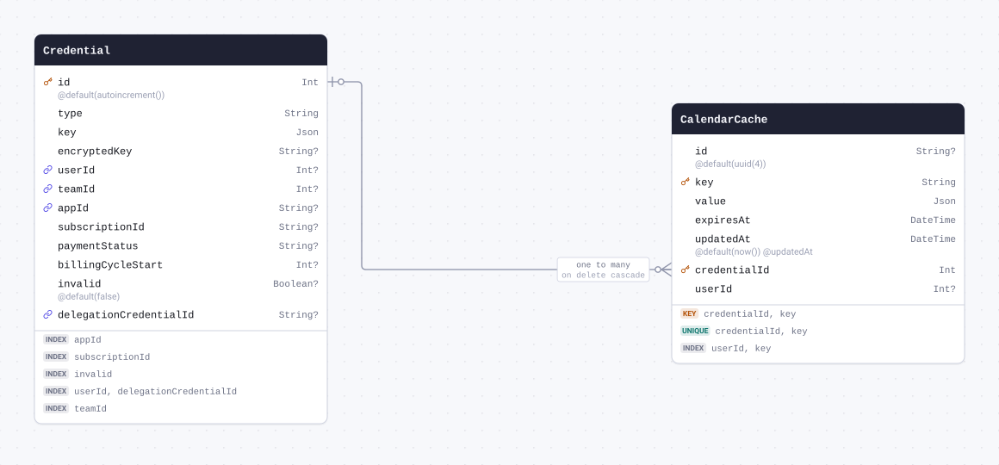

| Field          | Type       | Constraints                                      | Default              | Description |
| -------------- | ---------- | ------------------------------------------------ | -------------------- | ----------- |
| `id`           | `String`   | NULL                                             | `uuid(4)`            |             |
| `key`          | `String`   | PK NOT NULL                                      |                      |             |
| `value`        | `Json`     | NOT NULL                                         |                      |             |
| `expiresAt`    | `DateTime` | NOT NULL                                         |                      |             |
| `updatedAt`    | `DateTime` | NOT NULL                                         | `now()` `@updatedAt` |             |
| `credentialId` | `Int`      | PK NOT NULL → [Credential.id](#model-Credential) |                      |             |
| `userId`       | `Int`      | NULL                                             |                      |             |

#### Indexes

- `@@id([credentialId, key])`
- `@@index([userId, key])`
- `@@unique([credentialId, key])`

#### References

- `credentialId` → [Credential.id](#model-Credential) (many-to-one, on delete Cascade)

#### Definition

```sql
CREATE TABLE "CalendarCache" (
    "id" TEXT,
    "key" TEXT NOT NULL,
    "value" JSONB NOT NULL,
    "expiresAt" TIMESTAMP(3) NOT NULL,
    "updatedAt" TIMESTAMP(3) NOT NULL DEFAULT CURRENT_TIMESTAMP,
    "credentialId" INTEGER NOT NULL,
    "userId" INTEGER,

    CONSTRAINT "CalendarCache_pkey" PRIMARY KEY ("credentialId","key")
);

CREATE INDEX "CalendarCache_userId_key_idx" ON "CalendarCache"("userId", "key");

CREATE UNIQUE INDEX "CalendarCache_credentialId_key_key" ON "CalendarCache"("credentialId", "key");

ALTER TABLE "CalendarCache" ADD CONSTRAINT "CalendarCache_credentialId_fkey" FOREIGN KEY ("credentialId") REFERENCES "Credential"("id") ON DELETE CASCADE ON UPDATE CASCADE;
```

<details>
<summary>Queries and their SQL</summary>

**findMany**: Every row

```ts
await prisma.calendarCache.findMany();
```

```sql
SELECT
  "public"."CalendarCache"."credentialId",
  "public"."CalendarCache"."key",
  "public"."CalendarCache"."id",
  "public"."CalendarCache"."value",
  "public"."CalendarCache"."expiresAt",
  "public"."CalendarCache"."updatedAt",
  "public"."CalendarCache"."userId"
FROM
  "public"."CalendarCache"
WHERE
  1 = 1
OFFSET
  $1
-- params: ["0"]
```

**count**: How many rows there are

```ts
await prisma.calendarCache.count();
```

```sql
SELECT
  COUNT(*) AS "_count$_all"
FROM
  (
    SELECT
      "public"."CalendarCache"."credentialId",
      "public"."CalendarCache"."key"
    FROM
      "public"."CalendarCache"
    WHERE
      1 = 1
    OFFSET
      $1
  ) AS "sub"
-- params: ["0"]
```

**findMany**: Every row with its relations

```ts
await prisma.calendarCache.findMany({ include: { credential: true } });
```

```sql
SELECT
  "public"."CalendarCache"."credentialId",
  "public"."CalendarCache"."key",
  "public"."CalendarCache"."id",
  "public"."CalendarCache"."value",
  "public"."CalendarCache"."expiresAt",
  "public"."CalendarCache"."updatedAt",
  "public"."CalendarCache"."userId"
FROM
  "public"."CalendarCache"
WHERE
  1 = 1
OFFSET
  $1
-- params: ["0"]

SELECT
  "public"."Credential"."id",
  "public"."Credential"."type",
  "public"."Credential"."key",
  "public"."Credential"."encryptedKey",
  "public"."Credential"."userId",
  "public"."Credential"."teamId",
  "public"."Credential"."appId",
  "public"."Credential"."subscriptionId",
  "public"."Credential"."paymentStatus",
  "public"."Credential"."billingCycleStart",
  "public"."Credential"."invalid",
  "public"."Credential"."delegationCredentialId"
FROM
  "public"."Credential"
WHERE
  "public"."Credential"."id" IN ($1)
OFFSET
  $2
-- params: ["<credentialId of the rows above>","0"]
```

**findUnique**: One row by what is unique to it

```ts
await prisma.calendarCache.findUnique({
  where: { credentialId_key: { credentialId: 1, key: "example" } },
});
```

```sql
SELECT
  "public"."CalendarCache"."credentialId",
  "public"."CalendarCache"."key",
  "public"."CalendarCache"."id",
  "public"."CalendarCache"."value",
  "public"."CalendarCache"."expiresAt",
  "public"."CalendarCache"."updatedAt",
  "public"."CalendarCache"."userId"
FROM
  "public"."CalendarCache"
WHERE
  (
    (
      "public"."CalendarCache"."credentialId" = $1
      AND "public"."CalendarCache"."key" = $2
    )
    AND 1 = 1
  )
LIMIT
  $3
OFFSET
  $4
-- params: ["1","example","1","0"]
```

**create**: Create a row

```ts
await prisma.calendarCache.create({
  data: {
    key: "example",
    value: {},
    expiresAt: new Date("2026-01-01T00:00:00.000Z"),
    credentialId: 1,
  },
});
```

```sql
INSERT INTO
  "public"."CalendarCache" (
    "id",
    "key",
    "value",
    "expiresAt",
    "updatedAt",
    "credentialId"
  )
VALUES
  ($1, $2, $3, $4, $5, $6)
RETURNING
  "public"."CalendarCache"."credentialId",
  "public"."CalendarCache"."key",
  "public"."CalendarCache"."id",
  "public"."CalendarCache"."value",
  "public"."CalendarCache"."expiresAt",
  "public"."CalendarCache"."updatedAt",
  "public"."CalendarCache"."userId"
-- params: ["<uuid(4)>","example","{}","2026-01-01T00:00:00.000Z","<now()>","1"]
```

**update**: Update a row

```ts
await prisma.calendarCache.update({
  where: { credentialId_key: { credentialId: 1, key: "example" } },
  data: { id: "example" },
});
```

```sql
UPDATE "public"."CalendarCache"
SET
  "id" = $1,
  "updatedAt" = $2
WHERE
  (
    (
      "public"."CalendarCache"."credentialId" = $3
      AND "public"."CalendarCache"."key" = $4
    )
    AND 1 = 1
  )
RETURNING
  "public"."CalendarCache"."credentialId",
  "public"."CalendarCache"."key",
  "public"."CalendarCache"."id",
  "public"."CalendarCache"."value",
  "public"."CalendarCache"."expiresAt",
  "public"."CalendarCache"."updatedAt",
  "public"."CalendarCache"."userId"
-- params: ["example",{"prisma__type":"generatorCall","prisma__value":{"name":"now","args":[],"returnType":{"type":"DateTime"}}},"1","example"]
```

**delete**: Delete a row

```ts
await prisma.calendarCache.delete({
  where: { credentialId_key: { credentialId: 1, key: "example" } },
});
```

```sql
DELETE FROM "public"."CalendarCache"
WHERE
  (
    (
      "public"."CalendarCache"."credentialId" = $1
      AND "public"."CalendarCache"."key" = $2
    )
    AND 1 = 1
  )
RETURNING
  "public"."CalendarCache"."credentialId",
  "public"."CalendarCache"."key",
  "public"."CalendarCache"."id",
  "public"."CalendarCache"."value",
  "public"."CalendarCache"."expiresAt",
  "public"."CalendarCache"."updatedAt",
  "public"."CalendarCache"."userId"
-- params: ["1","example"]
```

</details>

<a id="model-TempOrgRedirect"></a>

### TempOrgRedirect

| Field       | Type                                 | Constraints | Default           | Description |
| ----------- | ------------------------------------ | ----------- | ----------------- | ----------- |
| `id`        | `Int`                                | PK NOT NULL | `autoincrement()` |             |
| `from`      | `String`                             | NOT NULL    |                   |             |
| `fromOrgId` | `Int`                                | NOT NULL    |                   |             |
| `type`      | [`RedirectType`](#enum-RedirectType) | NOT NULL    |                   |             |
| `toUrl`     | `String`                             | NOT NULL    |                   |             |
| `enabled`   | `Boolean`                            | NOT NULL    | `true`            |             |
| `createdAt` | `DateTime`                           | NOT NULL    | `now()`           |             |
| `updatedAt` | `DateTime`                           | NOT NULL    | `@updatedAt`      |             |

#### Indexes

- `@@unique([from, type, fromOrgId])`

#### Definition

```sql
CREATE TABLE "TempOrgRedirect" (
    "id" SERIAL NOT NULL,
    "from" TEXT NOT NULL,
    "fromOrgId" INTEGER NOT NULL,
    "type" "RedirectType" NOT NULL,
    "toUrl" TEXT NOT NULL,
    "enabled" BOOLEAN NOT NULL DEFAULT true,
    "createdAt" TIMESTAMP(3) NOT NULL DEFAULT CURRENT_TIMESTAMP,
    "updatedAt" TIMESTAMP(3) NOT NULL,

    CONSTRAINT "TempOrgRedirect_pkey" PRIMARY KEY ("id")
);

CREATE UNIQUE INDEX "TempOrgRedirect_from_type_fromOrgId_key" ON "TempOrgRedirect"("from", "type", "fromOrgId");
```

<details>
<summary>Queries and their SQL</summary>

**findMany**: Every row

```ts
await prisma.tempOrgRedirect.findMany();
```

```sql
SELECT
  "public"."TempOrgRedirect"."id",
  "public"."TempOrgRedirect"."from",
  "public"."TempOrgRedirect"."fromOrgId",
  "public"."TempOrgRedirect"."type"::text,
  "public"."TempOrgRedirect"."toUrl",
  "public"."TempOrgRedirect"."enabled",
  "public"."TempOrgRedirect"."createdAt",
  "public"."TempOrgRedirect"."updatedAt"
FROM
  "public"."TempOrgRedirect"
WHERE
  1 = 1
OFFSET
  $1
-- params: ["0"]
```

**count**: How many rows there are

```ts
await prisma.tempOrgRedirect.count();
```

```sql
SELECT
  COUNT(*) AS "_count$_all"
FROM
  (
    SELECT
      "public"."TempOrgRedirect"."id"
    FROM
      "public"."TempOrgRedirect"
    WHERE
      1 = 1
    OFFSET
      $1
  ) AS "sub"
-- params: ["0"]
```

**findUnique**: One row by what is unique to it

```ts
await prisma.tempOrgRedirect.findUnique({ where: { id: 1 } });
```

```sql
SELECT
  "public"."TempOrgRedirect"."id",
  "public"."TempOrgRedirect"."from",
  "public"."TempOrgRedirect"."fromOrgId",
  "public"."TempOrgRedirect"."type"::text,
  "public"."TempOrgRedirect"."toUrl",
  "public"."TempOrgRedirect"."enabled",
  "public"."TempOrgRedirect"."createdAt",
  "public"."TempOrgRedirect"."updatedAt"
FROM
  "public"."TempOrgRedirect"
WHERE
  (
    "public"."TempOrgRedirect"."id" = $1
    AND 1 = 1
  )
LIMIT
  $2
OFFSET
  $3
-- params: ["1","1","0"]
```

**create**: Create a row

```ts
await prisma.tempOrgRedirect.create({
  data: { from: "example", fromOrgId: 1, type: "UserEventType", toUrl: "example" },
});
```

```sql
INSERT INTO
  "public"."TempOrgRedirect" (
    "from",
    "fromOrgId",
    "type",
    "toUrl",
    "enabled",
    "createdAt",
    "updatedAt"
  )
VALUES
  (
    $1,
    $2,
    CAST($3::text AS "public"."RedirectType"),
    $4,
    $5,
    $6,
    $7
  )
RETURNING
  "public"."TempOrgRedirect"."id",
  "public"."TempOrgRedirect"."from",
  "public"."TempOrgRedirect"."fromOrgId",
  "public"."TempOrgRedirect"."type"::text,
  "public"."TempOrgRedirect"."toUrl",
  "public"."TempOrgRedirect"."enabled",
  "public"."TempOrgRedirect"."createdAt",
  "public"."TempOrgRedirect"."updatedAt"
-- params: ["example","1","user-event-type","example",true,"<now()>","<now()>"]
```

**update**: Update a row

```ts
await prisma.tempOrgRedirect.update({ where: { id: 1 }, data: { from: "example" } });
```

```sql
UPDATE "public"."TempOrgRedirect"
SET
  "from" = $1,
  "updatedAt" = $2
WHERE
  (
    "public"."TempOrgRedirect"."id" = $3
    AND 1 = 1
  )
RETURNING
  "public"."TempOrgRedirect"."id",
  "public"."TempOrgRedirect"."from",
  "public"."TempOrgRedirect"."fromOrgId",
  "public"."TempOrgRedirect"."type"::text,
  "public"."TempOrgRedirect"."toUrl",
  "public"."TempOrgRedirect"."enabled",
  "public"."TempOrgRedirect"."createdAt",
  "public"."TempOrgRedirect"."updatedAt"
-- params: ["example",{"prisma__type":"generatorCall","prisma__value":{"name":"now","args":[],"returnType":{"type":"DateTime"}}},"1"]
```

**delete**: Delete a row

```ts
await prisma.tempOrgRedirect.delete({ where: { id: 1 } });
```

```sql
DELETE FROM "public"."TempOrgRedirect"
WHERE
  (
    "public"."TempOrgRedirect"."id" = $1
    AND 1 = 1
  )
RETURNING
  "public"."TempOrgRedirect"."id",
  "public"."TempOrgRedirect"."from",
  "public"."TempOrgRedirect"."fromOrgId",
  "public"."TempOrgRedirect"."type"::text,
  "public"."TempOrgRedirect"."toUrl",
  "public"."TempOrgRedirect"."enabled",
  "public"."TempOrgRedirect"."createdAt",
  "public"."TempOrgRedirect"."updatedAt"
-- params: ["1"]
```

</details>

<a id="model-Avatar"></a>

### Avatar

Table `avatars`.

| Field       | Type      | Constraints     | Default | Description |
| ----------- | --------- | --------------- | ------- | ----------- |
| `teamId`    | `Int`     | NOT NULL        | `0`     |             |
| `userId`    | `Int`     | NOT NULL        | `0`     |             |
| `data`      | `String`  | NOT NULL        |         |             |
| `objectKey` | `String`  | UNIQUE NOT NULL |         |             |
| `isBanner`  | `Boolean` | NOT NULL        | `false` |             |

#### Indexes

- `@@unique([teamId, userId, isBanner])`

#### Definition

```sql
CREATE TABLE "avatars" (
    "teamId" INTEGER NOT NULL DEFAULT 0,
    "userId" INTEGER NOT NULL DEFAULT 0,
    "data" TEXT NOT NULL,
    "objectKey" TEXT NOT NULL,
    "isBanner" BOOLEAN NOT NULL DEFAULT false
);

CREATE UNIQUE INDEX "avatars_objectKey_key" ON "avatars"("objectKey");

CREATE UNIQUE INDEX "avatars_teamId_userId_isBanner_key" ON "avatars"("teamId", "userId", "isBanner");
```

<details>
<summary>Queries and their SQL</summary>

**findMany**: Every row

```ts
await prisma.avatar.findMany();
```

```sql
SELECT
  "public"."avatars"."objectKey",
  "public"."avatars"."teamId",
  "public"."avatars"."userId",
  "public"."avatars"."data",
  "public"."avatars"."isBanner"
FROM
  "public"."avatars"
WHERE
  1 = 1
OFFSET
  $1
-- params: ["0"]
```

**count**: How many rows there are

```ts
await prisma.avatar.count();
```

```sql
SELECT
  COUNT(*) AS "_count$_all"
FROM
  (
    SELECT
      "public"."avatars"."objectKey"
    FROM
      "public"."avatars"
    WHERE
      1 = 1
    OFFSET
      $1
  ) AS "sub"
-- params: ["0"]
```

**findUnique**: One row by what is unique to it

```ts
await prisma.avatar.findUnique({ where: { objectKey: "example" } });
```

```sql
SELECT
  "public"."avatars"."objectKey",
  "public"."avatars"."teamId",
  "public"."avatars"."userId",
  "public"."avatars"."data",
  "public"."avatars"."isBanner"
FROM
  "public"."avatars"
WHERE
  (
    "public"."avatars"."objectKey" = $1
    AND 1 = 1
  )
LIMIT
  $2
OFFSET
  $3
-- params: ["example","1","0"]
```

**create**: Create a row

```ts
await prisma.avatar.create({ data: { data: "example", objectKey: "example" } });
```

```sql
INSERT INTO
  "public"."avatars" (
    "teamId",
    "userId",
    "data",
    "objectKey",
    "isBanner"
  )
VALUES
  ($1, $2, $3, $4, $5)
RETURNING
  "public"."avatars"."objectKey",
  "public"."avatars"."teamId",
  "public"."avatars"."userId",
  "public"."avatars"."data",
  "public"."avatars"."isBanner"
-- params: ["0","0","example","example",false]
```

**update**: Update a row

```ts
await prisma.avatar.update({ where: { objectKey: "example" }, data: { teamId: 1 } });
```

```sql
UPDATE "public"."avatars"
SET
  "teamId" = $1
WHERE
  (
    "public"."avatars"."objectKey" = $2
    AND 1 = 1
  )
RETURNING
  "public"."avatars"."objectKey",
  "public"."avatars"."teamId",
  "public"."avatars"."userId",
  "public"."avatars"."data",
  "public"."avatars"."isBanner"
-- params: ["1","example"]
```

**delete**: Delete a row

```ts
await prisma.avatar.delete({ where: { objectKey: "example" } });
```

```sql
DELETE FROM "public"."avatars"
WHERE
  (
    "public"."avatars"."objectKey" = $1
    AND 1 = 1
  )
RETURNING
  "public"."avatars"."objectKey",
  "public"."avatars"."teamId",
  "public"."avatars"."userId",
  "public"."avatars"."data",
  "public"."avatars"."isBanner"
-- params: ["example"]
```

</details>

<a id="model-OutOfOfficeEntry"></a>

### OutOfOfficeEntry

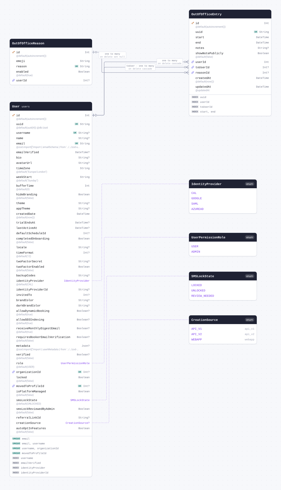

| Field              | Type       | Constraints                                             | Default           | Description |
| ------------------ | ---------- | ------------------------------------------------------- | ----------------- | ----------- |
| `id`               | `Int`      | PK NOT NULL                                             | `autoincrement()` |             |
| `uuid`             | `String`   | UNIQUE NOT NULL                                         |                   |             |
| `start`            | `DateTime` | NOT NULL                                                |                   |             |
| `end`              | `DateTime` | NOT NULL                                                |                   |             |
| `notes`            | `String`   | NULL                                                    |                   |             |
| `showNotePublicly` | `Boolean`  | NOT NULL                                                | `false`           |             |
| `userId`           | `Int`      | NOT NULL → [User.id](#model-User)                       |                   |             |
| `toUserId`         | `Int`      | NULL → [User.id](#model-User)                           |                   |             |
| `reasonId`         | `Int`      | NULL → [OutOfOfficeReason.id](#model-OutOfOfficeReason) |                   |             |
| `createdAt`        | `DateTime` | NOT NULL                                                | `now()`           |             |
| `updatedAt`        | `DateTime` | NOT NULL                                                | `@updatedAt`      |             |

#### Indexes

- `@@index([uuid])`
- `@@index([userId])`
- `@@index([toUserId])`
- `@@index([start, end])`

#### References

- `userId` → [User.id](#model-User) (many-to-one, on delete Cascade)
- `toUserId` → [User.id](#model-User) (many-to-one, on delete Cascade)
- `reasonId` → [OutOfOfficeReason.id](#model-OutOfOfficeReason) (many-to-one, on delete SetNull)

#### Definition

```sql
CREATE TABLE "OutOfOfficeEntry" (
    "id" SERIAL NOT NULL,
    "uuid" TEXT NOT NULL,
    "start" TIMESTAMP(3) NOT NULL,
    "end" TIMESTAMP(3) NOT NULL,
    "notes" TEXT,
    "showNotePublicly" BOOLEAN NOT NULL DEFAULT false,
    "userId" INTEGER NOT NULL,
    "toUserId" INTEGER,
    "reasonId" INTEGER,
    "createdAt" TIMESTAMP(3) NOT NULL DEFAULT CURRENT_TIMESTAMP,
    "updatedAt" TIMESTAMP(3) NOT NULL,

    CONSTRAINT "OutOfOfficeEntry_pkey" PRIMARY KEY ("id")
);

CREATE UNIQUE INDEX "OutOfOfficeEntry_uuid_key" ON "OutOfOfficeEntry"("uuid");

CREATE INDEX "OutOfOfficeEntry_uuid_idx" ON "OutOfOfficeEntry"("uuid");

CREATE INDEX "OutOfOfficeEntry_userId_idx" ON "OutOfOfficeEntry"("userId");

CREATE INDEX "OutOfOfficeEntry_toUserId_idx" ON "OutOfOfficeEntry"("toUserId");

CREATE INDEX "OutOfOfficeEntry_start_end_idx" ON "OutOfOfficeEntry"("start", "end");

ALTER TABLE "OutOfOfficeEntry" ADD CONSTRAINT "OutOfOfficeEntry_userId_fkey" FOREIGN KEY ("userId") REFERENCES "users"("id") ON DELETE CASCADE ON UPDATE CASCADE;

ALTER TABLE "OutOfOfficeEntry" ADD CONSTRAINT "OutOfOfficeEntry_toUserId_fkey" FOREIGN KEY ("toUserId") REFERENCES "users"("id") ON DELETE CASCADE ON UPDATE CASCADE;

ALTER TABLE "OutOfOfficeEntry" ADD CONSTRAINT "OutOfOfficeEntry_reasonId_fkey" FOREIGN KEY ("reasonId") REFERENCES "OutOfOfficeReason"("id") ON DELETE SET NULL ON UPDATE CASCADE;
```

<details>
<summary>Queries and their SQL</summary>

**findMany**: Every row

```ts
await prisma.outOfOfficeEntry.findMany();
```

```sql
SELECT
  "public"."OutOfOfficeEntry"."id",
  "public"."OutOfOfficeEntry"."uuid",
  "public"."OutOfOfficeEntry"."start",
  "public"."OutOfOfficeEntry"."end",
  "public"."OutOfOfficeEntry"."notes",
  "public"."OutOfOfficeEntry"."showNotePublicly",
  "public"."OutOfOfficeEntry"."userId",
  "public"."OutOfOfficeEntry"."toUserId",
  "public"."OutOfOfficeEntry"."reasonId",
  "public"."OutOfOfficeEntry"."createdAt",
  "public"."OutOfOfficeEntry"."updatedAt"
FROM
  "public"."OutOfOfficeEntry"
WHERE
  1 = 1
OFFSET
  $1
-- params: ["0"]
```

**count**: How many rows there are

```ts
await prisma.outOfOfficeEntry.count();
```

```sql
SELECT
  COUNT(*) AS "_count$_all"
FROM
  (
    SELECT
      "public"."OutOfOfficeEntry"."id"
    FROM
      "public"."OutOfOfficeEntry"
    WHERE
      1 = 1
    OFFSET
      $1
  ) AS "sub"
-- params: ["0"]
```

**findMany**: Every row with its relations

```ts
await prisma.outOfOfficeEntry.findMany({ include: { user: true, toUser: true, reason: true } });
```

```sql
SELECT
  "public"."OutOfOfficeEntry"."id",
  "public"."OutOfOfficeEntry"."uuid",
  "public"."OutOfOfficeEntry"."start",
  "public"."OutOfOfficeEntry"."end",
  "public"."OutOfOfficeEntry"."notes",
  "public"."OutOfOfficeEntry"."showNotePublicly",
  "public"."OutOfOfficeEntry"."userId",
  "public"."OutOfOfficeEntry"."toUserId",
  "public"."OutOfOfficeEntry"."reasonId",
  "public"."OutOfOfficeEntry"."createdAt",
  "public"."OutOfOfficeEntry"."updatedAt"
FROM
  "public"."OutOfOfficeEntry"
WHERE
  1 = 1
OFFSET
  $1
-- params: ["0"]

SELECT
  "public"."users"."id",
  "public"."users"."uuid",
  "public"."users"."username",
  "public"."users"."name",
  "public"."users"."email",
  "public"."users"."emailVerified",
  "public"."users"."bio",
  "public"."users"."avatarUrl",
  "public"."users"."timeZone",
  "public"."users"."weekStart",
  "public"."users"."bufferTime",
  "public"."users"."hideBranding",
  "public"."users"."theme",
  "public"."users"."appTheme",
  "public"."users"."created",
  "public"."users"."trialEndsAt",
  "public"."users"."lastActiveAt",
  "public"."users"."defaultScheduleId",
  "public"."users"."completedOnboarding",
  "public"."users"."locale",
  "public"."users"."timeFormat",
  "public"."users"."twoFactorSecret",
  "public"."users"."twoFactorEnabled",
  "public"."users"."backupCodes",
  "public"."users"."identityProvider"::text,
  "public"."users"."identityProviderId",
  "public"."users"."invitedTo",
  "public"."users"."brandColor",
  "public"."users"."darkBrandColor",
  "public"."users"."allowDynamicBooking",
  "public"."users"."allowSEOIndexing",
  "public"."users"."receiveMonthlyDigestEmail",
  "public"."users"."requiresBookerEmailVerification",
  "public"."users"."metadata",
  "public"."users"."verified",
  "public"."users"."role"::text,
  "public"."users"."organizationId",
  "public"."users"."locked",
  "public"."users"."movedToProfileId",
  "public"."users"."isPlatformManaged",
  "public"."users"."smsLockState"::text,
  "public"."users"."smsLockReviewedByAdmin",
  "public"."users"."referralLinkId",
  "public"."users"."creationSource"::text,
  "public"."users"."autoOptInFeatures"
FROM
  "public"."users"
WHERE
  "public"."users"."id" IN ($1)
OFFSET
  $2
-- params: ["<userId of the rows above>","0"]

SELECT
  "public"."users"."id",
  "public"."users"."uuid",
  "public"."users"."username",
  "public"."users"."name",
  "public"."users"."email",
  "public"."users"."emailVerified",
  "public"."users"."bio",
  "public"."users"."avatarUrl",
  "public"."users"."timeZone",
  "public"."users"."weekStart",
  "public"."users"."bufferTime",
  "public"."users"."hideBranding",
  "public"."users"."theme",
  "public"."users"."appTheme",
  "public"."users"."created",
  "public"."users"."trialEndsAt",
  "public"."users"."lastActiveAt",
  "public"."users"."defaultScheduleId",
  "public"."users"."completedOnboarding",
  "public"."users"."locale",
  "public"."users"."timeFormat",
  "public"."users"."twoFactorSecret",
  "public"."users"."twoFactorEnabled",
  "public"."users"."backupCodes",
  "public"."users"."identityProvider"::text,
  "public"."users"."identityProviderId",
  "public"."users"."invitedTo",
  "public"."users"."brandColor",
  "public"."users"."darkBrandColor",
  "public"."users"."allowDynamicBooking",
  "public"."users"."allowSEOIndexing",
  "public"."users"."receiveMonthlyDigestEmail",
  "public"."users"."requiresBookerEmailVerification",
  "public"."users"."metadata",
  "public"."users"."verified",
  "public"."users"."role"::text,
  "public"."users"."organizationId",
  "public"."users"."locked",
  "public"."users"."movedToProfileId",
  "public"."users"."isPlatformManaged",
  "public"."users"."smsLockState"::text,
  "public"."users"."smsLockReviewedByAdmin",
  "public"."users"."referralLinkId",
  "public"."users"."creationSource"::text,
  "public"."users"."autoOptInFeatures"
FROM
  "public"."users"
WHERE
  "public"."users"."id" IN ($1)
OFFSET
  $2
-- params: ["<toUserId of the rows above>","0"]

SELECT
  "public"."OutOfOfficeReason"."id",
  "public"."OutOfOfficeReason"."emoji",
  "public"."OutOfOfficeReason"."reason",
  "public"."OutOfOfficeReason"."enabled",
  "public"."OutOfOfficeReason"."userId"
FROM
  "public"."OutOfOfficeReason"
WHERE
  "public"."OutOfOfficeReason"."id" IN ($1)
OFFSET
  $2
-- params: ["<reasonId of the rows above>","0"]
```

**findUnique**: One row by what is unique to it

```ts
await prisma.outOfOfficeEntry.findUnique({ where: { id: 1 } });
```

```sql
SELECT
  "public"."OutOfOfficeEntry"."id",
  "public"."OutOfOfficeEntry"."uuid",
  "public"."OutOfOfficeEntry"."start",
  "public"."OutOfOfficeEntry"."end",
  "public"."OutOfOfficeEntry"."notes",
  "public"."OutOfOfficeEntry"."showNotePublicly",
  "public"."OutOfOfficeEntry"."userId",
  "public"."OutOfOfficeEntry"."toUserId",
  "public"."OutOfOfficeEntry"."reasonId",
  "public"."OutOfOfficeEntry"."createdAt",
  "public"."OutOfOfficeEntry"."updatedAt"
FROM
  "public"."OutOfOfficeEntry"
WHERE
  (
    "public"."OutOfOfficeEntry"."id" = $1
    AND 1 = 1
  )
LIMIT
  $2
OFFSET
  $3
-- params: ["1","1","0"]
```

**create**: Create a row

```ts
await prisma.outOfOfficeEntry.create({
  data: {
    uuid: "example",
    start: new Date("2026-01-01T00:00:00.000Z"),
    end: new Date("2026-01-01T00:00:00.000Z"),
    userId: 1,
  },
});
```

```sql
INSERT INTO
  "public"."OutOfOfficeEntry" (
    "uuid",
    "start",
    "end",
    "showNotePublicly",
    "userId",
    "createdAt",
    "updatedAt"
  )
VALUES
  ($1, $2, $3, $4, $5, $6, $7)
RETURNING
  "public"."OutOfOfficeEntry"."id",
  "public"."OutOfOfficeEntry"."uuid",
  "public"."OutOfOfficeEntry"."start",
  "public"."OutOfOfficeEntry"."end",
  "public"."OutOfOfficeEntry"."notes",
  "public"."OutOfOfficeEntry"."showNotePublicly",
  "public"."OutOfOfficeEntry"."userId",
  "public"."OutOfOfficeEntry"."toUserId",
  "public"."OutOfOfficeEntry"."reasonId",
  "public"."OutOfOfficeEntry"."createdAt",
  "public"."OutOfOfficeEntry"."updatedAt"
-- params: ["example","2026-01-01T00:00:00.000Z","2026-01-01T00:00:00.000Z",false,"1","<now()>","<now()>"]
```

**update**: Update a row

```ts
await prisma.outOfOfficeEntry.update({ where: { id: 1 }, data: { uuid: "example" } });
```

```sql
UPDATE "public"."OutOfOfficeEntry"
SET
  "uuid" = $1,
  "updatedAt" = $2
WHERE
  (
    "public"."OutOfOfficeEntry"."id" = $3
    AND 1 = 1
  )
RETURNING
  "public"."OutOfOfficeEntry"."id",
  "public"."OutOfOfficeEntry"."uuid",
  "public"."OutOfOfficeEntry"."start",
  "public"."OutOfOfficeEntry"."end",
  "public"."OutOfOfficeEntry"."notes",
  "public"."OutOfOfficeEntry"."showNotePublicly",
  "public"."OutOfOfficeEntry"."userId",
  "public"."OutOfOfficeEntry"."toUserId",
  "public"."OutOfOfficeEntry"."reasonId",
  "public"."OutOfOfficeEntry"."createdAt",
  "public"."OutOfOfficeEntry"."updatedAt"
-- params: ["example",{"prisma__type":"generatorCall","prisma__value":{"name":"now","args":[],"returnType":{"type":"DateTime"}}},"1"]
```

**delete**: Delete a row

```ts
await prisma.outOfOfficeEntry.delete({ where: { id: 1 } });
```

```sql
DELETE FROM "public"."OutOfOfficeEntry"
WHERE
  (
    "public"."OutOfOfficeEntry"."id" = $1
    AND 1 = 1
  )
RETURNING
  "public"."OutOfOfficeEntry"."id",
  "public"."OutOfOfficeEntry"."uuid",
  "public"."OutOfOfficeEntry"."start",
  "public"."OutOfOfficeEntry"."end",
  "public"."OutOfOfficeEntry"."notes",
  "public"."OutOfOfficeEntry"."showNotePublicly",
  "public"."OutOfOfficeEntry"."userId",
  "public"."OutOfOfficeEntry"."toUserId",
  "public"."OutOfOfficeEntry"."reasonId",
  "public"."OutOfOfficeEntry"."createdAt",
  "public"."OutOfOfficeEntry"."updatedAt"
-- params: ["1"]
```

</details>

<a id="model-OutOfOfficeReason"></a>

### OutOfOfficeReason

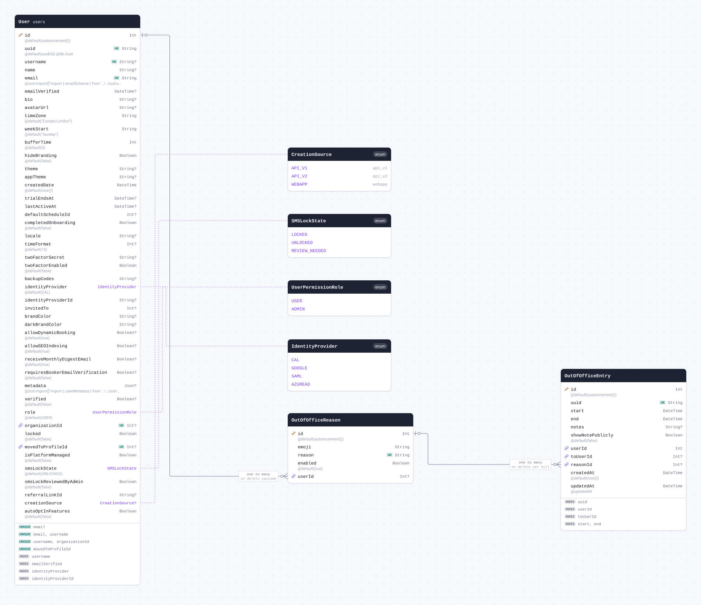

| Field     | Type      | Constraints                   | Default           | Description |
| --------- | --------- | ----------------------------- | ----------------- | ----------- |
| `id`      | `Int`     | PK NOT NULL                   | `autoincrement()` |             |
| `emoji`   | `String`  | NOT NULL                      |                   |             |
| `reason`  | `String`  | UNIQUE NOT NULL               |                   |             |
| `enabled` | `Boolean` | NOT NULL                      | `true`            |             |
| `userId`  | `Int`     | NULL → [User.id](#model-User) |                   |             |

#### References

- `userId` → [User.id](#model-User) (many-to-one, on delete Cascade)

#### Referenced by

- `id` ← [OutOfOfficeEntry.reasonId](#model-OutOfOfficeEntry) (one-to-many, on delete SetNull)

#### Definition

```sql
CREATE TABLE "OutOfOfficeReason" (
    "id" SERIAL NOT NULL,
    "emoji" TEXT NOT NULL,
    "reason" TEXT NOT NULL,
    "enabled" BOOLEAN NOT NULL DEFAULT true,
    "userId" INTEGER,

    CONSTRAINT "OutOfOfficeReason_pkey" PRIMARY KEY ("id")
);

CREATE UNIQUE INDEX "OutOfOfficeReason_reason_key" ON "OutOfOfficeReason"("reason");

ALTER TABLE "OutOfOfficeReason" ADD CONSTRAINT "OutOfOfficeReason_userId_fkey" FOREIGN KEY ("userId") REFERENCES "users"("id") ON DELETE CASCADE ON UPDATE CASCADE;
```

<details>
<summary>Queries and their SQL</summary>

**findMany**: Every row

```ts
await prisma.outOfOfficeReason.findMany();
```

```sql
SELECT
  "public"."OutOfOfficeReason"."id",
  "public"."OutOfOfficeReason"."emoji",
  "public"."OutOfOfficeReason"."reason",
  "public"."OutOfOfficeReason"."enabled",
  "public"."OutOfOfficeReason"."userId"
FROM
  "public"."OutOfOfficeReason"
WHERE
  1 = 1
OFFSET
  $1
-- params: ["0"]
```

**count**: How many rows there are

```ts
await prisma.outOfOfficeReason.count();
```

```sql
SELECT
  COUNT(*) AS "_count$_all"
FROM
  (
    SELECT
      "public"."OutOfOfficeReason"."id"
    FROM
      "public"."OutOfOfficeReason"
    WHERE
      1 = 1
    OFFSET
      $1
  ) AS "sub"
-- params: ["0"]
```

**findMany**: Every row with its relations

```ts
await prisma.outOfOfficeReason.findMany({ include: { user: true, entries: true } });
```

```sql
SELECT
  "public"."OutOfOfficeReason"."id",
  "public"."OutOfOfficeReason"."emoji",
  "public"."OutOfOfficeReason"."reason",
  "public"."OutOfOfficeReason"."enabled",
  "public"."OutOfOfficeReason"."userId"
FROM
  "public"."OutOfOfficeReason"
WHERE
  1 = 1
OFFSET
  $1
-- params: ["0"]

SELECT
  "public"."users"."id",
  "public"."users"."uuid",
  "public"."users"."username",
  "public"."users"."name",
  "public"."users"."email",
  "public"."users"."emailVerified",
  "public"."users"."bio",
  "public"."users"."avatarUrl",
  "public"."users"."timeZone",
  "public"."users"."weekStart",
  "public"."users"."bufferTime",
  "public"."users"."hideBranding",
  "public"."users"."theme",
  "public"."users"."appTheme",
  "public"."users"."created",
  "public"."users"."trialEndsAt",
  "public"."users"."lastActiveAt",
  "public"."users"."defaultScheduleId",
  "public"."users"."completedOnboarding",
  "public"."users"."locale",
  "public"."users"."timeFormat",
  "public"."users"."twoFactorSecret",
  "public"."users"."twoFactorEnabled",
  "public"."users"."backupCodes",
  "public"."users"."identityProvider"::text,
  "public"."users"."identityProviderId",
  "public"."users"."invitedTo",
  "public"."users"."brandColor",
  "public"."users"."darkBrandColor",
  "public"."users"."allowDynamicBooking",
  "public"."users"."allowSEOIndexing",
  "public"."users"."receiveMonthlyDigestEmail",
  "public"."users"."requiresBookerEmailVerification",
  "public"."users"."metadata",
  "public"."users"."verified",
  "public"."users"."role"::text,
  "public"."users"."organizationId",
  "public"."users"."locked",
  "public"."users"."movedToProfileId",
  "public"."users"."isPlatformManaged",
  "public"."users"."smsLockState"::text,
  "public"."users"."smsLockReviewedByAdmin",
  "public"."users"."referralLinkId",
  "public"."users"."creationSource"::text,
  "public"."users"."autoOptInFeatures"
FROM
  "public"."users"
WHERE
  "public"."users"."id" IN ($1)
OFFSET
  $2
-- params: ["<userId of the rows above>","0"]

SELECT
  "public"."OutOfOfficeEntry"."id",
  "public"."OutOfOfficeEntry"."uuid",
  "public"."OutOfOfficeEntry"."start",
  "public"."OutOfOfficeEntry"."end",
  "public"."OutOfOfficeEntry"."notes",
  "public"."OutOfOfficeEntry"."showNotePublicly",
  "public"."OutOfOfficeEntry"."userId",
  "public"."OutOfOfficeEntry"."toUserId",
  "public"."OutOfOfficeEntry"."reasonId",
  "public"."OutOfOfficeEntry"."createdAt",
  "public"."OutOfOfficeEntry"."updatedAt"
FROM
  "public"."OutOfOfficeEntry"
WHERE
  "public"."OutOfOfficeEntry"."reasonId" IN ($1)
OFFSET
  $2
-- params: ["<id of the rows above>","0"]
```

**findUnique**: One row by what is unique to it

```ts
await prisma.outOfOfficeReason.findUnique({ where: { id: 1 } });
```

```sql
SELECT
  "public"."OutOfOfficeReason"."id",
  "public"."OutOfOfficeReason"."emoji",
  "public"."OutOfOfficeReason"."reason",
  "public"."OutOfOfficeReason"."enabled",
  "public"."OutOfOfficeReason"."userId"
FROM
  "public"."OutOfOfficeReason"
WHERE
  (
    "public"."OutOfOfficeReason"."id" = $1
    AND 1 = 1
  )
LIMIT
  $2
OFFSET
  $3
-- params: ["1","1","0"]
```

**create**: Create a row

```ts
await prisma.outOfOfficeReason.create({ data: { emoji: "example", reason: "example" } });
```

```sql
INSERT INTO
  "public"."OutOfOfficeReason" ("emoji", "reason", "enabled")
VALUES
  ($1, $2, $3)
RETURNING
  "public"."OutOfOfficeReason"."id",
  "public"."OutOfOfficeReason"."emoji",
  "public"."OutOfOfficeReason"."reason",
  "public"."OutOfOfficeReason"."enabled",
  "public"."OutOfOfficeReason"."userId"
-- params: ["example","example",true]
```

**update**: Update a row

```ts
await prisma.outOfOfficeReason.update({ where: { id: 1 }, data: { emoji: "example" } });
```

```sql
UPDATE "public"."OutOfOfficeReason"
SET
  "emoji" = $1
WHERE
  (
    "public"."OutOfOfficeReason"."id" = $2
    AND 1 = 1
  )
RETURNING
  "public"."OutOfOfficeReason"."id",
  "public"."OutOfOfficeReason"."emoji",
  "public"."OutOfOfficeReason"."reason",
  "public"."OutOfOfficeReason"."enabled",
  "public"."OutOfOfficeReason"."userId"
-- params: ["example","1"]
```

**delete**: Delete a row

```ts
await prisma.outOfOfficeReason.delete({ where: { id: 1 } });
```

```sql
DELETE FROM "public"."OutOfOfficeReason"
WHERE
  (
    "public"."OutOfOfficeReason"."id" = $1
    AND 1 = 1
  )
RETURNING
  "public"."OutOfOfficeReason"."id",
  "public"."OutOfOfficeReason"."emoji",
  "public"."OutOfOfficeReason"."reason",
  "public"."OutOfOfficeReason"."enabled",
  "public"."OutOfOfficeReason"."userId"
-- params: ["1"]
```

</details>

<a id="model-UserHolidaySettings"></a>

### UserHolidaySettings


| Field         | Type       | Constraints                              | Default           | Description |
| ------------- | ---------- | ---------------------------------------- | ----------------- | ----------- |
| `id`          | `Int`      | PK NOT NULL                              | `autoincrement()` |             |
| `userId`      | `Int`      | UNIQUE NOT NULL → [User.id](#model-User) |                   |             |
| `countryCode` | `String`   | NULL                                     |                   |             |
| `disabledIds` | `String[]` | NOT NULL                                 |                   |             |
| `createdAt`   | `DateTime` | NOT NULL                                 | `now()`           |             |
| `updatedAt`   | `DateTime` | NOT NULL                                 | `@updatedAt`      |             |

#### References

- `userId` → [User.id](#model-User) (one-to-one, on delete Cascade)

#### Definition

```sql
CREATE TABLE "UserHolidaySettings" (
    "id" SERIAL NOT NULL,
    "userId" INTEGER NOT NULL,
    "countryCode" TEXT,
    "disabledIds" TEXT[],
    "createdAt" TIMESTAMP(3) NOT NULL DEFAULT CURRENT_TIMESTAMP,
    "updatedAt" TIMESTAMP(3) NOT NULL,

    CONSTRAINT "UserHolidaySettings_pkey" PRIMARY KEY ("id")
);

CREATE UNIQUE INDEX "UserHolidaySettings_userId_key" ON "UserHolidaySettings"("userId");

ALTER TABLE "UserHolidaySettings" ADD CONSTRAINT "UserHolidaySettings_userId_fkey" FOREIGN KEY ("userId") REFERENCES "users"("id") ON DELETE CASCADE ON UPDATE CASCADE;
```

<details>
<summary>Queries and their SQL</summary>

**findMany**: Every row

```ts
await prisma.userHolidaySettings.findMany();
```

```sql
SELECT
  "public"."UserHolidaySettings"."id",
  "public"."UserHolidaySettings"."userId",
  "public"."UserHolidaySettings"."countryCode",
  "public"."UserHolidaySettings"."disabledIds",
  "public"."UserHolidaySettings"."createdAt",
  "public"."UserHolidaySettings"."updatedAt"
FROM
  "public"."UserHolidaySettings"
WHERE
  1 = 1
OFFSET
  $1
-- params: ["0"]
```

**count**: How many rows there are

```ts
await prisma.userHolidaySettings.count();
```

```sql
SELECT
  COUNT(*) AS "_count$_all"
FROM
  (
    SELECT
      "public"."UserHolidaySettings"."id"
    FROM
      "public"."UserHolidaySettings"
    WHERE
      1 = 1
    OFFSET
      $1
  ) AS "sub"
-- params: ["0"]
```

**findMany**: Every row with its relations

```ts
await prisma.userHolidaySettings.findMany({ include: { user: true } });
```

```sql
SELECT
  "public"."UserHolidaySettings"."id",
  "public"."UserHolidaySettings"."userId",
  "public"."UserHolidaySettings"."countryCode",
  "public"."UserHolidaySettings"."disabledIds",
  "public"."UserHolidaySettings"."createdAt",
  "public"."UserHolidaySettings"."updatedAt"
FROM
  "public"."UserHolidaySettings"
WHERE
  1 = 1
OFFSET
  $1
-- params: ["0"]

SELECT
  "public"."users"."id",
  "public"."users"."uuid",
  "public"."users"."username",
  "public"."users"."name",
  "public"."users"."email",
  "public"."users"."emailVerified",
  "public"."users"."bio",
  "public"."users"."avatarUrl",
  "public"."users"."timeZone",
  "public"."users"."weekStart",
  "public"."users"."bufferTime",
  "public"."users"."hideBranding",
  "public"."users"."theme",
  "public"."users"."appTheme",
  "public"."users"."created",
  "public"."users"."trialEndsAt",
  "public"."users"."lastActiveAt",
  "public"."users"."defaultScheduleId",
  "public"."users"."completedOnboarding",
  "public"."users"."locale",
  "public"."users"."timeFormat",
  "public"."users"."twoFactorSecret",
  "public"."users"."twoFactorEnabled",
  "public"."users"."backupCodes",
  "public"."users"."identityProvider"::text,
  "public"."users"."identityProviderId",
  "public"."users"."invitedTo",
  "public"."users"."brandColor",
  "public"."users"."darkBrandColor",
  "public"."users"."allowDynamicBooking",
  "public"."users"."allowSEOIndexing",
  "public"."users"."receiveMonthlyDigestEmail",
  "public"."users"."requiresBookerEmailVerification",
  "public"."users"."metadata",
  "public"."users"."verified",
  "public"."users"."role"::text,
  "public"."users"."organizationId",
  "public"."users"."locked",
  "public"."users"."movedToProfileId",
  "public"."users"."isPlatformManaged",
  "public"."users"."smsLockState"::text,
  "public"."users"."smsLockReviewedByAdmin",
  "public"."users"."referralLinkId",
  "public"."users"."creationSource"::text,
  "public"."users"."autoOptInFeatures"
FROM
  "public"."users"
WHERE
  "public"."users"."id" IN ($1)
OFFSET
  $2
-- params: ["<userId of the rows above>","0"]
```

**findUnique**: One row by what is unique to it

```ts
await prisma.userHolidaySettings.findUnique({ where: { id: 1 } });
```

```sql
SELECT
  "public"."UserHolidaySettings"."id",
  "public"."UserHolidaySettings"."userId",
  "public"."UserHolidaySettings"."countryCode",
  "public"."UserHolidaySettings"."disabledIds",
  "public"."UserHolidaySettings"."createdAt",
  "public"."UserHolidaySettings"."updatedAt"
FROM
  "public"."UserHolidaySettings"
WHERE
  (
    "public"."UserHolidaySettings"."id" = $1
    AND 1 = 1
  )
LIMIT
  $2
OFFSET
  $3
-- params: ["1","1","0"]
```

**create**: Create a row

```ts
await prisma.userHolidaySettings.create({ data: { userId: 1, disabledIds: ["example"] } });
```

```sql
INSERT INTO
  "public"."UserHolidaySettings" ("userId", "disabledIds", "createdAt", "updatedAt")
VALUES
  ($1, $2, $3, $4)
RETURNING
  "public"."UserHolidaySettings"."id",
  "public"."UserHolidaySettings"."userId",
  "public"."UserHolidaySettings"."countryCode",
  "public"."UserHolidaySettings"."disabledIds",
  "public"."UserHolidaySettings"."createdAt",
  "public"."UserHolidaySettings"."updatedAt"
-- params: ["1",["example"],"<now()>","<now()>"]
```

**update**: Update a row

```ts
await prisma.userHolidaySettings.update({ where: { id: 1 }, data: { countryCode: "example" } });
```

```sql
UPDATE "public"."UserHolidaySettings"
SET
  "countryCode" = $1,
  "updatedAt" = $2
WHERE
  (
    "public"."UserHolidaySettings"."id" = $3
    AND 1 = 1
  )
RETURNING
  "public"."UserHolidaySettings"."id",
  "public"."UserHolidaySettings"."userId",
  "public"."UserHolidaySettings"."countryCode",
  "public"."UserHolidaySettings"."disabledIds",
  "public"."UserHolidaySettings"."createdAt",
  "public"."UserHolidaySettings"."updatedAt"
-- params: ["example",{"prisma__type":"generatorCall","prisma__value":{"name":"now","args":[],"returnType":{"type":"DateTime"}}},"1"]
```

**delete**: Delete a row

```ts
await prisma.userHolidaySettings.delete({ where: { id: 1 } });
```

```sql
DELETE FROM "public"."UserHolidaySettings"
WHERE
  (
    "public"."UserHolidaySettings"."id" = $1
    AND 1 = 1
  )
RETURNING
  "public"."UserHolidaySettings"."id",
  "public"."UserHolidaySettings"."userId",
  "public"."UserHolidaySettings"."countryCode",
  "public"."UserHolidaySettings"."disabledIds",
  "public"."UserHolidaySettings"."createdAt",
  "public"."UserHolidaySettings"."updatedAt"
-- params: ["1"]
```

</details>

<a id="model-HolidayCache"></a>

### HolidayCache

| Field         | Type       | Constraints | Default      | Description |
| ------------- | ---------- | ----------- | ------------ | ----------- |
| `id`          | `String`   | PK NOT NULL | `uuid(4)`    |             |
| `countryCode` | `String`   | NOT NULL    |              |             |
| `calendarId`  | `String`   | NOT NULL    |              |             |
| `eventId`     | `String`   | NOT NULL    |              |             |
| `name`        | `String`   | NOT NULL    |              |             |
| `date`        | `DateTime` | NOT NULL    |              |             |
| `year`        | `Int`      | NOT NULL    |              |             |
| `createdAt`   | `DateTime` | NOT NULL    | `now()`      |             |
| `updatedAt`   | `DateTime` | NOT NULL    | `@updatedAt` |             |

#### Indexes

- `@@index([countryCode, year])`
- `@@index([countryCode, date])`
- `@@unique([countryCode, eventId])`

#### Definition

```sql
CREATE TABLE "HolidayCache" (
    "id" TEXT NOT NULL,
    "countryCode" TEXT NOT NULL,
    "calendarId" TEXT NOT NULL,
    "eventId" TEXT NOT NULL,
    "name" TEXT NOT NULL,
    "date" TIMESTAMP(3) NOT NULL,
    "year" INTEGER NOT NULL,
    "createdAt" TIMESTAMP(3) NOT NULL DEFAULT CURRENT_TIMESTAMP,
    "updatedAt" TIMESTAMP(3) NOT NULL,

    CONSTRAINT "HolidayCache_pkey" PRIMARY KEY ("id")
);

CREATE INDEX "HolidayCache_countryCode_year_idx" ON "HolidayCache"("countryCode", "year");

CREATE INDEX "HolidayCache_countryCode_date_idx" ON "HolidayCache"("countryCode", "date");

CREATE UNIQUE INDEX "HolidayCache_countryCode_eventId_key" ON "HolidayCache"("countryCode", "eventId");
```

<details>
<summary>Queries and their SQL</summary>

**findMany**: Every row

```ts
await prisma.holidayCache.findMany();
```

```sql
SELECT
  "public"."HolidayCache"."id",
  "public"."HolidayCache"."countryCode",
  "public"."HolidayCache"."calendarId",
  "public"."HolidayCache"."eventId",
  "public"."HolidayCache"."name",
  "public"."HolidayCache"."date",
  "public"."HolidayCache"."year",
  "public"."HolidayCache"."createdAt",
  "public"."HolidayCache"."updatedAt"
FROM
  "public"."HolidayCache"
WHERE
  1 = 1
OFFSET
  $1
-- params: ["0"]
```

**count**: How many rows there are

```ts
await prisma.holidayCache.count();
```

```sql
SELECT
  COUNT(*) AS "_count$_all"
FROM
  (
    SELECT
      "public"."HolidayCache"."id"
    FROM
      "public"."HolidayCache"
    WHERE
      1 = 1
    OFFSET
      $1
  ) AS "sub"
-- params: ["0"]
```

**findUnique**: One row by what is unique to it

```ts
await prisma.holidayCache.findUnique({ where: { id: "example" } });
```

```sql
SELECT
  "public"."HolidayCache"."id",
  "public"."HolidayCache"."countryCode",
  "public"."HolidayCache"."calendarId",
  "public"."HolidayCache"."eventId",
  "public"."HolidayCache"."name",
  "public"."HolidayCache"."date",
  "public"."HolidayCache"."year",
  "public"."HolidayCache"."createdAt",
  "public"."HolidayCache"."updatedAt"
FROM
  "public"."HolidayCache"
WHERE
  (
    "public"."HolidayCache"."id" = $1
    AND 1 = 1
  )
LIMIT
  $2
OFFSET
  $3
-- params: ["example","1","0"]
```

**create**: Create a row

```ts
await prisma.holidayCache.create({
  data: {
    countryCode: "example",
    calendarId: "example",
    eventId: "example",
    name: "example",
    date: new Date("2026-01-01T00:00:00.000Z"),
    year: 1,
  },
});
```

```sql
INSERT INTO
  "public"."HolidayCache" (
    "id",
    "countryCode",
    "calendarId",
    "eventId",
    "name",
    "date",
    "year",
    "createdAt",
    "updatedAt"
  )
VALUES
  ($1, $2, $3, $4, $5, $6, $7, $8, $9)
RETURNING
  "public"."HolidayCache"."id",
  "public"."HolidayCache"."countryCode",
  "public"."HolidayCache"."calendarId",
  "public"."HolidayCache"."eventId",
  "public"."HolidayCache"."name",
  "public"."HolidayCache"."date",
  "public"."HolidayCache"."year",
  "public"."HolidayCache"."createdAt",
  "public"."HolidayCache"."updatedAt"
-- params: ["<uuid(4)>","example","example","example","example","2026-01-01T00:00:00.000Z","1","<now()>","<now()>"]
```

**update**: Update a row

```ts
await prisma.holidayCache.update({ where: { id: "example" }, data: { countryCode: "example" } });
```

```sql
UPDATE "public"."HolidayCache"
SET
  "countryCode" = $1,
  "updatedAt" = $2
WHERE
  (
    "public"."HolidayCache"."id" = $3
    AND 1 = 1
  )
RETURNING
  "public"."HolidayCache"."id",
  "public"."HolidayCache"."countryCode",
  "public"."HolidayCache"."calendarId",
  "public"."HolidayCache"."eventId",
  "public"."HolidayCache"."name",
  "public"."HolidayCache"."date",
  "public"."HolidayCache"."year",
  "public"."HolidayCache"."createdAt",
  "public"."HolidayCache"."updatedAt"
-- params: ["example",{"prisma__type":"generatorCall","prisma__value":{"name":"now","args":[],"returnType":{"type":"DateTime"}}},"example"]
```

**delete**: Delete a row

```ts
await prisma.holidayCache.delete({ where: { id: "example" } });
```

```sql
DELETE FROM "public"."HolidayCache"
WHERE
  (
    "public"."HolidayCache"."id" = $1
    AND 1 = 1
  )
RETURNING
  "public"."HolidayCache"."id",
  "public"."HolidayCache"."countryCode",
  "public"."HolidayCache"."calendarId",
  "public"."HolidayCache"."eventId",
  "public"."HolidayCache"."name",
  "public"."HolidayCache"."date",
  "public"."HolidayCache"."year",
  "public"."HolidayCache"."createdAt",
  "public"."HolidayCache"."updatedAt"
-- params: ["example"]
```

</details>

<a id="model-PlatformOAuthClient"></a>

### PlatformOAuthClient

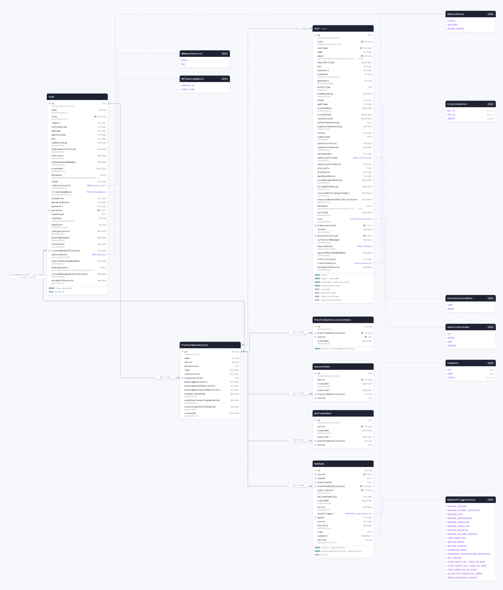

| Field                          | Type       | Constraints                       | Default   | Description |
| ------------------------------ | ---------- | --------------------------------- | --------- | ----------- |
| `id`                           | `String`   | PK NOT NULL                       | `cuid(1)` |             |
| `name`                         | `String`   | NOT NULL                          |           |             |
| `secret`                       | `String`   | NOT NULL                          |           |             |
| `permissions`                  | `Int`      | NOT NULL                          |           |             |
| `logo`                         | `String`   | NULL                              |           |             |
| `redirectUris`                 | `String[]` | NOT NULL                          |           |             |
| `organizationId`               | `Int`      | NOT NULL → [Team.id](#model-Team) |           |             |
| `bookingRedirectUri`           | `String`   | NULL                              |           |             |
| `bookingCancelRedirectUri`     | `String`   | NULL                              |           |             |
| `bookingRescheduleRedirectUri` | `String`   | NULL                              |           |             |
| `areEmailsEnabled`             | `Boolean`  | NOT NULL                          | `false`   |             |
| `areDefaultEventTypesEnabled`  | `Boolean`  | NOT NULL                          | `true`    |             |
| `areCalendarEventsEnabled`     | `Boolean`  | NOT NULL                          | `true`    |             |
| `createdAt`                    | `DateTime` | NOT NULL                          | `now()`   |             |

#### References

- `organizationId` → [Team.id](#model-Team) (many-to-one, on delete Cascade)

#### Referenced by

- `id` ← [Team.createdByOAuthClientId](#model-Team) (one-to-many, on delete Cascade)
- `id` ← [Webhook.platformOAuthClientId](#model-Webhook) (one-to-many, on delete Cascade)
- `id` ← [PlatformAuthorizationToken.platformOAuthClientId](#model-PlatformAuthorizationToken) (one-to-many, on delete Cascade)
- `id` ← [AccessToken.platformOAuthClientId](#model-AccessToken) (one-to-many, on delete Cascade)
- `id` ← [RefreshToken.platformOAuthClientId](#model-RefreshToken) (one-to-many, on delete Cascade)

#### Many to many

- `users` ↔ [User.platformOAuthClients](#model-User) through `_PlatformOAuthClientToUser`

#### Definition

```sql
CREATE TABLE "PlatformOAuthClient" (
    "id" TEXT NOT NULL,
    "name" TEXT NOT NULL,
    "secret" TEXT NOT NULL,
    "permissions" INTEGER NOT NULL,
    "logo" TEXT,
    "redirectUris" TEXT[],
    "organizationId" INTEGER NOT NULL,
    "bookingRedirectUri" TEXT,
    "bookingCancelRedirectUri" TEXT,
    "bookingRescheduleRedirectUri" TEXT,
    "areEmailsEnabled" BOOLEAN NOT NULL DEFAULT false,
    "areDefaultEventTypesEnabled" BOOLEAN NOT NULL DEFAULT true,
    "areCalendarEventsEnabled" BOOLEAN NOT NULL DEFAULT true,
    "createdAt" TIMESTAMP(3) NOT NULL DEFAULT CURRENT_TIMESTAMP,

    CONSTRAINT "PlatformOAuthClient_pkey" PRIMARY KEY ("id")
);

ALTER TABLE "PlatformOAuthClient" ADD CONSTRAINT "PlatformOAuthClient_organizationId_fkey" FOREIGN KEY ("organizationId") REFERENCES "Team"("id") ON DELETE CASCADE ON UPDATE CASCADE;
```

<details>
<summary>Queries and their SQL</summary>

**findMany**: Every row

```ts
await prisma.platformOAuthClient.findMany();
```

```sql
SELECT
  "public"."PlatformOAuthClient"."id",
  "public"."PlatformOAuthClient"."name",
  "public"."PlatformOAuthClient"."secret",
  "public"."PlatformOAuthClient"."permissions",
  "public"."PlatformOAuthClient"."logo",
  "public"."PlatformOAuthClient"."redirectUris",
  "public"."PlatformOAuthClient"."organizationId",
  "public"."PlatformOAuthClient"."bookingRedirectUri",
  "public"."PlatformOAuthClient"."bookingCancelRedirectUri",
  "public"."PlatformOAuthClient"."bookingRescheduleRedirectUri",
  "public"."PlatformOAuthClient"."areEmailsEnabled",
  "public"."PlatformOAuthClient"."areDefaultEventTypesEnabled",
  "public"."PlatformOAuthClient"."areCalendarEventsEnabled",
  "public"."PlatformOAuthClient"."createdAt"
FROM
  "public"."PlatformOAuthClient"
WHERE
  1 = 1
OFFSET
  $1
-- params: ["0"]
```

**count**: How many rows there are

```ts
await prisma.platformOAuthClient.count();
```

```sql
SELECT
  COUNT(*) AS "_count$_all"
FROM
  (
    SELECT
      "public"."PlatformOAuthClient"."id"
    FROM
      "public"."PlatformOAuthClient"
    WHERE
      1 = 1
    OFFSET
      $1
  ) AS "sub"
-- params: ["0"]
```

**findMany**: Every row with its relations

```ts
await prisma.platformOAuthClient.findMany({
  include: {
    users: true,
    organization: true,
    teams: true,
    accessTokens: true,
    refreshToken: true,
    authorizationTokens: true,
    webhook: true,
  },
});
```

```sql
SELECT
  "public"."PlatformOAuthClient"."id",
  "public"."PlatformOAuthClient"."name",
  "public"."PlatformOAuthClient"."secret",
  "public"."PlatformOAuthClient"."permissions",
  "public"."PlatformOAuthClient"."logo",
  "public"."PlatformOAuthClient"."redirectUris",
  "public"."PlatformOAuthClient"."organizationId",
  "public"."PlatformOAuthClient"."bookingRedirectUri",
  "public"."PlatformOAuthClient"."bookingCancelRedirectUri",
  "public"."PlatformOAuthClient"."bookingRescheduleRedirectUri",
  "public"."PlatformOAuthClient"."areEmailsEnabled",
  "public"."PlatformOAuthClient"."areDefaultEventTypesEnabled",
  "public"."PlatformOAuthClient"."areCalendarEventsEnabled",
  "public"."PlatformOAuthClient"."createdAt"
FROM
  "public"."PlatformOAuthClient"
WHERE
  1 = 1
OFFSET
  $1
-- params: ["0"]

SELECT
  "public"."users"."id",
  "public"."users"."uuid",
  "public"."users"."username",
  "public"."users"."name",
  "public"."users"."email",
  "public"."users"."emailVerified",
  "public"."users"."bio",
  "public"."users"."avatarUrl",
  "public"."users"."timeZone",
  "public"."users"."weekStart",
  "public"."users"."bufferTime",
  "public"."users"."hideBranding",
  "public"."users"."theme",
  "public"."users"."appTheme",
  "public"."users"."created",
  "public"."users"."trialEndsAt",
  "public"."users"."lastActiveAt",
  "public"."users"."defaultScheduleId",
  "public"."users"."completedOnboarding",
  "public"."users"."locale",
  "public"."users"."timeFormat",
  "public"."users"."twoFactorSecret",
  "public"."users"."twoFactorEnabled",
  "public"."users"."backupCodes",
  "public"."users"."identityProvider"::text,
  "public"."users"."identityProviderId",
  "public"."users"."invitedTo",
  "public"."users"."brandColor",
  "public"."users"."darkBrandColor",
  "public"."users"."allowDynamicBooking",
  "public"."users"."allowSEOIndexing",
  "public"."users"."receiveMonthlyDigestEmail",
  "public"."users"."requiresBookerEmailVerification",
  "public"."users"."metadata",
  "public"."users"."verified",
  "public"."users"."role"::text,
  "public"."users"."organizationId",
  "public"."users"."locked",
  "public"."users"."movedToProfileId",
  "public"."users"."isPlatformManaged",
  "public"."users"."smsLockState"::text,
  "public"."users"."smsLockReviewedByAdmin",
  "public"."users"."referralLinkId",
  "public"."users"."creationSource"::text,
  "public"."users"."autoOptInFeatures",
  "t0"."A" AS "PlatformOAuthClientToUser@PlatformOAuthClient"
FROM
  "public"."users"
  INNER JOIN "public"."_PlatformOAuthClientToUser" AS "t0" ON "t0"."B" = "public"."users"."id"
WHERE
  (
    1 = 1
    AND "t0"."A" IN ($1)
  )
OFFSET
  $2
-- params: ["<id of the rows above>","0"]

SELECT
  "public"."Team"."id",
  "public"."Team"."name",
  "public"."Team"."slug",
  "public"."Team"."logoUrl",
  "public"."Team"."calVideoLogo",
  "public"."Team"."appLogo",
  "public"."Team"."appIconLogo",
  "public"."Team"."bio",
  "public"."Team"."hideBranding",
  "public"."Team"."hideTeamProfileLink",
  "public"."Team"."isPrivate",
  "public"."Team"."hideBookATeamMember",
  "public"."Team"."createdAt",
  "public"."Team"."metadata",
  "public"."Team"."theme",
  "public"."Team"."rrResetInterval"::text,
  "public"."Team"."rrTimestampBasis"::text,
  "public"."Team"."brandColor",
  "public"."Team"."darkBrandColor",
  "public"."Team"."bannerUrl",
  "public"."Team"."parentId",
  "public"."Team"."timeFormat",
  "public"."Team"."timeZone",
  "public"."Team"."weekStart",
  "public"."Team"."isOrganization",
  "public"."Team"."pendingPayment",
  "public"."Team"."isPlatform",
  "public"."Team"."createdByOAuthClientId",
  "public"."Team"."smsLockState"::text,
  "public"."Team"."smsLockReviewedByAdmin",
  "public"."Team"."bookingLimits",
  "public"."Team"."includeManagedEventsInLimits",
  "public"."Team"."autoOptInFeatures"
FROM
  "public"."Team"
WHERE
  "public"."Team"."id" IN ($1)
OFFSET
  $2
-- params: ["<organizationId of the rows above>","0"]

SELECT
  "public"."Team"."id",
  "public"."Team"."name",
  "public"."Team"."slug",
  "public"."Team"."logoUrl",
  "public"."Team"."calVideoLogo",
  "public"."Team"."appLogo",
  "public"."Team"."appIconLogo",
  "public"."Team"."bio",
  "public"."Team"."hideBranding",
  "public"."Team"."hideTeamProfileLink",
  "public"."Team"."isPrivate",
  "public"."Team"."hideBookATeamMember",
  "public"."Team"."createdAt",
  "public"."Team"."metadata",
  "public"."Team"."theme",
  "public"."Team"."rrResetInterval"::text,
  "public"."Team"."rrTimestampBasis"::text,
  "public"."Team"."brandColor",
  "public"."Team"."darkBrandColor",
  "public"."Team"."bannerUrl",
  "public"."Team"."parentId",
  "public"."Team"."timeFormat",
  "public"."Team"."timeZone",
  "public"."Team"."weekStart",
  "public"."Team"."isOrganization",
  "public"."Team"."pendingPayment",
  "public"."Team"."isPlatform",
  "public"."Team"."createdByOAuthClientId",
  "public"."Team"."smsLockState"::text,
  "public"."Team"."smsLockReviewedByAdmin",
  "public"."Team"."bookingLimits",
  "public"."Team"."includeManagedEventsInLimits",
  "public"."Team"."autoOptInFeatures"
FROM
  "public"."Team"
WHERE
  "public"."Team"."createdByOAuthClientId" IN ($1)
OFFSET
  $2
-- params: ["<id of the rows above>","0"]

SELECT
  "public"."AccessToken"."id",
  "public"."AccessToken"."secret",
  "public"."AccessToken"."createdAt",
  "public"."AccessToken"."expiresAt",
  "public"."AccessToken"."platformOAuthClientId",
  "public"."AccessToken"."userId"
FROM
  "public"."AccessToken"
WHERE
  "public"."AccessToken"."platformOAuthClientId" IN ($1)
OFFSET
  $2
-- params: ["<id of the rows above>","0"]

SELECT
  "public"."RefreshToken"."id",
  "public"."RefreshToken"."secret",
  "public"."RefreshToken"."createdAt",
  "public"."RefreshToken"."expiresAt",
  "public"."RefreshToken"."platformOAuthClientId",
  "public"."RefreshToken"."userId"
FROM
  "public"."RefreshToken"
WHERE
  "public"."RefreshToken"."platformOAuthClientId" IN ($1)
OFFSET
  $2
-- params: ["<id of the rows above>","0"]

SELECT
  "public"."PlatformAuthorizationToken"."id",
  "public"."PlatformAuthorizationToken"."platformOAuthClientId",
  "public"."PlatformAuthorizationToken"."userId",
  "public"."PlatformAuthorizationToken"."createdAt"
FROM
  "public"."PlatformAuthorizationToken"
WHERE
  "public"."PlatformAuthorizationToken"."platformOAuthClientId" IN ($1)
OFFSET
  $2
-- params: ["<id of the rows above>","0"]

SELECT
  "public"."Webhook"."id",
  "public"."Webhook"."userId",
  "public"."Webhook"."teamId",
  "public"."Webhook"."eventTypeId",
  "public"."Webhook"."platformOAuthClientId",
  "public"."Webhook"."subscriberUrl",
  "public"."Webhook"."payloadTemplate",
  "public"."Webhook"."createdAt",
  "public"."Webhook"."active",
  "public"."Webhook"."eventTriggers"::text[],
  "public"."Webhook"."appId",
  "public"."Webhook"."secret",
  "public"."Webhook"."platform",
  "public"."Webhook"."time",
  "public"."Webhook"."timeUnit"::text,
  "public"."Webhook"."version"
FROM
  "public"."Webhook"
WHERE
  "public"."Webhook"."platformOAuthClientId" IN ($1)
OFFSET
  $2
-- params: ["<id of the rows above>","0"]
```

**findUnique**: One row by what is unique to it

```ts
await prisma.platformOAuthClient.findUnique({ where: { id: "example" } });
```

```sql
SELECT
  "public"."PlatformOAuthClient"."id",
  "public"."PlatformOAuthClient"."name",
  "public"."PlatformOAuthClient"."secret",
  "public"."PlatformOAuthClient"."permissions",
  "public"."PlatformOAuthClient"."logo",
  "public"."PlatformOAuthClient"."redirectUris",
  "public"."PlatformOAuthClient"."organizationId",
  "public"."PlatformOAuthClient"."bookingRedirectUri",
  "public"."PlatformOAuthClient"."bookingCancelRedirectUri",
  "public"."PlatformOAuthClient"."bookingRescheduleRedirectUri",
  "public"."PlatformOAuthClient"."areEmailsEnabled",
  "public"."PlatformOAuthClient"."areDefaultEventTypesEnabled",
  "public"."PlatformOAuthClient"."areCalendarEventsEnabled",
  "public"."PlatformOAuthClient"."createdAt"
FROM
  "public"."PlatformOAuthClient"
WHERE
  (
    "public"."PlatformOAuthClient"."id" = $1
    AND 1 = 1
  )
LIMIT
  $2
OFFSET
  $3
-- params: ["example","1","0"]
```

**create**: Create a row

```ts
await prisma.platformOAuthClient.create({
  data: {
    name: "example",
    secret: "example",
    permissions: 1,
    redirectUris: ["example"],
    organizationId: 1,
  },
});
```

```sql
INSERT INTO
  "public"."PlatformOAuthClient" (
    "id",
    "name",
    "secret",
    "permissions",
    "redirectUris",
    "organizationId",
    "areEmailsEnabled",
    "areDefaultEventTypesEnabled",
    "areCalendarEventsEnabled",
    "createdAt"
  )
VALUES
  ($1, $2, $3, $4, $5, $6, $7, $8, $9, $10)
RETURNING
  "public"."PlatformOAuthClient"."id",
  "public"."PlatformOAuthClient"."name",
  "public"."PlatformOAuthClient"."secret",
  "public"."PlatformOAuthClient"."permissions",
  "public"."PlatformOAuthClient"."logo",
  "public"."PlatformOAuthClient"."redirectUris",
  "public"."PlatformOAuthClient"."organizationId",
  "public"."PlatformOAuthClient"."bookingRedirectUri",
  "public"."PlatformOAuthClient"."bookingCancelRedirectUri",
  "public"."PlatformOAuthClient"."bookingRescheduleRedirectUri",
  "public"."PlatformOAuthClient"."areEmailsEnabled",
  "public"."PlatformOAuthClient"."areDefaultEventTypesEnabled",
  "public"."PlatformOAuthClient"."areCalendarEventsEnabled",
  "public"."PlatformOAuthClient"."createdAt"
-- params: ["<cuid(1)>","example","example","1",["example"],"1",false,true,true,"<now()>"]
```

**update**: Update a row

```ts
await prisma.platformOAuthClient.update({ where: { id: "example" }, data: { name: "example" } });
```

```sql
UPDATE "public"."PlatformOAuthClient"
SET
  "name" = $1
WHERE
  (
    "public"."PlatformOAuthClient"."id" = $2
    AND 1 = 1
  )
RETURNING
  "public"."PlatformOAuthClient"."id",
  "public"."PlatformOAuthClient"."name",
  "public"."PlatformOAuthClient"."secret",
  "public"."PlatformOAuthClient"."permissions",
  "public"."PlatformOAuthClient"."logo",
  "public"."PlatformOAuthClient"."redirectUris",
  "public"."PlatformOAuthClient"."organizationId",
  "public"."PlatformOAuthClient"."bookingRedirectUri",
  "public"."PlatformOAuthClient"."bookingCancelRedirectUri",
  "public"."PlatformOAuthClient"."bookingRescheduleRedirectUri",
  "public"."PlatformOAuthClient"."areEmailsEnabled",
  "public"."PlatformOAuthClient"."areDefaultEventTypesEnabled",
  "public"."PlatformOAuthClient"."areCalendarEventsEnabled",
  "public"."PlatformOAuthClient"."createdAt"
-- params: ["example","example"]
```

**delete**: Delete a row

```ts
await prisma.platformOAuthClient.delete({ where: { id: "example" } });
```

```sql
DELETE FROM "public"."PlatformOAuthClient"
WHERE
  (
    "public"."PlatformOAuthClient"."id" = $1
    AND 1 = 1
  )
RETURNING
  "public"."PlatformOAuthClient"."id",
  "public"."PlatformOAuthClient"."name",
  "public"."PlatformOAuthClient"."secret",
  "public"."PlatformOAuthClient"."permissions",
  "public"."PlatformOAuthClient"."logo",
  "public"."PlatformOAuthClient"."redirectUris",
  "public"."PlatformOAuthClient"."organizationId",
  "public"."PlatformOAuthClient"."bookingRedirectUri",
  "public"."PlatformOAuthClient"."bookingCancelRedirectUri",
  "public"."PlatformOAuthClient"."bookingRescheduleRedirectUri",
  "public"."PlatformOAuthClient"."areEmailsEnabled",
  "public"."PlatformOAuthClient"."areDefaultEventTypesEnabled",
  "public"."PlatformOAuthClient"."areCalendarEventsEnabled",
  "public"."PlatformOAuthClient"."createdAt"
-- params: ["example"]
```

</details>

<a id="model-PlatformAuthorizationToken"></a>

### PlatformAuthorizationToken

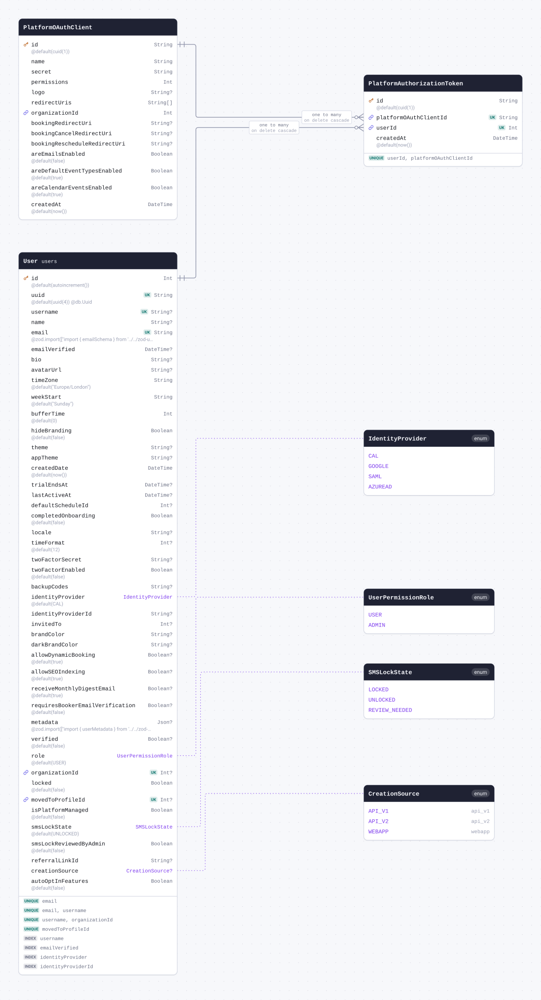

| Field                   | Type       | Constraints                                                     | Default   | Description |
| ----------------------- | ---------- | --------------------------------------------------------------- | --------- | ----------- |
| `id`                    | `String`   | PK NOT NULL                                                     | `cuid(1)` |             |
| `platformOAuthClientId` | `String`   | NOT NULL → [PlatformOAuthClient.id](#model-PlatformOAuthClient) |           |             |
| `userId`                | `Int`      | NOT NULL → [User.id](#model-User)                               |           |             |
| `createdAt`             | `DateTime` | NOT NULL                                                        | `now()`   |             |

#### Indexes

- `@@unique([userId, platformOAuthClientId])`

#### References

- `userId` → [User.id](#model-User) (many-to-one, on delete Cascade)
- `platformOAuthClientId` → [PlatformOAuthClient.id](#model-PlatformOAuthClient) (many-to-one, on delete Cascade)

#### Definition

```sql
CREATE TABLE "PlatformAuthorizationToken" (
    "id" TEXT NOT NULL,
    "platformOAuthClientId" TEXT NOT NULL,
    "userId" INTEGER NOT NULL,
    "createdAt" TIMESTAMP(3) NOT NULL DEFAULT CURRENT_TIMESTAMP,

    CONSTRAINT "PlatformAuthorizationToken_pkey" PRIMARY KEY ("id")
);

CREATE UNIQUE INDEX "PlatformAuthorizationToken_userId_platformOAuthClientId_key" ON "PlatformAuthorizationToken"("userId", "platformOAuthClientId");

ALTER TABLE "PlatformAuthorizationToken" ADD CONSTRAINT "PlatformAuthorizationToken_userId_fkey" FOREIGN KEY ("userId") REFERENCES "users"("id") ON DELETE CASCADE ON UPDATE CASCADE;

ALTER TABLE "PlatformAuthorizationToken" ADD CONSTRAINT "PlatformAuthorizationToken_platformOAuthClientId_fkey" FOREIGN KEY ("platformOAuthClientId") REFERENCES "PlatformOAuthClient"("id") ON DELETE CASCADE ON UPDATE CASCADE;
```

<details>
<summary>Queries and their SQL</summary>

**findMany**: Every row

```ts
await prisma.platformAuthorizationToken.findMany();
```

```sql
SELECT
  "public"."PlatformAuthorizationToken"."id",
  "public"."PlatformAuthorizationToken"."platformOAuthClientId",
  "public"."PlatformAuthorizationToken"."userId",
  "public"."PlatformAuthorizationToken"."createdAt"
FROM
  "public"."PlatformAuthorizationToken"
WHERE
  1 = 1
OFFSET
  $1
-- params: ["0"]
```

**count**: How many rows there are

```ts
await prisma.platformAuthorizationToken.count();
```

```sql
SELECT
  COUNT(*) AS "_count$_all"
FROM
  (
    SELECT
      "public"."PlatformAuthorizationToken"."id"
    FROM
      "public"."PlatformAuthorizationToken"
    WHERE
      1 = 1
    OFFSET
      $1
  ) AS "sub"
-- params: ["0"]
```

**findMany**: Every row with its relations

```ts
await prisma.platformAuthorizationToken.findMany({ include: { owner: true, client: true } });
```

```sql
SELECT
  "public"."PlatformAuthorizationToken"."id",
  "public"."PlatformAuthorizationToken"."platformOAuthClientId",
  "public"."PlatformAuthorizationToken"."userId",
  "public"."PlatformAuthorizationToken"."createdAt"
FROM
  "public"."PlatformAuthorizationToken"
WHERE
  1 = 1
OFFSET
  $1
-- params: ["0"]

SELECT
  "public"."users"."id",
  "public"."users"."uuid",
  "public"."users"."username",
  "public"."users"."name",
  "public"."users"."email",
  "public"."users"."emailVerified",
  "public"."users"."bio",
  "public"."users"."avatarUrl",
  "public"."users"."timeZone",
  "public"."users"."weekStart",
  "public"."users"."bufferTime",
  "public"."users"."hideBranding",
  "public"."users"."theme",
  "public"."users"."appTheme",
  "public"."users"."created",
  "public"."users"."trialEndsAt",
  "public"."users"."lastActiveAt",
  "public"."users"."defaultScheduleId",
  "public"."users"."completedOnboarding",
  "public"."users"."locale",
  "public"."users"."timeFormat",
  "public"."users"."twoFactorSecret",
  "public"."users"."twoFactorEnabled",
  "public"."users"."backupCodes",
  "public"."users"."identityProvider"::text,
  "public"."users"."identityProviderId",
  "public"."users"."invitedTo",
  "public"."users"."brandColor",
  "public"."users"."darkBrandColor",
  "public"."users"."allowDynamicBooking",
  "public"."users"."allowSEOIndexing",
  "public"."users"."receiveMonthlyDigestEmail",
  "public"."users"."requiresBookerEmailVerification",
  "public"."users"."metadata",
  "public"."users"."verified",
  "public"."users"."role"::text,
  "public"."users"."organizationId",
  "public"."users"."locked",
  "public"."users"."movedToProfileId",
  "public"."users"."isPlatformManaged",
  "public"."users"."smsLockState"::text,
  "public"."users"."smsLockReviewedByAdmin",
  "public"."users"."referralLinkId",
  "public"."users"."creationSource"::text,
  "public"."users"."autoOptInFeatures"
FROM
  "public"."users"
WHERE
  "public"."users"."id" IN ($1)
OFFSET
  $2
-- params: ["<userId of the rows above>","0"]

SELECT
  "public"."PlatformOAuthClient"."id",
  "public"."PlatformOAuthClient"."name",
  "public"."PlatformOAuthClient"."secret",
  "public"."PlatformOAuthClient"."permissions",
  "public"."PlatformOAuthClient"."logo",
  "public"."PlatformOAuthClient"."redirectUris",
  "public"."PlatformOAuthClient"."organizationId",
  "public"."PlatformOAuthClient"."bookingRedirectUri",
  "public"."PlatformOAuthClient"."bookingCancelRedirectUri",
  "public"."PlatformOAuthClient"."bookingRescheduleRedirectUri",
  "public"."PlatformOAuthClient"."areEmailsEnabled",
  "public"."PlatformOAuthClient"."areDefaultEventTypesEnabled",
  "public"."PlatformOAuthClient"."areCalendarEventsEnabled",
  "public"."PlatformOAuthClient"."createdAt"
FROM
  "public"."PlatformOAuthClient"
WHERE
  "public"."PlatformOAuthClient"."id" IN ($1)
OFFSET
  $2
-- params: ["<platformOAuthClientId of the rows above>","0"]
```

**findUnique**: One row by what is unique to it

```ts
await prisma.platformAuthorizationToken.findUnique({ where: { id: "example" } });
```

```sql
SELECT
  "public"."PlatformAuthorizationToken"."id",
  "public"."PlatformAuthorizationToken"."platformOAuthClientId",
  "public"."PlatformAuthorizationToken"."userId",
  "public"."PlatformAuthorizationToken"."createdAt"
FROM
  "public"."PlatformAuthorizationToken"
WHERE
  (
    "public"."PlatformAuthorizationToken"."id" = $1
    AND 1 = 1
  )
LIMIT
  $2
OFFSET
  $3
-- params: ["example","1","0"]
```

**create**: Create a row

```ts
await prisma.platformAuthorizationToken.create({
  data: { platformOAuthClientId: "example", userId: 1 },
});
```

```sql
INSERT INTO
  "public"."PlatformAuthorizationToken" (
    "id",
    "platformOAuthClientId",
    "userId",
    "createdAt"
  )
VALUES
  ($1, $2, $3, $4)
RETURNING
  "public"."PlatformAuthorizationToken"."id",
  "public"."PlatformAuthorizationToken"."platformOAuthClientId",
  "public"."PlatformAuthorizationToken"."userId",
  "public"."PlatformAuthorizationToken"."createdAt"
-- params: ["<cuid(1)>","example","1","<now()>"]
```

**update**: Update a row

```ts
await prisma.platformAuthorizationToken.update({
  where: { id: "example" },
  data: { createdAt: new Date("2026-01-01T00:00:00.000Z") },
});
```

```sql
UPDATE "public"."PlatformAuthorizationToken"
SET
  "createdAt" = $1
WHERE
  (
    "public"."PlatformAuthorizationToken"."id" = $2
    AND 1 = 1
  )
RETURNING
  "public"."PlatformAuthorizationToken"."id",
  "public"."PlatformAuthorizationToken"."platformOAuthClientId",
  "public"."PlatformAuthorizationToken"."userId",
  "public"."PlatformAuthorizationToken"."createdAt"
-- params: ["2026-01-01T00:00:00.000Z","example"]
```

**delete**: Delete a row

```ts
await prisma.platformAuthorizationToken.delete({ where: { id: "example" } });
```

```sql
DELETE FROM "public"."PlatformAuthorizationToken"
WHERE
  (
    "public"."PlatformAuthorizationToken"."id" = $1
    AND 1 = 1
  )
RETURNING
  "public"."PlatformAuthorizationToken"."id",
  "public"."PlatformAuthorizationToken"."platformOAuthClientId",
  "public"."PlatformAuthorizationToken"."userId",
  "public"."PlatformAuthorizationToken"."createdAt"
-- params: ["example"]
```

</details>

<a id="model-AccessToken"></a>

### AccessToken

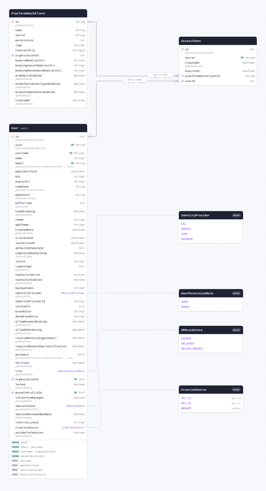

| Field                   | Type       | Constraints                                                     | Default           | Description |
| ----------------------- | ---------- | --------------------------------------------------------------- | ----------------- | ----------- |
| `id`                    | `Int`      | PK NOT NULL                                                     | `autoincrement()` |             |
| `secret`                | `String`   | UNIQUE NOT NULL                                                 |                   |             |
| `createdAt`             | `DateTime` | NOT NULL                                                        | `now()`           |             |
| `expiresAt`             | `DateTime` | NOT NULL                                                        |                   |             |
| `platformOAuthClientId` | `String`   | NOT NULL → [PlatformOAuthClient.id](#model-PlatformOAuthClient) |                   |             |
| `userId`                | `Int`      | NOT NULL → [User.id](#model-User)                               |                   |             |

#### References

- `userId` → [User.id](#model-User) (many-to-one, on delete Cascade)
- `platformOAuthClientId` → [PlatformOAuthClient.id](#model-PlatformOAuthClient) (many-to-one, on delete Cascade)

#### Definition

```sql
CREATE TABLE "AccessToken" (
    "id" SERIAL NOT NULL,
    "secret" TEXT NOT NULL,
    "createdAt" TIMESTAMP(3) NOT NULL DEFAULT CURRENT_TIMESTAMP,
    "expiresAt" TIMESTAMP(3) NOT NULL,
    "platformOAuthClientId" TEXT NOT NULL,
    "userId" INTEGER NOT NULL,

    CONSTRAINT "AccessToken_pkey" PRIMARY KEY ("id")
);

CREATE UNIQUE INDEX "AccessToken_secret_key" ON "AccessToken"("secret");

ALTER TABLE "AccessToken" ADD CONSTRAINT "AccessToken_userId_fkey" FOREIGN KEY ("userId") REFERENCES "users"("id") ON DELETE CASCADE ON UPDATE CASCADE;

ALTER TABLE "AccessToken" ADD CONSTRAINT "AccessToken_platformOAuthClientId_fkey" FOREIGN KEY ("platformOAuthClientId") REFERENCES "PlatformOAuthClient"("id") ON DELETE CASCADE ON UPDATE CASCADE;
```

<details>
<summary>Queries and their SQL</summary>

**findMany**: Every row

```ts
await prisma.accessToken.findMany();
```

```sql
SELECT
  "public"."AccessToken"."id",
  "public"."AccessToken"."secret",
  "public"."AccessToken"."createdAt",
  "public"."AccessToken"."expiresAt",
  "public"."AccessToken"."platformOAuthClientId",
  "public"."AccessToken"."userId"
FROM
  "public"."AccessToken"
WHERE
  1 = 1
OFFSET
  $1
-- params: ["0"]
```

**count**: How many rows there are

```ts
await prisma.accessToken.count();
```

```sql
SELECT
  COUNT(*) AS "_count$_all"
FROM
  (
    SELECT
      "public"."AccessToken"."id"
    FROM
      "public"."AccessToken"
    WHERE
      1 = 1
    OFFSET
      $1
  ) AS "sub"
-- params: ["0"]
```

**findMany**: Every row with its relations

```ts
await prisma.accessToken.findMany({ include: { owner: true, client: true } });
```

```sql
SELECT
  "public"."AccessToken"."id",
  "public"."AccessToken"."secret",
  "public"."AccessToken"."createdAt",
  "public"."AccessToken"."expiresAt",
  "public"."AccessToken"."platformOAuthClientId",
  "public"."AccessToken"."userId"
FROM
  "public"."AccessToken"
WHERE
  1 = 1
OFFSET
  $1
-- params: ["0"]

SELECT
  "public"."users"."id",
  "public"."users"."uuid",
  "public"."users"."username",
  "public"."users"."name",
  "public"."users"."email",
  "public"."users"."emailVerified",
  "public"."users"."bio",
  "public"."users"."avatarUrl",
  "public"."users"."timeZone",
  "public"."users"."weekStart",
  "public"."users"."bufferTime",
  "public"."users"."hideBranding",
  "public"."users"."theme",
  "public"."users"."appTheme",
  "public"."users"."created",
  "public"."users"."trialEndsAt",
  "public"."users"."lastActiveAt",
  "public"."users"."defaultScheduleId",
  "public"."users"."completedOnboarding",
  "public"."users"."locale",
  "public"."users"."timeFormat",
  "public"."users"."twoFactorSecret",
  "public"."users"."twoFactorEnabled",
  "public"."users"."backupCodes",
  "public"."users"."identityProvider"::text,
  "public"."users"."identityProviderId",
  "public"."users"."invitedTo",
  "public"."users"."brandColor",
  "public"."users"."darkBrandColor",
  "public"."users"."allowDynamicBooking",
  "public"."users"."allowSEOIndexing",
  "public"."users"."receiveMonthlyDigestEmail",
  "public"."users"."requiresBookerEmailVerification",
  "public"."users"."metadata",
  "public"."users"."verified",
  "public"."users"."role"::text,
  "public"."users"."organizationId",
  "public"."users"."locked",
  "public"."users"."movedToProfileId",
  "public"."users"."isPlatformManaged",
  "public"."users"."smsLockState"::text,
  "public"."users"."smsLockReviewedByAdmin",
  "public"."users"."referralLinkId",
  "public"."users"."creationSource"::text,
  "public"."users"."autoOptInFeatures"
FROM
  "public"."users"
WHERE
  "public"."users"."id" IN ($1)
OFFSET
  $2
-- params: ["<userId of the rows above>","0"]

SELECT
  "public"."PlatformOAuthClient"."id",
  "public"."PlatformOAuthClient"."name",
  "public"."PlatformOAuthClient"."secret",
  "public"."PlatformOAuthClient"."permissions",
  "public"."PlatformOAuthClient"."logo",
  "public"."PlatformOAuthClient"."redirectUris",
  "public"."PlatformOAuthClient"."organizationId",
  "public"."PlatformOAuthClient"."bookingRedirectUri",
  "public"."PlatformOAuthClient"."bookingCancelRedirectUri",
  "public"."PlatformOAuthClient"."bookingRescheduleRedirectUri",
  "public"."PlatformOAuthClient"."areEmailsEnabled",
  "public"."PlatformOAuthClient"."areDefaultEventTypesEnabled",
  "public"."PlatformOAuthClient"."areCalendarEventsEnabled",
  "public"."PlatformOAuthClient"."createdAt"
FROM
  "public"."PlatformOAuthClient"
WHERE
  "public"."PlatformOAuthClient"."id" IN ($1)
OFFSET
  $2
-- params: ["<platformOAuthClientId of the rows above>","0"]
```

**findUnique**: One row by what is unique to it

```ts
await prisma.accessToken.findUnique({ where: { id: 1 } });
```

```sql
SELECT
  "public"."AccessToken"."id",
  "public"."AccessToken"."secret",
  "public"."AccessToken"."createdAt",
  "public"."AccessToken"."expiresAt",
  "public"."AccessToken"."platformOAuthClientId",
  "public"."AccessToken"."userId"
FROM
  "public"."AccessToken"
WHERE
  (
    "public"."AccessToken"."id" = $1
    AND 1 = 1
  )
LIMIT
  $2
OFFSET
  $3
-- params: ["1","1","0"]
```

**create**: Create a row

```ts
await prisma.accessToken.create({
  data: {
    secret: "example",
    expiresAt: new Date("2026-01-01T00:00:00.000Z"),
    platformOAuthClientId: "example",
    userId: 1,
  },
});
```

```sql
INSERT INTO
  "public"."AccessToken" (
    "secret",
    "createdAt",
    "expiresAt",
    "platformOAuthClientId",
    "userId"
  )
VALUES
  ($1, $2, $3, $4, $5)
RETURNING
  "public"."AccessToken"."id",
  "public"."AccessToken"."secret",
  "public"."AccessToken"."createdAt",
  "public"."AccessToken"."expiresAt",
  "public"."AccessToken"."platformOAuthClientId",
  "public"."AccessToken"."userId"
-- params: ["example","<now()>","2026-01-01T00:00:00.000Z","example","1"]
```

**update**: Update a row

```ts
await prisma.accessToken.update({ where: { id: 1 }, data: { secret: "example" } });
```

```sql
UPDATE "public"."AccessToken"
SET
  "secret" = $1
WHERE
  (
    "public"."AccessToken"."id" = $2
    AND 1 = 1
  )
RETURNING
  "public"."AccessToken"."id",
  "public"."AccessToken"."secret",
  "public"."AccessToken"."createdAt",
  "public"."AccessToken"."expiresAt",
  "public"."AccessToken"."platformOAuthClientId",
  "public"."AccessToken"."userId"
-- params: ["example","1"]
```

**delete**: Delete a row

```ts
await prisma.accessToken.delete({ where: { id: 1 } });
```

```sql
DELETE FROM "public"."AccessToken"
WHERE
  (
    "public"."AccessToken"."id" = $1
    AND 1 = 1
  )
RETURNING
  "public"."AccessToken"."id",
  "public"."AccessToken"."secret",
  "public"."AccessToken"."createdAt",
  "public"."AccessToken"."expiresAt",
  "public"."AccessToken"."platformOAuthClientId",
  "public"."AccessToken"."userId"
-- params: ["1"]
```

</details>

<a id="model-RefreshToken"></a>

### RefreshToken


| Field                   | Type       | Constraints                                                     | Default           | Description |
| ----------------------- | ---------- | --------------------------------------------------------------- | ----------------- | ----------- |
| `id`                    | `Int`      | PK NOT NULL                                                     | `autoincrement()` |             |
| `secret`                | `String`   | UNIQUE NOT NULL                                                 |                   |             |
| `createdAt`             | `DateTime` | NOT NULL                                                        | `now()`           |             |
| `expiresAt`             | `DateTime` | NOT NULL                                                        |                   |             |
| `platformOAuthClientId` | `String`   | NOT NULL → [PlatformOAuthClient.id](#model-PlatformOAuthClient) |                   |             |
| `userId`                | `Int`      | NOT NULL → [User.id](#model-User)                               |                   |             |

#### References

- `userId` → [User.id](#model-User) (many-to-one, on delete Cascade)
- `platformOAuthClientId` → [PlatformOAuthClient.id](#model-PlatformOAuthClient) (many-to-one, on delete Cascade)

#### Definition

```sql
CREATE TABLE "RefreshToken" (
    "id" SERIAL NOT NULL,
    "secret" TEXT NOT NULL,
    "createdAt" TIMESTAMP(3) NOT NULL DEFAULT CURRENT_TIMESTAMP,
    "expiresAt" TIMESTAMP(3) NOT NULL,
    "platformOAuthClientId" TEXT NOT NULL,
    "userId" INTEGER NOT NULL,

    CONSTRAINT "RefreshToken_pkey" PRIMARY KEY ("id")
);

CREATE UNIQUE INDEX "RefreshToken_secret_key" ON "RefreshToken"("secret");

ALTER TABLE "RefreshToken" ADD CONSTRAINT "RefreshToken_userId_fkey" FOREIGN KEY ("userId") REFERENCES "users"("id") ON DELETE CASCADE ON UPDATE CASCADE;

ALTER TABLE "RefreshToken" ADD CONSTRAINT "RefreshToken_platformOAuthClientId_fkey" FOREIGN KEY ("platformOAuthClientId") REFERENCES "PlatformOAuthClient"("id") ON DELETE CASCADE ON UPDATE CASCADE;
```

<details>
<summary>Queries and their SQL</summary>

**findMany**: Every row

```ts
await prisma.refreshToken.findMany();
```

```sql
SELECT
  "public"."RefreshToken"."id",
  "public"."RefreshToken"."secret",
  "public"."RefreshToken"."createdAt",
  "public"."RefreshToken"."expiresAt",
  "public"."RefreshToken"."platformOAuthClientId",
  "public"."RefreshToken"."userId"
FROM
  "public"."RefreshToken"
WHERE
  1 = 1
OFFSET
  $1
-- params: ["0"]
```

**count**: How many rows there are

```ts
await prisma.refreshToken.count();
```

```sql
SELECT
  COUNT(*) AS "_count$_all"
FROM
  (
    SELECT
      "public"."RefreshToken"."id"
    FROM
      "public"."RefreshToken"
    WHERE
      1 = 1
    OFFSET
      $1
  ) AS "sub"
-- params: ["0"]
```

**findMany**: Every row with its relations

```ts
await prisma.refreshToken.findMany({ include: { owner: true, client: true } });
```

```sql
SELECT
  "public"."RefreshToken"."id",
  "public"."RefreshToken"."secret",
  "public"."RefreshToken"."createdAt",
  "public"."RefreshToken"."expiresAt",
  "public"."RefreshToken"."platformOAuthClientId",
  "public"."RefreshToken"."userId"
FROM
  "public"."RefreshToken"
WHERE
  1 = 1
OFFSET
  $1
-- params: ["0"]

SELECT
  "public"."users"."id",
  "public"."users"."uuid",
  "public"."users"."username",
  "public"."users"."name",
  "public"."users"."email",
  "public"."users"."emailVerified",
  "public"."users"."bio",
  "public"."users"."avatarUrl",
  "public"."users"."timeZone",
  "public"."users"."weekStart",
  "public"."users"."bufferTime",
  "public"."users"."hideBranding",
  "public"."users"."theme",
  "public"."users"."appTheme",
  "public"."users"."created",
  "public"."users"."trialEndsAt",
  "public"."users"."lastActiveAt",
  "public"."users"."defaultScheduleId",
  "public"."users"."completedOnboarding",
  "public"."users"."locale",
  "public"."users"."timeFormat",
  "public"."users"."twoFactorSecret",
  "public"."users"."twoFactorEnabled",
  "public"."users"."backupCodes",
  "public"."users"."identityProvider"::text,
  "public"."users"."identityProviderId",
  "public"."users"."invitedTo",
  "public"."users"."brandColor",
  "public"."users"."darkBrandColor",
  "public"."users"."allowDynamicBooking",
  "public"."users"."allowSEOIndexing",
  "public"."users"."receiveMonthlyDigestEmail",
  "public"."users"."requiresBookerEmailVerification",
  "public"."users"."metadata",
  "public"."users"."verified",
  "public"."users"."role"::text,
  "public"."users"."organizationId",
  "public"."users"."locked",
  "public"."users"."movedToProfileId",
  "public"."users"."isPlatformManaged",
  "public"."users"."smsLockState"::text,
  "public"."users"."smsLockReviewedByAdmin",
  "public"."users"."referralLinkId",
  "public"."users"."creationSource"::text,
  "public"."users"."autoOptInFeatures"
FROM
  "public"."users"
WHERE
  "public"."users"."id" IN ($1)
OFFSET
  $2
-- params: ["<userId of the rows above>","0"]

SELECT
  "public"."PlatformOAuthClient"."id",
  "public"."PlatformOAuthClient"."name",
  "public"."PlatformOAuthClient"."secret",
  "public"."PlatformOAuthClient"."permissions",
  "public"."PlatformOAuthClient"."logo",
  "public"."PlatformOAuthClient"."redirectUris",
  "public"."PlatformOAuthClient"."organizationId",
  "public"."PlatformOAuthClient"."bookingRedirectUri",
  "public"."PlatformOAuthClient"."bookingCancelRedirectUri",
  "public"."PlatformOAuthClient"."bookingRescheduleRedirectUri",
  "public"."PlatformOAuthClient"."areEmailsEnabled",
  "public"."PlatformOAuthClient"."areDefaultEventTypesEnabled",
  "public"."PlatformOAuthClient"."areCalendarEventsEnabled",
  "public"."PlatformOAuthClient"."createdAt"
FROM
  "public"."PlatformOAuthClient"
WHERE
  "public"."PlatformOAuthClient"."id" IN ($1)
OFFSET
  $2
-- params: ["<platformOAuthClientId of the rows above>","0"]
```

**findUnique**: One row by what is unique to it

```ts
await prisma.refreshToken.findUnique({ where: { id: 1 } });
```

```sql
SELECT
  "public"."RefreshToken"."id",
  "public"."RefreshToken"."secret",
  "public"."RefreshToken"."createdAt",
  "public"."RefreshToken"."expiresAt",
  "public"."RefreshToken"."platformOAuthClientId",
  "public"."RefreshToken"."userId"
FROM
  "public"."RefreshToken"
WHERE
  (
    "public"."RefreshToken"."id" = $1
    AND 1 = 1
  )
LIMIT
  $2
OFFSET
  $3
-- params: ["1","1","0"]
```

**create**: Create a row

```ts
await prisma.refreshToken.create({
  data: {
    secret: "example",
    expiresAt: new Date("2026-01-01T00:00:00.000Z"),
    platformOAuthClientId: "example",
    userId: 1,
  },
});
```

```sql
INSERT INTO
  "public"."RefreshToken" (
    "secret",
    "createdAt",
    "expiresAt",
    "platformOAuthClientId",
    "userId"
  )
VALUES
  ($1, $2, $3, $4, $5)
RETURNING
  "public"."RefreshToken"."id",
  "public"."RefreshToken"."secret",
  "public"."RefreshToken"."createdAt",
  "public"."RefreshToken"."expiresAt",
  "public"."RefreshToken"."platformOAuthClientId",
  "public"."RefreshToken"."userId"
-- params: ["example","<now()>","2026-01-01T00:00:00.000Z","example","1"]
```

**update**: Update a row

```ts
await prisma.refreshToken.update({ where: { id: 1 }, data: { secret: "example" } });
```

```sql
UPDATE "public"."RefreshToken"
SET
  "secret" = $1
WHERE
  (
    "public"."RefreshToken"."id" = $2
    AND 1 = 1
  )
RETURNING
  "public"."RefreshToken"."id",
  "public"."RefreshToken"."secret",
  "public"."RefreshToken"."createdAt",
  "public"."RefreshToken"."expiresAt",
  "public"."RefreshToken"."platformOAuthClientId",
  "public"."RefreshToken"."userId"
-- params: ["example","1"]
```

**delete**: Delete a row

```ts
await prisma.refreshToken.delete({ where: { id: 1 } });
```

```sql
DELETE FROM "public"."RefreshToken"
WHERE
  (
    "public"."RefreshToken"."id" = $1
    AND 1 = 1
  )
RETURNING
  "public"."RefreshToken"."id",
  "public"."RefreshToken"."secret",
  "public"."RefreshToken"."createdAt",
  "public"."RefreshToken"."expiresAt",
  "public"."RefreshToken"."platformOAuthClientId",
  "public"."RefreshToken"."userId"
-- params: ["1"]
```

</details>

<a id="model-DSyncData"></a>

### DSyncData


| Field            | Type     | Constraints                                                                      | Default           | Description |
| ---------------- | -------- | -------------------------------------------------------------------------------- | ----------------- | ----------- |
| `id`             | `Int`    | PK NOT NULL                                                                      | `autoincrement()` |             |
| `directoryId`    | `String` | UNIQUE NOT NULL                                                                  |                   |             |
| `tenant`         | `String` | NOT NULL                                                                         |                   |             |
| `organizationId` | `Int`    | UNIQUE NULL → [OrganizationSettings.organizationId](#model-OrganizationSettings) |                   |             |

#### References

- `organizationId` → [OrganizationSettings.organizationId](#model-OrganizationSettings) (one-to-one, on delete Cascade)

#### Referenced by

- `directoryId` ← [DSyncTeamGroupMapping.directoryId](#model-DSyncTeamGroupMapping) (one-to-many, on delete Cascade)
- `directoryId` ← [AttributeToUser.createdByDSyncId](#model-AttributeToUser) (one-to-many, on delete SetNull)
- `directoryId` ← [AttributeToUser.updatedByDSyncId](#model-AttributeToUser) (one-to-many, on delete SetNull)

#### Definition

```sql
CREATE TABLE "DSyncData" (
    "id" SERIAL NOT NULL,
    "directoryId" TEXT NOT NULL,
    "tenant" TEXT NOT NULL,
    "organizationId" INTEGER,

    CONSTRAINT "DSyncData_pkey" PRIMARY KEY ("id")
);

CREATE UNIQUE INDEX "DSyncData_directoryId_key" ON "DSyncData"("directoryId");

CREATE UNIQUE INDEX "DSyncData_organizationId_key" ON "DSyncData"("organizationId");

ALTER TABLE "DSyncData" ADD CONSTRAINT "DSyncData_organizationId_fkey" FOREIGN KEY ("organizationId") REFERENCES "OrganizationSettings"("organizationId") ON DELETE CASCADE ON UPDATE CASCADE;
```

<details>
<summary>Queries and their SQL</summary>

**findMany**: Every row

```ts
await prisma.dSyncData.findMany();
```

```sql
SELECT
  "public"."DSyncData"."id",
  "public"."DSyncData"."directoryId",
  "public"."DSyncData"."tenant",
  "public"."DSyncData"."organizationId"
FROM
  "public"."DSyncData"
WHERE
  1 = 1
OFFSET
  $1
-- params: ["0"]
```

**count**: How many rows there are

```ts
await prisma.dSyncData.count();
```

```sql
SELECT
  COUNT(*) AS "_count$_all"
FROM
  (
    SELECT
      "public"."DSyncData"."id"
    FROM
      "public"."DSyncData"
    WHERE
      1 = 1
    OFFSET
      $1
  ) AS "sub"
-- params: ["0"]
```

**findMany**: Every row with its relations

```ts
await prisma.dSyncData.findMany({
  include: {
    org: true,
    teamGroupMapping: true,
    createdAttributeToUsers: true,
    updatedAttributeToUsers: true,
  },
});
```

```sql
SELECT
  "public"."DSyncData"."id",
  "public"."DSyncData"."directoryId",
  "public"."DSyncData"."tenant",
  "public"."DSyncData"."organizationId"
FROM
  "public"."DSyncData"
WHERE
  1 = 1
OFFSET
  $1
-- params: ["0"]

SELECT
  "public"."OrganizationSettings"."id",
  "public"."OrganizationSettings"."organizationId",
  "public"."OrganizationSettings"."isOrganizationConfigured",
  "public"."OrganizationSettings"."isOrganizationVerified",
  "public"."OrganizationSettings"."orgAutoAcceptEmail",
  "public"."OrganizationSettings"."lockEventTypeCreationForUsers",
  "public"."OrganizationSettings"."adminGetsNoSlotsNotification",
  "public"."OrganizationSettings"."isAdminReviewed",
  "public"."OrganizationSettings"."isAdminAPIEnabled",
  "public"."OrganizationSettings"."allowSEOIndexing",
  "public"."OrganizationSettings"."orgProfileRedirectsToVerifiedDomain",
  "public"."OrganizationSettings"."disablePhoneOnlySMSNotifications",
  "public"."OrganizationSettings"."disableAutofillOnBookingPage",
  "public"."OrganizationSettings"."orgAutoJoinOnSignup",
  "public"."OrganizationSettings"."disableAttendeeConfirmationEmail",
  "public"."OrganizationSettings"."disableAttendeeCancellationEmail",
  "public"."OrganizationSettings"."disableAttendeeRescheduledEmail",
  "public"."OrganizationSettings"."disableAttendeeRequestEmail",
  "public"."OrganizationSettings"."disableAttendeeReassignedEmail",
  "public"."OrganizationSettings"."disableAttendeeAwaitingPaymentEmail",
  "public"."OrganizationSettings"."disableAttendeeRescheduleRequestEmail",
  "public"."OrganizationSettings"."disableAttendeeLocationChangeEmail",
  "public"."OrganizationSettings"."disableAttendeeNewEventEmail"
FROM
  "public"."OrganizationSettings"
WHERE
  "public"."OrganizationSettings"."organizationId" IN ($1)
OFFSET
  $2
-- params: ["<organizationId of the rows above>","0"]

SELECT
  "public"."DSyncTeamGroupMapping"."id",
  "public"."DSyncTeamGroupMapping"."organizationId",
  "public"."DSyncTeamGroupMapping"."teamId",
  "public"."DSyncTeamGroupMapping"."directoryId",
  "public"."DSyncTeamGroupMapping"."groupName"
FROM
  "public"."DSyncTeamGroupMapping"
WHERE
  "public"."DSyncTeamGroupMapping"."directoryId" IN ($1)
OFFSET
  $2
-- params: ["<directoryId of the rows above>","0"]

SELECT
  "public"."AttributeToUser"."id",
  "public"."AttributeToUser"."memberId",
  "public"."AttributeToUser"."attributeOptionId",
  "public"."AttributeToUser"."weight",
  "public"."AttributeToUser"."createdAt",
  "public"."AttributeToUser"."createdById",
  "public"."AttributeToUser"."createdByDSyncId",
  "public"."AttributeToUser"."updatedAt",
  "public"."AttributeToUser"."updatedById",
  "public"."AttributeToUser"."updatedByDSyncId"
FROM
  "public"."AttributeToUser"
WHERE
  "public"."AttributeToUser"."createdByDSyncId" IN ($1)
OFFSET
  $2
-- params: ["<directoryId of the rows above>","0"]

SELECT
  "public"."AttributeToUser"."id",
  "public"."AttributeToUser"."memberId",
  "public"."AttributeToUser"."attributeOptionId",
  "public"."AttributeToUser"."weight",
  "public"."AttributeToUser"."createdAt",
  "public"."AttributeToUser"."createdById",
  "public"."AttributeToUser"."createdByDSyncId",
  "public"."AttributeToUser"."updatedAt",
  "public"."AttributeToUser"."updatedById",
  "public"."AttributeToUser"."updatedByDSyncId"
FROM
  "public"."AttributeToUser"
WHERE
  "public"."AttributeToUser"."updatedByDSyncId" IN ($1)
OFFSET
  $2
-- params: ["<directoryId of the rows above>","0"]
```

**findUnique**: One row by what is unique to it

```ts
await prisma.dSyncData.findUnique({ where: { id: 1 } });
```

```sql
SELECT
  "public"."DSyncData"."id",
  "public"."DSyncData"."directoryId",
  "public"."DSyncData"."tenant",
  "public"."DSyncData"."organizationId"
FROM
  "public"."DSyncData"
WHERE
  (
    "public"."DSyncData"."id" = $1
    AND 1 = 1
  )
LIMIT
  $2
OFFSET
  $3
-- params: ["1","1","0"]
```

**create**: Create a row

```ts
await prisma.dSyncData.create({ data: { directoryId: "example", tenant: "example" } });
```

```sql
INSERT INTO
  "public"."DSyncData" ("directoryId", "tenant")
VALUES
  ($1, $2)
RETURNING
  "public"."DSyncData"."id",
  "public"."DSyncData"."directoryId",
  "public"."DSyncData"."tenant",
  "public"."DSyncData"."organizationId"
-- params: ["example","example"]
```

**update**: Update a row

```ts
await prisma.dSyncData.update({ where: { id: 1 }, data: { directoryId: "example" } });
```

```sql
UPDATE "public"."DSyncData"
SET
  "directoryId" = $1
WHERE
  (
    "public"."DSyncData"."id" = $2
    AND 1 = 1
  )
RETURNING
  "public"."DSyncData"."id",
  "public"."DSyncData"."directoryId",
  "public"."DSyncData"."tenant",
  "public"."DSyncData"."organizationId"
-- params: ["example","1"]
```

**delete**: Delete a row

```ts
await prisma.dSyncData.delete({ where: { id: 1 } });
```

```sql
DELETE FROM "public"."DSyncData"
WHERE
  (
    "public"."DSyncData"."id" = $1
    AND 1 = 1
  )
RETURNING
  "public"."DSyncData"."id",
  "public"."DSyncData"."directoryId",
  "public"."DSyncData"."tenant",
  "public"."DSyncData"."organizationId"
-- params: ["1"]
```

</details>

<a id="model-DSyncTeamGroupMapping"></a>

### DSyncTeamGroupMapping


| Field            | Type     | Constraints                                          | Default           | Description |
| ---------------- | -------- | ---------------------------------------------------- | ----------------- | ----------- |
| `id`             | `Int`    | PK NOT NULL                                          | `autoincrement()` |             |
| `organizationId` | `Int`    | NOT NULL                                             |                   |             |
| `teamId`         | `Int`    | NOT NULL → [Team.id](#model-Team)                    |                   |             |
| `directoryId`    | `String` | NOT NULL → [DSyncData.directoryId](#model-DSyncData) |                   |             |
| `groupName`      | `String` | NOT NULL                                             |                   |             |

#### Indexes

- `@@unique([teamId, groupName])`

#### References

- `teamId` → [Team.id](#model-Team) (many-to-one, on delete Cascade)
- `directoryId` → [DSyncData.directoryId](#model-DSyncData) (many-to-one, on delete Cascade)

#### Definition

```sql
CREATE TABLE "DSyncTeamGroupMapping" (
    "id" SERIAL NOT NULL,
    "organizationId" INTEGER NOT NULL,
    "teamId" INTEGER NOT NULL,
    "directoryId" TEXT NOT NULL,
    "groupName" TEXT NOT NULL,

    CONSTRAINT "DSyncTeamGroupMapping_pkey" PRIMARY KEY ("id")
);

CREATE UNIQUE INDEX "DSyncTeamGroupMapping_teamId_groupName_key" ON "DSyncTeamGroupMapping"("teamId", "groupName");

ALTER TABLE "DSyncTeamGroupMapping" ADD CONSTRAINT "DSyncTeamGroupMapping_teamId_fkey" FOREIGN KEY ("teamId") REFERENCES "Team"("id") ON DELETE CASCADE ON UPDATE CASCADE;

ALTER TABLE "DSyncTeamGroupMapping" ADD CONSTRAINT "DSyncTeamGroupMapping_directoryId_fkey" FOREIGN KEY ("directoryId") REFERENCES "DSyncData"("directoryId") ON DELETE CASCADE ON UPDATE CASCADE;
```

<details>
<summary>Queries and their SQL</summary>

**findMany**: Every row

```ts
await prisma.dSyncTeamGroupMapping.findMany();
```

```sql
SELECT
  "public"."DSyncTeamGroupMapping"."id",
  "public"."DSyncTeamGroupMapping"."organizationId",
  "public"."DSyncTeamGroupMapping"."teamId",
  "public"."DSyncTeamGroupMapping"."directoryId",
  "public"."DSyncTeamGroupMapping"."groupName"
FROM
  "public"."DSyncTeamGroupMapping"
WHERE
  1 = 1
OFFSET
  $1
-- params: ["0"]
```

**count**: How many rows there are

```ts
await prisma.dSyncTeamGroupMapping.count();
```

```sql
SELECT
  COUNT(*) AS "_count$_all"
FROM
  (
    SELECT
      "public"."DSyncTeamGroupMapping"."id"
    FROM
      "public"."DSyncTeamGroupMapping"
    WHERE
      1 = 1
    OFFSET
      $1
  ) AS "sub"
-- params: ["0"]
```

**findMany**: Every row with its relations

```ts
await prisma.dSyncTeamGroupMapping.findMany({ include: { team: true, directory: true } });
```

```sql
SELECT
  "public"."DSyncTeamGroupMapping"."id",
  "public"."DSyncTeamGroupMapping"."organizationId",
  "public"."DSyncTeamGroupMapping"."teamId",
  "public"."DSyncTeamGroupMapping"."directoryId",
  "public"."DSyncTeamGroupMapping"."groupName"
FROM
  "public"."DSyncTeamGroupMapping"
WHERE
  1 = 1
OFFSET
  $1
-- params: ["0"]

SELECT
  "public"."Team"."id",
  "public"."Team"."name",
  "public"."Team"."slug",
  "public"."Team"."logoUrl",
  "public"."Team"."calVideoLogo",
  "public"."Team"."appLogo",
  "public"."Team"."appIconLogo",
  "public"."Team"."bio",
  "public"."Team"."hideBranding",
  "public"."Team"."hideTeamProfileLink",
  "public"."Team"."isPrivate",
  "public"."Team"."hideBookATeamMember",
  "public"."Team"."createdAt",
  "public"."Team"."metadata",
  "public"."Team"."theme",
  "public"."Team"."rrResetInterval"::text,
  "public"."Team"."rrTimestampBasis"::text,
  "public"."Team"."brandColor",
  "public"."Team"."darkBrandColor",
  "public"."Team"."bannerUrl",
  "public"."Team"."parentId",
  "public"."Team"."timeFormat",
  "public"."Team"."timeZone",
  "public"."Team"."weekStart",
  "public"."Team"."isOrganization",
  "public"."Team"."pendingPayment",
  "public"."Team"."isPlatform",
  "public"."Team"."createdByOAuthClientId",
  "public"."Team"."smsLockState"::text,
  "public"."Team"."smsLockReviewedByAdmin",
  "public"."Team"."bookingLimits",
  "public"."Team"."includeManagedEventsInLimits",
  "public"."Team"."autoOptInFeatures"
FROM
  "public"."Team"
WHERE
  "public"."Team"."id" IN ($1)
OFFSET
  $2
-- params: ["<teamId of the rows above>","0"]

SELECT
  "public"."DSyncData"."id",
  "public"."DSyncData"."directoryId",
  "public"."DSyncData"."tenant",
  "public"."DSyncData"."organizationId"
FROM
  "public"."DSyncData"
WHERE
  "public"."DSyncData"."directoryId" IN ($1)
OFFSET
  $2
-- params: ["<directoryId of the rows above>","0"]
```

**findUnique**: One row by what is unique to it

```ts
await prisma.dSyncTeamGroupMapping.findUnique({ where: { id: 1 } });
```

```sql
SELECT
  "public"."DSyncTeamGroupMapping"."id",
  "public"."DSyncTeamGroupMapping"."organizationId",
  "public"."DSyncTeamGroupMapping"."teamId",
  "public"."DSyncTeamGroupMapping"."directoryId",
  "public"."DSyncTeamGroupMapping"."groupName"
FROM
  "public"."DSyncTeamGroupMapping"
WHERE
  (
    "public"."DSyncTeamGroupMapping"."id" = $1
    AND 1 = 1
  )
LIMIT
  $2
OFFSET
  $3
-- params: ["1","1","0"]
```

**create**: Create a row

```ts
await prisma.dSyncTeamGroupMapping.create({
  data: { organizationId: 1, teamId: 1, directoryId: "example", groupName: "example" },
});
```

```sql
INSERT INTO
  "public"."DSyncTeamGroupMapping" (
    "organizationId",
    "teamId",
    "directoryId",
    "groupName"
  )
VALUES
  ($1, $2, $3, $4)
RETURNING
  "public"."DSyncTeamGroupMapping"."id",
  "public"."DSyncTeamGroupMapping"."organizationId",
  "public"."DSyncTeamGroupMapping"."teamId",
  "public"."DSyncTeamGroupMapping"."directoryId",
  "public"."DSyncTeamGroupMapping"."groupName"
-- params: ["1","1","example","example"]
```

**update**: Update a row

```ts
await prisma.dSyncTeamGroupMapping.update({ where: { id: 1 }, data: { organizationId: 1 } });
```

```sql
UPDATE "public"."DSyncTeamGroupMapping"
SET
  "organizationId" = $1
WHERE
  (
    "public"."DSyncTeamGroupMapping"."id" = $2
    AND 1 = 1
  )
RETURNING
  "public"."DSyncTeamGroupMapping"."id",
  "public"."DSyncTeamGroupMapping"."organizationId",
  "public"."DSyncTeamGroupMapping"."teamId",
  "public"."DSyncTeamGroupMapping"."directoryId",
  "public"."DSyncTeamGroupMapping"."groupName"
-- params: ["1","1"]
```

**delete**: Delete a row

```ts
await prisma.dSyncTeamGroupMapping.delete({ where: { id: 1 } });
```

```sql
DELETE FROM "public"."DSyncTeamGroupMapping"
WHERE
  (
    "public"."DSyncTeamGroupMapping"."id" = $1
    AND 1 = 1
  )
RETURNING
  "public"."DSyncTeamGroupMapping"."id",
  "public"."DSyncTeamGroupMapping"."organizationId",
  "public"."DSyncTeamGroupMapping"."teamId",
  "public"."DSyncTeamGroupMapping"."directoryId",
  "public"."DSyncTeamGroupMapping"."groupName"
-- params: ["1"]
```

</details>

<a id="model-SecondaryEmail"></a>

### SecondaryEmail


| Field           | Type       | Constraints                       | Default           | Description |
| --------------- | ---------- | --------------------------------- | ----------------- | ----------- |
| `id`            | `Int`      | PK NOT NULL                       | `autoincrement()` |             |
| `userId`        | `Int`      | NOT NULL → [User.id](#model-User) |                   |             |
| `email`         | `String`   | UNIQUE NOT NULL                   |                   |             |
| `emailVerified` | `DateTime` | NULL                              |                   |             |

#### Indexes

- `@@index([userId])`
- `@@index([email, emailVerified])`
- `@@unique([email])`
- `@@unique([userId, email])`

#### References

- `userId` → [User.id](#model-User) (many-to-one, on delete Cascade)

#### Referenced by

- `id` ← [EventType.secondaryEmailId](#model-EventType) (one-to-many, on delete Cascade)
- `id` ← [VerificationToken.secondaryEmailId](#model-VerificationToken) (one-to-many)

#### Definition

```sql
CREATE TABLE "SecondaryEmail" (
    "id" SERIAL NOT NULL,
    "userId" INTEGER NOT NULL,
    "email" TEXT NOT NULL,
    "emailVerified" TIMESTAMP(3),

    CONSTRAINT "SecondaryEmail_pkey" PRIMARY KEY ("id")
);

CREATE INDEX "SecondaryEmail_userId_idx" ON "SecondaryEmail"("userId");

CREATE INDEX "SecondaryEmail_email_emailVerified_idx" ON "SecondaryEmail"("email", "emailVerified");

CREATE UNIQUE INDEX "SecondaryEmail_email_key" ON "SecondaryEmail"("email");

CREATE UNIQUE INDEX "SecondaryEmail_userId_email_key" ON "SecondaryEmail"("userId", "email");

ALTER TABLE "SecondaryEmail" ADD CONSTRAINT "SecondaryEmail_userId_fkey" FOREIGN KEY ("userId") REFERENCES "users"("id") ON DELETE CASCADE ON UPDATE CASCADE;
```

<details>
<summary>Queries and their SQL</summary>

**findMany**: Every row

```ts
await prisma.secondaryEmail.findMany();
```

```sql
SELECT
  "public"."SecondaryEmail"."id",
  "public"."SecondaryEmail"."userId",
  "public"."SecondaryEmail"."email",
  "public"."SecondaryEmail"."emailVerified"
FROM
  "public"."SecondaryEmail"
WHERE
  1 = 1
OFFSET
  $1
-- params: ["0"]
```

**count**: How many rows there are

```ts
await prisma.secondaryEmail.count();
```

```sql
SELECT
  COUNT(*) AS "_count$_all"
FROM
  (
    SELECT
      "public"."SecondaryEmail"."id"
    FROM
      "public"."SecondaryEmail"
    WHERE
      1 = 1
    OFFSET
      $1
  ) AS "sub"
-- params: ["0"]
```

**findMany**: Every row with its relations

```ts
await prisma.secondaryEmail.findMany({
  include: { user: true, verificationTokens: true, eventTypes: true },
});
```

```sql
SELECT
  "public"."SecondaryEmail"."id",
  "public"."SecondaryEmail"."userId",
  "public"."SecondaryEmail"."email",
  "public"."SecondaryEmail"."emailVerified"
FROM
  "public"."SecondaryEmail"
WHERE
  1 = 1
OFFSET
  $1
-- params: ["0"]

SELECT
  "public"."users"."id",
  "public"."users"."uuid",
  "public"."users"."username",
  "public"."users"."name",
  "public"."users"."email",
  "public"."users"."emailVerified",
  "public"."users"."bio",
  "public"."users"."avatarUrl",
  "public"."users"."timeZone",
  "public"."users"."weekStart",
  "public"."users"."bufferTime",
  "public"."users"."hideBranding",
  "public"."users"."theme",
  "public"."users"."appTheme",
  "public"."users"."created",
  "public"."users"."trialEndsAt",
  "public"."users"."lastActiveAt",
  "public"."users"."defaultScheduleId",
  "public"."users"."completedOnboarding",
  "public"."users"."locale",
  "public"."users"."timeFormat",
  "public"."users"."twoFactorSecret",
  "public"."users"."twoFactorEnabled",
  "public"."users"."backupCodes",
  "public"."users"."identityProvider"::text,
  "public"."users"."identityProviderId",
  "public"."users"."invitedTo",
  "public"."users"."brandColor",
  "public"."users"."darkBrandColor",
  "public"."users"."allowDynamicBooking",
  "public"."users"."allowSEOIndexing",
  "public"."users"."receiveMonthlyDigestEmail",
  "public"."users"."requiresBookerEmailVerification",
  "public"."users"."metadata",
  "public"."users"."verified",
  "public"."users"."role"::text,
  "public"."users"."organizationId",
  "public"."users"."locked",
  "public"."users"."movedToProfileId",
  "public"."users"."isPlatformManaged",
  "public"."users"."smsLockState"::text,
  "public"."users"."smsLockReviewedByAdmin",
  "public"."users"."referralLinkId",
  "public"."users"."creationSource"::text,
  "public"."users"."autoOptInFeatures"
FROM
  "public"."users"
WHERE
  "public"."users"."id" IN ($1)
OFFSET
  $2
-- params: ["<userId of the rows above>","0"]

SELECT
  "public"."VerificationToken"."id",
  "public"."VerificationToken"."identifier",
  "public"."VerificationToken"."token",
  "public"."VerificationToken"."expires",
  "public"."VerificationToken"."expiresInDays",
  "public"."VerificationToken"."createdAt",
  "public"."VerificationToken"."updatedAt",
  "public"."VerificationToken"."teamId",
  "public"."VerificationToken"."secondaryEmailId"
FROM
  "public"."VerificationToken"
WHERE
  "public"."VerificationToken"."secondaryEmailId" IN ($1)
OFFSET
  $2
-- params: ["<id of the rows above>","0"]

SELECT
  "public"."EventType"."id",
  "public"."EventType"."title",
  "public"."EventType"."slug",
  "public"."EventType"."description",
  "public"."EventType"."interfaceLanguage",
  "public"."EventType"."position",
  "public"."EventType"."locations",
  "public"."EventType"."length",
  "public"."EventType"."offsetStart",
  "public"."EventType"."hidden",
  "public"."EventType"."userId",
  "public"."EventType"."profileId",
  "public"."EventType"."teamId",
  "public"."EventType"."useEventLevelSelectedCalendars",
  "public"."EventType"."eventName",
  "public"."EventType"."parentId",
  "public"."EventType"."bookingFields",
  "public"."EventType"."timeZone",
  "public"."EventType"."periodType"::text,
  "public"."EventType"."periodStartDate",
  "public"."EventType"."periodEndDate",
  "public"."EventType"."periodDays",
  "public"."EventType"."periodCountCalendarDays",
  "public"."EventType"."lockTimeZoneToggleOnBookingPage",
  "public"."EventType"."lockedTimeZone",
  "public"."EventType"."requiresConfirmation",
  "public"."EventType"."requiresConfirmationWillBlockSlot",
  "public"."EventType"."requiresConfirmationForFreeEmail",
  "public"."EventType"."requiresBookerEmailVerification",
  "public"."EventType"."canSendCalVideoTranscriptionEmails",
  "public"."EventType"."autoTranslateDescriptionEnabled",
  "public"."EventType"."autoTranslateInstantMeetingTitleEnabled",
  "public"."EventType"."recurringEvent",
  "public"."EventType"."disableGuests",
  "public"."EventType"."hideCalendarNotes",
  "public"."EventType"."hideCalendarEventDetails",
  "public"."EventType"."minimumBookingNotice",
  "public"."EventType"."beforeEventBuffer",
  "public"."EventType"."afterEventBuffer",
  "public"."EventType"."seatsPerTimeSlot",
  "public"."EventType"."onlyShowFirstAvailableSlot",
  "public"."EventType"."showOptimizedSlots",
  "public"."EventType"."disableCancelling",
  "public"."EventType"."disableRescheduling",
  "public"."EventType"."minimumRescheduleNotice",
  "public"."EventType"."seatsShowAttendees",
  "public"."EventType"."seatsShowAvailabilityCount",
  "public"."EventType"."schedulingType"::text,
  "public"."EventType"."scheduleId",
  "public"."EventType"."allowReschedulingCancelledBookings",
  "public"."EventType"."price",
  "public"."EventType"."currency",
  "public"."EventType"."slotInterval",
  "public"."EventType"."metadata",
  "public"."EventType"."successRedirectUrl",
  "public"."EventType"."forwardParamsSuccessRedirect",
  "public"."EventType"."bookingLimits",
  "public"."EventType"."durationLimits",
  "public"."EventType"."isInstantEvent",
  "public"."EventType"."instantMeetingExpiryTimeOffsetInSeconds",
  "public"."EventType"."instantMeetingScheduleId",
  "public"."EventType"."instantMeetingParameters",
  "public"."EventType"."assignAllTeamMembers",
  "public"."EventType"."assignRRMembersUsingSegment",
  "public"."EventType"."rrSegmentQueryValue",
  "public"."EventType"."useEventTypeDestinationCalendarEmail",
  "public"."EventType"."isRRWeightsEnabled",
  "public"."EventType"."maxLeadThreshold",
  "public"."EventType"."includeNoShowInRRCalculation",
  "public"."EventType"."allowReschedulingPastBookings",
  "public"."EventType"."hideOrganizerEmail",
  "public"."EventType"."maxActiveBookingsPerBooker",
  "public"."EventType"."maxActiveBookingPerBookerOfferReschedule",
  "public"."EventType"."customReplyToEmail",
  "public"."EventType"."eventTypeColor",
  "public"."EventType"."rescheduleWithSameRoundRobinHost",
  "public"."EventType"."secondaryEmailId",
  "public"."EventType"."useBookerTimezone",
  "public"."EventType"."restrictionScheduleId",
  "public"."EventType"."bookingRequiresAuthentication",
  "public"."EventType"."rrHostSubsetEnabled",
  "public"."EventType"."requiresCancellationReason"::text,
  "public"."EventType"."enablePerHostLocations",
  "public"."EventType"."createdAt",
  "public"."EventType"."updatedAt"
FROM
  "public"."EventType"
WHERE
  "public"."EventType"."secondaryEmailId" IN ($1)
OFFSET
  $2
-- params: ["<id of the rows above>","0"]
```

**findUnique**: One row by what is unique to it

```ts
await prisma.secondaryEmail.findUnique({ where: { id: 1 } });
```

```sql
SELECT
  "public"."SecondaryEmail"."id",
  "public"."SecondaryEmail"."userId",
  "public"."SecondaryEmail"."email",
  "public"."SecondaryEmail"."emailVerified"
FROM
  "public"."SecondaryEmail"
WHERE
  (
    "public"."SecondaryEmail"."id" = $1
    AND 1 = 1
  )
LIMIT
  $2
OFFSET
  $3
-- params: ["1","1","0"]
```

**create**: Create a row

```ts
await prisma.secondaryEmail.create({ data: { userId: 1, email: "example" } });
```

```sql
INSERT INTO
  "public"."SecondaryEmail" ("userId", "email")
VALUES
  ($1, $2)
RETURNING
  "public"."SecondaryEmail"."id",
  "public"."SecondaryEmail"."userId",
  "public"."SecondaryEmail"."email",
  "public"."SecondaryEmail"."emailVerified"
-- params: ["1","example"]
```

**update**: Update a row

```ts
await prisma.secondaryEmail.update({ where: { id: 1 }, data: { email: "example" } });
```

```sql
UPDATE "public"."SecondaryEmail"
SET
  "email" = $1
WHERE
  (
    "public"."SecondaryEmail"."id" = $2
    AND 1 = 1
  )
RETURNING
  "public"."SecondaryEmail"."id",
  "public"."SecondaryEmail"."userId",
  "public"."SecondaryEmail"."email",
  "public"."SecondaryEmail"."emailVerified"
-- params: ["example","1"]
```

**delete**: Delete a row

```ts
await prisma.secondaryEmail.delete({ where: { id: 1 } });
```

```sql
DELETE FROM "public"."SecondaryEmail"
WHERE
  (
    "public"."SecondaryEmail"."id" = $1
    AND 1 = 1
  )
RETURNING
  "public"."SecondaryEmail"."id",
  "public"."SecondaryEmail"."userId",
  "public"."SecondaryEmail"."email",
  "public"."SecondaryEmail"."emailVerified"
-- params: ["1"]
```

</details>

<a id="model-Task"></a>

### Task

| Field                 | Type       | Constraints | Default      | Description |
| --------------------- | ---------- | ----------- | ------------ | ----------- |
| `id`                  | `String`   | PK NOT NULL | `uuid(4)`    |             |
| `createdAt`           | `DateTime` | NOT NULL    | `now()`      |             |
| `updatedAt`           | `DateTime` | NOT NULL    | `@updatedAt` |             |
| `scheduledAt`         | `DateTime` | NOT NULL    | `now()`      |             |
| `succeededAt`         | `DateTime` | NULL        |              |             |
| `type`                | `String`   | NOT NULL    |              |             |
| `payload`             | `String`   | NOT NULL    |              |             |
| `attempts`            | `Int`      | NOT NULL    | `0`          |             |
| `maxAttempts`         | `Int`      | NOT NULL    | `3`          |             |
| `lastError`           | `String`   | NULL        |              |             |
| `lastFailedAttemptAt` | `DateTime` | NULL        |              |             |
| `referenceUid`        | `String`   | NULL        |              |             |

#### Indexes

- `@@index([succeededAt])`
- `@@index([scheduledAt, succeededAt])`
- `@@unique([referenceUid, type])`

#### Definition

```sql
CREATE TABLE "Task" (
    "id" TEXT NOT NULL,
    "createdAt" TIMESTAMP(3) NOT NULL DEFAULT CURRENT_TIMESTAMP,
    "updatedAt" TIMESTAMP(3) NOT NULL,
    "scheduledAt" TIMESTAMP(3) NOT NULL DEFAULT CURRENT_TIMESTAMP,
    "succeededAt" TIMESTAMP(3),
    "type" TEXT NOT NULL,
    "payload" TEXT NOT NULL,
    "attempts" INTEGER NOT NULL DEFAULT 0,
    "maxAttempts" INTEGER NOT NULL DEFAULT 3,
    "lastError" TEXT,
    "lastFailedAttemptAt" TIMESTAMP(3),
    "referenceUid" TEXT,

    CONSTRAINT "Task_pkey" PRIMARY KEY ("id")
);

CREATE UNIQUE INDEX "Task_id_key" ON "Task"("id");

CREATE INDEX "Task_succeededAt_idx" ON "Task"("succeededAt");

CREATE INDEX "Task_scheduledAt_succeededAt_idx" ON "Task"("scheduledAt", "succeededAt");

CREATE UNIQUE INDEX "Task_referenceUid_type_key" ON "Task"("referenceUid", "type");
```

<details>
<summary>Queries and their SQL</summary>

**findMany**: Every row

```ts
await prisma.task.findMany();
```

```sql
SELECT
  "public"."Task"."id",
  "public"."Task"."createdAt",
  "public"."Task"."updatedAt",
  "public"."Task"."scheduledAt",
  "public"."Task"."succeededAt",
  "public"."Task"."type",
  "public"."Task"."payload",
  "public"."Task"."attempts",
  "public"."Task"."maxAttempts",
  "public"."Task"."lastError",
  "public"."Task"."lastFailedAttemptAt",
  "public"."Task"."referenceUid"
FROM
  "public"."Task"
WHERE
  1 = 1
OFFSET
  $1
-- params: ["0"]
```

**count**: How many rows there are

```ts
await prisma.task.count();
```

```sql
SELECT
  COUNT(*) AS "_count$_all"
FROM
  (
    SELECT
      "public"."Task"."id"
    FROM
      "public"."Task"
    WHERE
      1 = 1
    OFFSET
      $1
  ) AS "sub"
-- params: ["0"]
```

**findUnique**: One row by what is unique to it

```ts
await prisma.task.findUnique({ where: { id: "example" } });
```

```sql
SELECT
  "public"."Task"."id",
  "public"."Task"."createdAt",
  "public"."Task"."updatedAt",
  "public"."Task"."scheduledAt",
  "public"."Task"."succeededAt",
  "public"."Task"."type",
  "public"."Task"."payload",
  "public"."Task"."attempts",
  "public"."Task"."maxAttempts",
  "public"."Task"."lastError",
  "public"."Task"."lastFailedAttemptAt",
  "public"."Task"."referenceUid"
FROM
  "public"."Task"
WHERE
  (
    "public"."Task"."id" = $1
    AND 1 = 1
  )
LIMIT
  $2
OFFSET
  $3
-- params: ["example","1","0"]
```

**create**: Create a row

```ts
await prisma.task.create({ data: { type: "example", payload: "example" } });
```

```sql
INSERT INTO
  "public"."Task" (
    "id",
    "createdAt",
    "updatedAt",
    "scheduledAt",
    "type",
    "payload",
    "attempts",
    "maxAttempts"
  )
VALUES
  ($1, $2, $3, $4, $5, $6, $7, $8)
RETURNING
  "public"."Task"."id",
  "public"."Task"."createdAt",
  "public"."Task"."updatedAt",
  "public"."Task"."scheduledAt",
  "public"."Task"."succeededAt",
  "public"."Task"."type",
  "public"."Task"."payload",
  "public"."Task"."attempts",
  "public"."Task"."maxAttempts",
  "public"."Task"."lastError",
  "public"."Task"."lastFailedAttemptAt",
  "public"."Task"."referenceUid"
-- params: ["<uuid(4)>","<now()>","<now()>","<now()>","example","example","0","3"]
```

**update**: Update a row

```ts
await prisma.task.update({
  where: { id: "example" },
  data: { createdAt: new Date("2026-01-01T00:00:00.000Z") },
});
```

```sql
UPDATE "public"."Task"
SET
  "createdAt" = $1,
  "updatedAt" = $2
WHERE
  (
    "public"."Task"."id" = $3
    AND 1 = 1
  )
RETURNING
  "public"."Task"."id",
  "public"."Task"."createdAt",
  "public"."Task"."updatedAt",
  "public"."Task"."scheduledAt",
  "public"."Task"."succeededAt",
  "public"."Task"."type",
  "public"."Task"."payload",
  "public"."Task"."attempts",
  "public"."Task"."maxAttempts",
  "public"."Task"."lastError",
  "public"."Task"."lastFailedAttemptAt",
  "public"."Task"."referenceUid"
-- params: ["2026-01-01T00:00:00.000Z",{"prisma__type":"generatorCall","prisma__value":{"name":"now","args":[],"returnType":{"type":"DateTime"}}},"example"]
```

**delete**: Delete a row

```ts
await prisma.task.delete({ where: { id: "example" } });
```

```sql
DELETE FROM "public"."Task"
WHERE
  (
    "public"."Task"."id" = $1
    AND 1 = 1
  )
RETURNING
  "public"."Task"."id",
  "public"."Task"."createdAt",
  "public"."Task"."updatedAt",
  "public"."Task"."scheduledAt",
  "public"."Task"."succeededAt",
  "public"."Task"."type",
  "public"."Task"."payload",
  "public"."Task"."attempts",
  "public"."Task"."maxAttempts",
  "public"."Task"."lastError",
  "public"."Task"."lastFailedAttemptAt",
  "public"."Task"."referenceUid"
-- params: ["example"]
```

</details>

<a id="model-ManagedOrganization"></a>

### ManagedOrganization


| Field                   | Type       | Constraints                              | Default | Description |
| ----------------------- | ---------- | ---------------------------------------- | ------- | ----------- |
| `managedOrganizationId` | `Int`      | UNIQUE NOT NULL → [Team.id](#model-Team) |         |             |
| `managerOrganizationId` | `Int`      | NOT NULL → [Team.id](#model-Team)        |         |             |
| `createdAt`             | `DateTime` | NOT NULL                                 | `now()` |             |

#### Indexes

- `@@index([managerOrganizationId])`
- `@@unique([managerOrganizationId, managedOrganizationId])`

#### References

- `managedOrganizationId` → [Team.id](#model-Team) (one-to-one, on delete Cascade)
- `managerOrganizationId` → [Team.id](#model-Team) (many-to-one, on delete Cascade)

#### Definition

```sql
CREATE TABLE "ManagedOrganization" (
    "managedOrganizationId" INTEGER NOT NULL,
    "managerOrganizationId" INTEGER NOT NULL,
    "createdAt" TIMESTAMP(3) NOT NULL DEFAULT CURRENT_TIMESTAMP
);

CREATE UNIQUE INDEX "ManagedOrganization_managedOrganizationId_key" ON "ManagedOrganization"("managedOrganizationId");

CREATE INDEX "ManagedOrganization_managerOrganizationId_idx" ON "ManagedOrganization"("managerOrganizationId");

CREATE UNIQUE INDEX "ManagedOrganization_managerOrganizationId_managedOrganizati_key" ON "ManagedOrganization"("managerOrganizationId", "managedOrganizationId");

ALTER TABLE "ManagedOrganization" ADD CONSTRAINT "ManagedOrganization_managedOrganizationId_fkey" FOREIGN KEY ("managedOrganizationId") REFERENCES "Team"("id") ON DELETE CASCADE ON UPDATE CASCADE;

ALTER TABLE "ManagedOrganization" ADD CONSTRAINT "ManagedOrganization_managerOrganizationId_fkey" FOREIGN KEY ("managerOrganizationId") REFERENCES "Team"("id") ON DELETE CASCADE ON UPDATE CASCADE;
```

<details>
<summary>Queries and their SQL</summary>

**findMany**: Every row

```ts
await prisma.managedOrganization.findMany();
```

```sql
SELECT
  "public"."ManagedOrganization"."managedOrganizationId",
  "public"."ManagedOrganization"."managerOrganizationId",
  "public"."ManagedOrganization"."createdAt"
FROM
  "public"."ManagedOrganization"
WHERE
  1 = 1
OFFSET
  $1
-- params: ["0"]
```

**count**: How many rows there are

```ts
await prisma.managedOrganization.count();
```

```sql
SELECT
  COUNT(*) AS "_count$_all"
FROM
  (
    SELECT
      "public"."ManagedOrganization"."managedOrganizationId"
    FROM
      "public"."ManagedOrganization"
    WHERE
      1 = 1
    OFFSET
      $1
  ) AS "sub"
-- params: ["0"]
```

**findMany**: Every row with its relations

```ts
await prisma.managedOrganization.findMany({
  include: { managedOrganization: true, managerOrganization: true },
});
```

```sql
SELECT
  "public"."ManagedOrganization"."managedOrganizationId",
  "public"."ManagedOrganization"."managerOrganizationId",
  "public"."ManagedOrganization"."createdAt"
FROM
  "public"."ManagedOrganization"
WHERE
  1 = 1
OFFSET
  $1
-- params: ["0"]

SELECT
  "public"."Team"."id",
  "public"."Team"."name",
  "public"."Team"."slug",
  "public"."Team"."logoUrl",
  "public"."Team"."calVideoLogo",
  "public"."Team"."appLogo",
  "public"."Team"."appIconLogo",
  "public"."Team"."bio",
  "public"."Team"."hideBranding",
  "public"."Team"."hideTeamProfileLink",
  "public"."Team"."isPrivate",
  "public"."Team"."hideBookATeamMember",
  "public"."Team"."createdAt",
  "public"."Team"."metadata",
  "public"."Team"."theme",
  "public"."Team"."rrResetInterval"::text,
  "public"."Team"."rrTimestampBasis"::text,
  "public"."Team"."brandColor",
  "public"."Team"."darkBrandColor",
  "public"."Team"."bannerUrl",
  "public"."Team"."parentId",
  "public"."Team"."timeFormat",
  "public"."Team"."timeZone",
  "public"."Team"."weekStart",
  "public"."Team"."isOrganization",
  "public"."Team"."pendingPayment",
  "public"."Team"."isPlatform",
  "public"."Team"."createdByOAuthClientId",
  "public"."Team"."smsLockState"::text,
  "public"."Team"."smsLockReviewedByAdmin",
  "public"."Team"."bookingLimits",
  "public"."Team"."includeManagedEventsInLimits",
  "public"."Team"."autoOptInFeatures"
FROM
  "public"."Team"
WHERE
  "public"."Team"."id" IN ($1)
OFFSET
  $2
-- params: ["<managedOrganizationId of the rows above>","0"]

SELECT
  "public"."Team"."id",
  "public"."Team"."name",
  "public"."Team"."slug",
  "public"."Team"."logoUrl",
  "public"."Team"."calVideoLogo",
  "public"."Team"."appLogo",
  "public"."Team"."appIconLogo",
  "public"."Team"."bio",
  "public"."Team"."hideBranding",
  "public"."Team"."hideTeamProfileLink",
  "public"."Team"."isPrivate",
  "public"."Team"."hideBookATeamMember",
  "public"."Team"."createdAt",
  "public"."Team"."metadata",
  "public"."Team"."theme",
  "public"."Team"."rrResetInterval"::text,
  "public"."Team"."rrTimestampBasis"::text,
  "public"."Team"."brandColor",
  "public"."Team"."darkBrandColor",
  "public"."Team"."bannerUrl",
  "public"."Team"."parentId",
  "public"."Team"."timeFormat",
  "public"."Team"."timeZone",
  "public"."Team"."weekStart",
  "public"."Team"."isOrganization",
  "public"."Team"."pendingPayment",
  "public"."Team"."isPlatform",
  "public"."Team"."createdByOAuthClientId",
  "public"."Team"."smsLockState"::text,
  "public"."Team"."smsLockReviewedByAdmin",
  "public"."Team"."bookingLimits",
  "public"."Team"."includeManagedEventsInLimits",
  "public"."Team"."autoOptInFeatures"
FROM
  "public"."Team"
WHERE
  "public"."Team"."id" IN ($1)
OFFSET
  $2
-- params: ["<managerOrganizationId of the rows above>","0"]
```

**findUnique**: One row by what is unique to it

```ts
await prisma.managedOrganization.findUnique({ where: { managedOrganizationId: 1 } });
```

```sql
SELECT
  "public"."ManagedOrganization"."managedOrganizationId",
  "public"."ManagedOrganization"."managerOrganizationId",
  "public"."ManagedOrganization"."createdAt"
FROM
  "public"."ManagedOrganization"
WHERE
  (
    "public"."ManagedOrganization"."managedOrganizationId" = $1
    AND 1 = 1
  )
LIMIT
  $2
OFFSET
  $3
-- params: ["1","1","0"]
```

**create**: Create a row

```ts
await prisma.managedOrganization.create({
  data: { managedOrganizationId: 1, managerOrganizationId: 1 },
});
```

```sql
INSERT INTO
  "public"."ManagedOrganization" (
    "managedOrganizationId",
    "managerOrganizationId",
    "createdAt"
  )
VALUES
  ($1, $2, $3)
RETURNING
  "public"."ManagedOrganization"."managedOrganizationId",
  "public"."ManagedOrganization"."managerOrganizationId",
  "public"."ManagedOrganization"."createdAt"
-- params: ["1","1","<now()>"]
```

**update**: Update a row

```ts
await prisma.managedOrganization.update({
  where: { managedOrganizationId: 1 },
  data: { createdAt: new Date("2026-01-01T00:00:00.000Z") },
});
```

```sql
UPDATE "public"."ManagedOrganization"
SET
  "createdAt" = $1
WHERE
  (
    "public"."ManagedOrganization"."managedOrganizationId" = $2
    AND 1 = 1
  )
RETURNING
  "public"."ManagedOrganization"."managedOrganizationId",
  "public"."ManagedOrganization"."managerOrganizationId",
  "public"."ManagedOrganization"."createdAt"
-- params: ["2026-01-01T00:00:00.000Z","1"]
```

**delete**: Delete a row

```ts
await prisma.managedOrganization.delete({ where: { managedOrganizationId: 1 } });
```

```sql
DELETE FROM "public"."ManagedOrganization"
WHERE
  (
    "public"."ManagedOrganization"."managedOrganizationId" = $1
    AND 1 = 1
  )
RETURNING
  "public"."ManagedOrganization"."managedOrganizationId",
  "public"."ManagedOrganization"."managerOrganizationId",
  "public"."ManagedOrganization"."createdAt"
-- params: ["1"]
```

</details>

<a id="model-PlatformBilling"></a>

### PlatformBilling


| Field               | Type      | Constraints                                         | Default  | Description |
| ------------------- | --------- | --------------------------------------------------- | -------- | ----------- |
| `id`                | `Int`     | PK NOT NULL → [Team.id](#model-Team)                |          |             |
| `customerId`        | `String`  | NOT NULL                                            |          |             |
| `subscriptionId`    | `String`  | NULL                                                |          |             |
| `priceId`           | `String`  | NULL                                                |          |             |
| `plan`              | `String`  | NOT NULL                                            | `"none"` |             |
| `billingCycleStart` | `Int`     | NULL                                                |          |             |
| `billingCycleEnd`   | `Int`     | NULL                                                |          |             |
| `overdue`           | `Boolean` | NULL                                                | `false`  |             |
| `managerBillingId`  | `Int`     | NULL → [PlatformBilling.id](#model-PlatformBilling) |          |             |

#### References

- `managerBillingId` → [PlatformBilling.id](#model-PlatformBilling) (many-to-one)
- `id` → [Team.id](#model-Team) (one-to-one, on delete Cascade)

#### Referenced by

- `id` ← [PlatformBilling.managerBillingId](#model-PlatformBilling) (one-to-many)

#### Definition

```sql
CREATE TABLE "PlatformBilling" (
    "id" INTEGER NOT NULL,
    "customerId" TEXT NOT NULL,
    "subscriptionId" TEXT,
    "priceId" TEXT,
    "plan" TEXT NOT NULL DEFAULT 'none',
    "billingCycleStart" INTEGER,
    "billingCycleEnd" INTEGER,
    "overdue" BOOLEAN DEFAULT false,
    "managerBillingId" INTEGER,

    CONSTRAINT "PlatformBilling_pkey" PRIMARY KEY ("id")
);

CREATE UNIQUE INDEX "PlatformBilling_id_key" ON "PlatformBilling"("id");

ALTER TABLE "PlatformBilling" ADD CONSTRAINT "PlatformBilling_managerBillingId_fkey" FOREIGN KEY ("managerBillingId") REFERENCES "PlatformBilling"("id") ON DELETE SET NULL ON UPDATE CASCADE;

ALTER TABLE "PlatformBilling" ADD CONSTRAINT "PlatformBilling_id_fkey" FOREIGN KEY ("id") REFERENCES "Team"("id") ON DELETE CASCADE ON UPDATE CASCADE;
```

<details>
<summary>Queries and their SQL</summary>

**findMany**: Every row

```ts
await prisma.platformBilling.findMany();
```

```sql
SELECT
  "public"."PlatformBilling"."id",
  "public"."PlatformBilling"."customerId",
  "public"."PlatformBilling"."subscriptionId",
  "public"."PlatformBilling"."priceId",
  "public"."PlatformBilling"."plan",
  "public"."PlatformBilling"."billingCycleStart",
  "public"."PlatformBilling"."billingCycleEnd",
  "public"."PlatformBilling"."overdue",
  "public"."PlatformBilling"."managerBillingId"
FROM
  "public"."PlatformBilling"
WHERE
  1 = 1
OFFSET
  $1
-- params: ["0"]
```

**count**: How many rows there are

```ts
await prisma.platformBilling.count();
```

```sql
SELECT
  COUNT(*) AS "_count$_all"
FROM
  (
    SELECT
      "public"."PlatformBilling"."id"
    FROM
      "public"."PlatformBilling"
    WHERE
      1 = 1
    OFFSET
      $1
  ) AS "sub"
-- params: ["0"]
```

**findMany**: Every row with its relations

```ts
await prisma.platformBilling.findMany({
  include: { managerBilling: true, managedBillings: true, team: true },
});
```

```sql
SELECT
  "public"."PlatformBilling"."id",
  "public"."PlatformBilling"."customerId",
  "public"."PlatformBilling"."subscriptionId",
  "public"."PlatformBilling"."priceId",
  "public"."PlatformBilling"."plan",
  "public"."PlatformBilling"."billingCycleStart",
  "public"."PlatformBilling"."billingCycleEnd",
  "public"."PlatformBilling"."overdue",
  "public"."PlatformBilling"."managerBillingId"
FROM
  "public"."PlatformBilling"
WHERE
  1 = 1
OFFSET
  $1
-- params: ["0"]

SELECT
  "public"."PlatformBilling"."id",
  "public"."PlatformBilling"."customerId",
  "public"."PlatformBilling"."subscriptionId",
  "public"."PlatformBilling"."priceId",
  "public"."PlatformBilling"."plan",
  "public"."PlatformBilling"."billingCycleStart",
  "public"."PlatformBilling"."billingCycleEnd",
  "public"."PlatformBilling"."overdue",
  "public"."PlatformBilling"."managerBillingId"
FROM
  "public"."PlatformBilling"
WHERE
  "public"."PlatformBilling"."id" IN ($1)
OFFSET
  $2
-- params: ["<managerBillingId of the rows above>","0"]

SELECT
  "public"."PlatformBilling"."id",
  "public"."PlatformBilling"."customerId",
  "public"."PlatformBilling"."subscriptionId",
  "public"."PlatformBilling"."priceId",
  "public"."PlatformBilling"."plan",
  "public"."PlatformBilling"."billingCycleStart",
  "public"."PlatformBilling"."billingCycleEnd",
  "public"."PlatformBilling"."overdue",
  "public"."PlatformBilling"."managerBillingId"
FROM
  "public"."PlatformBilling"
WHERE
  "public"."PlatformBilling"."managerBillingId" IN ($1)
OFFSET
  $2
-- params: ["<id of the rows above>","0"]

SELECT
  "public"."Team"."id",
  "public"."Team"."name",
  "public"."Team"."slug",
  "public"."Team"."logoUrl",
  "public"."Team"."calVideoLogo",
  "public"."Team"."appLogo",
  "public"."Team"."appIconLogo",
  "public"."Team"."bio",
  "public"."Team"."hideBranding",
  "public"."Team"."hideTeamProfileLink",
  "public"."Team"."isPrivate",
  "public"."Team"."hideBookATeamMember",
  "public"."Team"."createdAt",
  "public"."Team"."metadata",
  "public"."Team"."theme",
  "public"."Team"."rrResetInterval"::text,
  "public"."Team"."rrTimestampBasis"::text,
  "public"."Team"."brandColor",
  "public"."Team"."darkBrandColor",
  "public"."Team"."bannerUrl",
  "public"."Team"."parentId",
  "public"."Team"."timeFormat",
  "public"."Team"."timeZone",
  "public"."Team"."weekStart",
  "public"."Team"."isOrganization",
  "public"."Team"."pendingPayment",
  "public"."Team"."isPlatform",
  "public"."Team"."createdByOAuthClientId",
  "public"."Team"."smsLockState"::text,
  "public"."Team"."smsLockReviewedByAdmin",
  "public"."Team"."bookingLimits",
  "public"."Team"."includeManagedEventsInLimits",
  "public"."Team"."autoOptInFeatures"
FROM
  "public"."Team"
WHERE
  "public"."Team"."id" IN ($1)
OFFSET
  $2
-- params: ["<id of the rows above>","0"]
```

**findUnique**: One row by what is unique to it

```ts
await prisma.platformBilling.findUnique({ where: { id: 1 } });
```

```sql
SELECT
  "public"."PlatformBilling"."id",
  "public"."PlatformBilling"."customerId",
  "public"."PlatformBilling"."subscriptionId",
  "public"."PlatformBilling"."priceId",
  "public"."PlatformBilling"."plan",
  "public"."PlatformBilling"."billingCycleStart",
  "public"."PlatformBilling"."billingCycleEnd",
  "public"."PlatformBilling"."overdue",
  "public"."PlatformBilling"."managerBillingId"
FROM
  "public"."PlatformBilling"
WHERE
  (
    "public"."PlatformBilling"."id" = $1
    AND 1 = 1
  )
LIMIT
  $2
OFFSET
  $3
-- params: ["1","1","0"]
```

**create**: Create a row

```ts
await prisma.platformBilling.create({ data: { id: 1, customerId: "example" } });
```

```sql
INSERT INTO
  "public"."PlatformBilling" ("id", "customerId", "plan", "overdue")
VALUES
  ($1, $2, $3, $4)
RETURNING
  "public"."PlatformBilling"."id",
  "public"."PlatformBilling"."customerId",
  "public"."PlatformBilling"."subscriptionId",
  "public"."PlatformBilling"."priceId",
  "public"."PlatformBilling"."plan",
  "public"."PlatformBilling"."billingCycleStart",
  "public"."PlatformBilling"."billingCycleEnd",
  "public"."PlatformBilling"."overdue",
  "public"."PlatformBilling"."managerBillingId"
-- params: ["1","example","none",false]
```

**update**: Update a row

```ts
await prisma.platformBilling.update({ where: { id: 1 }, data: { customerId: "example" } });
```

```sql
UPDATE "public"."PlatformBilling"
SET
  "customerId" = $1
WHERE
  (
    "public"."PlatformBilling"."id" = $2
    AND 1 = 1
  )
RETURNING
  "public"."PlatformBilling"."id",
  "public"."PlatformBilling"."customerId",
  "public"."PlatformBilling"."subscriptionId",
  "public"."PlatformBilling"."priceId",
  "public"."PlatformBilling"."plan",
  "public"."PlatformBilling"."billingCycleStart",
  "public"."PlatformBilling"."billingCycleEnd",
  "public"."PlatformBilling"."overdue",
  "public"."PlatformBilling"."managerBillingId"
-- params: ["example","1"]
```

**delete**: Delete a row

```ts
await prisma.platformBilling.delete({ where: { id: 1 } });
```

```sql
DELETE FROM "public"."PlatformBilling"
WHERE
  (
    "public"."PlatformBilling"."id" = $1
    AND 1 = 1
  )
RETURNING
  "public"."PlatformBilling"."id",
  "public"."PlatformBilling"."customerId",
  "public"."PlatformBilling"."subscriptionId",
  "public"."PlatformBilling"."priceId",
  "public"."PlatformBilling"."plan",
  "public"."PlatformBilling"."billingCycleStart",
  "public"."PlatformBilling"."billingCycleEnd",
  "public"."PlatformBilling"."overdue",
  "public"."PlatformBilling"."managerBillingId"
-- params: ["1"]
```

</details>

<a id="model-AttributeOption"></a>

### AttributeOption


| Field         | Type       | Constraints                                 | Default   | Description |
| ------------- | ---------- | ------------------------------------------- | --------- | ----------- |
| `id`          | `String`   | PK NOT NULL                                 | `uuid(4)` |             |
| `attributeId` | `String`   | NOT NULL → [Attribute.id](#model-Attribute) |           |             |
| `value`       | `String`   | NOT NULL                                    |           |             |
| `slug`        | `String`   | NOT NULL                                    |           |             |
| `isGroup`     | `Boolean`  | NOT NULL                                    | `false`   |             |
| `contains`    | `String[]` | NOT NULL                                    |           |             |

#### References

- `attributeId` → [Attribute.id](#model-Attribute) (many-to-one, on delete Cascade)

#### Referenced by

- `id` ← [AttributeToUser.attributeOptionId](#model-AttributeToUser) (one-to-many, on delete Cascade)

#### Definition

```sql
CREATE TABLE "AttributeOption" (
    "id" TEXT NOT NULL,
    "attributeId" TEXT NOT NULL,
    "value" TEXT NOT NULL,
    "slug" TEXT NOT NULL,
    "isGroup" BOOLEAN NOT NULL DEFAULT false,
    "contains" TEXT[],

    CONSTRAINT "AttributeOption_pkey" PRIMARY KEY ("id")
);

ALTER TABLE "AttributeOption" ADD CONSTRAINT "AttributeOption_attributeId_fkey" FOREIGN KEY ("attributeId") REFERENCES "Attribute"("id") ON DELETE CASCADE ON UPDATE CASCADE;
```

<details>
<summary>Queries and their SQL</summary>

**findMany**: Every row

```ts
await prisma.attributeOption.findMany();
```

```sql
SELECT
  "public"."AttributeOption"."id",
  "public"."AttributeOption"."attributeId",
  "public"."AttributeOption"."value",
  "public"."AttributeOption"."slug",
  "public"."AttributeOption"."isGroup",
  "public"."AttributeOption"."contains"
FROM
  "public"."AttributeOption"
WHERE
  1 = 1
OFFSET
  $1
-- params: ["0"]
```

**count**: How many rows there are

```ts
await prisma.attributeOption.count();
```

```sql
SELECT
  COUNT(*) AS "_count$_all"
FROM
  (
    SELECT
      "public"."AttributeOption"."id"
    FROM
      "public"."AttributeOption"
    WHERE
      1 = 1
    OFFSET
      $1
  ) AS "sub"
-- params: ["0"]
```

**findMany**: Every row with its relations

```ts
await prisma.attributeOption.findMany({ include: { attribute: true, assignedUsers: true } });
```

```sql
SELECT
  "public"."AttributeOption"."id",
  "public"."AttributeOption"."attributeId",
  "public"."AttributeOption"."value",
  "public"."AttributeOption"."slug",
  "public"."AttributeOption"."isGroup",
  "public"."AttributeOption"."contains"
FROM
  "public"."AttributeOption"
WHERE
  1 = 1
OFFSET
  $1
-- params: ["0"]

SELECT
  "public"."Attribute"."id",
  "public"."Attribute"."teamId",
  "public"."Attribute"."type"::text,
  "public"."Attribute"."name",
  "public"."Attribute"."slug",
  "public"."Attribute"."enabled",
  "public"."Attribute"."usersCanEditRelation",
  "public"."Attribute"."createdAt",
  "public"."Attribute"."updatedAt",
  "public"."Attribute"."isWeightsEnabled",
  "public"."Attribute"."isLocked"
FROM
  "public"."Attribute"
WHERE
  "public"."Attribute"."id" IN ($1)
OFFSET
  $2
-- params: ["<attributeId of the rows above>","0"]

SELECT
  "public"."AttributeToUser"."id",
  "public"."AttributeToUser"."memberId",
  "public"."AttributeToUser"."attributeOptionId",
  "public"."AttributeToUser"."weight",
  "public"."AttributeToUser"."createdAt",
  "public"."AttributeToUser"."createdById",
  "public"."AttributeToUser"."createdByDSyncId",
  "public"."AttributeToUser"."updatedAt",
  "public"."AttributeToUser"."updatedById",
  "public"."AttributeToUser"."updatedByDSyncId"
FROM
  "public"."AttributeToUser"
WHERE
  "public"."AttributeToUser"."attributeOptionId" IN ($1)
OFFSET
  $2
-- params: ["<id of the rows above>","0"]
```

**findUnique**: One row by what is unique to it

```ts
await prisma.attributeOption.findUnique({ where: { id: "example" } });
```

```sql
SELECT
  "public"."AttributeOption"."id",
  "public"."AttributeOption"."attributeId",
  "public"."AttributeOption"."value",
  "public"."AttributeOption"."slug",
  "public"."AttributeOption"."isGroup",
  "public"."AttributeOption"."contains"
FROM
  "public"."AttributeOption"
WHERE
  (
    "public"."AttributeOption"."id" = $1
    AND 1 = 1
  )
LIMIT
  $2
OFFSET
  $3
-- params: ["example","1","0"]
```

**create**: Create a row

```ts
await prisma.attributeOption.create({
  data: { attributeId: "example", value: "example", slug: "example", contains: ["example"] },
});
```

```sql
INSERT INTO
  "public"."AttributeOption" (
    "id",
    "attributeId",
    "value",
    "slug",
    "isGroup",
    "contains"
  )
VALUES
  ($1, $2, $3, $4, $5, $6)
RETURNING
  "public"."AttributeOption"."id",
  "public"."AttributeOption"."attributeId",
  "public"."AttributeOption"."value",
  "public"."AttributeOption"."slug",
  "public"."AttributeOption"."isGroup",
  "public"."AttributeOption"."contains"
-- params: ["<uuid(4)>","example","example","example",false,["example"]]
```

**update**: Update a row

```ts
await prisma.attributeOption.update({ where: { id: "example" }, data: { value: "example" } });
```

```sql
UPDATE "public"."AttributeOption"
SET
  "value" = $1
WHERE
  (
    "public"."AttributeOption"."id" = $2
    AND 1 = 1
  )
RETURNING
  "public"."AttributeOption"."id",
  "public"."AttributeOption"."attributeId",
  "public"."AttributeOption"."value",
  "public"."AttributeOption"."slug",
  "public"."AttributeOption"."isGroup",
  "public"."AttributeOption"."contains"
-- params: ["example","example"]
```

**delete**: Delete a row

```ts
await prisma.attributeOption.delete({ where: { id: "example" } });
```

```sql
DELETE FROM "public"."AttributeOption"
WHERE
  (
    "public"."AttributeOption"."id" = $1
    AND 1 = 1
  )
RETURNING
  "public"."AttributeOption"."id",
  "public"."AttributeOption"."attributeId",
  "public"."AttributeOption"."value",
  "public"."AttributeOption"."slug",
  "public"."AttributeOption"."isGroup",
  "public"."AttributeOption"."contains"
-- params: ["example"]
```

</details>

<a id="model-Attribute"></a>

### Attribute


| Field                  | Type                                   | Constraints                       | Default      | Description |
| ---------------------- | -------------------------------------- | --------------------------------- | ------------ | ----------- |
| `id`                   | `String`                               | PK NOT NULL                       | `uuid(4)`    |             |
| `teamId`               | `Int`                                  | NOT NULL → [Team.id](#model-Team) |              |             |
| `type`                 | [`AttributeType`](#enum-AttributeType) | NOT NULL                          |              |             |
| `name`                 | `String`                               | NOT NULL                          |              |             |
| `slug`                 | `String`                               | NOT NULL                          |              |             |
| `enabled`              | `Boolean`                              | NOT NULL                          | `true`       |             |
| `usersCanEditRelation` | `Boolean`                              | NOT NULL                          | `false`      |             |
| `createdAt`            | `DateTime`                             | NOT NULL                          | `now()`      |             |
| `updatedAt`            | `DateTime`                             | NOT NULL                          | `@updatedAt` |             |
| `isWeightsEnabled`     | `Boolean`                              | NOT NULL                          | `false`      |             |
| `isLocked`             | `Boolean`                              | NOT NULL                          | `false`      |             |

#### Indexes

- `@@index([teamId])`
- `@@unique([teamId, slug])`

#### References

- `teamId` → [Team.id](#model-Team) (many-to-one, on delete Cascade)

#### Referenced by

- `id` ← [AttributeOption.attributeId](#model-AttributeOption) (one-to-many, on delete Cascade)
- `id` ← [AttributeSyncFieldMapping.attributeId](#model-AttributeSyncFieldMapping) (one-to-many, on delete Cascade)

#### Definition

```sql
CREATE TABLE "Attribute" (
    "id" TEXT NOT NULL,
    "teamId" INTEGER NOT NULL,
    "type" "AttributeType" NOT NULL,
    "name" TEXT NOT NULL,
    "slug" TEXT NOT NULL,
    "enabled" BOOLEAN NOT NULL DEFAULT true,
    "usersCanEditRelation" BOOLEAN NOT NULL DEFAULT false,
    "createdAt" TIMESTAMP(3) NOT NULL DEFAULT CURRENT_TIMESTAMP,
    "updatedAt" TIMESTAMP(3) NOT NULL,
    "isWeightsEnabled" BOOLEAN NOT NULL DEFAULT false,
    "isLocked" BOOLEAN NOT NULL DEFAULT false,

    CONSTRAINT "Attribute_pkey" PRIMARY KEY ("id")
);

CREATE INDEX "Attribute_teamId_idx" ON "Attribute"("teamId");

CREATE UNIQUE INDEX "Attribute_teamId_slug_key" ON "Attribute"("teamId", "slug");

ALTER TABLE "Attribute" ADD CONSTRAINT "Attribute_teamId_fkey" FOREIGN KEY ("teamId") REFERENCES "Team"("id") ON DELETE CASCADE ON UPDATE CASCADE;
```

<details>
<summary>Queries and their SQL</summary>

**findMany**: Every row

```ts
await prisma.attribute.findMany();
```

```sql
SELECT
  "public"."Attribute"."id",
  "public"."Attribute"."teamId",
  "public"."Attribute"."type"::text,
  "public"."Attribute"."name",
  "public"."Attribute"."slug",
  "public"."Attribute"."enabled",
  "public"."Attribute"."usersCanEditRelation",
  "public"."Attribute"."createdAt",
  "public"."Attribute"."updatedAt",
  "public"."Attribute"."isWeightsEnabled",
  "public"."Attribute"."isLocked"
FROM
  "public"."Attribute"
WHERE
  1 = 1
OFFSET
  $1
-- params: ["0"]
```

**count**: How many rows there are

```ts
await prisma.attribute.count();
```

```sql
SELECT
  COUNT(*) AS "_count$_all"
FROM
  (
    SELECT
      "public"."Attribute"."id"
    FROM
      "public"."Attribute"
    WHERE
      1 = 1
    OFFSET
      $1
  ) AS "sub"
-- params: ["0"]
```

**findMany**: Every row with its relations

```ts
await prisma.attribute.findMany({
  include: { team: true, options: true, attributeSyncFieldMappings: true },
});
```

```sql
SELECT
  "public"."Attribute"."id",
  "public"."Attribute"."teamId",
  "public"."Attribute"."type"::text,
  "public"."Attribute"."name",
  "public"."Attribute"."slug",
  "public"."Attribute"."enabled",
  "public"."Attribute"."usersCanEditRelation",
  "public"."Attribute"."createdAt",
  "public"."Attribute"."updatedAt",
  "public"."Attribute"."isWeightsEnabled",
  "public"."Attribute"."isLocked"
FROM
  "public"."Attribute"
WHERE
  1 = 1
OFFSET
  $1
-- params: ["0"]

SELECT
  "public"."Team"."id",
  "public"."Team"."name",
  "public"."Team"."slug",
  "public"."Team"."logoUrl",
  "public"."Team"."calVideoLogo",
  "public"."Team"."appLogo",
  "public"."Team"."appIconLogo",
  "public"."Team"."bio",
  "public"."Team"."hideBranding",
  "public"."Team"."hideTeamProfileLink",
  "public"."Team"."isPrivate",
  "public"."Team"."hideBookATeamMember",
  "public"."Team"."createdAt",
  "public"."Team"."metadata",
  "public"."Team"."theme",
  "public"."Team"."rrResetInterval"::text,
  "public"."Team"."rrTimestampBasis"::text,
  "public"."Team"."brandColor",
  "public"."Team"."darkBrandColor",
  "public"."Team"."bannerUrl",
  "public"."Team"."parentId",
  "public"."Team"."timeFormat",
  "public"."Team"."timeZone",
  "public"."Team"."weekStart",
  "public"."Team"."isOrganization",
  "public"."Team"."pendingPayment",
  "public"."Team"."isPlatform",
  "public"."Team"."createdByOAuthClientId",
  "public"."Team"."smsLockState"::text,
  "public"."Team"."smsLockReviewedByAdmin",
  "public"."Team"."bookingLimits",
  "public"."Team"."includeManagedEventsInLimits",
  "public"."Team"."autoOptInFeatures"
FROM
  "public"."Team"
WHERE
  "public"."Team"."id" IN ($1)
OFFSET
  $2
-- params: ["<teamId of the rows above>","0"]

SELECT
  "public"."AttributeOption"."id",
  "public"."AttributeOption"."attributeId",
  "public"."AttributeOption"."value",
  "public"."AttributeOption"."slug",
  "public"."AttributeOption"."isGroup",
  "public"."AttributeOption"."contains"
FROM
  "public"."AttributeOption"
WHERE
  "public"."AttributeOption"."attributeId" IN ($1)
OFFSET
  $2
-- params: ["<id of the rows above>","0"]

SELECT
  "public"."AttributeSyncFieldMapping"."id",
  "public"."AttributeSyncFieldMapping"."integrationFieldName",
  "public"."AttributeSyncFieldMapping"."attributeId",
  "public"."AttributeSyncFieldMapping"."enabled",
  "public"."AttributeSyncFieldMapping"."integrationAttributeSyncId",
  "public"."AttributeSyncFieldMapping"."createdAt",
  "public"."AttributeSyncFieldMapping"."updatedAt"
FROM
  "public"."AttributeSyncFieldMapping"
WHERE
  "public"."AttributeSyncFieldMapping"."attributeId" IN ($1)
OFFSET
  $2
-- params: ["<id of the rows above>","0"]
```

**findUnique**: One row by what is unique to it

```ts
await prisma.attribute.findUnique({ where: { id: "example" } });
```

```sql
SELECT
  "public"."Attribute"."id",
  "public"."Attribute"."teamId",
  "public"."Attribute"."type"::text,
  "public"."Attribute"."name",
  "public"."Attribute"."slug",
  "public"."Attribute"."enabled",
  "public"."Attribute"."usersCanEditRelation",
  "public"."Attribute"."createdAt",
  "public"."Attribute"."updatedAt",
  "public"."Attribute"."isWeightsEnabled",
  "public"."Attribute"."isLocked"
FROM
  "public"."Attribute"
WHERE
  (
    "public"."Attribute"."id" = $1
    AND 1 = 1
  )
LIMIT
  $2
OFFSET
  $3
-- params: ["example","1","0"]
```

**create**: Create a row

```ts
await prisma.attribute.create({
  data: { teamId: 1, type: "TEXT", name: "example", slug: "example" },
});
```

```sql
INSERT INTO
  "public"."Attribute" (
    "id",
    "teamId",
    "type",
    "name",
    "slug",
    "enabled",
    "usersCanEditRelation",
    "createdAt",
    "updatedAt",
    "isWeightsEnabled",
    "isLocked"
  )
VALUES
  (
    $1,
    $2,
    CAST($3::text AS "public"."AttributeType"),
    $4,
    $5,
    $6,
    $7,
    $8,
    $9,
    $10,
    $11
  )
RETURNING
  "public"."Attribute"."id",
  "public"."Attribute"."teamId",
  "public"."Attribute"."type"::text,
  "public"."Attribute"."name",
  "public"."Attribute"."slug",
  "public"."Attribute"."enabled",
  "public"."Attribute"."usersCanEditRelation",
  "public"."Attribute"."createdAt",
  "public"."Attribute"."updatedAt",
  "public"."Attribute"."isWeightsEnabled",
  "public"."Attribute"."isLocked"
-- params: ["<uuid(4)>","1","TEXT","example","example",true,false,"<now()>","<now()>",false,false]
```

**update**: Update a row

```ts
await prisma.attribute.update({ where: { id: "example" }, data: { type: "TEXT" } });
```

```sql
UPDATE "public"."Attribute"
SET
  "type" = CAST($1::text AS "public"."AttributeType"),
  "updatedAt" = $2
WHERE
  (
    "public"."Attribute"."id" = $3
    AND 1 = 1
  )
RETURNING
  "public"."Attribute"."id",
  "public"."Attribute"."teamId",
  "public"."Attribute"."type"::text,
  "public"."Attribute"."name",
  "public"."Attribute"."slug",
  "public"."Attribute"."enabled",
  "public"."Attribute"."usersCanEditRelation",
  "public"."Attribute"."createdAt",
  "public"."Attribute"."updatedAt",
  "public"."Attribute"."isWeightsEnabled",
  "public"."Attribute"."isLocked"
-- params: ["TEXT",{"prisma__type":"generatorCall","prisma__value":{"name":"now","args":[],"returnType":{"type":"DateTime"}}},"example"]
```

**delete**: Delete a row

```ts
await prisma.attribute.delete({ where: { id: "example" } });
```

```sql
DELETE FROM "public"."Attribute"
WHERE
  (
    "public"."Attribute"."id" = $1
    AND 1 = 1
  )
RETURNING
  "public"."Attribute"."id",
  "public"."Attribute"."teamId",
  "public"."Attribute"."type"::text,
  "public"."Attribute"."name",
  "public"."Attribute"."slug",
  "public"."Attribute"."enabled",
  "public"."Attribute"."usersCanEditRelation",
  "public"."Attribute"."createdAt",
  "public"."Attribute"."updatedAt",
  "public"."Attribute"."isWeightsEnabled",
  "public"."Attribute"."isLocked"
-- params: ["example"]
```

</details>

<a id="model-AttributeToUser"></a>

### AttributeToUser


| Field               | Type       | Constraints                                             | Default      | Description |
| ------------------- | ---------- | ------------------------------------------------------- | ------------ | ----------- |
| `id`                | `String`   | PK NOT NULL                                             | `uuid(4)`    |             |
| `memberId`          | `Int`      | NOT NULL → [Membership.id](#model-Membership)           |              |             |
| `attributeOptionId` | `String`   | NOT NULL → [AttributeOption.id](#model-AttributeOption) |              |             |
| `weight`            | `Int`      | NULL                                                    |              |             |
| `createdAt`         | `DateTime` | NOT NULL                                                | `now()`      |             |
| `createdById`       | `Int`      | NULL → [User.id](#model-User)                           |              |             |
| `createdByDSyncId`  | `String`   | NULL → [DSyncData.directoryId](#model-DSyncData)        |              |             |
| `updatedAt`         | `DateTime` | NULL                                                    | `@updatedAt` |             |
| `updatedById`       | `Int`      | NULL → [User.id](#model-User)                           |              |             |
| `updatedByDSyncId`  | `String`   | NULL → [DSyncData.directoryId](#model-DSyncData)        |              |             |

#### Indexes

- `@@unique([memberId, attributeOptionId])`

#### References

- `memberId` → [Membership.id](#model-Membership) (many-to-one, on delete Cascade)
- `attributeOptionId` → [AttributeOption.id](#model-AttributeOption) (many-to-one, on delete Cascade)
- `createdById` → [User.id](#model-User) (many-to-one, on delete SetNull)
- `createdByDSyncId` → [DSyncData.directoryId](#model-DSyncData) (many-to-one, on delete SetNull)
- `updatedById` → [User.id](#model-User) (many-to-one, on delete SetNull)
- `updatedByDSyncId` → [DSyncData.directoryId](#model-DSyncData) (many-to-one, on delete SetNull)

#### Definition

```sql
CREATE TABLE "AttributeToUser" (
    "id" TEXT NOT NULL,
    "memberId" INTEGER NOT NULL,
    "attributeOptionId" TEXT NOT NULL,
    "weight" INTEGER,
    "createdAt" TIMESTAMP(3) NOT NULL DEFAULT CURRENT_TIMESTAMP,
    "createdById" INTEGER,
    "createdByDSyncId" TEXT,
    "updatedAt" TIMESTAMP(3),
    "updatedById" INTEGER,
    "updatedByDSyncId" TEXT,

    CONSTRAINT "AttributeToUser_pkey" PRIMARY KEY ("id")
);

CREATE UNIQUE INDEX "AttributeToUser_memberId_attributeOptionId_key" ON "AttributeToUser"("memberId", "attributeOptionId");

ALTER TABLE "AttributeToUser" ADD CONSTRAINT "AttributeToUser_memberId_fkey" FOREIGN KEY ("memberId") REFERENCES "Membership"("id") ON DELETE CASCADE ON UPDATE CASCADE;

ALTER TABLE "AttributeToUser" ADD CONSTRAINT "AttributeToUser_attributeOptionId_fkey" FOREIGN KEY ("attributeOptionId") REFERENCES "AttributeOption"("id") ON DELETE CASCADE ON UPDATE CASCADE;

ALTER TABLE "AttributeToUser" ADD CONSTRAINT "AttributeToUser_createdById_fkey" FOREIGN KEY ("createdById") REFERENCES "users"("id") ON DELETE SET NULL ON UPDATE CASCADE;

ALTER TABLE "AttributeToUser" ADD CONSTRAINT "AttributeToUser_createdByDSyncId_fkey" FOREIGN KEY ("createdByDSyncId") REFERENCES "DSyncData"("directoryId") ON DELETE SET NULL ON UPDATE CASCADE;

ALTER TABLE "AttributeToUser" ADD CONSTRAINT "AttributeToUser_updatedById_fkey" FOREIGN KEY ("updatedById") REFERENCES "users"("id") ON DELETE SET NULL ON UPDATE CASCADE;

ALTER TABLE "AttributeToUser" ADD CONSTRAINT "AttributeToUser_updatedByDSyncId_fkey" FOREIGN KEY ("updatedByDSyncId") REFERENCES "DSyncData"("directoryId") ON DELETE SET NULL ON UPDATE CASCADE;
```

<details>
<summary>Queries and their SQL</summary>

**findMany**: Every row

```ts
await prisma.attributeToUser.findMany();
```

```sql
SELECT
  "public"."AttributeToUser"."id",
  "public"."AttributeToUser"."memberId",
  "public"."AttributeToUser"."attributeOptionId",
  "public"."AttributeToUser"."weight",
  "public"."AttributeToUser"."createdAt",
  "public"."AttributeToUser"."createdById",
  "public"."AttributeToUser"."createdByDSyncId",
  "public"."AttributeToUser"."updatedAt",
  "public"."AttributeToUser"."updatedById",
  "public"."AttributeToUser"."updatedByDSyncId"
FROM
  "public"."AttributeToUser"
WHERE
  1 = 1
OFFSET
  $1
-- params: ["0"]
```

**count**: How many rows there are

```ts
await prisma.attributeToUser.count();
```

```sql
SELECT
  COUNT(*) AS "_count$_all"
FROM
  (
    SELECT
      "public"."AttributeToUser"."id"
    FROM
      "public"."AttributeToUser"
    WHERE
      1 = 1
    OFFSET
      $1
  ) AS "sub"
-- params: ["0"]
```

**findMany**: Every row with its relations

```ts
await prisma.attributeToUser.findMany({
  include: {
    member: true,
    attributeOption: true,
    createdBy: true,
    createdByDSync: true,
    updatedBy: true,
    updatedByDSync: true,
  },
});
```

```sql
SELECT
  "public"."AttributeToUser"."id",
  "public"."AttributeToUser"."memberId",
  "public"."AttributeToUser"."attributeOptionId",
  "public"."AttributeToUser"."weight",
  "public"."AttributeToUser"."createdAt",
  "public"."AttributeToUser"."createdById",
  "public"."AttributeToUser"."createdByDSyncId",
  "public"."AttributeToUser"."updatedAt",
  "public"."AttributeToUser"."updatedById",
  "public"."AttributeToUser"."updatedByDSyncId"
FROM
  "public"."AttributeToUser"
WHERE
  1 = 1
OFFSET
  $1
-- params: ["0"]

SELECT
  "public"."Membership"."id",
  "public"."Membership"."teamId",
  "public"."Membership"."userId",
  "public"."Membership"."accepted",
  "public"."Membership"."role"::text,
  "public"."Membership"."customRoleId",
  "public"."Membership"."createdAt",
  "public"."Membership"."updatedAt"
FROM
  "public"."Membership"
WHERE
  "public"."Membership"."id" IN ($1)
OFFSET
  $2
-- params: ["<memberId of the rows above>","0"]

SELECT
  "public"."AttributeOption"."id",
  "public"."AttributeOption"."attributeId",
  "public"."AttributeOption"."value",
  "public"."AttributeOption"."slug",
  "public"."AttributeOption"."isGroup",
  "public"."AttributeOption"."contains"
FROM
  "public"."AttributeOption"
WHERE
  "public"."AttributeOption"."id" IN ($1)
OFFSET
  $2
-- params: ["<attributeOptionId of the rows above>","0"]

SELECT
  "public"."users"."id",
  "public"."users"."uuid",
  "public"."users"."username",
  "public"."users"."name",
  "public"."users"."email",
  "public"."users"."emailVerified",
  "public"."users"."bio",
  "public"."users"."avatarUrl",
  "public"."users"."timeZone",
  "public"."users"."weekStart",
  "public"."users"."bufferTime",
  "public"."users"."hideBranding",
  "public"."users"."theme",
  "public"."users"."appTheme",
  "public"."users"."created",
  "public"."users"."trialEndsAt",
  "public"."users"."lastActiveAt",
  "public"."users"."defaultScheduleId",
  "public"."users"."completedOnboarding",
  "public"."users"."locale",
  "public"."users"."timeFormat",
  "public"."users"."twoFactorSecret",
  "public"."users"."twoFactorEnabled",
  "public"."users"."backupCodes",
  "public"."users"."identityProvider"::text,
  "public"."users"."identityProviderId",
  "public"."users"."invitedTo",
  "public"."users"."brandColor",
  "public"."users"."darkBrandColor",
  "public"."users"."allowDynamicBooking",
  "public"."users"."allowSEOIndexing",
  "public"."users"."receiveMonthlyDigestEmail",
  "public"."users"."requiresBookerEmailVerification",
  "public"."users"."metadata",
  "public"."users"."verified",
  "public"."users"."role"::text,
  "public"."users"."organizationId",
  "public"."users"."locked",
  "public"."users"."movedToProfileId",
  "public"."users"."isPlatformManaged",
  "public"."users"."smsLockState"::text,
  "public"."users"."smsLockReviewedByAdmin",
  "public"."users"."referralLinkId",
  "public"."users"."creationSource"::text,
  "public"."users"."autoOptInFeatures"
FROM
  "public"."users"
WHERE
  "public"."users"."id" IN ($1)
OFFSET
  $2
-- params: ["<createdById of the rows above>","0"]

SELECT
  "public"."DSyncData"."id",
  "public"."DSyncData"."directoryId",
  "public"."DSyncData"."tenant",
  "public"."DSyncData"."organizationId"
FROM
  "public"."DSyncData"
WHERE
  "public"."DSyncData"."directoryId" IN ($1)
OFFSET
  $2
-- params: ["<createdByDSyncId of the rows above>","0"]

SELECT
  "public"."users"."id",
  "public"."users"."uuid",
  "public"."users"."username",
  "public"."users"."name",
  "public"."users"."email",
  "public"."users"."emailVerified",
  "public"."users"."bio",
  "public"."users"."avatarUrl",
  "public"."users"."timeZone",
  "public"."users"."weekStart",
  "public"."users"."bufferTime",
  "public"."users"."hideBranding",
  "public"."users"."theme",
  "public"."users"."appTheme",
  "public"."users"."created",
  "public"."users"."trialEndsAt",
  "public"."users"."lastActiveAt",
  "public"."users"."defaultScheduleId",
  "public"."users"."completedOnboarding",
  "public"."users"."locale",
  "public"."users"."timeFormat",
  "public"."users"."twoFactorSecret",
  "public"."users"."twoFactorEnabled",
  "public"."users"."backupCodes",
  "public"."users"."identityProvider"::text,
  "public"."users"."identityProviderId",
  "public"."users"."invitedTo",
  "public"."users"."brandColor",
  "public"."users"."darkBrandColor",
  "public"."users"."allowDynamicBooking",
  "public"."users"."allowSEOIndexing",
  "public"."users"."receiveMonthlyDigestEmail",
  "public"."users"."requiresBookerEmailVerification",
  "public"."users"."metadata",
  "public"."users"."verified",
  "public"."users"."role"::text,
  "public"."users"."organizationId",
  "public"."users"."locked",
  "public"."users"."movedToProfileId",
  "public"."users"."isPlatformManaged",
  "public"."users"."smsLockState"::text,
  "public"."users"."smsLockReviewedByAdmin",
  "public"."users"."referralLinkId",
  "public"."users"."creationSource"::text,
  "public"."users"."autoOptInFeatures"
FROM
  "public"."users"
WHERE
  "public"."users"."id" IN ($1)
OFFSET
  $2
-- params: ["<updatedById of the rows above>","0"]

SELECT
  "public"."DSyncData"."id",
  "public"."DSyncData"."directoryId",
  "public"."DSyncData"."tenant",
  "public"."DSyncData"."organizationId"
FROM
  "public"."DSyncData"
WHERE
  "public"."DSyncData"."directoryId" IN ($1)
OFFSET
  $2
-- params: ["<updatedByDSyncId of the rows above>","0"]
```

**findUnique**: One row by what is unique to it

```ts
await prisma.attributeToUser.findUnique({ where: { id: "example" } });
```

```sql
SELECT
  "public"."AttributeToUser"."id",
  "public"."AttributeToUser"."memberId",
  "public"."AttributeToUser"."attributeOptionId",
  "public"."AttributeToUser"."weight",
  "public"."AttributeToUser"."createdAt",
  "public"."AttributeToUser"."createdById",
  "public"."AttributeToUser"."createdByDSyncId",
  "public"."AttributeToUser"."updatedAt",
  "public"."AttributeToUser"."updatedById",
  "public"."AttributeToUser"."updatedByDSyncId"
FROM
  "public"."AttributeToUser"
WHERE
  (
    "public"."AttributeToUser"."id" = $1
    AND 1 = 1
  )
LIMIT
  $2
OFFSET
  $3
-- params: ["example","1","0"]
```

**create**: Create a row

```ts
await prisma.attributeToUser.create({ data: { memberId: 1, attributeOptionId: "example" } });
```

```sql
INSERT INTO
  "public"."AttributeToUser" (
    "id",
    "memberId",
    "attributeOptionId",
    "createdAt",
    "updatedAt"
  )
VALUES
  ($1, $2, $3, $4, $5)
RETURNING
  "public"."AttributeToUser"."id",
  "public"."AttributeToUser"."memberId",
  "public"."AttributeToUser"."attributeOptionId",
  "public"."AttributeToUser"."weight",
  "public"."AttributeToUser"."createdAt",
  "public"."AttributeToUser"."createdById",
  "public"."AttributeToUser"."createdByDSyncId",
  "public"."AttributeToUser"."updatedAt",
  "public"."AttributeToUser"."updatedById",
  "public"."AttributeToUser"."updatedByDSyncId"
-- params: ["<uuid(4)>","1","example","<now()>","<now()>"]
```

**update**: Update a row

```ts
await prisma.attributeToUser.update({ where: { id: "example" }, data: { weight: 1 } });
```

```sql
UPDATE "public"."AttributeToUser"
SET
  "weight" = $1,
  "updatedAt" = $2
WHERE
  (
    "public"."AttributeToUser"."id" = $3
    AND 1 = 1
  )
RETURNING
  "public"."AttributeToUser"."id",
  "public"."AttributeToUser"."memberId",
  "public"."AttributeToUser"."attributeOptionId",
  "public"."AttributeToUser"."weight",
  "public"."AttributeToUser"."createdAt",
  "public"."AttributeToUser"."createdById",
  "public"."AttributeToUser"."createdByDSyncId",
  "public"."AttributeToUser"."updatedAt",
  "public"."AttributeToUser"."updatedById",
  "public"."AttributeToUser"."updatedByDSyncId"
-- params: ["1",{"prisma__type":"generatorCall","prisma__value":{"name":"now","args":[],"returnType":{"type":"DateTime"}}},"example"]
```

**delete**: Delete a row

```ts
await prisma.attributeToUser.delete({ where: { id: "example" } });
```

```sql
DELETE FROM "public"."AttributeToUser"
WHERE
  (
    "public"."AttributeToUser"."id" = $1
    AND 1 = 1
  )
RETURNING
  "public"."AttributeToUser"."id",
  "public"."AttributeToUser"."memberId",
  "public"."AttributeToUser"."attributeOptionId",
  "public"."AttributeToUser"."weight",
  "public"."AttributeToUser"."createdAt",
  "public"."AttributeToUser"."createdById",
  "public"."AttributeToUser"."createdByDSyncId",
  "public"."AttributeToUser"."updatedAt",
  "public"."AttributeToUser"."updatedById",
  "public"."AttributeToUser"."updatedByDSyncId"
-- params: ["example"]
```

</details>

<a id="model-AssignmentReason"></a>

### AssignmentReason


| Field          | Type                                                 | Constraints                             | Default           | Description |
| -------------- | ---------------------------------------------------- | --------------------------------------- | ----------------- | ----------- |
| `id`           | `Int`                                                | PK NOT NULL                             | `autoincrement()` |             |
| `createdAt`    | `DateTime`                                           | NOT NULL                                | `now()`           |             |
| `bookingId`    | `Int`                                                | NOT NULL → [Booking.id](#model-Booking) |                   |             |
| `reasonEnum`   | [`AssignmentReasonEnum`](#enum-AssignmentReasonEnum) | NOT NULL                                |                   |             |
| `reasonString` | `String`                                             | NOT NULL                                |                   |             |

#### Indexes

- `@@index([bookingId])`

#### References

- `bookingId` → [Booking.id](#model-Booking) (many-to-one, on delete Cascade)

#### Definition

```sql
CREATE TABLE "AssignmentReason" (
    "id" SERIAL NOT NULL,
    "createdAt" TIMESTAMP(3) NOT NULL DEFAULT CURRENT_TIMESTAMP,
    "bookingId" INTEGER NOT NULL,
    "reasonEnum" "AssignmentReasonEnum" NOT NULL,
    "reasonString" TEXT NOT NULL,

    CONSTRAINT "AssignmentReason_pkey" PRIMARY KEY ("id")
);

CREATE UNIQUE INDEX "AssignmentReason_id_key" ON "AssignmentReason"("id");

CREATE INDEX "AssignmentReason_bookingId_idx" ON "AssignmentReason"("bookingId");

ALTER TABLE "AssignmentReason" ADD CONSTRAINT "AssignmentReason_bookingId_fkey" FOREIGN KEY ("bookingId") REFERENCES "Booking"("id") ON DELETE CASCADE ON UPDATE CASCADE;
```

<details>
<summary>Queries and their SQL</summary>

**findMany**: Every row

```ts
await prisma.assignmentReason.findMany();
```

```sql
SELECT
  "public"."AssignmentReason"."id",
  "public"."AssignmentReason"."createdAt",
  "public"."AssignmentReason"."bookingId",
  "public"."AssignmentReason"."reasonEnum"::text,
  "public"."AssignmentReason"."reasonString"
FROM
  "public"."AssignmentReason"
WHERE
  1 = 1
OFFSET
  $1
-- params: ["0"]
```

**count**: How many rows there are

```ts
await prisma.assignmentReason.count();
```

```sql
SELECT
  COUNT(*) AS "_count$_all"
FROM
  (
    SELECT
      "public"."AssignmentReason"."id"
    FROM
      "public"."AssignmentReason"
    WHERE
      1 = 1
    OFFSET
      $1
  ) AS "sub"
-- params: ["0"]
```

**findMany**: Every row with its relations

```ts
await prisma.assignmentReason.findMany({ include: { booking: true } });
```

```sql
SELECT
  "public"."AssignmentReason"."id",
  "public"."AssignmentReason"."createdAt",
  "public"."AssignmentReason"."bookingId",
  "public"."AssignmentReason"."reasonEnum"::text,
  "public"."AssignmentReason"."reasonString"
FROM
  "public"."AssignmentReason"
WHERE
  1 = 1
OFFSET
  $1
-- params: ["0"]

SELECT
  "public"."Booking"."id",
  "public"."Booking"."uid",
  "public"."Booking"."idempotencyKey",
  "public"."Booking"."userId",
  "public"."Booking"."userPrimaryEmail",
  "public"."Booking"."eventTypeId",
  "public"."Booking"."title",
  "public"."Booking"."description",
  "public"."Booking"."customInputs",
  "public"."Booking"."responses",
  "public"."Booking"."startTime",
  "public"."Booking"."endTime",
  "public"."Booking"."location",
  "public"."Booking"."createdAt",
  "public"."Booking"."updatedAt",
  "public"."Booking"."status"::text,
  "public"."Booking"."paid",
  "public"."Booking"."destinationCalendarId",
  "public"."Booking"."cancellationReason",
  "public"."Booking"."rejectionReason",
  "public"."Booking"."reassignReason",
  "public"."Booking"."reassignById",
  "public"."Booking"."dynamicEventSlugRef",
  "public"."Booking"."dynamicGroupSlugRef",
  "public"."Booking"."rescheduled",
  "public"."Booking"."fromReschedule",
  "public"."Booking"."recurringEventId",
  "public"."Booking"."smsReminderNumber",
  "public"."Booking"."scheduledJobs",
  "public"."Booking"."metadata",
  "public"."Booking"."isRecorded",
  "public"."Booking"."iCalUID",
  "public"."Booking"."iCalSequence",
  "public"."Booking"."rating",
  "public"."Booking"."ratingFeedback",
  "public"."Booking"."noShowHost",
  "public"."Booking"."oneTimePassword",
  "public"."Booking"."cancelledBy",
  "public"."Booking"."rescheduledBy",
  "public"."Booking"."creationSource"::text
FROM
  "public"."Booking"
WHERE
  "public"."Booking"."id" IN ($1)
OFFSET
  $2
-- params: ["<bookingId of the rows above>","0"]
```

**findUnique**: One row by what is unique to it

```ts
await prisma.assignmentReason.findUnique({ where: { id: 1 } });
```

```sql
SELECT
  "public"."AssignmentReason"."id",
  "public"."AssignmentReason"."createdAt",
  "public"."AssignmentReason"."bookingId",
  "public"."AssignmentReason"."reasonEnum"::text,
  "public"."AssignmentReason"."reasonString"
FROM
  "public"."AssignmentReason"
WHERE
  (
    "public"."AssignmentReason"."id" = $1
    AND 1 = 1
  )
LIMIT
  $2
OFFSET
  $3
-- params: ["1","1","0"]
```

**create**: Create a row

```ts
await prisma.assignmentReason.create({
  data: { bookingId: 1, reasonEnum: "REASSIGNED", reasonString: "example" },
});
```

```sql
INSERT INTO
  "public"."AssignmentReason" (
    "createdAt",
    "bookingId",
    "reasonEnum",
    "reasonString"
  )
VALUES
  (
    $1,
    $2,
    CAST($3::text AS "public"."AssignmentReasonEnum"),
    $4
  )
RETURNING
  "public"."AssignmentReason"."id",
  "public"."AssignmentReason"."createdAt",
  "public"."AssignmentReason"."bookingId",
  "public"."AssignmentReason"."reasonEnum"::text,
  "public"."AssignmentReason"."reasonString"
-- params: ["<now()>","1","REASSIGNED","example"]
```

**update**: Update a row

```ts
await prisma.assignmentReason.update({
  where: { id: 1 },
  data: { createdAt: new Date("2026-01-01T00:00:00.000Z") },
});
```

```sql
UPDATE "public"."AssignmentReason"
SET
  "createdAt" = $1
WHERE
  (
    "public"."AssignmentReason"."id" = $2
    AND 1 = 1
  )
RETURNING
  "public"."AssignmentReason"."id",
  "public"."AssignmentReason"."createdAt",
  "public"."AssignmentReason"."bookingId",
  "public"."AssignmentReason"."reasonEnum"::text,
  "public"."AssignmentReason"."reasonString"
-- params: ["2026-01-01T00:00:00.000Z","1"]
```

**delete**: Delete a row

```ts
await prisma.assignmentReason.delete({ where: { id: 1 } });
```

```sql
DELETE FROM "public"."AssignmentReason"
WHERE
  (
    "public"."AssignmentReason"."id" = $1
    AND 1 = 1
  )
RETURNING
  "public"."AssignmentReason"."id",
  "public"."AssignmentReason"."createdAt",
  "public"."AssignmentReason"."bookingId",
  "public"."AssignmentReason"."reasonEnum"::text,
  "public"."AssignmentReason"."reasonString"
-- params: ["1"]
```

</details>

<a id="model-DelegationCredential"></a>

### DelegationCredential


| Field                 | Type       | Constraints                                                 | Default      | Description                                                                                                    |
| --------------------- | ---------- | ----------------------------------------------------------- | ------------ | -------------------------------------------------------------------------------------------------------------- |
| `id`                  | `String`   | PK NOT NULL                                                 | `uuid(4)`    |                                                                                                                |
| `workspacePlatformId` | `Int`      | NOT NULL → [WorkspacePlatform.id](#model-WorkspacePlatform) |              |                                                                                                                |
| `serviceAccountKey`   | `Json`     | NOT NULL                                                    |              | @zod.import(["import { serviceAccountKeySchema } from '../../zod-utils'"]).custom.use(serviceAccountKeySchema) |
| `enabled`             | `Boolean`  | NOT NULL                                                    | `false`      |                                                                                                                |
| `lastEnabledAt`       | `DateTime` | NULL                                                        |              |                                                                                                                |
| `lastDisabledAt`      | `DateTime` | NULL                                                        |              |                                                                                                                |
| `organizationId`      | `Int`      | NOT NULL → [Team.id](#model-Team)                           |              |                                                                                                                |
| `domain`              | `String`   | NOT NULL                                                    |              |                                                                                                                |
| `createdAt`           | `DateTime` | NOT NULL                                                    | `now()`      |                                                                                                                |
| `updatedAt`           | `DateTime` | NOT NULL                                                    | `@updatedAt` |                                                                                                                |

#### Indexes

- `@@index([enabled])`
- `@@unique([organizationId, domain])`

#### References

- `workspacePlatformId` → [WorkspacePlatform.id](#model-WorkspacePlatform) (many-to-one, on delete Cascade)
- `organizationId` → [Team.id](#model-Team) (many-to-one, on delete Cascade)

#### Referenced by

- `id` ← [Credential.delegationCredentialId](#model-Credential) (one-to-many, on delete Cascade)
- `id` ← [DestinationCalendar.delegationCredentialId](#model-DestinationCalendar) (one-to-many, on delete Cascade)
- `id` ← [BookingReference.delegationCredentialId](#model-BookingReference) (one-to-many, on delete SetNull)
- `id` ← [SelectedCalendar.delegationCredentialId](#model-SelectedCalendar) (one-to-many, on delete Cascade)

#### Definition

```sql
CREATE TABLE "DelegationCredential" (
    "id" TEXT NOT NULL,
    "workspacePlatformId" INTEGER NOT NULL,
    "serviceAccountKey" JSONB NOT NULL,
    "enabled" BOOLEAN NOT NULL DEFAULT false,
    "lastEnabledAt" TIMESTAMP(3),
    "lastDisabledAt" TIMESTAMP(3),
    "organizationId" INTEGER NOT NULL,
    "domain" TEXT NOT NULL,
    "createdAt" TIMESTAMP(3) NOT NULL DEFAULT CURRENT_TIMESTAMP,
    "updatedAt" TIMESTAMP(3) NOT NULL,

    CONSTRAINT "DelegationCredential_pkey" PRIMARY KEY ("id")
);

CREATE INDEX "DelegationCredential_enabled_idx" ON "DelegationCredential"("enabled");

CREATE UNIQUE INDEX "DelegationCredential_organizationId_domain_key" ON "DelegationCredential"("organizationId", "domain");

ALTER TABLE "DelegationCredential" ADD CONSTRAINT "DelegationCredential_workspacePlatformId_fkey" FOREIGN KEY ("workspacePlatformId") REFERENCES "WorkspacePlatform"("id") ON DELETE CASCADE ON UPDATE CASCADE;

ALTER TABLE "DelegationCredential" ADD CONSTRAINT "DelegationCredential_organizationId_fkey" FOREIGN KEY ("organizationId") REFERENCES "Team"("id") ON DELETE CASCADE ON UPDATE CASCADE;
```

<details>
<summary>Queries and their SQL</summary>

**findMany**: Every row

```ts
await prisma.delegationCredential.findMany();
```

```sql
SELECT
  "public"."DelegationCredential"."id",
  "public"."DelegationCredential"."workspacePlatformId",
  "public"."DelegationCredential"."serviceAccountKey",
  "public"."DelegationCredential"."enabled",
  "public"."DelegationCredential"."lastEnabledAt",
  "public"."DelegationCredential"."lastDisabledAt",
  "public"."DelegationCredential"."organizationId",
  "public"."DelegationCredential"."domain",
  "public"."DelegationCredential"."createdAt",
  "public"."DelegationCredential"."updatedAt"
FROM
  "public"."DelegationCredential"
WHERE
  1 = 1
OFFSET
  $1
-- params: ["0"]
```

**count**: How many rows there are

```ts
await prisma.delegationCredential.count();
```

```sql
SELECT
  COUNT(*) AS "_count$_all"
FROM
  (
    SELECT
      "public"."DelegationCredential"."id"
    FROM
      "public"."DelegationCredential"
    WHERE
      1 = 1
    OFFSET
      $1
  ) AS "sub"
-- params: ["0"]
```

**findMany**: Every row with its relations

```ts
await prisma.delegationCredential.findMany({
  include: {
    workspacePlatform: true,
    organization: true,
    selectedCalendars: true,
    destinationCalendar: true,
    bookingReferences: true,
    credentials: true,
  },
});
```

```sql
SELECT
  "public"."DelegationCredential"."id",
  "public"."DelegationCredential"."workspacePlatformId",
  "public"."DelegationCredential"."serviceAccountKey",
  "public"."DelegationCredential"."enabled",
  "public"."DelegationCredential"."lastEnabledAt",
  "public"."DelegationCredential"."lastDisabledAt",
  "public"."DelegationCredential"."organizationId",
  "public"."DelegationCredential"."domain",
  "public"."DelegationCredential"."createdAt",
  "public"."DelegationCredential"."updatedAt"
FROM
  "public"."DelegationCredential"
WHERE
  1 = 1
OFFSET
  $1
-- params: ["0"]

SELECT
  "public"."WorkspacePlatform"."id",
  "public"."WorkspacePlatform"."slug",
  "public"."WorkspacePlatform"."name",
  "public"."WorkspacePlatform"."description",
  "public"."WorkspacePlatform"."defaultServiceAccountKey",
  "public"."WorkspacePlatform"."createdAt",
  "public"."WorkspacePlatform"."updatedAt",
  "public"."WorkspacePlatform"."enabled"
FROM
  "public"."WorkspacePlatform"
WHERE
  "public"."WorkspacePlatform"."id" IN ($1)
OFFSET
  $2
-- params: ["<workspacePlatformId of the rows above>","0"]

SELECT
  "public"."Team"."id",
  "public"."Team"."name",
  "public"."Team"."slug",
  "public"."Team"."logoUrl",
  "public"."Team"."calVideoLogo",
  "public"."Team"."appLogo",
  "public"."Team"."appIconLogo",
  "public"."Team"."bio",
  "public"."Team"."hideBranding",
  "public"."Team"."hideTeamProfileLink",
  "public"."Team"."isPrivate",
  "public"."Team"."hideBookATeamMember",
  "public"."Team"."createdAt",
  "public"."Team"."metadata",
  "public"."Team"."theme",
  "public"."Team"."rrResetInterval"::text,
  "public"."Team"."rrTimestampBasis"::text,
  "public"."Team"."brandColor",
  "public"."Team"."darkBrandColor",
  "public"."Team"."bannerUrl",
  "public"."Team"."parentId",
  "public"."Team"."timeFormat",
  "public"."Team"."timeZone",
  "public"."Team"."weekStart",
  "public"."Team"."isOrganization",
  "public"."Team"."pendingPayment",
  "public"."Team"."isPlatform",
  "public"."Team"."createdByOAuthClientId",
  "public"."Team"."smsLockState"::text,
  "public"."Team"."smsLockReviewedByAdmin",
  "public"."Team"."bookingLimits",
  "public"."Team"."includeManagedEventsInLimits",
  "public"."Team"."autoOptInFeatures"
FROM
  "public"."Team"
WHERE
  "public"."Team"."id" IN ($1)
OFFSET
  $2
-- params: ["<organizationId of the rows above>","0"]

SELECT
  "public"."SelectedCalendar"."id",
  "public"."SelectedCalendar"."userId",
  "public"."SelectedCalendar"."integration",
  "public"."SelectedCalendar"."externalId",
  "public"."SelectedCalendar"."credentialId",
  "public"."SelectedCalendar"."createdAt",
  "public"."SelectedCalendar"."updatedAt",
  "public"."SelectedCalendar"."googleChannelId",
  "public"."SelectedCalendar"."googleChannelKind",
  "public"."SelectedCalendar"."googleChannelResourceId",
  "public"."SelectedCalendar"."googleChannelResourceUri",
  "public"."SelectedCalendar"."googleChannelExpiration",
  "public"."SelectedCalendar"."channelId",
  "public"."SelectedCalendar"."channelKind",
  "public"."SelectedCalendar"."channelResourceId",
  "public"."SelectedCalendar"."channelResourceUri",
  "public"."SelectedCalendar"."channelExpiration",
  "public"."SelectedCalendar"."syncSubscribedAt",
  "public"."SelectedCalendar"."syncSubscribedErrorAt",
  "public"."SelectedCalendar"."syncSubscribedErrorCount",
  "public"."SelectedCalendar"."syncToken",
  "public"."SelectedCalendar"."syncedAt",
  "public"."SelectedCalendar"."syncErrorAt",
  "public"."SelectedCalendar"."syncErrorCount",
  "public"."SelectedCalendar"."delegationCredentialId",
  "public"."SelectedCalendar"."error",
  "public"."SelectedCalendar"."lastErrorAt",
  "public"."SelectedCalendar"."watchAttempts",
  "public"."SelectedCalendar"."unwatchAttempts",
  "public"."SelectedCalendar"."maxAttempts",
  "public"."SelectedCalendar"."eventTypeId"
FROM
  "public"."SelectedCalendar"
WHERE
  "public"."SelectedCalendar"."delegationCredentialId" IN ($1)
OFFSET
  $2
-- params: ["<id of the rows above>","0"]

SELECT
  "public"."DestinationCalendar"."id",
  "public"."DestinationCalendar"."integration",
  "public"."DestinationCalendar"."externalId",
  "public"."DestinationCalendar"."primaryEmail",
  "public"."DestinationCalendar"."userId",
  "public"."DestinationCalendar"."eventTypeId",
  "public"."DestinationCalendar"."credentialId",
  "public"."DestinationCalendar"."createdAt",
  "public"."DestinationCalendar"."updatedAt",
  "public"."DestinationCalendar"."delegationCredentialId",
  "public"."DestinationCalendar"."customCalendarReminder"
FROM
  "public"."DestinationCalendar"
WHERE
  "public"."DestinationCalendar"."delegationCredentialId" IN ($1)
OFFSET
  $2
-- params: ["<id of the rows above>","0"]

SELECT
  "public"."BookingReference"."id",
  "public"."BookingReference"."type",
  "public"."BookingReference"."uid",
  "public"."BookingReference"."meetingId",
  "public"."BookingReference"."thirdPartyRecurringEventId",
  "public"."BookingReference"."meetingPassword",
  "public"."BookingReference"."meetingUrl",
  "public"."BookingReference"."bookingId",
  "public"."BookingReference"."externalCalendarId",
  "public"."BookingReference"."deleted",
  "public"."BookingReference"."credentialId",
  "public"."BookingReference"."delegationCredentialId"
FROM
  "public"."BookingReference"
WHERE
  "public"."BookingReference"."delegationCredentialId" IN ($1)
OFFSET
  $2
-- params: ["<id of the rows above>","0"]

SELECT
  "public"."Credential"."id",
  "public"."Credential"."type",
  "public"."Credential"."key",
  "public"."Credential"."encryptedKey",
  "public"."Credential"."userId",
  "public"."Credential"."teamId",
  "public"."Credential"."appId",
  "public"."Credential"."subscriptionId",
  "public"."Credential"."paymentStatus",
  "public"."Credential"."billingCycleStart",
  "public"."Credential"."invalid",
  "public"."Credential"."delegationCredentialId"
FROM
  "public"."Credential"
WHERE
  "public"."Credential"."delegationCredentialId" IN ($1)
OFFSET
  $2
-- params: ["<id of the rows above>","0"]
```

**findUnique**: One row by what is unique to it

```ts
await prisma.delegationCredential.findUnique({ where: { id: "example" } });
```

```sql
SELECT
  "public"."DelegationCredential"."id",
  "public"."DelegationCredential"."workspacePlatformId",
  "public"."DelegationCredential"."serviceAccountKey",
  "public"."DelegationCredential"."enabled",
  "public"."DelegationCredential"."lastEnabledAt",
  "public"."DelegationCredential"."lastDisabledAt",
  "public"."DelegationCredential"."organizationId",
  "public"."DelegationCredential"."domain",
  "public"."DelegationCredential"."createdAt",
  "public"."DelegationCredential"."updatedAt"
FROM
  "public"."DelegationCredential"
WHERE
  (
    "public"."DelegationCredential"."id" = $1
    AND 1 = 1
  )
LIMIT
  $2
OFFSET
  $3
-- params: ["example","1","0"]
```

**create**: Create a row

```ts
await prisma.delegationCredential.create({
  data: { workspacePlatformId: 1, serviceAccountKey: {}, organizationId: 1, domain: "example" },
});
```

```sql
INSERT INTO
  "public"."DelegationCredential" (
    "id",
    "workspacePlatformId",
    "serviceAccountKey",
    "enabled",
    "organizationId",
    "domain",
    "createdAt",
    "updatedAt"
  )
VALUES
  ($1, $2, $3, $4, $5, $6, $7, $8)
RETURNING
  "public"."DelegationCredential"."id",
  "public"."DelegationCredential"."workspacePlatformId",
  "public"."DelegationCredential"."serviceAccountKey",
  "public"."DelegationCredential"."enabled",
  "public"."DelegationCredential"."lastEnabledAt",
  "public"."DelegationCredential"."lastDisabledAt",
  "public"."DelegationCredential"."organizationId",
  "public"."DelegationCredential"."domain",
  "public"."DelegationCredential"."createdAt",
  "public"."DelegationCredential"."updatedAt"
-- params: ["<uuid(4)>","1","{}",false,"1","example","<now()>","<now()>"]
```

**update**: Update a row

```ts
await prisma.delegationCredential.update({
  where: { id: "example" },
  data: { serviceAccountKey: {} },
});
```

```sql
UPDATE "public"."DelegationCredential"
SET
  "serviceAccountKey" = $1,
  "updatedAt" = $2
WHERE
  (
    "public"."DelegationCredential"."id" = $3
    AND 1 = 1
  )
RETURNING
  "public"."DelegationCredential"."id",
  "public"."DelegationCredential"."workspacePlatformId",
  "public"."DelegationCredential"."serviceAccountKey",
  "public"."DelegationCredential"."enabled",
  "public"."DelegationCredential"."lastEnabledAt",
  "public"."DelegationCredential"."lastDisabledAt",
  "public"."DelegationCredential"."organizationId",
  "public"."DelegationCredential"."domain",
  "public"."DelegationCredential"."createdAt",
  "public"."DelegationCredential"."updatedAt"
-- params: ["{}",{"prisma__type":"generatorCall","prisma__value":{"name":"now","args":[],"returnType":{"type":"DateTime"}}},"example"]
```

**delete**: Delete a row

```ts
await prisma.delegationCredential.delete({ where: { id: "example" } });
```

```sql
DELETE FROM "public"."DelegationCredential"
WHERE
  (
    "public"."DelegationCredential"."id" = $1
    AND 1 = 1
  )
RETURNING
  "public"."DelegationCredential"."id",
  "public"."DelegationCredential"."workspacePlatformId",
  "public"."DelegationCredential"."serviceAccountKey",
  "public"."DelegationCredential"."enabled",
  "public"."DelegationCredential"."lastEnabledAt",
  "public"."DelegationCredential"."lastDisabledAt",
  "public"."DelegationCredential"."organizationId",
  "public"."DelegationCredential"."domain",
  "public"."DelegationCredential"."createdAt",
  "public"."DelegationCredential"."updatedAt"
-- params: ["example"]
```

</details>

<a id="model-WorkspacePlatform"></a>

### WorkspacePlatform


| Field                      | Type       | Constraints     | Default           | Description                                                                                                    |
| -------------------------- | ---------- | --------------- | ----------------- | -------------------------------------------------------------------------------------------------------------- |
| `id`                       | `Int`      | PK NOT NULL     | `autoincrement()` |                                                                                                                |
| `slug`                     | `String`   | UNIQUE NOT NULL |                   | @zod.string.min(1)                                                                                             |
| `name`                     | `String`   | NOT NULL        |                   | @zod.string.min(1)                                                                                             |
| `description`              | `String`   | NOT NULL        |                   |                                                                                                                |
| `defaultServiceAccountKey` | `Json`     | NOT NULL        |                   | @zod.import(["import { serviceAccountKeySchema } from '../../zod-utils'"]).custom.use(serviceAccountKeySchema) |
| `createdAt`                | `DateTime` | NOT NULL        | `now()`           |                                                                                                                |
| `updatedAt`                | `DateTime` | NOT NULL        | `@updatedAt`      |                                                                                                                |
| `enabled`                  | `Boolean`  | NOT NULL        | `false`           |                                                                                                                |

#### Indexes

- `@@unique([slug])`

#### Referenced by

- `id` ← [DelegationCredential.workspacePlatformId](#model-DelegationCredential) (one-to-many, on delete Cascade)

#### Definition

```sql
CREATE TABLE "WorkspacePlatform" (
    "id" SERIAL NOT NULL,
    "slug" TEXT NOT NULL,
    "name" TEXT NOT NULL,
    "description" TEXT NOT NULL,
    "defaultServiceAccountKey" JSONB NOT NULL,
    "createdAt" TIMESTAMP(3) NOT NULL DEFAULT CURRENT_TIMESTAMP,
    "updatedAt" TIMESTAMP(3) NOT NULL,
    "enabled" BOOLEAN NOT NULL DEFAULT false,

    CONSTRAINT "WorkspacePlatform_pkey" PRIMARY KEY ("id")
);

CREATE UNIQUE INDEX "WorkspacePlatform_slug_key" ON "WorkspacePlatform"("slug");
```

<details>
<summary>Queries and their SQL</summary>

**findMany**: Every row

```ts
await prisma.workspacePlatform.findMany();
```

```sql
SELECT
  "public"."WorkspacePlatform"."id",
  "public"."WorkspacePlatform"."slug",
  "public"."WorkspacePlatform"."name",
  "public"."WorkspacePlatform"."description",
  "public"."WorkspacePlatform"."defaultServiceAccountKey",
  "public"."WorkspacePlatform"."createdAt",
  "public"."WorkspacePlatform"."updatedAt",
  "public"."WorkspacePlatform"."enabled"
FROM
  "public"."WorkspacePlatform"
WHERE
  1 = 1
OFFSET
  $1
-- params: ["0"]
```

**count**: How many rows there are

```ts
await prisma.workspacePlatform.count();
```

```sql
SELECT
  COUNT(*) AS "_count$_all"
FROM
  (
    SELECT
      "public"."WorkspacePlatform"."id"
    FROM
      "public"."WorkspacePlatform"
    WHERE
      1 = 1
    OFFSET
      $1
  ) AS "sub"
-- params: ["0"]
```

**findMany**: Every row with its relations

```ts
await prisma.workspacePlatform.findMany({ include: { delegationCredentials: true } });
```

```sql
SELECT
  "public"."WorkspacePlatform"."id",
  "public"."WorkspacePlatform"."slug",
  "public"."WorkspacePlatform"."name",
  "public"."WorkspacePlatform"."description",
  "public"."WorkspacePlatform"."defaultServiceAccountKey",
  "public"."WorkspacePlatform"."createdAt",
  "public"."WorkspacePlatform"."updatedAt",
  "public"."WorkspacePlatform"."enabled"
FROM
  "public"."WorkspacePlatform"
WHERE
  1 = 1
OFFSET
  $1
-- params: ["0"]

SELECT
  "public"."DelegationCredential"."id",
  "public"."DelegationCredential"."workspacePlatformId",
  "public"."DelegationCredential"."serviceAccountKey",
  "public"."DelegationCredential"."enabled",
  "public"."DelegationCredential"."lastEnabledAt",
  "public"."DelegationCredential"."lastDisabledAt",
  "public"."DelegationCredential"."organizationId",
  "public"."DelegationCredential"."domain",
  "public"."DelegationCredential"."createdAt",
  "public"."DelegationCredential"."updatedAt"
FROM
  "public"."DelegationCredential"
WHERE
  "public"."DelegationCredential"."workspacePlatformId" IN ($1)
OFFSET
  $2
-- params: ["<id of the rows above>","0"]
```

**findUnique**: One row by what is unique to it

```ts
await prisma.workspacePlatform.findUnique({ where: { id: 1 } });
```

```sql
SELECT
  "public"."WorkspacePlatform"."id",
  "public"."WorkspacePlatform"."slug",
  "public"."WorkspacePlatform"."name",
  "public"."WorkspacePlatform"."description",
  "public"."WorkspacePlatform"."defaultServiceAccountKey",
  "public"."WorkspacePlatform"."createdAt",
  "public"."WorkspacePlatform"."updatedAt",
  "public"."WorkspacePlatform"."enabled"
FROM
  "public"."WorkspacePlatform"
WHERE
  (
    "public"."WorkspacePlatform"."id" = $1
    AND 1 = 1
  )
LIMIT
  $2
OFFSET
  $3
-- params: ["1","1","0"]
```

**create**: Create a row

```ts
await prisma.workspacePlatform.create({
  data: { slug: "example", name: "example", description: "example", defaultServiceAccountKey: {} },
});
```

```sql
INSERT INTO
  "public"."WorkspacePlatform" (
    "slug",
    "name",
    "description",
    "defaultServiceAccountKey",
    "createdAt",
    "updatedAt",
    "enabled"
  )
VALUES
  ($1, $2, $3, $4, $5, $6, $7)
RETURNING
  "public"."WorkspacePlatform"."id",
  "public"."WorkspacePlatform"."slug",
  "public"."WorkspacePlatform"."name",
  "public"."WorkspacePlatform"."description",
  "public"."WorkspacePlatform"."defaultServiceAccountKey",
  "public"."WorkspacePlatform"."createdAt",
  "public"."WorkspacePlatform"."updatedAt",
  "public"."WorkspacePlatform"."enabled"
-- params: ["example","example","example","{}","<now()>","<now()>",false]
```

**update**: Update a row

```ts
await prisma.workspacePlatform.update({ where: { id: 1 }, data: { slug: "example" } });
```

```sql
UPDATE "public"."WorkspacePlatform"
SET
  "slug" = $1,
  "updatedAt" = $2
WHERE
  (
    "public"."WorkspacePlatform"."id" = $3
    AND 1 = 1
  )
RETURNING
  "public"."WorkspacePlatform"."id",
  "public"."WorkspacePlatform"."slug",
  "public"."WorkspacePlatform"."name",
  "public"."WorkspacePlatform"."description",
  "public"."WorkspacePlatform"."defaultServiceAccountKey",
  "public"."WorkspacePlatform"."createdAt",
  "public"."WorkspacePlatform"."updatedAt",
  "public"."WorkspacePlatform"."enabled"
-- params: ["example",{"prisma__type":"generatorCall","prisma__value":{"name":"now","args":[],"returnType":{"type":"DateTime"}}},"1"]
```

**delete**: Delete a row

```ts
await prisma.workspacePlatform.delete({ where: { id: 1 } });
```

```sql
DELETE FROM "public"."WorkspacePlatform"
WHERE
  (
    "public"."WorkspacePlatform"."id" = $1
    AND 1 = 1
  )
RETURNING
  "public"."WorkspacePlatform"."id",
  "public"."WorkspacePlatform"."slug",
  "public"."WorkspacePlatform"."name",
  "public"."WorkspacePlatform"."description",
  "public"."WorkspacePlatform"."defaultServiceAccountKey",
  "public"."WorkspacePlatform"."createdAt",
  "public"."WorkspacePlatform"."updatedAt",
  "public"."WorkspacePlatform"."enabled"
-- params: ["1"]
```

</details>

<a id="model-EventTypeTranslation"></a>

### EventTypeTranslation


| Field            | Type                                                                 | Constraints                                 | Default      | Description |
| ---------------- | -------------------------------------------------------------------- | ------------------------------------------- | ------------ | ----------- |
| `uid`            | `String`                                                             | PK NOT NULL                                 | `cuid(1)`    |             |
| `eventTypeId`    | `Int`                                                                | NOT NULL → [EventType.id](#model-EventType) |              |             |
| `field`          | [`EventTypeAutoTranslatedField`](#enum-EventTypeAutoTranslatedField) | NOT NULL                                    |              |             |
| `sourceLocale`   | `String`                                                             | NOT NULL                                    |              |             |
| `targetLocale`   | `String`                                                             | NOT NULL                                    |              |             |
| `translatedText` | `String` `@db.Text`                                                  | NOT NULL                                    |              |             |
| `createdAt`      | `DateTime`                                                           | NOT NULL                                    | `now()`      |             |
| `createdBy`      | `Int`                                                                | NOT NULL → [User.id](#model-User)           |              |             |
| `updatedAt`      | `DateTime`                                                           | NOT NULL                                    | `@updatedAt` |             |
| `updatedBy`      | `Int`                                                                | NULL → [User.id](#model-User)               |              |             |

#### Indexes

- `@@index([eventTypeId, field, targetLocale])`
- `@@unique([eventTypeId, field, targetLocale])`

#### References

- `eventTypeId` → [EventType.id](#model-EventType) (many-to-one, on delete Cascade)
- `createdBy` → [User.id](#model-User) (many-to-one)
- `updatedBy` → [User.id](#model-User) (many-to-one, on delete SetNull)

#### Definition

```sql
CREATE TABLE "EventTypeTranslation" (
    "uid" TEXT NOT NULL,
    "eventTypeId" INTEGER NOT NULL,
    "field" "EventTypeAutoTranslatedField" NOT NULL,
    "sourceLocale" TEXT NOT NULL,
    "targetLocale" TEXT NOT NULL,
    "translatedText" TEXT NOT NULL,
    "createdAt" TIMESTAMP(3) NOT NULL DEFAULT CURRENT_TIMESTAMP,
    "createdBy" INTEGER NOT NULL,
    "updatedAt" TIMESTAMP(3) NOT NULL,
    "updatedBy" INTEGER,

    CONSTRAINT "EventTypeTranslation_pkey" PRIMARY KEY ("uid")
);

CREATE INDEX "EventTypeTranslation_eventTypeId_field_targetLocale_idx" ON "EventTypeTranslation"("eventTypeId", "field", "targetLocale");

CREATE UNIQUE INDEX "EventTypeTranslation_eventTypeId_field_targetLocale_key" ON "EventTypeTranslation"("eventTypeId", "field", "targetLocale");

ALTER TABLE "EventTypeTranslation" ADD CONSTRAINT "EventTypeTranslation_eventTypeId_fkey" FOREIGN KEY ("eventTypeId") REFERENCES "EventType"("id") ON DELETE CASCADE ON UPDATE CASCADE;

ALTER TABLE "EventTypeTranslation" ADD CONSTRAINT "EventTypeTranslation_createdBy_fkey" FOREIGN KEY ("createdBy") REFERENCES "users"("id") ON DELETE RESTRICT ON UPDATE CASCADE;

ALTER TABLE "EventTypeTranslation" ADD CONSTRAINT "EventTypeTranslation_updatedBy_fkey" FOREIGN KEY ("updatedBy") REFERENCES "users"("id") ON DELETE SET NULL ON UPDATE CASCADE;
```

<details>
<summary>Queries and their SQL</summary>

**findMany**: Every row

```ts
await prisma.eventTypeTranslation.findMany();
```

```sql
SELECT
  "public"."EventTypeTranslation"."uid",
  "public"."EventTypeTranslation"."eventTypeId",
  "public"."EventTypeTranslation"."field"::text,
  "public"."EventTypeTranslation"."sourceLocale",
  "public"."EventTypeTranslation"."targetLocale",
  "public"."EventTypeTranslation"."translatedText",
  "public"."EventTypeTranslation"."createdAt",
  "public"."EventTypeTranslation"."createdBy",
  "public"."EventTypeTranslation"."updatedAt",
  "public"."EventTypeTranslation"."updatedBy"
FROM
  "public"."EventTypeTranslation"
WHERE
  1 = 1
OFFSET
  $1
-- params: ["0"]
```

**count**: How many rows there are

```ts
await prisma.eventTypeTranslation.count();
```

```sql
SELECT
  COUNT(*) AS "_count$_all"
FROM
  (
    SELECT
      "public"."EventTypeTranslation"."uid"
    FROM
      "public"."EventTypeTranslation"
    WHERE
      1 = 1
    OFFSET
      $1
  ) AS "sub"
-- params: ["0"]
```

**findMany**: Every row with its relations

```ts
await prisma.eventTypeTranslation.findMany({
  include: { eventType: true, creator: true, updater: true },
});
```

```sql
SELECT
  "public"."EventTypeTranslation"."uid",
  "public"."EventTypeTranslation"."eventTypeId",
  "public"."EventTypeTranslation"."field"::text,
  "public"."EventTypeTranslation"."sourceLocale",
  "public"."EventTypeTranslation"."targetLocale",
  "public"."EventTypeTranslation"."translatedText",
  "public"."EventTypeTranslation"."createdAt",
  "public"."EventTypeTranslation"."createdBy",
  "public"."EventTypeTranslation"."updatedAt",
  "public"."EventTypeTranslation"."updatedBy"
FROM
  "public"."EventTypeTranslation"
WHERE
  1 = 1
OFFSET
  $1
-- params: ["0"]

SELECT
  "public"."EventType"."id",
  "public"."EventType"."title",
  "public"."EventType"."slug",
  "public"."EventType"."description",
  "public"."EventType"."interfaceLanguage",
  "public"."EventType"."position",
  "public"."EventType"."locations",
  "public"."EventType"."length",
  "public"."EventType"."offsetStart",
  "public"."EventType"."hidden",
  "public"."EventType"."userId",
  "public"."EventType"."profileId",
  "public"."EventType"."teamId",
  "public"."EventType"."useEventLevelSelectedCalendars",
  "public"."EventType"."eventName",
  "public"."EventType"."parentId",
  "public"."EventType"."bookingFields",
  "public"."EventType"."timeZone",
  "public"."EventType"."periodType"::text,
  "public"."EventType"."periodStartDate",
  "public"."EventType"."periodEndDate",
  "public"."EventType"."periodDays",
  "public"."EventType"."periodCountCalendarDays",
  "public"."EventType"."lockTimeZoneToggleOnBookingPage",
  "public"."EventType"."lockedTimeZone",
  "public"."EventType"."requiresConfirmation",
  "public"."EventType"."requiresConfirmationWillBlockSlot",
  "public"."EventType"."requiresConfirmationForFreeEmail",
  "public"."EventType"."requiresBookerEmailVerification",
  "public"."EventType"."canSendCalVideoTranscriptionEmails",
  "public"."EventType"."autoTranslateDescriptionEnabled",
  "public"."EventType"."autoTranslateInstantMeetingTitleEnabled",
  "public"."EventType"."recurringEvent",
  "public"."EventType"."disableGuests",
  "public"."EventType"."hideCalendarNotes",
  "public"."EventType"."hideCalendarEventDetails",
  "public"."EventType"."minimumBookingNotice",
  "public"."EventType"."beforeEventBuffer",
  "public"."EventType"."afterEventBuffer",
  "public"."EventType"."seatsPerTimeSlot",
  "public"."EventType"."onlyShowFirstAvailableSlot",
  "public"."EventType"."showOptimizedSlots",
  "public"."EventType"."disableCancelling",
  "public"."EventType"."disableRescheduling",
  "public"."EventType"."minimumRescheduleNotice",
  "public"."EventType"."seatsShowAttendees",
  "public"."EventType"."seatsShowAvailabilityCount",
  "public"."EventType"."schedulingType"::text,
  "public"."EventType"."scheduleId",
  "public"."EventType"."allowReschedulingCancelledBookings",
  "public"."EventType"."price",
  "public"."EventType"."currency",
  "public"."EventType"."slotInterval",
  "public"."EventType"."metadata",
  "public"."EventType"."successRedirectUrl",
  "public"."EventType"."forwardParamsSuccessRedirect",
  "public"."EventType"."bookingLimits",
  "public"."EventType"."durationLimits",
  "public"."EventType"."isInstantEvent",
  "public"."EventType"."instantMeetingExpiryTimeOffsetInSeconds",
  "public"."EventType"."instantMeetingScheduleId",
  "public"."EventType"."instantMeetingParameters",
  "public"."EventType"."assignAllTeamMembers",
  "public"."EventType"."assignRRMembersUsingSegment",
  "public"."EventType"."rrSegmentQueryValue",
  "public"."EventType"."useEventTypeDestinationCalendarEmail",
  "public"."EventType"."isRRWeightsEnabled",
  "public"."EventType"."maxLeadThreshold",
  "public"."EventType"."includeNoShowInRRCalculation",
  "public"."EventType"."allowReschedulingPastBookings",
  "public"."EventType"."hideOrganizerEmail",
  "public"."EventType"."maxActiveBookingsPerBooker",
  "public"."EventType"."maxActiveBookingPerBookerOfferReschedule",
  "public"."EventType"."customReplyToEmail",
  "public"."EventType"."eventTypeColor",
  "public"."EventType"."rescheduleWithSameRoundRobinHost",
  "public"."EventType"."secondaryEmailId",
  "public"."EventType"."useBookerTimezone",
  "public"."EventType"."restrictionScheduleId",
  "public"."EventType"."bookingRequiresAuthentication",
  "public"."EventType"."rrHostSubsetEnabled",
  "public"."EventType"."requiresCancellationReason"::text,
  "public"."EventType"."enablePerHostLocations",
  "public"."EventType"."createdAt",
  "public"."EventType"."updatedAt"
FROM
  "public"."EventType"
WHERE
  "public"."EventType"."id" IN ($1)
OFFSET
  $2
-- params: ["<eventTypeId of the rows above>","0"]

SELECT
  "public"."users"."id",
  "public"."users"."uuid",
  "public"."users"."username",
  "public"."users"."name",
  "public"."users"."email",
  "public"."users"."emailVerified",
  "public"."users"."bio",
  "public"."users"."avatarUrl",
  "public"."users"."timeZone",
  "public"."users"."weekStart",
  "public"."users"."bufferTime",
  "public"."users"."hideBranding",
  "public"."users"."theme",
  "public"."users"."appTheme",
  "public"."users"."created",
  "public"."users"."trialEndsAt",
  "public"."users"."lastActiveAt",
  "public"."users"."defaultScheduleId",
  "public"."users"."completedOnboarding",
  "public"."users"."locale",
  "public"."users"."timeFormat",
  "public"."users"."twoFactorSecret",
  "public"."users"."twoFactorEnabled",
  "public"."users"."backupCodes",
  "public"."users"."identityProvider"::text,
  "public"."users"."identityProviderId",
  "public"."users"."invitedTo",
  "public"."users"."brandColor",
  "public"."users"."darkBrandColor",
  "public"."users"."allowDynamicBooking",
  "public"."users"."allowSEOIndexing",
  "public"."users"."receiveMonthlyDigestEmail",
  "public"."users"."requiresBookerEmailVerification",
  "public"."users"."metadata",
  "public"."users"."verified",
  "public"."users"."role"::text,
  "public"."users"."organizationId",
  "public"."users"."locked",
  "public"."users"."movedToProfileId",
  "public"."users"."isPlatformManaged",
  "public"."users"."smsLockState"::text,
  "public"."users"."smsLockReviewedByAdmin",
  "public"."users"."referralLinkId",
  "public"."users"."creationSource"::text,
  "public"."users"."autoOptInFeatures"
FROM
  "public"."users"
WHERE
  "public"."users"."id" IN ($1)
OFFSET
  $2
-- params: ["<createdBy of the rows above>","0"]

SELECT
  "public"."users"."id",
  "public"."users"."uuid",
  "public"."users"."username",
  "public"."users"."name",
  "public"."users"."email",
  "public"."users"."emailVerified",
  "public"."users"."bio",
  "public"."users"."avatarUrl",
  "public"."users"."timeZone",
  "public"."users"."weekStart",
  "public"."users"."bufferTime",
  "public"."users"."hideBranding",
  "public"."users"."theme",
  "public"."users"."appTheme",
  "public"."users"."created",
  "public"."users"."trialEndsAt",
  "public"."users"."lastActiveAt",
  "public"."users"."defaultScheduleId",
  "public"."users"."completedOnboarding",
  "public"."users"."locale",
  "public"."users"."timeFormat",
  "public"."users"."twoFactorSecret",
  "public"."users"."twoFactorEnabled",
  "public"."users"."backupCodes",
  "public"."users"."identityProvider"::text,
  "public"."users"."identityProviderId",
  "public"."users"."invitedTo",
  "public"."users"."brandColor",
  "public"."users"."darkBrandColor",
  "public"."users"."allowDynamicBooking",
  "public"."users"."allowSEOIndexing",
  "public"."users"."receiveMonthlyDigestEmail",
  "public"."users"."requiresBookerEmailVerification",
  "public"."users"."metadata",
  "public"."users"."verified",
  "public"."users"."role"::text,
  "public"."users"."organizationId",
  "public"."users"."locked",
  "public"."users"."movedToProfileId",
  "public"."users"."isPlatformManaged",
  "public"."users"."smsLockState"::text,
  "public"."users"."smsLockReviewedByAdmin",
  "public"."users"."referralLinkId",
  "public"."users"."creationSource"::text,
  "public"."users"."autoOptInFeatures"
FROM
  "public"."users"
WHERE
  "public"."users"."id" IN ($1)
OFFSET
  $2
-- params: ["<updatedBy of the rows above>","0"]
```

**findUnique**: One row by what is unique to it

```ts
await prisma.eventTypeTranslation.findUnique({ where: { uid: "example" } });
```

```sql
SELECT
  "public"."EventTypeTranslation"."uid",
  "public"."EventTypeTranslation"."eventTypeId",
  "public"."EventTypeTranslation"."field"::text,
  "public"."EventTypeTranslation"."sourceLocale",
  "public"."EventTypeTranslation"."targetLocale",
  "public"."EventTypeTranslation"."translatedText",
  "public"."EventTypeTranslation"."createdAt",
  "public"."EventTypeTranslation"."createdBy",
  "public"."EventTypeTranslation"."updatedAt",
  "public"."EventTypeTranslation"."updatedBy"
FROM
  "public"."EventTypeTranslation"
WHERE
  (
    "public"."EventTypeTranslation"."uid" = $1
    AND 1 = 1
  )
LIMIT
  $2
OFFSET
  $3
-- params: ["example","1","0"]
```

**create**: Create a row

```ts
await prisma.eventTypeTranslation.create({
  data: {
    eventTypeId: 1,
    field: "DESCRIPTION",
    sourceLocale: "example",
    targetLocale: "example",
    translatedText: "example",
    createdBy: 1,
  },
});
```

```sql
INSERT INTO
  "public"."EventTypeTranslation" (
    "uid",
    "eventTypeId",
    "field",
    "sourceLocale",
    "targetLocale",
    "translatedText",
    "createdAt",
    "createdBy",
    "updatedAt"
  )
VALUES
  (
    $1,
    $2,
    CAST(
      $3::text AS "public"."EventTypeAutoTranslatedField"
    ),
    $4,
    $5,
    $6,
    $7,
    $8,
    $9
  )
RETURNING
  "public"."EventTypeTranslation"."uid",
  "public"."EventTypeTranslation"."eventTypeId",
  "public"."EventTypeTranslation"."field"::text,
  "public"."EventTypeTranslation"."sourceLocale",
  "public"."EventTypeTranslation"."targetLocale",
  "public"."EventTypeTranslation"."translatedText",
  "public"."EventTypeTranslation"."createdAt",
  "public"."EventTypeTranslation"."createdBy",
  "public"."EventTypeTranslation"."updatedAt",
  "public"."EventTypeTranslation"."updatedBy"
-- params: ["<cuid(1)>","1","DESCRIPTION","example","example","example","<now()>","1","<now()>"]
```

**update**: Update a row

```ts
await prisma.eventTypeTranslation.update({
  where: { uid: "example" },
  data: { field: "DESCRIPTION" },
});
```

```sql
UPDATE "public"."EventTypeTranslation"
SET
  "field" = CAST(
    $1::text AS "public"."EventTypeAutoTranslatedField"
  ),
  "updatedAt" = $2
WHERE
  (
    "public"."EventTypeTranslation"."uid" = $3
    AND 1 = 1
  )
RETURNING
  "public"."EventTypeTranslation"."uid",
  "public"."EventTypeTranslation"."eventTypeId",
  "public"."EventTypeTranslation"."field"::text,
  "public"."EventTypeTranslation"."sourceLocale",
  "public"."EventTypeTranslation"."targetLocale",
  "public"."EventTypeTranslation"."translatedText",
  "public"."EventTypeTranslation"."createdAt",
  "public"."EventTypeTranslation"."createdBy",
  "public"."EventTypeTranslation"."updatedAt",
  "public"."EventTypeTranslation"."updatedBy"
-- params: ["DESCRIPTION",{"prisma__type":"generatorCall","prisma__value":{"name":"now","args":[],"returnType":{"type":"DateTime"}}},"example"]
```

**delete**: Delete a row

```ts
await prisma.eventTypeTranslation.delete({ where: { uid: "example" } });
```

```sql
DELETE FROM "public"."EventTypeTranslation"
WHERE
  (
    "public"."EventTypeTranslation"."uid" = $1
    AND 1 = 1
  )
RETURNING
  "public"."EventTypeTranslation"."uid",
  "public"."EventTypeTranslation"."eventTypeId",
  "public"."EventTypeTranslation"."field"::text,
  "public"."EventTypeTranslation"."sourceLocale",
  "public"."EventTypeTranslation"."targetLocale",
  "public"."EventTypeTranslation"."translatedText",
  "public"."EventTypeTranslation"."createdAt",
  "public"."EventTypeTranslation"."createdBy",
  "public"."EventTypeTranslation"."updatedAt",
  "public"."EventTypeTranslation"."updatedBy"
-- params: ["example"]
```

</details>

<a id="model-Watchlist"></a>

### Watchlist


| Field            | Type                                       | Constraints | Default   | Description |
| ---------------- | ------------------------------------------ | ----------- | --------- | ----------- |
| `id`             | `String` `@db.Uuid`                        | PK NOT NULL | `uuid(4)` |             |
| `type`           | [`WatchlistType`](#enum-WatchlistType)     | NOT NULL    |           |             |
| `value`          | `String`                                   | NOT NULL    |           |             |
| `description`    | `String`                                   | NULL        |           |             |
| `isGlobal`       | `Boolean`                                  | NOT NULL    | `false`   |             |
| `organizationId` | `Int`                                      | NULL        |           |             |
| `action`         | [`WatchlistAction`](#enum-WatchlistAction) | NOT NULL    | `REPORT`  |             |
| `source`         | [`WatchlistSource`](#enum-WatchlistSource) | NOT NULL    | `MANUAL`  |             |
| `lastUpdatedAt`  | `DateTime`                                 | NOT NULL    | `now()`   |             |

#### Indexes

- `@@index([isGlobal, action, organizationId, type, value])`
- `@@unique([type, value, organizationId])`

#### Referenced by

- `id` ← [WatchlistAudit.watchlistId](#model-WatchlistAudit) (one-to-many, on delete SetNull)
- `id` ← [BookingReport.watchlistId](#model-BookingReport) (one-to-many, on delete SetNull)
- `id` ← [BookingReport.globalWatchlistId](#model-BookingReport) (one-to-many, on delete SetNull)

#### Definition

```sql
CREATE TABLE "Watchlist" (
    "id" UUID NOT NULL,
    "type" "WatchlistType" NOT NULL,
    "value" TEXT NOT NULL,
    "description" TEXT,
    "isGlobal" BOOLEAN NOT NULL DEFAULT false,
    "organizationId" INTEGER,
    "action" "WatchlistAction" NOT NULL DEFAULT 'REPORT',
    "source" "WatchlistSource" NOT NULL DEFAULT 'MANUAL',
    "lastUpdatedAt" TIMESTAMP(3) NOT NULL DEFAULT CURRENT_TIMESTAMP,

    CONSTRAINT "Watchlist_pkey" PRIMARY KEY ("id")
);

CREATE INDEX "Watchlist_isGlobal_action_organizationId_type_value_idx" ON "Watchlist"("isGlobal", "action", "organizationId", "type", "value");

CREATE UNIQUE INDEX "Watchlist_type_value_organizationId_key" ON "Watchlist"("type", "value", "organizationId");
```

<details>
<summary>Queries and their SQL</summary>

**findMany**: Every row

```ts
await prisma.watchlist.findMany();
```

```sql
SELECT
  "public"."Watchlist"."id",
  "public"."Watchlist"."type"::text,
  "public"."Watchlist"."value",
  "public"."Watchlist"."description",
  "public"."Watchlist"."isGlobal",
  "public"."Watchlist"."organizationId",
  "public"."Watchlist"."action"::text,
  "public"."Watchlist"."source"::text,
  "public"."Watchlist"."lastUpdatedAt"
FROM
  "public"."Watchlist"
WHERE
  1 = 1
OFFSET
  $1
-- params: ["0"]
```

**count**: How many rows there are

```ts
await prisma.watchlist.count();
```

```sql
SELECT
  COUNT(*) AS "_count$_all"
FROM
  (
    SELECT
      "public"."Watchlist"."id"
    FROM
      "public"."Watchlist"
    WHERE
      1 = 1
    OFFSET
      $1
  ) AS "sub"
-- params: ["0"]
```

**findMany**: Every row with its relations

```ts
await prisma.watchlist.findMany({
  include: { bookingReports: true, globalBookingReports: true, audits: true },
});
```

```sql
SELECT
  "public"."Watchlist"."id",
  "public"."Watchlist"."type"::text,
  "public"."Watchlist"."value",
  "public"."Watchlist"."description",
  "public"."Watchlist"."isGlobal",
  "public"."Watchlist"."organizationId",
  "public"."Watchlist"."action"::text,
  "public"."Watchlist"."source"::text,
  "public"."Watchlist"."lastUpdatedAt"
FROM
  "public"."Watchlist"
WHERE
  1 = 1
OFFSET
  $1
-- params: ["0"]

SELECT
  "public"."BookingReport"."id",
  "public"."BookingReport"."bookingUid",
  "public"."BookingReport"."bookerEmail",
  "public"."BookingReport"."reportedById",
  "public"."BookingReport"."organizationId",
  "public"."BookingReport"."reason"::text,
  "public"."BookingReport"."description",
  "public"."BookingReport"."cancelled",
  "public"."BookingReport"."createdAt",
  "public"."BookingReport"."updatedAt",
  "public"."BookingReport"."status"::text,
  "public"."BookingReport"."systemStatus"::text,
  "public"."BookingReport"."watchlistId",
  "public"."BookingReport"."globalWatchlistId"
FROM
  "public"."BookingReport"
WHERE
  "public"."BookingReport"."watchlistId" IN ($1)
OFFSET
  $2
-- params: ["<id of the rows above>","0"]

SELECT
  "public"."BookingReport"."id",
  "public"."BookingReport"."bookingUid",
  "public"."BookingReport"."bookerEmail",
  "public"."BookingReport"."reportedById",
  "public"."BookingReport"."organizationId",
  "public"."BookingReport"."reason"::text,
  "public"."BookingReport"."description",
  "public"."BookingReport"."cancelled",
  "public"."BookingReport"."createdAt",
  "public"."BookingReport"."updatedAt",
  "public"."BookingReport"."status"::text,
  "public"."BookingReport"."systemStatus"::text,
  "public"."BookingReport"."watchlistId",
  "public"."BookingReport"."globalWatchlistId"
FROM
  "public"."BookingReport"
WHERE
  "public"."BookingReport"."globalWatchlistId" IN ($1)
OFFSET
  $2
-- params: ["<id of the rows above>","0"]

SELECT
  "public"."WatchlistAudit"."id",
  "public"."WatchlistAudit"."type"::text,
  "public"."WatchlistAudit"."value",
  "public"."WatchlistAudit"."description",
  "public"."WatchlistAudit"."action"::text,
  "public"."WatchlistAudit"."changedAt",
  "public"."WatchlistAudit"."changedByUserId",
  "public"."WatchlistAudit"."watchlistId"
FROM
  "public"."WatchlistAudit"
WHERE
  "public"."WatchlistAudit"."watchlistId" IN ($1)
OFFSET
  $2
-- params: ["<id of the rows above>","0"]
```

**findUnique**: One row by what is unique to it

```ts
await prisma.watchlist.findUnique({ where: { id: "example" } });
```

```sql
SELECT
  "public"."Watchlist"."id",
  "public"."Watchlist"."type"::text,
  "public"."Watchlist"."value",
  "public"."Watchlist"."description",
  "public"."Watchlist"."isGlobal",
  "public"."Watchlist"."organizationId",
  "public"."Watchlist"."action"::text,
  "public"."Watchlist"."source"::text,
  "public"."Watchlist"."lastUpdatedAt"
FROM
  "public"."Watchlist"
WHERE
  (
    "public"."Watchlist"."id" = $1
    AND 1 = 1
  )
LIMIT
  $2
OFFSET
  $3
-- params: ["example","1","0"]
```

**create**: Create a row

```ts
await prisma.watchlist.create({ data: { type: "EMAIL", value: "example" } });
```

```sql
INSERT INTO
  "public"."Watchlist" (
    "id",
    "type",
    "value",
    "isGlobal",
    "action",
    "source",
    "lastUpdatedAt"
  )
VALUES
  (
    $1,
    CAST($2::text AS "public"."WatchlistType"),
    $3,
    $4,
    CAST($5::text AS "public"."WatchlistAction"),
    CAST($6::text AS "public"."WatchlistSource"),
    $7
  )
RETURNING
  "public"."Watchlist"."id",
  "public"."Watchlist"."type"::text,
  "public"."Watchlist"."value",
  "public"."Watchlist"."description",
  "public"."Watchlist"."isGlobal",
  "public"."Watchlist"."organizationId",
  "public"."Watchlist"."action"::text,
  "public"."Watchlist"."source"::text,
  "public"."Watchlist"."lastUpdatedAt"
-- params: ["<uuid(4)>","EMAIL","example",false,"REPORT","MANUAL","<now()>"]
```

**update**: Update a row

```ts
await prisma.watchlist.update({ where: { id: "example" }, data: { type: "EMAIL" } });
```

```sql
UPDATE "public"."Watchlist"
SET
  "type" = CAST($1::text AS "public"."WatchlistType")
WHERE
  (
    "public"."Watchlist"."id" = $2
    AND 1 = 1
  )
RETURNING
  "public"."Watchlist"."id",
  "public"."Watchlist"."type"::text,
  "public"."Watchlist"."value",
  "public"."Watchlist"."description",
  "public"."Watchlist"."isGlobal",
  "public"."Watchlist"."organizationId",
  "public"."Watchlist"."action"::text,
  "public"."Watchlist"."source"::text,
  "public"."Watchlist"."lastUpdatedAt"
-- params: ["EMAIL","example"]
```

**delete**: Delete a row

```ts
await prisma.watchlist.delete({ where: { id: "example" } });
```

```sql
DELETE FROM "public"."Watchlist"
WHERE
  (
    "public"."Watchlist"."id" = $1
    AND 1 = 1
  )
RETURNING
  "public"."Watchlist"."id",
  "public"."Watchlist"."type"::text,
  "public"."Watchlist"."value",
  "public"."Watchlist"."description",
  "public"."Watchlist"."isGlobal",
  "public"."Watchlist"."organizationId",
  "public"."Watchlist"."action"::text,
  "public"."Watchlist"."source"::text,
  "public"."Watchlist"."lastUpdatedAt"
-- params: ["example"]
```

</details>

<a id="model-WatchlistAudit"></a>

### WatchlistAudit


| Field             | Type                                       | Constraints                             | Default   | Description |
| ----------------- | ------------------------------------------ | --------------------------------------- | --------- | ----------- |
| `id`              | `String` `@db.Uuid`                        | PK NOT NULL                             | `uuid(7)` |             |
| `type`            | [`WatchlistType`](#enum-WatchlistType)     | NOT NULL                                |           |             |
| `value`           | `String`                                   | NOT NULL                                |           |             |
| `description`     | `String`                                   | NULL                                    |           |             |
| `action`          | [`WatchlistAction`](#enum-WatchlistAction) | NOT NULL                                | `REPORT`  |             |
| `changedAt`       | `DateTime`                                 | NOT NULL                                | `now()`   |             |
| `changedByUserId` | `Int`                                      | NULL                                    |           |             |
| `watchlistId`     | `String` `@db.Uuid`                        | NULL → [Watchlist.id](#model-Watchlist) |           |             |

#### Indexes

- `@@index([watchlistId, changedAt])`

#### References

- `watchlistId` → [Watchlist.id](#model-Watchlist) (many-to-one, on delete SetNull)

#### Definition

```sql
CREATE TABLE "WatchlistAudit" (
    "id" UUID NOT NULL,
    "type" "WatchlistType" NOT NULL,
    "value" TEXT NOT NULL,
    "description" TEXT,
    "action" "WatchlistAction" NOT NULL DEFAULT 'REPORT',
    "changedAt" TIMESTAMP(3) NOT NULL DEFAULT CURRENT_TIMESTAMP,
    "changedByUserId" INTEGER,
    "watchlistId" UUID,

    CONSTRAINT "WatchlistAudit_pkey" PRIMARY KEY ("id")
);

CREATE INDEX "WatchlistAudit_watchlistId_changedAt_idx" ON "WatchlistAudit"("watchlistId", "changedAt");

ALTER TABLE "WatchlistAudit" ADD CONSTRAINT "WatchlistAudit_watchlistId_fkey" FOREIGN KEY ("watchlistId") REFERENCES "Watchlist"("id") ON DELETE SET NULL ON UPDATE CASCADE;
```

<details>
<summary>Queries and their SQL</summary>

**findMany**: Every row

```ts
await prisma.watchlistAudit.findMany();
```

```sql
SELECT
  "public"."WatchlistAudit"."id",
  "public"."WatchlistAudit"."type"::text,
  "public"."WatchlistAudit"."value",
  "public"."WatchlistAudit"."description",
  "public"."WatchlistAudit"."action"::text,
  "public"."WatchlistAudit"."changedAt",
  "public"."WatchlistAudit"."changedByUserId",
  "public"."WatchlistAudit"."watchlistId"
FROM
  "public"."WatchlistAudit"
WHERE
  1 = 1
OFFSET
  $1
-- params: ["0"]
```

**count**: How many rows there are

```ts
await prisma.watchlistAudit.count();
```

```sql
SELECT
  COUNT(*) AS "_count$_all"
FROM
  (
    SELECT
      "public"."WatchlistAudit"."id"
    FROM
      "public"."WatchlistAudit"
    WHERE
      1 = 1
    OFFSET
      $1
  ) AS "sub"
-- params: ["0"]
```

**findMany**: Every row with its relations

```ts
await prisma.watchlistAudit.findMany({ include: { watchlist: true } });
```

```sql
SELECT
  "public"."WatchlistAudit"."id",
  "public"."WatchlistAudit"."type"::text,
  "public"."WatchlistAudit"."value",
  "public"."WatchlistAudit"."description",
  "public"."WatchlistAudit"."action"::text,
  "public"."WatchlistAudit"."changedAt",
  "public"."WatchlistAudit"."changedByUserId",
  "public"."WatchlistAudit"."watchlistId"
FROM
  "public"."WatchlistAudit"
WHERE
  1 = 1
OFFSET
  $1
-- params: ["0"]

SELECT
  "public"."Watchlist"."id",
  "public"."Watchlist"."type"::text,
  "public"."Watchlist"."value",
  "public"."Watchlist"."description",
  "public"."Watchlist"."isGlobal",
  "public"."Watchlist"."organizationId",
  "public"."Watchlist"."action"::text,
  "public"."Watchlist"."source"::text,
  "public"."Watchlist"."lastUpdatedAt"
FROM
  "public"."Watchlist"
WHERE
  "public"."Watchlist"."id" IN ($1)
OFFSET
  $2
-- params: ["<watchlistId of the rows above>","0"]
```

**findUnique**: One row by what is unique to it

```ts
await prisma.watchlistAudit.findUnique({ where: { id: "example" } });
```

```sql
SELECT
  "public"."WatchlistAudit"."id",
  "public"."WatchlistAudit"."type"::text,
  "public"."WatchlistAudit"."value",
  "public"."WatchlistAudit"."description",
  "public"."WatchlistAudit"."action"::text,
  "public"."WatchlistAudit"."changedAt",
  "public"."WatchlistAudit"."changedByUserId",
  "public"."WatchlistAudit"."watchlistId"
FROM
  "public"."WatchlistAudit"
WHERE
  (
    "public"."WatchlistAudit"."id" = $1
    AND 1 = 1
  )
LIMIT
  $2
OFFSET
  $3
-- params: ["example","1","0"]
```

**create**: Create a row

```ts
await prisma.watchlistAudit.create({ data: { type: "EMAIL", value: "example" } });
```

```sql
INSERT INTO
  "public"."WatchlistAudit" ("id", "type", "value", "action", "changedAt")
VALUES
  (
    $1,
    CAST($2::text AS "public"."WatchlistType"),
    $3,
    CAST($4::text AS "public"."WatchlistAction"),
    $5
  )
RETURNING
  "public"."WatchlistAudit"."id",
  "public"."WatchlistAudit"."type"::text,
  "public"."WatchlistAudit"."value",
  "public"."WatchlistAudit"."description",
  "public"."WatchlistAudit"."action"::text,
  "public"."WatchlistAudit"."changedAt",
  "public"."WatchlistAudit"."changedByUserId",
  "public"."WatchlistAudit"."watchlistId"
-- params: ["<uuid(7)>","EMAIL","example","REPORT","<now()>"]
```

**update**: Update a row

```ts
await prisma.watchlistAudit.update({ where: { id: "example" }, data: { type: "EMAIL" } });
```

```sql
UPDATE "public"."WatchlistAudit"
SET
  "type" = CAST($1::text AS "public"."WatchlistType")
WHERE
  (
    "public"."WatchlistAudit"."id" = $2
    AND 1 = 1
  )
RETURNING
  "public"."WatchlistAudit"."id",
  "public"."WatchlistAudit"."type"::text,
  "public"."WatchlistAudit"."value",
  "public"."WatchlistAudit"."description",
  "public"."WatchlistAudit"."action"::text,
  "public"."WatchlistAudit"."changedAt",
  "public"."WatchlistAudit"."changedByUserId",
  "public"."WatchlistAudit"."watchlistId"
-- params: ["EMAIL","example"]
```

**delete**: Delete a row

```ts
await prisma.watchlistAudit.delete({ where: { id: "example" } });
```

```sql
DELETE FROM "public"."WatchlistAudit"
WHERE
  (
    "public"."WatchlistAudit"."id" = $1
    AND 1 = 1
  )
RETURNING
  "public"."WatchlistAudit"."id",
  "public"."WatchlistAudit"."type"::text,
  "public"."WatchlistAudit"."value",
  "public"."WatchlistAudit"."description",
  "public"."WatchlistAudit"."action"::text,
  "public"."WatchlistAudit"."changedAt",
  "public"."WatchlistAudit"."changedByUserId",
  "public"."WatchlistAudit"."watchlistId"
-- params: ["example"]
```

</details>

<a id="model-WatchlistEventAudit"></a>

### WatchlistEventAudit

| Field         | Type                                       | Constraints | Default   | Description |
| ------------- | ------------------------------------------ | ----------- | --------- | ----------- |
| `id`          | `String` `@db.Uuid`                        | PK NOT NULL | `uuid(7)` |             |
| `watchlistId` | `String` `@db.Uuid`                        | NOT NULL    |           |             |
| `eventTypeId` | `Int`                                      | NOT NULL    |           |             |
| `actionTaken` | [`WatchlistAction`](#enum-WatchlistAction) | NOT NULL    |           |             |
| `timestamp`   | `DateTime`                                 | NOT NULL    | `now()`   |             |

#### Definition

```sql
CREATE TABLE "WatchlistEventAudit" (
    "id" UUID NOT NULL,
    "watchlistId" UUID NOT NULL,
    "eventTypeId" INTEGER NOT NULL,
    "actionTaken" "WatchlistAction" NOT NULL,
    "timestamp" TIMESTAMP(3) NOT NULL DEFAULT CURRENT_TIMESTAMP,

    CONSTRAINT "WatchlistEventAudit_pkey" PRIMARY KEY ("id")
);
```

<details>
<summary>Queries and their SQL</summary>

**findMany**: Every row

```ts
await prisma.watchlistEventAudit.findMany();
```

```sql
SELECT
  "public"."WatchlistEventAudit"."id",
  "public"."WatchlistEventAudit"."watchlistId",
  "public"."WatchlistEventAudit"."eventTypeId",
  "public"."WatchlistEventAudit"."actionTaken"::text,
  "public"."WatchlistEventAudit"."timestamp"
FROM
  "public"."WatchlistEventAudit"
WHERE
  1 = 1
OFFSET
  $1
-- params: ["0"]
```

**count**: How many rows there are

```ts
await prisma.watchlistEventAudit.count();
```

```sql
SELECT
  COUNT(*) AS "_count$_all"
FROM
  (
    SELECT
      "public"."WatchlistEventAudit"."id"
    FROM
      "public"."WatchlistEventAudit"
    WHERE
      1 = 1
    OFFSET
      $1
  ) AS "sub"
-- params: ["0"]
```

**findUnique**: One row by what is unique to it

```ts
await prisma.watchlistEventAudit.findUnique({ where: { id: "example" } });
```

```sql
SELECT
  "public"."WatchlistEventAudit"."id",
  "public"."WatchlistEventAudit"."watchlistId",
  "public"."WatchlistEventAudit"."eventTypeId",
  "public"."WatchlistEventAudit"."actionTaken"::text,
  "public"."WatchlistEventAudit"."timestamp"
FROM
  "public"."WatchlistEventAudit"
WHERE
  (
    "public"."WatchlistEventAudit"."id" = $1
    AND 1 = 1
  )
LIMIT
  $2
OFFSET
  $3
-- params: ["example","1","0"]
```

**create**: Create a row

```ts
await prisma.watchlistEventAudit.create({
  data: { watchlistId: "example", eventTypeId: 1, actionTaken: "REPORT" },
});
```

```sql
INSERT INTO
  "public"."WatchlistEventAudit" (
    "id",
    "watchlistId",
    "eventTypeId",
    "actionTaken",
    "timestamp"
  )
VALUES
  (
    $1,
    $2,
    $3,
    CAST($4::text AS "public"."WatchlistAction"),
    $5
  )
RETURNING
  "public"."WatchlistEventAudit"."id",
  "public"."WatchlistEventAudit"."watchlistId",
  "public"."WatchlistEventAudit"."eventTypeId",
  "public"."WatchlistEventAudit"."actionTaken"::text,
  "public"."WatchlistEventAudit"."timestamp"
-- params: ["<uuid(7)>","example","1","REPORT","<now()>"]
```

**update**: Update a row

```ts
await prisma.watchlistEventAudit.update({
  where: { id: "example" },
  data: { watchlistId: "example" },
});
```

```sql
UPDATE "public"."WatchlistEventAudit"
SET
  "watchlistId" = $1
WHERE
  (
    "public"."WatchlistEventAudit"."id" = $2
    AND 1 = 1
  )
RETURNING
  "public"."WatchlistEventAudit"."id",
  "public"."WatchlistEventAudit"."watchlistId",
  "public"."WatchlistEventAudit"."eventTypeId",
  "public"."WatchlistEventAudit"."actionTaken"::text,
  "public"."WatchlistEventAudit"."timestamp"
-- params: ["example","example"]
```

**delete**: Delete a row

```ts
await prisma.watchlistEventAudit.delete({ where: { id: "example" } });
```

```sql
DELETE FROM "public"."WatchlistEventAudit"
WHERE
  (
    "public"."WatchlistEventAudit"."id" = $1
    AND 1 = 1
  )
RETURNING
  "public"."WatchlistEventAudit"."id",
  "public"."WatchlistEventAudit"."watchlistId",
  "public"."WatchlistEventAudit"."eventTypeId",
  "public"."WatchlistEventAudit"."actionTaken"::text,
  "public"."WatchlistEventAudit"."timestamp"
-- params: ["example"]
```

</details>

<a id="model-BookingReport"></a>

### BookingReport


| Field               | Type                                               | Constraints                                     | Default      | Description |
| ------------------- | -------------------------------------------------- | ----------------------------------------------- | ------------ | ----------- |
| `id`                | `String` `@db.Uuid`                                | PK NOT NULL                                     | `uuid(4)`    |             |
| `bookingUid`        | `String`                                           | UNIQUE NOT NULL → [Booking.uid](#model-Booking) |              |             |
| `bookerEmail`       | `String`                                           | NOT NULL                                        |              |             |
| `reportedById`      | `Int`                                              | NULL → [User.id](#model-User)                   |              |             |
| `organizationId`    | `Int`                                              | NULL → [Team.id](#model-Team)                   |              |             |
| `reason`            | [`BookingReportReason`](#enum-BookingReportReason) | NOT NULL                                        |              |             |
| `description`       | `String`                                           | NULL                                            |              |             |
| `cancelled`         | `Boolean`                                          | NOT NULL                                        | `false`      |             |
| `createdAt`         | `DateTime`                                         | NOT NULL                                        | `now()`      |             |
| `updatedAt`         | `DateTime`                                         | NOT NULL                                        | `@updatedAt` |             |
| `status`            | [`BookingReportStatus`](#enum-BookingReportStatus) | NOT NULL                                        | `PENDING`    |             |
| `systemStatus`      | [`SystemReportStatus`](#enum-SystemReportStatus)   | NOT NULL                                        | `PENDING`    |             |
| `watchlistId`       | `String` `@db.Uuid`                                | NULL → [Watchlist.id](#model-Watchlist)         |              |             |
| `globalWatchlistId` | `String` `@db.Uuid`                                | NULL → [Watchlist.id](#model-Watchlist)         |              |             |

#### Indexes

- `@@index([bookerEmail])`
- `@@index([reportedById])`
- `@@index([organizationId])`
- `@@index([watchlistId])`
- `@@index([globalWatchlistId])`
- `@@index([systemStatus])`
- `@@index([createdAt])`

#### References

- `bookingUid` → [Booking.uid](#model-Booking) (one-to-one, on delete Cascade)
- `reportedById` → [User.id](#model-User) (many-to-one, on delete SetNull)
- `organizationId` → [Team.id](#model-Team) (many-to-one, on delete Cascade)
- `watchlistId` → [Watchlist.id](#model-Watchlist) (many-to-one, on delete SetNull)
- `globalWatchlistId` → [Watchlist.id](#model-Watchlist) (many-to-one, on delete SetNull)

#### Definition

```sql
CREATE TABLE "BookingReport" (
    "id" UUID NOT NULL,
    "bookingUid" TEXT NOT NULL,
    "bookerEmail" TEXT NOT NULL,
    "reportedById" INTEGER,
    "organizationId" INTEGER,
    "reason" "BookingReportReason" NOT NULL,
    "description" TEXT,
    "cancelled" BOOLEAN NOT NULL DEFAULT false,
    "createdAt" TIMESTAMP(3) NOT NULL DEFAULT CURRENT_TIMESTAMP,
    "updatedAt" TIMESTAMP(3) NOT NULL,
    "status" "BookingReportStatus" NOT NULL DEFAULT 'PENDING',
    "systemStatus" "SystemReportStatus" NOT NULL DEFAULT 'PENDING',
    "watchlistId" UUID,
    "globalWatchlistId" UUID,

    CONSTRAINT "BookingReport_pkey" PRIMARY KEY ("id")
);

CREATE UNIQUE INDEX "BookingReport_bookingUid_key" ON "BookingReport"("bookingUid");

CREATE INDEX "BookingReport_bookerEmail_idx" ON "BookingReport"("bookerEmail");

CREATE INDEX "BookingReport_reportedById_idx" ON "BookingReport"("reportedById");

CREATE INDEX "BookingReport_organizationId_idx" ON "BookingReport"("organizationId");

CREATE INDEX "BookingReport_watchlistId_idx" ON "BookingReport"("watchlistId");

CREATE INDEX "BookingReport_globalWatchlistId_idx" ON "BookingReport"("globalWatchlistId");

CREATE INDEX "BookingReport_systemStatus_idx" ON "BookingReport"("systemStatus");

CREATE INDEX "BookingReport_createdAt_idx" ON "BookingReport"("createdAt");

ALTER TABLE "BookingReport" ADD CONSTRAINT "BookingReport_bookingUid_fkey" FOREIGN KEY ("bookingUid") REFERENCES "Booking"("uid") ON DELETE CASCADE ON UPDATE CASCADE;

ALTER TABLE "BookingReport" ADD CONSTRAINT "BookingReport_reportedById_fkey" FOREIGN KEY ("reportedById") REFERENCES "users"("id") ON DELETE SET NULL ON UPDATE CASCADE;

ALTER TABLE "BookingReport" ADD CONSTRAINT "BookingReport_organizationId_fkey" FOREIGN KEY ("organizationId") REFERENCES "Team"("id") ON DELETE CASCADE ON UPDATE CASCADE;

ALTER TABLE "BookingReport" ADD CONSTRAINT "BookingReport_watchlistId_fkey" FOREIGN KEY ("watchlistId") REFERENCES "Watchlist"("id") ON DELETE SET NULL ON UPDATE CASCADE;

ALTER TABLE "BookingReport" ADD CONSTRAINT "BookingReport_globalWatchlistId_fkey" FOREIGN KEY ("globalWatchlistId") REFERENCES "Watchlist"("id") ON DELETE SET NULL ON UPDATE CASCADE;
```

<details>
<summary>Queries and their SQL</summary>

**findMany**: Every row

```ts
await prisma.bookingReport.findMany();
```

```sql
SELECT
  "public"."BookingReport"."id",
  "public"."BookingReport"."bookingUid",
  "public"."BookingReport"."bookerEmail",
  "public"."BookingReport"."reportedById",
  "public"."BookingReport"."organizationId",
  "public"."BookingReport"."reason"::text,
  "public"."BookingReport"."description",
  "public"."BookingReport"."cancelled",
  "public"."BookingReport"."createdAt",
  "public"."BookingReport"."updatedAt",
  "public"."BookingReport"."status"::text,
  "public"."BookingReport"."systemStatus"::text,
  "public"."BookingReport"."watchlistId",
  "public"."BookingReport"."globalWatchlistId"
FROM
  "public"."BookingReport"
WHERE
  1 = 1
OFFSET
  $1
-- params: ["0"]
```

**count**: How many rows there are

```ts
await prisma.bookingReport.count();
```

```sql
SELECT
  COUNT(*) AS "_count$_all"
FROM
  (
    SELECT
      "public"."BookingReport"."id"
    FROM
      "public"."BookingReport"
    WHERE
      1 = 1
    OFFSET
      $1
  ) AS "sub"
-- params: ["0"]
```

**findMany**: Every row with its relations

```ts
await prisma.bookingReport.findMany({
  include: {
    booking: true,
    reportedBy: true,
    organization: true,
    watchlist: true,
    globalWatchlist: true,
  },
});
```

```sql
SELECT
  "public"."BookingReport"."id",
  "public"."BookingReport"."bookingUid",
  "public"."BookingReport"."bookerEmail",
  "public"."BookingReport"."reportedById",
  "public"."BookingReport"."organizationId",
  "public"."BookingReport"."reason"::text,
  "public"."BookingReport"."description",
  "public"."BookingReport"."cancelled",
  "public"."BookingReport"."createdAt",
  "public"."BookingReport"."updatedAt",
  "public"."BookingReport"."status"::text,
  "public"."BookingReport"."systemStatus"::text,
  "public"."BookingReport"."watchlistId",
  "public"."BookingReport"."globalWatchlistId"
FROM
  "public"."BookingReport"
WHERE
  1 = 1
OFFSET
  $1
-- params: ["0"]

SELECT
  "public"."Booking"."id",
  "public"."Booking"."uid",
  "public"."Booking"."idempotencyKey",
  "public"."Booking"."userId",
  "public"."Booking"."userPrimaryEmail",
  "public"."Booking"."eventTypeId",
  "public"."Booking"."title",
  "public"."Booking"."description",
  "public"."Booking"."customInputs",
  "public"."Booking"."responses",
  "public"."Booking"."startTime",
  "public"."Booking"."endTime",
  "public"."Booking"."location",
  "public"."Booking"."createdAt",
  "public"."Booking"."updatedAt",
  "public"."Booking"."status"::text,
  "public"."Booking"."paid",
  "public"."Booking"."destinationCalendarId",
  "public"."Booking"."cancellationReason",
  "public"."Booking"."rejectionReason",
  "public"."Booking"."reassignReason",
  "public"."Booking"."reassignById",
  "public"."Booking"."dynamicEventSlugRef",
  "public"."Booking"."dynamicGroupSlugRef",
  "public"."Booking"."rescheduled",
  "public"."Booking"."fromReschedule",
  "public"."Booking"."recurringEventId",
  "public"."Booking"."smsReminderNumber",
  "public"."Booking"."scheduledJobs",
  "public"."Booking"."metadata",
  "public"."Booking"."isRecorded",
  "public"."Booking"."iCalUID",
  "public"."Booking"."iCalSequence",
  "public"."Booking"."rating",
  "public"."Booking"."ratingFeedback",
  "public"."Booking"."noShowHost",
  "public"."Booking"."oneTimePassword",
  "public"."Booking"."cancelledBy",
  "public"."Booking"."rescheduledBy",
  "public"."Booking"."creationSource"::text
FROM
  "public"."Booking"
WHERE
  "public"."Booking"."uid" IN ($1)
OFFSET
  $2
-- params: ["<bookingUid of the rows above>","0"]

SELECT
  "public"."users"."id",
  "public"."users"."uuid",
  "public"."users"."username",
  "public"."users"."name",
  "public"."users"."email",
  "public"."users"."emailVerified",
  "public"."users"."bio",
  "public"."users"."avatarUrl",
  "public"."users"."timeZone",
  "public"."users"."weekStart",
  "public"."users"."bufferTime",
  "public"."users"."hideBranding",
  "public"."users"."theme",
  "public"."users"."appTheme",
  "public"."users"."created",
  "public"."users"."trialEndsAt",
  "public"."users"."lastActiveAt",
  "public"."users"."defaultScheduleId",
  "public"."users"."completedOnboarding",
  "public"."users"."locale",
  "public"."users"."timeFormat",
  "public"."users"."twoFactorSecret",
  "public"."users"."twoFactorEnabled",
  "public"."users"."backupCodes",
  "public"."users"."identityProvider"::text,
  "public"."users"."identityProviderId",
  "public"."users"."invitedTo",
  "public"."users"."brandColor",
  "public"."users"."darkBrandColor",
  "public"."users"."allowDynamicBooking",
  "public"."users"."allowSEOIndexing",
  "public"."users"."receiveMonthlyDigestEmail",
  "public"."users"."requiresBookerEmailVerification",
  "public"."users"."metadata",
  "public"."users"."verified",
  "public"."users"."role"::text,
  "public"."users"."organizationId",
  "public"."users"."locked",
  "public"."users"."movedToProfileId",
  "public"."users"."isPlatformManaged",
  "public"."users"."smsLockState"::text,
  "public"."users"."smsLockReviewedByAdmin",
  "public"."users"."referralLinkId",
  "public"."users"."creationSource"::text,
  "public"."users"."autoOptInFeatures"
FROM
  "public"."users"
WHERE
  "public"."users"."id" IN ($1)
OFFSET
  $2
-- params: ["<reportedById of the rows above>","0"]

SELECT
  "public"."Team"."id",
  "public"."Team"."name",
  "public"."Team"."slug",
  "public"."Team"."logoUrl",
  "public"."Team"."calVideoLogo",
  "public"."Team"."appLogo",
  "public"."Team"."appIconLogo",
  "public"."Team"."bio",
  "public"."Team"."hideBranding",
  "public"."Team"."hideTeamProfileLink",
  "public"."Team"."isPrivate",
  "public"."Team"."hideBookATeamMember",
  "public"."Team"."createdAt",
  "public"."Team"."metadata",
  "public"."Team"."theme",
  "public"."Team"."rrResetInterval"::text,
  "public"."Team"."rrTimestampBasis"::text,
  "public"."Team"."brandColor",
  "public"."Team"."darkBrandColor",
  "public"."Team"."bannerUrl",
  "public"."Team"."parentId",
  "public"."Team"."timeFormat",
  "public"."Team"."timeZone",
  "public"."Team"."weekStart",
  "public"."Team"."isOrganization",
  "public"."Team"."pendingPayment",
  "public"."Team"."isPlatform",
  "public"."Team"."createdByOAuthClientId",
  "public"."Team"."smsLockState"::text,
  "public"."Team"."smsLockReviewedByAdmin",
  "public"."Team"."bookingLimits",
  "public"."Team"."includeManagedEventsInLimits",
  "public"."Team"."autoOptInFeatures"
FROM
  "public"."Team"
WHERE
  "public"."Team"."id" IN ($1)
OFFSET
  $2
-- params: ["<organizationId of the rows above>","0"]

SELECT
  "public"."Watchlist"."id",
  "public"."Watchlist"."type"::text,
  "public"."Watchlist"."value",
  "public"."Watchlist"."description",
  "public"."Watchlist"."isGlobal",
  "public"."Watchlist"."organizationId",
  "public"."Watchlist"."action"::text,
  "public"."Watchlist"."source"::text,
  "public"."Watchlist"."lastUpdatedAt"
FROM
  "public"."Watchlist"
WHERE
  "public"."Watchlist"."id" IN ($1)
OFFSET
  $2
-- params: ["<watchlistId of the rows above>","0"]

SELECT
  "public"."Watchlist"."id",
  "public"."Watchlist"."type"::text,
  "public"."Watchlist"."value",
  "public"."Watchlist"."description",
  "public"."Watchlist"."isGlobal",
  "public"."Watchlist"."organizationId",
  "public"."Watchlist"."action"::text,
  "public"."Watchlist"."source"::text,
  "public"."Watchlist"."lastUpdatedAt"
FROM
  "public"."Watchlist"
WHERE
  "public"."Watchlist"."id" IN ($1)
OFFSET
  $2
-- params: ["<globalWatchlistId of the rows above>","0"]
```

**findUnique**: One row by what is unique to it

```ts
await prisma.bookingReport.findUnique({ where: { id: "example" } });
```

```sql
SELECT
  "public"."BookingReport"."id",
  "public"."BookingReport"."bookingUid",
  "public"."BookingReport"."bookerEmail",
  "public"."BookingReport"."reportedById",
  "public"."BookingReport"."organizationId",
  "public"."BookingReport"."reason"::text,
  "public"."BookingReport"."description",
  "public"."BookingReport"."cancelled",
  "public"."BookingReport"."createdAt",
  "public"."BookingReport"."updatedAt",
  "public"."BookingReport"."status"::text,
  "public"."BookingReport"."systemStatus"::text,
  "public"."BookingReport"."watchlistId",
  "public"."BookingReport"."globalWatchlistId"
FROM
  "public"."BookingReport"
WHERE
  (
    "public"."BookingReport"."id" = $1
    AND 1 = 1
  )
LIMIT
  $2
OFFSET
  $3
-- params: ["example","1","0"]
```

**create**: Create a row

```ts
await prisma.bookingReport.create({
  data: { bookingUid: "example", bookerEmail: "example", reason: "SPAM" },
});
```

```sql
INSERT INTO
  "public"."BookingReport" (
    "id",
    "bookingUid",
    "bookerEmail",
    "reason",
    "cancelled",
    "createdAt",
    "updatedAt",
    "status",
    "systemStatus"
  )
VALUES
  (
    $1,
    $2,
    $3,
    CAST($4::text AS "public"."BookingReportReason"),
    $5,
    $6,
    $7,
    CAST($8::text AS "public"."BookingReportStatus"),
    CAST($9::text AS "public"."SystemReportStatus")
  )
RETURNING
  "public"."BookingReport"."id",
  "public"."BookingReport"."bookingUid",
  "public"."BookingReport"."bookerEmail",
  "public"."BookingReport"."reportedById",
  "public"."BookingReport"."organizationId",
  "public"."BookingReport"."reason"::text,
  "public"."BookingReport"."description",
  "public"."BookingReport"."cancelled",
  "public"."BookingReport"."createdAt",
  "public"."BookingReport"."updatedAt",
  "public"."BookingReport"."status"::text,
  "public"."BookingReport"."systemStatus"::text,
  "public"."BookingReport"."watchlistId",
  "public"."BookingReport"."globalWatchlistId"
-- params: ["<uuid(4)>","example","example","SPAM",false,"<now()>","<now()>","PENDING","PENDING"]
```

**update**: Update a row

```ts
await prisma.bookingReport.update({ where: { id: "example" }, data: { bookerEmail: "example" } });
```

```sql
UPDATE "public"."BookingReport"
SET
  "bookerEmail" = $1,
  "updatedAt" = $2
WHERE
  (
    "public"."BookingReport"."id" = $3
    AND 1 = 1
  )
RETURNING
  "public"."BookingReport"."id",
  "public"."BookingReport"."bookingUid",
  "public"."BookingReport"."bookerEmail",
  "public"."BookingReport"."reportedById",
  "public"."BookingReport"."organizationId",
  "public"."BookingReport"."reason"::text,
  "public"."BookingReport"."description",
  "public"."BookingReport"."cancelled",
  "public"."BookingReport"."createdAt",
  "public"."BookingReport"."updatedAt",
  "public"."BookingReport"."status"::text,
  "public"."BookingReport"."systemStatus"::text,
  "public"."BookingReport"."watchlistId",
  "public"."BookingReport"."globalWatchlistId"
-- params: ["example",{"prisma__type":"generatorCall","prisma__value":{"name":"now","args":[],"returnType":{"type":"DateTime"}}},"example"]
```

**delete**: Delete a row

```ts
await prisma.bookingReport.delete({ where: { id: "example" } });
```

```sql
DELETE FROM "public"."BookingReport"
WHERE
  (
    "public"."BookingReport"."id" = $1
    AND 1 = 1
  )
RETURNING
  "public"."BookingReport"."id",
  "public"."BookingReport"."bookingUid",
  "public"."BookingReport"."bookerEmail",
  "public"."BookingReport"."reportedById",
  "public"."BookingReport"."organizationId",
  "public"."BookingReport"."reason"::text,
  "public"."BookingReport"."description",
  "public"."BookingReport"."cancelled",
  "public"."BookingReport"."createdAt",
  "public"."BookingReport"."updatedAt",
  "public"."BookingReport"."status"::text,
  "public"."BookingReport"."systemStatus"::text,
  "public"."BookingReport"."watchlistId",
  "public"."BookingReport"."globalWatchlistId"
-- params: ["example"]
```

</details>

<a id="model-WrongAssignmentReport"></a>

### WrongAssignmentReport


| Field             | Type                                                               | Constraints                                     | Default      | Description |
| ----------------- | ------------------------------------------------------------------ | ----------------------------------------------- | ------------ | ----------- |
| `id`              | `String` `@db.Uuid`                                                | PK NOT NULL                                     | `uuid(4)`    |             |
| `bookingUid`      | `String`                                                           | UNIQUE NOT NULL → [Booking.uid](#model-Booking) |              |             |
| `reportedById`    | `Int`                                                              | NULL → [User.id](#model-User)                   |              |             |
| `correctAssignee` | `String`                                                           | NULL                                            |              |             |
| `additionalNotes` | `String`                                                           | NOT NULL                                        |              |             |
| `teamId`          | `Int`                                                              | NULL → [Team.id](#model-Team)                   |              |             |
| `status`          | [`WrongAssignmentReportStatus`](#enum-WrongAssignmentReportStatus) | NOT NULL                                        | `PENDING`    |             |
| `reviewedById`    | `Int`                                                              | NULL → [User.id](#model-User)                   |              |             |
| `reviewedAt`      | `DateTime`                                                         | NULL                                            |              |             |
| `createdAt`       | `DateTime`                                                         | NOT NULL                                        | `now()`      |             |
| `updatedAt`       | `DateTime`                                                         | NOT NULL                                        | `@updatedAt` |             |

#### Indexes

- `@@index([reportedById])`
- `@@index([teamId])`
- `@@index([status])`
- `@@index([reviewedById])`
- `@@index([createdAt])`
- `@@index([teamId, status, createdAt])`

#### References

- `bookingUid` → [Booking.uid](#model-Booking) (many-to-one, on delete Cascade)
- `reportedById` → [User.id](#model-User) (many-to-one, on delete SetNull)
- `teamId` → [Team.id](#model-Team) (many-to-one, on delete SetNull)
- `reviewedById` → [User.id](#model-User) (many-to-one, on delete SetNull)

#### Definition

```sql
CREATE TABLE "WrongAssignmentReport" (
    "id" UUID NOT NULL,
    "bookingUid" TEXT NOT NULL,
    "reportedById" INTEGER,
    "correctAssignee" TEXT,
    "additionalNotes" TEXT NOT NULL,
    "teamId" INTEGER,
    "status" "WrongAssignmentReportStatus" NOT NULL DEFAULT 'PENDING',
    "reviewedById" INTEGER,
    "reviewedAt" TIMESTAMP(3),
    "createdAt" TIMESTAMP(3) NOT NULL DEFAULT CURRENT_TIMESTAMP,
    "updatedAt" TIMESTAMP(3) NOT NULL,

    CONSTRAINT "WrongAssignmentReport_pkey" PRIMARY KEY ("id")
);

CREATE UNIQUE INDEX "WrongAssignmentReport_bookingUid_key" ON "WrongAssignmentReport"("bookingUid");

CREATE INDEX "WrongAssignmentReport_reportedById_idx" ON "WrongAssignmentReport"("reportedById");

CREATE INDEX "WrongAssignmentReport_teamId_idx" ON "WrongAssignmentReport"("teamId");

CREATE INDEX "WrongAssignmentReport_status_idx" ON "WrongAssignmentReport"("status");

CREATE INDEX "WrongAssignmentReport_reviewedById_idx" ON "WrongAssignmentReport"("reviewedById");

CREATE INDEX "WrongAssignmentReport_createdAt_idx" ON "WrongAssignmentReport"("createdAt");

CREATE INDEX "WrongAssignmentReport_teamId_status_createdAt_idx" ON "WrongAssignmentReport"("teamId", "status", "createdAt");

ALTER TABLE "WrongAssignmentReport" ADD CONSTRAINT "WrongAssignmentReport_bookingUid_fkey" FOREIGN KEY ("bookingUid") REFERENCES "Booking"("uid") ON DELETE CASCADE ON UPDATE CASCADE;

ALTER TABLE "WrongAssignmentReport" ADD CONSTRAINT "WrongAssignmentReport_reportedById_fkey" FOREIGN KEY ("reportedById") REFERENCES "users"("id") ON DELETE SET NULL ON UPDATE CASCADE;

ALTER TABLE "WrongAssignmentReport" ADD CONSTRAINT "WrongAssignmentReport_teamId_fkey" FOREIGN KEY ("teamId") REFERENCES "Team"("id") ON DELETE SET NULL ON UPDATE CASCADE;

ALTER TABLE "WrongAssignmentReport" ADD CONSTRAINT "WrongAssignmentReport_reviewedById_fkey" FOREIGN KEY ("reviewedById") REFERENCES "users"("id") ON DELETE SET NULL ON UPDATE CASCADE;
```

<details>
<summary>Queries and their SQL</summary>

**findMany**: Every row

```ts
await prisma.wrongAssignmentReport.findMany();
```

```sql
SELECT
  "public"."WrongAssignmentReport"."id",
  "public"."WrongAssignmentReport"."bookingUid",
  "public"."WrongAssignmentReport"."reportedById",
  "public"."WrongAssignmentReport"."correctAssignee",
  "public"."WrongAssignmentReport"."additionalNotes",
  "public"."WrongAssignmentReport"."teamId",
  "public"."WrongAssignmentReport"."status"::text,
  "public"."WrongAssignmentReport"."reviewedById",
  "public"."WrongAssignmentReport"."reviewedAt",
  "public"."WrongAssignmentReport"."createdAt",
  "public"."WrongAssignmentReport"."updatedAt"
FROM
  "public"."WrongAssignmentReport"
WHERE
  1 = 1
OFFSET
  $1
-- params: ["0"]
```

**count**: How many rows there are

```ts
await prisma.wrongAssignmentReport.count();
```

```sql
SELECT
  COUNT(*) AS "_count$_all"
FROM
  (
    SELECT
      "public"."WrongAssignmentReport"."id"
    FROM
      "public"."WrongAssignmentReport"
    WHERE
      1 = 1
    OFFSET
      $1
  ) AS "sub"
-- params: ["0"]
```

**findMany**: Every row with its relations

```ts
await prisma.wrongAssignmentReport.findMany({
  include: { booking: true, reportedBy: true, team: true, reviewedBy: true },
});
```

```sql
SELECT
  "public"."WrongAssignmentReport"."id",
  "public"."WrongAssignmentReport"."bookingUid",
  "public"."WrongAssignmentReport"."reportedById",
  "public"."WrongAssignmentReport"."correctAssignee",
  "public"."WrongAssignmentReport"."additionalNotes",
  "public"."WrongAssignmentReport"."teamId",
  "public"."WrongAssignmentReport"."status"::text,
  "public"."WrongAssignmentReport"."reviewedById",
  "public"."WrongAssignmentReport"."reviewedAt",
  "public"."WrongAssignmentReport"."createdAt",
  "public"."WrongAssignmentReport"."updatedAt"
FROM
  "public"."WrongAssignmentReport"
WHERE
  1 = 1
OFFSET
  $1
-- params: ["0"]

SELECT
  "public"."Booking"."id",
  "public"."Booking"."uid",
  "public"."Booking"."idempotencyKey",
  "public"."Booking"."userId",
  "public"."Booking"."userPrimaryEmail",
  "public"."Booking"."eventTypeId",
  "public"."Booking"."title",
  "public"."Booking"."description",
  "public"."Booking"."customInputs",
  "public"."Booking"."responses",
  "public"."Booking"."startTime",
  "public"."Booking"."endTime",
  "public"."Booking"."location",
  "public"."Booking"."createdAt",
  "public"."Booking"."updatedAt",
  "public"."Booking"."status"::text,
  "public"."Booking"."paid",
  "public"."Booking"."destinationCalendarId",
  "public"."Booking"."cancellationReason",
  "public"."Booking"."rejectionReason",
  "public"."Booking"."reassignReason",
  "public"."Booking"."reassignById",
  "public"."Booking"."dynamicEventSlugRef",
  "public"."Booking"."dynamicGroupSlugRef",
  "public"."Booking"."rescheduled",
  "public"."Booking"."fromReschedule",
  "public"."Booking"."recurringEventId",
  "public"."Booking"."smsReminderNumber",
  "public"."Booking"."scheduledJobs",
  "public"."Booking"."metadata",
  "public"."Booking"."isRecorded",
  "public"."Booking"."iCalUID",
  "public"."Booking"."iCalSequence",
  "public"."Booking"."rating",
  "public"."Booking"."ratingFeedback",
  "public"."Booking"."noShowHost",
  "public"."Booking"."oneTimePassword",
  "public"."Booking"."cancelledBy",
  "public"."Booking"."rescheduledBy",
  "public"."Booking"."creationSource"::text
FROM
  "public"."Booking"
WHERE
  "public"."Booking"."uid" IN ($1)
OFFSET
  $2
-- params: ["<bookingUid of the rows above>","0"]

SELECT
  "public"."users"."id",
  "public"."users"."uuid",
  "public"."users"."username",
  "public"."users"."name",
  "public"."users"."email",
  "public"."users"."emailVerified",
  "public"."users"."bio",
  "public"."users"."avatarUrl",
  "public"."users"."timeZone",
  "public"."users"."weekStart",
  "public"."users"."bufferTime",
  "public"."users"."hideBranding",
  "public"."users"."theme",
  "public"."users"."appTheme",
  "public"."users"."created",
  "public"."users"."trialEndsAt",
  "public"."users"."lastActiveAt",
  "public"."users"."defaultScheduleId",
  "public"."users"."completedOnboarding",
  "public"."users"."locale",
  "public"."users"."timeFormat",
  "public"."users"."twoFactorSecret",
  "public"."users"."twoFactorEnabled",
  "public"."users"."backupCodes",
  "public"."users"."identityProvider"::text,
  "public"."users"."identityProviderId",
  "public"."users"."invitedTo",
  "public"."users"."brandColor",
  "public"."users"."darkBrandColor",
  "public"."users"."allowDynamicBooking",
  "public"."users"."allowSEOIndexing",
  "public"."users"."receiveMonthlyDigestEmail",
  "public"."users"."requiresBookerEmailVerification",
  "public"."users"."metadata",
  "public"."users"."verified",
  "public"."users"."role"::text,
  "public"."users"."organizationId",
  "public"."users"."locked",
  "public"."users"."movedToProfileId",
  "public"."users"."isPlatformManaged",
  "public"."users"."smsLockState"::text,
  "public"."users"."smsLockReviewedByAdmin",
  "public"."users"."referralLinkId",
  "public"."users"."creationSource"::text,
  "public"."users"."autoOptInFeatures"
FROM
  "public"."users"
WHERE
  "public"."users"."id" IN ($1)
OFFSET
  $2
-- params: ["<reportedById of the rows above>","0"]

SELECT
  "public"."Team"."id",
  "public"."Team"."name",
  "public"."Team"."slug",
  "public"."Team"."logoUrl",
  "public"."Team"."calVideoLogo",
  "public"."Team"."appLogo",
  "public"."Team"."appIconLogo",
  "public"."Team"."bio",
  "public"."Team"."hideBranding",
  "public"."Team"."hideTeamProfileLink",
  "public"."Team"."isPrivate",
  "public"."Team"."hideBookATeamMember",
  "public"."Team"."createdAt",
  "public"."Team"."metadata",
  "public"."Team"."theme",
  "public"."Team"."rrResetInterval"::text,
  "public"."Team"."rrTimestampBasis"::text,
  "public"."Team"."brandColor",
  "public"."Team"."darkBrandColor",
  "public"."Team"."bannerUrl",
  "public"."Team"."parentId",
  "public"."Team"."timeFormat",
  "public"."Team"."timeZone",
  "public"."Team"."weekStart",
  "public"."Team"."isOrganization",
  "public"."Team"."pendingPayment",
  "public"."Team"."isPlatform",
  "public"."Team"."createdByOAuthClientId",
  "public"."Team"."smsLockState"::text,
  "public"."Team"."smsLockReviewedByAdmin",
  "public"."Team"."bookingLimits",
  "public"."Team"."includeManagedEventsInLimits",
  "public"."Team"."autoOptInFeatures"
FROM
  "public"."Team"
WHERE
  "public"."Team"."id" IN ($1)
OFFSET
  $2
-- params: ["<teamId of the rows above>","0"]

SELECT
  "public"."users"."id",
  "public"."users"."uuid",
  "public"."users"."username",
  "public"."users"."name",
  "public"."users"."email",
  "public"."users"."emailVerified",
  "public"."users"."bio",
  "public"."users"."avatarUrl",
  "public"."users"."timeZone",
  "public"."users"."weekStart",
  "public"."users"."bufferTime",
  "public"."users"."hideBranding",
  "public"."users"."theme",
  "public"."users"."appTheme",
  "public"."users"."created",
  "public"."users"."trialEndsAt",
  "public"."users"."lastActiveAt",
  "public"."users"."defaultScheduleId",
  "public"."users"."completedOnboarding",
  "public"."users"."locale",
  "public"."users"."timeFormat",
  "public"."users"."twoFactorSecret",
  "public"."users"."twoFactorEnabled",
  "public"."users"."backupCodes",
  "public"."users"."identityProvider"::text,
  "public"."users"."identityProviderId",
  "public"."users"."invitedTo",
  "public"."users"."brandColor",
  "public"."users"."darkBrandColor",
  "public"."users"."allowDynamicBooking",
  "public"."users"."allowSEOIndexing",
  "public"."users"."receiveMonthlyDigestEmail",
  "public"."users"."requiresBookerEmailVerification",
  "public"."users"."metadata",
  "public"."users"."verified",
  "public"."users"."role"::text,
  "public"."users"."organizationId",
  "public"."users"."locked",
  "public"."users"."movedToProfileId",
  "public"."users"."isPlatformManaged",
  "public"."users"."smsLockState"::text,
  "public"."users"."smsLockReviewedByAdmin",
  "public"."users"."referralLinkId",
  "public"."users"."creationSource"::text,
  "public"."users"."autoOptInFeatures"
FROM
  "public"."users"
WHERE
  "public"."users"."id" IN ($1)
OFFSET
  $2
-- params: ["<reviewedById of the rows above>","0"]
```

**findUnique**: One row by what is unique to it

```ts
await prisma.wrongAssignmentReport.findUnique({ where: { id: "example" } });
```

```sql
SELECT
  "public"."WrongAssignmentReport"."id",
  "public"."WrongAssignmentReport"."bookingUid",
  "public"."WrongAssignmentReport"."reportedById",
  "public"."WrongAssignmentReport"."correctAssignee",
  "public"."WrongAssignmentReport"."additionalNotes",
  "public"."WrongAssignmentReport"."teamId",
  "public"."WrongAssignmentReport"."status"::text,
  "public"."WrongAssignmentReport"."reviewedById",
  "public"."WrongAssignmentReport"."reviewedAt",
  "public"."WrongAssignmentReport"."createdAt",
  "public"."WrongAssignmentReport"."updatedAt"
FROM
  "public"."WrongAssignmentReport"
WHERE
  (
    "public"."WrongAssignmentReport"."id" = $1
    AND 1 = 1
  )
LIMIT
  $2
OFFSET
  $3
-- params: ["example","1","0"]
```

**create**: Create a row

```ts
await prisma.wrongAssignmentReport.create({
  data: { bookingUid: "example", additionalNotes: "example" },
});
```

```sql
INSERT INTO
  "public"."WrongAssignmentReport" (
    "id",
    "bookingUid",
    "additionalNotes",
    "status",
    "createdAt",
    "updatedAt"
  )
VALUES
  (
    $1,
    $2,
    $3,
    CAST(
      $4::text AS "public"."WrongAssignmentReportStatus"
    ),
    $5,
    $6
  )
RETURNING
  "public"."WrongAssignmentReport"."id",
  "public"."WrongAssignmentReport"."bookingUid",
  "public"."WrongAssignmentReport"."reportedById",
  "public"."WrongAssignmentReport"."correctAssignee",
  "public"."WrongAssignmentReport"."additionalNotes",
  "public"."WrongAssignmentReport"."teamId",
  "public"."WrongAssignmentReport"."status"::text,
  "public"."WrongAssignmentReport"."reviewedById",
  "public"."WrongAssignmentReport"."reviewedAt",
  "public"."WrongAssignmentReport"."createdAt",
  "public"."WrongAssignmentReport"."updatedAt"
-- params: ["<uuid(4)>","example","example","PENDING","<now()>","<now()>"]
```

**update**: Update a row

```ts
await prisma.wrongAssignmentReport.update({
  where: { id: "example" },
  data: { correctAssignee: "example" },
});
```

```sql
UPDATE "public"."WrongAssignmentReport"
SET
  "correctAssignee" = $1,
  "updatedAt" = $2
WHERE
  (
    "public"."WrongAssignmentReport"."id" = $3
    AND 1 = 1
  )
RETURNING
  "public"."WrongAssignmentReport"."id",
  "public"."WrongAssignmentReport"."bookingUid",
  "public"."WrongAssignmentReport"."reportedById",
  "public"."WrongAssignmentReport"."correctAssignee",
  "public"."WrongAssignmentReport"."additionalNotes",
  "public"."WrongAssignmentReport"."teamId",
  "public"."WrongAssignmentReport"."status"::text,
  "public"."WrongAssignmentReport"."reviewedById",
  "public"."WrongAssignmentReport"."reviewedAt",
  "public"."WrongAssignmentReport"."createdAt",
  "public"."WrongAssignmentReport"."updatedAt"
-- params: ["example",{"prisma__type":"generatorCall","prisma__value":{"name":"now","args":[],"returnType":{"type":"DateTime"}}},"example"]
```

**delete**: Delete a row

```ts
await prisma.wrongAssignmentReport.delete({ where: { id: "example" } });
```

```sql
DELETE FROM "public"."WrongAssignmentReport"
WHERE
  (
    "public"."WrongAssignmentReport"."id" = $1
    AND 1 = 1
  )
RETURNING
  "public"."WrongAssignmentReport"."id",
  "public"."WrongAssignmentReport"."bookingUid",
  "public"."WrongAssignmentReport"."reportedById",
  "public"."WrongAssignmentReport"."correctAssignee",
  "public"."WrongAssignmentReport"."additionalNotes",
  "public"."WrongAssignmentReport"."teamId",
  "public"."WrongAssignmentReport"."status"::text,
  "public"."WrongAssignmentReport"."reviewedById",
  "public"."WrongAssignmentReport"."reviewedAt",
  "public"."WrongAssignmentReport"."createdAt",
  "public"."WrongAssignmentReport"."updatedAt"
-- params: ["example"]
```

</details>

<a id="model-OrganizationOnboarding"></a>

### OrganizationOnboarding


| Field                      | Type                                   | Constraints                          | Default      | Description                                                                                                                        |
| -------------------------- | -------------------------------------- | ------------------------------------ | ------------ | ---------------------------------------------------------------------------------------------------------------------------------- |
| `id`                       | `String`                               | PK NOT NULL                          | `uuid(4)`    |                                                                                                                                    |
| `createdById`              | `Int`                                  | NOT NULL → [User.id](#model-User)    |              |                                                                                                                                    |
| `createdAt`                | `DateTime`                             | NOT NULL                             | `now()`      |                                                                                                                                    |
| `orgOwnerEmail`            | `String`                               | UNIQUE NOT NULL                      |              |                                                                                                                                    |
| `error`                    | `String`                               | NULL                                 |              |                                                                                                                                    |
| `updatedAt`                | `DateTime`                             | NOT NULL                             | `@updatedAt` |                                                                                                                                    |
| `organizationId`           | `Int`                                  | UNIQUE NULL → [Team.id](#model-Team) |              |                                                                                                                                    |
| `billingPeriod`            | [`BillingPeriod`](#enum-BillingPeriod) | NOT NULL                             |              |                                                                                                                                    |
| `pricePerSeat`             | `Float`                                | NOT NULL                             |              |                                                                                                                                    |
| `seats`                    | `Int`                                  | NOT NULL                             |              |                                                                                                                                    |
| `isPlatform`               | `Boolean`                              | NOT NULL                             | `false`      |                                                                                                                                    |
| `name`                     | `String`                               | NOT NULL                             |              |                                                                                                                                    |
| `slug`                     | `String`                               | NOT NULL                             |              |                                                                                                                                    |
| `logo`                     | `String`                               | NULL                                 |              |                                                                                                                                    |
| `bio`                      | `String`                               | NULL                                 |              |                                                                                                                                    |
| `brandColor`               | `String`                               | NULL                                 |              |                                                                                                                                    |
| `bannerUrl`                | `String`                               | NULL                                 |              |                                                                                                                                    |
| `isDomainConfigured`       | `Boolean`                              | NOT NULL                             | `false`      |                                                                                                                                    |
| `stripeCustomerId`         | `String`                               | UNIQUE NULL                          |              |                                                                                                                                    |
| `stripeSubscriptionId`     | `String`                               | NULL                                 |              |                                                                                                                                    |
| `stripeSubscriptionItemId` | `String`                               | NULL                                 |              |                                                                                                                                    |
| `invitedMembers`           | `Json`                                 | NOT NULL                             | `"[]"`       | @zod.import(["import { orgOnboardingInvitedMembersSchema } from '../../zod-utils'"]).custom.use(orgOnboardingInvitedMembersSchema) |
| `teams`                    | `Json`                                 | NOT NULL                             | `"[]"`       | @zod.import(["import { orgOnboardingTeamsSchema } from '../../zod-utils'"]).custom.use(orgOnboardingTeamsSchema)                   |
| `isComplete`               | `Boolean`                              | NOT NULL                             | `false`      |                                                                                                                                    |

#### Indexes

- `@@index([orgOwnerEmail])`
- `@@index([stripeCustomerId])`

#### References

- `createdById` → [User.id](#model-User) (many-to-one, on delete Cascade)
- `organizationId` → [Team.id](#model-Team) (one-to-one, on delete Cascade)

#### Definition

```sql
CREATE TABLE "OrganizationOnboarding" (
    "id" TEXT NOT NULL,
    "createdById" INTEGER NOT NULL,
    "createdAt" TIMESTAMP(3) NOT NULL DEFAULT CURRENT_TIMESTAMP,
    "orgOwnerEmail" TEXT NOT NULL,
    "error" TEXT,
    "updatedAt" TIMESTAMP(3) NOT NULL,
    "organizationId" INTEGER,
    "billingPeriod" "BillingPeriod" NOT NULL,
    "pricePerSeat" DOUBLE PRECISION NOT NULL,
    "seats" INTEGER NOT NULL,
    "isPlatform" BOOLEAN NOT NULL DEFAULT false,
    "name" TEXT NOT NULL,
    "slug" TEXT NOT NULL,
    "logo" TEXT,
    "bio" TEXT,
    "brandColor" TEXT,
    "bannerUrl" TEXT,
    "isDomainConfigured" BOOLEAN NOT NULL DEFAULT false,
    "stripeCustomerId" TEXT,
    "stripeSubscriptionId" TEXT,
    "stripeSubscriptionItemId" TEXT,
    "invitedMembers" JSONB NOT NULL DEFAULT '[]',
    "teams" JSONB NOT NULL DEFAULT '[]',
    "isComplete" BOOLEAN NOT NULL DEFAULT false,

    CONSTRAINT "OrganizationOnboarding_pkey" PRIMARY KEY ("id")
);

CREATE UNIQUE INDEX "OrganizationOnboarding_orgOwnerEmail_key" ON "OrganizationOnboarding"("orgOwnerEmail");

CREATE UNIQUE INDEX "OrganizationOnboarding_organizationId_key" ON "OrganizationOnboarding"("organizationId");

CREATE UNIQUE INDEX "OrganizationOnboarding_stripeCustomerId_key" ON "OrganizationOnboarding"("stripeCustomerId");

CREATE INDEX "OrganizationOnboarding_orgOwnerEmail_idx" ON "OrganizationOnboarding"("orgOwnerEmail");

CREATE INDEX "OrganizationOnboarding_stripeCustomerId_idx" ON "OrganizationOnboarding"("stripeCustomerId");

ALTER TABLE "OrganizationOnboarding" ADD CONSTRAINT "OrganizationOnboarding_createdById_fkey" FOREIGN KEY ("createdById") REFERENCES "users"("id") ON DELETE CASCADE ON UPDATE CASCADE;

ALTER TABLE "OrganizationOnboarding" ADD CONSTRAINT "OrganizationOnboarding_organizationId_fkey" FOREIGN KEY ("organizationId") REFERENCES "Team"("id") ON DELETE CASCADE ON UPDATE CASCADE;
```

<details>
<summary>Queries and their SQL</summary>

**findMany**: Every row

```ts
await prisma.organizationOnboarding.findMany();
```

```sql
SELECT
  "public"."OrganizationOnboarding"."id",
  "public"."OrganizationOnboarding"."createdById",
  "public"."OrganizationOnboarding"."createdAt",
  "public"."OrganizationOnboarding"."orgOwnerEmail",
  "public"."OrganizationOnboarding"."error",
  "public"."OrganizationOnboarding"."updatedAt",
  "public"."OrganizationOnboarding"."organizationId",
  "public"."OrganizationOnboarding"."billingPeriod"::text,
  "public"."OrganizationOnboarding"."pricePerSeat",
  "public"."OrganizationOnboarding"."seats",
  "public"."OrganizationOnboarding"."isPlatform",
  "public"."OrganizationOnboarding"."name",
  "public"."OrganizationOnboarding"."slug",
  "public"."OrganizationOnboarding"."logo",
  "public"."OrganizationOnboarding"."bio",
  "public"."OrganizationOnboarding"."brandColor",
  "public"."OrganizationOnboarding"."bannerUrl",
  "public"."OrganizationOnboarding"."isDomainConfigured",
  "public"."OrganizationOnboarding"."stripeCustomerId",
  "public"."OrganizationOnboarding"."stripeSubscriptionId",
  "public"."OrganizationOnboarding"."stripeSubscriptionItemId",
  "public"."OrganizationOnboarding"."invitedMembers",
  "public"."OrganizationOnboarding"."teams",
  "public"."OrganizationOnboarding"."isComplete"
FROM
  "public"."OrganizationOnboarding"
WHERE
  1 = 1
OFFSET
  $1
-- params: ["0"]
```

**count**: How many rows there are

```ts
await prisma.organizationOnboarding.count();
```

```sql
SELECT
  COUNT(*) AS "_count$_all"
FROM
  (
    SELECT
      "public"."OrganizationOnboarding"."id"
    FROM
      "public"."OrganizationOnboarding"
    WHERE
      1 = 1
    OFFSET
      $1
  ) AS "sub"
-- params: ["0"]
```

**findMany**: Every row with its relations

```ts
await prisma.organizationOnboarding.findMany({ include: { createdBy: true, organization: true } });
```

```sql
SELECT
  "public"."OrganizationOnboarding"."id",
  "public"."OrganizationOnboarding"."createdById",
  "public"."OrganizationOnboarding"."createdAt",
  "public"."OrganizationOnboarding"."orgOwnerEmail",
  "public"."OrganizationOnboarding"."error",
  "public"."OrganizationOnboarding"."updatedAt",
  "public"."OrganizationOnboarding"."organizationId",
  "public"."OrganizationOnboarding"."billingPeriod"::text,
  "public"."OrganizationOnboarding"."pricePerSeat",
  "public"."OrganizationOnboarding"."seats",
  "public"."OrganizationOnboarding"."isPlatform",
  "public"."OrganizationOnboarding"."name",
  "public"."OrganizationOnboarding"."slug",
  "public"."OrganizationOnboarding"."logo",
  "public"."OrganizationOnboarding"."bio",
  "public"."OrganizationOnboarding"."brandColor",
  "public"."OrganizationOnboarding"."bannerUrl",
  "public"."OrganizationOnboarding"."isDomainConfigured",
  "public"."OrganizationOnboarding"."stripeCustomerId",
  "public"."OrganizationOnboarding"."stripeSubscriptionId",
  "public"."OrganizationOnboarding"."stripeSubscriptionItemId",
  "public"."OrganizationOnboarding"."invitedMembers",
  "public"."OrganizationOnboarding"."teams",
  "public"."OrganizationOnboarding"."isComplete"
FROM
  "public"."OrganizationOnboarding"
WHERE
  1 = 1
OFFSET
  $1
-- params: ["0"]

SELECT
  "public"."users"."id",
  "public"."users"."uuid",
  "public"."users"."username",
  "public"."users"."name",
  "public"."users"."email",
  "public"."users"."emailVerified",
  "public"."users"."bio",
  "public"."users"."avatarUrl",
  "public"."users"."timeZone",
  "public"."users"."weekStart",
  "public"."users"."bufferTime",
  "public"."users"."hideBranding",
  "public"."users"."theme",
  "public"."users"."appTheme",
  "public"."users"."created",
  "public"."users"."trialEndsAt",
  "public"."users"."lastActiveAt",
  "public"."users"."defaultScheduleId",
  "public"."users"."completedOnboarding",
  "public"."users"."locale",
  "public"."users"."timeFormat",
  "public"."users"."twoFactorSecret",
  "public"."users"."twoFactorEnabled",
  "public"."users"."backupCodes",
  "public"."users"."identityProvider"::text,
  "public"."users"."identityProviderId",
  "public"."users"."invitedTo",
  "public"."users"."brandColor",
  "public"."users"."darkBrandColor",
  "public"."users"."allowDynamicBooking",
  "public"."users"."allowSEOIndexing",
  "public"."users"."receiveMonthlyDigestEmail",
  "public"."users"."requiresBookerEmailVerification",
  "public"."users"."metadata",
  "public"."users"."verified",
  "public"."users"."role"::text,
  "public"."users"."organizationId",
  "public"."users"."locked",
  "public"."users"."movedToProfileId",
  "public"."users"."isPlatformManaged",
  "public"."users"."smsLockState"::text,
  "public"."users"."smsLockReviewedByAdmin",
  "public"."users"."referralLinkId",
  "public"."users"."creationSource"::text,
  "public"."users"."autoOptInFeatures"
FROM
  "public"."users"
WHERE
  "public"."users"."id" IN ($1)
OFFSET
  $2
-- params: ["<createdById of the rows above>","0"]

SELECT
  "public"."Team"."id",
  "public"."Team"."name",
  "public"."Team"."slug",
  "public"."Team"."logoUrl",
  "public"."Team"."calVideoLogo",
  "public"."Team"."appLogo",
  "public"."Team"."appIconLogo",
  "public"."Team"."bio",
  "public"."Team"."hideBranding",
  "public"."Team"."hideTeamProfileLink",
  "public"."Team"."isPrivate",
  "public"."Team"."hideBookATeamMember",
  "public"."Team"."createdAt",
  "public"."Team"."metadata",
  "public"."Team"."theme",
  "public"."Team"."rrResetInterval"::text,
  "public"."Team"."rrTimestampBasis"::text,
  "public"."Team"."brandColor",
  "public"."Team"."darkBrandColor",
  "public"."Team"."bannerUrl",
  "public"."Team"."parentId",
  "public"."Team"."timeFormat",
  "public"."Team"."timeZone",
  "public"."Team"."weekStart",
  "public"."Team"."isOrganization",
  "public"."Team"."pendingPayment",
  "public"."Team"."isPlatform",
  "public"."Team"."createdByOAuthClientId",
  "public"."Team"."smsLockState"::text,
  "public"."Team"."smsLockReviewedByAdmin",
  "public"."Team"."bookingLimits",
  "public"."Team"."includeManagedEventsInLimits",
  "public"."Team"."autoOptInFeatures"
FROM
  "public"."Team"
WHERE
  "public"."Team"."id" IN ($1)
OFFSET
  $2
-- params: ["<organizationId of the rows above>","0"]
```

**findUnique**: One row by what is unique to it

```ts
await prisma.organizationOnboarding.findUnique({ where: { id: "example" } });
```

```sql
SELECT
  "public"."OrganizationOnboarding"."id",
  "public"."OrganizationOnboarding"."createdById",
  "public"."OrganizationOnboarding"."createdAt",
  "public"."OrganizationOnboarding"."orgOwnerEmail",
  "public"."OrganizationOnboarding"."error",
  "public"."OrganizationOnboarding"."updatedAt",
  "public"."OrganizationOnboarding"."organizationId",
  "public"."OrganizationOnboarding"."billingPeriod"::text,
  "public"."OrganizationOnboarding"."pricePerSeat",
  "public"."OrganizationOnboarding"."seats",
  "public"."OrganizationOnboarding"."isPlatform",
  "public"."OrganizationOnboarding"."name",
  "public"."OrganizationOnboarding"."slug",
  "public"."OrganizationOnboarding"."logo",
  "public"."OrganizationOnboarding"."bio",
  "public"."OrganizationOnboarding"."brandColor",
  "public"."OrganizationOnboarding"."bannerUrl",
  "public"."OrganizationOnboarding"."isDomainConfigured",
  "public"."OrganizationOnboarding"."stripeCustomerId",
  "public"."OrganizationOnboarding"."stripeSubscriptionId",
  "public"."OrganizationOnboarding"."stripeSubscriptionItemId",
  "public"."OrganizationOnboarding"."invitedMembers",
  "public"."OrganizationOnboarding"."teams",
  "public"."OrganizationOnboarding"."isComplete"
FROM
  "public"."OrganizationOnboarding"
WHERE
  (
    "public"."OrganizationOnboarding"."id" = $1
    AND 1 = 1
  )
LIMIT
  $2
OFFSET
  $3
-- params: ["example","1","0"]
```

**create**: Create a row

```ts
await prisma.organizationOnboarding.create({
  data: {
    createdById: 1,
    orgOwnerEmail: "example",
    billingPeriod: "MONTHLY",
    pricePerSeat: 1.5,
    seats: 1,
    name: "example",
    slug: "example",
  },
});
```

```sql
INSERT INTO
  "public"."OrganizationOnboarding" (
    "id",
    "createdById",
    "createdAt",
    "orgOwnerEmail",
    "updatedAt",
    "billingPeriod",
    "pricePerSeat",
    "seats",
    "isPlatform",
    "name",
    "slug",
    "isDomainConfigured",
    "invitedMembers",
    "teams",
    "isComplete"
  )
VALUES
  (
    $1,
    $2,
    $3,
    $4,
    $5,
    CAST($6::text AS "public"."BillingPeriod"),
    $7,
    $8,
    $9,
    $10,
    $11,
    $12,
    $13,
    $14,
    $15
  )
RETURNING
  "public"."OrganizationOnboarding"."id",
  "public"."OrganizationOnboarding"."createdById",
  "public"."OrganizationOnboarding"."createdAt",
  "public"."OrganizationOnboarding"."orgOwnerEmail",
  "public"."OrganizationOnboarding"."error",
  "public"."OrganizationOnboarding"."updatedAt",
  "public"."OrganizationOnboarding"."organizationId",
  "public"."OrganizationOnboarding"."billingPeriod"::text,
  "public"."OrganizationOnboarding"."pricePerSeat",
  "public"."OrganizationOnboarding"."seats",
  "public"."OrganizationOnboarding"."isPlatform",
  "public"."OrganizationOnboarding"."name",
  "public"."OrganizationOnboarding"."slug",
  "public"."OrganizationOnboarding"."logo",
  "public"."OrganizationOnboarding"."bio",
  "public"."OrganizationOnboarding"."brandColor",
  "public"."OrganizationOnboarding"."bannerUrl",
  "public"."OrganizationOnboarding"."isDomainConfigured",
  "public"."OrganizationOnboarding"."stripeCustomerId",
  "public"."OrganizationOnboarding"."stripeSubscriptionId",
  "public"."OrganizationOnboarding"."stripeSubscriptionItemId",
  "public"."OrganizationOnboarding"."invitedMembers",
  "public"."OrganizationOnboarding"."teams",
  "public"."OrganizationOnboarding"."isComplete"
-- params: ["<uuid(4)>","1","<now()>","example","<now()>","MONTHLY","1.5","1",false,"example","example",false,"[]","[]",false]
```

**update**: Update a row

```ts
await prisma.organizationOnboarding.update({
  where: { id: "example" },
  data: { createdAt: new Date("2026-01-01T00:00:00.000Z") },
});
```

```sql
UPDATE "public"."OrganizationOnboarding"
SET
  "createdAt" = $1,
  "updatedAt" = $2
WHERE
  (
    "public"."OrganizationOnboarding"."id" = $3
    AND 1 = 1
  )
RETURNING
  "public"."OrganizationOnboarding"."id",
  "public"."OrganizationOnboarding"."createdById",
  "public"."OrganizationOnboarding"."createdAt",
  "public"."OrganizationOnboarding"."orgOwnerEmail",
  "public"."OrganizationOnboarding"."error",
  "public"."OrganizationOnboarding"."updatedAt",
  "public"."OrganizationOnboarding"."organizationId",
  "public"."OrganizationOnboarding"."billingPeriod"::text,
  "public"."OrganizationOnboarding"."pricePerSeat",
  "public"."OrganizationOnboarding"."seats",
  "public"."OrganizationOnboarding"."isPlatform",
  "public"."OrganizationOnboarding"."name",
  "public"."OrganizationOnboarding"."slug",
  "public"."OrganizationOnboarding"."logo",
  "public"."OrganizationOnboarding"."bio",
  "public"."OrganizationOnboarding"."brandColor",
  "public"."OrganizationOnboarding"."bannerUrl",
  "public"."OrganizationOnboarding"."isDomainConfigured",
  "public"."OrganizationOnboarding"."stripeCustomerId",
  "public"."OrganizationOnboarding"."stripeSubscriptionId",
  "public"."OrganizationOnboarding"."stripeSubscriptionItemId",
  "public"."OrganizationOnboarding"."invitedMembers",
  "public"."OrganizationOnboarding"."teams",
  "public"."OrganizationOnboarding"."isComplete"
-- params: ["2026-01-01T00:00:00.000Z",{"prisma__type":"generatorCall","prisma__value":{"name":"now","args":[],"returnType":{"type":"DateTime"}}},"example"]
```

**delete**: Delete a row

```ts
await prisma.organizationOnboarding.delete({ where: { id: "example" } });
```

```sql
DELETE FROM "public"."OrganizationOnboarding"
WHERE
  (
    "public"."OrganizationOnboarding"."id" = $1
    AND 1 = 1
  )
RETURNING
  "public"."OrganizationOnboarding"."id",
  "public"."OrganizationOnboarding"."createdById",
  "public"."OrganizationOnboarding"."createdAt",
  "public"."OrganizationOnboarding"."orgOwnerEmail",
  "public"."OrganizationOnboarding"."error",
  "public"."OrganizationOnboarding"."updatedAt",
  "public"."OrganizationOnboarding"."organizationId",
  "public"."OrganizationOnboarding"."billingPeriod"::text,
  "public"."OrganizationOnboarding"."pricePerSeat",
  "public"."OrganizationOnboarding"."seats",
  "public"."OrganizationOnboarding"."isPlatform",
  "public"."OrganizationOnboarding"."name",
  "public"."OrganizationOnboarding"."slug",
  "public"."OrganizationOnboarding"."logo",
  "public"."OrganizationOnboarding"."bio",
  "public"."OrganizationOnboarding"."brandColor",
  "public"."OrganizationOnboarding"."bannerUrl",
  "public"."OrganizationOnboarding"."isDomainConfigured",
  "public"."OrganizationOnboarding"."stripeCustomerId",
  "public"."OrganizationOnboarding"."stripeSubscriptionId",
  "public"."OrganizationOnboarding"."stripeSubscriptionItemId",
  "public"."OrganizationOnboarding"."invitedMembers",
  "public"."OrganizationOnboarding"."teams",
  "public"."OrganizationOnboarding"."isComplete"
-- params: ["example"]
```

</details>

<a id="model-InternalNotePreset"></a>

### InternalNotePreset


| Field                | Type       | Constraints                       | Default           | Description |
| -------------------- | ---------- | --------------------------------- | ----------------- | ----------- |
| `id`                 | `Int`      | PK NOT NULL                       | `autoincrement()` |             |
| `name`               | `String`   | NOT NULL                          |                   |             |
| `cancellationReason` | `String`   | NULL                              |                   |             |
| `teamId`             | `Int`      | NOT NULL → [Team.id](#model-Team) |                   |             |
| `createdAt`          | `DateTime` | NOT NULL                          | `now()`           |             |

#### Indexes

- `@@index([teamId])`
- `@@unique([teamId, name])`

#### References

- `teamId` → [Team.id](#model-Team) (many-to-one, on delete Cascade)

#### Referenced by

- `id` ← [BookingInternalNote.notePresetId](#model-BookingInternalNote) (one-to-many, on delete Cascade)

#### Definition

```sql
CREATE TABLE "InternalNotePreset" (
    "id" SERIAL NOT NULL,
    "name" TEXT NOT NULL,
    "cancellationReason" TEXT,
    "teamId" INTEGER NOT NULL,
    "createdAt" TIMESTAMP(3) NOT NULL DEFAULT CURRENT_TIMESTAMP,

    CONSTRAINT "InternalNotePreset_pkey" PRIMARY KEY ("id")
);

CREATE INDEX "InternalNotePreset_teamId_idx" ON "InternalNotePreset"("teamId");

CREATE UNIQUE INDEX "InternalNotePreset_teamId_name_key" ON "InternalNotePreset"("teamId", "name");

ALTER TABLE "InternalNotePreset" ADD CONSTRAINT "InternalNotePreset_teamId_fkey" FOREIGN KEY ("teamId") REFERENCES "Team"("id") ON DELETE CASCADE ON UPDATE CASCADE;
```

<details>
<summary>Queries and their SQL</summary>

**findMany**: Every row

```ts
await prisma.internalNotePreset.findMany();
```

```sql
SELECT
  "public"."InternalNotePreset"."id",
  "public"."InternalNotePreset"."name",
  "public"."InternalNotePreset"."cancellationReason",
  "public"."InternalNotePreset"."teamId",
  "public"."InternalNotePreset"."createdAt"
FROM
  "public"."InternalNotePreset"
WHERE
  1 = 1
OFFSET
  $1
-- params: ["0"]
```

**count**: How many rows there are

```ts
await prisma.internalNotePreset.count();
```

```sql
SELECT
  COUNT(*) AS "_count$_all"
FROM
  (
    SELECT
      "public"."InternalNotePreset"."id"
    FROM
      "public"."InternalNotePreset"
    WHERE
      1 = 1
    OFFSET
      $1
  ) AS "sub"
-- params: ["0"]
```

**findMany**: Every row with its relations

```ts
await prisma.internalNotePreset.findMany({ include: { team: true, BookingInternalNote: true } });
```

```sql
SELECT
  "public"."InternalNotePreset"."id",
  "public"."InternalNotePreset"."name",
  "public"."InternalNotePreset"."cancellationReason",
  "public"."InternalNotePreset"."teamId",
  "public"."InternalNotePreset"."createdAt"
FROM
  "public"."InternalNotePreset"
WHERE
  1 = 1
OFFSET
  $1
-- params: ["0"]

SELECT
  "public"."Team"."id",
  "public"."Team"."name",
  "public"."Team"."slug",
  "public"."Team"."logoUrl",
  "public"."Team"."calVideoLogo",
  "public"."Team"."appLogo",
  "public"."Team"."appIconLogo",
  "public"."Team"."bio",
  "public"."Team"."hideBranding",
  "public"."Team"."hideTeamProfileLink",
  "public"."Team"."isPrivate",
  "public"."Team"."hideBookATeamMember",
  "public"."Team"."createdAt",
  "public"."Team"."metadata",
  "public"."Team"."theme",
  "public"."Team"."rrResetInterval"::text,
  "public"."Team"."rrTimestampBasis"::text,
  "public"."Team"."brandColor",
  "public"."Team"."darkBrandColor",
  "public"."Team"."bannerUrl",
  "public"."Team"."parentId",
  "public"."Team"."timeFormat",
  "public"."Team"."timeZone",
  "public"."Team"."weekStart",
  "public"."Team"."isOrganization",
  "public"."Team"."pendingPayment",
  "public"."Team"."isPlatform",
  "public"."Team"."createdByOAuthClientId",
  "public"."Team"."smsLockState"::text,
  "public"."Team"."smsLockReviewedByAdmin",
  "public"."Team"."bookingLimits",
  "public"."Team"."includeManagedEventsInLimits",
  "public"."Team"."autoOptInFeatures"
FROM
  "public"."Team"
WHERE
  "public"."Team"."id" IN ($1)
OFFSET
  $2
-- params: ["<teamId of the rows above>","0"]

SELECT
  "public"."BookingInternalNote"."id",
  "public"."BookingInternalNote"."notePresetId",
  "public"."BookingInternalNote"."text",
  "public"."BookingInternalNote"."bookingId",
  "public"."BookingInternalNote"."createdById",
  "public"."BookingInternalNote"."createdAt"
FROM
  "public"."BookingInternalNote"
WHERE
  "public"."BookingInternalNote"."notePresetId" IN ($1)
OFFSET
  $2
-- params: ["<id of the rows above>","0"]
```

**findUnique**: One row by what is unique to it

```ts
await prisma.internalNotePreset.findUnique({ where: { id: 1 } });
```

```sql
SELECT
  "public"."InternalNotePreset"."id",
  "public"."InternalNotePreset"."name",
  "public"."InternalNotePreset"."cancellationReason",
  "public"."InternalNotePreset"."teamId",
  "public"."InternalNotePreset"."createdAt"
FROM
  "public"."InternalNotePreset"
WHERE
  (
    "public"."InternalNotePreset"."id" = $1
    AND 1 = 1
  )
LIMIT
  $2
OFFSET
  $3
-- params: ["1","1","0"]
```

**create**: Create a row

```ts
await prisma.internalNotePreset.create({ data: { name: "example", teamId: 1 } });
```

```sql
INSERT INTO
  "public"."InternalNotePreset" ("name", "teamId", "createdAt")
VALUES
  ($1, $2, $3)
RETURNING
  "public"."InternalNotePreset"."id",
  "public"."InternalNotePreset"."name",
  "public"."InternalNotePreset"."cancellationReason",
  "public"."InternalNotePreset"."teamId",
  "public"."InternalNotePreset"."createdAt"
-- params: ["example","1","<now()>"]
```

**update**: Update a row

```ts
await prisma.internalNotePreset.update({ where: { id: 1 }, data: { name: "example" } });
```

```sql
UPDATE "public"."InternalNotePreset"
SET
  "name" = $1
WHERE
  (
    "public"."InternalNotePreset"."id" = $2
    AND 1 = 1
  )
RETURNING
  "public"."InternalNotePreset"."id",
  "public"."InternalNotePreset"."name",
  "public"."InternalNotePreset"."cancellationReason",
  "public"."InternalNotePreset"."teamId",
  "public"."InternalNotePreset"."createdAt"
-- params: ["example","1"]
```

**delete**: Delete a row

```ts
await prisma.internalNotePreset.delete({ where: { id: 1 } });
```

```sql
DELETE FROM "public"."InternalNotePreset"
WHERE
  (
    "public"."InternalNotePreset"."id" = $1
    AND 1 = 1
  )
RETURNING
  "public"."InternalNotePreset"."id",
  "public"."InternalNotePreset"."name",
  "public"."InternalNotePreset"."cancellationReason",
  "public"."InternalNotePreset"."teamId",
  "public"."InternalNotePreset"."createdAt"
-- params: ["1"]
```

</details>

<a id="model-FilterSegment"></a>

### FilterSegment


| Field              | Type                                             | Constraints                       | Default           | Description |
| ------------------ | ------------------------------------------------ | --------------------------------- | ----------------- | ----------- |
| `id`               | `Int`                                            | PK NOT NULL                       | `autoincrement()` |             |
| `name`             | `String`                                         | NOT NULL                          |                   |             |
| `tableIdentifier`  | `String`                                         | NOT NULL                          |                   |             |
| `scope`            | [`FilterSegmentScope`](#enum-FilterSegmentScope) | NOT NULL                          |                   |             |
| `activeFilters`    | `Json`                                           | NULL                              |                   |             |
| `sorting`          | `Json`                                           | NULL                              |                   |             |
| `columnVisibility` | `Json`                                           | NULL                              |                   |             |
| `columnSizing`     | `Json`                                           | NULL                              |                   |             |
| `perPage`          | `Int`                                            | NOT NULL                          |                   |             |
| `searchTerm`       | `String` `@db.Text`                              | NULL                              |                   |             |
| `createdAt`        | `DateTime`                                       | NOT NULL                          | `now()`           |             |
| `updatedAt`        | `DateTime`                                       | NOT NULL                          | `@updatedAt`      |             |
| `userId`           | `Int`                                            | NOT NULL → [User.id](#model-User) |                   |             |
| `teamId`           | `Int`                                            | NULL → [Team.id](#model-Team)     |                   |             |

#### Indexes

- `@@index([scope, userId, tableIdentifier])`
- `@@index([scope, teamId, tableIdentifier])`

#### References

- `userId` → [User.id](#model-User) (many-to-one, on delete Cascade)
- `teamId` → [Team.id](#model-Team) (many-to-one, on delete Cascade)

#### Referenced by

- `id` ← [UserFilterSegmentPreference.segmentId](#model-UserFilterSegmentPreference) (one-to-many, on delete Cascade)

#### Definition

```sql
CREATE TABLE "FilterSegment" (
    "id" SERIAL NOT NULL,
    "name" TEXT NOT NULL,
    "tableIdentifier" TEXT NOT NULL,
    "scope" "FilterSegmentScope" NOT NULL,
    "activeFilters" JSONB,
    "sorting" JSONB,
    "columnVisibility" JSONB,
    "columnSizing" JSONB,
    "perPage" INTEGER NOT NULL,
    "searchTerm" TEXT,
    "createdAt" TIMESTAMP(3) NOT NULL DEFAULT CURRENT_TIMESTAMP,
    "updatedAt" TIMESTAMP(3) NOT NULL,
    "userId" INTEGER NOT NULL,
    "teamId" INTEGER,

    CONSTRAINT "FilterSegment_pkey" PRIMARY KEY ("id")
);

CREATE INDEX "FilterSegment_scope_userId_tableIdentifier_idx" ON "FilterSegment"("scope", "userId", "tableIdentifier");

CREATE INDEX "FilterSegment_scope_teamId_tableIdentifier_idx" ON "FilterSegment"("scope", "teamId", "tableIdentifier");

ALTER TABLE "FilterSegment" ADD CONSTRAINT "FilterSegment_userId_fkey" FOREIGN KEY ("userId") REFERENCES "users"("id") ON DELETE CASCADE ON UPDATE CASCADE;

ALTER TABLE "FilterSegment" ADD CONSTRAINT "FilterSegment_teamId_fkey" FOREIGN KEY ("teamId") REFERENCES "Team"("id") ON DELETE CASCADE ON UPDATE CASCADE;
```

<details>
<summary>Queries and their SQL</summary>

**findMany**: Every row

```ts
await prisma.filterSegment.findMany();
```

```sql
SELECT
  "public"."FilterSegment"."id",
  "public"."FilterSegment"."name",
  "public"."FilterSegment"."tableIdentifier",
  "public"."FilterSegment"."scope"::text,
  "public"."FilterSegment"."activeFilters",
  "public"."FilterSegment"."sorting",
  "public"."FilterSegment"."columnVisibility",
  "public"."FilterSegment"."columnSizing",
  "public"."FilterSegment"."perPage",
  "public"."FilterSegment"."searchTerm",
  "public"."FilterSegment"."createdAt",
  "public"."FilterSegment"."updatedAt",
  "public"."FilterSegment"."userId",
  "public"."FilterSegment"."teamId"
FROM
  "public"."FilterSegment"
WHERE
  1 = 1
OFFSET
  $1
-- params: ["0"]
```

**count**: How many rows there are

```ts
await prisma.filterSegment.count();
```

```sql
SELECT
  COUNT(*) AS "_count$_all"
FROM
  (
    SELECT
      "public"."FilterSegment"."id"
    FROM
      "public"."FilterSegment"
    WHERE
      1 = 1
    OFFSET
      $1
  ) AS "sub"
-- params: ["0"]
```

**findMany**: Every row with its relations

```ts
await prisma.filterSegment.findMany({ include: { user: true, team: true, userPreferences: true } });
```

```sql
SELECT
  "public"."FilterSegment"."id",
  "public"."FilterSegment"."name",
  "public"."FilterSegment"."tableIdentifier",
  "public"."FilterSegment"."scope"::text,
  "public"."FilterSegment"."activeFilters",
  "public"."FilterSegment"."sorting",
  "public"."FilterSegment"."columnVisibility",
  "public"."FilterSegment"."columnSizing",
  "public"."FilterSegment"."perPage",
  "public"."FilterSegment"."searchTerm",
  "public"."FilterSegment"."createdAt",
  "public"."FilterSegment"."updatedAt",
  "public"."FilterSegment"."userId",
  "public"."FilterSegment"."teamId"
FROM
  "public"."FilterSegment"
WHERE
  1 = 1
OFFSET
  $1
-- params: ["0"]

SELECT
  "public"."users"."id",
  "public"."users"."uuid",
  "public"."users"."username",
  "public"."users"."name",
  "public"."users"."email",
  "public"."users"."emailVerified",
  "public"."users"."bio",
  "public"."users"."avatarUrl",
  "public"."users"."timeZone",
  "public"."users"."weekStart",
  "public"."users"."bufferTime",
  "public"."users"."hideBranding",
  "public"."users"."theme",
  "public"."users"."appTheme",
  "public"."users"."created",
  "public"."users"."trialEndsAt",
  "public"."users"."lastActiveAt",
  "public"."users"."defaultScheduleId",
  "public"."users"."completedOnboarding",
  "public"."users"."locale",
  "public"."users"."timeFormat",
  "public"."users"."twoFactorSecret",
  "public"."users"."twoFactorEnabled",
  "public"."users"."backupCodes",
  "public"."users"."identityProvider"::text,
  "public"."users"."identityProviderId",
  "public"."users"."invitedTo",
  "public"."users"."brandColor",
  "public"."users"."darkBrandColor",
  "public"."users"."allowDynamicBooking",
  "public"."users"."allowSEOIndexing",
  "public"."users"."receiveMonthlyDigestEmail",
  "public"."users"."requiresBookerEmailVerification",
  "public"."users"."metadata",
  "public"."users"."verified",
  "public"."users"."role"::text,
  "public"."users"."organizationId",
  "public"."users"."locked",
  "public"."users"."movedToProfileId",
  "public"."users"."isPlatformManaged",
  "public"."users"."smsLockState"::text,
  "public"."users"."smsLockReviewedByAdmin",
  "public"."users"."referralLinkId",
  "public"."users"."creationSource"::text,
  "public"."users"."autoOptInFeatures"
FROM
  "public"."users"
WHERE
  "public"."users"."id" IN ($1)
OFFSET
  $2
-- params: ["<userId of the rows above>","0"]

SELECT
  "public"."Team"."id",
  "public"."Team"."name",
  "public"."Team"."slug",
  "public"."Team"."logoUrl",
  "public"."Team"."calVideoLogo",
  "public"."Team"."appLogo",
  "public"."Team"."appIconLogo",
  "public"."Team"."bio",
  "public"."Team"."hideBranding",
  "public"."Team"."hideTeamProfileLink",
  "public"."Team"."isPrivate",
  "public"."Team"."hideBookATeamMember",
  "public"."Team"."createdAt",
  "public"."Team"."metadata",
  "public"."Team"."theme",
  "public"."Team"."rrResetInterval"::text,
  "public"."Team"."rrTimestampBasis"::text,
  "public"."Team"."brandColor",
  "public"."Team"."darkBrandColor",
  "public"."Team"."bannerUrl",
  "public"."Team"."parentId",
  "public"."Team"."timeFormat",
  "public"."Team"."timeZone",
  "public"."Team"."weekStart",
  "public"."Team"."isOrganization",
  "public"."Team"."pendingPayment",
  "public"."Team"."isPlatform",
  "public"."Team"."createdByOAuthClientId",
  "public"."Team"."smsLockState"::text,
  "public"."Team"."smsLockReviewedByAdmin",
  "public"."Team"."bookingLimits",
  "public"."Team"."includeManagedEventsInLimits",
  "public"."Team"."autoOptInFeatures"
FROM
  "public"."Team"
WHERE
  "public"."Team"."id" IN ($1)
OFFSET
  $2
-- params: ["<teamId of the rows above>","0"]

SELECT
  "public"."UserFilterSegmentPreference"."id",
  "public"."UserFilterSegmentPreference"."userId",
  "public"."UserFilterSegmentPreference"."tableIdentifier",
  "public"."UserFilterSegmentPreference"."segmentId",
  "public"."UserFilterSegmentPreference"."systemSegmentId",
  "public"."UserFilterSegmentPreference"."createdAt",
  "public"."UserFilterSegmentPreference"."updatedAt"
FROM
  "public"."UserFilterSegmentPreference"
WHERE
  "public"."UserFilterSegmentPreference"."segmentId" IN ($1)
OFFSET
  $2
-- params: ["<id of the rows above>","0"]
```

**findUnique**: One row by what is unique to it

```ts
await prisma.filterSegment.findUnique({ where: { id: 1 } });
```

```sql
SELECT
  "public"."FilterSegment"."id",
  "public"."FilterSegment"."name",
  "public"."FilterSegment"."tableIdentifier",
  "public"."FilterSegment"."scope"::text,
  "public"."FilterSegment"."activeFilters",
  "public"."FilterSegment"."sorting",
  "public"."FilterSegment"."columnVisibility",
  "public"."FilterSegment"."columnSizing",
  "public"."FilterSegment"."perPage",
  "public"."FilterSegment"."searchTerm",
  "public"."FilterSegment"."createdAt",
  "public"."FilterSegment"."updatedAt",
  "public"."FilterSegment"."userId",
  "public"."FilterSegment"."teamId"
FROM
  "public"."FilterSegment"
WHERE
  (
    "public"."FilterSegment"."id" = $1
    AND 1 = 1
  )
LIMIT
  $2
OFFSET
  $3
-- params: ["1","1","0"]
```

**create**: Create a row

```ts
await prisma.filterSegment.create({
  data: { name: "example", tableIdentifier: "example", scope: "USER", perPage: 1, userId: 1 },
});
```

```sql
INSERT INTO
  "public"."FilterSegment" (
    "name",
    "tableIdentifier",
    "scope",
    "perPage",
    "createdAt",
    "updatedAt",
    "userId"
  )
VALUES
  (
    $1,
    $2,
    CAST($3::text AS "public"."FilterSegmentScope"),
    $4,
    $5,
    $6,
    $7
  )
RETURNING
  "public"."FilterSegment"."id",
  "public"."FilterSegment"."name",
  "public"."FilterSegment"."tableIdentifier",
  "public"."FilterSegment"."scope"::text,
  "public"."FilterSegment"."activeFilters",
  "public"."FilterSegment"."sorting",
  "public"."FilterSegment"."columnVisibility",
  "public"."FilterSegment"."columnSizing",
  "public"."FilterSegment"."perPage",
  "public"."FilterSegment"."searchTerm",
  "public"."FilterSegment"."createdAt",
  "public"."FilterSegment"."updatedAt",
  "public"."FilterSegment"."userId",
  "public"."FilterSegment"."teamId"
-- params: ["example","example","USER","1","<now()>","<now()>","1"]
```

**update**: Update a row

```ts
await prisma.filterSegment.update({ where: { id: 1 }, data: { name: "example" } });
```

```sql
UPDATE "public"."FilterSegment"
SET
  "name" = $1,
  "updatedAt" = $2
WHERE
  (
    "public"."FilterSegment"."id" = $3
    AND 1 = 1
  )
RETURNING
  "public"."FilterSegment"."id",
  "public"."FilterSegment"."name",
  "public"."FilterSegment"."tableIdentifier",
  "public"."FilterSegment"."scope"::text,
  "public"."FilterSegment"."activeFilters",
  "public"."FilterSegment"."sorting",
  "public"."FilterSegment"."columnVisibility",
  "public"."FilterSegment"."columnSizing",
  "public"."FilterSegment"."perPage",
  "public"."FilterSegment"."searchTerm",
  "public"."FilterSegment"."createdAt",
  "public"."FilterSegment"."updatedAt",
  "public"."FilterSegment"."userId",
  "public"."FilterSegment"."teamId"
-- params: ["example",{"prisma__type":"generatorCall","prisma__value":{"name":"now","args":[],"returnType":{"type":"DateTime"}}},"1"]
```

**delete**: Delete a row

```ts
await prisma.filterSegment.delete({ where: { id: 1 } });
```

```sql
DELETE FROM "public"."FilterSegment"
WHERE
  (
    "public"."FilterSegment"."id" = $1
    AND 1 = 1
  )
RETURNING
  "public"."FilterSegment"."id",
  "public"."FilterSegment"."name",
  "public"."FilterSegment"."tableIdentifier",
  "public"."FilterSegment"."scope"::text,
  "public"."FilterSegment"."activeFilters",
  "public"."FilterSegment"."sorting",
  "public"."FilterSegment"."columnVisibility",
  "public"."FilterSegment"."columnSizing",
  "public"."FilterSegment"."perPage",
  "public"."FilterSegment"."searchTerm",
  "public"."FilterSegment"."createdAt",
  "public"."FilterSegment"."updatedAt",
  "public"."FilterSegment"."userId",
  "public"."FilterSegment"."teamId"
-- params: ["1"]
```

</details>

<a id="model-UserFilterSegmentPreference"></a>

### UserFilterSegmentPreference


| Field             | Type       | Constraints                                     | Default           | Description |
| ----------------- | ---------- | ----------------------------------------------- | ----------------- | ----------- |
| `id`              | `Int`      | PK NOT NULL                                     | `autoincrement()` |             |
| `userId`          | `Int`      | NOT NULL → [User.id](#model-User)               |                   |             |
| `tableIdentifier` | `String`   | NOT NULL                                        |                   |             |
| `segmentId`       | `Int`      | NULL → [FilterSegment.id](#model-FilterSegment) |                   |             |
| `systemSegmentId` | `String`   | NULL                                            |                   |             |
| `createdAt`       | `DateTime` | NOT NULL                                        | `now()`           |             |
| `updatedAt`       | `DateTime` | NOT NULL                                        | `@updatedAt`      |             |

#### Indexes

- `@@index([userId])`
- `@@index([segmentId])`
- `@@unique([userId, tableIdentifier])`

#### References

- `userId` → [User.id](#model-User) (many-to-one, on delete Cascade)
- `segmentId` → [FilterSegment.id](#model-FilterSegment) (many-to-one, on delete Cascade)

#### Definition

```sql
CREATE TABLE "UserFilterSegmentPreference" (
    "id" SERIAL NOT NULL,
    "userId" INTEGER NOT NULL,
    "tableIdentifier" TEXT NOT NULL,
    "segmentId" INTEGER,
    "systemSegmentId" TEXT,
    "createdAt" TIMESTAMP(3) NOT NULL DEFAULT CURRENT_TIMESTAMP,
    "updatedAt" TIMESTAMP(3) NOT NULL,

    CONSTRAINT "UserFilterSegmentPreference_pkey" PRIMARY KEY ("id")
);

CREATE INDEX "UserFilterSegmentPreference_userId_idx" ON "UserFilterSegmentPreference"("userId");

CREATE INDEX "UserFilterSegmentPreference_segmentId_idx" ON "UserFilterSegmentPreference"("segmentId");

CREATE UNIQUE INDEX "UserFilterSegmentPreference_userId_tableIdentifier_key" ON "UserFilterSegmentPreference"("userId", "tableIdentifier");

ALTER TABLE "UserFilterSegmentPreference" ADD CONSTRAINT "UserFilterSegmentPreference_userId_fkey" FOREIGN KEY ("userId") REFERENCES "users"("id") ON DELETE CASCADE ON UPDATE CASCADE;

ALTER TABLE "UserFilterSegmentPreference" ADD CONSTRAINT "UserFilterSegmentPreference_segmentId_fkey" FOREIGN KEY ("segmentId") REFERENCES "FilterSegment"("id") ON DELETE CASCADE ON UPDATE CASCADE;
```

<details>
<summary>Queries and their SQL</summary>

**findMany**: Every row

```ts
await prisma.userFilterSegmentPreference.findMany();
```

```sql
SELECT
  "public"."UserFilterSegmentPreference"."id",
  "public"."UserFilterSegmentPreference"."userId",
  "public"."UserFilterSegmentPreference"."tableIdentifier",
  "public"."UserFilterSegmentPreference"."segmentId",
  "public"."UserFilterSegmentPreference"."systemSegmentId",
  "public"."UserFilterSegmentPreference"."createdAt",
  "public"."UserFilterSegmentPreference"."updatedAt"
FROM
  "public"."UserFilterSegmentPreference"
WHERE
  1 = 1
OFFSET
  $1
-- params: ["0"]
```

**count**: How many rows there are

```ts
await prisma.userFilterSegmentPreference.count();
```

```sql
SELECT
  COUNT(*) AS "_count$_all"
FROM
  (
    SELECT
      "public"."UserFilterSegmentPreference"."id"
    FROM
      "public"."UserFilterSegmentPreference"
    WHERE
      1 = 1
    OFFSET
      $1
  ) AS "sub"
-- params: ["0"]
```

**findMany**: Every row with its relations

```ts
await prisma.userFilterSegmentPreference.findMany({ include: { user: true, segment: true } });
```

```sql
SELECT
  "public"."UserFilterSegmentPreference"."id",
  "public"."UserFilterSegmentPreference"."userId",
  "public"."UserFilterSegmentPreference"."tableIdentifier",
  "public"."UserFilterSegmentPreference"."segmentId",
  "public"."UserFilterSegmentPreference"."systemSegmentId",
  "public"."UserFilterSegmentPreference"."createdAt",
  "public"."UserFilterSegmentPreference"."updatedAt"
FROM
  "public"."UserFilterSegmentPreference"
WHERE
  1 = 1
OFFSET
  $1
-- params: ["0"]

SELECT
  "public"."users"."id",
  "public"."users"."uuid",
  "public"."users"."username",
  "public"."users"."name",
  "public"."users"."email",
  "public"."users"."emailVerified",
  "public"."users"."bio",
  "public"."users"."avatarUrl",
  "public"."users"."timeZone",
  "public"."users"."weekStart",
  "public"."users"."bufferTime",
  "public"."users"."hideBranding",
  "public"."users"."theme",
  "public"."users"."appTheme",
  "public"."users"."created",
  "public"."users"."trialEndsAt",
  "public"."users"."lastActiveAt",
  "public"."users"."defaultScheduleId",
  "public"."users"."completedOnboarding",
  "public"."users"."locale",
  "public"."users"."timeFormat",
  "public"."users"."twoFactorSecret",
  "public"."users"."twoFactorEnabled",
  "public"."users"."backupCodes",
  "public"."users"."identityProvider"::text,
  "public"."users"."identityProviderId",
  "public"."users"."invitedTo",
  "public"."users"."brandColor",
  "public"."users"."darkBrandColor",
  "public"."users"."allowDynamicBooking",
  "public"."users"."allowSEOIndexing",
  "public"."users"."receiveMonthlyDigestEmail",
  "public"."users"."requiresBookerEmailVerification",
  "public"."users"."metadata",
  "public"."users"."verified",
  "public"."users"."role"::text,
  "public"."users"."organizationId",
  "public"."users"."locked",
  "public"."users"."movedToProfileId",
  "public"."users"."isPlatformManaged",
  "public"."users"."smsLockState"::text,
  "public"."users"."smsLockReviewedByAdmin",
  "public"."users"."referralLinkId",
  "public"."users"."creationSource"::text,
  "public"."users"."autoOptInFeatures"
FROM
  "public"."users"
WHERE
  "public"."users"."id" IN ($1)
OFFSET
  $2
-- params: ["<userId of the rows above>","0"]

SELECT
  "public"."FilterSegment"."id",
  "public"."FilterSegment"."name",
  "public"."FilterSegment"."tableIdentifier",
  "public"."FilterSegment"."scope"::text,
  "public"."FilterSegment"."activeFilters",
  "public"."FilterSegment"."sorting",
  "public"."FilterSegment"."columnVisibility",
  "public"."FilterSegment"."columnSizing",
  "public"."FilterSegment"."perPage",
  "public"."FilterSegment"."searchTerm",
  "public"."FilterSegment"."createdAt",
  "public"."FilterSegment"."updatedAt",
  "public"."FilterSegment"."userId",
  "public"."FilterSegment"."teamId"
FROM
  "public"."FilterSegment"
WHERE
  "public"."FilterSegment"."id" IN ($1)
OFFSET
  $2
-- params: ["<segmentId of the rows above>","0"]
```

**findUnique**: One row by what is unique to it

```ts
await prisma.userFilterSegmentPreference.findUnique({ where: { id: 1 } });
```

```sql
SELECT
  "public"."UserFilterSegmentPreference"."id",
  "public"."UserFilterSegmentPreference"."userId",
  "public"."UserFilterSegmentPreference"."tableIdentifier",
  "public"."UserFilterSegmentPreference"."segmentId",
  "public"."UserFilterSegmentPreference"."systemSegmentId",
  "public"."UserFilterSegmentPreference"."createdAt",
  "public"."UserFilterSegmentPreference"."updatedAt"
FROM
  "public"."UserFilterSegmentPreference"
WHERE
  (
    "public"."UserFilterSegmentPreference"."id" = $1
    AND 1 = 1
  )
LIMIT
  $2
OFFSET
  $3
-- params: ["1","1","0"]
```

**create**: Create a row

```ts
await prisma.userFilterSegmentPreference.create({
  data: { userId: 1, tableIdentifier: "example" },
});
```

```sql
INSERT INTO
  "public"."UserFilterSegmentPreference" (
    "userId",
    "tableIdentifier",
    "createdAt",
    "updatedAt"
  )
VALUES
  ($1, $2, $3, $4)
RETURNING
  "public"."UserFilterSegmentPreference"."id",
  "public"."UserFilterSegmentPreference"."userId",
  "public"."UserFilterSegmentPreference"."tableIdentifier",
  "public"."UserFilterSegmentPreference"."segmentId",
  "public"."UserFilterSegmentPreference"."systemSegmentId",
  "public"."UserFilterSegmentPreference"."createdAt",
  "public"."UserFilterSegmentPreference"."updatedAt"
-- params: ["1","example","<now()>","<now()>"]
```

**update**: Update a row

```ts
await prisma.userFilterSegmentPreference.update({
  where: { id: 1 },
  data: { tableIdentifier: "example" },
});
```

```sql
UPDATE "public"."UserFilterSegmentPreference"
SET
  "tableIdentifier" = $1,
  "updatedAt" = $2
WHERE
  (
    "public"."UserFilterSegmentPreference"."id" = $3
    AND 1 = 1
  )
RETURNING
  "public"."UserFilterSegmentPreference"."id",
  "public"."UserFilterSegmentPreference"."userId",
  "public"."UserFilterSegmentPreference"."tableIdentifier",
  "public"."UserFilterSegmentPreference"."segmentId",
  "public"."UserFilterSegmentPreference"."systemSegmentId",
  "public"."UserFilterSegmentPreference"."createdAt",
  "public"."UserFilterSegmentPreference"."updatedAt"
-- params: ["example",{"prisma__type":"generatorCall","prisma__value":{"name":"now","args":[],"returnType":{"type":"DateTime"}}},"1"]
```

**delete**: Delete a row

```ts
await prisma.userFilterSegmentPreference.delete({ where: { id: 1 } });
```

```sql
DELETE FROM "public"."UserFilterSegmentPreference"
WHERE
  (
    "public"."UserFilterSegmentPreference"."id" = $1
    AND 1 = 1
  )
RETURNING
  "public"."UserFilterSegmentPreference"."id",
  "public"."UserFilterSegmentPreference"."userId",
  "public"."UserFilterSegmentPreference"."tableIdentifier",
  "public"."UserFilterSegmentPreference"."segmentId",
  "public"."UserFilterSegmentPreference"."systemSegmentId",
  "public"."UserFilterSegmentPreference"."createdAt",
  "public"."UserFilterSegmentPreference"."updatedAt"
-- params: ["1"]
```

</details>

<a id="model-BookingInternalNote"></a>

### BookingInternalNote


| Field          | Type       | Constraints                                               | Default           | Description |
| -------------- | ---------- | --------------------------------------------------------- | ----------------- | ----------- |
| `id`           | `Int`      | PK NOT NULL                                               | `autoincrement()` |             |
| `notePresetId` | `Int`      | NULL → [InternalNotePreset.id](#model-InternalNotePreset) |                   |             |
| `text`         | `String`   | NULL                                                      |                   |             |
| `bookingId`    | `Int`      | NOT NULL → [Booking.id](#model-Booking)                   |                   |             |
| `createdById`  | `Int`      | NOT NULL → [User.id](#model-User)                         |                   |             |
| `createdAt`    | `DateTime` | NOT NULL                                                  | `now()`           |             |

#### Indexes

- `@@index([bookingId])`
- `@@unique([bookingId, notePresetId])`

#### References

- `notePresetId` → [InternalNotePreset.id](#model-InternalNotePreset) (many-to-one, on delete Cascade)
- `bookingId` → [Booking.id](#model-Booking) (many-to-one, on delete Cascade)
- `createdById` → [User.id](#model-User) (many-to-one)

#### Definition

```sql
CREATE TABLE "BookingInternalNote" (
    "id" SERIAL NOT NULL,
    "notePresetId" INTEGER,
    "text" TEXT,
    "bookingId" INTEGER NOT NULL,
    "createdById" INTEGER NOT NULL,
    "createdAt" TIMESTAMP(3) NOT NULL DEFAULT CURRENT_TIMESTAMP,

    CONSTRAINT "BookingInternalNote_pkey" PRIMARY KEY ("id")
);

CREATE INDEX "BookingInternalNote_bookingId_idx" ON "BookingInternalNote"("bookingId");

CREATE UNIQUE INDEX "BookingInternalNote_bookingId_notePresetId_key" ON "BookingInternalNote"("bookingId", "notePresetId");

ALTER TABLE "BookingInternalNote" ADD CONSTRAINT "BookingInternalNote_notePresetId_fkey" FOREIGN KEY ("notePresetId") REFERENCES "InternalNotePreset"("id") ON DELETE CASCADE ON UPDATE CASCADE;

ALTER TABLE "BookingInternalNote" ADD CONSTRAINT "BookingInternalNote_bookingId_fkey" FOREIGN KEY ("bookingId") REFERENCES "Booking"("id") ON DELETE CASCADE ON UPDATE CASCADE;

ALTER TABLE "BookingInternalNote" ADD CONSTRAINT "BookingInternalNote_createdById_fkey" FOREIGN KEY ("createdById") REFERENCES "users"("id") ON DELETE RESTRICT ON UPDATE CASCADE;
```

<details>
<summary>Queries and their SQL</summary>

**findMany**: Every row

```ts
await prisma.bookingInternalNote.findMany();
```

```sql
SELECT
  "public"."BookingInternalNote"."id",
  "public"."BookingInternalNote"."notePresetId",
  "public"."BookingInternalNote"."text",
  "public"."BookingInternalNote"."bookingId",
  "public"."BookingInternalNote"."createdById",
  "public"."BookingInternalNote"."createdAt"
FROM
  "public"."BookingInternalNote"
WHERE
  1 = 1
OFFSET
  $1
-- params: ["0"]
```

**count**: How many rows there are

```ts
await prisma.bookingInternalNote.count();
```

```sql
SELECT
  COUNT(*) AS "_count$_all"
FROM
  (
    SELECT
      "public"."BookingInternalNote"."id"
    FROM
      "public"."BookingInternalNote"
    WHERE
      1 = 1
    OFFSET
      $1
  ) AS "sub"
-- params: ["0"]
```

**findMany**: Every row with its relations

```ts
await prisma.bookingInternalNote.findMany({
  include: { notePreset: true, booking: true, createdBy: true },
});
```

```sql
SELECT
  "public"."BookingInternalNote"."id",
  "public"."BookingInternalNote"."notePresetId",
  "public"."BookingInternalNote"."text",
  "public"."BookingInternalNote"."bookingId",
  "public"."BookingInternalNote"."createdById",
  "public"."BookingInternalNote"."createdAt"
FROM
  "public"."BookingInternalNote"
WHERE
  1 = 1
OFFSET
  $1
-- params: ["0"]

SELECT
  "public"."InternalNotePreset"."id",
  "public"."InternalNotePreset"."name",
  "public"."InternalNotePreset"."cancellationReason",
  "public"."InternalNotePreset"."teamId",
  "public"."InternalNotePreset"."createdAt"
FROM
  "public"."InternalNotePreset"
WHERE
  "public"."InternalNotePreset"."id" IN ($1)
OFFSET
  $2
-- params: ["<notePresetId of the rows above>","0"]

SELECT
  "public"."Booking"."id",
  "public"."Booking"."uid",
  "public"."Booking"."idempotencyKey",
  "public"."Booking"."userId",
  "public"."Booking"."userPrimaryEmail",
  "public"."Booking"."eventTypeId",
  "public"."Booking"."title",
  "public"."Booking"."description",
  "public"."Booking"."customInputs",
  "public"."Booking"."responses",
  "public"."Booking"."startTime",
  "public"."Booking"."endTime",
  "public"."Booking"."location",
  "public"."Booking"."createdAt",
  "public"."Booking"."updatedAt",
  "public"."Booking"."status"::text,
  "public"."Booking"."paid",
  "public"."Booking"."destinationCalendarId",
  "public"."Booking"."cancellationReason",
  "public"."Booking"."rejectionReason",
  "public"."Booking"."reassignReason",
  "public"."Booking"."reassignById",
  "public"."Booking"."dynamicEventSlugRef",
  "public"."Booking"."dynamicGroupSlugRef",
  "public"."Booking"."rescheduled",
  "public"."Booking"."fromReschedule",
  "public"."Booking"."recurringEventId",
  "public"."Booking"."smsReminderNumber",
  "public"."Booking"."scheduledJobs",
  "public"."Booking"."metadata",
  "public"."Booking"."isRecorded",
  "public"."Booking"."iCalUID",
  "public"."Booking"."iCalSequence",
  "public"."Booking"."rating",
  "public"."Booking"."ratingFeedback",
  "public"."Booking"."noShowHost",
  "public"."Booking"."oneTimePassword",
  "public"."Booking"."cancelledBy",
  "public"."Booking"."rescheduledBy",
  "public"."Booking"."creationSource"::text
FROM
  "public"."Booking"
WHERE
  "public"."Booking"."id" IN ($1)
OFFSET
  $2
-- params: ["<bookingId of the rows above>","0"]

SELECT
  "public"."users"."id",
  "public"."users"."uuid",
  "public"."users"."username",
  "public"."users"."name",
  "public"."users"."email",
  "public"."users"."emailVerified",
  "public"."users"."bio",
  "public"."users"."avatarUrl",
  "public"."users"."timeZone",
  "public"."users"."weekStart",
  "public"."users"."bufferTime",
  "public"."users"."hideBranding",
  "public"."users"."theme",
  "public"."users"."appTheme",
  "public"."users"."created",
  "public"."users"."trialEndsAt",
  "public"."users"."lastActiveAt",
  "public"."users"."defaultScheduleId",
  "public"."users"."completedOnboarding",
  "public"."users"."locale",
  "public"."users"."timeFormat",
  "public"."users"."twoFactorSecret",
  "public"."users"."twoFactorEnabled",
  "public"."users"."backupCodes",
  "public"."users"."identityProvider"::text,
  "public"."users"."identityProviderId",
  "public"."users"."invitedTo",
  "public"."users"."brandColor",
  "public"."users"."darkBrandColor",
  "public"."users"."allowDynamicBooking",
  "public"."users"."allowSEOIndexing",
  "public"."users"."receiveMonthlyDigestEmail",
  "public"."users"."requiresBookerEmailVerification",
  "public"."users"."metadata",
  "public"."users"."verified",
  "public"."users"."role"::text,
  "public"."users"."organizationId",
  "public"."users"."locked",
  "public"."users"."movedToProfileId",
  "public"."users"."isPlatformManaged",
  "public"."users"."smsLockState"::text,
  "public"."users"."smsLockReviewedByAdmin",
  "public"."users"."referralLinkId",
  "public"."users"."creationSource"::text,
  "public"."users"."autoOptInFeatures"
FROM
  "public"."users"
WHERE
  "public"."users"."id" IN ($1)
OFFSET
  $2
-- params: ["<createdById of the rows above>","0"]
```

**findUnique**: One row by what is unique to it

```ts
await prisma.bookingInternalNote.findUnique({ where: { id: 1 } });
```

```sql
SELECT
  "public"."BookingInternalNote"."id",
  "public"."BookingInternalNote"."notePresetId",
  "public"."BookingInternalNote"."text",
  "public"."BookingInternalNote"."bookingId",
  "public"."BookingInternalNote"."createdById",
  "public"."BookingInternalNote"."createdAt"
FROM
  "public"."BookingInternalNote"
WHERE
  (
    "public"."BookingInternalNote"."id" = $1
    AND 1 = 1
  )
LIMIT
  $2
OFFSET
  $3
-- params: ["1","1","0"]
```

**create**: Create a row

```ts
await prisma.bookingInternalNote.create({ data: { bookingId: 1, createdById: 1 } });
```

```sql
INSERT INTO
  "public"."BookingInternalNote" ("bookingId", "createdById", "createdAt")
VALUES
  ($1, $2, $3)
RETURNING
  "public"."BookingInternalNote"."id",
  "public"."BookingInternalNote"."notePresetId",
  "public"."BookingInternalNote"."text",
  "public"."BookingInternalNote"."bookingId",
  "public"."BookingInternalNote"."createdById",
  "public"."BookingInternalNote"."createdAt"
-- params: ["1","1","<now()>"]
```

**update**: Update a row

```ts
await prisma.bookingInternalNote.update({ where: { id: 1 }, data: { text: "example" } });
```

```sql
UPDATE "public"."BookingInternalNote"
SET
  "text" = $1
WHERE
  (
    "public"."BookingInternalNote"."id" = $2
    AND 1 = 1
  )
RETURNING
  "public"."BookingInternalNote"."id",
  "public"."BookingInternalNote"."notePresetId",
  "public"."BookingInternalNote"."text",
  "public"."BookingInternalNote"."bookingId",
  "public"."BookingInternalNote"."createdById",
  "public"."BookingInternalNote"."createdAt"
-- params: ["example","1"]
```

**delete**: Delete a row

```ts
await prisma.bookingInternalNote.delete({ where: { id: 1 } });
```

```sql
DELETE FROM "public"."BookingInternalNote"
WHERE
  (
    "public"."BookingInternalNote"."id" = $1
    AND 1 = 1
  )
RETURNING
  "public"."BookingInternalNote"."id",
  "public"."BookingInternalNote"."notePresetId",
  "public"."BookingInternalNote"."text",
  "public"."BookingInternalNote"."bookingId",
  "public"."BookingInternalNote"."createdById",
  "public"."BookingInternalNote"."createdAt"
-- params: ["1"]
```

</details>

<a id="model-Role"></a>

### Role


| Field         | Type                         | Constraints                   | Default      | Description |
| ------------- | ---------------------------- | ----------------------------- | ------------ | ----------- |
| `id`          | `String`                     | PK NOT NULL                   | `cuid(1)`    |             |
| `name`        | `String`                     | NOT NULL                      |              |             |
| `color`       | `String`                     | NULL                          |              |             |
| `description` | `String`                     | NULL                          |              |             |
| `teamId`      | `Int`                        | NULL → [Team.id](#model-Team) |              |             |
| `createdAt`   | `DateTime`                   | NOT NULL                      | `now()`      |             |
| `updatedAt`   | `DateTime`                   | NOT NULL                      | `@updatedAt` |             |
| `type`        | [`RoleType`](#enum-RoleType) | NOT NULL                      | `CUSTOM`     |             |

#### Indexes

- `@@index([teamId])`
- `@@unique([name, teamId])`

#### References

- `teamId` → [Team.id](#model-Team) (many-to-one, on delete Cascade)

#### Referenced by

- `id` ← [Membership.customRoleId](#model-Membership) (one-to-many)
- `id` ← [RolePermission.roleId](#model-RolePermission) (one-to-many, on delete Cascade)

#### Definition

```sql
CREATE TABLE "Role" (
    "id" TEXT NOT NULL,
    "name" TEXT NOT NULL,
    "color" TEXT,
    "description" TEXT,
    "teamId" INTEGER,
    "createdAt" TIMESTAMP(3) NOT NULL DEFAULT CURRENT_TIMESTAMP,
    "updatedAt" TIMESTAMP(3) NOT NULL,
    "type" "RoleType" NOT NULL DEFAULT 'CUSTOM',

    CONSTRAINT "Role_pkey" PRIMARY KEY ("id")
);

CREATE INDEX "Role_teamId_idx" ON "Role"("teamId");

CREATE UNIQUE INDEX "Role_name_teamId_key" ON "Role"("name", "teamId");

ALTER TABLE "Role" ADD CONSTRAINT "Role_teamId_fkey" FOREIGN KEY ("teamId") REFERENCES "Team"("id") ON DELETE CASCADE ON UPDATE CASCADE;
```

<details>
<summary>Queries and their SQL</summary>

**findMany**: Every row

```ts
await prisma.role.findMany();
```

```sql
SELECT
  "public"."Role"."id",
  "public"."Role"."name",
  "public"."Role"."color",
  "public"."Role"."description",
  "public"."Role"."teamId",
  "public"."Role"."createdAt",
  "public"."Role"."updatedAt",
  "public"."Role"."type"::text
FROM
  "public"."Role"
WHERE
  1 = 1
OFFSET
  $1
-- params: ["0"]
```

**count**: How many rows there are

```ts
await prisma.role.count();
```

```sql
SELECT
  COUNT(*) AS "_count$_all"
FROM
  (
    SELECT
      "public"."Role"."id"
    FROM
      "public"."Role"
    WHERE
      1 = 1
    OFFSET
      $1
  ) AS "sub"
-- params: ["0"]
```

**findMany**: Every row with its relations

```ts
await prisma.role.findMany({ include: { team: true, permissions: true, memberships: true } });
```

```sql
SELECT
  "public"."Role"."id",
  "public"."Role"."name",
  "public"."Role"."color",
  "public"."Role"."description",
  "public"."Role"."teamId",
  "public"."Role"."createdAt",
  "public"."Role"."updatedAt",
  "public"."Role"."type"::text
FROM
  "public"."Role"
WHERE
  1 = 1
OFFSET
  $1
-- params: ["0"]

SELECT
  "public"."Team"."id",
  "public"."Team"."name",
  "public"."Team"."slug",
  "public"."Team"."logoUrl",
  "public"."Team"."calVideoLogo",
  "public"."Team"."appLogo",
  "public"."Team"."appIconLogo",
  "public"."Team"."bio",
  "public"."Team"."hideBranding",
  "public"."Team"."hideTeamProfileLink",
  "public"."Team"."isPrivate",
  "public"."Team"."hideBookATeamMember",
  "public"."Team"."createdAt",
  "public"."Team"."metadata",
  "public"."Team"."theme",
  "public"."Team"."rrResetInterval"::text,
  "public"."Team"."rrTimestampBasis"::text,
  "public"."Team"."brandColor",
  "public"."Team"."darkBrandColor",
  "public"."Team"."bannerUrl",
  "public"."Team"."parentId",
  "public"."Team"."timeFormat",
  "public"."Team"."timeZone",
  "public"."Team"."weekStart",
  "public"."Team"."isOrganization",
  "public"."Team"."pendingPayment",
  "public"."Team"."isPlatform",
  "public"."Team"."createdByOAuthClientId",
  "public"."Team"."smsLockState"::text,
  "public"."Team"."smsLockReviewedByAdmin",
  "public"."Team"."bookingLimits",
  "public"."Team"."includeManagedEventsInLimits",
  "public"."Team"."autoOptInFeatures"
FROM
  "public"."Team"
WHERE
  "public"."Team"."id" IN ($1)
OFFSET
  $2
-- params: ["<teamId of the rows above>","0"]

SELECT
  "public"."RolePermission"."id",
  "public"."RolePermission"."roleId",
  "public"."RolePermission"."resource",
  "public"."RolePermission"."action",
  "public"."RolePermission"."createdAt"
FROM
  "public"."RolePermission"
WHERE
  "public"."RolePermission"."roleId" IN ($1)
OFFSET
  $2
-- params: ["<id of the rows above>","0"]

SELECT
  "public"."Membership"."id",
  "public"."Membership"."teamId",
  "public"."Membership"."userId",
  "public"."Membership"."accepted",
  "public"."Membership"."role"::text,
  "public"."Membership"."customRoleId",
  "public"."Membership"."createdAt",
  "public"."Membership"."updatedAt"
FROM
  "public"."Membership"
WHERE
  "public"."Membership"."customRoleId" IN ($1)
OFFSET
  $2
-- params: ["<id of the rows above>","0"]
```

**findUnique**: One row by what is unique to it

```ts
await prisma.role.findUnique({ where: { id: "example" } });
```

```sql
SELECT
  "public"."Role"."id",
  "public"."Role"."name",
  "public"."Role"."color",
  "public"."Role"."description",
  "public"."Role"."teamId",
  "public"."Role"."createdAt",
  "public"."Role"."updatedAt",
  "public"."Role"."type"::text
FROM
  "public"."Role"
WHERE
  (
    "public"."Role"."id" = $1
    AND 1 = 1
  )
LIMIT
  $2
OFFSET
  $3
-- params: ["example","1","0"]
```

**create**: Create a row

```ts
await prisma.role.create({ data: { name: "example" } });
```

```sql
INSERT INTO
  "public"."Role" ("id", "name", "createdAt", "updatedAt", "type")
VALUES
  (
    $1,
    $2,
    $3,
    $4,
    CAST($5::text AS "public"."RoleType")
  )
RETURNING
  "public"."Role"."id",
  "public"."Role"."name",
  "public"."Role"."color",
  "public"."Role"."description",
  "public"."Role"."teamId",
  "public"."Role"."createdAt",
  "public"."Role"."updatedAt",
  "public"."Role"."type"::text
-- params: ["<cuid(1)>","example","<now()>","<now()>","CUSTOM"]
```

**update**: Update a row

```ts
await prisma.role.update({ where: { id: "example" }, data: { name: "example" } });
```

```sql
UPDATE "public"."Role"
SET
  "name" = $1,
  "updatedAt" = $2
WHERE
  (
    "public"."Role"."id" = $3
    AND 1 = 1
  )
RETURNING
  "public"."Role"."id",
  "public"."Role"."name",
  "public"."Role"."color",
  "public"."Role"."description",
  "public"."Role"."teamId",
  "public"."Role"."createdAt",
  "public"."Role"."updatedAt",
  "public"."Role"."type"::text
-- params: ["example",{"prisma__type":"generatorCall","prisma__value":{"name":"now","args":[],"returnType":{"type":"DateTime"}}},"example"]
```

**delete**: Delete a row

```ts
await prisma.role.delete({ where: { id: "example" } });
```

```sql
DELETE FROM "public"."Role"
WHERE
  (
    "public"."Role"."id" = $1
    AND 1 = 1
  )
RETURNING
  "public"."Role"."id",
  "public"."Role"."name",
  "public"."Role"."color",
  "public"."Role"."description",
  "public"."Role"."teamId",
  "public"."Role"."createdAt",
  "public"."Role"."updatedAt",
  "public"."Role"."type"::text
-- params: ["example"]
```

</details>

<a id="model-RolePermission"></a>

### RolePermission


| Field       | Type       | Constraints                       | Default   | Description |
| ----------- | ---------- | --------------------------------- | --------- | ----------- |
| `id`        | `String`   | PK NOT NULL                       | `uuid(4)` |             |
| `roleId`    | `String`   | NOT NULL → [Role.id](#model-Role) |           |             |
| `resource`  | `String`   | NOT NULL                          |           |             |
| `action`    | `String`   | NOT NULL                          |           |             |
| `createdAt` | `DateTime` | NOT NULL                          | `now()`   |             |

#### Indexes

- `@@index([roleId])`
- `@@index([action])`
- `@@unique([roleId, resource, action])`

#### References

- `roleId` → [Role.id](#model-Role) (many-to-one, on delete Cascade)

#### Definition

```sql
CREATE TABLE "RolePermission" (
    "id" TEXT NOT NULL,
    "roleId" TEXT NOT NULL,
    "resource" TEXT NOT NULL,
    "action" TEXT NOT NULL,
    "createdAt" TIMESTAMP(3) NOT NULL DEFAULT CURRENT_TIMESTAMP,

    CONSTRAINT "RolePermission_pkey" PRIMARY KEY ("id")
);

CREATE INDEX "RolePermission_roleId_idx" ON "RolePermission"("roleId");

CREATE INDEX "RolePermission_action_idx" ON "RolePermission"("action");

CREATE UNIQUE INDEX "RolePermission_roleId_resource_action_key" ON "RolePermission"("roleId", "resource", "action");

ALTER TABLE "RolePermission" ADD CONSTRAINT "RolePermission_roleId_fkey" FOREIGN KEY ("roleId") REFERENCES "Role"("id") ON DELETE CASCADE ON UPDATE CASCADE;
```

<details>
<summary>Queries and their SQL</summary>

**findMany**: Every row

```ts
await prisma.rolePermission.findMany();
```

```sql
SELECT
  "public"."RolePermission"."id",
  "public"."RolePermission"."roleId",
  "public"."RolePermission"."resource",
  "public"."RolePermission"."action",
  "public"."RolePermission"."createdAt"
FROM
  "public"."RolePermission"
WHERE
  1 = 1
OFFSET
  $1
-- params: ["0"]
```

**count**: How many rows there are

```ts
await prisma.rolePermission.count();
```

```sql
SELECT
  COUNT(*) AS "_count$_all"
FROM
  (
    SELECT
      "public"."RolePermission"."id"
    FROM
      "public"."RolePermission"
    WHERE
      1 = 1
    OFFSET
      $1
  ) AS "sub"
-- params: ["0"]
```

**findMany**: Every row with its relations

```ts
await prisma.rolePermission.findMany({ include: { role: true } });
```

```sql
SELECT
  "public"."RolePermission"."id",
  "public"."RolePermission"."roleId",
  "public"."RolePermission"."resource",
  "public"."RolePermission"."action",
  "public"."RolePermission"."createdAt"
FROM
  "public"."RolePermission"
WHERE
  1 = 1
OFFSET
  $1
-- params: ["0"]

SELECT
  "public"."Role"."id",
  "public"."Role"."name",
  "public"."Role"."color",
  "public"."Role"."description",
  "public"."Role"."teamId",
  "public"."Role"."createdAt",
  "public"."Role"."updatedAt",
  "public"."Role"."type"::text
FROM
  "public"."Role"
WHERE
  "public"."Role"."id" IN ($1)
OFFSET
  $2
-- params: ["<roleId of the rows above>","0"]
```

**findUnique**: One row by what is unique to it

```ts
await prisma.rolePermission.findUnique({ where: { id: "example" } });
```

```sql
SELECT
  "public"."RolePermission"."id",
  "public"."RolePermission"."roleId",
  "public"."RolePermission"."resource",
  "public"."RolePermission"."action",
  "public"."RolePermission"."createdAt"
FROM
  "public"."RolePermission"
WHERE
  (
    "public"."RolePermission"."id" = $1
    AND 1 = 1
  )
LIMIT
  $2
OFFSET
  $3
-- params: ["example","1","0"]
```

**create**: Create a row

```ts
await prisma.rolePermission.create({
  data: { roleId: "example", resource: "example", action: "example" },
});
```

```sql
INSERT INTO
  "public"."RolePermission" ("id", "roleId", "resource", "action", "createdAt")
VALUES
  ($1, $2, $3, $4, $5)
RETURNING
  "public"."RolePermission"."id",
  "public"."RolePermission"."roleId",
  "public"."RolePermission"."resource",
  "public"."RolePermission"."action",
  "public"."RolePermission"."createdAt"
-- params: ["<uuid(4)>","example","example","example","<now()>"]
```

**update**: Update a row

```ts
await prisma.rolePermission.update({ where: { id: "example" }, data: { resource: "example" } });
```

```sql
UPDATE "public"."RolePermission"
SET
  "resource" = $1
WHERE
  (
    "public"."RolePermission"."id" = $2
    AND 1 = 1
  )
RETURNING
  "public"."RolePermission"."id",
  "public"."RolePermission"."roleId",
  "public"."RolePermission"."resource",
  "public"."RolePermission"."action",
  "public"."RolePermission"."createdAt"
-- params: ["example","example"]
```

**delete**: Delete a row

```ts
await prisma.rolePermission.delete({ where: { id: "example" } });
```

```sql
DELETE FROM "public"."RolePermission"
WHERE
  (
    "public"."RolePermission"."id" = $1
    AND 1 = 1
  )
RETURNING
  "public"."RolePermission"."id",
  "public"."RolePermission"."roleId",
  "public"."RolePermission"."resource",
  "public"."RolePermission"."action",
  "public"."RolePermission"."createdAt"
-- params: ["example"]
```

</details>

<a id="model-AuditActor"></a>

### AuditActor


| Field          | Type                                     | Constraints | Default   | Description |
| -------------- | ---------------------------------------- | ----------- | --------- | ----------- |
| `id`           | `String` `@db.Uuid`                      | PK NOT NULL | `uuid(7)` |             |
| `type`         | [`AuditActorType`](#enum-AuditActorType) | NOT NULL    |           |             |
| `userUuid`     | `String` `@db.Uuid`                      | UNIQUE NULL |           |             |
| `attendeeId`   | `Int`                                    | UNIQUE NULL |           |             |
| `credentialId` | `Int`                                    | UNIQUE NULL |           |             |
| `email`        | `String`                                 | UNIQUE NULL |           |             |
| `phone`        | `String`                                 | UNIQUE NULL |           |             |
| `name`         | `String`                                 | NULL        |           |             |
| `createdAt`    | `DateTime`                               | NOT NULL    | `now()`   |             |

#### Indexes

- `@@index([email])`
- `@@index([userUuid])`
- `@@index([attendeeId])`
- `@@index([credentialId])`
- `@@unique([userUuid])`
- `@@unique([attendeeId])`
- `@@unique([credentialId])`
- `@@unique([email])`
- `@@unique([phone])`

#### Referenced by

- `id` ← [BookingAudit.actorId](#model-BookingAudit) (one-to-many, on delete Restrict)

#### Definition

```sql
CREATE TABLE "AuditActor" (
    "id" UUID NOT NULL,
    "type" "AuditActorType" NOT NULL,
    "userUuid" UUID,
    "attendeeId" INTEGER,
    "credentialId" INTEGER,
    "email" TEXT,
    "phone" TEXT,
    "name" TEXT,
    "createdAt" TIMESTAMP(3) NOT NULL DEFAULT CURRENT_TIMESTAMP,

    CONSTRAINT "AuditActor_pkey" PRIMARY KEY ("id")
);

CREATE INDEX "AuditActor_email_idx" ON "AuditActor"("email");

CREATE INDEX "AuditActor_userUuid_idx" ON "AuditActor"("userUuid");

CREATE INDEX "AuditActor_attendeeId_idx" ON "AuditActor"("attendeeId");

CREATE INDEX "AuditActor_credentialId_idx" ON "AuditActor"("credentialId");

CREATE UNIQUE INDEX "AuditActor_userUuid_key" ON "AuditActor"("userUuid");

CREATE UNIQUE INDEX "AuditActor_attendeeId_key" ON "AuditActor"("attendeeId");

CREATE UNIQUE INDEX "AuditActor_credentialId_key" ON "AuditActor"("credentialId");

CREATE UNIQUE INDEX "AuditActor_email_key" ON "AuditActor"("email");

CREATE UNIQUE INDEX "AuditActor_phone_key" ON "AuditActor"("phone");
```

<details>
<summary>Queries and their SQL</summary>

**findMany**: Every row

```ts
await prisma.auditActor.findMany();
```

```sql
SELECT
  "public"."AuditActor"."id",
  "public"."AuditActor"."type"::text,
  "public"."AuditActor"."userUuid",
  "public"."AuditActor"."attendeeId",
  "public"."AuditActor"."credentialId",
  "public"."AuditActor"."email",
  "public"."AuditActor"."phone",
  "public"."AuditActor"."name",
  "public"."AuditActor"."createdAt"
FROM
  "public"."AuditActor"
WHERE
  1 = 1
OFFSET
  $1
-- params: ["0"]
```

**count**: How many rows there are

```ts
await prisma.auditActor.count();
```

```sql
SELECT
  COUNT(*) AS "_count$_all"
FROM
  (
    SELECT
      "public"."AuditActor"."id"
    FROM
      "public"."AuditActor"
    WHERE
      1 = 1
    OFFSET
      $1
  ) AS "sub"
-- params: ["0"]
```

**findMany**: Every row with its relations

```ts
await prisma.auditActor.findMany({ include: { bookingAudits: true } });
```

```sql
SELECT
  "public"."AuditActor"."id",
  "public"."AuditActor"."type"::text,
  "public"."AuditActor"."userUuid",
  "public"."AuditActor"."attendeeId",
  "public"."AuditActor"."credentialId",
  "public"."AuditActor"."email",
  "public"."AuditActor"."phone",
  "public"."AuditActor"."name",
  "public"."AuditActor"."createdAt"
FROM
  "public"."AuditActor"
WHERE
  1 = 1
OFFSET
  $1
-- params: ["0"]

SELECT
  "public"."BookingAudit"."id",
  "public"."BookingAudit"."bookingUid",
  "public"."BookingAudit"."actorId",
  "public"."BookingAudit"."type"::text,
  "public"."BookingAudit"."action"::text,
  "public"."BookingAudit"."timestamp",
  "public"."BookingAudit"."createdAt",
  "public"."BookingAudit"."updatedAt",
  "public"."BookingAudit"."source"::text,
  "public"."BookingAudit"."operationId",
  "public"."BookingAudit"."data",
  "public"."BookingAudit"."context"
FROM
  "public"."BookingAudit"
WHERE
  "public"."BookingAudit"."actorId" IN ($1)
OFFSET
  $2
-- params: ["<id of the rows above>","0"]
```

**findUnique**: One row by what is unique to it

```ts
await prisma.auditActor.findUnique({ where: { id: "example" } });
```

```sql
SELECT
  "public"."AuditActor"."id",
  "public"."AuditActor"."type"::text,
  "public"."AuditActor"."userUuid",
  "public"."AuditActor"."attendeeId",
  "public"."AuditActor"."credentialId",
  "public"."AuditActor"."email",
  "public"."AuditActor"."phone",
  "public"."AuditActor"."name",
  "public"."AuditActor"."createdAt"
FROM
  "public"."AuditActor"
WHERE
  (
    "public"."AuditActor"."id" = $1
    AND 1 = 1
  )
LIMIT
  $2
OFFSET
  $3
-- params: ["example","1","0"]
```

**create**: Create a row

```ts
await prisma.auditActor.create({ data: { type: "USER" } });
```

```sql
INSERT INTO
  "public"."AuditActor" ("id", "type", "createdAt")
VALUES
  (
    $1,
    CAST($2::text AS "public"."AuditActorType"),
    $3
  )
RETURNING
  "public"."AuditActor"."id",
  "public"."AuditActor"."type"::text,
  "public"."AuditActor"."userUuid",
  "public"."AuditActor"."attendeeId",
  "public"."AuditActor"."credentialId",
  "public"."AuditActor"."email",
  "public"."AuditActor"."phone",
  "public"."AuditActor"."name",
  "public"."AuditActor"."createdAt"
-- params: ["<uuid(7)>","user","<now()>"]
```

**update**: Update a row

```ts
await prisma.auditActor.update({ where: { id: "example" }, data: { type: "USER" } });
```

```sql
UPDATE "public"."AuditActor"
SET
  "type" = CAST($1::text AS "public"."AuditActorType")
WHERE
  (
    "public"."AuditActor"."id" = $2
    AND 1 = 1
  )
RETURNING
  "public"."AuditActor"."id",
  "public"."AuditActor"."type"::text,
  "public"."AuditActor"."userUuid",
  "public"."AuditActor"."attendeeId",
  "public"."AuditActor"."credentialId",
  "public"."AuditActor"."email",
  "public"."AuditActor"."phone",
  "public"."AuditActor"."name",
  "public"."AuditActor"."createdAt"
-- params: ["user","example"]
```

**delete**: Delete a row

```ts
await prisma.auditActor.delete({ where: { id: "example" } });
```

```sql
DELETE FROM "public"."AuditActor"
WHERE
  (
    "public"."AuditActor"."id" = $1
    AND 1 = 1
  )
RETURNING
  "public"."AuditActor"."id",
  "public"."AuditActor"."type"::text,
  "public"."AuditActor"."userUuid",
  "public"."AuditActor"."attendeeId",
  "public"."AuditActor"."credentialId",
  "public"."AuditActor"."email",
  "public"."AuditActor"."phone",
  "public"."AuditActor"."name",
  "public"."AuditActor"."createdAt"
-- params: ["example"]
```

</details>

<a id="model-BookingAudit"></a>

### BookingAudit


| Field         | Type                                             | Constraints                                   | Default      | Description |
| ------------- | ------------------------------------------------ | --------------------------------------------- | ------------ | ----------- |
| `id`          | `String` `@db.Uuid`                              | PK NOT NULL                                   | `uuid(7)`    |             |
| `bookingUid`  | `String`                                         | NOT NULL                                      |              |             |
| `actorId`     | `String` `@db.Uuid`                              | NOT NULL → [AuditActor.id](#model-AuditActor) |              |             |
| `type`        | [`BookingAuditType`](#enum-BookingAuditType)     | NOT NULL                                      |              |             |
| `action`      | [`BookingAuditAction`](#enum-BookingAuditAction) | NOT NULL                                      |              |             |
| `timestamp`   | `DateTime`                                       | NOT NULL                                      |              |             |
| `createdAt`   | `DateTime`                                       | NOT NULL                                      | `now()`      |             |
| `updatedAt`   | `DateTime`                                       | NOT NULL                                      | `@updatedAt` |             |
| `source`      | [`BookingAuditSource`](#enum-BookingAuditSource) | NOT NULL                                      |              |             |
| `operationId` | `String`                                         | NOT NULL                                      |              |             |
| `data`        | `Json`                                           | NULL                                          |              |             |
| `context`     | `Json`                                           | NULL                                          |              |             |

#### Indexes

- `@@index([actorId])`
- `@@index([bookingUid])`
- `@@index([timestamp])`
- `@@index([operationId])`

#### References

- `actorId` → [AuditActor.id](#model-AuditActor) (many-to-one, on delete Restrict)

#### Definition

```sql
CREATE TABLE "BookingAudit" (
    "id" UUID NOT NULL,
    "bookingUid" TEXT NOT NULL,
    "actorId" UUID NOT NULL,
    "type" "BookingAuditType" NOT NULL,
    "action" "BookingAuditAction" NOT NULL,
    "timestamp" TIMESTAMP(3) NOT NULL,
    "createdAt" TIMESTAMP(3) NOT NULL DEFAULT CURRENT_TIMESTAMP,
    "updatedAt" TIMESTAMP(3) NOT NULL,
    "source" "BookingAuditSource" NOT NULL,
    "operationId" TEXT NOT NULL,
    "data" JSONB,
    "context" JSONB,

    CONSTRAINT "BookingAudit_pkey" PRIMARY KEY ("id")
);

CREATE INDEX "BookingAudit_actorId_idx" ON "BookingAudit"("actorId");

CREATE INDEX "BookingAudit_bookingUid_idx" ON "BookingAudit"("bookingUid");

CREATE INDEX "BookingAudit_timestamp_idx" ON "BookingAudit"("timestamp");

CREATE INDEX "BookingAudit_operationId_idx" ON "BookingAudit"("operationId");

ALTER TABLE "BookingAudit" ADD CONSTRAINT "BookingAudit_actorId_fkey" FOREIGN KEY ("actorId") REFERENCES "AuditActor"("id") ON DELETE RESTRICT ON UPDATE CASCADE;
```

<details>
<summary>Queries and their SQL</summary>

**findMany**: Every row

```ts
await prisma.bookingAudit.findMany();
```

```sql
SELECT
  "public"."BookingAudit"."id",
  "public"."BookingAudit"."bookingUid",
  "public"."BookingAudit"."actorId",
  "public"."BookingAudit"."type"::text,
  "public"."BookingAudit"."action"::text,
  "public"."BookingAudit"."timestamp",
  "public"."BookingAudit"."createdAt",
  "public"."BookingAudit"."updatedAt",
  "public"."BookingAudit"."source"::text,
  "public"."BookingAudit"."operationId",
  "public"."BookingAudit"."data",
  "public"."BookingAudit"."context"
FROM
  "public"."BookingAudit"
WHERE
  1 = 1
OFFSET
  $1
-- params: ["0"]
```

**count**: How many rows there are

```ts
await prisma.bookingAudit.count();
```

```sql
SELECT
  COUNT(*) AS "_count$_all"
FROM
  (
    SELECT
      "public"."BookingAudit"."id"
    FROM
      "public"."BookingAudit"
    WHERE
      1 = 1
    OFFSET
      $1
  ) AS "sub"
-- params: ["0"]
```

**findMany**: Every row with its relations

```ts
await prisma.bookingAudit.findMany({ include: { actor: true } });
```

```sql
SELECT
  "public"."BookingAudit"."id",
  "public"."BookingAudit"."bookingUid",
  "public"."BookingAudit"."actorId",
  "public"."BookingAudit"."type"::text,
  "public"."BookingAudit"."action"::text,
  "public"."BookingAudit"."timestamp",
  "public"."BookingAudit"."createdAt",
  "public"."BookingAudit"."updatedAt",
  "public"."BookingAudit"."source"::text,
  "public"."BookingAudit"."operationId",
  "public"."BookingAudit"."data",
  "public"."BookingAudit"."context"
FROM
  "public"."BookingAudit"
WHERE
  1 = 1
OFFSET
  $1
-- params: ["0"]

SELECT
  "public"."AuditActor"."id",
  "public"."AuditActor"."type"::text,
  "public"."AuditActor"."userUuid",
  "public"."AuditActor"."attendeeId",
  "public"."AuditActor"."credentialId",
  "public"."AuditActor"."email",
  "public"."AuditActor"."phone",
  "public"."AuditActor"."name",
  "public"."AuditActor"."createdAt"
FROM
  "public"."AuditActor"
WHERE
  "public"."AuditActor"."id" IN ($1)
OFFSET
  $2
-- params: ["<actorId of the rows above>","0"]
```

**findUnique**: One row by what is unique to it

```ts
await prisma.bookingAudit.findUnique({ where: { id: "example" } });
```

```sql
SELECT
  "public"."BookingAudit"."id",
  "public"."BookingAudit"."bookingUid",
  "public"."BookingAudit"."actorId",
  "public"."BookingAudit"."type"::text,
  "public"."BookingAudit"."action"::text,
  "public"."BookingAudit"."timestamp",
  "public"."BookingAudit"."createdAt",
  "public"."BookingAudit"."updatedAt",
  "public"."BookingAudit"."source"::text,
  "public"."BookingAudit"."operationId",
  "public"."BookingAudit"."data",
  "public"."BookingAudit"."context"
FROM
  "public"."BookingAudit"
WHERE
  (
    "public"."BookingAudit"."id" = $1
    AND 1 = 1
  )
LIMIT
  $2
OFFSET
  $3
-- params: ["example","1","0"]
```

**create**: Create a row

```ts
await prisma.bookingAudit.create({
  data: {
    bookingUid: "example",
    actorId: "example",
    type: "RECORD_CREATED",
    action: "CREATED",
    timestamp: new Date("2026-01-01T00:00:00.000Z"),
    source: "API_V1",
    operationId: "example",
  },
});
```

```sql
INSERT INTO
  "public"."BookingAudit" (
    "id",
    "bookingUid",
    "actorId",
    "type",
    "action",
    "timestamp",
    "createdAt",
    "updatedAt",
    "source",
    "operationId"
  )
VALUES
  (
    $1,
    $2,
    $3,
    CAST($4::text AS "public"."BookingAuditType"),
    CAST($5::text AS "public"."BookingAuditAction"),
    $6,
    $7,
    $8,
    CAST($9::text AS "public"."BookingAuditSource"),
    $10
  )
RETURNING
  "public"."BookingAudit"."id",
  "public"."BookingAudit"."bookingUid",
  "public"."BookingAudit"."actorId",
  "public"."BookingAudit"."type"::text,
  "public"."BookingAudit"."action"::text,
  "public"."BookingAudit"."timestamp",
  "public"."BookingAudit"."createdAt",
  "public"."BookingAudit"."updatedAt",
  "public"."BookingAudit"."source"::text,
  "public"."BookingAudit"."operationId",
  "public"."BookingAudit"."data",
  "public"."BookingAudit"."context"
-- params: ["<uuid(7)>","example","example","record_created","created","2026-01-01T00:00:00.000Z","<now()>","<now()>","api_v1","example"]
```

**update**: Update a row

```ts
await prisma.bookingAudit.update({ where: { id: "example" }, data: { bookingUid: "example" } });
```

```sql
UPDATE "public"."BookingAudit"
SET
  "bookingUid" = $1,
  "updatedAt" = $2
WHERE
  (
    "public"."BookingAudit"."id" = $3
    AND 1 = 1
  )
RETURNING
  "public"."BookingAudit"."id",
  "public"."BookingAudit"."bookingUid",
  "public"."BookingAudit"."actorId",
  "public"."BookingAudit"."type"::text,
  "public"."BookingAudit"."action"::text,
  "public"."BookingAudit"."timestamp",
  "public"."BookingAudit"."createdAt",
  "public"."BookingAudit"."updatedAt",
  "public"."BookingAudit"."source"::text,
  "public"."BookingAudit"."operationId",
  "public"."BookingAudit"."data",
  "public"."BookingAudit"."context"
-- params: ["example",{"prisma__type":"generatorCall","prisma__value":{"name":"now","args":[],"returnType":{"type":"DateTime"}}},"example"]
```

**delete**: Delete a row

```ts
await prisma.bookingAudit.delete({ where: { id: "example" } });
```

```sql
DELETE FROM "public"."BookingAudit"
WHERE
  (
    "public"."BookingAudit"."id" = $1
    AND 1 = 1
  )
RETURNING
  "public"."BookingAudit"."id",
  "public"."BookingAudit"."bookingUid",
  "public"."BookingAudit"."actorId",
  "public"."BookingAudit"."type"::text,
  "public"."BookingAudit"."action"::text,
  "public"."BookingAudit"."timestamp",
  "public"."BookingAudit"."createdAt",
  "public"."BookingAudit"."updatedAt",
  "public"."BookingAudit"."source"::text,
  "public"."BookingAudit"."operationId",
  "public"."BookingAudit"."data",
  "public"."BookingAudit"."context"
-- params: ["example"]
```

</details>

<a id="model-Agent"></a>

### Agent


| Field                 | Type       | Constraints                   | Default      | Description |
| --------------------- | ---------- | ----------------------------- | ------------ | ----------- |
| `id`                  | `String`   | PK NOT NULL                   | `uuid(4)`    |             |
| `name`                | `String`   | NOT NULL                      |              |             |
| `userId`              | `Int`      | NULL → [User.id](#model-User) |              |             |
| `teamId`              | `Int`      | NULL → [Team.id](#model-Team) |              |             |
| `providerAgentId`     | `String`   | UNIQUE NOT NULL               |              |             |
| `inboundEventTypeId`  | `Int`      | NULL                          |              |             |
| `outboundEventTypeId` | `Int`      | NULL                          |              |             |
| `enabled`             | `Boolean`  | NOT NULL                      | `true`       |             |
| `createdAt`           | `DateTime` | NOT NULL                      | `now()`      |             |
| `updatedAt`           | `DateTime` | NOT NULL                      | `@updatedAt` |             |

#### Indexes

- `@@index([userId])`
- `@@index([teamId])`
- `@@index([inboundEventTypeId])`
- `@@index([outboundEventTypeId])`

#### References

- `userId` → [User.id](#model-User) (many-to-one, on delete Cascade)
- `teamId` → [Team.id](#model-Team) (many-to-one, on delete Cascade)

#### Referenced by

- `id` ← [CalAiPhoneNumber.inboundAgentId](#model-CalAiPhoneNumber) (one-to-many, on delete SetNull)
- `id` ← [CalAiPhoneNumber.outboundAgentId](#model-CalAiPhoneNumber) (one-to-many, on delete SetNull)

#### Definition

```sql
CREATE TABLE "Agent" (
    "id" TEXT NOT NULL,
    "name" TEXT NOT NULL,
    "userId" INTEGER,
    "teamId" INTEGER,
    "providerAgentId" TEXT NOT NULL,
    "inboundEventTypeId" INTEGER,
    "outboundEventTypeId" INTEGER,
    "enabled" BOOLEAN NOT NULL DEFAULT true,
    "createdAt" TIMESTAMP(3) NOT NULL DEFAULT CURRENT_TIMESTAMP,
    "updatedAt" TIMESTAMP(3) NOT NULL,

    CONSTRAINT "Agent_pkey" PRIMARY KEY ("id")
);

CREATE UNIQUE INDEX "Agent_providerAgentId_key" ON "Agent"("providerAgentId");

CREATE INDEX "Agent_userId_idx" ON "Agent"("userId");

CREATE INDEX "Agent_teamId_idx" ON "Agent"("teamId");

CREATE INDEX "Agent_inboundEventTypeId_idx" ON "Agent"("inboundEventTypeId");

CREATE INDEX "Agent_outboundEventTypeId_idx" ON "Agent"("outboundEventTypeId");

ALTER TABLE "Agent" ADD CONSTRAINT "Agent_userId_fkey" FOREIGN KEY ("userId") REFERENCES "users"("id") ON DELETE CASCADE ON UPDATE CASCADE;

ALTER TABLE "Agent" ADD CONSTRAINT "Agent_teamId_fkey" FOREIGN KEY ("teamId") REFERENCES "Team"("id") ON DELETE CASCADE ON UPDATE CASCADE;
```

<details>
<summary>Queries and their SQL</summary>

**findMany**: Every row

```ts
await prisma.agent.findMany();
```

```sql
SELECT
  "public"."Agent"."id",
  "public"."Agent"."name",
  "public"."Agent"."userId",
  "public"."Agent"."teamId",
  "public"."Agent"."providerAgentId",
  "public"."Agent"."inboundEventTypeId",
  "public"."Agent"."outboundEventTypeId",
  "public"."Agent"."enabled",
  "public"."Agent"."createdAt",
  "public"."Agent"."updatedAt"
FROM
  "public"."Agent"
WHERE
  1 = 1
OFFSET
  $1
-- params: ["0"]
```

**count**: How many rows there are

```ts
await prisma.agent.count();
```

```sql
SELECT
  COUNT(*) AS "_count$_all"
FROM
  (
    SELECT
      "public"."Agent"."id"
    FROM
      "public"."Agent"
    WHERE
      1 = 1
    OFFSET
      $1
  ) AS "sub"
-- params: ["0"]
```

**findMany**: Every row with its relations

```ts
await prisma.agent.findMany({
  include: { user: true, team: true, inboundPhoneNumbers: true, outboundPhoneNumbers: true },
});
```

```sql
SELECT
  "public"."Agent"."id",
  "public"."Agent"."name",
  "public"."Agent"."userId",
  "public"."Agent"."teamId",
  "public"."Agent"."providerAgentId",
  "public"."Agent"."inboundEventTypeId",
  "public"."Agent"."outboundEventTypeId",
  "public"."Agent"."enabled",
  "public"."Agent"."createdAt",
  "public"."Agent"."updatedAt"
FROM
  "public"."Agent"
WHERE
  1 = 1
OFFSET
  $1
-- params: ["0"]

SELECT
  "public"."users"."id",
  "public"."users"."uuid",
  "public"."users"."username",
  "public"."users"."name",
  "public"."users"."email",
  "public"."users"."emailVerified",
  "public"."users"."bio",
  "public"."users"."avatarUrl",
  "public"."users"."timeZone",
  "public"."users"."weekStart",
  "public"."users"."bufferTime",
  "public"."users"."hideBranding",
  "public"."users"."theme",
  "public"."users"."appTheme",
  "public"."users"."created",
  "public"."users"."trialEndsAt",
  "public"."users"."lastActiveAt",
  "public"."users"."defaultScheduleId",
  "public"."users"."completedOnboarding",
  "public"."users"."locale",
  "public"."users"."timeFormat",
  "public"."users"."twoFactorSecret",
  "public"."users"."twoFactorEnabled",
  "public"."users"."backupCodes",
  "public"."users"."identityProvider"::text,
  "public"."users"."identityProviderId",
  "public"."users"."invitedTo",
  "public"."users"."brandColor",
  "public"."users"."darkBrandColor",
  "public"."users"."allowDynamicBooking",
  "public"."users"."allowSEOIndexing",
  "public"."users"."receiveMonthlyDigestEmail",
  "public"."users"."requiresBookerEmailVerification",
  "public"."users"."metadata",
  "public"."users"."verified",
  "public"."users"."role"::text,
  "public"."users"."organizationId",
  "public"."users"."locked",
  "public"."users"."movedToProfileId",
  "public"."users"."isPlatformManaged",
  "public"."users"."smsLockState"::text,
  "public"."users"."smsLockReviewedByAdmin",
  "public"."users"."referralLinkId",
  "public"."users"."creationSource"::text,
  "public"."users"."autoOptInFeatures"
FROM
  "public"."users"
WHERE
  "public"."users"."id" IN ($1)
OFFSET
  $2
-- params: ["<userId of the rows above>","0"]

SELECT
  "public"."Team"."id",
  "public"."Team"."name",
  "public"."Team"."slug",
  "public"."Team"."logoUrl",
  "public"."Team"."calVideoLogo",
  "public"."Team"."appLogo",
  "public"."Team"."appIconLogo",
  "public"."Team"."bio",
  "public"."Team"."hideBranding",
  "public"."Team"."hideTeamProfileLink",
  "public"."Team"."isPrivate",
  "public"."Team"."hideBookATeamMember",
  "public"."Team"."createdAt",
  "public"."Team"."metadata",
  "public"."Team"."theme",
  "public"."Team"."rrResetInterval"::text,
  "public"."Team"."rrTimestampBasis"::text,
  "public"."Team"."brandColor",
  "public"."Team"."darkBrandColor",
  "public"."Team"."bannerUrl",
  "public"."Team"."parentId",
  "public"."Team"."timeFormat",
  "public"."Team"."timeZone",
  "public"."Team"."weekStart",
  "public"."Team"."isOrganization",
  "public"."Team"."pendingPayment",
  "public"."Team"."isPlatform",
  "public"."Team"."createdByOAuthClientId",
  "public"."Team"."smsLockState"::text,
  "public"."Team"."smsLockReviewedByAdmin",
  "public"."Team"."bookingLimits",
  "public"."Team"."includeManagedEventsInLimits",
  "public"."Team"."autoOptInFeatures"
FROM
  "public"."Team"
WHERE
  "public"."Team"."id" IN ($1)
OFFSET
  $2
-- params: ["<teamId of the rows above>","0"]

SELECT
  "public"."CalAiPhoneNumber"."id",
  "public"."CalAiPhoneNumber"."userId",
  "public"."CalAiPhoneNumber"."teamId",
  "public"."CalAiPhoneNumber"."phoneNumber",
  "public"."CalAiPhoneNumber"."provider",
  "public"."CalAiPhoneNumber"."providerPhoneNumberId",
  "public"."CalAiPhoneNumber"."createdAt",
  "public"."CalAiPhoneNumber"."updatedAt",
  "public"."CalAiPhoneNumber"."stripeCustomerId",
  "public"."CalAiPhoneNumber"."stripeSubscriptionId",
  "public"."CalAiPhoneNumber"."subscriptionStatus"::text,
  "public"."CalAiPhoneNumber"."inboundAgentId",
  "public"."CalAiPhoneNumber"."outboundAgentId"
FROM
  "public"."CalAiPhoneNumber"
WHERE
  "public"."CalAiPhoneNumber"."inboundAgentId" IN ($1)
OFFSET
  $2
-- params: ["<id of the rows above>","0"]

SELECT
  "public"."CalAiPhoneNumber"."id",
  "public"."CalAiPhoneNumber"."userId",
  "public"."CalAiPhoneNumber"."teamId",
  "public"."CalAiPhoneNumber"."phoneNumber",
  "public"."CalAiPhoneNumber"."provider",
  "public"."CalAiPhoneNumber"."providerPhoneNumberId",
  "public"."CalAiPhoneNumber"."createdAt",
  "public"."CalAiPhoneNumber"."updatedAt",
  "public"."CalAiPhoneNumber"."stripeCustomerId",
  "public"."CalAiPhoneNumber"."stripeSubscriptionId",
  "public"."CalAiPhoneNumber"."subscriptionStatus"::text,
  "public"."CalAiPhoneNumber"."inboundAgentId",
  "public"."CalAiPhoneNumber"."outboundAgentId"
FROM
  "public"."CalAiPhoneNumber"
WHERE
  "public"."CalAiPhoneNumber"."outboundAgentId" IN ($1)
OFFSET
  $2
-- params: ["<id of the rows above>","0"]
```

**findUnique**: One row by what is unique to it

```ts
await prisma.agent.findUnique({ where: { id: "example" } });
```

```sql
SELECT
  "public"."Agent"."id",
  "public"."Agent"."name",
  "public"."Agent"."userId",
  "public"."Agent"."teamId",
  "public"."Agent"."providerAgentId",
  "public"."Agent"."inboundEventTypeId",
  "public"."Agent"."outboundEventTypeId",
  "public"."Agent"."enabled",
  "public"."Agent"."createdAt",
  "public"."Agent"."updatedAt"
FROM
  "public"."Agent"
WHERE
  (
    "public"."Agent"."id" = $1
    AND 1 = 1
  )
LIMIT
  $2
OFFSET
  $3
-- params: ["example","1","0"]
```

**create**: Create a row

```ts
await prisma.agent.create({ data: { name: "example", providerAgentId: "example" } });
```

```sql
INSERT INTO
  "public"."Agent" (
    "id",
    "name",
    "providerAgentId",
    "enabled",
    "createdAt",
    "updatedAt"
  )
VALUES
  ($1, $2, $3, $4, $5, $6)
RETURNING
  "public"."Agent"."id",
  "public"."Agent"."name",
  "public"."Agent"."userId",
  "public"."Agent"."teamId",
  "public"."Agent"."providerAgentId",
  "public"."Agent"."inboundEventTypeId",
  "public"."Agent"."outboundEventTypeId",
  "public"."Agent"."enabled",
  "public"."Agent"."createdAt",
  "public"."Agent"."updatedAt"
-- params: ["<uuid(4)>","example","example",true,"<now()>","<now()>"]
```

**update**: Update a row

```ts
await prisma.agent.update({ where: { id: "example" }, data: { name: "example" } });
```

```sql
UPDATE "public"."Agent"
SET
  "name" = $1,
  "updatedAt" = $2
WHERE
  (
    "public"."Agent"."id" = $3
    AND 1 = 1
  )
RETURNING
  "public"."Agent"."id",
  "public"."Agent"."name",
  "public"."Agent"."userId",
  "public"."Agent"."teamId",
  "public"."Agent"."providerAgentId",
  "public"."Agent"."inboundEventTypeId",
  "public"."Agent"."outboundEventTypeId",
  "public"."Agent"."enabled",
  "public"."Agent"."createdAt",
  "public"."Agent"."updatedAt"
-- params: ["example",{"prisma__type":"generatorCall","prisma__value":{"name":"now","args":[],"returnType":{"type":"DateTime"}}},"example"]
```

**delete**: Delete a row

```ts
await prisma.agent.delete({ where: { id: "example" } });
```

```sql
DELETE FROM "public"."Agent"
WHERE
  (
    "public"."Agent"."id" = $1
    AND 1 = 1
  )
RETURNING
  "public"."Agent"."id",
  "public"."Agent"."name",
  "public"."Agent"."userId",
  "public"."Agent"."teamId",
  "public"."Agent"."providerAgentId",
  "public"."Agent"."inboundEventTypeId",
  "public"."Agent"."outboundEventTypeId",
  "public"."Agent"."enabled",
  "public"."Agent"."createdAt",
  "public"."Agent"."updatedAt"
-- params: ["example"]
```

</details>

<a id="model-CalAiPhoneNumber"></a>

### CalAiPhoneNumber


| Field                   | Type                                                                   | Constraints                     | Default           | Description |
| ----------------------- | ---------------------------------------------------------------------- | ------------------------------- | ----------------- | ----------- |
| `id`                    | `Int`                                                                  | PK NOT NULL                     | `autoincrement()` |             |
| `userId`                | `Int`                                                                  | NULL → [User.id](#model-User)   |                   |             |
| `teamId`                | `Int`                                                                  | NULL → [Team.id](#model-Team)   |                   |             |
| `phoneNumber`           | `String`                                                               | UNIQUE NOT NULL                 |                   |             |
| `provider`              | `String`                                                               | NOT NULL                        |                   |             |
| `providerPhoneNumberId` | `String`                                                               | UNIQUE NULL                     |                   |             |
| `createdAt`             | `DateTime`                                                             | NOT NULL                        | `now()`           |             |
| `updatedAt`             | `DateTime`                                                             | NOT NULL                        | `@updatedAt`      |             |
| `stripeCustomerId`      | `String`                                                               | NULL                            |                   |             |
| `stripeSubscriptionId`  | `String`                                                               | UNIQUE NULL                     |                   |             |
| `subscriptionStatus`    | [`PhoneNumberSubscriptionStatus`](#enum-PhoneNumberSubscriptionStatus) | NULL                            |                   |             |
| `inboundAgentId`        | `String`                                                               | NULL → [Agent.id](#model-Agent) |                   |             |
| `outboundAgentId`       | `String`                                                               | NULL → [Agent.id](#model-Agent) |                   |             |

#### Indexes

- `@@index([userId])`
- `@@index([teamId])`
- `@@index([inboundAgentId])`
- `@@index([outboundAgentId])`

#### References

- `userId` → [User.id](#model-User) (many-to-one, on delete Cascade)
- `teamId` → [Team.id](#model-Team) (many-to-one, on delete Cascade)
- `inboundAgentId` → [Agent.id](#model-Agent) (many-to-one, on delete SetNull)
- `outboundAgentId` → [Agent.id](#model-Agent) (many-to-one, on delete SetNull)

#### Definition

```sql
CREATE TABLE "CalAiPhoneNumber" (
    "id" SERIAL NOT NULL,
    "userId" INTEGER,
    "teamId" INTEGER,
    "phoneNumber" TEXT NOT NULL,
    "provider" TEXT NOT NULL,
    "providerPhoneNumberId" TEXT,
    "createdAt" TIMESTAMP(3) NOT NULL DEFAULT CURRENT_TIMESTAMP,
    "updatedAt" TIMESTAMP(3) NOT NULL,
    "stripeCustomerId" TEXT,
    "stripeSubscriptionId" TEXT,
    "subscriptionStatus" "PhoneNumberSubscriptionStatus",
    "inboundAgentId" TEXT,
    "outboundAgentId" TEXT,

    CONSTRAINT "CalAiPhoneNumber_pkey" PRIMARY KEY ("id")
);

CREATE UNIQUE INDEX "CalAiPhoneNumber_phoneNumber_key" ON "CalAiPhoneNumber"("phoneNumber");

CREATE UNIQUE INDEX "CalAiPhoneNumber_providerPhoneNumberId_key" ON "CalAiPhoneNumber"("providerPhoneNumberId");

CREATE UNIQUE INDEX "CalAiPhoneNumber_stripeSubscriptionId_key" ON "CalAiPhoneNumber"("stripeSubscriptionId");

CREATE INDEX "CalAiPhoneNumber_userId_idx" ON "CalAiPhoneNumber"("userId");

CREATE INDEX "CalAiPhoneNumber_teamId_idx" ON "CalAiPhoneNumber"("teamId");

CREATE INDEX "CalAiPhoneNumber_inboundAgentId_idx" ON "CalAiPhoneNumber"("inboundAgentId");

CREATE INDEX "CalAiPhoneNumber_outboundAgentId_idx" ON "CalAiPhoneNumber"("outboundAgentId");

ALTER TABLE "CalAiPhoneNumber" ADD CONSTRAINT "CalAiPhoneNumber_userId_fkey" FOREIGN KEY ("userId") REFERENCES "users"("id") ON DELETE CASCADE ON UPDATE CASCADE;

ALTER TABLE "CalAiPhoneNumber" ADD CONSTRAINT "CalAiPhoneNumber_teamId_fkey" FOREIGN KEY ("teamId") REFERENCES "Team"("id") ON DELETE CASCADE ON UPDATE CASCADE;

ALTER TABLE "CalAiPhoneNumber" ADD CONSTRAINT "CalAiPhoneNumber_inboundAgentId_fkey" FOREIGN KEY ("inboundAgentId") REFERENCES "Agent"("id") ON DELETE SET NULL ON UPDATE CASCADE;

ALTER TABLE "CalAiPhoneNumber" ADD CONSTRAINT "CalAiPhoneNumber_outboundAgentId_fkey" FOREIGN KEY ("outboundAgentId") REFERENCES "Agent"("id") ON DELETE SET NULL ON UPDATE CASCADE;
```

<details>
<summary>Queries and their SQL</summary>

**findMany**: Every row

```ts
await prisma.calAiPhoneNumber.findMany();
```

```sql
SELECT
  "public"."CalAiPhoneNumber"."id",
  "public"."CalAiPhoneNumber"."userId",
  "public"."CalAiPhoneNumber"."teamId",
  "public"."CalAiPhoneNumber"."phoneNumber",
  "public"."CalAiPhoneNumber"."provider",
  "public"."CalAiPhoneNumber"."providerPhoneNumberId",
  "public"."CalAiPhoneNumber"."createdAt",
  "public"."CalAiPhoneNumber"."updatedAt",
  "public"."CalAiPhoneNumber"."stripeCustomerId",
  "public"."CalAiPhoneNumber"."stripeSubscriptionId",
  "public"."CalAiPhoneNumber"."subscriptionStatus"::text,
  "public"."CalAiPhoneNumber"."inboundAgentId",
  "public"."CalAiPhoneNumber"."outboundAgentId"
FROM
  "public"."CalAiPhoneNumber"
WHERE
  1 = 1
OFFSET
  $1
-- params: ["0"]
```

**count**: How many rows there are

```ts
await prisma.calAiPhoneNumber.count();
```

```sql
SELECT
  COUNT(*) AS "_count$_all"
FROM
  (
    SELECT
      "public"."CalAiPhoneNumber"."id"
    FROM
      "public"."CalAiPhoneNumber"
    WHERE
      1 = 1
    OFFSET
      $1
  ) AS "sub"
-- params: ["0"]
```

**findMany**: Every row with its relations

```ts
await prisma.calAiPhoneNumber.findMany({
  include: { user: true, team: true, inboundAgent: true, outboundAgent: true },
});
```

```sql
SELECT
  "public"."CalAiPhoneNumber"."id",
  "public"."CalAiPhoneNumber"."userId",
  "public"."CalAiPhoneNumber"."teamId",
  "public"."CalAiPhoneNumber"."phoneNumber",
  "public"."CalAiPhoneNumber"."provider",
  "public"."CalAiPhoneNumber"."providerPhoneNumberId",
  "public"."CalAiPhoneNumber"."createdAt",
  "public"."CalAiPhoneNumber"."updatedAt",
  "public"."CalAiPhoneNumber"."stripeCustomerId",
  "public"."CalAiPhoneNumber"."stripeSubscriptionId",
  "public"."CalAiPhoneNumber"."subscriptionStatus"::text,
  "public"."CalAiPhoneNumber"."inboundAgentId",
  "public"."CalAiPhoneNumber"."outboundAgentId"
FROM
  "public"."CalAiPhoneNumber"
WHERE
  1 = 1
OFFSET
  $1
-- params: ["0"]

SELECT
  "public"."users"."id",
  "public"."users"."uuid",
  "public"."users"."username",
  "public"."users"."name",
  "public"."users"."email",
  "public"."users"."emailVerified",
  "public"."users"."bio",
  "public"."users"."avatarUrl",
  "public"."users"."timeZone",
  "public"."users"."weekStart",
  "public"."users"."bufferTime",
  "public"."users"."hideBranding",
  "public"."users"."theme",
  "public"."users"."appTheme",
  "public"."users"."created",
  "public"."users"."trialEndsAt",
  "public"."users"."lastActiveAt",
  "public"."users"."defaultScheduleId",
  "public"."users"."completedOnboarding",
  "public"."users"."locale",
  "public"."users"."timeFormat",
  "public"."users"."twoFactorSecret",
  "public"."users"."twoFactorEnabled",
  "public"."users"."backupCodes",
  "public"."users"."identityProvider"::text,
  "public"."users"."identityProviderId",
  "public"."users"."invitedTo",
  "public"."users"."brandColor",
  "public"."users"."darkBrandColor",
  "public"."users"."allowDynamicBooking",
  "public"."users"."allowSEOIndexing",
  "public"."users"."receiveMonthlyDigestEmail",
  "public"."users"."requiresBookerEmailVerification",
  "public"."users"."metadata",
  "public"."users"."verified",
  "public"."users"."role"::text,
  "public"."users"."organizationId",
  "public"."users"."locked",
  "public"."users"."movedToProfileId",
  "public"."users"."isPlatformManaged",
  "public"."users"."smsLockState"::text,
  "public"."users"."smsLockReviewedByAdmin",
  "public"."users"."referralLinkId",
  "public"."users"."creationSource"::text,
  "public"."users"."autoOptInFeatures"
FROM
  "public"."users"
WHERE
  "public"."users"."id" IN ($1)
OFFSET
  $2
-- params: ["<userId of the rows above>","0"]

SELECT
  "public"."Team"."id",
  "public"."Team"."name",
  "public"."Team"."slug",
  "public"."Team"."logoUrl",
  "public"."Team"."calVideoLogo",
  "public"."Team"."appLogo",
  "public"."Team"."appIconLogo",
  "public"."Team"."bio",
  "public"."Team"."hideBranding",
  "public"."Team"."hideTeamProfileLink",
  "public"."Team"."isPrivate",
  "public"."Team"."hideBookATeamMember",
  "public"."Team"."createdAt",
  "public"."Team"."metadata",
  "public"."Team"."theme",
  "public"."Team"."rrResetInterval"::text,
  "public"."Team"."rrTimestampBasis"::text,
  "public"."Team"."brandColor",
  "public"."Team"."darkBrandColor",
  "public"."Team"."bannerUrl",
  "public"."Team"."parentId",
  "public"."Team"."timeFormat",
  "public"."Team"."timeZone",
  "public"."Team"."weekStart",
  "public"."Team"."isOrganization",
  "public"."Team"."pendingPayment",
  "public"."Team"."isPlatform",
  "public"."Team"."createdByOAuthClientId",
  "public"."Team"."smsLockState"::text,
  "public"."Team"."smsLockReviewedByAdmin",
  "public"."Team"."bookingLimits",
  "public"."Team"."includeManagedEventsInLimits",
  "public"."Team"."autoOptInFeatures"
FROM
  "public"."Team"
WHERE
  "public"."Team"."id" IN ($1)
OFFSET
  $2
-- params: ["<teamId of the rows above>","0"]

SELECT
  "public"."Agent"."id",
  "public"."Agent"."name",
  "public"."Agent"."userId",
  "public"."Agent"."teamId",
  "public"."Agent"."providerAgentId",
  "public"."Agent"."inboundEventTypeId",
  "public"."Agent"."outboundEventTypeId",
  "public"."Agent"."enabled",
  "public"."Agent"."createdAt",
  "public"."Agent"."updatedAt"
FROM
  "public"."Agent"
WHERE
  "public"."Agent"."id" IN ($1)
OFFSET
  $2
-- params: ["<inboundAgentId of the rows above>","0"]

SELECT
  "public"."Agent"."id",
  "public"."Agent"."name",
  "public"."Agent"."userId",
  "public"."Agent"."teamId",
  "public"."Agent"."providerAgentId",
  "public"."Agent"."inboundEventTypeId",
  "public"."Agent"."outboundEventTypeId",
  "public"."Agent"."enabled",
  "public"."Agent"."createdAt",
  "public"."Agent"."updatedAt"
FROM
  "public"."Agent"
WHERE
  "public"."Agent"."id" IN ($1)
OFFSET
  $2
-- params: ["<outboundAgentId of the rows above>","0"]
```

**findUnique**: One row by what is unique to it

```ts
await prisma.calAiPhoneNumber.findUnique({ where: { id: 1 } });
```

```sql
SELECT
  "public"."CalAiPhoneNumber"."id",
  "public"."CalAiPhoneNumber"."userId",
  "public"."CalAiPhoneNumber"."teamId",
  "public"."CalAiPhoneNumber"."phoneNumber",
  "public"."CalAiPhoneNumber"."provider",
  "public"."CalAiPhoneNumber"."providerPhoneNumberId",
  "public"."CalAiPhoneNumber"."createdAt",
  "public"."CalAiPhoneNumber"."updatedAt",
  "public"."CalAiPhoneNumber"."stripeCustomerId",
  "public"."CalAiPhoneNumber"."stripeSubscriptionId",
  "public"."CalAiPhoneNumber"."subscriptionStatus"::text,
  "public"."CalAiPhoneNumber"."inboundAgentId",
  "public"."CalAiPhoneNumber"."outboundAgentId"
FROM
  "public"."CalAiPhoneNumber"
WHERE
  (
    "public"."CalAiPhoneNumber"."id" = $1
    AND 1 = 1
  )
LIMIT
  $2
OFFSET
  $3
-- params: ["1","1","0"]
```

**create**: Create a row

```ts
await prisma.calAiPhoneNumber.create({ data: { phoneNumber: "example", provider: "example" } });
```

```sql
INSERT INTO
  "public"."CalAiPhoneNumber" (
    "phoneNumber",
    "provider",
    "createdAt",
    "updatedAt"
  )
VALUES
  ($1, $2, $3, $4)
RETURNING
  "public"."CalAiPhoneNumber"."id",
  "public"."CalAiPhoneNumber"."userId",
  "public"."CalAiPhoneNumber"."teamId",
  "public"."CalAiPhoneNumber"."phoneNumber",
  "public"."CalAiPhoneNumber"."provider",
  "public"."CalAiPhoneNumber"."providerPhoneNumberId",
  "public"."CalAiPhoneNumber"."createdAt",
  "public"."CalAiPhoneNumber"."updatedAt",
  "public"."CalAiPhoneNumber"."stripeCustomerId",
  "public"."CalAiPhoneNumber"."stripeSubscriptionId",
  "public"."CalAiPhoneNumber"."subscriptionStatus"::text,
  "public"."CalAiPhoneNumber"."inboundAgentId",
  "public"."CalAiPhoneNumber"."outboundAgentId"
-- params: ["example","example","<now()>","<now()>"]
```

**update**: Update a row

```ts
await prisma.calAiPhoneNumber.update({ where: { id: 1 }, data: { phoneNumber: "example" } });
```

```sql
UPDATE "public"."CalAiPhoneNumber"
SET
  "phoneNumber" = $1,
  "updatedAt" = $2
WHERE
  (
    "public"."CalAiPhoneNumber"."id" = $3
    AND 1 = 1
  )
RETURNING
  "public"."CalAiPhoneNumber"."id",
  "public"."CalAiPhoneNumber"."userId",
  "public"."CalAiPhoneNumber"."teamId",
  "public"."CalAiPhoneNumber"."phoneNumber",
  "public"."CalAiPhoneNumber"."provider",
  "public"."CalAiPhoneNumber"."providerPhoneNumberId",
  "public"."CalAiPhoneNumber"."createdAt",
  "public"."CalAiPhoneNumber"."updatedAt",
  "public"."CalAiPhoneNumber"."stripeCustomerId",
  "public"."CalAiPhoneNumber"."stripeSubscriptionId",
  "public"."CalAiPhoneNumber"."subscriptionStatus"::text,
  "public"."CalAiPhoneNumber"."inboundAgentId",
  "public"."CalAiPhoneNumber"."outboundAgentId"
-- params: ["example",{"prisma__type":"generatorCall","prisma__value":{"name":"now","args":[],"returnType":{"type":"DateTime"}}},"1"]
```

**delete**: Delete a row

```ts
await prisma.calAiPhoneNumber.delete({ where: { id: 1 } });
```

```sql
DELETE FROM "public"."CalAiPhoneNumber"
WHERE
  (
    "public"."CalAiPhoneNumber"."id" = $1
    AND 1 = 1
  )
RETURNING
  "public"."CalAiPhoneNumber"."id",
  "public"."CalAiPhoneNumber"."userId",
  "public"."CalAiPhoneNumber"."teamId",
  "public"."CalAiPhoneNumber"."phoneNumber",
  "public"."CalAiPhoneNumber"."provider",
  "public"."CalAiPhoneNumber"."providerPhoneNumberId",
  "public"."CalAiPhoneNumber"."createdAt",
  "public"."CalAiPhoneNumber"."updatedAt",
  "public"."CalAiPhoneNumber"."stripeCustomerId",
  "public"."CalAiPhoneNumber"."stripeSubscriptionId",
  "public"."CalAiPhoneNumber"."subscriptionStatus"::text,
  "public"."CalAiPhoneNumber"."inboundAgentId",
  "public"."CalAiPhoneNumber"."outboundAgentId"
-- params: ["1"]
```

</details>

<a id="model-TeamBilling"></a>

### TeamBilling


| Field                      | Type                                   | Constraints                              | Default      | Description |
| -------------------------- | -------------------------------------- | ---------------------------------------- | ------------ | ----------- |
| `id`                       | `String`                               | PK NOT NULL                              | `uuid(4)`    |             |
| `teamId`                   | `Int`                                  | UNIQUE NOT NULL → [Team.id](#model-Team) |              |             |
| `subscriptionId`           | `String`                               | UNIQUE NOT NULL                          |              |             |
| `subscriptionItemId`       | `String`                               | NOT NULL                                 |              |             |
| `customerId`               | `String`                               | NOT NULL                                 |              |             |
| `status`                   | `String`                               | NOT NULL                                 |              |             |
| `planName`                 | `String`                               | NOT NULL                                 |              |             |
| `subscriptionStart`        | `DateTime`                             | NULL                                     |              |             |
| `subscriptionTrialEnd`     | `DateTime`                             | NULL                                     |              |             |
| `subscriptionEnd`          | `DateTime`                             | NULL                                     |              |             |
| `billingPeriod`            | [`BillingPeriod`](#enum-BillingPeriod) | NULL                                     |              |             |
| `billingMode`              | [`BillingMode`](#enum-BillingMode)     | NOT NULL                                 | `SEATS`      |             |
| `pricePerSeat`             | `Int`                                  | NULL                                     |              |             |
| `paidSeats`                | `Int`                                  | NULL                                     |              |             |
| `highWaterMark`            | `Int`                                  | NULL                                     |              |             |
| `highWaterMarkPeriodStart` | `DateTime`                             | NULL                                     |              |             |
| `createdAt`                | `DateTime`                             | NOT NULL                                 | `now()`      |             |
| `updatedAt`                | `DateTime`                             | NOT NULL                                 | `@updatedAt` |             |

#### References

- `teamId` → [Team.id](#model-Team) (one-to-one, on delete Cascade)

#### Referenced by

- `id` ← [SeatChangeLog.teamBillingId](#model-SeatChangeLog) (one-to-many)
- `id` ← [MonthlyProration.teamBillingId](#model-MonthlyProration) (one-to-many)

#### Definition

```sql
CREATE TABLE "TeamBilling" (
    "id" TEXT NOT NULL,
    "teamId" INTEGER NOT NULL,
    "subscriptionId" TEXT NOT NULL,
    "subscriptionItemId" TEXT NOT NULL,
    "customerId" TEXT NOT NULL,
    "status" TEXT NOT NULL,
    "planName" TEXT NOT NULL,
    "subscriptionStart" TIMESTAMP(3),
    "subscriptionTrialEnd" TIMESTAMP(3),
    "subscriptionEnd" TIMESTAMP(3),
    "billingPeriod" "BillingPeriod",
    "billingMode" "BillingMode" NOT NULL DEFAULT 'SEATS',
    "pricePerSeat" INTEGER,
    "paidSeats" INTEGER,
    "highWaterMark" INTEGER,
    "highWaterMarkPeriodStart" TIMESTAMP(3),
    "createdAt" TIMESTAMP(3) NOT NULL DEFAULT CURRENT_TIMESTAMP,
    "updatedAt" TIMESTAMP(3) NOT NULL,

    CONSTRAINT "TeamBilling_pkey" PRIMARY KEY ("id")
);

CREATE UNIQUE INDEX "TeamBilling_teamId_key" ON "TeamBilling"("teamId");

CREATE UNIQUE INDEX "TeamBilling_subscriptionId_key" ON "TeamBilling"("subscriptionId");

ALTER TABLE "TeamBilling" ADD CONSTRAINT "TeamBilling_teamId_fkey" FOREIGN KEY ("teamId") REFERENCES "Team"("id") ON DELETE CASCADE ON UPDATE CASCADE;
```

<details>
<summary>Queries and their SQL</summary>

**findMany**: Every row

```ts
await prisma.teamBilling.findMany();
```

```sql
SELECT
  "public"."TeamBilling"."id",
  "public"."TeamBilling"."teamId",
  "public"."TeamBilling"."subscriptionId",
  "public"."TeamBilling"."subscriptionItemId",
  "public"."TeamBilling"."customerId",
  "public"."TeamBilling"."status",
  "public"."TeamBilling"."planName",
  "public"."TeamBilling"."subscriptionStart",
  "public"."TeamBilling"."subscriptionTrialEnd",
  "public"."TeamBilling"."subscriptionEnd",
  "public"."TeamBilling"."billingPeriod"::text,
  "public"."TeamBilling"."billingMode"::text,
  "public"."TeamBilling"."pricePerSeat",
  "public"."TeamBilling"."paidSeats",
  "public"."TeamBilling"."highWaterMark",
  "public"."TeamBilling"."highWaterMarkPeriodStart",
  "public"."TeamBilling"."createdAt",
  "public"."TeamBilling"."updatedAt"
FROM
  "public"."TeamBilling"
WHERE
  1 = 1
OFFSET
  $1
-- params: ["0"]
```

**count**: How many rows there are

```ts
await prisma.teamBilling.count();
```

```sql
SELECT
  COUNT(*) AS "_count$_all"
FROM
  (
    SELECT
      "public"."TeamBilling"."id"
    FROM
      "public"."TeamBilling"
    WHERE
      1 = 1
    OFFSET
      $1
  ) AS "sub"
-- params: ["0"]
```

**findMany**: Every row with its relations

```ts
await prisma.teamBilling.findMany({
  include: { team: true, monthlyProrations: true, seatChangeLogs: true },
});
```

```sql
SELECT
  "public"."TeamBilling"."id",
  "public"."TeamBilling"."teamId",
  "public"."TeamBilling"."subscriptionId",
  "public"."TeamBilling"."subscriptionItemId",
  "public"."TeamBilling"."customerId",
  "public"."TeamBilling"."status",
  "public"."TeamBilling"."planName",
  "public"."TeamBilling"."subscriptionStart",
  "public"."TeamBilling"."subscriptionTrialEnd",
  "public"."TeamBilling"."subscriptionEnd",
  "public"."TeamBilling"."billingPeriod"::text,
  "public"."TeamBilling"."billingMode"::text,
  "public"."TeamBilling"."pricePerSeat",
  "public"."TeamBilling"."paidSeats",
  "public"."TeamBilling"."highWaterMark",
  "public"."TeamBilling"."highWaterMarkPeriodStart",
  "public"."TeamBilling"."createdAt",
  "public"."TeamBilling"."updatedAt"
FROM
  "public"."TeamBilling"
WHERE
  1 = 1
OFFSET
  $1
-- params: ["0"]

SELECT
  "public"."Team"."id",
  "public"."Team"."name",
  "public"."Team"."slug",
  "public"."Team"."logoUrl",
  "public"."Team"."calVideoLogo",
  "public"."Team"."appLogo",
  "public"."Team"."appIconLogo",
  "public"."Team"."bio",
  "public"."Team"."hideBranding",
  "public"."Team"."hideTeamProfileLink",
  "public"."Team"."isPrivate",
  "public"."Team"."hideBookATeamMember",
  "public"."Team"."createdAt",
  "public"."Team"."metadata",
  "public"."Team"."theme",
  "public"."Team"."rrResetInterval"::text,
  "public"."Team"."rrTimestampBasis"::text,
  "public"."Team"."brandColor",
  "public"."Team"."darkBrandColor",
  "public"."Team"."bannerUrl",
  "public"."Team"."parentId",
  "public"."Team"."timeFormat",
  "public"."Team"."timeZone",
  "public"."Team"."weekStart",
  "public"."Team"."isOrganization",
  "public"."Team"."pendingPayment",
  "public"."Team"."isPlatform",
  "public"."Team"."createdByOAuthClientId",
  "public"."Team"."smsLockState"::text,
  "public"."Team"."smsLockReviewedByAdmin",
  "public"."Team"."bookingLimits",
  "public"."Team"."includeManagedEventsInLimits",
  "public"."Team"."autoOptInFeatures"
FROM
  "public"."Team"
WHERE
  "public"."Team"."id" IN ($1)
OFFSET
  $2
-- params: ["<teamId of the rows above>","0"]

SELECT
  "public"."MonthlyProration"."id",
  "public"."MonthlyProration"."teamId",
  "public"."MonthlyProration"."monthKey",
  "public"."MonthlyProration"."periodStart",
  "public"."MonthlyProration"."periodEnd",
  "public"."MonthlyProration"."seatsAtStart",
  "public"."MonthlyProration"."seatsAdded",
  "public"."MonthlyProration"."seatsRemoved",
  "public"."MonthlyProration"."netSeatIncrease",
  "public"."MonthlyProration"."seatsAtEnd",
  "public"."MonthlyProration"."subscriptionId",
  "public"."MonthlyProration"."subscriptionItemId",
  "public"."MonthlyProration"."customerId",
  "public"."MonthlyProration"."subscriptionStart",
  "public"."MonthlyProration"."subscriptionEnd",
  "public"."MonthlyProration"."remainingDays",
  "public"."MonthlyProration"."pricePerSeat",
  "public"."MonthlyProration"."proratedAmount",
  "public"."MonthlyProration"."invoiceItemId",
  "public"."MonthlyProration"."invoiceId",
  "public"."MonthlyProration"."invoiceUrl",
  "public"."MonthlyProration"."status"::text,
  "public"."MonthlyProration"."chargedAt",
  "public"."MonthlyProration"."failedAt",
  "public"."MonthlyProration"."failureReason",
  "public"."MonthlyProration"."retryCount",
  "public"."MonthlyProration"."metadata",
  "public"."MonthlyProration"."createdAt",
  "public"."MonthlyProration"."updatedAt",
  "public"."MonthlyProration"."teamBillingId",
  "public"."MonthlyProration"."organizationBillingId"
FROM
  "public"."MonthlyProration"
WHERE
  "public"."MonthlyProration"."teamBillingId" IN ($1)
OFFSET
  $2
-- params: ["<id of the rows above>","0"]

SELECT
  "public"."SeatChangeLog"."id",
  "public"."SeatChangeLog"."teamId",
  "public"."SeatChangeLog"."changeType"::text,
  "public"."SeatChangeLog"."seatCount",
  "public"."SeatChangeLog"."userId",
  "public"."SeatChangeLog"."triggeredBy",
  "public"."SeatChangeLog"."changeDate",
  "public"."SeatChangeLog"."monthKey",
  "public"."SeatChangeLog"."operationId",
  "public"."SeatChangeLog"."processedInProrationId",
  "public"."SeatChangeLog"."metadata",
  "public"."SeatChangeLog"."createdAt",
  "public"."SeatChangeLog"."teamBillingId",
  "public"."SeatChangeLog"."organizationBillingId"
FROM
  "public"."SeatChangeLog"
WHERE
  "public"."SeatChangeLog"."teamBillingId" IN ($1)
OFFSET
  $2
-- params: ["<id of the rows above>","0"]
```

**findUnique**: One row by what is unique to it

```ts
await prisma.teamBilling.findUnique({ where: { id: "example" } });
```

```sql
SELECT
  "public"."TeamBilling"."id",
  "public"."TeamBilling"."teamId",
  "public"."TeamBilling"."subscriptionId",
  "public"."TeamBilling"."subscriptionItemId",
  "public"."TeamBilling"."customerId",
  "public"."TeamBilling"."status",
  "public"."TeamBilling"."planName",
  "public"."TeamBilling"."subscriptionStart",
  "public"."TeamBilling"."subscriptionTrialEnd",
  "public"."TeamBilling"."subscriptionEnd",
  "public"."TeamBilling"."billingPeriod"::text,
  "public"."TeamBilling"."billingMode"::text,
  "public"."TeamBilling"."pricePerSeat",
  "public"."TeamBilling"."paidSeats",
  "public"."TeamBilling"."highWaterMark",
  "public"."TeamBilling"."highWaterMarkPeriodStart",
  "public"."TeamBilling"."createdAt",
  "public"."TeamBilling"."updatedAt"
FROM
  "public"."TeamBilling"
WHERE
  (
    "public"."TeamBilling"."id" = $1
    AND 1 = 1
  )
LIMIT
  $2
OFFSET
  $3
-- params: ["example","1","0"]
```

**create**: Create a row

```ts
await prisma.teamBilling.create({
  data: {
    teamId: 1,
    subscriptionId: "example",
    subscriptionItemId: "example",
    customerId: "example",
    status: "example",
    planName: "example",
  },
});
```

```sql
INSERT INTO
  "public"."TeamBilling" (
    "id",
    "teamId",
    "subscriptionId",
    "subscriptionItemId",
    "customerId",
    "status",
    "planName",
    "billingMode",
    "createdAt",
    "updatedAt"
  )
VALUES
  (
    $1,
    $2,
    $3,
    $4,
    $5,
    $6,
    $7,
    CAST($8::text AS "public"."BillingMode"),
    $9,
    $10
  )
RETURNING
  "public"."TeamBilling"."id",
  "public"."TeamBilling"."teamId",
  "public"."TeamBilling"."subscriptionId",
  "public"."TeamBilling"."subscriptionItemId",
  "public"."TeamBilling"."customerId",
  "public"."TeamBilling"."status",
  "public"."TeamBilling"."planName",
  "public"."TeamBilling"."subscriptionStart",
  "public"."TeamBilling"."subscriptionTrialEnd",
  "public"."TeamBilling"."subscriptionEnd",
  "public"."TeamBilling"."billingPeriod"::text,
  "public"."TeamBilling"."billingMode"::text,
  "public"."TeamBilling"."pricePerSeat",
  "public"."TeamBilling"."paidSeats",
  "public"."TeamBilling"."highWaterMark",
  "public"."TeamBilling"."highWaterMarkPeriodStart",
  "public"."TeamBilling"."createdAt",
  "public"."TeamBilling"."updatedAt"
-- params: ["<uuid(4)>","1","example","example","example","example","example","SEATS","<now()>","<now()>"]
```

**update**: Update a row

```ts
await prisma.teamBilling.update({ where: { id: "example" }, data: { subscriptionId: "example" } });
```

```sql
UPDATE "public"."TeamBilling"
SET
  "subscriptionId" = $1,
  "updatedAt" = $2
WHERE
  (
    "public"."TeamBilling"."id" = $3
    AND 1 = 1
  )
RETURNING
  "public"."TeamBilling"."id",
  "public"."TeamBilling"."teamId",
  "public"."TeamBilling"."subscriptionId",
  "public"."TeamBilling"."subscriptionItemId",
  "public"."TeamBilling"."customerId",
  "public"."TeamBilling"."status",
  "public"."TeamBilling"."planName",
  "public"."TeamBilling"."subscriptionStart",
  "public"."TeamBilling"."subscriptionTrialEnd",
  "public"."TeamBilling"."subscriptionEnd",
  "public"."TeamBilling"."billingPeriod"::text,
  "public"."TeamBilling"."billingMode"::text,
  "public"."TeamBilling"."pricePerSeat",
  "public"."TeamBilling"."paidSeats",
  "public"."TeamBilling"."highWaterMark",
  "public"."TeamBilling"."highWaterMarkPeriodStart",
  "public"."TeamBilling"."createdAt",
  "public"."TeamBilling"."updatedAt"
-- params: ["example",{"prisma__type":"generatorCall","prisma__value":{"name":"now","args":[],"returnType":{"type":"DateTime"}}},"example"]
```

**delete**: Delete a row

```ts
await prisma.teamBilling.delete({ where: { id: "example" } });
```

```sql
DELETE FROM "public"."TeamBilling"
WHERE
  (
    "public"."TeamBilling"."id" = $1
    AND 1 = 1
  )
RETURNING
  "public"."TeamBilling"."id",
  "public"."TeamBilling"."teamId",
  "public"."TeamBilling"."subscriptionId",
  "public"."TeamBilling"."subscriptionItemId",
  "public"."TeamBilling"."customerId",
  "public"."TeamBilling"."status",
  "public"."TeamBilling"."planName",
  "public"."TeamBilling"."subscriptionStart",
  "public"."TeamBilling"."subscriptionTrialEnd",
  "public"."TeamBilling"."subscriptionEnd",
  "public"."TeamBilling"."billingPeriod"::text,
  "public"."TeamBilling"."billingMode"::text,
  "public"."TeamBilling"."pricePerSeat",
  "public"."TeamBilling"."paidSeats",
  "public"."TeamBilling"."highWaterMark",
  "public"."TeamBilling"."highWaterMarkPeriodStart",
  "public"."TeamBilling"."createdAt",
  "public"."TeamBilling"."updatedAt"
-- params: ["example"]
```

</details>

<a id="model-OrganizationBilling"></a>

### OrganizationBilling


| Field                      | Type                                   | Constraints                              | Default      | Description |
| -------------------------- | -------------------------------------- | ---------------------------------------- | ------------ | ----------- |
| `id`                       | `String`                               | PK NOT NULL                              | `uuid(4)`    |             |
| `teamId`                   | `Int`                                  | UNIQUE NOT NULL → [Team.id](#model-Team) |              |             |
| `subscriptionId`           | `String`                               | UNIQUE NOT NULL                          |              |             |
| `subscriptionItemId`       | `String`                               | NOT NULL                                 |              |             |
| `customerId`               | `String`                               | NOT NULL                                 |              |             |
| `status`                   | `String`                               | NOT NULL                                 |              |             |
| `planName`                 | `String`                               | NOT NULL                                 |              |             |
| `subscriptionStart`        | `DateTime`                             | NULL                                     |              |             |
| `subscriptionTrialEnd`     | `DateTime`                             | NULL                                     |              |             |
| `subscriptionEnd`          | `DateTime`                             | NULL                                     |              |             |
| `billingPeriod`            | [`BillingPeriod`](#enum-BillingPeriod) | NULL                                     |              |             |
| `billingMode`              | [`BillingMode`](#enum-BillingMode)     | NOT NULL                                 | `SEATS`      |             |
| `pricePerSeat`             | `Int`                                  | NULL                                     |              |             |
| `paidSeats`                | `Int`                                  | NULL                                     |              |             |
| `highWaterMark`            | `Int`                                  | NULL                                     |              |             |
| `highWaterMarkPeriodStart` | `DateTime`                             | NULL                                     |              |             |
| `createdAt`                | `DateTime`                             | NOT NULL                                 | `now()`      |             |
| `updatedAt`                | `DateTime`                             | NOT NULL                                 | `@updatedAt` |             |

#### References

- `teamId` → [Team.id](#model-Team) (one-to-one, on delete Cascade)

#### Referenced by

- `id` ← [SeatChangeLog.organizationBillingId](#model-SeatChangeLog) (one-to-many)
- `id` ← [MonthlyProration.organizationBillingId](#model-MonthlyProration) (one-to-many)

#### Definition

```sql
CREATE TABLE "OrganizationBilling" (
    "id" TEXT NOT NULL,
    "teamId" INTEGER NOT NULL,
    "subscriptionId" TEXT NOT NULL,
    "subscriptionItemId" TEXT NOT NULL,
    "customerId" TEXT NOT NULL,
    "status" TEXT NOT NULL,
    "planName" TEXT NOT NULL,
    "subscriptionStart" TIMESTAMP(3),
    "subscriptionTrialEnd" TIMESTAMP(3),
    "subscriptionEnd" TIMESTAMP(3),
    "billingPeriod" "BillingPeriod",
    "billingMode" "BillingMode" NOT NULL DEFAULT 'SEATS',
    "pricePerSeat" INTEGER,
    "paidSeats" INTEGER,
    "highWaterMark" INTEGER,
    "highWaterMarkPeriodStart" TIMESTAMP(3),
    "createdAt" TIMESTAMP(3) NOT NULL DEFAULT CURRENT_TIMESTAMP,
    "updatedAt" TIMESTAMP(3) NOT NULL,

    CONSTRAINT "OrganizationBilling_pkey" PRIMARY KEY ("id")
);

CREATE UNIQUE INDEX "OrganizationBilling_teamId_key" ON "OrganizationBilling"("teamId");

CREATE UNIQUE INDEX "OrganizationBilling_subscriptionId_key" ON "OrganizationBilling"("subscriptionId");

ALTER TABLE "OrganizationBilling" ADD CONSTRAINT "OrganizationBilling_teamId_fkey" FOREIGN KEY ("teamId") REFERENCES "Team"("id") ON DELETE CASCADE ON UPDATE CASCADE;
```

<details>
<summary>Queries and their SQL</summary>

**findMany**: Every row

```ts
await prisma.organizationBilling.findMany();
```

```sql
SELECT
  "public"."OrganizationBilling"."id",
  "public"."OrganizationBilling"."teamId",
  "public"."OrganizationBilling"."subscriptionId",
  "public"."OrganizationBilling"."subscriptionItemId",
  "public"."OrganizationBilling"."customerId",
  "public"."OrganizationBilling"."status",
  "public"."OrganizationBilling"."planName",
  "public"."OrganizationBilling"."subscriptionStart",
  "public"."OrganizationBilling"."subscriptionTrialEnd",
  "public"."OrganizationBilling"."subscriptionEnd",
  "public"."OrganizationBilling"."billingPeriod"::text,
  "public"."OrganizationBilling"."billingMode"::text,
  "public"."OrganizationBilling"."pricePerSeat",
  "public"."OrganizationBilling"."paidSeats",
  "public"."OrganizationBilling"."highWaterMark",
  "public"."OrganizationBilling"."highWaterMarkPeriodStart",
  "public"."OrganizationBilling"."createdAt",
  "public"."OrganizationBilling"."updatedAt"
FROM
  "public"."OrganizationBilling"
WHERE
  1 = 1
OFFSET
  $1
-- params: ["0"]
```

**count**: How many rows there are

```ts
await prisma.organizationBilling.count();
```

```sql
SELECT
  COUNT(*) AS "_count$_all"
FROM
  (
    SELECT
      "public"."OrganizationBilling"."id"
    FROM
      "public"."OrganizationBilling"
    WHERE
      1 = 1
    OFFSET
      $1
  ) AS "sub"
-- params: ["0"]
```

**findMany**: Every row with its relations

```ts
await prisma.organizationBilling.findMany({
  include: { team: true, monthlyProrations: true, seatChangeLogs: true },
});
```

```sql
SELECT
  "public"."OrganizationBilling"."id",
  "public"."OrganizationBilling"."teamId",
  "public"."OrganizationBilling"."subscriptionId",
  "public"."OrganizationBilling"."subscriptionItemId",
  "public"."OrganizationBilling"."customerId",
  "public"."OrganizationBilling"."status",
  "public"."OrganizationBilling"."planName",
  "public"."OrganizationBilling"."subscriptionStart",
  "public"."OrganizationBilling"."subscriptionTrialEnd",
  "public"."OrganizationBilling"."subscriptionEnd",
  "public"."OrganizationBilling"."billingPeriod"::text,
  "public"."OrganizationBilling"."billingMode"::text,
  "public"."OrganizationBilling"."pricePerSeat",
  "public"."OrganizationBilling"."paidSeats",
  "public"."OrganizationBilling"."highWaterMark",
  "public"."OrganizationBilling"."highWaterMarkPeriodStart",
  "public"."OrganizationBilling"."createdAt",
  "public"."OrganizationBilling"."updatedAt"
FROM
  "public"."OrganizationBilling"
WHERE
  1 = 1
OFFSET
  $1
-- params: ["0"]

SELECT
  "public"."Team"."id",
  "public"."Team"."name",
  "public"."Team"."slug",
  "public"."Team"."logoUrl",
  "public"."Team"."calVideoLogo",
  "public"."Team"."appLogo",
  "public"."Team"."appIconLogo",
  "public"."Team"."bio",
  "public"."Team"."hideBranding",
  "public"."Team"."hideTeamProfileLink",
  "public"."Team"."isPrivate",
  "public"."Team"."hideBookATeamMember",
  "public"."Team"."createdAt",
  "public"."Team"."metadata",
  "public"."Team"."theme",
  "public"."Team"."rrResetInterval"::text,
  "public"."Team"."rrTimestampBasis"::text,
  "public"."Team"."brandColor",
  "public"."Team"."darkBrandColor",
  "public"."Team"."bannerUrl",
  "public"."Team"."parentId",
  "public"."Team"."timeFormat",
  "public"."Team"."timeZone",
  "public"."Team"."weekStart",
  "public"."Team"."isOrganization",
  "public"."Team"."pendingPayment",
  "public"."Team"."isPlatform",
  "public"."Team"."createdByOAuthClientId",
  "public"."Team"."smsLockState"::text,
  "public"."Team"."smsLockReviewedByAdmin",
  "public"."Team"."bookingLimits",
  "public"."Team"."includeManagedEventsInLimits",
  "public"."Team"."autoOptInFeatures"
FROM
  "public"."Team"
WHERE
  "public"."Team"."id" IN ($1)
OFFSET
  $2
-- params: ["<teamId of the rows above>","0"]

SELECT
  "public"."MonthlyProration"."id",
  "public"."MonthlyProration"."teamId",
  "public"."MonthlyProration"."monthKey",
  "public"."MonthlyProration"."periodStart",
  "public"."MonthlyProration"."periodEnd",
  "public"."MonthlyProration"."seatsAtStart",
  "public"."MonthlyProration"."seatsAdded",
  "public"."MonthlyProration"."seatsRemoved",
  "public"."MonthlyProration"."netSeatIncrease",
  "public"."MonthlyProration"."seatsAtEnd",
  "public"."MonthlyProration"."subscriptionId",
  "public"."MonthlyProration"."subscriptionItemId",
  "public"."MonthlyProration"."customerId",
  "public"."MonthlyProration"."subscriptionStart",
  "public"."MonthlyProration"."subscriptionEnd",
  "public"."MonthlyProration"."remainingDays",
  "public"."MonthlyProration"."pricePerSeat",
  "public"."MonthlyProration"."proratedAmount",
  "public"."MonthlyProration"."invoiceItemId",
  "public"."MonthlyProration"."invoiceId",
  "public"."MonthlyProration"."invoiceUrl",
  "public"."MonthlyProration"."status"::text,
  "public"."MonthlyProration"."chargedAt",
  "public"."MonthlyProration"."failedAt",
  "public"."MonthlyProration"."failureReason",
  "public"."MonthlyProration"."retryCount",
  "public"."MonthlyProration"."metadata",
  "public"."MonthlyProration"."createdAt",
  "public"."MonthlyProration"."updatedAt",
  "public"."MonthlyProration"."teamBillingId",
  "public"."MonthlyProration"."organizationBillingId"
FROM
  "public"."MonthlyProration"
WHERE
  "public"."MonthlyProration"."organizationBillingId" IN ($1)
OFFSET
  $2
-- params: ["<id of the rows above>","0"]

SELECT
  "public"."SeatChangeLog"."id",
  "public"."SeatChangeLog"."teamId",
  "public"."SeatChangeLog"."changeType"::text,
  "public"."SeatChangeLog"."seatCount",
  "public"."SeatChangeLog"."userId",
  "public"."SeatChangeLog"."triggeredBy",
  "public"."SeatChangeLog"."changeDate",
  "public"."SeatChangeLog"."monthKey",
  "public"."SeatChangeLog"."operationId",
  "public"."SeatChangeLog"."processedInProrationId",
  "public"."SeatChangeLog"."metadata",
  "public"."SeatChangeLog"."createdAt",
  "public"."SeatChangeLog"."teamBillingId",
  "public"."SeatChangeLog"."organizationBillingId"
FROM
  "public"."SeatChangeLog"
WHERE
  "public"."SeatChangeLog"."organizationBillingId" IN ($1)
OFFSET
  $2
-- params: ["<id of the rows above>","0"]
```

**findUnique**: One row by what is unique to it

```ts
await prisma.organizationBilling.findUnique({ where: { id: "example" } });
```

```sql
SELECT
  "public"."OrganizationBilling"."id",
  "public"."OrganizationBilling"."teamId",
  "public"."OrganizationBilling"."subscriptionId",
  "public"."OrganizationBilling"."subscriptionItemId",
  "public"."OrganizationBilling"."customerId",
  "public"."OrganizationBilling"."status",
  "public"."OrganizationBilling"."planName",
  "public"."OrganizationBilling"."subscriptionStart",
  "public"."OrganizationBilling"."subscriptionTrialEnd",
  "public"."OrganizationBilling"."subscriptionEnd",
  "public"."OrganizationBilling"."billingPeriod"::text,
  "public"."OrganizationBilling"."billingMode"::text,
  "public"."OrganizationBilling"."pricePerSeat",
  "public"."OrganizationBilling"."paidSeats",
  "public"."OrganizationBilling"."highWaterMark",
  "public"."OrganizationBilling"."highWaterMarkPeriodStart",
  "public"."OrganizationBilling"."createdAt",
  "public"."OrganizationBilling"."updatedAt"
FROM
  "public"."OrganizationBilling"
WHERE
  (
    "public"."OrganizationBilling"."id" = $1
    AND 1 = 1
  )
LIMIT
  $2
OFFSET
  $3
-- params: ["example","1","0"]
```

**create**: Create a row

```ts
await prisma.organizationBilling.create({
  data: {
    teamId: 1,
    subscriptionId: "example",
    subscriptionItemId: "example",
    customerId: "example",
    status: "example",
    planName: "example",
  },
});
```

```sql
INSERT INTO
  "public"."OrganizationBilling" (
    "id",
    "teamId",
    "subscriptionId",
    "subscriptionItemId",
    "customerId",
    "status",
    "planName",
    "billingMode",
    "createdAt",
    "updatedAt"
  )
VALUES
  (
    $1,
    $2,
    $3,
    $4,
    $5,
    $6,
    $7,
    CAST($8::text AS "public"."BillingMode"),
    $9,
    $10
  )
RETURNING
  "public"."OrganizationBilling"."id",
  "public"."OrganizationBilling"."teamId",
  "public"."OrganizationBilling"."subscriptionId",
  "public"."OrganizationBilling"."subscriptionItemId",
  "public"."OrganizationBilling"."customerId",
  "public"."OrganizationBilling"."status",
  "public"."OrganizationBilling"."planName",
  "public"."OrganizationBilling"."subscriptionStart",
  "public"."OrganizationBilling"."subscriptionTrialEnd",
  "public"."OrganizationBilling"."subscriptionEnd",
  "public"."OrganizationBilling"."billingPeriod"::text,
  "public"."OrganizationBilling"."billingMode"::text,
  "public"."OrganizationBilling"."pricePerSeat",
  "public"."OrganizationBilling"."paidSeats",
  "public"."OrganizationBilling"."highWaterMark",
  "public"."OrganizationBilling"."highWaterMarkPeriodStart",
  "public"."OrganizationBilling"."createdAt",
  "public"."OrganizationBilling"."updatedAt"
-- params: ["<uuid(4)>","1","example","example","example","example","example","SEATS","<now()>","<now()>"]
```

**update**: Update a row

```ts
await prisma.organizationBilling.update({
  where: { id: "example" },
  data: { subscriptionId: "example" },
});
```

```sql
UPDATE "public"."OrganizationBilling"
SET
  "subscriptionId" = $1,
  "updatedAt" = $2
WHERE
  (
    "public"."OrganizationBilling"."id" = $3
    AND 1 = 1
  )
RETURNING
  "public"."OrganizationBilling"."id",
  "public"."OrganizationBilling"."teamId",
  "public"."OrganizationBilling"."subscriptionId",
  "public"."OrganizationBilling"."subscriptionItemId",
  "public"."OrganizationBilling"."customerId",
  "public"."OrganizationBilling"."status",
  "public"."OrganizationBilling"."planName",
  "public"."OrganizationBilling"."subscriptionStart",
  "public"."OrganizationBilling"."subscriptionTrialEnd",
  "public"."OrganizationBilling"."subscriptionEnd",
  "public"."OrganizationBilling"."billingPeriod"::text,
  "public"."OrganizationBilling"."billingMode"::text,
  "public"."OrganizationBilling"."pricePerSeat",
  "public"."OrganizationBilling"."paidSeats",
  "public"."OrganizationBilling"."highWaterMark",
  "public"."OrganizationBilling"."highWaterMarkPeriodStart",
  "public"."OrganizationBilling"."createdAt",
  "public"."OrganizationBilling"."updatedAt"
-- params: ["example",{"prisma__type":"generatorCall","prisma__value":{"name":"now","args":[],"returnType":{"type":"DateTime"}}},"example"]
```

**delete**: Delete a row

```ts
await prisma.organizationBilling.delete({ where: { id: "example" } });
```

```sql
DELETE FROM "public"."OrganizationBilling"
WHERE
  (
    "public"."OrganizationBilling"."id" = $1
    AND 1 = 1
  )
RETURNING
  "public"."OrganizationBilling"."id",
  "public"."OrganizationBilling"."teamId",
  "public"."OrganizationBilling"."subscriptionId",
  "public"."OrganizationBilling"."subscriptionItemId",
  "public"."OrganizationBilling"."customerId",
  "public"."OrganizationBilling"."status",
  "public"."OrganizationBilling"."planName",
  "public"."OrganizationBilling"."subscriptionStart",
  "public"."OrganizationBilling"."subscriptionTrialEnd",
  "public"."OrganizationBilling"."subscriptionEnd",
  "public"."OrganizationBilling"."billingPeriod"::text,
  "public"."OrganizationBilling"."billingMode"::text,
  "public"."OrganizationBilling"."pricePerSeat",
  "public"."OrganizationBilling"."paidSeats",
  "public"."OrganizationBilling"."highWaterMark",
  "public"."OrganizationBilling"."highWaterMarkPeriodStart",
  "public"."OrganizationBilling"."createdAt",
  "public"."OrganizationBilling"."updatedAt"
-- params: ["example"]
```

</details>

<a id="model-SeatChangeLog"></a>

### SeatChangeLog


| Field                    | Type                                     | Constraints                                                 | Default   | Description |
| ------------------------ | ---------------------------------------- | ----------------------------------------------------------- | --------- | ----------- |
| `id`                     | `String`                                 | PK NOT NULL                                                 | `uuid(4)` |             |
| `teamId`                 | `Int`                                    | NOT NULL → [Team.id](#model-Team)                           |           |             |
| `changeType`             | [`SeatChangeType`](#enum-SeatChangeType) | NOT NULL                                                    |           |             |
| `seatCount`              | `Int`                                    | NOT NULL                                                    |           |             |
| `userId`                 | `Int`                                    | NULL                                                        |           |             |
| `triggeredBy`            | `Int`                                    | NULL                                                        |           |             |
| `changeDate`             | `DateTime`                               | NOT NULL                                                    | `now()`   |             |
| `monthKey`               | `String`                                 | NOT NULL                                                    |           |             |
| `operationId`            | `String`                                 | NULL                                                        |           |             |
| `processedInProrationId` | `String`                                 | NULL → [MonthlyProration.id](#model-MonthlyProration)       |           |             |
| `metadata`               | `Json`                                   | NULL                                                        |           |             |
| `createdAt`              | `DateTime`                               | NOT NULL                                                    | `now()`   |             |
| `teamBillingId`          | `String`                                 | NULL → [TeamBilling.id](#model-TeamBilling)                 |           |             |
| `organizationBillingId`  | `String`                                 | NULL → [OrganizationBilling.id](#model-OrganizationBilling) |           |             |

#### Indexes

- `@@index([teamId, monthKey])`
- `@@index([teamId, processedInProrationId])`
- `@@index([monthKey])`
- `@@unique([teamId, operationId])`

#### References

- `teamId` → [Team.id](#model-Team) (many-to-one, on delete Cascade)
- `processedInProrationId` → [MonthlyProration.id](#model-MonthlyProration) (many-to-one)
- `teamBillingId` → [TeamBilling.id](#model-TeamBilling) (many-to-one)
- `organizationBillingId` → [OrganizationBilling.id](#model-OrganizationBilling) (many-to-one)

#### Definition

```sql
CREATE TABLE "SeatChangeLog" (
    "id" TEXT NOT NULL,
    "teamId" INTEGER NOT NULL,
    "changeType" "SeatChangeType" NOT NULL,
    "seatCount" INTEGER NOT NULL,
    "userId" INTEGER,
    "triggeredBy" INTEGER,
    "changeDate" TIMESTAMP(3) NOT NULL DEFAULT CURRENT_TIMESTAMP,
    "monthKey" TEXT NOT NULL,
    "operationId" TEXT,
    "processedInProrationId" TEXT,
    "metadata" JSONB,
    "createdAt" TIMESTAMP(3) NOT NULL DEFAULT CURRENT_TIMESTAMP,
    "teamBillingId" TEXT,
    "organizationBillingId" TEXT,

    CONSTRAINT "SeatChangeLog_pkey" PRIMARY KEY ("id")
);

CREATE INDEX "SeatChangeLog_teamId_monthKey_idx" ON "SeatChangeLog"("teamId", "monthKey");

CREATE INDEX "SeatChangeLog_teamId_processedInProrationId_idx" ON "SeatChangeLog"("teamId", "processedInProrationId");

CREATE INDEX "SeatChangeLog_monthKey_idx" ON "SeatChangeLog"("monthKey");

CREATE UNIQUE INDEX "SeatChangeLog_teamId_operationId_key" ON "SeatChangeLog"("teamId", "operationId");

ALTER TABLE "SeatChangeLog" ADD CONSTRAINT "SeatChangeLog_teamId_fkey" FOREIGN KEY ("teamId") REFERENCES "Team"("id") ON DELETE CASCADE ON UPDATE CASCADE;

ALTER TABLE "SeatChangeLog" ADD CONSTRAINT "SeatChangeLog_processedInProrationId_fkey" FOREIGN KEY ("processedInProrationId") REFERENCES "MonthlyProration"("id") ON DELETE SET NULL ON UPDATE CASCADE;

ALTER TABLE "SeatChangeLog" ADD CONSTRAINT "SeatChangeLog_teamBillingId_fkey" FOREIGN KEY ("teamBillingId") REFERENCES "TeamBilling"("id") ON DELETE SET NULL ON UPDATE CASCADE;

ALTER TABLE "SeatChangeLog" ADD CONSTRAINT "SeatChangeLog_organizationBillingId_fkey" FOREIGN KEY ("organizationBillingId") REFERENCES "OrganizationBilling"("id") ON DELETE SET NULL ON UPDATE CASCADE;
```

<details>
<summary>Queries and their SQL</summary>

**findMany**: Every row

```ts
await prisma.seatChangeLog.findMany();
```

```sql
SELECT
  "public"."SeatChangeLog"."id",
  "public"."SeatChangeLog"."teamId",
  "public"."SeatChangeLog"."changeType"::text,
  "public"."SeatChangeLog"."seatCount",
  "public"."SeatChangeLog"."userId",
  "public"."SeatChangeLog"."triggeredBy",
  "public"."SeatChangeLog"."changeDate",
  "public"."SeatChangeLog"."monthKey",
  "public"."SeatChangeLog"."operationId",
  "public"."SeatChangeLog"."processedInProrationId",
  "public"."SeatChangeLog"."metadata",
  "public"."SeatChangeLog"."createdAt",
  "public"."SeatChangeLog"."teamBillingId",
  "public"."SeatChangeLog"."organizationBillingId"
FROM
  "public"."SeatChangeLog"
WHERE
  1 = 1
OFFSET
  $1
-- params: ["0"]
```

**count**: How many rows there are

```ts
await prisma.seatChangeLog.count();
```

```sql
SELECT
  COUNT(*) AS "_count$_all"
FROM
  (
    SELECT
      "public"."SeatChangeLog"."id"
    FROM
      "public"."SeatChangeLog"
    WHERE
      1 = 1
    OFFSET
      $1
  ) AS "sub"
-- params: ["0"]
```

**findMany**: Every row with its relations

```ts
await prisma.seatChangeLog.findMany({
  include: { team: true, proration: true, teamBilling: true, organizationBilling: true },
});
```

```sql
SELECT
  "public"."SeatChangeLog"."id",
  "public"."SeatChangeLog"."teamId",
  "public"."SeatChangeLog"."changeType"::text,
  "public"."SeatChangeLog"."seatCount",
  "public"."SeatChangeLog"."userId",
  "public"."SeatChangeLog"."triggeredBy",
  "public"."SeatChangeLog"."changeDate",
  "public"."SeatChangeLog"."monthKey",
  "public"."SeatChangeLog"."operationId",
  "public"."SeatChangeLog"."processedInProrationId",
  "public"."SeatChangeLog"."metadata",
  "public"."SeatChangeLog"."createdAt",
  "public"."SeatChangeLog"."teamBillingId",
  "public"."SeatChangeLog"."organizationBillingId"
FROM
  "public"."SeatChangeLog"
WHERE
  1 = 1
OFFSET
  $1
-- params: ["0"]

SELECT
  "public"."Team"."id",
  "public"."Team"."name",
  "public"."Team"."slug",
  "public"."Team"."logoUrl",
  "public"."Team"."calVideoLogo",
  "public"."Team"."appLogo",
  "public"."Team"."appIconLogo",
  "public"."Team"."bio",
  "public"."Team"."hideBranding",
  "public"."Team"."hideTeamProfileLink",
  "public"."Team"."isPrivate",
  "public"."Team"."hideBookATeamMember",
  "public"."Team"."createdAt",
  "public"."Team"."metadata",
  "public"."Team"."theme",
  "public"."Team"."rrResetInterval"::text,
  "public"."Team"."rrTimestampBasis"::text,
  "public"."Team"."brandColor",
  "public"."Team"."darkBrandColor",
  "public"."Team"."bannerUrl",
  "public"."Team"."parentId",
  "public"."Team"."timeFormat",
  "public"."Team"."timeZone",
  "public"."Team"."weekStart",
  "public"."Team"."isOrganization",
  "public"."Team"."pendingPayment",
  "public"."Team"."isPlatform",
  "public"."Team"."createdByOAuthClientId",
  "public"."Team"."smsLockState"::text,
  "public"."Team"."smsLockReviewedByAdmin",
  "public"."Team"."bookingLimits",
  "public"."Team"."includeManagedEventsInLimits",
  "public"."Team"."autoOptInFeatures"
FROM
  "public"."Team"
WHERE
  "public"."Team"."id" IN ($1)
OFFSET
  $2
-- params: ["<teamId of the rows above>","0"]

SELECT
  "public"."MonthlyProration"."id",
  "public"."MonthlyProration"."teamId",
  "public"."MonthlyProration"."monthKey",
  "public"."MonthlyProration"."periodStart",
  "public"."MonthlyProration"."periodEnd",
  "public"."MonthlyProration"."seatsAtStart",
  "public"."MonthlyProration"."seatsAdded",
  "public"."MonthlyProration"."seatsRemoved",
  "public"."MonthlyProration"."netSeatIncrease",
  "public"."MonthlyProration"."seatsAtEnd",
  "public"."MonthlyProration"."subscriptionId",
  "public"."MonthlyProration"."subscriptionItemId",
  "public"."MonthlyProration"."customerId",
  "public"."MonthlyProration"."subscriptionStart",
  "public"."MonthlyProration"."subscriptionEnd",
  "public"."MonthlyProration"."remainingDays",
  "public"."MonthlyProration"."pricePerSeat",
  "public"."MonthlyProration"."proratedAmount",
  "public"."MonthlyProration"."invoiceItemId",
  "public"."MonthlyProration"."invoiceId",
  "public"."MonthlyProration"."invoiceUrl",
  "public"."MonthlyProration"."status"::text,
  "public"."MonthlyProration"."chargedAt",
  "public"."MonthlyProration"."failedAt",
  "public"."MonthlyProration"."failureReason",
  "public"."MonthlyProration"."retryCount",
  "public"."MonthlyProration"."metadata",
  "public"."MonthlyProration"."createdAt",
  "public"."MonthlyProration"."updatedAt",
  "public"."MonthlyProration"."teamBillingId",
  "public"."MonthlyProration"."organizationBillingId"
FROM
  "public"."MonthlyProration"
WHERE
  "public"."MonthlyProration"."id" IN ($1)
OFFSET
  $2
-- params: ["<processedInProrationId of the rows above>","0"]

SELECT
  "public"."TeamBilling"."id",
  "public"."TeamBilling"."teamId",
  "public"."TeamBilling"."subscriptionId",
  "public"."TeamBilling"."subscriptionItemId",
  "public"."TeamBilling"."customerId",
  "public"."TeamBilling"."status",
  "public"."TeamBilling"."planName",
  "public"."TeamBilling"."subscriptionStart",
  "public"."TeamBilling"."subscriptionTrialEnd",
  "public"."TeamBilling"."subscriptionEnd",
  "public"."TeamBilling"."billingPeriod"::text,
  "public"."TeamBilling"."billingMode"::text,
  "public"."TeamBilling"."pricePerSeat",
  "public"."TeamBilling"."paidSeats",
  "public"."TeamBilling"."highWaterMark",
  "public"."TeamBilling"."highWaterMarkPeriodStart",
  "public"."TeamBilling"."createdAt",
  "public"."TeamBilling"."updatedAt"
FROM
  "public"."TeamBilling"
WHERE
  "public"."TeamBilling"."id" IN ($1)
OFFSET
  $2
-- params: ["<teamBillingId of the rows above>","0"]

SELECT
  "public"."OrganizationBilling"."id",
  "public"."OrganizationBilling"."teamId",
  "public"."OrganizationBilling"."subscriptionId",
  "public"."OrganizationBilling"."subscriptionItemId",
  "public"."OrganizationBilling"."customerId",
  "public"."OrganizationBilling"."status",
  "public"."OrganizationBilling"."planName",
  "public"."OrganizationBilling"."subscriptionStart",
  "public"."OrganizationBilling"."subscriptionTrialEnd",
  "public"."OrganizationBilling"."subscriptionEnd",
  "public"."OrganizationBilling"."billingPeriod"::text,
  "public"."OrganizationBilling"."billingMode"::text,
  "public"."OrganizationBilling"."pricePerSeat",
  "public"."OrganizationBilling"."paidSeats",
  "public"."OrganizationBilling"."highWaterMark",
  "public"."OrganizationBilling"."highWaterMarkPeriodStart",
  "public"."OrganizationBilling"."createdAt",
  "public"."OrganizationBilling"."updatedAt"
FROM
  "public"."OrganizationBilling"
WHERE
  "public"."OrganizationBilling"."id" IN ($1)
OFFSET
  $2
-- params: ["<organizationBillingId of the rows above>","0"]
```

**findUnique**: One row by what is unique to it

```ts
await prisma.seatChangeLog.findUnique({ where: { id: "example" } });
```

```sql
SELECT
  "public"."SeatChangeLog"."id",
  "public"."SeatChangeLog"."teamId",
  "public"."SeatChangeLog"."changeType"::text,
  "public"."SeatChangeLog"."seatCount",
  "public"."SeatChangeLog"."userId",
  "public"."SeatChangeLog"."triggeredBy",
  "public"."SeatChangeLog"."changeDate",
  "public"."SeatChangeLog"."monthKey",
  "public"."SeatChangeLog"."operationId",
  "public"."SeatChangeLog"."processedInProrationId",
  "public"."SeatChangeLog"."metadata",
  "public"."SeatChangeLog"."createdAt",
  "public"."SeatChangeLog"."teamBillingId",
  "public"."SeatChangeLog"."organizationBillingId"
FROM
  "public"."SeatChangeLog"
WHERE
  (
    "public"."SeatChangeLog"."id" = $1
    AND 1 = 1
  )
LIMIT
  $2
OFFSET
  $3
-- params: ["example","1","0"]
```

**create**: Create a row

```ts
await prisma.seatChangeLog.create({
  data: { teamId: 1, changeType: "ADDITION", seatCount: 1, monthKey: "example" },
});
```

```sql
INSERT INTO
  "public"."SeatChangeLog" (
    "id",
    "teamId",
    "changeType",
    "seatCount",
    "changeDate",
    "monthKey",
    "createdAt"
  )
VALUES
  (
    $1,
    $2,
    CAST($3::text AS "public"."SeatChangeType"),
    $4,
    $5,
    $6,
    $7
  )
RETURNING
  "public"."SeatChangeLog"."id",
  "public"."SeatChangeLog"."teamId",
  "public"."SeatChangeLog"."changeType"::text,
  "public"."SeatChangeLog"."seatCount",
  "public"."SeatChangeLog"."userId",
  "public"."SeatChangeLog"."triggeredBy",
  "public"."SeatChangeLog"."changeDate",
  "public"."SeatChangeLog"."monthKey",
  "public"."SeatChangeLog"."operationId",
  "public"."SeatChangeLog"."processedInProrationId",
  "public"."SeatChangeLog"."metadata",
  "public"."SeatChangeLog"."createdAt",
  "public"."SeatChangeLog"."teamBillingId",
  "public"."SeatChangeLog"."organizationBillingId"
-- params: ["<uuid(4)>","1","ADDITION","1","<now()>","example","<now()>"]
```

**update**: Update a row

```ts
await prisma.seatChangeLog.update({ where: { id: "example" }, data: { changeType: "ADDITION" } });
```

```sql
UPDATE "public"."SeatChangeLog"
SET
  "changeType" = CAST($1::text AS "public"."SeatChangeType")
WHERE
  (
    "public"."SeatChangeLog"."id" = $2
    AND 1 = 1
  )
RETURNING
  "public"."SeatChangeLog"."id",
  "public"."SeatChangeLog"."teamId",
  "public"."SeatChangeLog"."changeType"::text,
  "public"."SeatChangeLog"."seatCount",
  "public"."SeatChangeLog"."userId",
  "public"."SeatChangeLog"."triggeredBy",
  "public"."SeatChangeLog"."changeDate",
  "public"."SeatChangeLog"."monthKey",
  "public"."SeatChangeLog"."operationId",
  "public"."SeatChangeLog"."processedInProrationId",
  "public"."SeatChangeLog"."metadata",
  "public"."SeatChangeLog"."createdAt",
  "public"."SeatChangeLog"."teamBillingId",
  "public"."SeatChangeLog"."organizationBillingId"
-- params: ["ADDITION","example"]
```

**delete**: Delete a row

```ts
await prisma.seatChangeLog.delete({ where: { id: "example" } });
```

```sql
DELETE FROM "public"."SeatChangeLog"
WHERE
  (
    "public"."SeatChangeLog"."id" = $1
    AND 1 = 1
  )
RETURNING
  "public"."SeatChangeLog"."id",
  "public"."SeatChangeLog"."teamId",
  "public"."SeatChangeLog"."changeType"::text,
  "public"."SeatChangeLog"."seatCount",
  "public"."SeatChangeLog"."userId",
  "public"."SeatChangeLog"."triggeredBy",
  "public"."SeatChangeLog"."changeDate",
  "public"."SeatChangeLog"."monthKey",
  "public"."SeatChangeLog"."operationId",
  "public"."SeatChangeLog"."processedInProrationId",
  "public"."SeatChangeLog"."metadata",
  "public"."SeatChangeLog"."createdAt",
  "public"."SeatChangeLog"."teamBillingId",
  "public"."SeatChangeLog"."organizationBillingId"
-- params: ["example"]
```

</details>

<a id="model-MonthlyProration"></a>

### MonthlyProration


| Field                   | Type                                       | Constraints                                                 | Default      | Description |
| ----------------------- | ------------------------------------------ | ----------------------------------------------------------- | ------------ | ----------- |
| `id`                    | `String`                                   | PK NOT NULL                                                 | `uuid(4)`    |             |
| `teamId`                | `Int`                                      | NOT NULL → [Team.id](#model-Team)                           |              |             |
| `monthKey`              | `String`                                   | NOT NULL                                                    |              |             |
| `periodStart`           | `DateTime`                                 | NOT NULL                                                    |              |             |
| `periodEnd`             | `DateTime`                                 | NOT NULL                                                    |              |             |
| `seatsAtStart`          | `Int`                                      | NOT NULL                                                    |              |             |
| `seatsAdded`            | `Int`                                      | NOT NULL                                                    |              |             |
| `seatsRemoved`          | `Int`                                      | NOT NULL                                                    |              |             |
| `netSeatIncrease`       | `Int`                                      | NOT NULL                                                    |              |             |
| `seatsAtEnd`            | `Int`                                      | NOT NULL                                                    |              |             |
| `subscriptionId`        | `String`                                   | NOT NULL                                                    |              |             |
| `subscriptionItemId`    | `String`                                   | NOT NULL                                                    |              |             |
| `customerId`            | `String`                                   | NOT NULL                                                    |              |             |
| `subscriptionStart`     | `DateTime`                                 | NOT NULL                                                    |              |             |
| `subscriptionEnd`       | `DateTime`                                 | NOT NULL                                                    |              |             |
| `remainingDays`         | `Int`                                      | NOT NULL                                                    |              |             |
| `pricePerSeat`          | `Int`                                      | NOT NULL                                                    |              |             |
| `proratedAmount`        | `Int`                                      | NOT NULL                                                    |              |             |
| `invoiceItemId`         | `String`                                   | NULL                                                        |              |             |
| `invoiceId`             | `String`                                   | NULL                                                        |              |             |
| `invoiceUrl`            | `String`                                   | NULL                                                        |              |             |
| `status`                | [`ProrationStatus`](#enum-ProrationStatus) | NOT NULL                                                    | `PENDING`    |             |
| `chargedAt`             | `DateTime`                                 | NULL                                                        |              |             |
| `failedAt`              | `DateTime`                                 | NULL                                                        |              |             |
| `failureReason`         | `String`                                   | NULL                                                        |              |             |
| `retryCount`            | `Int`                                      | NOT NULL                                                    | `0`          |             |
| `metadata`              | `Json`                                     | NULL                                                        |              |             |
| `createdAt`             | `DateTime`                                 | NOT NULL                                                    | `now()`      |             |
| `updatedAt`             | `DateTime`                                 | NOT NULL                                                    | `@updatedAt` |             |
| `teamBillingId`         | `String`                                   | NULL → [TeamBilling.id](#model-TeamBilling)                 |              |             |
| `organizationBillingId` | `String`                                   | NULL → [OrganizationBilling.id](#model-OrganizationBilling) |              |             |

#### Indexes

- `@@index([monthKey, status])`
- `@@index([status])`
- `@@index([teamId])`
- `@@unique([teamId, monthKey])`

#### References

- `teamId` → [Team.id](#model-Team) (many-to-one, on delete Cascade)
- `teamBillingId` → [TeamBilling.id](#model-TeamBilling) (many-to-one)
- `organizationBillingId` → [OrganizationBilling.id](#model-OrganizationBilling) (many-to-one)

#### Referenced by

- `id` ← [SeatChangeLog.processedInProrationId](#model-SeatChangeLog) (one-to-many)

#### Definition

```sql
CREATE TABLE "MonthlyProration" (
    "id" TEXT NOT NULL,
    "teamId" INTEGER NOT NULL,
    "monthKey" TEXT NOT NULL,
    "periodStart" TIMESTAMP(3) NOT NULL,
    "periodEnd" TIMESTAMP(3) NOT NULL,
    "seatsAtStart" INTEGER NOT NULL,
    "seatsAdded" INTEGER NOT NULL,
    "seatsRemoved" INTEGER NOT NULL,
    "netSeatIncrease" INTEGER NOT NULL,
    "seatsAtEnd" INTEGER NOT NULL,
    "subscriptionId" TEXT NOT NULL,
    "subscriptionItemId" TEXT NOT NULL,
    "customerId" TEXT NOT NULL,
    "subscriptionStart" TIMESTAMP(3) NOT NULL,
    "subscriptionEnd" TIMESTAMP(3) NOT NULL,
    "remainingDays" INTEGER NOT NULL,
    "pricePerSeat" INTEGER NOT NULL,
    "proratedAmount" INTEGER NOT NULL,
    "invoiceItemId" TEXT,
    "invoiceId" TEXT,
    "invoiceUrl" TEXT,
    "status" "ProrationStatus" NOT NULL DEFAULT 'PENDING',
    "chargedAt" TIMESTAMP(3),
    "failedAt" TIMESTAMP(3),
    "failureReason" TEXT,
    "retryCount" INTEGER NOT NULL DEFAULT 0,
    "metadata" JSONB,
    "createdAt" TIMESTAMP(3) NOT NULL DEFAULT CURRENT_TIMESTAMP,
    "updatedAt" TIMESTAMP(3) NOT NULL,
    "teamBillingId" TEXT,
    "organizationBillingId" TEXT,

    CONSTRAINT "MonthlyProration_pkey" PRIMARY KEY ("id")
);

CREATE INDEX "MonthlyProration_monthKey_status_idx" ON "MonthlyProration"("monthKey", "status");

CREATE INDEX "MonthlyProration_status_idx" ON "MonthlyProration"("status");

CREATE INDEX "MonthlyProration_teamId_idx" ON "MonthlyProration"("teamId");

CREATE UNIQUE INDEX "MonthlyProration_teamId_monthKey_key" ON "MonthlyProration"("teamId", "monthKey");

ALTER TABLE "MonthlyProration" ADD CONSTRAINT "MonthlyProration_teamId_fkey" FOREIGN KEY ("teamId") REFERENCES "Team"("id") ON DELETE CASCADE ON UPDATE CASCADE;

ALTER TABLE "MonthlyProration" ADD CONSTRAINT "MonthlyProration_teamBillingId_fkey" FOREIGN KEY ("teamBillingId") REFERENCES "TeamBilling"("id") ON DELETE SET NULL ON UPDATE CASCADE;

ALTER TABLE "MonthlyProration" ADD CONSTRAINT "MonthlyProration_organizationBillingId_fkey" FOREIGN KEY ("organizationBillingId") REFERENCES "OrganizationBilling"("id") ON DELETE SET NULL ON UPDATE CASCADE;
```

<details>
<summary>Queries and their SQL</summary>

**findMany**: Every row

```ts
await prisma.monthlyProration.findMany();
```

```sql
SELECT
  "public"."MonthlyProration"."id",
  "public"."MonthlyProration"."teamId",
  "public"."MonthlyProration"."monthKey",
  "public"."MonthlyProration"."periodStart",
  "public"."MonthlyProration"."periodEnd",
  "public"."MonthlyProration"."seatsAtStart",
  "public"."MonthlyProration"."seatsAdded",
  "public"."MonthlyProration"."seatsRemoved",
  "public"."MonthlyProration"."netSeatIncrease",
  "public"."MonthlyProration"."seatsAtEnd",
  "public"."MonthlyProration"."subscriptionId",
  "public"."MonthlyProration"."subscriptionItemId",
  "public"."MonthlyProration"."customerId",
  "public"."MonthlyProration"."subscriptionStart",
  "public"."MonthlyProration"."subscriptionEnd",
  "public"."MonthlyProration"."remainingDays",
  "public"."MonthlyProration"."pricePerSeat",
  "public"."MonthlyProration"."proratedAmount",
  "public"."MonthlyProration"."invoiceItemId",
  "public"."MonthlyProration"."invoiceId",
  "public"."MonthlyProration"."invoiceUrl",
  "public"."MonthlyProration"."status"::text,
  "public"."MonthlyProration"."chargedAt",
  "public"."MonthlyProration"."failedAt",
  "public"."MonthlyProration"."failureReason",
  "public"."MonthlyProration"."retryCount",
  "public"."MonthlyProration"."metadata",
  "public"."MonthlyProration"."createdAt",
  "public"."MonthlyProration"."updatedAt",
  "public"."MonthlyProration"."teamBillingId",
  "public"."MonthlyProration"."organizationBillingId"
FROM
  "public"."MonthlyProration"
WHERE
  1 = 1
OFFSET
  $1
-- params: ["0"]
```

**count**: How many rows there are

```ts
await prisma.monthlyProration.count();
```

```sql
SELECT
  COUNT(*) AS "_count$_all"
FROM
  (
    SELECT
      "public"."MonthlyProration"."id"
    FROM
      "public"."MonthlyProration"
    WHERE
      1 = 1
    OFFSET
      $1
  ) AS "sub"
-- params: ["0"]
```

**findMany**: Every row with its relations

```ts
await prisma.monthlyProration.findMany({
  include: { team: true, seatChanges: true, teamBilling: true, organizationBilling: true },
});
```

```sql
SELECT
  "public"."MonthlyProration"."id",
  "public"."MonthlyProration"."teamId",
  "public"."MonthlyProration"."monthKey",
  "public"."MonthlyProration"."periodStart",
  "public"."MonthlyProration"."periodEnd",
  "public"."MonthlyProration"."seatsAtStart",
  "public"."MonthlyProration"."seatsAdded",
  "public"."MonthlyProration"."seatsRemoved",
  "public"."MonthlyProration"."netSeatIncrease",
  "public"."MonthlyProration"."seatsAtEnd",
  "public"."MonthlyProration"."subscriptionId",
  "public"."MonthlyProration"."subscriptionItemId",
  "public"."MonthlyProration"."customerId",
  "public"."MonthlyProration"."subscriptionStart",
  "public"."MonthlyProration"."subscriptionEnd",
  "public"."MonthlyProration"."remainingDays",
  "public"."MonthlyProration"."pricePerSeat",
  "public"."MonthlyProration"."proratedAmount",
  "public"."MonthlyProration"."invoiceItemId",
  "public"."MonthlyProration"."invoiceId",
  "public"."MonthlyProration"."invoiceUrl",
  "public"."MonthlyProration"."status"::text,
  "public"."MonthlyProration"."chargedAt",
  "public"."MonthlyProration"."failedAt",
  "public"."MonthlyProration"."failureReason",
  "public"."MonthlyProration"."retryCount",
  "public"."MonthlyProration"."metadata",
  "public"."MonthlyProration"."createdAt",
  "public"."MonthlyProration"."updatedAt",
  "public"."MonthlyProration"."teamBillingId",
  "public"."MonthlyProration"."organizationBillingId"
FROM
  "public"."MonthlyProration"
WHERE
  1 = 1
OFFSET
  $1
-- params: ["0"]

SELECT
  "public"."Team"."id",
  "public"."Team"."name",
  "public"."Team"."slug",
  "public"."Team"."logoUrl",
  "public"."Team"."calVideoLogo",
  "public"."Team"."appLogo",
  "public"."Team"."appIconLogo",
  "public"."Team"."bio",
  "public"."Team"."hideBranding",
  "public"."Team"."hideTeamProfileLink",
  "public"."Team"."isPrivate",
  "public"."Team"."hideBookATeamMember",
  "public"."Team"."createdAt",
  "public"."Team"."metadata",
  "public"."Team"."theme",
  "public"."Team"."rrResetInterval"::text,
  "public"."Team"."rrTimestampBasis"::text,
  "public"."Team"."brandColor",
  "public"."Team"."darkBrandColor",
  "public"."Team"."bannerUrl",
  "public"."Team"."parentId",
  "public"."Team"."timeFormat",
  "public"."Team"."timeZone",
  "public"."Team"."weekStart",
  "public"."Team"."isOrganization",
  "public"."Team"."pendingPayment",
  "public"."Team"."isPlatform",
  "public"."Team"."createdByOAuthClientId",
  "public"."Team"."smsLockState"::text,
  "public"."Team"."smsLockReviewedByAdmin",
  "public"."Team"."bookingLimits",
  "public"."Team"."includeManagedEventsInLimits",
  "public"."Team"."autoOptInFeatures"
FROM
  "public"."Team"
WHERE
  "public"."Team"."id" IN ($1)
OFFSET
  $2
-- params: ["<teamId of the rows above>","0"]

SELECT
  "public"."SeatChangeLog"."id",
  "public"."SeatChangeLog"."teamId",
  "public"."SeatChangeLog"."changeType"::text,
  "public"."SeatChangeLog"."seatCount",
  "public"."SeatChangeLog"."userId",
  "public"."SeatChangeLog"."triggeredBy",
  "public"."SeatChangeLog"."changeDate",
  "public"."SeatChangeLog"."monthKey",
  "public"."SeatChangeLog"."operationId",
  "public"."SeatChangeLog"."processedInProrationId",
  "public"."SeatChangeLog"."metadata",
  "public"."SeatChangeLog"."createdAt",
  "public"."SeatChangeLog"."teamBillingId",
  "public"."SeatChangeLog"."organizationBillingId"
FROM
  "public"."SeatChangeLog"
WHERE
  "public"."SeatChangeLog"."processedInProrationId" IN ($1)
OFFSET
  $2
-- params: ["<id of the rows above>","0"]

SELECT
  "public"."TeamBilling"."id",
  "public"."TeamBilling"."teamId",
  "public"."TeamBilling"."subscriptionId",
  "public"."TeamBilling"."subscriptionItemId",
  "public"."TeamBilling"."customerId",
  "public"."TeamBilling"."status",
  "public"."TeamBilling"."planName",
  "public"."TeamBilling"."subscriptionStart",
  "public"."TeamBilling"."subscriptionTrialEnd",
  "public"."TeamBilling"."subscriptionEnd",
  "public"."TeamBilling"."billingPeriod"::text,
  "public"."TeamBilling"."billingMode"::text,
  "public"."TeamBilling"."pricePerSeat",
  "public"."TeamBilling"."paidSeats",
  "public"."TeamBilling"."highWaterMark",
  "public"."TeamBilling"."highWaterMarkPeriodStart",
  "public"."TeamBilling"."createdAt",
  "public"."TeamBilling"."updatedAt"
FROM
  "public"."TeamBilling"
WHERE
  "public"."TeamBilling"."id" IN ($1)
OFFSET
  $2
-- params: ["<teamBillingId of the rows above>","0"]

SELECT
  "public"."OrganizationBilling"."id",
  "public"."OrganizationBilling"."teamId",
  "public"."OrganizationBilling"."subscriptionId",
  "public"."OrganizationBilling"."subscriptionItemId",
  "public"."OrganizationBilling"."customerId",
  "public"."OrganizationBilling"."status",
  "public"."OrganizationBilling"."planName",
  "public"."OrganizationBilling"."subscriptionStart",
  "public"."OrganizationBilling"."subscriptionTrialEnd",
  "public"."OrganizationBilling"."subscriptionEnd",
  "public"."OrganizationBilling"."billingPeriod"::text,
  "public"."OrganizationBilling"."billingMode"::text,
  "public"."OrganizationBilling"."pricePerSeat",
  "public"."OrganizationBilling"."paidSeats",
  "public"."OrganizationBilling"."highWaterMark",
  "public"."OrganizationBilling"."highWaterMarkPeriodStart",
  "public"."OrganizationBilling"."createdAt",
  "public"."OrganizationBilling"."updatedAt"
FROM
  "public"."OrganizationBilling"
WHERE
  "public"."OrganizationBilling"."id" IN ($1)
OFFSET
  $2
-- params: ["<organizationBillingId of the rows above>","0"]
```

**findUnique**: One row by what is unique to it

```ts
await prisma.monthlyProration.findUnique({ where: { id: "example" } });
```

```sql
SELECT
  "public"."MonthlyProration"."id",
  "public"."MonthlyProration"."teamId",
  "public"."MonthlyProration"."monthKey",
  "public"."MonthlyProration"."periodStart",
  "public"."MonthlyProration"."periodEnd",
  "public"."MonthlyProration"."seatsAtStart",
  "public"."MonthlyProration"."seatsAdded",
  "public"."MonthlyProration"."seatsRemoved",
  "public"."MonthlyProration"."netSeatIncrease",
  "public"."MonthlyProration"."seatsAtEnd",
  "public"."MonthlyProration"."subscriptionId",
  "public"."MonthlyProration"."subscriptionItemId",
  "public"."MonthlyProration"."customerId",
  "public"."MonthlyProration"."subscriptionStart",
  "public"."MonthlyProration"."subscriptionEnd",
  "public"."MonthlyProration"."remainingDays",
  "public"."MonthlyProration"."pricePerSeat",
  "public"."MonthlyProration"."proratedAmount",
  "public"."MonthlyProration"."invoiceItemId",
  "public"."MonthlyProration"."invoiceId",
  "public"."MonthlyProration"."invoiceUrl",
  "public"."MonthlyProration"."status"::text,
  "public"."MonthlyProration"."chargedAt",
  "public"."MonthlyProration"."failedAt",
  "public"."MonthlyProration"."failureReason",
  "public"."MonthlyProration"."retryCount",
  "public"."MonthlyProration"."metadata",
  "public"."MonthlyProration"."createdAt",
  "public"."MonthlyProration"."updatedAt",
  "public"."MonthlyProration"."teamBillingId",
  "public"."MonthlyProration"."organizationBillingId"
FROM
  "public"."MonthlyProration"
WHERE
  (
    "public"."MonthlyProration"."id" = $1
    AND 1 = 1
  )
LIMIT
  $2
OFFSET
  $3
-- params: ["example","1","0"]
```

**create**: Create a row

```ts
await prisma.monthlyProration.create({
  data: {
    teamId: 1,
    monthKey: "example",
    periodStart: new Date("2026-01-01T00:00:00.000Z"),
    periodEnd: new Date("2026-01-01T00:00:00.000Z"),
    seatsAtStart: 1,
    seatsAdded: 1,
    seatsRemoved: 1,
    netSeatIncrease: 1,
    seatsAtEnd: 1,
    subscriptionId: "example",
    subscriptionItemId: "example",
    customerId: "example",
    subscriptionStart: new Date("2026-01-01T00:00:00.000Z"),
    subscriptionEnd: new Date("2026-01-01T00:00:00.000Z"),
    remainingDays: 1,
    pricePerSeat: 1,
    proratedAmount: 1,
  },
});
```

```sql
INSERT INTO
  "public"."MonthlyProration" (
    "id",
    "teamId",
    "monthKey",
    "periodStart",
    "periodEnd",
    "seatsAtStart",
    "seatsAdded",
    "seatsRemoved",
    "netSeatIncrease",
    "seatsAtEnd",
    "subscriptionId",
    "subscriptionItemId",
    "customerId",
    "subscriptionStart",
    "subscriptionEnd",
    "remainingDays",
    "pricePerSeat",
    "proratedAmount",
    "status",
    "retryCount",
    "createdAt",
    "updatedAt"
  )
VALUES
  (
    $1,
    $2,
    $3,
    $4,
    $5,
    $6,
    $7,
    $8,
    $9,
    $10,
    $11,
    $12,
    $13,
    $14,
    $15,
    $16,
    $17,
    $18,
    CAST($19::text AS "public"."ProrationStatus"),
    $20,
    $21,
    $22
  )
RETURNING
  "public"."MonthlyProration"."id",
  "public"."MonthlyProration"."teamId",
  "public"."MonthlyProration"."monthKey",
  "public"."MonthlyProration"."periodStart",
  "public"."MonthlyProration"."periodEnd",
  "public"."MonthlyProration"."seatsAtStart",
  "public"."MonthlyProration"."seatsAdded",
  "public"."MonthlyProration"."seatsRemoved",
  "public"."MonthlyProration"."netSeatIncrease",
  "public"."MonthlyProration"."seatsAtEnd",
  "public"."MonthlyProration"."subscriptionId",
  "public"."MonthlyProration"."subscriptionItemId",
  "public"."MonthlyProration"."customerId",
  "public"."MonthlyProration"."subscriptionStart",
  "public"."MonthlyProration"."subscriptionEnd",
  "public"."MonthlyProration"."remainingDays",
  "public"."MonthlyProration"."pricePerSeat",
  "public"."MonthlyProration"."proratedAmount",
  "public"."MonthlyProration"."invoiceItemId",
  "public"."MonthlyProration"."invoiceId",
  "public"."MonthlyProration"."invoiceUrl",
  "public"."MonthlyProration"."status"::text,
  "public"."MonthlyProration"."chargedAt",
  "public"."MonthlyProration"."failedAt",
  "public"."MonthlyProration"."failureReason",
  "public"."MonthlyProration"."retryCount",
  "public"."MonthlyProration"."metadata",
  "public"."MonthlyProration"."createdAt",
  "public"."MonthlyProration"."updatedAt",
  "public"."MonthlyProration"."teamBillingId",
  "public"."MonthlyProration"."organizationBillingId"
-- params: ["<uuid(4)>","1","example","2026-01-01T00:00:00.000Z","2026-01-01T00:00:00.000Z","1","1","1","1","1","example","example","example","2026-01-01T00:00:00.000Z","2026-01-01T00:00:00.000Z","1","1","1","PENDING","0","<now()>","<now()>"]
```

**update**: Update a row

```ts
await prisma.monthlyProration.update({ where: { id: "example" }, data: { monthKey: "example" } });
```

```sql
UPDATE "public"."MonthlyProration"
SET
  "monthKey" = $1,
  "updatedAt" = $2
WHERE
  (
    "public"."MonthlyProration"."id" = $3
    AND 1 = 1
  )
RETURNING
  "public"."MonthlyProration"."id",
  "public"."MonthlyProration"."teamId",
  "public"."MonthlyProration"."monthKey",
  "public"."MonthlyProration"."periodStart",
  "public"."MonthlyProration"."periodEnd",
  "public"."MonthlyProration"."seatsAtStart",
  "public"."MonthlyProration"."seatsAdded",
  "public"."MonthlyProration"."seatsRemoved",
  "public"."MonthlyProration"."netSeatIncrease",
  "public"."MonthlyProration"."seatsAtEnd",
  "public"."MonthlyProration"."subscriptionId",
  "public"."MonthlyProration"."subscriptionItemId",
  "public"."MonthlyProration"."customerId",
  "public"."MonthlyProration"."subscriptionStart",
  "public"."MonthlyProration"."subscriptionEnd",
  "public"."MonthlyProration"."remainingDays",
  "public"."MonthlyProration"."pricePerSeat",
  "public"."MonthlyProration"."proratedAmount",
  "public"."MonthlyProration"."invoiceItemId",
  "public"."MonthlyProration"."invoiceId",
  "public"."MonthlyProration"."invoiceUrl",
  "public"."MonthlyProration"."status"::text,
  "public"."MonthlyProration"."chargedAt",
  "public"."MonthlyProration"."failedAt",
  "public"."MonthlyProration"."failureReason",
  "public"."MonthlyProration"."retryCount",
  "public"."MonthlyProration"."metadata",
  "public"."MonthlyProration"."createdAt",
  "public"."MonthlyProration"."updatedAt",
  "public"."MonthlyProration"."teamBillingId",
  "public"."MonthlyProration"."organizationBillingId"
-- params: ["example",{"prisma__type":"generatorCall","prisma__value":{"name":"now","args":[],"returnType":{"type":"DateTime"}}},"example"]
```

**delete**: Delete a row

```ts
await prisma.monthlyProration.delete({ where: { id: "example" } });
```

```sql
DELETE FROM "public"."MonthlyProration"
WHERE
  (
    "public"."MonthlyProration"."id" = $1
    AND 1 = 1
  )
RETURNING
  "public"."MonthlyProration"."id",
  "public"."MonthlyProration"."teamId",
  "public"."MonthlyProration"."monthKey",
  "public"."MonthlyProration"."periodStart",
  "public"."MonthlyProration"."periodEnd",
  "public"."MonthlyProration"."seatsAtStart",
  "public"."MonthlyProration"."seatsAdded",
  "public"."MonthlyProration"."seatsRemoved",
  "public"."MonthlyProration"."netSeatIncrease",
  "public"."MonthlyProration"."seatsAtEnd",
  "public"."MonthlyProration"."subscriptionId",
  "public"."MonthlyProration"."subscriptionItemId",
  "public"."MonthlyProration"."customerId",
  "public"."MonthlyProration"."subscriptionStart",
  "public"."MonthlyProration"."subscriptionEnd",
  "public"."MonthlyProration"."remainingDays",
  "public"."MonthlyProration"."pricePerSeat",
  "public"."MonthlyProration"."proratedAmount",
  "public"."MonthlyProration"."invoiceItemId",
  "public"."MonthlyProration"."invoiceId",
  "public"."MonthlyProration"."invoiceUrl",
  "public"."MonthlyProration"."status"::text,
  "public"."MonthlyProration"."chargedAt",
  "public"."MonthlyProration"."failedAt",
  "public"."MonthlyProration"."failureReason",
  "public"."MonthlyProration"."retryCount",
  "public"."MonthlyProration"."metadata",
  "public"."MonthlyProration"."createdAt",
  "public"."MonthlyProration"."updatedAt",
  "public"."MonthlyProration"."teamBillingId",
  "public"."MonthlyProration"."organizationBillingId"
-- params: ["example"]
```

</details>

<a id="model-CalendarCacheEvent"></a>

### CalendarCacheEvent


| Field                | Type                                                         | Constraints                                               | Default      | Description |
| -------------------- | ------------------------------------------------------------ | --------------------------------------------------------- | ------------ | ----------- |
| `id`                 | `String`                                                     | PK NOT NULL                                               | `uuid(4)`    |             |
| `selectedCalendarId` | `String`                                                     | NOT NULL → [SelectedCalendar.id](#model-SelectedCalendar) |              |             |
| `externalId`         | `String`                                                     | NOT NULL                                                  |              |             |
| `externalEtag`       | `String`                                                     | NOT NULL                                                  |              |             |
| `iCalUID`            | `String`                                                     | NULL                                                      |              |             |
| `iCalSequence`       | `Int`                                                        | NOT NULL                                                  | `0`          |             |
| `summary`            | `String`                                                     | NULL                                                      |              |             |
| `description`        | `String`                                                     | NULL                                                      |              |             |
| `location`           | `String`                                                     | NULL                                                      |              |             |
| `start`              | `DateTime`                                                   | NOT NULL                                                  |              |             |
| `end`                | `DateTime`                                                   | NOT NULL                                                  |              |             |
| `isAllDay`           | `Boolean`                                                    | NOT NULL                                                  | `false`      |             |
| `timeZone`           | `String`                                                     | NULL                                                      |              |             |
| `status`             | [`CalendarCacheEventStatus`](#enum-CalendarCacheEventStatus) | NOT NULL                                                  | `confirmed`  |             |
| `recurringEventId`   | `String`                                                     | NULL                                                      |              |             |
| `originalStartTime`  | `DateTime`                                                   | NULL                                                      |              |             |
| `createdAt`          | `DateTime`                                                   | NOT NULL                                                  | `now()`      |             |
| `updatedAt`          | `DateTime`                                                   | NOT NULL                                                  | `@updatedAt` |             |
| `externalCreatedAt`  | `DateTime`                                                   | NULL                                                      |              |             |
| `externalUpdatedAt`  | `DateTime`                                                   | NULL                                                      |              |             |

#### Indexes

- `@@index([start, end, status])`
- `@@index([selectedCalendarId, iCalUID])`
- `@@unique([selectedCalendarId, externalId])`

#### References

- `selectedCalendarId` → [SelectedCalendar.id](#model-SelectedCalendar) (many-to-one, on delete Cascade)

#### Definition

```sql
CREATE TABLE "CalendarCacheEvent" (
    "id" TEXT NOT NULL,
    "selectedCalendarId" TEXT NOT NULL,
    "externalId" TEXT NOT NULL,
    "externalEtag" TEXT NOT NULL,
    "iCalUID" TEXT,
    "iCalSequence" INTEGER NOT NULL DEFAULT 0,
    "summary" TEXT,
    "description" TEXT,
    "location" TEXT,
    "start" TIMESTAMP(3) NOT NULL,
    "end" TIMESTAMP(3) NOT NULL,
    "isAllDay" BOOLEAN NOT NULL DEFAULT false,
    "timeZone" TEXT,
    "status" "CalendarCacheEventStatus" NOT NULL DEFAULT 'confirmed',
    "recurringEventId" TEXT,
    "originalStartTime" TIMESTAMP(3),
    "createdAt" TIMESTAMP(3) NOT NULL DEFAULT CURRENT_TIMESTAMP,
    "updatedAt" TIMESTAMP(3) NOT NULL,
    "externalCreatedAt" TIMESTAMP(3),
    "externalUpdatedAt" TIMESTAMP(3),

    CONSTRAINT "CalendarCacheEvent_pkey" PRIMARY KEY ("id")
);

CREATE INDEX "CalendarCacheEvent_start_end_status_idx" ON "CalendarCacheEvent"("start", "end", "status");

CREATE INDEX "CalendarCacheEvent_selectedCalendarId_iCalUID_idx" ON "CalendarCacheEvent"("selectedCalendarId", "iCalUID");

CREATE UNIQUE INDEX "CalendarCacheEvent_selectedCalendarId_externalId_key" ON "CalendarCacheEvent"("selectedCalendarId", "externalId");

ALTER TABLE "CalendarCacheEvent" ADD CONSTRAINT "CalendarCacheEvent_selectedCalendarId_fkey" FOREIGN KEY ("selectedCalendarId") REFERENCES "SelectedCalendar"("id") ON DELETE CASCADE ON UPDATE CASCADE;
```

<details>
<summary>Queries and their SQL</summary>

**findMany**: Every row

```ts
await prisma.calendarCacheEvent.findMany();
```

```sql
SELECT
  "public"."CalendarCacheEvent"."id",
  "public"."CalendarCacheEvent"."selectedCalendarId",
  "public"."CalendarCacheEvent"."externalId",
  "public"."CalendarCacheEvent"."externalEtag",
  "public"."CalendarCacheEvent"."iCalUID",
  "public"."CalendarCacheEvent"."iCalSequence",
  "public"."CalendarCacheEvent"."summary",
  "public"."CalendarCacheEvent"."description",
  "public"."CalendarCacheEvent"."location",
  "public"."CalendarCacheEvent"."start",
  "public"."CalendarCacheEvent"."end",
  "public"."CalendarCacheEvent"."isAllDay",
  "public"."CalendarCacheEvent"."timeZone",
  "public"."CalendarCacheEvent"."status"::text,
  "public"."CalendarCacheEvent"."recurringEventId",
  "public"."CalendarCacheEvent"."originalStartTime",
  "public"."CalendarCacheEvent"."createdAt",
  "public"."CalendarCacheEvent"."updatedAt",
  "public"."CalendarCacheEvent"."externalCreatedAt",
  "public"."CalendarCacheEvent"."externalUpdatedAt"
FROM
  "public"."CalendarCacheEvent"
WHERE
  1 = 1
OFFSET
  $1
-- params: ["0"]
```

**count**: How many rows there are

```ts
await prisma.calendarCacheEvent.count();
```

```sql
SELECT
  COUNT(*) AS "_count$_all"
FROM
  (
    SELECT
      "public"."CalendarCacheEvent"."id"
    FROM
      "public"."CalendarCacheEvent"
    WHERE
      1 = 1
    OFFSET
      $1
  ) AS "sub"
-- params: ["0"]
```

**findMany**: Every row with its relations

```ts
await prisma.calendarCacheEvent.findMany({ include: { selectedCalendar: true } });
```

```sql
SELECT
  "public"."CalendarCacheEvent"."id",
  "public"."CalendarCacheEvent"."selectedCalendarId",
  "public"."CalendarCacheEvent"."externalId",
  "public"."CalendarCacheEvent"."externalEtag",
  "public"."CalendarCacheEvent"."iCalUID",
  "public"."CalendarCacheEvent"."iCalSequence",
  "public"."CalendarCacheEvent"."summary",
  "public"."CalendarCacheEvent"."description",
  "public"."CalendarCacheEvent"."location",
  "public"."CalendarCacheEvent"."start",
  "public"."CalendarCacheEvent"."end",
  "public"."CalendarCacheEvent"."isAllDay",
  "public"."CalendarCacheEvent"."timeZone",
  "public"."CalendarCacheEvent"."status"::text,
  "public"."CalendarCacheEvent"."recurringEventId",
  "public"."CalendarCacheEvent"."originalStartTime",
  "public"."CalendarCacheEvent"."createdAt",
  "public"."CalendarCacheEvent"."updatedAt",
  "public"."CalendarCacheEvent"."externalCreatedAt",
  "public"."CalendarCacheEvent"."externalUpdatedAt"
FROM
  "public"."CalendarCacheEvent"
WHERE
  1 = 1
OFFSET
  $1
-- params: ["0"]

SELECT
  "public"."SelectedCalendar"."id",
  "public"."SelectedCalendar"."userId",
  "public"."SelectedCalendar"."integration",
  "public"."SelectedCalendar"."externalId",
  "public"."SelectedCalendar"."credentialId",
  "public"."SelectedCalendar"."createdAt",
  "public"."SelectedCalendar"."updatedAt",
  "public"."SelectedCalendar"."googleChannelId",
  "public"."SelectedCalendar"."googleChannelKind",
  "public"."SelectedCalendar"."googleChannelResourceId",
  "public"."SelectedCalendar"."googleChannelResourceUri",
  "public"."SelectedCalendar"."googleChannelExpiration",
  "public"."SelectedCalendar"."channelId",
  "public"."SelectedCalendar"."channelKind",
  "public"."SelectedCalendar"."channelResourceId",
  "public"."SelectedCalendar"."channelResourceUri",
  "public"."SelectedCalendar"."channelExpiration",
  "public"."SelectedCalendar"."syncSubscribedAt",
  "public"."SelectedCalendar"."syncSubscribedErrorAt",
  "public"."SelectedCalendar"."syncSubscribedErrorCount",
  "public"."SelectedCalendar"."syncToken",
  "public"."SelectedCalendar"."syncedAt",
  "public"."SelectedCalendar"."syncErrorAt",
  "public"."SelectedCalendar"."syncErrorCount",
  "public"."SelectedCalendar"."delegationCredentialId",
  "public"."SelectedCalendar"."error",
  "public"."SelectedCalendar"."lastErrorAt",
  "public"."SelectedCalendar"."watchAttempts",
  "public"."SelectedCalendar"."unwatchAttempts",
  "public"."SelectedCalendar"."maxAttempts",
  "public"."SelectedCalendar"."eventTypeId"
FROM
  "public"."SelectedCalendar"
WHERE
  "public"."SelectedCalendar"."id" IN ($1)
OFFSET
  $2
-- params: ["<selectedCalendarId of the rows above>","0"]
```

**findUnique**: One row by what is unique to it

```ts
await prisma.calendarCacheEvent.findUnique({ where: { id: "example" } });
```

```sql
SELECT
  "public"."CalendarCacheEvent"."id",
  "public"."CalendarCacheEvent"."selectedCalendarId",
  "public"."CalendarCacheEvent"."externalId",
  "public"."CalendarCacheEvent"."externalEtag",
  "public"."CalendarCacheEvent"."iCalUID",
  "public"."CalendarCacheEvent"."iCalSequence",
  "public"."CalendarCacheEvent"."summary",
  "public"."CalendarCacheEvent"."description",
  "public"."CalendarCacheEvent"."location",
  "public"."CalendarCacheEvent"."start",
  "public"."CalendarCacheEvent"."end",
  "public"."CalendarCacheEvent"."isAllDay",
  "public"."CalendarCacheEvent"."timeZone",
  "public"."CalendarCacheEvent"."status"::text,
  "public"."CalendarCacheEvent"."recurringEventId",
  "public"."CalendarCacheEvent"."originalStartTime",
  "public"."CalendarCacheEvent"."createdAt",
  "public"."CalendarCacheEvent"."updatedAt",
  "public"."CalendarCacheEvent"."externalCreatedAt",
  "public"."CalendarCacheEvent"."externalUpdatedAt"
FROM
  "public"."CalendarCacheEvent"
WHERE
  (
    "public"."CalendarCacheEvent"."id" = $1
    AND 1 = 1
  )
LIMIT
  $2
OFFSET
  $3
-- params: ["example","1","0"]
```

**create**: Create a row

```ts
await prisma.calendarCacheEvent.create({
  data: {
    selectedCalendarId: "example",
    externalId: "example",
    externalEtag: "example",
    start: new Date("2026-01-01T00:00:00.000Z"),
    end: new Date("2026-01-01T00:00:00.000Z"),
  },
});
```

```sql
INSERT INTO
  "public"."CalendarCacheEvent" (
    "id",
    "selectedCalendarId",
    "externalId",
    "externalEtag",
    "iCalSequence",
    "start",
    "end",
    "isAllDay",
    "status",
    "createdAt",
    "updatedAt"
  )
VALUES
  (
    $1,
    $2,
    $3,
    $4,
    $5,
    $6,
    $7,
    $8,
    CAST($9::text AS "public"."CalendarCacheEventStatus"),
    $10,
    $11
  )
RETURNING
  "public"."CalendarCacheEvent"."id",
  "public"."CalendarCacheEvent"."selectedCalendarId",
  "public"."CalendarCacheEvent"."externalId",
  "public"."CalendarCacheEvent"."externalEtag",
  "public"."CalendarCacheEvent"."iCalUID",
  "public"."CalendarCacheEvent"."iCalSequence",
  "public"."CalendarCacheEvent"."summary",
  "public"."CalendarCacheEvent"."description",
  "public"."CalendarCacheEvent"."location",
  "public"."CalendarCacheEvent"."start",
  "public"."CalendarCacheEvent"."end",
  "public"."CalendarCacheEvent"."isAllDay",
  "public"."CalendarCacheEvent"."timeZone",
  "public"."CalendarCacheEvent"."status"::text,
  "public"."CalendarCacheEvent"."recurringEventId",
  "public"."CalendarCacheEvent"."originalStartTime",
  "public"."CalendarCacheEvent"."createdAt",
  "public"."CalendarCacheEvent"."updatedAt",
  "public"."CalendarCacheEvent"."externalCreatedAt",
  "public"."CalendarCacheEvent"."externalUpdatedAt"
-- params: ["<uuid(4)>","example","example","example","0","2026-01-01T00:00:00.000Z","2026-01-01T00:00:00.000Z",false,"confirmed","<now()>","<now()>"]
```

**update**: Update a row

```ts
await prisma.calendarCacheEvent.update({
  where: { id: "example" },
  data: { externalId: "example" },
});
```

```sql
UPDATE "public"."CalendarCacheEvent"
SET
  "externalId" = $1,
  "updatedAt" = $2
WHERE
  (
    "public"."CalendarCacheEvent"."id" = $3
    AND 1 = 1
  )
RETURNING
  "public"."CalendarCacheEvent"."id",
  "public"."CalendarCacheEvent"."selectedCalendarId",
  "public"."CalendarCacheEvent"."externalId",
  "public"."CalendarCacheEvent"."externalEtag",
  "public"."CalendarCacheEvent"."iCalUID",
  "public"."CalendarCacheEvent"."iCalSequence",
  "public"."CalendarCacheEvent"."summary",
  "public"."CalendarCacheEvent"."description",
  "public"."CalendarCacheEvent"."location",
  "public"."CalendarCacheEvent"."start",
  "public"."CalendarCacheEvent"."end",
  "public"."CalendarCacheEvent"."isAllDay",
  "public"."CalendarCacheEvent"."timeZone",
  "public"."CalendarCacheEvent"."status"::text,
  "public"."CalendarCacheEvent"."recurringEventId",
  "public"."CalendarCacheEvent"."originalStartTime",
  "public"."CalendarCacheEvent"."createdAt",
  "public"."CalendarCacheEvent"."updatedAt",
  "public"."CalendarCacheEvent"."externalCreatedAt",
  "public"."CalendarCacheEvent"."externalUpdatedAt"
-- params: ["example",{"prisma__type":"generatorCall","prisma__value":{"name":"now","args":[],"returnType":{"type":"DateTime"}}},"example"]
```

**delete**: Delete a row

```ts
await prisma.calendarCacheEvent.delete({ where: { id: "example" } });
```

```sql
DELETE FROM "public"."CalendarCacheEvent"
WHERE
  (
    "public"."CalendarCacheEvent"."id" = $1
    AND 1 = 1
  )
RETURNING
  "public"."CalendarCacheEvent"."id",
  "public"."CalendarCacheEvent"."selectedCalendarId",
  "public"."CalendarCacheEvent"."externalId",
  "public"."CalendarCacheEvent"."externalEtag",
  "public"."CalendarCacheEvent"."iCalUID",
  "public"."CalendarCacheEvent"."iCalSequence",
  "public"."CalendarCacheEvent"."summary",
  "public"."CalendarCacheEvent"."description",
  "public"."CalendarCacheEvent"."location",
  "public"."CalendarCacheEvent"."start",
  "public"."CalendarCacheEvent"."end",
  "public"."CalendarCacheEvent"."isAllDay",
  "public"."CalendarCacheEvent"."timeZone",
  "public"."CalendarCacheEvent"."status"::text,
  "public"."CalendarCacheEvent"."recurringEventId",
  "public"."CalendarCacheEvent"."originalStartTime",
  "public"."CalendarCacheEvent"."createdAt",
  "public"."CalendarCacheEvent"."updatedAt",
  "public"."CalendarCacheEvent"."externalCreatedAt",
  "public"."CalendarCacheEvent"."externalUpdatedAt"
-- params: ["example"]
```

</details>

<a id="model-IntegrationAttributeSync"></a>

### IntegrationAttributeSync


| Field            | Type       | Constraints                               | Default      | Description |
| ---------------- | ---------- | ----------------------------------------- | ------------ | ----------- |
| `id`             | `String`   | PK NOT NULL                               | `uuid(4)`    |             |
| `organizationId` | `Int`      | NOT NULL → [Team.id](#model-Team)         |              |             |
| `name`           | `String`   | NOT NULL                                  |              |             |
| `integration`    | `String`   | NOT NULL                                  |              |             |
| `credentialId`   | `Int`      | NULL → [Credential.id](#model-Credential) |              |             |
| `enabled`        | `Boolean`  | NOT NULL                                  |              |             |
| `createdAt`      | `DateTime` | NOT NULL                                  | `now()`      |             |
| `updatedAt`      | `DateTime` | NOT NULL                                  | `@updatedAt` |             |

#### Indexes

- `@@index([organizationId])`
- `@@index([credentialId])`

#### References

- `organizationId` → [Team.id](#model-Team) (many-to-one, on delete Cascade)
- `credentialId` → [Credential.id](#model-Credential) (many-to-one, on delete Cascade)

#### Referenced by

- `id` ← [AttributeSyncRule.integrationAttributeSyncId](#model-AttributeSyncRule) (one-to-one, on delete Cascade)
- `id` ← [AttributeSyncFieldMapping.integrationAttributeSyncId](#model-AttributeSyncFieldMapping) (one-to-many, on delete Cascade)

#### Definition

```sql
CREATE TABLE "IntegrationAttributeSync" (
    "id" TEXT NOT NULL,
    "organizationId" INTEGER NOT NULL,
    "name" TEXT NOT NULL,
    "integration" TEXT NOT NULL,
    "credentialId" INTEGER,
    "enabled" BOOLEAN NOT NULL,
    "createdAt" TIMESTAMP(3) NOT NULL DEFAULT CURRENT_TIMESTAMP,
    "updatedAt" TIMESTAMP(3) NOT NULL,

    CONSTRAINT "IntegrationAttributeSync_pkey" PRIMARY KEY ("id")
);

CREATE INDEX "IntegrationAttributeSync_organizationId_idx" ON "IntegrationAttributeSync"("organizationId");

CREATE INDEX "IntegrationAttributeSync_credentialId_idx" ON "IntegrationAttributeSync"("credentialId");

ALTER TABLE "IntegrationAttributeSync" ADD CONSTRAINT "IntegrationAttributeSync_organizationId_fkey" FOREIGN KEY ("organizationId") REFERENCES "Team"("id") ON DELETE CASCADE ON UPDATE CASCADE;

ALTER TABLE "IntegrationAttributeSync" ADD CONSTRAINT "IntegrationAttributeSync_credentialId_fkey" FOREIGN KEY ("credentialId") REFERENCES "Credential"("id") ON DELETE CASCADE ON UPDATE CASCADE;
```

<details>
<summary>Queries and their SQL</summary>

**findMany**: Every row

```ts
await prisma.integrationAttributeSync.findMany();
```

```sql
SELECT
  "public"."IntegrationAttributeSync"."id",
  "public"."IntegrationAttributeSync"."organizationId",
  "public"."IntegrationAttributeSync"."name",
  "public"."IntegrationAttributeSync"."integration",
  "public"."IntegrationAttributeSync"."credentialId",
  "public"."IntegrationAttributeSync"."enabled",
  "public"."IntegrationAttributeSync"."createdAt",
  "public"."IntegrationAttributeSync"."updatedAt"
FROM
  "public"."IntegrationAttributeSync"
WHERE
  1 = 1
OFFSET
  $1
-- params: ["0"]
```

**count**: How many rows there are

```ts
await prisma.integrationAttributeSync.count();
```

```sql
SELECT
  COUNT(*) AS "_count$_all"
FROM
  (
    SELECT
      "public"."IntegrationAttributeSync"."id"
    FROM
      "public"."IntegrationAttributeSync"
    WHERE
      1 = 1
    OFFSET
      $1
  ) AS "sub"
-- params: ["0"]
```

**findMany**: Every row with its relations

```ts
await prisma.integrationAttributeSync.findMany({
  include: {
    organization: true,
    credential: true,
    attributeSyncRule: true,
    syncFieldMappings: true,
  },
});
```

```sql
SELECT
  "public"."IntegrationAttributeSync"."id",
  "public"."IntegrationAttributeSync"."organizationId",
  "public"."IntegrationAttributeSync"."name",
  "public"."IntegrationAttributeSync"."integration",
  "public"."IntegrationAttributeSync"."credentialId",
  "public"."IntegrationAttributeSync"."enabled",
  "public"."IntegrationAttributeSync"."createdAt",
  "public"."IntegrationAttributeSync"."updatedAt"
FROM
  "public"."IntegrationAttributeSync"
WHERE
  1 = 1
OFFSET
  $1
-- params: ["0"]

SELECT
  "public"."Team"."id",
  "public"."Team"."name",
  "public"."Team"."slug",
  "public"."Team"."logoUrl",
  "public"."Team"."calVideoLogo",
  "public"."Team"."appLogo",
  "public"."Team"."appIconLogo",
  "public"."Team"."bio",
  "public"."Team"."hideBranding",
  "public"."Team"."hideTeamProfileLink",
  "public"."Team"."isPrivate",
  "public"."Team"."hideBookATeamMember",
  "public"."Team"."createdAt",
  "public"."Team"."metadata",
  "public"."Team"."theme",
  "public"."Team"."rrResetInterval"::text,
  "public"."Team"."rrTimestampBasis"::text,
  "public"."Team"."brandColor",
  "public"."Team"."darkBrandColor",
  "public"."Team"."bannerUrl",
  "public"."Team"."parentId",
  "public"."Team"."timeFormat",
  "public"."Team"."timeZone",
  "public"."Team"."weekStart",
  "public"."Team"."isOrganization",
  "public"."Team"."pendingPayment",
  "public"."Team"."isPlatform",
  "public"."Team"."createdByOAuthClientId",
  "public"."Team"."smsLockState"::text,
  "public"."Team"."smsLockReviewedByAdmin",
  "public"."Team"."bookingLimits",
  "public"."Team"."includeManagedEventsInLimits",
  "public"."Team"."autoOptInFeatures"
FROM
  "public"."Team"
WHERE
  "public"."Team"."id" IN ($1)
OFFSET
  $2
-- params: ["<organizationId of the rows above>","0"]

SELECT
  "public"."Credential"."id",
  "public"."Credential"."type",
  "public"."Credential"."key",
  "public"."Credential"."encryptedKey",
  "public"."Credential"."userId",
  "public"."Credential"."teamId",
  "public"."Credential"."appId",
  "public"."Credential"."subscriptionId",
  "public"."Credential"."paymentStatus",
  "public"."Credential"."billingCycleStart",
  "public"."Credential"."invalid",
  "public"."Credential"."delegationCredentialId"
FROM
  "public"."Credential"
WHERE
  "public"."Credential"."id" IN ($1)
OFFSET
  $2
-- params: ["<credentialId of the rows above>","0"]

SELECT
  "public"."AttributeSyncRule"."id",
  "public"."AttributeSyncRule"."integrationAttributeSyncId",
  "public"."AttributeSyncRule"."rule",
  "public"."AttributeSyncRule"."createdAt",
  "public"."AttributeSyncRule"."updatedAt"
FROM
  "public"."AttributeSyncRule"
WHERE
  "public"."AttributeSyncRule"."integrationAttributeSyncId" IN ($1)
OFFSET
  $2
-- params: ["<id of the rows above>","0"]

SELECT
  "public"."AttributeSyncFieldMapping"."id",
  "public"."AttributeSyncFieldMapping"."integrationFieldName",
  "public"."AttributeSyncFieldMapping"."attributeId",
  "public"."AttributeSyncFieldMapping"."enabled",
  "public"."AttributeSyncFieldMapping"."integrationAttributeSyncId",
  "public"."AttributeSyncFieldMapping"."createdAt",
  "public"."AttributeSyncFieldMapping"."updatedAt"
FROM
  "public"."AttributeSyncFieldMapping"
WHERE
  "public"."AttributeSyncFieldMapping"."integrationAttributeSyncId" IN ($1)
OFFSET
  $2
-- params: ["<id of the rows above>","0"]
```

**findUnique**: One row by what is unique to it

```ts
await prisma.integrationAttributeSync.findUnique({ where: { id: "example" } });
```

```sql
SELECT
  "public"."IntegrationAttributeSync"."id",
  "public"."IntegrationAttributeSync"."organizationId",
  "public"."IntegrationAttributeSync"."name",
  "public"."IntegrationAttributeSync"."integration",
  "public"."IntegrationAttributeSync"."credentialId",
  "public"."IntegrationAttributeSync"."enabled",
  "public"."IntegrationAttributeSync"."createdAt",
  "public"."IntegrationAttributeSync"."updatedAt"
FROM
  "public"."IntegrationAttributeSync"
WHERE
  (
    "public"."IntegrationAttributeSync"."id" = $1
    AND 1 = 1
  )
LIMIT
  $2
OFFSET
  $3
-- params: ["example","1","0"]
```

**create**: Create a row

```ts
await prisma.integrationAttributeSync.create({
  data: { organizationId: 1, name: "example", integration: "example", enabled: true },
});
```

```sql
INSERT INTO
  "public"."IntegrationAttributeSync" (
    "id",
    "organizationId",
    "name",
    "integration",
    "enabled",
    "createdAt",
    "updatedAt"
  )
VALUES
  ($1, $2, $3, $4, $5, $6, $7)
RETURNING
  "public"."IntegrationAttributeSync"."id",
  "public"."IntegrationAttributeSync"."organizationId",
  "public"."IntegrationAttributeSync"."name",
  "public"."IntegrationAttributeSync"."integration",
  "public"."IntegrationAttributeSync"."credentialId",
  "public"."IntegrationAttributeSync"."enabled",
  "public"."IntegrationAttributeSync"."createdAt",
  "public"."IntegrationAttributeSync"."updatedAt"
-- params: ["<uuid(4)>","1","example","example",true,"<now()>","<now()>"]
```

**update**: Update a row

```ts
await prisma.integrationAttributeSync.update({
  where: { id: "example" },
  data: { name: "example" },
});
```

```sql
UPDATE "public"."IntegrationAttributeSync"
SET
  "name" = $1,
  "updatedAt" = $2
WHERE
  (
    "public"."IntegrationAttributeSync"."id" = $3
    AND 1 = 1
  )
RETURNING
  "public"."IntegrationAttributeSync"."id",
  "public"."IntegrationAttributeSync"."organizationId",
  "public"."IntegrationAttributeSync"."name",
  "public"."IntegrationAttributeSync"."integration",
  "public"."IntegrationAttributeSync"."credentialId",
  "public"."IntegrationAttributeSync"."enabled",
  "public"."IntegrationAttributeSync"."createdAt",
  "public"."IntegrationAttributeSync"."updatedAt"
-- params: ["example",{"prisma__type":"generatorCall","prisma__value":{"name":"now","args":[],"returnType":{"type":"DateTime"}}},"example"]
```

**delete**: Delete a row

```ts
await prisma.integrationAttributeSync.delete({ where: { id: "example" } });
```

```sql
DELETE FROM "public"."IntegrationAttributeSync"
WHERE
  (
    "public"."IntegrationAttributeSync"."id" = $1
    AND 1 = 1
  )
RETURNING
  "public"."IntegrationAttributeSync"."id",
  "public"."IntegrationAttributeSync"."organizationId",
  "public"."IntegrationAttributeSync"."name",
  "public"."IntegrationAttributeSync"."integration",
  "public"."IntegrationAttributeSync"."credentialId",
  "public"."IntegrationAttributeSync"."enabled",
  "public"."IntegrationAttributeSync"."createdAt",
  "public"."IntegrationAttributeSync"."updatedAt"
-- params: ["example"]
```

</details>

<a id="model-AttributeSyncRule"></a>

### AttributeSyncRule


| Field                        | Type       | Constraints                                                                      | Default      | Description |
| ---------------------------- | ---------- | -------------------------------------------------------------------------------- | ------------ | ----------- |
| `id`                         | `String`   | PK NOT NULL                                                                      | `uuid(4)`    |             |
| `integrationAttributeSyncId` | `String`   | UNIQUE NOT NULL → [IntegrationAttributeSync.id](#model-IntegrationAttributeSync) |              |             |
| `rule`                       | `Json`     | NOT NULL                                                                         |              |             |
| `createdAt`                  | `DateTime` | NOT NULL                                                                         | `now()`      |             |
| `updatedAt`                  | `DateTime` | NOT NULL                                                                         | `@updatedAt` |             |

#### References

- `integrationAttributeSyncId` → [IntegrationAttributeSync.id](#model-IntegrationAttributeSync) (one-to-one, on delete Cascade)

#### Definition

```sql
CREATE TABLE "AttributeSyncRule" (
    "id" TEXT NOT NULL,
    "integrationAttributeSyncId" TEXT NOT NULL,
    "rule" JSONB NOT NULL,
    "createdAt" TIMESTAMP(3) NOT NULL DEFAULT CURRENT_TIMESTAMP,
    "updatedAt" TIMESTAMP(3) NOT NULL,

    CONSTRAINT "AttributeSyncRule_pkey" PRIMARY KEY ("id")
);

CREATE UNIQUE INDEX "AttributeSyncRule_integrationAttributeSyncId_key" ON "AttributeSyncRule"("integrationAttributeSyncId");

ALTER TABLE "AttributeSyncRule" ADD CONSTRAINT "AttributeSyncRule_integrationAttributeSyncId_fkey" FOREIGN KEY ("integrationAttributeSyncId") REFERENCES "IntegrationAttributeSync"("id") ON DELETE CASCADE ON UPDATE CASCADE;
```

<details>
<summary>Queries and their SQL</summary>

**findMany**: Every row

```ts
await prisma.attributeSyncRule.findMany();
```

```sql
SELECT
  "public"."AttributeSyncRule"."id",
  "public"."AttributeSyncRule"."integrationAttributeSyncId",
  "public"."AttributeSyncRule"."rule",
  "public"."AttributeSyncRule"."createdAt",
  "public"."AttributeSyncRule"."updatedAt"
FROM
  "public"."AttributeSyncRule"
WHERE
  1 = 1
OFFSET
  $1
-- params: ["0"]
```

**count**: How many rows there are

```ts
await prisma.attributeSyncRule.count();
```

```sql
SELECT
  COUNT(*) AS "_count$_all"
FROM
  (
    SELECT
      "public"."AttributeSyncRule"."id"
    FROM
      "public"."AttributeSyncRule"
    WHERE
      1 = 1
    OFFSET
      $1
  ) AS "sub"
-- params: ["0"]
```

**findMany**: Every row with its relations

```ts
await prisma.attributeSyncRule.findMany({ include: { integrationAttributeSync: true } });
```

```sql
SELECT
  "public"."AttributeSyncRule"."id",
  "public"."AttributeSyncRule"."integrationAttributeSyncId",
  "public"."AttributeSyncRule"."rule",
  "public"."AttributeSyncRule"."createdAt",
  "public"."AttributeSyncRule"."updatedAt"
FROM
  "public"."AttributeSyncRule"
WHERE
  1 = 1
OFFSET
  $1
-- params: ["0"]

SELECT
  "public"."IntegrationAttributeSync"."id",
  "public"."IntegrationAttributeSync"."organizationId",
  "public"."IntegrationAttributeSync"."name",
  "public"."IntegrationAttributeSync"."integration",
  "public"."IntegrationAttributeSync"."credentialId",
  "public"."IntegrationAttributeSync"."enabled",
  "public"."IntegrationAttributeSync"."createdAt",
  "public"."IntegrationAttributeSync"."updatedAt"
FROM
  "public"."IntegrationAttributeSync"
WHERE
  "public"."IntegrationAttributeSync"."id" IN ($1)
OFFSET
  $2
-- params: ["<integrationAttributeSyncId of the rows above>","0"]
```

**findUnique**: One row by what is unique to it

```ts
await prisma.attributeSyncRule.findUnique({ where: { id: "example" } });
```

```sql
SELECT
  "public"."AttributeSyncRule"."id",
  "public"."AttributeSyncRule"."integrationAttributeSyncId",
  "public"."AttributeSyncRule"."rule",
  "public"."AttributeSyncRule"."createdAt",
  "public"."AttributeSyncRule"."updatedAt"
FROM
  "public"."AttributeSyncRule"
WHERE
  (
    "public"."AttributeSyncRule"."id" = $1
    AND 1 = 1
  )
LIMIT
  $2
OFFSET
  $3
-- params: ["example","1","0"]
```

**create**: Create a row

```ts
await prisma.attributeSyncRule.create({
  data: { integrationAttributeSyncId: "example", rule: {} },
});
```

```sql
INSERT INTO
  "public"."AttributeSyncRule" (
    "id",
    "integrationAttributeSyncId",
    "rule",
    "createdAt",
    "updatedAt"
  )
VALUES
  ($1, $2, $3, $4, $5)
RETURNING
  "public"."AttributeSyncRule"."id",
  "public"."AttributeSyncRule"."integrationAttributeSyncId",
  "public"."AttributeSyncRule"."rule",
  "public"."AttributeSyncRule"."createdAt",
  "public"."AttributeSyncRule"."updatedAt"
-- params: ["<uuid(4)>","example","{}","<now()>","<now()>"]
```

**update**: Update a row

```ts
await prisma.attributeSyncRule.update({ where: { id: "example" }, data: { rule: {} } });
```

```sql
UPDATE "public"."AttributeSyncRule"
SET
  "rule" = $1,
  "updatedAt" = $2
WHERE
  (
    "public"."AttributeSyncRule"."id" = $3
    AND 1 = 1
  )
RETURNING
  "public"."AttributeSyncRule"."id",
  "public"."AttributeSyncRule"."integrationAttributeSyncId",
  "public"."AttributeSyncRule"."rule",
  "public"."AttributeSyncRule"."createdAt",
  "public"."AttributeSyncRule"."updatedAt"
-- params: ["{}",{"prisma__type":"generatorCall","prisma__value":{"name":"now","args":[],"returnType":{"type":"DateTime"}}},"example"]
```

**delete**: Delete a row

```ts
await prisma.attributeSyncRule.delete({ where: { id: "example" } });
```

```sql
DELETE FROM "public"."AttributeSyncRule"
WHERE
  (
    "public"."AttributeSyncRule"."id" = $1
    AND 1 = 1
  )
RETURNING
  "public"."AttributeSyncRule"."id",
  "public"."AttributeSyncRule"."integrationAttributeSyncId",
  "public"."AttributeSyncRule"."rule",
  "public"."AttributeSyncRule"."createdAt",
  "public"."AttributeSyncRule"."updatedAt"
-- params: ["example"]
```

</details>

<a id="model-AttributeSyncFieldMapping"></a>

### AttributeSyncFieldMapping


| Field                        | Type       | Constraints                                                               | Default      | Description |
| ---------------------------- | ---------- | ------------------------------------------------------------------------- | ------------ | ----------- |
| `id`                         | `String`   | PK NOT NULL                                                               | `uuid(4)`    |             |
| `integrationFieldName`       | `String`   | NOT NULL                                                                  |              |             |
| `attributeId`                | `String`   | NOT NULL → [Attribute.id](#model-Attribute)                               |              |             |
| `enabled`                    | `Boolean`  | NOT NULL                                                                  |              |             |
| `integrationAttributeSyncId` | `String`   | NOT NULL → [IntegrationAttributeSync.id](#model-IntegrationAttributeSync) |              |             |
| `createdAt`                  | `DateTime` | NOT NULL                                                                  | `now()`      |             |
| `updatedAt`                  | `DateTime` | NOT NULL                                                                  | `@updatedAt` |             |

#### Indexes

- `@@index([integrationAttributeSyncId])`
- `@@unique([integrationAttributeSyncId, attributeId])`

#### References

- `attributeId` → [Attribute.id](#model-Attribute) (many-to-one, on delete Cascade)
- `integrationAttributeSyncId` → [IntegrationAttributeSync.id](#model-IntegrationAttributeSync) (many-to-one, on delete Cascade)

#### Definition

```sql
CREATE TABLE "AttributeSyncFieldMapping" (
    "id" TEXT NOT NULL,
    "integrationFieldName" TEXT NOT NULL,
    "attributeId" TEXT NOT NULL,
    "enabled" BOOLEAN NOT NULL,
    "integrationAttributeSyncId" TEXT NOT NULL,
    "createdAt" TIMESTAMP(3) NOT NULL DEFAULT CURRENT_TIMESTAMP,
    "updatedAt" TIMESTAMP(3) NOT NULL,

    CONSTRAINT "AttributeSyncFieldMapping_pkey" PRIMARY KEY ("id")
);

CREATE INDEX "AttributeSyncFieldMapping_integrationAttributeSyncId_idx" ON "AttributeSyncFieldMapping"("integrationAttributeSyncId");

CREATE UNIQUE INDEX "AttributeSyncFieldMapping_integrationAttributeSyncId_attrib_key" ON "AttributeSyncFieldMapping"("integrationAttributeSyncId", "attributeId");

ALTER TABLE "AttributeSyncFieldMapping" ADD CONSTRAINT "AttributeSyncFieldMapping_attributeId_fkey" FOREIGN KEY ("attributeId") REFERENCES "Attribute"("id") ON DELETE CASCADE ON UPDATE CASCADE;

ALTER TABLE "AttributeSyncFieldMapping" ADD CONSTRAINT "AttributeSyncFieldMapping_integrationAttributeSyncId_fkey" FOREIGN KEY ("integrationAttributeSyncId") REFERENCES "IntegrationAttributeSync"("id") ON DELETE CASCADE ON UPDATE CASCADE;
```

<details>
<summary>Queries and their SQL</summary>

**findMany**: Every row

```ts
await prisma.attributeSyncFieldMapping.findMany();
```

```sql
SELECT
  "public"."AttributeSyncFieldMapping"."id",
  "public"."AttributeSyncFieldMapping"."integrationFieldName",
  "public"."AttributeSyncFieldMapping"."attributeId",
  "public"."AttributeSyncFieldMapping"."enabled",
  "public"."AttributeSyncFieldMapping"."integrationAttributeSyncId",
  "public"."AttributeSyncFieldMapping"."createdAt",
  "public"."AttributeSyncFieldMapping"."updatedAt"
FROM
  "public"."AttributeSyncFieldMapping"
WHERE
  1 = 1
OFFSET
  $1
-- params: ["0"]
```

**count**: How many rows there are

```ts
await prisma.attributeSyncFieldMapping.count();
```

```sql
SELECT
  COUNT(*) AS "_count$_all"
FROM
  (
    SELECT
      "public"."AttributeSyncFieldMapping"."id"
    FROM
      "public"."AttributeSyncFieldMapping"
    WHERE
      1 = 1
    OFFSET
      $1
  ) AS "sub"
-- params: ["0"]
```

**findMany**: Every row with its relations

```ts
await prisma.attributeSyncFieldMapping.findMany({
  include: { attribute: true, integrationAttributeSync: true },
});
```

```sql
SELECT
  "public"."AttributeSyncFieldMapping"."id",
  "public"."AttributeSyncFieldMapping"."integrationFieldName",
  "public"."AttributeSyncFieldMapping"."attributeId",
  "public"."AttributeSyncFieldMapping"."enabled",
  "public"."AttributeSyncFieldMapping"."integrationAttributeSyncId",
  "public"."AttributeSyncFieldMapping"."createdAt",
  "public"."AttributeSyncFieldMapping"."updatedAt"
FROM
  "public"."AttributeSyncFieldMapping"
WHERE
  1 = 1
OFFSET
  $1
-- params: ["0"]

SELECT
  "public"."Attribute"."id",
  "public"."Attribute"."teamId",
  "public"."Attribute"."type"::text,
  "public"."Attribute"."name",
  "public"."Attribute"."slug",
  "public"."Attribute"."enabled",
  "public"."Attribute"."usersCanEditRelation",
  "public"."Attribute"."createdAt",
  "public"."Attribute"."updatedAt",
  "public"."Attribute"."isWeightsEnabled",
  "public"."Attribute"."isLocked"
FROM
  "public"."Attribute"
WHERE
  "public"."Attribute"."id" IN ($1)
OFFSET
  $2
-- params: ["<attributeId of the rows above>","0"]

SELECT
  "public"."IntegrationAttributeSync"."id",
  "public"."IntegrationAttributeSync"."organizationId",
  "public"."IntegrationAttributeSync"."name",
  "public"."IntegrationAttributeSync"."integration",
  "public"."IntegrationAttributeSync"."credentialId",
  "public"."IntegrationAttributeSync"."enabled",
  "public"."IntegrationAttributeSync"."createdAt",
  "public"."IntegrationAttributeSync"."updatedAt"
FROM
  "public"."IntegrationAttributeSync"
WHERE
  "public"."IntegrationAttributeSync"."id" IN ($1)
OFFSET
  $2
-- params: ["<integrationAttributeSyncId of the rows above>","0"]
```

**findUnique**: One row by what is unique to it

```ts
await prisma.attributeSyncFieldMapping.findUnique({ where: { id: "example" } });
```

```sql
SELECT
  "public"."AttributeSyncFieldMapping"."id",
  "public"."AttributeSyncFieldMapping"."integrationFieldName",
  "public"."AttributeSyncFieldMapping"."attributeId",
  "public"."AttributeSyncFieldMapping"."enabled",
  "public"."AttributeSyncFieldMapping"."integrationAttributeSyncId",
  "public"."AttributeSyncFieldMapping"."createdAt",
  "public"."AttributeSyncFieldMapping"."updatedAt"
FROM
  "public"."AttributeSyncFieldMapping"
WHERE
  (
    "public"."AttributeSyncFieldMapping"."id" = $1
    AND 1 = 1
  )
LIMIT
  $2
OFFSET
  $3
-- params: ["example","1","0"]
```

**create**: Create a row

```ts
await prisma.attributeSyncFieldMapping.create({
  data: {
    integrationFieldName: "example",
    attributeId: "example",
    enabled: true,
    integrationAttributeSyncId: "example",
  },
});
```

```sql
INSERT INTO
  "public"."AttributeSyncFieldMapping" (
    "id",
    "integrationFieldName",
    "attributeId",
    "enabled",
    "integrationAttributeSyncId",
    "createdAt",
    "updatedAt"
  )
VALUES
  ($1, $2, $3, $4, $5, $6, $7)
RETURNING
  "public"."AttributeSyncFieldMapping"."id",
  "public"."AttributeSyncFieldMapping"."integrationFieldName",
  "public"."AttributeSyncFieldMapping"."attributeId",
  "public"."AttributeSyncFieldMapping"."enabled",
  "public"."AttributeSyncFieldMapping"."integrationAttributeSyncId",
  "public"."AttributeSyncFieldMapping"."createdAt",
  "public"."AttributeSyncFieldMapping"."updatedAt"
-- params: ["<uuid(4)>","example","example",true,"example","<now()>","<now()>"]
```

**update**: Update a row

```ts
await prisma.attributeSyncFieldMapping.update({
  where: { id: "example" },
  data: { integrationFieldName: "example" },
});
```

```sql
UPDATE "public"."AttributeSyncFieldMapping"
SET
  "integrationFieldName" = $1,
  "updatedAt" = $2
WHERE
  (
    "public"."AttributeSyncFieldMapping"."id" = $3
    AND 1 = 1
  )
RETURNING
  "public"."AttributeSyncFieldMapping"."id",
  "public"."AttributeSyncFieldMapping"."integrationFieldName",
  "public"."AttributeSyncFieldMapping"."attributeId",
  "public"."AttributeSyncFieldMapping"."enabled",
  "public"."AttributeSyncFieldMapping"."integrationAttributeSyncId",
  "public"."AttributeSyncFieldMapping"."createdAt",
  "public"."AttributeSyncFieldMapping"."updatedAt"
-- params: ["example",{"prisma__type":"generatorCall","prisma__value":{"name":"now","args":[],"returnType":{"type":"DateTime"}}},"example"]
```

**delete**: Delete a row

```ts
await prisma.attributeSyncFieldMapping.delete({ where: { id: "example" } });
```

```sql
DELETE FROM "public"."AttributeSyncFieldMapping"
WHERE
  (
    "public"."AttributeSyncFieldMapping"."id" = $1
    AND 1 = 1
  )
RETURNING
  "public"."AttributeSyncFieldMapping"."id",
  "public"."AttributeSyncFieldMapping"."integrationFieldName",
  "public"."AttributeSyncFieldMapping"."attributeId",
  "public"."AttributeSyncFieldMapping"."enabled",
  "public"."AttributeSyncFieldMapping"."integrationAttributeSyncId",
  "public"."AttributeSyncFieldMapping"."createdAt",
  "public"."AttributeSyncFieldMapping"."updatedAt"
-- params: ["example"]
```

</details>

<a id="model-BookingTimeStatus"></a>

### BookingTimeStatus

| Field            | Type                                   | Constraints     | Default | Description |
| ---------------- | -------------------------------------- | --------------- | ------- | ----------- |
| `id`             | `Int`                                  | UNIQUE NOT NULL |         |             |
| `uid`            | `String`                               | NULL            |         |             |
| `eventTypeId`    | `Int`                                  | NULL            |         |             |
| `title`          | `String`                               | NULL            |         |             |
| `description`    | `String`                               | NULL            |         |             |
| `startTime`      | `DateTime`                             | NULL            |         |             |
| `endTime`        | `DateTime`                             | NULL            |         |             |
| `createdAt`      | `DateTime`                             | NULL            |         |             |
| `location`       | `String`                               | NULL            |         |             |
| `paid`           | `Boolean`                              | NULL            |         |             |
| `status`         | [`BookingStatus`](#enum-BookingStatus) | NULL            |         |             |
| `rescheduled`    | `Boolean`                              | NULL            |         |             |
| `userId`         | `Int`                                  | NULL            |         |             |
| `teamId`         | `Int`                                  | NULL            |         |             |
| `eventLength`    | `Int`                                  | NULL            |         |             |
| `timeStatus`     | `String`                               | NULL            |         |             |
| `eventParentId`  | `Int`                                  | NULL            |         |             |
| `userEmail`      | `String`                               | NULL            |         |             |
| `username`       | `String`                               | NULL            |         |             |
| `ratingFeedback` | `String`                               | NULL            |         |             |
| `rating`         | `Int`                                  | NULL            |         |             |
| `noShowHost`     | `Boolean`                              | NULL            |         |             |
| `isTeamBooking`  | `Boolean`                              | NOT NULL        |         |             |

<details>
<summary>Queries and their SQL</summary>

**findMany**: Every row

```ts
await prisma.bookingTimeStatus.findMany();
```

```sql
SELECT
  "public"."BookingTimeStatus"."id",
  "public"."BookingTimeStatus"."uid",
  "public"."BookingTimeStatus"."eventTypeId",
  "public"."BookingTimeStatus"."title",
  "public"."BookingTimeStatus"."description",
  "public"."BookingTimeStatus"."startTime",
  "public"."BookingTimeStatus"."endTime",
  "public"."BookingTimeStatus"."createdAt",
  "public"."BookingTimeStatus"."location",
  "public"."BookingTimeStatus"."paid",
  "public"."BookingTimeStatus"."status"::text,
  "public"."BookingTimeStatus"."rescheduled",
  "public"."BookingTimeStatus"."userId",
  "public"."BookingTimeStatus"."teamId",
  "public"."BookingTimeStatus"."eventLength",
  "public"."BookingTimeStatus"."timeStatus",
  "public"."BookingTimeStatus"."eventParentId",
  "public"."BookingTimeStatus"."userEmail",
  "public"."BookingTimeStatus"."username",
  "public"."BookingTimeStatus"."ratingFeedback",
  "public"."BookingTimeStatus"."rating",
  "public"."BookingTimeStatus"."noShowHost",
  "public"."BookingTimeStatus"."isTeamBooking"
FROM
  "public"."BookingTimeStatus"
WHERE
  1 = 1
OFFSET
  $1
-- params: ["0"]
```

**count**: How many rows there are

```ts
await prisma.bookingTimeStatus.count();
```

```sql
SELECT
  COUNT(*) AS "_count$_all"
FROM
  (
    SELECT
      "public"."BookingTimeStatus"."id"
    FROM
      "public"."BookingTimeStatus"
    WHERE
      1 = 1
    OFFSET
      $1
  ) AS "sub"
-- params: ["0"]
```

**findUnique**: One row by what is unique to it

```ts
await prisma.bookingTimeStatus.findUnique({ where: { id: 1 } });
```

```sql
SELECT
  "public"."BookingTimeStatus"."id",
  "public"."BookingTimeStatus"."uid",
  "public"."BookingTimeStatus"."eventTypeId",
  "public"."BookingTimeStatus"."title",
  "public"."BookingTimeStatus"."description",
  "public"."BookingTimeStatus"."startTime",
  "public"."BookingTimeStatus"."endTime",
  "public"."BookingTimeStatus"."createdAt",
  "public"."BookingTimeStatus"."location",
  "public"."BookingTimeStatus"."paid",
  "public"."BookingTimeStatus"."status"::text,
  "public"."BookingTimeStatus"."rescheduled",
  "public"."BookingTimeStatus"."userId",
  "public"."BookingTimeStatus"."teamId",
  "public"."BookingTimeStatus"."eventLength",
  "public"."BookingTimeStatus"."timeStatus",
  "public"."BookingTimeStatus"."eventParentId",
  "public"."BookingTimeStatus"."userEmail",
  "public"."BookingTimeStatus"."username",
  "public"."BookingTimeStatus"."ratingFeedback",
  "public"."BookingTimeStatus"."rating",
  "public"."BookingTimeStatus"."noShowHost",
  "public"."BookingTimeStatus"."isTeamBooking"
FROM
  "public"."BookingTimeStatus"
WHERE
  (
    "public"."BookingTimeStatus"."id" = $1
    AND 1 = 1
  )
LIMIT
  $2
OFFSET
  $3
-- params: ["1","1","0"]
```

**create**: Create a row

```ts
await prisma.bookingTimeStatus.create({ data: { id: 1, isTeamBooking: true } });
```

> The query compiler refused it: [object Object]

**update**: Update a row

```ts
await prisma.bookingTimeStatus.update({ where: { id: 1 }, data: { uid: "example" } });
```

> The query compiler refused it: [object Object]

**delete**: Delete a row

```ts
await prisma.bookingTimeStatus.delete({ where: { id: 1 } });
```

> The query compiler refused it: [object Object]

</details>

<a id="model-BookingTimeStatusDenormalized"></a>

### BookingTimeStatusDenormalized

| Field            | Type                                   | Constraints     | Default | Description |
| ---------------- | -------------------------------------- | --------------- | ------- | ----------- |
| `id`             | `Int`                                  | UNIQUE NOT NULL |         |             |
| `uid`            | `String`                               | NOT NULL        |         |             |
| `eventTypeId`    | `Int`                                  | NULL            |         |             |
| `title`          | `String`                               | NOT NULL        |         |             |
| `description`    | `String`                               | NULL            |         |             |
| `startTime`      | `DateTime`                             | NOT NULL        |         |             |
| `endTime`        | `DateTime`                             | NOT NULL        |         |             |
| `createdAt`      | `DateTime`                             | NOT NULL        |         |             |
| `updatedAt`      | `DateTime`                             | NULL            |         |             |
| `location`       | `String`                               | NULL            |         |             |
| `paid`           | `Boolean`                              | NOT NULL        |         |             |
| `status`         | [`BookingStatus`](#enum-BookingStatus) | NOT NULL        |         |             |
| `rescheduled`    | `Boolean`                              | NULL            |         |             |
| `userId`         | `Int`                                  | NULL            |         |             |
| `teamId`         | `Int`                                  | NULL            |         |             |
| `eventLength`    | `Int`                                  | NULL            |         |             |
| `eventParentId`  | `Int`                                  | NULL            |         |             |
| `userEmail`      | `String`                               | NULL            |         |             |
| `userName`       | `String`                               | NULL            |         |             |
| `userUsername`   | `String`                               | NULL            |         |             |
| `ratingFeedback` | `String`                               | NULL            |         |             |
| `rating`         | `Int`                                  | NULL            |         |             |
| `noShowHost`     | `Boolean`                              | NULL            |         |             |
| `isTeamBooking`  | `Boolean`                              | NOT NULL        |         |             |
| `timeStatus`     | `String`                               | NULL            |         |             |

<details>
<summary>Queries and their SQL</summary>

**findMany**: Every row

```ts
await prisma.bookingTimeStatusDenormalized.findMany();
```

```sql
SELECT
  "public"."BookingTimeStatusDenormalized"."id",
  "public"."BookingTimeStatusDenormalized"."uid",
  "public"."BookingTimeStatusDenormalized"."eventTypeId",
  "public"."BookingTimeStatusDenormalized"."title",
  "public"."BookingTimeStatusDenormalized"."description",
  "public"."BookingTimeStatusDenormalized"."startTime",
  "public"."BookingTimeStatusDenormalized"."endTime",
  "public"."BookingTimeStatusDenormalized"."createdAt",
  "public"."BookingTimeStatusDenormalized"."updatedAt",
  "public"."BookingTimeStatusDenormalized"."location",
  "public"."BookingTimeStatusDenormalized"."paid",
  "public"."BookingTimeStatusDenormalized"."status"::text,
  "public"."BookingTimeStatusDenormalized"."rescheduled",
  "public"."BookingTimeStatusDenormalized"."userId",
  "public"."BookingTimeStatusDenormalized"."teamId",
  "public"."BookingTimeStatusDenormalized"."eventLength",
  "public"."BookingTimeStatusDenormalized"."eventParentId",
  "public"."BookingTimeStatusDenormalized"."userEmail",
  "public"."BookingTimeStatusDenormalized"."userName",
  "public"."BookingTimeStatusDenormalized"."userUsername",
  "public"."BookingTimeStatusDenormalized"."ratingFeedback",
  "public"."BookingTimeStatusDenormalized"."rating",
  "public"."BookingTimeStatusDenormalized"."noShowHost",
  "public"."BookingTimeStatusDenormalized"."isTeamBooking",
  "public"."BookingTimeStatusDenormalized"."timeStatus"
FROM
  "public"."BookingTimeStatusDenormalized"
WHERE
  1 = 1
OFFSET
  $1
-- params: ["0"]
```

**count**: How many rows there are

```ts
await prisma.bookingTimeStatusDenormalized.count();
```

```sql
SELECT
  COUNT(*) AS "_count$_all"
FROM
  (
    SELECT
      "public"."BookingTimeStatusDenormalized"."id"
    FROM
      "public"."BookingTimeStatusDenormalized"
    WHERE
      1 = 1
    OFFSET
      $1
  ) AS "sub"
-- params: ["0"]
```

**findUnique**: One row by what is unique to it

```ts
await prisma.bookingTimeStatusDenormalized.findUnique({ where: { id: 1 } });
```

```sql
SELECT
  "public"."BookingTimeStatusDenormalized"."id",
  "public"."BookingTimeStatusDenormalized"."uid",
  "public"."BookingTimeStatusDenormalized"."eventTypeId",
  "public"."BookingTimeStatusDenormalized"."title",
  "public"."BookingTimeStatusDenormalized"."description",
  "public"."BookingTimeStatusDenormalized"."startTime",
  "public"."BookingTimeStatusDenormalized"."endTime",
  "public"."BookingTimeStatusDenormalized"."createdAt",
  "public"."BookingTimeStatusDenormalized"."updatedAt",
  "public"."BookingTimeStatusDenormalized"."location",
  "public"."BookingTimeStatusDenormalized"."paid",
  "public"."BookingTimeStatusDenormalized"."status"::text,
  "public"."BookingTimeStatusDenormalized"."rescheduled",
  "public"."BookingTimeStatusDenormalized"."userId",
  "public"."BookingTimeStatusDenormalized"."teamId",
  "public"."BookingTimeStatusDenormalized"."eventLength",
  "public"."BookingTimeStatusDenormalized"."eventParentId",
  "public"."BookingTimeStatusDenormalized"."userEmail",
  "public"."BookingTimeStatusDenormalized"."userName",
  "public"."BookingTimeStatusDenormalized"."userUsername",
  "public"."BookingTimeStatusDenormalized"."ratingFeedback",
  "public"."BookingTimeStatusDenormalized"."rating",
  "public"."BookingTimeStatusDenormalized"."noShowHost",
  "public"."BookingTimeStatusDenormalized"."isTeamBooking",
  "public"."BookingTimeStatusDenormalized"."timeStatus"
FROM
  "public"."BookingTimeStatusDenormalized"
WHERE
  (
    "public"."BookingTimeStatusDenormalized"."id" = $1
    AND 1 = 1
  )
LIMIT
  $2
OFFSET
  $3
-- params: ["1","1","0"]
```

**create**: Create a row

```ts
await prisma.bookingTimeStatusDenormalized.create({
  data: {
    id: 1,
    uid: "example",
    title: "example",
    startTime: new Date("2026-01-01T00:00:00.000Z"),
    endTime: new Date("2026-01-01T00:00:00.000Z"),
    createdAt: new Date("2026-01-01T00:00:00.000Z"),
    paid: true,
    status: "CANCELLED",
    isTeamBooking: true,
  },
});
```

> The query compiler refused it: [object Object]

**update**: Update a row

```ts
await prisma.bookingTimeStatusDenormalized.update({ where: { id: 1 }, data: { uid: "example" } });
```

> The query compiler refused it: [object Object]

**delete**: Delete a row

```ts
await prisma.bookingTimeStatusDenormalized.delete({ where: { id: 1 } });
```

> The query compiler refused it: [object Object]

</details>

## Enums

<a id="enum-SchedulingType"></a>

### SchedulingType

- `ROUND_ROBIN` (`roundRobin`)
- `COLLECTIVE` (`collective`)
- `MANAGED` (`managed`)

#### Definition

```sql
CREATE TYPE "SchedulingType" AS ENUM ('roundRobin', 'collective', 'managed');
```

<a id="enum-PeriodType"></a>

### PeriodType

- `UNLIMITED` (`unlimited`)
- `ROLLING` (`rolling`)
- `ROLLING_WINDOW` (`rolling_window`)
- `RANGE` (`range`)

#### Definition

```sql
CREATE TYPE "PeriodType" AS ENUM ('unlimited', 'rolling', 'rolling_window', 'range');
```

<a id="enum-CreationSource"></a>

### CreationSource

- `API_V1` (`api_v1`)
- `API_V2` (`api_v2`)
- `WEBAPP` (`webapp`)

#### Definition

```sql
CREATE TYPE "CreationSource" AS ENUM ('api_v1', 'api_v2', 'webapp');
```

<a id="enum-CancellationReasonRequirement"></a>

### CancellationReasonRequirement

- `MANDATORY_BOTH`
- `MANDATORY_HOST_ONLY`
- `MANDATORY_ATTENDEE_ONLY`
- `OPTIONAL_BOTH`

#### Definition

```sql
CREATE TYPE "CancellationReasonRequirement" AS ENUM ('MANDATORY_BOTH', 'MANDATORY_HOST_ONLY', 'MANDATORY_ATTENDEE_ONLY', 'OPTIONAL_BOTH');
```

<a id="enum-IdentityProvider"></a>

### IdentityProvider

- `CAL`
- `GOOGLE`
- `SAML`
- `AZUREAD`

#### Definition

```sql
CREATE TYPE "IdentityProvider" AS ENUM ('CAL', 'GOOGLE', 'SAML', 'AZUREAD');
```

<a id="enum-UserPermissionRole"></a>

### UserPermissionRole

- `USER`
- `ADMIN`

#### Definition

```sql
CREATE TYPE "UserPermissionRole" AS ENUM ('USER', 'ADMIN');
```

<a id="enum-CreditUsageType"></a>

### CreditUsageType

- `SMS`
- `CAL_AI_PHONE_CALL`

#### Definition

```sql
CREATE TYPE "CreditUsageType" AS ENUM ('SMS', 'CAL_AI_PHONE_CALL');
```

<a id="enum-CreditType"></a>

### CreditType

- `MONTHLY`
- `ADDITIONAL`

#### Definition

```sql
CREATE TYPE "CreditType" AS ENUM ('MONTHLY', 'ADDITIONAL');
```

<a id="enum-MembershipRole"></a>

### MembershipRole

- `MEMBER`
- `ADMIN`
- `OWNER`

#### Definition

```sql
CREATE TYPE "MembershipRole" AS ENUM ('MEMBER', 'ADMIN', 'OWNER');
```

<a id="enum-BookingStatus"></a>

### BookingStatus

- `CANCELLED` (`cancelled`)
- `ACCEPTED` (`accepted`)
- `REJECTED` (`rejected`)
- `PENDING` (`pending`)
- `AWAITING_HOST` (`awaiting_host`)

#### Definition

```sql
CREATE TYPE "BookingStatus" AS ENUM ('cancelled', 'accepted', 'rejected', 'pending', 'awaiting_host');
```

<a id="enum-EventTypeCustomInputType"></a>

### EventTypeCustomInputType

- `TEXT` (`text`)
- `TEXTLONG` (`textLong`)
- `NUMBER` (`number`)
- `BOOL` (`bool`)
- `RADIO` (`radio`)
- `PHONE` (`phone`)

#### Definition

```sql
CREATE TYPE "EventTypeCustomInputType" AS ENUM ('text', 'textLong', 'number', 'bool', 'radio', 'phone');
```

<a id="enum-ReminderType"></a>

### ReminderType

- `PENDING_BOOKING_CONFIRMATION`

#### Definition

```sql
CREATE TYPE "ReminderType" AS ENUM ('PENDING_BOOKING_CONFIRMATION');
```

<a id="enum-PaymentOption"></a>

### PaymentOption

- `ON_BOOKING`
- `HOLD`

#### Definition

```sql
CREATE TYPE "PaymentOption" AS ENUM ('ON_BOOKING', 'HOLD');
```

<a id="enum-WebhookTriggerEvents"></a>

### WebhookTriggerEvents

- `BOOKING_CREATED`
- `BOOKING_PAYMENT_INITIATED`
- `BOOKING_PAID`
- `BOOKING_RESCHEDULED`
- `BOOKING_REQUESTED`
- `BOOKING_CANCELLED`
- `BOOKING_REJECTED`
- `BOOKING_NO_SHOW_UPDATED`
- `FORM_SUBMITTED`
- `MEETING_ENDED`
- `MEETING_STARTED`
- `RECORDING_READY`
- `RECORDING_TRANSCRIPTION_GENERATED`
- `OOO_CREATED`
- `AFTER_HOSTS_CAL_VIDEO_NO_SHOW`
- `AFTER_GUESTS_CAL_VIDEO_NO_SHOW`
- `FORM_SUBMITTED_NO_EVENT`
- `DELEGATION_CREDENTIAL_ERROR`
- `WRONG_ASSIGNMENT_REPORT`

#### Definition

```sql
CREATE TYPE "WebhookTriggerEvents" AS ENUM ('BOOKING_CREATED', 'BOOKING_PAYMENT_INITIATED', 'BOOKING_PAID', 'BOOKING_RESCHEDULED', 'BOOKING_REQUESTED', 'BOOKING_CANCELLED', 'BOOKING_REJECTED', 'BOOKING_NO_SHOW_UPDATED', 'FORM_SUBMITTED', 'MEETING_ENDED', 'MEETING_STARTED', 'RECORDING_READY', 'RECORDING_TRANSCRIPTION_GENERATED', 'OOO_CREATED', 'AFTER_HOSTS_CAL_VIDEO_NO_SHOW', 'AFTER_GUESTS_CAL_VIDEO_NO_SHOW', 'FORM_SUBMITTED_NO_EVENT', 'DELEGATION_CREDENTIAL_ERROR', 'WRONG_ASSIGNMENT_REPORT');
```

<a id="enum-AppCategories"></a>

### AppCategories

- `calendar`
- `messaging`
- `other`
- `payment`
- `video`
- `web3`
- `automation`
- `analytics`
- `conferencing`
- `crm`

#### Definition

```sql
CREATE TYPE "AppCategories" AS ENUM ('calendar', 'messaging', 'other', 'payment', 'video', 'web3', 'automation', 'analytics', 'conferencing', 'crm');
```

<a id="enum-TimeUnit"></a>

### TimeUnit

- `DAY` (`day`)
- `HOUR` (`hour`)
- `MINUTE` (`minute`)

#### Definition

```sql
CREATE TYPE "TimeUnit" AS ENUM ('day', 'hour', 'minute');
```

<a id="enum-FeatureType"></a>

### FeatureType

- `RELEASE`
- `EXPERIMENT`
- `OPERATIONAL`
- `KILL_SWITCH`
- `PERMISSION`

#### Definition

```sql
CREATE TYPE "FeatureType" AS ENUM ('RELEASE', 'EXPERIMENT', 'OPERATIONAL', 'KILL_SWITCH', 'PERMISSION');
```

<a id="enum-RRResetInterval"></a>

### RRResetInterval

- `MONTH`
- `DAY`

#### Definition

```sql
CREATE TYPE "RRResetInterval" AS ENUM ('MONTH', 'DAY');
```

<a id="enum-RRTimestampBasis"></a>

### RRTimestampBasis

- `CREATED_AT`
- `START_TIME`

#### Definition

```sql
CREATE TYPE "RRTimestampBasis" AS ENUM ('CREATED_AT', 'START_TIME');
```

<a id="enum-OAuthClientType"></a>

### OAuthClientType

- `CONFIDENTIAL` (`confidential`)
- `PUBLIC` (`public`)

#### Definition

```sql
CREATE TYPE "OAuthClientType" AS ENUM ('confidential', 'public');
```

<a id="enum-OAuthClientStatus"></a>

### OAuthClientStatus

- `PENDING` (`pending`)
- `APPROVED` (`approved`)
- `REJECTED` (`rejected`)

#### Definition

```sql
CREATE TYPE "OAuthClientStatus" AS ENUM ('pending', 'approved', 'rejected');
```

<a id="enum-AccessScope"></a>

### AccessScope

- `READ_BOOKING`
- `READ_PROFILE`

#### Definition

```sql
CREATE TYPE "AccessScope" AS ENUM ('READ_BOOKING', 'READ_PROFILE');
```

<a id="enum-RedirectType"></a>

### RedirectType

- `UserEventType` (`user-event-type`)
- `TeamEventType` (`team-event-type`)
- `User` (`user`)
- `Team` (`team`)

#### Definition

```sql
CREATE TYPE "RedirectType" AS ENUM ('user-event-type', 'team-event-type', 'user', 'team');
```

<a id="enum-SMSLockState"></a>

### SMSLockState

- `LOCKED`
- `UNLOCKED`
- `REVIEW_NEEDED`

#### Definition

```sql
CREATE TYPE "SMSLockState" AS ENUM ('LOCKED', 'UNLOCKED', 'REVIEW_NEEDED');
```

<a id="enum-AttributeType"></a>

### AttributeType

- `TEXT`
- `NUMBER`
- `SINGLE_SELECT`
- `MULTI_SELECT`

#### Definition

```sql
CREATE TYPE "AttributeType" AS ENUM ('TEXT', 'NUMBER', 'SINGLE_SELECT', 'MULTI_SELECT');
```

<a id="enum-AssignmentReasonEnum"></a>

### AssignmentReasonEnum

- `REASSIGNED`
- `RR_REASSIGNED`
- `REROUTED`
- `SALESFORCE_ASSIGNMENT`

#### Definition

```sql
CREATE TYPE "AssignmentReasonEnum" AS ENUM ('REASSIGNED', 'RR_REASSIGNED', 'REROUTED', 'SALESFORCE_ASSIGNMENT');
```

<a id="enum-EventTypeAutoTranslatedField"></a>

### EventTypeAutoTranslatedField

- `DESCRIPTION`
- `TITLE`

#### Definition

```sql
CREATE TYPE "EventTypeAutoTranslatedField" AS ENUM ('DESCRIPTION', 'TITLE');
```

<a id="enum-WatchlistType"></a>

### WatchlistType

- `EMAIL`
- `DOMAIN`
- `USERNAME`

#### Definition

```sql
CREATE TYPE "WatchlistType" AS ENUM ('EMAIL', 'DOMAIN', 'USERNAME');
```

<a id="enum-WatchlistAction"></a>

### WatchlistAction

- `REPORT`
- `BLOCK`
- `ALERT`

#### Definition

```sql
CREATE TYPE "WatchlistAction" AS ENUM ('REPORT', 'BLOCK', 'ALERT');
```

<a id="enum-WatchlistSource"></a>

### WatchlistSource

- `MANUAL`
- `FREE_DOMAIN_POLICY`
- `SIGNUP`

#### Definition

```sql
CREATE TYPE "WatchlistSource" AS ENUM ('MANUAL', 'FREE_DOMAIN_POLICY', 'SIGNUP');
```

<a id="enum-BookingReportReason"></a>

### BookingReportReason

- `SPAM`
- `DONT_KNOW_PERSON` (`dont_know_person`)
- `OTHER`

#### Definition

```sql
CREATE TYPE "BookingReportReason" AS ENUM ('SPAM', 'dont_know_person', 'OTHER');
```

<a id="enum-BookingReportStatus"></a>

### BookingReportStatus

- `PENDING`
- `DISMISSED`
- `BLOCKED`

#### Definition

```sql
CREATE TYPE "BookingReportStatus" AS ENUM ('PENDING', 'DISMISSED', 'BLOCKED');
```

<a id="enum-SystemReportStatus"></a>

### SystemReportStatus

- `PENDING`
- `BLOCKED`
- `DISMISSED`

#### Definition

```sql
CREATE TYPE "SystemReportStatus" AS ENUM ('PENDING', 'BLOCKED', 'DISMISSED');
```

<a id="enum-WrongAssignmentReportStatus"></a>

### WrongAssignmentReportStatus

- `PENDING`
- `REVIEWED`
- `RESOLVED`
- `DISMISSED`

#### Definition

```sql
CREATE TYPE "WrongAssignmentReportStatus" AS ENUM ('PENDING', 'REVIEWED', 'RESOLVED', 'DISMISSED');
```

<a id="enum-BillingPeriod"></a>

### BillingPeriod

- `MONTHLY`
- `ANNUALLY`

#### Definition

```sql
CREATE TYPE "BillingPeriod" AS ENUM ('MONTHLY', 'ANNUALLY');
```

<a id="enum-BillingMode"></a>

### BillingMode

- `SEATS`
- `ACTIVE_USERS`

#### Definition

```sql
CREATE TYPE "BillingMode" AS ENUM ('SEATS', 'ACTIVE_USERS');
```

<a id="enum-FilterSegmentScope"></a>

### FilterSegmentScope

- `USER`
- `TEAM`

#### Definition

```sql
CREATE TYPE "FilterSegmentScope" AS ENUM ('USER', 'TEAM');
```

<a id="enum-RoleType"></a>

### RoleType

- `SYSTEM`
- `CUSTOM`

#### Definition

```sql
CREATE TYPE "RoleType" AS ENUM ('SYSTEM', 'CUSTOM');
```

<a id="enum-BookingAuditType"></a>

### BookingAuditType

- `RECORD_CREATED` (`record_created`)
- `RECORD_UPDATED` (`record_updated`)
- `RECORD_DELETED` (`record_deleted`)

#### Definition

```sql
CREATE TYPE "BookingAuditType" AS ENUM ('record_created', 'record_updated', 'record_deleted');
```

<a id="enum-BookingAuditAction"></a>

### BookingAuditAction

- `CREATED` (`created`)
- `CANCELLED` (`cancelled`)
- `ACCEPTED` (`accepted`)
- `REJECTED` (`rejected`)
- `PENDING` (`pending`)
- `AWAITING_HOST` (`awaiting_host`)
- `RESCHEDULED` (`rescheduled`)
- `ATTENDEE_ADDED` (`attendee_added`)
- `ATTENDEE_REMOVED` (`attendee_removed`)
- `REASSIGNMENT` (`reassignment`)
- `LOCATION_CHANGED` (`location_changed`)
- `NO_SHOW_UPDATED` (`no_show_updated`)
- `RESCHEDULE_REQUESTED` (`reschedule_requested`)
- `SEAT_BOOKED` (`seat_booked`)
- `SEAT_RESCHEDULED` (`seat_rescheduled`)

#### Definition

```sql
CREATE TYPE "BookingAuditAction" AS ENUM ('created', 'cancelled', 'accepted', 'rejected', 'pending', 'awaiting_host', 'rescheduled', 'attendee_added', 'attendee_removed', 'reassignment', 'location_changed', 'no_show_updated', 'reschedule_requested', 'seat_booked', 'seat_rescheduled');
```

<a id="enum-BookingAuditSource"></a>

### BookingAuditSource

- `API_V1` (`api_v1`)
- `API_V2` (`api_v2`)
- `WEBAPP` (`webapp`)
- `WEBHOOK` (`webhook`)
- `SYSTEM` (`system`)
- `MAGIC_LINK` (`magic_link`)
- `UNKNOWN` (`unknown`)

#### Definition

```sql
CREATE TYPE "BookingAuditSource" AS ENUM ('api_v1', 'api_v2', 'webapp', 'webhook', 'system', 'magic_link', 'unknown');
```

<a id="enum-AuditActorType"></a>

### AuditActorType

- `USER` (`user`)
- `GUEST` (`guest`)
- `ATTENDEE` (`attendee`)
- `SYSTEM` (`system`)
- `APP` (`app`)

#### Definition

```sql
CREATE TYPE "AuditActorType" AS ENUM ('user', 'guest', 'attendee', 'system', 'app');
```

<a id="enum-PhoneNumberSubscriptionStatus"></a>

### PhoneNumberSubscriptionStatus

- `ACTIVE`
- `PAST_DUE`
- `CANCELLED`
- `INCOMPLETE`
- `INCOMPLETE_EXPIRED`
- `TRIALING`
- `UNPAID`

#### Definition

```sql
CREATE TYPE "PhoneNumberSubscriptionStatus" AS ENUM ('ACTIVE', 'PAST_DUE', 'CANCELLED', 'INCOMPLETE', 'INCOMPLETE_EXPIRED', 'TRIALING', 'UNPAID');
```

<a id="enum-SeatChangeType"></a>

### SeatChangeType

- `ADDITION`
- `REMOVAL`

#### Definition

```sql
CREATE TYPE "SeatChangeType" AS ENUM ('ADDITION', 'REMOVAL');
```

<a id="enum-ProrationStatus"></a>

### ProrationStatus

- `PENDING`
- `INVOICE_CREATED`
- `CHARGED`
- `FAILED`
- `CANCELLED`

#### Definition

```sql
CREATE TYPE "ProrationStatus" AS ENUM ('PENDING', 'INVOICE_CREATED', 'CHARGED', 'FAILED', 'CANCELLED');
```

<a id="enum-CalendarCacheEventStatus"></a>

### CalendarCacheEventStatus

- `confirmed` (`confirmed`)
- `tentative` (`tentative`)
- `cancelled` (`cancelled`)

#### Definition

```sql
CREATE TYPE "CalendarCacheEventStatus" AS ENUM ('confirmed', 'tentative', 'cancelled');
```
