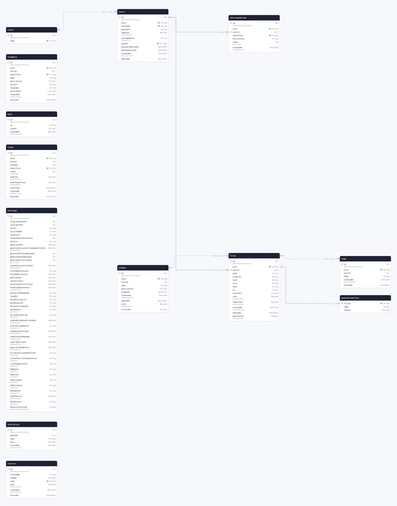
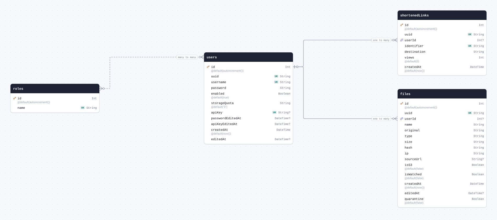
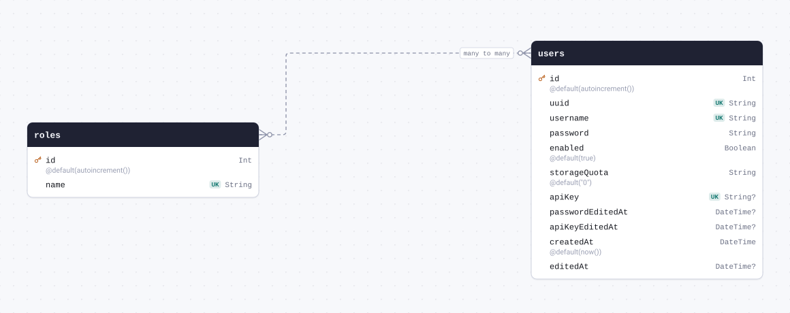
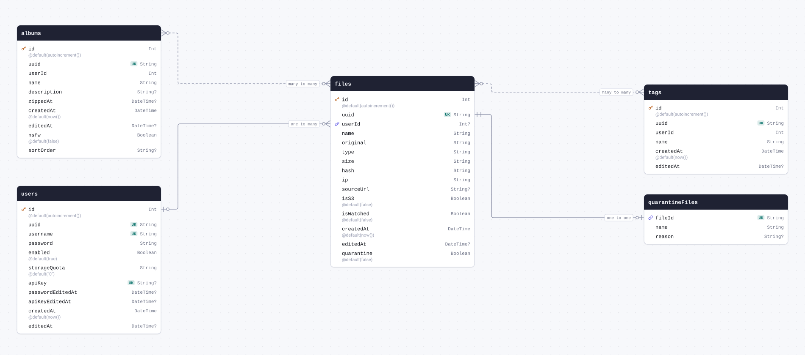
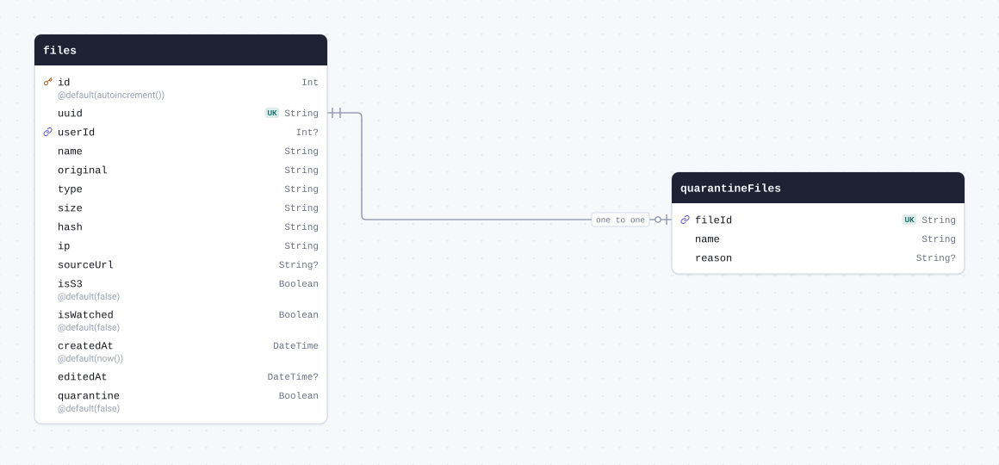
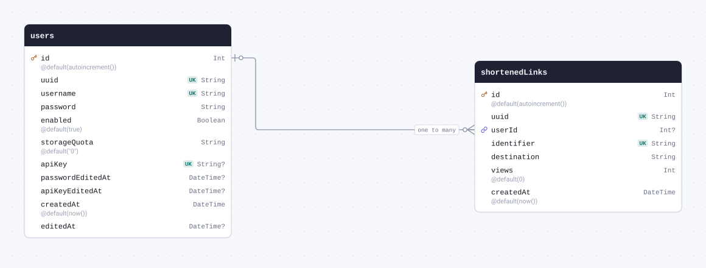
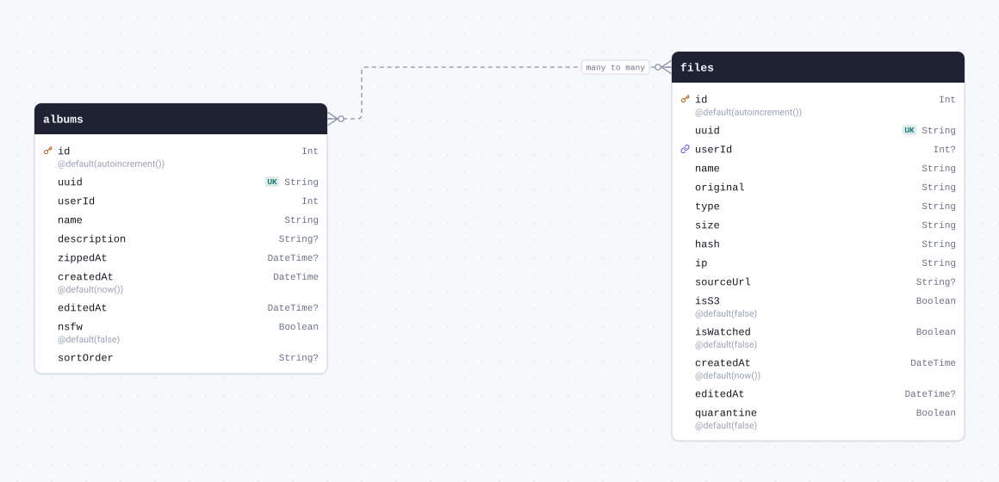
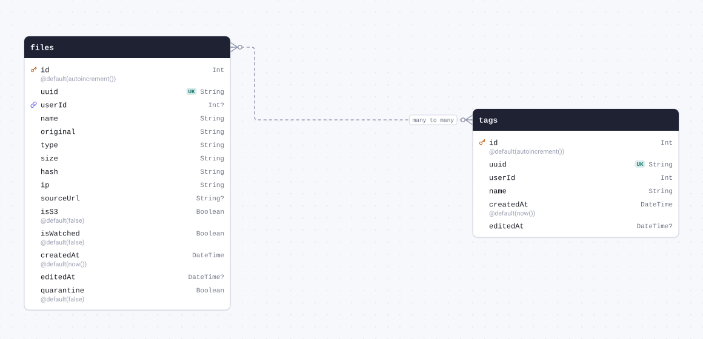

# Schema docs



<details>
<summary>The whole schema as SQL</summary>

```sql
CREATE TABLE "users" (
    "id" INTEGER NOT NULL PRIMARY KEY AUTOINCREMENT,
    "uuid" TEXT NOT NULL,
    "username" TEXT NOT NULL,
    "password" TEXT NOT NULL,
    "enabled" BOOLEAN NOT NULL DEFAULT true,
    "storageQuota" TEXT NOT NULL DEFAULT '0',
    "apiKey" TEXT,
    "passwordEditedAt" DATETIME,
    "apiKeyEditedAt" DATETIME,
    "createdAt" DATETIME NOT NULL DEFAULT CURRENT_TIMESTAMP,
    "editedAt" DATETIME
);

CREATE TABLE "roles" (
    "id" INTEGER NOT NULL PRIMARY KEY AUTOINCREMENT,
    "name" TEXT NOT NULL
);

CREATE TABLE "files" (
    "id" INTEGER NOT NULL PRIMARY KEY AUTOINCREMENT,
    "uuid" TEXT NOT NULL,
    "userId" INTEGER,
    "name" TEXT NOT NULL,
    "original" TEXT NOT NULL,
    "type" TEXT NOT NULL,
    "size" TEXT NOT NULL,
    "hash" TEXT NOT NULL,
    "ip" TEXT NOT NULL,
    "sourceUrl" TEXT,
    "isS3" BOOLEAN NOT NULL DEFAULT false,
    "isWatched" BOOLEAN NOT NULL DEFAULT false,
    "createdAt" DATETIME NOT NULL DEFAULT CURRENT_TIMESTAMP,
    "editedAt" DATETIME,
    "quarantine" BOOLEAN NOT NULL DEFAULT false,
    CONSTRAINT "files_userId_fkey" FOREIGN KEY ("userId") REFERENCES "users" ("id") ON DELETE SET NULL ON UPDATE CASCADE
);

CREATE TABLE "quarantineFiles" (
    "fileId" TEXT NOT NULL,
    "name" TEXT NOT NULL,
    "reason" TEXT,
    CONSTRAINT "quarantineFiles_fileId_fkey" FOREIGN KEY ("fileId") REFERENCES "files" ("uuid") ON DELETE RESTRICT ON UPDATE CASCADE
);

CREATE TABLE "snippets" (
    "id" INTEGER NOT NULL PRIMARY KEY AUTOINCREMENT,
    "uuid" TEXT NOT NULL,
    "userId" INTEGER,
    "identifier" TEXT NOT NULL,
    "name" TEXT NOT NULL,
    "description" TEXT,
    "content" TEXT NOT NULL,
    "language" TEXT NOT NULL,
    "parentUuid" TEXT,
    "createdAt" DATETIME NOT NULL DEFAULT CURRENT_TIMESTAMP,
    "editedAt" DATETIME
);

CREATE TABLE "shortenedLinks" (
    "id" INTEGER NOT NULL PRIMARY KEY AUTOINCREMENT,
    "uuid" TEXT NOT NULL,
    "userId" INTEGER,
    "identifier" TEXT NOT NULL,
    "destination" TEXT NOT NULL,
    "views" INTEGER NOT NULL DEFAULT 0,
    "createdAt" DATETIME NOT NULL DEFAULT CURRENT_TIMESTAMP,
    CONSTRAINT "shortenedLinks_userId_fkey" FOREIGN KEY ("userId") REFERENCES "users" ("id") ON DELETE SET NULL ON UPDATE CASCADE
);

CREATE TABLE "albums" (
    "id" INTEGER NOT NULL PRIMARY KEY AUTOINCREMENT,
    "uuid" TEXT NOT NULL,
    "userId" INTEGER NOT NULL,
    "name" TEXT NOT NULL,
    "description" TEXT,
    "zippedAt" DATETIME,
    "createdAt" DATETIME NOT NULL DEFAULT CURRENT_TIMESTAMP,
    "editedAt" DATETIME,
    "nsfw" BOOLEAN NOT NULL DEFAULT false,
    "sortOrder" TEXT
);

CREATE TABLE "bans" (
    "id" INTEGER NOT NULL PRIMARY KEY AUTOINCREMENT,
    "ip" TEXT NOT NULL,
    "reason" TEXT,
    "createdAt" DATETIME NOT NULL DEFAULT CURRENT_TIMESTAMP
);

CREATE TABLE "links" (
    "id" INTEGER NOT NULL PRIMARY KEY AUTOINCREMENT,
    "uuid" TEXT NOT NULL,
    "userId" INTEGER NOT NULL,
    "albumId" INTEGER NOT NULL,
    "identifier" TEXT NOT NULL,
    "views" INTEGER NOT NULL DEFAULT 0,
    "enabled" BOOLEAN NOT NULL DEFAULT true,
    "enableDownload" BOOLEAN NOT NULL DEFAULT false,
    "expiresAt" DATETIME,
    "createdAt" DATETIME NOT NULL DEFAULT CURRENT_TIMESTAMP,
    "editedAt" DATETIME
);

CREATE TABLE "settings" (
    "id" INTEGER NOT NULL PRIMARY KEY AUTOINCREMENT,
    "rateLimitWindow" INTEGER NOT NULL,
    "rateLimitMax" INTEGER NOT NULL,
    "secret" TEXT NOT NULL,
    "serviceName" TEXT NOT NULL,
    "chunkSize" TEXT NOT NULL,
    "chunkedUploadsTimeout" INTEGER NOT NULL,
    "maxSize" TEXT NOT NULL,
    "generateZips" BOOLEAN NOT NULL,
    "generateOriginalFileNameWithIdentifier" BOOLEAN NOT NULL DEFAULT false,
    "generatedFilenameLength" INTEGER NOT NULL,
    "generatedAlbumLength" INTEGER NOT NULL,
    "generatedLinksLength" INTEGER NOT NULL DEFAULT 8,
    "saveDuplicatesToAlbum" BOOLEAN NOT NULL DEFAULT false,
    "blockedExtensions" TEXT NOT NULL,
    "blockNoExtension" BOOLEAN NOT NULL,
    "publicMode" BOOLEAN NOT NULL,
    "userAccounts" BOOLEAN NOT NULL,
    "disableStatisticsCron" BOOLEAN NOT NULL,
    "disableUpdateCheck" BOOLEAN NOT NULL DEFAULT false,
    "backgroundImageURL" TEXT NOT NULL,
    "logoURL" TEXT NOT NULL,
    "metaDescription" TEXT NOT NULL,
    "metaKeywords" TEXT NOT NULL,
    "metaTwitterHandle" TEXT NOT NULL,
    "metaDomain" TEXT NOT NULL DEFAULT '',
    "serveUploadsFrom" TEXT NOT NULL DEFAULT '',
    "enableMixedCaseFilenames" BOOLEAN NOT NULL DEFAULT true,
    "usersStorageQuota" TEXT NOT NULL DEFAULT '0',
    "useNetworkStorage" BOOLEAN NOT NULL DEFAULT false,
    "useMinimalHomepage" BOOLEAN NOT NULL DEFAULT false,
    "useUrlShortener" BOOLEAN NOT NULL DEFAULT false,
    "generateThumbnails" BOOLEAN NOT NULL DEFAULT true,
    "privacyPolicyPageContent" TEXT NOT NULL DEFAULT '',
    "termsOfServicePageContent" TEXT NOT NULL DEFAULT '',
    "rulesPageContent" TEXT NOT NULL DEFAULT '',
    "S3Region" TEXT NOT NULL DEFAULT '',
    "S3Bucket" TEXT NOT NULL DEFAULT '',
    "S3AccessKey" TEXT NOT NULL DEFAULT '',
    "S3SecretKey" TEXT NOT NULL DEFAULT '',
    "S3Endpoint" TEXT NOT NULL DEFAULT '',
    "S3PathStyle" BOOLEAN NOT NULL DEFAULT false,
    "S3PublicUrl" TEXT NOT NULL DEFAULT '',
    "defaultSortOrder" TEXT NOT NULL DEFAULT 'createdAt:desc'
);

CREATE TABLE "statistics" (
    "id" INTEGER NOT NULL PRIMARY KEY AUTOINCREMENT,
    "batchId" INTEGER,
    "type" TEXT,
    "data" TEXT,
    "createdAt" DATETIME NOT NULL DEFAULT CURRENT_TIMESTAMP
);

CREATE TABLE "tags" (
    "id" INTEGER NOT NULL PRIMARY KEY AUTOINCREMENT,
    "uuid" TEXT NOT NULL,
    "userId" INTEGER NOT NULL,
    "name" TEXT NOT NULL,
    "createdAt" DATETIME NOT NULL DEFAULT CURRENT_TIMESTAMP,
    "editedAt" DATETIME
);

CREATE TABLE "invites" (
    "id" INTEGER NOT NULL PRIMARY KEY AUTOINCREMENT,
    "createdBy" TEXT NOT NULL,
    "usedBy" TEXT,
    "code" TEXT NOT NULL,
    "used" BOOLEAN NOT NULL DEFAULT false,
    "createdAt" DATETIME NOT NULL DEFAULT CURRENT_TIMESTAMP,
    "editedAt" DATETIME
);

CREATE TABLE "_rolesTousers" (
    "A" INTEGER NOT NULL,
    "B" INTEGER NOT NULL,
    CONSTRAINT "_rolesTousers_A_fkey" FOREIGN KEY ("A") REFERENCES "roles" ("id") ON DELETE CASCADE ON UPDATE CASCADE,
    CONSTRAINT "_rolesTousers_B_fkey" FOREIGN KEY ("B") REFERENCES "users" ("id") ON DELETE CASCADE ON UPDATE CASCADE
);

CREATE TABLE "_filesTotags" (
    "A" INTEGER NOT NULL,
    "B" INTEGER NOT NULL,
    CONSTRAINT "_filesTotags_A_fkey" FOREIGN KEY ("A") REFERENCES "files" ("id") ON DELETE CASCADE ON UPDATE CASCADE,
    CONSTRAINT "_filesTotags_B_fkey" FOREIGN KEY ("B") REFERENCES "tags" ("id") ON DELETE CASCADE ON UPDATE CASCADE
);

CREATE TABLE "_albumsTofiles" (
    "A" INTEGER NOT NULL,
    "B" INTEGER NOT NULL,
    CONSTRAINT "_albumsTofiles_A_fkey" FOREIGN KEY ("A") REFERENCES "albums" ("id") ON DELETE CASCADE ON UPDATE CASCADE,
    CONSTRAINT "_albumsTofiles_B_fkey" FOREIGN KEY ("B") REFERENCES "files" ("id") ON DELETE CASCADE ON UPDATE CASCADE
);

CREATE UNIQUE INDEX "users_uuid_key" ON "users"("uuid");

CREATE UNIQUE INDEX "users_username_key" ON "users"("username");

CREATE UNIQUE INDEX "users_apiKey_key" ON "users"("apiKey");

CREATE UNIQUE INDEX "roles_name_key" ON "roles"("name");

CREATE UNIQUE INDEX "files_uuid_key" ON "files"("uuid");

CREATE UNIQUE INDEX "quarantineFiles_fileId_key" ON "quarantineFiles"("fileId");

CREATE UNIQUE INDEX "snippets_uuid_key" ON "snippets"("uuid");

CREATE UNIQUE INDEX "snippets_identifier_key" ON "snippets"("identifier");

CREATE UNIQUE INDEX "shortenedLinks_uuid_key" ON "shortenedLinks"("uuid");

CREATE UNIQUE INDEX "shortenedLinks_identifier_key" ON "shortenedLinks"("identifier");

CREATE UNIQUE INDEX "albums_uuid_key" ON "albums"("uuid");

CREATE UNIQUE INDEX "links_uuid_key" ON "links"("uuid");

CREATE UNIQUE INDEX "links_identifier_key" ON "links"("identifier");

CREATE UNIQUE INDEX "tags_uuid_key" ON "tags"("uuid");

CREATE UNIQUE INDEX "invites_code_key" ON "invites"("code");

CREATE UNIQUE INDEX "_rolesTousers_AB_unique" ON "_rolesTousers"("A", "B");

CREATE INDEX "_rolesTousers_B_index" ON "_rolesTousers"("B");

CREATE UNIQUE INDEX "_filesTotags_AB_unique" ON "_filesTotags"("A", "B");

CREATE INDEX "_filesTotags_B_index" ON "_filesTotags"("B");

CREATE UNIQUE INDEX "_albumsTofiles_AB_unique" ON "_albumsTofiles"("A", "B");

CREATE INDEX "_albumsTofiles_B_index" ON "_albumsTofiles"("B");
```

</details>

## Contents

| Model                                     | Table             | Description |
| ----------------------------------------- | ----------------- | ----------- |
| [users](#model-users)                     | `users`           |             |
| [roles](#model-roles)                     | `roles`           |             |
| [files](#model-files)                     | `files`           |             |
| [quarantineFiles](#model-quarantineFiles) | `quarantineFiles` |             |
| [snippets](#model-snippets)               | `snippets`        |             |
| [shortenedLinks](#model-shortenedLinks)   | `shortenedLinks`  |             |
| [albums](#model-albums)                   | `albums`          |             |
| [bans](#model-bans)                       | `bans`            |             |
| [links](#model-links)                     | `links`           |             |
| [settings](#model-settings)               | `settings`        |             |
| [statistics](#model-statistics)           | `statistics`      |             |
| [tags](#model-tags)                       | `tags`            |             |
| [invites](#model-invites)                 | `invites`         |             |

## Models

<a id="model-users"></a>

### users



| Field              | Type       | Constraints     | Default           | Description |
| ------------------ | ---------- | --------------- | ----------------- | ----------- |
| `id`               | `Int`      | PK NOT NULL     | `autoincrement()` |             |
| `uuid`             | `String`   | UNIQUE NOT NULL |                   |             |
| `username`         | `String`   | UNIQUE NOT NULL |                   |             |
| `password`         | `String`   | NOT NULL        |                   |             |
| `enabled`          | `Boolean`  | NOT NULL        | `true`            |             |
| `storageQuota`     | `String`   | NOT NULL        | `"0"`             |             |
| `apiKey`           | `String`   | UNIQUE NULL     |                   |             |
| `passwordEditedAt` | `DateTime` | NULL            |                   |             |
| `apiKeyEditedAt`   | `DateTime` | NULL            |                   |             |
| `createdAt`        | `DateTime` | NOT NULL        | `now()`           |             |
| `editedAt`         | `DateTime` | NULL            |                   |             |

#### Referenced by

- `id` ← [files.userId](#model-files) (one-to-many)
- `id` ← [shortenedLinks.userId](#model-shortenedLinks) (one-to-many)

#### Many to many

- `roles` ↔ [roles.users](#model-roles) through `_rolesTousers`

#### Definition

```sql
CREATE TABLE "users" (
    "id" INTEGER NOT NULL PRIMARY KEY AUTOINCREMENT,
    "uuid" TEXT NOT NULL,
    "username" TEXT NOT NULL,
    "password" TEXT NOT NULL,
    "enabled" BOOLEAN NOT NULL DEFAULT true,
    "storageQuota" TEXT NOT NULL DEFAULT '0',
    "apiKey" TEXT,
    "passwordEditedAt" DATETIME,
    "apiKeyEditedAt" DATETIME,
    "createdAt" DATETIME NOT NULL DEFAULT CURRENT_TIMESTAMP,
    "editedAt" DATETIME
);

CREATE UNIQUE INDEX "users_uuid_key" ON "users"("uuid");

CREATE UNIQUE INDEX "users_username_key" ON "users"("username");

CREATE UNIQUE INDEX "users_apiKey_key" ON "users"("apiKey");
```

<details>
<summary>Queries and their SQL</summary>

**findMany**: Every row

```ts
await prisma.users.findMany();
```

```sql
SELECT
  `main`.`users`.`id`,
  `main`.`users`.`uuid`,
  `main`.`users`.`username`,
  `main`.`users`.`password`,
  `main`.`users`.`enabled`,
  `main`.`users`.`storageQuota`,
  `main`.`users`.`apiKey`,
  `main`.`users`.`passwordEditedAt`,
  `main`.`users`.`apiKeyEditedAt`,
  `main`.`users`.`createdAt`,
  `main`.`users`.`editedAt`
FROM
  `main`.`users`
WHERE
  1 = 1
LIMIT
  ?
OFFSET
  ?
-- params: [-1,"0"]
```

**count**: How many rows there are

```ts
await prisma.users.count();
```

```sql
SELECT
  COUNT(*) AS `_count$_all`
FROM
  (
    SELECT
      `main`.`users`.`id`
    FROM
      `main`.`users`
    WHERE
      1 = 1
    LIMIT
      ?
    OFFSET
      ?
  ) AS `sub`
-- params: [-1,"0"]
```

**findMany**: Every row with its relations

```ts
await prisma.users.findMany({ include: { files: true, roles: true, links: true } });
```

```sql
SELECT
  `main`.`users`.`id`,
  `main`.`users`.`uuid`,
  `main`.`users`.`username`,
  `main`.`users`.`password`,
  `main`.`users`.`enabled`,
  `main`.`users`.`storageQuota`,
  `main`.`users`.`apiKey`,
  `main`.`users`.`passwordEditedAt`,
  `main`.`users`.`apiKeyEditedAt`,
  `main`.`users`.`createdAt`,
  `main`.`users`.`editedAt`
FROM
  `main`.`users`
WHERE
  1 = 1
LIMIT
  ?
OFFSET
  ?
-- params: [-1,"0"]

SELECT
  `main`.`files`.`id`,
  `main`.`files`.`uuid`,
  `main`.`files`.`userId`,
  `main`.`files`.`name`,
  `main`.`files`.`original`,
  `main`.`files`.`type`,
  `main`.`files`.`size`,
  `main`.`files`.`hash`,
  `main`.`files`.`ip`,
  `main`.`files`.`sourceUrl`,
  `main`.`files`.`isS3`,
  `main`.`files`.`isWatched`,
  `main`.`files`.`createdAt`,
  `main`.`files`.`editedAt`,
  `main`.`files`.`quarantine`
FROM
  `main`.`files`
WHERE
  `main`.`files`.`userId` IN (?)
LIMIT
  ?
OFFSET
  ?
-- params: ["<id of the rows above>",-1,"0"]

SELECT
  `main`.`roles`.`id`,
  `main`.`roles`.`name`,
  `t0`.`B` AS `rolesTousers@users`
FROM
  `main`.`roles`
  INNER JOIN `main`.`_rolesTousers` AS `t0` ON `t0`.`A` = `main`.`roles`.`id`
WHERE
  (
    1 = 1
    AND `t0`.`B` IN (?)
  )
LIMIT
  ?
OFFSET
  ?
-- params: ["<id of the rows above>",-1,"0"]

SELECT
  `main`.`shortenedLinks`.`id`,
  `main`.`shortenedLinks`.`uuid`,
  `main`.`shortenedLinks`.`userId`,
  `main`.`shortenedLinks`.`identifier`,
  `main`.`shortenedLinks`.`destination`,
  `main`.`shortenedLinks`.`views`,
  `main`.`shortenedLinks`.`createdAt`
FROM
  `main`.`shortenedLinks`
WHERE
  `main`.`shortenedLinks`.`userId` IN (?)
LIMIT
  ?
OFFSET
  ?
-- params: ["<id of the rows above>",-1,"0"]
```

**findUnique**: One row by what is unique to it

```ts
await prisma.users.findUnique({ where: { id: 1 } });
```

```sql
SELECT
  `main`.`users`.`id`,
  `main`.`users`.`uuid`,
  `main`.`users`.`username`,
  `main`.`users`.`password`,
  `main`.`users`.`enabled`,
  `main`.`users`.`storageQuota`,
  `main`.`users`.`apiKey`,
  `main`.`users`.`passwordEditedAt`,
  `main`.`users`.`apiKeyEditedAt`,
  `main`.`users`.`createdAt`,
  `main`.`users`.`editedAt`
FROM
  `main`.`users`
WHERE
  (
    `main`.`users`.`id` = ?
    AND 1 = 1
  )
LIMIT
  ?
OFFSET
  ?
-- params: ["1","1","0"]
```

**create**: Create a row

```ts
await prisma.users.create({ data: { uuid: "example", username: "example", password: "example" } });
```

```sql
INSERT INTO
  `main`.`users` (
    `uuid`,
    `username`,
    `password`,
    `enabled`,
    `storageQuota`,
    `createdAt`
  )
VALUES
  (?, ?, ?, ?, ?, ?)
RETURNING
  `id` AS `id`,
  `uuid` AS `uuid`,
  `username` AS `username`,
  `password` AS `password`,
  `enabled` AS `enabled`,
  `storageQuota` AS `storageQuota`,
  `apiKey` AS `apiKey`,
  `passwordEditedAt` AS `passwordEditedAt`,
  `apiKeyEditedAt` AS `apiKeyEditedAt`,
  `createdAt` AS `createdAt`,
  `editedAt` AS `editedAt`
-- params: ["example","example","example",true,"0","<now()>"]
```

**update**: Update a row

```ts
await prisma.users.update({ where: { id: 1 }, data: { uuid: "example" } });
```

```sql
UPDATE `main`.`users`
SET
  `uuid` = ?
WHERE
  (
    `main`.`users`.`id` = ?
    AND 1 = 1
  )
RETURNING
  `id` AS `id`,
  `uuid` AS `uuid`,
  `username` AS `username`,
  `password` AS `password`,
  `enabled` AS `enabled`,
  `storageQuota` AS `storageQuota`,
  `apiKey` AS `apiKey`,
  `passwordEditedAt` AS `passwordEditedAt`,
  `apiKeyEditedAt` AS `apiKeyEditedAt`,
  `createdAt` AS `createdAt`,
  `editedAt` AS `editedAt`
-- params: ["example","1"]
```

**delete**: Delete a row

```ts
await prisma.users.delete({ where: { id: 1 } });
```

```sql
DELETE FROM `main`.`users`
WHERE
  (
    `main`.`users`.`id` = ?
    AND 1 = 1
  )
RETURNING
  `id` AS `id`,
  `uuid` AS `uuid`,
  `username` AS `username`,
  `password` AS `password`,
  `enabled` AS `enabled`,
  `storageQuota` AS `storageQuota`,
  `apiKey` AS `apiKey`,
  `passwordEditedAt` AS `passwordEditedAt`,
  `apiKeyEditedAt` AS `apiKeyEditedAt`,
  `createdAt` AS `createdAt`,
  `editedAt` AS `editedAt`
-- params: ["1"]
```

</details>

<a id="model-roles"></a>

### roles



| Field  | Type     | Constraints     | Default           | Description |
| ------ | -------- | --------------- | ----------------- | ----------- |
| `id`   | `Int`    | PK NOT NULL     | `autoincrement()` |             |
| `name` | `String` | UNIQUE NOT NULL |                   |             |

#### Many to many

- `users` ↔ [users.roles](#model-users) through `_rolesTousers`

#### Definition

```sql
CREATE TABLE "roles" (
    "id" INTEGER NOT NULL PRIMARY KEY AUTOINCREMENT,
    "name" TEXT NOT NULL
);

CREATE UNIQUE INDEX "roles_name_key" ON "roles"("name");
```

<details>
<summary>Queries and their SQL</summary>

**findMany**: Every row

```ts
await prisma.roles.findMany();
```

```sql
SELECT
  `main`.`roles`.`id`,
  `main`.`roles`.`name`
FROM
  `main`.`roles`
WHERE
  1 = 1
LIMIT
  ?
OFFSET
  ?
-- params: [-1,"0"]
```

**count**: How many rows there are

```ts
await prisma.roles.count();
```

```sql
SELECT
  COUNT(*) AS `_count$_all`
FROM
  (
    SELECT
      `main`.`roles`.`id`
    FROM
      `main`.`roles`
    WHERE
      1 = 1
    LIMIT
      ?
    OFFSET
      ?
  ) AS `sub`
-- params: [-1,"0"]
```

**findMany**: Every row with its relations

```ts
await prisma.roles.findMany({ include: { users: true } });
```

```sql
SELECT
  `main`.`roles`.`id`,
  `main`.`roles`.`name`
FROM
  `main`.`roles`
WHERE
  1 = 1
LIMIT
  ?
OFFSET
  ?
-- params: [-1,"0"]

SELECT
  `main`.`users`.`id`,
  `main`.`users`.`uuid`,
  `main`.`users`.`username`,
  `main`.`users`.`password`,
  `main`.`users`.`enabled`,
  `main`.`users`.`storageQuota`,
  `main`.`users`.`apiKey`,
  `main`.`users`.`passwordEditedAt`,
  `main`.`users`.`apiKeyEditedAt`,
  `main`.`users`.`createdAt`,
  `main`.`users`.`editedAt`,
  `t0`.`A` AS `rolesTousers@roles`
FROM
  `main`.`users`
  INNER JOIN `main`.`_rolesTousers` AS `t0` ON `t0`.`B` = `main`.`users`.`id`
WHERE
  (
    1 = 1
    AND `t0`.`A` IN (?)
  )
LIMIT
  ?
OFFSET
  ?
-- params: ["<id of the rows above>",-1,"0"]
```

**findUnique**: One row by what is unique to it

```ts
await prisma.roles.findUnique({ where: { id: 1 } });
```

```sql
SELECT
  `main`.`roles`.`id`,
  `main`.`roles`.`name`
FROM
  `main`.`roles`
WHERE
  (
    `main`.`roles`.`id` = ?
    AND 1 = 1
  )
LIMIT
  ?
OFFSET
  ?
-- params: ["1","1","0"]
```

**create**: Create a row

```ts
await prisma.roles.create({ data: { name: "example" } });
```

```sql
INSERT INTO
  `main`.`roles` (`name`)
VALUES
  (?)
RETURNING
  `id` AS `id`,
  `name` AS `name`
-- params: ["example"]
```

**update**: Update a row

```ts
await prisma.roles.update({ where: { id: 1 }, data: { name: "example" } });
```

```sql
UPDATE `main`.`roles`
SET
  `name` = ?
WHERE
  (
    `main`.`roles`.`id` = ?
    AND 1 = 1
  )
RETURNING
  `id` AS `id`,
  `name` AS `name`
-- params: ["example","1"]
```

**delete**: Delete a row

```ts
await prisma.roles.delete({ where: { id: 1 } });
```

```sql
DELETE FROM `main`.`roles`
WHERE
  (
    `main`.`roles`.`id` = ?
    AND 1 = 1
  )
RETURNING
  `id` AS `id`,
  `name` AS `name`
-- params: ["1"]
```

</details>

<a id="model-files"></a>

### files



| Field        | Type       | Constraints                     | Default           | Description |
| ------------ | ---------- | ------------------------------- | ----------------- | ----------- |
| `id`         | `Int`      | PK NOT NULL                     | `autoincrement()` |             |
| `uuid`       | `String`   | UNIQUE NOT NULL                 |                   |             |
| `userId`     | `Int`      | NULL → [users.id](#model-users) |                   |             |
| `name`       | `String`   | NOT NULL                        |                   |             |
| `original`   | `String`   | NOT NULL                        |                   |             |
| `type`       | `String`   | NOT NULL                        |                   |             |
| `size`       | `String`   | NOT NULL                        |                   |             |
| `hash`       | `String`   | NOT NULL                        |                   |             |
| `ip`         | `String`   | NOT NULL                        |                   |             |
| `sourceUrl`  | `String`   | NULL                            |                   |             |
| `isS3`       | `Boolean`  | NOT NULL                        | `false`           |             |
| `isWatched`  | `Boolean`  | NOT NULL                        | `false`           |             |
| `createdAt`  | `DateTime` | NOT NULL                        | `now()`           |             |
| `editedAt`   | `DateTime` | NULL                            |                   |             |
| `quarantine` | `Boolean`  | NOT NULL                        | `false`           |             |

#### References

- `userId` → [users.id](#model-users) (many-to-one)

#### Referenced by

- `uuid` ← [quarantineFiles.fileId](#model-quarantineFiles) (one-to-one)

#### Many to many

- `tags` ↔ [tags.files](#model-tags) through `_filesTotags`
- `albums` ↔ [albums.files](#model-albums) through `_albumsTofiles`

#### Definition

```sql
CREATE TABLE "files" (
    "id" INTEGER NOT NULL PRIMARY KEY AUTOINCREMENT,
    "uuid" TEXT NOT NULL,
    "userId" INTEGER,
    "name" TEXT NOT NULL,
    "original" TEXT NOT NULL,
    "type" TEXT NOT NULL,
    "size" TEXT NOT NULL,
    "hash" TEXT NOT NULL,
    "ip" TEXT NOT NULL,
    "sourceUrl" TEXT,
    "isS3" BOOLEAN NOT NULL DEFAULT false,
    "isWatched" BOOLEAN NOT NULL DEFAULT false,
    "createdAt" DATETIME NOT NULL DEFAULT CURRENT_TIMESTAMP,
    "editedAt" DATETIME,
    "quarantine" BOOLEAN NOT NULL DEFAULT false,
    CONSTRAINT "files_userId_fkey" FOREIGN KEY ("userId") REFERENCES "users" ("id") ON DELETE SET NULL ON UPDATE CASCADE
);

CREATE UNIQUE INDEX "files_uuid_key" ON "files"("uuid");
```

<details>
<summary>Queries and their SQL</summary>

**findMany**: Every row

```ts
await prisma.files.findMany();
```

```sql
SELECT
  `main`.`files`.`id`,
  `main`.`files`.`uuid`,
  `main`.`files`.`userId`,
  `main`.`files`.`name`,
  `main`.`files`.`original`,
  `main`.`files`.`type`,
  `main`.`files`.`size`,
  `main`.`files`.`hash`,
  `main`.`files`.`ip`,
  `main`.`files`.`sourceUrl`,
  `main`.`files`.`isS3`,
  `main`.`files`.`isWatched`,
  `main`.`files`.`createdAt`,
  `main`.`files`.`editedAt`,
  `main`.`files`.`quarantine`
FROM
  `main`.`files`
WHERE
  1 = 1
LIMIT
  ?
OFFSET
  ?
-- params: [-1,"0"]
```

**count**: How many rows there are

```ts
await prisma.files.count();
```

```sql
SELECT
  COUNT(*) AS `_count$_all`
FROM
  (
    SELECT
      `main`.`files`.`id`
    FROM
      `main`.`files`
    WHERE
      1 = 1
    LIMIT
      ?
    OFFSET
      ?
  ) AS `sub`
-- params: [-1,"0"]
```

**findMany**: Every row with its relations

```ts
await prisma.files.findMany({
  include: { user: true, albums: true, tags: true, quarantineFile: true },
});
```

```sql
SELECT
  `main`.`files`.`id`,
  `main`.`files`.`uuid`,
  `main`.`files`.`userId`,
  `main`.`files`.`name`,
  `main`.`files`.`original`,
  `main`.`files`.`type`,
  `main`.`files`.`size`,
  `main`.`files`.`hash`,
  `main`.`files`.`ip`,
  `main`.`files`.`sourceUrl`,
  `main`.`files`.`isS3`,
  `main`.`files`.`isWatched`,
  `main`.`files`.`createdAt`,
  `main`.`files`.`editedAt`,
  `main`.`files`.`quarantine`
FROM
  `main`.`files`
WHERE
  1 = 1
LIMIT
  ?
OFFSET
  ?
-- params: [-1,"0"]

SELECT
  `main`.`users`.`id`,
  `main`.`users`.`uuid`,
  `main`.`users`.`username`,
  `main`.`users`.`password`,
  `main`.`users`.`enabled`,
  `main`.`users`.`storageQuota`,
  `main`.`users`.`apiKey`,
  `main`.`users`.`passwordEditedAt`,
  `main`.`users`.`apiKeyEditedAt`,
  `main`.`users`.`createdAt`,
  `main`.`users`.`editedAt`
FROM
  `main`.`users`
WHERE
  `main`.`users`.`id` IN (?)
LIMIT
  ?
OFFSET
  ?
-- params: ["<userId of the rows above>",-1,"0"]

SELECT
  `main`.`albums`.`id`,
  `main`.`albums`.`uuid`,
  `main`.`albums`.`userId`,
  `main`.`albums`.`name`,
  `main`.`albums`.`description`,
  `main`.`albums`.`zippedAt`,
  `main`.`albums`.`createdAt`,
  `main`.`albums`.`editedAt`,
  `main`.`albums`.`nsfw`,
  `main`.`albums`.`sortOrder`,
  `t0`.`B` AS `albumsTofiles@files`
FROM
  `main`.`albums`
  INNER JOIN `main`.`_albumsTofiles` AS `t0` ON `t0`.`A` = `main`.`albums`.`id`
WHERE
  (
    1 = 1
    AND `t0`.`B` IN (?)
  )
LIMIT
  ?
OFFSET
  ?
-- params: ["<id of the rows above>",-1,"0"]

SELECT
  `main`.`tags`.`id`,
  `main`.`tags`.`uuid`,
  `main`.`tags`.`userId`,
  `main`.`tags`.`name`,
  `main`.`tags`.`createdAt`,
  `main`.`tags`.`editedAt`,
  `t1`.`A` AS `filesTotags@files`
FROM
  `main`.`tags`
  INNER JOIN `main`.`_filesTotags` AS `t1` ON `t1`.`B` = `main`.`tags`.`id`
WHERE
  (
    1 = 1
    AND `t1`.`A` IN (?)
  )
LIMIT
  ?
OFFSET
  ?
-- params: ["<id of the rows above>",-1,"0"]

SELECT
  `main`.`quarantineFiles`.`fileId`,
  `main`.`quarantineFiles`.`name`,
  `main`.`quarantineFiles`.`reason`
FROM
  `main`.`quarantineFiles`
WHERE
  `main`.`quarantineFiles`.`fileId` IN (?)
LIMIT
  ?
OFFSET
  ?
-- params: ["<uuid of the rows above>",-1,"0"]
```

**findUnique**: One row by what is unique to it

```ts
await prisma.files.findUnique({ where: { id: 1 } });
```

```sql
SELECT
  `main`.`files`.`id`,
  `main`.`files`.`uuid`,
  `main`.`files`.`userId`,
  `main`.`files`.`name`,
  `main`.`files`.`original`,
  `main`.`files`.`type`,
  `main`.`files`.`size`,
  `main`.`files`.`hash`,
  `main`.`files`.`ip`,
  `main`.`files`.`sourceUrl`,
  `main`.`files`.`isS3`,
  `main`.`files`.`isWatched`,
  `main`.`files`.`createdAt`,
  `main`.`files`.`editedAt`,
  `main`.`files`.`quarantine`
FROM
  `main`.`files`
WHERE
  (
    `main`.`files`.`id` = ?
    AND 1 = 1
  )
LIMIT
  ?
OFFSET
  ?
-- params: ["1","1","0"]
```

**create**: Create a row

```ts
await prisma.files.create({
  data: {
    uuid: "example",
    name: "example",
    original: "example",
    type: "example",
    size: "example",
    hash: "example",
    ip: "example",
  },
});
```

```sql
INSERT INTO
  `main`.`files` (
    `uuid`,
    `name`,
    `original`,
    `type`,
    `size`,
    `hash`,
    `ip`,
    `isS3`,
    `isWatched`,
    `createdAt`,
    `quarantine`
  )
VALUES
  (?, ?, ?, ?, ?, ?, ?, ?, ?, ?, ?)
RETURNING
  `id` AS `id`,
  `uuid` AS `uuid`,
  `userId` AS `userId`,
  `name` AS `name`,
  `original` AS `original`,
  `type` AS `type`,
  `size` AS `size`,
  `hash` AS `hash`,
  `ip` AS `ip`,
  `sourceUrl` AS `sourceUrl`,
  `isS3` AS `isS3`,
  `isWatched` AS `isWatched`,
  `createdAt` AS `createdAt`,
  `editedAt` AS `editedAt`,
  `quarantine` AS `quarantine`
-- params: ["example","example","example","example","example","example","example",false,false,"<now()>",false]
```

**update**: Update a row

```ts
await prisma.files.update({ where: { id: 1 }, data: { uuid: "example" } });
```

```sql
UPDATE `main`.`files`
SET
  `uuid` = ?
WHERE
  (
    `main`.`files`.`id` = ?
    AND 1 = 1
  )
RETURNING
  `id` AS `id`,
  `uuid` AS `uuid`,
  `userId` AS `userId`,
  `name` AS `name`,
  `original` AS `original`,
  `type` AS `type`,
  `size` AS `size`,
  `hash` AS `hash`,
  `ip` AS `ip`,
  `sourceUrl` AS `sourceUrl`,
  `isS3` AS `isS3`,
  `isWatched` AS `isWatched`,
  `createdAt` AS `createdAt`,
  `editedAt` AS `editedAt`,
  `quarantine` AS `quarantine`
-- params: ["example","1"]
```

**delete**: Delete a row

```ts
await prisma.files.delete({ where: { id: 1 } });
```

```sql
DELETE FROM `main`.`files`
WHERE
  (
    `main`.`files`.`id` = ?
    AND 1 = 1
  )
RETURNING
  `id` AS `id`,
  `uuid` AS `uuid`,
  `userId` AS `userId`,
  `name` AS `name`,
  `original` AS `original`,
  `type` AS `type`,
  `size` AS `size`,
  `hash` AS `hash`,
  `ip` AS `ip`,
  `sourceUrl` AS `sourceUrl`,
  `isS3` AS `isS3`,
  `isWatched` AS `isWatched`,
  `createdAt` AS `createdAt`,
  `editedAt` AS `editedAt`,
  `quarantine` AS `quarantine`
-- params: ["1"]
```

</details>

<a id="model-quarantineFiles"></a>

### quarantineFiles



| Field    | Type     | Constraints                                  | Default | Description |
| -------- | -------- | -------------------------------------------- | ------- | ----------- |
| `fileId` | `String` | UNIQUE NOT NULL → [files.uuid](#model-files) |         |             |
| `name`   | `String` | NOT NULL                                     |         |             |
| `reason` | `String` | NULL                                         |         |             |

#### References

- `fileId` → [files.uuid](#model-files) (one-to-one)

#### Definition

```sql
CREATE TABLE "quarantineFiles" (
    "fileId" TEXT NOT NULL,
    "name" TEXT NOT NULL,
    "reason" TEXT,
    CONSTRAINT "quarantineFiles_fileId_fkey" FOREIGN KEY ("fileId") REFERENCES "files" ("uuid") ON DELETE RESTRICT ON UPDATE CASCADE
);

CREATE UNIQUE INDEX "quarantineFiles_fileId_key" ON "quarantineFiles"("fileId");
```

<details>
<summary>Queries and their SQL</summary>

**findMany**: Every row

```ts
await prisma.quarantineFiles.findMany();
```

```sql
SELECT
  `main`.`quarantineFiles`.`fileId`,
  `main`.`quarantineFiles`.`name`,
  `main`.`quarantineFiles`.`reason`
FROM
  `main`.`quarantineFiles`
WHERE
  1 = 1
LIMIT
  ?
OFFSET
  ?
-- params: [-1,"0"]
```

**count**: How many rows there are

```ts
await prisma.quarantineFiles.count();
```

```sql
SELECT
  COUNT(*) AS `_count$_all`
FROM
  (
    SELECT
      `main`.`quarantineFiles`.`fileId`
    FROM
      `main`.`quarantineFiles`
    WHERE
      1 = 1
    LIMIT
      ?
    OFFSET
      ?
  ) AS `sub`
-- params: [-1,"0"]
```

**findMany**: Every row with its relations

```ts
await prisma.quarantineFiles.findMany({ include: { file: true } });
```

```sql
SELECT
  `main`.`quarantineFiles`.`fileId`,
  `main`.`quarantineFiles`.`name`,
  `main`.`quarantineFiles`.`reason`
FROM
  `main`.`quarantineFiles`
WHERE
  1 = 1
LIMIT
  ?
OFFSET
  ?
-- params: [-1,"0"]

SELECT
  `main`.`files`.`id`,
  `main`.`files`.`uuid`,
  `main`.`files`.`userId`,
  `main`.`files`.`name`,
  `main`.`files`.`original`,
  `main`.`files`.`type`,
  `main`.`files`.`size`,
  `main`.`files`.`hash`,
  `main`.`files`.`ip`,
  `main`.`files`.`sourceUrl`,
  `main`.`files`.`isS3`,
  `main`.`files`.`isWatched`,
  `main`.`files`.`createdAt`,
  `main`.`files`.`editedAt`,
  `main`.`files`.`quarantine`
FROM
  `main`.`files`
WHERE
  `main`.`files`.`uuid` IN (?)
LIMIT
  ?
OFFSET
  ?
-- params: ["<fileId of the rows above>",-1,"0"]
```

**findUnique**: One row by what is unique to it

```ts
await prisma.quarantineFiles.findUnique({ where: { fileId: "example" } });
```

```sql
SELECT
  `main`.`quarantineFiles`.`fileId`,
  `main`.`quarantineFiles`.`name`,
  `main`.`quarantineFiles`.`reason`
FROM
  `main`.`quarantineFiles`
WHERE
  (
    `main`.`quarantineFiles`.`fileId` = ?
    AND 1 = 1
  )
LIMIT
  ?
OFFSET
  ?
-- params: ["example","1","0"]
```

**create**: Create a row

```ts
await prisma.quarantineFiles.create({ data: { fileId: "example", name: "example" } });
```

```sql
INSERT INTO
  `main`.`quarantineFiles` (`fileId`, `name`)
VALUES
  (?, ?)
RETURNING
  `fileId` AS `fileId`,
  `name` AS `name`,
  `reason` AS `reason`
-- params: ["example","example"]
```

**update**: Update a row

```ts
await prisma.quarantineFiles.update({ where: { fileId: "example" }, data: { name: "example" } });
```

```sql
UPDATE `main`.`quarantineFiles`
SET
  `name` = ?
WHERE
  (
    `main`.`quarantineFiles`.`fileId` = ?
    AND 1 = 1
  )
RETURNING
  `fileId` AS `fileId`,
  `name` AS `name`,
  `reason` AS `reason`
-- params: ["example","example"]
```

**delete**: Delete a row

```ts
await prisma.quarantineFiles.delete({ where: { fileId: "example" } });
```

```sql
DELETE FROM `main`.`quarantineFiles`
WHERE
  (
    `main`.`quarantineFiles`.`fileId` = ?
    AND 1 = 1
  )
RETURNING
  `fileId` AS `fileId`,
  `name` AS `name`,
  `reason` AS `reason`
-- params: ["example"]
```

</details>

<a id="model-snippets"></a>

### snippets

| Field         | Type       | Constraints     | Default           | Description |
| ------------- | ---------- | --------------- | ----------------- | ----------- |
| `id`          | `Int`      | PK NOT NULL     | `autoincrement()` |             |
| `uuid`        | `String`   | UNIQUE NOT NULL |                   |             |
| `userId`      | `Int`      | NULL            |                   |             |
| `identifier`  | `String`   | UNIQUE NOT NULL |                   |             |
| `name`        | `String`   | NOT NULL        |                   |             |
| `description` | `String`   | NULL            |                   |             |
| `content`     | `String`   | NOT NULL        |                   |             |
| `language`    | `String`   | NOT NULL        |                   |             |
| `parentUuid`  | `String`   | NULL            |                   |             |
| `createdAt`   | `DateTime` | NOT NULL        | `now()`           |             |
| `editedAt`    | `DateTime` | NULL            |                   |             |

#### Definition

```sql
CREATE TABLE "snippets" (
    "id" INTEGER NOT NULL PRIMARY KEY AUTOINCREMENT,
    "uuid" TEXT NOT NULL,
    "userId" INTEGER,
    "identifier" TEXT NOT NULL,
    "name" TEXT NOT NULL,
    "description" TEXT,
    "content" TEXT NOT NULL,
    "language" TEXT NOT NULL,
    "parentUuid" TEXT,
    "createdAt" DATETIME NOT NULL DEFAULT CURRENT_TIMESTAMP,
    "editedAt" DATETIME
);

CREATE UNIQUE INDEX "snippets_uuid_key" ON "snippets"("uuid");

CREATE UNIQUE INDEX "snippets_identifier_key" ON "snippets"("identifier");
```

<details>
<summary>Queries and their SQL</summary>

**findMany**: Every row

```ts
await prisma.snippets.findMany();
```

```sql
SELECT
  `main`.`snippets`.`id`,
  `main`.`snippets`.`uuid`,
  `main`.`snippets`.`userId`,
  `main`.`snippets`.`identifier`,
  `main`.`snippets`.`name`,
  `main`.`snippets`.`description`,
  `main`.`snippets`.`content`,
  `main`.`snippets`.`language`,
  `main`.`snippets`.`parentUuid`,
  `main`.`snippets`.`createdAt`,
  `main`.`snippets`.`editedAt`
FROM
  `main`.`snippets`
WHERE
  1 = 1
LIMIT
  ?
OFFSET
  ?
-- params: [-1,"0"]
```

**count**: How many rows there are

```ts
await prisma.snippets.count();
```

```sql
SELECT
  COUNT(*) AS `_count$_all`
FROM
  (
    SELECT
      `main`.`snippets`.`id`
    FROM
      `main`.`snippets`
    WHERE
      1 = 1
    LIMIT
      ?
    OFFSET
      ?
  ) AS `sub`
-- params: [-1,"0"]
```

**findUnique**: One row by what is unique to it

```ts
await prisma.snippets.findUnique({ where: { id: 1 } });
```

```sql
SELECT
  `main`.`snippets`.`id`,
  `main`.`snippets`.`uuid`,
  `main`.`snippets`.`userId`,
  `main`.`snippets`.`identifier`,
  `main`.`snippets`.`name`,
  `main`.`snippets`.`description`,
  `main`.`snippets`.`content`,
  `main`.`snippets`.`language`,
  `main`.`snippets`.`parentUuid`,
  `main`.`snippets`.`createdAt`,
  `main`.`snippets`.`editedAt`
FROM
  `main`.`snippets`
WHERE
  (
    `main`.`snippets`.`id` = ?
    AND 1 = 1
  )
LIMIT
  ?
OFFSET
  ?
-- params: ["1","1","0"]
```

**create**: Create a row

```ts
await prisma.snippets.create({
  data: {
    uuid: "example",
    identifier: "example",
    name: "example",
    content: "example",
    language: "example",
  },
});
```

```sql
INSERT INTO
  `main`.`snippets` (
    `uuid`,
    `identifier`,
    `name`,
    `content`,
    `language`,
    `createdAt`
  )
VALUES
  (?, ?, ?, ?, ?, ?)
RETURNING
  `id` AS `id`,
  `uuid` AS `uuid`,
  `userId` AS `userId`,
  `identifier` AS `identifier`,
  `name` AS `name`,
  `description` AS `description`,
  `content` AS `content`,
  `language` AS `language`,
  `parentUuid` AS `parentUuid`,
  `createdAt` AS `createdAt`,
  `editedAt` AS `editedAt`
-- params: ["example","example","example","example","example","<now()>"]
```

**update**: Update a row

```ts
await prisma.snippets.update({ where: { id: 1 }, data: { uuid: "example" } });
```

```sql
UPDATE `main`.`snippets`
SET
  `uuid` = ?
WHERE
  (
    `main`.`snippets`.`id` = ?
    AND 1 = 1
  )
RETURNING
  `id` AS `id`,
  `uuid` AS `uuid`,
  `userId` AS `userId`,
  `identifier` AS `identifier`,
  `name` AS `name`,
  `description` AS `description`,
  `content` AS `content`,
  `language` AS `language`,
  `parentUuid` AS `parentUuid`,
  `createdAt` AS `createdAt`,
  `editedAt` AS `editedAt`
-- params: ["example","1"]
```

**delete**: Delete a row

```ts
await prisma.snippets.delete({ where: { id: 1 } });
```

```sql
DELETE FROM `main`.`snippets`
WHERE
  (
    `main`.`snippets`.`id` = ?
    AND 1 = 1
  )
RETURNING
  `id` AS `id`,
  `uuid` AS `uuid`,
  `userId` AS `userId`,
  `identifier` AS `identifier`,
  `name` AS `name`,
  `description` AS `description`,
  `content` AS `content`,
  `language` AS `language`,
  `parentUuid` AS `parentUuid`,
  `createdAt` AS `createdAt`,
  `editedAt` AS `editedAt`
-- params: ["1"]
```

</details>

<a id="model-shortenedLinks"></a>

### shortenedLinks



| Field         | Type       | Constraints                     | Default           | Description |
| ------------- | ---------- | ------------------------------- | ----------------- | ----------- |
| `id`          | `Int`      | PK NOT NULL                     | `autoincrement()` |             |
| `uuid`        | `String`   | UNIQUE NOT NULL                 |                   |             |
| `userId`      | `Int`      | NULL → [users.id](#model-users) |                   |             |
| `identifier`  | `String`   | UNIQUE NOT NULL                 |                   |             |
| `destination` | `String`   | NOT NULL                        |                   |             |
| `views`       | `Int`      | NOT NULL                        | `0`               |             |
| `createdAt`   | `DateTime` | NOT NULL                        | `now()`           |             |

#### References

- `userId` → [users.id](#model-users) (many-to-one)

#### Definition

```sql
CREATE TABLE "shortenedLinks" (
    "id" INTEGER NOT NULL PRIMARY KEY AUTOINCREMENT,
    "uuid" TEXT NOT NULL,
    "userId" INTEGER,
    "identifier" TEXT NOT NULL,
    "destination" TEXT NOT NULL,
    "views" INTEGER NOT NULL DEFAULT 0,
    "createdAt" DATETIME NOT NULL DEFAULT CURRENT_TIMESTAMP,
    CONSTRAINT "shortenedLinks_userId_fkey" FOREIGN KEY ("userId") REFERENCES "users" ("id") ON DELETE SET NULL ON UPDATE CASCADE
);

CREATE UNIQUE INDEX "shortenedLinks_uuid_key" ON "shortenedLinks"("uuid");

CREATE UNIQUE INDEX "shortenedLinks_identifier_key" ON "shortenedLinks"("identifier");
```

<details>
<summary>Queries and their SQL</summary>

**findMany**: Every row

```ts
await prisma.shortenedLinks.findMany();
```

```sql
SELECT
  `main`.`shortenedLinks`.`id`,
  `main`.`shortenedLinks`.`uuid`,
  `main`.`shortenedLinks`.`userId`,
  `main`.`shortenedLinks`.`identifier`,
  `main`.`shortenedLinks`.`destination`,
  `main`.`shortenedLinks`.`views`,
  `main`.`shortenedLinks`.`createdAt`
FROM
  `main`.`shortenedLinks`
WHERE
  1 = 1
LIMIT
  ?
OFFSET
  ?
-- params: [-1,"0"]
```

**count**: How many rows there are

```ts
await prisma.shortenedLinks.count();
```

```sql
SELECT
  COUNT(*) AS `_count$_all`
FROM
  (
    SELECT
      `main`.`shortenedLinks`.`id`
    FROM
      `main`.`shortenedLinks`
    WHERE
      1 = 1
    LIMIT
      ?
    OFFSET
      ?
  ) AS `sub`
-- params: [-1,"0"]
```

**findMany**: Every row with its relations

```ts
await prisma.shortenedLinks.findMany({ include: { user: true } });
```

```sql
SELECT
  `main`.`shortenedLinks`.`id`,
  `main`.`shortenedLinks`.`uuid`,
  `main`.`shortenedLinks`.`userId`,
  `main`.`shortenedLinks`.`identifier`,
  `main`.`shortenedLinks`.`destination`,
  `main`.`shortenedLinks`.`views`,
  `main`.`shortenedLinks`.`createdAt`
FROM
  `main`.`shortenedLinks`
WHERE
  1 = 1
LIMIT
  ?
OFFSET
  ?
-- params: [-1,"0"]

SELECT
  `main`.`users`.`id`,
  `main`.`users`.`uuid`,
  `main`.`users`.`username`,
  `main`.`users`.`password`,
  `main`.`users`.`enabled`,
  `main`.`users`.`storageQuota`,
  `main`.`users`.`apiKey`,
  `main`.`users`.`passwordEditedAt`,
  `main`.`users`.`apiKeyEditedAt`,
  `main`.`users`.`createdAt`,
  `main`.`users`.`editedAt`
FROM
  `main`.`users`
WHERE
  `main`.`users`.`id` IN (?)
LIMIT
  ?
OFFSET
  ?
-- params: ["<userId of the rows above>",-1,"0"]
```

**findUnique**: One row by what is unique to it

```ts
await prisma.shortenedLinks.findUnique({ where: { id: 1 } });
```

```sql
SELECT
  `main`.`shortenedLinks`.`id`,
  `main`.`shortenedLinks`.`uuid`,
  `main`.`shortenedLinks`.`userId`,
  `main`.`shortenedLinks`.`identifier`,
  `main`.`shortenedLinks`.`destination`,
  `main`.`shortenedLinks`.`views`,
  `main`.`shortenedLinks`.`createdAt`
FROM
  `main`.`shortenedLinks`
WHERE
  (
    `main`.`shortenedLinks`.`id` = ?
    AND 1 = 1
  )
LIMIT
  ?
OFFSET
  ?
-- params: ["1","1","0"]
```

**create**: Create a row

```ts
await prisma.shortenedLinks.create({
  data: { uuid: "example", identifier: "example", destination: "example" },
});
```

```sql
INSERT INTO
  `main`.`shortenedLinks` (
    `uuid`,
    `identifier`,
    `destination`,
    `views`,
    `createdAt`
  )
VALUES
  (?, ?, ?, ?, ?)
RETURNING
  `id` AS `id`,
  `uuid` AS `uuid`,
  `userId` AS `userId`,
  `identifier` AS `identifier`,
  `destination` AS `destination`,
  `views` AS `views`,
  `createdAt` AS `createdAt`
-- params: ["example","example","example","0","<now()>"]
```

**update**: Update a row

```ts
await prisma.shortenedLinks.update({ where: { id: 1 }, data: { uuid: "example" } });
```

```sql
UPDATE `main`.`shortenedLinks`
SET
  `uuid` = ?
WHERE
  (
    `main`.`shortenedLinks`.`id` = ?
    AND 1 = 1
  )
RETURNING
  `id` AS `id`,
  `uuid` AS `uuid`,
  `userId` AS `userId`,
  `identifier` AS `identifier`,
  `destination` AS `destination`,
  `views` AS `views`,
  `createdAt` AS `createdAt`
-- params: ["example","1"]
```

**delete**: Delete a row

```ts
await prisma.shortenedLinks.delete({ where: { id: 1 } });
```

```sql
DELETE FROM `main`.`shortenedLinks`
WHERE
  (
    `main`.`shortenedLinks`.`id` = ?
    AND 1 = 1
  )
RETURNING
  `id` AS `id`,
  `uuid` AS `uuid`,
  `userId` AS `userId`,
  `identifier` AS `identifier`,
  `destination` AS `destination`,
  `views` AS `views`,
  `createdAt` AS `createdAt`
-- params: ["1"]
```

</details>

<a id="model-albums"></a>

### albums



| Field         | Type       | Constraints     | Default           | Description |
| ------------- | ---------- | --------------- | ----------------- | ----------- |
| `id`          | `Int`      | PK NOT NULL     | `autoincrement()` |             |
| `uuid`        | `String`   | UNIQUE NOT NULL |                   |             |
| `userId`      | `Int`      | NOT NULL        |                   |             |
| `name`        | `String`   | NOT NULL        |                   |             |
| `description` | `String`   | NULL            |                   |             |
| `zippedAt`    | `DateTime` | NULL            |                   |             |
| `createdAt`   | `DateTime` | NOT NULL        | `now()`           |             |
| `editedAt`    | `DateTime` | NULL            |                   |             |
| `nsfw`        | `Boolean`  | NOT NULL        | `false`           |             |
| `sortOrder`   | `String`   | NULL            |                   |             |

#### Many to many

- `files` ↔ [files.albums](#model-files) through `_albumsTofiles`

#### Definition

```sql
CREATE TABLE "albums" (
    "id" INTEGER NOT NULL PRIMARY KEY AUTOINCREMENT,
    "uuid" TEXT NOT NULL,
    "userId" INTEGER NOT NULL,
    "name" TEXT NOT NULL,
    "description" TEXT,
    "zippedAt" DATETIME,
    "createdAt" DATETIME NOT NULL DEFAULT CURRENT_TIMESTAMP,
    "editedAt" DATETIME,
    "nsfw" BOOLEAN NOT NULL DEFAULT false,
    "sortOrder" TEXT
);

CREATE UNIQUE INDEX "albums_uuid_key" ON "albums"("uuid");
```

<details>
<summary>Queries and their SQL</summary>

**findMany**: Every row

```ts
await prisma.albums.findMany();
```

```sql
SELECT
  `main`.`albums`.`id`,
  `main`.`albums`.`uuid`,
  `main`.`albums`.`userId`,
  `main`.`albums`.`name`,
  `main`.`albums`.`description`,
  `main`.`albums`.`zippedAt`,
  `main`.`albums`.`createdAt`,
  `main`.`albums`.`editedAt`,
  `main`.`albums`.`nsfw`,
  `main`.`albums`.`sortOrder`
FROM
  `main`.`albums`
WHERE
  1 = 1
LIMIT
  ?
OFFSET
  ?
-- params: [-1,"0"]
```

**count**: How many rows there are

```ts
await prisma.albums.count();
```

```sql
SELECT
  COUNT(*) AS `_count$_all`
FROM
  (
    SELECT
      `main`.`albums`.`id`
    FROM
      `main`.`albums`
    WHERE
      1 = 1
    LIMIT
      ?
    OFFSET
      ?
  ) AS `sub`
-- params: [-1,"0"]
```

**findMany**: Every row with its relations

```ts
await prisma.albums.findMany({ include: { files: true } });
```

```sql
SELECT
  `main`.`albums`.`id`,
  `main`.`albums`.`uuid`,
  `main`.`albums`.`userId`,
  `main`.`albums`.`name`,
  `main`.`albums`.`description`,
  `main`.`albums`.`zippedAt`,
  `main`.`albums`.`createdAt`,
  `main`.`albums`.`editedAt`,
  `main`.`albums`.`nsfw`,
  `main`.`albums`.`sortOrder`
FROM
  `main`.`albums`
WHERE
  1 = 1
LIMIT
  ?
OFFSET
  ?
-- params: [-1,"0"]

SELECT
  `main`.`files`.`id`,
  `main`.`files`.`uuid`,
  `main`.`files`.`userId`,
  `main`.`files`.`name`,
  `main`.`files`.`original`,
  `main`.`files`.`type`,
  `main`.`files`.`size`,
  `main`.`files`.`hash`,
  `main`.`files`.`ip`,
  `main`.`files`.`sourceUrl`,
  `main`.`files`.`isS3`,
  `main`.`files`.`isWatched`,
  `main`.`files`.`createdAt`,
  `main`.`files`.`editedAt`,
  `main`.`files`.`quarantine`,
  `t0`.`A` AS `albumsTofiles@albums`
FROM
  `main`.`files`
  INNER JOIN `main`.`_albumsTofiles` AS `t0` ON `t0`.`B` = `main`.`files`.`id`
WHERE
  (
    1 = 1
    AND `t0`.`A` IN (?)
  )
LIMIT
  ?
OFFSET
  ?
-- params: ["<id of the rows above>",-1,"0"]
```

**findUnique**: One row by what is unique to it

```ts
await prisma.albums.findUnique({ where: { id: 1 } });
```

```sql
SELECT
  `main`.`albums`.`id`,
  `main`.`albums`.`uuid`,
  `main`.`albums`.`userId`,
  `main`.`albums`.`name`,
  `main`.`albums`.`description`,
  `main`.`albums`.`zippedAt`,
  `main`.`albums`.`createdAt`,
  `main`.`albums`.`editedAt`,
  `main`.`albums`.`nsfw`,
  `main`.`albums`.`sortOrder`
FROM
  `main`.`albums`
WHERE
  (
    `main`.`albums`.`id` = ?
    AND 1 = 1
  )
LIMIT
  ?
OFFSET
  ?
-- params: ["1","1","0"]
```

**create**: Create a row

```ts
await prisma.albums.create({ data: { uuid: "example", userId: 1, name: "example" } });
```

```sql
INSERT INTO
  `main`.`albums` (`uuid`, `userId`, `name`, `createdAt`, `nsfw`)
VALUES
  (?, ?, ?, ?, ?)
RETURNING
  `id` AS `id`,
  `uuid` AS `uuid`,
  `userId` AS `userId`,
  `name` AS `name`,
  `description` AS `description`,
  `zippedAt` AS `zippedAt`,
  `createdAt` AS `createdAt`,
  `editedAt` AS `editedAt`,
  `nsfw` AS `nsfw`,
  `sortOrder` AS `sortOrder`
-- params: ["example","1","example","<now()>",false]
```

**update**: Update a row

```ts
await prisma.albums.update({ where: { id: 1 }, data: { uuid: "example" } });
```

```sql
UPDATE `main`.`albums`
SET
  `uuid` = ?
WHERE
  (
    `main`.`albums`.`id` = ?
    AND 1 = 1
  )
RETURNING
  `id` AS `id`,
  `uuid` AS `uuid`,
  `userId` AS `userId`,
  `name` AS `name`,
  `description` AS `description`,
  `zippedAt` AS `zippedAt`,
  `createdAt` AS `createdAt`,
  `editedAt` AS `editedAt`,
  `nsfw` AS `nsfw`,
  `sortOrder` AS `sortOrder`
-- params: ["example","1"]
```

**delete**: Delete a row

```ts
await prisma.albums.delete({ where: { id: 1 } });
```

```sql
DELETE FROM `main`.`albums`
WHERE
  (
    `main`.`albums`.`id` = ?
    AND 1 = 1
  )
RETURNING
  `id` AS `id`,
  `uuid` AS `uuid`,
  `userId` AS `userId`,
  `name` AS `name`,
  `description` AS `description`,
  `zippedAt` AS `zippedAt`,
  `createdAt` AS `createdAt`,
  `editedAt` AS `editedAt`,
  `nsfw` AS `nsfw`,
  `sortOrder` AS `sortOrder`
-- params: ["1"]
```

</details>

<a id="model-bans"></a>

### bans

| Field       | Type       | Constraints | Default           | Description |
| ----------- | ---------- | ----------- | ----------------- | ----------- |
| `id`        | `Int`      | PK NOT NULL | `autoincrement()` |             |
| `ip`        | `String`   | NOT NULL    |                   |             |
| `reason`    | `String`   | NULL        |                   |             |
| `createdAt` | `DateTime` | NOT NULL    | `now()`           |             |

#### Definition

```sql
CREATE TABLE "bans" (
    "id" INTEGER NOT NULL PRIMARY KEY AUTOINCREMENT,
    "ip" TEXT NOT NULL,
    "reason" TEXT,
    "createdAt" DATETIME NOT NULL DEFAULT CURRENT_TIMESTAMP
);
```

<details>
<summary>Queries and their SQL</summary>

**findMany**: Every row

```ts
await prisma.bans.findMany();
```

```sql
SELECT
  `main`.`bans`.`id`,
  `main`.`bans`.`ip`,
  `main`.`bans`.`reason`,
  `main`.`bans`.`createdAt`
FROM
  `main`.`bans`
WHERE
  1 = 1
LIMIT
  ?
OFFSET
  ?
-- params: [-1,"0"]
```

**count**: How many rows there are

```ts
await prisma.bans.count();
```

```sql
SELECT
  COUNT(*) AS `_count$_all`
FROM
  (
    SELECT
      `main`.`bans`.`id`
    FROM
      `main`.`bans`
    WHERE
      1 = 1
    LIMIT
      ?
    OFFSET
      ?
  ) AS `sub`
-- params: [-1,"0"]
```

**findUnique**: One row by what is unique to it

```ts
await prisma.bans.findUnique({ where: { id: 1 } });
```

```sql
SELECT
  `main`.`bans`.`id`,
  `main`.`bans`.`ip`,
  `main`.`bans`.`reason`,
  `main`.`bans`.`createdAt`
FROM
  `main`.`bans`
WHERE
  (
    `main`.`bans`.`id` = ?
    AND 1 = 1
  )
LIMIT
  ?
OFFSET
  ?
-- params: ["1","1","0"]
```

**create**: Create a row

```ts
await prisma.bans.create({ data: { ip: "example" } });
```

```sql
INSERT INTO
  `main`.`bans` (`ip`, `createdAt`)
VALUES
  (?, ?)
RETURNING
  `id` AS `id`,
  `ip` AS `ip`,
  `reason` AS `reason`,
  `createdAt` AS `createdAt`
-- params: ["example","<now()>"]
```

**update**: Update a row

```ts
await prisma.bans.update({ where: { id: 1 }, data: { ip: "example" } });
```

```sql
UPDATE `main`.`bans`
SET
  `ip` = ?
WHERE
  (
    `main`.`bans`.`id` = ?
    AND 1 = 1
  )
RETURNING
  `id` AS `id`,
  `ip` AS `ip`,
  `reason` AS `reason`,
  `createdAt` AS `createdAt`
-- params: ["example","1"]
```

**delete**: Delete a row

```ts
await prisma.bans.delete({ where: { id: 1 } });
```

```sql
DELETE FROM `main`.`bans`
WHERE
  (
    `main`.`bans`.`id` = ?
    AND 1 = 1
  )
RETURNING
  `id` AS `id`,
  `ip` AS `ip`,
  `reason` AS `reason`,
  `createdAt` AS `createdAt`
-- params: ["1"]
```

</details>

<a id="model-links"></a>

### links

| Field            | Type       | Constraints     | Default           | Description |
| ---------------- | ---------- | --------------- | ----------------- | ----------- |
| `id`             | `Int`      | PK NOT NULL     | `autoincrement()` |             |
| `uuid`           | `String`   | UNIQUE NOT NULL |                   |             |
| `userId`         | `Int`      | NOT NULL        |                   |             |
| `albumId`        | `Int`      | NOT NULL        |                   |             |
| `identifier`     | `String`   | UNIQUE NOT NULL |                   |             |
| `views`          | `Int`      | NOT NULL        | `0`               |             |
| `enabled`        | `Boolean`  | NOT NULL        | `true`            |             |
| `enableDownload` | `Boolean`  | NOT NULL        | `false`           |             |
| `expiresAt`      | `DateTime` | NULL            |                   |             |
| `createdAt`      | `DateTime` | NOT NULL        | `now()`           |             |
| `editedAt`       | `DateTime` | NULL            |                   |             |

#### Definition

```sql
CREATE TABLE "links" (
    "id" INTEGER NOT NULL PRIMARY KEY AUTOINCREMENT,
    "uuid" TEXT NOT NULL,
    "userId" INTEGER NOT NULL,
    "albumId" INTEGER NOT NULL,
    "identifier" TEXT NOT NULL,
    "views" INTEGER NOT NULL DEFAULT 0,
    "enabled" BOOLEAN NOT NULL DEFAULT true,
    "enableDownload" BOOLEAN NOT NULL DEFAULT false,
    "expiresAt" DATETIME,
    "createdAt" DATETIME NOT NULL DEFAULT CURRENT_TIMESTAMP,
    "editedAt" DATETIME
);

CREATE UNIQUE INDEX "links_uuid_key" ON "links"("uuid");

CREATE UNIQUE INDEX "links_identifier_key" ON "links"("identifier");
```

<details>
<summary>Queries and their SQL</summary>

**findMany**: Every row

```ts
await prisma.links.findMany();
```

```sql
SELECT
  `main`.`links`.`id`,
  `main`.`links`.`uuid`,
  `main`.`links`.`userId`,
  `main`.`links`.`albumId`,
  `main`.`links`.`identifier`,
  `main`.`links`.`views`,
  `main`.`links`.`enabled`,
  `main`.`links`.`enableDownload`,
  `main`.`links`.`expiresAt`,
  `main`.`links`.`createdAt`,
  `main`.`links`.`editedAt`
FROM
  `main`.`links`
WHERE
  1 = 1
LIMIT
  ?
OFFSET
  ?
-- params: [-1,"0"]
```

**count**: How many rows there are

```ts
await prisma.links.count();
```

```sql
SELECT
  COUNT(*) AS `_count$_all`
FROM
  (
    SELECT
      `main`.`links`.`id`
    FROM
      `main`.`links`
    WHERE
      1 = 1
    LIMIT
      ?
    OFFSET
      ?
  ) AS `sub`
-- params: [-1,"0"]
```

**findUnique**: One row by what is unique to it

```ts
await prisma.links.findUnique({ where: { id: 1 } });
```

```sql
SELECT
  `main`.`links`.`id`,
  `main`.`links`.`uuid`,
  `main`.`links`.`userId`,
  `main`.`links`.`albumId`,
  `main`.`links`.`identifier`,
  `main`.`links`.`views`,
  `main`.`links`.`enabled`,
  `main`.`links`.`enableDownload`,
  `main`.`links`.`expiresAt`,
  `main`.`links`.`createdAt`,
  `main`.`links`.`editedAt`
FROM
  `main`.`links`
WHERE
  (
    `main`.`links`.`id` = ?
    AND 1 = 1
  )
LIMIT
  ?
OFFSET
  ?
-- params: ["1","1","0"]
```

**create**: Create a row

```ts
await prisma.links.create({
  data: { uuid: "example", userId: 1, albumId: 1, identifier: "example" },
});
```

```sql
INSERT INTO
  `main`.`links` (
    `uuid`,
    `userId`,
    `albumId`,
    `identifier`,
    `views`,
    `enabled`,
    `enableDownload`,
    `createdAt`
  )
VALUES
  (?, ?, ?, ?, ?, ?, ?, ?)
RETURNING
  `id` AS `id`,
  `uuid` AS `uuid`,
  `userId` AS `userId`,
  `albumId` AS `albumId`,
  `identifier` AS `identifier`,
  `views` AS `views`,
  `enabled` AS `enabled`,
  `enableDownload` AS `enableDownload`,
  `expiresAt` AS `expiresAt`,
  `createdAt` AS `createdAt`,
  `editedAt` AS `editedAt`
-- params: ["example","1","1","example","0",true,false,"<now()>"]
```

**update**: Update a row

```ts
await prisma.links.update({ where: { id: 1 }, data: { uuid: "example" } });
```

```sql
UPDATE `main`.`links`
SET
  `uuid` = ?
WHERE
  (
    `main`.`links`.`id` = ?
    AND 1 = 1
  )
RETURNING
  `id` AS `id`,
  `uuid` AS `uuid`,
  `userId` AS `userId`,
  `albumId` AS `albumId`,
  `identifier` AS `identifier`,
  `views` AS `views`,
  `enabled` AS `enabled`,
  `enableDownload` AS `enableDownload`,
  `expiresAt` AS `expiresAt`,
  `createdAt` AS `createdAt`,
  `editedAt` AS `editedAt`
-- params: ["example","1"]
```

**delete**: Delete a row

```ts
await prisma.links.delete({ where: { id: 1 } });
```

```sql
DELETE FROM `main`.`links`
WHERE
  (
    `main`.`links`.`id` = ?
    AND 1 = 1
  )
RETURNING
  `id` AS `id`,
  `uuid` AS `uuid`,
  `userId` AS `userId`,
  `albumId` AS `albumId`,
  `identifier` AS `identifier`,
  `views` AS `views`,
  `enabled` AS `enabled`,
  `enableDownload` AS `enableDownload`,
  `expiresAt` AS `expiresAt`,
  `createdAt` AS `createdAt`,
  `editedAt` AS `editedAt`
-- params: ["1"]
```

</details>

<a id="model-settings"></a>

### settings

| Field                                    | Type      | Constraints | Default            | Description |
| ---------------------------------------- | --------- | ----------- | ------------------ | ----------- |
| `id`                                     | `Int`     | PK NOT NULL | `autoincrement()`  |             |
| `rateLimitWindow`                        | `Int`     | NOT NULL    |                    |             |
| `rateLimitMax`                           | `Int`     | NOT NULL    |                    |             |
| `secret`                                 | `String`  | NOT NULL    |                    |             |
| `serviceName`                            | `String`  | NOT NULL    |                    |             |
| `chunkSize`                              | `String`  | NOT NULL    |                    |             |
| `chunkedUploadsTimeout`                  | `Int`     | NOT NULL    |                    |             |
| `maxSize`                                | `String`  | NOT NULL    |                    |             |
| `generateZips`                           | `Boolean` | NOT NULL    |                    |             |
| `generateOriginalFileNameWithIdentifier` | `Boolean` | NOT NULL    | `false`            |             |
| `generatedFilenameLength`                | `Int`     | NOT NULL    |                    |             |
| `generatedAlbumLength`                   | `Int`     | NOT NULL    |                    |             |
| `generatedLinksLength`                   | `Int`     | NOT NULL    | `8`                |             |
| `saveDuplicatesToAlbum`                  | `Boolean` | NOT NULL    | `false`            |             |
| `blockedExtensions`                      | `String`  | NOT NULL    |                    |             |
| `blockNoExtension`                       | `Boolean` | NOT NULL    |                    |             |
| `publicMode`                             | `Boolean` | NOT NULL    |                    |             |
| `userAccounts`                           | `Boolean` | NOT NULL    |                    |             |
| `disableStatisticsCron`                  | `Boolean` | NOT NULL    |                    |             |
| `disableUpdateCheck`                     | `Boolean` | NOT NULL    | `false`            |             |
| `backgroundImageURL`                     | `String`  | NOT NULL    |                    |             |
| `logoURL`                                | `String`  | NOT NULL    |                    |             |
| `metaDescription`                        | `String`  | NOT NULL    |                    |             |
| `metaKeywords`                           | `String`  | NOT NULL    |                    |             |
| `metaTwitterHandle`                      | `String`  | NOT NULL    |                    |             |
| `metaDomain`                             | `String`  | NOT NULL    | `""`               |             |
| `serveUploadsFrom`                       | `String`  | NOT NULL    | `""`               |             |
| `enableMixedCaseFilenames`               | `Boolean` | NOT NULL    | `true`             |             |
| `usersStorageQuota`                      | `String`  | NOT NULL    | `"0"`              |             |
| `useNetworkStorage`                      | `Boolean` | NOT NULL    | `false`            |             |
| `useMinimalHomepage`                     | `Boolean` | NOT NULL    | `false`            |             |
| `useUrlShortener`                        | `Boolean` | NOT NULL    | `false`            |             |
| `generateThumbnails`                     | `Boolean` | NOT NULL    | `true`             |             |
| `privacyPolicyPageContent`               | `String`  | NOT NULL    | `""`               |             |
| `termsOfServicePageContent`              | `String`  | NOT NULL    | `""`               |             |
| `rulesPageContent`                       | `String`  | NOT NULL    | `""`               |             |
| `S3Region`                               | `String`  | NOT NULL    | `""`               |             |
| `S3Bucket`                               | `String`  | NOT NULL    | `""`               |             |
| `S3AccessKey`                            | `String`  | NOT NULL    | `""`               |             |
| `S3SecretKey`                            | `String`  | NOT NULL    | `""`               |             |
| `S3Endpoint`                             | `String`  | NOT NULL    | `""`               |             |
| `S3PathStyle`                            | `Boolean` | NOT NULL    | `false`            |             |
| `S3PublicUrl`                            | `String`  | NOT NULL    | `""`               |             |
| `defaultSortOrder`                       | `String`  | NOT NULL    | `"createdAt:desc"` |             |

#### Definition

```sql
CREATE TABLE "settings" (
    "id" INTEGER NOT NULL PRIMARY KEY AUTOINCREMENT,
    "rateLimitWindow" INTEGER NOT NULL,
    "rateLimitMax" INTEGER NOT NULL,
    "secret" TEXT NOT NULL,
    "serviceName" TEXT NOT NULL,
    "chunkSize" TEXT NOT NULL,
    "chunkedUploadsTimeout" INTEGER NOT NULL,
    "maxSize" TEXT NOT NULL,
    "generateZips" BOOLEAN NOT NULL,
    "generateOriginalFileNameWithIdentifier" BOOLEAN NOT NULL DEFAULT false,
    "generatedFilenameLength" INTEGER NOT NULL,
    "generatedAlbumLength" INTEGER NOT NULL,
    "generatedLinksLength" INTEGER NOT NULL DEFAULT 8,
    "saveDuplicatesToAlbum" BOOLEAN NOT NULL DEFAULT false,
    "blockedExtensions" TEXT NOT NULL,
    "blockNoExtension" BOOLEAN NOT NULL,
    "publicMode" BOOLEAN NOT NULL,
    "userAccounts" BOOLEAN NOT NULL,
    "disableStatisticsCron" BOOLEAN NOT NULL,
    "disableUpdateCheck" BOOLEAN NOT NULL DEFAULT false,
    "backgroundImageURL" TEXT NOT NULL,
    "logoURL" TEXT NOT NULL,
    "metaDescription" TEXT NOT NULL,
    "metaKeywords" TEXT NOT NULL,
    "metaTwitterHandle" TEXT NOT NULL,
    "metaDomain" TEXT NOT NULL DEFAULT '',
    "serveUploadsFrom" TEXT NOT NULL DEFAULT '',
    "enableMixedCaseFilenames" BOOLEAN NOT NULL DEFAULT true,
    "usersStorageQuota" TEXT NOT NULL DEFAULT '0',
    "useNetworkStorage" BOOLEAN NOT NULL DEFAULT false,
    "useMinimalHomepage" BOOLEAN NOT NULL DEFAULT false,
    "useUrlShortener" BOOLEAN NOT NULL DEFAULT false,
    "generateThumbnails" BOOLEAN NOT NULL DEFAULT true,
    "privacyPolicyPageContent" TEXT NOT NULL DEFAULT '',
    "termsOfServicePageContent" TEXT NOT NULL DEFAULT '',
    "rulesPageContent" TEXT NOT NULL DEFAULT '',
    "S3Region" TEXT NOT NULL DEFAULT '',
    "S3Bucket" TEXT NOT NULL DEFAULT '',
    "S3AccessKey" TEXT NOT NULL DEFAULT '',
    "S3SecretKey" TEXT NOT NULL DEFAULT '',
    "S3Endpoint" TEXT NOT NULL DEFAULT '',
    "S3PathStyle" BOOLEAN NOT NULL DEFAULT false,
    "S3PublicUrl" TEXT NOT NULL DEFAULT '',
    "defaultSortOrder" TEXT NOT NULL DEFAULT 'createdAt:desc'
);
```

<details>
<summary>Queries and their SQL</summary>

**findMany**: Every row

```ts
await prisma.settings.findMany();
```

```sql
SELECT
  `main`.`settings`.`id`,
  `main`.`settings`.`rateLimitWindow`,
  `main`.`settings`.`rateLimitMax`,
  `main`.`settings`.`secret`,
  `main`.`settings`.`serviceName`,
  `main`.`settings`.`chunkSize`,
  `main`.`settings`.`chunkedUploadsTimeout`,
  `main`.`settings`.`maxSize`,
  `main`.`settings`.`generateZips`,
  `main`.`settings`.`generateOriginalFileNameWithIdentifier`,
  `main`.`settings`.`generatedFilenameLength`,
  `main`.`settings`.`generatedAlbumLength`,
  `main`.`settings`.`generatedLinksLength`,
  `main`.`settings`.`saveDuplicatesToAlbum`,
  `main`.`settings`.`blockedExtensions`,
  `main`.`settings`.`blockNoExtension`,
  `main`.`settings`.`publicMode`,
  `main`.`settings`.`userAccounts`,
  `main`.`settings`.`disableStatisticsCron`,
  `main`.`settings`.`disableUpdateCheck`,
  `main`.`settings`.`backgroundImageURL`,
  `main`.`settings`.`logoURL`,
  `main`.`settings`.`metaDescription`,
  `main`.`settings`.`metaKeywords`,
  `main`.`settings`.`metaTwitterHandle`,
  `main`.`settings`.`metaDomain`,
  `main`.`settings`.`serveUploadsFrom`,
  `main`.`settings`.`enableMixedCaseFilenames`,
  `main`.`settings`.`usersStorageQuota`,
  `main`.`settings`.`useNetworkStorage`,
  `main`.`settings`.`useMinimalHomepage`,
  `main`.`settings`.`useUrlShortener`,
  `main`.`settings`.`generateThumbnails`,
  `main`.`settings`.`privacyPolicyPageContent`,
  `main`.`settings`.`termsOfServicePageContent`,
  `main`.`settings`.`rulesPageContent`,
  `main`.`settings`.`S3Region`,
  `main`.`settings`.`S3Bucket`,
  `main`.`settings`.`S3AccessKey`,
  `main`.`settings`.`S3SecretKey`,
  `main`.`settings`.`S3Endpoint`,
  `main`.`settings`.`S3PathStyle`,
  `main`.`settings`.`S3PublicUrl`,
  `main`.`settings`.`defaultSortOrder`
FROM
  `main`.`settings`
WHERE
  1 = 1
LIMIT
  ?
OFFSET
  ?
-- params: [-1,"0"]
```

**count**: How many rows there are

```ts
await prisma.settings.count();
```

```sql
SELECT
  COUNT(*) AS `_count$_all`
FROM
  (
    SELECT
      `main`.`settings`.`id`
    FROM
      `main`.`settings`
    WHERE
      1 = 1
    LIMIT
      ?
    OFFSET
      ?
  ) AS `sub`
-- params: [-1,"0"]
```

**findUnique**: One row by what is unique to it

```ts
await prisma.settings.findUnique({ where: { id: 1 } });
```

```sql
SELECT
  `main`.`settings`.`id`,
  `main`.`settings`.`rateLimitWindow`,
  `main`.`settings`.`rateLimitMax`,
  `main`.`settings`.`secret`,
  `main`.`settings`.`serviceName`,
  `main`.`settings`.`chunkSize`,
  `main`.`settings`.`chunkedUploadsTimeout`,
  `main`.`settings`.`maxSize`,
  `main`.`settings`.`generateZips`,
  `main`.`settings`.`generateOriginalFileNameWithIdentifier`,
  `main`.`settings`.`generatedFilenameLength`,
  `main`.`settings`.`generatedAlbumLength`,
  `main`.`settings`.`generatedLinksLength`,
  `main`.`settings`.`saveDuplicatesToAlbum`,
  `main`.`settings`.`blockedExtensions`,
  `main`.`settings`.`blockNoExtension`,
  `main`.`settings`.`publicMode`,
  `main`.`settings`.`userAccounts`,
  `main`.`settings`.`disableStatisticsCron`,
  `main`.`settings`.`disableUpdateCheck`,
  `main`.`settings`.`backgroundImageURL`,
  `main`.`settings`.`logoURL`,
  `main`.`settings`.`metaDescription`,
  `main`.`settings`.`metaKeywords`,
  `main`.`settings`.`metaTwitterHandle`,
  `main`.`settings`.`metaDomain`,
  `main`.`settings`.`serveUploadsFrom`,
  `main`.`settings`.`enableMixedCaseFilenames`,
  `main`.`settings`.`usersStorageQuota`,
  `main`.`settings`.`useNetworkStorage`,
  `main`.`settings`.`useMinimalHomepage`,
  `main`.`settings`.`useUrlShortener`,
  `main`.`settings`.`generateThumbnails`,
  `main`.`settings`.`privacyPolicyPageContent`,
  `main`.`settings`.`termsOfServicePageContent`,
  `main`.`settings`.`rulesPageContent`,
  `main`.`settings`.`S3Region`,
  `main`.`settings`.`S3Bucket`,
  `main`.`settings`.`S3AccessKey`,
  `main`.`settings`.`S3SecretKey`,
  `main`.`settings`.`S3Endpoint`,
  `main`.`settings`.`S3PathStyle`,
  `main`.`settings`.`S3PublicUrl`,
  `main`.`settings`.`defaultSortOrder`
FROM
  `main`.`settings`
WHERE
  (
    `main`.`settings`.`id` = ?
    AND 1 = 1
  )
LIMIT
  ?
OFFSET
  ?
-- params: ["1","1","0"]
```

**create**: Create a row

```ts
await prisma.settings.create({
  data: {
    rateLimitWindow: 1,
    rateLimitMax: 1,
    secret: "example",
    serviceName: "example",
    chunkSize: "example",
    chunkedUploadsTimeout: 1,
    maxSize: "example",
    generateZips: true,
    generatedFilenameLength: 1,
    generatedAlbumLength: 1,
    blockedExtensions: "example",
    blockNoExtension: true,
    publicMode: true,
    userAccounts: true,
    disableStatisticsCron: true,
    backgroundImageURL: "example",
    logoURL: "example",
    metaDescription: "example",
    metaKeywords: "example",
    metaTwitterHandle: "example",
  },
});
```

```sql
INSERT INTO
  `main`.`settings` (
    `rateLimitWindow`,
    `rateLimitMax`,
    `secret`,
    `serviceName`,
    `chunkSize`,
    `chunkedUploadsTimeout`,
    `maxSize`,
    `generateZips`,
    `generateOriginalFileNameWithIdentifier`,
    `generatedFilenameLength`,
    `generatedAlbumLength`,
    `generatedLinksLength`,
    `saveDuplicatesToAlbum`,
    `blockedExtensions`,
    `blockNoExtension`,
    `publicMode`,
    `userAccounts`,
    `disableStatisticsCron`,
    `disableUpdateCheck`,
    `backgroundImageURL`,
    `logoURL`,
    `metaDescription`,
    `metaKeywords`,
    `metaTwitterHandle`,
    `metaDomain`,
    `serveUploadsFrom`,
    `enableMixedCaseFilenames`,
    `usersStorageQuota`,
    `useNetworkStorage`,
    `useMinimalHomepage`,
    `useUrlShortener`,
    `generateThumbnails`,
    `privacyPolicyPageContent`,
    `termsOfServicePageContent`,
    `rulesPageContent`,
    `S3Region`,
    `S3Bucket`,
    `S3AccessKey`,
    `S3SecretKey`,
    `S3Endpoint`,
    `S3PathStyle`,
    `S3PublicUrl`,
    `defaultSortOrder`
  )
VALUES
  (
    ?,
    ?,
    ?,
    ?,
    ?,
    ?,
    ?,
    ?,
    ?,
    ?,
    ?,
    ?,
    ?,
    ?,
    ?,
    ?,
    ?,
    ?,
    ?,
    ?,
    ?,
    ?,
    ?,
    ?,
    ?,
    ?,
    ?,
    ?,
    ?,
    ?,
    ?,
    ?,
    ?,
    ?,
    ?,
    ?,
    ?,
    ?,
    ?,
    ?,
    ?,
    ?,
    ?
  )
RETURNING
  `id` AS `id`,
  `rateLimitWindow` AS `rateLimitWindow`,
  `rateLimitMax` AS `rateLimitMax`,
  `secret` AS `secret`,
  `serviceName` AS `serviceName`,
  `chunkSize` AS `chunkSize`,
  `chunkedUploadsTimeout` AS `chunkedUploadsTimeout`,
  `maxSize` AS `maxSize`,
  `generateZips` AS `generateZips`,
  `generateOriginalFileNameWithIdentifier` AS `generateOriginalFileNameWithIdentifier`,
  `generatedFilenameLength` AS `generatedFilenameLength`,
  `generatedAlbumLength` AS `generatedAlbumLength`,
  `generatedLinksLength` AS `generatedLinksLength`,
  `saveDuplicatesToAlbum` AS `saveDuplicatesToAlbum`,
  `blockedExtensions` AS `blockedExtensions`,
  `blockNoExtension` AS `blockNoExtension`,
  `publicMode` AS `publicMode`,
  `userAccounts` AS `userAccounts`,
  `disableStatisticsCron` AS `disableStatisticsCron`,
  `disableUpdateCheck` AS `disableUpdateCheck`,
  `backgroundImageURL` AS `backgroundImageURL`,
  `logoURL` AS `logoURL`,
  `metaDescription` AS `metaDescription`,
  `metaKeywords` AS `metaKeywords`,
  `metaTwitterHandle` AS `metaTwitterHandle`,
  `metaDomain` AS `metaDomain`,
  `serveUploadsFrom` AS `serveUploadsFrom`,
  `enableMixedCaseFilenames` AS `enableMixedCaseFilenames`,
  `usersStorageQuota` AS `usersStorageQuota`,
  `useNetworkStorage` AS `useNetworkStorage`,
  `useMinimalHomepage` AS `useMinimalHomepage`,
  `useUrlShortener` AS `useUrlShortener`,
  `generateThumbnails` AS `generateThumbnails`,
  `privacyPolicyPageContent` AS `privacyPolicyPageContent`,
  `termsOfServicePageContent` AS `termsOfServicePageContent`,
  `rulesPageContent` AS `rulesPageContent`,
  `S3Region` AS `S3Region`,
  `S3Bucket` AS `S3Bucket`,
  `S3AccessKey` AS `S3AccessKey`,
  `S3SecretKey` AS `S3SecretKey`,
  `S3Endpoint` AS `S3Endpoint`,
  `S3PathStyle` AS `S3PathStyle`,
  `S3PublicUrl` AS `S3PublicUrl`,
  `defaultSortOrder` AS `defaultSortOrder`
-- params: ["1","1","example","example","example","1","example",true,false,"1","1","8",false,"example",true,true,true,true,false,"example","example","example","example","example","","",true,"0",false,false,false,true,"","","","","","","","",false,"","createdAt:desc"]
```

**update**: Update a row

```ts
await prisma.settings.update({ where: { id: 1 }, data: { rateLimitWindow: 1 } });
```

```sql
UPDATE `main`.`settings`
SET
  `rateLimitWindow` = ?
WHERE
  (
    `main`.`settings`.`id` = ?
    AND 1 = 1
  )
RETURNING
  `id` AS `id`,
  `rateLimitWindow` AS `rateLimitWindow`,
  `rateLimitMax` AS `rateLimitMax`,
  `secret` AS `secret`,
  `serviceName` AS `serviceName`,
  `chunkSize` AS `chunkSize`,
  `chunkedUploadsTimeout` AS `chunkedUploadsTimeout`,
  `maxSize` AS `maxSize`,
  `generateZips` AS `generateZips`,
  `generateOriginalFileNameWithIdentifier` AS `generateOriginalFileNameWithIdentifier`,
  `generatedFilenameLength` AS `generatedFilenameLength`,
  `generatedAlbumLength` AS `generatedAlbumLength`,
  `generatedLinksLength` AS `generatedLinksLength`,
  `saveDuplicatesToAlbum` AS `saveDuplicatesToAlbum`,
  `blockedExtensions` AS `blockedExtensions`,
  `blockNoExtension` AS `blockNoExtension`,
  `publicMode` AS `publicMode`,
  `userAccounts` AS `userAccounts`,
  `disableStatisticsCron` AS `disableStatisticsCron`,
  `disableUpdateCheck` AS `disableUpdateCheck`,
  `backgroundImageURL` AS `backgroundImageURL`,
  `logoURL` AS `logoURL`,
  `metaDescription` AS `metaDescription`,
  `metaKeywords` AS `metaKeywords`,
  `metaTwitterHandle` AS `metaTwitterHandle`,
  `metaDomain` AS `metaDomain`,
  `serveUploadsFrom` AS `serveUploadsFrom`,
  `enableMixedCaseFilenames` AS `enableMixedCaseFilenames`,
  `usersStorageQuota` AS `usersStorageQuota`,
  `useNetworkStorage` AS `useNetworkStorage`,
  `useMinimalHomepage` AS `useMinimalHomepage`,
  `useUrlShortener` AS `useUrlShortener`,
  `generateThumbnails` AS `generateThumbnails`,
  `privacyPolicyPageContent` AS `privacyPolicyPageContent`,
  `termsOfServicePageContent` AS `termsOfServicePageContent`,
  `rulesPageContent` AS `rulesPageContent`,
  `S3Region` AS `S3Region`,
  `S3Bucket` AS `S3Bucket`,
  `S3AccessKey` AS `S3AccessKey`,
  `S3SecretKey` AS `S3SecretKey`,
  `S3Endpoint` AS `S3Endpoint`,
  `S3PathStyle` AS `S3PathStyle`,
  `S3PublicUrl` AS `S3PublicUrl`,
  `defaultSortOrder` AS `defaultSortOrder`
-- params: ["1","1"]
```

**delete**: Delete a row

```ts
await prisma.settings.delete({ where: { id: 1 } });
```

```sql
DELETE FROM `main`.`settings`
WHERE
  (
    `main`.`settings`.`id` = ?
    AND 1 = 1
  )
RETURNING
  `id` AS `id`,
  `rateLimitWindow` AS `rateLimitWindow`,
  `rateLimitMax` AS `rateLimitMax`,
  `secret` AS `secret`,
  `serviceName` AS `serviceName`,
  `chunkSize` AS `chunkSize`,
  `chunkedUploadsTimeout` AS `chunkedUploadsTimeout`,
  `maxSize` AS `maxSize`,
  `generateZips` AS `generateZips`,
  `generateOriginalFileNameWithIdentifier` AS `generateOriginalFileNameWithIdentifier`,
  `generatedFilenameLength` AS `generatedFilenameLength`,
  `generatedAlbumLength` AS `generatedAlbumLength`,
  `generatedLinksLength` AS `generatedLinksLength`,
  `saveDuplicatesToAlbum` AS `saveDuplicatesToAlbum`,
  `blockedExtensions` AS `blockedExtensions`,
  `blockNoExtension` AS `blockNoExtension`,
  `publicMode` AS `publicMode`,
  `userAccounts` AS `userAccounts`,
  `disableStatisticsCron` AS `disableStatisticsCron`,
  `disableUpdateCheck` AS `disableUpdateCheck`,
  `backgroundImageURL` AS `backgroundImageURL`,
  `logoURL` AS `logoURL`,
  `metaDescription` AS `metaDescription`,
  `metaKeywords` AS `metaKeywords`,
  `metaTwitterHandle` AS `metaTwitterHandle`,
  `metaDomain` AS `metaDomain`,
  `serveUploadsFrom` AS `serveUploadsFrom`,
  `enableMixedCaseFilenames` AS `enableMixedCaseFilenames`,
  `usersStorageQuota` AS `usersStorageQuota`,
  `useNetworkStorage` AS `useNetworkStorage`,
  `useMinimalHomepage` AS `useMinimalHomepage`,
  `useUrlShortener` AS `useUrlShortener`,
  `generateThumbnails` AS `generateThumbnails`,
  `privacyPolicyPageContent` AS `privacyPolicyPageContent`,
  `termsOfServicePageContent` AS `termsOfServicePageContent`,
  `rulesPageContent` AS `rulesPageContent`,
  `S3Region` AS `S3Region`,
  `S3Bucket` AS `S3Bucket`,
  `S3AccessKey` AS `S3AccessKey`,
  `S3SecretKey` AS `S3SecretKey`,
  `S3Endpoint` AS `S3Endpoint`,
  `S3PathStyle` AS `S3PathStyle`,
  `S3PublicUrl` AS `S3PublicUrl`,
  `defaultSortOrder` AS `defaultSortOrder`
-- params: ["1"]
```

</details>

<a id="model-statistics"></a>

### statistics

| Field       | Type       | Constraints | Default           | Description |
| ----------- | ---------- | ----------- | ----------------- | ----------- |
| `id`        | `Int`      | PK NOT NULL | `autoincrement()` |             |
| `batchId`   | `Int`      | NULL        |                   |             |
| `type`      | `String`   | NULL        |                   |             |
| `data`      | `String`   | NULL        |                   |             |
| `createdAt` | `DateTime` | NOT NULL    | `now()`           |             |

#### Definition

```sql
CREATE TABLE "statistics" (
    "id" INTEGER NOT NULL PRIMARY KEY AUTOINCREMENT,
    "batchId" INTEGER,
    "type" TEXT,
    "data" TEXT,
    "createdAt" DATETIME NOT NULL DEFAULT CURRENT_TIMESTAMP
);
```

<details>
<summary>Queries and their SQL</summary>

**findMany**: Every row

```ts
await prisma.statistics.findMany();
```

```sql
SELECT
  `main`.`statistics`.`id`,
  `main`.`statistics`.`batchId`,
  `main`.`statistics`.`type`,
  `main`.`statistics`.`data`,
  `main`.`statistics`.`createdAt`
FROM
  `main`.`statistics`
WHERE
  1 = 1
LIMIT
  ?
OFFSET
  ?
-- params: [-1,"0"]
```

**count**: How many rows there are

```ts
await prisma.statistics.count();
```

```sql
SELECT
  COUNT(*) AS `_count$_all`
FROM
  (
    SELECT
      `main`.`statistics`.`id`
    FROM
      `main`.`statistics`
    WHERE
      1 = 1
    LIMIT
      ?
    OFFSET
      ?
  ) AS `sub`
-- params: [-1,"0"]
```

**findUnique**: One row by what is unique to it

```ts
await prisma.statistics.findUnique({ where: { id: 1 } });
```

```sql
SELECT
  `main`.`statistics`.`id`,
  `main`.`statistics`.`batchId`,
  `main`.`statistics`.`type`,
  `main`.`statistics`.`data`,
  `main`.`statistics`.`createdAt`
FROM
  `main`.`statistics`
WHERE
  (
    `main`.`statistics`.`id` = ?
    AND 1 = 1
  )
LIMIT
  ?
OFFSET
  ?
-- params: ["1","1","0"]
```

**create**: Create a row

```ts
await prisma.statistics.create({ data: {} });
```

```sql
INSERT INTO
  `main`.`statistics` (`createdAt`)
VALUES
  (?)
RETURNING
  `id` AS `id`,
  `batchId` AS `batchId`,
  `type` AS `type`,
  `data` AS `data`,
  `createdAt` AS `createdAt`
-- params: ["<now()>"]
```

**update**: Update a row

```ts
await prisma.statistics.update({ where: { id: 1 }, data: { batchId: 1 } });
```

```sql
UPDATE `main`.`statistics`
SET
  `batchId` = ?
WHERE
  (
    `main`.`statistics`.`id` = ?
    AND 1 = 1
  )
RETURNING
  `id` AS `id`,
  `batchId` AS `batchId`,
  `type` AS `type`,
  `data` AS `data`,
  `createdAt` AS `createdAt`
-- params: ["1","1"]
```

**delete**: Delete a row

```ts
await prisma.statistics.delete({ where: { id: 1 } });
```

```sql
DELETE FROM `main`.`statistics`
WHERE
  (
    `main`.`statistics`.`id` = ?
    AND 1 = 1
  )
RETURNING
  `id` AS `id`,
  `batchId` AS `batchId`,
  `type` AS `type`,
  `data` AS `data`,
  `createdAt` AS `createdAt`
-- params: ["1"]
```

</details>

<a id="model-tags"></a>

### tags



| Field       | Type       | Constraints     | Default           | Description |
| ----------- | ---------- | --------------- | ----------------- | ----------- |
| `id`        | `Int`      | PK NOT NULL     | `autoincrement()` |             |
| `uuid`      | `String`   | UNIQUE NOT NULL |                   |             |
| `userId`    | `Int`      | NOT NULL        |                   |             |
| `name`      | `String`   | NOT NULL        |                   |             |
| `createdAt` | `DateTime` | NOT NULL        | `now()`           |             |
| `editedAt`  | `DateTime` | NULL            |                   |             |

#### Many to many

- `files` ↔ [files.tags](#model-files) through `_filesTotags`

#### Definition

```sql
CREATE TABLE "tags" (
    "id" INTEGER NOT NULL PRIMARY KEY AUTOINCREMENT,
    "uuid" TEXT NOT NULL,
    "userId" INTEGER NOT NULL,
    "name" TEXT NOT NULL,
    "createdAt" DATETIME NOT NULL DEFAULT CURRENT_TIMESTAMP,
    "editedAt" DATETIME
);

CREATE UNIQUE INDEX "tags_uuid_key" ON "tags"("uuid");
```

<details>
<summary>Queries and their SQL</summary>

**findMany**: Every row

```ts
await prisma.tags.findMany();
```

```sql
SELECT
  `main`.`tags`.`id`,
  `main`.`tags`.`uuid`,
  `main`.`tags`.`userId`,
  `main`.`tags`.`name`,
  `main`.`tags`.`createdAt`,
  `main`.`tags`.`editedAt`
FROM
  `main`.`tags`
WHERE
  1 = 1
LIMIT
  ?
OFFSET
  ?
-- params: [-1,"0"]
```

**count**: How many rows there are

```ts
await prisma.tags.count();
```

```sql
SELECT
  COUNT(*) AS `_count$_all`
FROM
  (
    SELECT
      `main`.`tags`.`id`
    FROM
      `main`.`tags`
    WHERE
      1 = 1
    LIMIT
      ?
    OFFSET
      ?
  ) AS `sub`
-- params: [-1,"0"]
```

**findMany**: Every row with its relations

```ts
await prisma.tags.findMany({ include: { files: true } });
```

```sql
SELECT
  `main`.`tags`.`id`,
  `main`.`tags`.`uuid`,
  `main`.`tags`.`userId`,
  `main`.`tags`.`name`,
  `main`.`tags`.`createdAt`,
  `main`.`tags`.`editedAt`
FROM
  `main`.`tags`
WHERE
  1 = 1
LIMIT
  ?
OFFSET
  ?
-- params: [-1,"0"]

SELECT
  `main`.`files`.`id`,
  `main`.`files`.`uuid`,
  `main`.`files`.`userId`,
  `main`.`files`.`name`,
  `main`.`files`.`original`,
  `main`.`files`.`type`,
  `main`.`files`.`size`,
  `main`.`files`.`hash`,
  `main`.`files`.`ip`,
  `main`.`files`.`sourceUrl`,
  `main`.`files`.`isS3`,
  `main`.`files`.`isWatched`,
  `main`.`files`.`createdAt`,
  `main`.`files`.`editedAt`,
  `main`.`files`.`quarantine`,
  `t0`.`B` AS `filesTotags@tags`
FROM
  `main`.`files`
  INNER JOIN `main`.`_filesTotags` AS `t0` ON `t0`.`A` = `main`.`files`.`id`
WHERE
  (
    1 = 1
    AND `t0`.`B` IN (?)
  )
LIMIT
  ?
OFFSET
  ?
-- params: ["<id of the rows above>",-1,"0"]
```

**findUnique**: One row by what is unique to it

```ts
await prisma.tags.findUnique({ where: { id: 1 } });
```

```sql
SELECT
  `main`.`tags`.`id`,
  `main`.`tags`.`uuid`,
  `main`.`tags`.`userId`,
  `main`.`tags`.`name`,
  `main`.`tags`.`createdAt`,
  `main`.`tags`.`editedAt`
FROM
  `main`.`tags`
WHERE
  (
    `main`.`tags`.`id` = ?
    AND 1 = 1
  )
LIMIT
  ?
OFFSET
  ?
-- params: ["1","1","0"]
```

**create**: Create a row

```ts
await prisma.tags.create({ data: { uuid: "example", userId: 1, name: "example" } });
```

```sql
INSERT INTO
  `main`.`tags` (`uuid`, `userId`, `name`, `createdAt`)
VALUES
  (?, ?, ?, ?)
RETURNING
  `id` AS `id`,
  `uuid` AS `uuid`,
  `userId` AS `userId`,
  `name` AS `name`,
  `createdAt` AS `createdAt`,
  `editedAt` AS `editedAt`
-- params: ["example","1","example","<now()>"]
```

**update**: Update a row

```ts
await prisma.tags.update({ where: { id: 1 }, data: { uuid: "example" } });
```

```sql
UPDATE `main`.`tags`
SET
  `uuid` = ?
WHERE
  (
    `main`.`tags`.`id` = ?
    AND 1 = 1
  )
RETURNING
  `id` AS `id`,
  `uuid` AS `uuid`,
  `userId` AS `userId`,
  `name` AS `name`,
  `createdAt` AS `createdAt`,
  `editedAt` AS `editedAt`
-- params: ["example","1"]
```

**delete**: Delete a row

```ts
await prisma.tags.delete({ where: { id: 1 } });
```

```sql
DELETE FROM `main`.`tags`
WHERE
  (
    `main`.`tags`.`id` = ?
    AND 1 = 1
  )
RETURNING
  `id` AS `id`,
  `uuid` AS `uuid`,
  `userId` AS `userId`,
  `name` AS `name`,
  `createdAt` AS `createdAt`,
  `editedAt` AS `editedAt`
-- params: ["1"]
```

</details>

<a id="model-invites"></a>

### invites

| Field       | Type       | Constraints     | Default           | Description |
| ----------- | ---------- | --------------- | ----------------- | ----------- |
| `id`        | `Int`      | PK NOT NULL     | `autoincrement()` |             |
| `createdBy` | `String`   | NOT NULL        |                   |             |
| `usedBy`    | `String`   | NULL            |                   |             |
| `code`      | `String`   | UNIQUE NOT NULL |                   |             |
| `used`      | `Boolean`  | NOT NULL        | `false`           |             |
| `createdAt` | `DateTime` | NOT NULL        | `now()`           |             |
| `editedAt`  | `DateTime` | NULL            |                   |             |

#### Definition

```sql
CREATE TABLE "invites" (
    "id" INTEGER NOT NULL PRIMARY KEY AUTOINCREMENT,
    "createdBy" TEXT NOT NULL,
    "usedBy" TEXT,
    "code" TEXT NOT NULL,
    "used" BOOLEAN NOT NULL DEFAULT false,
    "createdAt" DATETIME NOT NULL DEFAULT CURRENT_TIMESTAMP,
    "editedAt" DATETIME
);

CREATE UNIQUE INDEX "invites_code_key" ON "invites"("code");
```

<details>
<summary>Queries and their SQL</summary>

**findMany**: Every row

```ts
await prisma.invites.findMany();
```

```sql
SELECT
  `main`.`invites`.`id`,
  `main`.`invites`.`createdBy`,
  `main`.`invites`.`usedBy`,
  `main`.`invites`.`code`,
  `main`.`invites`.`used`,
  `main`.`invites`.`createdAt`,
  `main`.`invites`.`editedAt`
FROM
  `main`.`invites`
WHERE
  1 = 1
LIMIT
  ?
OFFSET
  ?
-- params: [-1,"0"]
```

**count**: How many rows there are

```ts
await prisma.invites.count();
```

```sql
SELECT
  COUNT(*) AS `_count$_all`
FROM
  (
    SELECT
      `main`.`invites`.`id`
    FROM
      `main`.`invites`
    WHERE
      1 = 1
    LIMIT
      ?
    OFFSET
      ?
  ) AS `sub`
-- params: [-1,"0"]
```

**findUnique**: One row by what is unique to it

```ts
await prisma.invites.findUnique({ where: { id: 1 } });
```

```sql
SELECT
  `main`.`invites`.`id`,
  `main`.`invites`.`createdBy`,
  `main`.`invites`.`usedBy`,
  `main`.`invites`.`code`,
  `main`.`invites`.`used`,
  `main`.`invites`.`createdAt`,
  `main`.`invites`.`editedAt`
FROM
  `main`.`invites`
WHERE
  (
    `main`.`invites`.`id` = ?
    AND 1 = 1
  )
LIMIT
  ?
OFFSET
  ?
-- params: ["1","1","0"]
```

**create**: Create a row

```ts
await prisma.invites.create({ data: { createdBy: "example", code: "example" } });
```

```sql
INSERT INTO
  `main`.`invites` (`createdBy`, `code`, `used`, `createdAt`)
VALUES
  (?, ?, ?, ?)
RETURNING
  `id` AS `id`,
  `createdBy` AS `createdBy`,
  `usedBy` AS `usedBy`,
  `code` AS `code`,
  `used` AS `used`,
  `createdAt` AS `createdAt`,
  `editedAt` AS `editedAt`
-- params: ["example","example",false,"<now()>"]
```

**update**: Update a row

```ts
await prisma.invites.update({ where: { id: 1 }, data: { createdBy: "example" } });
```

```sql
UPDATE `main`.`invites`
SET
  `createdBy` = ?
WHERE
  (
    `main`.`invites`.`id` = ?
    AND 1 = 1
  )
RETURNING
  `id` AS `id`,
  `createdBy` AS `createdBy`,
  `usedBy` AS `usedBy`,
  `code` AS `code`,
  `used` AS `used`,
  `createdAt` AS `createdAt`,
  `editedAt` AS `editedAt`
-- params: ["example","1"]
```

**delete**: Delete a row

```ts
await prisma.invites.delete({ where: { id: 1 } });
```

```sql
DELETE FROM `main`.`invites`
WHERE
  (
    `main`.`invites`.`id` = ?
    AND 1 = 1
  )
RETURNING
  `id` AS `id`,
  `createdBy` AS `createdBy`,
  `usedBy` AS `usedBy`,
  `code` AS `code`,
  `used` AS `used`,
  `createdAt` AS `createdAt`,
  `editedAt` AS `editedAt`
-- params: ["1"]
```

</details>
