# Schema docs

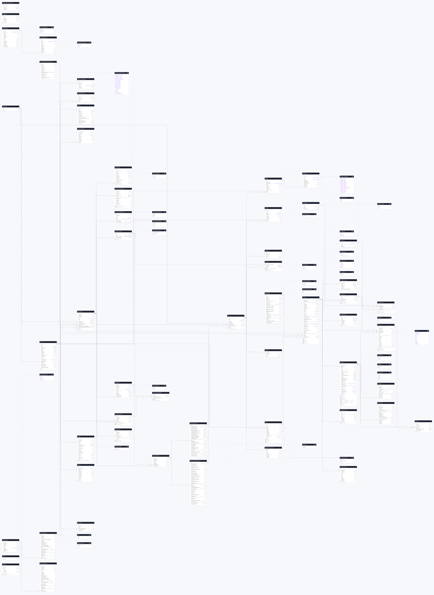

<details>
<summary>The whole schema as SQL</summary>

```sql
CREATE SCHEMA IF NOT EXISTS "public";

CREATE TYPE "IdentityProvider" AS ENUM ('DOCUMENSO', 'GOOGLE', 'OIDC');

CREATE TYPE "Role" AS ENUM ('ADMIN', 'USER');

CREATE TYPE "UserSecurityAuditLogType" AS ENUM ('ACCOUNT_PROFILE_UPDATE', 'ACCOUNT_SSO_LINK', 'ACCOUNT_SSO_UNLINK', 'ORGANISATION_SSO_LINK', 'ORGANISATION_SSO_UNLINK', 'AUTH_2FA_DISABLE', 'AUTH_2FA_ENABLE', 'PASSKEY_CREATED', 'PASSKEY_DELETED', 'PASSKEY_UPDATED', 'PASSWORD_RESET', 'PASSWORD_UPDATE', 'SESSION_REVOKED', 'SIGN_OUT', 'SIGN_IN', 'SIGN_IN_FAIL', 'SIGN_IN_2FA_FAIL', 'SIGN_IN_PASSKEY_FAIL');

CREATE TYPE "WebhookTriggerEvents" AS ENUM ('DOCUMENT_CREATED', 'DOCUMENT_SENT', 'DOCUMENT_OPENED', 'DOCUMENT_SIGNED', 'DOCUMENT_COMPLETED', 'DOCUMENT_REJECTED', 'DOCUMENT_CANCELLED', 'RECIPIENT_EXPIRED', 'DOCUMENT_RECIPIENT_COMPLETED', 'DOCUMENT_REMINDER_SENT', 'TEMPLATE_CREATED', 'TEMPLATE_UPDATED', 'TEMPLATE_DELETED', 'TEMPLATE_USED');

CREATE TYPE "WebhookCallStatus" AS ENUM ('SUCCESS', 'FAILED');

CREATE TYPE "ApiTokenAlgorithm" AS ENUM ('SHA512');

CREATE TYPE "SubscriptionStatus" AS ENUM ('ACTIVE', 'PAST_DUE', 'INACTIVE');

CREATE TYPE "DocumentStatus" AS ENUM ('DRAFT', 'PENDING', 'COMPLETED', 'REJECTED', 'CANCELLED');

CREATE TYPE "DocumentSource" AS ENUM ('DOCUMENT', 'TEMPLATE', 'TEMPLATE_DIRECT_LINK');

CREATE TYPE "DocumentVisibility" AS ENUM ('EVERYONE', 'MANAGER_AND_ABOVE', 'ADMIN');

CREATE TYPE "FolderType" AS ENUM ('DOCUMENT', 'TEMPLATE');

CREATE TYPE "EnvelopeType" AS ENUM ('DOCUMENT', 'TEMPLATE');

CREATE TYPE "DocumentDataType" AS ENUM ('S3_PATH', 'BYTES', 'BYTES_64');

CREATE TYPE "DocumentSigningOrder" AS ENUM ('PARALLEL', 'SEQUENTIAL');

CREATE TYPE "DocumentDistributionMethod" AS ENUM ('EMAIL', 'NONE');

CREATE TYPE "ReadStatus" AS ENUM ('NOT_OPENED', 'OPENED');

CREATE TYPE "SendStatus" AS ENUM ('NOT_SENT', 'SENT');

CREATE TYPE "SigningStatus" AS ENUM ('NOT_SIGNED', 'SIGNED', 'REJECTED');

CREATE TYPE "RecipientRole" AS ENUM ('CC', 'SIGNER', 'VIEWER', 'APPROVER', 'ASSISTANT');

CREATE TYPE "FieldType" AS ENUM ('SIGNATURE', 'FREE_SIGNATURE', 'INITIALS', 'NAME', 'EMAIL', 'DATE', 'TEXT', 'NUMBER', 'RADIO', 'CHECKBOX', 'DROPDOWN');

CREATE TYPE "OrganisationType" AS ENUM ('PERSONAL', 'ORGANISATION');

CREATE TYPE "OrganisationGroupType" AS ENUM ('INTERNAL_ORGANISATION', 'INTERNAL_TEAM', 'CUSTOM');

CREATE TYPE "OrganisationMemberRole" AS ENUM ('ADMIN', 'MANAGER', 'MEMBER');

CREATE TYPE "TeamMemberRole" AS ENUM ('ADMIN', 'MANAGER', 'MEMBER');

CREATE TYPE "OrganisationMemberInviteStatus" AS ENUM ('ACCEPTED', 'PENDING', 'DECLINED');

CREATE TYPE "TemplateType" AS ENUM ('PUBLIC', 'PRIVATE', 'ORGANISATION');

CREATE TYPE "BackgroundJobStatus" AS ENUM ('PENDING', 'PROCESSING', 'COMPLETED', 'FAILED');

CREATE TYPE "BackgroundJobTaskStatus" AS ENUM ('PENDING', 'COMPLETED', 'FAILED');

CREATE TYPE "EmailDomainStatus" AS ENUM ('PENDING', 'ACTIVE');

CREATE TYPE "EmailTransportType" AS ENUM ('SMTP_AUTH', 'SMTP_API', 'RESEND', 'MAILCHANNELS');

CREATE TABLE "User" (
    "id" SERIAL NOT NULL,
    "name" TEXT,
    "email" TEXT NOT NULL,
    "emailVerified" TIMESTAMP(3),
    "password" TEXT,
    "source" TEXT,
    "signature" TEXT,
    "createdAt" TIMESTAMP(3) NOT NULL DEFAULT CURRENT_TIMESTAMP,
    "updatedAt" TIMESTAMP(3) NOT NULL DEFAULT CURRENT_TIMESTAMP,
    "lastSignedIn" TIMESTAMP(3) NOT NULL DEFAULT CURRENT_TIMESTAMP,
    "roles" "Role"[] DEFAULT ARRAY['USER']::"Role"[],
    "identityProvider" "IdentityProvider" NOT NULL DEFAULT 'DOCUMENSO',
    "avatarImageId" TEXT,
    "disabled" BOOLEAN NOT NULL DEFAULT false,
    "twoFactorSecret" TEXT,
    "twoFactorEnabled" BOOLEAN NOT NULL DEFAULT false,
    "twoFactorBackupCodes" TEXT,

    CONSTRAINT "User_pkey" PRIMARY KEY ("id")
);

CREATE TABLE "TeamProfile" (
    "id" TEXT NOT NULL,
    "enabled" BOOLEAN NOT NULL DEFAULT false,
    "teamId" INTEGER NOT NULL,
    "bio" TEXT,

    CONSTRAINT "TeamProfile_pkey" PRIMARY KEY ("id")
);

CREATE TABLE "UserSecurityAuditLog" (
    "id" SERIAL NOT NULL,
    "userId" INTEGER NOT NULL,
    "createdAt" TIMESTAMP(3) NOT NULL DEFAULT CURRENT_TIMESTAMP,
    "type" "UserSecurityAuditLogType" NOT NULL,
    "userAgent" TEXT,
    "ipAddress" TEXT,

    CONSTRAINT "UserSecurityAuditLog_pkey" PRIMARY KEY ("id")
);

CREATE TABLE "PasswordResetToken" (
    "id" SERIAL NOT NULL,
    "token" TEXT NOT NULL,
    "createdAt" TIMESTAMP(3) NOT NULL DEFAULT CURRENT_TIMESTAMP,
    "expiry" TIMESTAMP(3) NOT NULL,
    "userId" INTEGER NOT NULL,

    CONSTRAINT "PasswordResetToken_pkey" PRIMARY KEY ("id")
);

CREATE TABLE "Passkey" (
    "id" TEXT NOT NULL,
    "userId" INTEGER NOT NULL,
    "name" TEXT NOT NULL,
    "createdAt" TIMESTAMP(3) NOT NULL DEFAULT CURRENT_TIMESTAMP,
    "updatedAt" TIMESTAMP(3) NOT NULL DEFAULT CURRENT_TIMESTAMP,
    "lastUsedAt" TIMESTAMP(3),
    "credentialId" BYTEA NOT NULL,
    "credentialPublicKey" BYTEA NOT NULL,
    "counter" BIGINT NOT NULL,
    "credentialDeviceType" TEXT NOT NULL,
    "credentialBackedUp" BOOLEAN NOT NULL,
    "transports" TEXT[],

    CONSTRAINT "Passkey_pkey" PRIMARY KEY ("id")
);

CREATE TABLE "AnonymousVerificationToken" (
    "id" TEXT NOT NULL,
    "token" TEXT NOT NULL,
    "expiresAt" TIMESTAMP(3) NOT NULL,
    "createdAt" TIMESTAMP(3) NOT NULL DEFAULT CURRENT_TIMESTAMP,

    CONSTRAINT "AnonymousVerificationToken_pkey" PRIMARY KEY ("id")
);

CREATE TABLE "VerificationToken" (
    "id" SERIAL NOT NULL,
    "secondaryId" TEXT NOT NULL,
    "identifier" TEXT NOT NULL,
    "token" TEXT NOT NULL,
    "completed" BOOLEAN NOT NULL DEFAULT false,
    "expires" TIMESTAMP(3) NOT NULL,
    "createdAt" TIMESTAMP(3) NOT NULL DEFAULT CURRENT_TIMESTAMP,
    "metadata" JSONB,
    "userId" INTEGER NOT NULL,

    CONSTRAINT "VerificationToken_pkey" PRIMARY KEY ("id")
);

CREATE TABLE "Webhook" (
    "id" TEXT NOT NULL,
    "webhookUrl" TEXT NOT NULL,
    "eventTriggers" "WebhookTriggerEvents"[],
    "secret" TEXT,
    "enabled" BOOLEAN NOT NULL DEFAULT true,
    "createdAt" TIMESTAMP(3) NOT NULL DEFAULT CURRENT_TIMESTAMP,
    "updatedAt" TIMESTAMP(3) NOT NULL DEFAULT CURRENT_TIMESTAMP,
    "userId" INTEGER NOT NULL,
    "teamId" INTEGER NOT NULL,

    CONSTRAINT "Webhook_pkey" PRIMARY KEY ("id")
);

CREATE TABLE "WebhookCall" (
    "id" TEXT NOT NULL,
    "status" "WebhookCallStatus" NOT NULL,
    "url" TEXT NOT NULL,
    "event" "WebhookTriggerEvents" NOT NULL,
    "requestBody" JSONB NOT NULL,
    "responseCode" INTEGER NOT NULL,
    "responseHeaders" JSONB,
    "responseBody" JSONB,
    "createdAt" TIMESTAMP(3) NOT NULL DEFAULT CURRENT_TIMESTAMP,
    "webhookId" TEXT NOT NULL,

    CONSTRAINT "WebhookCall_pkey" PRIMARY KEY ("id")
);

CREATE TABLE "ApiToken" (
    "id" SERIAL NOT NULL,
    "name" TEXT NOT NULL,
    "token" TEXT NOT NULL,
    "algorithm" "ApiTokenAlgorithm" NOT NULL DEFAULT 'SHA512',
    "expires" TIMESTAMP(3),
    "createdAt" TIMESTAMP(3) NOT NULL DEFAULT CURRENT_TIMESTAMP,
    "lastUsedAt" TIMESTAMP(3),
    "userId" INTEGER,
    "teamId" INTEGER NOT NULL,

    CONSTRAINT "ApiToken_pkey" PRIMARY KEY ("id")
);

CREATE TABLE "Subscription" (
    "id" SERIAL NOT NULL,
    "status" "SubscriptionStatus" NOT NULL DEFAULT 'INACTIVE',
    "planId" TEXT NOT NULL,
    "priceId" TEXT NOT NULL,
    "periodEnd" TIMESTAMP(3),
    "createdAt" TIMESTAMP(3) NOT NULL DEFAULT CURRENT_TIMESTAMP,
    "updatedAt" TIMESTAMP(3) NOT NULL,
    "cancelAtPeriodEnd" BOOLEAN NOT NULL DEFAULT false,
    "customerId" TEXT NOT NULL,
    "organisationId" TEXT NOT NULL,

    CONSTRAINT "Subscription_pkey" PRIMARY KEY ("id")
);

CREATE TABLE "SubscriptionClaim" (
    "id" TEXT NOT NULL,
    "createdAt" TIMESTAMP(3) NOT NULL DEFAULT CURRENT_TIMESTAMP,
    "updatedAt" TIMESTAMP(3) NOT NULL,
    "name" TEXT NOT NULL,
    "locked" BOOLEAN NOT NULL DEFAULT false,
    "teamCount" INTEGER NOT NULL,
    "memberCount" INTEGER NOT NULL,
    "envelopeItemCount" INTEGER NOT NULL,
    "recipientCount" INTEGER NOT NULL,
    "envelopeContentCount" INTEGER NOT NULL,
    "envelopeContentImageCount" INTEGER NOT NULL,
    "flags" JSONB NOT NULL,
    "documentRateLimits" JSONB NOT NULL,
    "documentQuota" INTEGER,
    "emailRateLimits" JSONB NOT NULL,
    "emailQuota" INTEGER,
    "apiRateLimits" JSONB NOT NULL,
    "apiQuota" INTEGER,
    "emailTransportId" TEXT,

    CONSTRAINT "SubscriptionClaim_pkey" PRIMARY KEY ("id")
);

CREATE TABLE "OrganisationClaim" (
    "id" TEXT NOT NULL,
    "createdAt" TIMESTAMP(3) NOT NULL DEFAULT CURRENT_TIMESTAMP,
    "updatedAt" TIMESTAMP(3) NOT NULL,
    "originalSubscriptionClaimId" TEXT,
    "teamCount" INTEGER NOT NULL,
    "memberCount" INTEGER NOT NULL,
    "envelopeItemCount" INTEGER NOT NULL,
    "recipientCount" INTEGER NOT NULL,
    "envelopeContentCount" INTEGER NOT NULL,
    "envelopeContentImageCount" INTEGER NOT NULL,
    "flags" JSONB NOT NULL,
    "documentRateLimits" JSONB NOT NULL,
    "documentQuota" INTEGER,
    "emailRateLimits" JSONB NOT NULL,
    "emailQuota" INTEGER,
    "apiRateLimits" JSONB NOT NULL,
    "apiQuota" INTEGER,
    "emailTransportId" TEXT,

    CONSTRAINT "OrganisationClaim_pkey" PRIMARY KEY ("id")
);

CREATE TABLE "OrganisationMonthlyStat" (
    "id" TEXT NOT NULL,
    "createdAt" TIMESTAMP(3) NOT NULL DEFAULT CURRENT_TIMESTAMP,
    "updatedAt" TIMESTAMP(3) NOT NULL,
    "organisationId" TEXT NOT NULL,
    "period" TEXT NOT NULL,
    "documentCount" INTEGER NOT NULL DEFAULT 0,
    "emailCount" INTEGER NOT NULL DEFAULT 0,
    "apiCount" INTEGER NOT NULL DEFAULT 0,
    "emailReports" INTEGER NOT NULL DEFAULT 0,

    CONSTRAINT "OrganisationMonthlyStat_pkey" PRIMARY KEY ("id")
);

CREATE TABLE "Account" (
    "id" TEXT NOT NULL,
    "createdAt" TIMESTAMP(3) NOT NULL DEFAULT CURRENT_TIMESTAMP,
    "userId" INTEGER NOT NULL,
    "type" TEXT NOT NULL,
    "provider" TEXT NOT NULL,
    "providerAccountId" TEXT NOT NULL,
    "refresh_token" TEXT,
    "access_token" TEXT,
    "expires_at" INTEGER,
    "created_at" INTEGER,
    "ext_expires_in" INTEGER,
    "token_type" TEXT,
    "scope" TEXT,
    "id_token" TEXT,
    "session_state" TEXT,
    "password" TEXT,

    CONSTRAINT "Account_pkey" PRIMARY KEY ("id")
);

CREATE TABLE "Session" (
    "id" TEXT NOT NULL,
    "sessionToken" TEXT NOT NULL,
    "userId" INTEGER NOT NULL,
    "ipAddress" TEXT,
    "userAgent" TEXT,
    "expiresAt" TIMESTAMP(3) NOT NULL,
    "createdAt" TIMESTAMP(3) NOT NULL DEFAULT CURRENT_TIMESTAMP,
    "updatedAt" TIMESTAMP(3) NOT NULL,
    "isEmbed" BOOLEAN NOT NULL DEFAULT false,

    CONSTRAINT "Session_pkey" PRIMARY KEY ("id")
);

CREATE TABLE "AuthHandoff" (
    "id" TEXT NOT NULL,
    "type" TEXT NOT NULL,
    "payload" TEXT NOT NULL,
    "createdAt" TIMESTAMP(3) NOT NULL DEFAULT CURRENT_TIMESTAMP,
    "expiresAt" TIMESTAMP(3) NOT NULL,

    CONSTRAINT "AuthHandoff_pkey" PRIMARY KEY ("id")
);

CREATE TABLE "Folder" (
    "id" TEXT NOT NULL,
    "name" TEXT NOT NULL,
    "userId" INTEGER NOT NULL,
    "teamId" INTEGER NOT NULL,
    "pinned" BOOLEAN NOT NULL DEFAULT false,
    "parentId" TEXT,
    "createdAt" TIMESTAMP(3) NOT NULL DEFAULT CURRENT_TIMESTAMP,
    "updatedAt" TIMESTAMP(3) NOT NULL DEFAULT CURRENT_TIMESTAMP,
    "visibility" "DocumentVisibility" NOT NULL DEFAULT 'EVERYONE',
    "type" "FolderType" NOT NULL,

    CONSTRAINT "Folder_pkey" PRIMARY KEY ("id")
);

CREATE TABLE "Envelope" (
    "id" TEXT NOT NULL,
    "secondaryId" TEXT NOT NULL,
    "externalId" TEXT,
    "type" "EnvelopeType" NOT NULL,
    "createdAt" TIMESTAMP(3) NOT NULL DEFAULT CURRENT_TIMESTAMP,
    "updatedAt" TIMESTAMP(3) NOT NULL,
    "completedAt" TIMESTAMP(3),
    "deletedAt" TIMESTAMP(3),
    "title" TEXT NOT NULL,
    "status" "DocumentStatus" NOT NULL DEFAULT 'DRAFT',
    "source" "DocumentSource" NOT NULL,
    "qrToken" TEXT,
    "signatureLevel" TEXT NOT NULL,
    "internalVersion" INTEGER NOT NULL,
    "useLegacyFieldInsertion" BOOLEAN NOT NULL DEFAULT false,
    "authOptions" JSONB,
    "formValues" JSONB,
    "visibility" "DocumentVisibility" NOT NULL DEFAULT 'EVERYONE',
    "templateType" "TemplateType" NOT NULL DEFAULT 'PRIVATE',
    "publicTitle" TEXT NOT NULL DEFAULT '',
    "publicDescription" TEXT NOT NULL DEFAULT '',
    "templateId" INTEGER,
    "userId" INTEGER NOT NULL,
    "teamId" INTEGER NOT NULL,
    "folderId" TEXT,
    "documentMetaId" TEXT NOT NULL,

    CONSTRAINT "Envelope_pkey" PRIMARY KEY ("id")
);

CREATE TABLE "EnvelopeItem" (
    "id" TEXT NOT NULL,
    "title" TEXT NOT NULL,
    "order" INTEGER NOT NULL,
    "documentDataId" TEXT NOT NULL,
    "envelopeId" TEXT NOT NULL,

    CONSTRAINT "EnvelopeItem_pkey" PRIMARY KEY ("id")
);

CREATE TABLE "DocumentAuditLog" (
    "id" TEXT NOT NULL,
    "envelopeId" TEXT,
    "createdAt" TIMESTAMP(3) NOT NULL DEFAULT CURRENT_TIMESTAMP,
    "type" TEXT NOT NULL,
    "data" JSONB NOT NULL,
    "name" TEXT,
    "email" TEXT,
    "userId" INTEGER,
    "userAgent" TEXT,
    "ipAddress" TEXT,

    CONSTRAINT "DocumentAuditLog_pkey" PRIMARY KEY ("id")
);

CREATE TABLE "DocumentData" (
    "id" TEXT NOT NULL,
    "type" "DocumentDataType" NOT NULL,
    "data" TEXT NOT NULL,
    "initialData" TEXT NOT NULL,

    CONSTRAINT "DocumentData_pkey" PRIMARY KEY ("id")
);

CREATE TABLE "DocumentMeta" (
    "id" TEXT NOT NULL,
    "subject" TEXT,
    "message" TEXT,
    "timezone" TEXT DEFAULT 'Etc/UTC',
    "dateFormat" TEXT DEFAULT 'yyyy-MM-dd hh:mm a',
    "redirectUrl" TEXT,
    "signingOrder" "DocumentSigningOrder" NOT NULL DEFAULT 'PARALLEL',
    "allowDictateNextSigner" BOOLEAN NOT NULL DEFAULT false,
    "typedSignatureEnabled" BOOLEAN NOT NULL DEFAULT true,
    "uploadSignatureEnabled" BOOLEAN NOT NULL DEFAULT true,
    "drawSignatureEnabled" BOOLEAN NOT NULL DEFAULT true,
    "language" TEXT NOT NULL DEFAULT 'en',
    "distributionMethod" "DocumentDistributionMethod" NOT NULL DEFAULT 'EMAIL',
    "emailSettings" JSONB,
    "emailReplyTo" TEXT,
    "emailId" TEXT,
    "envelopeExpirationPeriod" JSONB,
    "reminderSettings" JSONB,

    CONSTRAINT "DocumentMeta_pkey" PRIMARY KEY ("id")
);

CREATE TABLE "EnvelopeAttachment" (
    "id" TEXT NOT NULL,
    "type" TEXT NOT NULL,
    "label" TEXT NOT NULL,
    "data" TEXT NOT NULL,
    "createdAt" TIMESTAMP(3) NOT NULL DEFAULT CURRENT_TIMESTAMP,
    "updatedAt" TIMESTAMP(3) NOT NULL,
    "envelopeId" TEXT NOT NULL,

    CONSTRAINT "EnvelopeAttachment_pkey" PRIMARY KEY ("id")
);

CREATE TABLE "Recipient" (
    "id" SERIAL NOT NULL,
    "envelopeId" TEXT NOT NULL,
    "email" VARCHAR(255) NOT NULL,
    "name" VARCHAR(255) NOT NULL DEFAULT '',
    "token" TEXT NOT NULL,
    "documentDeletedAt" TIMESTAMP(3),
    "expired" TIMESTAMP(3),
    "expiresAt" TIMESTAMP(3),
    "expirationNotifiedAt" TIMESTAMP(3),
    "sentAt" TIMESTAMP(3),
    "signedAt" TIMESTAMP(3),
    "lastReminderSentAt" TIMESTAMP(3),
    "nextReminderAt" TIMESTAMP(3),
    "reminderCount" INTEGER NOT NULL DEFAULT 0,
    "authOptions" JSONB,
    "signingOrder" INTEGER,
    "rejectionReason" TEXT,
    "role" "RecipientRole" NOT NULL DEFAULT 'SIGNER',
    "readStatus" "ReadStatus" NOT NULL DEFAULT 'NOT_OPENED',
    "signingStatus" "SigningStatus" NOT NULL DEFAULT 'NOT_SIGNED',
    "sendStatus" "SendStatus" NOT NULL DEFAULT 'NOT_SENT',

    CONSTRAINT "Recipient_pkey" PRIMARY KEY ("id")
);

CREATE TABLE "Field" (
    "id" SERIAL NOT NULL,
    "secondaryId" TEXT NOT NULL,
    "envelopeId" TEXT NOT NULL,
    "envelopeItemId" TEXT NOT NULL,
    "recipientId" INTEGER NOT NULL,
    "type" "FieldType" NOT NULL,
    "page" INTEGER NOT NULL,
    "positionX" DECIMAL(65,30) NOT NULL DEFAULT 0,
    "positionY" DECIMAL(65,30) NOT NULL DEFAULT 0,
    "width" DECIMAL(65,30) NOT NULL DEFAULT -1,
    "height" DECIMAL(65,30) NOT NULL DEFAULT -1,
    "customText" TEXT NOT NULL,
    "inserted" BOOLEAN NOT NULL,
    "fieldMeta" JSONB,

    CONSTRAINT "Field_pkey" PRIMARY KEY ("id")
);

CREATE TABLE "EnvelopeContent" (
    "id" TEXT NOT NULL,
    "envelopeId" TEXT NOT NULL,
    "envelopeItemId" TEXT NOT NULL,
    "contentMeta" JSONB NOT NULL,
    "dataContentId" TEXT,

    CONSTRAINT "EnvelopeContent_pkey" PRIMARY KEY ("id")
);

CREATE TABLE "DataContent" (
    "id" TEXT NOT NULL,
    "type" "DocumentDataType" NOT NULL,
    "data" TEXT NOT NULL,
    "metadata" JSONB NOT NULL,

    CONSTRAINT "DataContent_pkey" PRIMARY KEY ("id")
);

CREATE TABLE "Signature" (
    "id" SERIAL NOT NULL,
    "created" TIMESTAMP(3) NOT NULL DEFAULT CURRENT_TIMESTAMP,
    "recipientId" INTEGER NOT NULL,
    "fieldId" INTEGER NOT NULL,
    "signatureImageAsBase64" TEXT,
    "typedSignature" TEXT,

    CONSTRAINT "Signature_pkey" PRIMARY KEY ("id")
);

CREATE TABLE "CscCredential" (
    "id" TEXT NOT NULL,
    "providerId" TEXT NOT NULL,
    "credentialId" TEXT NOT NULL,
    "certCache" BYTEA,
    "signatureAlgorithm" TEXT NOT NULL,
    "keyType" TEXT NOT NULL,
    "digestAlgorithm" TEXT NOT NULL,
    "keyLenBits" INTEGER,
    "signAlgoParams" TEXT,
    "serviceTokenCiphertext" BYTEA,
    "serviceTokenExpiresAt" TIMESTAMP(3),
    "recipientId" INTEGER NOT NULL,
    "createdAt" TIMESTAMP(3) NOT NULL DEFAULT CURRENT_TIMESTAMP,
    "updatedAt" TIMESTAMP(3) NOT NULL,

    CONSTRAINT "CscCredential_pkey" PRIMARY KEY ("id")
);

CREATE TABLE "CscSession" (
    "id" TEXT NOT NULL,
    "envelopeId" TEXT NOT NULL,
    "signingTime" TIMESTAMP(3) NOT NULL,
    "itemsJson" JSONB NOT NULL,
    "encryptedSad" BYTEA,
    "sadExpiresAt" TIMESTAMP(3),
    "createdAt" TIMESTAMP(3) NOT NULL DEFAULT CURRENT_TIMESTAMP,
    "recipientId" INTEGER NOT NULL,

    CONSTRAINT "CscSession_pkey" PRIMARY KEY ("id")
);

CREATE TABLE "DocumentShareLink" (
    "id" SERIAL NOT NULL,
    "email" TEXT NOT NULL,
    "slug" TEXT NOT NULL,
    "envelopeId" TEXT NOT NULL,
    "createdAt" TIMESTAMP(3) NOT NULL DEFAULT CURRENT_TIMESTAMP,
    "updatedAt" TIMESTAMP(3) NOT NULL,

    CONSTRAINT "DocumentShareLink_pkey" PRIMARY KEY ("id")
);

CREATE TABLE "Organisation" (
    "id" TEXT NOT NULL,
    "createdAt" TIMESTAMP(3) NOT NULL DEFAULT CURRENT_TIMESTAMP,
    "updatedAt" TIMESTAMP(3) NOT NULL,
    "type" "OrganisationType" NOT NULL,
    "name" TEXT NOT NULL,
    "url" TEXT NOT NULL,
    "avatarImageId" TEXT,
    "customerId" TEXT,
    "organisationClaimId" TEXT NOT NULL,
    "ownerUserId" INTEGER NOT NULL,
    "organisationGlobalSettingsId" TEXT NOT NULL,
    "organisationAuthenticationPortalId" TEXT NOT NULL,

    CONSTRAINT "Organisation_pkey" PRIMARY KEY ("id")
);

CREATE TABLE "OrganisationMember" (
    "id" TEXT NOT NULL,
    "createdAt" TIMESTAMP(3) NOT NULL DEFAULT CURRENT_TIMESTAMP,
    "updatedAt" TIMESTAMP(3) NOT NULL,
    "userId" INTEGER NOT NULL,
    "organisationId" TEXT NOT NULL,

    CONSTRAINT "OrganisationMember_pkey" PRIMARY KEY ("id")
);

CREATE TABLE "OrganisationMemberInvite" (
    "id" TEXT NOT NULL,
    "createdAt" TIMESTAMP(3) NOT NULL DEFAULT CURRENT_TIMESTAMP,
    "email" TEXT NOT NULL,
    "token" TEXT NOT NULL,
    "status" "OrganisationMemberInviteStatus" NOT NULL DEFAULT 'PENDING',
    "organisationId" TEXT NOT NULL,
    "organisationRole" "OrganisationMemberRole" NOT NULL,

    CONSTRAINT "OrganisationMemberInvite_pkey" PRIMARY KEY ("id")
);

CREATE TABLE "OrganisationGroup" (
    "id" TEXT NOT NULL,
    "name" TEXT,
    "type" "OrganisationGroupType" NOT NULL,
    "organisationRole" "OrganisationMemberRole" NOT NULL,
    "organisationId" TEXT NOT NULL,

    CONSTRAINT "OrganisationGroup_pkey" PRIMARY KEY ("id")
);

CREATE TABLE "OrganisationGroupMember" (
    "id" TEXT NOT NULL,
    "groupId" TEXT NOT NULL,
    "organisationMemberId" TEXT NOT NULL,

    CONSTRAINT "OrganisationGroupMember_pkey" PRIMARY KEY ("id")
);

CREATE TABLE "TeamGroup" (
    "id" TEXT NOT NULL,
    "organisationGroupId" TEXT NOT NULL,
    "teamRole" "TeamMemberRole" NOT NULL,
    "teamId" INTEGER NOT NULL,

    CONSTRAINT "TeamGroup_pkey" PRIMARY KEY ("id")
);

CREATE TABLE "OrganisationGlobalSettings" (
    "id" TEXT NOT NULL,
    "documentVisibility" "DocumentVisibility" NOT NULL DEFAULT 'EVERYONE',
    "documentLanguage" TEXT NOT NULL DEFAULT 'en',
    "includeSenderDetails" BOOLEAN NOT NULL DEFAULT true,
    "includeSigningCertificate" BOOLEAN NOT NULL DEFAULT true,
    "includeAuditLog" BOOLEAN NOT NULL DEFAULT false,
    "documentTimezone" TEXT,
    "documentDateFormat" TEXT NOT NULL DEFAULT 'yyyy-MM-dd hh:mm a',
    "delegateDocumentOwnership" BOOLEAN NOT NULL DEFAULT false,
    "typedSignatureEnabled" BOOLEAN NOT NULL DEFAULT true,
    "uploadSignatureEnabled" BOOLEAN NOT NULL DEFAULT true,
    "drawSignatureEnabled" BOOLEAN NOT NULL DEFAULT true,
    "defaultRecipients" JSONB,
    "emailId" TEXT,
    "emailReplyTo" TEXT,
    "emailDocumentSettings" JSONB NOT NULL,
    "brandingEnabled" BOOLEAN NOT NULL DEFAULT false,
    "brandingLogo" TEXT NOT NULL DEFAULT '',
    "brandingUrl" TEXT NOT NULL DEFAULT '',
    "brandingCompanyDetails" TEXT NOT NULL DEFAULT '',
    "brandingColors" JSONB,
    "brandingCss" TEXT NOT NULL DEFAULT '',
    "envelopeExpirationPeriod" JSONB,
    "reminderSettings" JSONB,
    "aiFeaturesEnabled" BOOLEAN NOT NULL DEFAULT false,

    CONSTRAINT "OrganisationGlobalSettings_pkey" PRIMARY KEY ("id")
);

CREATE TABLE "TeamGlobalSettings" (
    "id" TEXT NOT NULL,
    "documentVisibility" "DocumentVisibility",
    "documentLanguage" TEXT,
    "documentTimezone" TEXT,
    "documentDateFormat" TEXT,
    "delegateDocumentOwnership" BOOLEAN,
    "includeSenderDetails" BOOLEAN,
    "includeSigningCertificate" BOOLEAN,
    "includeAuditLog" BOOLEAN,
    "typedSignatureEnabled" BOOLEAN,
    "uploadSignatureEnabled" BOOLEAN,
    "drawSignatureEnabled" BOOLEAN,
    "defaultRecipients" JSONB,
    "emailId" TEXT,
    "emailReplyTo" TEXT,
    "emailDocumentSettings" JSONB,
    "brandingEnabled" BOOLEAN,
    "brandingLogo" TEXT,
    "brandingUrl" TEXT,
    "brandingCompanyDetails" TEXT,
    "brandingColors" JSONB,
    "brandingCss" TEXT,
    "envelopeExpirationPeriod" JSONB,
    "reminderSettings" JSONB,
    "aiFeaturesEnabled" BOOLEAN,

    CONSTRAINT "TeamGlobalSettings_pkey" PRIMARY KEY ("id")
);

CREATE TABLE "Team" (
    "id" SERIAL NOT NULL,
    "name" TEXT NOT NULL,
    "url" TEXT NOT NULL,
    "createdAt" TIMESTAMP(3) NOT NULL DEFAULT CURRENT_TIMESTAMP,
    "avatarImageId" TEXT,
    "organisationId" TEXT NOT NULL,
    "teamGlobalSettingsId" TEXT NOT NULL,

    CONSTRAINT "Team_pkey" PRIMARY KEY ("id")
);

CREATE TABLE "TeamEmail" (
    "teamId" INTEGER NOT NULL,
    "createdAt" TIMESTAMP(3) NOT NULL DEFAULT CURRENT_TIMESTAMP,
    "name" TEXT NOT NULL,
    "email" TEXT NOT NULL,

    CONSTRAINT "TeamEmail_pkey" PRIMARY KEY ("teamId")
);

CREATE TABLE "TeamEmailVerification" (
    "teamId" INTEGER NOT NULL,
    "name" TEXT NOT NULL,
    "email" TEXT NOT NULL,
    "token" TEXT NOT NULL,
    "completed" BOOLEAN NOT NULL DEFAULT false,
    "expiresAt" TIMESTAMP(3) NOT NULL,
    "createdAt" TIMESTAMP(3) NOT NULL DEFAULT CURRENT_TIMESTAMP,

    CONSTRAINT "TeamEmailVerification_pkey" PRIMARY KEY ("teamId")
);

CREATE TABLE "TemplateDirectLink" (
    "id" TEXT NOT NULL,
    "envelopeId" TEXT NOT NULL,
    "token" TEXT NOT NULL,
    "createdAt" TIMESTAMP(3) NOT NULL DEFAULT CURRENT_TIMESTAMP,
    "enabled" BOOLEAN NOT NULL,
    "directTemplateRecipientId" INTEGER NOT NULL,

    CONSTRAINT "TemplateDirectLink_pkey" PRIMARY KEY ("id")
);

CREATE TABLE "SiteSettings" (
    "id" TEXT NOT NULL,
    "enabled" BOOLEAN NOT NULL DEFAULT false,
    "data" JSONB NOT NULL,
    "lastModifiedByUserId" INTEGER,
    "lastModifiedAt" TIMESTAMP(3) NOT NULL DEFAULT CURRENT_TIMESTAMP,

    CONSTRAINT "SiteSettings_pkey" PRIMARY KEY ("id")
);

CREATE TABLE "BackgroundJob" (
    "id" TEXT NOT NULL,
    "status" "BackgroundJobStatus" NOT NULL DEFAULT 'PENDING',
    "payload" JSONB,
    "retried" INTEGER NOT NULL DEFAULT 0,
    "maxRetries" INTEGER NOT NULL DEFAULT 3,
    "jobId" TEXT NOT NULL,
    "name" TEXT NOT NULL,
    "version" TEXT NOT NULL,
    "submittedAt" TIMESTAMP(3) NOT NULL DEFAULT CURRENT_TIMESTAMP,
    "updatedAt" TIMESTAMP(3) NOT NULL,
    "completedAt" TIMESTAMP(3),
    "lastRetriedAt" TIMESTAMP(3),

    CONSTRAINT "BackgroundJob_pkey" PRIMARY KEY ("id")
);

CREATE TABLE "BackgroundJobTask" (
    "id" TEXT NOT NULL,
    "name" TEXT NOT NULL,
    "status" "BackgroundJobTaskStatus" NOT NULL DEFAULT 'PENDING',
    "result" JSONB,
    "retried" INTEGER NOT NULL DEFAULT 0,
    "maxRetries" INTEGER NOT NULL DEFAULT 3,
    "createdAt" TIMESTAMP(3) NOT NULL DEFAULT CURRENT_TIMESTAMP,
    "updatedAt" TIMESTAMP(3) NOT NULL,
    "completedAt" TIMESTAMP(3),
    "jobId" TEXT NOT NULL,

    CONSTRAINT "BackgroundJobTask_pkey" PRIMARY KEY ("id")
);

CREATE TABLE "AvatarImage" (
    "id" TEXT NOT NULL,
    "bytes" TEXT NOT NULL,

    CONSTRAINT "AvatarImage_pkey" PRIMARY KEY ("id")
);

CREATE TABLE "EmailDomain" (
    "id" TEXT NOT NULL,
    "createdAt" TIMESTAMP(3) NOT NULL DEFAULT CURRENT_TIMESTAMP,
    "updatedAt" TIMESTAMP(3) NOT NULL,
    "status" "EmailDomainStatus" NOT NULL DEFAULT 'PENDING',
    "selector" TEXT NOT NULL,
    "domain" TEXT NOT NULL,
    "publicKey" TEXT NOT NULL,
    "privateKey" TEXT NOT NULL,
    "lastVerifiedAt" TIMESTAMP(3),
    "organisationId" TEXT NOT NULL,

    CONSTRAINT "EmailDomain_pkey" PRIMARY KEY ("id")
);

CREATE TABLE "OrganisationEmail" (
    "id" TEXT NOT NULL,
    "createdAt" TIMESTAMP(3) NOT NULL DEFAULT CURRENT_TIMESTAMP,
    "updatedAt" TIMESTAMP(3) NOT NULL,
    "email" TEXT NOT NULL,
    "emailName" TEXT NOT NULL,
    "emailDomainId" TEXT NOT NULL,
    "organisationId" TEXT NOT NULL,

    CONSTRAINT "OrganisationEmail_pkey" PRIMARY KEY ("id")
);

CREATE TABLE "EmailTransport" (
    "id" TEXT NOT NULL,
    "createdAt" TIMESTAMP(3) NOT NULL DEFAULT CURRENT_TIMESTAMP,
    "updatedAt" TIMESTAMP(3) NOT NULL,
    "name" TEXT NOT NULL,
    "type" "EmailTransportType" NOT NULL,
    "fromName" TEXT NOT NULL,
    "fromAddress" TEXT NOT NULL,
    "config" TEXT NOT NULL,

    CONSTRAINT "EmailTransport_pkey" PRIMARY KEY ("id")
);

CREATE TABLE "OrganisationAuthenticationPortal" (
    "id" TEXT NOT NULL,
    "enabled" BOOLEAN NOT NULL DEFAULT false,
    "clientId" TEXT NOT NULL DEFAULT '',
    "clientSecret" TEXT NOT NULL DEFAULT '',
    "wellKnownUrl" TEXT NOT NULL DEFAULT '',
    "defaultOrganisationRole" "OrganisationMemberRole" NOT NULL DEFAULT 'MEMBER',
    "autoProvisionUsers" BOOLEAN NOT NULL DEFAULT true,
    "allowedDomains" TEXT[] DEFAULT ARRAY[]::TEXT[],
    "allowPersonalOrganisations" BOOLEAN NOT NULL DEFAULT false,

    CONSTRAINT "OrganisationAuthenticationPortal_pkey" PRIMARY KEY ("id")
);

CREATE TABLE "Counter" (
    "id" TEXT NOT NULL,
    "value" INTEGER NOT NULL,

    CONSTRAINT "Counter_pkey" PRIMARY KEY ("id")
);

CREATE TABLE "EmbedSignature" (
    "key" TEXT NOT NULL,
    "createdAt" TIMESTAMP(3) NOT NULL DEFAULT CURRENT_TIMESTAMP,
    "updatedAt" TIMESTAMP(3) NOT NULL,
    "organisationId" TEXT NOT NULL,
    "recipientId" INTEGER NOT NULL,
    "signature" TEXT NOT NULL,

    CONSTRAINT "EmbedSignature_pkey" PRIMARY KEY ("key")
);

CREATE TABLE "RateLimit" (
    "key" TEXT NOT NULL,
    "action" TEXT NOT NULL,
    "bucket" TIMESTAMP(3) NOT NULL,
    "count" INTEGER NOT NULL DEFAULT 1,
    "createdAt" TIMESTAMP(3) NOT NULL DEFAULT CURRENT_TIMESTAMP,

    CONSTRAINT "RateLimit_pkey" PRIMARY KEY ("key","action","bucket")
);

CREATE UNIQUE INDEX "User_email_key" ON "User"("email");

CREATE INDEX "User_email_idx" ON "User"("email");

CREATE UNIQUE INDEX "TeamProfile_teamId_key" ON "TeamProfile"("teamId");

CREATE UNIQUE INDEX "PasswordResetToken_token_key" ON "PasswordResetToken"("token");

CREATE UNIQUE INDEX "AnonymousVerificationToken_id_key" ON "AnonymousVerificationToken"("id");

CREATE UNIQUE INDEX "AnonymousVerificationToken_token_key" ON "AnonymousVerificationToken"("token");

CREATE UNIQUE INDEX "VerificationToken_secondaryId_key" ON "VerificationToken"("secondaryId");

CREATE UNIQUE INDEX "VerificationToken_token_key" ON "VerificationToken"("token");

CREATE UNIQUE INDEX "ApiToken_token_key" ON "ApiToken"("token");

CREATE UNIQUE INDEX "Subscription_planId_key" ON "Subscription"("planId");

CREATE UNIQUE INDEX "Subscription_organisationId_key" ON "Subscription"("organisationId");

CREATE INDEX "Subscription_organisationId_idx" ON "Subscription"("organisationId");

CREATE INDEX "OrganisationMonthlyStat_organisationId_idx" ON "OrganisationMonthlyStat"("organisationId");

CREATE UNIQUE INDEX "OrganisationMonthlyStat_organisationId_period_key" ON "OrganisationMonthlyStat"("organisationId", "period");

CREATE UNIQUE INDEX "Account_provider_providerAccountId_key" ON "Account"("provider", "providerAccountId");

CREATE UNIQUE INDEX "Session_sessionToken_key" ON "Session"("sessionToken");

CREATE INDEX "Session_userId_idx" ON "Session"("userId");

CREATE INDEX "Session_sessionToken_idx" ON "Session"("sessionToken");

CREATE INDEX "AuthHandoff_expiresAt_idx" ON "AuthHandoff"("expiresAt");

CREATE INDEX "Folder_userId_idx" ON "Folder"("userId");

CREATE INDEX "Folder_teamId_idx" ON "Folder"("teamId");

CREATE INDEX "Folder_parentId_idx" ON "Folder"("parentId");

CREATE INDEX "Folder_type_idx" ON "Folder"("type");

CREATE UNIQUE INDEX "Envelope_secondaryId_key" ON "Envelope"("secondaryId");

CREATE UNIQUE INDEX "Envelope_documentMetaId_key" ON "Envelope"("documentMetaId");

CREATE INDEX "Envelope_type_idx" ON "Envelope"("type");

CREATE INDEX "Envelope_status_idx" ON "Envelope"("status");

CREATE INDEX "Envelope_userId_idx" ON "Envelope"("userId");

CREATE INDEX "Envelope_teamId_idx" ON "Envelope"("teamId");

CREATE INDEX "Envelope_folderId_idx" ON "Envelope"("folderId");

CREATE INDEX "Envelope_createdAt_idx" ON "Envelope"("createdAt");

CREATE INDEX "EnvelopeItem_envelopeId_idx" ON "EnvelopeItem"("envelopeId");

CREATE UNIQUE INDEX "EnvelopeItem_documentDataId_key" ON "EnvelopeItem"("documentDataId");

CREATE INDEX "DocumentAuditLog_envelopeId_idx" ON "DocumentAuditLog"("envelopeId");

CREATE INDEX "EnvelopeAttachment_envelopeId_idx" ON "EnvelopeAttachment"("envelopeId");

CREATE INDEX "Recipient_token_idx" ON "Recipient"("token");

CREATE INDEX "Recipient_email_idx" ON "Recipient"("email");

CREATE INDEX "Recipient_envelopeId_idx" ON "Recipient"("envelopeId");

CREATE INDEX "Recipient_signedAt_idx" ON "Recipient"("signedAt");

CREATE INDEX "Recipient_expiresAt_idx" ON "Recipient"("expiresAt");

CREATE INDEX "Recipient_email_documentDeletedAt_envelopeId_idx" ON "Recipient"("email", "documentDeletedAt", "envelopeId");

CREATE INDEX "Recipient_email_envelopeId_idx" ON "Recipient"("email", "envelopeId");

CREATE INDEX "Recipient_email_signingStatus_envelopeId_role_idx" ON "Recipient"("email", "signingStatus", "envelopeId", "role");

CREATE INDEX "Recipient_nextReminderAt_idx" ON "Recipient"("nextReminderAt");

CREATE INDEX "Recipient_email_trgm_idx" ON "Recipient" USING GIN ("email" gin_trgm_ops);

CREATE INDEX "Recipient_name_trgm_idx" ON "Recipient" USING GIN ("name" gin_trgm_ops);

CREATE UNIQUE INDEX "Field_secondaryId_key" ON "Field"("secondaryId");

CREATE INDEX "Field_envelopeId_idx" ON "Field"("envelopeId");

CREATE INDEX "Field_envelopeItemId_idx" ON "Field"("envelopeItemId");

CREATE INDEX "Field_recipientId_idx" ON "Field"("recipientId");

CREATE INDEX "EnvelopeContent_envelopeId_idx" ON "EnvelopeContent"("envelopeId");

CREATE INDEX "EnvelopeContent_envelopeItemId_idx" ON "EnvelopeContent"("envelopeItemId");

CREATE UNIQUE INDEX "Signature_fieldId_key" ON "Signature"("fieldId");

CREATE INDEX "Signature_recipientId_idx" ON "Signature"("recipientId");

CREATE UNIQUE INDEX "CscCredential_recipientId_key" ON "CscCredential"("recipientId");

CREATE UNIQUE INDEX "CscSession_recipientId_key" ON "CscSession"("recipientId");

CREATE UNIQUE INDEX "DocumentShareLink_slug_key" ON "DocumentShareLink"("slug");

CREATE UNIQUE INDEX "DocumentShareLink_envelopeId_email_key" ON "DocumentShareLink"("envelopeId", "email");

CREATE UNIQUE INDEX "Organisation_url_key" ON "Organisation"("url");

CREATE UNIQUE INDEX "Organisation_customerId_key" ON "Organisation"("customerId");

CREATE UNIQUE INDEX "Organisation_organisationClaimId_key" ON "Organisation"("organisationClaimId");

CREATE UNIQUE INDEX "Organisation_organisationGlobalSettingsId_key" ON "Organisation"("organisationGlobalSettingsId");

CREATE UNIQUE INDEX "Organisation_organisationAuthenticationPortalId_key" ON "Organisation"("organisationAuthenticationPortalId");

CREATE INDEX "Organisation_name_idx" ON "Organisation"("name");

CREATE INDEX "Organisation_ownerUserId_idx" ON "Organisation"("ownerUserId");

CREATE INDEX "OrganisationMember_organisationId_idx" ON "OrganisationMember"("organisationId");

CREATE UNIQUE INDEX "OrganisationMember_userId_organisationId_key" ON "OrganisationMember"("userId", "organisationId");

CREATE UNIQUE INDEX "OrganisationMemberInvite_token_key" ON "OrganisationMemberInvite"("token");

CREATE INDEX "OrganisationGroup_organisationId_idx" ON "OrganisationGroup"("organisationId");

CREATE INDEX "OrganisationGroupMember_groupId_idx" ON "OrganisationGroupMember"("groupId");

CREATE INDEX "OrganisationGroupMember_organisationMemberId_idx" ON "OrganisationGroupMember"("organisationMemberId");

CREATE UNIQUE INDEX "OrganisationGroupMember_organisationMemberId_groupId_key" ON "OrganisationGroupMember"("organisationMemberId", "groupId");

CREATE INDEX "TeamGroup_teamId_idx" ON "TeamGroup"("teamId");

CREATE INDEX "TeamGroup_organisationGroupId_idx" ON "TeamGroup"("organisationGroupId");

CREATE UNIQUE INDEX "TeamGroup_teamId_organisationGroupId_key" ON "TeamGroup"("teamId", "organisationGroupId");

CREATE UNIQUE INDEX "Team_url_key" ON "Team"("url");

CREATE UNIQUE INDEX "Team_teamGlobalSettingsId_key" ON "Team"("teamGlobalSettingsId");

CREATE INDEX "Team_name_idx" ON "Team"("name");

CREATE INDEX "Team_organisationId_idx" ON "Team"("organisationId");

CREATE UNIQUE INDEX "TeamEmail_teamId_key" ON "TeamEmail"("teamId");

CREATE UNIQUE INDEX "TeamEmail_email_key" ON "TeamEmail"("email");

CREATE UNIQUE INDEX "TeamEmailVerification_teamId_key" ON "TeamEmailVerification"("teamId");

CREATE UNIQUE INDEX "TeamEmailVerification_token_key" ON "TeamEmailVerification"("token");

CREATE UNIQUE INDEX "TemplateDirectLink_id_key" ON "TemplateDirectLink"("id");

CREATE UNIQUE INDEX "TemplateDirectLink_envelopeId_key" ON "TemplateDirectLink"("envelopeId");

CREATE UNIQUE INDEX "TemplateDirectLink_token_key" ON "TemplateDirectLink"("token");

CREATE UNIQUE INDEX "EmailDomain_selector_key" ON "EmailDomain"("selector");

CREATE UNIQUE INDEX "EmailDomain_domain_key" ON "EmailDomain"("domain");

CREATE UNIQUE INDEX "OrganisationEmail_email_key" ON "OrganisationEmail"("email");

CREATE INDEX "EmbedSignature_organisationId_idx" ON "EmbedSignature"("organisationId");

CREATE INDEX "EmbedSignature_recipientId_idx" ON "EmbedSignature"("recipientId");

CREATE INDEX "RateLimit_createdAt_idx" ON "RateLimit"("createdAt");

ALTER TABLE "User" ADD CONSTRAINT "User_avatarImageId_fkey" FOREIGN KEY ("avatarImageId") REFERENCES "AvatarImage"("id") ON DELETE SET NULL ON UPDATE CASCADE;

ALTER TABLE "TeamProfile" ADD CONSTRAINT "TeamProfile_teamId_fkey" FOREIGN KEY ("teamId") REFERENCES "Team"("id") ON DELETE CASCADE ON UPDATE CASCADE;

ALTER TABLE "UserSecurityAuditLog" ADD CONSTRAINT "UserSecurityAuditLog_userId_fkey" FOREIGN KEY ("userId") REFERENCES "User"("id") ON DELETE CASCADE ON UPDATE CASCADE;

ALTER TABLE "PasswordResetToken" ADD CONSTRAINT "PasswordResetToken_userId_fkey" FOREIGN KEY ("userId") REFERENCES "User"("id") ON DELETE CASCADE ON UPDATE CASCADE;

ALTER TABLE "Passkey" ADD CONSTRAINT "Passkey_userId_fkey" FOREIGN KEY ("userId") REFERENCES "User"("id") ON DELETE CASCADE ON UPDATE CASCADE;

ALTER TABLE "VerificationToken" ADD CONSTRAINT "VerificationToken_userId_fkey" FOREIGN KEY ("userId") REFERENCES "User"("id") ON DELETE CASCADE ON UPDATE CASCADE;

ALTER TABLE "Webhook" ADD CONSTRAINT "Webhook_userId_fkey" FOREIGN KEY ("userId") REFERENCES "User"("id") ON DELETE CASCADE ON UPDATE CASCADE;

ALTER TABLE "Webhook" ADD CONSTRAINT "Webhook_teamId_fkey" FOREIGN KEY ("teamId") REFERENCES "Team"("id") ON DELETE CASCADE ON UPDATE CASCADE;

ALTER TABLE "WebhookCall" ADD CONSTRAINT "WebhookCall_webhookId_fkey" FOREIGN KEY ("webhookId") REFERENCES "Webhook"("id") ON DELETE CASCADE ON UPDATE CASCADE;

ALTER TABLE "ApiToken" ADD CONSTRAINT "ApiToken_userId_fkey" FOREIGN KEY ("userId") REFERENCES "User"("id") ON DELETE CASCADE ON UPDATE CASCADE;

ALTER TABLE "ApiToken" ADD CONSTRAINT "ApiToken_teamId_fkey" FOREIGN KEY ("teamId") REFERENCES "Team"("id") ON DELETE CASCADE ON UPDATE CASCADE;

ALTER TABLE "Subscription" ADD CONSTRAINT "Subscription_organisationId_fkey" FOREIGN KEY ("organisationId") REFERENCES "Organisation"("id") ON DELETE CASCADE ON UPDATE CASCADE;

ALTER TABLE "SubscriptionClaim" ADD CONSTRAINT "SubscriptionClaim_emailTransportId_fkey" FOREIGN KEY ("emailTransportId") REFERENCES "EmailTransport"("id") ON DELETE SET NULL ON UPDATE CASCADE;

ALTER TABLE "OrganisationClaim" ADD CONSTRAINT "OrganisationClaim_emailTransportId_fkey" FOREIGN KEY ("emailTransportId") REFERENCES "EmailTransport"("id") ON DELETE SET NULL ON UPDATE CASCADE;

ALTER TABLE "OrganisationMonthlyStat" ADD CONSTRAINT "OrganisationMonthlyStat_organisationId_fkey" FOREIGN KEY ("organisationId") REFERENCES "Organisation"("id") ON DELETE CASCADE ON UPDATE CASCADE;

ALTER TABLE "Account" ADD CONSTRAINT "Account_userId_fkey" FOREIGN KEY ("userId") REFERENCES "User"("id") ON DELETE CASCADE ON UPDATE CASCADE;

ALTER TABLE "Session" ADD CONSTRAINT "Session_userId_fkey" FOREIGN KEY ("userId") REFERENCES "User"("id") ON DELETE CASCADE ON UPDATE CASCADE;

ALTER TABLE "Folder" ADD CONSTRAINT "Folder_userId_fkey" FOREIGN KEY ("userId") REFERENCES "User"("id") ON DELETE CASCADE ON UPDATE CASCADE;

ALTER TABLE "Folder" ADD CONSTRAINT "Folder_teamId_fkey" FOREIGN KEY ("teamId") REFERENCES "Team"("id") ON DELETE CASCADE ON UPDATE CASCADE;

ALTER TABLE "Folder" ADD CONSTRAINT "Folder_parentId_fkey" FOREIGN KEY ("parentId") REFERENCES "Folder"("id") ON DELETE CASCADE ON UPDATE CASCADE;

ALTER TABLE "Envelope" ADD CONSTRAINT "Envelope_userId_fkey" FOREIGN KEY ("userId") REFERENCES "User"("id") ON DELETE CASCADE ON UPDATE CASCADE;

ALTER TABLE "Envelope" ADD CONSTRAINT "Envelope_teamId_fkey" FOREIGN KEY ("teamId") REFERENCES "Team"("id") ON DELETE CASCADE ON UPDATE CASCADE;

ALTER TABLE "Envelope" ADD CONSTRAINT "Envelope_folderId_fkey" FOREIGN KEY ("folderId") REFERENCES "Folder"("id") ON DELETE SET NULL ON UPDATE CASCADE;

ALTER TABLE "Envelope" ADD CONSTRAINT "Envelope_documentMetaId_fkey" FOREIGN KEY ("documentMetaId") REFERENCES "DocumentMeta"("id") ON DELETE RESTRICT ON UPDATE CASCADE;

ALTER TABLE "EnvelopeItem" ADD CONSTRAINT "EnvelopeItem_documentDataId_fkey" FOREIGN KEY ("documentDataId") REFERENCES "DocumentData"("id") ON DELETE CASCADE ON UPDATE CASCADE;

ALTER TABLE "EnvelopeItem" ADD CONSTRAINT "EnvelopeItem_envelopeId_fkey" FOREIGN KEY ("envelopeId") REFERENCES "Envelope"("id") ON DELETE CASCADE ON UPDATE CASCADE;

ALTER TABLE "DocumentAuditLog" ADD CONSTRAINT "DocumentAuditLog_envelopeId_fkey" FOREIGN KEY ("envelopeId") REFERENCES "Envelope"("id") ON DELETE SET NULL ON UPDATE CASCADE;

ALTER TABLE "EnvelopeAttachment" ADD CONSTRAINT "EnvelopeAttachment_envelopeId_fkey" FOREIGN KEY ("envelopeId") REFERENCES "Envelope"("id") ON DELETE CASCADE ON UPDATE CASCADE;

ALTER TABLE "Recipient" ADD CONSTRAINT "Recipient_envelopeId_fkey" FOREIGN KEY ("envelopeId") REFERENCES "Envelope"("id") ON DELETE CASCADE ON UPDATE CASCADE;

ALTER TABLE "Field" ADD CONSTRAINT "Field_envelopeItemId_fkey" FOREIGN KEY ("envelopeItemId") REFERENCES "EnvelopeItem"("id") ON DELETE CASCADE ON UPDATE CASCADE;

ALTER TABLE "Field" ADD CONSTRAINT "Field_envelopeId_fkey" FOREIGN KEY ("envelopeId") REFERENCES "Envelope"("id") ON DELETE CASCADE ON UPDATE CASCADE;

ALTER TABLE "Field" ADD CONSTRAINT "Field_recipientId_fkey" FOREIGN KEY ("recipientId") REFERENCES "Recipient"("id") ON DELETE CASCADE ON UPDATE CASCADE;

ALTER TABLE "EnvelopeContent" ADD CONSTRAINT "EnvelopeContent_envelopeItemId_fkey" FOREIGN KEY ("envelopeItemId") REFERENCES "EnvelopeItem"("id") ON DELETE CASCADE ON UPDATE CASCADE;

ALTER TABLE "EnvelopeContent" ADD CONSTRAINT "EnvelopeContent_envelopeId_fkey" FOREIGN KEY ("envelopeId") REFERENCES "Envelope"("id") ON DELETE CASCADE ON UPDATE CASCADE;

ALTER TABLE "EnvelopeContent" ADD CONSTRAINT "EnvelopeContent_dataContentId_fkey" FOREIGN KEY ("dataContentId") REFERENCES "DataContent"("id") ON DELETE SET NULL ON UPDATE CASCADE;

ALTER TABLE "Signature" ADD CONSTRAINT "Signature_recipientId_fkey" FOREIGN KEY ("recipientId") REFERENCES "Recipient"("id") ON DELETE CASCADE ON UPDATE CASCADE;

ALTER TABLE "Signature" ADD CONSTRAINT "Signature_fieldId_fkey" FOREIGN KEY ("fieldId") REFERENCES "Field"("id") ON DELETE CASCADE ON UPDATE CASCADE;

ALTER TABLE "CscCredential" ADD CONSTRAINT "CscCredential_recipientId_fkey" FOREIGN KEY ("recipientId") REFERENCES "Recipient"("id") ON DELETE CASCADE ON UPDATE CASCADE;

ALTER TABLE "CscSession" ADD CONSTRAINT "CscSession_recipientId_fkey" FOREIGN KEY ("recipientId") REFERENCES "Recipient"("id") ON DELETE CASCADE ON UPDATE CASCADE;

ALTER TABLE "DocumentShareLink" ADD CONSTRAINT "DocumentShareLink_envelopeId_fkey" FOREIGN KEY ("envelopeId") REFERENCES "Envelope"("id") ON DELETE CASCADE ON UPDATE CASCADE;

ALTER TABLE "Organisation" ADD CONSTRAINT "Organisation_organisationClaimId_fkey" FOREIGN KEY ("organisationClaimId") REFERENCES "OrganisationClaim"("id") ON DELETE RESTRICT ON UPDATE CASCADE;

ALTER TABLE "Organisation" ADD CONSTRAINT "Organisation_avatarImageId_fkey" FOREIGN KEY ("avatarImageId") REFERENCES "AvatarImage"("id") ON DELETE SET NULL ON UPDATE CASCADE;

ALTER TABLE "Organisation" ADD CONSTRAINT "Organisation_ownerUserId_fkey" FOREIGN KEY ("ownerUserId") REFERENCES "User"("id") ON DELETE CASCADE ON UPDATE CASCADE;

ALTER TABLE "Organisation" ADD CONSTRAINT "Organisation_organisationGlobalSettingsId_fkey" FOREIGN KEY ("organisationGlobalSettingsId") REFERENCES "OrganisationGlobalSettings"("id") ON DELETE RESTRICT ON UPDATE CASCADE;

ALTER TABLE "Organisation" ADD CONSTRAINT "Organisation_organisationAuthenticationPortalId_fkey" FOREIGN KEY ("organisationAuthenticationPortalId") REFERENCES "OrganisationAuthenticationPortal"("id") ON DELETE RESTRICT ON UPDATE CASCADE;

ALTER TABLE "OrganisationMember" ADD CONSTRAINT "OrganisationMember_userId_fkey" FOREIGN KEY ("userId") REFERENCES "User"("id") ON DELETE CASCADE ON UPDATE CASCADE;

ALTER TABLE "OrganisationMember" ADD CONSTRAINT "OrganisationMember_organisationId_fkey" FOREIGN KEY ("organisationId") REFERENCES "Organisation"("id") ON DELETE CASCADE ON UPDATE CASCADE;

ALTER TABLE "OrganisationMemberInvite" ADD CONSTRAINT "OrganisationMemberInvite_organisationId_fkey" FOREIGN KEY ("organisationId") REFERENCES "Organisation"("id") ON DELETE CASCADE ON UPDATE CASCADE;

ALTER TABLE "OrganisationGroup" ADD CONSTRAINT "OrganisationGroup_organisationId_fkey" FOREIGN KEY ("organisationId") REFERENCES "Organisation"("id") ON DELETE CASCADE ON UPDATE CASCADE;

ALTER TABLE "OrganisationGroupMember" ADD CONSTRAINT "OrganisationGroupMember_groupId_fkey" FOREIGN KEY ("groupId") REFERENCES "OrganisationGroup"("id") ON DELETE CASCADE ON UPDATE CASCADE;

ALTER TABLE "OrganisationGroupMember" ADD CONSTRAINT "OrganisationGroupMember_organisationMemberId_fkey" FOREIGN KEY ("organisationMemberId") REFERENCES "OrganisationMember"("id") ON DELETE CASCADE ON UPDATE CASCADE;

ALTER TABLE "TeamGroup" ADD CONSTRAINT "TeamGroup_organisationGroupId_fkey" FOREIGN KEY ("organisationGroupId") REFERENCES "OrganisationGroup"("id") ON DELETE CASCADE ON UPDATE CASCADE;

ALTER TABLE "TeamGroup" ADD CONSTRAINT "TeamGroup_teamId_fkey" FOREIGN KEY ("teamId") REFERENCES "Team"("id") ON DELETE CASCADE ON UPDATE CASCADE;

ALTER TABLE "OrganisationGlobalSettings" ADD CONSTRAINT "OrganisationGlobalSettings_emailId_fkey" FOREIGN KEY ("emailId") REFERENCES "OrganisationEmail"("id") ON DELETE SET NULL ON UPDATE CASCADE;

ALTER TABLE "TeamGlobalSettings" ADD CONSTRAINT "TeamGlobalSettings_emailId_fkey" FOREIGN KEY ("emailId") REFERENCES "OrganisationEmail"("id") ON DELETE SET NULL ON UPDATE CASCADE;

ALTER TABLE "Team" ADD CONSTRAINT "Team_avatarImageId_fkey" FOREIGN KEY ("avatarImageId") REFERENCES "AvatarImage"("id") ON DELETE SET NULL ON UPDATE CASCADE;

ALTER TABLE "Team" ADD CONSTRAINT "Team_organisationId_fkey" FOREIGN KEY ("organisationId") REFERENCES "Organisation"("id") ON DELETE CASCADE ON UPDATE CASCADE;

ALTER TABLE "Team" ADD CONSTRAINT "Team_teamGlobalSettingsId_fkey" FOREIGN KEY ("teamGlobalSettingsId") REFERENCES "TeamGlobalSettings"("id") ON DELETE CASCADE ON UPDATE CASCADE;

ALTER TABLE "TeamEmail" ADD CONSTRAINT "TeamEmail_teamId_fkey" FOREIGN KEY ("teamId") REFERENCES "Team"("id") ON DELETE CASCADE ON UPDATE CASCADE;

ALTER TABLE "TeamEmailVerification" ADD CONSTRAINT "TeamEmailVerification_teamId_fkey" FOREIGN KEY ("teamId") REFERENCES "Team"("id") ON DELETE CASCADE ON UPDATE CASCADE;

ALTER TABLE "TemplateDirectLink" ADD CONSTRAINT "TemplateDirectLink_envelopeId_fkey" FOREIGN KEY ("envelopeId") REFERENCES "Envelope"("id") ON DELETE CASCADE ON UPDATE CASCADE;

ALTER TABLE "SiteSettings" ADD CONSTRAINT "SiteSettings_lastModifiedByUserId_fkey" FOREIGN KEY ("lastModifiedByUserId") REFERENCES "User"("id") ON DELETE SET NULL ON UPDATE CASCADE;

ALTER TABLE "BackgroundJobTask" ADD CONSTRAINT "BackgroundJobTask_jobId_fkey" FOREIGN KEY ("jobId") REFERENCES "BackgroundJob"("id") ON DELETE CASCADE ON UPDATE CASCADE;

ALTER TABLE "EmailDomain" ADD CONSTRAINT "EmailDomain_organisationId_fkey" FOREIGN KEY ("organisationId") REFERENCES "Organisation"("id") ON DELETE CASCADE ON UPDATE CASCADE;

ALTER TABLE "OrganisationEmail" ADD CONSTRAINT "OrganisationEmail_emailDomainId_fkey" FOREIGN KEY ("emailDomainId") REFERENCES "EmailDomain"("id") ON DELETE CASCADE ON UPDATE CASCADE;

ALTER TABLE "OrganisationEmail" ADD CONSTRAINT "OrganisationEmail_organisationId_fkey" FOREIGN KEY ("organisationId") REFERENCES "Organisation"("id") ON DELETE CASCADE ON UPDATE CASCADE;

ALTER TABLE "EmbedSignature" ADD CONSTRAINT "EmbedSignature_organisationId_fkey" FOREIGN KEY ("organisationId") REFERENCES "Organisation"("id") ON DELETE CASCADE ON UPDATE CASCADE;
```

</details>

## Contents

| Model                                                                       | Table                              | Description                                                                                                                                                                                                                                                                                                                                                                                                                                                                                                                  |
| --------------------------------------------------------------------------- | ---------------------------------- | ---------------------------------------------------------------------------------------------------------------------------------------------------------------------------------------------------------------------------------------------------------------------------------------------------------------------------------------------------------------------------------------------------------------------------------------------------------------------------------------------------------------------------- |
| [User](#model-User)                                                         | `User`                             |                                                                                                                                                                                                                                                                                                                                                                                                                                                                                                                              |
| [TeamProfile](#model-TeamProfile)                                           | `TeamProfile`                      |                                                                                                                                                                                                                                                                                                                                                                                                                                                                                                                              |
| [UserSecurityAuditLog](#model-UserSecurityAuditLog)                         | `UserSecurityAuditLog`             |                                                                                                                                                                                                                                                                                                                                                                                                                                                                                                                              |
| [PasswordResetToken](#model-PasswordResetToken)                             | `PasswordResetToken`               |                                                                                                                                                                                                                                                                                                                                                                                                                                                                                                                              |
| [Passkey](#model-Passkey)                                                   | `Passkey`                          |                                                                                                                                                                                                                                                                                                                                                                                                                                                                                                                              |
| [AnonymousVerificationToken](#model-AnonymousVerificationToken)             | `AnonymousVerificationToken`       |                                                                                                                                                                                                                                                                                                                                                                                                                                                                                                                              |
| [VerificationToken](#model-VerificationToken)                               | `VerificationToken`                |                                                                                                                                                                                                                                                                                                                                                                                                                                                                                                                              |
| [Webhook](#model-Webhook)                                                   | `Webhook`                          |                                                                                                                                                                                                                                                                                                                                                                                                                                                                                                                              |
| [WebhookCall](#model-WebhookCall)                                           | `WebhookCall`                      |                                                                                                                                                                                                                                                                                                                                                                                                                                                                                                                              |
| [ApiToken](#model-ApiToken)                                                 | `ApiToken`                         |                                                                                                                                                                                                                                                                                                                                                                                                                                                                                                                              |
| [Subscription](#model-Subscription)                                         | `Subscription`                     |                                                                                                                                                                                                                                                                                                                                                                                                                                                                                                                              |
| [SubscriptionClaim](#model-SubscriptionClaim)                               | `SubscriptionClaim`                | @zod.import(["import { ZClaimFlagsSchema, ZRateLimitArraySchema } from '@documenso/lib/types/subscription';"])                                                                                                                                                                                                                                                                                                                                                                                                               |
| [OrganisationClaim](#model-OrganisationClaim)                               | `OrganisationClaim`                | @zod.import(["import { ZClaimFlagsSchema, ZRateLimitArraySchema } from '@documenso/lib/types/subscription';"])                                                                                                                                                                                                                                                                                                                                                                                                               |
| [OrganisationMonthlyStat](#model-OrganisationMonthlyStat)                   | `OrganisationMonthlyStat`          |                                                                                                                                                                                                                                                                                                                                                                                                                                                                                                                              |
| [Account](#model-Account)                                                   | `Account`                          |                                                                                                                                                                                                                                                                                                                                                                                                                                                                                                                              |
| [Session](#model-Session)                                                   | `Session`                          |                                                                                                                                                                                                                                                                                                                                                                                                                                                                                                                              |
| [AuthHandoff](#model-AuthHandoff)                                           | `AuthHandoff`                      |                                                                                                                                                                                                                                                                                                                                                                                                                                                                                                                              |
| [Folder](#model-Folder)                                                     | `Folder`                           |                                                                                                                                                                                                                                                                                                                                                                                                                                                                                                                              |
| [Envelope](#model-Envelope)                                                 | `Envelope`                         | @zod.import(["import { ZDocumentAuthOptionsSchema } from '@documenso/lib/types/document-auth';", "import { ZDocumentFormValuesSchema } from '@documenso/lib/types/document-form-values';", "import { ZSignatureLevelSchema } from '@documenso/lib/types/signature-level';"])                                                                                                                                                                                                                                                 |
| [EnvelopeItem](#model-EnvelopeItem)                                         | `EnvelopeItem`                     |                                                                                                                                                                                                                                                                                                                                                                                                                                                                                                                              |
| [DocumentAuditLog](#model-DocumentAuditLog)                                 | `DocumentAuditLog`                 |                                                                                                                                                                                                                                                                                                                                                                                                                                                                                                                              |
| [DocumentData](#model-DocumentData)                                         | `DocumentData`                     |                                                                                                                                                                                                                                                                                                                                                                                                                                                                                                                              |
| [DocumentMeta](#model-DocumentMeta)                                         | `DocumentMeta`                     | @zod.import(["import { ZDocumentEmailSettingsSchema } from '@documenso/lib/types/document-email';", "import { ZEnvelopeExpirationPeriod as ZEnvelopeExpirationPeriodSchema } from '@documenso/lib/constants/envelope-expiration';", "import { ZEnvelopeReminderSettings as ZEnvelopeReminderSettingsSchema } from '@documenso/lib/constants/envelope-reminder';"])                                                                                                                                                           |
| [EnvelopeAttachment](#model-EnvelopeAttachment)                             | `EnvelopeAttachment`               | @zod.import(["import { ZEnvelopeAttachmentTypeSchema } from '@documenso/lib/types/envelope-attachment';"])                                                                                                                                                                                                                                                                                                                                                                                                                   |
| [Recipient](#model-Recipient)                                               | `Recipient`                        | @zod.import(["import { ZRecipientAuthOptionsSchema } from '@documenso/lib/types/document-auth';"])                                                                                                                                                                                                                                                                                                                                                                                                                           |
| [Field](#model-Field)                                                       | `Field`                            | @zod.import(["import { ZFieldMetaNotOptionalSchema } from '@documenso/lib/types/field-meta';"])                                                                                                                                                                                                                                                                                                                                                                                                                              |
| [EnvelopeContent](#model-EnvelopeContent)                                   | `EnvelopeContent`                  | @zod.import(["import { ZEnvelopeContentMetaSchema } from '@documenso/lib/types/envelope-content-meta';"])                                                                                                                                                                                                                                                                                                                                                                                                                    |
| [DataContent](#model-DataContent)                                           | `DataContent`                      | Generic stored data (e.g. an uploaded image) which other models reference. The kind of data and its kind specific details live in `metadata`. @zod.import(["import { ZDataContentMetaSchema } from '@documenso/lib/types/data-content-meta';"])                                                                                                                                                                                                                                                                              |
| [Signature](#model-Signature)                                               | `Signature`                        |                                                                                                                                                                                                                                                                                                                                                                                                                                                                                                                              |
| [CscCredential](#model-CscCredential)                                       | `CscCredential`                    | Per-recipient cached credential metadata for the configured Cloud Signature Consortium (CSC) provider. Holds the TSP-validated certificate chain and the symmetric-encrypted service-scope access token. One row per recipient on a CSC envelope; absent for SES recipients.                                                                                                                                                                                                                                                 |
| [CscSession](#model-CscSession)                                             | `CscSession`                       | Per-recipient transient sign-time state held across the credential-scope OAuth round-trip. The `recipientId @unique` constraint caps each recipient to at most one in-flight session — re-clicking Sign UPSERTs the row. Cleaned up transitively when the Recipient is deleted. @zod.import(["import { ZCscSessionItemsSchema } from '@documenso/lib/types/csc-session';"])                                                                                                                                                  |
| [DocumentShareLink](#model-DocumentShareLink)                               | `DocumentShareLink`                |                                                                                                                                                                                                                                                                                                                                                                                                                                                                                                                              |
| [Organisation](#model-Organisation)                                         | `Organisation`                     |                                                                                                                                                                                                                                                                                                                                                                                                                                                                                                                              |
| [OrganisationMember](#model-OrganisationMember)                             | `OrganisationMember`               |                                                                                                                                                                                                                                                                                                                                                                                                                                                                                                                              |
| [OrganisationMemberInvite](#model-OrganisationMemberInvite)                 | `OrganisationMemberInvite`         |                                                                                                                                                                                                                                                                                                                                                                                                                                                                                                                              |
| [OrganisationGroup](#model-OrganisationGroup)                               | `OrganisationGroup`                |                                                                                                                                                                                                                                                                                                                                                                                                                                                                                                                              |
| [OrganisationGroupMember](#model-OrganisationGroupMember)                   | `OrganisationGroupMember`          |                                                                                                                                                                                                                                                                                                                                                                                                                                                                                                                              |
| [TeamGroup](#model-TeamGroup)                                               | `TeamGroup`                        |                                                                                                                                                                                                                                                                                                                                                                                                                                                                                                                              |
| [OrganisationGlobalSettings](#model-OrganisationGlobalSettings)             | `OrganisationGlobalSettings`       | @zod.import(["import { ZDocumentEmailSettingsSchema } from '@documenso/lib/types/document-email';", "import { ZDefaultRecipientsSchema } from '@documenso/lib/types/default-recipients';", "import { ZEnvelopeExpirationPeriod as ZEnvelopeExpirationPeriodSchema } from '@documenso/lib/constants/envelope-expiration';", "import { ZEnvelopeReminderSettings as ZEnvelopeReminderSettingsSchema } from '@documenso/lib/constants/envelope-reminder';", "import { ZCssVarsSchema } from '@documenso/lib/types/css-vars';"]) |
| [TeamGlobalSettings](#model-TeamGlobalSettings)                             | `TeamGlobalSettings`               | @zod.import(["import { ZDocumentEmailSettingsSchema } from '@documenso/lib/types/document-email';", "import { ZDefaultRecipientsSchema } from '@documenso/lib/types/default-recipients';", "import { ZEnvelopeExpirationPeriod as ZEnvelopeExpirationPeriodSchema } from '@documenso/lib/constants/envelope-expiration';", "import { ZEnvelopeReminderSettings as ZEnvelopeReminderSettingsSchema } from '@documenso/lib/constants/envelope-reminder';", "import { ZCssVarsSchema } from '@documenso/lib/types/css-vars';"]) |
| [Team](#model-Team)                                                         | `Team`                             |                                                                                                                                                                                                                                                                                                                                                                                                                                                                                                                              |
| [TeamEmail](#model-TeamEmail)                                               | `TeamEmail`                        |                                                                                                                                                                                                                                                                                                                                                                                                                                                                                                                              |
| [TeamEmailVerification](#model-TeamEmailVerification)                       | `TeamEmailVerification`            |                                                                                                                                                                                                                                                                                                                                                                                                                                                                                                                              |
| [TemplateDirectLink](#model-TemplateDirectLink)                             | `TemplateDirectLink`               |                                                                                                                                                                                                                                                                                                                                                                                                                                                                                                                              |
| [SiteSettings](#model-SiteSettings)                                         | `SiteSettings`                     |                                                                                                                                                                                                                                                                                                                                                                                                                                                                                                                              |
| [BackgroundJob](#model-BackgroundJob)                                       | `BackgroundJob`                    |                                                                                                                                                                                                                                                                                                                                                                                                                                                                                                                              |
| [BackgroundJobTask](#model-BackgroundJobTask)                               | `BackgroundJobTask`                |                                                                                                                                                                                                                                                                                                                                                                                                                                                                                                                              |
| [AvatarImage](#model-AvatarImage)                                           | `AvatarImage`                      |                                                                                                                                                                                                                                                                                                                                                                                                                                                                                                                              |
| [EmailDomain](#model-EmailDomain)                                           | `EmailDomain`                      |                                                                                                                                                                                                                                                                                                                                                                                                                                                                                                                              |
| [OrganisationEmail](#model-OrganisationEmail)                               | `OrganisationEmail`                |                                                                                                                                                                                                                                                                                                                                                                                                                                                                                                                              |
| [EmailTransport](#model-EmailTransport)                                     | `EmailTransport`                   |                                                                                                                                                                                                                                                                                                                                                                                                                                                                                                                              |
| [OrganisationAuthenticationPortal](#model-OrganisationAuthenticationPortal) | `OrganisationAuthenticationPortal` |                                                                                                                                                                                                                                                                                                                                                                                                                                                                                                                              |
| [Counter](#model-Counter)                                                   | `Counter`                          |                                                                                                                                                                                                                                                                                                                                                                                                                                                                                                                              |
| [EmbedSignature](#model-EmbedSignature)                                     | `EmbedSignature`                   | `key` is sha256(organisationId:lower(recipientEmail):clientUserId) so neither the recipient email nor the embedder's identifier is stored in plaintext.                                                                                                                                                                                                                                                                                                                                                                      |
| [RateLimit](#model-RateLimit)                                               | `RateLimit`                        |                                                                                                                                                                                                                                                                                                                                                                                                                                                                                                                              |

| Enum                                                                   | Name in the database             | Description |
| ---------------------------------------------------------------------- | -------------------------------- | ----------- |
| [IdentityProvider](#enum-IdentityProvider)                             | `IdentityProvider`               |             |
| [Role](#enum-Role)                                                     | `Role`                           |             |
| [UserSecurityAuditLogType](#enum-UserSecurityAuditLogType)             | `UserSecurityAuditLogType`       |             |
| [WebhookTriggerEvents](#enum-WebhookTriggerEvents)                     | `WebhookTriggerEvents`           |             |
| [WebhookCallStatus](#enum-WebhookCallStatus)                           | `WebhookCallStatus`              |             |
| [ApiTokenAlgorithm](#enum-ApiTokenAlgorithm)                           | `ApiTokenAlgorithm`              |             |
| [SubscriptionStatus](#enum-SubscriptionStatus)                         | `SubscriptionStatus`             |             |
| [DocumentStatus](#enum-DocumentStatus)                                 | `DocumentStatus`                 |             |
| [DocumentSource](#enum-DocumentSource)                                 | `DocumentSource`                 |             |
| [DocumentVisibility](#enum-DocumentVisibility)                         | `DocumentVisibility`             |             |
| [FolderType](#enum-FolderType)                                         | `FolderType`                     |             |
| [EnvelopeType](#enum-EnvelopeType)                                     | `EnvelopeType`                   |             |
| [DocumentDataType](#enum-DocumentDataType)                             | `DocumentDataType`               |             |
| [DocumentSigningOrder](#enum-DocumentSigningOrder)                     | `DocumentSigningOrder`           |             |
| [DocumentDistributionMethod](#enum-DocumentDistributionMethod)         | `DocumentDistributionMethod`     |             |
| [ReadStatus](#enum-ReadStatus)                                         | `ReadStatus`                     |             |
| [SendStatus](#enum-SendStatus)                                         | `SendStatus`                     |             |
| [SigningStatus](#enum-SigningStatus)                                   | `SigningStatus`                  |             |
| [RecipientRole](#enum-RecipientRole)                                   | `RecipientRole`                  |             |
| [FieldType](#enum-FieldType)                                           | `FieldType`                      |             |
| [OrganisationType](#enum-OrganisationType)                             | `OrganisationType`               |             |
| [OrganisationGroupType](#enum-OrganisationGroupType)                   | `OrganisationGroupType`          |             |
| [OrganisationMemberRole](#enum-OrganisationMemberRole)                 | `OrganisationMemberRole`         |             |
| [TeamMemberRole](#enum-TeamMemberRole)                                 | `TeamMemberRole`                 |             |
| [OrganisationMemberInviteStatus](#enum-OrganisationMemberInviteStatus) | `OrganisationMemberInviteStatus` |             |
| [TemplateType](#enum-TemplateType)                                     | `TemplateType`                   |             |
| [BackgroundJobStatus](#enum-BackgroundJobStatus)                       | `BackgroundJobStatus`            |             |
| [BackgroundJobTaskStatus](#enum-BackgroundJobTaskStatus)               | `BackgroundJobTaskStatus`        |             |
| [EmailDomainStatus](#enum-EmailDomainStatus)                           | `EmailDomainStatus`              |             |
| [EmailTransportType](#enum-EmailTransportType)                         | `EmailTransportType`             |             |

## Models

<a id="model-User"></a>

### User

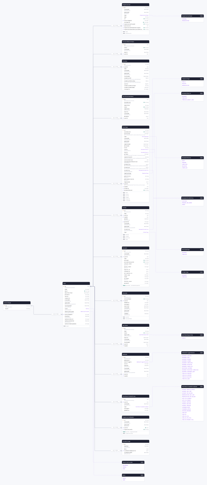

| Field                  | Type                                         | Constraints                                 | Default              | Description |
| ---------------------- | -------------------------------------------- | ------------------------------------------- | -------------------- | ----------- |
| `id`                   | `Int`                                        | PK NOT NULL                                 | `autoincrement()`    |             |
| `name`                 | `String`                                     | NULL                                        |                      |             |
| `email`                | `String`                                     | UNIQUE NOT NULL                             |                      |             |
| `emailVerified`        | `DateTime`                                   | NULL                                        |                      |             |
| `password`             | `String`                                     | NULL                                        |                      |             |
| `source`               | `String`                                     | NULL                                        |                      |             |
| `signature`            | `String`                                     | NULL                                        |                      |             |
| `createdAt`            | `DateTime`                                   | NOT NULL                                    | `now()`              |             |
| `updatedAt`            | `DateTime`                                   | NOT NULL                                    | `now()` `@updatedAt` |             |
| `lastSignedIn`         | `DateTime`                                   | NOT NULL                                    | `now()`              |             |
| `roles`                | [`Role[]`](#enum-Role)                       | NOT NULL                                    | `[USER]`             |             |
| `identityProvider`     | [`IdentityProvider`](#enum-IdentityProvider) | NOT NULL                                    | `DOCUMENSO`          |             |
| `avatarImageId`        | `String`                                     | NULL → [AvatarImage.id](#model-AvatarImage) |                      |             |
| `disabled`             | `Boolean`                                    | NOT NULL                                    | `false`              |             |
| `twoFactorSecret`      | `String`                                     | NULL                                        |                      |             |
| `twoFactorEnabled`     | `Boolean`                                    | NOT NULL                                    | `false`              |             |
| `twoFactorBackupCodes` | `String`                                     | NULL                                        |                      |             |

#### Indexes

- `@@index([email])`

#### References

- `avatarImageId` → [AvatarImage.id](#model-AvatarImage) (many-to-one, on delete SetNull)

#### Referenced by

- `id` ← [UserSecurityAuditLog.userId](#model-UserSecurityAuditLog) (one-to-many, on delete Cascade)
- `id` ← [PasswordResetToken.userId](#model-PasswordResetToken) (one-to-many, on delete Cascade)
- `id` ← [Passkey.userId](#model-Passkey) (one-to-many, on delete Cascade)
- `id` ← [VerificationToken.userId](#model-VerificationToken) (one-to-many, on delete Cascade)
- `id` ← [Webhook.userId](#model-Webhook) (one-to-many, on delete Cascade)
- `id` ← [ApiToken.userId](#model-ApiToken) (one-to-many, on delete Cascade)
- `id` ← [Account.userId](#model-Account) (one-to-many, on delete Cascade)
- `id` ← [Session.userId](#model-Session) (one-to-many, on delete Cascade)
- `id` ← [Folder.userId](#model-Folder) (one-to-many, on delete Cascade)
- `id` ← [Envelope.userId](#model-Envelope) (one-to-many, on delete Cascade)
- `id` ← [Organisation.ownerUserId](#model-Organisation) (one-to-many, on delete Cascade)
- `id` ← [OrganisationMember.userId](#model-OrganisationMember) (one-to-many, on delete Cascade)
- `id` ← [SiteSettings.lastModifiedByUserId](#model-SiteSettings) (one-to-many, on delete SetNull)

#### Definition

```sql
CREATE TABLE "User" (
    "id" SERIAL NOT NULL,
    "name" TEXT,
    "email" TEXT NOT NULL,
    "emailVerified" TIMESTAMP(3),
    "password" TEXT,
    "source" TEXT,
    "signature" TEXT,
    "createdAt" TIMESTAMP(3) NOT NULL DEFAULT CURRENT_TIMESTAMP,
    "updatedAt" TIMESTAMP(3) NOT NULL DEFAULT CURRENT_TIMESTAMP,
    "lastSignedIn" TIMESTAMP(3) NOT NULL DEFAULT CURRENT_TIMESTAMP,
    "roles" "Role"[] DEFAULT ARRAY['USER']::"Role"[],
    "identityProvider" "IdentityProvider" NOT NULL DEFAULT 'DOCUMENSO',
    "avatarImageId" TEXT,
    "disabled" BOOLEAN NOT NULL DEFAULT false,
    "twoFactorSecret" TEXT,
    "twoFactorEnabled" BOOLEAN NOT NULL DEFAULT false,
    "twoFactorBackupCodes" TEXT,

    CONSTRAINT "User_pkey" PRIMARY KEY ("id")
);

CREATE UNIQUE INDEX "User_email_key" ON "User"("email");

CREATE INDEX "User_email_idx" ON "User"("email");

ALTER TABLE "User" ADD CONSTRAINT "User_avatarImageId_fkey" FOREIGN KEY ("avatarImageId") REFERENCES "AvatarImage"("id") ON DELETE SET NULL ON UPDATE CASCADE;
```

<details>
<summary>Queries and their SQL</summary>

**findMany**: Every row

```ts
await prisma.user.findMany();
```

```sql
SELECT
  "public"."User"."id",
  "public"."User"."name",
  "public"."User"."email",
  "public"."User"."emailVerified",
  "public"."User"."password",
  "public"."User"."source",
  "public"."User"."signature",
  "public"."User"."createdAt",
  "public"."User"."updatedAt",
  "public"."User"."lastSignedIn",
  "public"."User"."roles"::text[],
  "public"."User"."identityProvider"::text,
  "public"."User"."avatarImageId",
  "public"."User"."disabled",
  "public"."User"."twoFactorSecret",
  "public"."User"."twoFactorEnabled",
  "public"."User"."twoFactorBackupCodes"
FROM
  "public"."User"
WHERE
  1 = 1
OFFSET
  $1
-- params: ["0"]
```

**count**: How many rows there are

```ts
await prisma.user.count();
```

```sql
SELECT
  COUNT(*) AS "_count$_all"
FROM
  (
    SELECT
      "public"."User"."id"
    FROM
      "public"."User"
    WHERE
      1 = 1
    OFFSET
      $1
  ) AS "sub"
-- params: ["0"]
```

**findMany**: Every row with its relations

```ts
await prisma.user.findMany({
  include: {
    accounts: true,
    sessions: true,
    passwordResetTokens: true,
    ownedOrganisations: true,
    organisationMember: true,
    folders: true,
    envelopes: true,
    verificationTokens: true,
    apiTokens: true,
    securityAuditLogs: true,
    webhooks: true,
    siteSettings: true,
    passkeys: true,
    avatarImage: true,
  },
});
```

```sql
SELECT
  "public"."User"."id",
  "public"."User"."name",
  "public"."User"."email",
  "public"."User"."emailVerified",
  "public"."User"."password",
  "public"."User"."source",
  "public"."User"."signature",
  "public"."User"."createdAt",
  "public"."User"."updatedAt",
  "public"."User"."lastSignedIn",
  "public"."User"."roles"::text[],
  "public"."User"."identityProvider"::text,
  "public"."User"."avatarImageId",
  "public"."User"."disabled",
  "public"."User"."twoFactorSecret",
  "public"."User"."twoFactorEnabled",
  "public"."User"."twoFactorBackupCodes"
FROM
  "public"."User"
WHERE
  1 = 1
OFFSET
  $1
-- params: ["0"]

SELECT
  "public"."Account"."id",
  "public"."Account"."createdAt",
  "public"."Account"."userId",
  "public"."Account"."type",
  "public"."Account"."provider",
  "public"."Account"."providerAccountId",
  "public"."Account"."refresh_token",
  "public"."Account"."access_token",
  "public"."Account"."expires_at",
  "public"."Account"."created_at",
  "public"."Account"."ext_expires_in",
  "public"."Account"."token_type",
  "public"."Account"."scope",
  "public"."Account"."id_token",
  "public"."Account"."session_state",
  "public"."Account"."password"
FROM
  "public"."Account"
WHERE
  "public"."Account"."userId" IN ($1)
OFFSET
  $2
-- params: ["<id of the rows above>","0"]

SELECT
  "public"."Session"."id",
  "public"."Session"."sessionToken",
  "public"."Session"."userId",
  "public"."Session"."ipAddress",
  "public"."Session"."userAgent",
  "public"."Session"."expiresAt",
  "public"."Session"."createdAt",
  "public"."Session"."updatedAt",
  "public"."Session"."isEmbed"
FROM
  "public"."Session"
WHERE
  "public"."Session"."userId" IN ($1)
OFFSET
  $2
-- params: ["<id of the rows above>","0"]

SELECT
  "public"."PasswordResetToken"."id",
  "public"."PasswordResetToken"."token",
  "public"."PasswordResetToken"."createdAt",
  "public"."PasswordResetToken"."expiry",
  "public"."PasswordResetToken"."userId"
FROM
  "public"."PasswordResetToken"
WHERE
  "public"."PasswordResetToken"."userId" IN ($1)
OFFSET
  $2
-- params: ["<id of the rows above>","0"]

SELECT
  "public"."Organisation"."id",
  "public"."Organisation"."createdAt",
  "public"."Organisation"."updatedAt",
  "public"."Organisation"."type"::text,
  "public"."Organisation"."name",
  "public"."Organisation"."url",
  "public"."Organisation"."avatarImageId",
  "public"."Organisation"."customerId",
  "public"."Organisation"."organisationClaimId",
  "public"."Organisation"."ownerUserId",
  "public"."Organisation"."organisationGlobalSettingsId",
  "public"."Organisation"."organisationAuthenticationPortalId"
FROM
  "public"."Organisation"
WHERE
  "public"."Organisation"."ownerUserId" IN ($1)
OFFSET
  $2
-- params: ["<id of the rows above>","0"]

SELECT
  "public"."OrganisationMember"."id",
  "public"."OrganisationMember"."createdAt",
  "public"."OrganisationMember"."updatedAt",
  "public"."OrganisationMember"."userId",
  "public"."OrganisationMember"."organisationId"
FROM
  "public"."OrganisationMember"
WHERE
  "public"."OrganisationMember"."userId" IN ($1)
OFFSET
  $2
-- params: ["<id of the rows above>","0"]

SELECT
  "public"."Folder"."id",
  "public"."Folder"."name",
  "public"."Folder"."userId",
  "public"."Folder"."teamId",
  "public"."Folder"."pinned",
  "public"."Folder"."parentId",
  "public"."Folder"."createdAt",
  "public"."Folder"."updatedAt",
  "public"."Folder"."visibility"::text,
  "public"."Folder"."type"::text
FROM
  "public"."Folder"
WHERE
  "public"."Folder"."userId" IN ($1)
OFFSET
  $2
-- params: ["<id of the rows above>","0"]

SELECT
  "public"."Envelope"."id",
  "public"."Envelope"."secondaryId",
  "public"."Envelope"."externalId",
  "public"."Envelope"."type"::text,
  "public"."Envelope"."createdAt",
  "public"."Envelope"."updatedAt",
  "public"."Envelope"."completedAt",
  "public"."Envelope"."deletedAt",
  "public"."Envelope"."title",
  "public"."Envelope"."status"::text,
  "public"."Envelope"."source"::text,
  "public"."Envelope"."qrToken",
  "public"."Envelope"."signatureLevel",
  "public"."Envelope"."internalVersion",
  "public"."Envelope"."useLegacyFieldInsertion",
  "public"."Envelope"."authOptions",
  "public"."Envelope"."formValues",
  "public"."Envelope"."visibility"::text,
  "public"."Envelope"."templateType"::text,
  "public"."Envelope"."publicTitle",
  "public"."Envelope"."publicDescription",
  "public"."Envelope"."templateId",
  "public"."Envelope"."userId",
  "public"."Envelope"."teamId",
  "public"."Envelope"."folderId",
  "public"."Envelope"."documentMetaId"
FROM
  "public"."Envelope"
WHERE
  "public"."Envelope"."userId" IN ($1)
OFFSET
  $2
-- params: ["<id of the rows above>","0"]

SELECT
  "public"."VerificationToken"."id",
  "public"."VerificationToken"."secondaryId",
  "public"."VerificationToken"."identifier",
  "public"."VerificationToken"."token",
  "public"."VerificationToken"."completed",
  "public"."VerificationToken"."expires",
  "public"."VerificationToken"."createdAt",
  "public"."VerificationToken"."metadata",
  "public"."VerificationToken"."userId"
FROM
  "public"."VerificationToken"
WHERE
  "public"."VerificationToken"."userId" IN ($1)
OFFSET
  $2
-- params: ["<id of the rows above>","0"]

SELECT
  "public"."ApiToken"."id",
  "public"."ApiToken"."name",
  "public"."ApiToken"."token",
  "public"."ApiToken"."algorithm"::text,
  "public"."ApiToken"."expires",
  "public"."ApiToken"."createdAt",
  "public"."ApiToken"."lastUsedAt",
  "public"."ApiToken"."userId",
  "public"."ApiToken"."teamId"
FROM
  "public"."ApiToken"
WHERE
  "public"."ApiToken"."userId" IN ($1)
OFFSET
  $2
-- params: ["<id of the rows above>","0"]

SELECT
  "public"."UserSecurityAuditLog"."id",
  "public"."UserSecurityAuditLog"."userId",
  "public"."UserSecurityAuditLog"."createdAt",
  "public"."UserSecurityAuditLog"."type"::text,
  "public"."UserSecurityAuditLog"."userAgent",
  "public"."UserSecurityAuditLog"."ipAddress"
FROM
  "public"."UserSecurityAuditLog"
WHERE
  "public"."UserSecurityAuditLog"."userId" IN ($1)
OFFSET
  $2
-- params: ["<id of the rows above>","0"]

SELECT
  "public"."Webhook"."id",
  "public"."Webhook"."webhookUrl",
  "public"."Webhook"."eventTriggers"::text[],
  "public"."Webhook"."secret",
  "public"."Webhook"."enabled",
  "public"."Webhook"."createdAt",
  "public"."Webhook"."updatedAt",
  "public"."Webhook"."userId",
  "public"."Webhook"."teamId"
FROM
  "public"."Webhook"
WHERE
  "public"."Webhook"."userId" IN ($1)
OFFSET
  $2
-- params: ["<id of the rows above>","0"]

SELECT
  "public"."SiteSettings"."id",
  "public"."SiteSettings"."enabled",
  "public"."SiteSettings"."data",
  "public"."SiteSettings"."lastModifiedByUserId",
  "public"."SiteSettings"."lastModifiedAt"
FROM
  "public"."SiteSettings"
WHERE
  "public"."SiteSettings"."lastModifiedByUserId" IN ($1)
OFFSET
  $2
-- params: ["<id of the rows above>","0"]

SELECT
  "public"."Passkey"."id",
  "public"."Passkey"."userId",
  "public"."Passkey"."name",
  "public"."Passkey"."createdAt",
  "public"."Passkey"."updatedAt",
  "public"."Passkey"."lastUsedAt",
  "public"."Passkey"."credentialId",
  "public"."Passkey"."credentialPublicKey",
  "public"."Passkey"."counter",
  "public"."Passkey"."credentialDeviceType",
  "public"."Passkey"."credentialBackedUp",
  "public"."Passkey"."transports"
FROM
  "public"."Passkey"
WHERE
  "public"."Passkey"."userId" IN ($1)
OFFSET
  $2
-- params: ["<id of the rows above>","0"]

SELECT
  "public"."AvatarImage"."id",
  "public"."AvatarImage"."bytes"
FROM
  "public"."AvatarImage"
WHERE
  "public"."AvatarImage"."id" IN ($1)
OFFSET
  $2
-- params: ["<avatarImageId of the rows above>","0"]
```

**findUnique**: One row by what is unique to it

```ts
await prisma.user.findUnique({ where: { id: 1 } });
```

```sql
SELECT
  "public"."User"."id",
  "public"."User"."name",
  "public"."User"."email",
  "public"."User"."emailVerified",
  "public"."User"."password",
  "public"."User"."source",
  "public"."User"."signature",
  "public"."User"."createdAt",
  "public"."User"."updatedAt",
  "public"."User"."lastSignedIn",
  "public"."User"."roles"::text[],
  "public"."User"."identityProvider"::text,
  "public"."User"."avatarImageId",
  "public"."User"."disabled",
  "public"."User"."twoFactorSecret",
  "public"."User"."twoFactorEnabled",
  "public"."User"."twoFactorBackupCodes"
FROM
  "public"."User"
WHERE
  (
    "public"."User"."id" = $1
    AND 1 = 1
  )
LIMIT
  $2
OFFSET
  $3
-- params: ["1","1","0"]
```

**create**: Create a row

```ts
await prisma.user.create({ data: { email: "example" } });
```

```sql
INSERT INTO
  "public"."User" (
    "email",
    "createdAt",
    "updatedAt",
    "lastSignedIn",
    "roles",
    "identityProvider",
    "disabled",
    "twoFactorEnabled"
  )
VALUES
  (
    $1,
    $2,
    $3,
    $4,
    CAST($5::text[] AS "public"."Role" []),
    CAST($6::text AS "public"."IdentityProvider"),
    $7,
    $8
  )
RETURNING
  "public"."User"."id",
  "public"."User"."name",
  "public"."User"."email",
  "public"."User"."emailVerified",
  "public"."User"."password",
  "public"."User"."source",
  "public"."User"."signature",
  "public"."User"."createdAt",
  "public"."User"."updatedAt",
  "public"."User"."lastSignedIn",
  "public"."User"."roles"::text[],
  "public"."User"."identityProvider"::text,
  "public"."User"."avatarImageId",
  "public"."User"."disabled",
  "public"."User"."twoFactorSecret",
  "public"."User"."twoFactorEnabled",
  "public"."User"."twoFactorBackupCodes"
-- params: ["example","<now()>","<now()>","<now()>",["USER"],"DOCUMENSO",false,false]
```

**update**: Update a row

```ts
await prisma.user.update({ where: { id: 1 }, data: { name: "example" } });
```

```sql
UPDATE "public"."User"
SET
  "name" = $1,
  "updatedAt" = $2
WHERE
  (
    "public"."User"."id" = $3
    AND 1 = 1
  )
RETURNING
  "public"."User"."id",
  "public"."User"."name",
  "public"."User"."email",
  "public"."User"."emailVerified",
  "public"."User"."password",
  "public"."User"."source",
  "public"."User"."signature",
  "public"."User"."createdAt",
  "public"."User"."updatedAt",
  "public"."User"."lastSignedIn",
  "public"."User"."roles"::text[],
  "public"."User"."identityProvider"::text,
  "public"."User"."avatarImageId",
  "public"."User"."disabled",
  "public"."User"."twoFactorSecret",
  "public"."User"."twoFactorEnabled",
  "public"."User"."twoFactorBackupCodes"
-- params: ["example",{"prisma__type":"generatorCall","prisma__value":{"name":"now","args":[],"returnType":{"type":"DateTime"}}},"1"]
```

**delete**: Delete a row

```ts
await prisma.user.delete({ where: { id: 1 } });
```

```sql
DELETE FROM "public"."User"
WHERE
  (
    "public"."User"."id" = $1
    AND 1 = 1
  )
RETURNING
  "public"."User"."id",
  "public"."User"."name",
  "public"."User"."email",
  "public"."User"."emailVerified",
  "public"."User"."password",
  "public"."User"."source",
  "public"."User"."signature",
  "public"."User"."createdAt",
  "public"."User"."updatedAt",
  "public"."User"."lastSignedIn",
  "public"."User"."roles"::text[],
  "public"."User"."identityProvider"::text,
  "public"."User"."avatarImageId",
  "public"."User"."disabled",
  "public"."User"."twoFactorSecret",
  "public"."User"."twoFactorEnabled",
  "public"."User"."twoFactorBackupCodes"
-- params: ["1"]
```

</details>

<a id="model-TeamProfile"></a>

### TeamProfile

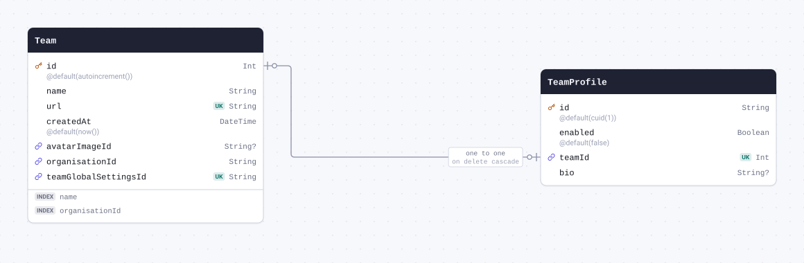

| Field     | Type      | Constraints                              | Default   | Description |
| --------- | --------- | ---------------------------------------- | --------- | ----------- |
| `id`      | `String`  | PK NOT NULL                              | `cuid(1)` |             |
| `enabled` | `Boolean` | NOT NULL                                 | `false`   |             |
| `teamId`  | `Int`     | UNIQUE NOT NULL → [Team.id](#model-Team) |           |             |
| `bio`     | `String`  | NULL                                     |           |             |

#### References

- `teamId` → [Team.id](#model-Team) (one-to-one, on delete Cascade)

#### Definition

```sql
CREATE TABLE "TeamProfile" (
    "id" TEXT NOT NULL,
    "enabled" BOOLEAN NOT NULL DEFAULT false,
    "teamId" INTEGER NOT NULL,
    "bio" TEXT,

    CONSTRAINT "TeamProfile_pkey" PRIMARY KEY ("id")
);

CREATE UNIQUE INDEX "TeamProfile_teamId_key" ON "TeamProfile"("teamId");

ALTER TABLE "TeamProfile" ADD CONSTRAINT "TeamProfile_teamId_fkey" FOREIGN KEY ("teamId") REFERENCES "Team"("id") ON DELETE CASCADE ON UPDATE CASCADE;
```

<details>
<summary>Queries and their SQL</summary>

**findMany**: Every row

```ts
await prisma.teamProfile.findMany();
```

```sql
SELECT
  "public"."TeamProfile"."id",
  "public"."TeamProfile"."enabled",
  "public"."TeamProfile"."teamId",
  "public"."TeamProfile"."bio"
FROM
  "public"."TeamProfile"
WHERE
  1 = 1
OFFSET
  $1
-- params: ["0"]
```

**count**: How many rows there are

```ts
await prisma.teamProfile.count();
```

```sql
SELECT
  COUNT(*) AS "_count$_all"
FROM
  (
    SELECT
      "public"."TeamProfile"."id"
    FROM
      "public"."TeamProfile"
    WHERE
      1 = 1
    OFFSET
      $1
  ) AS "sub"
-- params: ["0"]
```

**findMany**: Every row with its relations

```ts
await prisma.teamProfile.findMany({ include: { team: true } });
```

```sql
SELECT
  "public"."TeamProfile"."id",
  "public"."TeamProfile"."enabled",
  "public"."TeamProfile"."teamId",
  "public"."TeamProfile"."bio"
FROM
  "public"."TeamProfile"
WHERE
  1 = 1
OFFSET
  $1
-- params: ["0"]

SELECT
  "public"."Team"."id",
  "public"."Team"."name",
  "public"."Team"."url",
  "public"."Team"."createdAt",
  "public"."Team"."avatarImageId",
  "public"."Team"."organisationId",
  "public"."Team"."teamGlobalSettingsId"
FROM
  "public"."Team"
WHERE
  "public"."Team"."id" IN ($1)
OFFSET
  $2
-- params: ["<teamId of the rows above>","0"]
```

**findUnique**: One row by what is unique to it

```ts
await prisma.teamProfile.findUnique({ where: { id: "example" } });
```

```sql
SELECT
  "public"."TeamProfile"."id",
  "public"."TeamProfile"."enabled",
  "public"."TeamProfile"."teamId",
  "public"."TeamProfile"."bio"
FROM
  "public"."TeamProfile"
WHERE
  (
    "public"."TeamProfile"."id" = $1
    AND 1 = 1
  )
LIMIT
  $2
OFFSET
  $3
-- params: ["example","1","0"]
```

**create**: Create a row

```ts
await prisma.teamProfile.create({ data: { teamId: 1 } });
```

```sql
INSERT INTO
  "public"."TeamProfile" ("id", "enabled", "teamId")
VALUES
  ($1, $2, $3)
RETURNING
  "public"."TeamProfile"."id",
  "public"."TeamProfile"."enabled",
  "public"."TeamProfile"."teamId",
  "public"."TeamProfile"."bio"
-- params: ["<cuid(1)>",false,"1"]
```

**update**: Update a row

```ts
await prisma.teamProfile.update({ where: { id: "example" }, data: { enabled: true } });
```

```sql
UPDATE "public"."TeamProfile"
SET
  "enabled" = $1
WHERE
  (
    "public"."TeamProfile"."id" = $2
    AND 1 = 1
  )
RETURNING
  "public"."TeamProfile"."id",
  "public"."TeamProfile"."enabled",
  "public"."TeamProfile"."teamId",
  "public"."TeamProfile"."bio"
-- params: [true,"example"]
```

**delete**: Delete a row

```ts
await prisma.teamProfile.delete({ where: { id: "example" } });
```

```sql
DELETE FROM "public"."TeamProfile"
WHERE
  (
    "public"."TeamProfile"."id" = $1
    AND 1 = 1
  )
RETURNING
  "public"."TeamProfile"."id",
  "public"."TeamProfile"."enabled",
  "public"."TeamProfile"."teamId",
  "public"."TeamProfile"."bio"
-- params: ["example"]
```

</details>

<a id="model-UserSecurityAuditLog"></a>

### UserSecurityAuditLog

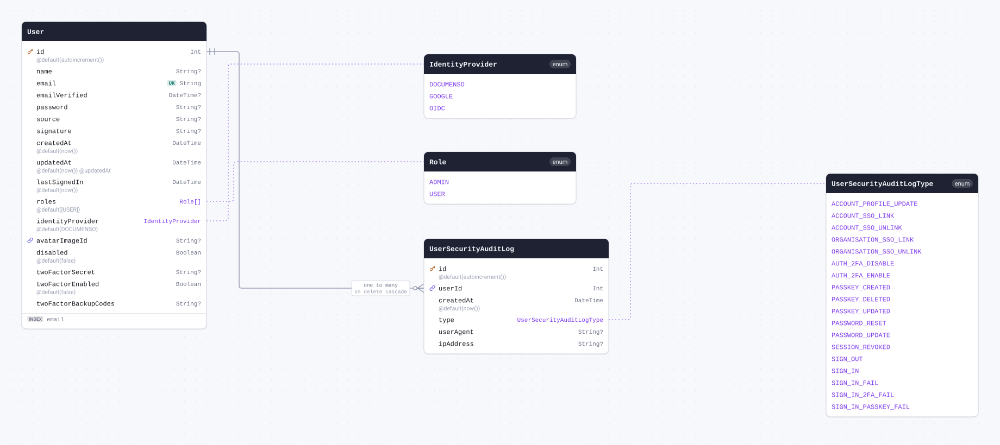

| Field       | Type                                                         | Constraints                       | Default           | Description |
| ----------- | ------------------------------------------------------------ | --------------------------------- | ----------------- | ----------- |
| `id`        | `Int`                                                        | PK NOT NULL                       | `autoincrement()` |             |
| `userId`    | `Int`                                                        | NOT NULL → [User.id](#model-User) |                   |             |
| `createdAt` | `DateTime`                                                   | NOT NULL                          | `now()`           |             |
| `type`      | [`UserSecurityAuditLogType`](#enum-UserSecurityAuditLogType) | NOT NULL                          |                   |             |
| `userAgent` | `String`                                                     | NULL                              |                   |             |
| `ipAddress` | `String`                                                     | NULL                              |                   |             |

#### References

- `userId` → [User.id](#model-User) (many-to-one, on delete Cascade)

#### Definition

```sql
CREATE TABLE "UserSecurityAuditLog" (
    "id" SERIAL NOT NULL,
    "userId" INTEGER NOT NULL,
    "createdAt" TIMESTAMP(3) NOT NULL DEFAULT CURRENT_TIMESTAMP,
    "type" "UserSecurityAuditLogType" NOT NULL,
    "userAgent" TEXT,
    "ipAddress" TEXT,

    CONSTRAINT "UserSecurityAuditLog_pkey" PRIMARY KEY ("id")
);

ALTER TABLE "UserSecurityAuditLog" ADD CONSTRAINT "UserSecurityAuditLog_userId_fkey" FOREIGN KEY ("userId") REFERENCES "User"("id") ON DELETE CASCADE ON UPDATE CASCADE;
```

<details>
<summary>Queries and their SQL</summary>

**findMany**: Every row

```ts
await prisma.userSecurityAuditLog.findMany();
```

```sql
SELECT
  "public"."UserSecurityAuditLog"."id",
  "public"."UserSecurityAuditLog"."userId",
  "public"."UserSecurityAuditLog"."createdAt",
  "public"."UserSecurityAuditLog"."type"::text,
  "public"."UserSecurityAuditLog"."userAgent",
  "public"."UserSecurityAuditLog"."ipAddress"
FROM
  "public"."UserSecurityAuditLog"
WHERE
  1 = 1
OFFSET
  $1
-- params: ["0"]
```

**count**: How many rows there are

```ts
await prisma.userSecurityAuditLog.count();
```

```sql
SELECT
  COUNT(*) AS "_count$_all"
FROM
  (
    SELECT
      "public"."UserSecurityAuditLog"."id"
    FROM
      "public"."UserSecurityAuditLog"
    WHERE
      1 = 1
    OFFSET
      $1
  ) AS "sub"
-- params: ["0"]
```

**findMany**: Every row with its relations

```ts
await prisma.userSecurityAuditLog.findMany({ include: { user: true } });
```

```sql
SELECT
  "public"."UserSecurityAuditLog"."id",
  "public"."UserSecurityAuditLog"."userId",
  "public"."UserSecurityAuditLog"."createdAt",
  "public"."UserSecurityAuditLog"."type"::text,
  "public"."UserSecurityAuditLog"."userAgent",
  "public"."UserSecurityAuditLog"."ipAddress"
FROM
  "public"."UserSecurityAuditLog"
WHERE
  1 = 1
OFFSET
  $1
-- params: ["0"]

SELECT
  "public"."User"."id",
  "public"."User"."name",
  "public"."User"."email",
  "public"."User"."emailVerified",
  "public"."User"."password",
  "public"."User"."source",
  "public"."User"."signature",
  "public"."User"."createdAt",
  "public"."User"."updatedAt",
  "public"."User"."lastSignedIn",
  "public"."User"."roles"::text[],
  "public"."User"."identityProvider"::text,
  "public"."User"."avatarImageId",
  "public"."User"."disabled",
  "public"."User"."twoFactorSecret",
  "public"."User"."twoFactorEnabled",
  "public"."User"."twoFactorBackupCodes"
FROM
  "public"."User"
WHERE
  "public"."User"."id" IN ($1)
OFFSET
  $2
-- params: ["<userId of the rows above>","0"]
```

**findUnique**: One row by what is unique to it

```ts
await prisma.userSecurityAuditLog.findUnique({ where: { id: 1 } });
```

```sql
SELECT
  "public"."UserSecurityAuditLog"."id",
  "public"."UserSecurityAuditLog"."userId",
  "public"."UserSecurityAuditLog"."createdAt",
  "public"."UserSecurityAuditLog"."type"::text,
  "public"."UserSecurityAuditLog"."userAgent",
  "public"."UserSecurityAuditLog"."ipAddress"
FROM
  "public"."UserSecurityAuditLog"
WHERE
  (
    "public"."UserSecurityAuditLog"."id" = $1
    AND 1 = 1
  )
LIMIT
  $2
OFFSET
  $3
-- params: ["1","1","0"]
```

**create**: Create a row

```ts
await prisma.userSecurityAuditLog.create({ data: { userId: 1, type: "ACCOUNT_PROFILE_UPDATE" } });
```

```sql
INSERT INTO
  "public"."UserSecurityAuditLog" ("userId", "createdAt", "type")
VALUES
  (
    $1,
    $2,
    CAST($3::text AS "public"."UserSecurityAuditLogType")
  )
RETURNING
  "public"."UserSecurityAuditLog"."id",
  "public"."UserSecurityAuditLog"."userId",
  "public"."UserSecurityAuditLog"."createdAt",
  "public"."UserSecurityAuditLog"."type"::text,
  "public"."UserSecurityAuditLog"."userAgent",
  "public"."UserSecurityAuditLog"."ipAddress"
-- params: ["1","<now()>","ACCOUNT_PROFILE_UPDATE"]
```

**update**: Update a row

```ts
await prisma.userSecurityAuditLog.update({
  where: { id: 1 },
  data: { createdAt: new Date("2026-01-01T00:00:00.000Z") },
});
```

```sql
UPDATE "public"."UserSecurityAuditLog"
SET
  "createdAt" = $1
WHERE
  (
    "public"."UserSecurityAuditLog"."id" = $2
    AND 1 = 1
  )
RETURNING
  "public"."UserSecurityAuditLog"."id",
  "public"."UserSecurityAuditLog"."userId",
  "public"."UserSecurityAuditLog"."createdAt",
  "public"."UserSecurityAuditLog"."type"::text,
  "public"."UserSecurityAuditLog"."userAgent",
  "public"."UserSecurityAuditLog"."ipAddress"
-- params: ["2026-01-01T00:00:00.000Z","1"]
```

**delete**: Delete a row

```ts
await prisma.userSecurityAuditLog.delete({ where: { id: 1 } });
```

```sql
DELETE FROM "public"."UserSecurityAuditLog"
WHERE
  (
    "public"."UserSecurityAuditLog"."id" = $1
    AND 1 = 1
  )
RETURNING
  "public"."UserSecurityAuditLog"."id",
  "public"."UserSecurityAuditLog"."userId",
  "public"."UserSecurityAuditLog"."createdAt",
  "public"."UserSecurityAuditLog"."type"::text,
  "public"."UserSecurityAuditLog"."userAgent",
  "public"."UserSecurityAuditLog"."ipAddress"
-- params: ["1"]
```

</details>

<a id="model-PasswordResetToken"></a>

### PasswordResetToken

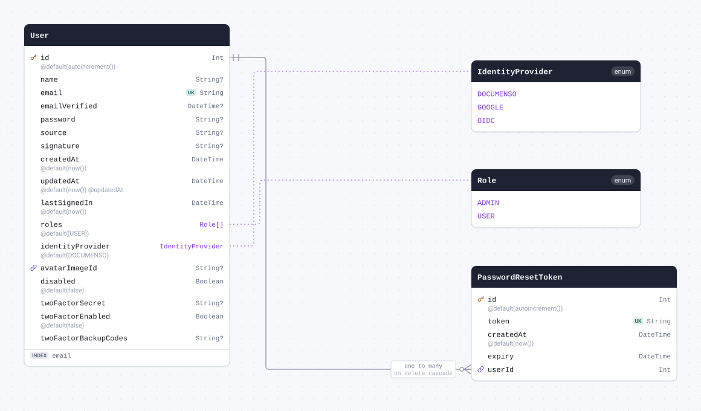

| Field       | Type       | Constraints                       | Default           | Description |
| ----------- | ---------- | --------------------------------- | ----------------- | ----------- |
| `id`        | `Int`      | PK NOT NULL                       | `autoincrement()` |             |
| `token`     | `String`   | UNIQUE NOT NULL                   |                   |             |
| `createdAt` | `DateTime` | NOT NULL                          | `now()`           |             |
| `expiry`    | `DateTime` | NOT NULL                          |                   |             |
| `userId`    | `Int`      | NOT NULL → [User.id](#model-User) |                   |             |

#### References

- `userId` → [User.id](#model-User) (many-to-one, on delete Cascade)

#### Definition

```sql
CREATE TABLE "PasswordResetToken" (
    "id" SERIAL NOT NULL,
    "token" TEXT NOT NULL,
    "createdAt" TIMESTAMP(3) NOT NULL DEFAULT CURRENT_TIMESTAMP,
    "expiry" TIMESTAMP(3) NOT NULL,
    "userId" INTEGER NOT NULL,

    CONSTRAINT "PasswordResetToken_pkey" PRIMARY KEY ("id")
);

CREATE UNIQUE INDEX "PasswordResetToken_token_key" ON "PasswordResetToken"("token");

ALTER TABLE "PasswordResetToken" ADD CONSTRAINT "PasswordResetToken_userId_fkey" FOREIGN KEY ("userId") REFERENCES "User"("id") ON DELETE CASCADE ON UPDATE CASCADE;
```

<details>
<summary>Queries and their SQL</summary>

**findMany**: Every row

```ts
await prisma.passwordResetToken.findMany();
```

```sql
SELECT
  "public"."PasswordResetToken"."id",
  "public"."PasswordResetToken"."token",
  "public"."PasswordResetToken"."createdAt",
  "public"."PasswordResetToken"."expiry",
  "public"."PasswordResetToken"."userId"
FROM
  "public"."PasswordResetToken"
WHERE
  1 = 1
OFFSET
  $1
-- params: ["0"]
```

**count**: How many rows there are

```ts
await prisma.passwordResetToken.count();
```

```sql
SELECT
  COUNT(*) AS "_count$_all"
FROM
  (
    SELECT
      "public"."PasswordResetToken"."id"
    FROM
      "public"."PasswordResetToken"
    WHERE
      1 = 1
    OFFSET
      $1
  ) AS "sub"
-- params: ["0"]
```

**findMany**: Every row with its relations

```ts
await prisma.passwordResetToken.findMany({ include: { user: true } });
```

```sql
SELECT
  "public"."PasswordResetToken"."id",
  "public"."PasswordResetToken"."token",
  "public"."PasswordResetToken"."createdAt",
  "public"."PasswordResetToken"."expiry",
  "public"."PasswordResetToken"."userId"
FROM
  "public"."PasswordResetToken"
WHERE
  1 = 1
OFFSET
  $1
-- params: ["0"]

SELECT
  "public"."User"."id",
  "public"."User"."name",
  "public"."User"."email",
  "public"."User"."emailVerified",
  "public"."User"."password",
  "public"."User"."source",
  "public"."User"."signature",
  "public"."User"."createdAt",
  "public"."User"."updatedAt",
  "public"."User"."lastSignedIn",
  "public"."User"."roles"::text[],
  "public"."User"."identityProvider"::text,
  "public"."User"."avatarImageId",
  "public"."User"."disabled",
  "public"."User"."twoFactorSecret",
  "public"."User"."twoFactorEnabled",
  "public"."User"."twoFactorBackupCodes"
FROM
  "public"."User"
WHERE
  "public"."User"."id" IN ($1)
OFFSET
  $2
-- params: ["<userId of the rows above>","0"]
```

**findUnique**: One row by what is unique to it

```ts
await prisma.passwordResetToken.findUnique({ where: { id: 1 } });
```

```sql
SELECT
  "public"."PasswordResetToken"."id",
  "public"."PasswordResetToken"."token",
  "public"."PasswordResetToken"."createdAt",
  "public"."PasswordResetToken"."expiry",
  "public"."PasswordResetToken"."userId"
FROM
  "public"."PasswordResetToken"
WHERE
  (
    "public"."PasswordResetToken"."id" = $1
    AND 1 = 1
  )
LIMIT
  $2
OFFSET
  $3
-- params: ["1","1","0"]
```

**create**: Create a row

```ts
await prisma.passwordResetToken.create({
  data: { token: "example", expiry: new Date("2026-01-01T00:00:00.000Z"), userId: 1 },
});
```

```sql
INSERT INTO
  "public"."PasswordResetToken" ("token", "createdAt", "expiry", "userId")
VALUES
  ($1, $2, $3, $4)
RETURNING
  "public"."PasswordResetToken"."id",
  "public"."PasswordResetToken"."token",
  "public"."PasswordResetToken"."createdAt",
  "public"."PasswordResetToken"."expiry",
  "public"."PasswordResetToken"."userId"
-- params: ["example","<now()>","2026-01-01T00:00:00.000Z","1"]
```

**update**: Update a row

```ts
await prisma.passwordResetToken.update({ where: { id: 1 }, data: { token: "example" } });
```

```sql
UPDATE "public"."PasswordResetToken"
SET
  "token" = $1
WHERE
  (
    "public"."PasswordResetToken"."id" = $2
    AND 1 = 1
  )
RETURNING
  "public"."PasswordResetToken"."id",
  "public"."PasswordResetToken"."token",
  "public"."PasswordResetToken"."createdAt",
  "public"."PasswordResetToken"."expiry",
  "public"."PasswordResetToken"."userId"
-- params: ["example","1"]
```

**delete**: Delete a row

```ts
await prisma.passwordResetToken.delete({ where: { id: 1 } });
```

```sql
DELETE FROM "public"."PasswordResetToken"
WHERE
  (
    "public"."PasswordResetToken"."id" = $1
    AND 1 = 1
  )
RETURNING
  "public"."PasswordResetToken"."id",
  "public"."PasswordResetToken"."token",
  "public"."PasswordResetToken"."createdAt",
  "public"."PasswordResetToken"."expiry",
  "public"."PasswordResetToken"."userId"
-- params: ["1"]
```

</details>

<a id="model-Passkey"></a>

### Passkey

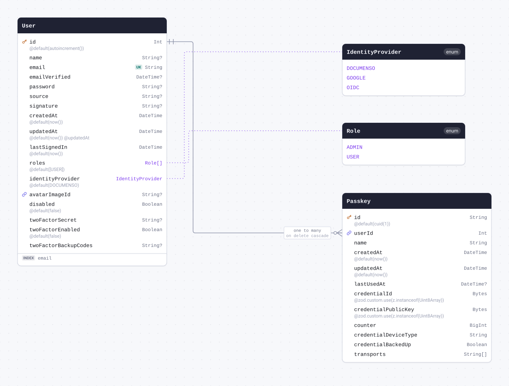

| Field                  | Type       | Constraints                       | Default   | Description                               |
| ---------------------- | ---------- | --------------------------------- | --------- | ----------------------------------------- |
| `id`                   | `String`   | PK NOT NULL                       | `cuid(1)` |                                           |
| `userId`               | `Int`      | NOT NULL → [User.id](#model-User) |           |                                           |
| `name`                 | `String`   | NOT NULL                          |           |                                           |
| `createdAt`            | `DateTime` | NOT NULL                          | `now()`   |                                           |
| `updatedAt`            | `DateTime` | NOT NULL                          | `now()`   |                                           |
| `lastUsedAt`           | `DateTime` | NULL                              |           |                                           |
| `credentialId`         | `Bytes`    | NOT NULL                          |           | @zod.custom.use(z.instanceof(Uint8Array)) |
| `credentialPublicKey`  | `Bytes`    | NOT NULL                          |           | @zod.custom.use(z.instanceof(Uint8Array)) |
| `counter`              | `BigInt`   | NOT NULL                          |           |                                           |
| `credentialDeviceType` | `String`   | NOT NULL                          |           |                                           |
| `credentialBackedUp`   | `Boolean`  | NOT NULL                          |           |                                           |
| `transports`           | `String[]` | NOT NULL                          |           |                                           |

#### References

- `userId` → [User.id](#model-User) (many-to-one, on delete Cascade)

#### Definition

```sql
CREATE TABLE "Passkey" (
    "id" TEXT NOT NULL,
    "userId" INTEGER NOT NULL,
    "name" TEXT NOT NULL,
    "createdAt" TIMESTAMP(3) NOT NULL DEFAULT CURRENT_TIMESTAMP,
    "updatedAt" TIMESTAMP(3) NOT NULL DEFAULT CURRENT_TIMESTAMP,
    "lastUsedAt" TIMESTAMP(3),
    "credentialId" BYTEA NOT NULL,
    "credentialPublicKey" BYTEA NOT NULL,
    "counter" BIGINT NOT NULL,
    "credentialDeviceType" TEXT NOT NULL,
    "credentialBackedUp" BOOLEAN NOT NULL,
    "transports" TEXT[],

    CONSTRAINT "Passkey_pkey" PRIMARY KEY ("id")
);

ALTER TABLE "Passkey" ADD CONSTRAINT "Passkey_userId_fkey" FOREIGN KEY ("userId") REFERENCES "User"("id") ON DELETE CASCADE ON UPDATE CASCADE;
```

<details>
<summary>Queries and their SQL</summary>

**findMany**: Every row

```ts
await prisma.passkey.findMany();
```

```sql
SELECT
  "public"."Passkey"."id",
  "public"."Passkey"."userId",
  "public"."Passkey"."name",
  "public"."Passkey"."createdAt",
  "public"."Passkey"."updatedAt",
  "public"."Passkey"."lastUsedAt",
  "public"."Passkey"."credentialId",
  "public"."Passkey"."credentialPublicKey",
  "public"."Passkey"."counter",
  "public"."Passkey"."credentialDeviceType",
  "public"."Passkey"."credentialBackedUp",
  "public"."Passkey"."transports"
FROM
  "public"."Passkey"
WHERE
  1 = 1
OFFSET
  $1
-- params: ["0"]
```

**count**: How many rows there are

```ts
await prisma.passkey.count();
```

```sql
SELECT
  COUNT(*) AS "_count$_all"
FROM
  (
    SELECT
      "public"."Passkey"."id"
    FROM
      "public"."Passkey"
    WHERE
      1 = 1
    OFFSET
      $1
  ) AS "sub"
-- params: ["0"]
```

**findMany**: Every row with its relations

```ts
await prisma.passkey.findMany({ include: { user: true } });
```

```sql
SELECT
  "public"."Passkey"."id",
  "public"."Passkey"."userId",
  "public"."Passkey"."name",
  "public"."Passkey"."createdAt",
  "public"."Passkey"."updatedAt",
  "public"."Passkey"."lastUsedAt",
  "public"."Passkey"."credentialId",
  "public"."Passkey"."credentialPublicKey",
  "public"."Passkey"."counter",
  "public"."Passkey"."credentialDeviceType",
  "public"."Passkey"."credentialBackedUp",
  "public"."Passkey"."transports"
FROM
  "public"."Passkey"
WHERE
  1 = 1
OFFSET
  $1
-- params: ["0"]

SELECT
  "public"."User"."id",
  "public"."User"."name",
  "public"."User"."email",
  "public"."User"."emailVerified",
  "public"."User"."password",
  "public"."User"."source",
  "public"."User"."signature",
  "public"."User"."createdAt",
  "public"."User"."updatedAt",
  "public"."User"."lastSignedIn",
  "public"."User"."roles"::text[],
  "public"."User"."identityProvider"::text,
  "public"."User"."avatarImageId",
  "public"."User"."disabled",
  "public"."User"."twoFactorSecret",
  "public"."User"."twoFactorEnabled",
  "public"."User"."twoFactorBackupCodes"
FROM
  "public"."User"
WHERE
  "public"."User"."id" IN ($1)
OFFSET
  $2
-- params: ["<userId of the rows above>","0"]
```

**findUnique**: One row by what is unique to it

```ts
await prisma.passkey.findUnique({ where: { id: "example" } });
```

```sql
SELECT
  "public"."Passkey"."id",
  "public"."Passkey"."userId",
  "public"."Passkey"."name",
  "public"."Passkey"."createdAt",
  "public"."Passkey"."updatedAt",
  "public"."Passkey"."lastUsedAt",
  "public"."Passkey"."credentialId",
  "public"."Passkey"."credentialPublicKey",
  "public"."Passkey"."counter",
  "public"."Passkey"."credentialDeviceType",
  "public"."Passkey"."credentialBackedUp",
  "public"."Passkey"."transports"
FROM
  "public"."Passkey"
WHERE
  (
    "public"."Passkey"."id" = $1
    AND 1 = 1
  )
LIMIT
  $2
OFFSET
  $3
-- params: ["example","1","0"]
```

**create**: Create a row

```ts
await prisma.passkey.create({
  data: {
    userId: 1,
    name: "example",
    credentialId: Uint8Array.from([1, 2, 3]),
    credentialPublicKey: Uint8Array.from([1, 2, 3]),
    counter: 1n,
    credentialDeviceType: "example",
    credentialBackedUp: true,
    transports: ["example"],
  },
});
```

```sql
INSERT INTO
  "public"."Passkey" (
    "id",
    "userId",
    "name",
    "createdAt",
    "updatedAt",
    "credentialId",
    "credentialPublicKey",
    "counter",
    "credentialDeviceType",
    "credentialBackedUp",
    "transports"
  )
VALUES
  ($1, $2, $3, $4, $5, $6, $7, $8, $9, $10, $11)
RETURNING
  "public"."Passkey"."id",
  "public"."Passkey"."userId",
  "public"."Passkey"."name",
  "public"."Passkey"."createdAt",
  "public"."Passkey"."updatedAt",
  "public"."Passkey"."lastUsedAt",
  "public"."Passkey"."credentialId",
  "public"."Passkey"."credentialPublicKey",
  "public"."Passkey"."counter",
  "public"."Passkey"."credentialDeviceType",
  "public"."Passkey"."credentialBackedUp",
  "public"."Passkey"."transports"
-- params: ["<cuid(1)>","1","example","<now()>","<now()>","AQID","AQID","1","example",true,["example"]]
```

**update**: Update a row

```ts
await prisma.passkey.update({ where: { id: "example" }, data: { name: "example" } });
```

```sql
UPDATE "public"."Passkey"
SET
  "name" = $1
WHERE
  (
    "public"."Passkey"."id" = $2
    AND 1 = 1
  )
RETURNING
  "public"."Passkey"."id",
  "public"."Passkey"."userId",
  "public"."Passkey"."name",
  "public"."Passkey"."createdAt",
  "public"."Passkey"."updatedAt",
  "public"."Passkey"."lastUsedAt",
  "public"."Passkey"."credentialId",
  "public"."Passkey"."credentialPublicKey",
  "public"."Passkey"."counter",
  "public"."Passkey"."credentialDeviceType",
  "public"."Passkey"."credentialBackedUp",
  "public"."Passkey"."transports"
-- params: ["example","example"]
```

**delete**: Delete a row

```ts
await prisma.passkey.delete({ where: { id: "example" } });
```

```sql
DELETE FROM "public"."Passkey"
WHERE
  (
    "public"."Passkey"."id" = $1
    AND 1 = 1
  )
RETURNING
  "public"."Passkey"."id",
  "public"."Passkey"."userId",
  "public"."Passkey"."name",
  "public"."Passkey"."createdAt",
  "public"."Passkey"."updatedAt",
  "public"."Passkey"."lastUsedAt",
  "public"."Passkey"."credentialId",
  "public"."Passkey"."credentialPublicKey",
  "public"."Passkey"."counter",
  "public"."Passkey"."credentialDeviceType",
  "public"."Passkey"."credentialBackedUp",
  "public"."Passkey"."transports"
-- params: ["example"]
```

</details>

<a id="model-AnonymousVerificationToken"></a>

### AnonymousVerificationToken

| Field       | Type       | Constraints     | Default   | Description |
| ----------- | ---------- | --------------- | --------- | ----------- |
| `id`        | `String`   | PK NOT NULL     | `cuid(1)` |             |
| `token`     | `String`   | UNIQUE NOT NULL |           |             |
| `expiresAt` | `DateTime` | NOT NULL        |           |             |
| `createdAt` | `DateTime` | NOT NULL        | `now()`   |             |

#### Definition

```sql
CREATE TABLE "AnonymousVerificationToken" (
    "id" TEXT NOT NULL,
    "token" TEXT NOT NULL,
    "expiresAt" TIMESTAMP(3) NOT NULL,
    "createdAt" TIMESTAMP(3) NOT NULL DEFAULT CURRENT_TIMESTAMP,

    CONSTRAINT "AnonymousVerificationToken_pkey" PRIMARY KEY ("id")
);

CREATE UNIQUE INDEX "AnonymousVerificationToken_id_key" ON "AnonymousVerificationToken"("id");

CREATE UNIQUE INDEX "AnonymousVerificationToken_token_key" ON "AnonymousVerificationToken"("token");
```

<details>
<summary>Queries and their SQL</summary>

**findMany**: Every row

```ts
await prisma.anonymousVerificationToken.findMany();
```

```sql
SELECT
  "public"."AnonymousVerificationToken"."id",
  "public"."AnonymousVerificationToken"."token",
  "public"."AnonymousVerificationToken"."expiresAt",
  "public"."AnonymousVerificationToken"."createdAt"
FROM
  "public"."AnonymousVerificationToken"
WHERE
  1 = 1
OFFSET
  $1
-- params: ["0"]
```

**count**: How many rows there are

```ts
await prisma.anonymousVerificationToken.count();
```

```sql
SELECT
  COUNT(*) AS "_count$_all"
FROM
  (
    SELECT
      "public"."AnonymousVerificationToken"."id"
    FROM
      "public"."AnonymousVerificationToken"
    WHERE
      1 = 1
    OFFSET
      $1
  ) AS "sub"
-- params: ["0"]
```

**findUnique**: One row by what is unique to it

```ts
await prisma.anonymousVerificationToken.findUnique({ where: { id: "example" } });
```

```sql
SELECT
  "public"."AnonymousVerificationToken"."id",
  "public"."AnonymousVerificationToken"."token",
  "public"."AnonymousVerificationToken"."expiresAt",
  "public"."AnonymousVerificationToken"."createdAt"
FROM
  "public"."AnonymousVerificationToken"
WHERE
  (
    "public"."AnonymousVerificationToken"."id" = $1
    AND 1 = 1
  )
LIMIT
  $2
OFFSET
  $3
-- params: ["example","1","0"]
```

**create**: Create a row

```ts
await prisma.anonymousVerificationToken.create({
  data: { token: "example", expiresAt: new Date("2026-01-01T00:00:00.000Z") },
});
```

```sql
INSERT INTO
  "public"."AnonymousVerificationToken" ("id", "token", "expiresAt", "createdAt")
VALUES
  ($1, $2, $3, $4)
RETURNING
  "public"."AnonymousVerificationToken"."id",
  "public"."AnonymousVerificationToken"."token",
  "public"."AnonymousVerificationToken"."expiresAt",
  "public"."AnonymousVerificationToken"."createdAt"
-- params: ["<cuid(1)>","example","2026-01-01T00:00:00.000Z","<now()>"]
```

**update**: Update a row

```ts
await prisma.anonymousVerificationToken.update({
  where: { id: "example" },
  data: { token: "example" },
});
```

```sql
UPDATE "public"."AnonymousVerificationToken"
SET
  "token" = $1
WHERE
  (
    "public"."AnonymousVerificationToken"."id" = $2
    AND 1 = 1
  )
RETURNING
  "public"."AnonymousVerificationToken"."id",
  "public"."AnonymousVerificationToken"."token",
  "public"."AnonymousVerificationToken"."expiresAt",
  "public"."AnonymousVerificationToken"."createdAt"
-- params: ["example","example"]
```

**delete**: Delete a row

```ts
await prisma.anonymousVerificationToken.delete({ where: { id: "example" } });
```

```sql
DELETE FROM "public"."AnonymousVerificationToken"
WHERE
  (
    "public"."AnonymousVerificationToken"."id" = $1
    AND 1 = 1
  )
RETURNING
  "public"."AnonymousVerificationToken"."id",
  "public"."AnonymousVerificationToken"."token",
  "public"."AnonymousVerificationToken"."expiresAt",
  "public"."AnonymousVerificationToken"."createdAt"
-- params: ["example"]
```

</details>

<a id="model-VerificationToken"></a>

### VerificationToken

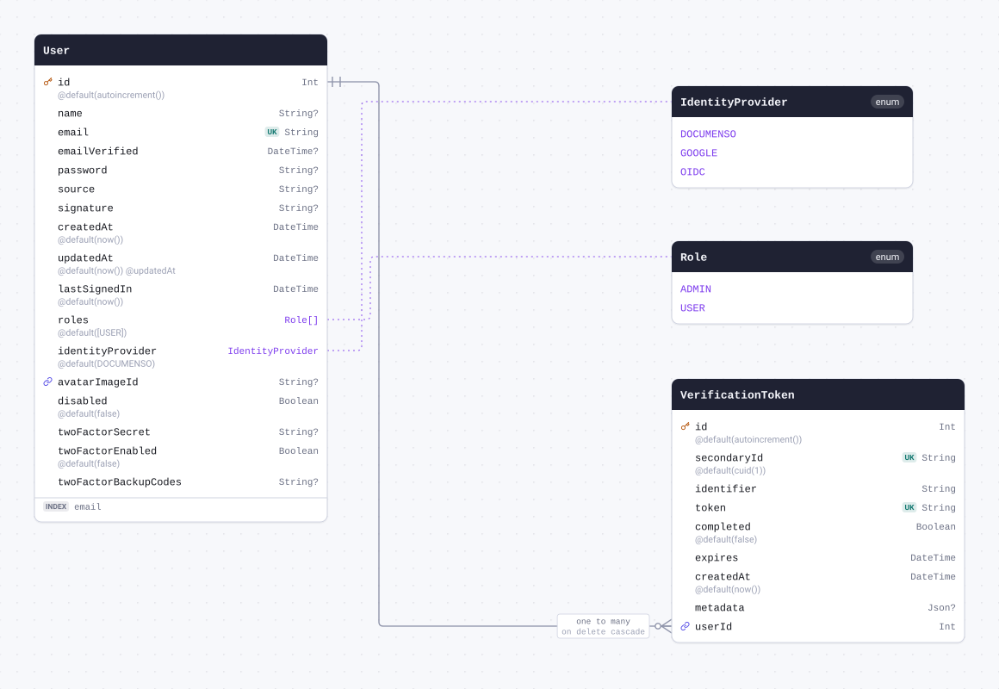

| Field         | Type       | Constraints                       | Default           | Description |
| ------------- | ---------- | --------------------------------- | ----------------- | ----------- |
| `id`          | `Int`      | PK NOT NULL                       | `autoincrement()` |             |
| `secondaryId` | `String`   | UNIQUE NOT NULL                   | `cuid(1)`         |             |
| `identifier`  | `String`   | NOT NULL                          |                   |             |
| `token`       | `String`   | UNIQUE NOT NULL                   |                   |             |
| `completed`   | `Boolean`  | NOT NULL                          | `false`           |             |
| `expires`     | `DateTime` | NOT NULL                          |                   |             |
| `createdAt`   | `DateTime` | NOT NULL                          | `now()`           |             |
| `metadata`    | `Json`     | NULL                              |                   |             |
| `userId`      | `Int`      | NOT NULL → [User.id](#model-User) |                   |             |

#### References

- `userId` → [User.id](#model-User) (many-to-one, on delete Cascade)

#### Definition

```sql
CREATE TABLE "VerificationToken" (
    "id" SERIAL NOT NULL,
    "secondaryId" TEXT NOT NULL,
    "identifier" TEXT NOT NULL,
    "token" TEXT NOT NULL,
    "completed" BOOLEAN NOT NULL DEFAULT false,
    "expires" TIMESTAMP(3) NOT NULL,
    "createdAt" TIMESTAMP(3) NOT NULL DEFAULT CURRENT_TIMESTAMP,
    "metadata" JSONB,
    "userId" INTEGER NOT NULL,

    CONSTRAINT "VerificationToken_pkey" PRIMARY KEY ("id")
);

CREATE UNIQUE INDEX "VerificationToken_secondaryId_key" ON "VerificationToken"("secondaryId");

CREATE UNIQUE INDEX "VerificationToken_token_key" ON "VerificationToken"("token");

ALTER TABLE "VerificationToken" ADD CONSTRAINT "VerificationToken_userId_fkey" FOREIGN KEY ("userId") REFERENCES "User"("id") ON DELETE CASCADE ON UPDATE CASCADE;
```

<details>
<summary>Queries and their SQL</summary>

**findMany**: Every row

```ts
await prisma.verificationToken.findMany();
```

```sql
SELECT
  "public"."VerificationToken"."id",
  "public"."VerificationToken"."secondaryId",
  "public"."VerificationToken"."identifier",
  "public"."VerificationToken"."token",
  "public"."VerificationToken"."completed",
  "public"."VerificationToken"."expires",
  "public"."VerificationToken"."createdAt",
  "public"."VerificationToken"."metadata",
  "public"."VerificationToken"."userId"
FROM
  "public"."VerificationToken"
WHERE
  1 = 1
OFFSET
  $1
-- params: ["0"]
```

**count**: How many rows there are

```ts
await prisma.verificationToken.count();
```

```sql
SELECT
  COUNT(*) AS "_count$_all"
FROM
  (
    SELECT
      "public"."VerificationToken"."id"
    FROM
      "public"."VerificationToken"
    WHERE
      1 = 1
    OFFSET
      $1
  ) AS "sub"
-- params: ["0"]
```

**findMany**: Every row with its relations

```ts
await prisma.verificationToken.findMany({ include: { user: true } });
```

```sql
SELECT
  "public"."VerificationToken"."id",
  "public"."VerificationToken"."secondaryId",
  "public"."VerificationToken"."identifier",
  "public"."VerificationToken"."token",
  "public"."VerificationToken"."completed",
  "public"."VerificationToken"."expires",
  "public"."VerificationToken"."createdAt",
  "public"."VerificationToken"."metadata",
  "public"."VerificationToken"."userId"
FROM
  "public"."VerificationToken"
WHERE
  1 = 1
OFFSET
  $1
-- params: ["0"]

SELECT
  "public"."User"."id",
  "public"."User"."name",
  "public"."User"."email",
  "public"."User"."emailVerified",
  "public"."User"."password",
  "public"."User"."source",
  "public"."User"."signature",
  "public"."User"."createdAt",
  "public"."User"."updatedAt",
  "public"."User"."lastSignedIn",
  "public"."User"."roles"::text[],
  "public"."User"."identityProvider"::text,
  "public"."User"."avatarImageId",
  "public"."User"."disabled",
  "public"."User"."twoFactorSecret",
  "public"."User"."twoFactorEnabled",
  "public"."User"."twoFactorBackupCodes"
FROM
  "public"."User"
WHERE
  "public"."User"."id" IN ($1)
OFFSET
  $2
-- params: ["<userId of the rows above>","0"]
```

**findUnique**: One row by what is unique to it

```ts
await prisma.verificationToken.findUnique({ where: { id: 1 } });
```

```sql
SELECT
  "public"."VerificationToken"."id",
  "public"."VerificationToken"."secondaryId",
  "public"."VerificationToken"."identifier",
  "public"."VerificationToken"."token",
  "public"."VerificationToken"."completed",
  "public"."VerificationToken"."expires",
  "public"."VerificationToken"."createdAt",
  "public"."VerificationToken"."metadata",
  "public"."VerificationToken"."userId"
FROM
  "public"."VerificationToken"
WHERE
  (
    "public"."VerificationToken"."id" = $1
    AND 1 = 1
  )
LIMIT
  $2
OFFSET
  $3
-- params: ["1","1","0"]
```

**create**: Create a row

```ts
await prisma.verificationToken.create({
  data: {
    identifier: "example",
    token: "example",
    expires: new Date("2026-01-01T00:00:00.000Z"),
    userId: 1,
  },
});
```

```sql
INSERT INTO
  "public"."VerificationToken" (
    "secondaryId",
    "identifier",
    "token",
    "completed",
    "expires",
    "createdAt",
    "userId"
  )
VALUES
  ($1, $2, $3, $4, $5, $6, $7)
RETURNING
  "public"."VerificationToken"."id",
  "public"."VerificationToken"."secondaryId",
  "public"."VerificationToken"."identifier",
  "public"."VerificationToken"."token",
  "public"."VerificationToken"."completed",
  "public"."VerificationToken"."expires",
  "public"."VerificationToken"."createdAt",
  "public"."VerificationToken"."metadata",
  "public"."VerificationToken"."userId"
-- params: ["<cuid(1)>","example","example",false,"2026-01-01T00:00:00.000Z","<now()>","1"]
```

**update**: Update a row

```ts
await prisma.verificationToken.update({ where: { id: 1 }, data: { secondaryId: "example" } });
```

```sql
UPDATE "public"."VerificationToken"
SET
  "secondaryId" = $1
WHERE
  (
    "public"."VerificationToken"."id" = $2
    AND 1 = 1
  )
RETURNING
  "public"."VerificationToken"."id",
  "public"."VerificationToken"."secondaryId",
  "public"."VerificationToken"."identifier",
  "public"."VerificationToken"."token",
  "public"."VerificationToken"."completed",
  "public"."VerificationToken"."expires",
  "public"."VerificationToken"."createdAt",
  "public"."VerificationToken"."metadata",
  "public"."VerificationToken"."userId"
-- params: ["example","1"]
```

**delete**: Delete a row

```ts
await prisma.verificationToken.delete({ where: { id: 1 } });
```

```sql
DELETE FROM "public"."VerificationToken"
WHERE
  (
    "public"."VerificationToken"."id" = $1
    AND 1 = 1
  )
RETURNING
  "public"."VerificationToken"."id",
  "public"."VerificationToken"."secondaryId",
  "public"."VerificationToken"."identifier",
  "public"."VerificationToken"."token",
  "public"."VerificationToken"."completed",
  "public"."VerificationToken"."expires",
  "public"."VerificationToken"."createdAt",
  "public"."VerificationToken"."metadata",
  "public"."VerificationToken"."userId"
-- params: ["1"]
```

</details>

<a id="model-Webhook"></a>

### Webhook

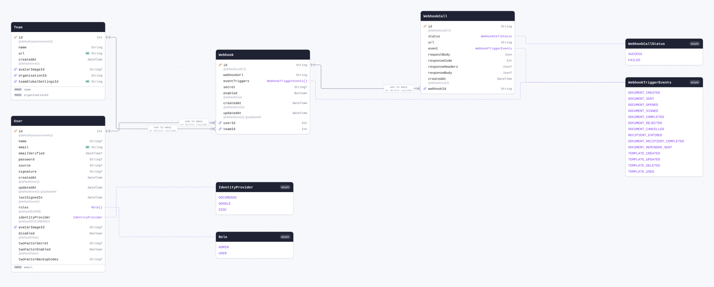

| Field           | Type                                                   | Constraints                       | Default              | Description |
| --------------- | ------------------------------------------------------ | --------------------------------- | -------------------- | ----------- |
| `id`            | `String`                                               | PK NOT NULL                       | `cuid(1)`            |             |
| `webhookUrl`    | `String`                                               | NOT NULL                          |                      |             |
| `eventTriggers` | [`WebhookTriggerEvents[]`](#enum-WebhookTriggerEvents) | NOT NULL                          |                      |             |
| `secret`        | `String`                                               | NULL                              |                      |             |
| `enabled`       | `Boolean`                                              | NOT NULL                          | `true`               |             |
| `createdAt`     | `DateTime`                                             | NOT NULL                          | `now()`              |             |
| `updatedAt`     | `DateTime`                                             | NOT NULL                          | `now()` `@updatedAt` |             |
| `userId`        | `Int`                                                  | NOT NULL → [User.id](#model-User) |                      |             |
| `teamId`        | `Int`                                                  | NOT NULL → [Team.id](#model-Team) |                      |             |

#### References

- `userId` → [User.id](#model-User) (many-to-one, on delete Cascade)
- `teamId` → [Team.id](#model-Team) (many-to-one, on delete Cascade)

#### Referenced by

- `id` ← [WebhookCall.webhookId](#model-WebhookCall) (one-to-many, on delete Cascade)

#### Definition

```sql
CREATE TABLE "Webhook" (
    "id" TEXT NOT NULL,
    "webhookUrl" TEXT NOT NULL,
    "eventTriggers" "WebhookTriggerEvents"[],
    "secret" TEXT,
    "enabled" BOOLEAN NOT NULL DEFAULT true,
    "createdAt" TIMESTAMP(3) NOT NULL DEFAULT CURRENT_TIMESTAMP,
    "updatedAt" TIMESTAMP(3) NOT NULL DEFAULT CURRENT_TIMESTAMP,
    "userId" INTEGER NOT NULL,
    "teamId" INTEGER NOT NULL,

    CONSTRAINT "Webhook_pkey" PRIMARY KEY ("id")
);

ALTER TABLE "Webhook" ADD CONSTRAINT "Webhook_userId_fkey" FOREIGN KEY ("userId") REFERENCES "User"("id") ON DELETE CASCADE ON UPDATE CASCADE;

ALTER TABLE "Webhook" ADD CONSTRAINT "Webhook_teamId_fkey" FOREIGN KEY ("teamId") REFERENCES "Team"("id") ON DELETE CASCADE ON UPDATE CASCADE;
```

<details>
<summary>Queries and their SQL</summary>

**findMany**: Every row

```ts
await prisma.webhook.findMany();
```

```sql
SELECT
  "public"."Webhook"."id",
  "public"."Webhook"."webhookUrl",
  "public"."Webhook"."eventTriggers"::text[],
  "public"."Webhook"."secret",
  "public"."Webhook"."enabled",
  "public"."Webhook"."createdAt",
  "public"."Webhook"."updatedAt",
  "public"."Webhook"."userId",
  "public"."Webhook"."teamId"
FROM
  "public"."Webhook"
WHERE
  1 = 1
OFFSET
  $1
-- params: ["0"]
```

**count**: How many rows there are

```ts
await prisma.webhook.count();
```

```sql
SELECT
  COUNT(*) AS "_count$_all"
FROM
  (
    SELECT
      "public"."Webhook"."id"
    FROM
      "public"."Webhook"
    WHERE
      1 = 1
    OFFSET
      $1
  ) AS "sub"
-- params: ["0"]
```

**findMany**: Every row with its relations

```ts
await prisma.webhook.findMany({ include: { user: true, team: true, webhookCalls: true } });
```

```sql
SELECT
  "public"."Webhook"."id",
  "public"."Webhook"."webhookUrl",
  "public"."Webhook"."eventTriggers"::text[],
  "public"."Webhook"."secret",
  "public"."Webhook"."enabled",
  "public"."Webhook"."createdAt",
  "public"."Webhook"."updatedAt",
  "public"."Webhook"."userId",
  "public"."Webhook"."teamId"
FROM
  "public"."Webhook"
WHERE
  1 = 1
OFFSET
  $1
-- params: ["0"]

SELECT
  "public"."User"."id",
  "public"."User"."name",
  "public"."User"."email",
  "public"."User"."emailVerified",
  "public"."User"."password",
  "public"."User"."source",
  "public"."User"."signature",
  "public"."User"."createdAt",
  "public"."User"."updatedAt",
  "public"."User"."lastSignedIn",
  "public"."User"."roles"::text[],
  "public"."User"."identityProvider"::text,
  "public"."User"."avatarImageId",
  "public"."User"."disabled",
  "public"."User"."twoFactorSecret",
  "public"."User"."twoFactorEnabled",
  "public"."User"."twoFactorBackupCodes"
FROM
  "public"."User"
WHERE
  "public"."User"."id" IN ($1)
OFFSET
  $2
-- params: ["<userId of the rows above>","0"]

SELECT
  "public"."Team"."id",
  "public"."Team"."name",
  "public"."Team"."url",
  "public"."Team"."createdAt",
  "public"."Team"."avatarImageId",
  "public"."Team"."organisationId",
  "public"."Team"."teamGlobalSettingsId"
FROM
  "public"."Team"
WHERE
  "public"."Team"."id" IN ($1)
OFFSET
  $2
-- params: ["<teamId of the rows above>","0"]

SELECT
  "public"."WebhookCall"."id",
  "public"."WebhookCall"."status"::text,
  "public"."WebhookCall"."url",
  "public"."WebhookCall"."event"::text,
  "public"."WebhookCall"."requestBody",
  "public"."WebhookCall"."responseCode",
  "public"."WebhookCall"."responseHeaders",
  "public"."WebhookCall"."responseBody",
  "public"."WebhookCall"."createdAt",
  "public"."WebhookCall"."webhookId"
FROM
  "public"."WebhookCall"
WHERE
  "public"."WebhookCall"."webhookId" IN ($1)
OFFSET
  $2
-- params: ["<id of the rows above>","0"]
```

**findUnique**: One row by what is unique to it

```ts
await prisma.webhook.findUnique({ where: { id: "example" } });
```

```sql
SELECT
  "public"."Webhook"."id",
  "public"."Webhook"."webhookUrl",
  "public"."Webhook"."eventTriggers"::text[],
  "public"."Webhook"."secret",
  "public"."Webhook"."enabled",
  "public"."Webhook"."createdAt",
  "public"."Webhook"."updatedAt",
  "public"."Webhook"."userId",
  "public"."Webhook"."teamId"
FROM
  "public"."Webhook"
WHERE
  (
    "public"."Webhook"."id" = $1
    AND 1 = 1
  )
LIMIT
  $2
OFFSET
  $3
-- params: ["example","1","0"]
```

**create**: Create a row

```ts
await prisma.webhook.create({
  data: { webhookUrl: "example", eventTriggers: ["DOCUMENT_CREATED"], userId: 1, teamId: 1 },
});
```

```sql
INSERT INTO
  "public"."Webhook" (
    "id",
    "webhookUrl",
    "eventTriggers",
    "enabled",
    "createdAt",
    "updatedAt",
    "userId",
    "teamId"
  )
VALUES
  (
    $1,
    $2,
    CAST($3::text[] AS "public"."WebhookTriggerEvents" []),
    $4,
    $5,
    $6,
    $7,
    $8
  )
RETURNING
  "public"."Webhook"."id",
  "public"."Webhook"."webhookUrl",
  "public"."Webhook"."eventTriggers"::text[],
  "public"."Webhook"."secret",
  "public"."Webhook"."enabled",
  "public"."Webhook"."createdAt",
  "public"."Webhook"."updatedAt",
  "public"."Webhook"."userId",
  "public"."Webhook"."teamId"
-- params: ["<cuid(1)>","example",["DOCUMENT_CREATED"],true,"<now()>","<now()>","1","1"]
```

**update**: Update a row

```ts
await prisma.webhook.update({ where: { id: "example" }, data: { webhookUrl: "example" } });
```

```sql
UPDATE "public"."Webhook"
SET
  "webhookUrl" = $1,
  "updatedAt" = $2
WHERE
  (
    "public"."Webhook"."id" = $3
    AND 1 = 1
  )
RETURNING
  "public"."Webhook"."id",
  "public"."Webhook"."webhookUrl",
  "public"."Webhook"."eventTriggers"::text[],
  "public"."Webhook"."secret",
  "public"."Webhook"."enabled",
  "public"."Webhook"."createdAt",
  "public"."Webhook"."updatedAt",
  "public"."Webhook"."userId",
  "public"."Webhook"."teamId"
-- params: ["example",{"prisma__type":"generatorCall","prisma__value":{"name":"now","args":[],"returnType":{"type":"DateTime"}}},"example"]
```

**delete**: Delete a row

```ts
await prisma.webhook.delete({ where: { id: "example" } });
```

```sql
DELETE FROM "public"."Webhook"
WHERE
  (
    "public"."Webhook"."id" = $1
    AND 1 = 1
  )
RETURNING
  "public"."Webhook"."id",
  "public"."Webhook"."webhookUrl",
  "public"."Webhook"."eventTriggers"::text[],
  "public"."Webhook"."secret",
  "public"."Webhook"."enabled",
  "public"."Webhook"."createdAt",
  "public"."Webhook"."updatedAt",
  "public"."Webhook"."userId",
  "public"."Webhook"."teamId"
-- params: ["example"]
```

</details>

<a id="model-WebhookCall"></a>

### WebhookCall

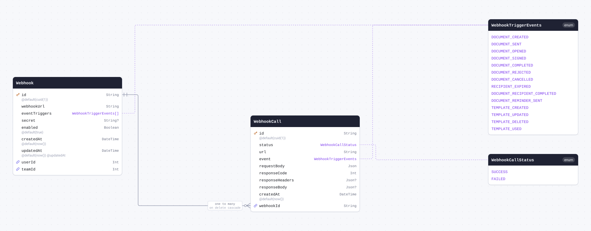

| Field             | Type                                                 | Constraints                             | Default   | Description |
| ----------------- | ---------------------------------------------------- | --------------------------------------- | --------- | ----------- |
| `id`              | `String`                                             | PK NOT NULL                             | `cuid(1)` |             |
| `status`          | [`WebhookCallStatus`](#enum-WebhookCallStatus)       | NOT NULL                                |           |             |
| `url`             | `String`                                             | NOT NULL                                |           |             |
| `event`           | [`WebhookTriggerEvents`](#enum-WebhookTriggerEvents) | NOT NULL                                |           |             |
| `requestBody`     | `Json`                                               | NOT NULL                                |           |             |
| `responseCode`    | `Int`                                                | NOT NULL                                |           |             |
| `responseHeaders` | `Json`                                               | NULL                                    |           |             |
| `responseBody`    | `Json`                                               | NULL                                    |           |             |
| `createdAt`       | `DateTime`                                           | NOT NULL                                | `now()`   |             |
| `webhookId`       | `String`                                             | NOT NULL → [Webhook.id](#model-Webhook) |           |             |

#### References

- `webhookId` → [Webhook.id](#model-Webhook) (many-to-one, on delete Cascade)

#### Definition

```sql
CREATE TABLE "WebhookCall" (
    "id" TEXT NOT NULL,
    "status" "WebhookCallStatus" NOT NULL,
    "url" TEXT NOT NULL,
    "event" "WebhookTriggerEvents" NOT NULL,
    "requestBody" JSONB NOT NULL,
    "responseCode" INTEGER NOT NULL,
    "responseHeaders" JSONB,
    "responseBody" JSONB,
    "createdAt" TIMESTAMP(3) NOT NULL DEFAULT CURRENT_TIMESTAMP,
    "webhookId" TEXT NOT NULL,

    CONSTRAINT "WebhookCall_pkey" PRIMARY KEY ("id")
);

ALTER TABLE "WebhookCall" ADD CONSTRAINT "WebhookCall_webhookId_fkey" FOREIGN KEY ("webhookId") REFERENCES "Webhook"("id") ON DELETE CASCADE ON UPDATE CASCADE;
```

<details>
<summary>Queries and their SQL</summary>

**findMany**: Every row

```ts
await prisma.webhookCall.findMany();
```

```sql
SELECT
  "public"."WebhookCall"."id",
  "public"."WebhookCall"."status"::text,
  "public"."WebhookCall"."url",
  "public"."WebhookCall"."event"::text,
  "public"."WebhookCall"."requestBody",
  "public"."WebhookCall"."responseCode",
  "public"."WebhookCall"."responseHeaders",
  "public"."WebhookCall"."responseBody",
  "public"."WebhookCall"."createdAt",
  "public"."WebhookCall"."webhookId"
FROM
  "public"."WebhookCall"
WHERE
  1 = 1
OFFSET
  $1
-- params: ["0"]
```

**count**: How many rows there are

```ts
await prisma.webhookCall.count();
```

```sql
SELECT
  COUNT(*) AS "_count$_all"
FROM
  (
    SELECT
      "public"."WebhookCall"."id"
    FROM
      "public"."WebhookCall"
    WHERE
      1 = 1
    OFFSET
      $1
  ) AS "sub"
-- params: ["0"]
```

**findMany**: Every row with its relations

```ts
await prisma.webhookCall.findMany({ include: { webhook: true } });
```

```sql
SELECT
  "public"."WebhookCall"."id",
  "public"."WebhookCall"."status"::text,
  "public"."WebhookCall"."url",
  "public"."WebhookCall"."event"::text,
  "public"."WebhookCall"."requestBody",
  "public"."WebhookCall"."responseCode",
  "public"."WebhookCall"."responseHeaders",
  "public"."WebhookCall"."responseBody",
  "public"."WebhookCall"."createdAt",
  "public"."WebhookCall"."webhookId"
FROM
  "public"."WebhookCall"
WHERE
  1 = 1
OFFSET
  $1
-- params: ["0"]

SELECT
  "public"."Webhook"."id",
  "public"."Webhook"."webhookUrl",
  "public"."Webhook"."eventTriggers"::text[],
  "public"."Webhook"."secret",
  "public"."Webhook"."enabled",
  "public"."Webhook"."createdAt",
  "public"."Webhook"."updatedAt",
  "public"."Webhook"."userId",
  "public"."Webhook"."teamId"
FROM
  "public"."Webhook"
WHERE
  "public"."Webhook"."id" IN ($1)
OFFSET
  $2
-- params: ["<webhookId of the rows above>","0"]
```

**findUnique**: One row by what is unique to it

```ts
await prisma.webhookCall.findUnique({ where: { id: "example" } });
```

```sql
SELECT
  "public"."WebhookCall"."id",
  "public"."WebhookCall"."status"::text,
  "public"."WebhookCall"."url",
  "public"."WebhookCall"."event"::text,
  "public"."WebhookCall"."requestBody",
  "public"."WebhookCall"."responseCode",
  "public"."WebhookCall"."responseHeaders",
  "public"."WebhookCall"."responseBody",
  "public"."WebhookCall"."createdAt",
  "public"."WebhookCall"."webhookId"
FROM
  "public"."WebhookCall"
WHERE
  (
    "public"."WebhookCall"."id" = $1
    AND 1 = 1
  )
LIMIT
  $2
OFFSET
  $3
-- params: ["example","1","0"]
```

**create**: Create a row

```ts
await prisma.webhookCall.create({
  data: {
    status: "SUCCESS",
    url: "example",
    event: "DOCUMENT_CREATED",
    requestBody: {},
    responseCode: 1,
    webhookId: "example",
  },
});
```

```sql
INSERT INTO
  "public"."WebhookCall" (
    "id",
    "status",
    "url",
    "event",
    "requestBody",
    "responseCode",
    "createdAt",
    "webhookId"
  )
VALUES
  (
    $1,
    CAST($2::text AS "public"."WebhookCallStatus"),
    $3,
    CAST($4::text AS "public"."WebhookTriggerEvents"),
    $5,
    $6,
    $7,
    $8
  )
RETURNING
  "public"."WebhookCall"."id",
  "public"."WebhookCall"."status"::text,
  "public"."WebhookCall"."url",
  "public"."WebhookCall"."event"::text,
  "public"."WebhookCall"."requestBody",
  "public"."WebhookCall"."responseCode",
  "public"."WebhookCall"."responseHeaders",
  "public"."WebhookCall"."responseBody",
  "public"."WebhookCall"."createdAt",
  "public"."WebhookCall"."webhookId"
-- params: ["<cuid(1)>","SUCCESS","example","DOCUMENT_CREATED","{}","1","<now()>","example"]
```

**update**: Update a row

```ts
await prisma.webhookCall.update({ where: { id: "example" }, data: { status: "SUCCESS" } });
```

```sql
UPDATE "public"."WebhookCall"
SET
  "status" = CAST($1::text AS "public"."WebhookCallStatus")
WHERE
  (
    "public"."WebhookCall"."id" = $2
    AND 1 = 1
  )
RETURNING
  "public"."WebhookCall"."id",
  "public"."WebhookCall"."status"::text,
  "public"."WebhookCall"."url",
  "public"."WebhookCall"."event"::text,
  "public"."WebhookCall"."requestBody",
  "public"."WebhookCall"."responseCode",
  "public"."WebhookCall"."responseHeaders",
  "public"."WebhookCall"."responseBody",
  "public"."WebhookCall"."createdAt",
  "public"."WebhookCall"."webhookId"
-- params: ["SUCCESS","example"]
```

**delete**: Delete a row

```ts
await prisma.webhookCall.delete({ where: { id: "example" } });
```

```sql
DELETE FROM "public"."WebhookCall"
WHERE
  (
    "public"."WebhookCall"."id" = $1
    AND 1 = 1
  )
RETURNING
  "public"."WebhookCall"."id",
  "public"."WebhookCall"."status"::text,
  "public"."WebhookCall"."url",
  "public"."WebhookCall"."event"::text,
  "public"."WebhookCall"."requestBody",
  "public"."WebhookCall"."responseCode",
  "public"."WebhookCall"."responseHeaders",
  "public"."WebhookCall"."responseBody",
  "public"."WebhookCall"."createdAt",
  "public"."WebhookCall"."webhookId"
-- params: ["example"]
```

</details>

<a id="model-ApiToken"></a>

### ApiToken

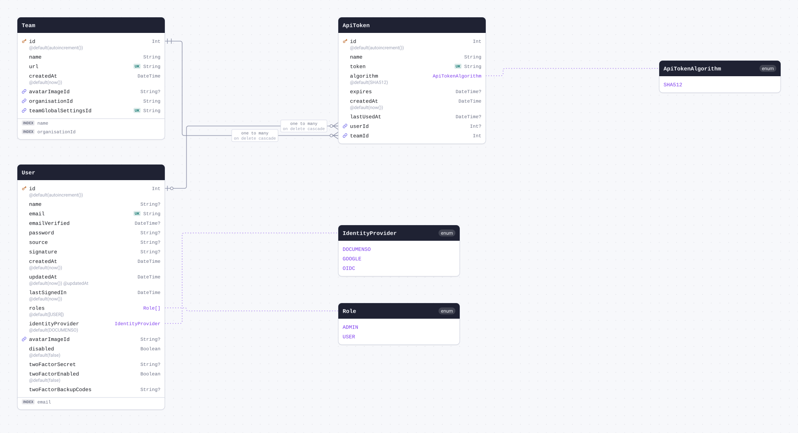

| Field        | Type                                           | Constraints                       | Default           | Description |
| ------------ | ---------------------------------------------- | --------------------------------- | ----------------- | ----------- |
| `id`         | `Int`                                          | PK NOT NULL                       | `autoincrement()` |             |
| `name`       | `String`                                       | NOT NULL                          |                   |             |
| `token`      | `String`                                       | UNIQUE NOT NULL                   |                   |             |
| `algorithm`  | [`ApiTokenAlgorithm`](#enum-ApiTokenAlgorithm) | NOT NULL                          | `SHA512`          |             |
| `expires`    | `DateTime`                                     | NULL                              |                   |             |
| `createdAt`  | `DateTime`                                     | NOT NULL                          | `now()`           |             |
| `lastUsedAt` | `DateTime`                                     | NULL                              |                   |             |
| `userId`     | `Int`                                          | NULL → [User.id](#model-User)     |                   |             |
| `teamId`     | `Int`                                          | NOT NULL → [Team.id](#model-Team) |                   |             |

#### References

- `userId` → [User.id](#model-User) (many-to-one, on delete Cascade)
- `teamId` → [Team.id](#model-Team) (many-to-one, on delete Cascade)

#### Definition

```sql
CREATE TABLE "ApiToken" (
    "id" SERIAL NOT NULL,
    "name" TEXT NOT NULL,
    "token" TEXT NOT NULL,
    "algorithm" "ApiTokenAlgorithm" NOT NULL DEFAULT 'SHA512',
    "expires" TIMESTAMP(3),
    "createdAt" TIMESTAMP(3) NOT NULL DEFAULT CURRENT_TIMESTAMP,
    "lastUsedAt" TIMESTAMP(3),
    "userId" INTEGER,
    "teamId" INTEGER NOT NULL,

    CONSTRAINT "ApiToken_pkey" PRIMARY KEY ("id")
);

CREATE UNIQUE INDEX "ApiToken_token_key" ON "ApiToken"("token");

ALTER TABLE "ApiToken" ADD CONSTRAINT "ApiToken_userId_fkey" FOREIGN KEY ("userId") REFERENCES "User"("id") ON DELETE CASCADE ON UPDATE CASCADE;

ALTER TABLE "ApiToken" ADD CONSTRAINT "ApiToken_teamId_fkey" FOREIGN KEY ("teamId") REFERENCES "Team"("id") ON DELETE CASCADE ON UPDATE CASCADE;
```

<details>
<summary>Queries and their SQL</summary>

**findMany**: Every row

```ts
await prisma.apiToken.findMany();
```

```sql
SELECT
  "public"."ApiToken"."id",
  "public"."ApiToken"."name",
  "public"."ApiToken"."token",
  "public"."ApiToken"."algorithm"::text,
  "public"."ApiToken"."expires",
  "public"."ApiToken"."createdAt",
  "public"."ApiToken"."lastUsedAt",
  "public"."ApiToken"."userId",
  "public"."ApiToken"."teamId"
FROM
  "public"."ApiToken"
WHERE
  1 = 1
OFFSET
  $1
-- params: ["0"]
```

**count**: How many rows there are

```ts
await prisma.apiToken.count();
```

```sql
SELECT
  COUNT(*) AS "_count$_all"
FROM
  (
    SELECT
      "public"."ApiToken"."id"
    FROM
      "public"."ApiToken"
    WHERE
      1 = 1
    OFFSET
      $1
  ) AS "sub"
-- params: ["0"]
```

**findMany**: Every row with its relations

```ts
await prisma.apiToken.findMany({ include: { user: true, team: true } });
```

```sql
SELECT
  "public"."ApiToken"."id",
  "public"."ApiToken"."name",
  "public"."ApiToken"."token",
  "public"."ApiToken"."algorithm"::text,
  "public"."ApiToken"."expires",
  "public"."ApiToken"."createdAt",
  "public"."ApiToken"."lastUsedAt",
  "public"."ApiToken"."userId",
  "public"."ApiToken"."teamId"
FROM
  "public"."ApiToken"
WHERE
  1 = 1
OFFSET
  $1
-- params: ["0"]

SELECT
  "public"."User"."id",
  "public"."User"."name",
  "public"."User"."email",
  "public"."User"."emailVerified",
  "public"."User"."password",
  "public"."User"."source",
  "public"."User"."signature",
  "public"."User"."createdAt",
  "public"."User"."updatedAt",
  "public"."User"."lastSignedIn",
  "public"."User"."roles"::text[],
  "public"."User"."identityProvider"::text,
  "public"."User"."avatarImageId",
  "public"."User"."disabled",
  "public"."User"."twoFactorSecret",
  "public"."User"."twoFactorEnabled",
  "public"."User"."twoFactorBackupCodes"
FROM
  "public"."User"
WHERE
  "public"."User"."id" IN ($1)
OFFSET
  $2
-- params: ["<userId of the rows above>","0"]

SELECT
  "public"."Team"."id",
  "public"."Team"."name",
  "public"."Team"."url",
  "public"."Team"."createdAt",
  "public"."Team"."avatarImageId",
  "public"."Team"."organisationId",
  "public"."Team"."teamGlobalSettingsId"
FROM
  "public"."Team"
WHERE
  "public"."Team"."id" IN ($1)
OFFSET
  $2
-- params: ["<teamId of the rows above>","0"]
```

**findUnique**: One row by what is unique to it

```ts
await prisma.apiToken.findUnique({ where: { id: 1 } });
```

```sql
SELECT
  "public"."ApiToken"."id",
  "public"."ApiToken"."name",
  "public"."ApiToken"."token",
  "public"."ApiToken"."algorithm"::text,
  "public"."ApiToken"."expires",
  "public"."ApiToken"."createdAt",
  "public"."ApiToken"."lastUsedAt",
  "public"."ApiToken"."userId",
  "public"."ApiToken"."teamId"
FROM
  "public"."ApiToken"
WHERE
  (
    "public"."ApiToken"."id" = $1
    AND 1 = 1
  )
LIMIT
  $2
OFFSET
  $3
-- params: ["1","1","0"]
```

**create**: Create a row

```ts
await prisma.apiToken.create({ data: { name: "example", token: "example", teamId: 1 } });
```

```sql
INSERT INTO
  "public"."ApiToken" (
    "name",
    "token",
    "algorithm",
    "createdAt",
    "teamId"
  )
VALUES
  (
    $1,
    $2,
    CAST($3::text AS "public"."ApiTokenAlgorithm"),
    $4,
    $5
  )
RETURNING
  "public"."ApiToken"."id",
  "public"."ApiToken"."name",
  "public"."ApiToken"."token",
  "public"."ApiToken"."algorithm"::text,
  "public"."ApiToken"."expires",
  "public"."ApiToken"."createdAt",
  "public"."ApiToken"."lastUsedAt",
  "public"."ApiToken"."userId",
  "public"."ApiToken"."teamId"
-- params: ["example","example","SHA512","<now()>","1"]
```

**update**: Update a row

```ts
await prisma.apiToken.update({ where: { id: 1 }, data: { name: "example" } });
```

```sql
UPDATE "public"."ApiToken"
SET
  "name" = $1
WHERE
  (
    "public"."ApiToken"."id" = $2
    AND 1 = 1
  )
RETURNING
  "public"."ApiToken"."id",
  "public"."ApiToken"."name",
  "public"."ApiToken"."token",
  "public"."ApiToken"."algorithm"::text,
  "public"."ApiToken"."expires",
  "public"."ApiToken"."createdAt",
  "public"."ApiToken"."lastUsedAt",
  "public"."ApiToken"."userId",
  "public"."ApiToken"."teamId"
-- params: ["example","1"]
```

**delete**: Delete a row

```ts
await prisma.apiToken.delete({ where: { id: 1 } });
```

```sql
DELETE FROM "public"."ApiToken"
WHERE
  (
    "public"."ApiToken"."id" = $1
    AND 1 = 1
  )
RETURNING
  "public"."ApiToken"."id",
  "public"."ApiToken"."name",
  "public"."ApiToken"."token",
  "public"."ApiToken"."algorithm"::text,
  "public"."ApiToken"."expires",
  "public"."ApiToken"."createdAt",
  "public"."ApiToken"."lastUsedAt",
  "public"."ApiToken"."userId",
  "public"."ApiToken"."teamId"
-- params: ["1"]
```

</details>

<a id="model-Subscription"></a>

### Subscription

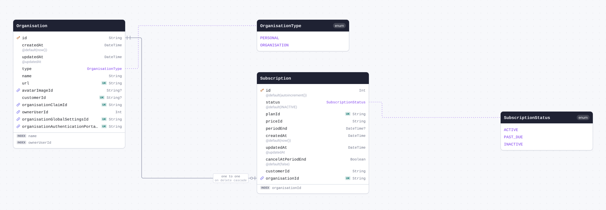

| Field               | Type                                             | Constraints                                              | Default           | Description |
| ------------------- | ------------------------------------------------ | -------------------------------------------------------- | ----------------- | ----------- |
| `id`                | `Int`                                            | PK NOT NULL                                              | `autoincrement()` |             |
| `status`            | [`SubscriptionStatus`](#enum-SubscriptionStatus) | NOT NULL                                                 | `INACTIVE`        |             |
| `planId`            | `String`                                         | UNIQUE NOT NULL                                          |                   |             |
| `priceId`           | `String`                                         | NOT NULL                                                 |                   |             |
| `periodEnd`         | `DateTime`                                       | NULL                                                     |                   |             |
| `createdAt`         | `DateTime`                                       | NOT NULL                                                 | `now()`           |             |
| `updatedAt`         | `DateTime`                                       | NOT NULL                                                 | `@updatedAt`      |             |
| `cancelAtPeriodEnd` | `Boolean`                                        | NOT NULL                                                 | `false`           |             |
| `customerId`        | `String`                                         | NOT NULL                                                 |                   |             |
| `organisationId`    | `String`                                         | UNIQUE NOT NULL → [Organisation.id](#model-Organisation) |                   |             |

#### Indexes

- `@@index([organisationId])`

#### References

- `organisationId` → [Organisation.id](#model-Organisation) (one-to-one, on delete Cascade)

#### Definition

```sql
CREATE TABLE "Subscription" (
    "id" SERIAL NOT NULL,
    "status" "SubscriptionStatus" NOT NULL DEFAULT 'INACTIVE',
    "planId" TEXT NOT NULL,
    "priceId" TEXT NOT NULL,
    "periodEnd" TIMESTAMP(3),
    "createdAt" TIMESTAMP(3) NOT NULL DEFAULT CURRENT_TIMESTAMP,
    "updatedAt" TIMESTAMP(3) NOT NULL,
    "cancelAtPeriodEnd" BOOLEAN NOT NULL DEFAULT false,
    "customerId" TEXT NOT NULL,
    "organisationId" TEXT NOT NULL,

    CONSTRAINT "Subscription_pkey" PRIMARY KEY ("id")
);

CREATE UNIQUE INDEX "Subscription_planId_key" ON "Subscription"("planId");

CREATE UNIQUE INDEX "Subscription_organisationId_key" ON "Subscription"("organisationId");

CREATE INDEX "Subscription_organisationId_idx" ON "Subscription"("organisationId");

ALTER TABLE "Subscription" ADD CONSTRAINT "Subscription_organisationId_fkey" FOREIGN KEY ("organisationId") REFERENCES "Organisation"("id") ON DELETE CASCADE ON UPDATE CASCADE;
```

<details>
<summary>Queries and their SQL</summary>

**findMany**: Every row

```ts
await prisma.subscription.findMany();
```

```sql
SELECT
  "public"."Subscription"."id",
  "public"."Subscription"."status"::text,
  "public"."Subscription"."planId",
  "public"."Subscription"."priceId",
  "public"."Subscription"."periodEnd",
  "public"."Subscription"."createdAt",
  "public"."Subscription"."updatedAt",
  "public"."Subscription"."cancelAtPeriodEnd",
  "public"."Subscription"."customerId",
  "public"."Subscription"."organisationId"
FROM
  "public"."Subscription"
WHERE
  1 = 1
OFFSET
  $1
-- params: ["0"]
```

**count**: How many rows there are

```ts
await prisma.subscription.count();
```

```sql
SELECT
  COUNT(*) AS "_count$_all"
FROM
  (
    SELECT
      "public"."Subscription"."id"
    FROM
      "public"."Subscription"
    WHERE
      1 = 1
    OFFSET
      $1
  ) AS "sub"
-- params: ["0"]
```

**findMany**: Every row with its relations

```ts
await prisma.subscription.findMany({ include: { organisation: true } });
```

```sql
SELECT
  "public"."Subscription"."id",
  "public"."Subscription"."status"::text,
  "public"."Subscription"."planId",
  "public"."Subscription"."priceId",
  "public"."Subscription"."periodEnd",
  "public"."Subscription"."createdAt",
  "public"."Subscription"."updatedAt",
  "public"."Subscription"."cancelAtPeriodEnd",
  "public"."Subscription"."customerId",
  "public"."Subscription"."organisationId"
FROM
  "public"."Subscription"
WHERE
  1 = 1
OFFSET
  $1
-- params: ["0"]

SELECT
  "public"."Organisation"."id",
  "public"."Organisation"."createdAt",
  "public"."Organisation"."updatedAt",
  "public"."Organisation"."type"::text,
  "public"."Organisation"."name",
  "public"."Organisation"."url",
  "public"."Organisation"."avatarImageId",
  "public"."Organisation"."customerId",
  "public"."Organisation"."organisationClaimId",
  "public"."Organisation"."ownerUserId",
  "public"."Organisation"."organisationGlobalSettingsId",
  "public"."Organisation"."organisationAuthenticationPortalId"
FROM
  "public"."Organisation"
WHERE
  "public"."Organisation"."id" IN ($1)
OFFSET
  $2
-- params: ["<organisationId of the rows above>","0"]
```

**findUnique**: One row by what is unique to it

```ts
await prisma.subscription.findUnique({ where: { id: 1 } });
```

```sql
SELECT
  "public"."Subscription"."id",
  "public"."Subscription"."status"::text,
  "public"."Subscription"."planId",
  "public"."Subscription"."priceId",
  "public"."Subscription"."periodEnd",
  "public"."Subscription"."createdAt",
  "public"."Subscription"."updatedAt",
  "public"."Subscription"."cancelAtPeriodEnd",
  "public"."Subscription"."customerId",
  "public"."Subscription"."organisationId"
FROM
  "public"."Subscription"
WHERE
  (
    "public"."Subscription"."id" = $1
    AND 1 = 1
  )
LIMIT
  $2
OFFSET
  $3
-- params: ["1","1","0"]
```

**create**: Create a row

```ts
await prisma.subscription.create({
  data: { planId: "example", priceId: "example", customerId: "example", organisationId: "example" },
});
```

```sql
INSERT INTO
  "public"."Subscription" (
    "status",
    "planId",
    "priceId",
    "createdAt",
    "updatedAt",
    "cancelAtPeriodEnd",
    "customerId",
    "organisationId"
  )
VALUES
  (
    CAST($1::text AS "public"."SubscriptionStatus"),
    $2,
    $3,
    $4,
    $5,
    $6,
    $7,
    $8
  )
RETURNING
  "public"."Subscription"."id",
  "public"."Subscription"."status"::text,
  "public"."Subscription"."planId",
  "public"."Subscription"."priceId",
  "public"."Subscription"."periodEnd",
  "public"."Subscription"."createdAt",
  "public"."Subscription"."updatedAt",
  "public"."Subscription"."cancelAtPeriodEnd",
  "public"."Subscription"."customerId",
  "public"."Subscription"."organisationId"
-- params: ["INACTIVE","example","example","<now()>","<now()>",false,"example","example"]
```

**update**: Update a row

```ts
await prisma.subscription.update({ where: { id: 1 }, data: { status: "ACTIVE" } });
```

```sql
UPDATE "public"."Subscription"
SET
  "status" = CAST($1::text AS "public"."SubscriptionStatus"),
  "updatedAt" = $2
WHERE
  (
    "public"."Subscription"."id" = $3
    AND 1 = 1
  )
RETURNING
  "public"."Subscription"."id",
  "public"."Subscription"."status"::text,
  "public"."Subscription"."planId",
  "public"."Subscription"."priceId",
  "public"."Subscription"."periodEnd",
  "public"."Subscription"."createdAt",
  "public"."Subscription"."updatedAt",
  "public"."Subscription"."cancelAtPeriodEnd",
  "public"."Subscription"."customerId",
  "public"."Subscription"."organisationId"
-- params: ["ACTIVE",{"prisma__type":"generatorCall","prisma__value":{"name":"now","args":[],"returnType":{"type":"DateTime"}}},"1"]
```

**delete**: Delete a row

```ts
await prisma.subscription.delete({ where: { id: 1 } });
```

```sql
DELETE FROM "public"."Subscription"
WHERE
  (
    "public"."Subscription"."id" = $1
    AND 1 = 1
  )
RETURNING
  "public"."Subscription"."id",
  "public"."Subscription"."status"::text,
  "public"."Subscription"."planId",
  "public"."Subscription"."priceId",
  "public"."Subscription"."periodEnd",
  "public"."Subscription"."createdAt",
  "public"."Subscription"."updatedAt",
  "public"."Subscription"."cancelAtPeriodEnd",
  "public"."Subscription"."customerId",
  "public"."Subscription"."organisationId"
-- params: ["1"]
```

</details>

<a id="model-SubscriptionClaim"></a>

### SubscriptionClaim

@zod.import(["import { ZClaimFlagsSchema, ZRateLimitArraySchema } from '@documenso/lib/types/subscription';"])

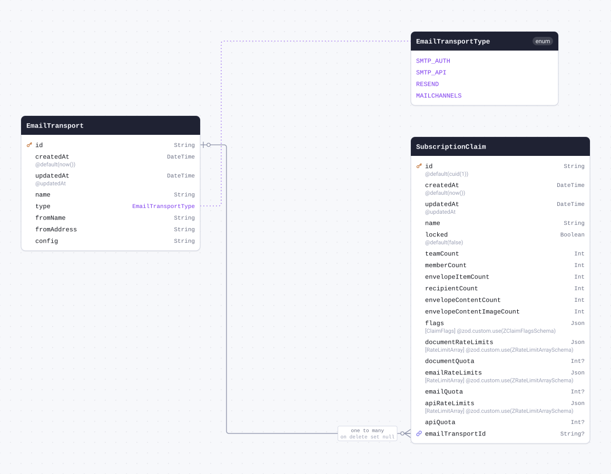

| Field                       | Type       | Constraints                                       | Default      | Description                                             |
| --------------------------- | ---------- | ------------------------------------------------- | ------------ | ------------------------------------------------------- |
| `id`                        | `String`   | PK NOT NULL                                       | `cuid(1)`    |                                                         |
| `createdAt`                 | `DateTime` | NOT NULL                                          | `now()`      |                                                         |
| `updatedAt`                 | `DateTime` | NOT NULL                                          | `@updatedAt` |                                                         |
| `name`                      | `String`   | NOT NULL                                          |              |                                                         |
| `locked`                    | `Boolean`  | NOT NULL                                          | `false`      |                                                         |
| `teamCount`                 | `Int`      | NOT NULL                                          |              |                                                         |
| `memberCount`               | `Int`      | NOT NULL                                          |              |                                                         |
| `envelopeItemCount`         | `Int`      | NOT NULL                                          |              |                                                         |
| `recipientCount`            | `Int`      | NOT NULL                                          |              |                                                         |
| `envelopeContentCount`      | `Int`      | NOT NULL                                          |              |                                                         |
| `envelopeContentImageCount` | `Int`      | NOT NULL                                          |              |                                                         |
| `flags`                     | `Json`     | NOT NULL                                          |              | [ClaimFlags] @zod.custom.use(ZClaimFlagsSchema)         |
| `documentRateLimits`        | `Json`     | NOT NULL                                          |              | [RateLimitArray] @zod.custom.use(ZRateLimitArraySchema) |
| `documentQuota`             | `Int`      | NULL                                              |              |                                                         |
| `emailRateLimits`           | `Json`     | NOT NULL                                          |              | [RateLimitArray] @zod.custom.use(ZRateLimitArraySchema) |
| `emailQuota`                | `Int`      | NULL                                              |              |                                                         |
| `apiRateLimits`             | `Json`     | NOT NULL                                          |              | [RateLimitArray] @zod.custom.use(ZRateLimitArraySchema) |
| `apiQuota`                  | `Int`      | NULL                                              |              |                                                         |
| `emailTransportId`          | `String`   | NULL → [EmailTransport.id](#model-EmailTransport) |              |                                                         |

#### References

- `emailTransportId` → [EmailTransport.id](#model-EmailTransport) (many-to-one, on delete SetNull)

#### Definition

```sql
CREATE TABLE "SubscriptionClaim" (
    "id" TEXT NOT NULL,
    "createdAt" TIMESTAMP(3) NOT NULL DEFAULT CURRENT_TIMESTAMP,
    "updatedAt" TIMESTAMP(3) NOT NULL,
    "name" TEXT NOT NULL,
    "locked" BOOLEAN NOT NULL DEFAULT false,
    "teamCount" INTEGER NOT NULL,
    "memberCount" INTEGER NOT NULL,
    "envelopeItemCount" INTEGER NOT NULL,
    "recipientCount" INTEGER NOT NULL,
    "envelopeContentCount" INTEGER NOT NULL,
    "envelopeContentImageCount" INTEGER NOT NULL,
    "flags" JSONB NOT NULL,
    "documentRateLimits" JSONB NOT NULL,
    "documentQuota" INTEGER,
    "emailRateLimits" JSONB NOT NULL,
    "emailQuota" INTEGER,
    "apiRateLimits" JSONB NOT NULL,
    "apiQuota" INTEGER,
    "emailTransportId" TEXT,

    CONSTRAINT "SubscriptionClaim_pkey" PRIMARY KEY ("id")
);

ALTER TABLE "SubscriptionClaim" ADD CONSTRAINT "SubscriptionClaim_emailTransportId_fkey" FOREIGN KEY ("emailTransportId") REFERENCES "EmailTransport"("id") ON DELETE SET NULL ON UPDATE CASCADE;
```

<details>
<summary>Queries and their SQL</summary>

**findMany**: Every row

```ts
await prisma.subscriptionClaim.findMany();
```

```sql
SELECT
  "public"."SubscriptionClaim"."id",
  "public"."SubscriptionClaim"."createdAt",
  "public"."SubscriptionClaim"."updatedAt",
  "public"."SubscriptionClaim"."name",
  "public"."SubscriptionClaim"."locked",
  "public"."SubscriptionClaim"."teamCount",
  "public"."SubscriptionClaim"."memberCount",
  "public"."SubscriptionClaim"."envelopeItemCount",
  "public"."SubscriptionClaim"."recipientCount",
  "public"."SubscriptionClaim"."envelopeContentCount",
  "public"."SubscriptionClaim"."envelopeContentImageCount",
  "public"."SubscriptionClaim"."flags",
  "public"."SubscriptionClaim"."documentRateLimits",
  "public"."SubscriptionClaim"."documentQuota",
  "public"."SubscriptionClaim"."emailRateLimits",
  "public"."SubscriptionClaim"."emailQuota",
  "public"."SubscriptionClaim"."apiRateLimits",
  "public"."SubscriptionClaim"."apiQuota",
  "public"."SubscriptionClaim"."emailTransportId"
FROM
  "public"."SubscriptionClaim"
WHERE
  1 = 1
OFFSET
  $1
-- params: ["0"]
```

**count**: How many rows there are

```ts
await prisma.subscriptionClaim.count();
```

```sql
SELECT
  COUNT(*) AS "_count$_all"
FROM
  (
    SELECT
      "public"."SubscriptionClaim"."id"
    FROM
      "public"."SubscriptionClaim"
    WHERE
      1 = 1
    OFFSET
      $1
  ) AS "sub"
-- params: ["0"]
```

**findMany**: Every row with its relations

```ts
await prisma.subscriptionClaim.findMany({ include: { emailTransport: true } });
```

```sql
SELECT
  "public"."SubscriptionClaim"."id",
  "public"."SubscriptionClaim"."createdAt",
  "public"."SubscriptionClaim"."updatedAt",
  "public"."SubscriptionClaim"."name",
  "public"."SubscriptionClaim"."locked",
  "public"."SubscriptionClaim"."teamCount",
  "public"."SubscriptionClaim"."memberCount",
  "public"."SubscriptionClaim"."envelopeItemCount",
  "public"."SubscriptionClaim"."recipientCount",
  "public"."SubscriptionClaim"."envelopeContentCount",
  "public"."SubscriptionClaim"."envelopeContentImageCount",
  "public"."SubscriptionClaim"."flags",
  "public"."SubscriptionClaim"."documentRateLimits",
  "public"."SubscriptionClaim"."documentQuota",
  "public"."SubscriptionClaim"."emailRateLimits",
  "public"."SubscriptionClaim"."emailQuota",
  "public"."SubscriptionClaim"."apiRateLimits",
  "public"."SubscriptionClaim"."apiQuota",
  "public"."SubscriptionClaim"."emailTransportId"
FROM
  "public"."SubscriptionClaim"
WHERE
  1 = 1
OFFSET
  $1
-- params: ["0"]

SELECT
  "public"."EmailTransport"."id",
  "public"."EmailTransport"."createdAt",
  "public"."EmailTransport"."updatedAt",
  "public"."EmailTransport"."name",
  "public"."EmailTransport"."type"::text,
  "public"."EmailTransport"."fromName",
  "public"."EmailTransport"."fromAddress",
  "public"."EmailTransport"."config"
FROM
  "public"."EmailTransport"
WHERE
  "public"."EmailTransport"."id" IN ($1)
OFFSET
  $2
-- params: ["<emailTransportId of the rows above>","0"]
```

**findUnique**: One row by what is unique to it

```ts
await prisma.subscriptionClaim.findUnique({ where: { id: "example" } });
```

```sql
SELECT
  "public"."SubscriptionClaim"."id",
  "public"."SubscriptionClaim"."createdAt",
  "public"."SubscriptionClaim"."updatedAt",
  "public"."SubscriptionClaim"."name",
  "public"."SubscriptionClaim"."locked",
  "public"."SubscriptionClaim"."teamCount",
  "public"."SubscriptionClaim"."memberCount",
  "public"."SubscriptionClaim"."envelopeItemCount",
  "public"."SubscriptionClaim"."recipientCount",
  "public"."SubscriptionClaim"."envelopeContentCount",
  "public"."SubscriptionClaim"."envelopeContentImageCount",
  "public"."SubscriptionClaim"."flags",
  "public"."SubscriptionClaim"."documentRateLimits",
  "public"."SubscriptionClaim"."documentQuota",
  "public"."SubscriptionClaim"."emailRateLimits",
  "public"."SubscriptionClaim"."emailQuota",
  "public"."SubscriptionClaim"."apiRateLimits",
  "public"."SubscriptionClaim"."apiQuota",
  "public"."SubscriptionClaim"."emailTransportId"
FROM
  "public"."SubscriptionClaim"
WHERE
  (
    "public"."SubscriptionClaim"."id" = $1
    AND 1 = 1
  )
LIMIT
  $2
OFFSET
  $3
-- params: ["example","1","0"]
```

**create**: Create a row

```ts
await prisma.subscriptionClaim.create({
  data: {
    name: "example",
    teamCount: 1,
    memberCount: 1,
    envelopeItemCount: 1,
    recipientCount: 1,
    envelopeContentCount: 1,
    envelopeContentImageCount: 1,
    flags: {},
    documentRateLimits: {},
    emailRateLimits: {},
    apiRateLimits: {},
  },
});
```

```sql
INSERT INTO
  "public"."SubscriptionClaim" (
    "id",
    "createdAt",
    "updatedAt",
    "name",
    "locked",
    "teamCount",
    "memberCount",
    "envelopeItemCount",
    "recipientCount",
    "envelopeContentCount",
    "envelopeContentImageCount",
    "flags",
    "documentRateLimits",
    "emailRateLimits",
    "apiRateLimits"
  )
VALUES
  (
    $1,
    $2,
    $3,
    $4,
    $5,
    $6,
    $7,
    $8,
    $9,
    $10,
    $11,
    $12,
    $13,
    $14,
    $15
  )
RETURNING
  "public"."SubscriptionClaim"."id",
  "public"."SubscriptionClaim"."createdAt",
  "public"."SubscriptionClaim"."updatedAt",
  "public"."SubscriptionClaim"."name",
  "public"."SubscriptionClaim"."locked",
  "public"."SubscriptionClaim"."teamCount",
  "public"."SubscriptionClaim"."memberCount",
  "public"."SubscriptionClaim"."envelopeItemCount",
  "public"."SubscriptionClaim"."recipientCount",
  "public"."SubscriptionClaim"."envelopeContentCount",
  "public"."SubscriptionClaim"."envelopeContentImageCount",
  "public"."SubscriptionClaim"."flags",
  "public"."SubscriptionClaim"."documentRateLimits",
  "public"."SubscriptionClaim"."documentQuota",
  "public"."SubscriptionClaim"."emailRateLimits",
  "public"."SubscriptionClaim"."emailQuota",
  "public"."SubscriptionClaim"."apiRateLimits",
  "public"."SubscriptionClaim"."apiQuota",
  "public"."SubscriptionClaim"."emailTransportId"
-- params: ["<cuid(1)>","<now()>","<now()>","example",false,"1","1","1","1","1","1","{}","{}","{}","{}"]
```

**update**: Update a row

```ts
await prisma.subscriptionClaim.update({
  where: { id: "example" },
  data: { createdAt: new Date("2026-01-01T00:00:00.000Z") },
});
```

```sql
UPDATE "public"."SubscriptionClaim"
SET
  "createdAt" = $1,
  "updatedAt" = $2
WHERE
  (
    "public"."SubscriptionClaim"."id" = $3
    AND 1 = 1
  )
RETURNING
  "public"."SubscriptionClaim"."id",
  "public"."SubscriptionClaim"."createdAt",
  "public"."SubscriptionClaim"."updatedAt",
  "public"."SubscriptionClaim"."name",
  "public"."SubscriptionClaim"."locked",
  "public"."SubscriptionClaim"."teamCount",
  "public"."SubscriptionClaim"."memberCount",
  "public"."SubscriptionClaim"."envelopeItemCount",
  "public"."SubscriptionClaim"."recipientCount",
  "public"."SubscriptionClaim"."envelopeContentCount",
  "public"."SubscriptionClaim"."envelopeContentImageCount",
  "public"."SubscriptionClaim"."flags",
  "public"."SubscriptionClaim"."documentRateLimits",
  "public"."SubscriptionClaim"."documentQuota",
  "public"."SubscriptionClaim"."emailRateLimits",
  "public"."SubscriptionClaim"."emailQuota",
  "public"."SubscriptionClaim"."apiRateLimits",
  "public"."SubscriptionClaim"."apiQuota",
  "public"."SubscriptionClaim"."emailTransportId"
-- params: ["2026-01-01T00:00:00.000Z",{"prisma__type":"generatorCall","prisma__value":{"name":"now","args":[],"returnType":{"type":"DateTime"}}},"example"]
```

**delete**: Delete a row

```ts
await prisma.subscriptionClaim.delete({ where: { id: "example" } });
```

```sql
DELETE FROM "public"."SubscriptionClaim"
WHERE
  (
    "public"."SubscriptionClaim"."id" = $1
    AND 1 = 1
  )
RETURNING
  "public"."SubscriptionClaim"."id",
  "public"."SubscriptionClaim"."createdAt",
  "public"."SubscriptionClaim"."updatedAt",
  "public"."SubscriptionClaim"."name",
  "public"."SubscriptionClaim"."locked",
  "public"."SubscriptionClaim"."teamCount",
  "public"."SubscriptionClaim"."memberCount",
  "public"."SubscriptionClaim"."envelopeItemCount",
  "public"."SubscriptionClaim"."recipientCount",
  "public"."SubscriptionClaim"."envelopeContentCount",
  "public"."SubscriptionClaim"."envelopeContentImageCount",
  "public"."SubscriptionClaim"."flags",
  "public"."SubscriptionClaim"."documentRateLimits",
  "public"."SubscriptionClaim"."documentQuota",
  "public"."SubscriptionClaim"."emailRateLimits",
  "public"."SubscriptionClaim"."emailQuota",
  "public"."SubscriptionClaim"."apiRateLimits",
  "public"."SubscriptionClaim"."apiQuota",
  "public"."SubscriptionClaim"."emailTransportId"
-- params: ["example"]
```

</details>

<a id="model-OrganisationClaim"></a>

### OrganisationClaim

@zod.import(["import { ZClaimFlagsSchema, ZRateLimitArraySchema } from '@documenso/lib/types/subscription';"])

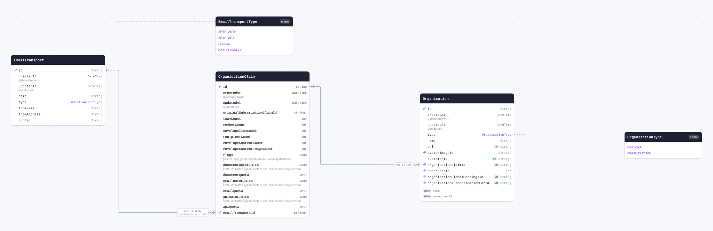

| Field                         | Type       | Constraints                                       | Default      | Description                                             |
| ----------------------------- | ---------- | ------------------------------------------------- | ------------ | ------------------------------------------------------- |
| `id`                          | `String`   | PK NOT NULL                                       |              |                                                         |
| `createdAt`                   | `DateTime` | NOT NULL                                          | `now()`      |                                                         |
| `updatedAt`                   | `DateTime` | NOT NULL                                          | `@updatedAt` |                                                         |
| `originalSubscriptionClaimId` | `String`   | NULL                                              |              |                                                         |
| `teamCount`                   | `Int`      | NOT NULL                                          |              |                                                         |
| `memberCount`                 | `Int`      | NOT NULL                                          |              |                                                         |
| `envelopeItemCount`           | `Int`      | NOT NULL                                          |              |                                                         |
| `recipientCount`              | `Int`      | NOT NULL                                          |              |                                                         |
| `envelopeContentCount`        | `Int`      | NOT NULL                                          |              |                                                         |
| `envelopeContentImageCount`   | `Int`      | NOT NULL                                          |              |                                                         |
| `flags`                       | `Json`     | NOT NULL                                          |              | [ClaimFlags] @zod.custom.use(ZClaimFlagsSchema)         |
| `documentRateLimits`          | `Json`     | NOT NULL                                          |              | [RateLimitArray] @zod.custom.use(ZRateLimitArraySchema) |
| `documentQuota`               | `Int`      | NULL                                              |              |                                                         |
| `emailRateLimits`             | `Json`     | NOT NULL                                          |              | [RateLimitArray] @zod.custom.use(ZRateLimitArraySchema) |
| `emailQuota`                  | `Int`      | NULL                                              |              |                                                         |
| `apiRateLimits`               | `Json`     | NOT NULL                                          |              | [RateLimitArray] @zod.custom.use(ZRateLimitArraySchema) |
| `apiQuota`                    | `Int`      | NULL                                              |              |                                                         |
| `emailTransportId`            | `String`   | NULL → [EmailTransport.id](#model-EmailTransport) |              |                                                         |

#### References

- `emailTransportId` → [EmailTransport.id](#model-EmailTransport) (many-to-one, on delete SetNull)

#### Referenced by

- `id` ← [Organisation.organisationClaimId](#model-Organisation) (one-to-one)

#### Definition

```sql
CREATE TABLE "OrganisationClaim" (
    "id" TEXT NOT NULL,
    "createdAt" TIMESTAMP(3) NOT NULL DEFAULT CURRENT_TIMESTAMP,
    "updatedAt" TIMESTAMP(3) NOT NULL,
    "originalSubscriptionClaimId" TEXT,
    "teamCount" INTEGER NOT NULL,
    "memberCount" INTEGER NOT NULL,
    "envelopeItemCount" INTEGER NOT NULL,
    "recipientCount" INTEGER NOT NULL,
    "envelopeContentCount" INTEGER NOT NULL,
    "envelopeContentImageCount" INTEGER NOT NULL,
    "flags" JSONB NOT NULL,
    "documentRateLimits" JSONB NOT NULL,
    "documentQuota" INTEGER,
    "emailRateLimits" JSONB NOT NULL,
    "emailQuota" INTEGER,
    "apiRateLimits" JSONB NOT NULL,
    "apiQuota" INTEGER,
    "emailTransportId" TEXT,

    CONSTRAINT "OrganisationClaim_pkey" PRIMARY KEY ("id")
);

ALTER TABLE "OrganisationClaim" ADD CONSTRAINT "OrganisationClaim_emailTransportId_fkey" FOREIGN KEY ("emailTransportId") REFERENCES "EmailTransport"("id") ON DELETE SET NULL ON UPDATE CASCADE;
```

<details>
<summary>Queries and their SQL</summary>

**findMany**: Every row

```ts
await prisma.organisationClaim.findMany();
```

```sql
SELECT
  "public"."OrganisationClaim"."id",
  "public"."OrganisationClaim"."createdAt",
  "public"."OrganisationClaim"."updatedAt",
  "public"."OrganisationClaim"."originalSubscriptionClaimId",
  "public"."OrganisationClaim"."teamCount",
  "public"."OrganisationClaim"."memberCount",
  "public"."OrganisationClaim"."envelopeItemCount",
  "public"."OrganisationClaim"."recipientCount",
  "public"."OrganisationClaim"."envelopeContentCount",
  "public"."OrganisationClaim"."envelopeContentImageCount",
  "public"."OrganisationClaim"."flags",
  "public"."OrganisationClaim"."documentRateLimits",
  "public"."OrganisationClaim"."documentQuota",
  "public"."OrganisationClaim"."emailRateLimits",
  "public"."OrganisationClaim"."emailQuota",
  "public"."OrganisationClaim"."apiRateLimits",
  "public"."OrganisationClaim"."apiQuota",
  "public"."OrganisationClaim"."emailTransportId"
FROM
  "public"."OrganisationClaim"
WHERE
  1 = 1
OFFSET
  $1
-- params: ["0"]
```

**count**: How many rows there are

```ts
await prisma.organisationClaim.count();
```

```sql
SELECT
  COUNT(*) AS "_count$_all"
FROM
  (
    SELECT
      "public"."OrganisationClaim"."id"
    FROM
      "public"."OrganisationClaim"
    WHERE
      1 = 1
    OFFSET
      $1
  ) AS "sub"
-- params: ["0"]
```

**findMany**: Every row with its relations

```ts
await prisma.organisationClaim.findMany({ include: { organisation: true, emailTransport: true } });
```

```sql
SELECT
  "public"."OrganisationClaim"."id",
  "public"."OrganisationClaim"."createdAt",
  "public"."OrganisationClaim"."updatedAt",
  "public"."OrganisationClaim"."originalSubscriptionClaimId",
  "public"."OrganisationClaim"."teamCount",
  "public"."OrganisationClaim"."memberCount",
  "public"."OrganisationClaim"."envelopeItemCount",
  "public"."OrganisationClaim"."recipientCount",
  "public"."OrganisationClaim"."envelopeContentCount",
  "public"."OrganisationClaim"."envelopeContentImageCount",
  "public"."OrganisationClaim"."flags",
  "public"."OrganisationClaim"."documentRateLimits",
  "public"."OrganisationClaim"."documentQuota",
  "public"."OrganisationClaim"."emailRateLimits",
  "public"."OrganisationClaim"."emailQuota",
  "public"."OrganisationClaim"."apiRateLimits",
  "public"."OrganisationClaim"."apiQuota",
  "public"."OrganisationClaim"."emailTransportId"
FROM
  "public"."OrganisationClaim"
WHERE
  1 = 1
OFFSET
  $1
-- params: ["0"]

SELECT
  "public"."Organisation"."id",
  "public"."Organisation"."createdAt",
  "public"."Organisation"."updatedAt",
  "public"."Organisation"."type"::text,
  "public"."Organisation"."name",
  "public"."Organisation"."url",
  "public"."Organisation"."avatarImageId",
  "public"."Organisation"."customerId",
  "public"."Organisation"."organisationClaimId",
  "public"."Organisation"."ownerUserId",
  "public"."Organisation"."organisationGlobalSettingsId",
  "public"."Organisation"."organisationAuthenticationPortalId"
FROM
  "public"."Organisation"
WHERE
  "public"."Organisation"."organisationClaimId" IN ($1)
OFFSET
  $2
-- params: ["<id of the rows above>","0"]

SELECT
  "public"."EmailTransport"."id",
  "public"."EmailTransport"."createdAt",
  "public"."EmailTransport"."updatedAt",
  "public"."EmailTransport"."name",
  "public"."EmailTransport"."type"::text,
  "public"."EmailTransport"."fromName",
  "public"."EmailTransport"."fromAddress",
  "public"."EmailTransport"."config"
FROM
  "public"."EmailTransport"
WHERE
  "public"."EmailTransport"."id" IN ($1)
OFFSET
  $2
-- params: ["<emailTransportId of the rows above>","0"]
```

**findUnique**: One row by what is unique to it

```ts
await prisma.organisationClaim.findUnique({ where: { id: "example" } });
```

```sql
SELECT
  "public"."OrganisationClaim"."id",
  "public"."OrganisationClaim"."createdAt",
  "public"."OrganisationClaim"."updatedAt",
  "public"."OrganisationClaim"."originalSubscriptionClaimId",
  "public"."OrganisationClaim"."teamCount",
  "public"."OrganisationClaim"."memberCount",
  "public"."OrganisationClaim"."envelopeItemCount",
  "public"."OrganisationClaim"."recipientCount",
  "public"."OrganisationClaim"."envelopeContentCount",
  "public"."OrganisationClaim"."envelopeContentImageCount",
  "public"."OrganisationClaim"."flags",
  "public"."OrganisationClaim"."documentRateLimits",
  "public"."OrganisationClaim"."documentQuota",
  "public"."OrganisationClaim"."emailRateLimits",
  "public"."OrganisationClaim"."emailQuota",
  "public"."OrganisationClaim"."apiRateLimits",
  "public"."OrganisationClaim"."apiQuota",
  "public"."OrganisationClaim"."emailTransportId"
FROM
  "public"."OrganisationClaim"
WHERE
  (
    "public"."OrganisationClaim"."id" = $1
    AND 1 = 1
  )
LIMIT
  $2
OFFSET
  $3
-- params: ["example","1","0"]
```

**create**: Create a row

```ts
await prisma.organisationClaim.create({
  data: {
    id: "example",
    teamCount: 1,
    memberCount: 1,
    envelopeItemCount: 1,
    recipientCount: 1,
    envelopeContentCount: 1,
    envelopeContentImageCount: 1,
    flags: {},
    documentRateLimits: {},
    emailRateLimits: {},
    apiRateLimits: {},
  },
});
```

```sql
INSERT INTO
  "public"."OrganisationClaim" (
    "id",
    "createdAt",
    "updatedAt",
    "teamCount",
    "memberCount",
    "envelopeItemCount",
    "recipientCount",
    "envelopeContentCount",
    "envelopeContentImageCount",
    "flags",
    "documentRateLimits",
    "emailRateLimits",
    "apiRateLimits"
  )
VALUES
  (
    $1,
    $2,
    $3,
    $4,
    $5,
    $6,
    $7,
    $8,
    $9,
    $10,
    $11,
    $12,
    $13
  )
RETURNING
  "public"."OrganisationClaim"."id",
  "public"."OrganisationClaim"."createdAt",
  "public"."OrganisationClaim"."updatedAt",
  "public"."OrganisationClaim"."originalSubscriptionClaimId",
  "public"."OrganisationClaim"."teamCount",
  "public"."OrganisationClaim"."memberCount",
  "public"."OrganisationClaim"."envelopeItemCount",
  "public"."OrganisationClaim"."recipientCount",
  "public"."OrganisationClaim"."envelopeContentCount",
  "public"."OrganisationClaim"."envelopeContentImageCount",
  "public"."OrganisationClaim"."flags",
  "public"."OrganisationClaim"."documentRateLimits",
  "public"."OrganisationClaim"."documentQuota",
  "public"."OrganisationClaim"."emailRateLimits",
  "public"."OrganisationClaim"."emailQuota",
  "public"."OrganisationClaim"."apiRateLimits",
  "public"."OrganisationClaim"."apiQuota",
  "public"."OrganisationClaim"."emailTransportId"
-- params: ["example","<now()>","<now()>","1","1","1","1","1","1","{}","{}","{}","{}"]
```

**update**: Update a row

```ts
await prisma.organisationClaim.update({
  where: { id: "example" },
  data: { createdAt: new Date("2026-01-01T00:00:00.000Z") },
});
```

```sql
UPDATE "public"."OrganisationClaim"
SET
  "createdAt" = $1,
  "updatedAt" = $2
WHERE
  (
    "public"."OrganisationClaim"."id" = $3
    AND 1 = 1
  )
RETURNING
  "public"."OrganisationClaim"."id",
  "public"."OrganisationClaim"."createdAt",
  "public"."OrganisationClaim"."updatedAt",
  "public"."OrganisationClaim"."originalSubscriptionClaimId",
  "public"."OrganisationClaim"."teamCount",
  "public"."OrganisationClaim"."memberCount",
  "public"."OrganisationClaim"."envelopeItemCount",
  "public"."OrganisationClaim"."recipientCount",
  "public"."OrganisationClaim"."envelopeContentCount",
  "public"."OrganisationClaim"."envelopeContentImageCount",
  "public"."OrganisationClaim"."flags",
  "public"."OrganisationClaim"."documentRateLimits",
  "public"."OrganisationClaim"."documentQuota",
  "public"."OrganisationClaim"."emailRateLimits",
  "public"."OrganisationClaim"."emailQuota",
  "public"."OrganisationClaim"."apiRateLimits",
  "public"."OrganisationClaim"."apiQuota",
  "public"."OrganisationClaim"."emailTransportId"
-- params: ["2026-01-01T00:00:00.000Z",{"prisma__type":"generatorCall","prisma__value":{"name":"now","args":[],"returnType":{"type":"DateTime"}}},"example"]
```

**delete**: Delete a row

```ts
await prisma.organisationClaim.delete({ where: { id: "example" } });
```

```sql
DELETE FROM "public"."OrganisationClaim"
WHERE
  (
    "public"."OrganisationClaim"."id" = $1
    AND 1 = 1
  )
RETURNING
  "public"."OrganisationClaim"."id",
  "public"."OrganisationClaim"."createdAt",
  "public"."OrganisationClaim"."updatedAt",
  "public"."OrganisationClaim"."originalSubscriptionClaimId",
  "public"."OrganisationClaim"."teamCount",
  "public"."OrganisationClaim"."memberCount",
  "public"."OrganisationClaim"."envelopeItemCount",
  "public"."OrganisationClaim"."recipientCount",
  "public"."OrganisationClaim"."envelopeContentCount",
  "public"."OrganisationClaim"."envelopeContentImageCount",
  "public"."OrganisationClaim"."flags",
  "public"."OrganisationClaim"."documentRateLimits",
  "public"."OrganisationClaim"."documentQuota",
  "public"."OrganisationClaim"."emailRateLimits",
  "public"."OrganisationClaim"."emailQuota",
  "public"."OrganisationClaim"."apiRateLimits",
  "public"."OrganisationClaim"."apiQuota",
  "public"."OrganisationClaim"."emailTransportId"
-- params: ["example"]
```

</details>

<a id="model-OrganisationMonthlyStat"></a>

### OrganisationMonthlyStat

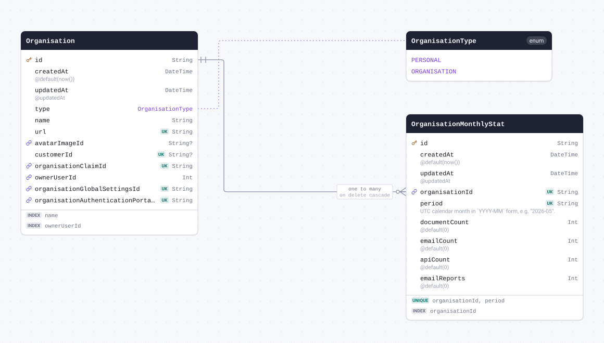

| Field            | Type       | Constraints                                       | Default      | Description                                           |
| ---------------- | ---------- | ------------------------------------------------- | ------------ | ----------------------------------------------------- |
| `id`             | `String`   | PK NOT NULL                                       |              |                                                       |
| `createdAt`      | `DateTime` | NOT NULL                                          | `now()`      |                                                       |
| `updatedAt`      | `DateTime` | NOT NULL                                          | `@updatedAt` |                                                       |
| `organisationId` | `String`   | NOT NULL → [Organisation.id](#model-Organisation) |              |                                                       |
| `period`         | `String`   | NOT NULL                                          |              | UTC calendar month in `YYYY-MM` form, e.g. "2026-05". |
| `documentCount`  | `Int`      | NOT NULL                                          | `0`          |                                                       |
| `emailCount`     | `Int`      | NOT NULL                                          | `0`          |                                                       |
| `apiCount`       | `Int`      | NOT NULL                                          | `0`          |                                                       |
| `emailReports`   | `Int`      | NOT NULL                                          | `0`          |                                                       |

#### Indexes

- `@@index([organisationId])`
- `@@unique([organisationId, period])`

#### References

- `organisationId` → [Organisation.id](#model-Organisation) (many-to-one, on delete Cascade)

#### Definition

```sql
CREATE TABLE "OrganisationMonthlyStat" (
    "id" TEXT NOT NULL,
    "createdAt" TIMESTAMP(3) NOT NULL DEFAULT CURRENT_TIMESTAMP,
    "updatedAt" TIMESTAMP(3) NOT NULL,
    "organisationId" TEXT NOT NULL,
    "period" TEXT NOT NULL,
    "documentCount" INTEGER NOT NULL DEFAULT 0,
    "emailCount" INTEGER NOT NULL DEFAULT 0,
    "apiCount" INTEGER NOT NULL DEFAULT 0,
    "emailReports" INTEGER NOT NULL DEFAULT 0,

    CONSTRAINT "OrganisationMonthlyStat_pkey" PRIMARY KEY ("id")
);

CREATE INDEX "OrganisationMonthlyStat_organisationId_idx" ON "OrganisationMonthlyStat"("organisationId");

CREATE UNIQUE INDEX "OrganisationMonthlyStat_organisationId_period_key" ON "OrganisationMonthlyStat"("organisationId", "period");

ALTER TABLE "OrganisationMonthlyStat" ADD CONSTRAINT "OrganisationMonthlyStat_organisationId_fkey" FOREIGN KEY ("organisationId") REFERENCES "Organisation"("id") ON DELETE CASCADE ON UPDATE CASCADE;
```

<details>
<summary>Queries and their SQL</summary>

**findMany**: Every row

```ts
await prisma.organisationMonthlyStat.findMany();
```

```sql
SELECT
  "public"."OrganisationMonthlyStat"."id",
  "public"."OrganisationMonthlyStat"."createdAt",
  "public"."OrganisationMonthlyStat"."updatedAt",
  "public"."OrganisationMonthlyStat"."organisationId",
  "public"."OrganisationMonthlyStat"."period",
  "public"."OrganisationMonthlyStat"."documentCount",
  "public"."OrganisationMonthlyStat"."emailCount",
  "public"."OrganisationMonthlyStat"."apiCount",
  "public"."OrganisationMonthlyStat"."emailReports"
FROM
  "public"."OrganisationMonthlyStat"
WHERE
  1 = 1
OFFSET
  $1
-- params: ["0"]
```

**count**: How many rows there are

```ts
await prisma.organisationMonthlyStat.count();
```

```sql
SELECT
  COUNT(*) AS "_count$_all"
FROM
  (
    SELECT
      "public"."OrganisationMonthlyStat"."id"
    FROM
      "public"."OrganisationMonthlyStat"
    WHERE
      1 = 1
    OFFSET
      $1
  ) AS "sub"
-- params: ["0"]
```

**findMany**: Every row with its relations

```ts
await prisma.organisationMonthlyStat.findMany({ include: { organisation: true } });
```

```sql
SELECT
  "public"."OrganisationMonthlyStat"."id",
  "public"."OrganisationMonthlyStat"."createdAt",
  "public"."OrganisationMonthlyStat"."updatedAt",
  "public"."OrganisationMonthlyStat"."organisationId",
  "public"."OrganisationMonthlyStat"."period",
  "public"."OrganisationMonthlyStat"."documentCount",
  "public"."OrganisationMonthlyStat"."emailCount",
  "public"."OrganisationMonthlyStat"."apiCount",
  "public"."OrganisationMonthlyStat"."emailReports"
FROM
  "public"."OrganisationMonthlyStat"
WHERE
  1 = 1
OFFSET
  $1
-- params: ["0"]

SELECT
  "public"."Organisation"."id",
  "public"."Organisation"."createdAt",
  "public"."Organisation"."updatedAt",
  "public"."Organisation"."type"::text,
  "public"."Organisation"."name",
  "public"."Organisation"."url",
  "public"."Organisation"."avatarImageId",
  "public"."Organisation"."customerId",
  "public"."Organisation"."organisationClaimId",
  "public"."Organisation"."ownerUserId",
  "public"."Organisation"."organisationGlobalSettingsId",
  "public"."Organisation"."organisationAuthenticationPortalId"
FROM
  "public"."Organisation"
WHERE
  "public"."Organisation"."id" IN ($1)
OFFSET
  $2
-- params: ["<organisationId of the rows above>","0"]
```

**findUnique**: One row by what is unique to it

```ts
await prisma.organisationMonthlyStat.findUnique({ where: { id: "example" } });
```

```sql
SELECT
  "public"."OrganisationMonthlyStat"."id",
  "public"."OrganisationMonthlyStat"."createdAt",
  "public"."OrganisationMonthlyStat"."updatedAt",
  "public"."OrganisationMonthlyStat"."organisationId",
  "public"."OrganisationMonthlyStat"."period",
  "public"."OrganisationMonthlyStat"."documentCount",
  "public"."OrganisationMonthlyStat"."emailCount",
  "public"."OrganisationMonthlyStat"."apiCount",
  "public"."OrganisationMonthlyStat"."emailReports"
FROM
  "public"."OrganisationMonthlyStat"
WHERE
  (
    "public"."OrganisationMonthlyStat"."id" = $1
    AND 1 = 1
  )
LIMIT
  $2
OFFSET
  $3
-- params: ["example","1","0"]
```

**create**: Create a row

```ts
await prisma.organisationMonthlyStat.create({
  data: { id: "example", organisationId: "example", period: "example" },
});
```

```sql
INSERT INTO
  "public"."OrganisationMonthlyStat" (
    "id",
    "createdAt",
    "updatedAt",
    "organisationId",
    "period",
    "documentCount",
    "emailCount",
    "apiCount",
    "emailReports"
  )
VALUES
  ($1, $2, $3, $4, $5, $6, $7, $8, $9)
RETURNING
  "public"."OrganisationMonthlyStat"."id",
  "public"."OrganisationMonthlyStat"."createdAt",
  "public"."OrganisationMonthlyStat"."updatedAt",
  "public"."OrganisationMonthlyStat"."organisationId",
  "public"."OrganisationMonthlyStat"."period",
  "public"."OrganisationMonthlyStat"."documentCount",
  "public"."OrganisationMonthlyStat"."emailCount",
  "public"."OrganisationMonthlyStat"."apiCount",
  "public"."OrganisationMonthlyStat"."emailReports"
-- params: ["example","<now()>","<now()>","example","example","0","0","0","0"]
```

**update**: Update a row

```ts
await prisma.organisationMonthlyStat.update({
  where: { id: "example" },
  data: { createdAt: new Date("2026-01-01T00:00:00.000Z") },
});
```

```sql
UPDATE "public"."OrganisationMonthlyStat"
SET
  "createdAt" = $1,
  "updatedAt" = $2
WHERE
  (
    "public"."OrganisationMonthlyStat"."id" = $3
    AND 1 = 1
  )
RETURNING
  "public"."OrganisationMonthlyStat"."id",
  "public"."OrganisationMonthlyStat"."createdAt",
  "public"."OrganisationMonthlyStat"."updatedAt",
  "public"."OrganisationMonthlyStat"."organisationId",
  "public"."OrganisationMonthlyStat"."period",
  "public"."OrganisationMonthlyStat"."documentCount",
  "public"."OrganisationMonthlyStat"."emailCount",
  "public"."OrganisationMonthlyStat"."apiCount",
  "public"."OrganisationMonthlyStat"."emailReports"
-- params: ["2026-01-01T00:00:00.000Z",{"prisma__type":"generatorCall","prisma__value":{"name":"now","args":[],"returnType":{"type":"DateTime"}}},"example"]
```

**delete**: Delete a row

```ts
await prisma.organisationMonthlyStat.delete({ where: { id: "example" } });
```

```sql
DELETE FROM "public"."OrganisationMonthlyStat"
WHERE
  (
    "public"."OrganisationMonthlyStat"."id" = $1
    AND 1 = 1
  )
RETURNING
  "public"."OrganisationMonthlyStat"."id",
  "public"."OrganisationMonthlyStat"."createdAt",
  "public"."OrganisationMonthlyStat"."updatedAt",
  "public"."OrganisationMonthlyStat"."organisationId",
  "public"."OrganisationMonthlyStat"."period",
  "public"."OrganisationMonthlyStat"."documentCount",
  "public"."OrganisationMonthlyStat"."emailCount",
  "public"."OrganisationMonthlyStat"."apiCount",
  "public"."OrganisationMonthlyStat"."emailReports"
-- params: ["example"]
```

</details>

<a id="model-Account"></a>

### Account

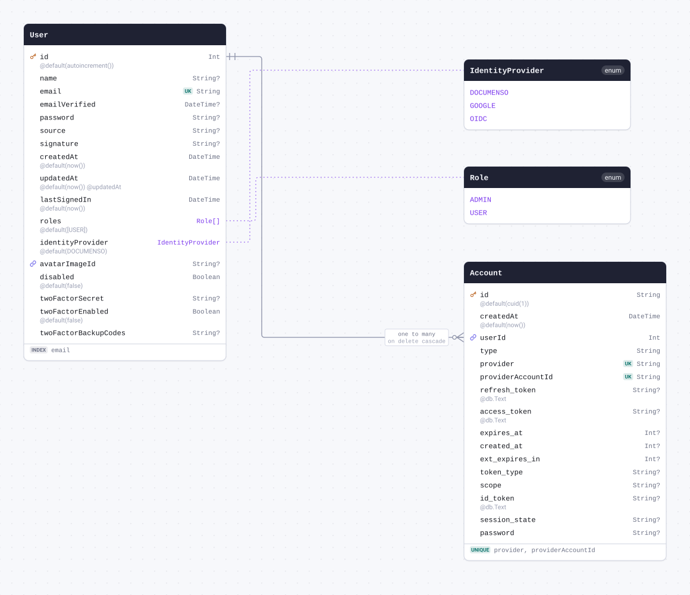

| Field               | Type                | Constraints                       | Default   | Description |
| ------------------- | ------------------- | --------------------------------- | --------- | ----------- |
| `id`                | `String`            | PK NOT NULL                       | `cuid(1)` |             |
| `createdAt`         | `DateTime`          | NOT NULL                          | `now()`   |             |
| `userId`            | `Int`               | NOT NULL → [User.id](#model-User) |           |             |
| `type`              | `String`            | NOT NULL                          |           |             |
| `provider`          | `String`            | NOT NULL                          |           |             |
| `providerAccountId` | `String`            | NOT NULL                          |           |             |
| `refresh_token`     | `String` `@db.Text` | NULL                              |           |             |
| `access_token`      | `String` `@db.Text` | NULL                              |           |             |
| `expires_at`        | `Int`               | NULL                              |           |             |
| `created_at`        | `Int`               | NULL                              |           |             |
| `ext_expires_in`    | `Int`               | NULL                              |           |             |
| `token_type`        | `String`            | NULL                              |           |             |
| `scope`             | `String`            | NULL                              |           |             |
| `id_token`          | `String` `@db.Text` | NULL                              |           |             |
| `session_state`     | `String`            | NULL                              |           |             |
| `password`          | `String`            | NULL                              |           |             |

#### Indexes

- `@@unique([provider, providerAccountId])`

#### References

- `userId` → [User.id](#model-User) (many-to-one, on delete Cascade)

#### Definition

```sql
CREATE TABLE "Account" (
    "id" TEXT NOT NULL,
    "createdAt" TIMESTAMP(3) NOT NULL DEFAULT CURRENT_TIMESTAMP,
    "userId" INTEGER NOT NULL,
    "type" TEXT NOT NULL,
    "provider" TEXT NOT NULL,
    "providerAccountId" TEXT NOT NULL,
    "refresh_token" TEXT,
    "access_token" TEXT,
    "expires_at" INTEGER,
    "created_at" INTEGER,
    "ext_expires_in" INTEGER,
    "token_type" TEXT,
    "scope" TEXT,
    "id_token" TEXT,
    "session_state" TEXT,
    "password" TEXT,

    CONSTRAINT "Account_pkey" PRIMARY KEY ("id")
);

CREATE UNIQUE INDEX "Account_provider_providerAccountId_key" ON "Account"("provider", "providerAccountId");

ALTER TABLE "Account" ADD CONSTRAINT "Account_userId_fkey" FOREIGN KEY ("userId") REFERENCES "User"("id") ON DELETE CASCADE ON UPDATE CASCADE;
```

<details>
<summary>Queries and their SQL</summary>

**findMany**: Every row

```ts
await prisma.account.findMany();
```

```sql
SELECT
  "public"."Account"."id",
  "public"."Account"."createdAt",
  "public"."Account"."userId",
  "public"."Account"."type",
  "public"."Account"."provider",
  "public"."Account"."providerAccountId",
  "public"."Account"."refresh_token",
  "public"."Account"."access_token",
  "public"."Account"."expires_at",
  "public"."Account"."created_at",
  "public"."Account"."ext_expires_in",
  "public"."Account"."token_type",
  "public"."Account"."scope",
  "public"."Account"."id_token",
  "public"."Account"."session_state",
  "public"."Account"."password"
FROM
  "public"."Account"
WHERE
  1 = 1
OFFSET
  $1
-- params: ["0"]
```

**count**: How many rows there are

```ts
await prisma.account.count();
```

```sql
SELECT
  COUNT(*) AS "_count$_all"
FROM
  (
    SELECT
      "public"."Account"."id"
    FROM
      "public"."Account"
    WHERE
      1 = 1
    OFFSET
      $1
  ) AS "sub"
-- params: ["0"]
```

**findMany**: Every row with its relations

```ts
await prisma.account.findMany({ include: { user: true } });
```

```sql
SELECT
  "public"."Account"."id",
  "public"."Account"."createdAt",
  "public"."Account"."userId",
  "public"."Account"."type",
  "public"."Account"."provider",
  "public"."Account"."providerAccountId",
  "public"."Account"."refresh_token",
  "public"."Account"."access_token",
  "public"."Account"."expires_at",
  "public"."Account"."created_at",
  "public"."Account"."ext_expires_in",
  "public"."Account"."token_type",
  "public"."Account"."scope",
  "public"."Account"."id_token",
  "public"."Account"."session_state",
  "public"."Account"."password"
FROM
  "public"."Account"
WHERE
  1 = 1
OFFSET
  $1
-- params: ["0"]

SELECT
  "public"."User"."id",
  "public"."User"."name",
  "public"."User"."email",
  "public"."User"."emailVerified",
  "public"."User"."password",
  "public"."User"."source",
  "public"."User"."signature",
  "public"."User"."createdAt",
  "public"."User"."updatedAt",
  "public"."User"."lastSignedIn",
  "public"."User"."roles"::text[],
  "public"."User"."identityProvider"::text,
  "public"."User"."avatarImageId",
  "public"."User"."disabled",
  "public"."User"."twoFactorSecret",
  "public"."User"."twoFactorEnabled",
  "public"."User"."twoFactorBackupCodes"
FROM
  "public"."User"
WHERE
  "public"."User"."id" IN ($1)
OFFSET
  $2
-- params: ["<userId of the rows above>","0"]
```

**findUnique**: One row by what is unique to it

```ts
await prisma.account.findUnique({ where: { id: "example" } });
```

```sql
SELECT
  "public"."Account"."id",
  "public"."Account"."createdAt",
  "public"."Account"."userId",
  "public"."Account"."type",
  "public"."Account"."provider",
  "public"."Account"."providerAccountId",
  "public"."Account"."refresh_token",
  "public"."Account"."access_token",
  "public"."Account"."expires_at",
  "public"."Account"."created_at",
  "public"."Account"."ext_expires_in",
  "public"."Account"."token_type",
  "public"."Account"."scope",
  "public"."Account"."id_token",
  "public"."Account"."session_state",
  "public"."Account"."password"
FROM
  "public"."Account"
WHERE
  (
    "public"."Account"."id" = $1
    AND 1 = 1
  )
LIMIT
  $2
OFFSET
  $3
-- params: ["example","1","0"]
```

**create**: Create a row

```ts
await prisma.account.create({
  data: { userId: 1, type: "example", provider: "example", providerAccountId: "example" },
});
```

```sql
INSERT INTO
  "public"."Account" (
    "id",
    "createdAt",
    "userId",
    "type",
    "provider",
    "providerAccountId"
  )
VALUES
  ($1, $2, $3, $4, $5, $6)
RETURNING
  "public"."Account"."id",
  "public"."Account"."createdAt",
  "public"."Account"."userId",
  "public"."Account"."type",
  "public"."Account"."provider",
  "public"."Account"."providerAccountId",
  "public"."Account"."refresh_token",
  "public"."Account"."access_token",
  "public"."Account"."expires_at",
  "public"."Account"."created_at",
  "public"."Account"."ext_expires_in",
  "public"."Account"."token_type",
  "public"."Account"."scope",
  "public"."Account"."id_token",
  "public"."Account"."session_state",
  "public"."Account"."password"
-- params: ["<cuid(1)>","<now()>","1","example","example","example"]
```

**update**: Update a row

```ts
await prisma.account.update({
  where: { id: "example" },
  data: { createdAt: new Date("2026-01-01T00:00:00.000Z") },
});
```

```sql
UPDATE "public"."Account"
SET
  "createdAt" = $1
WHERE
  (
    "public"."Account"."id" = $2
    AND 1 = 1
  )
RETURNING
  "public"."Account"."id",
  "public"."Account"."createdAt",
  "public"."Account"."userId",
  "public"."Account"."type",
  "public"."Account"."provider",
  "public"."Account"."providerAccountId",
  "public"."Account"."refresh_token",
  "public"."Account"."access_token",
  "public"."Account"."expires_at",
  "public"."Account"."created_at",
  "public"."Account"."ext_expires_in",
  "public"."Account"."token_type",
  "public"."Account"."scope",
  "public"."Account"."id_token",
  "public"."Account"."session_state",
  "public"."Account"."password"
-- params: ["2026-01-01T00:00:00.000Z","example"]
```

**delete**: Delete a row

```ts
await prisma.account.delete({ where: { id: "example" } });
```

```sql
DELETE FROM "public"."Account"
WHERE
  (
    "public"."Account"."id" = $1
    AND 1 = 1
  )
RETURNING
  "public"."Account"."id",
  "public"."Account"."createdAt",
  "public"."Account"."userId",
  "public"."Account"."type",
  "public"."Account"."provider",
  "public"."Account"."providerAccountId",
  "public"."Account"."refresh_token",
  "public"."Account"."access_token",
  "public"."Account"."expires_at",
  "public"."Account"."created_at",
  "public"."Account"."ext_expires_in",
  "public"."Account"."token_type",
  "public"."Account"."scope",
  "public"."Account"."id_token",
  "public"."Account"."session_state",
  "public"."Account"."password"
-- params: ["example"]
```

</details>

<a id="model-Session"></a>

### Session

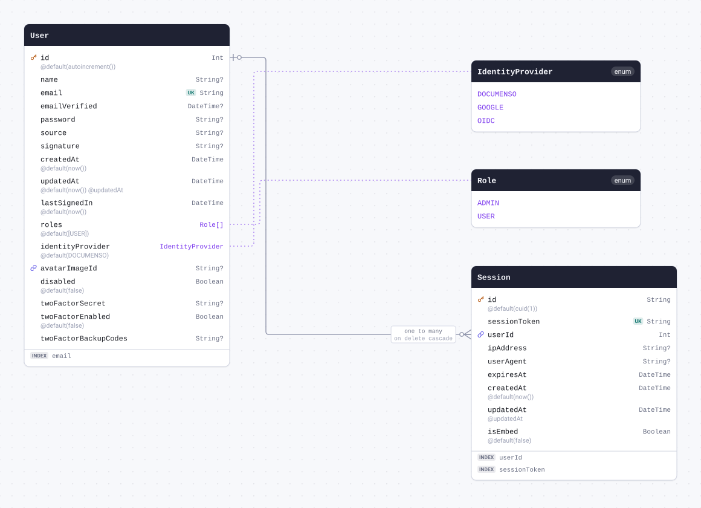

| Field          | Type       | Constraints                       | Default      | Description |
| -------------- | ---------- | --------------------------------- | ------------ | ----------- |
| `id`           | `String`   | PK NOT NULL                       | `cuid(1)`    |             |
| `sessionToken` | `String`   | UNIQUE NOT NULL                   |              |             |
| `userId`       | `Int`      | NOT NULL → [User.id](#model-User) |              |             |
| `ipAddress`    | `String`   | NULL                              |              |             |
| `userAgent`    | `String`   | NULL                              |              |             |
| `expiresAt`    | `DateTime` | NOT NULL                          |              |             |
| `createdAt`    | `DateTime` | NOT NULL                          | `now()`      |             |
| `updatedAt`    | `DateTime` | NOT NULL                          | `@updatedAt` |             |
| `isEmbed`      | `Boolean`  | NOT NULL                          | `false`      |             |

#### Indexes

- `@@index([userId])`
- `@@index([sessionToken])`

#### References

- `userId` → [User.id](#model-User) (many-to-one, on delete Cascade)

#### Definition

```sql
CREATE TABLE "Session" (
    "id" TEXT NOT NULL,
    "sessionToken" TEXT NOT NULL,
    "userId" INTEGER NOT NULL,
    "ipAddress" TEXT,
    "userAgent" TEXT,
    "expiresAt" TIMESTAMP(3) NOT NULL,
    "createdAt" TIMESTAMP(3) NOT NULL DEFAULT CURRENT_TIMESTAMP,
    "updatedAt" TIMESTAMP(3) NOT NULL,
    "isEmbed" BOOLEAN NOT NULL DEFAULT false,

    CONSTRAINT "Session_pkey" PRIMARY KEY ("id")
);

CREATE UNIQUE INDEX "Session_sessionToken_key" ON "Session"("sessionToken");

CREATE INDEX "Session_userId_idx" ON "Session"("userId");

CREATE INDEX "Session_sessionToken_idx" ON "Session"("sessionToken");

ALTER TABLE "Session" ADD CONSTRAINT "Session_userId_fkey" FOREIGN KEY ("userId") REFERENCES "User"("id") ON DELETE CASCADE ON UPDATE CASCADE;
```

<details>
<summary>Queries and their SQL</summary>

**findMany**: Every row

```ts
await prisma.session.findMany();
```

```sql
SELECT
  "public"."Session"."id",
  "public"."Session"."sessionToken",
  "public"."Session"."userId",
  "public"."Session"."ipAddress",
  "public"."Session"."userAgent",
  "public"."Session"."expiresAt",
  "public"."Session"."createdAt",
  "public"."Session"."updatedAt",
  "public"."Session"."isEmbed"
FROM
  "public"."Session"
WHERE
  1 = 1
OFFSET
  $1
-- params: ["0"]
```

**count**: How many rows there are

```ts
await prisma.session.count();
```

```sql
SELECT
  COUNT(*) AS "_count$_all"
FROM
  (
    SELECT
      "public"."Session"."id"
    FROM
      "public"."Session"
    WHERE
      1 = 1
    OFFSET
      $1
  ) AS "sub"
-- params: ["0"]
```

**findMany**: Every row with its relations

```ts
await prisma.session.findMany({ include: { user: true } });
```

```sql
SELECT
  "public"."Session"."id",
  "public"."Session"."sessionToken",
  "public"."Session"."userId",
  "public"."Session"."ipAddress",
  "public"."Session"."userAgent",
  "public"."Session"."expiresAt",
  "public"."Session"."createdAt",
  "public"."Session"."updatedAt",
  "public"."Session"."isEmbed"
FROM
  "public"."Session"
WHERE
  1 = 1
OFFSET
  $1
-- params: ["0"]

SELECT
  "public"."User"."id",
  "public"."User"."name",
  "public"."User"."email",
  "public"."User"."emailVerified",
  "public"."User"."password",
  "public"."User"."source",
  "public"."User"."signature",
  "public"."User"."createdAt",
  "public"."User"."updatedAt",
  "public"."User"."lastSignedIn",
  "public"."User"."roles"::text[],
  "public"."User"."identityProvider"::text,
  "public"."User"."avatarImageId",
  "public"."User"."disabled",
  "public"."User"."twoFactorSecret",
  "public"."User"."twoFactorEnabled",
  "public"."User"."twoFactorBackupCodes"
FROM
  "public"."User"
WHERE
  "public"."User"."id" IN ($1)
OFFSET
  $2
-- params: ["<userId of the rows above>","0"]
```

**findUnique**: One row by what is unique to it

```ts
await prisma.session.findUnique({ where: { id: "example" } });
```

```sql
SELECT
  "public"."Session"."id",
  "public"."Session"."sessionToken",
  "public"."Session"."userId",
  "public"."Session"."ipAddress",
  "public"."Session"."userAgent",
  "public"."Session"."expiresAt",
  "public"."Session"."createdAt",
  "public"."Session"."updatedAt",
  "public"."Session"."isEmbed"
FROM
  "public"."Session"
WHERE
  (
    "public"."Session"."id" = $1
    AND 1 = 1
  )
LIMIT
  $2
OFFSET
  $3
-- params: ["example","1","0"]
```

**create**: Create a row

```ts
await prisma.session.create({
  data: { sessionToken: "example", userId: 1, expiresAt: new Date("2026-01-01T00:00:00.000Z") },
});
```

```sql
INSERT INTO
  "public"."Session" (
    "id",
    "sessionToken",
    "userId",
    "expiresAt",
    "createdAt",
    "updatedAt",
    "isEmbed"
  )
VALUES
  ($1, $2, $3, $4, $5, $6, $7)
RETURNING
  "public"."Session"."id",
  "public"."Session"."sessionToken",
  "public"."Session"."userId",
  "public"."Session"."ipAddress",
  "public"."Session"."userAgent",
  "public"."Session"."expiresAt",
  "public"."Session"."createdAt",
  "public"."Session"."updatedAt",
  "public"."Session"."isEmbed"
-- params: ["<cuid(1)>","example","1","2026-01-01T00:00:00.000Z","<now()>","<now()>",false]
```

**update**: Update a row

```ts
await prisma.session.update({ where: { id: "example" }, data: { sessionToken: "example" } });
```

```sql
UPDATE "public"."Session"
SET
  "sessionToken" = $1,
  "updatedAt" = $2
WHERE
  (
    "public"."Session"."id" = $3
    AND 1 = 1
  )
RETURNING
  "public"."Session"."id",
  "public"."Session"."sessionToken",
  "public"."Session"."userId",
  "public"."Session"."ipAddress",
  "public"."Session"."userAgent",
  "public"."Session"."expiresAt",
  "public"."Session"."createdAt",
  "public"."Session"."updatedAt",
  "public"."Session"."isEmbed"
-- params: ["example",{"prisma__type":"generatorCall","prisma__value":{"name":"now","args":[],"returnType":{"type":"DateTime"}}},"example"]
```

**delete**: Delete a row

```ts
await prisma.session.delete({ where: { id: "example" } });
```

```sql
DELETE FROM "public"."Session"
WHERE
  (
    "public"."Session"."id" = $1
    AND 1 = 1
  )
RETURNING
  "public"."Session"."id",
  "public"."Session"."sessionToken",
  "public"."Session"."userId",
  "public"."Session"."ipAddress",
  "public"."Session"."userAgent",
  "public"."Session"."expiresAt",
  "public"."Session"."createdAt",
  "public"."Session"."updatedAt",
  "public"."Session"."isEmbed"
-- params: ["example"]
```

</details>

<a id="model-AuthHandoff"></a>

### AuthHandoff

| Field       | Type       | Constraints | Default | Description |
| ----------- | ---------- | ----------- | ------- | ----------- |
| `id`        | `String`   | PK NOT NULL |         |             |
| `type`      | `String`   | NOT NULL    |         |             |
| `payload`   | `String`   | NOT NULL    |         |             |
| `createdAt` | `DateTime` | NOT NULL    | `now()` |             |
| `expiresAt` | `DateTime` | NOT NULL    |         |             |

#### Indexes

- `@@index([expiresAt])`

#### Definition

```sql
CREATE TABLE "AuthHandoff" (
    "id" TEXT NOT NULL,
    "type" TEXT NOT NULL,
    "payload" TEXT NOT NULL,
    "createdAt" TIMESTAMP(3) NOT NULL DEFAULT CURRENT_TIMESTAMP,
    "expiresAt" TIMESTAMP(3) NOT NULL,

    CONSTRAINT "AuthHandoff_pkey" PRIMARY KEY ("id")
);

CREATE INDEX "AuthHandoff_expiresAt_idx" ON "AuthHandoff"("expiresAt");
```

<details>
<summary>Queries and their SQL</summary>

**findMany**: Every row

```ts
await prisma.authHandoff.findMany();
```

```sql
SELECT
  "public"."AuthHandoff"."id",
  "public"."AuthHandoff"."type",
  "public"."AuthHandoff"."payload",
  "public"."AuthHandoff"."createdAt",
  "public"."AuthHandoff"."expiresAt"
FROM
  "public"."AuthHandoff"
WHERE
  1 = 1
OFFSET
  $1
-- params: ["0"]
```

**count**: How many rows there are

```ts
await prisma.authHandoff.count();
```

```sql
SELECT
  COUNT(*) AS "_count$_all"
FROM
  (
    SELECT
      "public"."AuthHandoff"."id"
    FROM
      "public"."AuthHandoff"
    WHERE
      1 = 1
    OFFSET
      $1
  ) AS "sub"
-- params: ["0"]
```

**findUnique**: One row by what is unique to it

```ts
await prisma.authHandoff.findUnique({ where: { id: "example" } });
```

```sql
SELECT
  "public"."AuthHandoff"."id",
  "public"."AuthHandoff"."type",
  "public"."AuthHandoff"."payload",
  "public"."AuthHandoff"."createdAt",
  "public"."AuthHandoff"."expiresAt"
FROM
  "public"."AuthHandoff"
WHERE
  (
    "public"."AuthHandoff"."id" = $1
    AND 1 = 1
  )
LIMIT
  $2
OFFSET
  $3
-- params: ["example","1","0"]
```

**create**: Create a row

```ts
await prisma.authHandoff.create({
  data: {
    id: "example",
    type: "example",
    payload: "example",
    expiresAt: new Date("2026-01-01T00:00:00.000Z"),
  },
});
```

```sql
INSERT INTO
  "public"."AuthHandoff" ("id", "type", "payload", "createdAt", "expiresAt")
VALUES
  ($1, $2, $3, $4, $5)
RETURNING
  "public"."AuthHandoff"."id",
  "public"."AuthHandoff"."type",
  "public"."AuthHandoff"."payload",
  "public"."AuthHandoff"."createdAt",
  "public"."AuthHandoff"."expiresAt"
-- params: ["example","example","example","<now()>","2026-01-01T00:00:00.000Z"]
```

**update**: Update a row

```ts
await prisma.authHandoff.update({ where: { id: "example" }, data: { type: "example" } });
```

```sql
UPDATE "public"."AuthHandoff"
SET
  "type" = $1
WHERE
  (
    "public"."AuthHandoff"."id" = $2
    AND 1 = 1
  )
RETURNING
  "public"."AuthHandoff"."id",
  "public"."AuthHandoff"."type",
  "public"."AuthHandoff"."payload",
  "public"."AuthHandoff"."createdAt",
  "public"."AuthHandoff"."expiresAt"
-- params: ["example","example"]
```

**delete**: Delete a row

```ts
await prisma.authHandoff.delete({ where: { id: "example" } });
```

```sql
DELETE FROM "public"."AuthHandoff"
WHERE
  (
    "public"."AuthHandoff"."id" = $1
    AND 1 = 1
  )
RETURNING
  "public"."AuthHandoff"."id",
  "public"."AuthHandoff"."type",
  "public"."AuthHandoff"."payload",
  "public"."AuthHandoff"."createdAt",
  "public"."AuthHandoff"."expiresAt"
-- params: ["example"]
```

</details>

<a id="model-Folder"></a>

### Folder

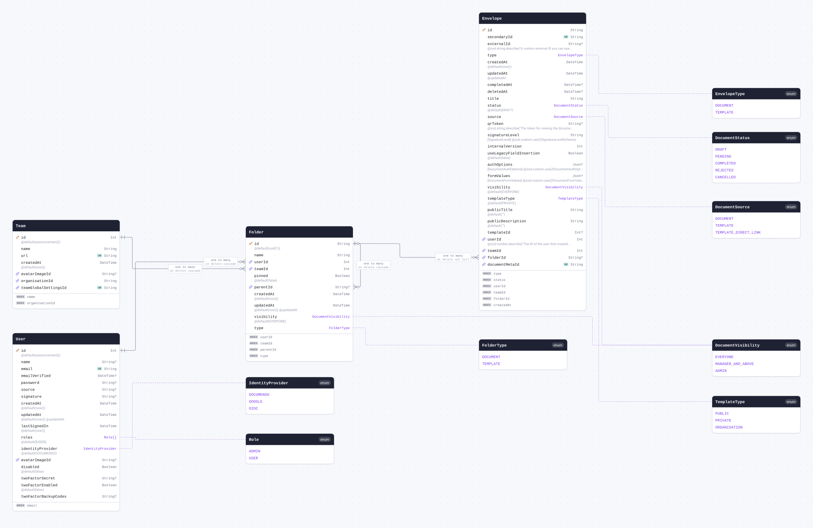

| Field        | Type                                             | Constraints                       | Default              | Description |
| ------------ | ------------------------------------------------ | --------------------------------- | -------------------- | ----------- |
| `id`         | `String`                                         | PK NOT NULL                       | `cuid(1)`            |             |
| `name`       | `String`                                         | NOT NULL                          |                      |             |
| `userId`     | `Int`                                            | NOT NULL → [User.id](#model-User) |                      |             |
| `teamId`     | `Int`                                            | NOT NULL → [Team.id](#model-Team) |                      |             |
| `pinned`     | `Boolean`                                        | NOT NULL                          | `false`              |             |
| `parentId`   | `String`                                         | NULL → [Folder.id](#model-Folder) |                      |             |
| `createdAt`  | `DateTime`                                       | NOT NULL                          | `now()`              |             |
| `updatedAt`  | `DateTime`                                       | NOT NULL                          | `now()` `@updatedAt` |             |
| `visibility` | [`DocumentVisibility`](#enum-DocumentVisibility) | NOT NULL                          | `EVERYONE`           |             |
| `type`       | [`FolderType`](#enum-FolderType)                 | NOT NULL                          |                      |             |

#### Indexes

- `@@index([userId])`
- `@@index([teamId])`
- `@@index([parentId])`
- `@@index([type])`

#### References

- `userId` → [User.id](#model-User) (many-to-one, on delete Cascade)
- `teamId` → [Team.id](#model-Team) (many-to-one, on delete Cascade)
- `parentId` → [Folder.id](#model-Folder) (many-to-one, on delete Cascade)

#### Referenced by

- `id` ← [Folder.parentId](#model-Folder) (one-to-many, on delete Cascade)
- `id` ← [Envelope.folderId](#model-Envelope) (one-to-many, on delete SetNull)

#### Definition

```sql
CREATE TABLE "Folder" (
    "id" TEXT NOT NULL,
    "name" TEXT NOT NULL,
    "userId" INTEGER NOT NULL,
    "teamId" INTEGER NOT NULL,
    "pinned" BOOLEAN NOT NULL DEFAULT false,
    "parentId" TEXT,
    "createdAt" TIMESTAMP(3) NOT NULL DEFAULT CURRENT_TIMESTAMP,
    "updatedAt" TIMESTAMP(3) NOT NULL DEFAULT CURRENT_TIMESTAMP,
    "visibility" "DocumentVisibility" NOT NULL DEFAULT 'EVERYONE',
    "type" "FolderType" NOT NULL,

    CONSTRAINT "Folder_pkey" PRIMARY KEY ("id")
);

CREATE INDEX "Folder_userId_idx" ON "Folder"("userId");

CREATE INDEX "Folder_teamId_idx" ON "Folder"("teamId");

CREATE INDEX "Folder_parentId_idx" ON "Folder"("parentId");

CREATE INDEX "Folder_type_idx" ON "Folder"("type");

ALTER TABLE "Folder" ADD CONSTRAINT "Folder_userId_fkey" FOREIGN KEY ("userId") REFERENCES "User"("id") ON DELETE CASCADE ON UPDATE CASCADE;

ALTER TABLE "Folder" ADD CONSTRAINT "Folder_teamId_fkey" FOREIGN KEY ("teamId") REFERENCES "Team"("id") ON DELETE CASCADE ON UPDATE CASCADE;

ALTER TABLE "Folder" ADD CONSTRAINT "Folder_parentId_fkey" FOREIGN KEY ("parentId") REFERENCES "Folder"("id") ON DELETE CASCADE ON UPDATE CASCADE;
```

<details>
<summary>Queries and their SQL</summary>

**findMany**: Every row

```ts
await prisma.folder.findMany();
```

```sql
SELECT
  "public"."Folder"."id",
  "public"."Folder"."name",
  "public"."Folder"."userId",
  "public"."Folder"."teamId",
  "public"."Folder"."pinned",
  "public"."Folder"."parentId",
  "public"."Folder"."createdAt",
  "public"."Folder"."updatedAt",
  "public"."Folder"."visibility"::text,
  "public"."Folder"."type"::text
FROM
  "public"."Folder"
WHERE
  1 = 1
OFFSET
  $1
-- params: ["0"]
```

**count**: How many rows there are

```ts
await prisma.folder.count();
```

```sql
SELECT
  COUNT(*) AS "_count$_all"
FROM
  (
    SELECT
      "public"."Folder"."id"
    FROM
      "public"."Folder"
    WHERE
      1 = 1
    OFFSET
      $1
  ) AS "sub"
-- params: ["0"]
```

**findMany**: Every row with its relations

```ts
await prisma.folder.findMany({
  include: { user: true, team: true, parent: true, envelopes: true, subfolders: true },
});
```

```sql
SELECT
  "public"."Folder"."id",
  "public"."Folder"."name",
  "public"."Folder"."userId",
  "public"."Folder"."teamId",
  "public"."Folder"."pinned",
  "public"."Folder"."parentId",
  "public"."Folder"."createdAt",
  "public"."Folder"."updatedAt",
  "public"."Folder"."visibility"::text,
  "public"."Folder"."type"::text
FROM
  "public"."Folder"
WHERE
  1 = 1
OFFSET
  $1
-- params: ["0"]

SELECT
  "public"."User"."id",
  "public"."User"."name",
  "public"."User"."email",
  "public"."User"."emailVerified",
  "public"."User"."password",
  "public"."User"."source",
  "public"."User"."signature",
  "public"."User"."createdAt",
  "public"."User"."updatedAt",
  "public"."User"."lastSignedIn",
  "public"."User"."roles"::text[],
  "public"."User"."identityProvider"::text,
  "public"."User"."avatarImageId",
  "public"."User"."disabled",
  "public"."User"."twoFactorSecret",
  "public"."User"."twoFactorEnabled",
  "public"."User"."twoFactorBackupCodes"
FROM
  "public"."User"
WHERE
  "public"."User"."id" IN ($1)
OFFSET
  $2
-- params: ["<userId of the rows above>","0"]

SELECT
  "public"."Team"."id",
  "public"."Team"."name",
  "public"."Team"."url",
  "public"."Team"."createdAt",
  "public"."Team"."avatarImageId",
  "public"."Team"."organisationId",
  "public"."Team"."teamGlobalSettingsId"
FROM
  "public"."Team"
WHERE
  "public"."Team"."id" IN ($1)
OFFSET
  $2
-- params: ["<teamId of the rows above>","0"]

SELECT
  "public"."Folder"."id",
  "public"."Folder"."name",
  "public"."Folder"."userId",
  "public"."Folder"."teamId",
  "public"."Folder"."pinned",
  "public"."Folder"."parentId",
  "public"."Folder"."createdAt",
  "public"."Folder"."updatedAt",
  "public"."Folder"."visibility"::text,
  "public"."Folder"."type"::text
FROM
  "public"."Folder"
WHERE
  "public"."Folder"."id" IN ($1)
OFFSET
  $2
-- params: ["<parentId of the rows above>","0"]

SELECT
  "public"."Envelope"."id",
  "public"."Envelope"."secondaryId",
  "public"."Envelope"."externalId",
  "public"."Envelope"."type"::text,
  "public"."Envelope"."createdAt",
  "public"."Envelope"."updatedAt",
  "public"."Envelope"."completedAt",
  "public"."Envelope"."deletedAt",
  "public"."Envelope"."title",
  "public"."Envelope"."status"::text,
  "public"."Envelope"."source"::text,
  "public"."Envelope"."qrToken",
  "public"."Envelope"."signatureLevel",
  "public"."Envelope"."internalVersion",
  "public"."Envelope"."useLegacyFieldInsertion",
  "public"."Envelope"."authOptions",
  "public"."Envelope"."formValues",
  "public"."Envelope"."visibility"::text,
  "public"."Envelope"."templateType"::text,
  "public"."Envelope"."publicTitle",
  "public"."Envelope"."publicDescription",
  "public"."Envelope"."templateId",
  "public"."Envelope"."userId",
  "public"."Envelope"."teamId",
  "public"."Envelope"."folderId",
  "public"."Envelope"."documentMetaId"
FROM
  "public"."Envelope"
WHERE
  "public"."Envelope"."folderId" IN ($1)
OFFSET
  $2
-- params: ["<id of the rows above>","0"]

SELECT
  "public"."Folder"."id",
  "public"."Folder"."name",
  "public"."Folder"."userId",
  "public"."Folder"."teamId",
  "public"."Folder"."pinned",
  "public"."Folder"."parentId",
  "public"."Folder"."createdAt",
  "public"."Folder"."updatedAt",
  "public"."Folder"."visibility"::text,
  "public"."Folder"."type"::text
FROM
  "public"."Folder"
WHERE
  "public"."Folder"."parentId" IN ($1)
OFFSET
  $2
-- params: ["<id of the rows above>","0"]
```

**findUnique**: One row by what is unique to it

```ts
await prisma.folder.findUnique({ where: { id: "example" } });
```

```sql
SELECT
  "public"."Folder"."id",
  "public"."Folder"."name",
  "public"."Folder"."userId",
  "public"."Folder"."teamId",
  "public"."Folder"."pinned",
  "public"."Folder"."parentId",
  "public"."Folder"."createdAt",
  "public"."Folder"."updatedAt",
  "public"."Folder"."visibility"::text,
  "public"."Folder"."type"::text
FROM
  "public"."Folder"
WHERE
  (
    "public"."Folder"."id" = $1
    AND 1 = 1
  )
LIMIT
  $2
OFFSET
  $3
-- params: ["example","1","0"]
```

**create**: Create a row

```ts
await prisma.folder.create({ data: { name: "example", userId: 1, teamId: 1, type: "DOCUMENT" } });
```

```sql
INSERT INTO
  "public"."Folder" (
    "id",
    "name",
    "userId",
    "teamId",
    "pinned",
    "createdAt",
    "updatedAt",
    "visibility",
    "type"
  )
VALUES
  (
    $1,
    $2,
    $3,
    $4,
    $5,
    $6,
    $7,
    CAST($8::text AS "public"."DocumentVisibility"),
    CAST($9::text AS "public"."FolderType")
  )
RETURNING
  "public"."Folder"."id",
  "public"."Folder"."name",
  "public"."Folder"."userId",
  "public"."Folder"."teamId",
  "public"."Folder"."pinned",
  "public"."Folder"."parentId",
  "public"."Folder"."createdAt",
  "public"."Folder"."updatedAt",
  "public"."Folder"."visibility"::text,
  "public"."Folder"."type"::text
-- params: ["<cuid(1)>","example","1","1",false,"<now()>","<now()>","EVERYONE","DOCUMENT"]
```

**update**: Update a row

```ts
await prisma.folder.update({ where: { id: "example" }, data: { name: "example" } });
```

```sql
UPDATE "public"."Folder"
SET
  "name" = $1,
  "updatedAt" = $2
WHERE
  (
    "public"."Folder"."id" = $3
    AND 1 = 1
  )
RETURNING
  "public"."Folder"."id",
  "public"."Folder"."name",
  "public"."Folder"."userId",
  "public"."Folder"."teamId",
  "public"."Folder"."pinned",
  "public"."Folder"."parentId",
  "public"."Folder"."createdAt",
  "public"."Folder"."updatedAt",
  "public"."Folder"."visibility"::text,
  "public"."Folder"."type"::text
-- params: ["example",{"prisma__type":"generatorCall","prisma__value":{"name":"now","args":[],"returnType":{"type":"DateTime"}}},"example"]
```

**delete**: Delete a row

```ts
await prisma.folder.delete({ where: { id: "example" } });
```

```sql
DELETE FROM "public"."Folder"
WHERE
  (
    "public"."Folder"."id" = $1
    AND 1 = 1
  )
RETURNING
  "public"."Folder"."id",
  "public"."Folder"."name",
  "public"."Folder"."userId",
  "public"."Folder"."teamId",
  "public"."Folder"."pinned",
  "public"."Folder"."parentId",
  "public"."Folder"."createdAt",
  "public"."Folder"."updatedAt",
  "public"."Folder"."visibility"::text,
  "public"."Folder"."type"::text
-- params: ["example"]
```

</details>

<a id="model-Envelope"></a>

### Envelope

@zod.import(["import { ZDocumentAuthOptionsSchema } from '@documenso/lib/types/document-auth';", "import { ZDocumentFormValuesSchema } from '@documenso/lib/types/document-form-values';", "import { ZSignatureLevelSchema } from '@documenso/lib/types/signature-level';"])

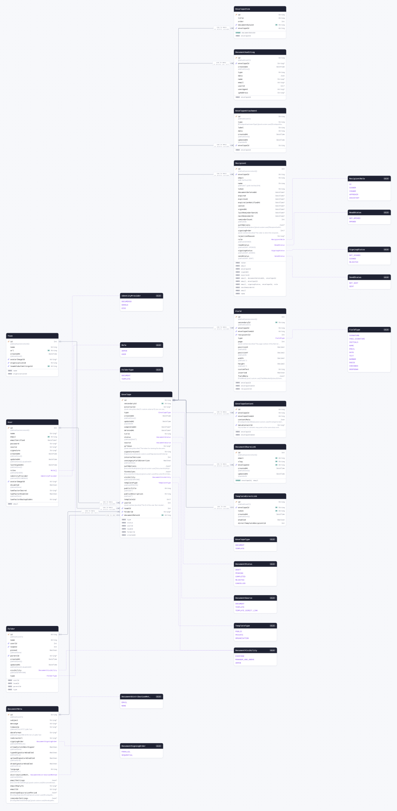

| Field                     | Type                                             | Constraints                                              | Default      | Description                                                                                      |
| ------------------------- | ------------------------------------------------ | -------------------------------------------------------- | ------------ | ------------------------------------------------------------------------------------------------ |
| `id`                      | `String`                                         | PK NOT NULL                                              |              |                                                                                                  |
| `secondaryId`             | `String`                                         | UNIQUE NOT NULL                                          |              |                                                                                                  |
| `externalId`              | `String`                                         | NULL                                                     |              | @zod.string.describe("A custom external ID you can use to identify the document.")               |
| `type`                    | [`EnvelopeType`](#enum-EnvelopeType)             | NOT NULL                                                 |              |                                                                                                  |
| `createdAt`               | `DateTime`                                       | NOT NULL                                                 | `now()`      |                                                                                                  |
| `updatedAt`               | `DateTime`                                       | NOT NULL                                                 | `@updatedAt` |                                                                                                  |
| `completedAt`             | `DateTime`                                       | NULL                                                     |              |                                                                                                  |
| `deletedAt`               | `DateTime`                                       | NULL                                                     |              |                                                                                                  |
| `title`                   | `String`                                         | NOT NULL                                                 |              |                                                                                                  |
| `status`                  | [`DocumentStatus`](#enum-DocumentStatus)         | NOT NULL                                                 | `DRAFT`      |                                                                                                  |
| `source`                  | [`DocumentSource`](#enum-DocumentSource)         | NOT NULL                                                 |              |                                                                                                  |
| `qrToken`                 | `String`                                         | NULL                                                     |              | @zod.string.describe("The token for viewing the document using the QR code on the certificate.") |
| `signatureLevel`          | `String`                                         | NOT NULL                                                 |              | [SignatureLevel] @zod.custom.use(ZSignatureLevelSchema)                                          |
| `internalVersion`         | `Int`                                            | NOT NULL                                                 |              |                                                                                                  |
| `useLegacyFieldInsertion` | `Boolean`                                        | NOT NULL                                                 | `false`      |                                                                                                  |
| `authOptions`             | `Json`                                           | NULL                                                     |              | [DocumentAuthOptions] @zod.custom.use(ZDocumentAuthOptionsSchema)                                |
| `formValues`              | `Json`                                           | NULL                                                     |              | [DocumentFormValues] @zod.custom.use(ZDocumentFormValuesSchema)                                  |
| `visibility`              | [`DocumentVisibility`](#enum-DocumentVisibility) | NOT NULL                                                 | `EVERYONE`   |                                                                                                  |
| `templateType`            | [`TemplateType`](#enum-TemplateType)             | NOT NULL                                                 | `PRIVATE`    |                                                                                                  |
| `publicTitle`             | `String`                                         | NOT NULL                                                 | `""`         |                                                                                                  |
| `publicDescription`       | `String`                                         | NOT NULL                                                 | `""`         |                                                                                                  |
| `templateId`              | `Int`                                            | NULL                                                     |              |                                                                                                  |
| `userId`                  | `Int`                                            | NOT NULL → [User.id](#model-User)                        |              | @zod.number.describe("The ID of the user that created this document.")                           |
| `teamId`                  | `Int`                                            | NOT NULL → [Team.id](#model-Team)                        |              |                                                                                                  |
| `folderId`                | `String`                                         | NULL → [Folder.id](#model-Folder)                        |              |                                                                                                  |
| `documentMetaId`          | `String`                                         | UNIQUE NOT NULL → [DocumentMeta.id](#model-DocumentMeta) |              |                                                                                                  |

#### Indexes

- `@@index([type])`
- `@@index([status])`
- `@@index([userId])`
- `@@index([teamId])`
- `@@index([folderId])`
- `@@index([createdAt])`

#### References

- `userId` → [User.id](#model-User) (many-to-one, on delete Cascade)
- `teamId` → [Team.id](#model-Team) (many-to-one, on delete Cascade)
- `folderId` → [Folder.id](#model-Folder) (many-to-one, on delete SetNull)
- `documentMetaId` → [DocumentMeta.id](#model-DocumentMeta) (one-to-one)

#### Referenced by

- `id` ← [EnvelopeItem.envelopeId](#model-EnvelopeItem) (one-to-many, on delete Cascade)
- `id` ← [DocumentAuditLog.envelopeId](#model-DocumentAuditLog) (one-to-many, on delete SetNull)
- `id` ← [EnvelopeAttachment.envelopeId](#model-EnvelopeAttachment) (one-to-many, on delete Cascade)
- `id` ← [Recipient.envelopeId](#model-Recipient) (one-to-many, on delete Cascade)
- `id` ← [Field.envelopeId](#model-Field) (one-to-many, on delete Cascade)
- `id` ← [EnvelopeContent.envelopeId](#model-EnvelopeContent) (one-to-many, on delete Cascade)
- `id` ← [DocumentShareLink.envelopeId](#model-DocumentShareLink) (one-to-many, on delete Cascade)
- `id` ← [TemplateDirectLink.envelopeId](#model-TemplateDirectLink) (one-to-one, on delete Cascade)

#### Definition

```sql
CREATE TABLE "Envelope" (
    "id" TEXT NOT NULL,
    "secondaryId" TEXT NOT NULL,
    "externalId" TEXT,
    "type" "EnvelopeType" NOT NULL,
    "createdAt" TIMESTAMP(3) NOT NULL DEFAULT CURRENT_TIMESTAMP,
    "updatedAt" TIMESTAMP(3) NOT NULL,
    "completedAt" TIMESTAMP(3),
    "deletedAt" TIMESTAMP(3),
    "title" TEXT NOT NULL,
    "status" "DocumentStatus" NOT NULL DEFAULT 'DRAFT',
    "source" "DocumentSource" NOT NULL,
    "qrToken" TEXT,
    "signatureLevel" TEXT NOT NULL,
    "internalVersion" INTEGER NOT NULL,
    "useLegacyFieldInsertion" BOOLEAN NOT NULL DEFAULT false,
    "authOptions" JSONB,
    "formValues" JSONB,
    "visibility" "DocumentVisibility" NOT NULL DEFAULT 'EVERYONE',
    "templateType" "TemplateType" NOT NULL DEFAULT 'PRIVATE',
    "publicTitle" TEXT NOT NULL DEFAULT '',
    "publicDescription" TEXT NOT NULL DEFAULT '',
    "templateId" INTEGER,
    "userId" INTEGER NOT NULL,
    "teamId" INTEGER NOT NULL,
    "folderId" TEXT,
    "documentMetaId" TEXT NOT NULL,

    CONSTRAINT "Envelope_pkey" PRIMARY KEY ("id")
);

CREATE UNIQUE INDEX "Envelope_secondaryId_key" ON "Envelope"("secondaryId");

CREATE UNIQUE INDEX "Envelope_documentMetaId_key" ON "Envelope"("documentMetaId");

CREATE INDEX "Envelope_type_idx" ON "Envelope"("type");

CREATE INDEX "Envelope_status_idx" ON "Envelope"("status");

CREATE INDEX "Envelope_userId_idx" ON "Envelope"("userId");

CREATE INDEX "Envelope_teamId_idx" ON "Envelope"("teamId");

CREATE INDEX "Envelope_folderId_idx" ON "Envelope"("folderId");

CREATE INDEX "Envelope_createdAt_idx" ON "Envelope"("createdAt");

ALTER TABLE "Envelope" ADD CONSTRAINT "Envelope_userId_fkey" FOREIGN KEY ("userId") REFERENCES "User"("id") ON DELETE CASCADE ON UPDATE CASCADE;

ALTER TABLE "Envelope" ADD CONSTRAINT "Envelope_teamId_fkey" FOREIGN KEY ("teamId") REFERENCES "Team"("id") ON DELETE CASCADE ON UPDATE CASCADE;

ALTER TABLE "Envelope" ADD CONSTRAINT "Envelope_folderId_fkey" FOREIGN KEY ("folderId") REFERENCES "Folder"("id") ON DELETE SET NULL ON UPDATE CASCADE;

ALTER TABLE "Envelope" ADD CONSTRAINT "Envelope_documentMetaId_fkey" FOREIGN KEY ("documentMetaId") REFERENCES "DocumentMeta"("id") ON DELETE RESTRICT ON UPDATE CASCADE;
```

<details>
<summary>Queries and their SQL</summary>

**findMany**: Every row

```ts
await prisma.envelope.findMany();
```

```sql
SELECT
  "public"."Envelope"."id",
  "public"."Envelope"."secondaryId",
  "public"."Envelope"."externalId",
  "public"."Envelope"."type"::text,
  "public"."Envelope"."createdAt",
  "public"."Envelope"."updatedAt",
  "public"."Envelope"."completedAt",
  "public"."Envelope"."deletedAt",
  "public"."Envelope"."title",
  "public"."Envelope"."status"::text,
  "public"."Envelope"."source"::text,
  "public"."Envelope"."qrToken",
  "public"."Envelope"."signatureLevel",
  "public"."Envelope"."internalVersion",
  "public"."Envelope"."useLegacyFieldInsertion",
  "public"."Envelope"."authOptions",
  "public"."Envelope"."formValues",
  "public"."Envelope"."visibility"::text,
  "public"."Envelope"."templateType"::text,
  "public"."Envelope"."publicTitle",
  "public"."Envelope"."publicDescription",
  "public"."Envelope"."templateId",
  "public"."Envelope"."userId",
  "public"."Envelope"."teamId",
  "public"."Envelope"."folderId",
  "public"."Envelope"."documentMetaId"
FROM
  "public"."Envelope"
WHERE
  1 = 1
OFFSET
  $1
-- params: ["0"]
```

**count**: How many rows there are

```ts
await prisma.envelope.count();
```

```sql
SELECT
  COUNT(*) AS "_count$_all"
FROM
  (
    SELECT
      "public"."Envelope"."id"
    FROM
      "public"."Envelope"
    WHERE
      1 = 1
    OFFSET
      $1
  ) AS "sub"
-- params: ["0"]
```

**findMany**: Every row with its relations

```ts
await prisma.envelope.findMany({
  include: {
    envelopeItems: true,
    recipients: true,
    fields: true,
    contents: true,
    shareLinks: true,
    auditLogs: true,
    directLink: true,
    user: true,
    team: true,
    folder: true,
    documentMeta: true,
    envelopeAttachments: true,
  },
});
```

```sql
SELECT
  "public"."Envelope"."id",
  "public"."Envelope"."secondaryId",
  "public"."Envelope"."externalId",
  "public"."Envelope"."type"::text,
  "public"."Envelope"."createdAt",
  "public"."Envelope"."updatedAt",
  "public"."Envelope"."completedAt",
  "public"."Envelope"."deletedAt",
  "public"."Envelope"."title",
  "public"."Envelope"."status"::text,
  "public"."Envelope"."source"::text,
  "public"."Envelope"."qrToken",
  "public"."Envelope"."signatureLevel",
  "public"."Envelope"."internalVersion",
  "public"."Envelope"."useLegacyFieldInsertion",
  "public"."Envelope"."authOptions",
  "public"."Envelope"."formValues",
  "public"."Envelope"."visibility"::text,
  "public"."Envelope"."templateType"::text,
  "public"."Envelope"."publicTitle",
  "public"."Envelope"."publicDescription",
  "public"."Envelope"."templateId",
  "public"."Envelope"."userId",
  "public"."Envelope"."teamId",
  "public"."Envelope"."folderId",
  "public"."Envelope"."documentMetaId"
FROM
  "public"."Envelope"
WHERE
  1 = 1
OFFSET
  $1
-- params: ["0"]

SELECT
  "public"."EnvelopeItem"."id",
  "public"."EnvelopeItem"."title",
  "public"."EnvelopeItem"."order",
  "public"."EnvelopeItem"."documentDataId",
  "public"."EnvelopeItem"."envelopeId"
FROM
  "public"."EnvelopeItem"
WHERE
  "public"."EnvelopeItem"."envelopeId" IN ($1)
OFFSET
  $2
-- params: ["<id of the rows above>","0"]

SELECT
  "public"."Recipient"."id",
  "public"."Recipient"."envelopeId",
  "public"."Recipient"."email",
  "public"."Recipient"."name",
  "public"."Recipient"."token",
  "public"."Recipient"."documentDeletedAt",
  "public"."Recipient"."expired",
  "public"."Recipient"."expiresAt",
  "public"."Recipient"."expirationNotifiedAt",
  "public"."Recipient"."sentAt",
  "public"."Recipient"."signedAt",
  "public"."Recipient"."lastReminderSentAt",
  "public"."Recipient"."nextReminderAt",
  "public"."Recipient"."reminderCount",
  "public"."Recipient"."authOptions",
  "public"."Recipient"."signingOrder",
  "public"."Recipient"."rejectionReason",
  "public"."Recipient"."role"::text,
  "public"."Recipient"."readStatus"::text,
  "public"."Recipient"."signingStatus"::text,
  "public"."Recipient"."sendStatus"::text
FROM
  "public"."Recipient"
WHERE
  "public"."Recipient"."envelopeId" IN ($1)
OFFSET
  $2
-- params: ["<id of the rows above>","0"]

SELECT
  "public"."Field"."id",
  "public"."Field"."secondaryId",
  "public"."Field"."envelopeId",
  "public"."Field"."envelopeItemId",
  "public"."Field"."recipientId",
  "public"."Field"."type"::text,
  "public"."Field"."page",
  "public"."Field"."positionX",
  "public"."Field"."positionY",
  "public"."Field"."width",
  "public"."Field"."height",
  "public"."Field"."customText",
  "public"."Field"."inserted",
  "public"."Field"."fieldMeta"
FROM
  "public"."Field"
WHERE
  "public"."Field"."envelopeId" IN ($1)
OFFSET
  $2
-- params: ["<id of the rows above>","0"]

SELECT
  "public"."EnvelopeContent"."id",
  "public"."EnvelopeContent"."envelopeId",
  "public"."EnvelopeContent"."envelopeItemId",
  "public"."EnvelopeContent"."contentMeta",
  "public"."EnvelopeContent"."dataContentId"
FROM
  "public"."EnvelopeContent"
WHERE
  "public"."EnvelopeContent"."envelopeId" IN ($1)
OFFSET
  $2
-- params: ["<id of the rows above>","0"]

SELECT
  "public"."DocumentShareLink"."id",
  "public"."DocumentShareLink"."email",
  "public"."DocumentShareLink"."slug",
  "public"."DocumentShareLink"."envelopeId",
  "public"."DocumentShareLink"."createdAt",
  "public"."DocumentShareLink"."updatedAt"
FROM
  "public"."DocumentShareLink"
WHERE
  "public"."DocumentShareLink"."envelopeId" IN ($1)
OFFSET
  $2
-- params: ["<id of the rows above>","0"]

SELECT
  "public"."DocumentAuditLog"."id",
  "public"."DocumentAuditLog"."envelopeId",
  "public"."DocumentAuditLog"."createdAt",
  "public"."DocumentAuditLog"."type",
  "public"."DocumentAuditLog"."data",
  "public"."DocumentAuditLog"."name",
  "public"."DocumentAuditLog"."email",
  "public"."DocumentAuditLog"."userId",
  "public"."DocumentAuditLog"."userAgent",
  "public"."DocumentAuditLog"."ipAddress"
FROM
  "public"."DocumentAuditLog"
WHERE
  "public"."DocumentAuditLog"."envelopeId" IN ($1)
OFFSET
  $2
-- params: ["<id of the rows above>","0"]

SELECT
  "public"."TemplateDirectLink"."id",
  "public"."TemplateDirectLink"."envelopeId",
  "public"."TemplateDirectLink"."token",
  "public"."TemplateDirectLink"."createdAt",
  "public"."TemplateDirectLink"."enabled",
  "public"."TemplateDirectLink"."directTemplateRecipientId"
FROM
  "public"."TemplateDirectLink"
WHERE
  "public"."TemplateDirectLink"."envelopeId" IN ($1)
OFFSET
  $2
-- params: ["<id of the rows above>","0"]

SELECT
  "public"."User"."id",
  "public"."User"."name",
  "public"."User"."email",
  "public"."User"."emailVerified",
  "public"."User"."password",
  "public"."User"."source",
  "public"."User"."signature",
  "public"."User"."createdAt",
  "public"."User"."updatedAt",
  "public"."User"."lastSignedIn",
  "public"."User"."roles"::text[],
  "public"."User"."identityProvider"::text,
  "public"."User"."avatarImageId",
  "public"."User"."disabled",
  "public"."User"."twoFactorSecret",
  "public"."User"."twoFactorEnabled",
  "public"."User"."twoFactorBackupCodes"
FROM
  "public"."User"
WHERE
  "public"."User"."id" IN ($1)
OFFSET
  $2
-- params: ["<userId of the rows above>","0"]

SELECT
  "public"."Team"."id",
  "public"."Team"."name",
  "public"."Team"."url",
  "public"."Team"."createdAt",
  "public"."Team"."avatarImageId",
  "public"."Team"."organisationId",
  "public"."Team"."teamGlobalSettingsId"
FROM
  "public"."Team"
WHERE
  "public"."Team"."id" IN ($1)
OFFSET
  $2
-- params: ["<teamId of the rows above>","0"]

SELECT
  "public"."Folder"."id",
  "public"."Folder"."name",
  "public"."Folder"."userId",
  "public"."Folder"."teamId",
  "public"."Folder"."pinned",
  "public"."Folder"."parentId",
  "public"."Folder"."createdAt",
  "public"."Folder"."updatedAt",
  "public"."Folder"."visibility"::text,
  "public"."Folder"."type"::text
FROM
  "public"."Folder"
WHERE
  "public"."Folder"."id" IN ($1)
OFFSET
  $2
-- params: ["<folderId of the rows above>","0"]

SELECT
  "public"."DocumentMeta"."id",
  "public"."DocumentMeta"."subject",
  "public"."DocumentMeta"."message",
  "public"."DocumentMeta"."timezone",
  "public"."DocumentMeta"."dateFormat",
  "public"."DocumentMeta"."redirectUrl",
  "public"."DocumentMeta"."signingOrder"::text,
  "public"."DocumentMeta"."allowDictateNextSigner",
  "public"."DocumentMeta"."typedSignatureEnabled",
  "public"."DocumentMeta"."uploadSignatureEnabled",
  "public"."DocumentMeta"."drawSignatureEnabled",
  "public"."DocumentMeta"."language",
  "public"."DocumentMeta"."distributionMethod"::text,
  "public"."DocumentMeta"."emailSettings",
  "public"."DocumentMeta"."emailReplyTo",
  "public"."DocumentMeta"."emailId",
  "public"."DocumentMeta"."envelopeExpirationPeriod",
  "public"."DocumentMeta"."reminderSettings"
FROM
  "public"."DocumentMeta"
WHERE
  "public"."DocumentMeta"."id" IN ($1)
OFFSET
  $2
-- params: ["<documentMetaId of the rows above>","0"]

SELECT
  "public"."EnvelopeAttachment"."id",
  "public"."EnvelopeAttachment"."type",
  "public"."EnvelopeAttachment"."label",
  "public"."EnvelopeAttachment"."data",
  "public"."EnvelopeAttachment"."createdAt",
  "public"."EnvelopeAttachment"."updatedAt",
  "public"."EnvelopeAttachment"."envelopeId"
FROM
  "public"."EnvelopeAttachment"
WHERE
  "public"."EnvelopeAttachment"."envelopeId" IN ($1)
OFFSET
  $2
-- params: ["<id of the rows above>","0"]
```

**findUnique**: One row by what is unique to it

```ts
await prisma.envelope.findUnique({ where: { id: "example" } });
```

```sql
SELECT
  "public"."Envelope"."id",
  "public"."Envelope"."secondaryId",
  "public"."Envelope"."externalId",
  "public"."Envelope"."type"::text,
  "public"."Envelope"."createdAt",
  "public"."Envelope"."updatedAt",
  "public"."Envelope"."completedAt",
  "public"."Envelope"."deletedAt",
  "public"."Envelope"."title",
  "public"."Envelope"."status"::text,
  "public"."Envelope"."source"::text,
  "public"."Envelope"."qrToken",
  "public"."Envelope"."signatureLevel",
  "public"."Envelope"."internalVersion",
  "public"."Envelope"."useLegacyFieldInsertion",
  "public"."Envelope"."authOptions",
  "public"."Envelope"."formValues",
  "public"."Envelope"."visibility"::text,
  "public"."Envelope"."templateType"::text,
  "public"."Envelope"."publicTitle",
  "public"."Envelope"."publicDescription",
  "public"."Envelope"."templateId",
  "public"."Envelope"."userId",
  "public"."Envelope"."teamId",
  "public"."Envelope"."folderId",
  "public"."Envelope"."documentMetaId"
FROM
  "public"."Envelope"
WHERE
  (
    "public"."Envelope"."id" = $1
    AND 1 = 1
  )
LIMIT
  $2
OFFSET
  $3
-- params: ["example","1","0"]
```

**create**: Create a row

```ts
await prisma.envelope.create({
  data: {
    id: "example",
    secondaryId: "example",
    type: "DOCUMENT",
    title: "example",
    source: "DOCUMENT",
    signatureLevel: "example",
    internalVersion: 1,
    userId: 1,
    teamId: 1,
    documentMetaId: "example",
  },
});
```

```sql
INSERT INTO
  "public"."Envelope" (
    "id",
    "secondaryId",
    "type",
    "createdAt",
    "updatedAt",
    "title",
    "status",
    "source",
    "signatureLevel",
    "internalVersion",
    "useLegacyFieldInsertion",
    "visibility",
    "templateType",
    "publicTitle",
    "publicDescription",
    "userId",
    "teamId",
    "documentMetaId"
  )
VALUES
  (
    $1,
    $2,
    CAST($3::text AS "public"."EnvelopeType"),
    $4,
    $5,
    $6,
    CAST($7::text AS "public"."DocumentStatus"),
    CAST($8::text AS "public"."DocumentSource"),
    $9,
    $10,
    $11,
    CAST($12::text AS "public"."DocumentVisibility"),
    CAST($13::text AS "public"."TemplateType"),
    $14,
    $15,
    $16,
    $17,
    $18
  )
RETURNING
  "public"."Envelope"."id",
  "public"."Envelope"."secondaryId",
  "public"."Envelope"."externalId",
  "public"."Envelope"."type"::text,
  "public"."Envelope"."createdAt",
  "public"."Envelope"."updatedAt",
  "public"."Envelope"."completedAt",
  "public"."Envelope"."deletedAt",
  "public"."Envelope"."title",
  "public"."Envelope"."status"::text,
  "public"."Envelope"."source"::text,
  "public"."Envelope"."qrToken",
  "public"."Envelope"."signatureLevel",
  "public"."Envelope"."internalVersion",
  "public"."Envelope"."useLegacyFieldInsertion",
  "public"."Envelope"."authOptions",
  "public"."Envelope"."formValues",
  "public"."Envelope"."visibility"::text,
  "public"."Envelope"."templateType"::text,
  "public"."Envelope"."publicTitle",
  "public"."Envelope"."publicDescription",
  "public"."Envelope"."templateId",
  "public"."Envelope"."userId",
  "public"."Envelope"."teamId",
  "public"."Envelope"."folderId",
  "public"."Envelope"."documentMetaId"
-- params: ["example","example","DOCUMENT","<now()>","<now()>","example","DRAFT","DOCUMENT","example","1",false,"EVERYONE","PRIVATE","","","1","1","example"]
```

**update**: Update a row

```ts
await prisma.envelope.update({ where: { id: "example" }, data: { secondaryId: "example" } });
```

```sql
UPDATE "public"."Envelope"
SET
  "secondaryId" = $1,
  "updatedAt" = $2
WHERE
  (
    "public"."Envelope"."id" = $3
    AND 1 = 1
  )
RETURNING
  "public"."Envelope"."id",
  "public"."Envelope"."secondaryId",
  "public"."Envelope"."externalId",
  "public"."Envelope"."type"::text,
  "public"."Envelope"."createdAt",
  "public"."Envelope"."updatedAt",
  "public"."Envelope"."completedAt",
  "public"."Envelope"."deletedAt",
  "public"."Envelope"."title",
  "public"."Envelope"."status"::text,
  "public"."Envelope"."source"::text,
  "public"."Envelope"."qrToken",
  "public"."Envelope"."signatureLevel",
  "public"."Envelope"."internalVersion",
  "public"."Envelope"."useLegacyFieldInsertion",
  "public"."Envelope"."authOptions",
  "public"."Envelope"."formValues",
  "public"."Envelope"."visibility"::text,
  "public"."Envelope"."templateType"::text,
  "public"."Envelope"."publicTitle",
  "public"."Envelope"."publicDescription",
  "public"."Envelope"."templateId",
  "public"."Envelope"."userId",
  "public"."Envelope"."teamId",
  "public"."Envelope"."folderId",
  "public"."Envelope"."documentMetaId"
-- params: ["example",{"prisma__type":"generatorCall","prisma__value":{"name":"now","args":[],"returnType":{"type":"DateTime"}}},"example"]
```

**delete**: Delete a row

```ts
await prisma.envelope.delete({ where: { id: "example" } });
```

```sql
DELETE FROM "public"."Envelope"
WHERE
  (
    "public"."Envelope"."id" = $1
    AND 1 = 1
  )
RETURNING
  "public"."Envelope"."id",
  "public"."Envelope"."secondaryId",
  "public"."Envelope"."externalId",
  "public"."Envelope"."type"::text,
  "public"."Envelope"."createdAt",
  "public"."Envelope"."updatedAt",
  "public"."Envelope"."completedAt",
  "public"."Envelope"."deletedAt",
  "public"."Envelope"."title",
  "public"."Envelope"."status"::text,
  "public"."Envelope"."source"::text,
  "public"."Envelope"."qrToken",
  "public"."Envelope"."signatureLevel",
  "public"."Envelope"."internalVersion",
  "public"."Envelope"."useLegacyFieldInsertion",
  "public"."Envelope"."authOptions",
  "public"."Envelope"."formValues",
  "public"."Envelope"."visibility"::text,
  "public"."Envelope"."templateType"::text,
  "public"."Envelope"."publicTitle",
  "public"."Envelope"."publicDescription",
  "public"."Envelope"."templateId",
  "public"."Envelope"."userId",
  "public"."Envelope"."teamId",
  "public"."Envelope"."folderId",
  "public"."Envelope"."documentMetaId"
-- params: ["example"]
```

</details>

<a id="model-EnvelopeItem"></a>

### EnvelopeItem

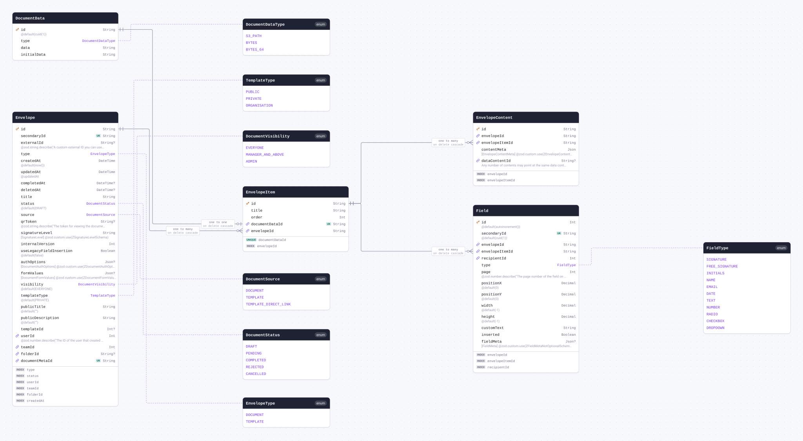

| Field            | Type     | Constraints                                              | Default | Description |
| ---------------- | -------- | -------------------------------------------------------- | ------- | ----------- |
| `id`             | `String` | PK NOT NULL                                              |         |             |
| `title`          | `String` | NOT NULL                                                 |         |             |
| `order`          | `Int`    | NOT NULL                                                 |         |             |
| `documentDataId` | `String` | UNIQUE NOT NULL → [DocumentData.id](#model-DocumentData) |         |             |
| `envelopeId`     | `String` | NOT NULL → [Envelope.id](#model-Envelope)                |         |             |

#### Indexes

- `@@index([envelopeId])`
- `@@unique([documentDataId])`

#### References

- `documentDataId` → [DocumentData.id](#model-DocumentData) (one-to-one, on delete Cascade)
- `envelopeId` → [Envelope.id](#model-Envelope) (many-to-one, on delete Cascade)

#### Referenced by

- `id` ← [Field.envelopeItemId](#model-Field) (one-to-many, on delete Cascade)
- `id` ← [EnvelopeContent.envelopeItemId](#model-EnvelopeContent) (one-to-many, on delete Cascade)

#### Definition

```sql
CREATE TABLE "EnvelopeItem" (
    "id" TEXT NOT NULL,
    "title" TEXT NOT NULL,
    "order" INTEGER NOT NULL,
    "documentDataId" TEXT NOT NULL,
    "envelopeId" TEXT NOT NULL,

    CONSTRAINT "EnvelopeItem_pkey" PRIMARY KEY ("id")
);

CREATE INDEX "EnvelopeItem_envelopeId_idx" ON "EnvelopeItem"("envelopeId");

CREATE UNIQUE INDEX "EnvelopeItem_documentDataId_key" ON "EnvelopeItem"("documentDataId");

ALTER TABLE "EnvelopeItem" ADD CONSTRAINT "EnvelopeItem_documentDataId_fkey" FOREIGN KEY ("documentDataId") REFERENCES "DocumentData"("id") ON DELETE CASCADE ON UPDATE CASCADE;

ALTER TABLE "EnvelopeItem" ADD CONSTRAINT "EnvelopeItem_envelopeId_fkey" FOREIGN KEY ("envelopeId") REFERENCES "Envelope"("id") ON DELETE CASCADE ON UPDATE CASCADE;
```

<details>
<summary>Queries and their SQL</summary>

**findMany**: Every row

```ts
await prisma.envelopeItem.findMany();
```

```sql
SELECT
  "public"."EnvelopeItem"."id",
  "public"."EnvelopeItem"."title",
  "public"."EnvelopeItem"."order",
  "public"."EnvelopeItem"."documentDataId",
  "public"."EnvelopeItem"."envelopeId"
FROM
  "public"."EnvelopeItem"
WHERE
  1 = 1
OFFSET
  $1
-- params: ["0"]
```

**count**: How many rows there are

```ts
await prisma.envelopeItem.count();
```

```sql
SELECT
  COUNT(*) AS "_count$_all"
FROM
  (
    SELECT
      "public"."EnvelopeItem"."id"
    FROM
      "public"."EnvelopeItem"
    WHERE
      1 = 1
    OFFSET
      $1
  ) AS "sub"
-- params: ["0"]
```

**findMany**: Every row with its relations

```ts
await prisma.envelopeItem.findMany({
  include: { documentData: true, envelope: true, field: true, contents: true },
});
```

```sql
SELECT
  "public"."EnvelopeItem"."id",
  "public"."EnvelopeItem"."title",
  "public"."EnvelopeItem"."order",
  "public"."EnvelopeItem"."documentDataId",
  "public"."EnvelopeItem"."envelopeId"
FROM
  "public"."EnvelopeItem"
WHERE
  1 = 1
OFFSET
  $1
-- params: ["0"]

SELECT
  "public"."DocumentData"."id",
  "public"."DocumentData"."type"::text,
  "public"."DocumentData"."data",
  "public"."DocumentData"."initialData"
FROM
  "public"."DocumentData"
WHERE
  "public"."DocumentData"."id" IN ($1)
OFFSET
  $2
-- params: ["<documentDataId of the rows above>","0"]

SELECT
  "public"."Envelope"."id",
  "public"."Envelope"."secondaryId",
  "public"."Envelope"."externalId",
  "public"."Envelope"."type"::text,
  "public"."Envelope"."createdAt",
  "public"."Envelope"."updatedAt",
  "public"."Envelope"."completedAt",
  "public"."Envelope"."deletedAt",
  "public"."Envelope"."title",
  "public"."Envelope"."status"::text,
  "public"."Envelope"."source"::text,
  "public"."Envelope"."qrToken",
  "public"."Envelope"."signatureLevel",
  "public"."Envelope"."internalVersion",
  "public"."Envelope"."useLegacyFieldInsertion",
  "public"."Envelope"."authOptions",
  "public"."Envelope"."formValues",
  "public"."Envelope"."visibility"::text,
  "public"."Envelope"."templateType"::text,
  "public"."Envelope"."publicTitle",
  "public"."Envelope"."publicDescription",
  "public"."Envelope"."templateId",
  "public"."Envelope"."userId",
  "public"."Envelope"."teamId",
  "public"."Envelope"."folderId",
  "public"."Envelope"."documentMetaId"
FROM
  "public"."Envelope"
WHERE
  "public"."Envelope"."id" IN ($1)
OFFSET
  $2
-- params: ["<envelopeId of the rows above>","0"]

SELECT
  "public"."Field"."id",
  "public"."Field"."secondaryId",
  "public"."Field"."envelopeId",
  "public"."Field"."envelopeItemId",
  "public"."Field"."recipientId",
  "public"."Field"."type"::text,
  "public"."Field"."page",
  "public"."Field"."positionX",
  "public"."Field"."positionY",
  "public"."Field"."width",
  "public"."Field"."height",
  "public"."Field"."customText",
  "public"."Field"."inserted",
  "public"."Field"."fieldMeta"
FROM
  "public"."Field"
WHERE
  "public"."Field"."envelopeItemId" IN ($1)
OFFSET
  $2
-- params: ["<id of the rows above>","0"]

SELECT
  "public"."EnvelopeContent"."id",
  "public"."EnvelopeContent"."envelopeId",
  "public"."EnvelopeContent"."envelopeItemId",
  "public"."EnvelopeContent"."contentMeta",
  "public"."EnvelopeContent"."dataContentId"
FROM
  "public"."EnvelopeContent"
WHERE
  "public"."EnvelopeContent"."envelopeItemId" IN ($1)
OFFSET
  $2
-- params: ["<id of the rows above>","0"]
```

**findUnique**: One row by what is unique to it

```ts
await prisma.envelopeItem.findUnique({ where: { id: "example" } });
```

```sql
SELECT
  "public"."EnvelopeItem"."id",
  "public"."EnvelopeItem"."title",
  "public"."EnvelopeItem"."order",
  "public"."EnvelopeItem"."documentDataId",
  "public"."EnvelopeItem"."envelopeId"
FROM
  "public"."EnvelopeItem"
WHERE
  (
    "public"."EnvelopeItem"."id" = $1
    AND 1 = 1
  )
LIMIT
  $2
OFFSET
  $3
-- params: ["example","1","0"]
```

**create**: Create a row

```ts
await prisma.envelopeItem.create({
  data: {
    id: "example",
    title: "example",
    order: 1,
    documentDataId: "example",
    envelopeId: "example",
  },
});
```

```sql
INSERT INTO
  "public"."EnvelopeItem" (
    "id",
    "title",
    "order",
    "documentDataId",
    "envelopeId"
  )
VALUES
  ($1, $2, $3, $4, $5)
RETURNING
  "public"."EnvelopeItem"."id",
  "public"."EnvelopeItem"."title",
  "public"."EnvelopeItem"."order",
  "public"."EnvelopeItem"."documentDataId",
  "public"."EnvelopeItem"."envelopeId"
-- params: ["example","example","1","example","example"]
```

**update**: Update a row

```ts
await prisma.envelopeItem.update({ where: { id: "example" }, data: { title: "example" } });
```

```sql
UPDATE "public"."EnvelopeItem"
SET
  "title" = $1
WHERE
  (
    "public"."EnvelopeItem"."id" = $2
    AND 1 = 1
  )
RETURNING
  "public"."EnvelopeItem"."id",
  "public"."EnvelopeItem"."title",
  "public"."EnvelopeItem"."order",
  "public"."EnvelopeItem"."documentDataId",
  "public"."EnvelopeItem"."envelopeId"
-- params: ["example","example"]
```

**delete**: Delete a row

```ts
await prisma.envelopeItem.delete({ where: { id: "example" } });
```

```sql
DELETE FROM "public"."EnvelopeItem"
WHERE
  (
    "public"."EnvelopeItem"."id" = $1
    AND 1 = 1
  )
RETURNING
  "public"."EnvelopeItem"."id",
  "public"."EnvelopeItem"."title",
  "public"."EnvelopeItem"."order",
  "public"."EnvelopeItem"."documentDataId",
  "public"."EnvelopeItem"."envelopeId"
-- params: ["example"]
```

</details>

<a id="model-DocumentAuditLog"></a>

### DocumentAuditLog

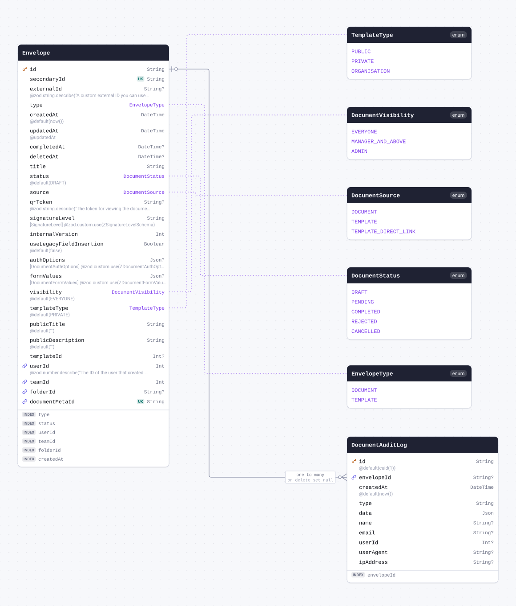

| Field        | Type       | Constraints                           | Default   | Description |
| ------------ | ---------- | ------------------------------------- | --------- | ----------- |
| `id`         | `String`   | PK NOT NULL                           | `cuid(1)` |             |
| `envelopeId` | `String`   | NULL → [Envelope.id](#model-Envelope) |           |             |
| `createdAt`  | `DateTime` | NOT NULL                              | `now()`   |             |
| `type`       | `String`   | NOT NULL                              |           |             |
| `data`       | `Json`     | NOT NULL                              |           |             |
| `name`       | `String`   | NULL                                  |           |             |
| `email`      | `String`   | NULL                                  |           |             |
| `userId`     | `Int`      | NULL                                  |           |             |
| `userAgent`  | `String`   | NULL                                  |           |             |
| `ipAddress`  | `String`   | NULL                                  |           |             |

#### Indexes

- `@@index([envelopeId])`

#### References

- `envelopeId` → [Envelope.id](#model-Envelope) (many-to-one, on delete SetNull)

#### Definition

```sql
CREATE TABLE "DocumentAuditLog" (
    "id" TEXT NOT NULL,
    "envelopeId" TEXT,
    "createdAt" TIMESTAMP(3) NOT NULL DEFAULT CURRENT_TIMESTAMP,
    "type" TEXT NOT NULL,
    "data" JSONB NOT NULL,
    "name" TEXT,
    "email" TEXT,
    "userId" INTEGER,
    "userAgent" TEXT,
    "ipAddress" TEXT,

    CONSTRAINT "DocumentAuditLog_pkey" PRIMARY KEY ("id")
);

CREATE INDEX "DocumentAuditLog_envelopeId_idx" ON "DocumentAuditLog"("envelopeId");

ALTER TABLE "DocumentAuditLog" ADD CONSTRAINT "DocumentAuditLog_envelopeId_fkey" FOREIGN KEY ("envelopeId") REFERENCES "Envelope"("id") ON DELETE SET NULL ON UPDATE CASCADE;
```

<details>
<summary>Queries and their SQL</summary>

**findMany**: Every row

```ts
await prisma.documentAuditLog.findMany();
```

```sql
SELECT
  "public"."DocumentAuditLog"."id",
  "public"."DocumentAuditLog"."envelopeId",
  "public"."DocumentAuditLog"."createdAt",
  "public"."DocumentAuditLog"."type",
  "public"."DocumentAuditLog"."data",
  "public"."DocumentAuditLog"."name",
  "public"."DocumentAuditLog"."email",
  "public"."DocumentAuditLog"."userId",
  "public"."DocumentAuditLog"."userAgent",
  "public"."DocumentAuditLog"."ipAddress"
FROM
  "public"."DocumentAuditLog"
WHERE
  1 = 1
OFFSET
  $1
-- params: ["0"]
```

**count**: How many rows there are

```ts
await prisma.documentAuditLog.count();
```

```sql
SELECT
  COUNT(*) AS "_count$_all"
FROM
  (
    SELECT
      "public"."DocumentAuditLog"."id"
    FROM
      "public"."DocumentAuditLog"
    WHERE
      1 = 1
    OFFSET
      $1
  ) AS "sub"
-- params: ["0"]
```

**findMany**: Every row with its relations

```ts
await prisma.documentAuditLog.findMany({ include: { envelope: true } });
```

```sql
SELECT
  "public"."DocumentAuditLog"."id",
  "public"."DocumentAuditLog"."envelopeId",
  "public"."DocumentAuditLog"."createdAt",
  "public"."DocumentAuditLog"."type",
  "public"."DocumentAuditLog"."data",
  "public"."DocumentAuditLog"."name",
  "public"."DocumentAuditLog"."email",
  "public"."DocumentAuditLog"."userId",
  "public"."DocumentAuditLog"."userAgent",
  "public"."DocumentAuditLog"."ipAddress"
FROM
  "public"."DocumentAuditLog"
WHERE
  1 = 1
OFFSET
  $1
-- params: ["0"]

SELECT
  "public"."Envelope"."id",
  "public"."Envelope"."secondaryId",
  "public"."Envelope"."externalId",
  "public"."Envelope"."type"::text,
  "public"."Envelope"."createdAt",
  "public"."Envelope"."updatedAt",
  "public"."Envelope"."completedAt",
  "public"."Envelope"."deletedAt",
  "public"."Envelope"."title",
  "public"."Envelope"."status"::text,
  "public"."Envelope"."source"::text,
  "public"."Envelope"."qrToken",
  "public"."Envelope"."signatureLevel",
  "public"."Envelope"."internalVersion",
  "public"."Envelope"."useLegacyFieldInsertion",
  "public"."Envelope"."authOptions",
  "public"."Envelope"."formValues",
  "public"."Envelope"."visibility"::text,
  "public"."Envelope"."templateType"::text,
  "public"."Envelope"."publicTitle",
  "public"."Envelope"."publicDescription",
  "public"."Envelope"."templateId",
  "public"."Envelope"."userId",
  "public"."Envelope"."teamId",
  "public"."Envelope"."folderId",
  "public"."Envelope"."documentMetaId"
FROM
  "public"."Envelope"
WHERE
  "public"."Envelope"."id" IN ($1)
OFFSET
  $2
-- params: ["<envelopeId of the rows above>","0"]
```

**findUnique**: One row by what is unique to it

```ts
await prisma.documentAuditLog.findUnique({ where: { id: "example" } });
```

```sql
SELECT
  "public"."DocumentAuditLog"."id",
  "public"."DocumentAuditLog"."envelopeId",
  "public"."DocumentAuditLog"."createdAt",
  "public"."DocumentAuditLog"."type",
  "public"."DocumentAuditLog"."data",
  "public"."DocumentAuditLog"."name",
  "public"."DocumentAuditLog"."email",
  "public"."DocumentAuditLog"."userId",
  "public"."DocumentAuditLog"."userAgent",
  "public"."DocumentAuditLog"."ipAddress"
FROM
  "public"."DocumentAuditLog"
WHERE
  (
    "public"."DocumentAuditLog"."id" = $1
    AND 1 = 1
  )
LIMIT
  $2
OFFSET
  $3
-- params: ["example","1","0"]
```

**create**: Create a row

```ts
await prisma.documentAuditLog.create({ data: { type: "example", data: {} } });
```

```sql
INSERT INTO
  "public"."DocumentAuditLog" ("id", "createdAt", "type", "data")
VALUES
  ($1, $2, $3, $4)
RETURNING
  "public"."DocumentAuditLog"."id",
  "public"."DocumentAuditLog"."envelopeId",
  "public"."DocumentAuditLog"."createdAt",
  "public"."DocumentAuditLog"."type",
  "public"."DocumentAuditLog"."data",
  "public"."DocumentAuditLog"."name",
  "public"."DocumentAuditLog"."email",
  "public"."DocumentAuditLog"."userId",
  "public"."DocumentAuditLog"."userAgent",
  "public"."DocumentAuditLog"."ipAddress"
-- params: ["<cuid(1)>","<now()>","example","{}"]
```

**update**: Update a row

```ts
await prisma.documentAuditLog.update({
  where: { id: "example" },
  data: { createdAt: new Date("2026-01-01T00:00:00.000Z") },
});
```

```sql
UPDATE "public"."DocumentAuditLog"
SET
  "createdAt" = $1
WHERE
  (
    "public"."DocumentAuditLog"."id" = $2
    AND 1 = 1
  )
RETURNING
  "public"."DocumentAuditLog"."id",
  "public"."DocumentAuditLog"."envelopeId",
  "public"."DocumentAuditLog"."createdAt",
  "public"."DocumentAuditLog"."type",
  "public"."DocumentAuditLog"."data",
  "public"."DocumentAuditLog"."name",
  "public"."DocumentAuditLog"."email",
  "public"."DocumentAuditLog"."userId",
  "public"."DocumentAuditLog"."userAgent",
  "public"."DocumentAuditLog"."ipAddress"
-- params: ["2026-01-01T00:00:00.000Z","example"]
```

**delete**: Delete a row

```ts
await prisma.documentAuditLog.delete({ where: { id: "example" } });
```

```sql
DELETE FROM "public"."DocumentAuditLog"
WHERE
  (
    "public"."DocumentAuditLog"."id" = $1
    AND 1 = 1
  )
RETURNING
  "public"."DocumentAuditLog"."id",
  "public"."DocumentAuditLog"."envelopeId",
  "public"."DocumentAuditLog"."createdAt",
  "public"."DocumentAuditLog"."type",
  "public"."DocumentAuditLog"."data",
  "public"."DocumentAuditLog"."name",
  "public"."DocumentAuditLog"."email",
  "public"."DocumentAuditLog"."userId",
  "public"."DocumentAuditLog"."userAgent",
  "public"."DocumentAuditLog"."ipAddress"
-- params: ["example"]
```

</details>

<a id="model-DocumentData"></a>

### DocumentData

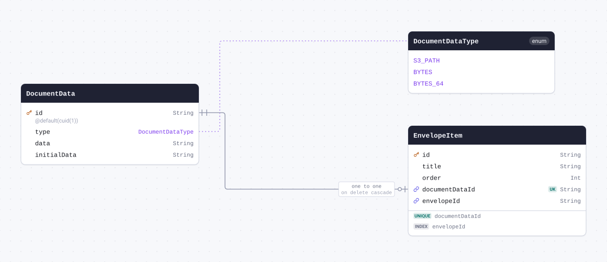

| Field         | Type                                         | Constraints | Default   | Description |
| ------------- | -------------------------------------------- | ----------- | --------- | ----------- |
| `id`          | `String`                                     | PK NOT NULL | `cuid(1)` |             |
| `type`        | [`DocumentDataType`](#enum-DocumentDataType) | NOT NULL    |           |             |
| `data`        | `String`                                     | NOT NULL    |           |             |
| `initialData` | `String`                                     | NOT NULL    |           |             |

#### Referenced by

- `id` ← [EnvelopeItem.documentDataId](#model-EnvelopeItem) (one-to-one, on delete Cascade)

#### Definition

```sql
CREATE TABLE "DocumentData" (
    "id" TEXT NOT NULL,
    "type" "DocumentDataType" NOT NULL,
    "data" TEXT NOT NULL,
    "initialData" TEXT NOT NULL,

    CONSTRAINT "DocumentData_pkey" PRIMARY KEY ("id")
);
```

<details>
<summary>Queries and their SQL</summary>

**findMany**: Every row

```ts
await prisma.documentData.findMany();
```

```sql
SELECT
  "public"."DocumentData"."id",
  "public"."DocumentData"."type"::text,
  "public"."DocumentData"."data",
  "public"."DocumentData"."initialData"
FROM
  "public"."DocumentData"
WHERE
  1 = 1
OFFSET
  $1
-- params: ["0"]
```

**count**: How many rows there are

```ts
await prisma.documentData.count();
```

```sql
SELECT
  COUNT(*) AS "_count$_all"
FROM
  (
    SELECT
      "public"."DocumentData"."id"
    FROM
      "public"."DocumentData"
    WHERE
      1 = 1
    OFFSET
      $1
  ) AS "sub"
-- params: ["0"]
```

**findMany**: Every row with its relations

```ts
await prisma.documentData.findMany({ include: { envelopeItem: true } });
```

```sql
SELECT
  "public"."DocumentData"."id",
  "public"."DocumentData"."type"::text,
  "public"."DocumentData"."data",
  "public"."DocumentData"."initialData"
FROM
  "public"."DocumentData"
WHERE
  1 = 1
OFFSET
  $1
-- params: ["0"]

SELECT
  "public"."EnvelopeItem"."id",
  "public"."EnvelopeItem"."title",
  "public"."EnvelopeItem"."order",
  "public"."EnvelopeItem"."documentDataId",
  "public"."EnvelopeItem"."envelopeId"
FROM
  "public"."EnvelopeItem"
WHERE
  "public"."EnvelopeItem"."documentDataId" IN ($1)
OFFSET
  $2
-- params: ["<id of the rows above>","0"]
```

**findUnique**: One row by what is unique to it

```ts
await prisma.documentData.findUnique({ where: { id: "example" } });
```

```sql
SELECT
  "public"."DocumentData"."id",
  "public"."DocumentData"."type"::text,
  "public"."DocumentData"."data",
  "public"."DocumentData"."initialData"
FROM
  "public"."DocumentData"
WHERE
  (
    "public"."DocumentData"."id" = $1
    AND 1 = 1
  )
LIMIT
  $2
OFFSET
  $3
-- params: ["example","1","0"]
```

**create**: Create a row

```ts
await prisma.documentData.create({
  data: { type: "S3_PATH", data: "example", initialData: "example" },
});
```

```sql
INSERT INTO
  "public"."DocumentData" ("id", "type", "data", "initialData")
VALUES
  (
    $1,
    CAST($2::text AS "public"."DocumentDataType"),
    $3,
    $4
  )
RETURNING
  "public"."DocumentData"."id",
  "public"."DocumentData"."type"::text,
  "public"."DocumentData"."data",
  "public"."DocumentData"."initialData"
-- params: ["<cuid(1)>","S3_PATH","example","example"]
```

**update**: Update a row

```ts
await prisma.documentData.update({ where: { id: "example" }, data: { type: "S3_PATH" } });
```

```sql
UPDATE "public"."DocumentData"
SET
  "type" = CAST($1::text AS "public"."DocumentDataType")
WHERE
  (
    "public"."DocumentData"."id" = $2
    AND 1 = 1
  )
RETURNING
  "public"."DocumentData"."id",
  "public"."DocumentData"."type"::text,
  "public"."DocumentData"."data",
  "public"."DocumentData"."initialData"
-- params: ["S3_PATH","example"]
```

**delete**: Delete a row

```ts
await prisma.documentData.delete({ where: { id: "example" } });
```

```sql
DELETE FROM "public"."DocumentData"
WHERE
  (
    "public"."DocumentData"."id" = $1
    AND 1 = 1
  )
RETURNING
  "public"."DocumentData"."id",
  "public"."DocumentData"."type"::text,
  "public"."DocumentData"."data",
  "public"."DocumentData"."initialData"
-- params: ["example"]
```

</details>

<a id="model-DocumentMeta"></a>

### DocumentMeta

@zod.import(["import { ZDocumentEmailSettingsSchema } from '@documenso/lib/types/document-email';", "import { ZEnvelopeExpirationPeriod as ZEnvelopeExpirationPeriodSchema } from '@documenso/lib/constants/envelope-expiration';", "import { ZEnvelopeReminderSettings as ZEnvelopeReminderSettingsSchema } from '@documenso/lib/constants/envelope-reminder';"])

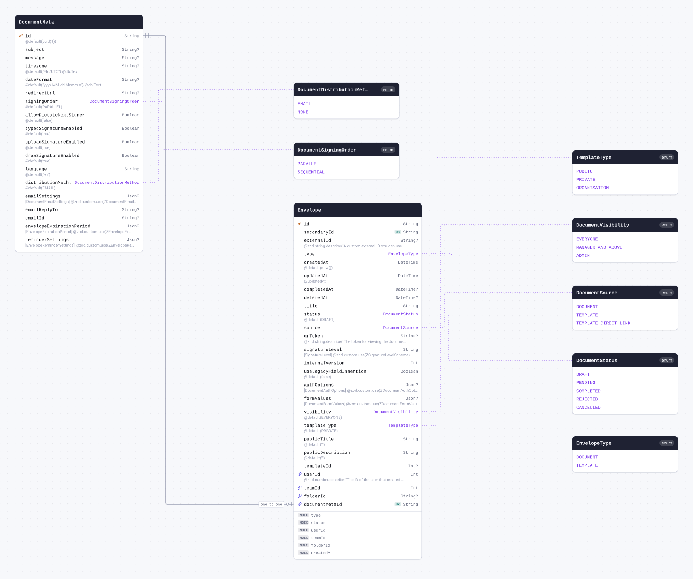

| Field                      | Type                                                             | Constraints | Default                | Description                                                                 |
| -------------------------- | ---------------------------------------------------------------- | ----------- | ---------------------- | --------------------------------------------------------------------------- |
| `id`                       | `String`                                                         | PK NOT NULL | `cuid(1)`              |                                                                             |
| `subject`                  | `String`                                                         | NULL        |                        |                                                                             |
| `message`                  | `String`                                                         | NULL        |                        |                                                                             |
| `timezone`                 | `String` `@db.Text`                                              | NULL        | `"Etc/UTC"`            |                                                                             |
| `dateFormat`               | `String` `@db.Text`                                              | NULL        | `"yyyy-MM-dd hh:mm a"` |                                                                             |
| `redirectUrl`              | `String`                                                         | NULL        |                        |                                                                             |
| `signingOrder`             | [`DocumentSigningOrder`](#enum-DocumentSigningOrder)             | NOT NULL    | `PARALLEL`             |                                                                             |
| `allowDictateNextSigner`   | `Boolean`                                                        | NOT NULL    | `false`                |                                                                             |
| `typedSignatureEnabled`    | `Boolean`                                                        | NOT NULL    | `true`                 |                                                                             |
| `uploadSignatureEnabled`   | `Boolean`                                                        | NOT NULL    | `true`                 |                                                                             |
| `drawSignatureEnabled`     | `Boolean`                                                        | NOT NULL    | `true`                 |                                                                             |
| `language`                 | `String`                                                         | NOT NULL    | `"en"`                 |                                                                             |
| `distributionMethod`       | [`DocumentDistributionMethod`](#enum-DocumentDistributionMethod) | NOT NULL    | `EMAIL`                |                                                                             |
| `emailSettings`            | `Json`                                                           | NULL        |                        | [DocumentEmailSettings] @zod.custom.use(ZDocumentEmailSettingsSchema)       |
| `emailReplyTo`             | `String`                                                         | NULL        |                        |                                                                             |
| `emailId`                  | `String`                                                         | NULL        |                        |                                                                             |
| `envelopeExpirationPeriod` | `Json`                                                           | NULL        |                        | [EnvelopeExpirationPeriod] @zod.custom.use(ZEnvelopeExpirationPeriodSchema) |
| `reminderSettings`         | `Json`                                                           | NULL        |                        | [EnvelopeReminderSettings] @zod.custom.use(ZEnvelopeReminderSettingsSchema) |

#### Referenced by

- `id` ← [Envelope.documentMetaId](#model-Envelope) (one-to-one)

#### Definition

```sql
CREATE TABLE "DocumentMeta" (
    "id" TEXT NOT NULL,
    "subject" TEXT,
    "message" TEXT,
    "timezone" TEXT DEFAULT 'Etc/UTC',
    "dateFormat" TEXT DEFAULT 'yyyy-MM-dd hh:mm a',
    "redirectUrl" TEXT,
    "signingOrder" "DocumentSigningOrder" NOT NULL DEFAULT 'PARALLEL',
    "allowDictateNextSigner" BOOLEAN NOT NULL DEFAULT false,
    "typedSignatureEnabled" BOOLEAN NOT NULL DEFAULT true,
    "uploadSignatureEnabled" BOOLEAN NOT NULL DEFAULT true,
    "drawSignatureEnabled" BOOLEAN NOT NULL DEFAULT true,
    "language" TEXT NOT NULL DEFAULT 'en',
    "distributionMethod" "DocumentDistributionMethod" NOT NULL DEFAULT 'EMAIL',
    "emailSettings" JSONB,
    "emailReplyTo" TEXT,
    "emailId" TEXT,
    "envelopeExpirationPeriod" JSONB,
    "reminderSettings" JSONB,

    CONSTRAINT "DocumentMeta_pkey" PRIMARY KEY ("id")
);
```

<details>
<summary>Queries and their SQL</summary>

**findMany**: Every row

```ts
await prisma.documentMeta.findMany();
```

```sql
SELECT
  "public"."DocumentMeta"."id",
  "public"."DocumentMeta"."subject",
  "public"."DocumentMeta"."message",
  "public"."DocumentMeta"."timezone",
  "public"."DocumentMeta"."dateFormat",
  "public"."DocumentMeta"."redirectUrl",
  "public"."DocumentMeta"."signingOrder"::text,
  "public"."DocumentMeta"."allowDictateNextSigner",
  "public"."DocumentMeta"."typedSignatureEnabled",
  "public"."DocumentMeta"."uploadSignatureEnabled",
  "public"."DocumentMeta"."drawSignatureEnabled",
  "public"."DocumentMeta"."language",
  "public"."DocumentMeta"."distributionMethod"::text,
  "public"."DocumentMeta"."emailSettings",
  "public"."DocumentMeta"."emailReplyTo",
  "public"."DocumentMeta"."emailId",
  "public"."DocumentMeta"."envelopeExpirationPeriod",
  "public"."DocumentMeta"."reminderSettings"
FROM
  "public"."DocumentMeta"
WHERE
  1 = 1
OFFSET
  $1
-- params: ["0"]
```

**count**: How many rows there are

```ts
await prisma.documentMeta.count();
```

```sql
SELECT
  COUNT(*) AS "_count$_all"
FROM
  (
    SELECT
      "public"."DocumentMeta"."id"
    FROM
      "public"."DocumentMeta"
    WHERE
      1 = 1
    OFFSET
      $1
  ) AS "sub"
-- params: ["0"]
```

**findMany**: Every row with its relations

```ts
await prisma.documentMeta.findMany({ include: { envelope: true } });
```

```sql
SELECT
  "public"."DocumentMeta"."id",
  "public"."DocumentMeta"."subject",
  "public"."DocumentMeta"."message",
  "public"."DocumentMeta"."timezone",
  "public"."DocumentMeta"."dateFormat",
  "public"."DocumentMeta"."redirectUrl",
  "public"."DocumentMeta"."signingOrder"::text,
  "public"."DocumentMeta"."allowDictateNextSigner",
  "public"."DocumentMeta"."typedSignatureEnabled",
  "public"."DocumentMeta"."uploadSignatureEnabled",
  "public"."DocumentMeta"."drawSignatureEnabled",
  "public"."DocumentMeta"."language",
  "public"."DocumentMeta"."distributionMethod"::text,
  "public"."DocumentMeta"."emailSettings",
  "public"."DocumentMeta"."emailReplyTo",
  "public"."DocumentMeta"."emailId",
  "public"."DocumentMeta"."envelopeExpirationPeriod",
  "public"."DocumentMeta"."reminderSettings"
FROM
  "public"."DocumentMeta"
WHERE
  1 = 1
OFFSET
  $1
-- params: ["0"]

SELECT
  "public"."Envelope"."id",
  "public"."Envelope"."secondaryId",
  "public"."Envelope"."externalId",
  "public"."Envelope"."type"::text,
  "public"."Envelope"."createdAt",
  "public"."Envelope"."updatedAt",
  "public"."Envelope"."completedAt",
  "public"."Envelope"."deletedAt",
  "public"."Envelope"."title",
  "public"."Envelope"."status"::text,
  "public"."Envelope"."source"::text,
  "public"."Envelope"."qrToken",
  "public"."Envelope"."signatureLevel",
  "public"."Envelope"."internalVersion",
  "public"."Envelope"."useLegacyFieldInsertion",
  "public"."Envelope"."authOptions",
  "public"."Envelope"."formValues",
  "public"."Envelope"."visibility"::text,
  "public"."Envelope"."templateType"::text,
  "public"."Envelope"."publicTitle",
  "public"."Envelope"."publicDescription",
  "public"."Envelope"."templateId",
  "public"."Envelope"."userId",
  "public"."Envelope"."teamId",
  "public"."Envelope"."folderId",
  "public"."Envelope"."documentMetaId"
FROM
  "public"."Envelope"
WHERE
  "public"."Envelope"."documentMetaId" IN ($1)
OFFSET
  $2
-- params: ["<id of the rows above>","0"]
```

**findUnique**: One row by what is unique to it

```ts
await prisma.documentMeta.findUnique({ where: { id: "example" } });
```

```sql
SELECT
  "public"."DocumentMeta"."id",
  "public"."DocumentMeta"."subject",
  "public"."DocumentMeta"."message",
  "public"."DocumentMeta"."timezone",
  "public"."DocumentMeta"."dateFormat",
  "public"."DocumentMeta"."redirectUrl",
  "public"."DocumentMeta"."signingOrder"::text,
  "public"."DocumentMeta"."allowDictateNextSigner",
  "public"."DocumentMeta"."typedSignatureEnabled",
  "public"."DocumentMeta"."uploadSignatureEnabled",
  "public"."DocumentMeta"."drawSignatureEnabled",
  "public"."DocumentMeta"."language",
  "public"."DocumentMeta"."distributionMethod"::text,
  "public"."DocumentMeta"."emailSettings",
  "public"."DocumentMeta"."emailReplyTo",
  "public"."DocumentMeta"."emailId",
  "public"."DocumentMeta"."envelopeExpirationPeriod",
  "public"."DocumentMeta"."reminderSettings"
FROM
  "public"."DocumentMeta"
WHERE
  (
    "public"."DocumentMeta"."id" = $1
    AND 1 = 1
  )
LIMIT
  $2
OFFSET
  $3
-- params: ["example","1","0"]
```

**create**: Create a row

```ts
await prisma.documentMeta.create({ data: {} });
```

```sql
INSERT INTO
  "public"."DocumentMeta" (
    "id",
    "timezone",
    "dateFormat",
    "signingOrder",
    "allowDictateNextSigner",
    "typedSignatureEnabled",
    "uploadSignatureEnabled",
    "drawSignatureEnabled",
    "language",
    "distributionMethod"
  )
VALUES
  (
    $1,
    $2,
    $3,
    CAST($4::text AS "public"."DocumentSigningOrder"),
    $5,
    $6,
    $7,
    $8,
    $9,
    CAST(
      $10::text AS "public"."DocumentDistributionMethod"
    )
  )
RETURNING
  "public"."DocumentMeta"."id",
  "public"."DocumentMeta"."subject",
  "public"."DocumentMeta"."message",
  "public"."DocumentMeta"."timezone",
  "public"."DocumentMeta"."dateFormat",
  "public"."DocumentMeta"."redirectUrl",
  "public"."DocumentMeta"."signingOrder"::text,
  "public"."DocumentMeta"."allowDictateNextSigner",
  "public"."DocumentMeta"."typedSignatureEnabled",
  "public"."DocumentMeta"."uploadSignatureEnabled",
  "public"."DocumentMeta"."drawSignatureEnabled",
  "public"."DocumentMeta"."language",
  "public"."DocumentMeta"."distributionMethod"::text,
  "public"."DocumentMeta"."emailSettings",
  "public"."DocumentMeta"."emailReplyTo",
  "public"."DocumentMeta"."emailId",
  "public"."DocumentMeta"."envelopeExpirationPeriod",
  "public"."DocumentMeta"."reminderSettings"
-- params: ["<cuid(1)>","Etc/UTC","yyyy-MM-dd hh:mm a","PARALLEL",false,true,true,true,"en","EMAIL"]
```

**update**: Update a row

```ts
await prisma.documentMeta.update({ where: { id: "example" }, data: { subject: "example" } });
```

```sql
UPDATE "public"."DocumentMeta"
SET
  "subject" = $1
WHERE
  (
    "public"."DocumentMeta"."id" = $2
    AND 1 = 1
  )
RETURNING
  "public"."DocumentMeta"."id",
  "public"."DocumentMeta"."subject",
  "public"."DocumentMeta"."message",
  "public"."DocumentMeta"."timezone",
  "public"."DocumentMeta"."dateFormat",
  "public"."DocumentMeta"."redirectUrl",
  "public"."DocumentMeta"."signingOrder"::text,
  "public"."DocumentMeta"."allowDictateNextSigner",
  "public"."DocumentMeta"."typedSignatureEnabled",
  "public"."DocumentMeta"."uploadSignatureEnabled",
  "public"."DocumentMeta"."drawSignatureEnabled",
  "public"."DocumentMeta"."language",
  "public"."DocumentMeta"."distributionMethod"::text,
  "public"."DocumentMeta"."emailSettings",
  "public"."DocumentMeta"."emailReplyTo",
  "public"."DocumentMeta"."emailId",
  "public"."DocumentMeta"."envelopeExpirationPeriod",
  "public"."DocumentMeta"."reminderSettings"
-- params: ["example","example"]
```

**delete**: Delete a row

```ts
await prisma.documentMeta.delete({ where: { id: "example" } });
```

```sql
DELETE FROM "public"."DocumentMeta"
WHERE
  (
    "public"."DocumentMeta"."id" = $1
    AND 1 = 1
  )
RETURNING
  "public"."DocumentMeta"."id",
  "public"."DocumentMeta"."subject",
  "public"."DocumentMeta"."message",
  "public"."DocumentMeta"."timezone",
  "public"."DocumentMeta"."dateFormat",
  "public"."DocumentMeta"."redirectUrl",
  "public"."DocumentMeta"."signingOrder"::text,
  "public"."DocumentMeta"."allowDictateNextSigner",
  "public"."DocumentMeta"."typedSignatureEnabled",
  "public"."DocumentMeta"."uploadSignatureEnabled",
  "public"."DocumentMeta"."drawSignatureEnabled",
  "public"."DocumentMeta"."language",
  "public"."DocumentMeta"."distributionMethod"::text,
  "public"."DocumentMeta"."emailSettings",
  "public"."DocumentMeta"."emailReplyTo",
  "public"."DocumentMeta"."emailId",
  "public"."DocumentMeta"."envelopeExpirationPeriod",
  "public"."DocumentMeta"."reminderSettings"
-- params: ["example"]
```

</details>

<a id="model-EnvelopeAttachment"></a>

### EnvelopeAttachment

@zod.import(["import { ZEnvelopeAttachmentTypeSchema } from '@documenso/lib/types/envelope-attachment';"])

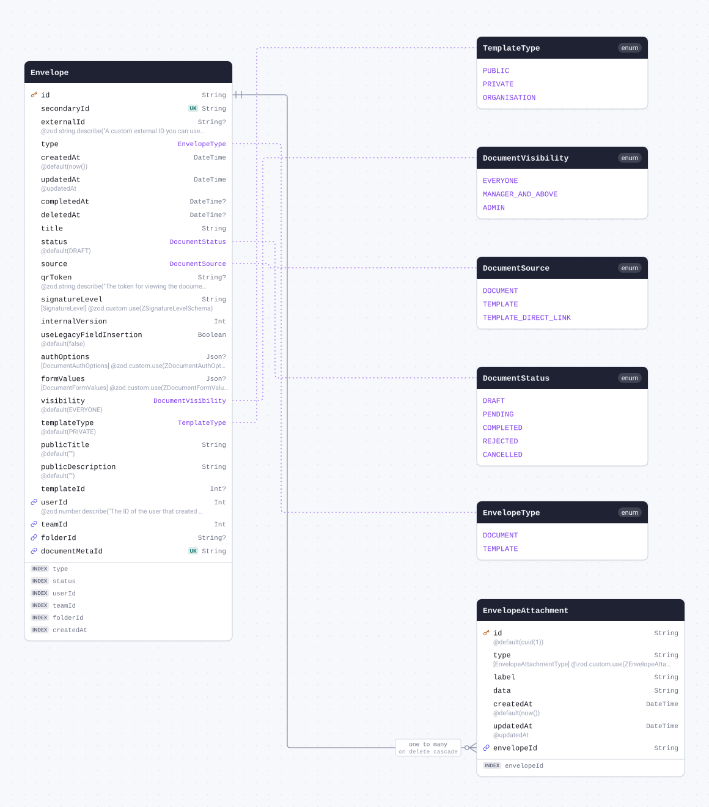

| Field        | Type       | Constraints                               | Default      | Description                                                             |
| ------------ | ---------- | ----------------------------------------- | ------------ | ----------------------------------------------------------------------- |
| `id`         | `String`   | PK NOT NULL                               | `cuid(1)`    |                                                                         |
| `type`       | `String`   | NOT NULL                                  |              | [EnvelopeAttachmentType] @zod.custom.use(ZEnvelopeAttachmentTypeSchema) |
| `label`      | `String`   | NOT NULL                                  |              |                                                                         |
| `data`       | `String`   | NOT NULL                                  |              |                                                                         |
| `createdAt`  | `DateTime` | NOT NULL                                  | `now()`      |                                                                         |
| `updatedAt`  | `DateTime` | NOT NULL                                  | `@updatedAt` |                                                                         |
| `envelopeId` | `String`   | NOT NULL → [Envelope.id](#model-Envelope) |              |                                                                         |

#### Indexes

- `@@index([envelopeId])`

#### References

- `envelopeId` → [Envelope.id](#model-Envelope) (many-to-one, on delete Cascade)

#### Definition

```sql
CREATE TABLE "EnvelopeAttachment" (
    "id" TEXT NOT NULL,
    "type" TEXT NOT NULL,
    "label" TEXT NOT NULL,
    "data" TEXT NOT NULL,
    "createdAt" TIMESTAMP(3) NOT NULL DEFAULT CURRENT_TIMESTAMP,
    "updatedAt" TIMESTAMP(3) NOT NULL,
    "envelopeId" TEXT NOT NULL,

    CONSTRAINT "EnvelopeAttachment_pkey" PRIMARY KEY ("id")
);

CREATE INDEX "EnvelopeAttachment_envelopeId_idx" ON "EnvelopeAttachment"("envelopeId");

ALTER TABLE "EnvelopeAttachment" ADD CONSTRAINT "EnvelopeAttachment_envelopeId_fkey" FOREIGN KEY ("envelopeId") REFERENCES "Envelope"("id") ON DELETE CASCADE ON UPDATE CASCADE;
```

<details>
<summary>Queries and their SQL</summary>

**findMany**: Every row

```ts
await prisma.envelopeAttachment.findMany();
```

```sql
SELECT
  "public"."EnvelopeAttachment"."id",
  "public"."EnvelopeAttachment"."type",
  "public"."EnvelopeAttachment"."label",
  "public"."EnvelopeAttachment"."data",
  "public"."EnvelopeAttachment"."createdAt",
  "public"."EnvelopeAttachment"."updatedAt",
  "public"."EnvelopeAttachment"."envelopeId"
FROM
  "public"."EnvelopeAttachment"
WHERE
  1 = 1
OFFSET
  $1
-- params: ["0"]
```

**count**: How many rows there are

```ts
await prisma.envelopeAttachment.count();
```

```sql
SELECT
  COUNT(*) AS "_count$_all"
FROM
  (
    SELECT
      "public"."EnvelopeAttachment"."id"
    FROM
      "public"."EnvelopeAttachment"
    WHERE
      1 = 1
    OFFSET
      $1
  ) AS "sub"
-- params: ["0"]
```

**findMany**: Every row with its relations

```ts
await prisma.envelopeAttachment.findMany({ include: { envelope: true } });
```

```sql
SELECT
  "public"."EnvelopeAttachment"."id",
  "public"."EnvelopeAttachment"."type",
  "public"."EnvelopeAttachment"."label",
  "public"."EnvelopeAttachment"."data",
  "public"."EnvelopeAttachment"."createdAt",
  "public"."EnvelopeAttachment"."updatedAt",
  "public"."EnvelopeAttachment"."envelopeId"
FROM
  "public"."EnvelopeAttachment"
WHERE
  1 = 1
OFFSET
  $1
-- params: ["0"]

SELECT
  "public"."Envelope"."id",
  "public"."Envelope"."secondaryId",
  "public"."Envelope"."externalId",
  "public"."Envelope"."type"::text,
  "public"."Envelope"."createdAt",
  "public"."Envelope"."updatedAt",
  "public"."Envelope"."completedAt",
  "public"."Envelope"."deletedAt",
  "public"."Envelope"."title",
  "public"."Envelope"."status"::text,
  "public"."Envelope"."source"::text,
  "public"."Envelope"."qrToken",
  "public"."Envelope"."signatureLevel",
  "public"."Envelope"."internalVersion",
  "public"."Envelope"."useLegacyFieldInsertion",
  "public"."Envelope"."authOptions",
  "public"."Envelope"."formValues",
  "public"."Envelope"."visibility"::text,
  "public"."Envelope"."templateType"::text,
  "public"."Envelope"."publicTitle",
  "public"."Envelope"."publicDescription",
  "public"."Envelope"."templateId",
  "public"."Envelope"."userId",
  "public"."Envelope"."teamId",
  "public"."Envelope"."folderId",
  "public"."Envelope"."documentMetaId"
FROM
  "public"."Envelope"
WHERE
  "public"."Envelope"."id" IN ($1)
OFFSET
  $2
-- params: ["<envelopeId of the rows above>","0"]
```

**findUnique**: One row by what is unique to it

```ts
await prisma.envelopeAttachment.findUnique({ where: { id: "example" } });
```

```sql
SELECT
  "public"."EnvelopeAttachment"."id",
  "public"."EnvelopeAttachment"."type",
  "public"."EnvelopeAttachment"."label",
  "public"."EnvelopeAttachment"."data",
  "public"."EnvelopeAttachment"."createdAt",
  "public"."EnvelopeAttachment"."updatedAt",
  "public"."EnvelopeAttachment"."envelopeId"
FROM
  "public"."EnvelopeAttachment"
WHERE
  (
    "public"."EnvelopeAttachment"."id" = $1
    AND 1 = 1
  )
LIMIT
  $2
OFFSET
  $3
-- params: ["example","1","0"]
```

**create**: Create a row

```ts
await prisma.envelopeAttachment.create({
  data: { type: "example", label: "example", data: "example", envelopeId: "example" },
});
```

```sql
INSERT INTO
  "public"."EnvelopeAttachment" (
    "id",
    "type",
    "label",
    "data",
    "createdAt",
    "updatedAt",
    "envelopeId"
  )
VALUES
  ($1, $2, $3, $4, $5, $6, $7)
RETURNING
  "public"."EnvelopeAttachment"."id",
  "public"."EnvelopeAttachment"."type",
  "public"."EnvelopeAttachment"."label",
  "public"."EnvelopeAttachment"."data",
  "public"."EnvelopeAttachment"."createdAt",
  "public"."EnvelopeAttachment"."updatedAt",
  "public"."EnvelopeAttachment"."envelopeId"
-- params: ["<cuid(1)>","example","example","example","<now()>","<now()>","example"]
```

**update**: Update a row

```ts
await prisma.envelopeAttachment.update({ where: { id: "example" }, data: { type: "example" } });
```

```sql
UPDATE "public"."EnvelopeAttachment"
SET
  "type" = $1,
  "updatedAt" = $2
WHERE
  (
    "public"."EnvelopeAttachment"."id" = $3
    AND 1 = 1
  )
RETURNING
  "public"."EnvelopeAttachment"."id",
  "public"."EnvelopeAttachment"."type",
  "public"."EnvelopeAttachment"."label",
  "public"."EnvelopeAttachment"."data",
  "public"."EnvelopeAttachment"."createdAt",
  "public"."EnvelopeAttachment"."updatedAt",
  "public"."EnvelopeAttachment"."envelopeId"
-- params: ["example",{"prisma__type":"generatorCall","prisma__value":{"name":"now","args":[],"returnType":{"type":"DateTime"}}},"example"]
```

**delete**: Delete a row

```ts
await prisma.envelopeAttachment.delete({ where: { id: "example" } });
```

```sql
DELETE FROM "public"."EnvelopeAttachment"
WHERE
  (
    "public"."EnvelopeAttachment"."id" = $1
    AND 1 = 1
  )
RETURNING
  "public"."EnvelopeAttachment"."id",
  "public"."EnvelopeAttachment"."type",
  "public"."EnvelopeAttachment"."label",
  "public"."EnvelopeAttachment"."data",
  "public"."EnvelopeAttachment"."createdAt",
  "public"."EnvelopeAttachment"."updatedAt",
  "public"."EnvelopeAttachment"."envelopeId"
-- params: ["example"]
```

</details>

<a id="model-Recipient"></a>

### Recipient

@zod.import(["import { ZRecipientAuthOptionsSchema } from '@documenso/lib/types/document-auth';"])

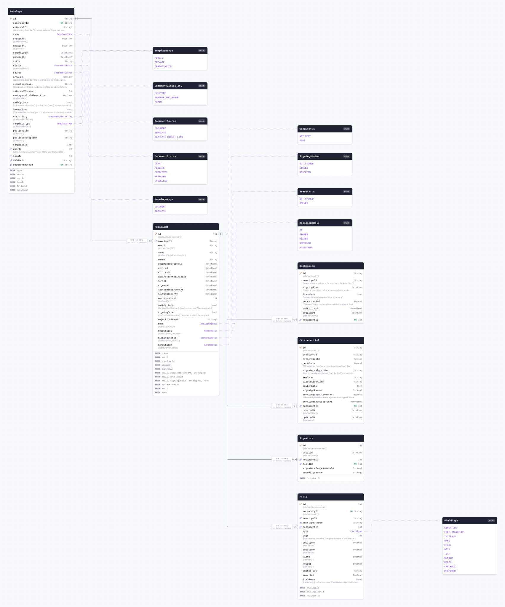

| Field                  | Type                                   | Constraints                               | Default           | Description                                                                                                                                 |
| ---------------------- | -------------------------------------- | ----------------------------------------- | ----------------- | ------------------------------------------------------------------------------------------------------------------------------------------- |
| `id`                   | `Int`                                  | PK NOT NULL                               | `autoincrement()` |                                                                                                                                             |
| `envelopeId`           | `String`                               | NOT NULL → [Envelope.id](#model-Envelope) |                   |                                                                                                                                             |
| `email`                | `String` `@db.VarChar(255)`            | NOT NULL                                  |                   |                                                                                                                                             |
| `name`                 | `String` `@db.VarChar(255)`            | NOT NULL                                  | `""`              |                                                                                                                                             |
| `token`                | `String`                               | NOT NULL                                  |                   |                                                                                                                                             |
| `documentDeletedAt`    | `DateTime`                             | NULL                                      |                   |                                                                                                                                             |
| `expired`              | `DateTime`                             | NULL                                      |                   |                                                                                                                                             |
| `expiresAt`            | `DateTime`                             | NULL                                      |                   |                                                                                                                                             |
| `expirationNotifiedAt` | `DateTime`                             | NULL                                      |                   |                                                                                                                                             |
| `sentAt`               | `DateTime`                             | NULL                                      |                   |                                                                                                                                             |
| `signedAt`             | `DateTime`                             | NULL                                      |                   |                                                                                                                                             |
| `lastReminderSentAt`   | `DateTime`                             | NULL                                      |                   |                                                                                                                                             |
| `nextReminderAt`       | `DateTime`                             | NULL                                      |                   |                                                                                                                                             |
| `reminderCount`        | `Int`                                  | NOT NULL                                  | `0`               |                                                                                                                                             |
| `authOptions`          | `Json`                                 | NULL                                      |                   | [RecipientAuthOptions] @zod.custom.use(ZRecipientAuthOptionsSchema)                                                                         |
| `signingOrder`         | `Int`                                  | NULL                                      |                   | @zod.number.describe("The order in which the recipient should sign the document. Only works if the document is set to sequential signing.") |
| `rejectionReason`      | `String`                               | NULL                                      |                   |                                                                                                                                             |
| `role`                 | [`RecipientRole`](#enum-RecipientRole) | NOT NULL                                  | `SIGNER`          |                                                                                                                                             |
| `readStatus`           | [`ReadStatus`](#enum-ReadStatus)       | NOT NULL                                  | `NOT_OPENED`      |                                                                                                                                             |
| `signingStatus`        | [`SigningStatus`](#enum-SigningStatus) | NOT NULL                                  | `NOT_SIGNED`      |                                                                                                                                             |
| `sendStatus`           | [`SendStatus`](#enum-SendStatus)       | NOT NULL                                  | `NOT_SENT`        |                                                                                                                                             |

#### Indexes

- `@@index([token])`
- `@@index([email])`
- `@@index([envelopeId])`
- `@@index([signedAt])`
- `@@index([expiresAt])`
- `@@index([email, documentDeletedAt, envelopeId], map: "Recipient_email_documentDeletedAt_envelopeId_idx")`
- `@@index([email, envelopeId], map: "Recipient_email_envelopeId_idx")`
- `@@index([email, signingStatus, envelopeId, role], map: "Recipient_email_signingStatus_envelopeId_role_idx")`
- `@@index([nextReminderAt])`
- `@@index([email], map: "Recipient_email_trgm_idx")`
- `@@index([name], map: "Recipient_name_trgm_idx")`

#### References

- `envelopeId` → [Envelope.id](#model-Envelope) (many-to-one, on delete Cascade)

#### Referenced by

- `id` ← [Field.recipientId](#model-Field) (one-to-many, on delete Cascade)
- `id` ← [Signature.recipientId](#model-Signature) (one-to-many, on delete Cascade)
- `id` ← [CscCredential.recipientId](#model-CscCredential) (one-to-one, on delete Cascade)
- `id` ← [CscSession.recipientId](#model-CscSession) (one-to-one, on delete Cascade)

#### Definition

```sql
CREATE TABLE "Recipient" (
    "id" SERIAL NOT NULL,
    "envelopeId" TEXT NOT NULL,
    "email" VARCHAR(255) NOT NULL,
    "name" VARCHAR(255) NOT NULL DEFAULT '',
    "token" TEXT NOT NULL,
    "documentDeletedAt" TIMESTAMP(3),
    "expired" TIMESTAMP(3),
    "expiresAt" TIMESTAMP(3),
    "expirationNotifiedAt" TIMESTAMP(3),
    "sentAt" TIMESTAMP(3),
    "signedAt" TIMESTAMP(3),
    "lastReminderSentAt" TIMESTAMP(3),
    "nextReminderAt" TIMESTAMP(3),
    "reminderCount" INTEGER NOT NULL DEFAULT 0,
    "authOptions" JSONB,
    "signingOrder" INTEGER,
    "rejectionReason" TEXT,
    "role" "RecipientRole" NOT NULL DEFAULT 'SIGNER',
    "readStatus" "ReadStatus" NOT NULL DEFAULT 'NOT_OPENED',
    "signingStatus" "SigningStatus" NOT NULL DEFAULT 'NOT_SIGNED',
    "sendStatus" "SendStatus" NOT NULL DEFAULT 'NOT_SENT',

    CONSTRAINT "Recipient_pkey" PRIMARY KEY ("id")
);

CREATE INDEX "Recipient_token_idx" ON "Recipient"("token");

CREATE INDEX "Recipient_email_idx" ON "Recipient"("email");

CREATE INDEX "Recipient_envelopeId_idx" ON "Recipient"("envelopeId");

CREATE INDEX "Recipient_signedAt_idx" ON "Recipient"("signedAt");

CREATE INDEX "Recipient_expiresAt_idx" ON "Recipient"("expiresAt");

CREATE INDEX "Recipient_email_documentDeletedAt_envelopeId_idx" ON "Recipient"("email", "documentDeletedAt", "envelopeId");

CREATE INDEX "Recipient_email_envelopeId_idx" ON "Recipient"("email", "envelopeId");

CREATE INDEX "Recipient_email_signingStatus_envelopeId_role_idx" ON "Recipient"("email", "signingStatus", "envelopeId", "role");

CREATE INDEX "Recipient_nextReminderAt_idx" ON "Recipient"("nextReminderAt");

CREATE INDEX "Recipient_email_trgm_idx" ON "Recipient" USING GIN ("email" gin_trgm_ops);

CREATE INDEX "Recipient_name_trgm_idx" ON "Recipient" USING GIN ("name" gin_trgm_ops);

ALTER TABLE "Recipient" ADD CONSTRAINT "Recipient_envelopeId_fkey" FOREIGN KEY ("envelopeId") REFERENCES "Envelope"("id") ON DELETE CASCADE ON UPDATE CASCADE;
```

<details>
<summary>Queries and their SQL</summary>

**findMany**: Every row

```ts
await prisma.recipient.findMany();
```

```sql
SELECT
  "public"."Recipient"."id",
  "public"."Recipient"."envelopeId",
  "public"."Recipient"."email",
  "public"."Recipient"."name",
  "public"."Recipient"."token",
  "public"."Recipient"."documentDeletedAt",
  "public"."Recipient"."expired",
  "public"."Recipient"."expiresAt",
  "public"."Recipient"."expirationNotifiedAt",
  "public"."Recipient"."sentAt",
  "public"."Recipient"."signedAt",
  "public"."Recipient"."lastReminderSentAt",
  "public"."Recipient"."nextReminderAt",
  "public"."Recipient"."reminderCount",
  "public"."Recipient"."authOptions",
  "public"."Recipient"."signingOrder",
  "public"."Recipient"."rejectionReason",
  "public"."Recipient"."role"::text,
  "public"."Recipient"."readStatus"::text,
  "public"."Recipient"."signingStatus"::text,
  "public"."Recipient"."sendStatus"::text
FROM
  "public"."Recipient"
WHERE
  1 = 1
OFFSET
  $1
-- params: ["0"]
```

**count**: How many rows there are

```ts
await prisma.recipient.count();
```

```sql
SELECT
  COUNT(*) AS "_count$_all"
FROM
  (
    SELECT
      "public"."Recipient"."id"
    FROM
      "public"."Recipient"
    WHERE
      1 = 1
    OFFSET
      $1
  ) AS "sub"
-- params: ["0"]
```

**findMany**: Every row with its relations

```ts
await prisma.recipient.findMany({
  include: {
    envelope: true,
    fields: true,
    signatures: true,
    cscCredential: true,
    cscSession: true,
  },
});
```

```sql
SELECT
  "public"."Recipient"."id",
  "public"."Recipient"."envelopeId",
  "public"."Recipient"."email",
  "public"."Recipient"."name",
  "public"."Recipient"."token",
  "public"."Recipient"."documentDeletedAt",
  "public"."Recipient"."expired",
  "public"."Recipient"."expiresAt",
  "public"."Recipient"."expirationNotifiedAt",
  "public"."Recipient"."sentAt",
  "public"."Recipient"."signedAt",
  "public"."Recipient"."lastReminderSentAt",
  "public"."Recipient"."nextReminderAt",
  "public"."Recipient"."reminderCount",
  "public"."Recipient"."authOptions",
  "public"."Recipient"."signingOrder",
  "public"."Recipient"."rejectionReason",
  "public"."Recipient"."role"::text,
  "public"."Recipient"."readStatus"::text,
  "public"."Recipient"."signingStatus"::text,
  "public"."Recipient"."sendStatus"::text
FROM
  "public"."Recipient"
WHERE
  1 = 1
OFFSET
  $1
-- params: ["0"]

SELECT
  "public"."Envelope"."id",
  "public"."Envelope"."secondaryId",
  "public"."Envelope"."externalId",
  "public"."Envelope"."type"::text,
  "public"."Envelope"."createdAt",
  "public"."Envelope"."updatedAt",
  "public"."Envelope"."completedAt",
  "public"."Envelope"."deletedAt",
  "public"."Envelope"."title",
  "public"."Envelope"."status"::text,
  "public"."Envelope"."source"::text,
  "public"."Envelope"."qrToken",
  "public"."Envelope"."signatureLevel",
  "public"."Envelope"."internalVersion",
  "public"."Envelope"."useLegacyFieldInsertion",
  "public"."Envelope"."authOptions",
  "public"."Envelope"."formValues",
  "public"."Envelope"."visibility"::text,
  "public"."Envelope"."templateType"::text,
  "public"."Envelope"."publicTitle",
  "public"."Envelope"."publicDescription",
  "public"."Envelope"."templateId",
  "public"."Envelope"."userId",
  "public"."Envelope"."teamId",
  "public"."Envelope"."folderId",
  "public"."Envelope"."documentMetaId"
FROM
  "public"."Envelope"
WHERE
  "public"."Envelope"."id" IN ($1)
OFFSET
  $2
-- params: ["<envelopeId of the rows above>","0"]

SELECT
  "public"."Field"."id",
  "public"."Field"."secondaryId",
  "public"."Field"."envelopeId",
  "public"."Field"."envelopeItemId",
  "public"."Field"."recipientId",
  "public"."Field"."type"::text,
  "public"."Field"."page",
  "public"."Field"."positionX",
  "public"."Field"."positionY",
  "public"."Field"."width",
  "public"."Field"."height",
  "public"."Field"."customText",
  "public"."Field"."inserted",
  "public"."Field"."fieldMeta"
FROM
  "public"."Field"
WHERE
  "public"."Field"."recipientId" IN ($1)
OFFSET
  $2
-- params: ["<id of the rows above>","0"]

SELECT
  "public"."Signature"."id",
  "public"."Signature"."created",
  "public"."Signature"."recipientId",
  "public"."Signature"."fieldId",
  "public"."Signature"."signatureImageAsBase64",
  "public"."Signature"."typedSignature"
FROM
  "public"."Signature"
WHERE
  "public"."Signature"."recipientId" IN ($1)
OFFSET
  $2
-- params: ["<id of the rows above>","0"]

SELECT
  "public"."CscCredential"."id",
  "public"."CscCredential"."providerId",
  "public"."CscCredential"."credentialId",
  "public"."CscCredential"."certCache",
  "public"."CscCredential"."signatureAlgorithm",
  "public"."CscCredential"."keyType",
  "public"."CscCredential"."digestAlgorithm",
  "public"."CscCredential"."keyLenBits",
  "public"."CscCredential"."signAlgoParams",
  "public"."CscCredential"."serviceTokenCiphertext",
  "public"."CscCredential"."serviceTokenExpiresAt",
  "public"."CscCredential"."recipientId",
  "public"."CscCredential"."createdAt",
  "public"."CscCredential"."updatedAt"
FROM
  "public"."CscCredential"
WHERE
  "public"."CscCredential"."recipientId" IN ($1)
OFFSET
  $2
-- params: ["<id of the rows above>","0"]

SELECT
  "public"."CscSession"."id",
  "public"."CscSession"."envelopeId",
  "public"."CscSession"."signingTime",
  "public"."CscSession"."itemsJson",
  "public"."CscSession"."encryptedSad",
  "public"."CscSession"."sadExpiresAt",
  "public"."CscSession"."createdAt",
  "public"."CscSession"."recipientId"
FROM
  "public"."CscSession"
WHERE
  "public"."CscSession"."recipientId" IN ($1)
OFFSET
  $2
-- params: ["<id of the rows above>","0"]
```

**findUnique**: One row by what is unique to it

```ts
await prisma.recipient.findUnique({ where: { id: 1 } });
```

```sql
SELECT
  "public"."Recipient"."id",
  "public"."Recipient"."envelopeId",
  "public"."Recipient"."email",
  "public"."Recipient"."name",
  "public"."Recipient"."token",
  "public"."Recipient"."documentDeletedAt",
  "public"."Recipient"."expired",
  "public"."Recipient"."expiresAt",
  "public"."Recipient"."expirationNotifiedAt",
  "public"."Recipient"."sentAt",
  "public"."Recipient"."signedAt",
  "public"."Recipient"."lastReminderSentAt",
  "public"."Recipient"."nextReminderAt",
  "public"."Recipient"."reminderCount",
  "public"."Recipient"."authOptions",
  "public"."Recipient"."signingOrder",
  "public"."Recipient"."rejectionReason",
  "public"."Recipient"."role"::text,
  "public"."Recipient"."readStatus"::text,
  "public"."Recipient"."signingStatus"::text,
  "public"."Recipient"."sendStatus"::text
FROM
  "public"."Recipient"
WHERE
  (
    "public"."Recipient"."id" = $1
    AND 1 = 1
  )
LIMIT
  $2
OFFSET
  $3
-- params: ["1","1","0"]
```

**create**: Create a row

```ts
await prisma.recipient.create({
  data: { envelopeId: "example", email: "example", token: "example" },
});
```

```sql
INSERT INTO
  "public"."Recipient" (
    "envelopeId",
    "email",
    "name",
    "token",
    "reminderCount",
    "role",
    "readStatus",
    "signingStatus",
    "sendStatus"
  )
VALUES
  (
    $1,
    $2,
    $3,
    $4,
    $5,
    CAST($6::text AS "public"."RecipientRole"),
    CAST($7::text AS "public"."ReadStatus"),
    CAST($8::text AS "public"."SigningStatus"),
    CAST($9::text AS "public"."SendStatus")
  )
RETURNING
  "public"."Recipient"."id",
  "public"."Recipient"."envelopeId",
  "public"."Recipient"."email",
  "public"."Recipient"."name",
  "public"."Recipient"."token",
  "public"."Recipient"."documentDeletedAt",
  "public"."Recipient"."expired",
  "public"."Recipient"."expiresAt",
  "public"."Recipient"."expirationNotifiedAt",
  "public"."Recipient"."sentAt",
  "public"."Recipient"."signedAt",
  "public"."Recipient"."lastReminderSentAt",
  "public"."Recipient"."nextReminderAt",
  "public"."Recipient"."reminderCount",
  "public"."Recipient"."authOptions",
  "public"."Recipient"."signingOrder",
  "public"."Recipient"."rejectionReason",
  "public"."Recipient"."role"::text,
  "public"."Recipient"."readStatus"::text,
  "public"."Recipient"."signingStatus"::text,
  "public"."Recipient"."sendStatus"::text
-- params: ["example","example","","example","0","SIGNER","NOT_OPENED","NOT_SIGNED","NOT_SENT"]
```

**update**: Update a row

```ts
await prisma.recipient.update({ where: { id: 1 }, data: { email: "example" } });
```

```sql
UPDATE "public"."Recipient"
SET
  "email" = $1
WHERE
  (
    "public"."Recipient"."id" = $2
    AND 1 = 1
  )
RETURNING
  "public"."Recipient"."id",
  "public"."Recipient"."envelopeId",
  "public"."Recipient"."email",
  "public"."Recipient"."name",
  "public"."Recipient"."token",
  "public"."Recipient"."documentDeletedAt",
  "public"."Recipient"."expired",
  "public"."Recipient"."expiresAt",
  "public"."Recipient"."expirationNotifiedAt",
  "public"."Recipient"."sentAt",
  "public"."Recipient"."signedAt",
  "public"."Recipient"."lastReminderSentAt",
  "public"."Recipient"."nextReminderAt",
  "public"."Recipient"."reminderCount",
  "public"."Recipient"."authOptions",
  "public"."Recipient"."signingOrder",
  "public"."Recipient"."rejectionReason",
  "public"."Recipient"."role"::text,
  "public"."Recipient"."readStatus"::text,
  "public"."Recipient"."signingStatus"::text,
  "public"."Recipient"."sendStatus"::text
-- params: ["example","1"]
```

**delete**: Delete a row

```ts
await prisma.recipient.delete({ where: { id: 1 } });
```

```sql
DELETE FROM "public"."Recipient"
WHERE
  (
    "public"."Recipient"."id" = $1
    AND 1 = 1
  )
RETURNING
  "public"."Recipient"."id",
  "public"."Recipient"."envelopeId",
  "public"."Recipient"."email",
  "public"."Recipient"."name",
  "public"."Recipient"."token",
  "public"."Recipient"."documentDeletedAt",
  "public"."Recipient"."expired",
  "public"."Recipient"."expiresAt",
  "public"."Recipient"."expirationNotifiedAt",
  "public"."Recipient"."sentAt",
  "public"."Recipient"."signedAt",
  "public"."Recipient"."lastReminderSentAt",
  "public"."Recipient"."nextReminderAt",
  "public"."Recipient"."reminderCount",
  "public"."Recipient"."authOptions",
  "public"."Recipient"."signingOrder",
  "public"."Recipient"."rejectionReason",
  "public"."Recipient"."role"::text,
  "public"."Recipient"."readStatus"::text,
  "public"."Recipient"."signingStatus"::text,
  "public"."Recipient"."sendStatus"::text
-- params: ["1"]
```

</details>

<a id="model-Field"></a>

### Field

@zod.import(["import { ZFieldMetaNotOptionalSchema } from '@documenso/lib/types/field-meta';"])

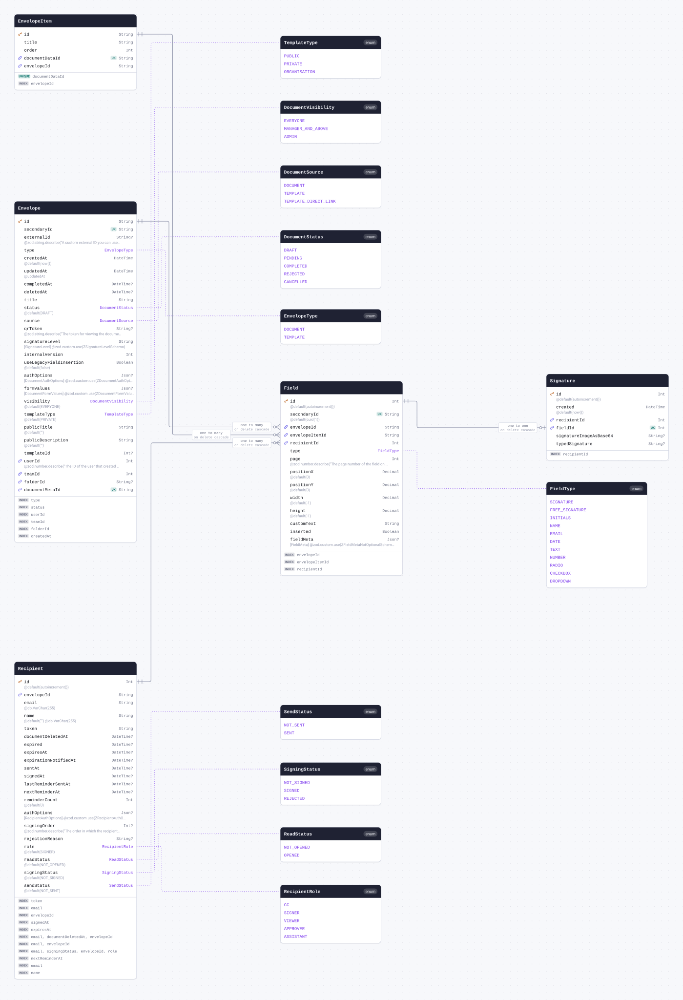

| Field            | Type                           | Constraints                                       | Default           | Description                                                                          |
| ---------------- | ------------------------------ | ------------------------------------------------- | ----------------- | ------------------------------------------------------------------------------------ |
| `id`             | `Int`                          | PK NOT NULL                                       | `autoincrement()` |                                                                                      |
| `secondaryId`    | `String`                       | UNIQUE NOT NULL                                   | `cuid(1)`         |                                                                                      |
| `envelopeId`     | `String`                       | NOT NULL → [Envelope.id](#model-Envelope)         |                   |                                                                                      |
| `envelopeItemId` | `String`                       | NOT NULL → [EnvelopeItem.id](#model-EnvelopeItem) |                   |                                                                                      |
| `recipientId`    | `Int`                          | NOT NULL → [Recipient.id](#model-Recipient)       |                   |                                                                                      |
| `type`           | [`FieldType`](#enum-FieldType) | NOT NULL                                          |                   |                                                                                      |
| `page`           | `Int`                          | NOT NULL                                          |                   | @zod.number.describe("The page number of the field on the document. Starts from 1.") |
| `positionX`      | `Decimal`                      | NOT NULL                                          | `0`               |                                                                                      |
| `positionY`      | `Decimal`                      | NOT NULL                                          | `0`               |                                                                                      |
| `width`          | `Decimal`                      | NOT NULL                                          | `-1`              |                                                                                      |
| `height`         | `Decimal`                      | NOT NULL                                          | `-1`              |                                                                                      |
| `customText`     | `String`                       | NOT NULL                                          |                   |                                                                                      |
| `inserted`       | `Boolean`                      | NOT NULL                                          |                   |                                                                                      |
| `fieldMeta`      | `Json`                         | NULL                                              |                   | [FieldMeta] @zod.custom.use(ZFieldMetaNotOptionalSchema)                             |

#### Indexes

- `@@index([envelopeId])`
- `@@index([envelopeItemId])`
- `@@index([recipientId])`

#### References

- `envelopeItemId` → [EnvelopeItem.id](#model-EnvelopeItem) (many-to-one, on delete Cascade)
- `envelopeId` → [Envelope.id](#model-Envelope) (many-to-one, on delete Cascade)
- `recipientId` → [Recipient.id](#model-Recipient) (many-to-one, on delete Cascade)

#### Referenced by

- `id` ← [Signature.fieldId](#model-Signature) (one-to-one, on delete Cascade)

#### Definition

```sql
CREATE TABLE "Field" (
    "id" SERIAL NOT NULL,
    "secondaryId" TEXT NOT NULL,
    "envelopeId" TEXT NOT NULL,
    "envelopeItemId" TEXT NOT NULL,
    "recipientId" INTEGER NOT NULL,
    "type" "FieldType" NOT NULL,
    "page" INTEGER NOT NULL,
    "positionX" DECIMAL(65,30) NOT NULL DEFAULT 0,
    "positionY" DECIMAL(65,30) NOT NULL DEFAULT 0,
    "width" DECIMAL(65,30) NOT NULL DEFAULT -1,
    "height" DECIMAL(65,30) NOT NULL DEFAULT -1,
    "customText" TEXT NOT NULL,
    "inserted" BOOLEAN NOT NULL,
    "fieldMeta" JSONB,

    CONSTRAINT "Field_pkey" PRIMARY KEY ("id")
);

CREATE UNIQUE INDEX "Field_secondaryId_key" ON "Field"("secondaryId");

CREATE INDEX "Field_envelopeId_idx" ON "Field"("envelopeId");

CREATE INDEX "Field_envelopeItemId_idx" ON "Field"("envelopeItemId");

CREATE INDEX "Field_recipientId_idx" ON "Field"("recipientId");

ALTER TABLE "Field" ADD CONSTRAINT "Field_envelopeItemId_fkey" FOREIGN KEY ("envelopeItemId") REFERENCES "EnvelopeItem"("id") ON DELETE CASCADE ON UPDATE CASCADE;

ALTER TABLE "Field" ADD CONSTRAINT "Field_envelopeId_fkey" FOREIGN KEY ("envelopeId") REFERENCES "Envelope"("id") ON DELETE CASCADE ON UPDATE CASCADE;

ALTER TABLE "Field" ADD CONSTRAINT "Field_recipientId_fkey" FOREIGN KEY ("recipientId") REFERENCES "Recipient"("id") ON DELETE CASCADE ON UPDATE CASCADE;
```

<details>
<summary>Queries and their SQL</summary>

**findMany**: Every row

```ts
await prisma.field.findMany();
```

```sql
SELECT
  "public"."Field"."id",
  "public"."Field"."secondaryId",
  "public"."Field"."envelopeId",
  "public"."Field"."envelopeItemId",
  "public"."Field"."recipientId",
  "public"."Field"."type"::text,
  "public"."Field"."page",
  "public"."Field"."positionX",
  "public"."Field"."positionY",
  "public"."Field"."width",
  "public"."Field"."height",
  "public"."Field"."customText",
  "public"."Field"."inserted",
  "public"."Field"."fieldMeta"
FROM
  "public"."Field"
WHERE
  1 = 1
OFFSET
  $1
-- params: ["0"]
```

**count**: How many rows there are

```ts
await prisma.field.count();
```

```sql
SELECT
  COUNT(*) AS "_count$_all"
FROM
  (
    SELECT
      "public"."Field"."id"
    FROM
      "public"."Field"
    WHERE
      1 = 1
    OFFSET
      $1
  ) AS "sub"
-- params: ["0"]
```

**findMany**: Every row with its relations

```ts
await prisma.field.findMany({
  include: { envelopeItem: true, envelope: true, recipient: true, signature: true },
});
```

```sql
SELECT
  "public"."Field"."id",
  "public"."Field"."secondaryId",
  "public"."Field"."envelopeId",
  "public"."Field"."envelopeItemId",
  "public"."Field"."recipientId",
  "public"."Field"."type"::text,
  "public"."Field"."page",
  "public"."Field"."positionX",
  "public"."Field"."positionY",
  "public"."Field"."width",
  "public"."Field"."height",
  "public"."Field"."customText",
  "public"."Field"."inserted",
  "public"."Field"."fieldMeta"
FROM
  "public"."Field"
WHERE
  1 = 1
OFFSET
  $1
-- params: ["0"]

SELECT
  "public"."EnvelopeItem"."id",
  "public"."EnvelopeItem"."title",
  "public"."EnvelopeItem"."order",
  "public"."EnvelopeItem"."documentDataId",
  "public"."EnvelopeItem"."envelopeId"
FROM
  "public"."EnvelopeItem"
WHERE
  "public"."EnvelopeItem"."id" IN ($1)
OFFSET
  $2
-- params: ["<envelopeItemId of the rows above>","0"]

SELECT
  "public"."Envelope"."id",
  "public"."Envelope"."secondaryId",
  "public"."Envelope"."externalId",
  "public"."Envelope"."type"::text,
  "public"."Envelope"."createdAt",
  "public"."Envelope"."updatedAt",
  "public"."Envelope"."completedAt",
  "public"."Envelope"."deletedAt",
  "public"."Envelope"."title",
  "public"."Envelope"."status"::text,
  "public"."Envelope"."source"::text,
  "public"."Envelope"."qrToken",
  "public"."Envelope"."signatureLevel",
  "public"."Envelope"."internalVersion",
  "public"."Envelope"."useLegacyFieldInsertion",
  "public"."Envelope"."authOptions",
  "public"."Envelope"."formValues",
  "public"."Envelope"."visibility"::text,
  "public"."Envelope"."templateType"::text,
  "public"."Envelope"."publicTitle",
  "public"."Envelope"."publicDescription",
  "public"."Envelope"."templateId",
  "public"."Envelope"."userId",
  "public"."Envelope"."teamId",
  "public"."Envelope"."folderId",
  "public"."Envelope"."documentMetaId"
FROM
  "public"."Envelope"
WHERE
  "public"."Envelope"."id" IN ($1)
OFFSET
  $2
-- params: ["<envelopeId of the rows above>","0"]

SELECT
  "public"."Recipient"."id",
  "public"."Recipient"."envelopeId",
  "public"."Recipient"."email",
  "public"."Recipient"."name",
  "public"."Recipient"."token",
  "public"."Recipient"."documentDeletedAt",
  "public"."Recipient"."expired",
  "public"."Recipient"."expiresAt",
  "public"."Recipient"."expirationNotifiedAt",
  "public"."Recipient"."sentAt",
  "public"."Recipient"."signedAt",
  "public"."Recipient"."lastReminderSentAt",
  "public"."Recipient"."nextReminderAt",
  "public"."Recipient"."reminderCount",
  "public"."Recipient"."authOptions",
  "public"."Recipient"."signingOrder",
  "public"."Recipient"."rejectionReason",
  "public"."Recipient"."role"::text,
  "public"."Recipient"."readStatus"::text,
  "public"."Recipient"."signingStatus"::text,
  "public"."Recipient"."sendStatus"::text
FROM
  "public"."Recipient"
WHERE
  "public"."Recipient"."id" IN ($1)
OFFSET
  $2
-- params: ["<recipientId of the rows above>","0"]

SELECT
  "public"."Signature"."id",
  "public"."Signature"."created",
  "public"."Signature"."recipientId",
  "public"."Signature"."fieldId",
  "public"."Signature"."signatureImageAsBase64",
  "public"."Signature"."typedSignature"
FROM
  "public"."Signature"
WHERE
  "public"."Signature"."fieldId" IN ($1)
OFFSET
  $2
-- params: ["<id of the rows above>","0"]
```

**findUnique**: One row by what is unique to it

```ts
await prisma.field.findUnique({ where: { id: 1 } });
```

```sql
SELECT
  "public"."Field"."id",
  "public"."Field"."secondaryId",
  "public"."Field"."envelopeId",
  "public"."Field"."envelopeItemId",
  "public"."Field"."recipientId",
  "public"."Field"."type"::text,
  "public"."Field"."page",
  "public"."Field"."positionX",
  "public"."Field"."positionY",
  "public"."Field"."width",
  "public"."Field"."height",
  "public"."Field"."customText",
  "public"."Field"."inserted",
  "public"."Field"."fieldMeta"
FROM
  "public"."Field"
WHERE
  (
    "public"."Field"."id" = $1
    AND 1 = 1
  )
LIMIT
  $2
OFFSET
  $3
-- params: ["1","1","0"]
```

**create**: Create a row

```ts
await prisma.field.create({
  data: {
    envelopeId: "example",
    envelopeItemId: "example",
    recipientId: 1,
    type: "SIGNATURE",
    page: 1,
    customText: "example",
    inserted: true,
  },
});
```

```sql
INSERT INTO
  "public"."Field" (
    "secondaryId",
    "envelopeId",
    "envelopeItemId",
    "recipientId",
    "type",
    "page",
    "positionX",
    "positionY",
    "width",
    "height",
    "customText",
    "inserted"
  )
VALUES
  (
    $1,
    $2,
    $3,
    $4,
    CAST($5::text AS "public"."FieldType"),
    $6,
    $7,
    $8,
    $9,
    $10,
    $11,
    $12
  )
RETURNING
  "public"."Field"."id",
  "public"."Field"."secondaryId",
  "public"."Field"."envelopeId",
  "public"."Field"."envelopeItemId",
  "public"."Field"."recipientId",
  "public"."Field"."type"::text,
  "public"."Field"."page",
  "public"."Field"."positionX",
  "public"."Field"."positionY",
  "public"."Field"."width",
  "public"."Field"."height",
  "public"."Field"."customText",
  "public"."Field"."inserted",
  "public"."Field"."fieldMeta"
-- params: ["<cuid(1)>","example","example","1","SIGNATURE","1","0","0","-1","-1","example",true]
```

**update**: Update a row

```ts
await prisma.field.update({ where: { id: 1 }, data: { secondaryId: "example" } });
```

```sql
UPDATE "public"."Field"
SET
  "secondaryId" = $1
WHERE
  (
    "public"."Field"."id" = $2
    AND 1 = 1
  )
RETURNING
  "public"."Field"."id",
  "public"."Field"."secondaryId",
  "public"."Field"."envelopeId",
  "public"."Field"."envelopeItemId",
  "public"."Field"."recipientId",
  "public"."Field"."type"::text,
  "public"."Field"."page",
  "public"."Field"."positionX",
  "public"."Field"."positionY",
  "public"."Field"."width",
  "public"."Field"."height",
  "public"."Field"."customText",
  "public"."Field"."inserted",
  "public"."Field"."fieldMeta"
-- params: ["example","1"]
```

**delete**: Delete a row

```ts
await prisma.field.delete({ where: { id: 1 } });
```

```sql
DELETE FROM "public"."Field"
WHERE
  (
    "public"."Field"."id" = $1
    AND 1 = 1
  )
RETURNING
  "public"."Field"."id",
  "public"."Field"."secondaryId",
  "public"."Field"."envelopeId",
  "public"."Field"."envelopeItemId",
  "public"."Field"."recipientId",
  "public"."Field"."type"::text,
  "public"."Field"."page",
  "public"."Field"."positionX",
  "public"."Field"."positionY",
  "public"."Field"."width",
  "public"."Field"."height",
  "public"."Field"."customText",
  "public"."Field"."inserted",
  "public"."Field"."fieldMeta"
-- params: ["1"]
```

</details>

<a id="model-EnvelopeContent"></a>

### EnvelopeContent

@zod.import(["import { ZEnvelopeContentMetaSchema } from '@documenso/lib/types/envelope-content-meta';"])

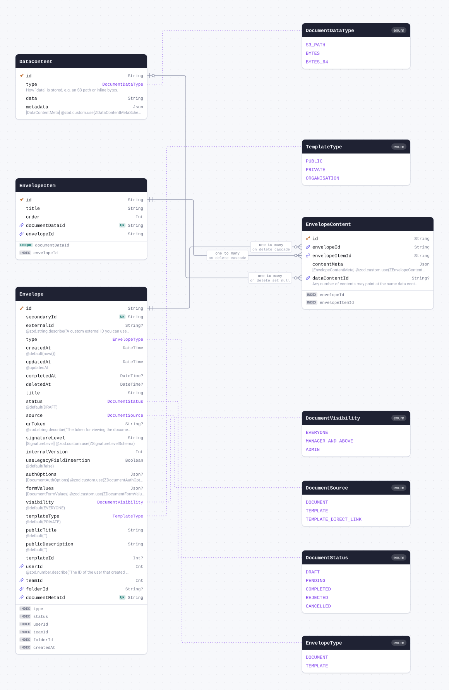

| Field            | Type     | Constraints                                       | Default | Description                                                                                                                      |
| ---------------- | -------- | ------------------------------------------------- | ------- | -------------------------------------------------------------------------------------------------------------------------------- |
| `id`             | `String` | PK NOT NULL                                       |         |                                                                                                                                  |
| `envelopeId`     | `String` | NOT NULL → [Envelope.id](#model-Envelope)         |         |                                                                                                                                  |
| `envelopeItemId` | `String` | NOT NULL → [EnvelopeItem.id](#model-EnvelopeItem) |         |                                                                                                                                  |
| `contentMeta`    | `Json`   | NOT NULL                                          |         | [EnvelopeContentMeta] @zod.custom.use(ZEnvelopeContentMetaSchema)                                                                |
| `dataContentId`  | `String` | NULL → [DataContent.id](#model-DataContent)       |         | Any number of contents may point at the same data content, e.g. a document created from a template shares the template's images. |

#### Indexes

- `@@index([envelopeId])`
- `@@index([envelopeItemId])`

#### References

- `envelopeItemId` → [EnvelopeItem.id](#model-EnvelopeItem) (many-to-one, on delete Cascade)
- `envelopeId` → [Envelope.id](#model-Envelope) (many-to-one, on delete Cascade)
- `dataContentId` → [DataContent.id](#model-DataContent) (many-to-one, on delete SetNull)

#### Definition

```sql
CREATE TABLE "EnvelopeContent" (
    "id" TEXT NOT NULL,
    "envelopeId" TEXT NOT NULL,
    "envelopeItemId" TEXT NOT NULL,
    "contentMeta" JSONB NOT NULL,
    "dataContentId" TEXT,

    CONSTRAINT "EnvelopeContent_pkey" PRIMARY KEY ("id")
);

CREATE INDEX "EnvelopeContent_envelopeId_idx" ON "EnvelopeContent"("envelopeId");

CREATE INDEX "EnvelopeContent_envelopeItemId_idx" ON "EnvelopeContent"("envelopeItemId");

ALTER TABLE "EnvelopeContent" ADD CONSTRAINT "EnvelopeContent_envelopeItemId_fkey" FOREIGN KEY ("envelopeItemId") REFERENCES "EnvelopeItem"("id") ON DELETE CASCADE ON UPDATE CASCADE;

ALTER TABLE "EnvelopeContent" ADD CONSTRAINT "EnvelopeContent_envelopeId_fkey" FOREIGN KEY ("envelopeId") REFERENCES "Envelope"("id") ON DELETE CASCADE ON UPDATE CASCADE;

ALTER TABLE "EnvelopeContent" ADD CONSTRAINT "EnvelopeContent_dataContentId_fkey" FOREIGN KEY ("dataContentId") REFERENCES "DataContent"("id") ON DELETE SET NULL ON UPDATE CASCADE;
```

<details>
<summary>Queries and their SQL</summary>

**findMany**: Every row

```ts
await prisma.envelopeContent.findMany();
```

```sql
SELECT
  "public"."EnvelopeContent"."id",
  "public"."EnvelopeContent"."envelopeId",
  "public"."EnvelopeContent"."envelopeItemId",
  "public"."EnvelopeContent"."contentMeta",
  "public"."EnvelopeContent"."dataContentId"
FROM
  "public"."EnvelopeContent"
WHERE
  1 = 1
OFFSET
  $1
-- params: ["0"]
```

**count**: How many rows there are

```ts
await prisma.envelopeContent.count();
```

```sql
SELECT
  COUNT(*) AS "_count$_all"
FROM
  (
    SELECT
      "public"."EnvelopeContent"."id"
    FROM
      "public"."EnvelopeContent"
    WHERE
      1 = 1
    OFFSET
      $1
  ) AS "sub"
-- params: ["0"]
```

**findMany**: Every row with its relations

```ts
await prisma.envelopeContent.findMany({
  include: { envelopeItem: true, envelope: true, dataContent: true },
});
```

```sql
SELECT
  "public"."EnvelopeContent"."id",
  "public"."EnvelopeContent"."envelopeId",
  "public"."EnvelopeContent"."envelopeItemId",
  "public"."EnvelopeContent"."contentMeta",
  "public"."EnvelopeContent"."dataContentId"
FROM
  "public"."EnvelopeContent"
WHERE
  1 = 1
OFFSET
  $1
-- params: ["0"]

SELECT
  "public"."EnvelopeItem"."id",
  "public"."EnvelopeItem"."title",
  "public"."EnvelopeItem"."order",
  "public"."EnvelopeItem"."documentDataId",
  "public"."EnvelopeItem"."envelopeId"
FROM
  "public"."EnvelopeItem"
WHERE
  "public"."EnvelopeItem"."id" IN ($1)
OFFSET
  $2
-- params: ["<envelopeItemId of the rows above>","0"]

SELECT
  "public"."Envelope"."id",
  "public"."Envelope"."secondaryId",
  "public"."Envelope"."externalId",
  "public"."Envelope"."type"::text,
  "public"."Envelope"."createdAt",
  "public"."Envelope"."updatedAt",
  "public"."Envelope"."completedAt",
  "public"."Envelope"."deletedAt",
  "public"."Envelope"."title",
  "public"."Envelope"."status"::text,
  "public"."Envelope"."source"::text,
  "public"."Envelope"."qrToken",
  "public"."Envelope"."signatureLevel",
  "public"."Envelope"."internalVersion",
  "public"."Envelope"."useLegacyFieldInsertion",
  "public"."Envelope"."authOptions",
  "public"."Envelope"."formValues",
  "public"."Envelope"."visibility"::text,
  "public"."Envelope"."templateType"::text,
  "public"."Envelope"."publicTitle",
  "public"."Envelope"."publicDescription",
  "public"."Envelope"."templateId",
  "public"."Envelope"."userId",
  "public"."Envelope"."teamId",
  "public"."Envelope"."folderId",
  "public"."Envelope"."documentMetaId"
FROM
  "public"."Envelope"
WHERE
  "public"."Envelope"."id" IN ($1)
OFFSET
  $2
-- params: ["<envelopeId of the rows above>","0"]

SELECT
  "public"."DataContent"."id",
  "public"."DataContent"."type"::text,
  "public"."DataContent"."data",
  "public"."DataContent"."metadata"
FROM
  "public"."DataContent"
WHERE
  "public"."DataContent"."id" IN ($1)
OFFSET
  $2
-- params: ["<dataContentId of the rows above>","0"]
```

**findUnique**: One row by what is unique to it

```ts
await prisma.envelopeContent.findUnique({ where: { id: "example" } });
```

```sql
SELECT
  "public"."EnvelopeContent"."id",
  "public"."EnvelopeContent"."envelopeId",
  "public"."EnvelopeContent"."envelopeItemId",
  "public"."EnvelopeContent"."contentMeta",
  "public"."EnvelopeContent"."dataContentId"
FROM
  "public"."EnvelopeContent"
WHERE
  (
    "public"."EnvelopeContent"."id" = $1
    AND 1 = 1
  )
LIMIT
  $2
OFFSET
  $3
-- params: ["example","1","0"]
```

**create**: Create a row

```ts
await prisma.envelopeContent.create({
  data: { id: "example", envelopeId: "example", envelopeItemId: "example", contentMeta: {} },
});
```

```sql
INSERT INTO
  "public"."EnvelopeContent" (
    "id",
    "envelopeId",
    "envelopeItemId",
    "contentMeta"
  )
VALUES
  ($1, $2, $3, $4)
RETURNING
  "public"."EnvelopeContent"."id",
  "public"."EnvelopeContent"."envelopeId",
  "public"."EnvelopeContent"."envelopeItemId",
  "public"."EnvelopeContent"."contentMeta",
  "public"."EnvelopeContent"."dataContentId"
-- params: ["example","example","example","{}"]
```

**update**: Update a row

```ts
await prisma.envelopeContent.update({ where: { id: "example" }, data: { contentMeta: {} } });
```

```sql
UPDATE "public"."EnvelopeContent"
SET
  "contentMeta" = $1
WHERE
  (
    "public"."EnvelopeContent"."id" = $2
    AND 1 = 1
  )
RETURNING
  "public"."EnvelopeContent"."id",
  "public"."EnvelopeContent"."envelopeId",
  "public"."EnvelopeContent"."envelopeItemId",
  "public"."EnvelopeContent"."contentMeta",
  "public"."EnvelopeContent"."dataContentId"
-- params: ["{}","example"]
```

**delete**: Delete a row

```ts
await prisma.envelopeContent.delete({ where: { id: "example" } });
```

```sql
DELETE FROM "public"."EnvelopeContent"
WHERE
  (
    "public"."EnvelopeContent"."id" = $1
    AND 1 = 1
  )
RETURNING
  "public"."EnvelopeContent"."id",
  "public"."EnvelopeContent"."envelopeId",
  "public"."EnvelopeContent"."envelopeItemId",
  "public"."EnvelopeContent"."contentMeta",
  "public"."EnvelopeContent"."dataContentId"
-- params: ["example"]
```

</details>

<a id="model-DataContent"></a>

### DataContent

Generic stored data (e.g. an uploaded image) which other models reference.
The kind of data and its kind specific details live in `metadata`.
@zod.import(["import { ZDataContentMetaSchema } from '@documenso/lib/types/data-content-meta';"])

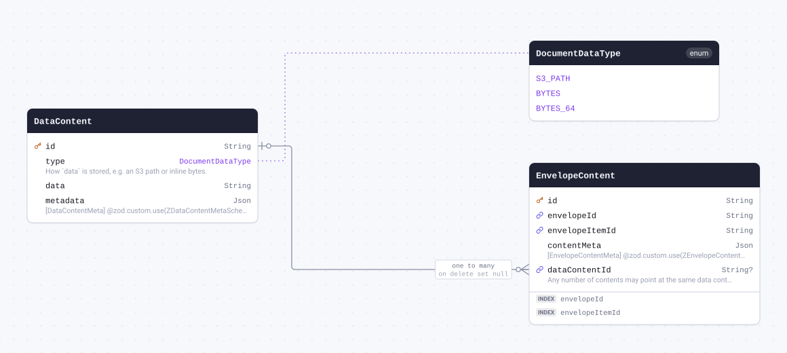

| Field      | Type                                         | Constraints | Default | Description                                               |
| ---------- | -------------------------------------------- | ----------- | ------- | --------------------------------------------------------- |
| `id`       | `String`                                     | PK NOT NULL |         |                                                           |
| `type`     | [`DocumentDataType`](#enum-DocumentDataType) | NOT NULL    |         | How `data` is stored, e.g. an S3 path or inline bytes.    |
| `data`     | `String`                                     | NOT NULL    |         |                                                           |
| `metadata` | `Json`                                       | NOT NULL    |         | [DataContentMeta] @zod.custom.use(ZDataContentMetaSchema) |

#### Referenced by

- `id` ← [EnvelopeContent.dataContentId](#model-EnvelopeContent) (one-to-many, on delete SetNull)

#### Definition

```sql
CREATE TABLE "DataContent" (
    "id" TEXT NOT NULL,
    "type" "DocumentDataType" NOT NULL,
    "data" TEXT NOT NULL,
    "metadata" JSONB NOT NULL,

    CONSTRAINT "DataContent_pkey" PRIMARY KEY ("id")
);
```

<details>
<summary>Queries and their SQL</summary>

**findMany**: Every row

```ts
await prisma.dataContent.findMany();
```

```sql
SELECT
  "public"."DataContent"."id",
  "public"."DataContent"."type"::text,
  "public"."DataContent"."data",
  "public"."DataContent"."metadata"
FROM
  "public"."DataContent"
WHERE
  1 = 1
OFFSET
  $1
-- params: ["0"]
```

**count**: How many rows there are

```ts
await prisma.dataContent.count();
```

```sql
SELECT
  COUNT(*) AS "_count$_all"
FROM
  (
    SELECT
      "public"."DataContent"."id"
    FROM
      "public"."DataContent"
    WHERE
      1 = 1
    OFFSET
      $1
  ) AS "sub"
-- params: ["0"]
```

**findMany**: Every row with its relations

```ts
await prisma.dataContent.findMany({ include: { envelopeContents: true } });
```

```sql
SELECT
  "public"."DataContent"."id",
  "public"."DataContent"."type"::text,
  "public"."DataContent"."data",
  "public"."DataContent"."metadata"
FROM
  "public"."DataContent"
WHERE
  1 = 1
OFFSET
  $1
-- params: ["0"]

SELECT
  "public"."EnvelopeContent"."id",
  "public"."EnvelopeContent"."envelopeId",
  "public"."EnvelopeContent"."envelopeItemId",
  "public"."EnvelopeContent"."contentMeta",
  "public"."EnvelopeContent"."dataContentId"
FROM
  "public"."EnvelopeContent"
WHERE
  "public"."EnvelopeContent"."dataContentId" IN ($1)
OFFSET
  $2
-- params: ["<id of the rows above>","0"]
```

**findUnique**: One row by what is unique to it

```ts
await prisma.dataContent.findUnique({ where: { id: "example" } });
```

```sql
SELECT
  "public"."DataContent"."id",
  "public"."DataContent"."type"::text,
  "public"."DataContent"."data",
  "public"."DataContent"."metadata"
FROM
  "public"."DataContent"
WHERE
  (
    "public"."DataContent"."id" = $1
    AND 1 = 1
  )
LIMIT
  $2
OFFSET
  $3
-- params: ["example","1","0"]
```

**create**: Create a row

```ts
await prisma.dataContent.create({
  data: { id: "example", type: "S3_PATH", data: "example", metadata: {} },
});
```

```sql
INSERT INTO
  "public"."DataContent" ("id", "type", "data", "metadata")
VALUES
  (
    $1,
    CAST($2::text AS "public"."DocumentDataType"),
    $3,
    $4
  )
RETURNING
  "public"."DataContent"."id",
  "public"."DataContent"."type"::text,
  "public"."DataContent"."data",
  "public"."DataContent"."metadata"
-- params: ["example","S3_PATH","example","{}"]
```

**update**: Update a row

```ts
await prisma.dataContent.update({ where: { id: "example" }, data: { type: "S3_PATH" } });
```

```sql
UPDATE "public"."DataContent"
SET
  "type" = CAST($1::text AS "public"."DocumentDataType")
WHERE
  (
    "public"."DataContent"."id" = $2
    AND 1 = 1
  )
RETURNING
  "public"."DataContent"."id",
  "public"."DataContent"."type"::text,
  "public"."DataContent"."data",
  "public"."DataContent"."metadata"
-- params: ["S3_PATH","example"]
```

**delete**: Delete a row

```ts
await prisma.dataContent.delete({ where: { id: "example" } });
```

```sql
DELETE FROM "public"."DataContent"
WHERE
  (
    "public"."DataContent"."id" = $1
    AND 1 = 1
  )
RETURNING
  "public"."DataContent"."id",
  "public"."DataContent"."type"::text,
  "public"."DataContent"."data",
  "public"."DataContent"."metadata"
-- params: ["example"]
```

</details>

<a id="model-Signature"></a>

### Signature

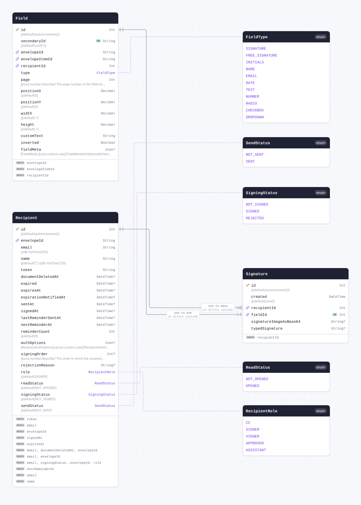

| Field                    | Type       | Constraints                                 | Default           | Description |
| ------------------------ | ---------- | ------------------------------------------- | ----------------- | ----------- |
| `id`                     | `Int`      | PK NOT NULL                                 | `autoincrement()` |             |
| `created`                | `DateTime` | NOT NULL                                    | `now()`           |             |
| `recipientId`            | `Int`      | NOT NULL → [Recipient.id](#model-Recipient) |                   |             |
| `fieldId`                | `Int`      | UNIQUE NOT NULL → [Field.id](#model-Field)  |                   |             |
| `signatureImageAsBase64` | `String`   | NULL                                        |                   |             |
| `typedSignature`         | `String`   | NULL                                        |                   |             |

#### Indexes

- `@@index([recipientId])`

#### References

- `recipientId` → [Recipient.id](#model-Recipient) (many-to-one, on delete Cascade)
- `fieldId` → [Field.id](#model-Field) (one-to-one, on delete Cascade)

#### Definition

```sql
CREATE TABLE "Signature" (
    "id" SERIAL NOT NULL,
    "created" TIMESTAMP(3) NOT NULL DEFAULT CURRENT_TIMESTAMP,
    "recipientId" INTEGER NOT NULL,
    "fieldId" INTEGER NOT NULL,
    "signatureImageAsBase64" TEXT,
    "typedSignature" TEXT,

    CONSTRAINT "Signature_pkey" PRIMARY KEY ("id")
);

CREATE UNIQUE INDEX "Signature_fieldId_key" ON "Signature"("fieldId");

CREATE INDEX "Signature_recipientId_idx" ON "Signature"("recipientId");

ALTER TABLE "Signature" ADD CONSTRAINT "Signature_recipientId_fkey" FOREIGN KEY ("recipientId") REFERENCES "Recipient"("id") ON DELETE CASCADE ON UPDATE CASCADE;

ALTER TABLE "Signature" ADD CONSTRAINT "Signature_fieldId_fkey" FOREIGN KEY ("fieldId") REFERENCES "Field"("id") ON DELETE CASCADE ON UPDATE CASCADE;
```

<details>
<summary>Queries and their SQL</summary>

**findMany**: Every row

```ts
await prisma.signature.findMany();
```

```sql
SELECT
  "public"."Signature"."id",
  "public"."Signature"."created",
  "public"."Signature"."recipientId",
  "public"."Signature"."fieldId",
  "public"."Signature"."signatureImageAsBase64",
  "public"."Signature"."typedSignature"
FROM
  "public"."Signature"
WHERE
  1 = 1
OFFSET
  $1
-- params: ["0"]
```

**count**: How many rows there are

```ts
await prisma.signature.count();
```

```sql
SELECT
  COUNT(*) AS "_count$_all"
FROM
  (
    SELECT
      "public"."Signature"."id"
    FROM
      "public"."Signature"
    WHERE
      1 = 1
    OFFSET
      $1
  ) AS "sub"
-- params: ["0"]
```

**findMany**: Every row with its relations

```ts
await prisma.signature.findMany({ include: { recipient: true, field: true } });
```

```sql
SELECT
  "public"."Signature"."id",
  "public"."Signature"."created",
  "public"."Signature"."recipientId",
  "public"."Signature"."fieldId",
  "public"."Signature"."signatureImageAsBase64",
  "public"."Signature"."typedSignature"
FROM
  "public"."Signature"
WHERE
  1 = 1
OFFSET
  $1
-- params: ["0"]

SELECT
  "public"."Recipient"."id",
  "public"."Recipient"."envelopeId",
  "public"."Recipient"."email",
  "public"."Recipient"."name",
  "public"."Recipient"."token",
  "public"."Recipient"."documentDeletedAt",
  "public"."Recipient"."expired",
  "public"."Recipient"."expiresAt",
  "public"."Recipient"."expirationNotifiedAt",
  "public"."Recipient"."sentAt",
  "public"."Recipient"."signedAt",
  "public"."Recipient"."lastReminderSentAt",
  "public"."Recipient"."nextReminderAt",
  "public"."Recipient"."reminderCount",
  "public"."Recipient"."authOptions",
  "public"."Recipient"."signingOrder",
  "public"."Recipient"."rejectionReason",
  "public"."Recipient"."role"::text,
  "public"."Recipient"."readStatus"::text,
  "public"."Recipient"."signingStatus"::text,
  "public"."Recipient"."sendStatus"::text
FROM
  "public"."Recipient"
WHERE
  "public"."Recipient"."id" IN ($1)
OFFSET
  $2
-- params: ["<recipientId of the rows above>","0"]

SELECT
  "public"."Field"."id",
  "public"."Field"."secondaryId",
  "public"."Field"."envelopeId",
  "public"."Field"."envelopeItemId",
  "public"."Field"."recipientId",
  "public"."Field"."type"::text,
  "public"."Field"."page",
  "public"."Field"."positionX",
  "public"."Field"."positionY",
  "public"."Field"."width",
  "public"."Field"."height",
  "public"."Field"."customText",
  "public"."Field"."inserted",
  "public"."Field"."fieldMeta"
FROM
  "public"."Field"
WHERE
  "public"."Field"."id" IN ($1)
OFFSET
  $2
-- params: ["<fieldId of the rows above>","0"]
```

**findUnique**: One row by what is unique to it

```ts
await prisma.signature.findUnique({ where: { id: 1 } });
```

```sql
SELECT
  "public"."Signature"."id",
  "public"."Signature"."created",
  "public"."Signature"."recipientId",
  "public"."Signature"."fieldId",
  "public"."Signature"."signatureImageAsBase64",
  "public"."Signature"."typedSignature"
FROM
  "public"."Signature"
WHERE
  (
    "public"."Signature"."id" = $1
    AND 1 = 1
  )
LIMIT
  $2
OFFSET
  $3
-- params: ["1","1","0"]
```

**create**: Create a row

```ts
await prisma.signature.create({ data: { recipientId: 1, fieldId: 1 } });
```

```sql
INSERT INTO
  "public"."Signature" ("created", "recipientId", "fieldId")
VALUES
  ($1, $2, $3)
RETURNING
  "public"."Signature"."id",
  "public"."Signature"."created",
  "public"."Signature"."recipientId",
  "public"."Signature"."fieldId",
  "public"."Signature"."signatureImageAsBase64",
  "public"."Signature"."typedSignature"
-- params: ["<now()>","1","1"]
```

**update**: Update a row

```ts
await prisma.signature.update({
  where: { id: 1 },
  data: { created: new Date("2026-01-01T00:00:00.000Z") },
});
```

```sql
UPDATE "public"."Signature"
SET
  "created" = $1
WHERE
  (
    "public"."Signature"."id" = $2
    AND 1 = 1
  )
RETURNING
  "public"."Signature"."id",
  "public"."Signature"."created",
  "public"."Signature"."recipientId",
  "public"."Signature"."fieldId",
  "public"."Signature"."signatureImageAsBase64",
  "public"."Signature"."typedSignature"
-- params: ["2026-01-01T00:00:00.000Z","1"]
```

**delete**: Delete a row

```ts
await prisma.signature.delete({ where: { id: 1 } });
```

```sql
DELETE FROM "public"."Signature"
WHERE
  (
    "public"."Signature"."id" = $1
    AND 1 = 1
  )
RETURNING
  "public"."Signature"."id",
  "public"."Signature"."created",
  "public"."Signature"."recipientId",
  "public"."Signature"."fieldId",
  "public"."Signature"."signatureImageAsBase64",
  "public"."Signature"."typedSignature"
-- params: ["1"]
```

</details>

<a id="model-CscCredential"></a>

### CscCredential

Per-recipient cached credential metadata for the configured Cloud Signature
Consortium (CSC) provider. Holds the TSP-validated certificate chain and the
symmetric-encrypted service-scope access token. One row per recipient on a
CSC envelope; absent for SES recipients.

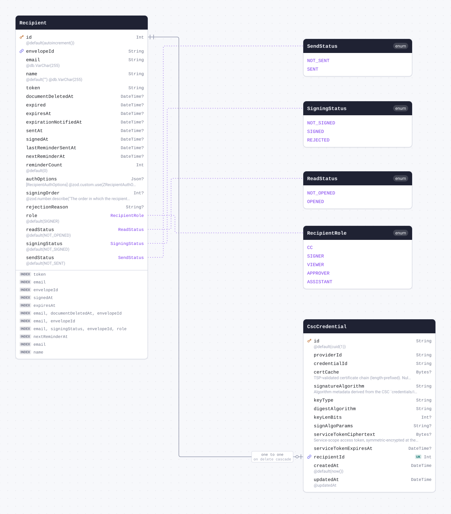

| Field                    | Type       | Constraints                                        | Default      | Description                                                                                                                                        |
| ------------------------ | ---------- | -------------------------------------------------- | ------------ | -------------------------------------------------------------------------------------------------------------------------------------------------- |
| `id`                     | `String`   | PK NOT NULL                                        | `cuid(1)`    |                                                                                                                                                    |
| `providerId`             | `String`   | NOT NULL                                           |              |                                                                                                                                                    |
| `credentialId`           | `String`   | NOT NULL                                           |              |                                                                                                                                                    |
| `certCache`              | `Bytes`    | NULL                                               |              | TSP-validated certificate chain (length-prefixed). Nullable until the service-scope OAuth callback successfully retrieves and validates it.        |
| `signatureAlgorithm`     | `String`   | NOT NULL                                           |              | Algorithm metadata derived from the CSC `credentials/info` response. Held as flat scalars so each is independently queryable.                      |
| `keyType`                | `String`   | NOT NULL                                           |              |                                                                                                                                                    |
| `digestAlgorithm`        | `String`   | NOT NULL                                           |              |                                                                                                                                                    |
| `keyLenBits`             | `Int`      | NULL                                               |              |                                                                                                                                                    |
| `signAlgoParams`         | `String`   | NULL                                               |              |                                                                                                                                                    |
| `serviceTokenCiphertext` | `Bytes`    | NULL                                               |              | Service-scope access token, symmetric-encrypted at the application layer before persistence. Nullable until the service-scope OAuth callback runs. |
| `serviceTokenExpiresAt`  | `DateTime` | NULL                                               |              |                                                                                                                                                    |
| `recipientId`            | `Int`      | UNIQUE NOT NULL → [Recipient.id](#model-Recipient) |              |                                                                                                                                                    |
| `createdAt`              | `DateTime` | NOT NULL                                           | `now()`      |                                                                                                                                                    |
| `updatedAt`              | `DateTime` | NOT NULL                                           | `@updatedAt` |                                                                                                                                                    |

#### References

- `recipientId` → [Recipient.id](#model-Recipient) (one-to-one, on delete Cascade)

#### Definition

```sql
CREATE TABLE "CscCredential" (
    "id" TEXT NOT NULL,
    "providerId" TEXT NOT NULL,
    "credentialId" TEXT NOT NULL,
    "certCache" BYTEA,
    "signatureAlgorithm" TEXT NOT NULL,
    "keyType" TEXT NOT NULL,
    "digestAlgorithm" TEXT NOT NULL,
    "keyLenBits" INTEGER,
    "signAlgoParams" TEXT,
    "serviceTokenCiphertext" BYTEA,
    "serviceTokenExpiresAt" TIMESTAMP(3),
    "recipientId" INTEGER NOT NULL,
    "createdAt" TIMESTAMP(3) NOT NULL DEFAULT CURRENT_TIMESTAMP,
    "updatedAt" TIMESTAMP(3) NOT NULL,

    CONSTRAINT "CscCredential_pkey" PRIMARY KEY ("id")
);

CREATE UNIQUE INDEX "CscCredential_recipientId_key" ON "CscCredential"("recipientId");

ALTER TABLE "CscCredential" ADD CONSTRAINT "CscCredential_recipientId_fkey" FOREIGN KEY ("recipientId") REFERENCES "Recipient"("id") ON DELETE CASCADE ON UPDATE CASCADE;
```

<details>
<summary>Queries and their SQL</summary>

**findMany**: Every row

```ts
await prisma.cscCredential.findMany();
```

```sql
SELECT
  "public"."CscCredential"."id",
  "public"."CscCredential"."providerId",
  "public"."CscCredential"."credentialId",
  "public"."CscCredential"."certCache",
  "public"."CscCredential"."signatureAlgorithm",
  "public"."CscCredential"."keyType",
  "public"."CscCredential"."digestAlgorithm",
  "public"."CscCredential"."keyLenBits",
  "public"."CscCredential"."signAlgoParams",
  "public"."CscCredential"."serviceTokenCiphertext",
  "public"."CscCredential"."serviceTokenExpiresAt",
  "public"."CscCredential"."recipientId",
  "public"."CscCredential"."createdAt",
  "public"."CscCredential"."updatedAt"
FROM
  "public"."CscCredential"
WHERE
  1 = 1
OFFSET
  $1
-- params: ["0"]
```

**count**: How many rows there are

```ts
await prisma.cscCredential.count();
```

```sql
SELECT
  COUNT(*) AS "_count$_all"
FROM
  (
    SELECT
      "public"."CscCredential"."id"
    FROM
      "public"."CscCredential"
    WHERE
      1 = 1
    OFFSET
      $1
  ) AS "sub"
-- params: ["0"]
```

**findMany**: Every row with its relations

```ts
await prisma.cscCredential.findMany({ include: { recipient: true } });
```

```sql
SELECT
  "public"."CscCredential"."id",
  "public"."CscCredential"."providerId",
  "public"."CscCredential"."credentialId",
  "public"."CscCredential"."certCache",
  "public"."CscCredential"."signatureAlgorithm",
  "public"."CscCredential"."keyType",
  "public"."CscCredential"."digestAlgorithm",
  "public"."CscCredential"."keyLenBits",
  "public"."CscCredential"."signAlgoParams",
  "public"."CscCredential"."serviceTokenCiphertext",
  "public"."CscCredential"."serviceTokenExpiresAt",
  "public"."CscCredential"."recipientId",
  "public"."CscCredential"."createdAt",
  "public"."CscCredential"."updatedAt"
FROM
  "public"."CscCredential"
WHERE
  1 = 1
OFFSET
  $1
-- params: ["0"]

SELECT
  "public"."Recipient"."id",
  "public"."Recipient"."envelopeId",
  "public"."Recipient"."email",
  "public"."Recipient"."name",
  "public"."Recipient"."token",
  "public"."Recipient"."documentDeletedAt",
  "public"."Recipient"."expired",
  "public"."Recipient"."expiresAt",
  "public"."Recipient"."expirationNotifiedAt",
  "public"."Recipient"."sentAt",
  "public"."Recipient"."signedAt",
  "public"."Recipient"."lastReminderSentAt",
  "public"."Recipient"."nextReminderAt",
  "public"."Recipient"."reminderCount",
  "public"."Recipient"."authOptions",
  "public"."Recipient"."signingOrder",
  "public"."Recipient"."rejectionReason",
  "public"."Recipient"."role"::text,
  "public"."Recipient"."readStatus"::text,
  "public"."Recipient"."signingStatus"::text,
  "public"."Recipient"."sendStatus"::text
FROM
  "public"."Recipient"
WHERE
  "public"."Recipient"."id" IN ($1)
OFFSET
  $2
-- params: ["<recipientId of the rows above>","0"]
```

**findUnique**: One row by what is unique to it

```ts
await prisma.cscCredential.findUnique({ where: { id: "example" } });
```

```sql
SELECT
  "public"."CscCredential"."id",
  "public"."CscCredential"."providerId",
  "public"."CscCredential"."credentialId",
  "public"."CscCredential"."certCache",
  "public"."CscCredential"."signatureAlgorithm",
  "public"."CscCredential"."keyType",
  "public"."CscCredential"."digestAlgorithm",
  "public"."CscCredential"."keyLenBits",
  "public"."CscCredential"."signAlgoParams",
  "public"."CscCredential"."serviceTokenCiphertext",
  "public"."CscCredential"."serviceTokenExpiresAt",
  "public"."CscCredential"."recipientId",
  "public"."CscCredential"."createdAt",
  "public"."CscCredential"."updatedAt"
FROM
  "public"."CscCredential"
WHERE
  (
    "public"."CscCredential"."id" = $1
    AND 1 = 1
  )
LIMIT
  $2
OFFSET
  $3
-- params: ["example","1","0"]
```

**create**: Create a row

```ts
await prisma.cscCredential.create({
  data: {
    providerId: "example",
    credentialId: "example",
    signatureAlgorithm: "example",
    keyType: "example",
    digestAlgorithm: "example",
    recipientId: 1,
  },
});
```

```sql
INSERT INTO
  "public"."CscCredential" (
    "id",
    "providerId",
    "credentialId",
    "signatureAlgorithm",
    "keyType",
    "digestAlgorithm",
    "recipientId",
    "createdAt",
    "updatedAt"
  )
VALUES
  ($1, $2, $3, $4, $5, $6, $7, $8, $9)
RETURNING
  "public"."CscCredential"."id",
  "public"."CscCredential"."providerId",
  "public"."CscCredential"."credentialId",
  "public"."CscCredential"."certCache",
  "public"."CscCredential"."signatureAlgorithm",
  "public"."CscCredential"."keyType",
  "public"."CscCredential"."digestAlgorithm",
  "public"."CscCredential"."keyLenBits",
  "public"."CscCredential"."signAlgoParams",
  "public"."CscCredential"."serviceTokenCiphertext",
  "public"."CscCredential"."serviceTokenExpiresAt",
  "public"."CscCredential"."recipientId",
  "public"."CscCredential"."createdAt",
  "public"."CscCredential"."updatedAt"
-- params: ["<cuid(1)>","example","example","example","example","example","1","<now()>","<now()>"]
```

**update**: Update a row

```ts
await prisma.cscCredential.update({ where: { id: "example" }, data: { providerId: "example" } });
```

```sql
UPDATE "public"."CscCredential"
SET
  "providerId" = $1,
  "updatedAt" = $2
WHERE
  (
    "public"."CscCredential"."id" = $3
    AND 1 = 1
  )
RETURNING
  "public"."CscCredential"."id",
  "public"."CscCredential"."providerId",
  "public"."CscCredential"."credentialId",
  "public"."CscCredential"."certCache",
  "public"."CscCredential"."signatureAlgorithm",
  "public"."CscCredential"."keyType",
  "public"."CscCredential"."digestAlgorithm",
  "public"."CscCredential"."keyLenBits",
  "public"."CscCredential"."signAlgoParams",
  "public"."CscCredential"."serviceTokenCiphertext",
  "public"."CscCredential"."serviceTokenExpiresAt",
  "public"."CscCredential"."recipientId",
  "public"."CscCredential"."createdAt",
  "public"."CscCredential"."updatedAt"
-- params: ["example",{"prisma__type":"generatorCall","prisma__value":{"name":"now","args":[],"returnType":{"type":"DateTime"}}},"example"]
```

**delete**: Delete a row

```ts
await prisma.cscCredential.delete({ where: { id: "example" } });
```

```sql
DELETE FROM "public"."CscCredential"
WHERE
  (
    "public"."CscCredential"."id" = $1
    AND 1 = 1
  )
RETURNING
  "public"."CscCredential"."id",
  "public"."CscCredential"."providerId",
  "public"."CscCredential"."credentialId",
  "public"."CscCredential"."certCache",
  "public"."CscCredential"."signatureAlgorithm",
  "public"."CscCredential"."keyType",
  "public"."CscCredential"."digestAlgorithm",
  "public"."CscCredential"."keyLenBits",
  "public"."CscCredential"."signAlgoParams",
  "public"."CscCredential"."serviceTokenCiphertext",
  "public"."CscCredential"."serviceTokenExpiresAt",
  "public"."CscCredential"."recipientId",
  "public"."CscCredential"."createdAt",
  "public"."CscCredential"."updatedAt"
-- params: ["example"]
```

</details>

<a id="model-CscSession"></a>

### CscSession

Per-recipient transient sign-time state held across the credential-scope
OAuth round-trip. The `recipientId @unique` constraint caps each recipient
to at most one in-flight session — re-clicking Sign UPSERTs the row.
Cleaned up transitively when the Recipient is deleted.
@zod.import(["import { ZCscSessionItemsSchema } from '@documenso/lib/types/csc-session';"])

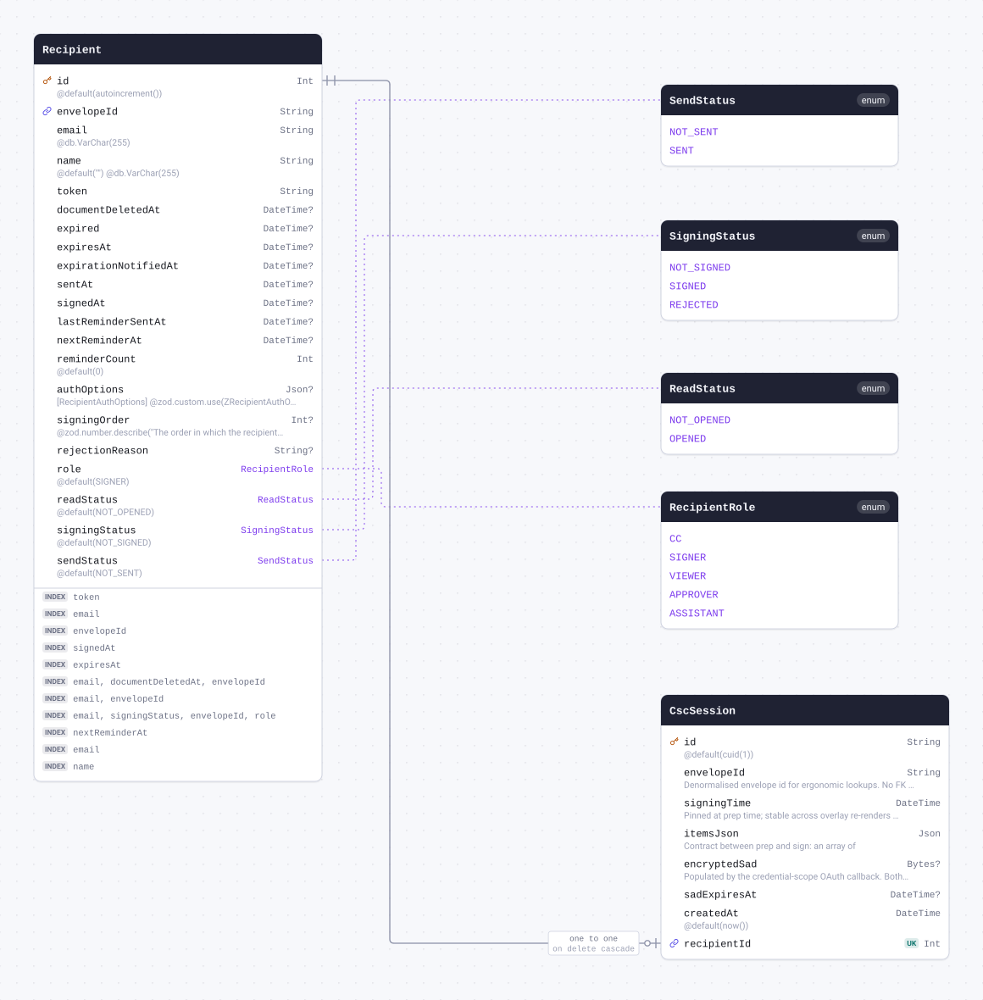

| Field          | Type       | Constraints                                        | Default   | Description                                                                                                                                                                                                                                                                                                                    |
| -------------- | ---------- | -------------------------------------------------- | --------- | ------------------------------------------------------------------------------------------------------------------------------------------------------------------------------------------------------------------------------------------------------------------------------------------------------------------------------ |
| `id`           | `String`   | PK NOT NULL                                        | `cuid(1)` |                                                                                                                                                                                                                                                                                                                                |
| `envelopeId`   | `String`   | NOT NULL                                           |           | Denormalised envelope id for ergonomic lookups. No FK relation — cleanup flows through the Recipient cascade.                                                                                                                                                                                                                  |
| `signingTime`  | `DateTime` | NOT NULL                                           |           | Pinned at prep time; stable across overlay re-renders so the captured signedAttrs digest matches the bytes the TSP signs.                                                                                                                                                                                                      |
| `itemsJson`    | `Json`     | NOT NULL                                           |           | Contract between prep and sign: an array of `{ envelopeItemId, documentDataId, hashB64, ordinal }` per envelope item. `documentDataId` pins the immutable bytes that produced the captured digest so sign-time can re-derive the same hash against the same content. [CscSessionItems] @zod.custom.use(ZCscSessionItemsSchema) |
| `encryptedSad` | `Bytes`    | NULL                                               |           | Populated by the credential-scope OAuth callback. Both nullable at row creation; set together when the SAD is exchanged.                                                                                                                                                                                                       |
| `sadExpiresAt` | `DateTime` | NULL                                               |           |                                                                                                                                                                                                                                                                                                                                |
| `createdAt`    | `DateTime` | NOT NULL                                           | `now()`   |                                                                                                                                                                                                                                                                                                                                |
| `recipientId`  | `Int`      | UNIQUE NOT NULL → [Recipient.id](#model-Recipient) |           |                                                                                                                                                                                                                                                                                                                                |

#### References

- `recipientId` → [Recipient.id](#model-Recipient) (one-to-one, on delete Cascade)

#### Definition

```sql
CREATE TABLE "CscSession" (
    "id" TEXT NOT NULL,
    "envelopeId" TEXT NOT NULL,
    "signingTime" TIMESTAMP(3) NOT NULL,
    "itemsJson" JSONB NOT NULL,
    "encryptedSad" BYTEA,
    "sadExpiresAt" TIMESTAMP(3),
    "createdAt" TIMESTAMP(3) NOT NULL DEFAULT CURRENT_TIMESTAMP,
    "recipientId" INTEGER NOT NULL,

    CONSTRAINT "CscSession_pkey" PRIMARY KEY ("id")
);

CREATE UNIQUE INDEX "CscSession_recipientId_key" ON "CscSession"("recipientId");

ALTER TABLE "CscSession" ADD CONSTRAINT "CscSession_recipientId_fkey" FOREIGN KEY ("recipientId") REFERENCES "Recipient"("id") ON DELETE CASCADE ON UPDATE CASCADE;
```

<details>
<summary>Queries and their SQL</summary>

**findMany**: Every row

```ts
await prisma.cscSession.findMany();
```

```sql
SELECT
  "public"."CscSession"."id",
  "public"."CscSession"."envelopeId",
  "public"."CscSession"."signingTime",
  "public"."CscSession"."itemsJson",
  "public"."CscSession"."encryptedSad",
  "public"."CscSession"."sadExpiresAt",
  "public"."CscSession"."createdAt",
  "public"."CscSession"."recipientId"
FROM
  "public"."CscSession"
WHERE
  1 = 1
OFFSET
  $1
-- params: ["0"]
```

**count**: How many rows there are

```ts
await prisma.cscSession.count();
```

```sql
SELECT
  COUNT(*) AS "_count$_all"
FROM
  (
    SELECT
      "public"."CscSession"."id"
    FROM
      "public"."CscSession"
    WHERE
      1 = 1
    OFFSET
      $1
  ) AS "sub"
-- params: ["0"]
```

**findMany**: Every row with its relations

```ts
await prisma.cscSession.findMany({ include: { recipient: true } });
```

```sql
SELECT
  "public"."CscSession"."id",
  "public"."CscSession"."envelopeId",
  "public"."CscSession"."signingTime",
  "public"."CscSession"."itemsJson",
  "public"."CscSession"."encryptedSad",
  "public"."CscSession"."sadExpiresAt",
  "public"."CscSession"."createdAt",
  "public"."CscSession"."recipientId"
FROM
  "public"."CscSession"
WHERE
  1 = 1
OFFSET
  $1
-- params: ["0"]

SELECT
  "public"."Recipient"."id",
  "public"."Recipient"."envelopeId",
  "public"."Recipient"."email",
  "public"."Recipient"."name",
  "public"."Recipient"."token",
  "public"."Recipient"."documentDeletedAt",
  "public"."Recipient"."expired",
  "public"."Recipient"."expiresAt",
  "public"."Recipient"."expirationNotifiedAt",
  "public"."Recipient"."sentAt",
  "public"."Recipient"."signedAt",
  "public"."Recipient"."lastReminderSentAt",
  "public"."Recipient"."nextReminderAt",
  "public"."Recipient"."reminderCount",
  "public"."Recipient"."authOptions",
  "public"."Recipient"."signingOrder",
  "public"."Recipient"."rejectionReason",
  "public"."Recipient"."role"::text,
  "public"."Recipient"."readStatus"::text,
  "public"."Recipient"."signingStatus"::text,
  "public"."Recipient"."sendStatus"::text
FROM
  "public"."Recipient"
WHERE
  "public"."Recipient"."id" IN ($1)
OFFSET
  $2
-- params: ["<recipientId of the rows above>","0"]
```

**findUnique**: One row by what is unique to it

```ts
await prisma.cscSession.findUnique({ where: { id: "example" } });
```

```sql
SELECT
  "public"."CscSession"."id",
  "public"."CscSession"."envelopeId",
  "public"."CscSession"."signingTime",
  "public"."CscSession"."itemsJson",
  "public"."CscSession"."encryptedSad",
  "public"."CscSession"."sadExpiresAt",
  "public"."CscSession"."createdAt",
  "public"."CscSession"."recipientId"
FROM
  "public"."CscSession"
WHERE
  (
    "public"."CscSession"."id" = $1
    AND 1 = 1
  )
LIMIT
  $2
OFFSET
  $3
-- params: ["example","1","0"]
```

**create**: Create a row

```ts
await prisma.cscSession.create({
  data: {
    envelopeId: "example",
    signingTime: new Date("2026-01-01T00:00:00.000Z"),
    itemsJson: {},
    recipientId: 1,
  },
});
```

```sql
INSERT INTO
  "public"."CscSession" (
    "id",
    "envelopeId",
    "signingTime",
    "itemsJson",
    "createdAt",
    "recipientId"
  )
VALUES
  ($1, $2, $3, $4, $5, $6)
RETURNING
  "public"."CscSession"."id",
  "public"."CscSession"."envelopeId",
  "public"."CscSession"."signingTime",
  "public"."CscSession"."itemsJson",
  "public"."CscSession"."encryptedSad",
  "public"."CscSession"."sadExpiresAt",
  "public"."CscSession"."createdAt",
  "public"."CscSession"."recipientId"
-- params: ["<cuid(1)>","example","2026-01-01T00:00:00.000Z","{}","<now()>","1"]
```

**update**: Update a row

```ts
await prisma.cscSession.update({ where: { id: "example" }, data: { envelopeId: "example" } });
```

```sql
UPDATE "public"."CscSession"
SET
  "envelopeId" = $1
WHERE
  (
    "public"."CscSession"."id" = $2
    AND 1 = 1
  )
RETURNING
  "public"."CscSession"."id",
  "public"."CscSession"."envelopeId",
  "public"."CscSession"."signingTime",
  "public"."CscSession"."itemsJson",
  "public"."CscSession"."encryptedSad",
  "public"."CscSession"."sadExpiresAt",
  "public"."CscSession"."createdAt",
  "public"."CscSession"."recipientId"
-- params: ["example","example"]
```

**delete**: Delete a row

```ts
await prisma.cscSession.delete({ where: { id: "example" } });
```

```sql
DELETE FROM "public"."CscSession"
WHERE
  (
    "public"."CscSession"."id" = $1
    AND 1 = 1
  )
RETURNING
  "public"."CscSession"."id",
  "public"."CscSession"."envelopeId",
  "public"."CscSession"."signingTime",
  "public"."CscSession"."itemsJson",
  "public"."CscSession"."encryptedSad",
  "public"."CscSession"."sadExpiresAt",
  "public"."CscSession"."createdAt",
  "public"."CscSession"."recipientId"
-- params: ["example"]
```

</details>

<a id="model-DocumentShareLink"></a>

### DocumentShareLink

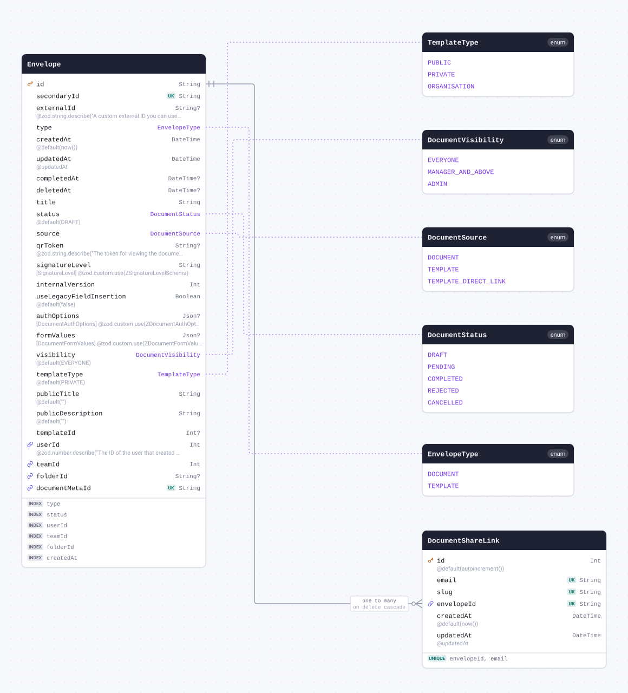

| Field        | Type       | Constraints                               | Default           | Description |
| ------------ | ---------- | ----------------------------------------- | ----------------- | ----------- |
| `id`         | `Int`      | PK NOT NULL                               | `autoincrement()` |             |
| `email`      | `String`   | NOT NULL                                  |                   |             |
| `slug`       | `String`   | UNIQUE NOT NULL                           |                   |             |
| `envelopeId` | `String`   | NOT NULL → [Envelope.id](#model-Envelope) |                   |             |
| `createdAt`  | `DateTime` | NOT NULL                                  | `now()`           |             |
| `updatedAt`  | `DateTime` | NOT NULL                                  | `@updatedAt`      |             |

#### Indexes

- `@@unique([envelopeId, email])`

#### References

- `envelopeId` → [Envelope.id](#model-Envelope) (many-to-one, on delete Cascade)

#### Definition

```sql
CREATE TABLE "DocumentShareLink" (
    "id" SERIAL NOT NULL,
    "email" TEXT NOT NULL,
    "slug" TEXT NOT NULL,
    "envelopeId" TEXT NOT NULL,
    "createdAt" TIMESTAMP(3) NOT NULL DEFAULT CURRENT_TIMESTAMP,
    "updatedAt" TIMESTAMP(3) NOT NULL,

    CONSTRAINT "DocumentShareLink_pkey" PRIMARY KEY ("id")
);

CREATE UNIQUE INDEX "DocumentShareLink_slug_key" ON "DocumentShareLink"("slug");

CREATE UNIQUE INDEX "DocumentShareLink_envelopeId_email_key" ON "DocumentShareLink"("envelopeId", "email");

ALTER TABLE "DocumentShareLink" ADD CONSTRAINT "DocumentShareLink_envelopeId_fkey" FOREIGN KEY ("envelopeId") REFERENCES "Envelope"("id") ON DELETE CASCADE ON UPDATE CASCADE;
```

<details>
<summary>Queries and their SQL</summary>

**findMany**: Every row

```ts
await prisma.documentShareLink.findMany();
```

```sql
SELECT
  "public"."DocumentShareLink"."id",
  "public"."DocumentShareLink"."email",
  "public"."DocumentShareLink"."slug",
  "public"."DocumentShareLink"."envelopeId",
  "public"."DocumentShareLink"."createdAt",
  "public"."DocumentShareLink"."updatedAt"
FROM
  "public"."DocumentShareLink"
WHERE
  1 = 1
OFFSET
  $1
-- params: ["0"]
```

**count**: How many rows there are

```ts
await prisma.documentShareLink.count();
```

```sql
SELECT
  COUNT(*) AS "_count$_all"
FROM
  (
    SELECT
      "public"."DocumentShareLink"."id"
    FROM
      "public"."DocumentShareLink"
    WHERE
      1 = 1
    OFFSET
      $1
  ) AS "sub"
-- params: ["0"]
```

**findMany**: Every row with its relations

```ts
await prisma.documentShareLink.findMany({ include: { envelope: true } });
```

```sql
SELECT
  "public"."DocumentShareLink"."id",
  "public"."DocumentShareLink"."email",
  "public"."DocumentShareLink"."slug",
  "public"."DocumentShareLink"."envelopeId",
  "public"."DocumentShareLink"."createdAt",
  "public"."DocumentShareLink"."updatedAt"
FROM
  "public"."DocumentShareLink"
WHERE
  1 = 1
OFFSET
  $1
-- params: ["0"]

SELECT
  "public"."Envelope"."id",
  "public"."Envelope"."secondaryId",
  "public"."Envelope"."externalId",
  "public"."Envelope"."type"::text,
  "public"."Envelope"."createdAt",
  "public"."Envelope"."updatedAt",
  "public"."Envelope"."completedAt",
  "public"."Envelope"."deletedAt",
  "public"."Envelope"."title",
  "public"."Envelope"."status"::text,
  "public"."Envelope"."source"::text,
  "public"."Envelope"."qrToken",
  "public"."Envelope"."signatureLevel",
  "public"."Envelope"."internalVersion",
  "public"."Envelope"."useLegacyFieldInsertion",
  "public"."Envelope"."authOptions",
  "public"."Envelope"."formValues",
  "public"."Envelope"."visibility"::text,
  "public"."Envelope"."templateType"::text,
  "public"."Envelope"."publicTitle",
  "public"."Envelope"."publicDescription",
  "public"."Envelope"."templateId",
  "public"."Envelope"."userId",
  "public"."Envelope"."teamId",
  "public"."Envelope"."folderId",
  "public"."Envelope"."documentMetaId"
FROM
  "public"."Envelope"
WHERE
  "public"."Envelope"."id" IN ($1)
OFFSET
  $2
-- params: ["<envelopeId of the rows above>","0"]
```

**findUnique**: One row by what is unique to it

```ts
await prisma.documentShareLink.findUnique({ where: { id: 1 } });
```

```sql
SELECT
  "public"."DocumentShareLink"."id",
  "public"."DocumentShareLink"."email",
  "public"."DocumentShareLink"."slug",
  "public"."DocumentShareLink"."envelopeId",
  "public"."DocumentShareLink"."createdAt",
  "public"."DocumentShareLink"."updatedAt"
FROM
  "public"."DocumentShareLink"
WHERE
  (
    "public"."DocumentShareLink"."id" = $1
    AND 1 = 1
  )
LIMIT
  $2
OFFSET
  $3
-- params: ["1","1","0"]
```

**create**: Create a row

```ts
await prisma.documentShareLink.create({
  data: { email: "example", slug: "example", envelopeId: "example" },
});
```

```sql
INSERT INTO
  "public"."DocumentShareLink" (
    "email",
    "slug",
    "envelopeId",
    "createdAt",
    "updatedAt"
  )
VALUES
  ($1, $2, $3, $4, $5)
RETURNING
  "public"."DocumentShareLink"."id",
  "public"."DocumentShareLink"."email",
  "public"."DocumentShareLink"."slug",
  "public"."DocumentShareLink"."envelopeId",
  "public"."DocumentShareLink"."createdAt",
  "public"."DocumentShareLink"."updatedAt"
-- params: ["example","example","example","<now()>","<now()>"]
```

**update**: Update a row

```ts
await prisma.documentShareLink.update({ where: { id: 1 }, data: { email: "example" } });
```

```sql
UPDATE "public"."DocumentShareLink"
SET
  "email" = $1,
  "updatedAt" = $2
WHERE
  (
    "public"."DocumentShareLink"."id" = $3
    AND 1 = 1
  )
RETURNING
  "public"."DocumentShareLink"."id",
  "public"."DocumentShareLink"."email",
  "public"."DocumentShareLink"."slug",
  "public"."DocumentShareLink"."envelopeId",
  "public"."DocumentShareLink"."createdAt",
  "public"."DocumentShareLink"."updatedAt"
-- params: ["example",{"prisma__type":"generatorCall","prisma__value":{"name":"now","args":[],"returnType":{"type":"DateTime"}}},"1"]
```

**delete**: Delete a row

```ts
await prisma.documentShareLink.delete({ where: { id: 1 } });
```

```sql
DELETE FROM "public"."DocumentShareLink"
WHERE
  (
    "public"."DocumentShareLink"."id" = $1
    AND 1 = 1
  )
RETURNING
  "public"."DocumentShareLink"."id",
  "public"."DocumentShareLink"."email",
  "public"."DocumentShareLink"."slug",
  "public"."DocumentShareLink"."envelopeId",
  "public"."DocumentShareLink"."createdAt",
  "public"."DocumentShareLink"."updatedAt"
-- params: ["1"]
```

</details>

<a id="model-Organisation"></a>

### Organisation

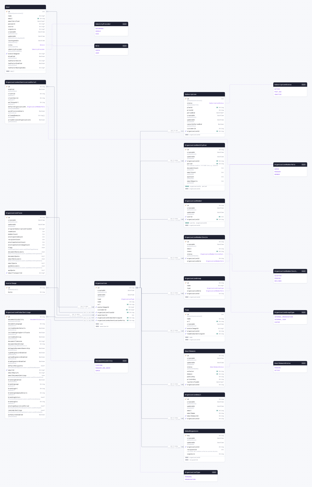

| Field                                | Type                                         | Constraints                                                                                      | Default      | Description |
| ------------------------------------ | -------------------------------------------- | ------------------------------------------------------------------------------------------------ | ------------ | ----------- |
| `id`                                 | `String`                                     | PK NOT NULL                                                                                      |              |             |
| `createdAt`                          | `DateTime`                                   | NOT NULL                                                                                         | `now()`      |             |
| `updatedAt`                          | `DateTime`                                   | NOT NULL                                                                                         | `@updatedAt` |             |
| `type`                               | [`OrganisationType`](#enum-OrganisationType) | NOT NULL                                                                                         |              |             |
| `name`                               | `String`                                     | NOT NULL                                                                                         |              |             |
| `url`                                | `String`                                     | UNIQUE NOT NULL                                                                                  |              |             |
| `avatarImageId`                      | `String`                                     | NULL → [AvatarImage.id](#model-AvatarImage)                                                      |              |             |
| `customerId`                         | `String`                                     | UNIQUE NULL                                                                                      |              |             |
| `organisationClaimId`                | `String`                                     | UNIQUE NOT NULL → [OrganisationClaim.id](#model-OrganisationClaim)                               |              |             |
| `ownerUserId`                        | `Int`                                        | NOT NULL → [User.id](#model-User)                                                                |              |             |
| `organisationGlobalSettingsId`       | `String`                                     | UNIQUE NOT NULL → [OrganisationGlobalSettings.id](#model-OrganisationGlobalSettings)             |              |             |
| `organisationAuthenticationPortalId` | `String`                                     | UNIQUE NOT NULL → [OrganisationAuthenticationPortal.id](#model-OrganisationAuthenticationPortal) |              |             |

#### Indexes

- `@@index([name])`
- `@@index([ownerUserId])`

#### References

- `organisationClaimId` → [OrganisationClaim.id](#model-OrganisationClaim) (one-to-one)
- `avatarImageId` → [AvatarImage.id](#model-AvatarImage) (many-to-one, on delete SetNull)
- `ownerUserId` → [User.id](#model-User) (many-to-one, on delete Cascade)
- `organisationGlobalSettingsId` → [OrganisationGlobalSettings.id](#model-OrganisationGlobalSettings) (one-to-one)
- `organisationAuthenticationPortalId` → [OrganisationAuthenticationPortal.id](#model-OrganisationAuthenticationPortal) (one-to-one)

#### Referenced by

- `id` ← [Subscription.organisationId](#model-Subscription) (one-to-one, on delete Cascade)
- `id` ← [OrganisationMonthlyStat.organisationId](#model-OrganisationMonthlyStat) (one-to-many, on delete Cascade)
- `id` ← [OrganisationMember.organisationId](#model-OrganisationMember) (one-to-many, on delete Cascade)
- `id` ← [OrganisationMemberInvite.organisationId](#model-OrganisationMemberInvite) (one-to-many, on delete Cascade)
- `id` ← [OrganisationGroup.organisationId](#model-OrganisationGroup) (one-to-many, on delete Cascade)
- `id` ← [Team.organisationId](#model-Team) (one-to-many, on delete Cascade)
- `id` ← [EmailDomain.organisationId](#model-EmailDomain) (one-to-many, on delete Cascade)
- `id` ← [OrganisationEmail.organisationId](#model-OrganisationEmail) (one-to-many, on delete Cascade)
- `id` ← [EmbedSignature.organisationId](#model-EmbedSignature) (one-to-many, on delete Cascade)

#### Definition

```sql
CREATE TABLE "Organisation" (
    "id" TEXT NOT NULL,
    "createdAt" TIMESTAMP(3) NOT NULL DEFAULT CURRENT_TIMESTAMP,
    "updatedAt" TIMESTAMP(3) NOT NULL,
    "type" "OrganisationType" NOT NULL,
    "name" TEXT NOT NULL,
    "url" TEXT NOT NULL,
    "avatarImageId" TEXT,
    "customerId" TEXT,
    "organisationClaimId" TEXT NOT NULL,
    "ownerUserId" INTEGER NOT NULL,
    "organisationGlobalSettingsId" TEXT NOT NULL,
    "organisationAuthenticationPortalId" TEXT NOT NULL,

    CONSTRAINT "Organisation_pkey" PRIMARY KEY ("id")
);

CREATE UNIQUE INDEX "Organisation_url_key" ON "Organisation"("url");

CREATE UNIQUE INDEX "Organisation_customerId_key" ON "Organisation"("customerId");

CREATE UNIQUE INDEX "Organisation_organisationClaimId_key" ON "Organisation"("organisationClaimId");

CREATE UNIQUE INDEX "Organisation_organisationGlobalSettingsId_key" ON "Organisation"("organisationGlobalSettingsId");

CREATE UNIQUE INDEX "Organisation_organisationAuthenticationPortalId_key" ON "Organisation"("organisationAuthenticationPortalId");

CREATE INDEX "Organisation_name_idx" ON "Organisation"("name");

CREATE INDEX "Organisation_ownerUserId_idx" ON "Organisation"("ownerUserId");

ALTER TABLE "Organisation" ADD CONSTRAINT "Organisation_organisationClaimId_fkey" FOREIGN KEY ("organisationClaimId") REFERENCES "OrganisationClaim"("id") ON DELETE RESTRICT ON UPDATE CASCADE;

ALTER TABLE "Organisation" ADD CONSTRAINT "Organisation_avatarImageId_fkey" FOREIGN KEY ("avatarImageId") REFERENCES "AvatarImage"("id") ON DELETE SET NULL ON UPDATE CASCADE;

ALTER TABLE "Organisation" ADD CONSTRAINT "Organisation_ownerUserId_fkey" FOREIGN KEY ("ownerUserId") REFERENCES "User"("id") ON DELETE CASCADE ON UPDATE CASCADE;

ALTER TABLE "Organisation" ADD CONSTRAINT "Organisation_organisationGlobalSettingsId_fkey" FOREIGN KEY ("organisationGlobalSettingsId") REFERENCES "OrganisationGlobalSettings"("id") ON DELETE RESTRICT ON UPDATE CASCADE;

ALTER TABLE "Organisation" ADD CONSTRAINT "Organisation_organisationAuthenticationPortalId_fkey" FOREIGN KEY ("organisationAuthenticationPortalId") REFERENCES "OrganisationAuthenticationPortal"("id") ON DELETE RESTRICT ON UPDATE CASCADE;
```

<details>
<summary>Queries and their SQL</summary>

**findMany**: Every row

```ts
await prisma.organisation.findMany();
```

```sql
SELECT
  "public"."Organisation"."id",
  "public"."Organisation"."createdAt",
  "public"."Organisation"."updatedAt",
  "public"."Organisation"."type"::text,
  "public"."Organisation"."name",
  "public"."Organisation"."url",
  "public"."Organisation"."avatarImageId",
  "public"."Organisation"."customerId",
  "public"."Organisation"."organisationClaimId",
  "public"."Organisation"."ownerUserId",
  "public"."Organisation"."organisationGlobalSettingsId",
  "public"."Organisation"."organisationAuthenticationPortalId"
FROM
  "public"."Organisation"
WHERE
  1 = 1
OFFSET
  $1
-- params: ["0"]
```

**count**: How many rows there are

```ts
await prisma.organisation.count();
```

```sql
SELECT
  COUNT(*) AS "_count$_all"
FROM
  (
    SELECT
      "public"."Organisation"."id"
    FROM
      "public"."Organisation"
    WHERE
      1 = 1
    OFFSET
      $1
  ) AS "sub"
-- params: ["0"]
```

**findMany**: Every row with its relations

```ts
await prisma.organisation.findMany({
  include: {
    subscription: true,
    organisationClaim: true,
    members: true,
    invites: true,
    groups: true,
    teams: true,
    emailDomains: true,
    organisationEmails: true,
    monthlyStats: true,
    embedSignatures: true,
    avatarImage: true,
    owner: true,
    organisationGlobalSettings: true,
    organisationAuthenticationPortal: true,
  },
});
```

```sql
SELECT
  "public"."Organisation"."id",
  "public"."Organisation"."createdAt",
  "public"."Organisation"."updatedAt",
  "public"."Organisation"."type"::text,
  "public"."Organisation"."name",
  "public"."Organisation"."url",
  "public"."Organisation"."avatarImageId",
  "public"."Organisation"."customerId",
  "public"."Organisation"."organisationClaimId",
  "public"."Organisation"."ownerUserId",
  "public"."Organisation"."organisationGlobalSettingsId",
  "public"."Organisation"."organisationAuthenticationPortalId"
FROM
  "public"."Organisation"
WHERE
  1 = 1
OFFSET
  $1
-- params: ["0"]

SELECT
  "public"."Subscription"."id",
  "public"."Subscription"."status"::text,
  "public"."Subscription"."planId",
  "public"."Subscription"."priceId",
  "public"."Subscription"."periodEnd",
  "public"."Subscription"."createdAt",
  "public"."Subscription"."updatedAt",
  "public"."Subscription"."cancelAtPeriodEnd",
  "public"."Subscription"."customerId",
  "public"."Subscription"."organisationId"
FROM
  "public"."Subscription"
WHERE
  "public"."Subscription"."organisationId" IN ($1)
OFFSET
  $2
-- params: ["<id of the rows above>","0"]

SELECT
  "public"."OrganisationClaim"."id",
  "public"."OrganisationClaim"."createdAt",
  "public"."OrganisationClaim"."updatedAt",
  "public"."OrganisationClaim"."originalSubscriptionClaimId",
  "public"."OrganisationClaim"."teamCount",
  "public"."OrganisationClaim"."memberCount",
  "public"."OrganisationClaim"."envelopeItemCount",
  "public"."OrganisationClaim"."recipientCount",
  "public"."OrganisationClaim"."envelopeContentCount",
  "public"."OrganisationClaim"."envelopeContentImageCount",
  "public"."OrganisationClaim"."flags",
  "public"."OrganisationClaim"."documentRateLimits",
  "public"."OrganisationClaim"."documentQuota",
  "public"."OrganisationClaim"."emailRateLimits",
  "public"."OrganisationClaim"."emailQuota",
  "public"."OrganisationClaim"."apiRateLimits",
  "public"."OrganisationClaim"."apiQuota",
  "public"."OrganisationClaim"."emailTransportId"
FROM
  "public"."OrganisationClaim"
WHERE
  "public"."OrganisationClaim"."id" IN ($1)
OFFSET
  $2
-- params: ["<organisationClaimId of the rows above>","0"]

SELECT
  "public"."OrganisationMember"."id",
  "public"."OrganisationMember"."createdAt",
  "public"."OrganisationMember"."updatedAt",
  "public"."OrganisationMember"."userId",
  "public"."OrganisationMember"."organisationId"
FROM
  "public"."OrganisationMember"
WHERE
  "public"."OrganisationMember"."organisationId" IN ($1)
OFFSET
  $2
-- params: ["<id of the rows above>","0"]

SELECT
  "public"."OrganisationMemberInvite"."id",
  "public"."OrganisationMemberInvite"."createdAt",
  "public"."OrganisationMemberInvite"."email",
  "public"."OrganisationMemberInvite"."token",
  "public"."OrganisationMemberInvite"."status"::text,
  "public"."OrganisationMemberInvite"."organisationId",
  "public"."OrganisationMemberInvite"."organisationRole"::text
FROM
  "public"."OrganisationMemberInvite"
WHERE
  "public"."OrganisationMemberInvite"."organisationId" IN ($1)
OFFSET
  $2
-- params: ["<id of the rows above>","0"]

SELECT
  "public"."OrganisationGroup"."id",
  "public"."OrganisationGroup"."name",
  "public"."OrganisationGroup"."type"::text,
  "public"."OrganisationGroup"."organisationRole"::text,
  "public"."OrganisationGroup"."organisationId"
FROM
  "public"."OrganisationGroup"
WHERE
  "public"."OrganisationGroup"."organisationId" IN ($1)
OFFSET
  $2
-- params: ["<id of the rows above>","0"]

SELECT
  "public"."Team"."id",
  "public"."Team"."name",
  "public"."Team"."url",
  "public"."Team"."createdAt",
  "public"."Team"."avatarImageId",
  "public"."Team"."organisationId",
  "public"."Team"."teamGlobalSettingsId"
FROM
  "public"."Team"
WHERE
  "public"."Team"."organisationId" IN ($1)
OFFSET
  $2
-- params: ["<id of the rows above>","0"]

SELECT
  "public"."EmailDomain"."id",
  "public"."EmailDomain"."createdAt",
  "public"."EmailDomain"."updatedAt",
  "public"."EmailDomain"."status"::text,
  "public"."EmailDomain"."selector",
  "public"."EmailDomain"."domain",
  "public"."EmailDomain"."publicKey",
  "public"."EmailDomain"."privateKey",
  "public"."EmailDomain"."lastVerifiedAt",
  "public"."EmailDomain"."organisationId"
FROM
  "public"."EmailDomain"
WHERE
  "public"."EmailDomain"."organisationId" IN ($1)
OFFSET
  $2
-- params: ["<id of the rows above>","0"]

SELECT
  "public"."OrganisationEmail"."id",
  "public"."OrganisationEmail"."createdAt",
  "public"."OrganisationEmail"."updatedAt",
  "public"."OrganisationEmail"."email",
  "public"."OrganisationEmail"."emailName",
  "public"."OrganisationEmail"."emailDomainId",
  "public"."OrganisationEmail"."organisationId"
FROM
  "public"."OrganisationEmail"
WHERE
  "public"."OrganisationEmail"."organisationId" IN ($1)
OFFSET
  $2
-- params: ["<id of the rows above>","0"]

SELECT
  "public"."OrganisationMonthlyStat"."id",
  "public"."OrganisationMonthlyStat"."createdAt",
  "public"."OrganisationMonthlyStat"."updatedAt",
  "public"."OrganisationMonthlyStat"."organisationId",
  "public"."OrganisationMonthlyStat"."period",
  "public"."OrganisationMonthlyStat"."documentCount",
  "public"."OrganisationMonthlyStat"."emailCount",
  "public"."OrganisationMonthlyStat"."apiCount",
  "public"."OrganisationMonthlyStat"."emailReports"
FROM
  "public"."OrganisationMonthlyStat"
WHERE
  "public"."OrganisationMonthlyStat"."organisationId" IN ($1)
OFFSET
  $2
-- params: ["<id of the rows above>","0"]

SELECT
  "public"."EmbedSignature"."key",
  "public"."EmbedSignature"."createdAt",
  "public"."EmbedSignature"."updatedAt",
  "public"."EmbedSignature"."organisationId",
  "public"."EmbedSignature"."recipientId",
  "public"."EmbedSignature"."signature"
FROM
  "public"."EmbedSignature"
WHERE
  "public"."EmbedSignature"."organisationId" IN ($1)
OFFSET
  $2
-- params: ["<id of the rows above>","0"]

SELECT
  "public"."AvatarImage"."id",
  "public"."AvatarImage"."bytes"
FROM
  "public"."AvatarImage"
WHERE
  "public"."AvatarImage"."id" IN ($1)
OFFSET
  $2
-- params: ["<avatarImageId of the rows above>","0"]

SELECT
  "public"."User"."id",
  "public"."User"."name",
  "public"."User"."email",
  "public"."User"."emailVerified",
  "public"."User"."password",
  "public"."User"."source",
  "public"."User"."signature",
  "public"."User"."createdAt",
  "public"."User"."updatedAt",
  "public"."User"."lastSignedIn",
  "public"."User"."roles"::text[],
  "public"."User"."identityProvider"::text,
  "public"."User"."avatarImageId",
  "public"."User"."disabled",
  "public"."User"."twoFactorSecret",
  "public"."User"."twoFactorEnabled",
  "public"."User"."twoFactorBackupCodes"
FROM
  "public"."User"
WHERE
  "public"."User"."id" IN ($1)
OFFSET
  $2
-- params: ["<ownerUserId of the rows above>","0"]

SELECT
  "public"."OrganisationGlobalSettings"."id",
  "public"."OrganisationGlobalSettings"."documentVisibility"::text,
  "public"."OrganisationGlobalSettings"."documentLanguage",
  "public"."OrganisationGlobalSettings"."includeSenderDetails",
  "public"."OrganisationGlobalSettings"."includeSigningCertificate",
  "public"."OrganisationGlobalSettings"."includeAuditLog",
  "public"."OrganisationGlobalSettings"."documentTimezone",
  "public"."OrganisationGlobalSettings"."documentDateFormat",
  "public"."OrganisationGlobalSettings"."delegateDocumentOwnership",
  "public"."OrganisationGlobalSettings"."typedSignatureEnabled",
  "public"."OrganisationGlobalSettings"."uploadSignatureEnabled",
  "public"."OrganisationGlobalSettings"."drawSignatureEnabled",
  "public"."OrganisationGlobalSettings"."defaultRecipients",
  "public"."OrganisationGlobalSettings"."emailId",
  "public"."OrganisationGlobalSettings"."emailReplyTo",
  "public"."OrganisationGlobalSettings"."emailDocumentSettings",
  "public"."OrganisationGlobalSettings"."brandingEnabled",
  "public"."OrganisationGlobalSettings"."brandingLogo",
  "public"."OrganisationGlobalSettings"."brandingUrl",
  "public"."OrganisationGlobalSettings"."brandingCompanyDetails",
  "public"."OrganisationGlobalSettings"."brandingColors",
  "public"."OrganisationGlobalSettings"."brandingCss",
  "public"."OrganisationGlobalSettings"."envelopeExpirationPeriod",
  "public"."OrganisationGlobalSettings"."reminderSettings",
  "public"."OrganisationGlobalSettings"."aiFeaturesEnabled"
FROM
  "public"."OrganisationGlobalSettings"
WHERE
  "public"."OrganisationGlobalSettings"."id" IN ($1)
OFFSET
  $2
-- params: ["<organisationGlobalSettingsId of the rows above>","0"]

SELECT
  "public"."OrganisationAuthenticationPortal"."id",
  "public"."OrganisationAuthenticationPortal"."enabled",
  "public"."OrganisationAuthenticationPortal"."clientId",
  "public"."OrganisationAuthenticationPortal"."clientSecret",
  "public"."OrganisationAuthenticationPortal"."wellKnownUrl",
  "public"."OrganisationAuthenticationPortal"."defaultOrganisationRole"::text,
  "public"."OrganisationAuthenticationPortal"."autoProvisionUsers",
  "public"."OrganisationAuthenticationPortal"."allowedDomains",
  "public"."OrganisationAuthenticationPortal"."allowPersonalOrganisations"
FROM
  "public"."OrganisationAuthenticationPortal"
WHERE
  "public"."OrganisationAuthenticationPortal"."id" IN ($1)
OFFSET
  $2
-- params: ["<organisationAuthenticationPortalId of the rows above>","0"]
```

**findUnique**: One row by what is unique to it

```ts
await prisma.organisation.findUnique({ where: { id: "example" } });
```

```sql
SELECT
  "public"."Organisation"."id",
  "public"."Organisation"."createdAt",
  "public"."Organisation"."updatedAt",
  "public"."Organisation"."type"::text,
  "public"."Organisation"."name",
  "public"."Organisation"."url",
  "public"."Organisation"."avatarImageId",
  "public"."Organisation"."customerId",
  "public"."Organisation"."organisationClaimId",
  "public"."Organisation"."ownerUserId",
  "public"."Organisation"."organisationGlobalSettingsId",
  "public"."Organisation"."organisationAuthenticationPortalId"
FROM
  "public"."Organisation"
WHERE
  (
    "public"."Organisation"."id" = $1
    AND 1 = 1
  )
LIMIT
  $2
OFFSET
  $3
-- params: ["example","1","0"]
```

**create**: Create a row

```ts
await prisma.organisation.create({
  data: {
    id: "example",
    type: "PERSONAL",
    name: "example",
    url: "example",
    organisationClaimId: "example",
    ownerUserId: 1,
    organisationGlobalSettingsId: "example",
    organisationAuthenticationPortalId: "example",
  },
});
```

```sql
INSERT INTO
  "public"."Organisation" (
    "id",
    "createdAt",
    "updatedAt",
    "type",
    "name",
    "url",
    "organisationClaimId",
    "ownerUserId",
    "organisationGlobalSettingsId",
    "organisationAuthenticationPortalId"
  )
VALUES
  (
    $1,
    $2,
    $3,
    CAST($4::text AS "public"."OrganisationType"),
    $5,
    $6,
    $7,
    $8,
    $9,
    $10
  )
RETURNING
  "public"."Organisation"."id",
  "public"."Organisation"."createdAt",
  "public"."Organisation"."updatedAt",
  "public"."Organisation"."type"::text,
  "public"."Organisation"."name",
  "public"."Organisation"."url",
  "public"."Organisation"."avatarImageId",
  "public"."Organisation"."customerId",
  "public"."Organisation"."organisationClaimId",
  "public"."Organisation"."ownerUserId",
  "public"."Organisation"."organisationGlobalSettingsId",
  "public"."Organisation"."organisationAuthenticationPortalId"
-- params: ["example","<now()>","<now()>","PERSONAL","example","example","example","1","example","example"]
```

**update**: Update a row

```ts
await prisma.organisation.update({
  where: { id: "example" },
  data: { createdAt: new Date("2026-01-01T00:00:00.000Z") },
});
```

```sql
UPDATE "public"."Organisation"
SET
  "createdAt" = $1,
  "updatedAt" = $2
WHERE
  (
    "public"."Organisation"."id" = $3
    AND 1 = 1
  )
RETURNING
  "public"."Organisation"."id",
  "public"."Organisation"."createdAt",
  "public"."Organisation"."updatedAt",
  "public"."Organisation"."type"::text,
  "public"."Organisation"."name",
  "public"."Organisation"."url",
  "public"."Organisation"."avatarImageId",
  "public"."Organisation"."customerId",
  "public"."Organisation"."organisationClaimId",
  "public"."Organisation"."ownerUserId",
  "public"."Organisation"."organisationGlobalSettingsId",
  "public"."Organisation"."organisationAuthenticationPortalId"
-- params: ["2026-01-01T00:00:00.000Z",{"prisma__type":"generatorCall","prisma__value":{"name":"now","args":[],"returnType":{"type":"DateTime"}}},"example"]
```

**delete**: Delete a row

```ts
await prisma.organisation.delete({ where: { id: "example" } });
```

```sql
DELETE FROM "public"."Organisation"
WHERE
  (
    "public"."Organisation"."id" = $1
    AND 1 = 1
  )
RETURNING
  "public"."Organisation"."id",
  "public"."Organisation"."createdAt",
  "public"."Organisation"."updatedAt",
  "public"."Organisation"."type"::text,
  "public"."Organisation"."name",
  "public"."Organisation"."url",
  "public"."Organisation"."avatarImageId",
  "public"."Organisation"."customerId",
  "public"."Organisation"."organisationClaimId",
  "public"."Organisation"."ownerUserId",
  "public"."Organisation"."organisationGlobalSettingsId",
  "public"."Organisation"."organisationAuthenticationPortalId"
-- params: ["example"]
```

</details>

<a id="model-OrganisationMember"></a>

### OrganisationMember

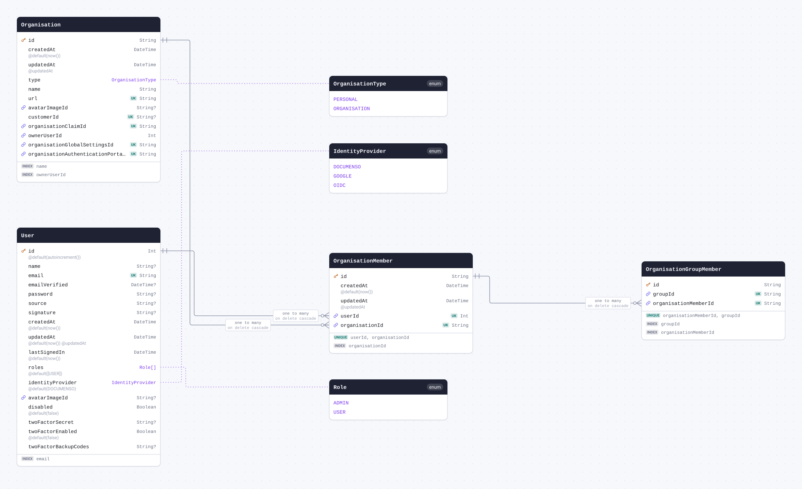

| Field            | Type       | Constraints                                       | Default      | Description |
| ---------------- | ---------- | ------------------------------------------------- | ------------ | ----------- |
| `id`             | `String`   | PK NOT NULL                                       |              |             |
| `createdAt`      | `DateTime` | NOT NULL                                          | `now()`      |             |
| `updatedAt`      | `DateTime` | NOT NULL                                          | `@updatedAt` |             |
| `userId`         | `Int`      | NOT NULL → [User.id](#model-User)                 |              |             |
| `organisationId` | `String`   | NOT NULL → [Organisation.id](#model-Organisation) |              |             |

#### Indexes

- `@@index([organisationId])`
- `@@unique([userId, organisationId])`

#### References

- `userId` → [User.id](#model-User) (many-to-one, on delete Cascade)
- `organisationId` → [Organisation.id](#model-Organisation) (many-to-one, on delete Cascade)

#### Referenced by

- `id` ← [OrganisationGroupMember.organisationMemberId](#model-OrganisationGroupMember) (one-to-many, on delete Cascade)

#### Definition

```sql
CREATE TABLE "OrganisationMember" (
    "id" TEXT NOT NULL,
    "createdAt" TIMESTAMP(3) NOT NULL DEFAULT CURRENT_TIMESTAMP,
    "updatedAt" TIMESTAMP(3) NOT NULL,
    "userId" INTEGER NOT NULL,
    "organisationId" TEXT NOT NULL,

    CONSTRAINT "OrganisationMember_pkey" PRIMARY KEY ("id")
);

CREATE INDEX "OrganisationMember_organisationId_idx" ON "OrganisationMember"("organisationId");

CREATE UNIQUE INDEX "OrganisationMember_userId_organisationId_key" ON "OrganisationMember"("userId", "organisationId");

ALTER TABLE "OrganisationMember" ADD CONSTRAINT "OrganisationMember_userId_fkey" FOREIGN KEY ("userId") REFERENCES "User"("id") ON DELETE CASCADE ON UPDATE CASCADE;

ALTER TABLE "OrganisationMember" ADD CONSTRAINT "OrganisationMember_organisationId_fkey" FOREIGN KEY ("organisationId") REFERENCES "Organisation"("id") ON DELETE CASCADE ON UPDATE CASCADE;
```

<details>
<summary>Queries and their SQL</summary>

**findMany**: Every row

```ts
await prisma.organisationMember.findMany();
```

```sql
SELECT
  "public"."OrganisationMember"."id",
  "public"."OrganisationMember"."createdAt",
  "public"."OrganisationMember"."updatedAt",
  "public"."OrganisationMember"."userId",
  "public"."OrganisationMember"."organisationId"
FROM
  "public"."OrganisationMember"
WHERE
  1 = 1
OFFSET
  $1
-- params: ["0"]
```

**count**: How many rows there are

```ts
await prisma.organisationMember.count();
```

```sql
SELECT
  COUNT(*) AS "_count$_all"
FROM
  (
    SELECT
      "public"."OrganisationMember"."id"
    FROM
      "public"."OrganisationMember"
    WHERE
      1 = 1
    OFFSET
      $1
  ) AS "sub"
-- params: ["0"]
```

**findMany**: Every row with its relations

```ts
await prisma.organisationMember.findMany({
  include: { user: true, organisation: true, organisationGroupMembers: true },
});
```

```sql
SELECT
  "public"."OrganisationMember"."id",
  "public"."OrganisationMember"."createdAt",
  "public"."OrganisationMember"."updatedAt",
  "public"."OrganisationMember"."userId",
  "public"."OrganisationMember"."organisationId"
FROM
  "public"."OrganisationMember"
WHERE
  1 = 1
OFFSET
  $1
-- params: ["0"]

SELECT
  "public"."User"."id",
  "public"."User"."name",
  "public"."User"."email",
  "public"."User"."emailVerified",
  "public"."User"."password",
  "public"."User"."source",
  "public"."User"."signature",
  "public"."User"."createdAt",
  "public"."User"."updatedAt",
  "public"."User"."lastSignedIn",
  "public"."User"."roles"::text[],
  "public"."User"."identityProvider"::text,
  "public"."User"."avatarImageId",
  "public"."User"."disabled",
  "public"."User"."twoFactorSecret",
  "public"."User"."twoFactorEnabled",
  "public"."User"."twoFactorBackupCodes"
FROM
  "public"."User"
WHERE
  "public"."User"."id" IN ($1)
OFFSET
  $2
-- params: ["<userId of the rows above>","0"]

SELECT
  "public"."Organisation"."id",
  "public"."Organisation"."createdAt",
  "public"."Organisation"."updatedAt",
  "public"."Organisation"."type"::text,
  "public"."Organisation"."name",
  "public"."Organisation"."url",
  "public"."Organisation"."avatarImageId",
  "public"."Organisation"."customerId",
  "public"."Organisation"."organisationClaimId",
  "public"."Organisation"."ownerUserId",
  "public"."Organisation"."organisationGlobalSettingsId",
  "public"."Organisation"."organisationAuthenticationPortalId"
FROM
  "public"."Organisation"
WHERE
  "public"."Organisation"."id" IN ($1)
OFFSET
  $2
-- params: ["<organisationId of the rows above>","0"]

SELECT
  "public"."OrganisationGroupMember"."id",
  "public"."OrganisationGroupMember"."groupId",
  "public"."OrganisationGroupMember"."organisationMemberId"
FROM
  "public"."OrganisationGroupMember"
WHERE
  "public"."OrganisationGroupMember"."organisationMemberId" IN ($1)
OFFSET
  $2
-- params: ["<id of the rows above>","0"]
```

**findUnique**: One row by what is unique to it

```ts
await prisma.organisationMember.findUnique({ where: { id: "example" } });
```

```sql
SELECT
  "public"."OrganisationMember"."id",
  "public"."OrganisationMember"."createdAt",
  "public"."OrganisationMember"."updatedAt",
  "public"."OrganisationMember"."userId",
  "public"."OrganisationMember"."organisationId"
FROM
  "public"."OrganisationMember"
WHERE
  (
    "public"."OrganisationMember"."id" = $1
    AND 1 = 1
  )
LIMIT
  $2
OFFSET
  $3
-- params: ["example","1","0"]
```

**create**: Create a row

```ts
await prisma.organisationMember.create({
  data: { id: "example", userId: 1, organisationId: "example" },
});
```

```sql
INSERT INTO
  "public"."OrganisationMember" (
    "id",
    "createdAt",
    "updatedAt",
    "userId",
    "organisationId"
  )
VALUES
  ($1, $2, $3, $4, $5)
RETURNING
  "public"."OrganisationMember"."id",
  "public"."OrganisationMember"."createdAt",
  "public"."OrganisationMember"."updatedAt",
  "public"."OrganisationMember"."userId",
  "public"."OrganisationMember"."organisationId"
-- params: ["example","<now()>","<now()>","1","example"]
```

**update**: Update a row

```ts
await prisma.organisationMember.update({
  where: { id: "example" },
  data: { createdAt: new Date("2026-01-01T00:00:00.000Z") },
});
```

```sql
UPDATE "public"."OrganisationMember"
SET
  "createdAt" = $1,
  "updatedAt" = $2
WHERE
  (
    "public"."OrganisationMember"."id" = $3
    AND 1 = 1
  )
RETURNING
  "public"."OrganisationMember"."id",
  "public"."OrganisationMember"."createdAt",
  "public"."OrganisationMember"."updatedAt",
  "public"."OrganisationMember"."userId",
  "public"."OrganisationMember"."organisationId"
-- params: ["2026-01-01T00:00:00.000Z",{"prisma__type":"generatorCall","prisma__value":{"name":"now","args":[],"returnType":{"type":"DateTime"}}},"example"]
```

**delete**: Delete a row

```ts
await prisma.organisationMember.delete({ where: { id: "example" } });
```

```sql
DELETE FROM "public"."OrganisationMember"
WHERE
  (
    "public"."OrganisationMember"."id" = $1
    AND 1 = 1
  )
RETURNING
  "public"."OrganisationMember"."id",
  "public"."OrganisationMember"."createdAt",
  "public"."OrganisationMember"."updatedAt",
  "public"."OrganisationMember"."userId",
  "public"."OrganisationMember"."organisationId"
-- params: ["example"]
```

</details>

<a id="model-OrganisationMemberInvite"></a>

### OrganisationMemberInvite

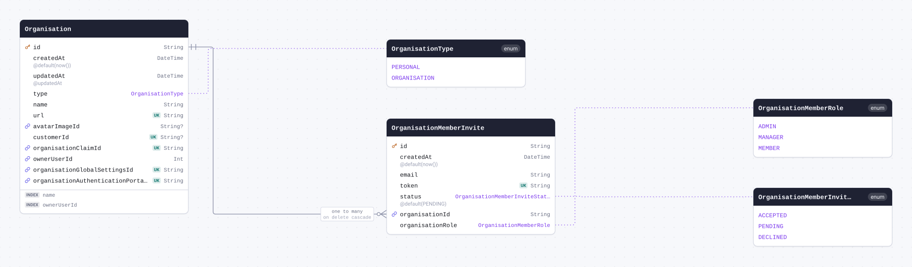

| Field              | Type                                                                     | Constraints                                       | Default   | Description |
| ------------------ | ------------------------------------------------------------------------ | ------------------------------------------------- | --------- | ----------- |
| `id`               | `String`                                                                 | PK NOT NULL                                       |           |             |
| `createdAt`        | `DateTime`                                                               | NOT NULL                                          | `now()`   |             |
| `email`            | `String`                                                                 | NOT NULL                                          |           |             |
| `token`            | `String`                                                                 | UNIQUE NOT NULL                                   |           |             |
| `status`           | [`OrganisationMemberInviteStatus`](#enum-OrganisationMemberInviteStatus) | NOT NULL                                          | `PENDING` |             |
| `organisationId`   | `String`                                                                 | NOT NULL → [Organisation.id](#model-Organisation) |           |             |
| `organisationRole` | [`OrganisationMemberRole`](#enum-OrganisationMemberRole)                 | NOT NULL                                          |           |             |

#### References

- `organisationId` → [Organisation.id](#model-Organisation) (many-to-one, on delete Cascade)

#### Definition

```sql
CREATE TABLE "OrganisationMemberInvite" (
    "id" TEXT NOT NULL,
    "createdAt" TIMESTAMP(3) NOT NULL DEFAULT CURRENT_TIMESTAMP,
    "email" TEXT NOT NULL,
    "token" TEXT NOT NULL,
    "status" "OrganisationMemberInviteStatus" NOT NULL DEFAULT 'PENDING',
    "organisationId" TEXT NOT NULL,
    "organisationRole" "OrganisationMemberRole" NOT NULL,

    CONSTRAINT "OrganisationMemberInvite_pkey" PRIMARY KEY ("id")
);

CREATE UNIQUE INDEX "OrganisationMemberInvite_token_key" ON "OrganisationMemberInvite"("token");

ALTER TABLE "OrganisationMemberInvite" ADD CONSTRAINT "OrganisationMemberInvite_organisationId_fkey" FOREIGN KEY ("organisationId") REFERENCES "Organisation"("id") ON DELETE CASCADE ON UPDATE CASCADE;
```

<details>
<summary>Queries and their SQL</summary>

**findMany**: Every row

```ts
await prisma.organisationMemberInvite.findMany();
```

```sql
SELECT
  "public"."OrganisationMemberInvite"."id",
  "public"."OrganisationMemberInvite"."createdAt",
  "public"."OrganisationMemberInvite"."email",
  "public"."OrganisationMemberInvite"."token",
  "public"."OrganisationMemberInvite"."status"::text,
  "public"."OrganisationMemberInvite"."organisationId",
  "public"."OrganisationMemberInvite"."organisationRole"::text
FROM
  "public"."OrganisationMemberInvite"
WHERE
  1 = 1
OFFSET
  $1
-- params: ["0"]
```

**count**: How many rows there are

```ts
await prisma.organisationMemberInvite.count();
```

```sql
SELECT
  COUNT(*) AS "_count$_all"
FROM
  (
    SELECT
      "public"."OrganisationMemberInvite"."id"
    FROM
      "public"."OrganisationMemberInvite"
    WHERE
      1 = 1
    OFFSET
      $1
  ) AS "sub"
-- params: ["0"]
```

**findMany**: Every row with its relations

```ts
await prisma.organisationMemberInvite.findMany({ include: { organisation: true } });
```

```sql
SELECT
  "public"."OrganisationMemberInvite"."id",
  "public"."OrganisationMemberInvite"."createdAt",
  "public"."OrganisationMemberInvite"."email",
  "public"."OrganisationMemberInvite"."token",
  "public"."OrganisationMemberInvite"."status"::text,
  "public"."OrganisationMemberInvite"."organisationId",
  "public"."OrganisationMemberInvite"."organisationRole"::text
FROM
  "public"."OrganisationMemberInvite"
WHERE
  1 = 1
OFFSET
  $1
-- params: ["0"]

SELECT
  "public"."Organisation"."id",
  "public"."Organisation"."createdAt",
  "public"."Organisation"."updatedAt",
  "public"."Organisation"."type"::text,
  "public"."Organisation"."name",
  "public"."Organisation"."url",
  "public"."Organisation"."avatarImageId",
  "public"."Organisation"."customerId",
  "public"."Organisation"."organisationClaimId",
  "public"."Organisation"."ownerUserId",
  "public"."Organisation"."organisationGlobalSettingsId",
  "public"."Organisation"."organisationAuthenticationPortalId"
FROM
  "public"."Organisation"
WHERE
  "public"."Organisation"."id" IN ($1)
OFFSET
  $2
-- params: ["<organisationId of the rows above>","0"]
```

**findUnique**: One row by what is unique to it

```ts
await prisma.organisationMemberInvite.findUnique({ where: { id: "example" } });
```

```sql
SELECT
  "public"."OrganisationMemberInvite"."id",
  "public"."OrganisationMemberInvite"."createdAt",
  "public"."OrganisationMemberInvite"."email",
  "public"."OrganisationMemberInvite"."token",
  "public"."OrganisationMemberInvite"."status"::text,
  "public"."OrganisationMemberInvite"."organisationId",
  "public"."OrganisationMemberInvite"."organisationRole"::text
FROM
  "public"."OrganisationMemberInvite"
WHERE
  (
    "public"."OrganisationMemberInvite"."id" = $1
    AND 1 = 1
  )
LIMIT
  $2
OFFSET
  $3
-- params: ["example","1","0"]
```

**create**: Create a row

```ts
await prisma.organisationMemberInvite.create({
  data: {
    id: "example",
    email: "example",
    token: "example",
    organisationId: "example",
    organisationRole: "ADMIN",
  },
});
```

```sql
INSERT INTO
  "public"."OrganisationMemberInvite" (
    "id",
    "createdAt",
    "email",
    "token",
    "status",
    "organisationId",
    "organisationRole"
  )
VALUES
  (
    $1,
    $2,
    $3,
    $4,
    CAST(
      $5::text AS "public"."OrganisationMemberInviteStatus"
    ),
    $6,
    CAST($7::text AS "public"."OrganisationMemberRole")
  )
RETURNING
  "public"."OrganisationMemberInvite"."id",
  "public"."OrganisationMemberInvite"."createdAt",
  "public"."OrganisationMemberInvite"."email",
  "public"."OrganisationMemberInvite"."token",
  "public"."OrganisationMemberInvite"."status"::text,
  "public"."OrganisationMemberInvite"."organisationId",
  "public"."OrganisationMemberInvite"."organisationRole"::text
-- params: ["example","<now()>","example","example","PENDING","example","ADMIN"]
```

**update**: Update a row

```ts
await prisma.organisationMemberInvite.update({
  where: { id: "example" },
  data: { createdAt: new Date("2026-01-01T00:00:00.000Z") },
});
```

```sql
UPDATE "public"."OrganisationMemberInvite"
SET
  "createdAt" = $1
WHERE
  (
    "public"."OrganisationMemberInvite"."id" = $2
    AND 1 = 1
  )
RETURNING
  "public"."OrganisationMemberInvite"."id",
  "public"."OrganisationMemberInvite"."createdAt",
  "public"."OrganisationMemberInvite"."email",
  "public"."OrganisationMemberInvite"."token",
  "public"."OrganisationMemberInvite"."status"::text,
  "public"."OrganisationMemberInvite"."organisationId",
  "public"."OrganisationMemberInvite"."organisationRole"::text
-- params: ["2026-01-01T00:00:00.000Z","example"]
```

**delete**: Delete a row

```ts
await prisma.organisationMemberInvite.delete({ where: { id: "example" } });
```

```sql
DELETE FROM "public"."OrganisationMemberInvite"
WHERE
  (
    "public"."OrganisationMemberInvite"."id" = $1
    AND 1 = 1
  )
RETURNING
  "public"."OrganisationMemberInvite"."id",
  "public"."OrganisationMemberInvite"."createdAt",
  "public"."OrganisationMemberInvite"."email",
  "public"."OrganisationMemberInvite"."token",
  "public"."OrganisationMemberInvite"."status"::text,
  "public"."OrganisationMemberInvite"."organisationId",
  "public"."OrganisationMemberInvite"."organisationRole"::text
-- params: ["example"]
```

</details>

<a id="model-OrganisationGroup"></a>

### OrganisationGroup

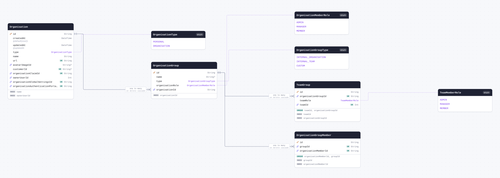

| Field              | Type                                                     | Constraints                                       | Default | Description |
| ------------------ | -------------------------------------------------------- | ------------------------------------------------- | ------- | ----------- |
| `id`               | `String`                                                 | PK NOT NULL                                       |         |             |
| `name`             | `String`                                                 | NULL                                              |         |             |
| `type`             | [`OrganisationGroupType`](#enum-OrganisationGroupType)   | NOT NULL                                          |         |             |
| `organisationRole` | [`OrganisationMemberRole`](#enum-OrganisationMemberRole) | NOT NULL                                          |         |             |
| `organisationId`   | `String`                                                 | NOT NULL → [Organisation.id](#model-Organisation) |         |             |

#### Indexes

- `@@index([organisationId])`

#### References

- `organisationId` → [Organisation.id](#model-Organisation) (many-to-one, on delete Cascade)

#### Referenced by

- `id` ← [OrganisationGroupMember.groupId](#model-OrganisationGroupMember) (one-to-many, on delete Cascade)
- `id` ← [TeamGroup.organisationGroupId](#model-TeamGroup) (one-to-many, on delete Cascade)

#### Definition

```sql
CREATE TABLE "OrganisationGroup" (
    "id" TEXT NOT NULL,
    "name" TEXT,
    "type" "OrganisationGroupType" NOT NULL,
    "organisationRole" "OrganisationMemberRole" NOT NULL,
    "organisationId" TEXT NOT NULL,

    CONSTRAINT "OrganisationGroup_pkey" PRIMARY KEY ("id")
);

CREATE INDEX "OrganisationGroup_organisationId_idx" ON "OrganisationGroup"("organisationId");

ALTER TABLE "OrganisationGroup" ADD CONSTRAINT "OrganisationGroup_organisationId_fkey" FOREIGN KEY ("organisationId") REFERENCES "Organisation"("id") ON DELETE CASCADE ON UPDATE CASCADE;
```

<details>
<summary>Queries and their SQL</summary>

**findMany**: Every row

```ts
await prisma.organisationGroup.findMany();
```

```sql
SELECT
  "public"."OrganisationGroup"."id",
  "public"."OrganisationGroup"."name",
  "public"."OrganisationGroup"."type"::text,
  "public"."OrganisationGroup"."organisationRole"::text,
  "public"."OrganisationGroup"."organisationId"
FROM
  "public"."OrganisationGroup"
WHERE
  1 = 1
OFFSET
  $1
-- params: ["0"]
```

**count**: How many rows there are

```ts
await prisma.organisationGroup.count();
```

```sql
SELECT
  COUNT(*) AS "_count$_all"
FROM
  (
    SELECT
      "public"."OrganisationGroup"."id"
    FROM
      "public"."OrganisationGroup"
    WHERE
      1 = 1
    OFFSET
      $1
  ) AS "sub"
-- params: ["0"]
```

**findMany**: Every row with its relations

```ts
await prisma.organisationGroup.findMany({
  include: { organisation: true, organisationGroupMembers: true, teamGroups: true },
});
```

```sql
SELECT
  "public"."OrganisationGroup"."id",
  "public"."OrganisationGroup"."name",
  "public"."OrganisationGroup"."type"::text,
  "public"."OrganisationGroup"."organisationRole"::text,
  "public"."OrganisationGroup"."organisationId"
FROM
  "public"."OrganisationGroup"
WHERE
  1 = 1
OFFSET
  $1
-- params: ["0"]

SELECT
  "public"."Organisation"."id",
  "public"."Organisation"."createdAt",
  "public"."Organisation"."updatedAt",
  "public"."Organisation"."type"::text,
  "public"."Organisation"."name",
  "public"."Organisation"."url",
  "public"."Organisation"."avatarImageId",
  "public"."Organisation"."customerId",
  "public"."Organisation"."organisationClaimId",
  "public"."Organisation"."ownerUserId",
  "public"."Organisation"."organisationGlobalSettingsId",
  "public"."Organisation"."organisationAuthenticationPortalId"
FROM
  "public"."Organisation"
WHERE
  "public"."Organisation"."id" IN ($1)
OFFSET
  $2
-- params: ["<organisationId of the rows above>","0"]

SELECT
  "public"."OrganisationGroupMember"."id",
  "public"."OrganisationGroupMember"."groupId",
  "public"."OrganisationGroupMember"."organisationMemberId"
FROM
  "public"."OrganisationGroupMember"
WHERE
  "public"."OrganisationGroupMember"."groupId" IN ($1)
OFFSET
  $2
-- params: ["<id of the rows above>","0"]

SELECT
  "public"."TeamGroup"."id",
  "public"."TeamGroup"."organisationGroupId",
  "public"."TeamGroup"."teamRole"::text,
  "public"."TeamGroup"."teamId"
FROM
  "public"."TeamGroup"
WHERE
  "public"."TeamGroup"."organisationGroupId" IN ($1)
OFFSET
  $2
-- params: ["<id of the rows above>","0"]
```

**findUnique**: One row by what is unique to it

```ts
await prisma.organisationGroup.findUnique({ where: { id: "example" } });
```

```sql
SELECT
  "public"."OrganisationGroup"."id",
  "public"."OrganisationGroup"."name",
  "public"."OrganisationGroup"."type"::text,
  "public"."OrganisationGroup"."organisationRole"::text,
  "public"."OrganisationGroup"."organisationId"
FROM
  "public"."OrganisationGroup"
WHERE
  (
    "public"."OrganisationGroup"."id" = $1
    AND 1 = 1
  )
LIMIT
  $2
OFFSET
  $3
-- params: ["example","1","0"]
```

**create**: Create a row

```ts
await prisma.organisationGroup.create({
  data: {
    id: "example",
    type: "INTERNAL_ORGANISATION",
    organisationRole: "ADMIN",
    organisationId: "example",
  },
});
```

```sql
INSERT INTO
  "public"."OrganisationGroup" (
    "id",
    "type",
    "organisationRole",
    "organisationId"
  )
VALUES
  (
    $1,
    CAST($2::text AS "public"."OrganisationGroupType"),
    CAST($3::text AS "public"."OrganisationMemberRole"),
    $4
  )
RETURNING
  "public"."OrganisationGroup"."id",
  "public"."OrganisationGroup"."name",
  "public"."OrganisationGroup"."type"::text,
  "public"."OrganisationGroup"."organisationRole"::text,
  "public"."OrganisationGroup"."organisationId"
-- params: ["example","INTERNAL_ORGANISATION","ADMIN","example"]
```

**update**: Update a row

```ts
await prisma.organisationGroup.update({ where: { id: "example" }, data: { name: "example" } });
```

```sql
UPDATE "public"."OrganisationGroup"
SET
  "name" = $1
WHERE
  (
    "public"."OrganisationGroup"."id" = $2
    AND 1 = 1
  )
RETURNING
  "public"."OrganisationGroup"."id",
  "public"."OrganisationGroup"."name",
  "public"."OrganisationGroup"."type"::text,
  "public"."OrganisationGroup"."organisationRole"::text,
  "public"."OrganisationGroup"."organisationId"
-- params: ["example","example"]
```

**delete**: Delete a row

```ts
await prisma.organisationGroup.delete({ where: { id: "example" } });
```

```sql
DELETE FROM "public"."OrganisationGroup"
WHERE
  (
    "public"."OrganisationGroup"."id" = $1
    AND 1 = 1
  )
RETURNING
  "public"."OrganisationGroup"."id",
  "public"."OrganisationGroup"."name",
  "public"."OrganisationGroup"."type"::text,
  "public"."OrganisationGroup"."organisationRole"::text,
  "public"."OrganisationGroup"."organisationId"
-- params: ["example"]
```

</details>

<a id="model-OrganisationGroupMember"></a>

### OrganisationGroupMember

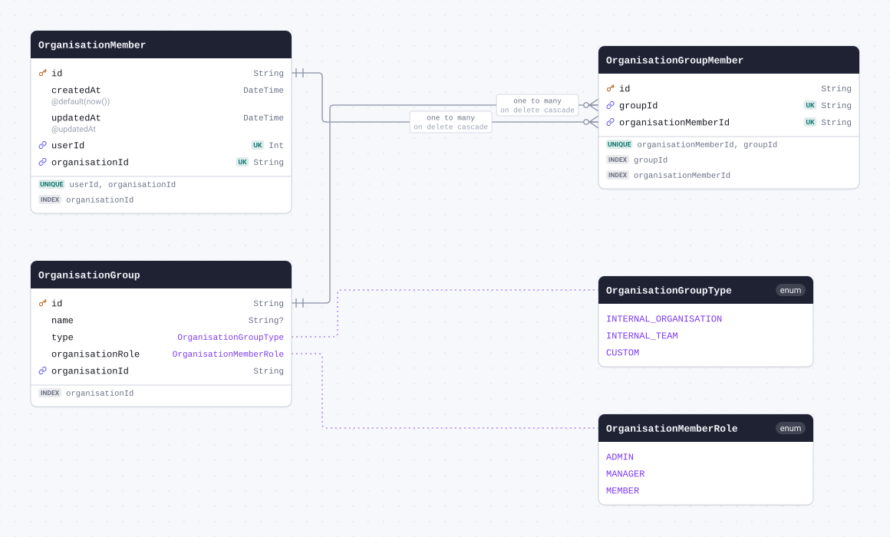

| Field                  | Type     | Constraints                                                   | Default | Description |
| ---------------------- | -------- | ------------------------------------------------------------- | ------- | ----------- |
| `id`                   | `String` | PK NOT NULL                                                   |         |             |
| `groupId`              | `String` | NOT NULL → [OrganisationGroup.id](#model-OrganisationGroup)   |         |             |
| `organisationMemberId` | `String` | NOT NULL → [OrganisationMember.id](#model-OrganisationMember) |         |             |

#### Indexes

- `@@index([groupId])`
- `@@index([organisationMemberId])`
- `@@unique([organisationMemberId, groupId])`

#### References

- `groupId` → [OrganisationGroup.id](#model-OrganisationGroup) (many-to-one, on delete Cascade)
- `organisationMemberId` → [OrganisationMember.id](#model-OrganisationMember) (many-to-one, on delete Cascade)

#### Definition

```sql
CREATE TABLE "OrganisationGroupMember" (
    "id" TEXT NOT NULL,
    "groupId" TEXT NOT NULL,
    "organisationMemberId" TEXT NOT NULL,

    CONSTRAINT "OrganisationGroupMember_pkey" PRIMARY KEY ("id")
);

CREATE INDEX "OrganisationGroupMember_groupId_idx" ON "OrganisationGroupMember"("groupId");

CREATE INDEX "OrganisationGroupMember_organisationMemberId_idx" ON "OrganisationGroupMember"("organisationMemberId");

CREATE UNIQUE INDEX "OrganisationGroupMember_organisationMemberId_groupId_key" ON "OrganisationGroupMember"("organisationMemberId", "groupId");

ALTER TABLE "OrganisationGroupMember" ADD CONSTRAINT "OrganisationGroupMember_groupId_fkey" FOREIGN KEY ("groupId") REFERENCES "OrganisationGroup"("id") ON DELETE CASCADE ON UPDATE CASCADE;

ALTER TABLE "OrganisationGroupMember" ADD CONSTRAINT "OrganisationGroupMember_organisationMemberId_fkey" FOREIGN KEY ("organisationMemberId") REFERENCES "OrganisationMember"("id") ON DELETE CASCADE ON UPDATE CASCADE;
```

<details>
<summary>Queries and their SQL</summary>

**findMany**: Every row

```ts
await prisma.organisationGroupMember.findMany();
```

```sql
SELECT
  "public"."OrganisationGroupMember"."id",
  "public"."OrganisationGroupMember"."groupId",
  "public"."OrganisationGroupMember"."organisationMemberId"
FROM
  "public"."OrganisationGroupMember"
WHERE
  1 = 1
OFFSET
  $1
-- params: ["0"]
```

**count**: How many rows there are

```ts
await prisma.organisationGroupMember.count();
```

```sql
SELECT
  COUNT(*) AS "_count$_all"
FROM
  (
    SELECT
      "public"."OrganisationGroupMember"."id"
    FROM
      "public"."OrganisationGroupMember"
    WHERE
      1 = 1
    OFFSET
      $1
  ) AS "sub"
-- params: ["0"]
```

**findMany**: Every row with its relations

```ts
await prisma.organisationGroupMember.findMany({
  include: { group: true, organisationMember: true },
});
```

```sql
SELECT
  "public"."OrganisationGroupMember"."id",
  "public"."OrganisationGroupMember"."groupId",
  "public"."OrganisationGroupMember"."organisationMemberId"
FROM
  "public"."OrganisationGroupMember"
WHERE
  1 = 1
OFFSET
  $1
-- params: ["0"]

SELECT
  "public"."OrganisationGroup"."id",
  "public"."OrganisationGroup"."name",
  "public"."OrganisationGroup"."type"::text,
  "public"."OrganisationGroup"."organisationRole"::text,
  "public"."OrganisationGroup"."organisationId"
FROM
  "public"."OrganisationGroup"
WHERE
  "public"."OrganisationGroup"."id" IN ($1)
OFFSET
  $2
-- params: ["<groupId of the rows above>","0"]

SELECT
  "public"."OrganisationMember"."id",
  "public"."OrganisationMember"."createdAt",
  "public"."OrganisationMember"."updatedAt",
  "public"."OrganisationMember"."userId",
  "public"."OrganisationMember"."organisationId"
FROM
  "public"."OrganisationMember"
WHERE
  "public"."OrganisationMember"."id" IN ($1)
OFFSET
  $2
-- params: ["<organisationMemberId of the rows above>","0"]
```

**findUnique**: One row by what is unique to it

```ts
await prisma.organisationGroupMember.findUnique({ where: { id: "example" } });
```

```sql
SELECT
  "public"."OrganisationGroupMember"."id",
  "public"."OrganisationGroupMember"."groupId",
  "public"."OrganisationGroupMember"."organisationMemberId"
FROM
  "public"."OrganisationGroupMember"
WHERE
  (
    "public"."OrganisationGroupMember"."id" = $1
    AND 1 = 1
  )
LIMIT
  $2
OFFSET
  $3
-- params: ["example","1","0"]
```

**create**: Create a row

```ts
await prisma.organisationGroupMember.create({
  data: { id: "example", groupId: "example", organisationMemberId: "example" },
});
```

```sql
INSERT INTO
  "public"."OrganisationGroupMember" ("id", "groupId", "organisationMemberId")
VALUES
  ($1, $2, $3)
RETURNING
  "public"."OrganisationGroupMember"."id",
  "public"."OrganisationGroupMember"."groupId",
  "public"."OrganisationGroupMember"."organisationMemberId"
-- params: ["example","example","example"]
```

**delete**: Delete a row

```ts
await prisma.organisationGroupMember.delete({ where: { id: "example" } });
```

```sql
DELETE FROM "public"."OrganisationGroupMember"
WHERE
  (
    "public"."OrganisationGroupMember"."id" = $1
    AND 1 = 1
  )
RETURNING
  "public"."OrganisationGroupMember"."id",
  "public"."OrganisationGroupMember"."groupId",
  "public"."OrganisationGroupMember"."organisationMemberId"
-- params: ["example"]
```

</details>

<a id="model-TeamGroup"></a>

### TeamGroup

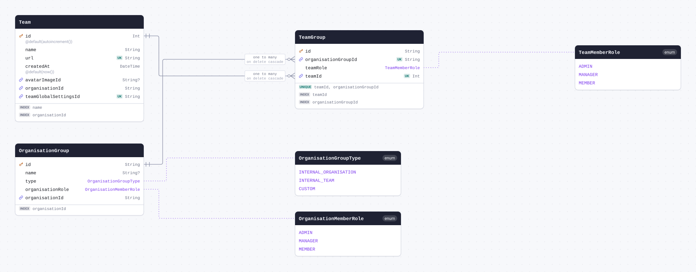

| Field                 | Type                                     | Constraints                                                 | Default | Description |
| --------------------- | ---------------------------------------- | ----------------------------------------------------------- | ------- | ----------- |
| `id`                  | `String`                                 | PK NOT NULL                                                 |         |             |
| `organisationGroupId` | `String`                                 | NOT NULL → [OrganisationGroup.id](#model-OrganisationGroup) |         |             |
| `teamRole`            | [`TeamMemberRole`](#enum-TeamMemberRole) | NOT NULL                                                    |         |             |
| `teamId`              | `Int`                                    | NOT NULL → [Team.id](#model-Team)                           |         |             |

#### Indexes

- `@@index([teamId])`
- `@@index([organisationGroupId])`
- `@@unique([teamId, organisationGroupId])`

#### References

- `organisationGroupId` → [OrganisationGroup.id](#model-OrganisationGroup) (many-to-one, on delete Cascade)
- `teamId` → [Team.id](#model-Team) (many-to-one, on delete Cascade)

#### Definition

```sql
CREATE TABLE "TeamGroup" (
    "id" TEXT NOT NULL,
    "organisationGroupId" TEXT NOT NULL,
    "teamRole" "TeamMemberRole" NOT NULL,
    "teamId" INTEGER NOT NULL,

    CONSTRAINT "TeamGroup_pkey" PRIMARY KEY ("id")
);

CREATE INDEX "TeamGroup_teamId_idx" ON "TeamGroup"("teamId");

CREATE INDEX "TeamGroup_organisationGroupId_idx" ON "TeamGroup"("organisationGroupId");

CREATE UNIQUE INDEX "TeamGroup_teamId_organisationGroupId_key" ON "TeamGroup"("teamId", "organisationGroupId");

ALTER TABLE "TeamGroup" ADD CONSTRAINT "TeamGroup_organisationGroupId_fkey" FOREIGN KEY ("organisationGroupId") REFERENCES "OrganisationGroup"("id") ON DELETE CASCADE ON UPDATE CASCADE;

ALTER TABLE "TeamGroup" ADD CONSTRAINT "TeamGroup_teamId_fkey" FOREIGN KEY ("teamId") REFERENCES "Team"("id") ON DELETE CASCADE ON UPDATE CASCADE;
```

<details>
<summary>Queries and their SQL</summary>

**findMany**: Every row

```ts
await prisma.teamGroup.findMany();
```

```sql
SELECT
  "public"."TeamGroup"."id",
  "public"."TeamGroup"."organisationGroupId",
  "public"."TeamGroup"."teamRole"::text,
  "public"."TeamGroup"."teamId"
FROM
  "public"."TeamGroup"
WHERE
  1 = 1
OFFSET
  $1
-- params: ["0"]
```

**count**: How many rows there are

```ts
await prisma.teamGroup.count();
```

```sql
SELECT
  COUNT(*) AS "_count$_all"
FROM
  (
    SELECT
      "public"."TeamGroup"."id"
    FROM
      "public"."TeamGroup"
    WHERE
      1 = 1
    OFFSET
      $1
  ) AS "sub"
-- params: ["0"]
```

**findMany**: Every row with its relations

```ts
await prisma.teamGroup.findMany({ include: { organisationGroup: true, team: true } });
```

```sql
SELECT
  "public"."TeamGroup"."id",
  "public"."TeamGroup"."organisationGroupId",
  "public"."TeamGroup"."teamRole"::text,
  "public"."TeamGroup"."teamId"
FROM
  "public"."TeamGroup"
WHERE
  1 = 1
OFFSET
  $1
-- params: ["0"]

SELECT
  "public"."OrganisationGroup"."id",
  "public"."OrganisationGroup"."name",
  "public"."OrganisationGroup"."type"::text,
  "public"."OrganisationGroup"."organisationRole"::text,
  "public"."OrganisationGroup"."organisationId"
FROM
  "public"."OrganisationGroup"
WHERE
  "public"."OrganisationGroup"."id" IN ($1)
OFFSET
  $2
-- params: ["<organisationGroupId of the rows above>","0"]

SELECT
  "public"."Team"."id",
  "public"."Team"."name",
  "public"."Team"."url",
  "public"."Team"."createdAt",
  "public"."Team"."avatarImageId",
  "public"."Team"."organisationId",
  "public"."Team"."teamGlobalSettingsId"
FROM
  "public"."Team"
WHERE
  "public"."Team"."id" IN ($1)
OFFSET
  $2
-- params: ["<teamId of the rows above>","0"]
```

**findUnique**: One row by what is unique to it

```ts
await prisma.teamGroup.findUnique({ where: { id: "example" } });
```

```sql
SELECT
  "public"."TeamGroup"."id",
  "public"."TeamGroup"."organisationGroupId",
  "public"."TeamGroup"."teamRole"::text,
  "public"."TeamGroup"."teamId"
FROM
  "public"."TeamGroup"
WHERE
  (
    "public"."TeamGroup"."id" = $1
    AND 1 = 1
  )
LIMIT
  $2
OFFSET
  $3
-- params: ["example","1","0"]
```

**create**: Create a row

```ts
await prisma.teamGroup.create({
  data: { id: "example", organisationGroupId: "example", teamRole: "ADMIN", teamId: 1 },
});
```

```sql
INSERT INTO
  "public"."TeamGroup" ("id", "organisationGroupId", "teamRole", "teamId")
VALUES
  (
    $1,
    $2,
    CAST($3::text AS "public"."TeamMemberRole"),
    $4
  )
RETURNING
  "public"."TeamGroup"."id",
  "public"."TeamGroup"."organisationGroupId",
  "public"."TeamGroup"."teamRole"::text,
  "public"."TeamGroup"."teamId"
-- params: ["example","example","ADMIN","1"]
```

**update**: Update a row

```ts
await prisma.teamGroup.update({ where: { id: "example" }, data: { teamRole: "ADMIN" } });
```

```sql
UPDATE "public"."TeamGroup"
SET
  "teamRole" = CAST($1::text AS "public"."TeamMemberRole")
WHERE
  (
    "public"."TeamGroup"."id" = $2
    AND 1 = 1
  )
RETURNING
  "public"."TeamGroup"."id",
  "public"."TeamGroup"."organisationGroupId",
  "public"."TeamGroup"."teamRole"::text,
  "public"."TeamGroup"."teamId"
-- params: ["ADMIN","example"]
```

**delete**: Delete a row

```ts
await prisma.teamGroup.delete({ where: { id: "example" } });
```

```sql
DELETE FROM "public"."TeamGroup"
WHERE
  (
    "public"."TeamGroup"."id" = $1
    AND 1 = 1
  )
RETURNING
  "public"."TeamGroup"."id",
  "public"."TeamGroup"."organisationGroupId",
  "public"."TeamGroup"."teamRole"::text,
  "public"."TeamGroup"."teamId"
-- params: ["example"]
```

</details>

<a id="model-OrganisationGlobalSettings"></a>

### OrganisationGlobalSettings

@zod.import(["import { ZDocumentEmailSettingsSchema } from '@documenso/lib/types/document-email';", "import { ZDefaultRecipientsSchema } from '@documenso/lib/types/default-recipients';", "import { ZEnvelopeExpirationPeriod as ZEnvelopeExpirationPeriodSchema } from '@documenso/lib/constants/envelope-expiration';", "import { ZEnvelopeReminderSettings as ZEnvelopeReminderSettingsSchema } from '@documenso/lib/constants/envelope-reminder';", "import { ZCssVarsSchema } from '@documenso/lib/types/css-vars';"])

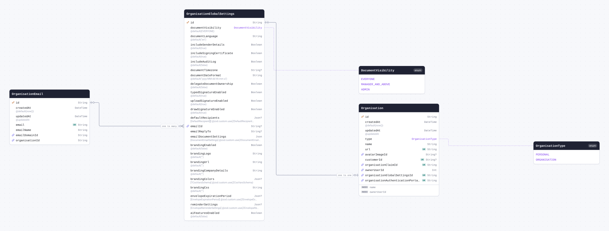

| Field                       | Type                                             | Constraints                                             | Default                | Description                                                                 |
| --------------------------- | ------------------------------------------------ | ------------------------------------------------------- | ---------------------- | --------------------------------------------------------------------------- |
| `id`                        | `String`                                         | PK NOT NULL                                             |                        |                                                                             |
| `documentVisibility`        | [`DocumentVisibility`](#enum-DocumentVisibility) | NOT NULL                                                | `EVERYONE`             |                                                                             |
| `documentLanguage`          | `String`                                         | NOT NULL                                                | `"en"`                 |                                                                             |
| `includeSenderDetails`      | `Boolean`                                        | NOT NULL                                                | `true`                 |                                                                             |
| `includeSigningCertificate` | `Boolean`                                        | NOT NULL                                                | `true`                 |                                                                             |
| `includeAuditLog`           | `Boolean`                                        | NOT NULL                                                | `false`                |                                                                             |
| `documentTimezone`          | `String`                                         | NULL                                                    |                        |                                                                             |
| `documentDateFormat`        | `String`                                         | NOT NULL                                                | `"yyyy-MM-dd hh:mm a"` |                                                                             |
| `delegateDocumentOwnership` | `Boolean`                                        | NOT NULL                                                | `false`                |                                                                             |
| `typedSignatureEnabled`     | `Boolean`                                        | NOT NULL                                                | `true`                 |                                                                             |
| `uploadSignatureEnabled`    | `Boolean`                                        | NOT NULL                                                | `true`                 |                                                                             |
| `drawSignatureEnabled`      | `Boolean`                                        | NOT NULL                                                | `true`                 |                                                                             |
| `defaultRecipients`         | `Json`                                           | NULL                                                    |                        | [DefaultRecipient[]] @zod.custom.use(ZDefaultRecipientsSchema)              |
| `emailId`                   | `String`                                         | NULL → [OrganisationEmail.id](#model-OrganisationEmail) |                        |                                                                             |
| `emailReplyTo`              | `String`                                         | NULL                                                    |                        |                                                                             |
| `emailDocumentSettings`     | `Json`                                           | NOT NULL                                                |                        | [DocumentEmailSettings] @zod.custom.use(ZDocumentEmailSettingsSchema)       |
| `brandingEnabled`           | `Boolean`                                        | NOT NULL                                                | `false`                |                                                                             |
| `brandingLogo`              | `String`                                         | NOT NULL                                                | `""`                   |                                                                             |
| `brandingUrl`               | `String`                                         | NOT NULL                                                | `""`                   |                                                                             |
| `brandingCompanyDetails`    | `String`                                         | NOT NULL                                                | `""`                   |                                                                             |
| `brandingColors`            | `Json`                                           | NULL                                                    |                        | [TCssVarsSchema] @zod.custom.use(ZCssVarsSchema)                            |
| `brandingCss`               | `String`                                         | NOT NULL                                                | `""`                   |                                                                             |
| `envelopeExpirationPeriod`  | `Json`                                           | NULL                                                    |                        | [EnvelopeExpirationPeriod] @zod.custom.use(ZEnvelopeExpirationPeriodSchema) |
| `reminderSettings`          | `Json`                                           | NULL                                                    |                        | [EnvelopeReminderSettings] @zod.custom.use(ZEnvelopeReminderSettingsSchema) |
| `aiFeaturesEnabled`         | `Boolean`                                        | NOT NULL                                                | `false`                |                                                                             |

#### References

- `emailId` → [OrganisationEmail.id](#model-OrganisationEmail) (many-to-one)

#### Referenced by

- `id` ← [Organisation.organisationGlobalSettingsId](#model-Organisation) (one-to-one)

#### Definition

```sql
CREATE TABLE "OrganisationGlobalSettings" (
    "id" TEXT NOT NULL,
    "documentVisibility" "DocumentVisibility" NOT NULL DEFAULT 'EVERYONE',
    "documentLanguage" TEXT NOT NULL DEFAULT 'en',
    "includeSenderDetails" BOOLEAN NOT NULL DEFAULT true,
    "includeSigningCertificate" BOOLEAN NOT NULL DEFAULT true,
    "includeAuditLog" BOOLEAN NOT NULL DEFAULT false,
    "documentTimezone" TEXT,
    "documentDateFormat" TEXT NOT NULL DEFAULT 'yyyy-MM-dd hh:mm a',
    "delegateDocumentOwnership" BOOLEAN NOT NULL DEFAULT false,
    "typedSignatureEnabled" BOOLEAN NOT NULL DEFAULT true,
    "uploadSignatureEnabled" BOOLEAN NOT NULL DEFAULT true,
    "drawSignatureEnabled" BOOLEAN NOT NULL DEFAULT true,
    "defaultRecipients" JSONB,
    "emailId" TEXT,
    "emailReplyTo" TEXT,
    "emailDocumentSettings" JSONB NOT NULL,
    "brandingEnabled" BOOLEAN NOT NULL DEFAULT false,
    "brandingLogo" TEXT NOT NULL DEFAULT '',
    "brandingUrl" TEXT NOT NULL DEFAULT '',
    "brandingCompanyDetails" TEXT NOT NULL DEFAULT '',
    "brandingColors" JSONB,
    "brandingCss" TEXT NOT NULL DEFAULT '',
    "envelopeExpirationPeriod" JSONB,
    "reminderSettings" JSONB,
    "aiFeaturesEnabled" BOOLEAN NOT NULL DEFAULT false,

    CONSTRAINT "OrganisationGlobalSettings_pkey" PRIMARY KEY ("id")
);

ALTER TABLE "OrganisationGlobalSettings" ADD CONSTRAINT "OrganisationGlobalSettings_emailId_fkey" FOREIGN KEY ("emailId") REFERENCES "OrganisationEmail"("id") ON DELETE SET NULL ON UPDATE CASCADE;
```

<details>
<summary>Queries and their SQL</summary>

**findMany**: Every row

```ts
await prisma.organisationGlobalSettings.findMany();
```

```sql
SELECT
  "public"."OrganisationGlobalSettings"."id",
  "public"."OrganisationGlobalSettings"."documentVisibility"::text,
  "public"."OrganisationGlobalSettings"."documentLanguage",
  "public"."OrganisationGlobalSettings"."includeSenderDetails",
  "public"."OrganisationGlobalSettings"."includeSigningCertificate",
  "public"."OrganisationGlobalSettings"."includeAuditLog",
  "public"."OrganisationGlobalSettings"."documentTimezone",
  "public"."OrganisationGlobalSettings"."documentDateFormat",
  "public"."OrganisationGlobalSettings"."delegateDocumentOwnership",
  "public"."OrganisationGlobalSettings"."typedSignatureEnabled",
  "public"."OrganisationGlobalSettings"."uploadSignatureEnabled",
  "public"."OrganisationGlobalSettings"."drawSignatureEnabled",
  "public"."OrganisationGlobalSettings"."defaultRecipients",
  "public"."OrganisationGlobalSettings"."emailId",
  "public"."OrganisationGlobalSettings"."emailReplyTo",
  "public"."OrganisationGlobalSettings"."emailDocumentSettings",
  "public"."OrganisationGlobalSettings"."brandingEnabled",
  "public"."OrganisationGlobalSettings"."brandingLogo",
  "public"."OrganisationGlobalSettings"."brandingUrl",
  "public"."OrganisationGlobalSettings"."brandingCompanyDetails",
  "public"."OrganisationGlobalSettings"."brandingColors",
  "public"."OrganisationGlobalSettings"."brandingCss",
  "public"."OrganisationGlobalSettings"."envelopeExpirationPeriod",
  "public"."OrganisationGlobalSettings"."reminderSettings",
  "public"."OrganisationGlobalSettings"."aiFeaturesEnabled"
FROM
  "public"."OrganisationGlobalSettings"
WHERE
  1 = 1
OFFSET
  $1
-- params: ["0"]
```

**count**: How many rows there are

```ts
await prisma.organisationGlobalSettings.count();
```

```sql
SELECT
  COUNT(*) AS "_count$_all"
FROM
  (
    SELECT
      "public"."OrganisationGlobalSettings"."id"
    FROM
      "public"."OrganisationGlobalSettings"
    WHERE
      1 = 1
    OFFSET
      $1
  ) AS "sub"
-- params: ["0"]
```

**findMany**: Every row with its relations

```ts
await prisma.organisationGlobalSettings.findMany({ include: { organisation: true, email: true } });
```

```sql
SELECT
  "public"."OrganisationGlobalSettings"."id",
  "public"."OrganisationGlobalSettings"."documentVisibility"::text,
  "public"."OrganisationGlobalSettings"."documentLanguage",
  "public"."OrganisationGlobalSettings"."includeSenderDetails",
  "public"."OrganisationGlobalSettings"."includeSigningCertificate",
  "public"."OrganisationGlobalSettings"."includeAuditLog",
  "public"."OrganisationGlobalSettings"."documentTimezone",
  "public"."OrganisationGlobalSettings"."documentDateFormat",
  "public"."OrganisationGlobalSettings"."delegateDocumentOwnership",
  "public"."OrganisationGlobalSettings"."typedSignatureEnabled",
  "public"."OrganisationGlobalSettings"."uploadSignatureEnabled",
  "public"."OrganisationGlobalSettings"."drawSignatureEnabled",
  "public"."OrganisationGlobalSettings"."defaultRecipients",
  "public"."OrganisationGlobalSettings"."emailId",
  "public"."OrganisationGlobalSettings"."emailReplyTo",
  "public"."OrganisationGlobalSettings"."emailDocumentSettings",
  "public"."OrganisationGlobalSettings"."brandingEnabled",
  "public"."OrganisationGlobalSettings"."brandingLogo",
  "public"."OrganisationGlobalSettings"."brandingUrl",
  "public"."OrganisationGlobalSettings"."brandingCompanyDetails",
  "public"."OrganisationGlobalSettings"."brandingColors",
  "public"."OrganisationGlobalSettings"."brandingCss",
  "public"."OrganisationGlobalSettings"."envelopeExpirationPeriod",
  "public"."OrganisationGlobalSettings"."reminderSettings",
  "public"."OrganisationGlobalSettings"."aiFeaturesEnabled"
FROM
  "public"."OrganisationGlobalSettings"
WHERE
  1 = 1
OFFSET
  $1
-- params: ["0"]

SELECT
  "public"."Organisation"."id",
  "public"."Organisation"."createdAt",
  "public"."Organisation"."updatedAt",
  "public"."Organisation"."type"::text,
  "public"."Organisation"."name",
  "public"."Organisation"."url",
  "public"."Organisation"."avatarImageId",
  "public"."Organisation"."customerId",
  "public"."Organisation"."organisationClaimId",
  "public"."Organisation"."ownerUserId",
  "public"."Organisation"."organisationGlobalSettingsId",
  "public"."Organisation"."organisationAuthenticationPortalId"
FROM
  "public"."Organisation"
WHERE
  "public"."Organisation"."organisationGlobalSettingsId" IN ($1)
OFFSET
  $2
-- params: ["<id of the rows above>","0"]

SELECT
  "public"."OrganisationEmail"."id",
  "public"."OrganisationEmail"."createdAt",
  "public"."OrganisationEmail"."updatedAt",
  "public"."OrganisationEmail"."email",
  "public"."OrganisationEmail"."emailName",
  "public"."OrganisationEmail"."emailDomainId",
  "public"."OrganisationEmail"."organisationId"
FROM
  "public"."OrganisationEmail"
WHERE
  "public"."OrganisationEmail"."id" IN ($1)
OFFSET
  $2
-- params: ["<emailId of the rows above>","0"]
```

**findUnique**: One row by what is unique to it

```ts
await prisma.organisationGlobalSettings.findUnique({ where: { id: "example" } });
```

```sql
SELECT
  "public"."OrganisationGlobalSettings"."id",
  "public"."OrganisationGlobalSettings"."documentVisibility"::text,
  "public"."OrganisationGlobalSettings"."documentLanguage",
  "public"."OrganisationGlobalSettings"."includeSenderDetails",
  "public"."OrganisationGlobalSettings"."includeSigningCertificate",
  "public"."OrganisationGlobalSettings"."includeAuditLog",
  "public"."OrganisationGlobalSettings"."documentTimezone",
  "public"."OrganisationGlobalSettings"."documentDateFormat",
  "public"."OrganisationGlobalSettings"."delegateDocumentOwnership",
  "public"."OrganisationGlobalSettings"."typedSignatureEnabled",
  "public"."OrganisationGlobalSettings"."uploadSignatureEnabled",
  "public"."OrganisationGlobalSettings"."drawSignatureEnabled",
  "public"."OrganisationGlobalSettings"."defaultRecipients",
  "public"."OrganisationGlobalSettings"."emailId",
  "public"."OrganisationGlobalSettings"."emailReplyTo",
  "public"."OrganisationGlobalSettings"."emailDocumentSettings",
  "public"."OrganisationGlobalSettings"."brandingEnabled",
  "public"."OrganisationGlobalSettings"."brandingLogo",
  "public"."OrganisationGlobalSettings"."brandingUrl",
  "public"."OrganisationGlobalSettings"."brandingCompanyDetails",
  "public"."OrganisationGlobalSettings"."brandingColors",
  "public"."OrganisationGlobalSettings"."brandingCss",
  "public"."OrganisationGlobalSettings"."envelopeExpirationPeriod",
  "public"."OrganisationGlobalSettings"."reminderSettings",
  "public"."OrganisationGlobalSettings"."aiFeaturesEnabled"
FROM
  "public"."OrganisationGlobalSettings"
WHERE
  (
    "public"."OrganisationGlobalSettings"."id" = $1
    AND 1 = 1
  )
LIMIT
  $2
OFFSET
  $3
-- params: ["example","1","0"]
```

**create**: Create a row

```ts
await prisma.organisationGlobalSettings.create({
  data: { id: "example", emailDocumentSettings: {} },
});
```

```sql
INSERT INTO
  "public"."OrganisationGlobalSettings" (
    "id",
    "documentVisibility",
    "documentLanguage",
    "includeSenderDetails",
    "includeSigningCertificate",
    "includeAuditLog",
    "documentDateFormat",
    "delegateDocumentOwnership",
    "typedSignatureEnabled",
    "uploadSignatureEnabled",
    "drawSignatureEnabled",
    "emailDocumentSettings",
    "brandingEnabled",
    "brandingLogo",
    "brandingUrl",
    "brandingCompanyDetails",
    "brandingCss",
    "aiFeaturesEnabled"
  )
VALUES
  (
    $1,
    CAST($2::text AS "public"."DocumentVisibility"),
    $3,
    $4,
    $5,
    $6,
    $7,
    $8,
    $9,
    $10,
    $11,
    $12,
    $13,
    $14,
    $15,
    $16,
    $17,
    $18
  )
RETURNING
  "public"."OrganisationGlobalSettings"."id",
  "public"."OrganisationGlobalSettings"."documentVisibility"::text,
  "public"."OrganisationGlobalSettings"."documentLanguage",
  "public"."OrganisationGlobalSettings"."includeSenderDetails",
  "public"."OrganisationGlobalSettings"."includeSigningCertificate",
  "public"."OrganisationGlobalSettings"."includeAuditLog",
  "public"."OrganisationGlobalSettings"."documentTimezone",
  "public"."OrganisationGlobalSettings"."documentDateFormat",
  "public"."OrganisationGlobalSettings"."delegateDocumentOwnership",
  "public"."OrganisationGlobalSettings"."typedSignatureEnabled",
  "public"."OrganisationGlobalSettings"."uploadSignatureEnabled",
  "public"."OrganisationGlobalSettings"."drawSignatureEnabled",
  "public"."OrganisationGlobalSettings"."defaultRecipients",
  "public"."OrganisationGlobalSettings"."emailId",
  "public"."OrganisationGlobalSettings"."emailReplyTo",
  "public"."OrganisationGlobalSettings"."emailDocumentSettings",
  "public"."OrganisationGlobalSettings"."brandingEnabled",
  "public"."OrganisationGlobalSettings"."brandingLogo",
  "public"."OrganisationGlobalSettings"."brandingUrl",
  "public"."OrganisationGlobalSettings"."brandingCompanyDetails",
  "public"."OrganisationGlobalSettings"."brandingColors",
  "public"."OrganisationGlobalSettings"."brandingCss",
  "public"."OrganisationGlobalSettings"."envelopeExpirationPeriod",
  "public"."OrganisationGlobalSettings"."reminderSettings",
  "public"."OrganisationGlobalSettings"."aiFeaturesEnabled"
-- params: ["example","EVERYONE","en",true,true,false,"yyyy-MM-dd hh:mm a",false,true,true,true,"{}",false,"","","","",false]
```

**update**: Update a row

```ts
await prisma.organisationGlobalSettings.update({
  where: { id: "example" },
  data: { documentVisibility: "EVERYONE" },
});
```

```sql
UPDATE "public"."OrganisationGlobalSettings"
SET
  "documentVisibility" = CAST($1::text AS "public"."DocumentVisibility")
WHERE
  (
    "public"."OrganisationGlobalSettings"."id" = $2
    AND 1 = 1
  )
RETURNING
  "public"."OrganisationGlobalSettings"."id",
  "public"."OrganisationGlobalSettings"."documentVisibility"::text,
  "public"."OrganisationGlobalSettings"."documentLanguage",
  "public"."OrganisationGlobalSettings"."includeSenderDetails",
  "public"."OrganisationGlobalSettings"."includeSigningCertificate",
  "public"."OrganisationGlobalSettings"."includeAuditLog",
  "public"."OrganisationGlobalSettings"."documentTimezone",
  "public"."OrganisationGlobalSettings"."documentDateFormat",
  "public"."OrganisationGlobalSettings"."delegateDocumentOwnership",
  "public"."OrganisationGlobalSettings"."typedSignatureEnabled",
  "public"."OrganisationGlobalSettings"."uploadSignatureEnabled",
  "public"."OrganisationGlobalSettings"."drawSignatureEnabled",
  "public"."OrganisationGlobalSettings"."defaultRecipients",
  "public"."OrganisationGlobalSettings"."emailId",
  "public"."OrganisationGlobalSettings"."emailReplyTo",
  "public"."OrganisationGlobalSettings"."emailDocumentSettings",
  "public"."OrganisationGlobalSettings"."brandingEnabled",
  "public"."OrganisationGlobalSettings"."brandingLogo",
  "public"."OrganisationGlobalSettings"."brandingUrl",
  "public"."OrganisationGlobalSettings"."brandingCompanyDetails",
  "public"."OrganisationGlobalSettings"."brandingColors",
  "public"."OrganisationGlobalSettings"."brandingCss",
  "public"."OrganisationGlobalSettings"."envelopeExpirationPeriod",
  "public"."OrganisationGlobalSettings"."reminderSettings",
  "public"."OrganisationGlobalSettings"."aiFeaturesEnabled"
-- params: ["EVERYONE","example"]
```

**delete**: Delete a row

```ts
await prisma.organisationGlobalSettings.delete({ where: { id: "example" } });
```

```sql
DELETE FROM "public"."OrganisationGlobalSettings"
WHERE
  (
    "public"."OrganisationGlobalSettings"."id" = $1
    AND 1 = 1
  )
RETURNING
  "public"."OrganisationGlobalSettings"."id",
  "public"."OrganisationGlobalSettings"."documentVisibility"::text,
  "public"."OrganisationGlobalSettings"."documentLanguage",
  "public"."OrganisationGlobalSettings"."includeSenderDetails",
  "public"."OrganisationGlobalSettings"."includeSigningCertificate",
  "public"."OrganisationGlobalSettings"."includeAuditLog",
  "public"."OrganisationGlobalSettings"."documentTimezone",
  "public"."OrganisationGlobalSettings"."documentDateFormat",
  "public"."OrganisationGlobalSettings"."delegateDocumentOwnership",
  "public"."OrganisationGlobalSettings"."typedSignatureEnabled",
  "public"."OrganisationGlobalSettings"."uploadSignatureEnabled",
  "public"."OrganisationGlobalSettings"."drawSignatureEnabled",
  "public"."OrganisationGlobalSettings"."defaultRecipients",
  "public"."OrganisationGlobalSettings"."emailId",
  "public"."OrganisationGlobalSettings"."emailReplyTo",
  "public"."OrganisationGlobalSettings"."emailDocumentSettings",
  "public"."OrganisationGlobalSettings"."brandingEnabled",
  "public"."OrganisationGlobalSettings"."brandingLogo",
  "public"."OrganisationGlobalSettings"."brandingUrl",
  "public"."OrganisationGlobalSettings"."brandingCompanyDetails",
  "public"."OrganisationGlobalSettings"."brandingColors",
  "public"."OrganisationGlobalSettings"."brandingCss",
  "public"."OrganisationGlobalSettings"."envelopeExpirationPeriod",
  "public"."OrganisationGlobalSettings"."reminderSettings",
  "public"."OrganisationGlobalSettings"."aiFeaturesEnabled"
-- params: ["example"]
```

</details>

<a id="model-TeamGlobalSettings"></a>

### TeamGlobalSettings

@zod.import(["import { ZDocumentEmailSettingsSchema } from '@documenso/lib/types/document-email';", "import { ZDefaultRecipientsSchema } from '@documenso/lib/types/default-recipients';", "import { ZEnvelopeExpirationPeriod as ZEnvelopeExpirationPeriodSchema } from '@documenso/lib/constants/envelope-expiration';", "import { ZEnvelopeReminderSettings as ZEnvelopeReminderSettingsSchema } from '@documenso/lib/constants/envelope-reminder';", "import { ZCssVarsSchema } from '@documenso/lib/types/css-vars';"])

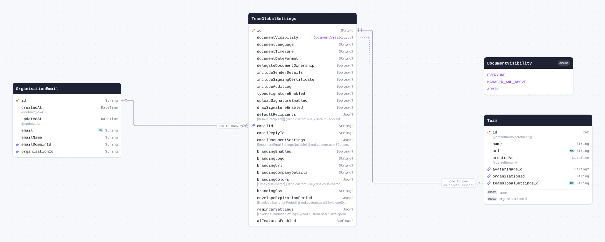

| Field                       | Type                                             | Constraints                                             | Default | Description                                                                   |
| --------------------------- | ------------------------------------------------ | ------------------------------------------------------- | ------- | ----------------------------------------------------------------------------- |
| `id`                        | `String`                                         | PK NOT NULL                                             |         |                                                                               |
| `documentVisibility`        | [`DocumentVisibility`](#enum-DocumentVisibility) | NULL                                                    |         |                                                                               |
| `documentLanguage`          | `String`                                         | NULL                                                    |         |                                                                               |
| `documentTimezone`          | `String`                                         | NULL                                                    |         |                                                                               |
| `documentDateFormat`        | `String`                                         | NULL                                                    |         |                                                                               |
| `delegateDocumentOwnership` | `Boolean`                                        | NULL                                                    |         |                                                                               |
| `includeSenderDetails`      | `Boolean`                                        | NULL                                                    |         |                                                                               |
| `includeSigningCertificate` | `Boolean`                                        | NULL                                                    |         |                                                                               |
| `includeAuditLog`           | `Boolean`                                        | NULL                                                    |         |                                                                               |
| `typedSignatureEnabled`     | `Boolean`                                        | NULL                                                    |         |                                                                               |
| `uploadSignatureEnabled`    | `Boolean`                                        | NULL                                                    |         |                                                                               |
| `drawSignatureEnabled`      | `Boolean`                                        | NULL                                                    |         |                                                                               |
| `defaultRecipients`         | `Json`                                           | NULL                                                    |         | [DefaultRecipient[]] @zod.custom.use(ZDefaultRecipientsSchema)                |
| `emailId`                   | `String`                                         | NULL → [OrganisationEmail.id](#model-OrganisationEmail) |         |                                                                               |
| `emailReplyTo`              | `String`                                         | NULL                                                    |         |                                                                               |
| `emailDocumentSettings`     | `Json`                                           | NULL                                                    |         | [DocumentEmailSettingsNullable] @zod.custom.use(ZDocumentEmailSettingsSchema) |
| `brandingEnabled`           | `Boolean`                                        | NULL                                                    |         |                                                                               |
| `brandingLogo`              | `String`                                         | NULL                                                    |         |                                                                               |
| `brandingUrl`               | `String`                                         | NULL                                                    |         |                                                                               |
| `brandingCompanyDetails`    | `String`                                         | NULL                                                    |         |                                                                               |
| `brandingColors`            | `Json`                                           | NULL                                                    |         | [TCssVarsSchema] @zod.custom.use(ZCssVarsSchema)                              |
| `brandingCss`               | `String`                                         | NULL                                                    |         |                                                                               |
| `envelopeExpirationPeriod`  | `Json`                                           | NULL                                                    |         | [EnvelopeExpirationPeriod] @zod.custom.use(ZEnvelopeExpirationPeriodSchema)   |
| `reminderSettings`          | `Json`                                           | NULL                                                    |         | [EnvelopeReminderSettings] @zod.custom.use(ZEnvelopeReminderSettingsSchema)   |
| `aiFeaturesEnabled`         | `Boolean`                                        | NULL                                                    |         |                                                                               |

#### References

- `emailId` → [OrganisationEmail.id](#model-OrganisationEmail) (many-to-one)

#### Referenced by

- `id` ← [Team.teamGlobalSettingsId](#model-Team) (one-to-one, on delete Cascade)

#### Definition

```sql
CREATE TABLE "TeamGlobalSettings" (
    "id" TEXT NOT NULL,
    "documentVisibility" "DocumentVisibility",
    "documentLanguage" TEXT,
    "documentTimezone" TEXT,
    "documentDateFormat" TEXT,
    "delegateDocumentOwnership" BOOLEAN,
    "includeSenderDetails" BOOLEAN,
    "includeSigningCertificate" BOOLEAN,
    "includeAuditLog" BOOLEAN,
    "typedSignatureEnabled" BOOLEAN,
    "uploadSignatureEnabled" BOOLEAN,
    "drawSignatureEnabled" BOOLEAN,
    "defaultRecipients" JSONB,
    "emailId" TEXT,
    "emailReplyTo" TEXT,
    "emailDocumentSettings" JSONB,
    "brandingEnabled" BOOLEAN,
    "brandingLogo" TEXT,
    "brandingUrl" TEXT,
    "brandingCompanyDetails" TEXT,
    "brandingColors" JSONB,
    "brandingCss" TEXT,
    "envelopeExpirationPeriod" JSONB,
    "reminderSettings" JSONB,
    "aiFeaturesEnabled" BOOLEAN,

    CONSTRAINT "TeamGlobalSettings_pkey" PRIMARY KEY ("id")
);

ALTER TABLE "TeamGlobalSettings" ADD CONSTRAINT "TeamGlobalSettings_emailId_fkey" FOREIGN KEY ("emailId") REFERENCES "OrganisationEmail"("id") ON DELETE SET NULL ON UPDATE CASCADE;
```

<details>
<summary>Queries and their SQL</summary>

**findMany**: Every row

```ts
await prisma.teamGlobalSettings.findMany();
```

```sql
SELECT
  "public"."TeamGlobalSettings"."id",
  "public"."TeamGlobalSettings"."documentVisibility"::text,
  "public"."TeamGlobalSettings"."documentLanguage",
  "public"."TeamGlobalSettings"."documentTimezone",
  "public"."TeamGlobalSettings"."documentDateFormat",
  "public"."TeamGlobalSettings"."delegateDocumentOwnership",
  "public"."TeamGlobalSettings"."includeSenderDetails",
  "public"."TeamGlobalSettings"."includeSigningCertificate",
  "public"."TeamGlobalSettings"."includeAuditLog",
  "public"."TeamGlobalSettings"."typedSignatureEnabled",
  "public"."TeamGlobalSettings"."uploadSignatureEnabled",
  "public"."TeamGlobalSettings"."drawSignatureEnabled",
  "public"."TeamGlobalSettings"."defaultRecipients",
  "public"."TeamGlobalSettings"."emailId",
  "public"."TeamGlobalSettings"."emailReplyTo",
  "public"."TeamGlobalSettings"."emailDocumentSettings",
  "public"."TeamGlobalSettings"."brandingEnabled",
  "public"."TeamGlobalSettings"."brandingLogo",
  "public"."TeamGlobalSettings"."brandingUrl",
  "public"."TeamGlobalSettings"."brandingCompanyDetails",
  "public"."TeamGlobalSettings"."brandingColors",
  "public"."TeamGlobalSettings"."brandingCss",
  "public"."TeamGlobalSettings"."envelopeExpirationPeriod",
  "public"."TeamGlobalSettings"."reminderSettings",
  "public"."TeamGlobalSettings"."aiFeaturesEnabled"
FROM
  "public"."TeamGlobalSettings"
WHERE
  1 = 1
OFFSET
  $1
-- params: ["0"]
```

**count**: How many rows there are

```ts
await prisma.teamGlobalSettings.count();
```

```sql
SELECT
  COUNT(*) AS "_count$_all"
FROM
  (
    SELECT
      "public"."TeamGlobalSettings"."id"
    FROM
      "public"."TeamGlobalSettings"
    WHERE
      1 = 1
    OFFSET
      $1
  ) AS "sub"
-- params: ["0"]
```

**findMany**: Every row with its relations

```ts
await prisma.teamGlobalSettings.findMany({ include: { team: true, email: true } });
```

```sql
SELECT
  "public"."TeamGlobalSettings"."id",
  "public"."TeamGlobalSettings"."documentVisibility"::text,
  "public"."TeamGlobalSettings"."documentLanguage",
  "public"."TeamGlobalSettings"."documentTimezone",
  "public"."TeamGlobalSettings"."documentDateFormat",
  "public"."TeamGlobalSettings"."delegateDocumentOwnership",
  "public"."TeamGlobalSettings"."includeSenderDetails",
  "public"."TeamGlobalSettings"."includeSigningCertificate",
  "public"."TeamGlobalSettings"."includeAuditLog",
  "public"."TeamGlobalSettings"."typedSignatureEnabled",
  "public"."TeamGlobalSettings"."uploadSignatureEnabled",
  "public"."TeamGlobalSettings"."drawSignatureEnabled",
  "public"."TeamGlobalSettings"."defaultRecipients",
  "public"."TeamGlobalSettings"."emailId",
  "public"."TeamGlobalSettings"."emailReplyTo",
  "public"."TeamGlobalSettings"."emailDocumentSettings",
  "public"."TeamGlobalSettings"."brandingEnabled",
  "public"."TeamGlobalSettings"."brandingLogo",
  "public"."TeamGlobalSettings"."brandingUrl",
  "public"."TeamGlobalSettings"."brandingCompanyDetails",
  "public"."TeamGlobalSettings"."brandingColors",
  "public"."TeamGlobalSettings"."brandingCss",
  "public"."TeamGlobalSettings"."envelopeExpirationPeriod",
  "public"."TeamGlobalSettings"."reminderSettings",
  "public"."TeamGlobalSettings"."aiFeaturesEnabled"
FROM
  "public"."TeamGlobalSettings"
WHERE
  1 = 1
OFFSET
  $1
-- params: ["0"]

SELECT
  "public"."Team"."id",
  "public"."Team"."name",
  "public"."Team"."url",
  "public"."Team"."createdAt",
  "public"."Team"."avatarImageId",
  "public"."Team"."organisationId",
  "public"."Team"."teamGlobalSettingsId"
FROM
  "public"."Team"
WHERE
  "public"."Team"."teamGlobalSettingsId" IN ($1)
OFFSET
  $2
-- params: ["<id of the rows above>","0"]

SELECT
  "public"."OrganisationEmail"."id",
  "public"."OrganisationEmail"."createdAt",
  "public"."OrganisationEmail"."updatedAt",
  "public"."OrganisationEmail"."email",
  "public"."OrganisationEmail"."emailName",
  "public"."OrganisationEmail"."emailDomainId",
  "public"."OrganisationEmail"."organisationId"
FROM
  "public"."OrganisationEmail"
WHERE
  "public"."OrganisationEmail"."id" IN ($1)
OFFSET
  $2
-- params: ["<emailId of the rows above>","0"]
```

**findUnique**: One row by what is unique to it

```ts
await prisma.teamGlobalSettings.findUnique({ where: { id: "example" } });
```

```sql
SELECT
  "public"."TeamGlobalSettings"."id",
  "public"."TeamGlobalSettings"."documentVisibility"::text,
  "public"."TeamGlobalSettings"."documentLanguage",
  "public"."TeamGlobalSettings"."documentTimezone",
  "public"."TeamGlobalSettings"."documentDateFormat",
  "public"."TeamGlobalSettings"."delegateDocumentOwnership",
  "public"."TeamGlobalSettings"."includeSenderDetails",
  "public"."TeamGlobalSettings"."includeSigningCertificate",
  "public"."TeamGlobalSettings"."includeAuditLog",
  "public"."TeamGlobalSettings"."typedSignatureEnabled",
  "public"."TeamGlobalSettings"."uploadSignatureEnabled",
  "public"."TeamGlobalSettings"."drawSignatureEnabled",
  "public"."TeamGlobalSettings"."defaultRecipients",
  "public"."TeamGlobalSettings"."emailId",
  "public"."TeamGlobalSettings"."emailReplyTo",
  "public"."TeamGlobalSettings"."emailDocumentSettings",
  "public"."TeamGlobalSettings"."brandingEnabled",
  "public"."TeamGlobalSettings"."brandingLogo",
  "public"."TeamGlobalSettings"."brandingUrl",
  "public"."TeamGlobalSettings"."brandingCompanyDetails",
  "public"."TeamGlobalSettings"."brandingColors",
  "public"."TeamGlobalSettings"."brandingCss",
  "public"."TeamGlobalSettings"."envelopeExpirationPeriod",
  "public"."TeamGlobalSettings"."reminderSettings",
  "public"."TeamGlobalSettings"."aiFeaturesEnabled"
FROM
  "public"."TeamGlobalSettings"
WHERE
  (
    "public"."TeamGlobalSettings"."id" = $1
    AND 1 = 1
  )
LIMIT
  $2
OFFSET
  $3
-- params: ["example","1","0"]
```

**create**: Create a row

```ts
await prisma.teamGlobalSettings.create({ data: { id: "example" } });
```

```sql
INSERT INTO
  "public"."TeamGlobalSettings" ("id")
VALUES
  ($1)
RETURNING
  "public"."TeamGlobalSettings"."id",
  "public"."TeamGlobalSettings"."documentVisibility"::text,
  "public"."TeamGlobalSettings"."documentLanguage",
  "public"."TeamGlobalSettings"."documentTimezone",
  "public"."TeamGlobalSettings"."documentDateFormat",
  "public"."TeamGlobalSettings"."delegateDocumentOwnership",
  "public"."TeamGlobalSettings"."includeSenderDetails",
  "public"."TeamGlobalSettings"."includeSigningCertificate",
  "public"."TeamGlobalSettings"."includeAuditLog",
  "public"."TeamGlobalSettings"."typedSignatureEnabled",
  "public"."TeamGlobalSettings"."uploadSignatureEnabled",
  "public"."TeamGlobalSettings"."drawSignatureEnabled",
  "public"."TeamGlobalSettings"."defaultRecipients",
  "public"."TeamGlobalSettings"."emailId",
  "public"."TeamGlobalSettings"."emailReplyTo",
  "public"."TeamGlobalSettings"."emailDocumentSettings",
  "public"."TeamGlobalSettings"."brandingEnabled",
  "public"."TeamGlobalSettings"."brandingLogo",
  "public"."TeamGlobalSettings"."brandingUrl",
  "public"."TeamGlobalSettings"."brandingCompanyDetails",
  "public"."TeamGlobalSettings"."brandingColors",
  "public"."TeamGlobalSettings"."brandingCss",
  "public"."TeamGlobalSettings"."envelopeExpirationPeriod",
  "public"."TeamGlobalSettings"."reminderSettings",
  "public"."TeamGlobalSettings"."aiFeaturesEnabled"
-- params: ["example"]
```

**update**: Update a row

```ts
await prisma.teamGlobalSettings.update({
  where: { id: "example" },
  data: { documentVisibility: "EVERYONE" },
});
```

```sql
UPDATE "public"."TeamGlobalSettings"
SET
  "documentVisibility" = CAST($1::text AS "public"."DocumentVisibility")
WHERE
  (
    "public"."TeamGlobalSettings"."id" = $2
    AND 1 = 1
  )
RETURNING
  "public"."TeamGlobalSettings"."id",
  "public"."TeamGlobalSettings"."documentVisibility"::text,
  "public"."TeamGlobalSettings"."documentLanguage",
  "public"."TeamGlobalSettings"."documentTimezone",
  "public"."TeamGlobalSettings"."documentDateFormat",
  "public"."TeamGlobalSettings"."delegateDocumentOwnership",
  "public"."TeamGlobalSettings"."includeSenderDetails",
  "public"."TeamGlobalSettings"."includeSigningCertificate",
  "public"."TeamGlobalSettings"."includeAuditLog",
  "public"."TeamGlobalSettings"."typedSignatureEnabled",
  "public"."TeamGlobalSettings"."uploadSignatureEnabled",
  "public"."TeamGlobalSettings"."drawSignatureEnabled",
  "public"."TeamGlobalSettings"."defaultRecipients",
  "public"."TeamGlobalSettings"."emailId",
  "public"."TeamGlobalSettings"."emailReplyTo",
  "public"."TeamGlobalSettings"."emailDocumentSettings",
  "public"."TeamGlobalSettings"."brandingEnabled",
  "public"."TeamGlobalSettings"."brandingLogo",
  "public"."TeamGlobalSettings"."brandingUrl",
  "public"."TeamGlobalSettings"."brandingCompanyDetails",
  "public"."TeamGlobalSettings"."brandingColors",
  "public"."TeamGlobalSettings"."brandingCss",
  "public"."TeamGlobalSettings"."envelopeExpirationPeriod",
  "public"."TeamGlobalSettings"."reminderSettings",
  "public"."TeamGlobalSettings"."aiFeaturesEnabled"
-- params: ["EVERYONE","example"]
```

**delete**: Delete a row

```ts
await prisma.teamGlobalSettings.delete({ where: { id: "example" } });
```

```sql
DELETE FROM "public"."TeamGlobalSettings"
WHERE
  (
    "public"."TeamGlobalSettings"."id" = $1
    AND 1 = 1
  )
RETURNING
  "public"."TeamGlobalSettings"."id",
  "public"."TeamGlobalSettings"."documentVisibility"::text,
  "public"."TeamGlobalSettings"."documentLanguage",
  "public"."TeamGlobalSettings"."documentTimezone",
  "public"."TeamGlobalSettings"."documentDateFormat",
  "public"."TeamGlobalSettings"."delegateDocumentOwnership",
  "public"."TeamGlobalSettings"."includeSenderDetails",
  "public"."TeamGlobalSettings"."includeSigningCertificate",
  "public"."TeamGlobalSettings"."includeAuditLog",
  "public"."TeamGlobalSettings"."typedSignatureEnabled",
  "public"."TeamGlobalSettings"."uploadSignatureEnabled",
  "public"."TeamGlobalSettings"."drawSignatureEnabled",
  "public"."TeamGlobalSettings"."defaultRecipients",
  "public"."TeamGlobalSettings"."emailId",
  "public"."TeamGlobalSettings"."emailReplyTo",
  "public"."TeamGlobalSettings"."emailDocumentSettings",
  "public"."TeamGlobalSettings"."brandingEnabled",
  "public"."TeamGlobalSettings"."brandingLogo",
  "public"."TeamGlobalSettings"."brandingUrl",
  "public"."TeamGlobalSettings"."brandingCompanyDetails",
  "public"."TeamGlobalSettings"."brandingColors",
  "public"."TeamGlobalSettings"."brandingCss",
  "public"."TeamGlobalSettings"."envelopeExpirationPeriod",
  "public"."TeamGlobalSettings"."reminderSettings",
  "public"."TeamGlobalSettings"."aiFeaturesEnabled"
-- params: ["example"]
```

</details>

<a id="model-Team"></a>

### Team

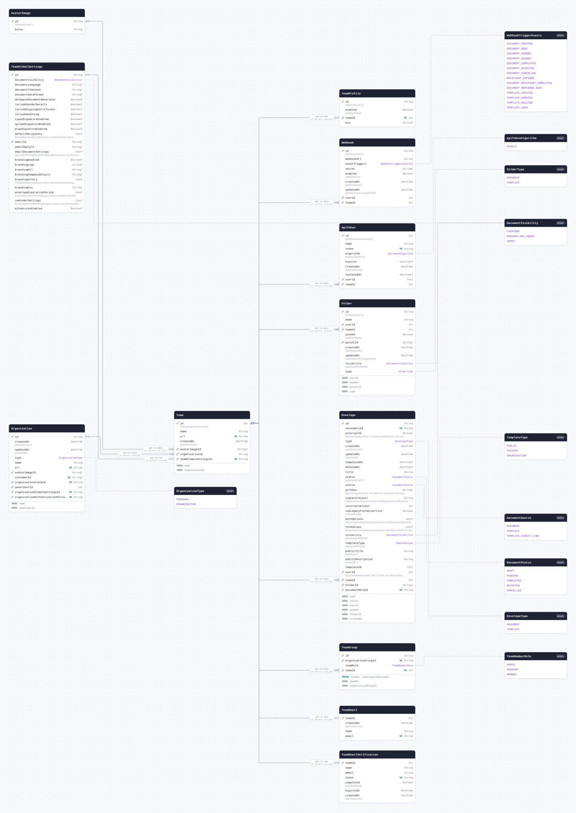

| Field                  | Type       | Constraints                                                          | Default           | Description |
| ---------------------- | ---------- | -------------------------------------------------------------------- | ----------------- | ----------- |
| `id`                   | `Int`      | PK NOT NULL                                                          | `autoincrement()` |             |
| `name`                 | `String`   | NOT NULL                                                             |                   |             |
| `url`                  | `String`   | UNIQUE NOT NULL                                                      |                   |             |
| `createdAt`            | `DateTime` | NOT NULL                                                             | `now()`           |             |
| `avatarImageId`        | `String`   | NULL → [AvatarImage.id](#model-AvatarImage)                          |                   |             |
| `organisationId`       | `String`   | NOT NULL → [Organisation.id](#model-Organisation)                    |                   |             |
| `teamGlobalSettingsId` | `String`   | UNIQUE NOT NULL → [TeamGlobalSettings.id](#model-TeamGlobalSettings) |                   |             |

#### Indexes

- `@@index([name])`
- `@@index([organisationId])`

#### References

- `avatarImageId` → [AvatarImage.id](#model-AvatarImage) (many-to-one, on delete SetNull)
- `organisationId` → [Organisation.id](#model-Organisation) (many-to-one, on delete Cascade)
- `teamGlobalSettingsId` → [TeamGlobalSettings.id](#model-TeamGlobalSettings) (one-to-one, on delete Cascade)

#### Referenced by

- `id` ← [TeamProfile.teamId](#model-TeamProfile) (one-to-one, on delete Cascade)
- `id` ← [Webhook.teamId](#model-Webhook) (one-to-many, on delete Cascade)
- `id` ← [ApiToken.teamId](#model-ApiToken) (one-to-many, on delete Cascade)
- `id` ← [Folder.teamId](#model-Folder) (one-to-many, on delete Cascade)
- `id` ← [Envelope.teamId](#model-Envelope) (one-to-many, on delete Cascade)
- `id` ← [TeamGroup.teamId](#model-TeamGroup) (one-to-many, on delete Cascade)
- `id` ← [TeamEmail.teamId](#model-TeamEmail) (one-to-one, on delete Cascade)
- `id` ← [TeamEmailVerification.teamId](#model-TeamEmailVerification) (one-to-one, on delete Cascade)

#### Definition

```sql
CREATE TABLE "Team" (
    "id" SERIAL NOT NULL,
    "name" TEXT NOT NULL,
    "url" TEXT NOT NULL,
    "createdAt" TIMESTAMP(3) NOT NULL DEFAULT CURRENT_TIMESTAMP,
    "avatarImageId" TEXT,
    "organisationId" TEXT NOT NULL,
    "teamGlobalSettingsId" TEXT NOT NULL,

    CONSTRAINT "Team_pkey" PRIMARY KEY ("id")
);

CREATE UNIQUE INDEX "Team_url_key" ON "Team"("url");

CREATE UNIQUE INDEX "Team_teamGlobalSettingsId_key" ON "Team"("teamGlobalSettingsId");

CREATE INDEX "Team_name_idx" ON "Team"("name");

CREATE INDEX "Team_organisationId_idx" ON "Team"("organisationId");

ALTER TABLE "Team" ADD CONSTRAINT "Team_avatarImageId_fkey" FOREIGN KEY ("avatarImageId") REFERENCES "AvatarImage"("id") ON DELETE SET NULL ON UPDATE CASCADE;

ALTER TABLE "Team" ADD CONSTRAINT "Team_organisationId_fkey" FOREIGN KEY ("organisationId") REFERENCES "Organisation"("id") ON DELETE CASCADE ON UPDATE CASCADE;

ALTER TABLE "Team" ADD CONSTRAINT "Team_teamGlobalSettingsId_fkey" FOREIGN KEY ("teamGlobalSettingsId") REFERENCES "TeamGlobalSettings"("id") ON DELETE CASCADE ON UPDATE CASCADE;
```

<details>
<summary>Queries and their SQL</summary>

**findMany**: Every row

```ts
await prisma.team.findMany();
```

```sql
SELECT
  "public"."Team"."id",
  "public"."Team"."name",
  "public"."Team"."url",
  "public"."Team"."createdAt",
  "public"."Team"."avatarImageId",
  "public"."Team"."organisationId",
  "public"."Team"."teamGlobalSettingsId"
FROM
  "public"."Team"
WHERE
  1 = 1
OFFSET
  $1
-- params: ["0"]
```

**count**: How many rows there are

```ts
await prisma.team.count();
```

```sql
SELECT
  COUNT(*) AS "_count$_all"
FROM
  (
    SELECT
      "public"."Team"."id"
    FROM
      "public"."Team"
    WHERE
      1 = 1
    OFFSET
      $1
  ) AS "sub"
-- params: ["0"]
```

**findMany**: Every row with its relations

```ts
await prisma.team.findMany({
  include: {
    teamEmail: true,
    emailVerification: true,
    avatarImage: true,
    profile: true,
    envelopes: true,
    folders: true,
    apiTokens: true,
    webhooks: true,
    teamGroups: true,
    organisation: true,
    teamGlobalSettings: true,
  },
});
```

```sql
SELECT
  "public"."Team"."id",
  "public"."Team"."name",
  "public"."Team"."url",
  "public"."Team"."createdAt",
  "public"."Team"."avatarImageId",
  "public"."Team"."organisationId",
  "public"."Team"."teamGlobalSettingsId"
FROM
  "public"."Team"
WHERE
  1 = 1
OFFSET
  $1
-- params: ["0"]

SELECT
  "public"."TeamEmail"."teamId",
  "public"."TeamEmail"."createdAt",
  "public"."TeamEmail"."name",
  "public"."TeamEmail"."email"
FROM
  "public"."TeamEmail"
WHERE
  "public"."TeamEmail"."teamId" IN ($1)
OFFSET
  $2
-- params: ["<id of the rows above>","0"]

SELECT
  "public"."TeamEmailVerification"."teamId",
  "public"."TeamEmailVerification"."name",
  "public"."TeamEmailVerification"."email",
  "public"."TeamEmailVerification"."token",
  "public"."TeamEmailVerification"."completed",
  "public"."TeamEmailVerification"."expiresAt",
  "public"."TeamEmailVerification"."createdAt"
FROM
  "public"."TeamEmailVerification"
WHERE
  "public"."TeamEmailVerification"."teamId" IN ($1)
OFFSET
  $2
-- params: ["<id of the rows above>","0"]

SELECT
  "public"."AvatarImage"."id",
  "public"."AvatarImage"."bytes"
FROM
  "public"."AvatarImage"
WHERE
  "public"."AvatarImage"."id" IN ($1)
OFFSET
  $2
-- params: ["<avatarImageId of the rows above>","0"]

SELECT
  "public"."TeamProfile"."id",
  "public"."TeamProfile"."enabled",
  "public"."TeamProfile"."teamId",
  "public"."TeamProfile"."bio"
FROM
  "public"."TeamProfile"
WHERE
  "public"."TeamProfile"."teamId" IN ($1)
OFFSET
  $2
-- params: ["<id of the rows above>","0"]

SELECT
  "public"."Envelope"."id",
  "public"."Envelope"."secondaryId",
  "public"."Envelope"."externalId",
  "public"."Envelope"."type"::text,
  "public"."Envelope"."createdAt",
  "public"."Envelope"."updatedAt",
  "public"."Envelope"."completedAt",
  "public"."Envelope"."deletedAt",
  "public"."Envelope"."title",
  "public"."Envelope"."status"::text,
  "public"."Envelope"."source"::text,
  "public"."Envelope"."qrToken",
  "public"."Envelope"."signatureLevel",
  "public"."Envelope"."internalVersion",
  "public"."Envelope"."useLegacyFieldInsertion",
  "public"."Envelope"."authOptions",
  "public"."Envelope"."formValues",
  "public"."Envelope"."visibility"::text,
  "public"."Envelope"."templateType"::text,
  "public"."Envelope"."publicTitle",
  "public"."Envelope"."publicDescription",
  "public"."Envelope"."templateId",
  "public"."Envelope"."userId",
  "public"."Envelope"."teamId",
  "public"."Envelope"."folderId",
  "public"."Envelope"."documentMetaId"
FROM
  "public"."Envelope"
WHERE
  "public"."Envelope"."teamId" IN ($1)
OFFSET
  $2
-- params: ["<id of the rows above>","0"]

SELECT
  "public"."Folder"."id",
  "public"."Folder"."name",
  "public"."Folder"."userId",
  "public"."Folder"."teamId",
  "public"."Folder"."pinned",
  "public"."Folder"."parentId",
  "public"."Folder"."createdAt",
  "public"."Folder"."updatedAt",
  "public"."Folder"."visibility"::text,
  "public"."Folder"."type"::text
FROM
  "public"."Folder"
WHERE
  "public"."Folder"."teamId" IN ($1)
OFFSET
  $2
-- params: ["<id of the rows above>","0"]

SELECT
  "public"."ApiToken"."id",
  "public"."ApiToken"."name",
  "public"."ApiToken"."token",
  "public"."ApiToken"."algorithm"::text,
  "public"."ApiToken"."expires",
  "public"."ApiToken"."createdAt",
  "public"."ApiToken"."lastUsedAt",
  "public"."ApiToken"."userId",
  "public"."ApiToken"."teamId"
FROM
  "public"."ApiToken"
WHERE
  "public"."ApiToken"."teamId" IN ($1)
OFFSET
  $2
-- params: ["<id of the rows above>","0"]

SELECT
  "public"."Webhook"."id",
  "public"."Webhook"."webhookUrl",
  "public"."Webhook"."eventTriggers"::text[],
  "public"."Webhook"."secret",
  "public"."Webhook"."enabled",
  "public"."Webhook"."createdAt",
  "public"."Webhook"."updatedAt",
  "public"."Webhook"."userId",
  "public"."Webhook"."teamId"
FROM
  "public"."Webhook"
WHERE
  "public"."Webhook"."teamId" IN ($1)
OFFSET
  $2
-- params: ["<id of the rows above>","0"]

SELECT
  "public"."TeamGroup"."id",
  "public"."TeamGroup"."organisationGroupId",
  "public"."TeamGroup"."teamRole"::text,
  "public"."TeamGroup"."teamId"
FROM
  "public"."TeamGroup"
WHERE
  "public"."TeamGroup"."teamId" IN ($1)
OFFSET
  $2
-- params: ["<id of the rows above>","0"]

SELECT
  "public"."Organisation"."id",
  "public"."Organisation"."createdAt",
  "public"."Organisation"."updatedAt",
  "public"."Organisation"."type"::text,
  "public"."Organisation"."name",
  "public"."Organisation"."url",
  "public"."Organisation"."avatarImageId",
  "public"."Organisation"."customerId",
  "public"."Organisation"."organisationClaimId",
  "public"."Organisation"."ownerUserId",
  "public"."Organisation"."organisationGlobalSettingsId",
  "public"."Organisation"."organisationAuthenticationPortalId"
FROM
  "public"."Organisation"
WHERE
  "public"."Organisation"."id" IN ($1)
OFFSET
  $2
-- params: ["<organisationId of the rows above>","0"]

SELECT
  "public"."TeamGlobalSettings"."id",
  "public"."TeamGlobalSettings"."documentVisibility"::text,
  "public"."TeamGlobalSettings"."documentLanguage",
  "public"."TeamGlobalSettings"."documentTimezone",
  "public"."TeamGlobalSettings"."documentDateFormat",
  "public"."TeamGlobalSettings"."delegateDocumentOwnership",
  "public"."TeamGlobalSettings"."includeSenderDetails",
  "public"."TeamGlobalSettings"."includeSigningCertificate",
  "public"."TeamGlobalSettings"."includeAuditLog",
  "public"."TeamGlobalSettings"."typedSignatureEnabled",
  "public"."TeamGlobalSettings"."uploadSignatureEnabled",
  "public"."TeamGlobalSettings"."drawSignatureEnabled",
  "public"."TeamGlobalSettings"."defaultRecipients",
  "public"."TeamGlobalSettings"."emailId",
  "public"."TeamGlobalSettings"."emailReplyTo",
  "public"."TeamGlobalSettings"."emailDocumentSettings",
  "public"."TeamGlobalSettings"."brandingEnabled",
  "public"."TeamGlobalSettings"."brandingLogo",
  "public"."TeamGlobalSettings"."brandingUrl",
  "public"."TeamGlobalSettings"."brandingCompanyDetails",
  "public"."TeamGlobalSettings"."brandingColors",
  "public"."TeamGlobalSettings"."brandingCss",
  "public"."TeamGlobalSettings"."envelopeExpirationPeriod",
  "public"."TeamGlobalSettings"."reminderSettings",
  "public"."TeamGlobalSettings"."aiFeaturesEnabled"
FROM
  "public"."TeamGlobalSettings"
WHERE
  "public"."TeamGlobalSettings"."id" IN ($1)
OFFSET
  $2
-- params: ["<teamGlobalSettingsId of the rows above>","0"]
```

**findUnique**: One row by what is unique to it

```ts
await prisma.team.findUnique({ where: { id: 1 } });
```

```sql
SELECT
  "public"."Team"."id",
  "public"."Team"."name",
  "public"."Team"."url",
  "public"."Team"."createdAt",
  "public"."Team"."avatarImageId",
  "public"."Team"."organisationId",
  "public"."Team"."teamGlobalSettingsId"
FROM
  "public"."Team"
WHERE
  (
    "public"."Team"."id" = $1
    AND 1 = 1
  )
LIMIT
  $2
OFFSET
  $3
-- params: ["1","1","0"]
```

**create**: Create a row

```ts
await prisma.team.create({
  data: {
    name: "example",
    url: "example",
    organisationId: "example",
    teamGlobalSettingsId: "example",
  },
});
```

```sql
INSERT INTO
  "public"."Team" (
    "name",
    "url",
    "createdAt",
    "organisationId",
    "teamGlobalSettingsId"
  )
VALUES
  ($1, $2, $3, $4, $5)
RETURNING
  "public"."Team"."id",
  "public"."Team"."name",
  "public"."Team"."url",
  "public"."Team"."createdAt",
  "public"."Team"."avatarImageId",
  "public"."Team"."organisationId",
  "public"."Team"."teamGlobalSettingsId"
-- params: ["example","example","<now()>","example","example"]
```

**update**: Update a row

```ts
await prisma.team.update({ where: { id: 1 }, data: { name: "example" } });
```

```sql
UPDATE "public"."Team"
SET
  "name" = $1
WHERE
  (
    "public"."Team"."id" = $2
    AND 1 = 1
  )
RETURNING
  "public"."Team"."id",
  "public"."Team"."name",
  "public"."Team"."url",
  "public"."Team"."createdAt",
  "public"."Team"."avatarImageId",
  "public"."Team"."organisationId",
  "public"."Team"."teamGlobalSettingsId"
-- params: ["example","1"]
```

**delete**: Delete a row

```ts
await prisma.team.delete({ where: { id: 1 } });
```

```sql
DELETE FROM "public"."Team"
WHERE
  (
    "public"."Team"."id" = $1
    AND 1 = 1
  )
RETURNING
  "public"."Team"."id",
  "public"."Team"."name",
  "public"."Team"."url",
  "public"."Team"."createdAt",
  "public"."Team"."avatarImageId",
  "public"."Team"."organisationId",
  "public"."Team"."teamGlobalSettingsId"
-- params: ["1"]
```

</details>

<a id="model-TeamEmail"></a>

### TeamEmail


| Field       | Type       | Constraints                          | Default | Description |
| ----------- | ---------- | ------------------------------------ | ------- | ----------- |
| `teamId`    | `Int`      | PK NOT NULL → [Team.id](#model-Team) |         |             |
| `createdAt` | `DateTime` | NOT NULL                             | `now()` |             |
| `name`      | `String`   | NOT NULL                             |         |             |
| `email`     | `String`   | UNIQUE NOT NULL                      |         |             |

#### References

- `teamId` → [Team.id](#model-Team) (one-to-one, on delete Cascade)

#### Definition

```sql
CREATE TABLE "TeamEmail" (
    "teamId" INTEGER NOT NULL,
    "createdAt" TIMESTAMP(3) NOT NULL DEFAULT CURRENT_TIMESTAMP,
    "name" TEXT NOT NULL,
    "email" TEXT NOT NULL,

    CONSTRAINT "TeamEmail_pkey" PRIMARY KEY ("teamId")
);

CREATE UNIQUE INDEX "TeamEmail_teamId_key" ON "TeamEmail"("teamId");

CREATE UNIQUE INDEX "TeamEmail_email_key" ON "TeamEmail"("email");

ALTER TABLE "TeamEmail" ADD CONSTRAINT "TeamEmail_teamId_fkey" FOREIGN KEY ("teamId") REFERENCES "Team"("id") ON DELETE CASCADE ON UPDATE CASCADE;
```

<details>
<summary>Queries and their SQL</summary>

**findMany**: Every row

```ts
await prisma.teamEmail.findMany();
```

```sql
SELECT
  "public"."TeamEmail"."teamId",
  "public"."TeamEmail"."createdAt",
  "public"."TeamEmail"."name",
  "public"."TeamEmail"."email"
FROM
  "public"."TeamEmail"
WHERE
  1 = 1
OFFSET
  $1
-- params: ["0"]
```

**count**: How many rows there are

```ts
await prisma.teamEmail.count();
```

```sql
SELECT
  COUNT(*) AS "_count$_all"
FROM
  (
    SELECT
      "public"."TeamEmail"."teamId"
    FROM
      "public"."TeamEmail"
    WHERE
      1 = 1
    OFFSET
      $1
  ) AS "sub"
-- params: ["0"]
```

**findMany**: Every row with its relations

```ts
await prisma.teamEmail.findMany({ include: { team: true } });
```

```sql
SELECT
  "public"."TeamEmail"."teamId",
  "public"."TeamEmail"."createdAt",
  "public"."TeamEmail"."name",
  "public"."TeamEmail"."email"
FROM
  "public"."TeamEmail"
WHERE
  1 = 1
OFFSET
  $1
-- params: ["0"]

SELECT
  "public"."Team"."id",
  "public"."Team"."name",
  "public"."Team"."url",
  "public"."Team"."createdAt",
  "public"."Team"."avatarImageId",
  "public"."Team"."organisationId",
  "public"."Team"."teamGlobalSettingsId"
FROM
  "public"."Team"
WHERE
  "public"."Team"."id" IN ($1)
OFFSET
  $2
-- params: ["<teamId of the rows above>","0"]
```

**findUnique**: One row by what is unique to it

```ts
await prisma.teamEmail.findUnique({ where: { teamId: 1 } });
```

```sql
SELECT
  "public"."TeamEmail"."teamId",
  "public"."TeamEmail"."createdAt",
  "public"."TeamEmail"."name",
  "public"."TeamEmail"."email"
FROM
  "public"."TeamEmail"
WHERE
  (
    "public"."TeamEmail"."teamId" = $1
    AND 1 = 1
  )
LIMIT
  $2
OFFSET
  $3
-- params: ["1","1","0"]
```

**create**: Create a row

```ts
await prisma.teamEmail.create({ data: { teamId: 1, name: "example", email: "example" } });
```

```sql
INSERT INTO
  "public"."TeamEmail" ("teamId", "createdAt", "name", "email")
VALUES
  ($1, $2, $3, $4)
RETURNING
  "public"."TeamEmail"."teamId",
  "public"."TeamEmail"."createdAt",
  "public"."TeamEmail"."name",
  "public"."TeamEmail"."email"
-- params: ["1","<now()>","example","example"]
```

**update**: Update a row

```ts
await prisma.teamEmail.update({
  where: { teamId: 1 },
  data: { createdAt: new Date("2026-01-01T00:00:00.000Z") },
});
```

```sql
UPDATE "public"."TeamEmail"
SET
  "createdAt" = $1
WHERE
  (
    "public"."TeamEmail"."teamId" = $2
    AND 1 = 1
  )
RETURNING
  "public"."TeamEmail"."teamId",
  "public"."TeamEmail"."createdAt",
  "public"."TeamEmail"."name",
  "public"."TeamEmail"."email"
-- params: ["2026-01-01T00:00:00.000Z","1"]
```

**delete**: Delete a row

```ts
await prisma.teamEmail.delete({ where: { teamId: 1 } });
```

```sql
DELETE FROM "public"."TeamEmail"
WHERE
  (
    "public"."TeamEmail"."teamId" = $1
    AND 1 = 1
  )
RETURNING
  "public"."TeamEmail"."teamId",
  "public"."TeamEmail"."createdAt",
  "public"."TeamEmail"."name",
  "public"."TeamEmail"."email"
-- params: ["1"]
```

</details>

<a id="model-TeamEmailVerification"></a>

### TeamEmailVerification

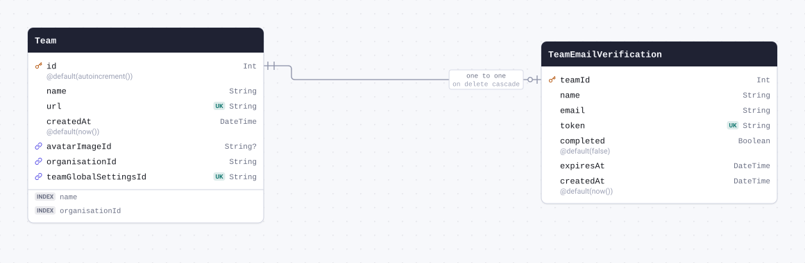

| Field       | Type       | Constraints                          | Default | Description |
| ----------- | ---------- | ------------------------------------ | ------- | ----------- |
| `teamId`    | `Int`      | PK NOT NULL → [Team.id](#model-Team) |         |             |
| `name`      | `String`   | NOT NULL                             |         |             |
| `email`     | `String`   | NOT NULL                             |         |             |
| `token`     | `String`   | UNIQUE NOT NULL                      |         |             |
| `completed` | `Boolean`  | NOT NULL                             | `false` |             |
| `expiresAt` | `DateTime` | NOT NULL                             |         |             |
| `createdAt` | `DateTime` | NOT NULL                             | `now()` |             |

#### References

- `teamId` → [Team.id](#model-Team) (one-to-one, on delete Cascade)

#### Definition

```sql
CREATE TABLE "TeamEmailVerification" (
    "teamId" INTEGER NOT NULL,
    "name" TEXT NOT NULL,
    "email" TEXT NOT NULL,
    "token" TEXT NOT NULL,
    "completed" BOOLEAN NOT NULL DEFAULT false,
    "expiresAt" TIMESTAMP(3) NOT NULL,
    "createdAt" TIMESTAMP(3) NOT NULL DEFAULT CURRENT_TIMESTAMP,

    CONSTRAINT "TeamEmailVerification_pkey" PRIMARY KEY ("teamId")
);

CREATE UNIQUE INDEX "TeamEmailVerification_teamId_key" ON "TeamEmailVerification"("teamId");

CREATE UNIQUE INDEX "TeamEmailVerification_token_key" ON "TeamEmailVerification"("token");

ALTER TABLE "TeamEmailVerification" ADD CONSTRAINT "TeamEmailVerification_teamId_fkey" FOREIGN KEY ("teamId") REFERENCES "Team"("id") ON DELETE CASCADE ON UPDATE CASCADE;
```

<details>
<summary>Queries and their SQL</summary>

**findMany**: Every row

```ts
await prisma.teamEmailVerification.findMany();
```

```sql
SELECT
  "public"."TeamEmailVerification"."teamId",
  "public"."TeamEmailVerification"."name",
  "public"."TeamEmailVerification"."email",
  "public"."TeamEmailVerification"."token",
  "public"."TeamEmailVerification"."completed",
  "public"."TeamEmailVerification"."expiresAt",
  "public"."TeamEmailVerification"."createdAt"
FROM
  "public"."TeamEmailVerification"
WHERE
  1 = 1
OFFSET
  $1
-- params: ["0"]
```

**count**: How many rows there are

```ts
await prisma.teamEmailVerification.count();
```

```sql
SELECT
  COUNT(*) AS "_count$_all"
FROM
  (
    SELECT
      "public"."TeamEmailVerification"."teamId"
    FROM
      "public"."TeamEmailVerification"
    WHERE
      1 = 1
    OFFSET
      $1
  ) AS "sub"
-- params: ["0"]
```

**findMany**: Every row with its relations

```ts
await prisma.teamEmailVerification.findMany({ include: { team: true } });
```

```sql
SELECT
  "public"."TeamEmailVerification"."teamId",
  "public"."TeamEmailVerification"."name",
  "public"."TeamEmailVerification"."email",
  "public"."TeamEmailVerification"."token",
  "public"."TeamEmailVerification"."completed",
  "public"."TeamEmailVerification"."expiresAt",
  "public"."TeamEmailVerification"."createdAt"
FROM
  "public"."TeamEmailVerification"
WHERE
  1 = 1
OFFSET
  $1
-- params: ["0"]

SELECT
  "public"."Team"."id",
  "public"."Team"."name",
  "public"."Team"."url",
  "public"."Team"."createdAt",
  "public"."Team"."avatarImageId",
  "public"."Team"."organisationId",
  "public"."Team"."teamGlobalSettingsId"
FROM
  "public"."Team"
WHERE
  "public"."Team"."id" IN ($1)
OFFSET
  $2
-- params: ["<teamId of the rows above>","0"]
```

**findUnique**: One row by what is unique to it

```ts
await prisma.teamEmailVerification.findUnique({ where: { teamId: 1 } });
```

```sql
SELECT
  "public"."TeamEmailVerification"."teamId",
  "public"."TeamEmailVerification"."name",
  "public"."TeamEmailVerification"."email",
  "public"."TeamEmailVerification"."token",
  "public"."TeamEmailVerification"."completed",
  "public"."TeamEmailVerification"."expiresAt",
  "public"."TeamEmailVerification"."createdAt"
FROM
  "public"."TeamEmailVerification"
WHERE
  (
    "public"."TeamEmailVerification"."teamId" = $1
    AND 1 = 1
  )
LIMIT
  $2
OFFSET
  $3
-- params: ["1","1","0"]
```

**create**: Create a row

```ts
await prisma.teamEmailVerification.create({
  data: {
    teamId: 1,
    name: "example",
    email: "example",
    token: "example",
    expiresAt: new Date("2026-01-01T00:00:00.000Z"),
  },
});
```

```sql
INSERT INTO
  "public"."TeamEmailVerification" (
    "teamId",
    "name",
    "email",
    "token",
    "completed",
    "expiresAt",
    "createdAt"
  )
VALUES
  ($1, $2, $3, $4, $5, $6, $7)
RETURNING
  "public"."TeamEmailVerification"."teamId",
  "public"."TeamEmailVerification"."name",
  "public"."TeamEmailVerification"."email",
  "public"."TeamEmailVerification"."token",
  "public"."TeamEmailVerification"."completed",
  "public"."TeamEmailVerification"."expiresAt",
  "public"."TeamEmailVerification"."createdAt"
-- params: ["1","example","example","example",false,"2026-01-01T00:00:00.000Z","<now()>"]
```

**update**: Update a row

```ts
await prisma.teamEmailVerification.update({ where: { teamId: 1 }, data: { name: "example" } });
```

```sql
UPDATE "public"."TeamEmailVerification"
SET
  "name" = $1
WHERE
  (
    "public"."TeamEmailVerification"."teamId" = $2
    AND 1 = 1
  )
RETURNING
  "public"."TeamEmailVerification"."teamId",
  "public"."TeamEmailVerification"."name",
  "public"."TeamEmailVerification"."email",
  "public"."TeamEmailVerification"."token",
  "public"."TeamEmailVerification"."completed",
  "public"."TeamEmailVerification"."expiresAt",
  "public"."TeamEmailVerification"."createdAt"
-- params: ["example","1"]
```

**delete**: Delete a row

```ts
await prisma.teamEmailVerification.delete({ where: { teamId: 1 } });
```

```sql
DELETE FROM "public"."TeamEmailVerification"
WHERE
  (
    "public"."TeamEmailVerification"."teamId" = $1
    AND 1 = 1
  )
RETURNING
  "public"."TeamEmailVerification"."teamId",
  "public"."TeamEmailVerification"."name",
  "public"."TeamEmailVerification"."email",
  "public"."TeamEmailVerification"."token",
  "public"."TeamEmailVerification"."completed",
  "public"."TeamEmailVerification"."expiresAt",
  "public"."TeamEmailVerification"."createdAt"
-- params: ["1"]
```

</details>

<a id="model-TemplateDirectLink"></a>

### TemplateDirectLink

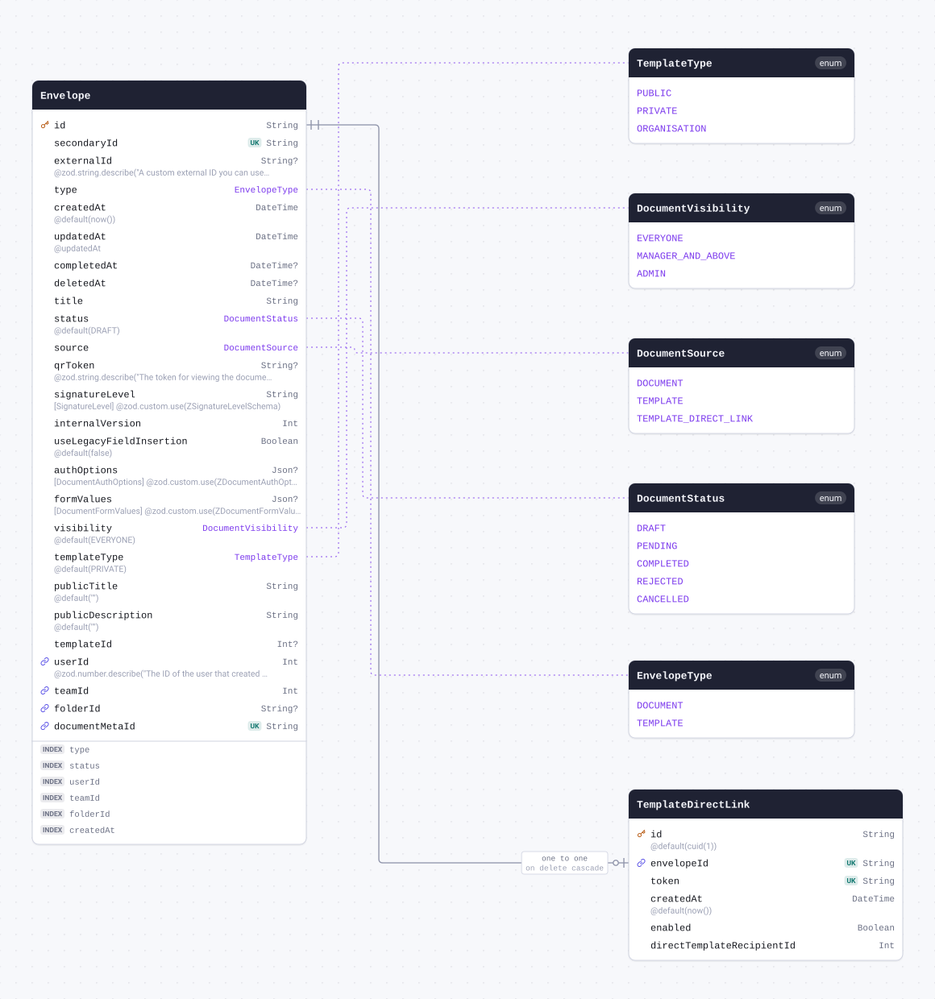

| Field                       | Type       | Constraints                                      | Default   | Description |
| --------------------------- | ---------- | ------------------------------------------------ | --------- | ----------- |
| `id`                        | `String`   | PK NOT NULL                                      | `cuid(1)` |             |
| `envelopeId`                | `String`   | UNIQUE NOT NULL → [Envelope.id](#model-Envelope) |           |             |
| `token`                     | `String`   | UNIQUE NOT NULL                                  |           |             |
| `createdAt`                 | `DateTime` | NOT NULL                                         | `now()`   |             |
| `enabled`                   | `Boolean`  | NOT NULL                                         |           |             |
| `directTemplateRecipientId` | `Int`      | NOT NULL                                         |           |             |

#### References

- `envelopeId` → [Envelope.id](#model-Envelope) (one-to-one, on delete Cascade)

#### Definition

```sql
CREATE TABLE "TemplateDirectLink" (
    "id" TEXT NOT NULL,
    "envelopeId" TEXT NOT NULL,
    "token" TEXT NOT NULL,
    "createdAt" TIMESTAMP(3) NOT NULL DEFAULT CURRENT_TIMESTAMP,
    "enabled" BOOLEAN NOT NULL,
    "directTemplateRecipientId" INTEGER NOT NULL,

    CONSTRAINT "TemplateDirectLink_pkey" PRIMARY KEY ("id")
);

CREATE UNIQUE INDEX "TemplateDirectLink_id_key" ON "TemplateDirectLink"("id");

CREATE UNIQUE INDEX "TemplateDirectLink_envelopeId_key" ON "TemplateDirectLink"("envelopeId");

CREATE UNIQUE INDEX "TemplateDirectLink_token_key" ON "TemplateDirectLink"("token");

ALTER TABLE "TemplateDirectLink" ADD CONSTRAINT "TemplateDirectLink_envelopeId_fkey" FOREIGN KEY ("envelopeId") REFERENCES "Envelope"("id") ON DELETE CASCADE ON UPDATE CASCADE;
```

<details>
<summary>Queries and their SQL</summary>

**findMany**: Every row

```ts
await prisma.templateDirectLink.findMany();
```

```sql
SELECT
  "public"."TemplateDirectLink"."id",
  "public"."TemplateDirectLink"."envelopeId",
  "public"."TemplateDirectLink"."token",
  "public"."TemplateDirectLink"."createdAt",
  "public"."TemplateDirectLink"."enabled",
  "public"."TemplateDirectLink"."directTemplateRecipientId"
FROM
  "public"."TemplateDirectLink"
WHERE
  1 = 1
OFFSET
  $1
-- params: ["0"]
```

**count**: How many rows there are

```ts
await prisma.templateDirectLink.count();
```

```sql
SELECT
  COUNT(*) AS "_count$_all"
FROM
  (
    SELECT
      "public"."TemplateDirectLink"."id"
    FROM
      "public"."TemplateDirectLink"
    WHERE
      1 = 1
    OFFSET
      $1
  ) AS "sub"
-- params: ["0"]
```

**findMany**: Every row with its relations

```ts
await prisma.templateDirectLink.findMany({ include: { envelope: true } });
```

```sql
SELECT
  "public"."TemplateDirectLink"."id",
  "public"."TemplateDirectLink"."envelopeId",
  "public"."TemplateDirectLink"."token",
  "public"."TemplateDirectLink"."createdAt",
  "public"."TemplateDirectLink"."enabled",
  "public"."TemplateDirectLink"."directTemplateRecipientId"
FROM
  "public"."TemplateDirectLink"
WHERE
  1 = 1
OFFSET
  $1
-- params: ["0"]

SELECT
  "public"."Envelope"."id",
  "public"."Envelope"."secondaryId",
  "public"."Envelope"."externalId",
  "public"."Envelope"."type"::text,
  "public"."Envelope"."createdAt",
  "public"."Envelope"."updatedAt",
  "public"."Envelope"."completedAt",
  "public"."Envelope"."deletedAt",
  "public"."Envelope"."title",
  "public"."Envelope"."status"::text,
  "public"."Envelope"."source"::text,
  "public"."Envelope"."qrToken",
  "public"."Envelope"."signatureLevel",
  "public"."Envelope"."internalVersion",
  "public"."Envelope"."useLegacyFieldInsertion",
  "public"."Envelope"."authOptions",
  "public"."Envelope"."formValues",
  "public"."Envelope"."visibility"::text,
  "public"."Envelope"."templateType"::text,
  "public"."Envelope"."publicTitle",
  "public"."Envelope"."publicDescription",
  "public"."Envelope"."templateId",
  "public"."Envelope"."userId",
  "public"."Envelope"."teamId",
  "public"."Envelope"."folderId",
  "public"."Envelope"."documentMetaId"
FROM
  "public"."Envelope"
WHERE
  "public"."Envelope"."id" IN ($1)
OFFSET
  $2
-- params: ["<envelopeId of the rows above>","0"]
```

**findUnique**: One row by what is unique to it

```ts
await prisma.templateDirectLink.findUnique({ where: { id: "example" } });
```

```sql
SELECT
  "public"."TemplateDirectLink"."id",
  "public"."TemplateDirectLink"."envelopeId",
  "public"."TemplateDirectLink"."token",
  "public"."TemplateDirectLink"."createdAt",
  "public"."TemplateDirectLink"."enabled",
  "public"."TemplateDirectLink"."directTemplateRecipientId"
FROM
  "public"."TemplateDirectLink"
WHERE
  (
    "public"."TemplateDirectLink"."id" = $1
    AND 1 = 1
  )
LIMIT
  $2
OFFSET
  $3
-- params: ["example","1","0"]
```

**create**: Create a row

```ts
await prisma.templateDirectLink.create({
  data: { envelopeId: "example", token: "example", enabled: true, directTemplateRecipientId: 1 },
});
```

```sql
INSERT INTO
  "public"."TemplateDirectLink" (
    "id",
    "envelopeId",
    "token",
    "createdAt",
    "enabled",
    "directTemplateRecipientId"
  )
VALUES
  ($1, $2, $3, $4, $5, $6)
RETURNING
  "public"."TemplateDirectLink"."id",
  "public"."TemplateDirectLink"."envelopeId",
  "public"."TemplateDirectLink"."token",
  "public"."TemplateDirectLink"."createdAt",
  "public"."TemplateDirectLink"."enabled",
  "public"."TemplateDirectLink"."directTemplateRecipientId"
-- params: ["<cuid(1)>","example","example","<now()>",true,"1"]
```

**update**: Update a row

```ts
await prisma.templateDirectLink.update({ where: { id: "example" }, data: { token: "example" } });
```

```sql
UPDATE "public"."TemplateDirectLink"
SET
  "token" = $1
WHERE
  (
    "public"."TemplateDirectLink"."id" = $2
    AND 1 = 1
  )
RETURNING
  "public"."TemplateDirectLink"."id",
  "public"."TemplateDirectLink"."envelopeId",
  "public"."TemplateDirectLink"."token",
  "public"."TemplateDirectLink"."createdAt",
  "public"."TemplateDirectLink"."enabled",
  "public"."TemplateDirectLink"."directTemplateRecipientId"
-- params: ["example","example"]
```

**delete**: Delete a row

```ts
await prisma.templateDirectLink.delete({ where: { id: "example" } });
```

```sql
DELETE FROM "public"."TemplateDirectLink"
WHERE
  (
    "public"."TemplateDirectLink"."id" = $1
    AND 1 = 1
  )
RETURNING
  "public"."TemplateDirectLink"."id",
  "public"."TemplateDirectLink"."envelopeId",
  "public"."TemplateDirectLink"."token",
  "public"."TemplateDirectLink"."createdAt",
  "public"."TemplateDirectLink"."enabled",
  "public"."TemplateDirectLink"."directTemplateRecipientId"
-- params: ["example"]
```

</details>

<a id="model-SiteSettings"></a>

### SiteSettings

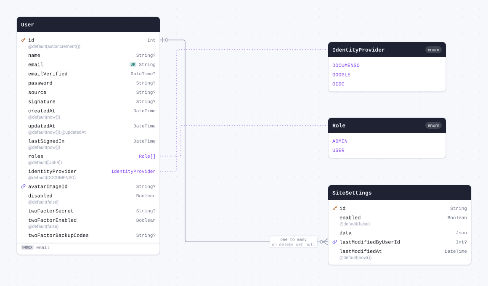

| Field                  | Type       | Constraints                   | Default | Description |
| ---------------------- | ---------- | ----------------------------- | ------- | ----------- |
| `id`                   | `String`   | PK NOT NULL                   |         |             |
| `enabled`              | `Boolean`  | NOT NULL                      | `false` |             |
| `data`                 | `Json`     | NOT NULL                      |         |             |
| `lastModifiedByUserId` | `Int`      | NULL → [User.id](#model-User) |         |             |
| `lastModifiedAt`       | `DateTime` | NOT NULL                      | `now()` |             |

#### References

- `lastModifiedByUserId` → [User.id](#model-User) (many-to-one, on delete SetNull)

#### Definition

```sql
CREATE TABLE "SiteSettings" (
    "id" TEXT NOT NULL,
    "enabled" BOOLEAN NOT NULL DEFAULT false,
    "data" JSONB NOT NULL,
    "lastModifiedByUserId" INTEGER,
    "lastModifiedAt" TIMESTAMP(3) NOT NULL DEFAULT CURRENT_TIMESTAMP,

    CONSTRAINT "SiteSettings_pkey" PRIMARY KEY ("id")
);

ALTER TABLE "SiteSettings" ADD CONSTRAINT "SiteSettings_lastModifiedByUserId_fkey" FOREIGN KEY ("lastModifiedByUserId") REFERENCES "User"("id") ON DELETE SET NULL ON UPDATE CASCADE;
```

<details>
<summary>Queries and their SQL</summary>

**findMany**: Every row

```ts
await prisma.siteSettings.findMany();
```

```sql
SELECT
  "public"."SiteSettings"."id",
  "public"."SiteSettings"."enabled",
  "public"."SiteSettings"."data",
  "public"."SiteSettings"."lastModifiedByUserId",
  "public"."SiteSettings"."lastModifiedAt"
FROM
  "public"."SiteSettings"
WHERE
  1 = 1
OFFSET
  $1
-- params: ["0"]
```

**count**: How many rows there are

```ts
await prisma.siteSettings.count();
```

```sql
SELECT
  COUNT(*) AS "_count$_all"
FROM
  (
    SELECT
      "public"."SiteSettings"."id"
    FROM
      "public"."SiteSettings"
    WHERE
      1 = 1
    OFFSET
      $1
  ) AS "sub"
-- params: ["0"]
```

**findMany**: Every row with its relations

```ts
await prisma.siteSettings.findMany({ include: { lastModifiedByUser: true } });
```

```sql
SELECT
  "public"."SiteSettings"."id",
  "public"."SiteSettings"."enabled",
  "public"."SiteSettings"."data",
  "public"."SiteSettings"."lastModifiedByUserId",
  "public"."SiteSettings"."lastModifiedAt"
FROM
  "public"."SiteSettings"
WHERE
  1 = 1
OFFSET
  $1
-- params: ["0"]

SELECT
  "public"."User"."id",
  "public"."User"."name",
  "public"."User"."email",
  "public"."User"."emailVerified",
  "public"."User"."password",
  "public"."User"."source",
  "public"."User"."signature",
  "public"."User"."createdAt",
  "public"."User"."updatedAt",
  "public"."User"."lastSignedIn",
  "public"."User"."roles"::text[],
  "public"."User"."identityProvider"::text,
  "public"."User"."avatarImageId",
  "public"."User"."disabled",
  "public"."User"."twoFactorSecret",
  "public"."User"."twoFactorEnabled",
  "public"."User"."twoFactorBackupCodes"
FROM
  "public"."User"
WHERE
  "public"."User"."id" IN ($1)
OFFSET
  $2
-- params: ["<lastModifiedByUserId of the rows above>","0"]
```

**findUnique**: One row by what is unique to it

```ts
await prisma.siteSettings.findUnique({ where: { id: "example" } });
```

```sql
SELECT
  "public"."SiteSettings"."id",
  "public"."SiteSettings"."enabled",
  "public"."SiteSettings"."data",
  "public"."SiteSettings"."lastModifiedByUserId",
  "public"."SiteSettings"."lastModifiedAt"
FROM
  "public"."SiteSettings"
WHERE
  (
    "public"."SiteSettings"."id" = $1
    AND 1 = 1
  )
LIMIT
  $2
OFFSET
  $3
-- params: ["example","1","0"]
```

**create**: Create a row

```ts
await prisma.siteSettings.create({ data: { id: "example", data: {} } });
```

```sql
INSERT INTO
  "public"."SiteSettings" ("id", "enabled", "data", "lastModifiedAt")
VALUES
  ($1, $2, $3, $4)
RETURNING
  "public"."SiteSettings"."id",
  "public"."SiteSettings"."enabled",
  "public"."SiteSettings"."data",
  "public"."SiteSettings"."lastModifiedByUserId",
  "public"."SiteSettings"."lastModifiedAt"
-- params: ["example",false,"{}","<now()>"]
```

**update**: Update a row

```ts
await prisma.siteSettings.update({ where: { id: "example" }, data: { enabled: true } });
```

```sql
UPDATE "public"."SiteSettings"
SET
  "enabled" = $1
WHERE
  (
    "public"."SiteSettings"."id" = $2
    AND 1 = 1
  )
RETURNING
  "public"."SiteSettings"."id",
  "public"."SiteSettings"."enabled",
  "public"."SiteSettings"."data",
  "public"."SiteSettings"."lastModifiedByUserId",
  "public"."SiteSettings"."lastModifiedAt"
-- params: [true,"example"]
```

**delete**: Delete a row

```ts
await prisma.siteSettings.delete({ where: { id: "example" } });
```

```sql
DELETE FROM "public"."SiteSettings"
WHERE
  (
    "public"."SiteSettings"."id" = $1
    AND 1 = 1
  )
RETURNING
  "public"."SiteSettings"."id",
  "public"."SiteSettings"."enabled",
  "public"."SiteSettings"."data",
  "public"."SiteSettings"."lastModifiedByUserId",
  "public"."SiteSettings"."lastModifiedAt"
-- params: ["example"]
```

</details>

<a id="model-BackgroundJob"></a>

### BackgroundJob

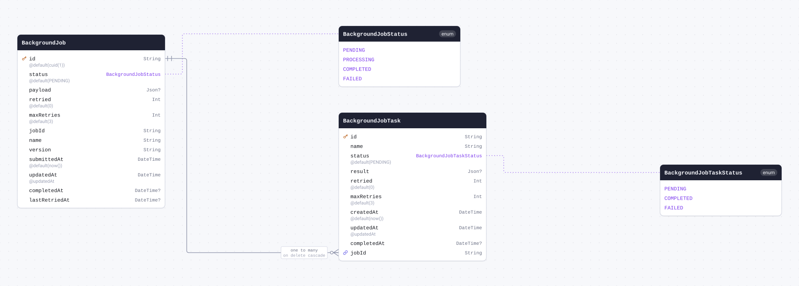

| Field           | Type                                               | Constraints | Default      | Description |
| --------------- | -------------------------------------------------- | ----------- | ------------ | ----------- |
| `id`            | `String`                                           | PK NOT NULL | `cuid(1)`    |             |
| `status`        | [`BackgroundJobStatus`](#enum-BackgroundJobStatus) | NOT NULL    | `PENDING`    |             |
| `payload`       | `Json`                                             | NULL        |              |             |
| `retried`       | `Int`                                              | NOT NULL    | `0`          |             |
| `maxRetries`    | `Int`                                              | NOT NULL    | `3`          |             |
| `jobId`         | `String`                                           | NOT NULL    |              |             |
| `name`          | `String`                                           | NOT NULL    |              |             |
| `version`       | `String`                                           | NOT NULL    |              |             |
| `submittedAt`   | `DateTime`                                         | NOT NULL    | `now()`      |             |
| `updatedAt`     | `DateTime`                                         | NOT NULL    | `@updatedAt` |             |
| `completedAt`   | `DateTime`                                         | NULL        |              |             |
| `lastRetriedAt` | `DateTime`                                         | NULL        |              |             |

#### Referenced by

- `id` ← [BackgroundJobTask.jobId](#model-BackgroundJobTask) (one-to-many, on delete Cascade)

#### Definition

```sql
CREATE TABLE "BackgroundJob" (
    "id" TEXT NOT NULL,
    "status" "BackgroundJobStatus" NOT NULL DEFAULT 'PENDING',
    "payload" JSONB,
    "retried" INTEGER NOT NULL DEFAULT 0,
    "maxRetries" INTEGER NOT NULL DEFAULT 3,
    "jobId" TEXT NOT NULL,
    "name" TEXT NOT NULL,
    "version" TEXT NOT NULL,
    "submittedAt" TIMESTAMP(3) NOT NULL DEFAULT CURRENT_TIMESTAMP,
    "updatedAt" TIMESTAMP(3) NOT NULL,
    "completedAt" TIMESTAMP(3),
    "lastRetriedAt" TIMESTAMP(3),

    CONSTRAINT "BackgroundJob_pkey" PRIMARY KEY ("id")
);
```

<details>
<summary>Queries and their SQL</summary>

**findMany**: Every row

```ts
await prisma.backgroundJob.findMany();
```

```sql
SELECT
  "public"."BackgroundJob"."id",
  "public"."BackgroundJob"."status"::text,
  "public"."BackgroundJob"."payload",
  "public"."BackgroundJob"."retried",
  "public"."BackgroundJob"."maxRetries",
  "public"."BackgroundJob"."jobId",
  "public"."BackgroundJob"."name",
  "public"."BackgroundJob"."version",
  "public"."BackgroundJob"."submittedAt",
  "public"."BackgroundJob"."updatedAt",
  "public"."BackgroundJob"."completedAt",
  "public"."BackgroundJob"."lastRetriedAt"
FROM
  "public"."BackgroundJob"
WHERE
  1 = 1
OFFSET
  $1
-- params: ["0"]
```

**count**: How many rows there are

```ts
await prisma.backgroundJob.count();
```

```sql
SELECT
  COUNT(*) AS "_count$_all"
FROM
  (
    SELECT
      "public"."BackgroundJob"."id"
    FROM
      "public"."BackgroundJob"
    WHERE
      1 = 1
    OFFSET
      $1
  ) AS "sub"
-- params: ["0"]
```

**findMany**: Every row with its relations

```ts
await prisma.backgroundJob.findMany({ include: { tasks: true } });
```

```sql
SELECT
  "public"."BackgroundJob"."id",
  "public"."BackgroundJob"."status"::text,
  "public"."BackgroundJob"."payload",
  "public"."BackgroundJob"."retried",
  "public"."BackgroundJob"."maxRetries",
  "public"."BackgroundJob"."jobId",
  "public"."BackgroundJob"."name",
  "public"."BackgroundJob"."version",
  "public"."BackgroundJob"."submittedAt",
  "public"."BackgroundJob"."updatedAt",
  "public"."BackgroundJob"."completedAt",
  "public"."BackgroundJob"."lastRetriedAt"
FROM
  "public"."BackgroundJob"
WHERE
  1 = 1
OFFSET
  $1
-- params: ["0"]

SELECT
  "public"."BackgroundJobTask"."id",
  "public"."BackgroundJobTask"."name",
  "public"."BackgroundJobTask"."status"::text,
  "public"."BackgroundJobTask"."result",
  "public"."BackgroundJobTask"."retried",
  "public"."BackgroundJobTask"."maxRetries",
  "public"."BackgroundJobTask"."createdAt",
  "public"."BackgroundJobTask"."updatedAt",
  "public"."BackgroundJobTask"."completedAt",
  "public"."BackgroundJobTask"."jobId"
FROM
  "public"."BackgroundJobTask"
WHERE
  "public"."BackgroundJobTask"."jobId" IN ($1)
OFFSET
  $2
-- params: ["<id of the rows above>","0"]
```

**findUnique**: One row by what is unique to it

```ts
await prisma.backgroundJob.findUnique({ where: { id: "example" } });
```

```sql
SELECT
  "public"."BackgroundJob"."id",
  "public"."BackgroundJob"."status"::text,
  "public"."BackgroundJob"."payload",
  "public"."BackgroundJob"."retried",
  "public"."BackgroundJob"."maxRetries",
  "public"."BackgroundJob"."jobId",
  "public"."BackgroundJob"."name",
  "public"."BackgroundJob"."version",
  "public"."BackgroundJob"."submittedAt",
  "public"."BackgroundJob"."updatedAt",
  "public"."BackgroundJob"."completedAt",
  "public"."BackgroundJob"."lastRetriedAt"
FROM
  "public"."BackgroundJob"
WHERE
  (
    "public"."BackgroundJob"."id" = $1
    AND 1 = 1
  )
LIMIT
  $2
OFFSET
  $3
-- params: ["example","1","0"]
```

**create**: Create a row

```ts
await prisma.backgroundJob.create({
  data: { jobId: "example", name: "example", version: "example" },
});
```

```sql
INSERT INTO
  "public"."BackgroundJob" (
    "id",
    "status",
    "retried",
    "maxRetries",
    "jobId",
    "name",
    "version",
    "submittedAt",
    "updatedAt"
  )
VALUES
  (
    $1,
    CAST($2::text AS "public"."BackgroundJobStatus"),
    $3,
    $4,
    $5,
    $6,
    $7,
    $8,
    $9
  )
RETURNING
  "public"."BackgroundJob"."id",
  "public"."BackgroundJob"."status"::text,
  "public"."BackgroundJob"."payload",
  "public"."BackgroundJob"."retried",
  "public"."BackgroundJob"."maxRetries",
  "public"."BackgroundJob"."jobId",
  "public"."BackgroundJob"."name",
  "public"."BackgroundJob"."version",
  "public"."BackgroundJob"."submittedAt",
  "public"."BackgroundJob"."updatedAt",
  "public"."BackgroundJob"."completedAt",
  "public"."BackgroundJob"."lastRetriedAt"
-- params: ["<cuid(1)>","PENDING","0","3","example","example","example","<now()>","<now()>"]
```

**update**: Update a row

```ts
await prisma.backgroundJob.update({ where: { id: "example" }, data: { status: "PENDING" } });
```

```sql
UPDATE "public"."BackgroundJob"
SET
  "status" = CAST($1::text AS "public"."BackgroundJobStatus"),
  "updatedAt" = $2
WHERE
  (
    "public"."BackgroundJob"."id" = $3
    AND 1 = 1
  )
RETURNING
  "public"."BackgroundJob"."id",
  "public"."BackgroundJob"."status"::text,
  "public"."BackgroundJob"."payload",
  "public"."BackgroundJob"."retried",
  "public"."BackgroundJob"."maxRetries",
  "public"."BackgroundJob"."jobId",
  "public"."BackgroundJob"."name",
  "public"."BackgroundJob"."version",
  "public"."BackgroundJob"."submittedAt",
  "public"."BackgroundJob"."updatedAt",
  "public"."BackgroundJob"."completedAt",
  "public"."BackgroundJob"."lastRetriedAt"
-- params: ["PENDING",{"prisma__type":"generatorCall","prisma__value":{"name":"now","args":[],"returnType":{"type":"DateTime"}}},"example"]
```

**delete**: Delete a row

```ts
await prisma.backgroundJob.delete({ where: { id: "example" } });
```

```sql
DELETE FROM "public"."BackgroundJob"
WHERE
  (
    "public"."BackgroundJob"."id" = $1
    AND 1 = 1
  )
RETURNING
  "public"."BackgroundJob"."id",
  "public"."BackgroundJob"."status"::text,
  "public"."BackgroundJob"."payload",
  "public"."BackgroundJob"."retried",
  "public"."BackgroundJob"."maxRetries",
  "public"."BackgroundJob"."jobId",
  "public"."BackgroundJob"."name",
  "public"."BackgroundJob"."version",
  "public"."BackgroundJob"."submittedAt",
  "public"."BackgroundJob"."updatedAt",
  "public"."BackgroundJob"."completedAt",
  "public"."BackgroundJob"."lastRetriedAt"
-- params: ["example"]
```

</details>

<a id="model-BackgroundJobTask"></a>

### BackgroundJobTask


| Field         | Type                                                       | Constraints                                         | Default      | Description |
| ------------- | ---------------------------------------------------------- | --------------------------------------------------- | ------------ | ----------- |
| `id`          | `String`                                                   | PK NOT NULL                                         |              |             |
| `name`        | `String`                                                   | NOT NULL                                            |              |             |
| `status`      | [`BackgroundJobTaskStatus`](#enum-BackgroundJobTaskStatus) | NOT NULL                                            | `PENDING`    |             |
| `result`      | `Json`                                                     | NULL                                                |              |             |
| `retried`     | `Int`                                                      | NOT NULL                                            | `0`          |             |
| `maxRetries`  | `Int`                                                      | NOT NULL                                            | `3`          |             |
| `createdAt`   | `DateTime`                                                 | NOT NULL                                            | `now()`      |             |
| `updatedAt`   | `DateTime`                                                 | NOT NULL                                            | `@updatedAt` |             |
| `completedAt` | `DateTime`                                                 | NULL                                                |              |             |
| `jobId`       | `String`                                                   | NOT NULL → [BackgroundJob.id](#model-BackgroundJob) |              |             |

#### References

- `jobId` → [BackgroundJob.id](#model-BackgroundJob) (many-to-one, on delete Cascade)

#### Definition

```sql
CREATE TABLE "BackgroundJobTask" (
    "id" TEXT NOT NULL,
    "name" TEXT NOT NULL,
    "status" "BackgroundJobTaskStatus" NOT NULL DEFAULT 'PENDING',
    "result" JSONB,
    "retried" INTEGER NOT NULL DEFAULT 0,
    "maxRetries" INTEGER NOT NULL DEFAULT 3,
    "createdAt" TIMESTAMP(3) NOT NULL DEFAULT CURRENT_TIMESTAMP,
    "updatedAt" TIMESTAMP(3) NOT NULL,
    "completedAt" TIMESTAMP(3),
    "jobId" TEXT NOT NULL,

    CONSTRAINT "BackgroundJobTask_pkey" PRIMARY KEY ("id")
);

ALTER TABLE "BackgroundJobTask" ADD CONSTRAINT "BackgroundJobTask_jobId_fkey" FOREIGN KEY ("jobId") REFERENCES "BackgroundJob"("id") ON DELETE CASCADE ON UPDATE CASCADE;
```

<details>
<summary>Queries and their SQL</summary>

**findMany**: Every row

```ts
await prisma.backgroundJobTask.findMany();
```

```sql
SELECT
  "public"."BackgroundJobTask"."id",
  "public"."BackgroundJobTask"."name",
  "public"."BackgroundJobTask"."status"::text,
  "public"."BackgroundJobTask"."result",
  "public"."BackgroundJobTask"."retried",
  "public"."BackgroundJobTask"."maxRetries",
  "public"."BackgroundJobTask"."createdAt",
  "public"."BackgroundJobTask"."updatedAt",
  "public"."BackgroundJobTask"."completedAt",
  "public"."BackgroundJobTask"."jobId"
FROM
  "public"."BackgroundJobTask"
WHERE
  1 = 1
OFFSET
  $1
-- params: ["0"]
```

**count**: How many rows there are

```ts
await prisma.backgroundJobTask.count();
```

```sql
SELECT
  COUNT(*) AS "_count$_all"
FROM
  (
    SELECT
      "public"."BackgroundJobTask"."id"
    FROM
      "public"."BackgroundJobTask"
    WHERE
      1 = 1
    OFFSET
      $1
  ) AS "sub"
-- params: ["0"]
```

**findMany**: Every row with its relations

```ts
await prisma.backgroundJobTask.findMany({ include: { backgroundJob: true } });
```

```sql
SELECT
  "public"."BackgroundJobTask"."id",
  "public"."BackgroundJobTask"."name",
  "public"."BackgroundJobTask"."status"::text,
  "public"."BackgroundJobTask"."result",
  "public"."BackgroundJobTask"."retried",
  "public"."BackgroundJobTask"."maxRetries",
  "public"."BackgroundJobTask"."createdAt",
  "public"."BackgroundJobTask"."updatedAt",
  "public"."BackgroundJobTask"."completedAt",
  "public"."BackgroundJobTask"."jobId"
FROM
  "public"."BackgroundJobTask"
WHERE
  1 = 1
OFFSET
  $1
-- params: ["0"]

SELECT
  "public"."BackgroundJob"."id",
  "public"."BackgroundJob"."status"::text,
  "public"."BackgroundJob"."payload",
  "public"."BackgroundJob"."retried",
  "public"."BackgroundJob"."maxRetries",
  "public"."BackgroundJob"."jobId",
  "public"."BackgroundJob"."name",
  "public"."BackgroundJob"."version",
  "public"."BackgroundJob"."submittedAt",
  "public"."BackgroundJob"."updatedAt",
  "public"."BackgroundJob"."completedAt",
  "public"."BackgroundJob"."lastRetriedAt"
FROM
  "public"."BackgroundJob"
WHERE
  "public"."BackgroundJob"."id" IN ($1)
OFFSET
  $2
-- params: ["<jobId of the rows above>","0"]
```

**findUnique**: One row by what is unique to it

```ts
await prisma.backgroundJobTask.findUnique({ where: { id: "example" } });
```

```sql
SELECT
  "public"."BackgroundJobTask"."id",
  "public"."BackgroundJobTask"."name",
  "public"."BackgroundJobTask"."status"::text,
  "public"."BackgroundJobTask"."result",
  "public"."BackgroundJobTask"."retried",
  "public"."BackgroundJobTask"."maxRetries",
  "public"."BackgroundJobTask"."createdAt",
  "public"."BackgroundJobTask"."updatedAt",
  "public"."BackgroundJobTask"."completedAt",
  "public"."BackgroundJobTask"."jobId"
FROM
  "public"."BackgroundJobTask"
WHERE
  (
    "public"."BackgroundJobTask"."id" = $1
    AND 1 = 1
  )
LIMIT
  $2
OFFSET
  $3
-- params: ["example","1","0"]
```

**create**: Create a row

```ts
await prisma.backgroundJobTask.create({
  data: { id: "example", name: "example", jobId: "example" },
});
```

```sql
INSERT INTO
  "public"."BackgroundJobTask" (
    "id",
    "name",
    "status",
    "retried",
    "maxRetries",
    "createdAt",
    "updatedAt",
    "jobId"
  )
VALUES
  (
    $1,
    $2,
    CAST($3::text AS "public"."BackgroundJobTaskStatus"),
    $4,
    $5,
    $6,
    $7,
    $8
  )
RETURNING
  "public"."BackgroundJobTask"."id",
  "public"."BackgroundJobTask"."name",
  "public"."BackgroundJobTask"."status"::text,
  "public"."BackgroundJobTask"."result",
  "public"."BackgroundJobTask"."retried",
  "public"."BackgroundJobTask"."maxRetries",
  "public"."BackgroundJobTask"."createdAt",
  "public"."BackgroundJobTask"."updatedAt",
  "public"."BackgroundJobTask"."completedAt",
  "public"."BackgroundJobTask"."jobId"
-- params: ["example","example","PENDING","0","3","<now()>","<now()>","example"]
```

**update**: Update a row

```ts
await prisma.backgroundJobTask.update({ where: { id: "example" }, data: { name: "example" } });
```

```sql
UPDATE "public"."BackgroundJobTask"
SET
  "name" = $1,
  "updatedAt" = $2
WHERE
  (
    "public"."BackgroundJobTask"."id" = $3
    AND 1 = 1
  )
RETURNING
  "public"."BackgroundJobTask"."id",
  "public"."BackgroundJobTask"."name",
  "public"."BackgroundJobTask"."status"::text,
  "public"."BackgroundJobTask"."result",
  "public"."BackgroundJobTask"."retried",
  "public"."BackgroundJobTask"."maxRetries",
  "public"."BackgroundJobTask"."createdAt",
  "public"."BackgroundJobTask"."updatedAt",
  "public"."BackgroundJobTask"."completedAt",
  "public"."BackgroundJobTask"."jobId"
-- params: ["example",{"prisma__type":"generatorCall","prisma__value":{"name":"now","args":[],"returnType":{"type":"DateTime"}}},"example"]
```

**delete**: Delete a row

```ts
await prisma.backgroundJobTask.delete({ where: { id: "example" } });
```

```sql
DELETE FROM "public"."BackgroundJobTask"
WHERE
  (
    "public"."BackgroundJobTask"."id" = $1
    AND 1 = 1
  )
RETURNING
  "public"."BackgroundJobTask"."id",
  "public"."BackgroundJobTask"."name",
  "public"."BackgroundJobTask"."status"::text,
  "public"."BackgroundJobTask"."result",
  "public"."BackgroundJobTask"."retried",
  "public"."BackgroundJobTask"."maxRetries",
  "public"."BackgroundJobTask"."createdAt",
  "public"."BackgroundJobTask"."updatedAt",
  "public"."BackgroundJobTask"."completedAt",
  "public"."BackgroundJobTask"."jobId"
-- params: ["example"]
```

</details>

<a id="model-AvatarImage"></a>

### AvatarImage

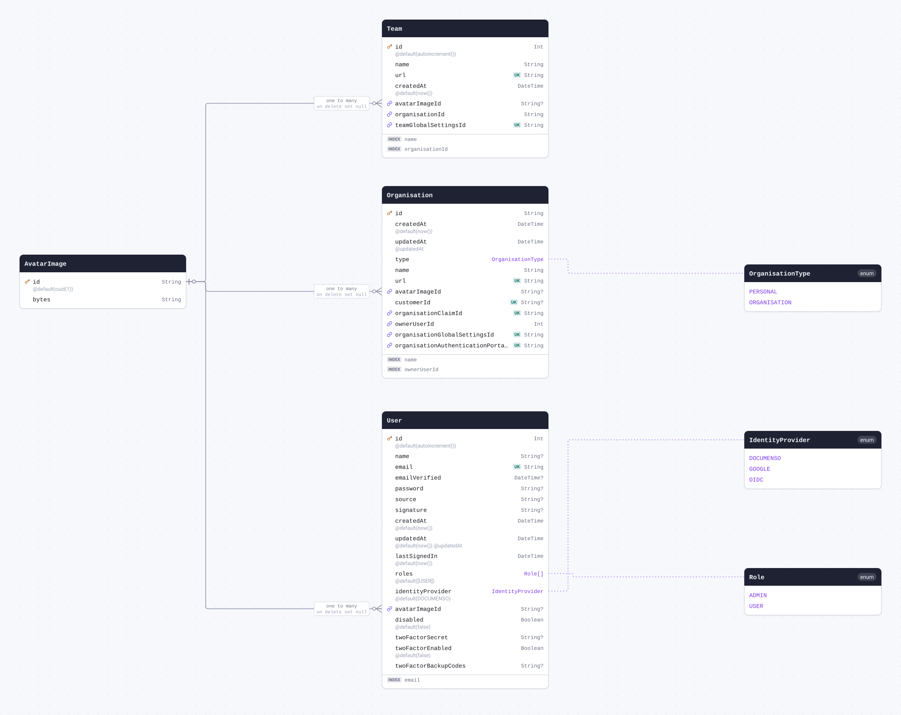

| Field   | Type     | Constraints | Default   | Description |
| ------- | -------- | ----------- | --------- | ----------- |
| `id`    | `String` | PK NOT NULL | `cuid(1)` |             |
| `bytes` | `String` | NOT NULL    |           |             |

#### Referenced by

- `id` ← [User.avatarImageId](#model-User) (one-to-many, on delete SetNull)
- `id` ← [Organisation.avatarImageId](#model-Organisation) (one-to-many, on delete SetNull)
- `id` ← [Team.avatarImageId](#model-Team) (one-to-many, on delete SetNull)

#### Definition

```sql
CREATE TABLE "AvatarImage" (
    "id" TEXT NOT NULL,
    "bytes" TEXT NOT NULL,

    CONSTRAINT "AvatarImage_pkey" PRIMARY KEY ("id")
);
```

<details>
<summary>Queries and their SQL</summary>

**findMany**: Every row

```ts
await prisma.avatarImage.findMany();
```

```sql
SELECT
  "public"."AvatarImage"."id",
  "public"."AvatarImage"."bytes"
FROM
  "public"."AvatarImage"
WHERE
  1 = 1
OFFSET
  $1
-- params: ["0"]
```

**count**: How many rows there are

```ts
await prisma.avatarImage.count();
```

```sql
SELECT
  COUNT(*) AS "_count$_all"
FROM
  (
    SELECT
      "public"."AvatarImage"."id"
    FROM
      "public"."AvatarImage"
    WHERE
      1 = 1
    OFFSET
      $1
  ) AS "sub"
-- params: ["0"]
```

**findMany**: Every row with its relations

```ts
await prisma.avatarImage.findMany({ include: { team: true, user: true, organisation: true } });
```

```sql
SELECT
  "public"."AvatarImage"."id",
  "public"."AvatarImage"."bytes"
FROM
  "public"."AvatarImage"
WHERE
  1 = 1
OFFSET
  $1
-- params: ["0"]

SELECT
  "public"."Team"."id",
  "public"."Team"."name",
  "public"."Team"."url",
  "public"."Team"."createdAt",
  "public"."Team"."avatarImageId",
  "public"."Team"."organisationId",
  "public"."Team"."teamGlobalSettingsId"
FROM
  "public"."Team"
WHERE
  "public"."Team"."avatarImageId" IN ($1)
OFFSET
  $2
-- params: ["<id of the rows above>","0"]

SELECT
  "public"."User"."id",
  "public"."User"."name",
  "public"."User"."email",
  "public"."User"."emailVerified",
  "public"."User"."password",
  "public"."User"."source",
  "public"."User"."signature",
  "public"."User"."createdAt",
  "public"."User"."updatedAt",
  "public"."User"."lastSignedIn",
  "public"."User"."roles"::text[],
  "public"."User"."identityProvider"::text,
  "public"."User"."avatarImageId",
  "public"."User"."disabled",
  "public"."User"."twoFactorSecret",
  "public"."User"."twoFactorEnabled",
  "public"."User"."twoFactorBackupCodes"
FROM
  "public"."User"
WHERE
  "public"."User"."avatarImageId" IN ($1)
OFFSET
  $2
-- params: ["<id of the rows above>","0"]

SELECT
  "public"."Organisation"."id",
  "public"."Organisation"."createdAt",
  "public"."Organisation"."updatedAt",
  "public"."Organisation"."type"::text,
  "public"."Organisation"."name",
  "public"."Organisation"."url",
  "public"."Organisation"."avatarImageId",
  "public"."Organisation"."customerId",
  "public"."Organisation"."organisationClaimId",
  "public"."Organisation"."ownerUserId",
  "public"."Organisation"."organisationGlobalSettingsId",
  "public"."Organisation"."organisationAuthenticationPortalId"
FROM
  "public"."Organisation"
WHERE
  "public"."Organisation"."avatarImageId" IN ($1)
OFFSET
  $2
-- params: ["<id of the rows above>","0"]
```

**findUnique**: One row by what is unique to it

```ts
await prisma.avatarImage.findUnique({ where: { id: "example" } });
```

```sql
SELECT
  "public"."AvatarImage"."id",
  "public"."AvatarImage"."bytes"
FROM
  "public"."AvatarImage"
WHERE
  (
    "public"."AvatarImage"."id" = $1
    AND 1 = 1
  )
LIMIT
  $2
OFFSET
  $3
-- params: ["example","1","0"]
```

**create**: Create a row

```ts
await prisma.avatarImage.create({ data: { bytes: "example" } });
```

```sql
INSERT INTO
  "public"."AvatarImage" ("id", "bytes")
VALUES
  ($1, $2)
RETURNING
  "public"."AvatarImage"."id",
  "public"."AvatarImage"."bytes"
-- params: ["<cuid(1)>","example"]
```

**update**: Update a row

```ts
await prisma.avatarImage.update({ where: { id: "example" }, data: { bytes: "example" } });
```

```sql
UPDATE "public"."AvatarImage"
SET
  "bytes" = $1
WHERE
  (
    "public"."AvatarImage"."id" = $2
    AND 1 = 1
  )
RETURNING
  "public"."AvatarImage"."id",
  "public"."AvatarImage"."bytes"
-- params: ["example","example"]
```

**delete**: Delete a row

```ts
await prisma.avatarImage.delete({ where: { id: "example" } });
```

```sql
DELETE FROM "public"."AvatarImage"
WHERE
  (
    "public"."AvatarImage"."id" = $1
    AND 1 = 1
  )
RETURNING
  "public"."AvatarImage"."id",
  "public"."AvatarImage"."bytes"
-- params: ["example"]
```

</details>

<a id="model-EmailDomain"></a>

### EmailDomain

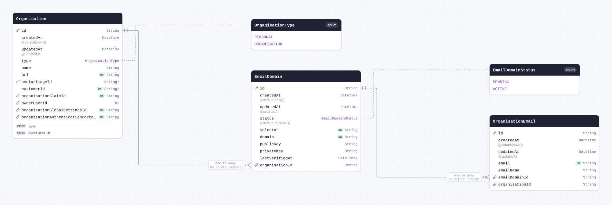

| Field            | Type                                           | Constraints                                       | Default      | Description |
| ---------------- | ---------------------------------------------- | ------------------------------------------------- | ------------ | ----------- |
| `id`             | `String`                                       | PK NOT NULL                                       |              |             |
| `createdAt`      | `DateTime`                                     | NOT NULL                                          | `now()`      |             |
| `updatedAt`      | `DateTime`                                     | NOT NULL                                          | `@updatedAt` |             |
| `status`         | [`EmailDomainStatus`](#enum-EmailDomainStatus) | NOT NULL                                          | `PENDING`    |             |
| `selector`       | `String`                                       | UNIQUE NOT NULL                                   |              |             |
| `domain`         | `String`                                       | UNIQUE NOT NULL                                   |              |             |
| `publicKey`      | `String`                                       | NOT NULL                                          |              |             |
| `privateKey`     | `String`                                       | NOT NULL                                          |              |             |
| `lastVerifiedAt` | `DateTime`                                     | NULL                                              |              |             |
| `organisationId` | `String`                                       | NOT NULL → [Organisation.id](#model-Organisation) |              |             |

#### References

- `organisationId` → [Organisation.id](#model-Organisation) (many-to-one, on delete Cascade)

#### Referenced by

- `id` ← [OrganisationEmail.emailDomainId](#model-OrganisationEmail) (one-to-many, on delete Cascade)

#### Definition

```sql
CREATE TABLE "EmailDomain" (
    "id" TEXT NOT NULL,
    "createdAt" TIMESTAMP(3) NOT NULL DEFAULT CURRENT_TIMESTAMP,
    "updatedAt" TIMESTAMP(3) NOT NULL,
    "status" "EmailDomainStatus" NOT NULL DEFAULT 'PENDING',
    "selector" TEXT NOT NULL,
    "domain" TEXT NOT NULL,
    "publicKey" TEXT NOT NULL,
    "privateKey" TEXT NOT NULL,
    "lastVerifiedAt" TIMESTAMP(3),
    "organisationId" TEXT NOT NULL,

    CONSTRAINT "EmailDomain_pkey" PRIMARY KEY ("id")
);

CREATE UNIQUE INDEX "EmailDomain_selector_key" ON "EmailDomain"("selector");

CREATE UNIQUE INDEX "EmailDomain_domain_key" ON "EmailDomain"("domain");

ALTER TABLE "EmailDomain" ADD CONSTRAINT "EmailDomain_organisationId_fkey" FOREIGN KEY ("organisationId") REFERENCES "Organisation"("id") ON DELETE CASCADE ON UPDATE CASCADE;
```

<details>
<summary>Queries and their SQL</summary>

**findMany**: Every row

```ts
await prisma.emailDomain.findMany();
```

```sql
SELECT
  "public"."EmailDomain"."id",
  "public"."EmailDomain"."createdAt",
  "public"."EmailDomain"."updatedAt",
  "public"."EmailDomain"."status"::text,
  "public"."EmailDomain"."selector",
  "public"."EmailDomain"."domain",
  "public"."EmailDomain"."publicKey",
  "public"."EmailDomain"."privateKey",
  "public"."EmailDomain"."lastVerifiedAt",
  "public"."EmailDomain"."organisationId"
FROM
  "public"."EmailDomain"
WHERE
  1 = 1
OFFSET
  $1
-- params: ["0"]
```

**count**: How many rows there are

```ts
await prisma.emailDomain.count();
```

```sql
SELECT
  COUNT(*) AS "_count$_all"
FROM
  (
    SELECT
      "public"."EmailDomain"."id"
    FROM
      "public"."EmailDomain"
    WHERE
      1 = 1
    OFFSET
      $1
  ) AS "sub"
-- params: ["0"]
```

**findMany**: Every row with its relations

```ts
await prisma.emailDomain.findMany({ include: { organisation: true, emails: true } });
```

```sql
SELECT
  "public"."EmailDomain"."id",
  "public"."EmailDomain"."createdAt",
  "public"."EmailDomain"."updatedAt",
  "public"."EmailDomain"."status"::text,
  "public"."EmailDomain"."selector",
  "public"."EmailDomain"."domain",
  "public"."EmailDomain"."publicKey",
  "public"."EmailDomain"."privateKey",
  "public"."EmailDomain"."lastVerifiedAt",
  "public"."EmailDomain"."organisationId"
FROM
  "public"."EmailDomain"
WHERE
  1 = 1
OFFSET
  $1
-- params: ["0"]

SELECT
  "public"."Organisation"."id",
  "public"."Organisation"."createdAt",
  "public"."Organisation"."updatedAt",
  "public"."Organisation"."type"::text,
  "public"."Organisation"."name",
  "public"."Organisation"."url",
  "public"."Organisation"."avatarImageId",
  "public"."Organisation"."customerId",
  "public"."Organisation"."organisationClaimId",
  "public"."Organisation"."ownerUserId",
  "public"."Organisation"."organisationGlobalSettingsId",
  "public"."Organisation"."organisationAuthenticationPortalId"
FROM
  "public"."Organisation"
WHERE
  "public"."Organisation"."id" IN ($1)
OFFSET
  $2
-- params: ["<organisationId of the rows above>","0"]

SELECT
  "public"."OrganisationEmail"."id",
  "public"."OrganisationEmail"."createdAt",
  "public"."OrganisationEmail"."updatedAt",
  "public"."OrganisationEmail"."email",
  "public"."OrganisationEmail"."emailName",
  "public"."OrganisationEmail"."emailDomainId",
  "public"."OrganisationEmail"."organisationId"
FROM
  "public"."OrganisationEmail"
WHERE
  "public"."OrganisationEmail"."emailDomainId" IN ($1)
OFFSET
  $2
-- params: ["<id of the rows above>","0"]
```

**findUnique**: One row by what is unique to it

```ts
await prisma.emailDomain.findUnique({ where: { id: "example" } });
```

```sql
SELECT
  "public"."EmailDomain"."id",
  "public"."EmailDomain"."createdAt",
  "public"."EmailDomain"."updatedAt",
  "public"."EmailDomain"."status"::text,
  "public"."EmailDomain"."selector",
  "public"."EmailDomain"."domain",
  "public"."EmailDomain"."publicKey",
  "public"."EmailDomain"."privateKey",
  "public"."EmailDomain"."lastVerifiedAt",
  "public"."EmailDomain"."organisationId"
FROM
  "public"."EmailDomain"
WHERE
  (
    "public"."EmailDomain"."id" = $1
    AND 1 = 1
  )
LIMIT
  $2
OFFSET
  $3
-- params: ["example","1","0"]
```

**create**: Create a row

```ts
await prisma.emailDomain.create({
  data: {
    id: "example",
    selector: "example",
    domain: "example",
    publicKey: "example",
    privateKey: "example",
    organisationId: "example",
  },
});
```

```sql
INSERT INTO
  "public"."EmailDomain" (
    "id",
    "createdAt",
    "updatedAt",
    "status",
    "selector",
    "domain",
    "publicKey",
    "privateKey",
    "organisationId"
  )
VALUES
  (
    $1,
    $2,
    $3,
    CAST($4::text AS "public"."EmailDomainStatus"),
    $5,
    $6,
    $7,
    $8,
    $9
  )
RETURNING
  "public"."EmailDomain"."id",
  "public"."EmailDomain"."createdAt",
  "public"."EmailDomain"."updatedAt",
  "public"."EmailDomain"."status"::text,
  "public"."EmailDomain"."selector",
  "public"."EmailDomain"."domain",
  "public"."EmailDomain"."publicKey",
  "public"."EmailDomain"."privateKey",
  "public"."EmailDomain"."lastVerifiedAt",
  "public"."EmailDomain"."organisationId"
-- params: ["example","<now()>","<now()>","PENDING","example","example","example","example","example"]
```

**update**: Update a row

```ts
await prisma.emailDomain.update({
  where: { id: "example" },
  data: { createdAt: new Date("2026-01-01T00:00:00.000Z") },
});
```

```sql
UPDATE "public"."EmailDomain"
SET
  "createdAt" = $1,
  "updatedAt" = $2
WHERE
  (
    "public"."EmailDomain"."id" = $3
    AND 1 = 1
  )
RETURNING
  "public"."EmailDomain"."id",
  "public"."EmailDomain"."createdAt",
  "public"."EmailDomain"."updatedAt",
  "public"."EmailDomain"."status"::text,
  "public"."EmailDomain"."selector",
  "public"."EmailDomain"."domain",
  "public"."EmailDomain"."publicKey",
  "public"."EmailDomain"."privateKey",
  "public"."EmailDomain"."lastVerifiedAt",
  "public"."EmailDomain"."organisationId"
-- params: ["2026-01-01T00:00:00.000Z",{"prisma__type":"generatorCall","prisma__value":{"name":"now","args":[],"returnType":{"type":"DateTime"}}},"example"]
```

**delete**: Delete a row

```ts
await prisma.emailDomain.delete({ where: { id: "example" } });
```

```sql
DELETE FROM "public"."EmailDomain"
WHERE
  (
    "public"."EmailDomain"."id" = $1
    AND 1 = 1
  )
RETURNING
  "public"."EmailDomain"."id",
  "public"."EmailDomain"."createdAt",
  "public"."EmailDomain"."updatedAt",
  "public"."EmailDomain"."status"::text,
  "public"."EmailDomain"."selector",
  "public"."EmailDomain"."domain",
  "public"."EmailDomain"."publicKey",
  "public"."EmailDomain"."privateKey",
  "public"."EmailDomain"."lastVerifiedAt",
  "public"."EmailDomain"."organisationId"
-- params: ["example"]
```

</details>

<a id="model-OrganisationEmail"></a>

### OrganisationEmail

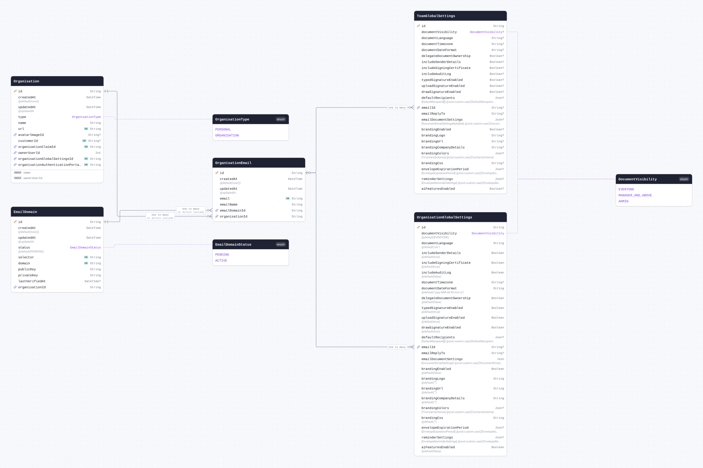

| Field            | Type       | Constraints                                       | Default      | Description |
| ---------------- | ---------- | ------------------------------------------------- | ------------ | ----------- |
| `id`             | `String`   | PK NOT NULL                                       |              |             |
| `createdAt`      | `DateTime` | NOT NULL                                          | `now()`      |             |
| `updatedAt`      | `DateTime` | NOT NULL                                          | `@updatedAt` |             |
| `email`          | `String`   | UNIQUE NOT NULL                                   |              |             |
| `emailName`      | `String`   | NOT NULL                                          |              |             |
| `emailDomainId`  | `String`   | NOT NULL → [EmailDomain.id](#model-EmailDomain)   |              |             |
| `organisationId` | `String`   | NOT NULL → [Organisation.id](#model-Organisation) |              |             |

#### References

- `emailDomainId` → [EmailDomain.id](#model-EmailDomain) (many-to-one, on delete Cascade)
- `organisationId` → [Organisation.id](#model-Organisation) (many-to-one, on delete Cascade)

#### Referenced by

- `id` ← [OrganisationGlobalSettings.emailId](#model-OrganisationGlobalSettings) (one-to-many)
- `id` ← [TeamGlobalSettings.emailId](#model-TeamGlobalSettings) (one-to-many)

#### Definition

```sql
CREATE TABLE "OrganisationEmail" (
    "id" TEXT NOT NULL,
    "createdAt" TIMESTAMP(3) NOT NULL DEFAULT CURRENT_TIMESTAMP,
    "updatedAt" TIMESTAMP(3) NOT NULL,
    "email" TEXT NOT NULL,
    "emailName" TEXT NOT NULL,
    "emailDomainId" TEXT NOT NULL,
    "organisationId" TEXT NOT NULL,

    CONSTRAINT "OrganisationEmail_pkey" PRIMARY KEY ("id")
);

CREATE UNIQUE INDEX "OrganisationEmail_email_key" ON "OrganisationEmail"("email");

ALTER TABLE "OrganisationEmail" ADD CONSTRAINT "OrganisationEmail_emailDomainId_fkey" FOREIGN KEY ("emailDomainId") REFERENCES "EmailDomain"("id") ON DELETE CASCADE ON UPDATE CASCADE;

ALTER TABLE "OrganisationEmail" ADD CONSTRAINT "OrganisationEmail_organisationId_fkey" FOREIGN KEY ("organisationId") REFERENCES "Organisation"("id") ON DELETE CASCADE ON UPDATE CASCADE;
```

<details>
<summary>Queries and their SQL</summary>

**findMany**: Every row

```ts
await prisma.organisationEmail.findMany();
```

```sql
SELECT
  "public"."OrganisationEmail"."id",
  "public"."OrganisationEmail"."createdAt",
  "public"."OrganisationEmail"."updatedAt",
  "public"."OrganisationEmail"."email",
  "public"."OrganisationEmail"."emailName",
  "public"."OrganisationEmail"."emailDomainId",
  "public"."OrganisationEmail"."organisationId"
FROM
  "public"."OrganisationEmail"
WHERE
  1 = 1
OFFSET
  $1
-- params: ["0"]
```

**count**: How many rows there are

```ts
await prisma.organisationEmail.count();
```

```sql
SELECT
  COUNT(*) AS "_count$_all"
FROM
  (
    SELECT
      "public"."OrganisationEmail"."id"
    FROM
      "public"."OrganisationEmail"
    WHERE
      1 = 1
    OFFSET
      $1
  ) AS "sub"
-- params: ["0"]
```

**findMany**: Every row with its relations

```ts
await prisma.organisationEmail.findMany({
  include: {
    emailDomain: true,
    organisation: true,
    organisationGlobalSettings: true,
    teamGlobalSettings: true,
  },
});
```

```sql
SELECT
  "public"."OrganisationEmail"."id",
  "public"."OrganisationEmail"."createdAt",
  "public"."OrganisationEmail"."updatedAt",
  "public"."OrganisationEmail"."email",
  "public"."OrganisationEmail"."emailName",
  "public"."OrganisationEmail"."emailDomainId",
  "public"."OrganisationEmail"."organisationId"
FROM
  "public"."OrganisationEmail"
WHERE
  1 = 1
OFFSET
  $1
-- params: ["0"]

SELECT
  "public"."EmailDomain"."id",
  "public"."EmailDomain"."createdAt",
  "public"."EmailDomain"."updatedAt",
  "public"."EmailDomain"."status"::text,
  "public"."EmailDomain"."selector",
  "public"."EmailDomain"."domain",
  "public"."EmailDomain"."publicKey",
  "public"."EmailDomain"."privateKey",
  "public"."EmailDomain"."lastVerifiedAt",
  "public"."EmailDomain"."organisationId"
FROM
  "public"."EmailDomain"
WHERE
  "public"."EmailDomain"."id" IN ($1)
OFFSET
  $2
-- params: ["<emailDomainId of the rows above>","0"]

SELECT
  "public"."Organisation"."id",
  "public"."Organisation"."createdAt",
  "public"."Organisation"."updatedAt",
  "public"."Organisation"."type"::text,
  "public"."Organisation"."name",
  "public"."Organisation"."url",
  "public"."Organisation"."avatarImageId",
  "public"."Organisation"."customerId",
  "public"."Organisation"."organisationClaimId",
  "public"."Organisation"."ownerUserId",
  "public"."Organisation"."organisationGlobalSettingsId",
  "public"."Organisation"."organisationAuthenticationPortalId"
FROM
  "public"."Organisation"
WHERE
  "public"."Organisation"."id" IN ($1)
OFFSET
  $2
-- params: ["<organisationId of the rows above>","0"]

SELECT
  "public"."OrganisationGlobalSettings"."id",
  "public"."OrganisationGlobalSettings"."documentVisibility"::text,
  "public"."OrganisationGlobalSettings"."documentLanguage",
  "public"."OrganisationGlobalSettings"."includeSenderDetails",
  "public"."OrganisationGlobalSettings"."includeSigningCertificate",
  "public"."OrganisationGlobalSettings"."includeAuditLog",
  "public"."OrganisationGlobalSettings"."documentTimezone",
  "public"."OrganisationGlobalSettings"."documentDateFormat",
  "public"."OrganisationGlobalSettings"."delegateDocumentOwnership",
  "public"."OrganisationGlobalSettings"."typedSignatureEnabled",
  "public"."OrganisationGlobalSettings"."uploadSignatureEnabled",
  "public"."OrganisationGlobalSettings"."drawSignatureEnabled",
  "public"."OrganisationGlobalSettings"."defaultRecipients",
  "public"."OrganisationGlobalSettings"."emailId",
  "public"."OrganisationGlobalSettings"."emailReplyTo",
  "public"."OrganisationGlobalSettings"."emailDocumentSettings",
  "public"."OrganisationGlobalSettings"."brandingEnabled",
  "public"."OrganisationGlobalSettings"."brandingLogo",
  "public"."OrganisationGlobalSettings"."brandingUrl",
  "public"."OrganisationGlobalSettings"."brandingCompanyDetails",
  "public"."OrganisationGlobalSettings"."brandingColors",
  "public"."OrganisationGlobalSettings"."brandingCss",
  "public"."OrganisationGlobalSettings"."envelopeExpirationPeriod",
  "public"."OrganisationGlobalSettings"."reminderSettings",
  "public"."OrganisationGlobalSettings"."aiFeaturesEnabled"
FROM
  "public"."OrganisationGlobalSettings"
WHERE
  "public"."OrganisationGlobalSettings"."emailId" IN ($1)
OFFSET
  $2
-- params: ["<id of the rows above>","0"]

SELECT
  "public"."TeamGlobalSettings"."id",
  "public"."TeamGlobalSettings"."documentVisibility"::text,
  "public"."TeamGlobalSettings"."documentLanguage",
  "public"."TeamGlobalSettings"."documentTimezone",
  "public"."TeamGlobalSettings"."documentDateFormat",
  "public"."TeamGlobalSettings"."delegateDocumentOwnership",
  "public"."TeamGlobalSettings"."includeSenderDetails",
  "public"."TeamGlobalSettings"."includeSigningCertificate",
  "public"."TeamGlobalSettings"."includeAuditLog",
  "public"."TeamGlobalSettings"."typedSignatureEnabled",
  "public"."TeamGlobalSettings"."uploadSignatureEnabled",
  "public"."TeamGlobalSettings"."drawSignatureEnabled",
  "public"."TeamGlobalSettings"."defaultRecipients",
  "public"."TeamGlobalSettings"."emailId",
  "public"."TeamGlobalSettings"."emailReplyTo",
  "public"."TeamGlobalSettings"."emailDocumentSettings",
  "public"."TeamGlobalSettings"."brandingEnabled",
  "public"."TeamGlobalSettings"."brandingLogo",
  "public"."TeamGlobalSettings"."brandingUrl",
  "public"."TeamGlobalSettings"."brandingCompanyDetails",
  "public"."TeamGlobalSettings"."brandingColors",
  "public"."TeamGlobalSettings"."brandingCss",
  "public"."TeamGlobalSettings"."envelopeExpirationPeriod",
  "public"."TeamGlobalSettings"."reminderSettings",
  "public"."TeamGlobalSettings"."aiFeaturesEnabled"
FROM
  "public"."TeamGlobalSettings"
WHERE
  "public"."TeamGlobalSettings"."emailId" IN ($1)
OFFSET
  $2
-- params: ["<id of the rows above>","0"]
```

**findUnique**: One row by what is unique to it

```ts
await prisma.organisationEmail.findUnique({ where: { id: "example" } });
```

```sql
SELECT
  "public"."OrganisationEmail"."id",
  "public"."OrganisationEmail"."createdAt",
  "public"."OrganisationEmail"."updatedAt",
  "public"."OrganisationEmail"."email",
  "public"."OrganisationEmail"."emailName",
  "public"."OrganisationEmail"."emailDomainId",
  "public"."OrganisationEmail"."organisationId"
FROM
  "public"."OrganisationEmail"
WHERE
  (
    "public"."OrganisationEmail"."id" = $1
    AND 1 = 1
  )
LIMIT
  $2
OFFSET
  $3
-- params: ["example","1","0"]
```

**create**: Create a row

```ts
await prisma.organisationEmail.create({
  data: {
    id: "example",
    email: "example",
    emailName: "example",
    emailDomainId: "example",
    organisationId: "example",
  },
});
```

```sql
INSERT INTO
  "public"."OrganisationEmail" (
    "id",
    "createdAt",
    "updatedAt",
    "email",
    "emailName",
    "emailDomainId",
    "organisationId"
  )
VALUES
  ($1, $2, $3, $4, $5, $6, $7)
RETURNING
  "public"."OrganisationEmail"."id",
  "public"."OrganisationEmail"."createdAt",
  "public"."OrganisationEmail"."updatedAt",
  "public"."OrganisationEmail"."email",
  "public"."OrganisationEmail"."emailName",
  "public"."OrganisationEmail"."emailDomainId",
  "public"."OrganisationEmail"."organisationId"
-- params: ["example","<now()>","<now()>","example","example","example","example"]
```

**update**: Update a row

```ts
await prisma.organisationEmail.update({
  where: { id: "example" },
  data: { createdAt: new Date("2026-01-01T00:00:00.000Z") },
});
```

```sql
UPDATE "public"."OrganisationEmail"
SET
  "createdAt" = $1,
  "updatedAt" = $2
WHERE
  (
    "public"."OrganisationEmail"."id" = $3
    AND 1 = 1
  )
RETURNING
  "public"."OrganisationEmail"."id",
  "public"."OrganisationEmail"."createdAt",
  "public"."OrganisationEmail"."updatedAt",
  "public"."OrganisationEmail"."email",
  "public"."OrganisationEmail"."emailName",
  "public"."OrganisationEmail"."emailDomainId",
  "public"."OrganisationEmail"."organisationId"
-- params: ["2026-01-01T00:00:00.000Z",{"prisma__type":"generatorCall","prisma__value":{"name":"now","args":[],"returnType":{"type":"DateTime"}}},"example"]
```

**delete**: Delete a row

```ts
await prisma.organisationEmail.delete({ where: { id: "example" } });
```

```sql
DELETE FROM "public"."OrganisationEmail"
WHERE
  (
    "public"."OrganisationEmail"."id" = $1
    AND 1 = 1
  )
RETURNING
  "public"."OrganisationEmail"."id",
  "public"."OrganisationEmail"."createdAt",
  "public"."OrganisationEmail"."updatedAt",
  "public"."OrganisationEmail"."email",
  "public"."OrganisationEmail"."emailName",
  "public"."OrganisationEmail"."emailDomainId",
  "public"."OrganisationEmail"."organisationId"
-- params: ["example"]
```

</details>

<a id="model-EmailTransport"></a>

### EmailTransport

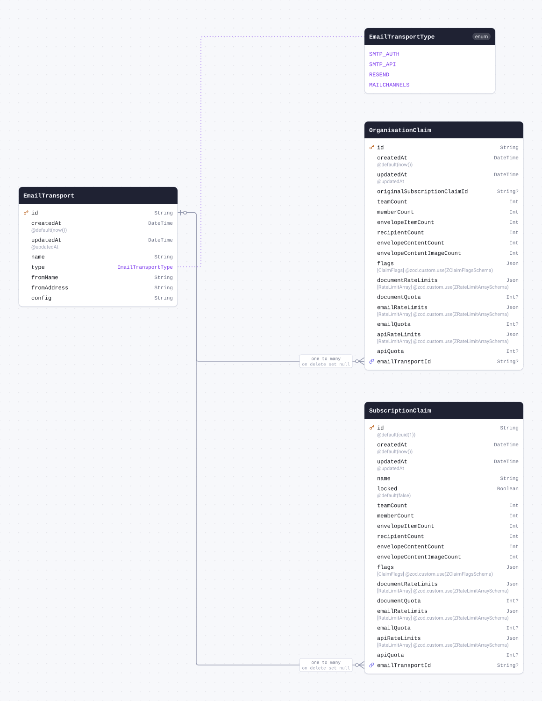

| Field         | Type                                             | Constraints | Default      | Description |
| ------------- | ------------------------------------------------ | ----------- | ------------ | ----------- |
| `id`          | `String`                                         | PK NOT NULL |              |             |
| `createdAt`   | `DateTime`                                       | NOT NULL    | `now()`      |             |
| `updatedAt`   | `DateTime`                                       | NOT NULL    | `@updatedAt` |             |
| `name`        | `String`                                         | NOT NULL    |              |             |
| `type`        | [`EmailTransportType`](#enum-EmailTransportType) | NOT NULL    |              |             |
| `fromName`    | `String`                                         | NOT NULL    |              |             |
| `fromAddress` | `String`                                         | NOT NULL    |              |             |
| `config`      | `String`                                         | NOT NULL    |              |             |

#### Referenced by

- `id` ← [SubscriptionClaim.emailTransportId](#model-SubscriptionClaim) (one-to-many, on delete SetNull)
- `id` ← [OrganisationClaim.emailTransportId](#model-OrganisationClaim) (one-to-many, on delete SetNull)

#### Definition

```sql
CREATE TABLE "EmailTransport" (
    "id" TEXT NOT NULL,
    "createdAt" TIMESTAMP(3) NOT NULL DEFAULT CURRENT_TIMESTAMP,
    "updatedAt" TIMESTAMP(3) NOT NULL,
    "name" TEXT NOT NULL,
    "type" "EmailTransportType" NOT NULL,
    "fromName" TEXT NOT NULL,
    "fromAddress" TEXT NOT NULL,
    "config" TEXT NOT NULL,

    CONSTRAINT "EmailTransport_pkey" PRIMARY KEY ("id")
);
```

<details>
<summary>Queries and their SQL</summary>

**findMany**: Every row

```ts
await prisma.emailTransport.findMany();
```

```sql
SELECT
  "public"."EmailTransport"."id",
  "public"."EmailTransport"."createdAt",
  "public"."EmailTransport"."updatedAt",
  "public"."EmailTransport"."name",
  "public"."EmailTransport"."type"::text,
  "public"."EmailTransport"."fromName",
  "public"."EmailTransport"."fromAddress",
  "public"."EmailTransport"."config"
FROM
  "public"."EmailTransport"
WHERE
  1 = 1
OFFSET
  $1
-- params: ["0"]
```

**count**: How many rows there are

```ts
await prisma.emailTransport.count();
```

```sql
SELECT
  COUNT(*) AS "_count$_all"
FROM
  (
    SELECT
      "public"."EmailTransport"."id"
    FROM
      "public"."EmailTransport"
    WHERE
      1 = 1
    OFFSET
      $1
  ) AS "sub"
-- params: ["0"]
```

**findMany**: Every row with its relations

```ts
await prisma.emailTransport.findMany({
  include: { subscriptionClaims: true, organisationClaims: true },
});
```

```sql
SELECT
  "public"."EmailTransport"."id",
  "public"."EmailTransport"."createdAt",
  "public"."EmailTransport"."updatedAt",
  "public"."EmailTransport"."name",
  "public"."EmailTransport"."type"::text,
  "public"."EmailTransport"."fromName",
  "public"."EmailTransport"."fromAddress",
  "public"."EmailTransport"."config"
FROM
  "public"."EmailTransport"
WHERE
  1 = 1
OFFSET
  $1
-- params: ["0"]

SELECT
  "public"."SubscriptionClaim"."id",
  "public"."SubscriptionClaim"."createdAt",
  "public"."SubscriptionClaim"."updatedAt",
  "public"."SubscriptionClaim"."name",
  "public"."SubscriptionClaim"."locked",
  "public"."SubscriptionClaim"."teamCount",
  "public"."SubscriptionClaim"."memberCount",
  "public"."SubscriptionClaim"."envelopeItemCount",
  "public"."SubscriptionClaim"."recipientCount",
  "public"."SubscriptionClaim"."envelopeContentCount",
  "public"."SubscriptionClaim"."envelopeContentImageCount",
  "public"."SubscriptionClaim"."flags",
  "public"."SubscriptionClaim"."documentRateLimits",
  "public"."SubscriptionClaim"."documentQuota",
  "public"."SubscriptionClaim"."emailRateLimits",
  "public"."SubscriptionClaim"."emailQuota",
  "public"."SubscriptionClaim"."apiRateLimits",
  "public"."SubscriptionClaim"."apiQuota",
  "public"."SubscriptionClaim"."emailTransportId"
FROM
  "public"."SubscriptionClaim"
WHERE
  "public"."SubscriptionClaim"."emailTransportId" IN ($1)
OFFSET
  $2
-- params: ["<id of the rows above>","0"]

SELECT
  "public"."OrganisationClaim"."id",
  "public"."OrganisationClaim"."createdAt",
  "public"."OrganisationClaim"."updatedAt",
  "public"."OrganisationClaim"."originalSubscriptionClaimId",
  "public"."OrganisationClaim"."teamCount",
  "public"."OrganisationClaim"."memberCount",
  "public"."OrganisationClaim"."envelopeItemCount",
  "public"."OrganisationClaim"."recipientCount",
  "public"."OrganisationClaim"."envelopeContentCount",
  "public"."OrganisationClaim"."envelopeContentImageCount",
  "public"."OrganisationClaim"."flags",
  "public"."OrganisationClaim"."documentRateLimits",
  "public"."OrganisationClaim"."documentQuota",
  "public"."OrganisationClaim"."emailRateLimits",
  "public"."OrganisationClaim"."emailQuota",
  "public"."OrganisationClaim"."apiRateLimits",
  "public"."OrganisationClaim"."apiQuota",
  "public"."OrganisationClaim"."emailTransportId"
FROM
  "public"."OrganisationClaim"
WHERE
  "public"."OrganisationClaim"."emailTransportId" IN ($1)
OFFSET
  $2
-- params: ["<id of the rows above>","0"]
```

**findUnique**: One row by what is unique to it

```ts
await prisma.emailTransport.findUnique({ where: { id: "example" } });
```

```sql
SELECT
  "public"."EmailTransport"."id",
  "public"."EmailTransport"."createdAt",
  "public"."EmailTransport"."updatedAt",
  "public"."EmailTransport"."name",
  "public"."EmailTransport"."type"::text,
  "public"."EmailTransport"."fromName",
  "public"."EmailTransport"."fromAddress",
  "public"."EmailTransport"."config"
FROM
  "public"."EmailTransport"
WHERE
  (
    "public"."EmailTransport"."id" = $1
    AND 1 = 1
  )
LIMIT
  $2
OFFSET
  $3
-- params: ["example","1","0"]
```

**create**: Create a row

```ts
await prisma.emailTransport.create({
  data: {
    id: "example",
    name: "example",
    type: "SMTP_AUTH",
    fromName: "example",
    fromAddress: "example",
    config: "example",
  },
});
```

```sql
INSERT INTO
  "public"."EmailTransport" (
    "id",
    "createdAt",
    "updatedAt",
    "name",
    "type",
    "fromName",
    "fromAddress",
    "config"
  )
VALUES
  (
    $1,
    $2,
    $3,
    $4,
    CAST($5::text AS "public"."EmailTransportType"),
    $6,
    $7,
    $8
  )
RETURNING
  "public"."EmailTransport"."id",
  "public"."EmailTransport"."createdAt",
  "public"."EmailTransport"."updatedAt",
  "public"."EmailTransport"."name",
  "public"."EmailTransport"."type"::text,
  "public"."EmailTransport"."fromName",
  "public"."EmailTransport"."fromAddress",
  "public"."EmailTransport"."config"
-- params: ["example","<now()>","<now()>","example","SMTP_AUTH","example","example","example"]
```

**update**: Update a row

```ts
await prisma.emailTransport.update({
  where: { id: "example" },
  data: { createdAt: new Date("2026-01-01T00:00:00.000Z") },
});
```

```sql
UPDATE "public"."EmailTransport"
SET
  "createdAt" = $1,
  "updatedAt" = $2
WHERE
  (
    "public"."EmailTransport"."id" = $3
    AND 1 = 1
  )
RETURNING
  "public"."EmailTransport"."id",
  "public"."EmailTransport"."createdAt",
  "public"."EmailTransport"."updatedAt",
  "public"."EmailTransport"."name",
  "public"."EmailTransport"."type"::text,
  "public"."EmailTransport"."fromName",
  "public"."EmailTransport"."fromAddress",
  "public"."EmailTransport"."config"
-- params: ["2026-01-01T00:00:00.000Z",{"prisma__type":"generatorCall","prisma__value":{"name":"now","args":[],"returnType":{"type":"DateTime"}}},"example"]
```

**delete**: Delete a row

```ts
await prisma.emailTransport.delete({ where: { id: "example" } });
```

```sql
DELETE FROM "public"."EmailTransport"
WHERE
  (
    "public"."EmailTransport"."id" = $1
    AND 1 = 1
  )
RETURNING
  "public"."EmailTransport"."id",
  "public"."EmailTransport"."createdAt",
  "public"."EmailTransport"."updatedAt",
  "public"."EmailTransport"."name",
  "public"."EmailTransport"."type"::text,
  "public"."EmailTransport"."fromName",
  "public"."EmailTransport"."fromAddress",
  "public"."EmailTransport"."config"
-- params: ["example"]
```

</details>

<a id="model-OrganisationAuthenticationPortal"></a>

### OrganisationAuthenticationPortal

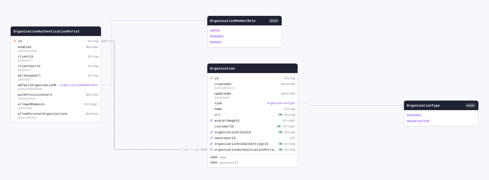

| Field                        | Type                                                     | Constraints | Default  | Description |
| ---------------------------- | -------------------------------------------------------- | ----------- | -------- | ----------- |
| `id`                         | `String`                                                 | PK NOT NULL |          |             |
| `enabled`                    | `Boolean`                                                | NOT NULL    | `false`  |             |
| `clientId`                   | `String`                                                 | NOT NULL    | `""`     |             |
| `clientSecret`               | `String`                                                 | NOT NULL    | `""`     |             |
| `wellKnownUrl`               | `String`                                                 | NOT NULL    | `""`     |             |
| `defaultOrganisationRole`    | [`OrganisationMemberRole`](#enum-OrganisationMemberRole) | NOT NULL    | `MEMBER` |             |
| `autoProvisionUsers`         | `Boolean`                                                | NOT NULL    | `true`   |             |
| `allowedDomains`             | `String[]`                                               | NOT NULL    | `[]`     |             |
| `allowPersonalOrganisations` | `Boolean`                                                | NOT NULL    | `false`  |             |

#### Referenced by

- `id` ← [Organisation.organisationAuthenticationPortalId](#model-Organisation) (one-to-one)

#### Definition

```sql
CREATE TABLE "OrganisationAuthenticationPortal" (
    "id" TEXT NOT NULL,
    "enabled" BOOLEAN NOT NULL DEFAULT false,
    "clientId" TEXT NOT NULL DEFAULT '',
    "clientSecret" TEXT NOT NULL DEFAULT '',
    "wellKnownUrl" TEXT NOT NULL DEFAULT '',
    "defaultOrganisationRole" "OrganisationMemberRole" NOT NULL DEFAULT 'MEMBER',
    "autoProvisionUsers" BOOLEAN NOT NULL DEFAULT true,
    "allowedDomains" TEXT[] DEFAULT ARRAY[]::TEXT[],
    "allowPersonalOrganisations" BOOLEAN NOT NULL DEFAULT false,

    CONSTRAINT "OrganisationAuthenticationPortal_pkey" PRIMARY KEY ("id")
);
```

<details>
<summary>Queries and their SQL</summary>

**findMany**: Every row

```ts
await prisma.organisationAuthenticationPortal.findMany();
```

```sql
SELECT
  "public"."OrganisationAuthenticationPortal"."id",
  "public"."OrganisationAuthenticationPortal"."enabled",
  "public"."OrganisationAuthenticationPortal"."clientId",
  "public"."OrganisationAuthenticationPortal"."clientSecret",
  "public"."OrganisationAuthenticationPortal"."wellKnownUrl",
  "public"."OrganisationAuthenticationPortal"."defaultOrganisationRole"::text,
  "public"."OrganisationAuthenticationPortal"."autoProvisionUsers",
  "public"."OrganisationAuthenticationPortal"."allowedDomains",
  "public"."OrganisationAuthenticationPortal"."allowPersonalOrganisations"
FROM
  "public"."OrganisationAuthenticationPortal"
WHERE
  1 = 1
OFFSET
  $1
-- params: ["0"]
```

**count**: How many rows there are

```ts
await prisma.organisationAuthenticationPortal.count();
```

```sql
SELECT
  COUNT(*) AS "_count$_all"
FROM
  (
    SELECT
      "public"."OrganisationAuthenticationPortal"."id"
    FROM
      "public"."OrganisationAuthenticationPortal"
    WHERE
      1 = 1
    OFFSET
      $1
  ) AS "sub"
-- params: ["0"]
```

**findMany**: Every row with its relations

```ts
await prisma.organisationAuthenticationPortal.findMany({ include: { organisation: true } });
```

```sql
SELECT
  "public"."OrganisationAuthenticationPortal"."id",
  "public"."OrganisationAuthenticationPortal"."enabled",
  "public"."OrganisationAuthenticationPortal"."clientId",
  "public"."OrganisationAuthenticationPortal"."clientSecret",
  "public"."OrganisationAuthenticationPortal"."wellKnownUrl",
  "public"."OrganisationAuthenticationPortal"."defaultOrganisationRole"::text,
  "public"."OrganisationAuthenticationPortal"."autoProvisionUsers",
  "public"."OrganisationAuthenticationPortal"."allowedDomains",
  "public"."OrganisationAuthenticationPortal"."allowPersonalOrganisations"
FROM
  "public"."OrganisationAuthenticationPortal"
WHERE
  1 = 1
OFFSET
  $1
-- params: ["0"]

SELECT
  "public"."Organisation"."id",
  "public"."Organisation"."createdAt",
  "public"."Organisation"."updatedAt",
  "public"."Organisation"."type"::text,
  "public"."Organisation"."name",
  "public"."Organisation"."url",
  "public"."Organisation"."avatarImageId",
  "public"."Organisation"."customerId",
  "public"."Organisation"."organisationClaimId",
  "public"."Organisation"."ownerUserId",
  "public"."Organisation"."organisationGlobalSettingsId",
  "public"."Organisation"."organisationAuthenticationPortalId"
FROM
  "public"."Organisation"
WHERE
  "public"."Organisation"."organisationAuthenticationPortalId" IN ($1)
OFFSET
  $2
-- params: ["<id of the rows above>","0"]
```

**findUnique**: One row by what is unique to it

```ts
await prisma.organisationAuthenticationPortal.findUnique({ where: { id: "example" } });
```

```sql
SELECT
  "public"."OrganisationAuthenticationPortal"."id",
  "public"."OrganisationAuthenticationPortal"."enabled",
  "public"."OrganisationAuthenticationPortal"."clientId",
  "public"."OrganisationAuthenticationPortal"."clientSecret",
  "public"."OrganisationAuthenticationPortal"."wellKnownUrl",
  "public"."OrganisationAuthenticationPortal"."defaultOrganisationRole"::text,
  "public"."OrganisationAuthenticationPortal"."autoProvisionUsers",
  "public"."OrganisationAuthenticationPortal"."allowedDomains",
  "public"."OrganisationAuthenticationPortal"."allowPersonalOrganisations"
FROM
  "public"."OrganisationAuthenticationPortal"
WHERE
  (
    "public"."OrganisationAuthenticationPortal"."id" = $1
    AND 1 = 1
  )
LIMIT
  $2
OFFSET
  $3
-- params: ["example","1","0"]
```

**create**: Create a row

```ts
await prisma.organisationAuthenticationPortal.create({ data: { id: "example" } });
```

```sql
INSERT INTO
  "public"."OrganisationAuthenticationPortal" (
    "id",
    "enabled",
    "clientId",
    "clientSecret",
    "wellKnownUrl",
    "defaultOrganisationRole",
    "autoProvisionUsers",
    "allowedDomains",
    "allowPersonalOrganisations"
  )
VALUES
  (
    $1,
    $2,
    $3,
    $4,
    $5,
    CAST($6::text AS "public"."OrganisationMemberRole"),
    $7,
    $8,
    $9
  )
RETURNING
  "public"."OrganisationAuthenticationPortal"."id",
  "public"."OrganisationAuthenticationPortal"."enabled",
  "public"."OrganisationAuthenticationPortal"."clientId",
  "public"."OrganisationAuthenticationPortal"."clientSecret",
  "public"."OrganisationAuthenticationPortal"."wellKnownUrl",
  "public"."OrganisationAuthenticationPortal"."defaultOrganisationRole"::text,
  "public"."OrganisationAuthenticationPortal"."autoProvisionUsers",
  "public"."OrganisationAuthenticationPortal"."allowedDomains",
  "public"."OrganisationAuthenticationPortal"."allowPersonalOrganisations"
-- params: ["example",false,"","","","MEMBER",true,[],false]
```

**update**: Update a row

```ts
await prisma.organisationAuthenticationPortal.update({
  where: { id: "example" },
  data: { enabled: true },
});
```

```sql
UPDATE "public"."OrganisationAuthenticationPortal"
SET
  "enabled" = $1
WHERE
  (
    "public"."OrganisationAuthenticationPortal"."id" = $2
    AND 1 = 1
  )
RETURNING
  "public"."OrganisationAuthenticationPortal"."id",
  "public"."OrganisationAuthenticationPortal"."enabled",
  "public"."OrganisationAuthenticationPortal"."clientId",
  "public"."OrganisationAuthenticationPortal"."clientSecret",
  "public"."OrganisationAuthenticationPortal"."wellKnownUrl",
  "public"."OrganisationAuthenticationPortal"."defaultOrganisationRole"::text,
  "public"."OrganisationAuthenticationPortal"."autoProvisionUsers",
  "public"."OrganisationAuthenticationPortal"."allowedDomains",
  "public"."OrganisationAuthenticationPortal"."allowPersonalOrganisations"
-- params: [true,"example"]
```

**delete**: Delete a row

```ts
await prisma.organisationAuthenticationPortal.delete({ where: { id: "example" } });
```

```sql
DELETE FROM "public"."OrganisationAuthenticationPortal"
WHERE
  (
    "public"."OrganisationAuthenticationPortal"."id" = $1
    AND 1 = 1
  )
RETURNING
  "public"."OrganisationAuthenticationPortal"."id",
  "public"."OrganisationAuthenticationPortal"."enabled",
  "public"."OrganisationAuthenticationPortal"."clientId",
  "public"."OrganisationAuthenticationPortal"."clientSecret",
  "public"."OrganisationAuthenticationPortal"."wellKnownUrl",
  "public"."OrganisationAuthenticationPortal"."defaultOrganisationRole"::text,
  "public"."OrganisationAuthenticationPortal"."autoProvisionUsers",
  "public"."OrganisationAuthenticationPortal"."allowedDomains",
  "public"."OrganisationAuthenticationPortal"."allowPersonalOrganisations"
-- params: ["example"]
```

</details>

<a id="model-Counter"></a>

### Counter

| Field   | Type     | Constraints | Default | Description |
| ------- | -------- | ----------- | ------- | ----------- |
| `id`    | `String` | PK NOT NULL |         |             |
| `value` | `Int`    | NOT NULL    |         |             |

#### Definition

```sql
CREATE TABLE "Counter" (
    "id" TEXT NOT NULL,
    "value" INTEGER NOT NULL,

    CONSTRAINT "Counter_pkey" PRIMARY KEY ("id")
);
```

<details>
<summary>Queries and their SQL</summary>

**findMany**: Every row

```ts
await prisma.counter.findMany();
```

```sql
SELECT
  "public"."Counter"."id",
  "public"."Counter"."value"
FROM
  "public"."Counter"
WHERE
  1 = 1
OFFSET
  $1
-- params: ["0"]
```

**count**: How many rows there are

```ts
await prisma.counter.count();
```

```sql
SELECT
  COUNT(*) AS "_count$_all"
FROM
  (
    SELECT
      "public"."Counter"."id"
    FROM
      "public"."Counter"
    WHERE
      1 = 1
    OFFSET
      $1
  ) AS "sub"
-- params: ["0"]
```

**findUnique**: One row by what is unique to it

```ts
await prisma.counter.findUnique({ where: { id: "example" } });
```

```sql
SELECT
  "public"."Counter"."id",
  "public"."Counter"."value"
FROM
  "public"."Counter"
WHERE
  (
    "public"."Counter"."id" = $1
    AND 1 = 1
  )
LIMIT
  $2
OFFSET
  $3
-- params: ["example","1","0"]
```

**create**: Create a row

```ts
await prisma.counter.create({ data: { id: "example", value: 1 } });
```

```sql
INSERT INTO
  "public"."Counter" ("id", "value")
VALUES
  ($1, $2)
RETURNING
  "public"."Counter"."id",
  "public"."Counter"."value"
-- params: ["example","1"]
```

**update**: Update a row

```ts
await prisma.counter.update({ where: { id: "example" }, data: { value: 1 } });
```

```sql
UPDATE "public"."Counter"
SET
  "value" = $1
WHERE
  (
    "public"."Counter"."id" = $2
    AND 1 = 1
  )
RETURNING
  "public"."Counter"."id",
  "public"."Counter"."value"
-- params: ["1","example"]
```

**delete**: Delete a row

```ts
await prisma.counter.delete({ where: { id: "example" } });
```

```sql
DELETE FROM "public"."Counter"
WHERE
  (
    "public"."Counter"."id" = $1
    AND 1 = 1
  )
RETURNING
  "public"."Counter"."id",
  "public"."Counter"."value"
-- params: ["example"]
```

</details>

<a id="model-EmbedSignature"></a>

### EmbedSignature

`key` is sha256(organisationId:lower(recipientEmail):clientUserId) so neither
the recipient email nor the embedder's identifier is stored in plaintext.

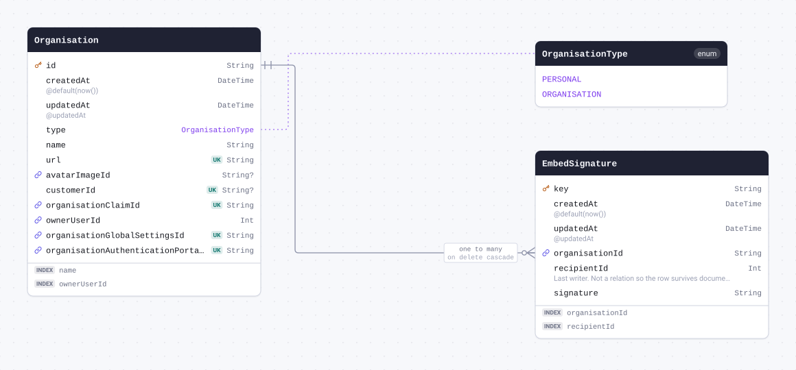

| Field            | Type       | Constraints                                       | Default      | Description                                                                                             |
| ---------------- | ---------- | ------------------------------------------------- | ------------ | ------------------------------------------------------------------------------------------------------- |
| `key`            | `String`   | PK NOT NULL                                       |              |                                                                                                         |
| `createdAt`      | `DateTime` | NOT NULL                                          | `now()`      |                                                                                                         |
| `updatedAt`      | `DateTime` | NOT NULL                                          | `@updatedAt` |                                                                                                         |
| `organisationId` | `String`   | NOT NULL → [Organisation.id](#model-Organisation) |              |                                                                                                         |
| `recipientId`    | `Int`      | NOT NULL                                          |              | Last writer. Not a relation so the row survives document deletion and remains useful for abuse tracing. |
| `signature`      | `String`   | NOT NULL                                          |              |                                                                                                         |

#### Indexes

- `@@index([organisationId])`
- `@@index([recipientId])`

#### References

- `organisationId` → [Organisation.id](#model-Organisation) (many-to-one, on delete Cascade)

#### Definition

```sql
CREATE TABLE "EmbedSignature" (
    "key" TEXT NOT NULL,
    "createdAt" TIMESTAMP(3) NOT NULL DEFAULT CURRENT_TIMESTAMP,
    "updatedAt" TIMESTAMP(3) NOT NULL,
    "organisationId" TEXT NOT NULL,
    "recipientId" INTEGER NOT NULL,
    "signature" TEXT NOT NULL,

    CONSTRAINT "EmbedSignature_pkey" PRIMARY KEY ("key")
);

CREATE INDEX "EmbedSignature_organisationId_idx" ON "EmbedSignature"("organisationId");

CREATE INDEX "EmbedSignature_recipientId_idx" ON "EmbedSignature"("recipientId");

ALTER TABLE "EmbedSignature" ADD CONSTRAINT "EmbedSignature_organisationId_fkey" FOREIGN KEY ("organisationId") REFERENCES "Organisation"("id") ON DELETE CASCADE ON UPDATE CASCADE;
```

<details>
<summary>Queries and their SQL</summary>

**findMany**: Every row

```ts
await prisma.embedSignature.findMany();
```

```sql
SELECT
  "public"."EmbedSignature"."key",
  "public"."EmbedSignature"."createdAt",
  "public"."EmbedSignature"."updatedAt",
  "public"."EmbedSignature"."organisationId",
  "public"."EmbedSignature"."recipientId",
  "public"."EmbedSignature"."signature"
FROM
  "public"."EmbedSignature"
WHERE
  1 = 1
OFFSET
  $1
-- params: ["0"]
```

**count**: How many rows there are

```ts
await prisma.embedSignature.count();
```

```sql
SELECT
  COUNT(*) AS "_count$_all"
FROM
  (
    SELECT
      "public"."EmbedSignature"."key"
    FROM
      "public"."EmbedSignature"
    WHERE
      1 = 1
    OFFSET
      $1
  ) AS "sub"
-- params: ["0"]
```

**findMany**: Every row with its relations

```ts
await prisma.embedSignature.findMany({ include: { organisation: true } });
```

```sql
SELECT
  "public"."EmbedSignature"."key",
  "public"."EmbedSignature"."createdAt",
  "public"."EmbedSignature"."updatedAt",
  "public"."EmbedSignature"."organisationId",
  "public"."EmbedSignature"."recipientId",
  "public"."EmbedSignature"."signature"
FROM
  "public"."EmbedSignature"
WHERE
  1 = 1
OFFSET
  $1
-- params: ["0"]

SELECT
  "public"."Organisation"."id",
  "public"."Organisation"."createdAt",
  "public"."Organisation"."updatedAt",
  "public"."Organisation"."type"::text,
  "public"."Organisation"."name",
  "public"."Organisation"."url",
  "public"."Organisation"."avatarImageId",
  "public"."Organisation"."customerId",
  "public"."Organisation"."organisationClaimId",
  "public"."Organisation"."ownerUserId",
  "public"."Organisation"."organisationGlobalSettingsId",
  "public"."Organisation"."organisationAuthenticationPortalId"
FROM
  "public"."Organisation"
WHERE
  "public"."Organisation"."id" IN ($1)
OFFSET
  $2
-- params: ["<organisationId of the rows above>","0"]
```

**findUnique**: One row by what is unique to it

```ts
await prisma.embedSignature.findUnique({ where: { key: "example" } });
```

```sql
SELECT
  "public"."EmbedSignature"."key",
  "public"."EmbedSignature"."createdAt",
  "public"."EmbedSignature"."updatedAt",
  "public"."EmbedSignature"."organisationId",
  "public"."EmbedSignature"."recipientId",
  "public"."EmbedSignature"."signature"
FROM
  "public"."EmbedSignature"
WHERE
  (
    "public"."EmbedSignature"."key" = $1
    AND 1 = 1
  )
LIMIT
  $2
OFFSET
  $3
-- params: ["example","1","0"]
```

**create**: Create a row

```ts
await prisma.embedSignature.create({
  data: { key: "example", organisationId: "example", recipientId: 1, signature: "example" },
});
```

```sql
INSERT INTO
  "public"."EmbedSignature" (
    "key",
    "createdAt",
    "updatedAt",
    "organisationId",
    "recipientId",
    "signature"
  )
VALUES
  ($1, $2, $3, $4, $5, $6)
RETURNING
  "public"."EmbedSignature"."key",
  "public"."EmbedSignature"."createdAt",
  "public"."EmbedSignature"."updatedAt",
  "public"."EmbedSignature"."organisationId",
  "public"."EmbedSignature"."recipientId",
  "public"."EmbedSignature"."signature"
-- params: ["example","<now()>","<now()>","example","1","example"]
```

**update**: Update a row

```ts
await prisma.embedSignature.update({
  where: { key: "example" },
  data: { createdAt: new Date("2026-01-01T00:00:00.000Z") },
});
```

```sql
UPDATE "public"."EmbedSignature"
SET
  "createdAt" = $1,
  "updatedAt" = $2
WHERE
  (
    "public"."EmbedSignature"."key" = $3
    AND 1 = 1
  )
RETURNING
  "public"."EmbedSignature"."key",
  "public"."EmbedSignature"."createdAt",
  "public"."EmbedSignature"."updatedAt",
  "public"."EmbedSignature"."organisationId",
  "public"."EmbedSignature"."recipientId",
  "public"."EmbedSignature"."signature"
-- params: ["2026-01-01T00:00:00.000Z",{"prisma__type":"generatorCall","prisma__value":{"name":"now","args":[],"returnType":{"type":"DateTime"}}},"example"]
```

**delete**: Delete a row

```ts
await prisma.embedSignature.delete({ where: { key: "example" } });
```

```sql
DELETE FROM "public"."EmbedSignature"
WHERE
  (
    "public"."EmbedSignature"."key" = $1
    AND 1 = 1
  )
RETURNING
  "public"."EmbedSignature"."key",
  "public"."EmbedSignature"."createdAt",
  "public"."EmbedSignature"."updatedAt",
  "public"."EmbedSignature"."organisationId",
  "public"."EmbedSignature"."recipientId",
  "public"."EmbedSignature"."signature"
-- params: ["example"]
```

</details>

<a id="model-RateLimit"></a>

### RateLimit

| Field       | Type       | Constraints | Default | Description |
| ----------- | ---------- | ----------- | ------- | ----------- |
| `key`       | `String`   | PK NOT NULL |         |             |
| `action`    | `String`   | PK NOT NULL |         |             |
| `bucket`    | `DateTime` | PK NOT NULL |         |             |
| `count`     | `Int`      | NOT NULL    | `1`     |             |
| `createdAt` | `DateTime` | NOT NULL    | `now()` |             |

#### Indexes

- `@@id([key, action, bucket])`
- `@@index([createdAt])`

#### Definition

```sql
CREATE TABLE "RateLimit" (
    "key" TEXT NOT NULL,
    "action" TEXT NOT NULL,
    "bucket" TIMESTAMP(3) NOT NULL,
    "count" INTEGER NOT NULL DEFAULT 1,
    "createdAt" TIMESTAMP(3) NOT NULL DEFAULT CURRENT_TIMESTAMP,

    CONSTRAINT "RateLimit_pkey" PRIMARY KEY ("key","action","bucket")
);

CREATE INDEX "RateLimit_createdAt_idx" ON "RateLimit"("createdAt");
```

<details>
<summary>Queries and their SQL</summary>

**findMany**: Every row

```ts
await prisma.rateLimit.findMany();
```

```sql
SELECT
  "public"."RateLimit"."key",
  "public"."RateLimit"."action",
  "public"."RateLimit"."bucket",
  "public"."RateLimit"."count",
  "public"."RateLimit"."createdAt"
FROM
  "public"."RateLimit"
WHERE
  1 = 1
OFFSET
  $1
-- params: ["0"]
```

**count**: How many rows there are

```ts
await prisma.rateLimit.count();
```

```sql
SELECT
  COUNT(*) AS "_count$_all"
FROM
  (
    SELECT
      "public"."RateLimit"."key",
      "public"."RateLimit"."action",
      "public"."RateLimit"."bucket"
    FROM
      "public"."RateLimit"
    WHERE
      1 = 1
    OFFSET
      $1
  ) AS "sub"
-- params: ["0"]
```

**findUnique**: One row by what is unique to it

```ts
await prisma.rateLimit.findUnique({
  where: {
    key_action_bucket: {
      key: "example",
      action: "example",
      bucket: new Date("2026-01-01T00:00:00.000Z"),
    },
  },
});
```

```sql
SELECT
  "public"."RateLimit"."key",
  "public"."RateLimit"."action",
  "public"."RateLimit"."bucket",
  "public"."RateLimit"."count",
  "public"."RateLimit"."createdAt"
FROM
  "public"."RateLimit"
WHERE
  (
    (
      "public"."RateLimit"."key" = $1
      AND "public"."RateLimit"."action" = $2
      AND "public"."RateLimit"."bucket" = $3
    )
    AND 1 = 1
  )
LIMIT
  $4
OFFSET
  $5
-- params: ["example","example","2026-01-01T00:00:00.000Z","1","0"]
```

**create**: Create a row

```ts
await prisma.rateLimit.create({
  data: { key: "example", action: "example", bucket: new Date("2026-01-01T00:00:00.000Z") },
});
```

```sql
INSERT INTO
  "public"."RateLimit" ("key", "action", "bucket", "count", "createdAt")
VALUES
  ($1, $2, $3, $4, $5)
RETURNING
  "public"."RateLimit"."key",
  "public"."RateLimit"."action",
  "public"."RateLimit"."bucket",
  "public"."RateLimit"."count",
  "public"."RateLimit"."createdAt"
-- params: ["example","example","2026-01-01T00:00:00.000Z","1","<now()>"]
```

**update**: Update a row

```ts
await prisma.rateLimit.update({
  where: {
    key_action_bucket: {
      key: "example",
      action: "example",
      bucket: new Date("2026-01-01T00:00:00.000Z"),
    },
  },
  data: { count: 1 },
});
```

```sql
UPDATE "public"."RateLimit"
SET
  "count" = $1
WHERE
  (
    (
      "public"."RateLimit"."key" = $2
      AND "public"."RateLimit"."action" = $3
      AND "public"."RateLimit"."bucket" = $4
    )
    AND 1 = 1
  )
RETURNING
  "public"."RateLimit"."key",
  "public"."RateLimit"."action",
  "public"."RateLimit"."bucket",
  "public"."RateLimit"."count",
  "public"."RateLimit"."createdAt"
-- params: ["1","example","example","2026-01-01T00:00:00.000Z"]
```

**delete**: Delete a row

```ts
await prisma.rateLimit.delete({
  where: {
    key_action_bucket: {
      key: "example",
      action: "example",
      bucket: new Date("2026-01-01T00:00:00.000Z"),
    },
  },
});
```

```sql
DELETE FROM "public"."RateLimit"
WHERE
  (
    (
      "public"."RateLimit"."key" = $1
      AND "public"."RateLimit"."action" = $2
      AND "public"."RateLimit"."bucket" = $3
    )
    AND 1 = 1
  )
RETURNING
  "public"."RateLimit"."key",
  "public"."RateLimit"."action",
  "public"."RateLimit"."bucket",
  "public"."RateLimit"."count",
  "public"."RateLimit"."createdAt"
-- params: ["example","example","2026-01-01T00:00:00.000Z"]
```

</details>

## Enums

<a id="enum-IdentityProvider"></a>

### IdentityProvider

- `DOCUMENSO`
- `GOOGLE`
- `OIDC`

#### Definition

```sql
CREATE TYPE "IdentityProvider" AS ENUM ('DOCUMENSO', 'GOOGLE', 'OIDC');
```

<a id="enum-Role"></a>

### Role

- `ADMIN`
- `USER`

#### Definition

```sql
CREATE TYPE "Role" AS ENUM ('ADMIN', 'USER');
```

<a id="enum-UserSecurityAuditLogType"></a>

### UserSecurityAuditLogType

- `ACCOUNT_PROFILE_UPDATE`
- `ACCOUNT_SSO_LINK`
- `ACCOUNT_SSO_UNLINK`
- `ORGANISATION_SSO_LINK`
- `ORGANISATION_SSO_UNLINK`
- `AUTH_2FA_DISABLE`
- `AUTH_2FA_ENABLE`
- `PASSKEY_CREATED`
- `PASSKEY_DELETED`
- `PASSKEY_UPDATED`
- `PASSWORD_RESET`
- `PASSWORD_UPDATE`
- `SESSION_REVOKED`
- `SIGN_OUT`
- `SIGN_IN`
- `SIGN_IN_FAIL`
- `SIGN_IN_2FA_FAIL`
- `SIGN_IN_PASSKEY_FAIL`

#### Definition

```sql
CREATE TYPE "UserSecurityAuditLogType" AS ENUM ('ACCOUNT_PROFILE_UPDATE', 'ACCOUNT_SSO_LINK', 'ACCOUNT_SSO_UNLINK', 'ORGANISATION_SSO_LINK', 'ORGANISATION_SSO_UNLINK', 'AUTH_2FA_DISABLE', 'AUTH_2FA_ENABLE', 'PASSKEY_CREATED', 'PASSKEY_DELETED', 'PASSKEY_UPDATED', 'PASSWORD_RESET', 'PASSWORD_UPDATE', 'SESSION_REVOKED', 'SIGN_OUT', 'SIGN_IN', 'SIGN_IN_FAIL', 'SIGN_IN_2FA_FAIL', 'SIGN_IN_PASSKEY_FAIL');
```

<a id="enum-WebhookTriggerEvents"></a>

### WebhookTriggerEvents

- `DOCUMENT_CREATED`
- `DOCUMENT_SENT`
- `DOCUMENT_OPENED`
- `DOCUMENT_SIGNED`
- `DOCUMENT_COMPLETED`
- `DOCUMENT_REJECTED`
- `DOCUMENT_CANCELLED`
- `RECIPIENT_EXPIRED`
- `DOCUMENT_RECIPIENT_COMPLETED`
- `DOCUMENT_REMINDER_SENT`
- `TEMPLATE_CREATED`
- `TEMPLATE_UPDATED`
- `TEMPLATE_DELETED`
- `TEMPLATE_USED`

#### Definition

```sql
CREATE TYPE "WebhookTriggerEvents" AS ENUM ('DOCUMENT_CREATED', 'DOCUMENT_SENT', 'DOCUMENT_OPENED', 'DOCUMENT_SIGNED', 'DOCUMENT_COMPLETED', 'DOCUMENT_REJECTED', 'DOCUMENT_CANCELLED', 'RECIPIENT_EXPIRED', 'DOCUMENT_RECIPIENT_COMPLETED', 'DOCUMENT_REMINDER_SENT', 'TEMPLATE_CREATED', 'TEMPLATE_UPDATED', 'TEMPLATE_DELETED', 'TEMPLATE_USED');
```

<a id="enum-WebhookCallStatus"></a>

### WebhookCallStatus

- `SUCCESS`
- `FAILED`

#### Definition

```sql
CREATE TYPE "WebhookCallStatus" AS ENUM ('SUCCESS', 'FAILED');
```

<a id="enum-ApiTokenAlgorithm"></a>

### ApiTokenAlgorithm

- `SHA512`

#### Definition

```sql
CREATE TYPE "ApiTokenAlgorithm" AS ENUM ('SHA512');
```

<a id="enum-SubscriptionStatus"></a>

### SubscriptionStatus

- `ACTIVE`
- `PAST_DUE`
- `INACTIVE`

#### Definition

```sql
CREATE TYPE "SubscriptionStatus" AS ENUM ('ACTIVE', 'PAST_DUE', 'INACTIVE');
```

<a id="enum-DocumentStatus"></a>

### DocumentStatus

- `DRAFT`
- `PENDING`
- `COMPLETED`
- `REJECTED`
- `CANCELLED`

#### Definition

```sql
CREATE TYPE "DocumentStatus" AS ENUM ('DRAFT', 'PENDING', 'COMPLETED', 'REJECTED', 'CANCELLED');
```

<a id="enum-DocumentSource"></a>

### DocumentSource

- `DOCUMENT`
- `TEMPLATE`
- `TEMPLATE_DIRECT_LINK`

#### Definition

```sql
CREATE TYPE "DocumentSource" AS ENUM ('DOCUMENT', 'TEMPLATE', 'TEMPLATE_DIRECT_LINK');
```

<a id="enum-DocumentVisibility"></a>

### DocumentVisibility

- `EVERYONE`
- `MANAGER_AND_ABOVE`
- `ADMIN`

#### Definition

```sql
CREATE TYPE "DocumentVisibility" AS ENUM ('EVERYONE', 'MANAGER_AND_ABOVE', 'ADMIN');
```

<a id="enum-FolderType"></a>

### FolderType

- `DOCUMENT`
- `TEMPLATE`

#### Definition

```sql
CREATE TYPE "FolderType" AS ENUM ('DOCUMENT', 'TEMPLATE');
```

<a id="enum-EnvelopeType"></a>

### EnvelopeType

- `DOCUMENT`
- `TEMPLATE`

#### Definition

```sql
CREATE TYPE "EnvelopeType" AS ENUM ('DOCUMENT', 'TEMPLATE');
```

<a id="enum-DocumentDataType"></a>

### DocumentDataType

- `S3_PATH`
- `BYTES`
- `BYTES_64`

#### Definition

```sql
CREATE TYPE "DocumentDataType" AS ENUM ('S3_PATH', 'BYTES', 'BYTES_64');
```

<a id="enum-DocumentSigningOrder"></a>

### DocumentSigningOrder

- `PARALLEL`
- `SEQUENTIAL`

#### Definition

```sql
CREATE TYPE "DocumentSigningOrder" AS ENUM ('PARALLEL', 'SEQUENTIAL');
```

<a id="enum-DocumentDistributionMethod"></a>

### DocumentDistributionMethod

- `EMAIL`
- `NONE`

#### Definition

```sql
CREATE TYPE "DocumentDistributionMethod" AS ENUM ('EMAIL', 'NONE');
```

<a id="enum-ReadStatus"></a>

### ReadStatus

- `NOT_OPENED`
- `OPENED`

#### Definition

```sql
CREATE TYPE "ReadStatus" AS ENUM ('NOT_OPENED', 'OPENED');
```

<a id="enum-SendStatus"></a>

### SendStatus

- `NOT_SENT`
- `SENT`

#### Definition

```sql
CREATE TYPE "SendStatus" AS ENUM ('NOT_SENT', 'SENT');
```

<a id="enum-SigningStatus"></a>

### SigningStatus

- `NOT_SIGNED`
- `SIGNED`
- `REJECTED`

#### Definition

```sql
CREATE TYPE "SigningStatus" AS ENUM ('NOT_SIGNED', 'SIGNED', 'REJECTED');
```

<a id="enum-RecipientRole"></a>

### RecipientRole

- `CC`
- `SIGNER`
- `VIEWER`
- `APPROVER`
- `ASSISTANT`

#### Definition

```sql
CREATE TYPE "RecipientRole" AS ENUM ('CC', 'SIGNER', 'VIEWER', 'APPROVER', 'ASSISTANT');
```

<a id="enum-FieldType"></a>

### FieldType

- `SIGNATURE`
- `FREE_SIGNATURE`
- `INITIALS`
- `NAME`
- `EMAIL`
- `DATE`
- `TEXT`
- `NUMBER`
- `RADIO`
- `CHECKBOX`
- `DROPDOWN`

#### Definition

```sql
CREATE TYPE "FieldType" AS ENUM ('SIGNATURE', 'FREE_SIGNATURE', 'INITIALS', 'NAME', 'EMAIL', 'DATE', 'TEXT', 'NUMBER', 'RADIO', 'CHECKBOX', 'DROPDOWN');
```

<a id="enum-OrganisationType"></a>

### OrganisationType

- `PERSONAL`
- `ORGANISATION`

#### Definition

```sql
CREATE TYPE "OrganisationType" AS ENUM ('PERSONAL', 'ORGANISATION');
```

<a id="enum-OrganisationGroupType"></a>

### OrganisationGroupType

- `INTERNAL_ORGANISATION`
- `INTERNAL_TEAM`
- `CUSTOM`

#### Definition

```sql
CREATE TYPE "OrganisationGroupType" AS ENUM ('INTERNAL_ORGANISATION', 'INTERNAL_TEAM', 'CUSTOM');
```

<a id="enum-OrganisationMemberRole"></a>

### OrganisationMemberRole

- `ADMIN`
- `MANAGER`
- `MEMBER`

#### Definition

```sql
CREATE TYPE "OrganisationMemberRole" AS ENUM ('ADMIN', 'MANAGER', 'MEMBER');
```

<a id="enum-TeamMemberRole"></a>

### TeamMemberRole

- `ADMIN`
- `MANAGER`
- `MEMBER`

#### Definition

```sql
CREATE TYPE "TeamMemberRole" AS ENUM ('ADMIN', 'MANAGER', 'MEMBER');
```

<a id="enum-OrganisationMemberInviteStatus"></a>

### OrganisationMemberInviteStatus

- `ACCEPTED`
- `PENDING`
- `DECLINED`

#### Definition

```sql
CREATE TYPE "OrganisationMemberInviteStatus" AS ENUM ('ACCEPTED', 'PENDING', 'DECLINED');
```

<a id="enum-TemplateType"></a>

### TemplateType

- `PUBLIC`
- `PRIVATE`
- `ORGANISATION`

#### Definition

```sql
CREATE TYPE "TemplateType" AS ENUM ('PUBLIC', 'PRIVATE', 'ORGANISATION');
```

<a id="enum-BackgroundJobStatus"></a>

### BackgroundJobStatus

- `PENDING`
- `PROCESSING`
- `COMPLETED`
- `FAILED`

#### Definition

```sql
CREATE TYPE "BackgroundJobStatus" AS ENUM ('PENDING', 'PROCESSING', 'COMPLETED', 'FAILED');
```

<a id="enum-BackgroundJobTaskStatus"></a>

### BackgroundJobTaskStatus

- `PENDING`
- `COMPLETED`
- `FAILED`

#### Definition

```sql
CREATE TYPE "BackgroundJobTaskStatus" AS ENUM ('PENDING', 'COMPLETED', 'FAILED');
```

<a id="enum-EmailDomainStatus"></a>

### EmailDomainStatus

- `PENDING`
- `ACTIVE`

#### Definition

```sql
CREATE TYPE "EmailDomainStatus" AS ENUM ('PENDING', 'ACTIVE');
```

<a id="enum-EmailTransportType"></a>

### EmailTransportType

- `SMTP_AUTH`
- `SMTP_API`
- `RESEND`
- `MAILCHANNELS`

#### Definition

```sql
CREATE TYPE "EmailTransportType" AS ENUM ('SMTP_AUTH', 'SMTP_API', 'RESEND', 'MAILCHANNELS');
```
