# Schema docs

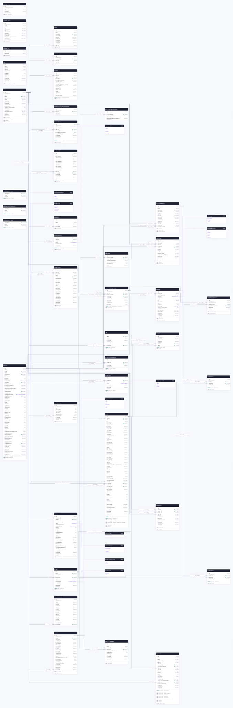

<details>
<summary>The whole schema as SQL</summary>

```sql
CREATE TABLE `Customer` (
    `id` VARCHAR(191) NOT NULL,
    `name` VARCHAR(191) NULL,
    `email` VARCHAR(191) NULL,
    `normalizedEmail` VARCHAR(191) NULL,
    `avatar` TEXT NULL,
    `externalId` VARCHAR(191) NULL,
    `stripeCustomerId` VARCHAR(191) NULL,
    `linkId` VARCHAR(191) NULL,
    `clickId` VARCHAR(191) NULL,
    `clickedAt` DATETIME(3) NULL,
    `country` VARCHAR(191) NULL,
    `sales` INTEGER NOT NULL DEFAULT 0,
    `saleAmount` BIGINT NOT NULL DEFAULT 0,
    `firstSaleAt` DATETIME(3) NULL,
    `subscriptionCanceledAt` DATETIME(3) NULL,
    `projectId` VARCHAR(191) NOT NULL,
    `projectConnectId` VARCHAR(191) NULL,
    `createdAt` DATETIME(3) NOT NULL DEFAULT CURRENT_TIMESTAMP(3),
    `updatedAt` DATETIME(3) NOT NULL,

    UNIQUE INDEX `Customer_stripeCustomerId_key`(`stripeCustomerId`),
    INDEX `Customer_projectId_email_idx`(`projectId`, `email`),
    INDEX `Customer_projectId_normalizedEmail_idx`(`projectId`, `normalizedEmail`),
    INDEX `Customer_projectId_createdAt_idx`(`projectId`, `createdAt`),
    INDEX `Customer_projectId_saleAmount_idx`(`projectId`, `saleAmount`),
    INDEX `Customer_projectId_firstSaleAt_idx`(`projectId`, `firstSaleAt`),
    INDEX `Customer_projectId_subscriptionCanceledAt_idx`(`projectId`, `subscriptionCanceledAt`),
    INDEX `Customer_linkId_idx`(`linkId`),
    INDEX `Customer_country_idx`(`country`),
    UNIQUE INDEX `Customer_projectId_externalId_key`(`projectId`, `externalId`),
    FULLTEXT INDEX `Customer_email_name_idx`(`email`, `name`),
    PRIMARY KEY (`id`)
) DEFAULT CHARACTER SET utf8mb4 COLLATE utf8mb4_unicode_ci;

CREATE TABLE `Dashboard` (
    `id` VARCHAR(191) NOT NULL,
    `linkId` VARCHAR(191) NULL,
    `folderId` VARCHAR(191) NULL,
    `projectId` VARCHAR(191) NULL,
    `userId` VARCHAR(191) NULL,
    `doIndex` BOOLEAN NOT NULL DEFAULT false,
    `password` VARCHAR(191) NULL,
    `showConversions` BOOLEAN NOT NULL DEFAULT false,
    `createdAt` DATETIME(3) NOT NULL DEFAULT CURRENT_TIMESTAMP(3),
    `updatedAt` DATETIME(3) NOT NULL,

    UNIQUE INDEX `Dashboard_linkId_key`(`linkId`),
    UNIQUE INDEX `Dashboard_folderId_key`(`folderId`),
    INDEX `Dashboard_projectId_idx`(`projectId`),
    INDEX `Dashboard_userId_idx`(`userId`),
    PRIMARY KEY (`id`)
) DEFAULT CHARACTER SET utf8mb4 COLLATE utf8mb4_unicode_ci;

CREATE TABLE `Domain` (
    `id` VARCHAR(191) NOT NULL,
    `slug` VARCHAR(191) NOT NULL,
    `verified` BOOLEAN NOT NULL DEFAULT false,
    `placeholder` VARCHAR(191) NULL,
    `expiredUrl` LONGTEXT NULL,
    `notFoundUrl` LONGTEXT NULL,
    `primary` BOOLEAN NOT NULL DEFAULT false,
    `archived` BOOLEAN NOT NULL DEFAULT false,
    `lastChecked` DATETIME(3) NOT NULL DEFAULT CURRENT_TIMESTAMP(3),
    `logo` VARCHAR(191) NULL,
    `appleAppSiteAssociation` JSON NULL,
    `assetLinks` JSON NULL,
    `deepviewData` JSON NULL,
    `linkRetentionDays` INTEGER NULL,
    `createdAt` DATETIME(3) NOT NULL DEFAULT CURRENT_TIMESTAMP(3),
    `updatedAt` DATETIME(3) NOT NULL,
    `projectId` VARCHAR(191) NULL,

    UNIQUE INDEX `Domain_slug_key`(`slug`),
    INDEX `Domain_projectId_idx`(`projectId`),
    INDEX `Domain_lastChecked_idx`(`lastChecked` ASC),
    PRIMARY KEY (`id`)
) DEFAULT CHARACTER SET utf8mb4 COLLATE utf8mb4_unicode_ci;

CREATE TABLE `RegisteredDomain` (
    `id` VARCHAR(191) NOT NULL,
    `slug` VARCHAR(191) NOT NULL,
    `projectId` VARCHAR(191) NOT NULL,
    `domainId` VARCHAR(191) NULL,
    `autoRenewalDisabledAt` DATETIME(3) NULL,
    `renewalFee` INTEGER NOT NULL DEFAULT 1200,
    `expiresAt` DATETIME(3) NOT NULL,
    `createdAt` DATETIME(3) NOT NULL DEFAULT CURRENT_TIMESTAMP(3),
    `updatedAt` DATETIME(3) NOT NULL,

    UNIQUE INDEX `RegisteredDomain_domainId_key`(`domainId`),
    INDEX `RegisteredDomain_projectId_idx`(`projectId`),
    INDEX `RegisteredDomain_expiresAt_idx`(`expiresAt` ASC),
    PRIMARY KEY (`id`)
) DEFAULT CHARACTER SET utf8mb4 COLLATE utf8mb4_unicode_ci;

CREATE TABLE `DefaultDomains` (
    `id` VARCHAR(191) NOT NULL,
    `dubsh` BOOLEAN NOT NULL DEFAULT true,
    `chatgpt` BOOLEAN NOT NULL DEFAULT true,
    `sptifi` BOOLEAN NOT NULL DEFAULT true,
    `gitnew` BOOLEAN NOT NULL DEFAULT true,
    `callink` BOOLEAN NOT NULL DEFAULT true,
    `amznid` BOOLEAN NOT NULL DEFAULT true,
    `ggllink` BOOLEAN NOT NULL DEFAULT true,
    `figpage` BOOLEAN NOT NULL DEFAULT true,
    `loooooooong` BOOLEAN NOT NULL DEFAULT false,
    `projectId` VARCHAR(191) NOT NULL,

    UNIQUE INDEX `DefaultDomains_projectId_key`(`projectId`),
    PRIMARY KEY (`id`)
) DEFAULT CHARACTER SET utf8mb4 COLLATE utf8mb4_unicode_ci;

CREATE TABLE `Folder` (
    `id` VARCHAR(191) NOT NULL,
    `name` VARCHAR(191) NOT NULL,
    `description` TEXT NULL,
    `projectId` VARCHAR(191) NOT NULL,
    `type` ENUM('default', 'mega') NOT NULL DEFAULT 'default',
    `accessLevel` ENUM('read', 'write') NULL,
    `createdAt` DATETIME(3) NOT NULL DEFAULT CURRENT_TIMESTAMP(3),
    `updatedAt` DATETIME(3) NOT NULL,

    INDEX `Folder_projectId_idx`(`projectId`),
    UNIQUE INDEX `Folder_name_projectId_key`(`name`, `projectId`),
    PRIMARY KEY (`id`)
) DEFAULT CHARACTER SET utf8mb4 COLLATE utf8mb4_unicode_ci;

CREATE TABLE `FolderUser` (
    `id` VARCHAR(191) NOT NULL,
    `folderId` VARCHAR(191) NOT NULL,
    `userId` VARCHAR(191) NOT NULL,
    `role` ENUM('owner', 'editor', 'viewer') NULL,
    `createdAt` DATETIME(3) NOT NULL DEFAULT CURRENT_TIMESTAMP(3),
    `updatedAt` DATETIME(3) NOT NULL,

    INDEX `FolderUser_userId_idx`(`userId`),
    UNIQUE INDEX `FolderUser_folderId_userId_key`(`folderId`, `userId`),
    PRIMARY KEY (`id`)
) DEFAULT CHARACTER SET utf8mb4 COLLATE utf8mb4_unicode_ci;

CREATE TABLE `FolderAccessRequest` (
    `id` VARCHAR(191) NOT NULL,
    `folderId` VARCHAR(191) NOT NULL,
    `userId` VARCHAR(191) NOT NULL,
    `createdAt` DATETIME(3) NOT NULL DEFAULT CURRENT_TIMESTAMP(3),

    INDEX `FolderAccessRequest_userId_idx`(`userId`),
    UNIQUE INDEX `FolderAccessRequest_folderId_userId_key`(`folderId`, `userId`),
    PRIMARY KEY (`id`)
) DEFAULT CHARACTER SET utf8mb4 COLLATE utf8mb4_unicode_ci;

CREATE TABLE `Integration` (
    `id` VARCHAR(191) NOT NULL,
    `userId` VARCHAR(191) NULL,
    `projectId` VARCHAR(191) NOT NULL,
    `name` VARCHAR(191) NOT NULL,
    `slug` VARCHAR(191) NOT NULL,
    `description` VARCHAR(191) NULL,
    `readme` LONGTEXT NULL,
    `developer` VARCHAR(191) NOT NULL,
    `website` VARCHAR(191) NOT NULL,
    `logo` VARCHAR(191) NULL,
    `screenshots` JSON NULL,
    `verified` BOOLEAN NOT NULL DEFAULT false,
    `installUrl` TEXT NULL,
    `guideUrl` TEXT NULL,
    `category` VARCHAR(191) NULL,
    `comingSoon` BOOLEAN NOT NULL DEFAULT false,
    `createdAt` DATETIME(3) NOT NULL DEFAULT CURRENT_TIMESTAMP(3),
    `updatedAt` DATETIME(3) NOT NULL,

    UNIQUE INDEX `Integration_slug_key`(`slug`),
    INDEX `Integration_projectId_idx`(`projectId`),
    INDEX `Integration_userId_idx`(`userId`),
    PRIMARY KEY (`id`)
) DEFAULT CHARACTER SET utf8mb4 COLLATE utf8mb4_unicode_ci;

CREATE TABLE `InstalledIntegration` (
    `id` VARCHAR(191) NOT NULL,
    `userId` VARCHAR(191) NOT NULL,
    `integrationId` VARCHAR(191) NOT NULL,
    `projectId` VARCHAR(191) NOT NULL,
    `createdAt` DATETIME(3) NOT NULL DEFAULT CURRENT_TIMESTAMP(3),
    `updatedAt` DATETIME(3) NOT NULL,
    `credentials` JSON NULL,
    `settings` JSON NULL,

    INDEX `InstalledIntegration_projectId_idx`(`projectId`),
    INDEX `InstalledIntegration_integrationId_idx`(`integrationId`),
    UNIQUE INDEX `InstalledIntegration_userId_integrationId_projectId_key`(`userId`, `integrationId`, `projectId`),
    PRIMARY KEY (`id`)
) DEFAULT CHARACTER SET utf8mb4 COLLATE utf8mb4_unicode_ci;

CREATE TABLE `Invoice` (
    `id` VARCHAR(191) NOT NULL,
    `workspaceId` VARCHAR(191) NOT NULL,
    `number` VARCHAR(191) NULL,
    `status` ENUM('processing', 'completed', 'failed') NOT NULL DEFAULT 'processing',
    `type` ENUM('domainRenewal') NOT NULL DEFAULT 'domainRenewal',
    `paymentMethod` ENUM('card', 'ach', 'ach_fast', 'sepa', 'acss') NULL,
    `amount` INTEGER NOT NULL DEFAULT 0,
    `fee` INTEGER NOT NULL DEFAULT 0,
    `refundedAmount` INTEGER NOT NULL DEFAULT 0,
    `total` INTEGER NOT NULL DEFAULT 0,
    `receiptUrl` TEXT NULL,
    `refundReason` TEXT NULL,
    `failedReason` TEXT NULL,
    `registeredDomains` JSON NULL,
    `stripeChargeMetadata` JSON NULL,
    `failedAttempts` INTEGER NOT NULL DEFAULT 0,
    `createdAt` DATETIME(3) NOT NULL DEFAULT CURRENT_TIMESTAMP(3),
    `paidAt` DATETIME(3) NULL,

    UNIQUE INDEX `Invoice_number_key`(`number`),
    INDEX `Invoice_workspaceId_idx`(`workspaceId`),
    PRIMARY KEY (`id`)
) DEFAULT CHARACTER SET utf8mb4 COLLATE utf8mb4_unicode_ci;

CREATE TABLE `jackson_index` (
    `id` INTEGER NOT NULL AUTO_INCREMENT,
    `key` VARCHAR(250) NOT NULL,
    `storeKey` VARCHAR(250) NOT NULL,

    INDEX `_jackson_index_key_store`(`key`, `storeKey`),
    PRIMARY KEY (`id`)
) DEFAULT CHARACTER SET utf8mb4 COLLATE utf8mb4_unicode_ci;

CREATE TABLE `jackson_store` (
    `key` VARCHAR(250) NOT NULL,
    `value` TEXT NOT NULL,
    `iv` VARCHAR(64) NULL,
    `tag` VARCHAR(64) NULL,
    `namespace` VARCHAR(64) NULL,
    `createdAt` TIMESTAMP(0) NOT NULL DEFAULT CURRENT_TIMESTAMP(0),
    `modifiedAt` TIMESTAMP(0) NULL,

    INDEX `_jackson_store_namespace`(`namespace`),
    PRIMARY KEY (`key`)
) DEFAULT CHARACTER SET utf8mb4 COLLATE utf8mb4_unicode_ci;

CREATE TABLE `jackson_ttl` (
    `key` VARCHAR(250) NOT NULL,
    `expiresAt` BIGINT NOT NULL,

    INDEX `_jackson_ttl_expires_at`(`expiresAt`),
    PRIMARY KEY (`key`)
) DEFAULT CHARACTER SET utf8mb4 COLLATE utf8mb4_unicode_ci;

CREATE TABLE `Job` (
    `id` VARCHAR(191) NOT NULL,
    `name` VARCHAR(191) NOT NULL,
    `payload` JSON NOT NULL,
    `options` JSON NULL,
    `scheduledAt` DATETIME(3) NOT NULL DEFAULT CURRENT_TIMESTAMP(3),
    `attempts` INTEGER NOT NULL DEFAULT 0,
    `lastError` TEXT NULL,
    `createdAt` DATETIME(3) NOT NULL DEFAULT CURRENT_TIMESTAMP(3),
    `updatedAt` DATETIME(3) NOT NULL,

    INDEX `Job_scheduledAt_attempts_idx`(`scheduledAt`, `attempts`),
    PRIMARY KEY (`id`)
) DEFAULT CHARACTER SET utf8mb4 COLLATE utf8mb4_unicode_ci;

CREATE TABLE `Link` (
    `id` VARCHAR(191) NOT NULL,
    `domain` VARCHAR(191) NOT NULL,
    `key` VARCHAR(191) NOT NULL,
    `url` LONGTEXT NOT NULL,
    `shortLink` VARCHAR(400) NOT NULL,
    `archived` BOOLEAN NOT NULL DEFAULT false,
    `expiresAt` DATETIME(3) NULL,
    `expiredUrl` TEXT NULL,
    `disabledAt` DATETIME(3) NULL,
    `password` VARCHAR(191) NULL,
    `trackConversion` BOOLEAN NOT NULL DEFAULT false,
    `proxy` BOOLEAN NOT NULL DEFAULT false,
    `title` VARCHAR(191) NULL,
    `description` VARCHAR(280) NULL,
    `image` LONGTEXT NULL,
    `video` TEXT NULL,
    `utm_source` VARCHAR(255) NULL,
    `utm_medium` VARCHAR(255) NULL,
    `utm_campaign` VARCHAR(255) NULL,
    `utm_term` VARCHAR(255) NULL,
    `utm_content` VARCHAR(255) NULL,
    `rewrite` BOOLEAN NOT NULL DEFAULT false,
    `linkRetentionCleanupDisabledAt` DATETIME(3) NULL,
    `doIndex` BOOLEAN NOT NULL DEFAULT false,
    `ios` TEXT NULL,
    `android` TEXT NULL,
    `geo` JSON NULL,
    `testVariants` JSON NULL,
    `testStartedAt` DATETIME(3) NULL,
    `testCompletedAt` DATETIME(3) NULL,
    `userId` VARCHAR(191) NULL,
    `projectId` VARCHAR(191) NULL,
    `folderId` VARCHAR(191) NULL,
    `externalId` VARCHAR(191) NULL,
    `tenantId` VARCHAR(191) NULL,
    `publicStats` BOOLEAN NOT NULL DEFAULT false,
    `clicks` INTEGER NOT NULL DEFAULT 0,
    `leads` INTEGER NOT NULL DEFAULT 0,
    `conversions` INTEGER NOT NULL DEFAULT 0,
    `sales` INTEGER NOT NULL DEFAULT 0,
    `saleAmount` BIGINT NOT NULL DEFAULT 0,
    `lastClicked` DATETIME(3) NULL,
    `lastLeadAt` DATETIME(3) NULL,
    `lastConversionAt` DATETIME(3) NULL,
    `createdAt` DATETIME(3) NOT NULL DEFAULT CURRENT_TIMESTAMP(3),
    `updatedAt` DATETIME(3) NOT NULL,
    `comments` TEXT NULL,

    UNIQUE INDEX `Link_shortLink_key`(`shortLink`),
    INDEX `Link_projectId_tenantId_idx`(`projectId`, `tenantId`),
    INDEX `Link_projectId_url_idx`(`projectId`, `url`(500)),
    INDEX `Link_projectId_folderId_archived_createdAt_idx`(`projectId`, `folderId`, `archived`, `createdAt` DESC),
    INDEX `Link_domain_createdAt_idx`(`domain`, `createdAt`),
    INDEX `Link_folderId_idx`(`folderId`),
    INDEX `Link_userId_idx`(`userId`),
    UNIQUE INDEX `Link_domain_key_key`(`domain`, `key`),
    UNIQUE INDEX `Link_projectId_externalId_key`(`projectId`, `externalId`),
    PRIMARY KEY (`id`)
) DEFAULT CHARACTER SET utf8mb4 COLLATE utf8mb4_unicode_ci;

CREATE TABLE `YearInReview` (
    `id` VARCHAR(191) NOT NULL,
    `year` INTEGER NOT NULL,
    `totalLinks` INTEGER NOT NULL,
    `totalClicks` INTEGER NOT NULL,
    `topLinks` JSON NOT NULL,
    `topCountries` JSON NOT NULL,
    `workspaceId` VARCHAR(191) NOT NULL,
    `createdAt` DATETIME(3) NOT NULL DEFAULT CURRENT_TIMESTAMP(3),
    `sentAt` DATETIME(3) NULL,

    INDEX `YearInReview_workspaceId_idx`(`workspaceId`),
    PRIMARY KEY (`id`)
) DEFAULT CHARACTER SET utf8mb4 COLLATE utf8mb4_unicode_ci;

CREATE TABLE `UserNotificationPreferences` (
    `id` VARCHAR(191) NOT NULL,
    `userId` VARCHAR(191) NOT NULL,
    `dubLinks` BOOLEAN NOT NULL DEFAULT true,

    UNIQUE INDEX `UserNotificationPreferences_userId_key`(`userId`),
    PRIMARY KEY (`id`)
) DEFAULT CHARACTER SET utf8mb4 COLLATE utf8mb4_unicode_ci;

CREATE TABLE `NotificationPreference` (
    `id` VARCHAR(191) NOT NULL,
    `projectUserId` VARCHAR(191) NOT NULL,
    `linkUsageSummary` BOOLEAN NOT NULL DEFAULT true,
    `domainConfigurationUpdates` BOOLEAN NOT NULL DEFAULT true,

    UNIQUE INDEX `NotificationPreference_projectUserId_key`(`projectUserId`),
    PRIMARY KEY (`id`)
) DEFAULT CHARACTER SET utf8mb4 COLLATE utf8mb4_unicode_ci;

CREATE TABLE `OAuthApp` (
    `id` VARCHAR(191) NOT NULL,
    `integrationId` VARCHAR(191) NOT NULL,
    `clientId` VARCHAR(191) NOT NULL,
    `hashedClientSecret` VARCHAR(191) NOT NULL,
    `partialClientSecret` VARCHAR(191) NOT NULL,
    `redirectUris` JSON NOT NULL,
    `pkce` BOOLEAN NOT NULL DEFAULT false,

    UNIQUE INDEX `OAuthApp_integrationId_key`(`integrationId`),
    UNIQUE INDEX `OAuthApp_clientId_key`(`clientId`),
    PRIMARY KEY (`id`)
) DEFAULT CHARACTER SET utf8mb4 COLLATE utf8mb4_unicode_ci;

CREATE TABLE `OAuthCode` (
    `id` VARCHAR(191) NOT NULL,
    `clientId` VARCHAR(191) NOT NULL,
    `userId` VARCHAR(191) NOT NULL,
    `projectId` VARCHAR(191) NOT NULL,
    `code` VARCHAR(191) NOT NULL,
    `scopes` TEXT NULL,
    `redirectUri` VARCHAR(191) NOT NULL,
    `codeChallenge` VARCHAR(191) NULL,
    `codeChallengeMethod` VARCHAR(191) NULL,
    `expiresAt` DATETIME(3) NOT NULL,
    `createdAt` DATETIME(3) NOT NULL DEFAULT CURRENT_TIMESTAMP(3),

    UNIQUE INDEX `OAuthCode_code_key`(`code`),
    INDEX `OAuthCode_clientId_idx`(`clientId`),
    INDEX `OAuthCode_userId_idx`(`userId`),
    INDEX `OAuthCode_projectId_idx`(`projectId`),
    PRIMARY KEY (`id`)
) DEFAULT CHARACTER SET utf8mb4 COLLATE utf8mb4_unicode_ci;

CREATE TABLE `OAuthRefreshToken` (
    `id` VARCHAR(191) NOT NULL,
    `installationId` VARCHAR(191) NOT NULL,
    `accessTokenId` VARCHAR(191) NOT NULL,
    `hashedRefreshToken` VARCHAR(191) NOT NULL,
    `expiresAt` DATETIME(3) NOT NULL,
    `createdAt` DATETIME(3) NOT NULL DEFAULT CURRENT_TIMESTAMP(3),

    UNIQUE INDEX `OAuthRefreshToken_hashedRefreshToken_key`(`hashedRefreshToken`),
    INDEX `OAuthRefreshToken_installationId_idx`(`installationId`),
    INDEX `OAuthRefreshToken_accessTokenId_idx`(`accessTokenId`),
    PRIMARY KEY (`id`)
) DEFAULT CHARACTER SET utf8mb4 COLLATE utf8mb4_unicode_ci;

CREATE TABLE `User` (
    `id` VARCHAR(191) NOT NULL,
    `name` VARCHAR(191) NULL,
    `email` VARCHAR(191) NULL,
    `emailVerified` DATETIME(3) NULL,
    `image` VARCHAR(191) NULL,
    `isMachine` BOOLEAN NOT NULL DEFAULT false,
    `createdAt` DATETIME(3) NOT NULL DEFAULT CURRENT_TIMESTAMP(3),
    `passwordHash` VARCHAR(191) NULL,
    `invalidLoginAttempts` INTEGER NOT NULL DEFAULT 0,
    `lockedAt` DATETIME(3) NULL,
    `defaultWorkspace` VARCHAR(191) NULL,
    `source` VARCHAR(191) NULL,
    `sentMail` BOOLEAN NOT NULL DEFAULT false,

    UNIQUE INDEX `User_email_key`(`email`),
    INDEX `User_createdAt_idx`(`createdAt`),
    INDEX `User_defaultWorkspace_idx`(`defaultWorkspace`),
    INDEX `User_source_idx`(`source`),
    INDEX `User_sentMail_idx`(`sentMail`),
    PRIMARY KEY (`id`)
) DEFAULT CHARACTER SET utf8mb4 COLLATE utf8mb4_unicode_ci;

CREATE TABLE `Account` (
    `id` VARCHAR(191) NOT NULL,
    `userId` VARCHAR(191) NOT NULL,
    `type` VARCHAR(191) NOT NULL,
    `provider` VARCHAR(191) NOT NULL,
    `providerAccountId` VARCHAR(191) NOT NULL,
    `refresh_token` TEXT NULL,
    `refresh_token_expires_in` INTEGER NULL,
    `access_token` TEXT NULL,
    `expires_at` INTEGER NULL,
    `token_type` VARCHAR(191) NULL,
    `scope` VARCHAR(191) NULL,
    `id_token` TEXT NULL,
    `session_state` VARCHAR(191) NULL,

    INDEX `Account_userId_idx`(`userId`),
    UNIQUE INDEX `Account_provider_providerAccountId_key`(`provider`, `providerAccountId`),
    PRIMARY KEY (`id`)
) DEFAULT CHARACTER SET utf8mb4 COLLATE utf8mb4_unicode_ci;

CREATE TABLE `Session` (
    `id` VARCHAR(191) NOT NULL,
    `sessionToken` VARCHAR(191) NOT NULL,
    `userId` VARCHAR(191) NOT NULL,
    `expires` DATETIME(3) NOT NULL,

    UNIQUE INDEX `Session_sessionToken_key`(`sessionToken`),
    INDEX `Session_userId_idx`(`userId`),
    PRIMARY KEY (`id`)
) DEFAULT CHARACTER SET utf8mb4 COLLATE utf8mb4_unicode_ci;

CREATE TABLE `Tag` (
    `id` VARCHAR(191) NOT NULL,
    `name` VARCHAR(191) NOT NULL,
    `color` VARCHAR(191) NOT NULL DEFAULT 'blue',
    `createdAt` DATETIME(3) NOT NULL DEFAULT CURRENT_TIMESTAMP(3),
    `updatedAt` DATETIME(3) NOT NULL,
    `projectId` VARCHAR(191) NULL,

    INDEX `Tag_projectId_idx`(`projectId`),
    UNIQUE INDEX `Tag_name_projectId_key`(`name`, `projectId`),
    PRIMARY KEY (`id`)
) DEFAULT CHARACTER SET utf8mb4 COLLATE utf8mb4_unicode_ci;

CREATE TABLE `LinkTag` (
    `id` VARCHAR(191) NOT NULL,
    `createdAt` DATETIME(3) NOT NULL DEFAULT CURRENT_TIMESTAMP(3),
    `updatedAt` DATETIME(3) NOT NULL,
    `linkId` VARCHAR(191) NOT NULL,
    `tagId` VARCHAR(191) NOT NULL,

    INDEX `LinkTag_tagId_idx`(`tagId`),
    UNIQUE INDEX `LinkTag_linkId_tagId_key`(`linkId`, `tagId`),
    PRIMARY KEY (`id`)
) DEFAULT CHARACTER SET utf8mb4 COLLATE utf8mb4_unicode_ci;

CREATE TABLE `Token` (
    `id` VARCHAR(191) NOT NULL,
    `name` VARCHAR(191) NOT NULL,
    `hashedKey` VARCHAR(191) NOT NULL,
    `partialKey` VARCHAR(191) NOT NULL,
    `expires` DATETIME(3) NULL,
    `lastUsed` DATETIME(3) NULL,
    `createdAt` DATETIME(3) NOT NULL DEFAULT CURRENT_TIMESTAMP(3),
    `updatedAt` DATETIME(3) NOT NULL,
    `userId` VARCHAR(191) NOT NULL,

    UNIQUE INDEX `Token_hashedKey_key`(`hashedKey`),
    INDEX `Token_userId_idx`(`userId`),
    PRIMARY KEY (`id`)
) DEFAULT CHARACTER SET utf8mb4 COLLATE utf8mb4_unicode_ci;

CREATE TABLE `RestrictedToken` (
    `id` VARCHAR(191) NOT NULL,
    `name` VARCHAR(191) NOT NULL,
    `hashedKey` VARCHAR(191) NOT NULL,
    `partialKey` VARCHAR(191) NOT NULL,
    `scopes` TEXT NULL,
    `expires` DATETIME(3) NULL,
    `lastUsed` DATETIME(3) NULL,
    `createdAt` DATETIME(3) NOT NULL DEFAULT CURRENT_TIMESTAMP(3),
    `updatedAt` DATETIME(3) NOT NULL,
    `userId` VARCHAR(191) NOT NULL,
    `projectId` VARCHAR(191) NOT NULL,
    `installationId` VARCHAR(191) NULL,

    UNIQUE INDEX `RestrictedToken_hashedKey_key`(`hashedKey`),
    INDEX `RestrictedToken_userId_idx`(`userId`),
    INDEX `RestrictedToken_projectId_idx`(`projectId`),
    INDEX `RestrictedToken_installationId_idx`(`installationId`),
    PRIMARY KEY (`id`)
) DEFAULT CHARACTER SET utf8mb4 COLLATE utf8mb4_unicode_ci;

CREATE TABLE `VerificationToken` (
    `identifier` VARCHAR(191) NOT NULL,
    `token` VARCHAR(191) NOT NULL,
    `expires` DATETIME(3) NOT NULL,

    UNIQUE INDEX `VerificationToken_token_key`(`token`),
    UNIQUE INDEX `VerificationToken_identifier_token_key`(`identifier`, `token`)
) DEFAULT CHARACTER SET utf8mb4 COLLATE utf8mb4_unicode_ci;

CREATE TABLE `EmailVerificationToken` (
    `identifier` VARCHAR(191) NOT NULL,
    `token` VARCHAR(191) NOT NULL,
    `expires` DATETIME(3) NOT NULL,

    UNIQUE INDEX `EmailVerificationToken_token_key`(`token`),
    UNIQUE INDEX `EmailVerificationToken_identifier_token_key`(`identifier`, `token`)
) DEFAULT CHARACTER SET utf8mb4 COLLATE utf8mb4_unicode_ci;

CREATE TABLE `PasswordResetToken` (
    `identifier` VARCHAR(191) NOT NULL,
    `token` VARCHAR(191) NOT NULL,
    `expires` DATETIME(3) NOT NULL,

    UNIQUE INDEX `PasswordResetToken_token_key`(`token`),
    UNIQUE INDEX `PasswordResetToken_identifier_token_key`(`identifier`, `token`)
) DEFAULT CHARACTER SET utf8mb4 COLLATE utf8mb4_unicode_ci;

CREATE TABLE `UtmTemplate` (
    `id` VARCHAR(191) NOT NULL,
    `name` VARCHAR(191) NOT NULL,
    `utm_source` VARCHAR(255) NULL,
    `utm_medium` VARCHAR(255) NULL,
    `utm_campaign` VARCHAR(255) NULL,
    `utm_term` VARCHAR(255) NULL,
    `utm_content` VARCHAR(255) NULL,
    `ref` VARCHAR(255) NULL,
    `userId` VARCHAR(191) NULL,
    `projectId` VARCHAR(191) NULL,
    `createdAt` DATETIME(3) NOT NULL DEFAULT CURRENT_TIMESTAMP(3),
    `updatedAt` DATETIME(3) NOT NULL,

    INDEX `UtmTemplate_userId_idx`(`userId`),
    UNIQUE INDEX `UtmTemplate_projectId_name_key`(`projectId`, `name`),
    PRIMARY KEY (`id`)
) DEFAULT CHARACTER SET utf8mb4 COLLATE utf8mb4_unicode_ci;

CREATE TABLE `Webhook` (
    `id` VARCHAR(191) NOT NULL,
    `projectId` VARCHAR(191) NOT NULL,
    `installationId` VARCHAR(191) NULL,
    `receiver` ENUM('user', 'zapier', 'make', 'slack', 'segment') NOT NULL DEFAULT 'user',
    `name` VARCHAR(191) NOT NULL,
    `url` LONGTEXT NOT NULL,
    `secret` VARCHAR(191) NOT NULL,
    `triggers` JSON NOT NULL,
    `linkScope` ENUM('workspace', 'folders', 'links') NULL,
    `consecutiveFailures` INTEGER NOT NULL DEFAULT 0,
    `lastFailedAt` DATETIME(3) NULL,
    `disabledAt` DATETIME(3) NULL,
    `createdAt` DATETIME(3) NOT NULL DEFAULT CURRENT_TIMESTAMP(3),
    `updatedAt` DATETIME(3) NOT NULL,

    INDEX `Webhook_projectId_idx`(`projectId`),
    INDEX `Webhook_installationId_idx`(`installationId`),
    PRIMARY KEY (`id`)
) DEFAULT CHARACTER SET utf8mb4 COLLATE utf8mb4_unicode_ci;

CREATE TABLE `LinkWebhook` (
    `id` VARCHAR(191) NOT NULL,
    `linkId` VARCHAR(191) NOT NULL,
    `webhookId` VARCHAR(191) NOT NULL,
    `createdAt` DATETIME(3) NOT NULL DEFAULT CURRENT_TIMESTAMP(3),

    INDEX `LinkWebhook_webhookId_idx`(`webhookId`),
    UNIQUE INDEX `LinkWebhook_linkId_webhookId_key`(`linkId`, `webhookId`),
    PRIMARY KEY (`id`)
) DEFAULT CHARACTER SET utf8mb4 COLLATE utf8mb4_unicode_ci;

CREATE TABLE `FolderWebhook` (
    `id` VARCHAR(191) NOT NULL,
    `folderId` VARCHAR(191) NOT NULL,
    `webhookId` VARCHAR(191) NOT NULL,
    `createdAt` DATETIME(3) NOT NULL DEFAULT CURRENT_TIMESTAMP(3),

    INDEX `FolderWebhook_webhookId_idx`(`webhookId`),
    UNIQUE INDEX `FolderWebhook_folderId_webhookId_key`(`folderId`, `webhookId`),
    PRIMARY KEY (`id`)
) DEFAULT CHARACTER SET utf8mb4 COLLATE utf8mb4_unicode_ci;

CREATE TABLE `Project` (
    `id` VARCHAR(191) NOT NULL,
    `name` VARCHAR(191) NOT NULL,
    `slug` VARCHAR(191) NOT NULL,
    `logo` VARCHAR(191) NULL,
    `inviteCode` VARCHAR(191) NULL,
    `plan` VARCHAR(191) NOT NULL DEFAULT 'free',
    `planTier` INTEGER NOT NULL DEFAULT 1,
    `planPeriod` ENUM('monthly', 'yearly', 'quarterly', 'biweekly') NULL,
    `stripeId` VARCHAR(191) NULL,
    `billingCycleStart` INTEGER NOT NULL,
    `billingCycleEndsAt` DATETIME(3) NULL,
    `trialEndsAt` DATETIME(3) NULL,
    `subscriptionCanceledAt` DATETIME(3) NULL,
    `paymentFailedAt` DATETIME(3) NULL,
    `invoicePrefix` VARCHAR(191) NULL,
    `stripeConnectId` VARCHAR(191) NULL,
    `stripeConnectMode` ENUM('live', 'test', 'sandbox') NULL,
    `shopifyStoreId` VARCHAR(191) NULL,
    `totalLinks` INTEGER NOT NULL DEFAULT 0,
    `totalClicks` INTEGER NOT NULL DEFAULT 0,
    `usage` INTEGER NOT NULL DEFAULT 0,
    `usageLimit` INTEGER NOT NULL DEFAULT 1000,
    `linksUsage` INTEGER NOT NULL DEFAULT 0,
    `linksLimit` INTEGER NOT NULL DEFAULT 25,
    `domainsLimit` INTEGER NOT NULL DEFAULT 3,
    `tagsLimit` INTEGER NOT NULL DEFAULT 5,
    `foldersUsage` INTEGER NOT NULL DEFAULT 0,
    `foldersLimit` INTEGER NOT NULL DEFAULT 0,
    `usersLimit` INTEGER NOT NULL DEFAULT 1,
    `aiUsage` INTEGER NOT NULL DEFAULT 0,
    `aiLimit` INTEGER NOT NULL DEFAULT 10,
    `store` JSON NULL,
    `siteVisitTrackingSettings` JSON NULL,
    `allowedHostnames` JSON NULL,
    `publishableKey` VARCHAR(191) NULL,
    `conversionEnabled` BOOLEAN NOT NULL DEFAULT false,
    `webhookEnabled` BOOLEAN NOT NULL DEFAULT false,
    `dotLinkClaimed` BOOLEAN NOT NULL DEFAULT false,
    `ssoEmailDomain` VARCHAR(191) NULL,
    `ssoEnforcedAt` DATETIME(3) NULL,
    `createdAt` DATETIME(3) NOT NULL DEFAULT CURRENT_TIMESTAMP(3),
    `updatedAt` DATETIME(3) NOT NULL,
    `usageLastChecked` DATETIME(3) NOT NULL DEFAULT CURRENT_TIMESTAMP(3),
    `disabledAt` DATETIME(3) NULL,

    UNIQUE INDEX `Project_slug_key`(`slug`),
    UNIQUE INDEX `Project_inviteCode_key`(`inviteCode`),
    UNIQUE INDEX `Project_stripeId_key`(`stripeId`),
    UNIQUE INDEX `Project_invoicePrefix_key`(`invoicePrefix`),
    UNIQUE INDEX `Project_shopifyStoreId_key`(`shopifyStoreId`),
    UNIQUE INDEX `Project_publishableKey_key`(`publishableKey`),
    UNIQUE INDEX `Project_ssoEmailDomain_key`(`ssoEmailDomain`),
    INDEX `Project_usageLastChecked_idx`(`usageLastChecked` ASC),
    INDEX `Project_trialEndsAt_idx`(`trialEndsAt`),
    UNIQUE INDEX `Project_stripeConnectId_stripeConnectMode_key`(`stripeConnectId`, `stripeConnectMode`),
    PRIMARY KEY (`id`)
) DEFAULT CHARACTER SET utf8mb4 COLLATE utf8mb4_unicode_ci;

CREATE TABLE `ProjectInvite` (
    `email` VARCHAR(191) NOT NULL,
    `expires` DATETIME(3) NOT NULL,
    `projectId` VARCHAR(191) NOT NULL,
    `role` ENUM('owner', 'member', 'viewer', 'billing') NOT NULL DEFAULT 'member',
    `createdAt` DATETIME(3) NOT NULL DEFAULT CURRENT_TIMESTAMP(3),

    INDEX `ProjectInvite_projectId_idx`(`projectId`),
    UNIQUE INDEX `ProjectInvite_email_projectId_key`(`email`, `projectId`)
) DEFAULT CHARACTER SET utf8mb4 COLLATE utf8mb4_unicode_ci;

CREATE TABLE `ProjectUsers` (
    `id` VARCHAR(191) NOT NULL,
    `role` ENUM('owner', 'member', 'viewer', 'billing') NOT NULL DEFAULT 'member',
    `userId` VARCHAR(191) NOT NULL,
    `projectId` VARCHAR(191) NOT NULL,
    `workspacePreferences` JSON NULL,
    `defaultFolderId` VARCHAR(191) NULL,
    `createdAt` DATETIME(3) NOT NULL DEFAULT CURRENT_TIMESTAMP(3),
    `updatedAt` DATETIME(3) NOT NULL,

    INDEX `ProjectUsers_projectId_idx`(`projectId`),
    UNIQUE INDEX `ProjectUsers_userId_projectId_key`(`userId`, `projectId`),
    PRIMARY KEY (`id`)
) DEFAULT CHARACTER SET utf8mb4 COLLATE utf8mb4_unicode_ci;

CREATE TABLE `SentEmail` (
    `id` VARCHAR(191) NOT NULL,
    `type` VARCHAR(191) NOT NULL,
    `createdAt` DATETIME(3) NOT NULL DEFAULT CURRENT_TIMESTAMP(3),
    `projectId` VARCHAR(191) NULL,

    INDEX `SentEmail_projectId_idx`(`projectId`),
    PRIMARY KEY (`id`)
) DEFAULT CHARACTER SET utf8mb4 COLLATE utf8mb4_unicode_ci;
```

</details>

## Contents

| Model                                                             | Table                         | Description |
| ----------------------------------------------------------------- | ----------------------------- | ----------- |
| [Customer](#model-Customer)                                       | `Customer`                    |             |
| [Dashboard](#model-Dashboard)                                     | `Dashboard`                   |             |
| [Domain](#model-Domain)                                           | `Domain`                      |             |
| [RegisteredDomain](#model-RegisteredDomain)                       | `RegisteredDomain`            |             |
| [DefaultDomains](#model-DefaultDomains)                           | `DefaultDomains`              |             |
| [Folder](#model-Folder)                                           | `Folder`                      |             |
| [FolderUser](#model-FolderUser)                                   | `FolderUser`                  |             |
| [FolderAccessRequest](#model-FolderAccessRequest)                 | `FolderAccessRequest`         |             |
| [Integration](#model-Integration)                                 | `Integration`                 |             |
| [InstalledIntegration](#model-InstalledIntegration)               | `InstalledIntegration`        |             |
| [Invoice](#model-Invoice)                                         | `Invoice`                     |             |
| [jackson_index](#model-jackson_index)                             | `jackson_index`               |             |
| [jackson_store](#model-jackson_store)                             | `jackson_store`               |             |
| [jackson_ttl](#model-jackson_ttl)                                 | `jackson_ttl`                 |             |
| [Job](#model-Job)                                                 | `Job`                         |             |
| [Link](#model-Link)                                               | `Link`                        |             |
| [YearInReview](#model-YearInReview)                               | `YearInReview`                |             |
| [UserNotificationPreferences](#model-UserNotificationPreferences) | `UserNotificationPreferences` |             |
| [NotificationPreference](#model-NotificationPreference)           | `NotificationPreference`      |             |
| [OAuthApp](#model-OAuthApp)                                       | `OAuthApp`                    |             |
| [OAuthCode](#model-OAuthCode)                                     | `OAuthCode`                   |             |
| [OAuthRefreshToken](#model-OAuthRefreshToken)                     | `OAuthRefreshToken`           |             |
| [User](#model-User)                                               | `User`                        |             |
| [Account](#model-Account)                                         | `Account`                     |             |
| [Session](#model-Session)                                         | `Session`                     |             |
| [Tag](#model-Tag)                                                 | `Tag`                         |             |
| [LinkTag](#model-LinkTag)                                         | `LinkTag`                     |             |
| [Token](#model-Token)                                             | `Token`                       |             |
| [RestrictedToken](#model-RestrictedToken)                         | `RestrictedToken`             |             |
| [VerificationToken](#model-VerificationToken)                     | `VerificationToken`           |             |
| [EmailVerificationToken](#model-EmailVerificationToken)           | `EmailVerificationToken`      |             |
| [PasswordResetToken](#model-PasswordResetToken)                   | `PasswordResetToken`          |             |
| [UtmTemplate](#model-UtmTemplate)                                 | `UtmTemplate`                 |             |
| [Webhook](#model-Webhook)                                         | `Webhook`                     |             |
| [LinkWebhook](#model-LinkWebhook)                                 | `LinkWebhook`                 |             |
| [FolderWebhook](#model-FolderWebhook)                             | `FolderWebhook`               |             |
| [Project](#model-Project)                                         | `Project`                     |             |
| [ProjectInvite](#model-ProjectInvite)                             | `ProjectInvite`               |             |
| [ProjectUsers](#model-ProjectUsers)                               | `ProjectUsers`                |             |
| [SentEmail](#model-SentEmail)                                     | `SentEmail`                   |             |

| Enum                                         | Name in the database | Description |
| -------------------------------------------- | -------------------- | ----------- |
| [FolderType](#enum-FolderType)               | `FolderType`         |             |
| [FolderAccessLevel](#enum-FolderAccessLevel) | `FolderAccessLevel`  |             |
| [FolderUserRole](#enum-FolderUserRole)       | `FolderUserRole`     |             |
| [InvoiceStatus](#enum-InvoiceStatus)         | `InvoiceStatus`      |             |
| [InvoiceType](#enum-InvoiceType)             | `InvoiceType`        |             |
| [PaymentMethod](#enum-PaymentMethod)         | `PaymentMethod`      |             |
| [WebhookReceiver](#enum-WebhookReceiver)     | `WebhookReceiver`    |             |
| [LinkScope](#enum-LinkScope)                 | `LinkScope`          |             |
| [PlanPeriod](#enum-PlanPeriod)               | `PlanPeriod`         |             |
| [StripeConnectMode](#enum-StripeConnectMode) | `StripeConnectMode`  |             |
| [WorkspaceRole](#enum-WorkspaceRole)         | `WorkspaceRole`      |             |

## Models

<a id="model-Customer"></a>

### Customer

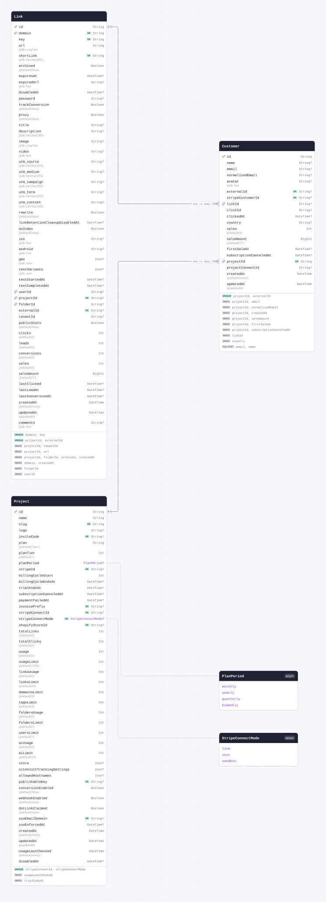

| Field                    | Type                | Constraints                             | Default      | Description |
| ------------------------ | ------------------- | --------------------------------------- | ------------ | ----------- |
| `id`                     | `String`            | PK NOT NULL                             |              |             |
| `name`                   | `String`            | NULL                                    |              |             |
| `email`                  | `String`            | NULL                                    |              |             |
| `normalizedEmail`        | `String`            | NULL                                    |              |             |
| `avatar`                 | `String` `@db.Text` | NULL                                    |              |             |
| `externalId`             | `String`            | NULL                                    |              |             |
| `stripeCustomerId`       | `String`            | UNIQUE NULL                             |              |             |
| `linkId`                 | `String`            | NULL → [Link.id](#model-Link)           |              |             |
| `clickId`                | `String`            | NULL                                    |              |             |
| `clickedAt`              | `DateTime`          | NULL                                    |              |             |
| `country`                | `String`            | NULL                                    |              |             |
| `sales`                  | `Int`               | NOT NULL                                | `0`          |             |
| `saleAmount`             | `BigInt`            | NOT NULL                                | `"0"`        |             |
| `firstSaleAt`            | `DateTime`          | NULL                                    |              |             |
| `subscriptionCanceledAt` | `DateTime`          | NULL                                    |              |             |
| `projectId`              | `String`            | NOT NULL → [Project.id](#model-Project) |              |             |
| `projectConnectId`       | `String`            | NULL                                    |              |             |
| `createdAt`              | `DateTime`          | NOT NULL                                | `now()`      |             |
| `updatedAt`              | `DateTime`          | NOT NULL                                | `@updatedAt` |             |

#### Indexes

- `@@index([projectId, email])`
- `@@index([projectId, normalizedEmail])`
- `@@index([projectId, createdAt])`
- `@@index([projectId, saleAmount])`
- `@@index([projectId, firstSaleAt])`
- `@@index([projectId, subscriptionCanceledAt])`
- `@@index([linkId])`
- `@@index([country])`
- `@@unique([projectId, externalId])`
- `@@fulltext([email, name])`

#### References

- `projectId` → [Project.id](#model-Project) (many-to-one)
- `linkId` → [Link.id](#model-Link) (many-to-one)

#### Definition

```sql
CREATE TABLE `Customer` (
    `id` VARCHAR(191) NOT NULL,
    `name` VARCHAR(191) NULL,
    `email` VARCHAR(191) NULL,
    `normalizedEmail` VARCHAR(191) NULL,
    `avatar` TEXT NULL,
    `externalId` VARCHAR(191) NULL,
    `stripeCustomerId` VARCHAR(191) NULL,
    `linkId` VARCHAR(191) NULL,
    `clickId` VARCHAR(191) NULL,
    `clickedAt` DATETIME(3) NULL,
    `country` VARCHAR(191) NULL,
    `sales` INTEGER NOT NULL DEFAULT 0,
    `saleAmount` BIGINT NOT NULL DEFAULT 0,
    `firstSaleAt` DATETIME(3) NULL,
    `subscriptionCanceledAt` DATETIME(3) NULL,
    `projectId` VARCHAR(191) NOT NULL,
    `projectConnectId` VARCHAR(191) NULL,
    `createdAt` DATETIME(3) NOT NULL DEFAULT CURRENT_TIMESTAMP(3),
    `updatedAt` DATETIME(3) NOT NULL,

    UNIQUE INDEX `Customer_stripeCustomerId_key`(`stripeCustomerId`),
    INDEX `Customer_projectId_email_idx`(`projectId`, `email`),
    INDEX `Customer_projectId_normalizedEmail_idx`(`projectId`, `normalizedEmail`),
    INDEX `Customer_projectId_createdAt_idx`(`projectId`, `createdAt`),
    INDEX `Customer_projectId_saleAmount_idx`(`projectId`, `saleAmount`),
    INDEX `Customer_projectId_firstSaleAt_idx`(`projectId`, `firstSaleAt`),
    INDEX `Customer_projectId_subscriptionCanceledAt_idx`(`projectId`, `subscriptionCanceledAt`),
    INDEX `Customer_linkId_idx`(`linkId`),
    INDEX `Customer_country_idx`(`country`),
    UNIQUE INDEX `Customer_projectId_externalId_key`(`projectId`, `externalId`),
    FULLTEXT INDEX `Customer_email_name_idx`(`email`, `name`),
    PRIMARY KEY (`id`)
) DEFAULT CHARACTER SET utf8mb4 COLLATE utf8mb4_unicode_ci;
```

<details>
<summary>Queries and their SQL</summary>

**findMany**: Every row

```ts
await prisma.customer.findMany();
```

```sql
SELECT
  `Customer`.`id`,
  `Customer`.`name`,
  `Customer`.`email`,
  `Customer`.`normalizedEmail`,
  `Customer`.`avatar`,
  `Customer`.`externalId`,
  `Customer`.`stripeCustomerId`,
  `Customer`.`linkId`,
  `Customer`.`clickId`,
  `Customer`.`clickedAt`,
  `Customer`.`country`,
  `Customer`.`sales`,
  `Customer`.`saleAmount`,
  `Customer`.`firstSaleAt`,
  `Customer`.`subscriptionCanceledAt`,
  `Customer`.`projectId`,
  `Customer`.`projectConnectId`,
  `Customer`.`createdAt`,
  `Customer`.`updatedAt`
FROM
  `Customer`
WHERE
  1 = 1
```

**count**: How many rows there are

```ts
await prisma.customer.count();
```

```sql
SELECT
  COUNT(*) AS `_count$_all`
FROM
  (
    SELECT
      `Customer`.`id`
    FROM
      `Customer`
    WHERE
      1 = 1
  ) AS `sub`
```

**findMany**: Every row with its relations

```ts
await prisma.customer.findMany({ include: { project: true, link: true } });
```

```sql
SELECT
  `Customer`.`id`,
  `Customer`.`name`,
  `Customer`.`email`,
  `Customer`.`normalizedEmail`,
  `Customer`.`avatar`,
  `Customer`.`externalId`,
  `Customer`.`stripeCustomerId`,
  `Customer`.`linkId`,
  `Customer`.`clickId`,
  `Customer`.`clickedAt`,
  `Customer`.`country`,
  `Customer`.`sales`,
  `Customer`.`saleAmount`,
  `Customer`.`firstSaleAt`,
  `Customer`.`subscriptionCanceledAt`,
  `Customer`.`projectId`,
  `Customer`.`projectConnectId`,
  `Customer`.`createdAt`,
  `Customer`.`updatedAt`
FROM
  `Customer`
WHERE
  1 = 1

SELECT
  `Project`.`id`,
  `Project`.`name`,
  `Project`.`slug`,
  `Project`.`logo`,
  `Project`.`inviteCode`,
  `Project`.`plan`,
  `Project`.`planTier`,
  `Project`.`planPeriod`,
  `Project`.`stripeId`,
  `Project`.`billingCycleStart`,
  `Project`.`billingCycleEndsAt`,
  `Project`.`trialEndsAt`,
  `Project`.`subscriptionCanceledAt`,
  `Project`.`paymentFailedAt`,
  `Project`.`invoicePrefix`,
  `Project`.`stripeConnectId`,
  `Project`.`stripeConnectMode`,
  `Project`.`shopifyStoreId`,
  `Project`.`totalLinks`,
  `Project`.`totalClicks`,
  `Project`.`usage`,
  `Project`.`usageLimit`,
  `Project`.`linksUsage`,
  `Project`.`linksLimit`,
  `Project`.`domainsLimit`,
  `Project`.`tagsLimit`,
  `Project`.`foldersUsage`,
  `Project`.`foldersLimit`,
  `Project`.`usersLimit`,
  `Project`.`aiUsage`,
  `Project`.`aiLimit`,
  `Project`.`store`,
  `Project`.`siteVisitTrackingSettings`,
  `Project`.`allowedHostnames`,
  `Project`.`publishableKey`,
  `Project`.`conversionEnabled`,
  `Project`.`webhookEnabled`,
  `Project`.`dotLinkClaimed`,
  `Project`.`ssoEmailDomain`,
  `Project`.`ssoEnforcedAt`,
  `Project`.`createdAt`,
  `Project`.`updatedAt`,
  `Project`.`usageLastChecked`,
  `Project`.`disabledAt`
FROM
  `Project`
WHERE
  `Project`.`id` IN (?)
-- params: ["<projectId of the rows above>"]

SELECT
  `Link`.`id`,
  `Link`.`domain`,
  `Link`.`key`,
  `Link`.`url`,
  `Link`.`shortLink`,
  `Link`.`archived`,
  `Link`.`expiresAt`,
  `Link`.`expiredUrl`,
  `Link`.`disabledAt`,
  `Link`.`password`,
  `Link`.`trackConversion`,
  `Link`.`proxy`,
  `Link`.`title`,
  `Link`.`description`,
  `Link`.`image`,
  `Link`.`video`,
  `Link`.`utm_source`,
  `Link`.`utm_medium`,
  `Link`.`utm_campaign`,
  `Link`.`utm_term`,
  `Link`.`utm_content`,
  `Link`.`rewrite`,
  `Link`.`linkRetentionCleanupDisabledAt`,
  `Link`.`doIndex`,
  `Link`.`ios`,
  `Link`.`android`,
  `Link`.`geo`,
  `Link`.`testVariants`,
  `Link`.`testStartedAt`,
  `Link`.`testCompletedAt`,
  `Link`.`userId`,
  `Link`.`projectId`,
  `Link`.`folderId`,
  `Link`.`externalId`,
  `Link`.`tenantId`,
  `Link`.`publicStats`,
  `Link`.`clicks`,
  `Link`.`leads`,
  `Link`.`conversions`,
  `Link`.`sales`,
  `Link`.`saleAmount`,
  `Link`.`lastClicked`,
  `Link`.`lastLeadAt`,
  `Link`.`lastConversionAt`,
  `Link`.`createdAt`,
  `Link`.`updatedAt`,
  `Link`.`comments`
FROM
  `Link`
WHERE
  `Link`.`id` IN (?)
-- params: ["<linkId of the rows above>"]
```

**findUnique**: One row by what is unique to it

```ts
await prisma.customer.findUnique({ where: { id: "example" } });
```

```sql
SELECT
  `Customer`.`id`,
  `Customer`.`name`,
  `Customer`.`email`,
  `Customer`.`normalizedEmail`,
  `Customer`.`avatar`,
  `Customer`.`externalId`,
  `Customer`.`stripeCustomerId`,
  `Customer`.`linkId`,
  `Customer`.`clickId`,
  `Customer`.`clickedAt`,
  `Customer`.`country`,
  `Customer`.`sales`,
  `Customer`.`saleAmount`,
  `Customer`.`firstSaleAt`,
  `Customer`.`subscriptionCanceledAt`,
  `Customer`.`projectId`,
  `Customer`.`projectConnectId`,
  `Customer`.`createdAt`,
  `Customer`.`updatedAt`
FROM
  `Customer`
WHERE
  (
    `Customer`.`id` = ?
    AND 1 = 1
  )
LIMIT
  ?
OFFSET
  ?
-- params: ["example","1","0"]
```

**create**: Create a row

```ts
await prisma.customer.create({ data: { id: "example", projectId: "example" } });
```

```sql
INSERT INTO
  `Customer` (
    `id`,
    `sales`,
    `saleAmount`,
    `projectId`,
    `createdAt`,
    `updatedAt`
  )
VALUES
  (?, ?, ?, ?, ?, ?)
-- params: ["example","0","0","example","<now()>","<now()>"]

SELECT
  `Customer`.`id`,
  `Customer`.`name`,
  `Customer`.`email`,
  `Customer`.`normalizedEmail`,
  `Customer`.`avatar`,
  `Customer`.`externalId`,
  `Customer`.`stripeCustomerId`,
  `Customer`.`linkId`,
  `Customer`.`clickId`,
  `Customer`.`clickedAt`,
  `Customer`.`country`,
  `Customer`.`sales`,
  `Customer`.`saleAmount`,
  `Customer`.`firstSaleAt`,
  `Customer`.`subscriptionCanceledAt`,
  `Customer`.`projectId`,
  `Customer`.`projectConnectId`,
  `Customer`.`createdAt`,
  `Customer`.`updatedAt`
FROM
  `Customer`
WHERE
  `Customer`.`id` = ?
LIMIT
  ?
OFFSET
  ?
-- params: ["<id of the rows above>","1","0"]
```

**update**: Update a row

```ts
await prisma.customer.update({ where: { id: "example" }, data: { name: "example" } });
```

```sql
SELECT
  `Customer`.`id`
FROM
  `Customer`
WHERE
  (
    `Customer`.`id` = ?
    AND 1 = 1
  )
LIMIT
  ?
OFFSET
  ?
-- params: ["example","1","0"]

UPDATE `Customer`
SET
  `name` = ?,
  `updatedAt` = ?
WHERE
  (
    `Customer`.`id` IN (?)
    AND (
      `Customer`.`id` = ?
      AND 1 = 1
    )
  )
-- params: ["example",{"prisma__type":"generatorCall","prisma__value":{"name":"now","args":[],"returnType":{"type":"DateTime"}}},"<id of the rows above>","example"]

SELECT
  `Customer`.`id`,
  `Customer`.`name`,
  `Customer`.`email`,
  `Customer`.`normalizedEmail`,
  `Customer`.`avatar`,
  `Customer`.`externalId`,
  `Customer`.`stripeCustomerId`,
  `Customer`.`linkId`,
  `Customer`.`clickId`,
  `Customer`.`clickedAt`,
  `Customer`.`country`,
  `Customer`.`sales`,
  `Customer`.`saleAmount`,
  `Customer`.`firstSaleAt`,
  `Customer`.`subscriptionCanceledAt`,
  `Customer`.`projectId`,
  `Customer`.`projectConnectId`,
  `Customer`.`createdAt`,
  `Customer`.`updatedAt`
FROM
  `Customer`
WHERE
  `Customer`.`id` = ?
LIMIT
  ?
OFFSET
  ?
-- params: ["<id of the rows above>","1","0"]
```

**delete**: Delete a row

```ts
await prisma.customer.delete({ where: { id: "example" } });
```

```sql
SELECT
  `Customer`.`id`,
  `Customer`.`name`,
  `Customer`.`email`,
  `Customer`.`normalizedEmail`,
  `Customer`.`avatar`,
  `Customer`.`externalId`,
  `Customer`.`stripeCustomerId`,
  `Customer`.`linkId`,
  `Customer`.`clickId`,
  `Customer`.`clickedAt`,
  `Customer`.`country`,
  `Customer`.`sales`,
  `Customer`.`saleAmount`,
  `Customer`.`firstSaleAt`,
  `Customer`.`subscriptionCanceledAt`,
  `Customer`.`projectId`,
  `Customer`.`projectConnectId`,
  `Customer`.`createdAt`,
  `Customer`.`updatedAt`
FROM
  `Customer`
WHERE
  (
    `Customer`.`id` = ?
    AND 1 = 1
  )
LIMIT
  ?
OFFSET
  ?
-- params: ["example","1","0"]

DELETE FROM `Customer`
WHERE
  (
    `Customer`.`id` = ?
    AND 1 = 1
  )
-- params: ["example"]
```

</details>

<a id="model-Dashboard"></a>

### Dashboard

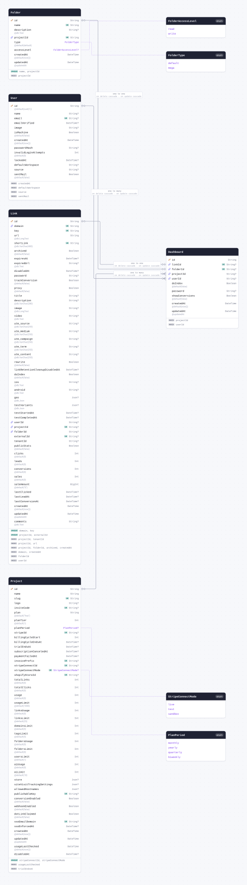

| Field             | Type       | Constraints                              | Default      | Description |
| ----------------- | ---------- | ---------------------------------------- | ------------ | ----------- |
| `id`              | `String`   | PK NOT NULL                              |              |             |
| `linkId`          | `String`   | UNIQUE NULL → [Link.id](#model-Link)     |              |             |
| `folderId`        | `String`   | UNIQUE NULL → [Folder.id](#model-Folder) |              |             |
| `projectId`       | `String`   | NULL → [Project.id](#model-Project)      |              |             |
| `userId`          | `String`   | NULL → [User.id](#model-User)            |              |             |
| `doIndex`         | `Boolean`  | NOT NULL                                 | `false`      |             |
| `password`        | `String`   | NULL                                     |              |             |
| `showConversions` | `Boolean`  | NOT NULL                                 | `false`      |             |
| `createdAt`       | `DateTime` | NOT NULL                                 | `now()`      |             |
| `updatedAt`       | `DateTime` | NOT NULL                                 | `@updatedAt` |             |

#### Indexes

- `@@index([projectId])`
- `@@index([userId])`

#### References

- `linkId` → [Link.id](#model-Link) (one-to-one, on delete Cascade, on update Cascade)
- `folderId` → [Folder.id](#model-Folder) (one-to-one, on delete Cascade, on update Cascade)
- `projectId` → [Project.id](#model-Project) (many-to-one, on delete Cascade, on update Cascade)
- `userId` → [User.id](#model-User) (many-to-one, on delete Cascade, on update Cascade)

#### Definition

```sql
CREATE TABLE `Dashboard` (
    `id` VARCHAR(191) NOT NULL,
    `linkId` VARCHAR(191) NULL,
    `folderId` VARCHAR(191) NULL,
    `projectId` VARCHAR(191) NULL,
    `userId` VARCHAR(191) NULL,
    `doIndex` BOOLEAN NOT NULL DEFAULT false,
    `password` VARCHAR(191) NULL,
    `showConversions` BOOLEAN NOT NULL DEFAULT false,
    `createdAt` DATETIME(3) NOT NULL DEFAULT CURRENT_TIMESTAMP(3),
    `updatedAt` DATETIME(3) NOT NULL,

    UNIQUE INDEX `Dashboard_linkId_key`(`linkId`),
    UNIQUE INDEX `Dashboard_folderId_key`(`folderId`),
    INDEX `Dashboard_projectId_idx`(`projectId`),
    INDEX `Dashboard_userId_idx`(`userId`),
    PRIMARY KEY (`id`)
) DEFAULT CHARACTER SET utf8mb4 COLLATE utf8mb4_unicode_ci;
```

<details>
<summary>Queries and their SQL</summary>

**findMany**: Every row

```ts
await prisma.dashboard.findMany();
```

```sql
SELECT
  `Dashboard`.`id`,
  `Dashboard`.`linkId`,
  `Dashboard`.`folderId`,
  `Dashboard`.`projectId`,
  `Dashboard`.`userId`,
  `Dashboard`.`doIndex`,
  `Dashboard`.`password`,
  `Dashboard`.`showConversions`,
  `Dashboard`.`createdAt`,
  `Dashboard`.`updatedAt`
FROM
  `Dashboard`
WHERE
  1 = 1
```

**count**: How many rows there are

```ts
await prisma.dashboard.count();
```

```sql
SELECT
  COUNT(*) AS `_count$_all`
FROM
  (
    SELECT
      `Dashboard`.`id`
    FROM
      `Dashboard`
    WHERE
      1 = 1
  ) AS `sub`
```

**findMany**: Every row with its relations

```ts
await prisma.dashboard.findMany({
  include: { link: true, folder: true, project: true, user: true },
});
```

```sql
SELECT
  `Dashboard`.`id`,
  `Dashboard`.`linkId`,
  `Dashboard`.`folderId`,
  `Dashboard`.`projectId`,
  `Dashboard`.`userId`,
  `Dashboard`.`doIndex`,
  `Dashboard`.`password`,
  `Dashboard`.`showConversions`,
  `Dashboard`.`createdAt`,
  `Dashboard`.`updatedAt`
FROM
  `Dashboard`
WHERE
  1 = 1

SELECT
  `Link`.`id`,
  `Link`.`domain`,
  `Link`.`key`,
  `Link`.`url`,
  `Link`.`shortLink`,
  `Link`.`archived`,
  `Link`.`expiresAt`,
  `Link`.`expiredUrl`,
  `Link`.`disabledAt`,
  `Link`.`password`,
  `Link`.`trackConversion`,
  `Link`.`proxy`,
  `Link`.`title`,
  `Link`.`description`,
  `Link`.`image`,
  `Link`.`video`,
  `Link`.`utm_source`,
  `Link`.`utm_medium`,
  `Link`.`utm_campaign`,
  `Link`.`utm_term`,
  `Link`.`utm_content`,
  `Link`.`rewrite`,
  `Link`.`linkRetentionCleanupDisabledAt`,
  `Link`.`doIndex`,
  `Link`.`ios`,
  `Link`.`android`,
  `Link`.`geo`,
  `Link`.`testVariants`,
  `Link`.`testStartedAt`,
  `Link`.`testCompletedAt`,
  `Link`.`userId`,
  `Link`.`projectId`,
  `Link`.`folderId`,
  `Link`.`externalId`,
  `Link`.`tenantId`,
  `Link`.`publicStats`,
  `Link`.`clicks`,
  `Link`.`leads`,
  `Link`.`conversions`,
  `Link`.`sales`,
  `Link`.`saleAmount`,
  `Link`.`lastClicked`,
  `Link`.`lastLeadAt`,
  `Link`.`lastConversionAt`,
  `Link`.`createdAt`,
  `Link`.`updatedAt`,
  `Link`.`comments`
FROM
  `Link`
WHERE
  `Link`.`id` IN (?)
-- params: ["<linkId of the rows above>"]

SELECT
  `Folder`.`id`,
  `Folder`.`name`,
  `Folder`.`description`,
  `Folder`.`projectId`,
  `Folder`.`type`,
  `Folder`.`accessLevel`,
  `Folder`.`createdAt`,
  `Folder`.`updatedAt`
FROM
  `Folder`
WHERE
  `Folder`.`id` IN (?)
-- params: ["<folderId of the rows above>"]

SELECT
  `Project`.`id`,
  `Project`.`name`,
  `Project`.`slug`,
  `Project`.`logo`,
  `Project`.`inviteCode`,
  `Project`.`plan`,
  `Project`.`planTier`,
  `Project`.`planPeriod`,
  `Project`.`stripeId`,
  `Project`.`billingCycleStart`,
  `Project`.`billingCycleEndsAt`,
  `Project`.`trialEndsAt`,
  `Project`.`subscriptionCanceledAt`,
  `Project`.`paymentFailedAt`,
  `Project`.`invoicePrefix`,
  `Project`.`stripeConnectId`,
  `Project`.`stripeConnectMode`,
  `Project`.`shopifyStoreId`,
  `Project`.`totalLinks`,
  `Project`.`totalClicks`,
  `Project`.`usage`,
  `Project`.`usageLimit`,
  `Project`.`linksUsage`,
  `Project`.`linksLimit`,
  `Project`.`domainsLimit`,
  `Project`.`tagsLimit`,
  `Project`.`foldersUsage`,
  `Project`.`foldersLimit`,
  `Project`.`usersLimit`,
  `Project`.`aiUsage`,
  `Project`.`aiLimit`,
  `Project`.`store`,
  `Project`.`siteVisitTrackingSettings`,
  `Project`.`allowedHostnames`,
  `Project`.`publishableKey`,
  `Project`.`conversionEnabled`,
  `Project`.`webhookEnabled`,
  `Project`.`dotLinkClaimed`,
  `Project`.`ssoEmailDomain`,
  `Project`.`ssoEnforcedAt`,
  `Project`.`createdAt`,
  `Project`.`updatedAt`,
  `Project`.`usageLastChecked`,
  `Project`.`disabledAt`
FROM
  `Project`
WHERE
  `Project`.`id` IN (?)
-- params: ["<projectId of the rows above>"]

SELECT
  `User`.`id`,
  `User`.`name`,
  `User`.`email`,
  `User`.`emailVerified`,
  `User`.`image`,
  `User`.`isMachine`,
  `User`.`createdAt`,
  `User`.`passwordHash`,
  `User`.`invalidLoginAttempts`,
  `User`.`lockedAt`,
  `User`.`defaultWorkspace`,
  `User`.`source`,
  `User`.`sentMail`
FROM
  `User`
WHERE
  `User`.`id` IN (?)
-- params: ["<userId of the rows above>"]
```

**findUnique**: One row by what is unique to it

```ts
await prisma.dashboard.findUnique({ where: { id: "example" } });
```

```sql
SELECT
  `Dashboard`.`id`,
  `Dashboard`.`linkId`,
  `Dashboard`.`folderId`,
  `Dashboard`.`projectId`,
  `Dashboard`.`userId`,
  `Dashboard`.`doIndex`,
  `Dashboard`.`password`,
  `Dashboard`.`showConversions`,
  `Dashboard`.`createdAt`,
  `Dashboard`.`updatedAt`
FROM
  `Dashboard`
WHERE
  (
    `Dashboard`.`id` = ?
    AND 1 = 1
  )
LIMIT
  ?
OFFSET
  ?
-- params: ["example","1","0"]
```

**create**: Create a row

```ts
await prisma.dashboard.create({ data: { id: "example" } });
```

```sql
INSERT INTO
  `Dashboard` (
    `id`,
    `doIndex`,
    `showConversions`,
    `createdAt`,
    `updatedAt`
  )
VALUES
  (?, ?, ?, ?, ?)
-- params: ["example",false,false,"<now()>","<now()>"]

SELECT
  `Dashboard`.`id`,
  `Dashboard`.`linkId`,
  `Dashboard`.`folderId`,
  `Dashboard`.`projectId`,
  `Dashboard`.`userId`,
  `Dashboard`.`doIndex`,
  `Dashboard`.`password`,
  `Dashboard`.`showConversions`,
  `Dashboard`.`createdAt`,
  `Dashboard`.`updatedAt`
FROM
  `Dashboard`
WHERE
  `Dashboard`.`id` = ?
LIMIT
  ?
OFFSET
  ?
-- params: ["<id of the rows above>","1","0"]
```

**update**: Update a row

```ts
await prisma.dashboard.update({ where: { id: "example" }, data: { doIndex: true } });
```

```sql
SELECT
  `Dashboard`.`id`
FROM
  `Dashboard`
WHERE
  (
    `Dashboard`.`id` = ?
    AND 1 = 1
  )
LIMIT
  ?
OFFSET
  ?
-- params: ["example","1","0"]

UPDATE `Dashboard`
SET
  `doIndex` = ?,
  `updatedAt` = ?
WHERE
  (
    `Dashboard`.`id` IN (?)
    AND (
      `Dashboard`.`id` = ?
      AND 1 = 1
    )
  )
-- params: [true,{"prisma__type":"generatorCall","prisma__value":{"name":"now","args":[],"returnType":{"type":"DateTime"}}},"<id of the rows above>","example"]

SELECT
  `Dashboard`.`id`,
  `Dashboard`.`linkId`,
  `Dashboard`.`folderId`,
  `Dashboard`.`projectId`,
  `Dashboard`.`userId`,
  `Dashboard`.`doIndex`,
  `Dashboard`.`password`,
  `Dashboard`.`showConversions`,
  `Dashboard`.`createdAt`,
  `Dashboard`.`updatedAt`
FROM
  `Dashboard`
WHERE
  `Dashboard`.`id` = ?
LIMIT
  ?
OFFSET
  ?
-- params: ["<id of the rows above>","1","0"]
```

**delete**: Delete a row

```ts
await prisma.dashboard.delete({ where: { id: "example" } });
```

```sql
SELECT
  `Dashboard`.`id`,
  `Dashboard`.`linkId`,
  `Dashboard`.`folderId`,
  `Dashboard`.`projectId`,
  `Dashboard`.`userId`,
  `Dashboard`.`doIndex`,
  `Dashboard`.`password`,
  `Dashboard`.`showConversions`,
  `Dashboard`.`createdAt`,
  `Dashboard`.`updatedAt`
FROM
  `Dashboard`
WHERE
  (
    `Dashboard`.`id` = ?
    AND 1 = 1
  )
LIMIT
  ?
OFFSET
  ?
-- params: ["example","1","0"]

DELETE FROM `Dashboard`
WHERE
  (
    `Dashboard`.`id` = ?
    AND 1 = 1
  )
-- params: ["example"]
```

</details>

<a id="model-Domain"></a>

### Domain

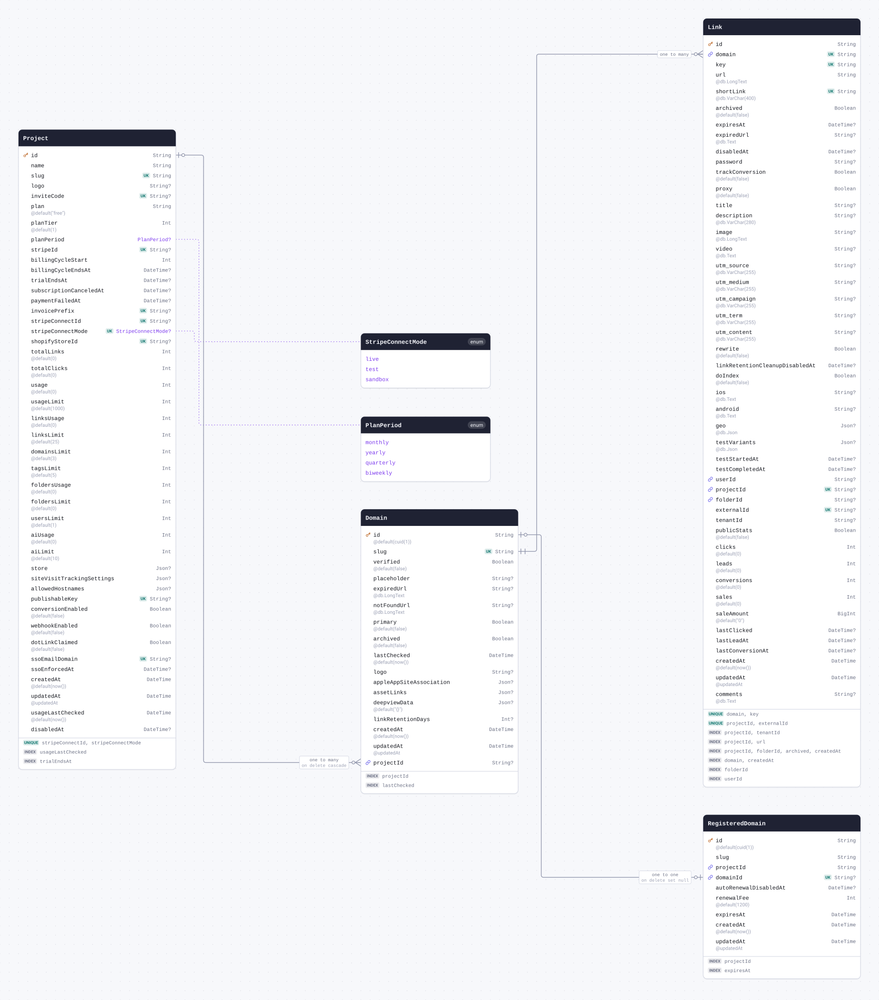

| Field                     | Type                    | Constraints                         | Default      | Description |
| ------------------------- | ----------------------- | ----------------------------------- | ------------ | ----------- |
| `id`                      | `String`                | PK NOT NULL                         | `cuid(1)`    |             |
| `slug`                    | `String`                | UNIQUE NOT NULL                     |              |             |
| `verified`                | `Boolean`               | NOT NULL                            | `false`      |             |
| `placeholder`             | `String`                | NULL                                |              |             |
| `expiredUrl`              | `String` `@db.LongText` | NULL                                |              |             |
| `notFoundUrl`             | `String` `@db.LongText` | NULL                                |              |             |
| `primary`                 | `Boolean`               | NOT NULL                            | `false`      |             |
| `archived`                | `Boolean`               | NOT NULL                            | `false`      |             |
| `lastChecked`             | `DateTime`              | NOT NULL                            | `now()`      |             |
| `logo`                    | `String`                | NULL                                |              |             |
| `appleAppSiteAssociation` | `Json`                  | NULL                                |              |             |
| `assetLinks`              | `Json`                  | NULL                                |              |             |
| `deepviewData`            | `Json`                  | NULL                                | `"{}"`       |             |
| `linkRetentionDays`       | `Int`                   | NULL                                |              |             |
| `createdAt`               | `DateTime`              | NOT NULL                            | `now()`      |             |
| `updatedAt`               | `DateTime`              | NOT NULL                            | `@updatedAt` |             |
| `projectId`               | `String`                | NULL → [Project.id](#model-Project) |              |             |

#### Indexes

- `@@index([projectId])`
- `@@index([lastChecked])`

#### References

- `projectId` → [Project.id](#model-Project) (many-to-one, on delete Cascade)

#### Referenced by

- `id` ← [RegisteredDomain.domainId](#model-RegisteredDomain) (one-to-one, on delete SetNull)
- `slug` ← [Link.domain](#model-Link) (one-to-many)

#### Definition

```sql
CREATE TABLE `Domain` (
    `id` VARCHAR(191) NOT NULL,
    `slug` VARCHAR(191) NOT NULL,
    `verified` BOOLEAN NOT NULL DEFAULT false,
    `placeholder` VARCHAR(191) NULL,
    `expiredUrl` LONGTEXT NULL,
    `notFoundUrl` LONGTEXT NULL,
    `primary` BOOLEAN NOT NULL DEFAULT false,
    `archived` BOOLEAN NOT NULL DEFAULT false,
    `lastChecked` DATETIME(3) NOT NULL DEFAULT CURRENT_TIMESTAMP(3),
    `logo` VARCHAR(191) NULL,
    `appleAppSiteAssociation` JSON NULL,
    `assetLinks` JSON NULL,
    `deepviewData` JSON NULL,
    `linkRetentionDays` INTEGER NULL,
    `createdAt` DATETIME(3) NOT NULL DEFAULT CURRENT_TIMESTAMP(3),
    `updatedAt` DATETIME(3) NOT NULL,
    `projectId` VARCHAR(191) NULL,

    UNIQUE INDEX `Domain_slug_key`(`slug`),
    INDEX `Domain_projectId_idx`(`projectId`),
    INDEX `Domain_lastChecked_idx`(`lastChecked` ASC),
    PRIMARY KEY (`id`)
) DEFAULT CHARACTER SET utf8mb4 COLLATE utf8mb4_unicode_ci;
```

<details>
<summary>Queries and their SQL</summary>

**findMany**: Every row

```ts
await prisma.domain.findMany();
```

```sql
SELECT
  `Domain`.`id`,
  `Domain`.`slug`,
  `Domain`.`verified`,
  `Domain`.`placeholder`,
  `Domain`.`expiredUrl`,
  `Domain`.`notFoundUrl`,
  `Domain`.`primary`,
  `Domain`.`archived`,
  `Domain`.`lastChecked`,
  `Domain`.`logo`,
  `Domain`.`appleAppSiteAssociation`,
  `Domain`.`assetLinks`,
  `Domain`.`deepviewData`,
  `Domain`.`linkRetentionDays`,
  `Domain`.`createdAt`,
  `Domain`.`updatedAt`,
  `Domain`.`projectId`
FROM
  `Domain`
WHERE
  1 = 1
```

**count**: How many rows there are

```ts
await prisma.domain.count();
```

```sql
SELECT
  COUNT(*) AS `_count$_all`
FROM
  (
    SELECT
      `Domain`.`id`
    FROM
      `Domain`
    WHERE
      1 = 1
  ) AS `sub`
```

**findMany**: Every row with its relations

```ts
await prisma.domain.findMany({ include: { project: true, links: true, registeredDomain: true } });
```

```sql
SELECT
  `Domain`.`id`,
  `Domain`.`slug`,
  `Domain`.`verified`,
  `Domain`.`placeholder`,
  `Domain`.`expiredUrl`,
  `Domain`.`notFoundUrl`,
  `Domain`.`primary`,
  `Domain`.`archived`,
  `Domain`.`lastChecked`,
  `Domain`.`logo`,
  `Domain`.`appleAppSiteAssociation`,
  `Domain`.`assetLinks`,
  `Domain`.`deepviewData`,
  `Domain`.`linkRetentionDays`,
  `Domain`.`createdAt`,
  `Domain`.`updatedAt`,
  `Domain`.`projectId`
FROM
  `Domain`
WHERE
  1 = 1

SELECT
  `Project`.`id`,
  `Project`.`name`,
  `Project`.`slug`,
  `Project`.`logo`,
  `Project`.`inviteCode`,
  `Project`.`plan`,
  `Project`.`planTier`,
  `Project`.`planPeriod`,
  `Project`.`stripeId`,
  `Project`.`billingCycleStart`,
  `Project`.`billingCycleEndsAt`,
  `Project`.`trialEndsAt`,
  `Project`.`subscriptionCanceledAt`,
  `Project`.`paymentFailedAt`,
  `Project`.`invoicePrefix`,
  `Project`.`stripeConnectId`,
  `Project`.`stripeConnectMode`,
  `Project`.`shopifyStoreId`,
  `Project`.`totalLinks`,
  `Project`.`totalClicks`,
  `Project`.`usage`,
  `Project`.`usageLimit`,
  `Project`.`linksUsage`,
  `Project`.`linksLimit`,
  `Project`.`domainsLimit`,
  `Project`.`tagsLimit`,
  `Project`.`foldersUsage`,
  `Project`.`foldersLimit`,
  `Project`.`usersLimit`,
  `Project`.`aiUsage`,
  `Project`.`aiLimit`,
  `Project`.`store`,
  `Project`.`siteVisitTrackingSettings`,
  `Project`.`allowedHostnames`,
  `Project`.`publishableKey`,
  `Project`.`conversionEnabled`,
  `Project`.`webhookEnabled`,
  `Project`.`dotLinkClaimed`,
  `Project`.`ssoEmailDomain`,
  `Project`.`ssoEnforcedAt`,
  `Project`.`createdAt`,
  `Project`.`updatedAt`,
  `Project`.`usageLastChecked`,
  `Project`.`disabledAt`
FROM
  `Project`
WHERE
  `Project`.`id` IN (?)
-- params: ["<projectId of the rows above>"]

SELECT
  `Link`.`id`,
  `Link`.`domain`,
  `Link`.`key`,
  `Link`.`url`,
  `Link`.`shortLink`,
  `Link`.`archived`,
  `Link`.`expiresAt`,
  `Link`.`expiredUrl`,
  `Link`.`disabledAt`,
  `Link`.`password`,
  `Link`.`trackConversion`,
  `Link`.`proxy`,
  `Link`.`title`,
  `Link`.`description`,
  `Link`.`image`,
  `Link`.`video`,
  `Link`.`utm_source`,
  `Link`.`utm_medium`,
  `Link`.`utm_campaign`,
  `Link`.`utm_term`,
  `Link`.`utm_content`,
  `Link`.`rewrite`,
  `Link`.`linkRetentionCleanupDisabledAt`,
  `Link`.`doIndex`,
  `Link`.`ios`,
  `Link`.`android`,
  `Link`.`geo`,
  `Link`.`testVariants`,
  `Link`.`testStartedAt`,
  `Link`.`testCompletedAt`,
  `Link`.`userId`,
  `Link`.`projectId`,
  `Link`.`folderId`,
  `Link`.`externalId`,
  `Link`.`tenantId`,
  `Link`.`publicStats`,
  `Link`.`clicks`,
  `Link`.`leads`,
  `Link`.`conversions`,
  `Link`.`sales`,
  `Link`.`saleAmount`,
  `Link`.`lastClicked`,
  `Link`.`lastLeadAt`,
  `Link`.`lastConversionAt`,
  `Link`.`createdAt`,
  `Link`.`updatedAt`,
  `Link`.`comments`
FROM
  `Link`
WHERE
  `Link`.`domain` IN (?)
-- params: ["<slug of the rows above>"]

SELECT
  `RegisteredDomain`.`id`,
  `RegisteredDomain`.`slug`,
  `RegisteredDomain`.`projectId`,
  `RegisteredDomain`.`domainId`,
  `RegisteredDomain`.`autoRenewalDisabledAt`,
  `RegisteredDomain`.`renewalFee`,
  `RegisteredDomain`.`expiresAt`,
  `RegisteredDomain`.`createdAt`,
  `RegisteredDomain`.`updatedAt`
FROM
  `RegisteredDomain`
WHERE
  `RegisteredDomain`.`domainId` IN (?)
-- params: ["<id of the rows above>"]
```

**findUnique**: One row by what is unique to it

```ts
await prisma.domain.findUnique({ where: { id: "example" } });
```

```sql
SELECT
  `Domain`.`id`,
  `Domain`.`slug`,
  `Domain`.`verified`,
  `Domain`.`placeholder`,
  `Domain`.`expiredUrl`,
  `Domain`.`notFoundUrl`,
  `Domain`.`primary`,
  `Domain`.`archived`,
  `Domain`.`lastChecked`,
  `Domain`.`logo`,
  `Domain`.`appleAppSiteAssociation`,
  `Domain`.`assetLinks`,
  `Domain`.`deepviewData`,
  `Domain`.`linkRetentionDays`,
  `Domain`.`createdAt`,
  `Domain`.`updatedAt`,
  `Domain`.`projectId`
FROM
  `Domain`
WHERE
  (
    `Domain`.`id` = ?
    AND 1 = 1
  )
LIMIT
  ?
OFFSET
  ?
-- params: ["example","1","0"]
```

**create**: Create a row

```ts
await prisma.domain.create({ data: { slug: "example" } });
```

```sql
INSERT INTO
  `Domain` (
    `id`,
    `slug`,
    `verified`,
    `primary`,
    `archived`,
    `lastChecked`,
    `deepviewData`,
    `createdAt`,
    `updatedAt`
  )
VALUES
  (?, ?, ?, ?, ?, ?, ?, ?, ?)
-- params: ["<cuid(1)>","example",false,false,false,"<now()>","{}","<now()>","<now()>"]

SELECT
  `Domain`.`id`,
  `Domain`.`slug`,
  `Domain`.`verified`,
  `Domain`.`placeholder`,
  `Domain`.`expiredUrl`,
  `Domain`.`notFoundUrl`,
  `Domain`.`primary`,
  `Domain`.`archived`,
  `Domain`.`lastChecked`,
  `Domain`.`logo`,
  `Domain`.`appleAppSiteAssociation`,
  `Domain`.`assetLinks`,
  `Domain`.`deepviewData`,
  `Domain`.`linkRetentionDays`,
  `Domain`.`createdAt`,
  `Domain`.`updatedAt`,
  `Domain`.`projectId`
FROM
  `Domain`
WHERE
  `Domain`.`id` = ?
LIMIT
  ?
OFFSET
  ?
-- params: ["<id of the rows above>","1","0"]
```

**update**: Update a row

```ts
await prisma.domain.update({ where: { id: "example" }, data: { slug: "example" } });
```

```sql
SELECT
  `Domain`.`id`,
  `Domain`.`slug`
FROM
  `Domain`
WHERE
  (
    `Domain`.`id` = ?
    AND 1 = 1
  )
LIMIT
  ?
OFFSET
  ?
-- params: ["example","1","0"]

SELECT
  `Link`.`id`,
  `Link`.`domain`
FROM
  `Link`
WHERE
  (
    1 = 1
    AND `Link`.`domain` IN (?)
  )
-- params: ["<slug of the rows above>"]

UPDATE `Link`
SET
  `domain` = ?
WHERE
  (
    `Link`.`id` IN (?)
    AND 1 = 1
  )
-- params: ["example","<id of the rows above>"]

UPDATE `Domain`
SET
  `slug` = ?,
  `updatedAt` = ?
WHERE
  (
    `Domain`.`id` IN (?)
    AND (
      `Domain`.`id` = ?
      AND 1 = 1
    )
  )
-- params: ["example",{"prisma__type":"generatorCall","prisma__value":{"name":"now","args":[],"returnType":{"type":"DateTime"}}},"<id of the rows above>","example"]

SELECT
  `Domain`.`id`,
  `Domain`.`slug`,
  `Domain`.`verified`,
  `Domain`.`placeholder`,
  `Domain`.`expiredUrl`,
  `Domain`.`notFoundUrl`,
  `Domain`.`primary`,
  `Domain`.`archived`,
  `Domain`.`lastChecked`,
  `Domain`.`logo`,
  `Domain`.`appleAppSiteAssociation`,
  `Domain`.`assetLinks`,
  `Domain`.`deepviewData`,
  `Domain`.`linkRetentionDays`,
  `Domain`.`createdAt`,
  `Domain`.`updatedAt`,
  `Domain`.`projectId`
FROM
  `Domain`
WHERE
  `Domain`.`id` = ?
LIMIT
  ?
OFFSET
  ?
-- params: ["<id of the rows above>","1","0"]
```

**delete**: Delete a row

```ts
await prisma.domain.delete({ where: { id: "example" } });
```

```sql
SELECT
  `Domain`.`id`,
  `Domain`.`slug`,
  `Domain`.`verified`,
  `Domain`.`placeholder`,
  `Domain`.`expiredUrl`,
  `Domain`.`notFoundUrl`,
  `Domain`.`primary`,
  `Domain`.`archived`,
  `Domain`.`lastChecked`,
  `Domain`.`logo`,
  `Domain`.`appleAppSiteAssociation`,
  `Domain`.`assetLinks`,
  `Domain`.`deepviewData`,
  `Domain`.`linkRetentionDays`,
  `Domain`.`createdAt`,
  `Domain`.`updatedAt`,
  `Domain`.`projectId`
FROM
  `Domain`
WHERE
  (
    `Domain`.`id` = ?
    AND 1 = 1
  )
LIMIT
  ?
OFFSET
  ?
-- params: ["example","1","0"]

SELECT
  `RegisteredDomain`.`id`,
  `RegisteredDomain`.`domainId`
FROM
  `RegisteredDomain`
WHERE
  (
    1 = 1
    AND `RegisteredDomain`.`domainId` IN (?)
  )
-- params: ["<id of the rows above>"]

UPDATE `RegisteredDomain`
SET
  `domainId` = ?
WHERE
  (
    `RegisteredDomain`.`id` IN (?)
    AND 1 = 1
  )
-- params: [null,"<id of the rows above>"]

SELECT
  `Link`.`id`,
  `Link`.`domain`
FROM
  `Link`
WHERE
  (
    1 = 1
    AND `Link`.`domain` IN (?)
  )
-- params: ["<slug of the rows above>"]

DELETE FROM `Domain`
WHERE
  (
    `Domain`.`id` = ?
    AND 1 = 1
  )
-- params: ["example"]
```

</details>

<a id="model-RegisteredDomain"></a>

### RegisteredDomain

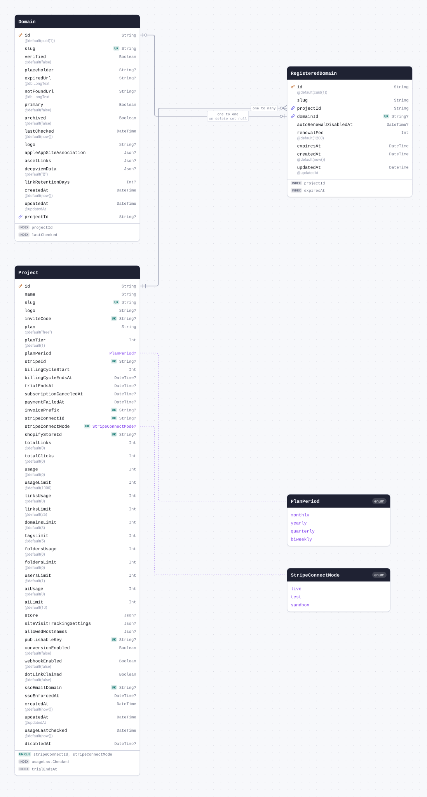

| Field                   | Type       | Constraints                              | Default      | Description |
| ----------------------- | ---------- | ---------------------------------------- | ------------ | ----------- |
| `id`                    | `String`   | PK NOT NULL                              | `cuid(1)`    |             |
| `slug`                  | `String`   | NOT NULL                                 |              |             |
| `projectId`             | `String`   | NOT NULL → [Project.id](#model-Project)  |              |             |
| `domainId`              | `String`   | UNIQUE NULL → [Domain.id](#model-Domain) |              |             |
| `autoRenewalDisabledAt` | `DateTime` | NULL                                     |              |             |
| `renewalFee`            | `Int`      | NOT NULL                                 | `1200`       |             |
| `expiresAt`             | `DateTime` | NOT NULL                                 |              |             |
| `createdAt`             | `DateTime` | NOT NULL                                 | `now()`      |             |
| `updatedAt`             | `DateTime` | NOT NULL                                 | `@updatedAt` |             |

#### Indexes

- `@@index([projectId])`
- `@@index([expiresAt])`

#### References

- `projectId` → [Project.id](#model-Project) (many-to-one)
- `domainId` → [Domain.id](#model-Domain) (one-to-one, on delete SetNull)

#### Definition

```sql
CREATE TABLE `RegisteredDomain` (
    `id` VARCHAR(191) NOT NULL,
    `slug` VARCHAR(191) NOT NULL,
    `projectId` VARCHAR(191) NOT NULL,
    `domainId` VARCHAR(191) NULL,
    `autoRenewalDisabledAt` DATETIME(3) NULL,
    `renewalFee` INTEGER NOT NULL DEFAULT 1200,
    `expiresAt` DATETIME(3) NOT NULL,
    `createdAt` DATETIME(3) NOT NULL DEFAULT CURRENT_TIMESTAMP(3),
    `updatedAt` DATETIME(3) NOT NULL,

    UNIQUE INDEX `RegisteredDomain_domainId_key`(`domainId`),
    INDEX `RegisteredDomain_projectId_idx`(`projectId`),
    INDEX `RegisteredDomain_expiresAt_idx`(`expiresAt` ASC),
    PRIMARY KEY (`id`)
) DEFAULT CHARACTER SET utf8mb4 COLLATE utf8mb4_unicode_ci;
```

<details>
<summary>Queries and their SQL</summary>

**findMany**: Every row

```ts
await prisma.registeredDomain.findMany();
```

```sql
SELECT
  `RegisteredDomain`.`id`,
  `RegisteredDomain`.`slug`,
  `RegisteredDomain`.`projectId`,
  `RegisteredDomain`.`domainId`,
  `RegisteredDomain`.`autoRenewalDisabledAt`,
  `RegisteredDomain`.`renewalFee`,
  `RegisteredDomain`.`expiresAt`,
  `RegisteredDomain`.`createdAt`,
  `RegisteredDomain`.`updatedAt`
FROM
  `RegisteredDomain`
WHERE
  1 = 1
```

**count**: How many rows there are

```ts
await prisma.registeredDomain.count();
```

```sql
SELECT
  COUNT(*) AS `_count$_all`
FROM
  (
    SELECT
      `RegisteredDomain`.`id`
    FROM
      `RegisteredDomain`
    WHERE
      1 = 1
  ) AS `sub`
```

**findMany**: Every row with its relations

```ts
await prisma.registeredDomain.findMany({ include: { project: true, domain: true } });
```

```sql
SELECT
  `RegisteredDomain`.`id`,
  `RegisteredDomain`.`slug`,
  `RegisteredDomain`.`projectId`,
  `RegisteredDomain`.`domainId`,
  `RegisteredDomain`.`autoRenewalDisabledAt`,
  `RegisteredDomain`.`renewalFee`,
  `RegisteredDomain`.`expiresAt`,
  `RegisteredDomain`.`createdAt`,
  `RegisteredDomain`.`updatedAt`
FROM
  `RegisteredDomain`
WHERE
  1 = 1

SELECT
  `Project`.`id`,
  `Project`.`name`,
  `Project`.`slug`,
  `Project`.`logo`,
  `Project`.`inviteCode`,
  `Project`.`plan`,
  `Project`.`planTier`,
  `Project`.`planPeriod`,
  `Project`.`stripeId`,
  `Project`.`billingCycleStart`,
  `Project`.`billingCycleEndsAt`,
  `Project`.`trialEndsAt`,
  `Project`.`subscriptionCanceledAt`,
  `Project`.`paymentFailedAt`,
  `Project`.`invoicePrefix`,
  `Project`.`stripeConnectId`,
  `Project`.`stripeConnectMode`,
  `Project`.`shopifyStoreId`,
  `Project`.`totalLinks`,
  `Project`.`totalClicks`,
  `Project`.`usage`,
  `Project`.`usageLimit`,
  `Project`.`linksUsage`,
  `Project`.`linksLimit`,
  `Project`.`domainsLimit`,
  `Project`.`tagsLimit`,
  `Project`.`foldersUsage`,
  `Project`.`foldersLimit`,
  `Project`.`usersLimit`,
  `Project`.`aiUsage`,
  `Project`.`aiLimit`,
  `Project`.`store`,
  `Project`.`siteVisitTrackingSettings`,
  `Project`.`allowedHostnames`,
  `Project`.`publishableKey`,
  `Project`.`conversionEnabled`,
  `Project`.`webhookEnabled`,
  `Project`.`dotLinkClaimed`,
  `Project`.`ssoEmailDomain`,
  `Project`.`ssoEnforcedAt`,
  `Project`.`createdAt`,
  `Project`.`updatedAt`,
  `Project`.`usageLastChecked`,
  `Project`.`disabledAt`
FROM
  `Project`
WHERE
  `Project`.`id` IN (?)
-- params: ["<projectId of the rows above>"]

SELECT
  `Domain`.`id`,
  `Domain`.`slug`,
  `Domain`.`verified`,
  `Domain`.`placeholder`,
  `Domain`.`expiredUrl`,
  `Domain`.`notFoundUrl`,
  `Domain`.`primary`,
  `Domain`.`archived`,
  `Domain`.`lastChecked`,
  `Domain`.`logo`,
  `Domain`.`appleAppSiteAssociation`,
  `Domain`.`assetLinks`,
  `Domain`.`deepviewData`,
  `Domain`.`linkRetentionDays`,
  `Domain`.`createdAt`,
  `Domain`.`updatedAt`,
  `Domain`.`projectId`
FROM
  `Domain`
WHERE
  `Domain`.`id` IN (?)
-- params: ["<domainId of the rows above>"]
```

**findUnique**: One row by what is unique to it

```ts
await prisma.registeredDomain.findUnique({ where: { id: "example" } });
```

```sql
SELECT
  `RegisteredDomain`.`id`,
  `RegisteredDomain`.`slug`,
  `RegisteredDomain`.`projectId`,
  `RegisteredDomain`.`domainId`,
  `RegisteredDomain`.`autoRenewalDisabledAt`,
  `RegisteredDomain`.`renewalFee`,
  `RegisteredDomain`.`expiresAt`,
  `RegisteredDomain`.`createdAt`,
  `RegisteredDomain`.`updatedAt`
FROM
  `RegisteredDomain`
WHERE
  (
    `RegisteredDomain`.`id` = ?
    AND 1 = 1
  )
LIMIT
  ?
OFFSET
  ?
-- params: ["example","1","0"]
```

**create**: Create a row

```ts
await prisma.registeredDomain.create({
  data: { slug: "example", projectId: "example", expiresAt: new Date("2026-01-01T00:00:00.000Z") },
});
```

```sql
INSERT INTO
  `RegisteredDomain` (
    `id`,
    `slug`,
    `projectId`,
    `renewalFee`,
    `expiresAt`,
    `createdAt`,
    `updatedAt`
  )
VALUES
  (?, ?, ?, ?, ?, ?, ?)
-- params: ["<cuid(1)>","example","example","1200","2026-01-01T00:00:00.000Z","<now()>","<now()>"]

SELECT
  `RegisteredDomain`.`id`,
  `RegisteredDomain`.`slug`,
  `RegisteredDomain`.`projectId`,
  `RegisteredDomain`.`domainId`,
  `RegisteredDomain`.`autoRenewalDisabledAt`,
  `RegisteredDomain`.`renewalFee`,
  `RegisteredDomain`.`expiresAt`,
  `RegisteredDomain`.`createdAt`,
  `RegisteredDomain`.`updatedAt`
FROM
  `RegisteredDomain`
WHERE
  `RegisteredDomain`.`id` = ?
LIMIT
  ?
OFFSET
  ?
-- params: ["<id of the rows above>","1","0"]
```

**update**: Update a row

```ts
await prisma.registeredDomain.update({ where: { id: "example" }, data: { slug: "example" } });
```

```sql
SELECT
  `RegisteredDomain`.`id`
FROM
  `RegisteredDomain`
WHERE
  (
    `RegisteredDomain`.`id` = ?
    AND 1 = 1
  )
LIMIT
  ?
OFFSET
  ?
-- params: ["example","1","0"]

UPDATE `RegisteredDomain`
SET
  `slug` = ?,
  `updatedAt` = ?
WHERE
  (
    `RegisteredDomain`.`id` IN (?)
    AND (
      `RegisteredDomain`.`id` = ?
      AND 1 = 1
    )
  )
-- params: ["example",{"prisma__type":"generatorCall","prisma__value":{"name":"now","args":[],"returnType":{"type":"DateTime"}}},"<id of the rows above>","example"]

SELECT
  `RegisteredDomain`.`id`,
  `RegisteredDomain`.`slug`,
  `RegisteredDomain`.`projectId`,
  `RegisteredDomain`.`domainId`,
  `RegisteredDomain`.`autoRenewalDisabledAt`,
  `RegisteredDomain`.`renewalFee`,
  `RegisteredDomain`.`expiresAt`,
  `RegisteredDomain`.`createdAt`,
  `RegisteredDomain`.`updatedAt`
FROM
  `RegisteredDomain`
WHERE
  `RegisteredDomain`.`id` = ?
LIMIT
  ?
OFFSET
  ?
-- params: ["<id of the rows above>","1","0"]
```

**delete**: Delete a row

```ts
await prisma.registeredDomain.delete({ where: { id: "example" } });
```

```sql
SELECT
  `RegisteredDomain`.`id`,
  `RegisteredDomain`.`slug`,
  `RegisteredDomain`.`projectId`,
  `RegisteredDomain`.`domainId`,
  `RegisteredDomain`.`autoRenewalDisabledAt`,
  `RegisteredDomain`.`renewalFee`,
  `RegisteredDomain`.`expiresAt`,
  `RegisteredDomain`.`createdAt`,
  `RegisteredDomain`.`updatedAt`
FROM
  `RegisteredDomain`
WHERE
  (
    `RegisteredDomain`.`id` = ?
    AND 1 = 1
  )
LIMIT
  ?
OFFSET
  ?
-- params: ["example","1","0"]

DELETE FROM `RegisteredDomain`
WHERE
  (
    `RegisteredDomain`.`id` = ?
    AND 1 = 1
  )
-- params: ["example"]
```

</details>

<a id="model-DefaultDomains"></a>

### DefaultDomains

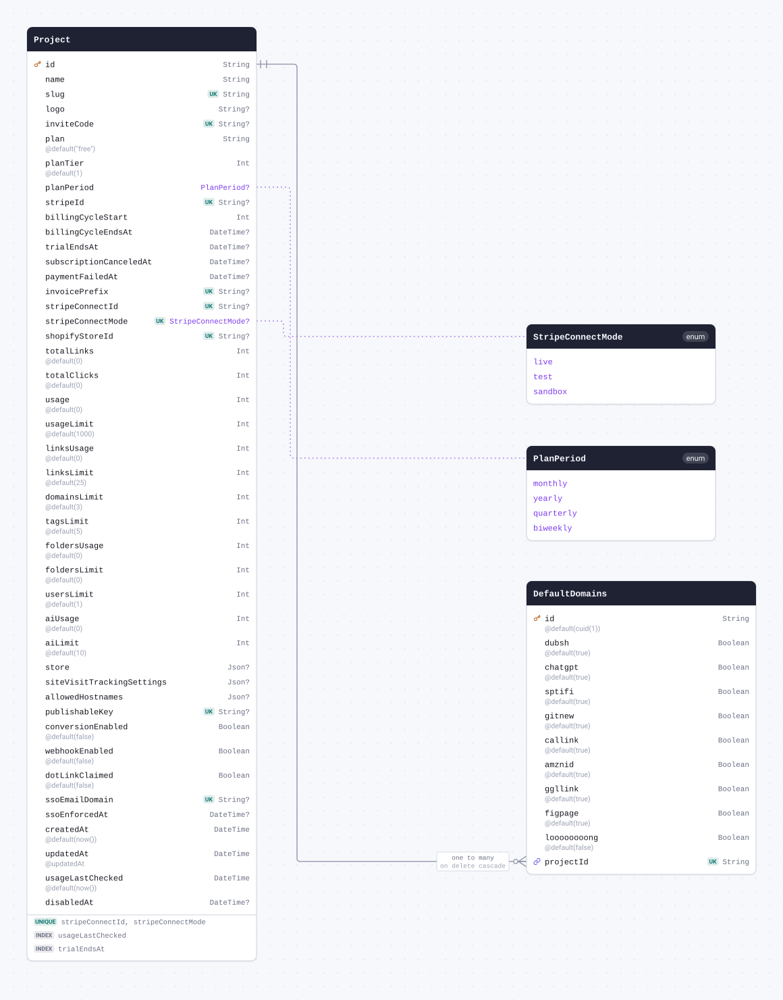

| Field         | Type      | Constraints                                    | Default   | Description |
| ------------- | --------- | ---------------------------------------------- | --------- | ----------- |
| `id`          | `String`  | PK NOT NULL                                    | `cuid(1)` |             |
| `dubsh`       | `Boolean` | NOT NULL                                       | `true`    |             |
| `chatgpt`     | `Boolean` | NOT NULL                                       | `true`    |             |
| `sptifi`      | `Boolean` | NOT NULL                                       | `true`    |             |
| `gitnew`      | `Boolean` | NOT NULL                                       | `true`    |             |
| `callink`     | `Boolean` | NOT NULL                                       | `true`    |             |
| `amznid`      | `Boolean` | NOT NULL                                       | `true`    |             |
| `ggllink`     | `Boolean` | NOT NULL                                       | `true`    |             |
| `figpage`     | `Boolean` | NOT NULL                                       | `true`    |             |
| `loooooooong` | `Boolean` | NOT NULL                                       | `false`   |             |
| `projectId`   | `String`  | UNIQUE NOT NULL → [Project.id](#model-Project) |           |             |

#### References

- `projectId` → [Project.id](#model-Project) (many-to-one, on delete Cascade)

#### Definition

```sql
CREATE TABLE `DefaultDomains` (
    `id` VARCHAR(191) NOT NULL,
    `dubsh` BOOLEAN NOT NULL DEFAULT true,
    `chatgpt` BOOLEAN NOT NULL DEFAULT true,
    `sptifi` BOOLEAN NOT NULL DEFAULT true,
    `gitnew` BOOLEAN NOT NULL DEFAULT true,
    `callink` BOOLEAN NOT NULL DEFAULT true,
    `amznid` BOOLEAN NOT NULL DEFAULT true,
    `ggllink` BOOLEAN NOT NULL DEFAULT true,
    `figpage` BOOLEAN NOT NULL DEFAULT true,
    `loooooooong` BOOLEAN NOT NULL DEFAULT false,
    `projectId` VARCHAR(191) NOT NULL,

    UNIQUE INDEX `DefaultDomains_projectId_key`(`projectId`),
    PRIMARY KEY (`id`)
) DEFAULT CHARACTER SET utf8mb4 COLLATE utf8mb4_unicode_ci;
```

<details>
<summary>Queries and their SQL</summary>

**findMany**: Every row

```ts
await prisma.defaultDomains.findMany();
```

```sql
SELECT
  `DefaultDomains`.`id`,
  `DefaultDomains`.`dubsh`,
  `DefaultDomains`.`chatgpt`,
  `DefaultDomains`.`sptifi`,
  `DefaultDomains`.`gitnew`,
  `DefaultDomains`.`callink`,
  `DefaultDomains`.`amznid`,
  `DefaultDomains`.`ggllink`,
  `DefaultDomains`.`figpage`,
  `DefaultDomains`.`loooooooong`,
  `DefaultDomains`.`projectId`
FROM
  `DefaultDomains`
WHERE
  1 = 1
```

**count**: How many rows there are

```ts
await prisma.defaultDomains.count();
```

```sql
SELECT
  COUNT(*) AS `_count$_all`
FROM
  (
    SELECT
      `DefaultDomains`.`id`
    FROM
      `DefaultDomains`
    WHERE
      1 = 1
  ) AS `sub`
```

**findMany**: Every row with its relations

```ts
await prisma.defaultDomains.findMany({ include: { project: true } });
```

```sql
SELECT
  `DefaultDomains`.`id`,
  `DefaultDomains`.`dubsh`,
  `DefaultDomains`.`chatgpt`,
  `DefaultDomains`.`sptifi`,
  `DefaultDomains`.`gitnew`,
  `DefaultDomains`.`callink`,
  `DefaultDomains`.`amznid`,
  `DefaultDomains`.`ggllink`,
  `DefaultDomains`.`figpage`,
  `DefaultDomains`.`loooooooong`,
  `DefaultDomains`.`projectId`
FROM
  `DefaultDomains`
WHERE
  1 = 1

SELECT
  `Project`.`id`,
  `Project`.`name`,
  `Project`.`slug`,
  `Project`.`logo`,
  `Project`.`inviteCode`,
  `Project`.`plan`,
  `Project`.`planTier`,
  `Project`.`planPeriod`,
  `Project`.`stripeId`,
  `Project`.`billingCycleStart`,
  `Project`.`billingCycleEndsAt`,
  `Project`.`trialEndsAt`,
  `Project`.`subscriptionCanceledAt`,
  `Project`.`paymentFailedAt`,
  `Project`.`invoicePrefix`,
  `Project`.`stripeConnectId`,
  `Project`.`stripeConnectMode`,
  `Project`.`shopifyStoreId`,
  `Project`.`totalLinks`,
  `Project`.`totalClicks`,
  `Project`.`usage`,
  `Project`.`usageLimit`,
  `Project`.`linksUsage`,
  `Project`.`linksLimit`,
  `Project`.`domainsLimit`,
  `Project`.`tagsLimit`,
  `Project`.`foldersUsage`,
  `Project`.`foldersLimit`,
  `Project`.`usersLimit`,
  `Project`.`aiUsage`,
  `Project`.`aiLimit`,
  `Project`.`store`,
  `Project`.`siteVisitTrackingSettings`,
  `Project`.`allowedHostnames`,
  `Project`.`publishableKey`,
  `Project`.`conversionEnabled`,
  `Project`.`webhookEnabled`,
  `Project`.`dotLinkClaimed`,
  `Project`.`ssoEmailDomain`,
  `Project`.`ssoEnforcedAt`,
  `Project`.`createdAt`,
  `Project`.`updatedAt`,
  `Project`.`usageLastChecked`,
  `Project`.`disabledAt`
FROM
  `Project`
WHERE
  `Project`.`id` IN (?)
-- params: ["<projectId of the rows above>"]
```

**findUnique**: One row by what is unique to it

```ts
await prisma.defaultDomains.findUnique({ where: { id: "example" } });
```

```sql
SELECT
  `DefaultDomains`.`id`,
  `DefaultDomains`.`dubsh`,
  `DefaultDomains`.`chatgpt`,
  `DefaultDomains`.`sptifi`,
  `DefaultDomains`.`gitnew`,
  `DefaultDomains`.`callink`,
  `DefaultDomains`.`amznid`,
  `DefaultDomains`.`ggllink`,
  `DefaultDomains`.`figpage`,
  `DefaultDomains`.`loooooooong`,
  `DefaultDomains`.`projectId`
FROM
  `DefaultDomains`
WHERE
  (
    `DefaultDomains`.`id` = ?
    AND 1 = 1
  )
LIMIT
  ?
OFFSET
  ?
-- params: ["example","1","0"]
```

**create**: Create a row

```ts
await prisma.defaultDomains.create({ data: { projectId: "example" } });
```

```sql
INSERT INTO
  `DefaultDomains` (
    `id`,
    `dubsh`,
    `chatgpt`,
    `sptifi`,
    `gitnew`,
    `callink`,
    `amznid`,
    `ggllink`,
    `figpage`,
    `loooooooong`,
    `projectId`
  )
VALUES
  (?, ?, ?, ?, ?, ?, ?, ?, ?, ?, ?)
-- params: ["<cuid(1)>",true,true,true,true,true,true,true,true,false,"example"]

SELECT
  `DefaultDomains`.`id`,
  `DefaultDomains`.`dubsh`,
  `DefaultDomains`.`chatgpt`,
  `DefaultDomains`.`sptifi`,
  `DefaultDomains`.`gitnew`,
  `DefaultDomains`.`callink`,
  `DefaultDomains`.`amznid`,
  `DefaultDomains`.`ggllink`,
  `DefaultDomains`.`figpage`,
  `DefaultDomains`.`loooooooong`,
  `DefaultDomains`.`projectId`
FROM
  `DefaultDomains`
WHERE
  `DefaultDomains`.`id` = ?
LIMIT
  ?
OFFSET
  ?
-- params: ["<id of the rows above>","1","0"]
```

**update**: Update a row

```ts
await prisma.defaultDomains.update({ where: { id: "example" }, data: { dubsh: true } });
```

```sql
SELECT
  `DefaultDomains`.`id`
FROM
  `DefaultDomains`
WHERE
  (
    `DefaultDomains`.`id` = ?
    AND 1 = 1
  )
LIMIT
  ?
OFFSET
  ?
-- params: ["example","1","0"]

UPDATE `DefaultDomains`
SET
  `dubsh` = ?
WHERE
  (
    `DefaultDomains`.`id` IN (?)
    AND (
      `DefaultDomains`.`id` = ?
      AND 1 = 1
    )
  )
-- params: [true,"<id of the rows above>","example"]

SELECT
  `DefaultDomains`.`id`,
  `DefaultDomains`.`dubsh`,
  `DefaultDomains`.`chatgpt`,
  `DefaultDomains`.`sptifi`,
  `DefaultDomains`.`gitnew`,
  `DefaultDomains`.`callink`,
  `DefaultDomains`.`amznid`,
  `DefaultDomains`.`ggllink`,
  `DefaultDomains`.`figpage`,
  `DefaultDomains`.`loooooooong`,
  `DefaultDomains`.`projectId`
FROM
  `DefaultDomains`
WHERE
  `DefaultDomains`.`id` = ?
LIMIT
  ?
OFFSET
  ?
-- params: ["<id of the rows above>","1","0"]
```

**delete**: Delete a row

```ts
await prisma.defaultDomains.delete({ where: { id: "example" } });
```

```sql
SELECT
  `DefaultDomains`.`id`,
  `DefaultDomains`.`dubsh`,
  `DefaultDomains`.`chatgpt`,
  `DefaultDomains`.`sptifi`,
  `DefaultDomains`.`gitnew`,
  `DefaultDomains`.`callink`,
  `DefaultDomains`.`amznid`,
  `DefaultDomains`.`ggllink`,
  `DefaultDomains`.`figpage`,
  `DefaultDomains`.`loooooooong`,
  `DefaultDomains`.`projectId`
FROM
  `DefaultDomains`
WHERE
  (
    `DefaultDomains`.`id` = ?
    AND 1 = 1
  )
LIMIT
  ?
OFFSET
  ?
-- params: ["example","1","0"]

DELETE FROM `DefaultDomains`
WHERE
  (
    `DefaultDomains`.`id` = ?
    AND 1 = 1
  )
-- params: ["example"]
```

</details>

<a id="model-Folder"></a>

### Folder

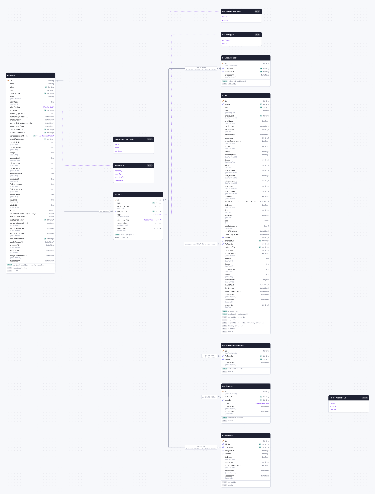

| Field         | Type                                           | Constraints                             | Default      | Description |
| ------------- | ---------------------------------------------- | --------------------------------------- | ------------ | ----------- |
| `id`          | `String`                                       | PK NOT NULL                             |              |             |
| `name`        | `String`                                       | NOT NULL                                |              |             |
| `description` | `String` `@db.Text`                            | NULL                                    |              |             |
| `projectId`   | `String`                                       | NOT NULL → [Project.id](#model-Project) |              |             |
| `type`        | [`FolderType`](#enum-FolderType)               | NOT NULL                                | `default`    |             |
| `accessLevel` | [`FolderAccessLevel`](#enum-FolderAccessLevel) | NULL                                    |              |             |
| `createdAt`   | `DateTime`                                     | NOT NULL                                | `now()`      |             |
| `updatedAt`   | `DateTime`                                     | NOT NULL                                | `@updatedAt` |             |

#### Indexes

- `@@index([projectId])`
- `@@unique([name, projectId])`

#### References

- `projectId` → [Project.id](#model-Project) (many-to-one)

#### Referenced by

- `id` ← [Dashboard.folderId](#model-Dashboard) (one-to-one, on delete Cascade, on update Cascade)
- `id` ← [FolderUser.folderId](#model-FolderUser) (one-to-many, on delete Cascade)
- `id` ← [FolderAccessRequest.folderId](#model-FolderAccessRequest) (one-to-many, on delete Cascade)
- `id` ← [Link.folderId](#model-Link) (one-to-many, on delete SetNull, on update Cascade)
- `id` ← [FolderWebhook.folderId](#model-FolderWebhook) (one-to-many, on delete Cascade, on update Cascade)

#### Definition

```sql
CREATE TABLE `Folder` (
    `id` VARCHAR(191) NOT NULL,
    `name` VARCHAR(191) NOT NULL,
    `description` TEXT NULL,
    `projectId` VARCHAR(191) NOT NULL,
    `type` ENUM('default', 'mega') NOT NULL DEFAULT 'default',
    `accessLevel` ENUM('read', 'write') NULL,
    `createdAt` DATETIME(3) NOT NULL DEFAULT CURRENT_TIMESTAMP(3),
    `updatedAt` DATETIME(3) NOT NULL,

    INDEX `Folder_projectId_idx`(`projectId`),
    UNIQUE INDEX `Folder_name_projectId_key`(`name`, `projectId`),
    PRIMARY KEY (`id`)
) DEFAULT CHARACTER SET utf8mb4 COLLATE utf8mb4_unicode_ci;
```

<details>
<summary>Queries and their SQL</summary>

**findMany**: Every row

```ts
await prisma.folder.findMany();
```

```sql
SELECT
  `Folder`.`id`,
  `Folder`.`name`,
  `Folder`.`description`,
  `Folder`.`projectId`,
  `Folder`.`type`,
  `Folder`.`accessLevel`,
  `Folder`.`createdAt`,
  `Folder`.`updatedAt`
FROM
  `Folder`
WHERE
  1 = 1
```

**count**: How many rows there are

```ts
await prisma.folder.count();
```

```sql
SELECT
  COUNT(*) AS `_count$_all`
FROM
  (
    SELECT
      `Folder`.`id`
    FROM
      `Folder`
    WHERE
      1 = 1
  ) AS `sub`
```

**findMany**: Every row with its relations

```ts
await prisma.folder.findMany({
  include: {
    project: true,
    links: true,
    users: true,
    accessRequests: true,
    webhooks: true,
    dashboard: true,
  },
});
```

```sql
SELECT
  `Folder`.`id`,
  `Folder`.`name`,
  `Folder`.`description`,
  `Folder`.`projectId`,
  `Folder`.`type`,
  `Folder`.`accessLevel`,
  `Folder`.`createdAt`,
  `Folder`.`updatedAt`
FROM
  `Folder`
WHERE
  1 = 1

SELECT
  `Project`.`id`,
  `Project`.`name`,
  `Project`.`slug`,
  `Project`.`logo`,
  `Project`.`inviteCode`,
  `Project`.`plan`,
  `Project`.`planTier`,
  `Project`.`planPeriod`,
  `Project`.`stripeId`,
  `Project`.`billingCycleStart`,
  `Project`.`billingCycleEndsAt`,
  `Project`.`trialEndsAt`,
  `Project`.`subscriptionCanceledAt`,
  `Project`.`paymentFailedAt`,
  `Project`.`invoicePrefix`,
  `Project`.`stripeConnectId`,
  `Project`.`stripeConnectMode`,
  `Project`.`shopifyStoreId`,
  `Project`.`totalLinks`,
  `Project`.`totalClicks`,
  `Project`.`usage`,
  `Project`.`usageLimit`,
  `Project`.`linksUsage`,
  `Project`.`linksLimit`,
  `Project`.`domainsLimit`,
  `Project`.`tagsLimit`,
  `Project`.`foldersUsage`,
  `Project`.`foldersLimit`,
  `Project`.`usersLimit`,
  `Project`.`aiUsage`,
  `Project`.`aiLimit`,
  `Project`.`store`,
  `Project`.`siteVisitTrackingSettings`,
  `Project`.`allowedHostnames`,
  `Project`.`publishableKey`,
  `Project`.`conversionEnabled`,
  `Project`.`webhookEnabled`,
  `Project`.`dotLinkClaimed`,
  `Project`.`ssoEmailDomain`,
  `Project`.`ssoEnforcedAt`,
  `Project`.`createdAt`,
  `Project`.`updatedAt`,
  `Project`.`usageLastChecked`,
  `Project`.`disabledAt`
FROM
  `Project`
WHERE
  `Project`.`id` IN (?)
-- params: ["<projectId of the rows above>"]

SELECT
  `Link`.`id`,
  `Link`.`domain`,
  `Link`.`key`,
  `Link`.`url`,
  `Link`.`shortLink`,
  `Link`.`archived`,
  `Link`.`expiresAt`,
  `Link`.`expiredUrl`,
  `Link`.`disabledAt`,
  `Link`.`password`,
  `Link`.`trackConversion`,
  `Link`.`proxy`,
  `Link`.`title`,
  `Link`.`description`,
  `Link`.`image`,
  `Link`.`video`,
  `Link`.`utm_source`,
  `Link`.`utm_medium`,
  `Link`.`utm_campaign`,
  `Link`.`utm_term`,
  `Link`.`utm_content`,
  `Link`.`rewrite`,
  `Link`.`linkRetentionCleanupDisabledAt`,
  `Link`.`doIndex`,
  `Link`.`ios`,
  `Link`.`android`,
  `Link`.`geo`,
  `Link`.`testVariants`,
  `Link`.`testStartedAt`,
  `Link`.`testCompletedAt`,
  `Link`.`userId`,
  `Link`.`projectId`,
  `Link`.`folderId`,
  `Link`.`externalId`,
  `Link`.`tenantId`,
  `Link`.`publicStats`,
  `Link`.`clicks`,
  `Link`.`leads`,
  `Link`.`conversions`,
  `Link`.`sales`,
  `Link`.`saleAmount`,
  `Link`.`lastClicked`,
  `Link`.`lastLeadAt`,
  `Link`.`lastConversionAt`,
  `Link`.`createdAt`,
  `Link`.`updatedAt`,
  `Link`.`comments`
FROM
  `Link`
WHERE
  `Link`.`folderId` IN (?)
-- params: ["<id of the rows above>"]

SELECT
  `FolderUser`.`id`,
  `FolderUser`.`folderId`,
  `FolderUser`.`userId`,
  `FolderUser`.`role`,
  `FolderUser`.`createdAt`,
  `FolderUser`.`updatedAt`
FROM
  `FolderUser`
WHERE
  `FolderUser`.`folderId` IN (?)
-- params: ["<id of the rows above>"]

SELECT
  `FolderAccessRequest`.`id`,
  `FolderAccessRequest`.`folderId`,
  `FolderAccessRequest`.`userId`,
  `FolderAccessRequest`.`createdAt`
FROM
  `FolderAccessRequest`
WHERE
  `FolderAccessRequest`.`folderId` IN (?)
-- params: ["<id of the rows above>"]

SELECT
  `FolderWebhook`.`id`,
  `FolderWebhook`.`folderId`,
  `FolderWebhook`.`webhookId`,
  `FolderWebhook`.`createdAt`
FROM
  `FolderWebhook`
WHERE
  `FolderWebhook`.`folderId` IN (?)
-- params: ["<id of the rows above>"]

SELECT
  `Dashboard`.`id`,
  `Dashboard`.`linkId`,
  `Dashboard`.`folderId`,
  `Dashboard`.`projectId`,
  `Dashboard`.`userId`,
  `Dashboard`.`doIndex`,
  `Dashboard`.`password`,
  `Dashboard`.`showConversions`,
  `Dashboard`.`createdAt`,
  `Dashboard`.`updatedAt`
FROM
  `Dashboard`
WHERE
  `Dashboard`.`folderId` IN (?)
-- params: ["<id of the rows above>"]
```

**findUnique**: One row by what is unique to it

```ts
await prisma.folder.findUnique({ where: { id: "example" } });
```

```sql
SELECT
  `Folder`.`id`,
  `Folder`.`name`,
  `Folder`.`description`,
  `Folder`.`projectId`,
  `Folder`.`type`,
  `Folder`.`accessLevel`,
  `Folder`.`createdAt`,
  `Folder`.`updatedAt`
FROM
  `Folder`
WHERE
  (
    `Folder`.`id` = ?
    AND 1 = 1
  )
LIMIT
  ?
OFFSET
  ?
-- params: ["example","1","0"]
```

**create**: Create a row

```ts
await prisma.folder.create({ data: { id: "example", name: "example", projectId: "example" } });
```

```sql
INSERT INTO
  `Folder` (
    `id`,
    `name`,
    `projectId`,
    `type`,
    `createdAt`,
    `updatedAt`
  )
VALUES
  (?, ?, ?, ?, ?, ?)
-- params: ["example","example","example","default","<now()>","<now()>"]

SELECT
  `Folder`.`id`,
  `Folder`.`name`,
  `Folder`.`description`,
  `Folder`.`projectId`,
  `Folder`.`type`,
  `Folder`.`accessLevel`,
  `Folder`.`createdAt`,
  `Folder`.`updatedAt`
FROM
  `Folder`
WHERE
  `Folder`.`id` = ?
LIMIT
  ?
OFFSET
  ?
-- params: ["<id of the rows above>","1","0"]
```

**update**: Update a row

```ts
await prisma.folder.update({ where: { id: "example" }, data: { name: "example" } });
```

```sql
SELECT
  `Folder`.`id`
FROM
  `Folder`
WHERE
  (
    `Folder`.`id` = ?
    AND 1 = 1
  )
LIMIT
  ?
OFFSET
  ?
-- params: ["example","1","0"]

UPDATE `Folder`
SET
  `name` = ?,
  `updatedAt` = ?
WHERE
  (
    `Folder`.`id` IN (?)
    AND (
      `Folder`.`id` = ?
      AND 1 = 1
    )
  )
-- params: ["example",{"prisma__type":"generatorCall","prisma__value":{"name":"now","args":[],"returnType":{"type":"DateTime"}}},"<id of the rows above>","example"]

SELECT
  `Folder`.`id`,
  `Folder`.`name`,
  `Folder`.`description`,
  `Folder`.`projectId`,
  `Folder`.`type`,
  `Folder`.`accessLevel`,
  `Folder`.`createdAt`,
  `Folder`.`updatedAt`
FROM
  `Folder`
WHERE
  `Folder`.`id` = ?
LIMIT
  ?
OFFSET
  ?
-- params: ["<id of the rows above>","1","0"]
```

**delete**: Delete a row

```ts
await prisma.folder.delete({ where: { id: "example" } });
```

```sql
SELECT
  `Folder`.`id`,
  `Folder`.`name`,
  `Folder`.`description`,
  `Folder`.`projectId`,
  `Folder`.`type`,
  `Folder`.`accessLevel`,
  `Folder`.`createdAt`,
  `Folder`.`updatedAt`
FROM
  `Folder`
WHERE
  (
    `Folder`.`id` = ?
    AND 1 = 1
  )
LIMIT
  ?
OFFSET
  ?
-- params: ["example","1","0"]

SELECT
  `Dashboard`.`id`,
  `Dashboard`.`folderId`
FROM
  `Dashboard`
WHERE
  (
    1 = 1
    AND `Dashboard`.`folderId` IN (?)
  )
-- params: ["<id of the rows above>"]

DELETE FROM `Dashboard`
WHERE
  (
    `Dashboard`.`id` IN (?)
    AND 1 = 1
  )
-- params: ["<id of the rows above>"]

SELECT
  `FolderUser`.`id`,
  `FolderUser`.`folderId`
FROM
  `FolderUser`
WHERE
  (
    1 = 1
    AND `FolderUser`.`folderId` IN (?)
  )
-- params: ["<id of the rows above>"]

DELETE FROM `FolderUser`
WHERE
  (
    `FolderUser`.`id` IN (?)
    AND 1 = 1
  )
-- params: ["<id of the rows above>"]

SELECT
  `FolderAccessRequest`.`id`,
  `FolderAccessRequest`.`folderId`
FROM
  `FolderAccessRequest`
WHERE
  (
    1 = 1
    AND `FolderAccessRequest`.`folderId` IN (?)
  )
-- params: ["<id of the rows above>"]

DELETE FROM `FolderAccessRequest`
WHERE
  (
    `FolderAccessRequest`.`id` IN (?)
    AND 1 = 1
  )
-- params: ["<id of the rows above>"]

SELECT
  `Link`.`id`,
  `Link`.`folderId`
FROM
  `Link`
WHERE
  (
    1 = 1
    AND `Link`.`folderId` IN (?)
  )
-- params: ["<id of the rows above>"]

UPDATE `Link`
SET
  `folderId` = ?
WHERE
  (
    `Link`.`id` IN (?)
    AND 1 = 1
  )
-- params: [null,"<id of the rows above>"]

SELECT
  `FolderWebhook`.`id`,
  `FolderWebhook`.`folderId`
FROM
  `FolderWebhook`
WHERE
  (
    1 = 1
    AND `FolderWebhook`.`folderId` IN (?)
  )
-- params: ["<id of the rows above>"]

DELETE FROM `FolderWebhook`
WHERE
  (
    `FolderWebhook`.`id` IN (?)
    AND 1 = 1
  )
-- params: ["<id of the rows above>"]

DELETE FROM `Folder`
WHERE
  (
    `Folder`.`id` = ?
    AND 1 = 1
  )
-- params: ["example"]
```

</details>

<a id="model-FolderUser"></a>

### FolderUser

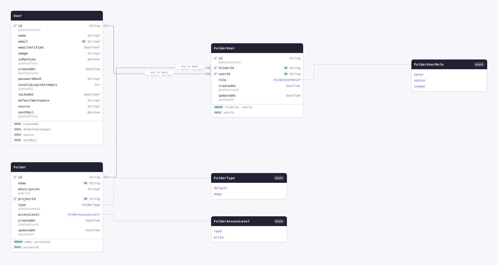

| Field       | Type                                     | Constraints                           | Default      | Description |
| ----------- | ---------------------------------------- | ------------------------------------- | ------------ | ----------- |
| `id`        | `String`                                 | PK NOT NULL                           | `cuid(1)`    |             |
| `folderId`  | `String`                                 | NOT NULL → [Folder.id](#model-Folder) |              |             |
| `userId`    | `String`                                 | NOT NULL → [User.id](#model-User)     |              |             |
| `role`      | [`FolderUserRole`](#enum-FolderUserRole) | NULL                                  |              |             |
| `createdAt` | `DateTime`                               | NOT NULL                              | `now()`      |             |
| `updatedAt` | `DateTime`                               | NOT NULL                              | `@updatedAt` |             |

#### Indexes

- `@@index([userId])`
- `@@unique([folderId, userId])`

#### References

- `folderId` → [Folder.id](#model-Folder) (many-to-one, on delete Cascade)
- `userId` → [User.id](#model-User) (many-to-one, on delete Cascade)

#### Definition

```sql
CREATE TABLE `FolderUser` (
    `id` VARCHAR(191) NOT NULL,
    `folderId` VARCHAR(191) NOT NULL,
    `userId` VARCHAR(191) NOT NULL,
    `role` ENUM('owner', 'editor', 'viewer') NULL,
    `createdAt` DATETIME(3) NOT NULL DEFAULT CURRENT_TIMESTAMP(3),
    `updatedAt` DATETIME(3) NOT NULL,

    INDEX `FolderUser_userId_idx`(`userId`),
    UNIQUE INDEX `FolderUser_folderId_userId_key`(`folderId`, `userId`),
    PRIMARY KEY (`id`)
) DEFAULT CHARACTER SET utf8mb4 COLLATE utf8mb4_unicode_ci;
```

<details>
<summary>Queries and their SQL</summary>

**findMany**: Every row

```ts
await prisma.folderUser.findMany();
```

```sql
SELECT
  `FolderUser`.`id`,
  `FolderUser`.`folderId`,
  `FolderUser`.`userId`,
  `FolderUser`.`role`,
  `FolderUser`.`createdAt`,
  `FolderUser`.`updatedAt`
FROM
  `FolderUser`
WHERE
  1 = 1
```

**count**: How many rows there are

```ts
await prisma.folderUser.count();
```

```sql
SELECT
  COUNT(*) AS `_count$_all`
FROM
  (
    SELECT
      `FolderUser`.`id`
    FROM
      `FolderUser`
    WHERE
      1 = 1
  ) AS `sub`
```

**findMany**: Every row with its relations

```ts
await prisma.folderUser.findMany({ include: { folder: true, user: true } });
```

```sql
SELECT
  `FolderUser`.`id`,
  `FolderUser`.`folderId`,
  `FolderUser`.`userId`,
  `FolderUser`.`role`,
  `FolderUser`.`createdAt`,
  `FolderUser`.`updatedAt`
FROM
  `FolderUser`
WHERE
  1 = 1

SELECT
  `Folder`.`id`,
  `Folder`.`name`,
  `Folder`.`description`,
  `Folder`.`projectId`,
  `Folder`.`type`,
  `Folder`.`accessLevel`,
  `Folder`.`createdAt`,
  `Folder`.`updatedAt`
FROM
  `Folder`
WHERE
  `Folder`.`id` IN (?)
-- params: ["<folderId of the rows above>"]

SELECT
  `User`.`id`,
  `User`.`name`,
  `User`.`email`,
  `User`.`emailVerified`,
  `User`.`image`,
  `User`.`isMachine`,
  `User`.`createdAt`,
  `User`.`passwordHash`,
  `User`.`invalidLoginAttempts`,
  `User`.`lockedAt`,
  `User`.`defaultWorkspace`,
  `User`.`source`,
  `User`.`sentMail`
FROM
  `User`
WHERE
  `User`.`id` IN (?)
-- params: ["<userId of the rows above>"]
```

**findUnique**: One row by what is unique to it

```ts
await prisma.folderUser.findUnique({ where: { id: "example" } });
```

```sql
SELECT
  `FolderUser`.`id`,
  `FolderUser`.`folderId`,
  `FolderUser`.`userId`,
  `FolderUser`.`role`,
  `FolderUser`.`createdAt`,
  `FolderUser`.`updatedAt`
FROM
  `FolderUser`
WHERE
  (
    `FolderUser`.`id` = ?
    AND 1 = 1
  )
LIMIT
  ?
OFFSET
  ?
-- params: ["example","1","0"]
```

**create**: Create a row

```ts
await prisma.folderUser.create({ data: { folderId: "example", userId: "example" } });
```

```sql
INSERT INTO
  `FolderUser` (
    `id`,
    `folderId`,
    `userId`,
    `createdAt`,
    `updatedAt`
  )
VALUES
  (?, ?, ?, ?, ?)
-- params: ["<cuid(1)>","example","example","<now()>","<now()>"]

SELECT
  `FolderUser`.`id`,
  `FolderUser`.`folderId`,
  `FolderUser`.`userId`,
  `FolderUser`.`role`,
  `FolderUser`.`createdAt`,
  `FolderUser`.`updatedAt`
FROM
  `FolderUser`
WHERE
  `FolderUser`.`id` = ?
LIMIT
  ?
OFFSET
  ?
-- params: ["<id of the rows above>","1","0"]
```

**update**: Update a row

```ts
await prisma.folderUser.update({ where: { id: "example" }, data: { role: "owner" } });
```

```sql
SELECT
  `FolderUser`.`id`
FROM
  `FolderUser`
WHERE
  (
    `FolderUser`.`id` = ?
    AND 1 = 1
  )
LIMIT
  ?
OFFSET
  ?
-- params: ["example","1","0"]

UPDATE `FolderUser`
SET
  `role` = ?,
  `updatedAt` = ?
WHERE
  (
    `FolderUser`.`id` IN (?)
    AND (
      `FolderUser`.`id` = ?
      AND 1 = 1
    )
  )
-- params: ["owner",{"prisma__type":"generatorCall","prisma__value":{"name":"now","args":[],"returnType":{"type":"DateTime"}}},"<id of the rows above>","example"]

SELECT
  `FolderUser`.`id`,
  `FolderUser`.`folderId`,
  `FolderUser`.`userId`,
  `FolderUser`.`role`,
  `FolderUser`.`createdAt`,
  `FolderUser`.`updatedAt`
FROM
  `FolderUser`
WHERE
  `FolderUser`.`id` = ?
LIMIT
  ?
OFFSET
  ?
-- params: ["<id of the rows above>","1","0"]
```

**delete**: Delete a row

```ts
await prisma.folderUser.delete({ where: { id: "example" } });
```

```sql
SELECT
  `FolderUser`.`id`,
  `FolderUser`.`folderId`,
  `FolderUser`.`userId`,
  `FolderUser`.`role`,
  `FolderUser`.`createdAt`,
  `FolderUser`.`updatedAt`
FROM
  `FolderUser`
WHERE
  (
    `FolderUser`.`id` = ?
    AND 1 = 1
  )
LIMIT
  ?
OFFSET
  ?
-- params: ["example","1","0"]

DELETE FROM `FolderUser`
WHERE
  (
    `FolderUser`.`id` = ?
    AND 1 = 1
  )
-- params: ["example"]
```

</details>

<a id="model-FolderAccessRequest"></a>

### FolderAccessRequest

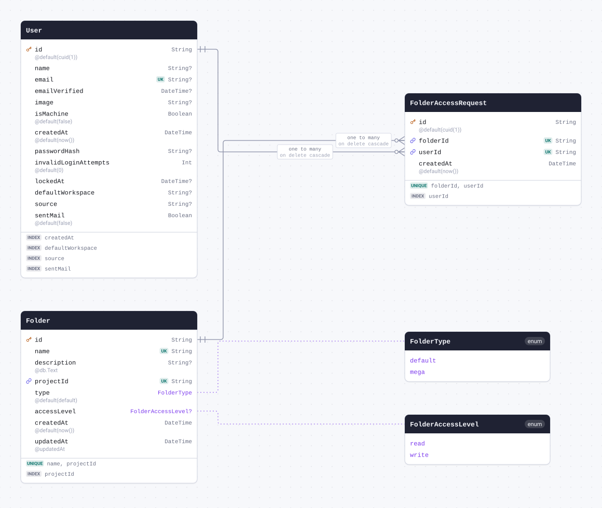

| Field       | Type       | Constraints                           | Default   | Description |
| ----------- | ---------- | ------------------------------------- | --------- | ----------- |
| `id`        | `String`   | PK NOT NULL                           | `cuid(1)` |             |
| `folderId`  | `String`   | NOT NULL → [Folder.id](#model-Folder) |           |             |
| `userId`    | `String`   | NOT NULL → [User.id](#model-User)     |           |             |
| `createdAt` | `DateTime` | NOT NULL                              | `now()`   |             |

#### Indexes

- `@@index([userId])`
- `@@unique([folderId, userId])`

#### References

- `folderId` → [Folder.id](#model-Folder) (many-to-one, on delete Cascade)
- `userId` → [User.id](#model-User) (many-to-one, on delete Cascade)

#### Definition

```sql
CREATE TABLE `FolderAccessRequest` (
    `id` VARCHAR(191) NOT NULL,
    `folderId` VARCHAR(191) NOT NULL,
    `userId` VARCHAR(191) NOT NULL,
    `createdAt` DATETIME(3) NOT NULL DEFAULT CURRENT_TIMESTAMP(3),

    INDEX `FolderAccessRequest_userId_idx`(`userId`),
    UNIQUE INDEX `FolderAccessRequest_folderId_userId_key`(`folderId`, `userId`),
    PRIMARY KEY (`id`)
) DEFAULT CHARACTER SET utf8mb4 COLLATE utf8mb4_unicode_ci;
```

<details>
<summary>Queries and their SQL</summary>

**findMany**: Every row

```ts
await prisma.folderAccessRequest.findMany();
```

```sql
SELECT
  `FolderAccessRequest`.`id`,
  `FolderAccessRequest`.`folderId`,
  `FolderAccessRequest`.`userId`,
  `FolderAccessRequest`.`createdAt`
FROM
  `FolderAccessRequest`
WHERE
  1 = 1
```

**count**: How many rows there are

```ts
await prisma.folderAccessRequest.count();
```

```sql
SELECT
  COUNT(*) AS `_count$_all`
FROM
  (
    SELECT
      `FolderAccessRequest`.`id`
    FROM
      `FolderAccessRequest`
    WHERE
      1 = 1
  ) AS `sub`
```

**findMany**: Every row with its relations

```ts
await prisma.folderAccessRequest.findMany({ include: { folder: true, user: true } });
```

```sql
SELECT
  `FolderAccessRequest`.`id`,
  `FolderAccessRequest`.`folderId`,
  `FolderAccessRequest`.`userId`,
  `FolderAccessRequest`.`createdAt`
FROM
  `FolderAccessRequest`
WHERE
  1 = 1

SELECT
  `Folder`.`id`,
  `Folder`.`name`,
  `Folder`.`description`,
  `Folder`.`projectId`,
  `Folder`.`type`,
  `Folder`.`accessLevel`,
  `Folder`.`createdAt`,
  `Folder`.`updatedAt`
FROM
  `Folder`
WHERE
  `Folder`.`id` IN (?)
-- params: ["<folderId of the rows above>"]

SELECT
  `User`.`id`,
  `User`.`name`,
  `User`.`email`,
  `User`.`emailVerified`,
  `User`.`image`,
  `User`.`isMachine`,
  `User`.`createdAt`,
  `User`.`passwordHash`,
  `User`.`invalidLoginAttempts`,
  `User`.`lockedAt`,
  `User`.`defaultWorkspace`,
  `User`.`source`,
  `User`.`sentMail`
FROM
  `User`
WHERE
  `User`.`id` IN (?)
-- params: ["<userId of the rows above>"]
```

**findUnique**: One row by what is unique to it

```ts
await prisma.folderAccessRequest.findUnique({ where: { id: "example" } });
```

```sql
SELECT
  `FolderAccessRequest`.`id`,
  `FolderAccessRequest`.`folderId`,
  `FolderAccessRequest`.`userId`,
  `FolderAccessRequest`.`createdAt`
FROM
  `FolderAccessRequest`
WHERE
  (
    `FolderAccessRequest`.`id` = ?
    AND 1 = 1
  )
LIMIT
  ?
OFFSET
  ?
-- params: ["example","1","0"]
```

**create**: Create a row

```ts
await prisma.folderAccessRequest.create({ data: { folderId: "example", userId: "example" } });
```

```sql
INSERT INTO
  `FolderAccessRequest` (`id`, `folderId`, `userId`, `createdAt`)
VALUES
  (?, ?, ?, ?)
-- params: ["<cuid(1)>","example","example","<now()>"]

SELECT
  `FolderAccessRequest`.`id`,
  `FolderAccessRequest`.`folderId`,
  `FolderAccessRequest`.`userId`,
  `FolderAccessRequest`.`createdAt`
FROM
  `FolderAccessRequest`
WHERE
  `FolderAccessRequest`.`id` = ?
LIMIT
  ?
OFFSET
  ?
-- params: ["<id of the rows above>","1","0"]
```

**update**: Update a row

```ts
await prisma.folderAccessRequest.update({
  where: { id: "example" },
  data: { createdAt: new Date("2026-01-01T00:00:00.000Z") },
});
```

```sql
SELECT
  `FolderAccessRequest`.`id`
FROM
  `FolderAccessRequest`
WHERE
  (
    `FolderAccessRequest`.`id` = ?
    AND 1 = 1
  )
LIMIT
  ?
OFFSET
  ?
-- params: ["example","1","0"]

UPDATE `FolderAccessRequest`
SET
  `createdAt` = ?
WHERE
  (
    `FolderAccessRequest`.`id` IN (?)
    AND (
      `FolderAccessRequest`.`id` = ?
      AND 1 = 1
    )
  )
-- params: ["2026-01-01T00:00:00.000Z","<id of the rows above>","example"]

SELECT
  `FolderAccessRequest`.`id`,
  `FolderAccessRequest`.`folderId`,
  `FolderAccessRequest`.`userId`,
  `FolderAccessRequest`.`createdAt`
FROM
  `FolderAccessRequest`
WHERE
  `FolderAccessRequest`.`id` = ?
LIMIT
  ?
OFFSET
  ?
-- params: ["<id of the rows above>","1","0"]
```

**delete**: Delete a row

```ts
await prisma.folderAccessRequest.delete({ where: { id: "example" } });
```

```sql
SELECT
  `FolderAccessRequest`.`id`,
  `FolderAccessRequest`.`folderId`,
  `FolderAccessRequest`.`userId`,
  `FolderAccessRequest`.`createdAt`
FROM
  `FolderAccessRequest`
WHERE
  (
    `FolderAccessRequest`.`id` = ?
    AND 1 = 1
  )
LIMIT
  ?
OFFSET
  ?
-- params: ["example","1","0"]

DELETE FROM `FolderAccessRequest`
WHERE
  (
    `FolderAccessRequest`.`id` = ?
    AND 1 = 1
  )
-- params: ["example"]
```

</details>

<a id="model-Integration"></a>

### Integration

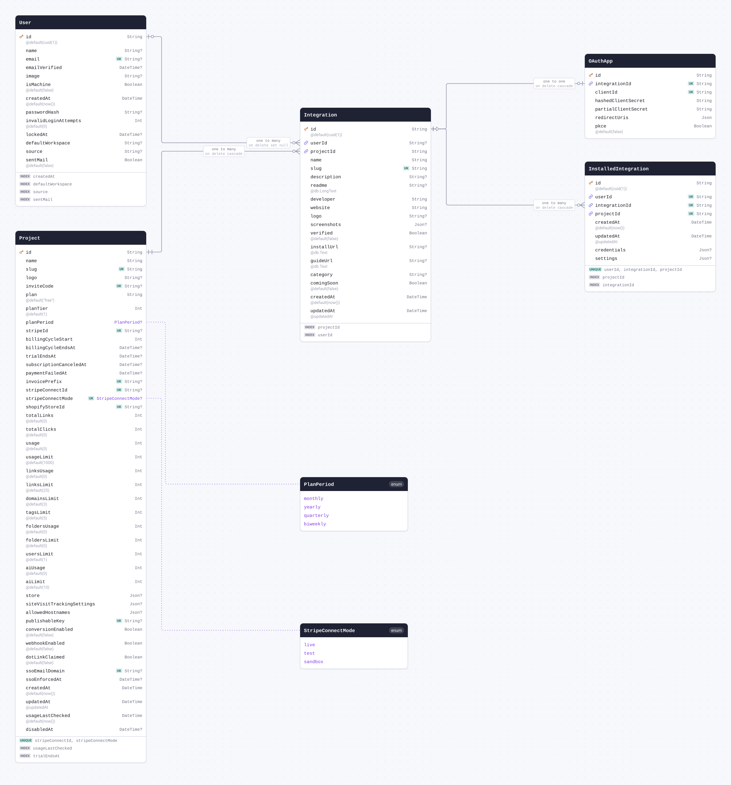

| Field         | Type                    | Constraints                             | Default      | Description |
| ------------- | ----------------------- | --------------------------------------- | ------------ | ----------- |
| `id`          | `String`                | PK NOT NULL                             | `cuid(1)`    |             |
| `userId`      | `String`                | NULL → [User.id](#model-User)           |              |             |
| `projectId`   | `String`                | NOT NULL → [Project.id](#model-Project) |              |             |
| `name`        | `String`                | NOT NULL                                |              |             |
| `slug`        | `String`                | UNIQUE NOT NULL                         |              |             |
| `description` | `String`                | NULL                                    |              |             |
| `readme`      | `String` `@db.LongText` | NULL                                    |              |             |
| `developer`   | `String`                | NOT NULL                                |              |             |
| `website`     | `String`                | NOT NULL                                |              |             |
| `logo`        | `String`                | NULL                                    |              |             |
| `screenshots` | `Json`                  | NULL                                    |              |             |
| `verified`    | `Boolean`               | NOT NULL                                | `false`      |             |
| `installUrl`  | `String` `@db.Text`     | NULL                                    |              |             |
| `guideUrl`    | `String` `@db.Text`     | NULL                                    |              |             |
| `category`    | `String`                | NULL                                    |              |             |
| `comingSoon`  | `Boolean`               | NOT NULL                                | `false`      |             |
| `createdAt`   | `DateTime`              | NOT NULL                                | `now()`      |             |
| `updatedAt`   | `DateTime`              | NOT NULL                                | `@updatedAt` |             |

#### Indexes

- `@@index([projectId])`
- `@@index([userId])`

#### References

- `userId` → [User.id](#model-User) (many-to-one, on delete SetNull)
- `projectId` → [Project.id](#model-Project) (many-to-one, on delete Cascade)

#### Referenced by

- `id` ← [InstalledIntegration.integrationId](#model-InstalledIntegration) (one-to-many, on delete Cascade)
- `id` ← [OAuthApp.integrationId](#model-OAuthApp) (one-to-one, on delete Cascade)

#### Definition

```sql
CREATE TABLE `Integration` (
    `id` VARCHAR(191) NOT NULL,
    `userId` VARCHAR(191) NULL,
    `projectId` VARCHAR(191) NOT NULL,
    `name` VARCHAR(191) NOT NULL,
    `slug` VARCHAR(191) NOT NULL,
    `description` VARCHAR(191) NULL,
    `readme` LONGTEXT NULL,
    `developer` VARCHAR(191) NOT NULL,
    `website` VARCHAR(191) NOT NULL,
    `logo` VARCHAR(191) NULL,
    `screenshots` JSON NULL,
    `verified` BOOLEAN NOT NULL DEFAULT false,
    `installUrl` TEXT NULL,
    `guideUrl` TEXT NULL,
    `category` VARCHAR(191) NULL,
    `comingSoon` BOOLEAN NOT NULL DEFAULT false,
    `createdAt` DATETIME(3) NOT NULL DEFAULT CURRENT_TIMESTAMP(3),
    `updatedAt` DATETIME(3) NOT NULL,

    UNIQUE INDEX `Integration_slug_key`(`slug`),
    INDEX `Integration_projectId_idx`(`projectId`),
    INDEX `Integration_userId_idx`(`userId`),
    PRIMARY KEY (`id`)
) DEFAULT CHARACTER SET utf8mb4 COLLATE utf8mb4_unicode_ci;
```

<details>
<summary>Queries and their SQL</summary>

**findMany**: Every row

```ts
await prisma.integration.findMany();
```

```sql
SELECT
  `Integration`.`id`,
  `Integration`.`userId`,
  `Integration`.`projectId`,
  `Integration`.`name`,
  `Integration`.`slug`,
  `Integration`.`description`,
  `Integration`.`readme`,
  `Integration`.`developer`,
  `Integration`.`website`,
  `Integration`.`logo`,
  `Integration`.`screenshots`,
  `Integration`.`verified`,
  `Integration`.`installUrl`,
  `Integration`.`guideUrl`,
  `Integration`.`category`,
  `Integration`.`comingSoon`,
  `Integration`.`createdAt`,
  `Integration`.`updatedAt`
FROM
  `Integration`
WHERE
  1 = 1
```

**count**: How many rows there are

```ts
await prisma.integration.count();
```

```sql
SELECT
  COUNT(*) AS `_count$_all`
FROM
  (
    SELECT
      `Integration`.`id`
    FROM
      `Integration`
    WHERE
      1 = 1
  ) AS `sub`
```

**findMany**: Every row with its relations

```ts
await prisma.integration.findMany({
  include: { user: true, project: true, oAuthApp: true, installations: true },
});
```

```sql
SELECT
  `Integration`.`id`,
  `Integration`.`userId`,
  `Integration`.`projectId`,
  `Integration`.`name`,
  `Integration`.`slug`,
  `Integration`.`description`,
  `Integration`.`readme`,
  `Integration`.`developer`,
  `Integration`.`website`,
  `Integration`.`logo`,
  `Integration`.`screenshots`,
  `Integration`.`verified`,
  `Integration`.`installUrl`,
  `Integration`.`guideUrl`,
  `Integration`.`category`,
  `Integration`.`comingSoon`,
  `Integration`.`createdAt`,
  `Integration`.`updatedAt`
FROM
  `Integration`
WHERE
  1 = 1

SELECT
  `User`.`id`,
  `User`.`name`,
  `User`.`email`,
  `User`.`emailVerified`,
  `User`.`image`,
  `User`.`isMachine`,
  `User`.`createdAt`,
  `User`.`passwordHash`,
  `User`.`invalidLoginAttempts`,
  `User`.`lockedAt`,
  `User`.`defaultWorkspace`,
  `User`.`source`,
  `User`.`sentMail`
FROM
  `User`
WHERE
  `User`.`id` IN (?)
-- params: ["<userId of the rows above>"]

SELECT
  `Project`.`id`,
  `Project`.`name`,
  `Project`.`slug`,
  `Project`.`logo`,
  `Project`.`inviteCode`,
  `Project`.`plan`,
  `Project`.`planTier`,
  `Project`.`planPeriod`,
  `Project`.`stripeId`,
  `Project`.`billingCycleStart`,
  `Project`.`billingCycleEndsAt`,
  `Project`.`trialEndsAt`,
  `Project`.`subscriptionCanceledAt`,
  `Project`.`paymentFailedAt`,
  `Project`.`invoicePrefix`,
  `Project`.`stripeConnectId`,
  `Project`.`stripeConnectMode`,
  `Project`.`shopifyStoreId`,
  `Project`.`totalLinks`,
  `Project`.`totalClicks`,
  `Project`.`usage`,
  `Project`.`usageLimit`,
  `Project`.`linksUsage`,
  `Project`.`linksLimit`,
  `Project`.`domainsLimit`,
  `Project`.`tagsLimit`,
  `Project`.`foldersUsage`,
  `Project`.`foldersLimit`,
  `Project`.`usersLimit`,
  `Project`.`aiUsage`,
  `Project`.`aiLimit`,
  `Project`.`store`,
  `Project`.`siteVisitTrackingSettings`,
  `Project`.`allowedHostnames`,
  `Project`.`publishableKey`,
  `Project`.`conversionEnabled`,
  `Project`.`webhookEnabled`,
  `Project`.`dotLinkClaimed`,
  `Project`.`ssoEmailDomain`,
  `Project`.`ssoEnforcedAt`,
  `Project`.`createdAt`,
  `Project`.`updatedAt`,
  `Project`.`usageLastChecked`,
  `Project`.`disabledAt`
FROM
  `Project`
WHERE
  `Project`.`id` IN (?)
-- params: ["<projectId of the rows above>"]

SELECT
  `OAuthApp`.`id`,
  `OAuthApp`.`integrationId`,
  `OAuthApp`.`clientId`,
  `OAuthApp`.`hashedClientSecret`,
  `OAuthApp`.`partialClientSecret`,
  `OAuthApp`.`redirectUris`,
  `OAuthApp`.`pkce`
FROM
  `OAuthApp`
WHERE
  `OAuthApp`.`integrationId` IN (?)
-- params: ["<id of the rows above>"]

SELECT
  `InstalledIntegration`.`id`,
  `InstalledIntegration`.`userId`,
  `InstalledIntegration`.`integrationId`,
  `InstalledIntegration`.`projectId`,
  `InstalledIntegration`.`createdAt`,
  `InstalledIntegration`.`updatedAt`,
  `InstalledIntegration`.`credentials`,
  `InstalledIntegration`.`settings`
FROM
  `InstalledIntegration`
WHERE
  `InstalledIntegration`.`integrationId` IN (?)
-- params: ["<id of the rows above>"]
```

**findUnique**: One row by what is unique to it

```ts
await prisma.integration.findUnique({ where: { id: "example" } });
```

```sql
SELECT
  `Integration`.`id`,
  `Integration`.`userId`,
  `Integration`.`projectId`,
  `Integration`.`name`,
  `Integration`.`slug`,
  `Integration`.`description`,
  `Integration`.`readme`,
  `Integration`.`developer`,
  `Integration`.`website`,
  `Integration`.`logo`,
  `Integration`.`screenshots`,
  `Integration`.`verified`,
  `Integration`.`installUrl`,
  `Integration`.`guideUrl`,
  `Integration`.`category`,
  `Integration`.`comingSoon`,
  `Integration`.`createdAt`,
  `Integration`.`updatedAt`
FROM
  `Integration`
WHERE
  (
    `Integration`.`id` = ?
    AND 1 = 1
  )
LIMIT
  ?
OFFSET
  ?
-- params: ["example","1","0"]
```

**create**: Create a row

```ts
await prisma.integration.create({
  data: {
    projectId: "example",
    name: "example",
    slug: "example",
    developer: "example",
    website: "example",
  },
});
```

```sql
INSERT INTO
  `Integration` (
    `id`,
    `projectId`,
    `name`,
    `slug`,
    `developer`,
    `website`,
    `verified`,
    `comingSoon`,
    `createdAt`,
    `updatedAt`
  )
VALUES
  (?, ?, ?, ?, ?, ?, ?, ?, ?, ?)
-- params: ["<cuid(1)>","example","example","example","example","example",false,false,"<now()>","<now()>"]

SELECT
  `Integration`.`id`,
  `Integration`.`userId`,
  `Integration`.`projectId`,
  `Integration`.`name`,
  `Integration`.`slug`,
  `Integration`.`description`,
  `Integration`.`readme`,
  `Integration`.`developer`,
  `Integration`.`website`,
  `Integration`.`logo`,
  `Integration`.`screenshots`,
  `Integration`.`verified`,
  `Integration`.`installUrl`,
  `Integration`.`guideUrl`,
  `Integration`.`category`,
  `Integration`.`comingSoon`,
  `Integration`.`createdAt`,
  `Integration`.`updatedAt`
FROM
  `Integration`
WHERE
  `Integration`.`id` = ?
LIMIT
  ?
OFFSET
  ?
-- params: ["<id of the rows above>","1","0"]
```

**update**: Update a row

```ts
await prisma.integration.update({ where: { id: "example" }, data: { name: "example" } });
```

```sql
SELECT
  `Integration`.`id`
FROM
  `Integration`
WHERE
  (
    `Integration`.`id` = ?
    AND 1 = 1
  )
LIMIT
  ?
OFFSET
  ?
-- params: ["example","1","0"]

UPDATE `Integration`
SET
  `name` = ?,
  `updatedAt` = ?
WHERE
  (
    `Integration`.`id` IN (?)
    AND (
      `Integration`.`id` = ?
      AND 1 = 1
    )
  )
-- params: ["example",{"prisma__type":"generatorCall","prisma__value":{"name":"now","args":[],"returnType":{"type":"DateTime"}}},"<id of the rows above>","example"]

SELECT
  `Integration`.`id`,
  `Integration`.`userId`,
  `Integration`.`projectId`,
  `Integration`.`name`,
  `Integration`.`slug`,
  `Integration`.`description`,
  `Integration`.`readme`,
  `Integration`.`developer`,
  `Integration`.`website`,
  `Integration`.`logo`,
  `Integration`.`screenshots`,
  `Integration`.`verified`,
  `Integration`.`installUrl`,
  `Integration`.`guideUrl`,
  `Integration`.`category`,
  `Integration`.`comingSoon`,
  `Integration`.`createdAt`,
  `Integration`.`updatedAt`
FROM
  `Integration`
WHERE
  `Integration`.`id` = ?
LIMIT
  ?
OFFSET
  ?
-- params: ["<id of the rows above>","1","0"]
```

**delete**: Delete a row

```ts
await prisma.integration.delete({ where: { id: "example" } });
```

```sql
SELECT
  `Integration`.`id`,
  `Integration`.`userId`,
  `Integration`.`projectId`,
  `Integration`.`name`,
  `Integration`.`slug`,
  `Integration`.`description`,
  `Integration`.`readme`,
  `Integration`.`developer`,
  `Integration`.`website`,
  `Integration`.`logo`,
  `Integration`.`screenshots`,
  `Integration`.`verified`,
  `Integration`.`installUrl`,
  `Integration`.`guideUrl`,
  `Integration`.`category`,
  `Integration`.`comingSoon`,
  `Integration`.`createdAt`,
  `Integration`.`updatedAt`
FROM
  `Integration`
WHERE
  (
    `Integration`.`id` = ?
    AND 1 = 1
  )
LIMIT
  ?
OFFSET
  ?
-- params: ["example","1","0"]

SELECT
  `InstalledIntegration`.`id`,
  `InstalledIntegration`.`integrationId`
FROM
  `InstalledIntegration`
WHERE
  (
    1 = 1
    AND `InstalledIntegration`.`integrationId` IN (?)
  )
-- params: ["<id of the rows above>"]

SELECT
  `OAuthRefreshToken`.`id`,
  `OAuthRefreshToken`.`installationId`
FROM
  `OAuthRefreshToken`
WHERE
  (
    1 = 1
    AND `OAuthRefreshToken`.`installationId` IN (?)
  )
-- params: ["<id of the rows above>"]

DELETE FROM `OAuthRefreshToken`
WHERE
  (
    `OAuthRefreshToken`.`id` IN (?)
    AND 1 = 1
  )
-- params: ["<id of the rows above>"]

SELECT
  `RestrictedToken`.`id`,
  `RestrictedToken`.`installationId`
FROM
  `RestrictedToken`
WHERE
  (
    1 = 1
    AND `RestrictedToken`.`installationId` IN (?)
  )
-- params: ["<id of the rows above>"]

SELECT
  `OAuthRefreshToken`.`id`,
  `OAuthRefreshToken`.`accessTokenId`
FROM
  `OAuthRefreshToken`
WHERE
  (
    1 = 1
    AND `OAuthRefreshToken`.`accessTokenId` IN (?)
  )
-- params: ["<id of the rows above>"]

DELETE FROM `OAuthRefreshToken`
WHERE
  (
    `OAuthRefreshToken`.`id` IN (?)
    AND 1 = 1
  )
-- params: ["<id of the rows above>"]

DELETE FROM `RestrictedToken`
WHERE
  (
    `RestrictedToken`.`id` IN (?)
    AND 1 = 1
  )
-- params: ["<id of the rows above>"]

SELECT
  `Webhook`.`id`,
  `Webhook`.`installationId`
FROM
  `Webhook`
WHERE
  (
    1 = 1
    AND `Webhook`.`installationId` IN (?)
  )
-- params: ["<id of the rows above>"]

SELECT
  `LinkWebhook`.`id`,
  `LinkWebhook`.`webhookId`
FROM
  `LinkWebhook`
WHERE
  (
    1 = 1
    AND `LinkWebhook`.`webhookId` IN (?)
  )
-- params: ["<id of the rows above>"]

DELETE FROM `LinkWebhook`
WHERE
  (
    `LinkWebhook`.`id` IN (?)
    AND 1 = 1
  )
-- params: ["<id of the rows above>"]

SELECT
  `FolderWebhook`.`id`,
  `FolderWebhook`.`webhookId`
FROM
  `FolderWebhook`
WHERE
  (
    1 = 1
    AND `FolderWebhook`.`webhookId` IN (?)
  )
-- params: ["<id of the rows above>"]

DELETE FROM `FolderWebhook`
WHERE
  (
    `FolderWebhook`.`id` IN (?)
    AND 1 = 1
  )
-- params: ["<id of the rows above>"]

DELETE FROM `Webhook`
WHERE
  (
    `Webhook`.`id` IN (?)
    AND 1 = 1
  )
-- params: ["<id of the rows above>"]

DELETE FROM `InstalledIntegration`
WHERE
  (
    `InstalledIntegration`.`id` IN (?)
    AND 1 = 1
  )
-- params: ["<id of the rows above>"]

SELECT
  `OAuthApp`.`id`,
  `OAuthApp`.`integrationId`,
  `OAuthApp`.`clientId`
FROM
  `OAuthApp`
WHERE
  (
    1 = 1
    AND `OAuthApp`.`integrationId` IN (?)
  )
-- params: ["<id of the rows above>"]

SELECT
  `OAuthCode`.`id`,
  `OAuthCode`.`clientId`
FROM
  `OAuthCode`
WHERE
  (
    1 = 1
    AND `OAuthCode`.`clientId` IN (?)
  )
-- params: ["<clientId of the rows above>"]

DELETE FROM `OAuthCode`
WHERE
  (
    `OAuthCode`.`id` IN (?)
    AND 1 = 1
  )
-- params: ["<id of the rows above>"]

DELETE FROM `OAuthApp`
WHERE
  (
    `OAuthApp`.`id` IN (?)
    AND 1 = 1
  )
-- params: ["<id of the rows above>"]

DELETE FROM `Integration`
WHERE
  (
    `Integration`.`id` = ?
    AND 1 = 1
  )
-- params: ["example"]
```

</details>

<a id="model-InstalledIntegration"></a>

### InstalledIntegration

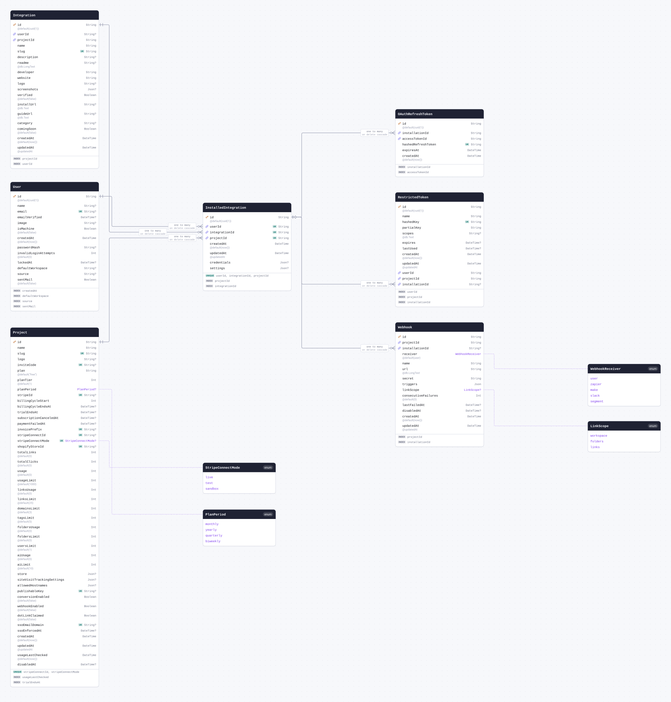

| Field           | Type       | Constraints                                     | Default      | Description |
| --------------- | ---------- | ----------------------------------------------- | ------------ | ----------- |
| `id`            | `String`   | PK NOT NULL                                     | `cuid(1)`    |             |
| `userId`        | `String`   | NOT NULL → [User.id](#model-User)               |              |             |
| `integrationId` | `String`   | NOT NULL → [Integration.id](#model-Integration) |              |             |
| `projectId`     | `String`   | NOT NULL → [Project.id](#model-Project)         |              |             |
| `createdAt`     | `DateTime` | NOT NULL                                        | `now()`      |             |
| `updatedAt`     | `DateTime` | NOT NULL                                        | `@updatedAt` |             |
| `credentials`   | `Json`     | NULL                                            |              |             |
| `settings`      | `Json`     | NULL                                            |              |             |

#### Indexes

- `@@index([projectId])`
- `@@index([integrationId])`
- `@@unique([userId, integrationId, projectId])`

#### References

- `userId` → [User.id](#model-User) (many-to-one, on delete Cascade)
- `integrationId` → [Integration.id](#model-Integration) (many-to-one, on delete Cascade)
- `projectId` → [Project.id](#model-Project) (many-to-one, on delete Cascade)

#### Referenced by

- `id` ← [OAuthRefreshToken.installationId](#model-OAuthRefreshToken) (one-to-many, on delete Cascade)
- `id` ← [RestrictedToken.installationId](#model-RestrictedToken) (one-to-many, on delete Cascade)
- `id` ← [Webhook.installationId](#model-Webhook) (one-to-many, on delete Cascade)

#### Definition

```sql
CREATE TABLE `InstalledIntegration` (
    `id` VARCHAR(191) NOT NULL,
    `userId` VARCHAR(191) NOT NULL,
    `integrationId` VARCHAR(191) NOT NULL,
    `projectId` VARCHAR(191) NOT NULL,
    `createdAt` DATETIME(3) NOT NULL DEFAULT CURRENT_TIMESTAMP(3),
    `updatedAt` DATETIME(3) NOT NULL,
    `credentials` JSON NULL,
    `settings` JSON NULL,

    INDEX `InstalledIntegration_projectId_idx`(`projectId`),
    INDEX `InstalledIntegration_integrationId_idx`(`integrationId`),
    UNIQUE INDEX `InstalledIntegration_userId_integrationId_projectId_key`(`userId`, `integrationId`, `projectId`),
    PRIMARY KEY (`id`)
) DEFAULT CHARACTER SET utf8mb4 COLLATE utf8mb4_unicode_ci;
```

<details>
<summary>Queries and their SQL</summary>

**findMany**: Every row

```ts
await prisma.installedIntegration.findMany();
```

```sql
SELECT
  `InstalledIntegration`.`id`,
  `InstalledIntegration`.`userId`,
  `InstalledIntegration`.`integrationId`,
  `InstalledIntegration`.`projectId`,
  `InstalledIntegration`.`createdAt`,
  `InstalledIntegration`.`updatedAt`,
  `InstalledIntegration`.`credentials`,
  `InstalledIntegration`.`settings`
FROM
  `InstalledIntegration`
WHERE
  1 = 1
```

**count**: How many rows there are

```ts
await prisma.installedIntegration.count();
```

```sql
SELECT
  COUNT(*) AS `_count$_all`
FROM
  (
    SELECT
      `InstalledIntegration`.`id`
    FROM
      `InstalledIntegration`
    WHERE
      1 = 1
  ) AS `sub`
```

**findMany**: Every row with its relations

```ts
await prisma.installedIntegration.findMany({
  include: {
    user: true,
    integration: true,
    project: true,
    refreshTokens: true,
    accessTokens: true,
    webhooks: true,
  },
});
```

```sql
SELECT
  `InstalledIntegration`.`id`,
  `InstalledIntegration`.`userId`,
  `InstalledIntegration`.`integrationId`,
  `InstalledIntegration`.`projectId`,
  `InstalledIntegration`.`createdAt`,
  `InstalledIntegration`.`updatedAt`,
  `InstalledIntegration`.`credentials`,
  `InstalledIntegration`.`settings`
FROM
  `InstalledIntegration`
WHERE
  1 = 1

SELECT
  `User`.`id`,
  `User`.`name`,
  `User`.`email`,
  `User`.`emailVerified`,
  `User`.`image`,
  `User`.`isMachine`,
  `User`.`createdAt`,
  `User`.`passwordHash`,
  `User`.`invalidLoginAttempts`,
  `User`.`lockedAt`,
  `User`.`defaultWorkspace`,
  `User`.`source`,
  `User`.`sentMail`
FROM
  `User`
WHERE
  `User`.`id` IN (?)
-- params: ["<userId of the rows above>"]

SELECT
  `Integration`.`id`,
  `Integration`.`userId`,
  `Integration`.`projectId`,
  `Integration`.`name`,
  `Integration`.`slug`,
  `Integration`.`description`,
  `Integration`.`readme`,
  `Integration`.`developer`,
  `Integration`.`website`,
  `Integration`.`logo`,
  `Integration`.`screenshots`,
  `Integration`.`verified`,
  `Integration`.`installUrl`,
  `Integration`.`guideUrl`,
  `Integration`.`category`,
  `Integration`.`comingSoon`,
  `Integration`.`createdAt`,
  `Integration`.`updatedAt`
FROM
  `Integration`
WHERE
  `Integration`.`id` IN (?)
-- params: ["<integrationId of the rows above>"]

SELECT
  `Project`.`id`,
  `Project`.`name`,
  `Project`.`slug`,
  `Project`.`logo`,
  `Project`.`inviteCode`,
  `Project`.`plan`,
  `Project`.`planTier`,
  `Project`.`planPeriod`,
  `Project`.`stripeId`,
  `Project`.`billingCycleStart`,
  `Project`.`billingCycleEndsAt`,
  `Project`.`trialEndsAt`,
  `Project`.`subscriptionCanceledAt`,
  `Project`.`paymentFailedAt`,
  `Project`.`invoicePrefix`,
  `Project`.`stripeConnectId`,
  `Project`.`stripeConnectMode`,
  `Project`.`shopifyStoreId`,
  `Project`.`totalLinks`,
  `Project`.`totalClicks`,
  `Project`.`usage`,
  `Project`.`usageLimit`,
  `Project`.`linksUsage`,
  `Project`.`linksLimit`,
  `Project`.`domainsLimit`,
  `Project`.`tagsLimit`,
  `Project`.`foldersUsage`,
  `Project`.`foldersLimit`,
  `Project`.`usersLimit`,
  `Project`.`aiUsage`,
  `Project`.`aiLimit`,
  `Project`.`store`,
  `Project`.`siteVisitTrackingSettings`,
  `Project`.`allowedHostnames`,
  `Project`.`publishableKey`,
  `Project`.`conversionEnabled`,
  `Project`.`webhookEnabled`,
  `Project`.`dotLinkClaimed`,
  `Project`.`ssoEmailDomain`,
  `Project`.`ssoEnforcedAt`,
  `Project`.`createdAt`,
  `Project`.`updatedAt`,
  `Project`.`usageLastChecked`,
  `Project`.`disabledAt`
FROM
  `Project`
WHERE
  `Project`.`id` IN (?)
-- params: ["<projectId of the rows above>"]

SELECT
  `OAuthRefreshToken`.`id`,
  `OAuthRefreshToken`.`installationId`,
  `OAuthRefreshToken`.`accessTokenId`,
  `OAuthRefreshToken`.`hashedRefreshToken`,
  `OAuthRefreshToken`.`expiresAt`,
  `OAuthRefreshToken`.`createdAt`
FROM
  `OAuthRefreshToken`
WHERE
  `OAuthRefreshToken`.`installationId` IN (?)
-- params: ["<id of the rows above>"]

SELECT
  `RestrictedToken`.`id`,
  `RestrictedToken`.`name`,
  `RestrictedToken`.`hashedKey`,
  `RestrictedToken`.`partialKey`,
  `RestrictedToken`.`scopes`,
  `RestrictedToken`.`expires`,
  `RestrictedToken`.`lastUsed`,
  `RestrictedToken`.`createdAt`,
  `RestrictedToken`.`updatedAt`,
  `RestrictedToken`.`userId`,
  `RestrictedToken`.`projectId`,
  `RestrictedToken`.`installationId`
FROM
  `RestrictedToken`
WHERE
  `RestrictedToken`.`installationId` IN (?)
-- params: ["<id of the rows above>"]

SELECT
  `Webhook`.`id`,
  `Webhook`.`projectId`,
  `Webhook`.`installationId`,
  `Webhook`.`receiver`,
  `Webhook`.`name`,
  `Webhook`.`url`,
  `Webhook`.`secret`,
  `Webhook`.`triggers`,
  `Webhook`.`linkScope`,
  `Webhook`.`consecutiveFailures`,
  `Webhook`.`lastFailedAt`,
  `Webhook`.`disabledAt`,
  `Webhook`.`createdAt`,
  `Webhook`.`updatedAt`
FROM
  `Webhook`
WHERE
  `Webhook`.`installationId` IN (?)
-- params: ["<id of the rows above>"]
```

**findUnique**: One row by what is unique to it

```ts
await prisma.installedIntegration.findUnique({ where: { id: "example" } });
```

```sql
SELECT
  `InstalledIntegration`.`id`,
  `InstalledIntegration`.`userId`,
  `InstalledIntegration`.`integrationId`,
  `InstalledIntegration`.`projectId`,
  `InstalledIntegration`.`createdAt`,
  `InstalledIntegration`.`updatedAt`,
  `InstalledIntegration`.`credentials`,
  `InstalledIntegration`.`settings`
FROM
  `InstalledIntegration`
WHERE
  (
    `InstalledIntegration`.`id` = ?
    AND 1 = 1
  )
LIMIT
  ?
OFFSET
  ?
-- params: ["example","1","0"]
```

**create**: Create a row

```ts
await prisma.installedIntegration.create({
  data: { userId: "example", integrationId: "example", projectId: "example" },
});
```

```sql
INSERT INTO
  `InstalledIntegration` (
    `id`,
    `userId`,
    `integrationId`,
    `projectId`,
    `createdAt`,
    `updatedAt`
  )
VALUES
  (?, ?, ?, ?, ?, ?)
-- params: ["<cuid(1)>","example","example","example","<now()>","<now()>"]

SELECT
  `InstalledIntegration`.`id`,
  `InstalledIntegration`.`userId`,
  `InstalledIntegration`.`integrationId`,
  `InstalledIntegration`.`projectId`,
  `InstalledIntegration`.`createdAt`,
  `InstalledIntegration`.`updatedAt`,
  `InstalledIntegration`.`credentials`,
  `InstalledIntegration`.`settings`
FROM
  `InstalledIntegration`
WHERE
  `InstalledIntegration`.`id` = ?
LIMIT
  ?
OFFSET
  ?
-- params: ["<id of the rows above>","1","0"]
```

**update**: Update a row

```ts
await prisma.installedIntegration.update({
  where: { id: "example" },
  data: { createdAt: new Date("2026-01-01T00:00:00.000Z") },
});
```

```sql
SELECT
  `InstalledIntegration`.`id`
FROM
  `InstalledIntegration`
WHERE
  (
    `InstalledIntegration`.`id` = ?
    AND 1 = 1
  )
LIMIT
  ?
OFFSET
  ?
-- params: ["example","1","0"]

UPDATE `InstalledIntegration`
SET
  `createdAt` = ?,
  `updatedAt` = ?
WHERE
  (
    `InstalledIntegration`.`id` IN (?)
    AND (
      `InstalledIntegration`.`id` = ?
      AND 1 = 1
    )
  )
-- params: ["2026-01-01T00:00:00.000Z",{"prisma__type":"generatorCall","prisma__value":{"name":"now","args":[],"returnType":{"type":"DateTime"}}},"<id of the rows above>","example"]

SELECT
  `InstalledIntegration`.`id`,
  `InstalledIntegration`.`userId`,
  `InstalledIntegration`.`integrationId`,
  `InstalledIntegration`.`projectId`,
  `InstalledIntegration`.`createdAt`,
  `InstalledIntegration`.`updatedAt`,
  `InstalledIntegration`.`credentials`,
  `InstalledIntegration`.`settings`
FROM
  `InstalledIntegration`
WHERE
  `InstalledIntegration`.`id` = ?
LIMIT
  ?
OFFSET
  ?
-- params: ["<id of the rows above>","1","0"]
```

**delete**: Delete a row

```ts
await prisma.installedIntegration.delete({ where: { id: "example" } });
```

```sql
SELECT
  `InstalledIntegration`.`id`,
  `InstalledIntegration`.`userId`,
  `InstalledIntegration`.`integrationId`,
  `InstalledIntegration`.`projectId`,
  `InstalledIntegration`.`createdAt`,
  `InstalledIntegration`.`updatedAt`,
  `InstalledIntegration`.`credentials`,
  `InstalledIntegration`.`settings`
FROM
  `InstalledIntegration`
WHERE
  (
    `InstalledIntegration`.`id` = ?
    AND 1 = 1
  )
LIMIT
  ?
OFFSET
  ?
-- params: ["example","1","0"]

SELECT
  `OAuthRefreshToken`.`id`,
  `OAuthRefreshToken`.`installationId`
FROM
  `OAuthRefreshToken`
WHERE
  (
    1 = 1
    AND `OAuthRefreshToken`.`installationId` IN (?)
  )
-- params: ["<id of the rows above>"]

DELETE FROM `OAuthRefreshToken`
WHERE
  (
    `OAuthRefreshToken`.`id` IN (?)
    AND 1 = 1
  )
-- params: ["<id of the rows above>"]

SELECT
  `RestrictedToken`.`id`,
  `RestrictedToken`.`installationId`
FROM
  `RestrictedToken`
WHERE
  (
    1 = 1
    AND `RestrictedToken`.`installationId` IN (?)
  )
-- params: ["<id of the rows above>"]

SELECT
  `OAuthRefreshToken`.`id`,
  `OAuthRefreshToken`.`accessTokenId`
FROM
  `OAuthRefreshToken`
WHERE
  (
    1 = 1
    AND `OAuthRefreshToken`.`accessTokenId` IN (?)
  )
-- params: ["<id of the rows above>"]

DELETE FROM `OAuthRefreshToken`
WHERE
  (
    `OAuthRefreshToken`.`id` IN (?)
    AND 1 = 1
  )
-- params: ["<id of the rows above>"]

DELETE FROM `RestrictedToken`
WHERE
  (
    `RestrictedToken`.`id` IN (?)
    AND 1 = 1
  )
-- params: ["<id of the rows above>"]

SELECT
  `Webhook`.`id`,
  `Webhook`.`installationId`
FROM
  `Webhook`
WHERE
  (
    1 = 1
    AND `Webhook`.`installationId` IN (?)
  )
-- params: ["<id of the rows above>"]

SELECT
  `LinkWebhook`.`id`,
  `LinkWebhook`.`webhookId`
FROM
  `LinkWebhook`
WHERE
  (
    1 = 1
    AND `LinkWebhook`.`webhookId` IN (?)
  )
-- params: ["<id of the rows above>"]

DELETE FROM `LinkWebhook`
WHERE
  (
    `LinkWebhook`.`id` IN (?)
    AND 1 = 1
  )
-- params: ["<id of the rows above>"]

SELECT
  `FolderWebhook`.`id`,
  `FolderWebhook`.`webhookId`
FROM
  `FolderWebhook`
WHERE
  (
    1 = 1
    AND `FolderWebhook`.`webhookId` IN (?)
  )
-- params: ["<id of the rows above>"]

DELETE FROM `FolderWebhook`
WHERE
  (
    `FolderWebhook`.`id` IN (?)
    AND 1 = 1
  )
-- params: ["<id of the rows above>"]

DELETE FROM `Webhook`
WHERE
  (
    `Webhook`.`id` IN (?)
    AND 1 = 1
  )
-- params: ["<id of the rows above>"]

DELETE FROM `InstalledIntegration`
WHERE
  (
    `InstalledIntegration`.`id` = ?
    AND 1 = 1
  )
-- params: ["example"]
```

</details>

<a id="model-Invoice"></a>

### Invoice

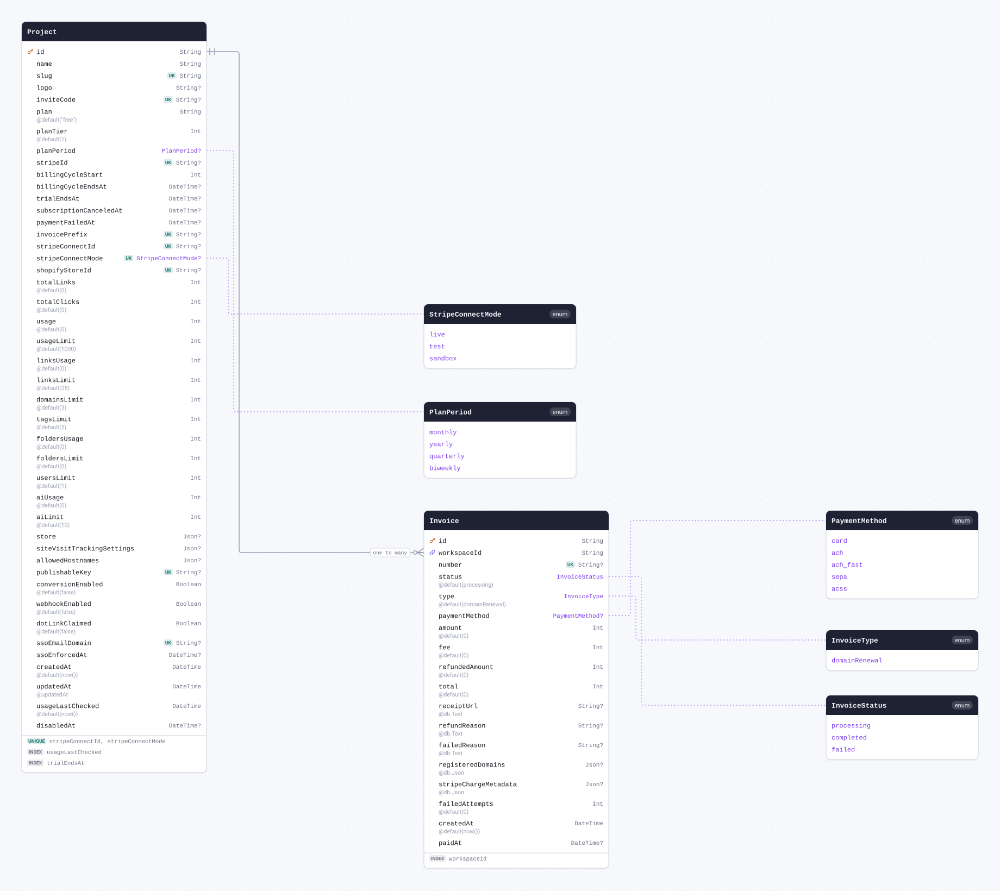

| Field                  | Type                                   | Constraints                             | Default         | Description |
| ---------------------- | -------------------------------------- | --------------------------------------- | --------------- | ----------- |
| `id`                   | `String`                               | PK NOT NULL                             |                 |             |
| `workspaceId`          | `String`                               | NOT NULL → [Project.id](#model-Project) |                 |             |
| `number`               | `String`                               | UNIQUE NULL                             |                 |             |
| `status`               | [`InvoiceStatus`](#enum-InvoiceStatus) | NOT NULL                                | `processing`    |             |
| `type`                 | [`InvoiceType`](#enum-InvoiceType)     | NOT NULL                                | `domainRenewal` |             |
| `paymentMethod`        | [`PaymentMethod`](#enum-PaymentMethod) | NULL                                    |                 |             |
| `amount`               | `Int`                                  | NOT NULL                                | `0`             |             |
| `fee`                  | `Int`                                  | NOT NULL                                | `0`             |             |
| `refundedAmount`       | `Int`                                  | NOT NULL                                | `0`             |             |
| `total`                | `Int`                                  | NOT NULL                                | `0`             |             |
| `receiptUrl`           | `String` `@db.Text`                    | NULL                                    |                 |             |
| `refundReason`         | `String` `@db.Text`                    | NULL                                    |                 |             |
| `failedReason`         | `String` `@db.Text`                    | NULL                                    |                 |             |
| `registeredDomains`    | `Json` `@db.Json`                      | NULL                                    |                 |             |
| `stripeChargeMetadata` | `Json` `@db.Json`                      | NULL                                    |                 |             |
| `failedAttempts`       | `Int`                                  | NOT NULL                                | `0`             |             |
| `createdAt`            | `DateTime`                             | NOT NULL                                | `now()`         |             |
| `paidAt`               | `DateTime`                             | NULL                                    |                 |             |

#### Indexes

- `@@index([workspaceId])`

#### References

- `workspaceId` → [Project.id](#model-Project) (many-to-one)

#### Definition

```sql
CREATE TABLE `Invoice` (
    `id` VARCHAR(191) NOT NULL,
    `workspaceId` VARCHAR(191) NOT NULL,
    `number` VARCHAR(191) NULL,
    `status` ENUM('processing', 'completed', 'failed') NOT NULL DEFAULT 'processing',
    `type` ENUM('domainRenewal') NOT NULL DEFAULT 'domainRenewal',
    `paymentMethod` ENUM('card', 'ach', 'ach_fast', 'sepa', 'acss') NULL,
    `amount` INTEGER NOT NULL DEFAULT 0,
    `fee` INTEGER NOT NULL DEFAULT 0,
    `refundedAmount` INTEGER NOT NULL DEFAULT 0,
    `total` INTEGER NOT NULL DEFAULT 0,
    `receiptUrl` TEXT NULL,
    `refundReason` TEXT NULL,
    `failedReason` TEXT NULL,
    `registeredDomains` JSON NULL,
    `stripeChargeMetadata` JSON NULL,
    `failedAttempts` INTEGER NOT NULL DEFAULT 0,
    `createdAt` DATETIME(3) NOT NULL DEFAULT CURRENT_TIMESTAMP(3),
    `paidAt` DATETIME(3) NULL,

    UNIQUE INDEX `Invoice_number_key`(`number`),
    INDEX `Invoice_workspaceId_idx`(`workspaceId`),
    PRIMARY KEY (`id`)
) DEFAULT CHARACTER SET utf8mb4 COLLATE utf8mb4_unicode_ci;
```

<details>
<summary>Queries and their SQL</summary>

**findMany**: Every row

```ts
await prisma.invoice.findMany();
```

```sql
SELECT
  `Invoice`.`id`,
  `Invoice`.`workspaceId`,
  `Invoice`.`number`,
  `Invoice`.`status`,
  `Invoice`.`type`,
  `Invoice`.`paymentMethod`,
  `Invoice`.`amount`,
  `Invoice`.`fee`,
  `Invoice`.`refundedAmount`,
  `Invoice`.`total`,
  `Invoice`.`receiptUrl`,
  `Invoice`.`refundReason`,
  `Invoice`.`failedReason`,
  `Invoice`.`registeredDomains`,
  `Invoice`.`stripeChargeMetadata`,
  `Invoice`.`failedAttempts`,
  `Invoice`.`createdAt`,
  `Invoice`.`paidAt`
FROM
  `Invoice`
WHERE
  1 = 1
```

**count**: How many rows there are

```ts
await prisma.invoice.count();
```

```sql
SELECT
  COUNT(*) AS `_count$_all`
FROM
  (
    SELECT
      `Invoice`.`id`
    FROM
      `Invoice`
    WHERE
      1 = 1
  ) AS `sub`
```

**findMany**: Every row with its relations

```ts
await prisma.invoice.findMany({ include: { workspace: true } });
```

```sql
SELECT
  `Invoice`.`id`,
  `Invoice`.`workspaceId`,
  `Invoice`.`number`,
  `Invoice`.`status`,
  `Invoice`.`type`,
  `Invoice`.`paymentMethod`,
  `Invoice`.`amount`,
  `Invoice`.`fee`,
  `Invoice`.`refundedAmount`,
  `Invoice`.`total`,
  `Invoice`.`receiptUrl`,
  `Invoice`.`refundReason`,
  `Invoice`.`failedReason`,
  `Invoice`.`registeredDomains`,
  `Invoice`.`stripeChargeMetadata`,
  `Invoice`.`failedAttempts`,
  `Invoice`.`createdAt`,
  `Invoice`.`paidAt`
FROM
  `Invoice`
WHERE
  1 = 1

SELECT
  `Project`.`id`,
  `Project`.`name`,
  `Project`.`slug`,
  `Project`.`logo`,
  `Project`.`inviteCode`,
  `Project`.`plan`,
  `Project`.`planTier`,
  `Project`.`planPeriod`,
  `Project`.`stripeId`,
  `Project`.`billingCycleStart`,
  `Project`.`billingCycleEndsAt`,
  `Project`.`trialEndsAt`,
  `Project`.`subscriptionCanceledAt`,
  `Project`.`paymentFailedAt`,
  `Project`.`invoicePrefix`,
  `Project`.`stripeConnectId`,
  `Project`.`stripeConnectMode`,
  `Project`.`shopifyStoreId`,
  `Project`.`totalLinks`,
  `Project`.`totalClicks`,
  `Project`.`usage`,
  `Project`.`usageLimit`,
  `Project`.`linksUsage`,
  `Project`.`linksLimit`,
  `Project`.`domainsLimit`,
  `Project`.`tagsLimit`,
  `Project`.`foldersUsage`,
  `Project`.`foldersLimit`,
  `Project`.`usersLimit`,
  `Project`.`aiUsage`,
  `Project`.`aiLimit`,
  `Project`.`store`,
  `Project`.`siteVisitTrackingSettings`,
  `Project`.`allowedHostnames`,
  `Project`.`publishableKey`,
  `Project`.`conversionEnabled`,
  `Project`.`webhookEnabled`,
  `Project`.`dotLinkClaimed`,
  `Project`.`ssoEmailDomain`,
  `Project`.`ssoEnforcedAt`,
  `Project`.`createdAt`,
  `Project`.`updatedAt`,
  `Project`.`usageLastChecked`,
  `Project`.`disabledAt`
FROM
  `Project`
WHERE
  `Project`.`id` IN (?)
-- params: ["<workspaceId of the rows above>"]
```

**findUnique**: One row by what is unique to it

```ts
await prisma.invoice.findUnique({ where: { id: "example" } });
```

```sql
SELECT
  `Invoice`.`id`,
  `Invoice`.`workspaceId`,
  `Invoice`.`number`,
  `Invoice`.`status`,
  `Invoice`.`type`,
  `Invoice`.`paymentMethod`,
  `Invoice`.`amount`,
  `Invoice`.`fee`,
  `Invoice`.`refundedAmount`,
  `Invoice`.`total`,
  `Invoice`.`receiptUrl`,
  `Invoice`.`refundReason`,
  `Invoice`.`failedReason`,
  `Invoice`.`registeredDomains`,
  `Invoice`.`stripeChargeMetadata`,
  `Invoice`.`failedAttempts`,
  `Invoice`.`createdAt`,
  `Invoice`.`paidAt`
FROM
  `Invoice`
WHERE
  (
    `Invoice`.`id` = ?
    AND 1 = 1
  )
LIMIT
  ?
OFFSET
  ?
-- params: ["example","1","0"]
```

**create**: Create a row

```ts
await prisma.invoice.create({ data: { id: "example", workspaceId: "example" } });
```

```sql
INSERT INTO
  `Invoice` (
    `id`,
    `workspaceId`,
    `status`,
    `type`,
    `amount`,
    `fee`,
    `refundedAmount`,
    `total`,
    `failedAttempts`,
    `createdAt`
  )
VALUES
  (?, ?, ?, ?, ?, ?, ?, ?, ?, ?)
-- params: ["example","example","processing","domainRenewal","0","0","0","0","0","<now()>"]

SELECT
  `Invoice`.`id`,
  `Invoice`.`workspaceId`,
  `Invoice`.`number`,
  `Invoice`.`status`,
  `Invoice`.`type`,
  `Invoice`.`paymentMethod`,
  `Invoice`.`amount`,
  `Invoice`.`fee`,
  `Invoice`.`refundedAmount`,
  `Invoice`.`total`,
  `Invoice`.`receiptUrl`,
  `Invoice`.`refundReason`,
  `Invoice`.`failedReason`,
  `Invoice`.`registeredDomains`,
  `Invoice`.`stripeChargeMetadata`,
  `Invoice`.`failedAttempts`,
  `Invoice`.`createdAt`,
  `Invoice`.`paidAt`
FROM
  `Invoice`
WHERE
  `Invoice`.`id` = ?
LIMIT
  ?
OFFSET
  ?
-- params: ["<id of the rows above>","1","0"]
```

**update**: Update a row

```ts
await prisma.invoice.update({ where: { id: "example" }, data: { number: "example" } });
```

```sql
SELECT
  `Invoice`.`id`
FROM
  `Invoice`
WHERE
  (
    `Invoice`.`id` = ?
    AND 1 = 1
  )
LIMIT
  ?
OFFSET
  ?
-- params: ["example","1","0"]

UPDATE `Invoice`
SET
  `number` = ?
WHERE
  (
    `Invoice`.`id` IN (?)
    AND (
      `Invoice`.`id` = ?
      AND 1 = 1
    )
  )
-- params: ["example","<id of the rows above>","example"]

SELECT
  `Invoice`.`id`,
  `Invoice`.`workspaceId`,
  `Invoice`.`number`,
  `Invoice`.`status`,
  `Invoice`.`type`,
  `Invoice`.`paymentMethod`,
  `Invoice`.`amount`,
  `Invoice`.`fee`,
  `Invoice`.`refundedAmount`,
  `Invoice`.`total`,
  `Invoice`.`receiptUrl`,
  `Invoice`.`refundReason`,
  `Invoice`.`failedReason`,
  `Invoice`.`registeredDomains`,
  `Invoice`.`stripeChargeMetadata`,
  `Invoice`.`failedAttempts`,
  `Invoice`.`createdAt`,
  `Invoice`.`paidAt`
FROM
  `Invoice`
WHERE
  `Invoice`.`id` = ?
LIMIT
  ?
OFFSET
  ?
-- params: ["<id of the rows above>","1","0"]
```

**delete**: Delete a row

```ts
await prisma.invoice.delete({ where: { id: "example" } });
```

```sql
SELECT
  `Invoice`.`id`,
  `Invoice`.`workspaceId`,
  `Invoice`.`number`,
  `Invoice`.`status`,
  `Invoice`.`type`,
  `Invoice`.`paymentMethod`,
  `Invoice`.`amount`,
  `Invoice`.`fee`,
  `Invoice`.`refundedAmount`,
  `Invoice`.`total`,
  `Invoice`.`receiptUrl`,
  `Invoice`.`refundReason`,
  `Invoice`.`failedReason`,
  `Invoice`.`registeredDomains`,
  `Invoice`.`stripeChargeMetadata`,
  `Invoice`.`failedAttempts`,
  `Invoice`.`createdAt`,
  `Invoice`.`paidAt`
FROM
  `Invoice`
WHERE
  (
    `Invoice`.`id` = ?
    AND 1 = 1
  )
LIMIT
  ?
OFFSET
  ?
-- params: ["example","1","0"]

DELETE FROM `Invoice`
WHERE
  (
    `Invoice`.`id` = ?
    AND 1 = 1
  )
-- params: ["example"]
```

</details>

<a id="model-jackson_index"></a>

### jackson_index

| Field      | Type                        | Constraints | Default           | Description |
| ---------- | --------------------------- | ----------- | ----------------- | ----------- |
| `id`       | `Int`                       | PK NOT NULL | `autoincrement()` |             |
| `key`      | `String` `@db.VarChar(250)` | NOT NULL    |                   |             |
| `storeKey` | `String` `@db.VarChar(250)` | NOT NULL    |                   |             |

#### Indexes

- `@@index([key, storeKey], map: "_jackson_index_key_store")`

#### Definition

```sql
CREATE TABLE `jackson_index` (
    `id` INTEGER NOT NULL AUTO_INCREMENT,
    `key` VARCHAR(250) NOT NULL,
    `storeKey` VARCHAR(250) NOT NULL,

    INDEX `_jackson_index_key_store`(`key`, `storeKey`),
    PRIMARY KEY (`id`)
) DEFAULT CHARACTER SET utf8mb4 COLLATE utf8mb4_unicode_ci;
```

<details>
<summary>Queries and their SQL</summary>

**findMany**: Every row

```ts
await prisma.jackson_index.findMany();
```

```sql
SELECT
  `jackson_index`.`id`,
  `jackson_index`.`key`,
  `jackson_index`.`storeKey`
FROM
  `jackson_index`
WHERE
  1 = 1
```

**count**: How many rows there are

```ts
await prisma.jackson_index.count();
```

```sql
SELECT
  COUNT(*) AS `_count$_all`
FROM
  (
    SELECT
      `jackson_index`.`id`
    FROM
      `jackson_index`
    WHERE
      1 = 1
  ) AS `sub`
```

**findUnique**: One row by what is unique to it

```ts
await prisma.jackson_index.findUnique({ where: { id: 1 } });
```

```sql
SELECT
  `jackson_index`.`id`,
  `jackson_index`.`key`,
  `jackson_index`.`storeKey`
FROM
  `jackson_index`
WHERE
  (
    `jackson_index`.`id` = ?
    AND 1 = 1
  )
LIMIT
  ?
OFFSET
  ?
-- params: ["1","1","0"]
```

**create**: Create a row

```ts
await prisma.jackson_index.create({ data: { key: "example", storeKey: "example" } });
```

```sql
INSERT INTO
  `jackson_index` (`key`, `storeKey`)
VALUES
  (?, ?)
-- params: ["example","example"]

SELECT
  `jackson_index`.`id`,
  `jackson_index`.`key`,
  `jackson_index`.`storeKey`
FROM
  `jackson_index`
WHERE
  `jackson_index`.`id` = ?
LIMIT
  ?
OFFSET
  ?
-- params: ["<id of the rows above>","1","0"]
```

**update**: Update a row

```ts
await prisma.jackson_index.update({ where: { id: 1 }, data: { key: "example" } });
```

```sql
SELECT
  `jackson_index`.`id`
FROM
  `jackson_index`
WHERE
  (
    `jackson_index`.`id` = ?
    AND 1 = 1
  )
LIMIT
  ?
OFFSET
  ?
-- params: ["1","1","0"]

UPDATE `jackson_index`
SET
  `key` = ?
WHERE
  (
    `jackson_index`.`id` IN (?)
    AND (
      `jackson_index`.`id` = ?
      AND 1 = 1
    )
  )
-- params: ["example","<id of the rows above>","1"]

SELECT
  `jackson_index`.`id`,
  `jackson_index`.`key`,
  `jackson_index`.`storeKey`
FROM
  `jackson_index`
WHERE
  `jackson_index`.`id` = ?
LIMIT
  ?
OFFSET
  ?
-- params: ["<id of the rows above>","1","0"]
```

**delete**: Delete a row

```ts
await prisma.jackson_index.delete({ where: { id: 1 } });
```

```sql
SELECT
  `jackson_index`.`id`,
  `jackson_index`.`key`,
  `jackson_index`.`storeKey`
FROM
  `jackson_index`
WHERE
  (
    `jackson_index`.`id` = ?
    AND 1 = 1
  )
LIMIT
  ?
OFFSET
  ?
-- params: ["1","1","0"]

DELETE FROM `jackson_index`
WHERE
  (
    `jackson_index`.`id` = ?
    AND 1 = 1
  )
-- params: ["1"]
```

</details>

<a id="model-jackson_store"></a>

### jackson_store

| Field        | Type                          | Constraints | Default | Description |
| ------------ | ----------------------------- | ----------- | ------- | ----------- |
| `key`        | `String` `@db.VarChar(250)`   | PK NOT NULL |         |             |
| `value`      | `String` `@db.Text`           | NOT NULL    |         |             |
| `iv`         | `String` `@db.VarChar(64)`    | NULL        |         |             |
| `tag`        | `String` `@db.VarChar(64)`    | NULL        |         |             |
| `namespace`  | `String` `@db.VarChar(64)`    | NULL        |         |             |
| `createdAt`  | `DateTime` `@db.Timestamp(0)` | NOT NULL    | `now()` |             |
| `modifiedAt` | `DateTime` `@db.Timestamp(0)` | NULL        |         |             |

#### Indexes

- `@@index([namespace], map: "_jackson_store_namespace")`

#### Definition

```sql
CREATE TABLE `jackson_store` (
    `key` VARCHAR(250) NOT NULL,
    `value` TEXT NOT NULL,
    `iv` VARCHAR(64) NULL,
    `tag` VARCHAR(64) NULL,
    `namespace` VARCHAR(64) NULL,
    `createdAt` TIMESTAMP(0) NOT NULL DEFAULT CURRENT_TIMESTAMP(0),
    `modifiedAt` TIMESTAMP(0) NULL,

    INDEX `_jackson_store_namespace`(`namespace`),
    PRIMARY KEY (`key`)
) DEFAULT CHARACTER SET utf8mb4 COLLATE utf8mb4_unicode_ci;
```

<details>
<summary>Queries and their SQL</summary>

**findMany**: Every row

```ts
await prisma.jackson_store.findMany();
```

```sql
SELECT
  `jackson_store`.`key`,
  `jackson_store`.`value`,
  `jackson_store`.`iv`,
  `jackson_store`.`tag`,
  `jackson_store`.`namespace`,
  `jackson_store`.`createdAt`,
  `jackson_store`.`modifiedAt`
FROM
  `jackson_store`
WHERE
  1 = 1
```

**count**: How many rows there are

```ts
await prisma.jackson_store.count();
```

```sql
SELECT
  COUNT(*) AS `_count$_all`
FROM
  (
    SELECT
      `jackson_store`.`key`
    FROM
      `jackson_store`
    WHERE
      1 = 1
  ) AS `sub`
```

**findUnique**: One row by what is unique to it

```ts
await prisma.jackson_store.findUnique({ where: { key: "example" } });
```

```sql
SELECT
  `jackson_store`.`key`,
  `jackson_store`.`value`,
  `jackson_store`.`iv`,
  `jackson_store`.`tag`,
  `jackson_store`.`namespace`,
  `jackson_store`.`createdAt`,
  `jackson_store`.`modifiedAt`
FROM
  `jackson_store`
WHERE
  (
    `jackson_store`.`key` = ?
    AND 1 = 1
  )
LIMIT
  ?
OFFSET
  ?
-- params: ["example","1","0"]
```

**create**: Create a row

```ts
await prisma.jackson_store.create({ data: { key: "example", value: "example" } });
```

```sql
INSERT INTO
  `jackson_store` (`key`, `value`, `createdAt`)
VALUES
  (?, ?, ?)
-- params: ["example","example","<now()>"]

SELECT
  `jackson_store`.`key`,
  `jackson_store`.`value`,
  `jackson_store`.`iv`,
  `jackson_store`.`tag`,
  `jackson_store`.`namespace`,
  `jackson_store`.`createdAt`,
  `jackson_store`.`modifiedAt`
FROM
  `jackson_store`
WHERE
  `jackson_store`.`key` = ?
LIMIT
  ?
OFFSET
  ?
-- params: ["<key of the rows above>","1","0"]
```

**update**: Update a row

```ts
await prisma.jackson_store.update({ where: { key: "example" }, data: { value: "example" } });
```

```sql
SELECT
  `jackson_store`.`key`
FROM
  `jackson_store`
WHERE
  (
    `jackson_store`.`key` = ?
    AND 1 = 1
  )
LIMIT
  ?
OFFSET
  ?
-- params: ["example","1","0"]

UPDATE `jackson_store`
SET
  `value` = ?
WHERE
  (
    `jackson_store`.`key` IN (?)
    AND (
      `jackson_store`.`key` = ?
      AND 1 = 1
    )
  )
-- params: ["example","<key of the rows above>","example"]

SELECT
  `jackson_store`.`key`,
  `jackson_store`.`value`,
  `jackson_store`.`iv`,
  `jackson_store`.`tag`,
  `jackson_store`.`namespace`,
  `jackson_store`.`createdAt`,
  `jackson_store`.`modifiedAt`
FROM
  `jackson_store`
WHERE
  `jackson_store`.`key` = ?
LIMIT
  ?
OFFSET
  ?
-- params: ["<key of the rows above>","1","0"]
```

**delete**: Delete a row

```ts
await prisma.jackson_store.delete({ where: { key: "example" } });
```

```sql
SELECT
  `jackson_store`.`key`,
  `jackson_store`.`value`,
  `jackson_store`.`iv`,
  `jackson_store`.`tag`,
  `jackson_store`.`namespace`,
  `jackson_store`.`createdAt`,
  `jackson_store`.`modifiedAt`
FROM
  `jackson_store`
WHERE
  (
    `jackson_store`.`key` = ?
    AND 1 = 1
  )
LIMIT
  ?
OFFSET
  ?
-- params: ["example","1","0"]

DELETE FROM `jackson_store`
WHERE
  (
    `jackson_store`.`key` = ?
    AND 1 = 1
  )
-- params: ["example"]
```

</details>

<a id="model-jackson_ttl"></a>

### jackson_ttl

| Field       | Type                        | Constraints | Default | Description |
| ----------- | --------------------------- | ----------- | ------- | ----------- |
| `key`       | `String` `@db.VarChar(250)` | PK NOT NULL |         |             |
| `expiresAt` | `BigInt`                    | NOT NULL    |         |             |

#### Indexes

- `@@index([expiresAt], map: "_jackson_ttl_expires_at")`

#### Definition

```sql
CREATE TABLE `jackson_ttl` (
    `key` VARCHAR(250) NOT NULL,
    `expiresAt` BIGINT NOT NULL,

    INDEX `_jackson_ttl_expires_at`(`expiresAt`),
    PRIMARY KEY (`key`)
) DEFAULT CHARACTER SET utf8mb4 COLLATE utf8mb4_unicode_ci;
```

<details>
<summary>Queries and their SQL</summary>

**findMany**: Every row

```ts
await prisma.jackson_ttl.findMany();
```

```sql
SELECT
  `jackson_ttl`.`key`,
  `jackson_ttl`.`expiresAt`
FROM
  `jackson_ttl`
WHERE
  1 = 1
```

**count**: How many rows there are

```ts
await prisma.jackson_ttl.count();
```

```sql
SELECT
  COUNT(*) AS `_count$_all`
FROM
  (
    SELECT
      `jackson_ttl`.`key`
    FROM
      `jackson_ttl`
    WHERE
      1 = 1
  ) AS `sub`
```

**findUnique**: One row by what is unique to it

```ts
await prisma.jackson_ttl.findUnique({ where: { key: "example" } });
```

```sql
SELECT
  `jackson_ttl`.`key`,
  `jackson_ttl`.`expiresAt`
FROM
  `jackson_ttl`
WHERE
  (
    `jackson_ttl`.`key` = ?
    AND 1 = 1
  )
LIMIT
  ?
OFFSET
  ?
-- params: ["example","1","0"]
```

**create**: Create a row

```ts
await prisma.jackson_ttl.create({ data: { key: "example", expiresAt: 1n } });
```

```sql
INSERT INTO
  `jackson_ttl` (`key`, `expiresAt`)
VALUES
  (?, ?)
-- params: ["example","1"]

SELECT
  `jackson_ttl`.`key`,
  `jackson_ttl`.`expiresAt`
FROM
  `jackson_ttl`
WHERE
  `jackson_ttl`.`key` = ?
LIMIT
  ?
OFFSET
  ?
-- params: ["<key of the rows above>","1","0"]
```

**update**: Update a row

```ts
await prisma.jackson_ttl.update({ where: { key: "example" }, data: { expiresAt: 1n } });
```

```sql
SELECT
  `jackson_ttl`.`key`
FROM
  `jackson_ttl`
WHERE
  (
    `jackson_ttl`.`key` = ?
    AND 1 = 1
  )
LIMIT
  ?
OFFSET
  ?
-- params: ["example","1","0"]

UPDATE `jackson_ttl`
SET
  `expiresAt` = ?
WHERE
  (
    `jackson_ttl`.`key` IN (?)
    AND (
      `jackson_ttl`.`key` = ?
      AND 1 = 1
    )
  )
-- params: ["1","<key of the rows above>","example"]

SELECT
  `jackson_ttl`.`key`,
  `jackson_ttl`.`expiresAt`
FROM
  `jackson_ttl`
WHERE
  `jackson_ttl`.`key` = ?
LIMIT
  ?
OFFSET
  ?
-- params: ["<key of the rows above>","1","0"]
```

**delete**: Delete a row

```ts
await prisma.jackson_ttl.delete({ where: { key: "example" } });
```

```sql
SELECT
  `jackson_ttl`.`key`,
  `jackson_ttl`.`expiresAt`
FROM
  `jackson_ttl`
WHERE
  (
    `jackson_ttl`.`key` = ?
    AND 1 = 1
  )
LIMIT
  ?
OFFSET
  ?
-- params: ["example","1","0"]

DELETE FROM `jackson_ttl`
WHERE
  (
    `jackson_ttl`.`key` = ?
    AND 1 = 1
  )
-- params: ["example"]
```

</details>

<a id="model-Job"></a>

### Job

| Field         | Type                | Constraints | Default      | Description |
| ------------- | ------------------- | ----------- | ------------ | ----------- |
| `id`          | `String`            | PK NOT NULL |              |             |
| `name`        | `String`            | NOT NULL    |              |             |
| `payload`     | `Json`              | NOT NULL    |              |             |
| `options`     | `Json`              | NULL        |              |             |
| `scheduledAt` | `DateTime`          | NOT NULL    | `now()`      |             |
| `attempts`    | `Int`               | NOT NULL    | `0`          |             |
| `lastError`   | `String` `@db.Text` | NULL        |              |             |
| `createdAt`   | `DateTime`          | NOT NULL    | `now()`      |             |
| `updatedAt`   | `DateTime`          | NOT NULL    | `@updatedAt` |             |

#### Indexes

- `@@index([scheduledAt, attempts])`

#### Definition

```sql
CREATE TABLE `Job` (
    `id` VARCHAR(191) NOT NULL,
    `name` VARCHAR(191) NOT NULL,
    `payload` JSON NOT NULL,
    `options` JSON NULL,
    `scheduledAt` DATETIME(3) NOT NULL DEFAULT CURRENT_TIMESTAMP(3),
    `attempts` INTEGER NOT NULL DEFAULT 0,
    `lastError` TEXT NULL,
    `createdAt` DATETIME(3) NOT NULL DEFAULT CURRENT_TIMESTAMP(3),
    `updatedAt` DATETIME(3) NOT NULL,

    INDEX `Job_scheduledAt_attempts_idx`(`scheduledAt`, `attempts`),
    PRIMARY KEY (`id`)
) DEFAULT CHARACTER SET utf8mb4 COLLATE utf8mb4_unicode_ci;
```

<details>
<summary>Queries and their SQL</summary>

**findMany**: Every row

```ts
await prisma.job.findMany();
```

```sql
SELECT
  `Job`.`id`,
  `Job`.`name`,
  `Job`.`payload`,
  `Job`.`options`,
  `Job`.`scheduledAt`,
  `Job`.`attempts`,
  `Job`.`lastError`,
  `Job`.`createdAt`,
  `Job`.`updatedAt`
FROM
  `Job`
WHERE
  1 = 1
```

**count**: How many rows there are

```ts
await prisma.job.count();
```

```sql
SELECT
  COUNT(*) AS `_count$_all`
FROM
  (
    SELECT
      `Job`.`id`
    FROM
      `Job`
    WHERE
      1 = 1
  ) AS `sub`
```

**findUnique**: One row by what is unique to it

```ts
await prisma.job.findUnique({ where: { id: "example" } });
```

```sql
SELECT
  `Job`.`id`,
  `Job`.`name`,
  `Job`.`payload`,
  `Job`.`options`,
  `Job`.`scheduledAt`,
  `Job`.`attempts`,
  `Job`.`lastError`,
  `Job`.`createdAt`,
  `Job`.`updatedAt`
FROM
  `Job`
WHERE
  (
    `Job`.`id` = ?
    AND 1 = 1
  )
LIMIT
  ?
OFFSET
  ?
-- params: ["example","1","0"]
```

**create**: Create a row

```ts
await prisma.job.create({ data: { id: "example", name: "example", payload: {} } });
```

```sql
INSERT INTO
  `Job` (
    `id`,
    `name`,
    `payload`,
    `scheduledAt`,
    `attempts`,
    `createdAt`,
    `updatedAt`
  )
VALUES
  (?, ?, ?, ?, ?, ?, ?)
-- params: ["example","example","{}","<now()>","0","<now()>","<now()>"]

SELECT
  `Job`.`id`,
  `Job`.`name`,
  `Job`.`payload`,
  `Job`.`options`,
  `Job`.`scheduledAt`,
  `Job`.`attempts`,
  `Job`.`lastError`,
  `Job`.`createdAt`,
  `Job`.`updatedAt`
FROM
  `Job`
WHERE
  `Job`.`id` = ?
LIMIT
  ?
OFFSET
  ?
-- params: ["<id of the rows above>","1","0"]
```

**update**: Update a row

```ts
await prisma.job.update({ where: { id: "example" }, data: { name: "example" } });
```

```sql
SELECT
  `Job`.`id`
FROM
  `Job`
WHERE
  (
    `Job`.`id` = ?
    AND 1 = 1
  )
LIMIT
  ?
OFFSET
  ?
-- params: ["example","1","0"]

UPDATE `Job`
SET
  `name` = ?,
  `updatedAt` = ?
WHERE
  (
    `Job`.`id` IN (?)
    AND (
      `Job`.`id` = ?
      AND 1 = 1
    )
  )
-- params: ["example",{"prisma__type":"generatorCall","prisma__value":{"name":"now","args":[],"returnType":{"type":"DateTime"}}},"<id of the rows above>","example"]

SELECT
  `Job`.`id`,
  `Job`.`name`,
  `Job`.`payload`,
  `Job`.`options`,
  `Job`.`scheduledAt`,
  `Job`.`attempts`,
  `Job`.`lastError`,
  `Job`.`createdAt`,
  `Job`.`updatedAt`
FROM
  `Job`
WHERE
  `Job`.`id` = ?
LIMIT
  ?
OFFSET
  ?
-- params: ["<id of the rows above>","1","0"]
```

**delete**: Delete a row

```ts
await prisma.job.delete({ where: { id: "example" } });
```

```sql
SELECT
  `Job`.`id`,
  `Job`.`name`,
  `Job`.`payload`,
  `Job`.`options`,
  `Job`.`scheduledAt`,
  `Job`.`attempts`,
  `Job`.`lastError`,
  `Job`.`createdAt`,
  `Job`.`updatedAt`
FROM
  `Job`
WHERE
  (
    `Job`.`id` = ?
    AND 1 = 1
  )
LIMIT
  ?
OFFSET
  ?
-- params: ["example","1","0"]

DELETE FROM `Job`
WHERE
  (
    `Job`.`id` = ?
    AND 1 = 1
  )
-- params: ["example"]
```

</details>

<a id="model-Link"></a>

### Link

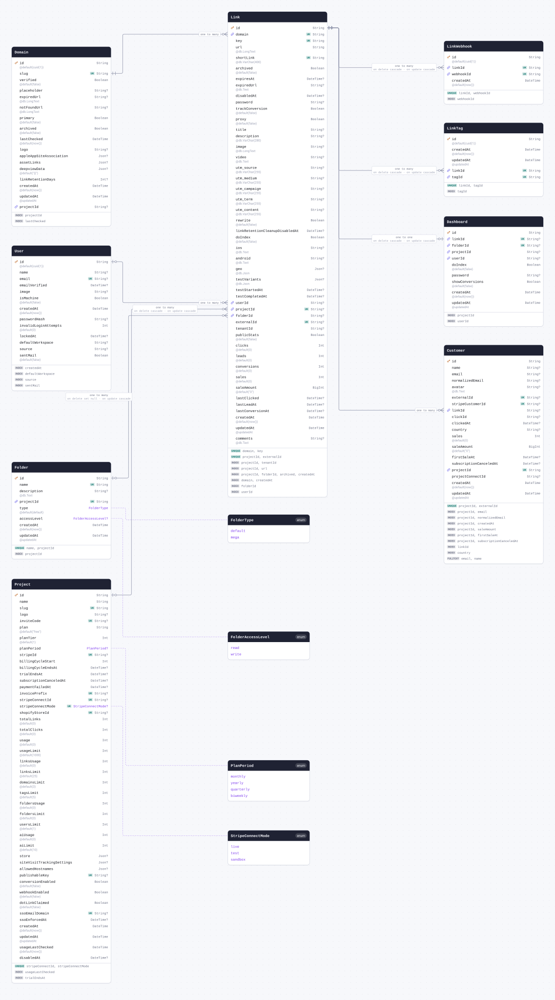

| Field                            | Type                        | Constraints                             | Default      | Description |
| -------------------------------- | --------------------------- | --------------------------------------- | ------------ | ----------- |
| `id`                             | `String`                    | PK NOT NULL                             |              |             |
| `domain`                         | `String`                    | NOT NULL → [Domain.slug](#model-Domain) |              |             |
| `key`                            | `String`                    | NOT NULL                                |              |             |
| `url`                            | `String` `@db.LongText`     | NOT NULL                                |              |             |
| `shortLink`                      | `String` `@db.VarChar(400)` | UNIQUE NOT NULL                         |              |             |
| `archived`                       | `Boolean`                   | NOT NULL                                | `false`      |             |
| `expiresAt`                      | `DateTime`                  | NULL                                    |              |             |
| `expiredUrl`                     | `String` `@db.Text`         | NULL                                    |              |             |
| `disabledAt`                     | `DateTime`                  | NULL                                    |              |             |
| `password`                       | `String`                    | NULL                                    |              |             |
| `trackConversion`                | `Boolean`                   | NOT NULL                                | `false`      |             |
| `proxy`                          | `Boolean`                   | NOT NULL                                | `false`      |             |
| `title`                          | `String`                    | NULL                                    |              |             |
| `description`                    | `String` `@db.VarChar(280)` | NULL                                    |              |             |
| `image`                          | `String` `@db.LongText`     | NULL                                    |              |             |
| `video`                          | `String` `@db.Text`         | NULL                                    |              |             |
| `utm_source`                     | `String` `@db.VarChar(255)` | NULL                                    |              |             |
| `utm_medium`                     | `String` `@db.VarChar(255)` | NULL                                    |              |             |
| `utm_campaign`                   | `String` `@db.VarChar(255)` | NULL                                    |              |             |
| `utm_term`                       | `String` `@db.VarChar(255)` | NULL                                    |              |             |
| `utm_content`                    | `String` `@db.VarChar(255)` | NULL                                    |              |             |
| `rewrite`                        | `Boolean`                   | NOT NULL                                | `false`      |             |
| `linkRetentionCleanupDisabledAt` | `DateTime`                  | NULL                                    |              |             |
| `doIndex`                        | `Boolean`                   | NOT NULL                                | `false`      |             |
| `ios`                            | `String` `@db.Text`         | NULL                                    |              |             |
| `android`                        | `String` `@db.Text`         | NULL                                    |              |             |
| `geo`                            | `Json` `@db.Json`           | NULL                                    |              |             |
| `testVariants`                   | `Json` `@db.Json`           | NULL                                    |              |             |
| `testStartedAt`                  | `DateTime`                  | NULL                                    |              |             |
| `testCompletedAt`                | `DateTime`                  | NULL                                    |              |             |
| `userId`                         | `String`                    | NULL → [User.id](#model-User)           |              |             |
| `projectId`                      | `String`                    | NULL → [Project.id](#model-Project)     |              |             |
| `folderId`                       | `String`                    | NULL → [Folder.id](#model-Folder)       |              |             |
| `externalId`                     | `String`                    | NULL                                    |              |             |
| `tenantId`                       | `String`                    | NULL                                    |              |             |
| `publicStats`                    | `Boolean`                   | NOT NULL                                | `false`      |             |
| `clicks`                         | `Int`                       | NOT NULL                                | `0`          |             |
| `leads`                          | `Int`                       | NOT NULL                                | `0`          |             |
| `conversions`                    | `Int`                       | NOT NULL                                | `0`          |             |
| `sales`                          | `Int`                       | NOT NULL                                | `0`          |             |
| `saleAmount`                     | `BigInt`                    | NOT NULL                                | `"0"`        |             |
| `lastClicked`                    | `DateTime`                  | NULL                                    |              |             |
| `lastLeadAt`                     | `DateTime`                  | NULL                                    |              |             |
| `lastConversionAt`               | `DateTime`                  | NULL                                    |              |             |
| `createdAt`                      | `DateTime`                  | NOT NULL                                | `now()`      |             |
| `updatedAt`                      | `DateTime`                  | NOT NULL                                | `@updatedAt` |             |
| `comments`                       | `String` `@db.Text`         | NULL                                    |              |             |

#### Indexes

- `@@index([projectId, tenantId])`
- `@@index([projectId, url])`
- `@@index([projectId, folderId, archived, createdAt])`
- `@@index([domain, createdAt])`
- `@@index([folderId])`
- `@@index([userId])`
- `@@unique([domain, key])`
- `@@unique([projectId, externalId])`

#### References

- `userId` → [User.id](#model-User) (many-to-one)
- `projectId` → [Project.id](#model-Project) (many-to-one, on delete Cascade, on update Cascade)
- `folderId` → [Folder.id](#model-Folder) (many-to-one, on delete SetNull, on update Cascade)
- `domain` → [Domain.slug](#model-Domain) (many-to-one)

#### Referenced by

- `id` ← [Customer.linkId](#model-Customer) (one-to-many)
- `id` ← [Dashboard.linkId](#model-Dashboard) (one-to-one, on delete Cascade, on update Cascade)
- `id` ← [LinkTag.linkId](#model-LinkTag) (one-to-many, on delete Cascade, on update Cascade)
- `id` ← [LinkWebhook.linkId](#model-LinkWebhook) (one-to-many, on delete Cascade, on update Cascade)

#### Definition

```sql
CREATE TABLE `Link` (
    `id` VARCHAR(191) NOT NULL,
    `domain` VARCHAR(191) NOT NULL,
    `key` VARCHAR(191) NOT NULL,
    `url` LONGTEXT NOT NULL,
    `shortLink` VARCHAR(400) NOT NULL,
    `archived` BOOLEAN NOT NULL DEFAULT false,
    `expiresAt` DATETIME(3) NULL,
    `expiredUrl` TEXT NULL,
    `disabledAt` DATETIME(3) NULL,
    `password` VARCHAR(191) NULL,
    `trackConversion` BOOLEAN NOT NULL DEFAULT false,
    `proxy` BOOLEAN NOT NULL DEFAULT false,
    `title` VARCHAR(191) NULL,
    `description` VARCHAR(280) NULL,
    `image` LONGTEXT NULL,
    `video` TEXT NULL,
    `utm_source` VARCHAR(255) NULL,
    `utm_medium` VARCHAR(255) NULL,
    `utm_campaign` VARCHAR(255) NULL,
    `utm_term` VARCHAR(255) NULL,
    `utm_content` VARCHAR(255) NULL,
    `rewrite` BOOLEAN NOT NULL DEFAULT false,
    `linkRetentionCleanupDisabledAt` DATETIME(3) NULL,
    `doIndex` BOOLEAN NOT NULL DEFAULT false,
    `ios` TEXT NULL,
    `android` TEXT NULL,
    `geo` JSON NULL,
    `testVariants` JSON NULL,
    `testStartedAt` DATETIME(3) NULL,
    `testCompletedAt` DATETIME(3) NULL,
    `userId` VARCHAR(191) NULL,
    `projectId` VARCHAR(191) NULL,
    `folderId` VARCHAR(191) NULL,
    `externalId` VARCHAR(191) NULL,
    `tenantId` VARCHAR(191) NULL,
    `publicStats` BOOLEAN NOT NULL DEFAULT false,
    `clicks` INTEGER NOT NULL DEFAULT 0,
    `leads` INTEGER NOT NULL DEFAULT 0,
    `conversions` INTEGER NOT NULL DEFAULT 0,
    `sales` INTEGER NOT NULL DEFAULT 0,
    `saleAmount` BIGINT NOT NULL DEFAULT 0,
    `lastClicked` DATETIME(3) NULL,
    `lastLeadAt` DATETIME(3) NULL,
    `lastConversionAt` DATETIME(3) NULL,
    `createdAt` DATETIME(3) NOT NULL DEFAULT CURRENT_TIMESTAMP(3),
    `updatedAt` DATETIME(3) NOT NULL,
    `comments` TEXT NULL,

    UNIQUE INDEX `Link_shortLink_key`(`shortLink`),
    INDEX `Link_projectId_tenantId_idx`(`projectId`, `tenantId`),
    INDEX `Link_projectId_url_idx`(`projectId`, `url`(500)),
    INDEX `Link_projectId_folderId_archived_createdAt_idx`(`projectId`, `folderId`, `archived`, `createdAt` DESC),
    INDEX `Link_domain_createdAt_idx`(`domain`, `createdAt`),
    INDEX `Link_folderId_idx`(`folderId`),
    INDEX `Link_userId_idx`(`userId`),
    UNIQUE INDEX `Link_domain_key_key`(`domain`, `key`),
    UNIQUE INDEX `Link_projectId_externalId_key`(`projectId`, `externalId`),
    PRIMARY KEY (`id`)
) DEFAULT CHARACTER SET utf8mb4 COLLATE utf8mb4_unicode_ci;
```

<details>
<summary>Queries and their SQL</summary>

**findMany**: Every row

```ts
await prisma.link.findMany();
```

```sql
SELECT
  `Link`.`id`,
  `Link`.`domain`,
  `Link`.`key`,
  `Link`.`url`,
  `Link`.`shortLink`,
  `Link`.`archived`,
  `Link`.`expiresAt`,
  `Link`.`expiredUrl`,
  `Link`.`disabledAt`,
  `Link`.`password`,
  `Link`.`trackConversion`,
  `Link`.`proxy`,
  `Link`.`title`,
  `Link`.`description`,
  `Link`.`image`,
  `Link`.`video`,
  `Link`.`utm_source`,
  `Link`.`utm_medium`,
  `Link`.`utm_campaign`,
  `Link`.`utm_term`,
  `Link`.`utm_content`,
  `Link`.`rewrite`,
  `Link`.`linkRetentionCleanupDisabledAt`,
  `Link`.`doIndex`,
  `Link`.`ios`,
  `Link`.`android`,
  `Link`.`geo`,
  `Link`.`testVariants`,
  `Link`.`testStartedAt`,
  `Link`.`testCompletedAt`,
  `Link`.`userId`,
  `Link`.`projectId`,
  `Link`.`folderId`,
  `Link`.`externalId`,
  `Link`.`tenantId`,
  `Link`.`publicStats`,
  `Link`.`clicks`,
  `Link`.`leads`,
  `Link`.`conversions`,
  `Link`.`sales`,
  `Link`.`saleAmount`,
  `Link`.`lastClicked`,
  `Link`.`lastLeadAt`,
  `Link`.`lastConversionAt`,
  `Link`.`createdAt`,
  `Link`.`updatedAt`,
  `Link`.`comments`
FROM
  `Link`
WHERE
  1 = 1
```

**count**: How many rows there are

```ts
await prisma.link.count();
```

```sql
SELECT
  COUNT(*) AS `_count$_all`
FROM
  (
    SELECT
      `Link`.`id`
    FROM
      `Link`
    WHERE
      1 = 1
  ) AS `sub`
```

**findMany**: Every row with its relations

```ts
await prisma.link.findMany({
  include: {
    user: true,
    project: true,
    folder: true,
    shortDomain: true,
    tags: true,
    webhooks: true,
    dashboard: true,
    customers: true,
  },
});
```

```sql
SELECT
  `Link`.`id`,
  `Link`.`domain`,
  `Link`.`key`,
  `Link`.`url`,
  `Link`.`shortLink`,
  `Link`.`archived`,
  `Link`.`expiresAt`,
  `Link`.`expiredUrl`,
  `Link`.`disabledAt`,
  `Link`.`password`,
  `Link`.`trackConversion`,
  `Link`.`proxy`,
  `Link`.`title`,
  `Link`.`description`,
  `Link`.`image`,
  `Link`.`video`,
  `Link`.`utm_source`,
  `Link`.`utm_medium`,
  `Link`.`utm_campaign`,
  `Link`.`utm_term`,
  `Link`.`utm_content`,
  `Link`.`rewrite`,
  `Link`.`linkRetentionCleanupDisabledAt`,
  `Link`.`doIndex`,
  `Link`.`ios`,
  `Link`.`android`,
  `Link`.`geo`,
  `Link`.`testVariants`,
  `Link`.`testStartedAt`,
  `Link`.`testCompletedAt`,
  `Link`.`userId`,
  `Link`.`projectId`,
  `Link`.`folderId`,
  `Link`.`externalId`,
  `Link`.`tenantId`,
  `Link`.`publicStats`,
  `Link`.`clicks`,
  `Link`.`leads`,
  `Link`.`conversions`,
  `Link`.`sales`,
  `Link`.`saleAmount`,
  `Link`.`lastClicked`,
  `Link`.`lastLeadAt`,
  `Link`.`lastConversionAt`,
  `Link`.`createdAt`,
  `Link`.`updatedAt`,
  `Link`.`comments`
FROM
  `Link`
WHERE
  1 = 1

SELECT
  `User`.`id`,
  `User`.`name`,
  `User`.`email`,
  `User`.`emailVerified`,
  `User`.`image`,
  `User`.`isMachine`,
  `User`.`createdAt`,
  `User`.`passwordHash`,
  `User`.`invalidLoginAttempts`,
  `User`.`lockedAt`,
  `User`.`defaultWorkspace`,
  `User`.`source`,
  `User`.`sentMail`
FROM
  `User`
WHERE
  `User`.`id` IN (?)
-- params: ["<userId of the rows above>"]

SELECT
  `Project`.`id`,
  `Project`.`name`,
  `Project`.`slug`,
  `Project`.`logo`,
  `Project`.`inviteCode`,
  `Project`.`plan`,
  `Project`.`planTier`,
  `Project`.`planPeriod`,
  `Project`.`stripeId`,
  `Project`.`billingCycleStart`,
  `Project`.`billingCycleEndsAt`,
  `Project`.`trialEndsAt`,
  `Project`.`subscriptionCanceledAt`,
  `Project`.`paymentFailedAt`,
  `Project`.`invoicePrefix`,
  `Project`.`stripeConnectId`,
  `Project`.`stripeConnectMode`,
  `Project`.`shopifyStoreId`,
  `Project`.`totalLinks`,
  `Project`.`totalClicks`,
  `Project`.`usage`,
  `Project`.`usageLimit`,
  `Project`.`linksUsage`,
  `Project`.`linksLimit`,
  `Project`.`domainsLimit`,
  `Project`.`tagsLimit`,
  `Project`.`foldersUsage`,
  `Project`.`foldersLimit`,
  `Project`.`usersLimit`,
  `Project`.`aiUsage`,
  `Project`.`aiLimit`,
  `Project`.`store`,
  `Project`.`siteVisitTrackingSettings`,
  `Project`.`allowedHostnames`,
  `Project`.`publishableKey`,
  `Project`.`conversionEnabled`,
  `Project`.`webhookEnabled`,
  `Project`.`dotLinkClaimed`,
  `Project`.`ssoEmailDomain`,
  `Project`.`ssoEnforcedAt`,
  `Project`.`createdAt`,
  `Project`.`updatedAt`,
  `Project`.`usageLastChecked`,
  `Project`.`disabledAt`
FROM
  `Project`
WHERE
  `Project`.`id` IN (?)
-- params: ["<projectId of the rows above>"]

SELECT
  `Folder`.`id`,
  `Folder`.`name`,
  `Folder`.`description`,
  `Folder`.`projectId`,
  `Folder`.`type`,
  `Folder`.`accessLevel`,
  `Folder`.`createdAt`,
  `Folder`.`updatedAt`
FROM
  `Folder`
WHERE
  `Folder`.`id` IN (?)
-- params: ["<folderId of the rows above>"]

SELECT
  `Domain`.`id`,
  `Domain`.`slug`,
  `Domain`.`verified`,
  `Domain`.`placeholder`,
  `Domain`.`expiredUrl`,
  `Domain`.`notFoundUrl`,
  `Domain`.`primary`,
  `Domain`.`archived`,
  `Domain`.`lastChecked`,
  `Domain`.`logo`,
  `Domain`.`appleAppSiteAssociation`,
  `Domain`.`assetLinks`,
  `Domain`.`deepviewData`,
  `Domain`.`linkRetentionDays`,
  `Domain`.`createdAt`,
  `Domain`.`updatedAt`,
  `Domain`.`projectId`
FROM
  `Domain`
WHERE
  `Domain`.`slug` IN (?)
-- params: ["<domain of the rows above>"]

SELECT
  `LinkTag`.`id`,
  `LinkTag`.`createdAt`,
  `LinkTag`.`updatedAt`,
  `LinkTag`.`linkId`,
  `LinkTag`.`tagId`
FROM
  `LinkTag`
WHERE
  `LinkTag`.`linkId` IN (?)
-- params: ["<id of the rows above>"]

SELECT
  `LinkWebhook`.`id`,
  `LinkWebhook`.`linkId`,
  `LinkWebhook`.`webhookId`,
  `LinkWebhook`.`createdAt`
FROM
  `LinkWebhook`
WHERE
  `LinkWebhook`.`linkId` IN (?)
-- params: ["<id of the rows above>"]

SELECT
  `Dashboard`.`id`,
  `Dashboard`.`linkId`,
  `Dashboard`.`folderId`,
  `Dashboard`.`projectId`,
  `Dashboard`.`userId`,
  `Dashboard`.`doIndex`,
  `Dashboard`.`password`,
  `Dashboard`.`showConversions`,
  `Dashboard`.`createdAt`,
  `Dashboard`.`updatedAt`
FROM
  `Dashboard`
WHERE
  `Dashboard`.`linkId` IN (?)
-- params: ["<id of the rows above>"]

SELECT
  `Customer`.`id`,
  `Customer`.`name`,
  `Customer`.`email`,
  `Customer`.`normalizedEmail`,
  `Customer`.`avatar`,
  `Customer`.`externalId`,
  `Customer`.`stripeCustomerId`,
  `Customer`.`linkId`,
  `Customer`.`clickId`,
  `Customer`.`clickedAt`,
  `Customer`.`country`,
  `Customer`.`sales`,
  `Customer`.`saleAmount`,
  `Customer`.`firstSaleAt`,
  `Customer`.`subscriptionCanceledAt`,
  `Customer`.`projectId`,
  `Customer`.`projectConnectId`,
  `Customer`.`createdAt`,
  `Customer`.`updatedAt`
FROM
  `Customer`
WHERE
  `Customer`.`linkId` IN (?)
-- params: ["<id of the rows above>"]
```

**findUnique**: One row by what is unique to it

```ts
await prisma.link.findUnique({ where: { id: "example" } });
```

```sql
SELECT
  `Link`.`id`,
  `Link`.`domain`,
  `Link`.`key`,
  `Link`.`url`,
  `Link`.`shortLink`,
  `Link`.`archived`,
  `Link`.`expiresAt`,
  `Link`.`expiredUrl`,
  `Link`.`disabledAt`,
  `Link`.`password`,
  `Link`.`trackConversion`,
  `Link`.`proxy`,
  `Link`.`title`,
  `Link`.`description`,
  `Link`.`image`,
  `Link`.`video`,
  `Link`.`utm_source`,
  `Link`.`utm_medium`,
  `Link`.`utm_campaign`,
  `Link`.`utm_term`,
  `Link`.`utm_content`,
  `Link`.`rewrite`,
  `Link`.`linkRetentionCleanupDisabledAt`,
  `Link`.`doIndex`,
  `Link`.`ios`,
  `Link`.`android`,
  `Link`.`geo`,
  `Link`.`testVariants`,
  `Link`.`testStartedAt`,
  `Link`.`testCompletedAt`,
  `Link`.`userId`,
  `Link`.`projectId`,
  `Link`.`folderId`,
  `Link`.`externalId`,
  `Link`.`tenantId`,
  `Link`.`publicStats`,
  `Link`.`clicks`,
  `Link`.`leads`,
  `Link`.`conversions`,
  `Link`.`sales`,
  `Link`.`saleAmount`,
  `Link`.`lastClicked`,
  `Link`.`lastLeadAt`,
  `Link`.`lastConversionAt`,
  `Link`.`createdAt`,
  `Link`.`updatedAt`,
  `Link`.`comments`
FROM
  `Link`
WHERE
  (
    `Link`.`id` = ?
    AND 1 = 1
  )
LIMIT
  ?
OFFSET
  ?
-- params: ["example","1","0"]
```

**create**: Create a row

```ts
await prisma.link.create({
  data: { id: "example", domain: "example", key: "example", url: "example", shortLink: "example" },
});
```

```sql
INSERT INTO
  `Link` (
    `id`,
    `domain`,
    `key`,
    `url`,
    `shortLink`,
    `archived`,
    `trackConversion`,
    `proxy`,
    `rewrite`,
    `doIndex`,
    `publicStats`,
    `clicks`,
    `leads`,
    `conversions`,
    `sales`,
    `saleAmount`,
    `createdAt`,
    `updatedAt`
  )
VALUES
  (
    ?,
    ?,
    ?,
    ?,
    ?,
    ?,
    ?,
    ?,
    ?,
    ?,
    ?,
    ?,
    ?,
    ?,
    ?,
    ?,
    ?,
    ?
  )
-- params: ["example","example","example","example","example",false,false,false,false,false,false,"0","0","0","0","0","<now()>","<now()>"]

SELECT
  `Link`.`id`,
  `Link`.`domain`,
  `Link`.`key`,
  `Link`.`url`,
  `Link`.`shortLink`,
  `Link`.`archived`,
  `Link`.`expiresAt`,
  `Link`.`expiredUrl`,
  `Link`.`disabledAt`,
  `Link`.`password`,
  `Link`.`trackConversion`,
  `Link`.`proxy`,
  `Link`.`title`,
  `Link`.`description`,
  `Link`.`image`,
  `Link`.`video`,
  `Link`.`utm_source`,
  `Link`.`utm_medium`,
  `Link`.`utm_campaign`,
  `Link`.`utm_term`,
  `Link`.`utm_content`,
  `Link`.`rewrite`,
  `Link`.`linkRetentionCleanupDisabledAt`,
  `Link`.`doIndex`,
  `Link`.`ios`,
  `Link`.`android`,
  `Link`.`geo`,
  `Link`.`testVariants`,
  `Link`.`testStartedAt`,
  `Link`.`testCompletedAt`,
  `Link`.`userId`,
  `Link`.`projectId`,
  `Link`.`folderId`,
  `Link`.`externalId`,
  `Link`.`tenantId`,
  `Link`.`publicStats`,
  `Link`.`clicks`,
  `Link`.`leads`,
  `Link`.`conversions`,
  `Link`.`sales`,
  `Link`.`saleAmount`,
  `Link`.`lastClicked`,
  `Link`.`lastLeadAt`,
  `Link`.`lastConversionAt`,
  `Link`.`createdAt`,
  `Link`.`updatedAt`,
  `Link`.`comments`
FROM
  `Link`
WHERE
  `Link`.`id` = ?
LIMIT
  ?
OFFSET
  ?
-- params: ["<id of the rows above>","1","0"]
```

**update**: Update a row

```ts
await prisma.link.update({ where: { id: "example" }, data: { key: "example" } });
```

```sql
SELECT
  `Link`.`id`
FROM
  `Link`
WHERE
  (
    `Link`.`id` = ?
    AND 1 = 1
  )
LIMIT
  ?
OFFSET
  ?
-- params: ["example","1","0"]

UPDATE `Link`
SET
  `key` = ?,
  `updatedAt` = ?
WHERE
  (
    `Link`.`id` IN (?)
    AND (
      `Link`.`id` = ?
      AND 1 = 1
    )
  )
-- params: ["example",{"prisma__type":"generatorCall","prisma__value":{"name":"now","args":[],"returnType":{"type":"DateTime"}}},"<id of the rows above>","example"]

SELECT
  `Link`.`id`,
  `Link`.`domain`,
  `Link`.`key`,
  `Link`.`url`,
  `Link`.`shortLink`,
  `Link`.`archived`,
  `Link`.`expiresAt`,
  `Link`.`expiredUrl`,
  `Link`.`disabledAt`,
  `Link`.`password`,
  `Link`.`trackConversion`,
  `Link`.`proxy`,
  `Link`.`title`,
  `Link`.`description`,
  `Link`.`image`,
  `Link`.`video`,
  `Link`.`utm_source`,
  `Link`.`utm_medium`,
  `Link`.`utm_campaign`,
  `Link`.`utm_term`,
  `Link`.`utm_content`,
  `Link`.`rewrite`,
  `Link`.`linkRetentionCleanupDisabledAt`,
  `Link`.`doIndex`,
  `Link`.`ios`,
  `Link`.`android`,
  `Link`.`geo`,
  `Link`.`testVariants`,
  `Link`.`testStartedAt`,
  `Link`.`testCompletedAt`,
  `Link`.`userId`,
  `Link`.`projectId`,
  `Link`.`folderId`,
  `Link`.`externalId`,
  `Link`.`tenantId`,
  `Link`.`publicStats`,
  `Link`.`clicks`,
  `Link`.`leads`,
  `Link`.`conversions`,
  `Link`.`sales`,
  `Link`.`saleAmount`,
  `Link`.`lastClicked`,
  `Link`.`lastLeadAt`,
  `Link`.`lastConversionAt`,
  `Link`.`createdAt`,
  `Link`.`updatedAt`,
  `Link`.`comments`
FROM
  `Link`
WHERE
  `Link`.`id` = ?
LIMIT
  ?
OFFSET
  ?
-- params: ["<id of the rows above>","1","0"]
```

**delete**: Delete a row

```ts
await prisma.link.delete({ where: { id: "example" } });
```

```sql
SELECT
  `Link`.`id`,
  `Link`.`domain`,
  `Link`.`key`,
  `Link`.`url`,
  `Link`.`shortLink`,
  `Link`.`archived`,
  `Link`.`expiresAt`,
  `Link`.`expiredUrl`,
  `Link`.`disabledAt`,
  `Link`.`password`,
  `Link`.`trackConversion`,
  `Link`.`proxy`,
  `Link`.`title`,
  `Link`.`description`,
  `Link`.`image`,
  `Link`.`video`,
  `Link`.`utm_source`,
  `Link`.`utm_medium`,
  `Link`.`utm_campaign`,
  `Link`.`utm_term`,
  `Link`.`utm_content`,
  `Link`.`rewrite`,
  `Link`.`linkRetentionCleanupDisabledAt`,
  `Link`.`doIndex`,
  `Link`.`ios`,
  `Link`.`android`,
  `Link`.`geo`,
  `Link`.`testVariants`,
  `Link`.`testStartedAt`,
  `Link`.`testCompletedAt`,
  `Link`.`userId`,
  `Link`.`projectId`,
  `Link`.`folderId`,
  `Link`.`externalId`,
  `Link`.`tenantId`,
  `Link`.`publicStats`,
  `Link`.`clicks`,
  `Link`.`leads`,
  `Link`.`conversions`,
  `Link`.`sales`,
  `Link`.`saleAmount`,
  `Link`.`lastClicked`,
  `Link`.`lastLeadAt`,
  `Link`.`lastConversionAt`,
  `Link`.`createdAt`,
  `Link`.`updatedAt`,
  `Link`.`comments`
FROM
  `Link`
WHERE
  (
    `Link`.`id` = ?
    AND 1 = 1
  )
LIMIT
  ?
OFFSET
  ?
-- params: ["example","1","0"]

SELECT
  `Customer`.`id`,
  `Customer`.`linkId`
FROM
  `Customer`
WHERE
  (
    1 = 1
    AND `Customer`.`linkId` IN (?)
  )
-- params: ["<id of the rows above>"]

UPDATE `Customer`
SET
  `linkId` = ?
WHERE
  (
    `Customer`.`id` IN (?)
    AND 1 = 1
  )
-- params: [null,"<id of the rows above>"]

SELECT
  `Dashboard`.`id`,
  `Dashboard`.`linkId`
FROM
  `Dashboard`
WHERE
  (
    1 = 1
    AND `Dashboard`.`linkId` IN (?)
  )
-- params: ["<id of the rows above>"]

DELETE FROM `Dashboard`
WHERE
  (
    `Dashboard`.`id` IN (?)
    AND 1 = 1
  )
-- params: ["<id of the rows above>"]

SELECT
  `LinkTag`.`id`,
  `LinkTag`.`linkId`
FROM
  `LinkTag`
WHERE
  (
    1 = 1
    AND `LinkTag`.`linkId` IN (?)
  )
-- params: ["<id of the rows above>"]

DELETE FROM `LinkTag`
WHERE
  (
    `LinkTag`.`id` IN (?)
    AND 1 = 1
  )
-- params: ["<id of the rows above>"]

SELECT
  `LinkWebhook`.`id`,
  `LinkWebhook`.`linkId`
FROM
  `LinkWebhook`
WHERE
  (
    1 = 1
    AND `LinkWebhook`.`linkId` IN (?)
  )
-- params: ["<id of the rows above>"]

DELETE FROM `LinkWebhook`
WHERE
  (
    `LinkWebhook`.`id` IN (?)
    AND 1 = 1
  )
-- params: ["<id of the rows above>"]

DELETE FROM `Link`
WHERE
  (
    `Link`.`id` = ?
    AND 1 = 1
  )
-- params: ["example"]
```

</details>

<a id="model-YearInReview"></a>

### YearInReview

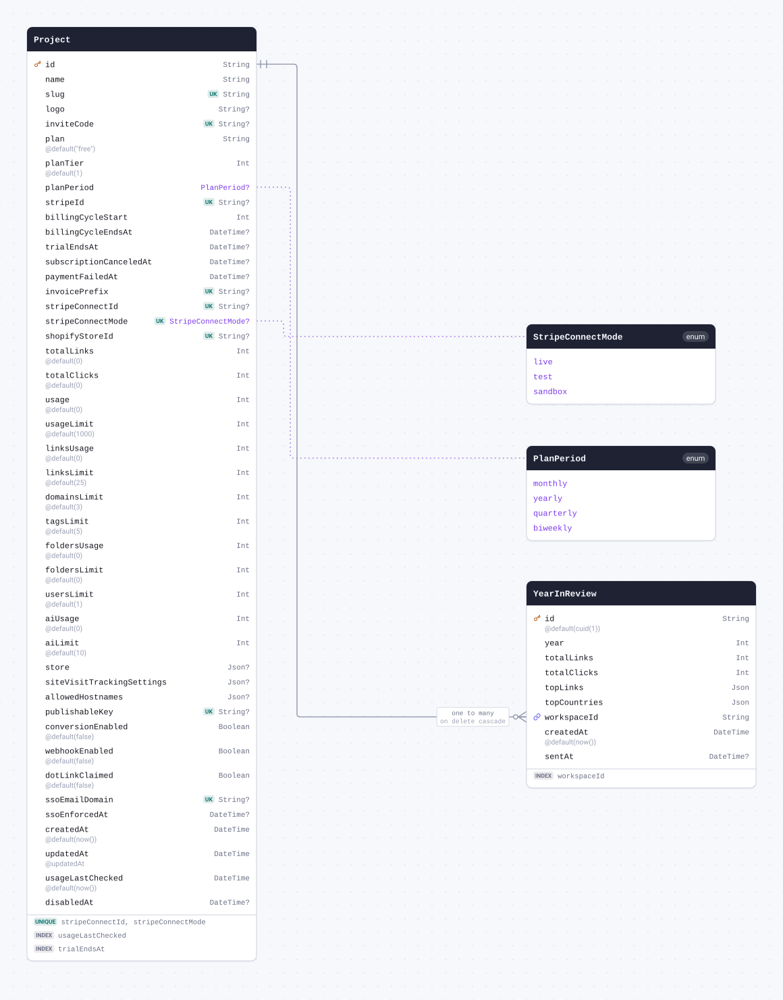

| Field          | Type       | Constraints                             | Default   | Description |
| -------------- | ---------- | --------------------------------------- | --------- | ----------- |
| `id`           | `String`   | PK NOT NULL                             | `cuid(1)` |             |
| `year`         | `Int`      | NOT NULL                                |           |             |
| `totalLinks`   | `Int`      | NOT NULL                                |           |             |
| `totalClicks`  | `Int`      | NOT NULL                                |           |             |
| `topLinks`     | `Json`     | NOT NULL                                |           |             |
| `topCountries` | `Json`     | NOT NULL                                |           |             |
| `workspaceId`  | `String`   | NOT NULL → [Project.id](#model-Project) |           |             |
| `createdAt`    | `DateTime` | NOT NULL                                | `now()`   |             |
| `sentAt`       | `DateTime` | NULL                                    |           |             |

#### Indexes

- `@@index([workspaceId])`

#### References

- `workspaceId` → [Project.id](#model-Project) (many-to-one, on delete Cascade)

#### Definition

```sql
CREATE TABLE `YearInReview` (
    `id` VARCHAR(191) NOT NULL,
    `year` INTEGER NOT NULL,
    `totalLinks` INTEGER NOT NULL,
    `totalClicks` INTEGER NOT NULL,
    `topLinks` JSON NOT NULL,
    `topCountries` JSON NOT NULL,
    `workspaceId` VARCHAR(191) NOT NULL,
    `createdAt` DATETIME(3) NOT NULL DEFAULT CURRENT_TIMESTAMP(3),
    `sentAt` DATETIME(3) NULL,

    INDEX `YearInReview_workspaceId_idx`(`workspaceId`),
    PRIMARY KEY (`id`)
) DEFAULT CHARACTER SET utf8mb4 COLLATE utf8mb4_unicode_ci;
```

<details>
<summary>Queries and their SQL</summary>

**findMany**: Every row

```ts
await prisma.yearInReview.findMany();
```

```sql
SELECT
  `YearInReview`.`id`,
  `YearInReview`.`year`,
  `YearInReview`.`totalLinks`,
  `YearInReview`.`totalClicks`,
  `YearInReview`.`topLinks`,
  `YearInReview`.`topCountries`,
  `YearInReview`.`workspaceId`,
  `YearInReview`.`createdAt`,
  `YearInReview`.`sentAt`
FROM
  `YearInReview`
WHERE
  1 = 1
```

**count**: How many rows there are

```ts
await prisma.yearInReview.count();
```

```sql
SELECT
  COUNT(*) AS `_count$_all`
FROM
  (
    SELECT
      `YearInReview`.`id`
    FROM
      `YearInReview`
    WHERE
      1 = 1
  ) AS `sub`
```

**findMany**: Every row with its relations

```ts
await prisma.yearInReview.findMany({ include: { workspace: true } });
```

```sql
SELECT
  `YearInReview`.`id`,
  `YearInReview`.`year`,
  `YearInReview`.`totalLinks`,
  `YearInReview`.`totalClicks`,
  `YearInReview`.`topLinks`,
  `YearInReview`.`topCountries`,
  `YearInReview`.`workspaceId`,
  `YearInReview`.`createdAt`,
  `YearInReview`.`sentAt`
FROM
  `YearInReview`
WHERE
  1 = 1

SELECT
  `Project`.`id`,
  `Project`.`name`,
  `Project`.`slug`,
  `Project`.`logo`,
  `Project`.`inviteCode`,
  `Project`.`plan`,
  `Project`.`planTier`,
  `Project`.`planPeriod`,
  `Project`.`stripeId`,
  `Project`.`billingCycleStart`,
  `Project`.`billingCycleEndsAt`,
  `Project`.`trialEndsAt`,
  `Project`.`subscriptionCanceledAt`,
  `Project`.`paymentFailedAt`,
  `Project`.`invoicePrefix`,
  `Project`.`stripeConnectId`,
  `Project`.`stripeConnectMode`,
  `Project`.`shopifyStoreId`,
  `Project`.`totalLinks`,
  `Project`.`totalClicks`,
  `Project`.`usage`,
  `Project`.`usageLimit`,
  `Project`.`linksUsage`,
  `Project`.`linksLimit`,
  `Project`.`domainsLimit`,
  `Project`.`tagsLimit`,
  `Project`.`foldersUsage`,
  `Project`.`foldersLimit`,
  `Project`.`usersLimit`,
  `Project`.`aiUsage`,
  `Project`.`aiLimit`,
  `Project`.`store`,
  `Project`.`siteVisitTrackingSettings`,
  `Project`.`allowedHostnames`,
  `Project`.`publishableKey`,
  `Project`.`conversionEnabled`,
  `Project`.`webhookEnabled`,
  `Project`.`dotLinkClaimed`,
  `Project`.`ssoEmailDomain`,
  `Project`.`ssoEnforcedAt`,
  `Project`.`createdAt`,
  `Project`.`updatedAt`,
  `Project`.`usageLastChecked`,
  `Project`.`disabledAt`
FROM
  `Project`
WHERE
  `Project`.`id` IN (?)
-- params: ["<workspaceId of the rows above>"]
```

**findUnique**: One row by what is unique to it

```ts
await prisma.yearInReview.findUnique({ where: { id: "example" } });
```

```sql
SELECT
  `YearInReview`.`id`,
  `YearInReview`.`year`,
  `YearInReview`.`totalLinks`,
  `YearInReview`.`totalClicks`,
  `YearInReview`.`topLinks`,
  `YearInReview`.`topCountries`,
  `YearInReview`.`workspaceId`,
  `YearInReview`.`createdAt`,
  `YearInReview`.`sentAt`
FROM
  `YearInReview`
WHERE
  (
    `YearInReview`.`id` = ?
    AND 1 = 1
  )
LIMIT
  ?
OFFSET
  ?
-- params: ["example","1","0"]
```

**create**: Create a row

```ts
await prisma.yearInReview.create({
  data: {
    year: 1,
    totalLinks: 1,
    totalClicks: 1,
    topLinks: {},
    topCountries: {},
    workspaceId: "example",
  },
});
```

```sql
INSERT INTO
  `YearInReview` (
    `id`,
    `year`,
    `totalLinks`,
    `totalClicks`,
    `topLinks`,
    `topCountries`,
    `workspaceId`,
    `createdAt`
  )
VALUES
  (?, ?, ?, ?, ?, ?, ?, ?)
-- params: ["<cuid(1)>","1","1","1","{}","{}","example","<now()>"]

SELECT
  `YearInReview`.`id`,
  `YearInReview`.`year`,
  `YearInReview`.`totalLinks`,
  `YearInReview`.`totalClicks`,
  `YearInReview`.`topLinks`,
  `YearInReview`.`topCountries`,
  `YearInReview`.`workspaceId`,
  `YearInReview`.`createdAt`,
  `YearInReview`.`sentAt`
FROM
  `YearInReview`
WHERE
  `YearInReview`.`id` = ?
LIMIT
  ?
OFFSET
  ?
-- params: ["<id of the rows above>","1","0"]
```

**update**: Update a row

```ts
await prisma.yearInReview.update({ where: { id: "example" }, data: { year: 1 } });
```

```sql
SELECT
  `YearInReview`.`id`
FROM
  `YearInReview`
WHERE
  (
    `YearInReview`.`id` = ?
    AND 1 = 1
  )
LIMIT
  ?
OFFSET
  ?
-- params: ["example","1","0"]

UPDATE `YearInReview`
SET
  `year` = ?
WHERE
  (
    `YearInReview`.`id` IN (?)
    AND (
      `YearInReview`.`id` = ?
      AND 1 = 1
    )
  )
-- params: ["1","<id of the rows above>","example"]

SELECT
  `YearInReview`.`id`,
  `YearInReview`.`year`,
  `YearInReview`.`totalLinks`,
  `YearInReview`.`totalClicks`,
  `YearInReview`.`topLinks`,
  `YearInReview`.`topCountries`,
  `YearInReview`.`workspaceId`,
  `YearInReview`.`createdAt`,
  `YearInReview`.`sentAt`
FROM
  `YearInReview`
WHERE
  `YearInReview`.`id` = ?
LIMIT
  ?
OFFSET
  ?
-- params: ["<id of the rows above>","1","0"]
```

**delete**: Delete a row

```ts
await prisma.yearInReview.delete({ where: { id: "example" } });
```

```sql
SELECT
  `YearInReview`.`id`,
  `YearInReview`.`year`,
  `YearInReview`.`totalLinks`,
  `YearInReview`.`totalClicks`,
  `YearInReview`.`topLinks`,
  `YearInReview`.`topCountries`,
  `YearInReview`.`workspaceId`,
  `YearInReview`.`createdAt`,
  `YearInReview`.`sentAt`
FROM
  `YearInReview`
WHERE
  (
    `YearInReview`.`id` = ?
    AND 1 = 1
  )
LIMIT
  ?
OFFSET
  ?
-- params: ["example","1","0"]

DELETE FROM `YearInReview`
WHERE
  (
    `YearInReview`.`id` = ?
    AND 1 = 1
  )
-- params: ["example"]
```

</details>

<a id="model-UserNotificationPreferences"></a>

### UserNotificationPreferences

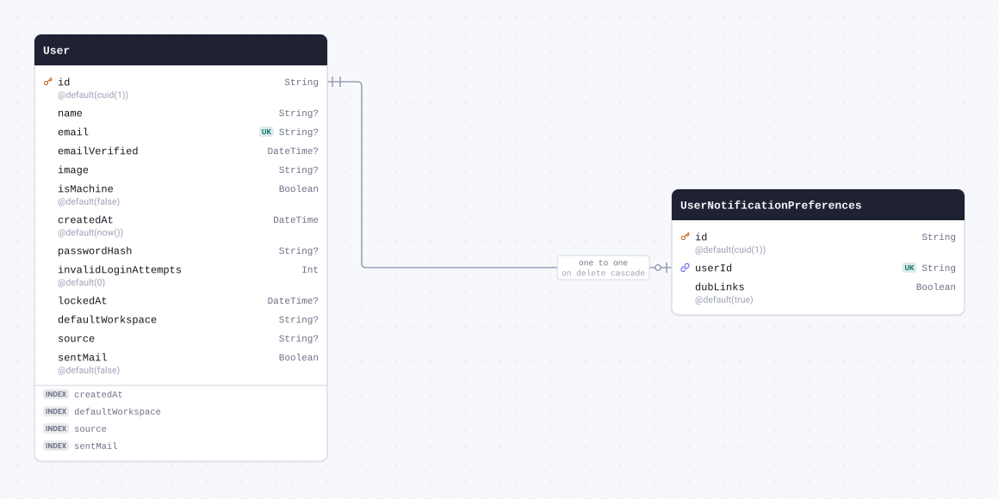

| Field      | Type      | Constraints                              | Default   | Description |
| ---------- | --------- | ---------------------------------------- | --------- | ----------- |
| `id`       | `String`  | PK NOT NULL                              | `cuid(1)` |             |
| `userId`   | `String`  | UNIQUE NOT NULL → [User.id](#model-User) |           |             |
| `dubLinks` | `Boolean` | NOT NULL                                 | `true`    |             |

#### References

- `userId` → [User.id](#model-User) (one-to-one, on delete Cascade)

#### Definition

```sql
CREATE TABLE `UserNotificationPreferences` (
    `id` VARCHAR(191) NOT NULL,
    `userId` VARCHAR(191) NOT NULL,
    `dubLinks` BOOLEAN NOT NULL DEFAULT true,

    UNIQUE INDEX `UserNotificationPreferences_userId_key`(`userId`),
    PRIMARY KEY (`id`)
) DEFAULT CHARACTER SET utf8mb4 COLLATE utf8mb4_unicode_ci;
```

<details>
<summary>Queries and their SQL</summary>

**findMany**: Every row

```ts
await prisma.userNotificationPreferences.findMany();
```

```sql
SELECT
  `UserNotificationPreferences`.`id`,
  `UserNotificationPreferences`.`userId`,
  `UserNotificationPreferences`.`dubLinks`
FROM
  `UserNotificationPreferences`
WHERE
  1 = 1
```

**count**: How many rows there are

```ts
await prisma.userNotificationPreferences.count();
```

```sql
SELECT
  COUNT(*) AS `_count$_all`
FROM
  (
    SELECT
      `UserNotificationPreferences`.`id`
    FROM
      `UserNotificationPreferences`
    WHERE
      1 = 1
  ) AS `sub`
```

**findMany**: Every row with its relations

```ts
await prisma.userNotificationPreferences.findMany({ include: { user: true } });
```

```sql
SELECT
  `UserNotificationPreferences`.`id`,
  `UserNotificationPreferences`.`userId`,
  `UserNotificationPreferences`.`dubLinks`
FROM
  `UserNotificationPreferences`
WHERE
  1 = 1

SELECT
  `User`.`id`,
  `User`.`name`,
  `User`.`email`,
  `User`.`emailVerified`,
  `User`.`image`,
  `User`.`isMachine`,
  `User`.`createdAt`,
  `User`.`passwordHash`,
  `User`.`invalidLoginAttempts`,
  `User`.`lockedAt`,
  `User`.`defaultWorkspace`,
  `User`.`source`,
  `User`.`sentMail`
FROM
  `User`
WHERE
  `User`.`id` IN (?)
-- params: ["<userId of the rows above>"]
```

**findUnique**: One row by what is unique to it

```ts
await prisma.userNotificationPreferences.findUnique({ where: { id: "example" } });
```

```sql
SELECT
  `UserNotificationPreferences`.`id`,
  `UserNotificationPreferences`.`userId`,
  `UserNotificationPreferences`.`dubLinks`
FROM
  `UserNotificationPreferences`
WHERE
  (
    `UserNotificationPreferences`.`id` = ?
    AND 1 = 1
  )
LIMIT
  ?
OFFSET
  ?
-- params: ["example","1","0"]
```

**create**: Create a row

```ts
await prisma.userNotificationPreferences.create({ data: { userId: "example" } });
```

```sql
INSERT INTO
  `UserNotificationPreferences` (`id`, `userId`, `dubLinks`)
VALUES
  (?, ?, ?)
-- params: ["<cuid(1)>","example",true]

SELECT
  `UserNotificationPreferences`.`id`,
  `UserNotificationPreferences`.`userId`,
  `UserNotificationPreferences`.`dubLinks`
FROM
  `UserNotificationPreferences`
WHERE
  `UserNotificationPreferences`.`id` = ?
LIMIT
  ?
OFFSET
  ?
-- params: ["<id of the rows above>","1","0"]
```

**update**: Update a row

```ts
await prisma.userNotificationPreferences.update({
  where: { id: "example" },
  data: { dubLinks: true },
});
```

```sql
SELECT
  `UserNotificationPreferences`.`id`
FROM
  `UserNotificationPreferences`
WHERE
  (
    `UserNotificationPreferences`.`id` = ?
    AND 1 = 1
  )
LIMIT
  ?
OFFSET
  ?
-- params: ["example","1","0"]

UPDATE `UserNotificationPreferences`
SET
  `dubLinks` = ?
WHERE
  (
    `UserNotificationPreferences`.`id` IN (?)
    AND (
      `UserNotificationPreferences`.`id` = ?
      AND 1 = 1
    )
  )
-- params: [true,"<id of the rows above>","example"]

SELECT
  `UserNotificationPreferences`.`id`,
  `UserNotificationPreferences`.`userId`,
  `UserNotificationPreferences`.`dubLinks`
FROM
  `UserNotificationPreferences`
WHERE
  `UserNotificationPreferences`.`id` = ?
LIMIT
  ?
OFFSET
  ?
-- params: ["<id of the rows above>","1","0"]
```

**delete**: Delete a row

```ts
await prisma.userNotificationPreferences.delete({ where: { id: "example" } });
```

```sql
SELECT
  `UserNotificationPreferences`.`id`,
  `UserNotificationPreferences`.`userId`,
  `UserNotificationPreferences`.`dubLinks`
FROM
  `UserNotificationPreferences`
WHERE
  (
    `UserNotificationPreferences`.`id` = ?
    AND 1 = 1
  )
LIMIT
  ?
OFFSET
  ?
-- params: ["example","1","0"]

DELETE FROM `UserNotificationPreferences`
WHERE
  (
    `UserNotificationPreferences`.`id` = ?
    AND 1 = 1
  )
-- params: ["example"]
```

</details>

<a id="model-NotificationPreference"></a>

### NotificationPreference

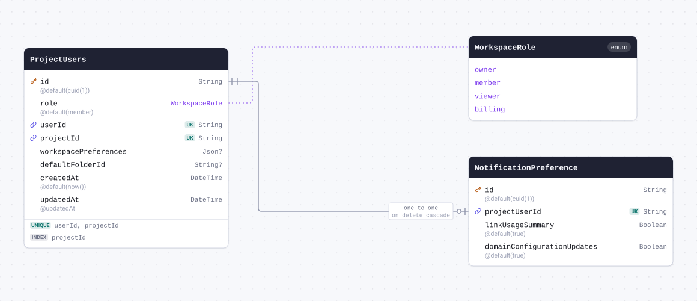

| Field                        | Type      | Constraints                                              | Default   | Description |
| ---------------------------- | --------- | -------------------------------------------------------- | --------- | ----------- |
| `id`                         | `String`  | PK NOT NULL                                              | `cuid(1)` |             |
| `projectUserId`              | `String`  | UNIQUE NOT NULL → [ProjectUsers.id](#model-ProjectUsers) |           |             |
| `linkUsageSummary`           | `Boolean` | NOT NULL                                                 | `true`    |             |
| `domainConfigurationUpdates` | `Boolean` | NOT NULL                                                 | `true`    |             |

#### References

- `projectUserId` → [ProjectUsers.id](#model-ProjectUsers) (one-to-one, on delete Cascade)

#### Definition

```sql
CREATE TABLE `NotificationPreference` (
    `id` VARCHAR(191) NOT NULL,
    `projectUserId` VARCHAR(191) NOT NULL,
    `linkUsageSummary` BOOLEAN NOT NULL DEFAULT true,
    `domainConfigurationUpdates` BOOLEAN NOT NULL DEFAULT true,

    UNIQUE INDEX `NotificationPreference_projectUserId_key`(`projectUserId`),
    PRIMARY KEY (`id`)
) DEFAULT CHARACTER SET utf8mb4 COLLATE utf8mb4_unicode_ci;
```

<details>
<summary>Queries and their SQL</summary>

**findMany**: Every row

```ts
await prisma.notificationPreference.findMany();
```

```sql
SELECT
  `NotificationPreference`.`id`,
  `NotificationPreference`.`projectUserId`,
  `NotificationPreference`.`linkUsageSummary`,
  `NotificationPreference`.`domainConfigurationUpdates`
FROM
  `NotificationPreference`
WHERE
  1 = 1
```

**count**: How many rows there are

```ts
await prisma.notificationPreference.count();
```

```sql
SELECT
  COUNT(*) AS `_count$_all`
FROM
  (
    SELECT
      `NotificationPreference`.`id`
    FROM
      `NotificationPreference`
    WHERE
      1 = 1
  ) AS `sub`
```

**findMany**: Every row with its relations

```ts
await prisma.notificationPreference.findMany({ include: { projectUser: true } });
```

```sql
SELECT
  `NotificationPreference`.`id`,
  `NotificationPreference`.`projectUserId`,
  `NotificationPreference`.`linkUsageSummary`,
  `NotificationPreference`.`domainConfigurationUpdates`
FROM
  `NotificationPreference`
WHERE
  1 = 1

SELECT
  `ProjectUsers`.`id`,
  `ProjectUsers`.`role`,
  `ProjectUsers`.`userId`,
  `ProjectUsers`.`projectId`,
  `ProjectUsers`.`workspacePreferences`,
  `ProjectUsers`.`defaultFolderId`,
  `ProjectUsers`.`createdAt`,
  `ProjectUsers`.`updatedAt`
FROM
  `ProjectUsers`
WHERE
  `ProjectUsers`.`id` IN (?)
-- params: ["<projectUserId of the rows above>"]
```

**findUnique**: One row by what is unique to it

```ts
await prisma.notificationPreference.findUnique({ where: { id: "example" } });
```

```sql
SELECT
  `NotificationPreference`.`id`,
  `NotificationPreference`.`projectUserId`,
  `NotificationPreference`.`linkUsageSummary`,
  `NotificationPreference`.`domainConfigurationUpdates`
FROM
  `NotificationPreference`
WHERE
  (
    `NotificationPreference`.`id` = ?
    AND 1 = 1
  )
LIMIT
  ?
OFFSET
  ?
-- params: ["example","1","0"]
```

**create**: Create a row

```ts
await prisma.notificationPreference.create({ data: { projectUserId: "example" } });
```

```sql
INSERT INTO
  `NotificationPreference` (
    `id`,
    `projectUserId`,
    `linkUsageSummary`,
    `domainConfigurationUpdates`
  )
VALUES
  (?, ?, ?, ?)
-- params: ["<cuid(1)>","example",true,true]

SELECT
  `NotificationPreference`.`id`,
  `NotificationPreference`.`projectUserId`,
  `NotificationPreference`.`linkUsageSummary`,
  `NotificationPreference`.`domainConfigurationUpdates`
FROM
  `NotificationPreference`
WHERE
  `NotificationPreference`.`id` = ?
LIMIT
  ?
OFFSET
  ?
-- params: ["<id of the rows above>","1","0"]
```

**update**: Update a row

```ts
await prisma.notificationPreference.update({
  where: { id: "example" },
  data: { linkUsageSummary: true },
});
```

```sql
SELECT
  `NotificationPreference`.`id`
FROM
  `NotificationPreference`
WHERE
  (
    `NotificationPreference`.`id` = ?
    AND 1 = 1
  )
LIMIT
  ?
OFFSET
  ?
-- params: ["example","1","0"]

UPDATE `NotificationPreference`
SET
  `linkUsageSummary` = ?
WHERE
  (
    `NotificationPreference`.`id` IN (?)
    AND (
      `NotificationPreference`.`id` = ?
      AND 1 = 1
    )
  )
-- params: [true,"<id of the rows above>","example"]

SELECT
  `NotificationPreference`.`id`,
  `NotificationPreference`.`projectUserId`,
  `NotificationPreference`.`linkUsageSummary`,
  `NotificationPreference`.`domainConfigurationUpdates`
FROM
  `NotificationPreference`
WHERE
  `NotificationPreference`.`id` = ?
LIMIT
  ?
OFFSET
  ?
-- params: ["<id of the rows above>","1","0"]
```

**delete**: Delete a row

```ts
await prisma.notificationPreference.delete({ where: { id: "example" } });
```

```sql
SELECT
  `NotificationPreference`.`id`,
  `NotificationPreference`.`projectUserId`,
  `NotificationPreference`.`linkUsageSummary`,
  `NotificationPreference`.`domainConfigurationUpdates`
FROM
  `NotificationPreference`
WHERE
  (
    `NotificationPreference`.`id` = ?
    AND 1 = 1
  )
LIMIT
  ?
OFFSET
  ?
-- params: ["example","1","0"]

DELETE FROM `NotificationPreference`
WHERE
  (
    `NotificationPreference`.`id` = ?
    AND 1 = 1
  )
-- params: ["example"]
```

</details>

<a id="model-OAuthApp"></a>

### OAuthApp

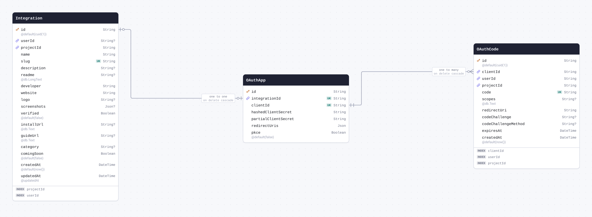

| Field                 | Type      | Constraints                                            | Default | Description |
| --------------------- | --------- | ------------------------------------------------------ | ------- | ----------- |
| `id`                  | `String`  | PK NOT NULL                                            |         |             |
| `integrationId`       | `String`  | UNIQUE NOT NULL → [Integration.id](#model-Integration) |         |             |
| `clientId`            | `String`  | UNIQUE NOT NULL                                        |         |             |
| `hashedClientSecret`  | `String`  | NOT NULL                                               |         |             |
| `partialClientSecret` | `String`  | NOT NULL                                               |         |             |
| `redirectUris`        | `Json`    | NOT NULL                                               |         |             |
| `pkce`                | `Boolean` | NOT NULL                                               | `false` |             |

#### References

- `integrationId` → [Integration.id](#model-Integration) (one-to-one, on delete Cascade)

#### Referenced by

- `clientId` ← [OAuthCode.clientId](#model-OAuthCode) (one-to-many, on delete Cascade)

#### Definition

```sql
CREATE TABLE `OAuthApp` (
    `id` VARCHAR(191) NOT NULL,
    `integrationId` VARCHAR(191) NOT NULL,
    `clientId` VARCHAR(191) NOT NULL,
    `hashedClientSecret` VARCHAR(191) NOT NULL,
    `partialClientSecret` VARCHAR(191) NOT NULL,
    `redirectUris` JSON NOT NULL,
    `pkce` BOOLEAN NOT NULL DEFAULT false,

    UNIQUE INDEX `OAuthApp_integrationId_key`(`integrationId`),
    UNIQUE INDEX `OAuthApp_clientId_key`(`clientId`),
    PRIMARY KEY (`id`)
) DEFAULT CHARACTER SET utf8mb4 COLLATE utf8mb4_unicode_ci;
```

<details>
<summary>Queries and their SQL</summary>

**findMany**: Every row

```ts
await prisma.oAuthApp.findMany();
```

```sql
SELECT
  `OAuthApp`.`id`,
  `OAuthApp`.`integrationId`,
  `OAuthApp`.`clientId`,
  `OAuthApp`.`hashedClientSecret`,
  `OAuthApp`.`partialClientSecret`,
  `OAuthApp`.`redirectUris`,
  `OAuthApp`.`pkce`
FROM
  `OAuthApp`
WHERE
  1 = 1
```

**count**: How many rows there are

```ts
await prisma.oAuthApp.count();
```

```sql
SELECT
  COUNT(*) AS `_count$_all`
FROM
  (
    SELECT
      `OAuthApp`.`id`
    FROM
      `OAuthApp`
    WHERE
      1 = 1
  ) AS `sub`
```

**findMany**: Every row with its relations

```ts
await prisma.oAuthApp.findMany({ include: { oAuthCodes: true, integration: true } });
```

```sql
SELECT
  `OAuthApp`.`id`,
  `OAuthApp`.`integrationId`,
  `OAuthApp`.`clientId`,
  `OAuthApp`.`hashedClientSecret`,
  `OAuthApp`.`partialClientSecret`,
  `OAuthApp`.`redirectUris`,
  `OAuthApp`.`pkce`
FROM
  `OAuthApp`
WHERE
  1 = 1

SELECT
  `OAuthCode`.`id`,
  `OAuthCode`.`clientId`,
  `OAuthCode`.`userId`,
  `OAuthCode`.`projectId`,
  `OAuthCode`.`code`,
  `OAuthCode`.`scopes`,
  `OAuthCode`.`redirectUri`,
  `OAuthCode`.`codeChallenge`,
  `OAuthCode`.`codeChallengeMethod`,
  `OAuthCode`.`expiresAt`,
  `OAuthCode`.`createdAt`
FROM
  `OAuthCode`
WHERE
  `OAuthCode`.`clientId` IN (?)
-- params: ["<clientId of the rows above>"]

SELECT
  `Integration`.`id`,
  `Integration`.`userId`,
  `Integration`.`projectId`,
  `Integration`.`name`,
  `Integration`.`slug`,
  `Integration`.`description`,
  `Integration`.`readme`,
  `Integration`.`developer`,
  `Integration`.`website`,
  `Integration`.`logo`,
  `Integration`.`screenshots`,
  `Integration`.`verified`,
  `Integration`.`installUrl`,
  `Integration`.`guideUrl`,
  `Integration`.`category`,
  `Integration`.`comingSoon`,
  `Integration`.`createdAt`,
  `Integration`.`updatedAt`
FROM
  `Integration`
WHERE
  `Integration`.`id` IN (?)
-- params: ["<integrationId of the rows above>"]
```

**findUnique**: One row by what is unique to it

```ts
await prisma.oAuthApp.findUnique({ where: { id: "example" } });
```

```sql
SELECT
  `OAuthApp`.`id`,
  `OAuthApp`.`integrationId`,
  `OAuthApp`.`clientId`,
  `OAuthApp`.`hashedClientSecret`,
  `OAuthApp`.`partialClientSecret`,
  `OAuthApp`.`redirectUris`,
  `OAuthApp`.`pkce`
FROM
  `OAuthApp`
WHERE
  (
    `OAuthApp`.`id` = ?
    AND 1 = 1
  )
LIMIT
  ?
OFFSET
  ?
-- params: ["example","1","0"]
```

**create**: Create a row

```ts
await prisma.oAuthApp.create({
  data: {
    id: "example",
    integrationId: "example",
    clientId: "example",
    hashedClientSecret: "example",
    partialClientSecret: "example",
    redirectUris: {},
  },
});
```

```sql
INSERT INTO
  `OAuthApp` (
    `id`,
    `integrationId`,
    `clientId`,
    `hashedClientSecret`,
    `partialClientSecret`,
    `redirectUris`,
    `pkce`
  )
VALUES
  (?, ?, ?, ?, ?, ?, ?)
-- params: ["example","example","example","example","example","{}",false]

SELECT
  `OAuthApp`.`id`,
  `OAuthApp`.`integrationId`,
  `OAuthApp`.`clientId`,
  `OAuthApp`.`hashedClientSecret`,
  `OAuthApp`.`partialClientSecret`,
  `OAuthApp`.`redirectUris`,
  `OAuthApp`.`pkce`
FROM
  `OAuthApp`
WHERE
  `OAuthApp`.`id` = ?
LIMIT
  ?
OFFSET
  ?
-- params: ["<id of the rows above>","1","0"]
```

**update**: Update a row

```ts
await prisma.oAuthApp.update({ where: { id: "example" }, data: { clientId: "example" } });
```

```sql
SELECT
  `OAuthApp`.`id`,
  `OAuthApp`.`clientId`
FROM
  `OAuthApp`
WHERE
  (
    `OAuthApp`.`id` = ?
    AND 1 = 1
  )
LIMIT
  ?
OFFSET
  ?
-- params: ["example","1","0"]

SELECT
  `OAuthCode`.`id`,
  `OAuthCode`.`clientId`
FROM
  `OAuthCode`
WHERE
  (
    1 = 1
    AND `OAuthCode`.`clientId` IN (?)
  )
-- params: ["<clientId of the rows above>"]

UPDATE `OAuthCode`
SET
  `clientId` = ?
WHERE
  (
    `OAuthCode`.`id` IN (?)
    AND 1 = 1
  )
-- params: ["example","<id of the rows above>"]

UPDATE `OAuthApp`
SET
  `clientId` = ?
WHERE
  (
    `OAuthApp`.`id` IN (?)
    AND (
      `OAuthApp`.`id` = ?
      AND 1 = 1
    )
  )
-- params: ["example","<id of the rows above>","example"]

SELECT
  `OAuthApp`.`id`,
  `OAuthApp`.`integrationId`,
  `OAuthApp`.`clientId`,
  `OAuthApp`.`hashedClientSecret`,
  `OAuthApp`.`partialClientSecret`,
  `OAuthApp`.`redirectUris`,
  `OAuthApp`.`pkce`
FROM
  `OAuthApp`
WHERE
  `OAuthApp`.`id` = ?
LIMIT
  ?
OFFSET
  ?
-- params: ["<id of the rows above>","1","0"]
```

**delete**: Delete a row

```ts
await prisma.oAuthApp.delete({ where: { id: "example" } });
```

```sql
SELECT
  `OAuthApp`.`id`,
  `OAuthApp`.`integrationId`,
  `OAuthApp`.`clientId`,
  `OAuthApp`.`hashedClientSecret`,
  `OAuthApp`.`partialClientSecret`,
  `OAuthApp`.`redirectUris`,
  `OAuthApp`.`pkce`
FROM
  `OAuthApp`
WHERE
  (
    `OAuthApp`.`id` = ?
    AND 1 = 1
  )
LIMIT
  ?
OFFSET
  ?
-- params: ["example","1","0"]

SELECT
  `OAuthCode`.`id`,
  `OAuthCode`.`clientId`
FROM
  `OAuthCode`
WHERE
  (
    1 = 1
    AND `OAuthCode`.`clientId` IN (?)
  )
-- params: ["<clientId of the rows above>"]

DELETE FROM `OAuthCode`
WHERE
  (
    `OAuthCode`.`id` IN (?)
    AND 1 = 1
  )
-- params: ["<id of the rows above>"]

DELETE FROM `OAuthApp`
WHERE
  (
    `OAuthApp`.`id` = ?
    AND 1 = 1
  )
-- params: ["example"]
```

</details>

<a id="model-OAuthCode"></a>

### OAuthCode

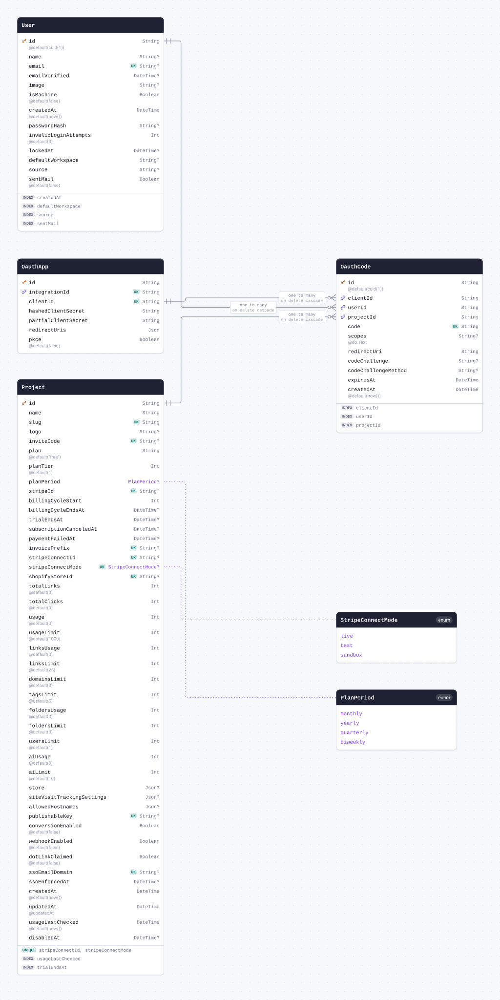

| Field                 | Type                | Constraints                                     | Default   | Description |
| --------------------- | ------------------- | ----------------------------------------------- | --------- | ----------- |
| `id`                  | `String`            | PK NOT NULL                                     | `cuid(1)` |             |
| `clientId`            | `String`            | NOT NULL → [OAuthApp.clientId](#model-OAuthApp) |           |             |
| `userId`              | `String`            | NOT NULL → [User.id](#model-User)               |           |             |
| `projectId`           | `String`            | NOT NULL → [Project.id](#model-Project)         |           |             |
| `code`                | `String`            | UNIQUE NOT NULL                                 |           |             |
| `scopes`              | `String` `@db.Text` | NULL                                            |           |             |
| `redirectUri`         | `String`            | NOT NULL                                        |           |             |
| `codeChallenge`       | `String`            | NULL                                            |           |             |
| `codeChallengeMethod` | `String`            | NULL                                            |           |             |
| `expiresAt`           | `DateTime`          | NOT NULL                                        |           |             |
| `createdAt`           | `DateTime`          | NOT NULL                                        | `now()`   |             |

#### Indexes

- `@@index([clientId])`
- `@@index([userId])`
- `@@index([projectId])`

#### References

- `clientId` → [OAuthApp.clientId](#model-OAuthApp) (many-to-one, on delete Cascade)
- `userId` → [User.id](#model-User) (many-to-one, on delete Cascade)
- `projectId` → [Project.id](#model-Project) (many-to-one, on delete Cascade)

#### Definition

```sql
CREATE TABLE `OAuthCode` (
    `id` VARCHAR(191) NOT NULL,
    `clientId` VARCHAR(191) NOT NULL,
    `userId` VARCHAR(191) NOT NULL,
    `projectId` VARCHAR(191) NOT NULL,
    `code` VARCHAR(191) NOT NULL,
    `scopes` TEXT NULL,
    `redirectUri` VARCHAR(191) NOT NULL,
    `codeChallenge` VARCHAR(191) NULL,
    `codeChallengeMethod` VARCHAR(191) NULL,
    `expiresAt` DATETIME(3) NOT NULL,
    `createdAt` DATETIME(3) NOT NULL DEFAULT CURRENT_TIMESTAMP(3),

    UNIQUE INDEX `OAuthCode_code_key`(`code`),
    INDEX `OAuthCode_clientId_idx`(`clientId`),
    INDEX `OAuthCode_userId_idx`(`userId`),
    INDEX `OAuthCode_projectId_idx`(`projectId`),
    PRIMARY KEY (`id`)
) DEFAULT CHARACTER SET utf8mb4 COLLATE utf8mb4_unicode_ci;
```

<details>
<summary>Queries and their SQL</summary>

**findMany**: Every row

```ts
await prisma.oAuthCode.findMany();
```

```sql
SELECT
  `OAuthCode`.`id`,
  `OAuthCode`.`clientId`,
  `OAuthCode`.`userId`,
  `OAuthCode`.`projectId`,
  `OAuthCode`.`code`,
  `OAuthCode`.`scopes`,
  `OAuthCode`.`redirectUri`,
  `OAuthCode`.`codeChallenge`,
  `OAuthCode`.`codeChallengeMethod`,
  `OAuthCode`.`expiresAt`,
  `OAuthCode`.`createdAt`
FROM
  `OAuthCode`
WHERE
  1 = 1
```

**count**: How many rows there are

```ts
await prisma.oAuthCode.count();
```

```sql
SELECT
  COUNT(*) AS `_count$_all`
FROM
  (
    SELECT
      `OAuthCode`.`id`
    FROM
      `OAuthCode`
    WHERE
      1 = 1
  ) AS `sub`
```

**findMany**: Every row with its relations

```ts
await prisma.oAuthCode.findMany({ include: { oAuthApp: true, user: true, project: true } });
```

```sql
SELECT
  `OAuthCode`.`id`,
  `OAuthCode`.`clientId`,
  `OAuthCode`.`userId`,
  `OAuthCode`.`projectId`,
  `OAuthCode`.`code`,
  `OAuthCode`.`scopes`,
  `OAuthCode`.`redirectUri`,
  `OAuthCode`.`codeChallenge`,
  `OAuthCode`.`codeChallengeMethod`,
  `OAuthCode`.`expiresAt`,
  `OAuthCode`.`createdAt`
FROM
  `OAuthCode`
WHERE
  1 = 1

SELECT
  `OAuthApp`.`id`,
  `OAuthApp`.`integrationId`,
  `OAuthApp`.`clientId`,
  `OAuthApp`.`hashedClientSecret`,
  `OAuthApp`.`partialClientSecret`,
  `OAuthApp`.`redirectUris`,
  `OAuthApp`.`pkce`
FROM
  `OAuthApp`
WHERE
  `OAuthApp`.`clientId` IN (?)
-- params: ["<clientId of the rows above>"]

SELECT
  `User`.`id`,
  `User`.`name`,
  `User`.`email`,
  `User`.`emailVerified`,
  `User`.`image`,
  `User`.`isMachine`,
  `User`.`createdAt`,
  `User`.`passwordHash`,
  `User`.`invalidLoginAttempts`,
  `User`.`lockedAt`,
  `User`.`defaultWorkspace`,
  `User`.`source`,
  `User`.`sentMail`
FROM
  `User`
WHERE
  `User`.`id` IN (?)
-- params: ["<userId of the rows above>"]

SELECT
  `Project`.`id`,
  `Project`.`name`,
  `Project`.`slug`,
  `Project`.`logo`,
  `Project`.`inviteCode`,
  `Project`.`plan`,
  `Project`.`planTier`,
  `Project`.`planPeriod`,
  `Project`.`stripeId`,
  `Project`.`billingCycleStart`,
  `Project`.`billingCycleEndsAt`,
  `Project`.`trialEndsAt`,
  `Project`.`subscriptionCanceledAt`,
  `Project`.`paymentFailedAt`,
  `Project`.`invoicePrefix`,
  `Project`.`stripeConnectId`,
  `Project`.`stripeConnectMode`,
  `Project`.`shopifyStoreId`,
  `Project`.`totalLinks`,
  `Project`.`totalClicks`,
  `Project`.`usage`,
  `Project`.`usageLimit`,
  `Project`.`linksUsage`,
  `Project`.`linksLimit`,
  `Project`.`domainsLimit`,
  `Project`.`tagsLimit`,
  `Project`.`foldersUsage`,
  `Project`.`foldersLimit`,
  `Project`.`usersLimit`,
  `Project`.`aiUsage`,
  `Project`.`aiLimit`,
  `Project`.`store`,
  `Project`.`siteVisitTrackingSettings`,
  `Project`.`allowedHostnames`,
  `Project`.`publishableKey`,
  `Project`.`conversionEnabled`,
  `Project`.`webhookEnabled`,
  `Project`.`dotLinkClaimed`,
  `Project`.`ssoEmailDomain`,
  `Project`.`ssoEnforcedAt`,
  `Project`.`createdAt`,
  `Project`.`updatedAt`,
  `Project`.`usageLastChecked`,
  `Project`.`disabledAt`
FROM
  `Project`
WHERE
  `Project`.`id` IN (?)
-- params: ["<projectId of the rows above>"]
```

**findUnique**: One row by what is unique to it

```ts
await prisma.oAuthCode.findUnique({ where: { id: "example" } });
```

```sql
SELECT
  `OAuthCode`.`id`,
  `OAuthCode`.`clientId`,
  `OAuthCode`.`userId`,
  `OAuthCode`.`projectId`,
  `OAuthCode`.`code`,
  `OAuthCode`.`scopes`,
  `OAuthCode`.`redirectUri`,
  `OAuthCode`.`codeChallenge`,
  `OAuthCode`.`codeChallengeMethod`,
  `OAuthCode`.`expiresAt`,
  `OAuthCode`.`createdAt`
FROM
  `OAuthCode`
WHERE
  (
    `OAuthCode`.`id` = ?
    AND 1 = 1
  )
LIMIT
  ?
OFFSET
  ?
-- params: ["example","1","0"]
```

**create**: Create a row

```ts
await prisma.oAuthCode.create({
  data: {
    clientId: "example",
    userId: "example",
    projectId: "example",
    code: "example",
    redirectUri: "example",
    expiresAt: new Date("2026-01-01T00:00:00.000Z"),
  },
});
```

```sql
INSERT INTO
  `OAuthCode` (
    `id`,
    `clientId`,
    `userId`,
    `projectId`,
    `code`,
    `redirectUri`,
    `expiresAt`,
    `createdAt`
  )
VALUES
  (?, ?, ?, ?, ?, ?, ?, ?)
-- params: ["<cuid(1)>","example","example","example","example","example","2026-01-01T00:00:00.000Z","<now()>"]

SELECT
  `OAuthCode`.`id`,
  `OAuthCode`.`clientId`,
  `OAuthCode`.`userId`,
  `OAuthCode`.`projectId`,
  `OAuthCode`.`code`,
  `OAuthCode`.`scopes`,
  `OAuthCode`.`redirectUri`,
  `OAuthCode`.`codeChallenge`,
  `OAuthCode`.`codeChallengeMethod`,
  `OAuthCode`.`expiresAt`,
  `OAuthCode`.`createdAt`
FROM
  `OAuthCode`
WHERE
  `OAuthCode`.`id` = ?
LIMIT
  ?
OFFSET
  ?
-- params: ["<id of the rows above>","1","0"]
```

**update**: Update a row

```ts
await prisma.oAuthCode.update({ where: { id: "example" }, data: { code: "example" } });
```

```sql
SELECT
  `OAuthCode`.`id`
FROM
  `OAuthCode`
WHERE
  (
    `OAuthCode`.`id` = ?
    AND 1 = 1
  )
LIMIT
  ?
OFFSET
  ?
-- params: ["example","1","0"]

UPDATE `OAuthCode`
SET
  `code` = ?
WHERE
  (
    `OAuthCode`.`id` IN (?)
    AND (
      `OAuthCode`.`id` = ?
      AND 1 = 1
    )
  )
-- params: ["example","<id of the rows above>","example"]

SELECT
  `OAuthCode`.`id`,
  `OAuthCode`.`clientId`,
  `OAuthCode`.`userId`,
  `OAuthCode`.`projectId`,
  `OAuthCode`.`code`,
  `OAuthCode`.`scopes`,
  `OAuthCode`.`redirectUri`,
  `OAuthCode`.`codeChallenge`,
  `OAuthCode`.`codeChallengeMethod`,
  `OAuthCode`.`expiresAt`,
  `OAuthCode`.`createdAt`
FROM
  `OAuthCode`
WHERE
  `OAuthCode`.`id` = ?
LIMIT
  ?
OFFSET
  ?
-- params: ["<id of the rows above>","1","0"]
```

**delete**: Delete a row

```ts
await prisma.oAuthCode.delete({ where: { id: "example" } });
```

```sql
SELECT
  `OAuthCode`.`id`,
  `OAuthCode`.`clientId`,
  `OAuthCode`.`userId`,
  `OAuthCode`.`projectId`,
  `OAuthCode`.`code`,
  `OAuthCode`.`scopes`,
  `OAuthCode`.`redirectUri`,
  `OAuthCode`.`codeChallenge`,
  `OAuthCode`.`codeChallengeMethod`,
  `OAuthCode`.`expiresAt`,
  `OAuthCode`.`createdAt`
FROM
  `OAuthCode`
WHERE
  (
    `OAuthCode`.`id` = ?
    AND 1 = 1
  )
LIMIT
  ?
OFFSET
  ?
-- params: ["example","1","0"]

DELETE FROM `OAuthCode`
WHERE
  (
    `OAuthCode`.`id` = ?
    AND 1 = 1
  )
-- params: ["example"]
```

</details>

<a id="model-OAuthRefreshToken"></a>

### OAuthRefreshToken

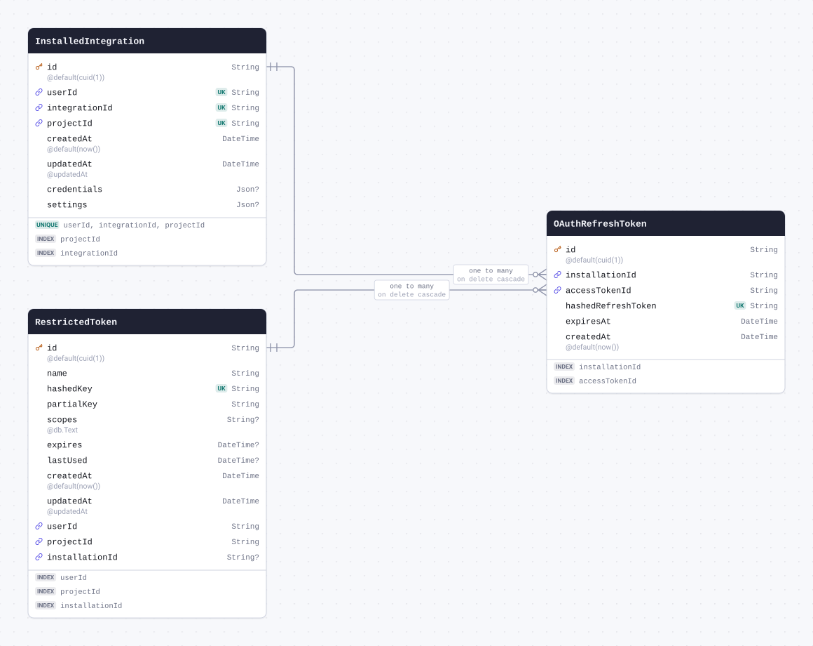

| Field                | Type       | Constraints                                                       | Default   | Description |
| -------------------- | ---------- | ----------------------------------------------------------------- | --------- | ----------- |
| `id`                 | `String`   | PK NOT NULL                                                       | `cuid(1)` |             |
| `installationId`     | `String`   | NOT NULL → [InstalledIntegration.id](#model-InstalledIntegration) |           |             |
| `accessTokenId`      | `String`   | NOT NULL → [RestrictedToken.id](#model-RestrictedToken)           |           |             |
| `hashedRefreshToken` | `String`   | UNIQUE NOT NULL                                                   |           |             |
| `expiresAt`          | `DateTime` | NOT NULL                                                          |           |             |
| `createdAt`          | `DateTime` | NOT NULL                                                          | `now()`   |             |

#### Indexes

- `@@index([installationId])`
- `@@index([accessTokenId])`

#### References

- `accessTokenId` → [RestrictedToken.id](#model-RestrictedToken) (many-to-one, on delete Cascade)
- `installationId` → [InstalledIntegration.id](#model-InstalledIntegration) (many-to-one, on delete Cascade)

#### Definition

```sql
CREATE TABLE `OAuthRefreshToken` (
    `id` VARCHAR(191) NOT NULL,
    `installationId` VARCHAR(191) NOT NULL,
    `accessTokenId` VARCHAR(191) NOT NULL,
    `hashedRefreshToken` VARCHAR(191) NOT NULL,
    `expiresAt` DATETIME(3) NOT NULL,
    `createdAt` DATETIME(3) NOT NULL DEFAULT CURRENT_TIMESTAMP(3),

    UNIQUE INDEX `OAuthRefreshToken_hashedRefreshToken_key`(`hashedRefreshToken`),
    INDEX `OAuthRefreshToken_installationId_idx`(`installationId`),
    INDEX `OAuthRefreshToken_accessTokenId_idx`(`accessTokenId`),
    PRIMARY KEY (`id`)
) DEFAULT CHARACTER SET utf8mb4 COLLATE utf8mb4_unicode_ci;
```

<details>
<summary>Queries and their SQL</summary>

**findMany**: Every row

```ts
await prisma.oAuthRefreshToken.findMany();
```

```sql
SELECT
  `OAuthRefreshToken`.`id`,
  `OAuthRefreshToken`.`installationId`,
  `OAuthRefreshToken`.`accessTokenId`,
  `OAuthRefreshToken`.`hashedRefreshToken`,
  `OAuthRefreshToken`.`expiresAt`,
  `OAuthRefreshToken`.`createdAt`
FROM
  `OAuthRefreshToken`
WHERE
  1 = 1
```

**count**: How many rows there are

```ts
await prisma.oAuthRefreshToken.count();
```

```sql
SELECT
  COUNT(*) AS `_count$_all`
FROM
  (
    SELECT
      `OAuthRefreshToken`.`id`
    FROM
      `OAuthRefreshToken`
    WHERE
      1 = 1
  ) AS `sub`
```

**findMany**: Every row with its relations

```ts
await prisma.oAuthRefreshToken.findMany({
  include: { accessToken: true, installedIntegration: true },
});
```

```sql
SELECT
  `OAuthRefreshToken`.`id`,
  `OAuthRefreshToken`.`installationId`,
  `OAuthRefreshToken`.`accessTokenId`,
  `OAuthRefreshToken`.`hashedRefreshToken`,
  `OAuthRefreshToken`.`expiresAt`,
  `OAuthRefreshToken`.`createdAt`
FROM
  `OAuthRefreshToken`
WHERE
  1 = 1

SELECT
  `RestrictedToken`.`id`,
  `RestrictedToken`.`name`,
  `RestrictedToken`.`hashedKey`,
  `RestrictedToken`.`partialKey`,
  `RestrictedToken`.`scopes`,
  `RestrictedToken`.`expires`,
  `RestrictedToken`.`lastUsed`,
  `RestrictedToken`.`createdAt`,
  `RestrictedToken`.`updatedAt`,
  `RestrictedToken`.`userId`,
  `RestrictedToken`.`projectId`,
  `RestrictedToken`.`installationId`
FROM
  `RestrictedToken`
WHERE
  `RestrictedToken`.`id` IN (?)
-- params: ["<accessTokenId of the rows above>"]

SELECT
  `InstalledIntegration`.`id`,
  `InstalledIntegration`.`userId`,
  `InstalledIntegration`.`integrationId`,
  `InstalledIntegration`.`projectId`,
  `InstalledIntegration`.`createdAt`,
  `InstalledIntegration`.`updatedAt`,
  `InstalledIntegration`.`credentials`,
  `InstalledIntegration`.`settings`
FROM
  `InstalledIntegration`
WHERE
  `InstalledIntegration`.`id` IN (?)
-- params: ["<installationId of the rows above>"]
```

**findUnique**: One row by what is unique to it

```ts
await prisma.oAuthRefreshToken.findUnique({ where: { id: "example" } });
```

```sql
SELECT
  `OAuthRefreshToken`.`id`,
  `OAuthRefreshToken`.`installationId`,
  `OAuthRefreshToken`.`accessTokenId`,
  `OAuthRefreshToken`.`hashedRefreshToken`,
  `OAuthRefreshToken`.`expiresAt`,
  `OAuthRefreshToken`.`createdAt`
FROM
  `OAuthRefreshToken`
WHERE
  (
    `OAuthRefreshToken`.`id` = ?
    AND 1 = 1
  )
LIMIT
  ?
OFFSET
  ?
-- params: ["example","1","0"]
```

**create**: Create a row

```ts
await prisma.oAuthRefreshToken.create({
  data: {
    installationId: "example",
    accessTokenId: "example",
    hashedRefreshToken: "example",
    expiresAt: new Date("2026-01-01T00:00:00.000Z"),
  },
});
```

```sql
INSERT INTO
  `OAuthRefreshToken` (
    `id`,
    `installationId`,
    `accessTokenId`,
    `hashedRefreshToken`,
    `expiresAt`,
    `createdAt`
  )
VALUES
  (?, ?, ?, ?, ?, ?)
-- params: ["<cuid(1)>","example","example","example","2026-01-01T00:00:00.000Z","<now()>"]

SELECT
  `OAuthRefreshToken`.`id`,
  `OAuthRefreshToken`.`installationId`,
  `OAuthRefreshToken`.`accessTokenId`,
  `OAuthRefreshToken`.`hashedRefreshToken`,
  `OAuthRefreshToken`.`expiresAt`,
  `OAuthRefreshToken`.`createdAt`
FROM
  `OAuthRefreshToken`
WHERE
  `OAuthRefreshToken`.`id` = ?
LIMIT
  ?
OFFSET
  ?
-- params: ["<id of the rows above>","1","0"]
```

**update**: Update a row

```ts
await prisma.oAuthRefreshToken.update({
  where: { id: "example" },
  data: { hashedRefreshToken: "example" },
});
```

```sql
SELECT
  `OAuthRefreshToken`.`id`
FROM
  `OAuthRefreshToken`
WHERE
  (
    `OAuthRefreshToken`.`id` = ?
    AND 1 = 1
  )
LIMIT
  ?
OFFSET
  ?
-- params: ["example","1","0"]

UPDATE `OAuthRefreshToken`
SET
  `hashedRefreshToken` = ?
WHERE
  (
    `OAuthRefreshToken`.`id` IN (?)
    AND (
      `OAuthRefreshToken`.`id` = ?
      AND 1 = 1
    )
  )
-- params: ["example","<id of the rows above>","example"]

SELECT
  `OAuthRefreshToken`.`id`,
  `OAuthRefreshToken`.`installationId`,
  `OAuthRefreshToken`.`accessTokenId`,
  `OAuthRefreshToken`.`hashedRefreshToken`,
  `OAuthRefreshToken`.`expiresAt`,
  `OAuthRefreshToken`.`createdAt`
FROM
  `OAuthRefreshToken`
WHERE
  `OAuthRefreshToken`.`id` = ?
LIMIT
  ?
OFFSET
  ?
-- params: ["<id of the rows above>","1","0"]
```

**delete**: Delete a row

```ts
await prisma.oAuthRefreshToken.delete({ where: { id: "example" } });
```

```sql
SELECT
  `OAuthRefreshToken`.`id`,
  `OAuthRefreshToken`.`installationId`,
  `OAuthRefreshToken`.`accessTokenId`,
  `OAuthRefreshToken`.`hashedRefreshToken`,
  `OAuthRefreshToken`.`expiresAt`,
  `OAuthRefreshToken`.`createdAt`
FROM
  `OAuthRefreshToken`
WHERE
  (
    `OAuthRefreshToken`.`id` = ?
    AND 1 = 1
  )
LIMIT
  ?
OFFSET
  ?
-- params: ["example","1","0"]

DELETE FROM `OAuthRefreshToken`
WHERE
  (
    `OAuthRefreshToken`.`id` = ?
    AND 1 = 1
  )
-- params: ["example"]
```

</details>

<a id="model-User"></a>

### User

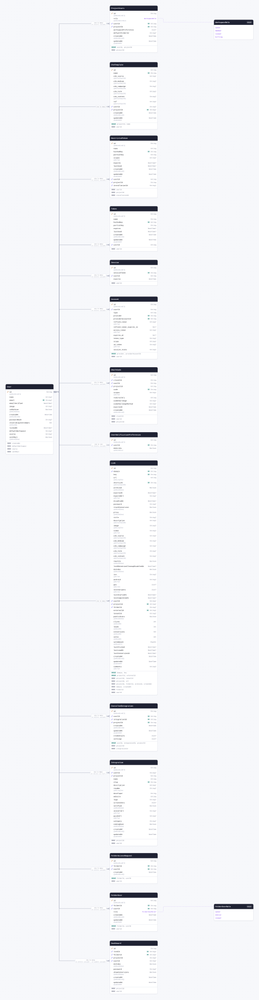

| Field                  | Type       | Constraints | Default   | Description |
| ---------------------- | ---------- | ----------- | --------- | ----------- |
| `id`                   | `String`   | PK NOT NULL | `cuid(1)` |             |
| `name`                 | `String`   | NULL        |           |             |
| `email`                | `String`   | UNIQUE NULL |           |             |
| `emailVerified`        | `DateTime` | NULL        |           |             |
| `image`                | `String`   | NULL        |           |             |
| `isMachine`            | `Boolean`  | NOT NULL    | `false`   |             |
| `createdAt`            | `DateTime` | NOT NULL    | `now()`   |             |
| `passwordHash`         | `String`   | NULL        |           |             |
| `invalidLoginAttempts` | `Int`      | NOT NULL    | `0`       |             |
| `lockedAt`             | `DateTime` | NULL        |           |             |
| `defaultWorkspace`     | `String`   | NULL        |           |             |
| `source`               | `String`   | NULL        |           |             |
| `sentMail`             | `Boolean`  | NOT NULL    | `false`   |             |

#### Indexes

- `@@index([createdAt])`
- `@@index([defaultWorkspace])`
- `@@index([source])`
- `@@index([sentMail])`

#### Referenced by

- `id` ← [Dashboard.userId](#model-Dashboard) (one-to-many, on delete Cascade, on update Cascade)
- `id` ← [FolderUser.userId](#model-FolderUser) (one-to-many, on delete Cascade)
- `id` ← [FolderAccessRequest.userId](#model-FolderAccessRequest) (one-to-many, on delete Cascade)
- `id` ← [Integration.userId](#model-Integration) (one-to-many, on delete SetNull)
- `id` ← [InstalledIntegration.userId](#model-InstalledIntegration) (one-to-many, on delete Cascade)
- `id` ← [Link.userId](#model-Link) (one-to-many)
- `id` ← [UserNotificationPreferences.userId](#model-UserNotificationPreferences) (one-to-one, on delete Cascade)
- `id` ← [OAuthCode.userId](#model-OAuthCode) (one-to-many, on delete Cascade)
- `id` ← [Account.userId](#model-Account) (one-to-many, on delete Cascade)
- `id` ← [Session.userId](#model-Session) (one-to-many, on delete Cascade)
- `id` ← [Token.userId](#model-Token) (one-to-many, on delete Cascade)
- `id` ← [RestrictedToken.userId](#model-RestrictedToken) (one-to-many, on delete Cascade)
- `id` ← [UtmTemplate.userId](#model-UtmTemplate) (one-to-many)
- `id` ← [ProjectUsers.userId](#model-ProjectUsers) (one-to-many, on delete Cascade)

#### Definition

```sql
CREATE TABLE `User` (
    `id` VARCHAR(191) NOT NULL,
    `name` VARCHAR(191) NULL,
    `email` VARCHAR(191) NULL,
    `emailVerified` DATETIME(3) NULL,
    `image` VARCHAR(191) NULL,
    `isMachine` BOOLEAN NOT NULL DEFAULT false,
    `createdAt` DATETIME(3) NOT NULL DEFAULT CURRENT_TIMESTAMP(3),
    `passwordHash` VARCHAR(191) NULL,
    `invalidLoginAttempts` INTEGER NOT NULL DEFAULT 0,
    `lockedAt` DATETIME(3) NULL,
    `defaultWorkspace` VARCHAR(191) NULL,
    `source` VARCHAR(191) NULL,
    `sentMail` BOOLEAN NOT NULL DEFAULT false,

    UNIQUE INDEX `User_email_key`(`email`),
    INDEX `User_createdAt_idx`(`createdAt`),
    INDEX `User_defaultWorkspace_idx`(`defaultWorkspace`),
    INDEX `User_source_idx`(`source`),
    INDEX `User_sentMail_idx`(`sentMail`),
    PRIMARY KEY (`id`)
) DEFAULT CHARACTER SET utf8mb4 COLLATE utf8mb4_unicode_ci;
```

<details>
<summary>Queries and their SQL</summary>

**findMany**: Every row

```ts
await prisma.user.findMany();
```

```sql
SELECT
  `User`.`id`,
  `User`.`name`,
  `User`.`email`,
  `User`.`emailVerified`,
  `User`.`image`,
  `User`.`isMachine`,
  `User`.`createdAt`,
  `User`.`passwordHash`,
  `User`.`invalidLoginAttempts`,
  `User`.`lockedAt`,
  `User`.`defaultWorkspace`,
  `User`.`source`,
  `User`.`sentMail`
FROM
  `User`
WHERE
  1 = 1
```

**count**: How many rows there are

```ts
await prisma.user.count();
```

```sql
SELECT
  COUNT(*) AS `_count$_all`
FROM
  (
    SELECT
      `User`.`id`
    FROM
      `User`
    WHERE
      1 = 1
  ) AS `sub`
```

**findMany**: Every row with its relations

```ts
await prisma.user.findMany({
  include: {
    accounts: true,
    sessions: true,
    notificationPreferences: true,
    projects: true,
    links: true,
    dashboards: true,
    tokens: true,
    restrictedTokens: true,
    oAuthCodes: true,
    integrations: true,
    installedIntegrations: true,
    folders: true,
    folderAccessRequests: true,
    utmTemplates: true,
  },
});
```

```sql
SELECT
  `User`.`id`,
  `User`.`name`,
  `User`.`email`,
  `User`.`emailVerified`,
  `User`.`image`,
  `User`.`isMachine`,
  `User`.`createdAt`,
  `User`.`passwordHash`,
  `User`.`invalidLoginAttempts`,
  `User`.`lockedAt`,
  `User`.`defaultWorkspace`,
  `User`.`source`,
  `User`.`sentMail`
FROM
  `User`
WHERE
  1 = 1

SELECT
  `Account`.`id`,
  `Account`.`userId`,
  `Account`.`type`,
  `Account`.`provider`,
  `Account`.`providerAccountId`,
  `Account`.`refresh_token`,
  `Account`.`refresh_token_expires_in`,
  `Account`.`access_token`,
  `Account`.`expires_at`,
  `Account`.`token_type`,
  `Account`.`scope`,
  `Account`.`id_token`,
  `Account`.`session_state`
FROM
  `Account`
WHERE
  `Account`.`userId` IN (?)
-- params: ["<id of the rows above>"]

SELECT
  `Session`.`id`,
  `Session`.`sessionToken`,
  `Session`.`userId`,
  `Session`.`expires`
FROM
  `Session`
WHERE
  `Session`.`userId` IN (?)
-- params: ["<id of the rows above>"]

SELECT
  `UserNotificationPreferences`.`id`,
  `UserNotificationPreferences`.`userId`,
  `UserNotificationPreferences`.`dubLinks`
FROM
  `UserNotificationPreferences`
WHERE
  `UserNotificationPreferences`.`userId` IN (?)
-- params: ["<id of the rows above>"]

SELECT
  `ProjectUsers`.`id`,
  `ProjectUsers`.`role`,
  `ProjectUsers`.`userId`,
  `ProjectUsers`.`projectId`,
  `ProjectUsers`.`workspacePreferences`,
  `ProjectUsers`.`defaultFolderId`,
  `ProjectUsers`.`createdAt`,
  `ProjectUsers`.`updatedAt`
FROM
  `ProjectUsers`
WHERE
  `ProjectUsers`.`userId` IN (?)
-- params: ["<id of the rows above>"]

SELECT
  `Link`.`id`,
  `Link`.`domain`,
  `Link`.`key`,
  `Link`.`url`,
  `Link`.`shortLink`,
  `Link`.`archived`,
  `Link`.`expiresAt`,
  `Link`.`expiredUrl`,
  `Link`.`disabledAt`,
  `Link`.`password`,
  `Link`.`trackConversion`,
  `Link`.`proxy`,
  `Link`.`title`,
  `Link`.`description`,
  `Link`.`image`,
  `Link`.`video`,
  `Link`.`utm_source`,
  `Link`.`utm_medium`,
  `Link`.`utm_campaign`,
  `Link`.`utm_term`,
  `Link`.`utm_content`,
  `Link`.`rewrite`,
  `Link`.`linkRetentionCleanupDisabledAt`,
  `Link`.`doIndex`,
  `Link`.`ios`,
  `Link`.`android`,
  `Link`.`geo`,
  `Link`.`testVariants`,
  `Link`.`testStartedAt`,
  `Link`.`testCompletedAt`,
  `Link`.`userId`,
  `Link`.`projectId`,
  `Link`.`folderId`,
  `Link`.`externalId`,
  `Link`.`tenantId`,
  `Link`.`publicStats`,
  `Link`.`clicks`,
  `Link`.`leads`,
  `Link`.`conversions`,
  `Link`.`sales`,
  `Link`.`saleAmount`,
  `Link`.`lastClicked`,
  `Link`.`lastLeadAt`,
  `Link`.`lastConversionAt`,
  `Link`.`createdAt`,
  `Link`.`updatedAt`,
  `Link`.`comments`
FROM
  `Link`
WHERE
  `Link`.`userId` IN (?)
-- params: ["<id of the rows above>"]

SELECT
  `Dashboard`.`id`,
  `Dashboard`.`linkId`,
  `Dashboard`.`folderId`,
  `Dashboard`.`projectId`,
  `Dashboard`.`userId`,
  `Dashboard`.`doIndex`,
  `Dashboard`.`password`,
  `Dashboard`.`showConversions`,
  `Dashboard`.`createdAt`,
  `Dashboard`.`updatedAt`
FROM
  `Dashboard`
WHERE
  `Dashboard`.`userId` IN (?)
-- params: ["<id of the rows above>"]

SELECT
  `Token`.`id`,
  `Token`.`name`,
  `Token`.`hashedKey`,
  `Token`.`partialKey`,
  `Token`.`expires`,
  `Token`.`lastUsed`,
  `Token`.`createdAt`,
  `Token`.`updatedAt`,
  `Token`.`userId`
FROM
  `Token`
WHERE
  `Token`.`userId` IN (?)
-- params: ["<id of the rows above>"]

SELECT
  `RestrictedToken`.`id`,
  `RestrictedToken`.`name`,
  `RestrictedToken`.`hashedKey`,
  `RestrictedToken`.`partialKey`,
  `RestrictedToken`.`scopes`,
  `RestrictedToken`.`expires`,
  `RestrictedToken`.`lastUsed`,
  `RestrictedToken`.`createdAt`,
  `RestrictedToken`.`updatedAt`,
  `RestrictedToken`.`userId`,
  `RestrictedToken`.`projectId`,
  `RestrictedToken`.`installationId`
FROM
  `RestrictedToken`
WHERE
  `RestrictedToken`.`userId` IN (?)
-- params: ["<id of the rows above>"]

SELECT
  `OAuthCode`.`id`,
  `OAuthCode`.`clientId`,
  `OAuthCode`.`userId`,
  `OAuthCode`.`projectId`,
  `OAuthCode`.`code`,
  `OAuthCode`.`scopes`,
  `OAuthCode`.`redirectUri`,
  `OAuthCode`.`codeChallenge`,
  `OAuthCode`.`codeChallengeMethod`,
  `OAuthCode`.`expiresAt`,
  `OAuthCode`.`createdAt`
FROM
  `OAuthCode`
WHERE
  `OAuthCode`.`userId` IN (?)
-- params: ["<id of the rows above>"]

SELECT
  `Integration`.`id`,
  `Integration`.`userId`,
  `Integration`.`projectId`,
  `Integration`.`name`,
  `Integration`.`slug`,
  `Integration`.`description`,
  `Integration`.`readme`,
  `Integration`.`developer`,
  `Integration`.`website`,
  `Integration`.`logo`,
  `Integration`.`screenshots`,
  `Integration`.`verified`,
  `Integration`.`installUrl`,
  `Integration`.`guideUrl`,
  `Integration`.`category`,
  `Integration`.`comingSoon`,
  `Integration`.`createdAt`,
  `Integration`.`updatedAt`
FROM
  `Integration`
WHERE
  `Integration`.`userId` IN (?)
-- params: ["<id of the rows above>"]

SELECT
  `InstalledIntegration`.`id`,
  `InstalledIntegration`.`userId`,
  `InstalledIntegration`.`integrationId`,
  `InstalledIntegration`.`projectId`,
  `InstalledIntegration`.`createdAt`,
  `InstalledIntegration`.`updatedAt`,
  `InstalledIntegration`.`credentials`,
  `InstalledIntegration`.`settings`
FROM
  `InstalledIntegration`
WHERE
  `InstalledIntegration`.`userId` IN (?)
-- params: ["<id of the rows above>"]

SELECT
  `FolderUser`.`id`,
  `FolderUser`.`folderId`,
  `FolderUser`.`userId`,
  `FolderUser`.`role`,
  `FolderUser`.`createdAt`,
  `FolderUser`.`updatedAt`
FROM
  `FolderUser`
WHERE
  `FolderUser`.`userId` IN (?)
-- params: ["<id of the rows above>"]

SELECT
  `FolderAccessRequest`.`id`,
  `FolderAccessRequest`.`folderId`,
  `FolderAccessRequest`.`userId`,
  `FolderAccessRequest`.`createdAt`
FROM
  `FolderAccessRequest`
WHERE
  `FolderAccessRequest`.`userId` IN (?)
-- params: ["<id of the rows above>"]

SELECT
  `UtmTemplate`.`id`,
  `UtmTemplate`.`name`,
  `UtmTemplate`.`utm_source`,
  `UtmTemplate`.`utm_medium`,
  `UtmTemplate`.`utm_campaign`,
  `UtmTemplate`.`utm_term`,
  `UtmTemplate`.`utm_content`,
  `UtmTemplate`.`ref`,
  `UtmTemplate`.`userId`,
  `UtmTemplate`.`projectId`,
  `UtmTemplate`.`createdAt`,
  `UtmTemplate`.`updatedAt`
FROM
  `UtmTemplate`
WHERE
  `UtmTemplate`.`userId` IN (?)
-- params: ["<id of the rows above>"]
```

**findUnique**: One row by what is unique to it

```ts
await prisma.user.findUnique({ where: { id: "example" } });
```

```sql
SELECT
  `User`.`id`,
  `User`.`name`,
  `User`.`email`,
  `User`.`emailVerified`,
  `User`.`image`,
  `User`.`isMachine`,
  `User`.`createdAt`,
  `User`.`passwordHash`,
  `User`.`invalidLoginAttempts`,
  `User`.`lockedAt`,
  `User`.`defaultWorkspace`,
  `User`.`source`,
  `User`.`sentMail`
FROM
  `User`
WHERE
  (
    `User`.`id` = ?
    AND 1 = 1
  )
LIMIT
  ?
OFFSET
  ?
-- params: ["example","1","0"]
```

**create**: Create a row

```ts
await prisma.user.create({ data: {} });
```

```sql
INSERT INTO
  `User` (
    `id`,
    `isMachine`,
    `createdAt`,
    `invalidLoginAttempts`,
    `sentMail`
  )
VALUES
  (?, ?, ?, ?, ?)
-- params: ["<cuid(1)>",false,"<now()>","0",false]

SELECT
  `User`.`id`,
  `User`.`name`,
  `User`.`email`,
  `User`.`emailVerified`,
  `User`.`image`,
  `User`.`isMachine`,
  `User`.`createdAt`,
  `User`.`passwordHash`,
  `User`.`invalidLoginAttempts`,
  `User`.`lockedAt`,
  `User`.`defaultWorkspace`,
  `User`.`source`,
  `User`.`sentMail`
FROM
  `User`
WHERE
  `User`.`id` = ?
LIMIT
  ?
OFFSET
  ?
-- params: ["<id of the rows above>","1","0"]
```

**update**: Update a row

```ts
await prisma.user.update({ where: { id: "example" }, data: { name: "example" } });
```

```sql
SELECT
  `User`.`id`
FROM
  `User`
WHERE
  (
    `User`.`id` = ?
    AND 1 = 1
  )
LIMIT
  ?
OFFSET
  ?
-- params: ["example","1","0"]

UPDATE `User`
SET
  `name` = ?
WHERE
  (
    `User`.`id` IN (?)
    AND (
      `User`.`id` = ?
      AND 1 = 1
    )
  )
-- params: ["example","<id of the rows above>","example"]

SELECT
  `User`.`id`,
  `User`.`name`,
  `User`.`email`,
  `User`.`emailVerified`,
  `User`.`image`,
  `User`.`isMachine`,
  `User`.`createdAt`,
  `User`.`passwordHash`,
  `User`.`invalidLoginAttempts`,
  `User`.`lockedAt`,
  `User`.`defaultWorkspace`,
  `User`.`source`,
  `User`.`sentMail`
FROM
  `User`
WHERE
  `User`.`id` = ?
LIMIT
  ?
OFFSET
  ?
-- params: ["<id of the rows above>","1","0"]
```

**delete**: Delete a row

```ts
await prisma.user.delete({ where: { id: "example" } });
```

```sql
SELECT
  `User`.`id`,
  `User`.`name`,
  `User`.`email`,
  `User`.`emailVerified`,
  `User`.`image`,
  `User`.`isMachine`,
  `User`.`createdAt`,
  `User`.`passwordHash`,
  `User`.`invalidLoginAttempts`,
  `User`.`lockedAt`,
  `User`.`defaultWorkspace`,
  `User`.`source`,
  `User`.`sentMail`
FROM
  `User`
WHERE
  (
    `User`.`id` = ?
    AND 1 = 1
  )
LIMIT
  ?
OFFSET
  ?
-- params: ["example","1","0"]

SELECT
  `Dashboard`.`id`,
  `Dashboard`.`userId`
FROM
  `Dashboard`
WHERE
  (
    1 = 1
    AND `Dashboard`.`userId` IN (?)
  )
-- params: ["<id of the rows above>"]

DELETE FROM `Dashboard`
WHERE
  (
    `Dashboard`.`id` IN (?)
    AND 1 = 1
  )
-- params: ["<id of the rows above>"]

SELECT
  `FolderUser`.`id`,
  `FolderUser`.`userId`
FROM
  `FolderUser`
WHERE
  (
    1 = 1
    AND `FolderUser`.`userId` IN (?)
  )
-- params: ["<id of the rows above>"]

DELETE FROM `FolderUser`
WHERE
  (
    `FolderUser`.`id` IN (?)
    AND 1 = 1
  )
-- params: ["<id of the rows above>"]

SELECT
  `FolderAccessRequest`.`id`,
  `FolderAccessRequest`.`userId`
FROM
  `FolderAccessRequest`
WHERE
  (
    1 = 1
    AND `FolderAccessRequest`.`userId` IN (?)
  )
-- params: ["<id of the rows above>"]

DELETE FROM `FolderAccessRequest`
WHERE
  (
    `FolderAccessRequest`.`id` IN (?)
    AND 1 = 1
  )
-- params: ["<id of the rows above>"]

SELECT
  `Integration`.`id`,
  `Integration`.`userId`
FROM
  `Integration`
WHERE
  (
    1 = 1
    AND `Integration`.`userId` IN (?)
  )
-- params: ["<id of the rows above>"]

UPDATE `Integration`
SET
  `userId` = ?
WHERE
  (
    `Integration`.`id` IN (?)
    AND 1 = 1
  )
-- params: [null,"<id of the rows above>"]

SELECT
  `InstalledIntegration`.`id`,
  `InstalledIntegration`.`userId`
FROM
  `InstalledIntegration`
WHERE
  (
    1 = 1
    AND `InstalledIntegration`.`userId` IN (?)
  )
-- params: ["<id of the rows above>"]

SELECT
  `OAuthRefreshToken`.`id`,
  `OAuthRefreshToken`.`installationId`
FROM
  `OAuthRefreshToken`
WHERE
  (
    1 = 1
    AND `OAuthRefreshToken`.`installationId` IN (?)
  )
-- params: ["<id of the rows above>"]

DELETE FROM `OAuthRefreshToken`
WHERE
  (
    `OAuthRefreshToken`.`id` IN (?)
    AND 1 = 1
  )
-- params: ["<id of the rows above>"]

SELECT
  `RestrictedToken`.`id`,
  `RestrictedToken`.`installationId`
FROM
  `RestrictedToken`
WHERE
  (
    1 = 1
    AND `RestrictedToken`.`installationId` IN (?)
  )
-- params: ["<id of the rows above>"]

SELECT
  `OAuthRefreshToken`.`id`,
  `OAuthRefreshToken`.`accessTokenId`
FROM
  `OAuthRefreshToken`
WHERE
  (
    1 = 1
    AND `OAuthRefreshToken`.`accessTokenId` IN (?)
  )
-- params: ["<id of the rows above>"]

DELETE FROM `OAuthRefreshToken`
WHERE
  (
    `OAuthRefreshToken`.`id` IN (?)
    AND 1 = 1
  )
-- params: ["<id of the rows above>"]

DELETE FROM `RestrictedToken`
WHERE
  (
    `RestrictedToken`.`id` IN (?)
    AND 1 = 1
  )
-- params: ["<id of the rows above>"]

SELECT
  `Webhook`.`id`,
  `Webhook`.`installationId`
FROM
  `Webhook`
WHERE
  (
    1 = 1
    AND `Webhook`.`installationId` IN (?)
  )
-- params: ["<id of the rows above>"]

SELECT
  `LinkWebhook`.`id`,
  `LinkWebhook`.`webhookId`
FROM
  `LinkWebhook`
WHERE
  (
    1 = 1
    AND `LinkWebhook`.`webhookId` IN (?)
  )
-- params: ["<id of the rows above>"]

DELETE FROM `LinkWebhook`
WHERE
  (
    `LinkWebhook`.`id` IN (?)
    AND 1 = 1
  )
-- params: ["<id of the rows above>"]

SELECT
  `FolderWebhook`.`id`,
  `FolderWebhook`.`webhookId`
FROM
  `FolderWebhook`
WHERE
  (
    1 = 1
    AND `FolderWebhook`.`webhookId` IN (?)
  )
-- params: ["<id of the rows above>"]

DELETE FROM `FolderWebhook`
WHERE
  (
    `FolderWebhook`.`id` IN (?)
    AND 1 = 1
  )
-- params: ["<id of the rows above>"]

DELETE FROM `Webhook`
WHERE
  (
    `Webhook`.`id` IN (?)
    AND 1 = 1
  )
-- params: ["<id of the rows above>"]

DELETE FROM `InstalledIntegration`
WHERE
  (
    `InstalledIntegration`.`id` IN (?)
    AND 1 = 1
  )
-- params: ["<id of the rows above>"]

SELECT
  `Link`.`id`,
  `Link`.`userId`
FROM
  `Link`
WHERE
  (
    1 = 1
    AND `Link`.`userId` IN (?)
  )
-- params: ["<id of the rows above>"]

UPDATE `Link`
SET
  `userId` = ?
WHERE
  (
    `Link`.`id` IN (?)
    AND 1 = 1
  )
-- params: [null,"<id of the rows above>"]

SELECT
  `UserNotificationPreferences`.`id`,
  `UserNotificationPreferences`.`userId`
FROM
  `UserNotificationPreferences`
WHERE
  (
    1 = 1
    AND `UserNotificationPreferences`.`userId` IN (?)
  )
-- params: ["<id of the rows above>"]

DELETE FROM `UserNotificationPreferences`
WHERE
  (
    `UserNotificationPreferences`.`id` IN (?)
    AND 1 = 1
  )
-- params: ["<id of the rows above>"]

SELECT
  `OAuthCode`.`id`,
  `OAuthCode`.`userId`
FROM
  `OAuthCode`
WHERE
  (
    1 = 1
    AND `OAuthCode`.`userId` IN (?)
  )
-- params: ["<id of the rows above>"]

DELETE FROM `OAuthCode`
WHERE
  (
    `OAuthCode`.`id` IN (?)
    AND 1 = 1
  )
-- params: ["<id of the rows above>"]

SELECT
  `Account`.`id`,
  `Account`.`userId`
FROM
  `Account`
WHERE
  (
    1 = 1
    AND `Account`.`userId` IN (?)
  )
-- params: ["<id of the rows above>"]

DELETE FROM `Account`
WHERE
  (
    `Account`.`id` IN (?)
    AND 1 = 1
  )
-- params: ["<id of the rows above>"]

SELECT
  `Session`.`id`,
  `Session`.`userId`
FROM
  `Session`
WHERE
  (
    1 = 1
    AND `Session`.`userId` IN (?)
  )
-- params: ["<id of the rows above>"]

DELETE FROM `Session`
WHERE
  (
    `Session`.`id` IN (?)
    AND 1 = 1
  )
-- params: ["<id of the rows above>"]

SELECT
  `Token`.`id`,
  `Token`.`userId`
FROM
  `Token`
WHERE
  (
    1 = 1
    AND `Token`.`userId` IN (?)
  )
-- params: ["<id of the rows above>"]

DELETE FROM `Token`
WHERE
  (
    `Token`.`id` IN (?)
    AND 1 = 1
  )
-- params: ["<id of the rows above>"]

SELECT
  `RestrictedToken`.`id`,
  `RestrictedToken`.`userId`
FROM
  `RestrictedToken`
WHERE
  (
    1 = 1
    AND `RestrictedToken`.`userId` IN (?)
  )
-- params: ["<id of the rows above>"]

SELECT
  `OAuthRefreshToken`.`id`,
  `OAuthRefreshToken`.`accessTokenId`
FROM
  `OAuthRefreshToken`
WHERE
  (
    1 = 1
    AND `OAuthRefreshToken`.`accessTokenId` IN (?)
  )
-- params: ["<id of the rows above>"]

DELETE FROM `OAuthRefreshToken`
WHERE
  (
    `OAuthRefreshToken`.`id` IN (?)
    AND 1 = 1
  )
-- params: ["<id of the rows above>"]

DELETE FROM `RestrictedToken`
WHERE
  (
    `RestrictedToken`.`id` IN (?)
    AND 1 = 1
  )
-- params: ["<id of the rows above>"]

SELECT
  `UtmTemplate`.`id`,
  `UtmTemplate`.`userId`
FROM
  `UtmTemplate`
WHERE
  (
    1 = 1
    AND `UtmTemplate`.`userId` IN (?)
  )
-- params: ["<id of the rows above>"]

UPDATE `UtmTemplate`
SET
  `userId` = ?
WHERE
  (
    `UtmTemplate`.`id` IN (?)
    AND 1 = 1
  )
-- params: [null,"<id of the rows above>"]

SELECT
  `ProjectUsers`.`id`,
  `ProjectUsers`.`userId`
FROM
  `ProjectUsers`
WHERE
  (
    1 = 1
    AND `ProjectUsers`.`userId` IN (?)
  )
-- params: ["<id of the rows above>"]

SELECT
  `NotificationPreference`.`id`,
  `NotificationPreference`.`projectUserId`
FROM
  `NotificationPreference`
WHERE
  (
    1 = 1
    AND `NotificationPreference`.`projectUserId` IN (?)
  )
-- params: ["<id of the rows above>"]

DELETE FROM `NotificationPreference`
WHERE
  (
    `NotificationPreference`.`id` IN (?)
    AND 1 = 1
  )
-- params: ["<id of the rows above>"]

DELETE FROM `ProjectUsers`
WHERE
  (
    `ProjectUsers`.`id` IN (?)
    AND 1 = 1
  )
-- params: ["<id of the rows above>"]

DELETE FROM `User`
WHERE
  (
    `User`.`id` = ?
    AND 1 = 1
  )
-- params: ["example"]
```

</details>

<a id="model-Account"></a>

### Account

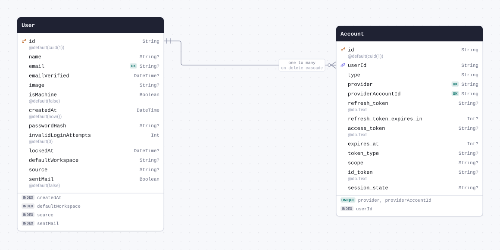

| Field                      | Type                | Constraints                       | Default   | Description |
| -------------------------- | ------------------- | --------------------------------- | --------- | ----------- |
| `id`                       | `String`            | PK NOT NULL                       | `cuid(1)` |             |
| `userId`                   | `String`            | NOT NULL → [User.id](#model-User) |           |             |
| `type`                     | `String`            | NOT NULL                          |           |             |
| `provider`                 | `String`            | NOT NULL                          |           |             |
| `providerAccountId`        | `String`            | NOT NULL                          |           |             |
| `refresh_token`            | `String` `@db.Text` | NULL                              |           |             |
| `refresh_token_expires_in` | `Int`               | NULL                              |           |             |
| `access_token`             | `String` `@db.Text` | NULL                              |           |             |
| `expires_at`               | `Int`               | NULL                              |           |             |
| `token_type`               | `String`            | NULL                              |           |             |
| `scope`                    | `String`            | NULL                              |           |             |
| `id_token`                 | `String` `@db.Text` | NULL                              |           |             |
| `session_state`            | `String`            | NULL                              |           |             |

#### Indexes

- `@@index([userId])`
- `@@unique([provider, providerAccountId])`

#### References

- `userId` → [User.id](#model-User) (many-to-one, on delete Cascade)

#### Definition

```sql
CREATE TABLE `Account` (
    `id` VARCHAR(191) NOT NULL,
    `userId` VARCHAR(191) NOT NULL,
    `type` VARCHAR(191) NOT NULL,
    `provider` VARCHAR(191) NOT NULL,
    `providerAccountId` VARCHAR(191) NOT NULL,
    `refresh_token` TEXT NULL,
    `refresh_token_expires_in` INTEGER NULL,
    `access_token` TEXT NULL,
    `expires_at` INTEGER NULL,
    `token_type` VARCHAR(191) NULL,
    `scope` VARCHAR(191) NULL,
    `id_token` TEXT NULL,
    `session_state` VARCHAR(191) NULL,

    INDEX `Account_userId_idx`(`userId`),
    UNIQUE INDEX `Account_provider_providerAccountId_key`(`provider`, `providerAccountId`),
    PRIMARY KEY (`id`)
) DEFAULT CHARACTER SET utf8mb4 COLLATE utf8mb4_unicode_ci;
```

<details>
<summary>Queries and their SQL</summary>

**findMany**: Every row

```ts
await prisma.account.findMany();
```

```sql
SELECT
  `Account`.`id`,
  `Account`.`userId`,
  `Account`.`type`,
  `Account`.`provider`,
  `Account`.`providerAccountId`,
  `Account`.`refresh_token`,
  `Account`.`refresh_token_expires_in`,
  `Account`.`access_token`,
  `Account`.`expires_at`,
  `Account`.`token_type`,
  `Account`.`scope`,
  `Account`.`id_token`,
  `Account`.`session_state`
FROM
  `Account`
WHERE
  1 = 1
```

**count**: How many rows there are

```ts
await prisma.account.count();
```

```sql
SELECT
  COUNT(*) AS `_count$_all`
FROM
  (
    SELECT
      `Account`.`id`
    FROM
      `Account`
    WHERE
      1 = 1
  ) AS `sub`
```

**findMany**: Every row with its relations

```ts
await prisma.account.findMany({ include: { user: true } });
```

```sql
SELECT
  `Account`.`id`,
  `Account`.`userId`,
  `Account`.`type`,
  `Account`.`provider`,
  `Account`.`providerAccountId`,
  `Account`.`refresh_token`,
  `Account`.`refresh_token_expires_in`,
  `Account`.`access_token`,
  `Account`.`expires_at`,
  `Account`.`token_type`,
  `Account`.`scope`,
  `Account`.`id_token`,
  `Account`.`session_state`
FROM
  `Account`
WHERE
  1 = 1

SELECT
  `User`.`id`,
  `User`.`name`,
  `User`.`email`,
  `User`.`emailVerified`,
  `User`.`image`,
  `User`.`isMachine`,
  `User`.`createdAt`,
  `User`.`passwordHash`,
  `User`.`invalidLoginAttempts`,
  `User`.`lockedAt`,
  `User`.`defaultWorkspace`,
  `User`.`source`,
  `User`.`sentMail`
FROM
  `User`
WHERE
  `User`.`id` IN (?)
-- params: ["<userId of the rows above>"]
```

**findUnique**: One row by what is unique to it

```ts
await prisma.account.findUnique({ where: { id: "example" } });
```

```sql
SELECT
  `Account`.`id`,
  `Account`.`userId`,
  `Account`.`type`,
  `Account`.`provider`,
  `Account`.`providerAccountId`,
  `Account`.`refresh_token`,
  `Account`.`refresh_token_expires_in`,
  `Account`.`access_token`,
  `Account`.`expires_at`,
  `Account`.`token_type`,
  `Account`.`scope`,
  `Account`.`id_token`,
  `Account`.`session_state`
FROM
  `Account`
WHERE
  (
    `Account`.`id` = ?
    AND 1 = 1
  )
LIMIT
  ?
OFFSET
  ?
-- params: ["example","1","0"]
```

**create**: Create a row

```ts
await prisma.account.create({
  data: { userId: "example", type: "example", provider: "example", providerAccountId: "example" },
});
```

```sql
INSERT INTO
  `Account` (
    `id`,
    `userId`,
    `type`,
    `provider`,
    `providerAccountId`
  )
VALUES
  (?, ?, ?, ?, ?)
-- params: ["<cuid(1)>","example","example","example","example"]

SELECT
  `Account`.`id`,
  `Account`.`userId`,
  `Account`.`type`,
  `Account`.`provider`,
  `Account`.`providerAccountId`,
  `Account`.`refresh_token`,
  `Account`.`refresh_token_expires_in`,
  `Account`.`access_token`,
  `Account`.`expires_at`,
  `Account`.`token_type`,
  `Account`.`scope`,
  `Account`.`id_token`,
  `Account`.`session_state`
FROM
  `Account`
WHERE
  `Account`.`id` = ?
LIMIT
  ?
OFFSET
  ?
-- params: ["<id of the rows above>","1","0"]
```

**update**: Update a row

```ts
await prisma.account.update({ where: { id: "example" }, data: { type: "example" } });
```

```sql
SELECT
  `Account`.`id`
FROM
  `Account`
WHERE
  (
    `Account`.`id` = ?
    AND 1 = 1
  )
LIMIT
  ?
OFFSET
  ?
-- params: ["example","1","0"]

UPDATE `Account`
SET
  `type` = ?
WHERE
  (
    `Account`.`id` IN (?)
    AND (
      `Account`.`id` = ?
      AND 1 = 1
    )
  )
-- params: ["example","<id of the rows above>","example"]

SELECT
  `Account`.`id`,
  `Account`.`userId`,
  `Account`.`type`,
  `Account`.`provider`,
  `Account`.`providerAccountId`,
  `Account`.`refresh_token`,
  `Account`.`refresh_token_expires_in`,
  `Account`.`access_token`,
  `Account`.`expires_at`,
  `Account`.`token_type`,
  `Account`.`scope`,
  `Account`.`id_token`,
  `Account`.`session_state`
FROM
  `Account`
WHERE
  `Account`.`id` = ?
LIMIT
  ?
OFFSET
  ?
-- params: ["<id of the rows above>","1","0"]
```

**delete**: Delete a row

```ts
await prisma.account.delete({ where: { id: "example" } });
```

```sql
SELECT
  `Account`.`id`,
  `Account`.`userId`,
  `Account`.`type`,
  `Account`.`provider`,
  `Account`.`providerAccountId`,
  `Account`.`refresh_token`,
  `Account`.`refresh_token_expires_in`,
  `Account`.`access_token`,
  `Account`.`expires_at`,
  `Account`.`token_type`,
  `Account`.`scope`,
  `Account`.`id_token`,
  `Account`.`session_state`
FROM
  `Account`
WHERE
  (
    `Account`.`id` = ?
    AND 1 = 1
  )
LIMIT
  ?
OFFSET
  ?
-- params: ["example","1","0"]

DELETE FROM `Account`
WHERE
  (
    `Account`.`id` = ?
    AND 1 = 1
  )
-- params: ["example"]
```

</details>

<a id="model-Session"></a>

### Session

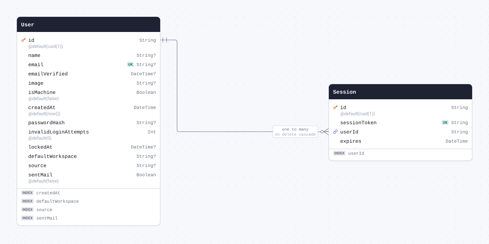

| Field          | Type       | Constraints                       | Default   | Description |
| -------------- | ---------- | --------------------------------- | --------- | ----------- |
| `id`           | `String`   | PK NOT NULL                       | `cuid(1)` |             |
| `sessionToken` | `String`   | UNIQUE NOT NULL                   |           |             |
| `userId`       | `String`   | NOT NULL → [User.id](#model-User) |           |             |
| `expires`      | `DateTime` | NOT NULL                          |           |             |

#### Indexes

- `@@index([userId])`

#### References

- `userId` → [User.id](#model-User) (many-to-one, on delete Cascade)

#### Definition

```sql
CREATE TABLE `Session` (
    `id` VARCHAR(191) NOT NULL,
    `sessionToken` VARCHAR(191) NOT NULL,
    `userId` VARCHAR(191) NOT NULL,
    `expires` DATETIME(3) NOT NULL,

    UNIQUE INDEX `Session_sessionToken_key`(`sessionToken`),
    INDEX `Session_userId_idx`(`userId`),
    PRIMARY KEY (`id`)
) DEFAULT CHARACTER SET utf8mb4 COLLATE utf8mb4_unicode_ci;
```

<details>
<summary>Queries and their SQL</summary>

**findMany**: Every row

```ts
await prisma.session.findMany();
```

```sql
SELECT
  `Session`.`id`,
  `Session`.`sessionToken`,
  `Session`.`userId`,
  `Session`.`expires`
FROM
  `Session`
WHERE
  1 = 1
```

**count**: How many rows there are

```ts
await prisma.session.count();
```

```sql
SELECT
  COUNT(*) AS `_count$_all`
FROM
  (
    SELECT
      `Session`.`id`
    FROM
      `Session`
    WHERE
      1 = 1
  ) AS `sub`
```

**findMany**: Every row with its relations

```ts
await prisma.session.findMany({ include: { user: true } });
```

```sql
SELECT
  `Session`.`id`,
  `Session`.`sessionToken`,
  `Session`.`userId`,
  `Session`.`expires`
FROM
  `Session`
WHERE
  1 = 1

SELECT
  `User`.`id`,
  `User`.`name`,
  `User`.`email`,
  `User`.`emailVerified`,
  `User`.`image`,
  `User`.`isMachine`,
  `User`.`createdAt`,
  `User`.`passwordHash`,
  `User`.`invalidLoginAttempts`,
  `User`.`lockedAt`,
  `User`.`defaultWorkspace`,
  `User`.`source`,
  `User`.`sentMail`
FROM
  `User`
WHERE
  `User`.`id` IN (?)
-- params: ["<userId of the rows above>"]
```

**findUnique**: One row by what is unique to it

```ts
await prisma.session.findUnique({ where: { id: "example" } });
```

```sql
SELECT
  `Session`.`id`,
  `Session`.`sessionToken`,
  `Session`.`userId`,
  `Session`.`expires`
FROM
  `Session`
WHERE
  (
    `Session`.`id` = ?
    AND 1 = 1
  )
LIMIT
  ?
OFFSET
  ?
-- params: ["example","1","0"]
```

**create**: Create a row

```ts
await prisma.session.create({
  data: {
    sessionToken: "example",
    userId: "example",
    expires: new Date("2026-01-01T00:00:00.000Z"),
  },
});
```

```sql
INSERT INTO
  `Session` (`id`, `sessionToken`, `userId`, `expires`)
VALUES
  (?, ?, ?, ?)
-- params: ["<cuid(1)>","example","example","2026-01-01T00:00:00.000Z"]

SELECT
  `Session`.`id`,
  `Session`.`sessionToken`,
  `Session`.`userId`,
  `Session`.`expires`
FROM
  `Session`
WHERE
  `Session`.`id` = ?
LIMIT
  ?
OFFSET
  ?
-- params: ["<id of the rows above>","1","0"]
```

**update**: Update a row

```ts
await prisma.session.update({ where: { id: "example" }, data: { sessionToken: "example" } });
```

```sql
SELECT
  `Session`.`id`
FROM
  `Session`
WHERE
  (
    `Session`.`id` = ?
    AND 1 = 1
  )
LIMIT
  ?
OFFSET
  ?
-- params: ["example","1","0"]

UPDATE `Session`
SET
  `sessionToken` = ?
WHERE
  (
    `Session`.`id` IN (?)
    AND (
      `Session`.`id` = ?
      AND 1 = 1
    )
  )
-- params: ["example","<id of the rows above>","example"]

SELECT
  `Session`.`id`,
  `Session`.`sessionToken`,
  `Session`.`userId`,
  `Session`.`expires`
FROM
  `Session`
WHERE
  `Session`.`id` = ?
LIMIT
  ?
OFFSET
  ?
-- params: ["<id of the rows above>","1","0"]
```

**delete**: Delete a row

```ts
await prisma.session.delete({ where: { id: "example" } });
```

```sql
SELECT
  `Session`.`id`,
  `Session`.`sessionToken`,
  `Session`.`userId`,
  `Session`.`expires`
FROM
  `Session`
WHERE
  (
    `Session`.`id` = ?
    AND 1 = 1
  )
LIMIT
  ?
OFFSET
  ?
-- params: ["example","1","0"]

DELETE FROM `Session`
WHERE
  (
    `Session`.`id` = ?
    AND 1 = 1
  )
-- params: ["example"]
```

</details>

<a id="model-Tag"></a>

### Tag

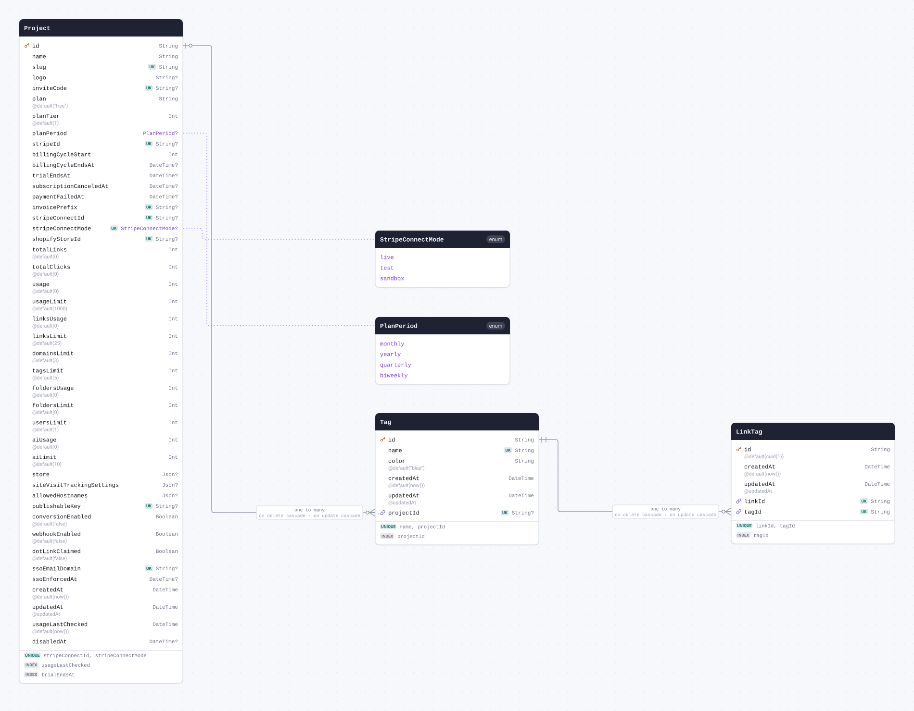

| Field       | Type       | Constraints                         | Default      | Description |
| ----------- | ---------- | ----------------------------------- | ------------ | ----------- |
| `id`        | `String`   | PK NOT NULL                         |              |             |
| `name`      | `String`   | NOT NULL                            |              |             |
| `color`     | `String`   | NOT NULL                            | `"blue"`     |             |
| `createdAt` | `DateTime` | NOT NULL                            | `now()`      |             |
| `updatedAt` | `DateTime` | NOT NULL                            | `@updatedAt` |             |
| `projectId` | `String`   | NULL → [Project.id](#model-Project) |              |             |

#### Indexes

- `@@index([projectId])`
- `@@unique([name, projectId])`

#### References

- `projectId` → [Project.id](#model-Project) (many-to-one, on delete Cascade, on update Cascade)

#### Referenced by

- `id` ← [LinkTag.tagId](#model-LinkTag) (one-to-many, on delete Cascade, on update Cascade)

#### Definition

```sql
CREATE TABLE `Tag` (
    `id` VARCHAR(191) NOT NULL,
    `name` VARCHAR(191) NOT NULL,
    `color` VARCHAR(191) NOT NULL DEFAULT 'blue',
    `createdAt` DATETIME(3) NOT NULL DEFAULT CURRENT_TIMESTAMP(3),
    `updatedAt` DATETIME(3) NOT NULL,
    `projectId` VARCHAR(191) NULL,

    INDEX `Tag_projectId_idx`(`projectId`),
    UNIQUE INDEX `Tag_name_projectId_key`(`name`, `projectId`),
    PRIMARY KEY (`id`)
) DEFAULT CHARACTER SET utf8mb4 COLLATE utf8mb4_unicode_ci;
```

<details>
<summary>Queries and their SQL</summary>

**findMany**: Every row

```ts
await prisma.tag.findMany();
```

```sql
SELECT
  `Tag`.`id`,
  `Tag`.`name`,
  `Tag`.`color`,
  `Tag`.`createdAt`,
  `Tag`.`updatedAt`,
  `Tag`.`projectId`
FROM
  `Tag`
WHERE
  1 = 1
```

**count**: How many rows there are

```ts
await prisma.tag.count();
```

```sql
SELECT
  COUNT(*) AS `_count$_all`
FROM
  (
    SELECT
      `Tag`.`id`
    FROM
      `Tag`
    WHERE
      1 = 1
  ) AS `sub`
```

**findMany**: Every row with its relations

```ts
await prisma.tag.findMany({ include: { project: true, links: true } });
```

```sql
SELECT
  `Tag`.`id`,
  `Tag`.`name`,
  `Tag`.`color`,
  `Tag`.`createdAt`,
  `Tag`.`updatedAt`,
  `Tag`.`projectId`
FROM
  `Tag`
WHERE
  1 = 1

SELECT
  `Project`.`id`,
  `Project`.`name`,
  `Project`.`slug`,
  `Project`.`logo`,
  `Project`.`inviteCode`,
  `Project`.`plan`,
  `Project`.`planTier`,
  `Project`.`planPeriod`,
  `Project`.`stripeId`,
  `Project`.`billingCycleStart`,
  `Project`.`billingCycleEndsAt`,
  `Project`.`trialEndsAt`,
  `Project`.`subscriptionCanceledAt`,
  `Project`.`paymentFailedAt`,
  `Project`.`invoicePrefix`,
  `Project`.`stripeConnectId`,
  `Project`.`stripeConnectMode`,
  `Project`.`shopifyStoreId`,
  `Project`.`totalLinks`,
  `Project`.`totalClicks`,
  `Project`.`usage`,
  `Project`.`usageLimit`,
  `Project`.`linksUsage`,
  `Project`.`linksLimit`,
  `Project`.`domainsLimit`,
  `Project`.`tagsLimit`,
  `Project`.`foldersUsage`,
  `Project`.`foldersLimit`,
  `Project`.`usersLimit`,
  `Project`.`aiUsage`,
  `Project`.`aiLimit`,
  `Project`.`store`,
  `Project`.`siteVisitTrackingSettings`,
  `Project`.`allowedHostnames`,
  `Project`.`publishableKey`,
  `Project`.`conversionEnabled`,
  `Project`.`webhookEnabled`,
  `Project`.`dotLinkClaimed`,
  `Project`.`ssoEmailDomain`,
  `Project`.`ssoEnforcedAt`,
  `Project`.`createdAt`,
  `Project`.`updatedAt`,
  `Project`.`usageLastChecked`,
  `Project`.`disabledAt`
FROM
  `Project`
WHERE
  `Project`.`id` IN (?)
-- params: ["<projectId of the rows above>"]

SELECT
  `LinkTag`.`id`,
  `LinkTag`.`createdAt`,
  `LinkTag`.`updatedAt`,
  `LinkTag`.`linkId`,
  `LinkTag`.`tagId`
FROM
  `LinkTag`
WHERE
  `LinkTag`.`tagId` IN (?)
-- params: ["<id of the rows above>"]
```

**findUnique**: One row by what is unique to it

```ts
await prisma.tag.findUnique({ where: { id: "example" } });
```

```sql
SELECT
  `Tag`.`id`,
  `Tag`.`name`,
  `Tag`.`color`,
  `Tag`.`createdAt`,
  `Tag`.`updatedAt`,
  `Tag`.`projectId`
FROM
  `Tag`
WHERE
  (
    `Tag`.`id` = ?
    AND 1 = 1
  )
LIMIT
  ?
OFFSET
  ?
-- params: ["example","1","0"]
```

**create**: Create a row

```ts
await prisma.tag.create({ data: { id: "example", name: "example" } });
```

```sql
INSERT INTO
  `Tag` (`id`, `name`, `color`, `createdAt`, `updatedAt`)
VALUES
  (?, ?, ?, ?, ?)
-- params: ["example","example","blue","<now()>","<now()>"]

SELECT
  `Tag`.`id`,
  `Tag`.`name`,
  `Tag`.`color`,
  `Tag`.`createdAt`,
  `Tag`.`updatedAt`,
  `Tag`.`projectId`
FROM
  `Tag`
WHERE
  `Tag`.`id` = ?
LIMIT
  ?
OFFSET
  ?
-- params: ["<id of the rows above>","1","0"]
```

**update**: Update a row

```ts
await prisma.tag.update({ where: { id: "example" }, data: { name: "example" } });
```

```sql
SELECT
  `Tag`.`id`
FROM
  `Tag`
WHERE
  (
    `Tag`.`id` = ?
    AND 1 = 1
  )
LIMIT
  ?
OFFSET
  ?
-- params: ["example","1","0"]

UPDATE `Tag`
SET
  `name` = ?,
  `updatedAt` = ?
WHERE
  (
    `Tag`.`id` IN (?)
    AND (
      `Tag`.`id` = ?
      AND 1 = 1
    )
  )
-- params: ["example",{"prisma__type":"generatorCall","prisma__value":{"name":"now","args":[],"returnType":{"type":"DateTime"}}},"<id of the rows above>","example"]

SELECT
  `Tag`.`id`,
  `Tag`.`name`,
  `Tag`.`color`,
  `Tag`.`createdAt`,
  `Tag`.`updatedAt`,
  `Tag`.`projectId`
FROM
  `Tag`
WHERE
  `Tag`.`id` = ?
LIMIT
  ?
OFFSET
  ?
-- params: ["<id of the rows above>","1","0"]
```

**delete**: Delete a row

```ts
await prisma.tag.delete({ where: { id: "example" } });
```

```sql
SELECT
  `Tag`.`id`,
  `Tag`.`name`,
  `Tag`.`color`,
  `Tag`.`createdAt`,
  `Tag`.`updatedAt`,
  `Tag`.`projectId`
FROM
  `Tag`
WHERE
  (
    `Tag`.`id` = ?
    AND 1 = 1
  )
LIMIT
  ?
OFFSET
  ?
-- params: ["example","1","0"]

SELECT
  `LinkTag`.`id`,
  `LinkTag`.`tagId`
FROM
  `LinkTag`
WHERE
  (
    1 = 1
    AND `LinkTag`.`tagId` IN (?)
  )
-- params: ["<id of the rows above>"]

DELETE FROM `LinkTag`
WHERE
  (
    `LinkTag`.`id` IN (?)
    AND 1 = 1
  )
-- params: ["<id of the rows above>"]

DELETE FROM `Tag`
WHERE
  (
    `Tag`.`id` = ?
    AND 1 = 1
  )
-- params: ["example"]
```

</details>

<a id="model-LinkTag"></a>

### LinkTag

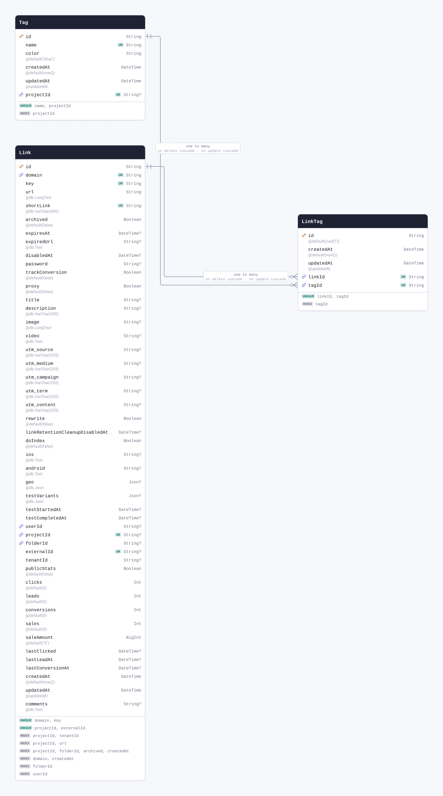

| Field       | Type       | Constraints                       | Default      | Description |
| ----------- | ---------- | --------------------------------- | ------------ | ----------- |
| `id`        | `String`   | PK NOT NULL                       | `cuid(1)`    |             |
| `createdAt` | `DateTime` | NOT NULL                          | `now()`      |             |
| `updatedAt` | `DateTime` | NOT NULL                          | `@updatedAt` |             |
| `linkId`    | `String`   | NOT NULL → [Link.id](#model-Link) |              |             |
| `tagId`     | `String`   | NOT NULL → [Tag.id](#model-Tag)   |              |             |

#### Indexes

- `@@index([tagId])`
- `@@unique([linkId, tagId])`

#### References

- `linkId` → [Link.id](#model-Link) (many-to-one, on delete Cascade, on update Cascade)
- `tagId` → [Tag.id](#model-Tag) (many-to-one, on delete Cascade, on update Cascade)

#### Definition

```sql
CREATE TABLE `LinkTag` (
    `id` VARCHAR(191) NOT NULL,
    `createdAt` DATETIME(3) NOT NULL DEFAULT CURRENT_TIMESTAMP(3),
    `updatedAt` DATETIME(3) NOT NULL,
    `linkId` VARCHAR(191) NOT NULL,
    `tagId` VARCHAR(191) NOT NULL,

    INDEX `LinkTag_tagId_idx`(`tagId`),
    UNIQUE INDEX `LinkTag_linkId_tagId_key`(`linkId`, `tagId`),
    PRIMARY KEY (`id`)
) DEFAULT CHARACTER SET utf8mb4 COLLATE utf8mb4_unicode_ci;
```

<details>
<summary>Queries and their SQL</summary>

**findMany**: Every row

```ts
await prisma.linkTag.findMany();
```

```sql
SELECT
  `LinkTag`.`id`,
  `LinkTag`.`createdAt`,
  `LinkTag`.`updatedAt`,
  `LinkTag`.`linkId`,
  `LinkTag`.`tagId`
FROM
  `LinkTag`
WHERE
  1 = 1
```

**count**: How many rows there are

```ts
await prisma.linkTag.count();
```

```sql
SELECT
  COUNT(*) AS `_count$_all`
FROM
  (
    SELECT
      `LinkTag`.`id`
    FROM
      `LinkTag`
    WHERE
      1 = 1
  ) AS `sub`
```

**findMany**: Every row with its relations

```ts
await prisma.linkTag.findMany({ include: { link: true, tag: true } });
```

```sql
SELECT
  `LinkTag`.`id`,
  `LinkTag`.`createdAt`,
  `LinkTag`.`updatedAt`,
  `LinkTag`.`linkId`,
  `LinkTag`.`tagId`
FROM
  `LinkTag`
WHERE
  1 = 1

SELECT
  `Link`.`id`,
  `Link`.`domain`,
  `Link`.`key`,
  `Link`.`url`,
  `Link`.`shortLink`,
  `Link`.`archived`,
  `Link`.`expiresAt`,
  `Link`.`expiredUrl`,
  `Link`.`disabledAt`,
  `Link`.`password`,
  `Link`.`trackConversion`,
  `Link`.`proxy`,
  `Link`.`title`,
  `Link`.`description`,
  `Link`.`image`,
  `Link`.`video`,
  `Link`.`utm_source`,
  `Link`.`utm_medium`,
  `Link`.`utm_campaign`,
  `Link`.`utm_term`,
  `Link`.`utm_content`,
  `Link`.`rewrite`,
  `Link`.`linkRetentionCleanupDisabledAt`,
  `Link`.`doIndex`,
  `Link`.`ios`,
  `Link`.`android`,
  `Link`.`geo`,
  `Link`.`testVariants`,
  `Link`.`testStartedAt`,
  `Link`.`testCompletedAt`,
  `Link`.`userId`,
  `Link`.`projectId`,
  `Link`.`folderId`,
  `Link`.`externalId`,
  `Link`.`tenantId`,
  `Link`.`publicStats`,
  `Link`.`clicks`,
  `Link`.`leads`,
  `Link`.`conversions`,
  `Link`.`sales`,
  `Link`.`saleAmount`,
  `Link`.`lastClicked`,
  `Link`.`lastLeadAt`,
  `Link`.`lastConversionAt`,
  `Link`.`createdAt`,
  `Link`.`updatedAt`,
  `Link`.`comments`
FROM
  `Link`
WHERE
  `Link`.`id` IN (?)
-- params: ["<linkId of the rows above>"]

SELECT
  `Tag`.`id`,
  `Tag`.`name`,
  `Tag`.`color`,
  `Tag`.`createdAt`,
  `Tag`.`updatedAt`,
  `Tag`.`projectId`
FROM
  `Tag`
WHERE
  `Tag`.`id` IN (?)
-- params: ["<tagId of the rows above>"]
```

**findUnique**: One row by what is unique to it

```ts
await prisma.linkTag.findUnique({ where: { id: "example" } });
```

```sql
SELECT
  `LinkTag`.`id`,
  `LinkTag`.`createdAt`,
  `LinkTag`.`updatedAt`,
  `LinkTag`.`linkId`,
  `LinkTag`.`tagId`
FROM
  `LinkTag`
WHERE
  (
    `LinkTag`.`id` = ?
    AND 1 = 1
  )
LIMIT
  ?
OFFSET
  ?
-- params: ["example","1","0"]
```

**create**: Create a row

```ts
await prisma.linkTag.create({ data: { linkId: "example", tagId: "example" } });
```

```sql
INSERT INTO
  `LinkTag` (`id`, `createdAt`, `updatedAt`, `linkId`, `tagId`)
VALUES
  (?, ?, ?, ?, ?)
-- params: ["<cuid(1)>","<now()>","<now()>","example","example"]

SELECT
  `LinkTag`.`id`,
  `LinkTag`.`createdAt`,
  `LinkTag`.`updatedAt`,
  `LinkTag`.`linkId`,
  `LinkTag`.`tagId`
FROM
  `LinkTag`
WHERE
  `LinkTag`.`id` = ?
LIMIT
  ?
OFFSET
  ?
-- params: ["<id of the rows above>","1","0"]
```

**update**: Update a row

```ts
await prisma.linkTag.update({
  where: { id: "example" },
  data: { createdAt: new Date("2026-01-01T00:00:00.000Z") },
});
```

```sql
SELECT
  `LinkTag`.`id`
FROM
  `LinkTag`
WHERE
  (
    `LinkTag`.`id` = ?
    AND 1 = 1
  )
LIMIT
  ?
OFFSET
  ?
-- params: ["example","1","0"]

UPDATE `LinkTag`
SET
  `createdAt` = ?,
  `updatedAt` = ?
WHERE
  (
    `LinkTag`.`id` IN (?)
    AND (
      `LinkTag`.`id` = ?
      AND 1 = 1
    )
  )
-- params: ["2026-01-01T00:00:00.000Z",{"prisma__type":"generatorCall","prisma__value":{"name":"now","args":[],"returnType":{"type":"DateTime"}}},"<id of the rows above>","example"]

SELECT
  `LinkTag`.`id`,
  `LinkTag`.`createdAt`,
  `LinkTag`.`updatedAt`,
  `LinkTag`.`linkId`,
  `LinkTag`.`tagId`
FROM
  `LinkTag`
WHERE
  `LinkTag`.`id` = ?
LIMIT
  ?
OFFSET
  ?
-- params: ["<id of the rows above>","1","0"]
```

**delete**: Delete a row

```ts
await prisma.linkTag.delete({ where: { id: "example" } });
```

```sql
SELECT
  `LinkTag`.`id`,
  `LinkTag`.`createdAt`,
  `LinkTag`.`updatedAt`,
  `LinkTag`.`linkId`,
  `LinkTag`.`tagId`
FROM
  `LinkTag`
WHERE
  (
    `LinkTag`.`id` = ?
    AND 1 = 1
  )
LIMIT
  ?
OFFSET
  ?
-- params: ["example","1","0"]

DELETE FROM `LinkTag`
WHERE
  (
    `LinkTag`.`id` = ?
    AND 1 = 1
  )
-- params: ["example"]
```

</details>

<a id="model-Token"></a>

### Token

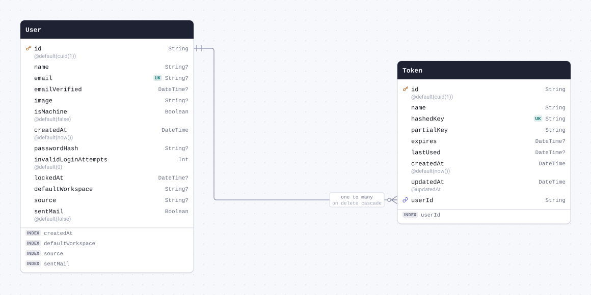

| Field        | Type       | Constraints                       | Default      | Description |
| ------------ | ---------- | --------------------------------- | ------------ | ----------- |
| `id`         | `String`   | PK NOT NULL                       | `cuid(1)`    |             |
| `name`       | `String`   | NOT NULL                          |              |             |
| `hashedKey`  | `String`   | UNIQUE NOT NULL                   |              |             |
| `partialKey` | `String`   | NOT NULL                          |              |             |
| `expires`    | `DateTime` | NULL                              |              |             |
| `lastUsed`   | `DateTime` | NULL                              |              |             |
| `createdAt`  | `DateTime` | NOT NULL                          | `now()`      |             |
| `updatedAt`  | `DateTime` | NOT NULL                          | `@updatedAt` |             |
| `userId`     | `String`   | NOT NULL → [User.id](#model-User) |              |             |

#### Indexes

- `@@index([userId])`

#### References

- `userId` → [User.id](#model-User) (many-to-one, on delete Cascade)

#### Definition

```sql
CREATE TABLE `Token` (
    `id` VARCHAR(191) NOT NULL,
    `name` VARCHAR(191) NOT NULL,
    `hashedKey` VARCHAR(191) NOT NULL,
    `partialKey` VARCHAR(191) NOT NULL,
    `expires` DATETIME(3) NULL,
    `lastUsed` DATETIME(3) NULL,
    `createdAt` DATETIME(3) NOT NULL DEFAULT CURRENT_TIMESTAMP(3),
    `updatedAt` DATETIME(3) NOT NULL,
    `userId` VARCHAR(191) NOT NULL,

    UNIQUE INDEX `Token_hashedKey_key`(`hashedKey`),
    INDEX `Token_userId_idx`(`userId`),
    PRIMARY KEY (`id`)
) DEFAULT CHARACTER SET utf8mb4 COLLATE utf8mb4_unicode_ci;
```

<details>
<summary>Queries and their SQL</summary>

**findMany**: Every row

```ts
await prisma.token.findMany();
```

```sql
SELECT
  `Token`.`id`,
  `Token`.`name`,
  `Token`.`hashedKey`,
  `Token`.`partialKey`,
  `Token`.`expires`,
  `Token`.`lastUsed`,
  `Token`.`createdAt`,
  `Token`.`updatedAt`,
  `Token`.`userId`
FROM
  `Token`
WHERE
  1 = 1
```

**count**: How many rows there are

```ts
await prisma.token.count();
```

```sql
SELECT
  COUNT(*) AS `_count$_all`
FROM
  (
    SELECT
      `Token`.`id`
    FROM
      `Token`
    WHERE
      1 = 1
  ) AS `sub`
```

**findMany**: Every row with its relations

```ts
await prisma.token.findMany({ include: { user: true } });
```

```sql
SELECT
  `Token`.`id`,
  `Token`.`name`,
  `Token`.`hashedKey`,
  `Token`.`partialKey`,
  `Token`.`expires`,
  `Token`.`lastUsed`,
  `Token`.`createdAt`,
  `Token`.`updatedAt`,
  `Token`.`userId`
FROM
  `Token`
WHERE
  1 = 1

SELECT
  `User`.`id`,
  `User`.`name`,
  `User`.`email`,
  `User`.`emailVerified`,
  `User`.`image`,
  `User`.`isMachine`,
  `User`.`createdAt`,
  `User`.`passwordHash`,
  `User`.`invalidLoginAttempts`,
  `User`.`lockedAt`,
  `User`.`defaultWorkspace`,
  `User`.`source`,
  `User`.`sentMail`
FROM
  `User`
WHERE
  `User`.`id` IN (?)
-- params: ["<userId of the rows above>"]
```

**findUnique**: One row by what is unique to it

```ts
await prisma.token.findUnique({ where: { id: "example" } });
```

```sql
SELECT
  `Token`.`id`,
  `Token`.`name`,
  `Token`.`hashedKey`,
  `Token`.`partialKey`,
  `Token`.`expires`,
  `Token`.`lastUsed`,
  `Token`.`createdAt`,
  `Token`.`updatedAt`,
  `Token`.`userId`
FROM
  `Token`
WHERE
  (
    `Token`.`id` = ?
    AND 1 = 1
  )
LIMIT
  ?
OFFSET
  ?
-- params: ["example","1","0"]
```

**create**: Create a row

```ts
await prisma.token.create({
  data: { name: "example", hashedKey: "example", partialKey: "example", userId: "example" },
});
```

```sql
INSERT INTO
  `Token` (
    `id`,
    `name`,
    `hashedKey`,
    `partialKey`,
    `createdAt`,
    `updatedAt`,
    `userId`
  )
VALUES
  (?, ?, ?, ?, ?, ?, ?)
-- params: ["<cuid(1)>","example","example","example","<now()>","<now()>","example"]

SELECT
  `Token`.`id`,
  `Token`.`name`,
  `Token`.`hashedKey`,
  `Token`.`partialKey`,
  `Token`.`expires`,
  `Token`.`lastUsed`,
  `Token`.`createdAt`,
  `Token`.`updatedAt`,
  `Token`.`userId`
FROM
  `Token`
WHERE
  `Token`.`id` = ?
LIMIT
  ?
OFFSET
  ?
-- params: ["<id of the rows above>","1","0"]
```

**update**: Update a row

```ts
await prisma.token.update({ where: { id: "example" }, data: { name: "example" } });
```

```sql
SELECT
  `Token`.`id`
FROM
  `Token`
WHERE
  (
    `Token`.`id` = ?
    AND 1 = 1
  )
LIMIT
  ?
OFFSET
  ?
-- params: ["example","1","0"]

UPDATE `Token`
SET
  `name` = ?,
  `updatedAt` = ?
WHERE
  (
    `Token`.`id` IN (?)
    AND (
      `Token`.`id` = ?
      AND 1 = 1
    )
  )
-- params: ["example",{"prisma__type":"generatorCall","prisma__value":{"name":"now","args":[],"returnType":{"type":"DateTime"}}},"<id of the rows above>","example"]

SELECT
  `Token`.`id`,
  `Token`.`name`,
  `Token`.`hashedKey`,
  `Token`.`partialKey`,
  `Token`.`expires`,
  `Token`.`lastUsed`,
  `Token`.`createdAt`,
  `Token`.`updatedAt`,
  `Token`.`userId`
FROM
  `Token`
WHERE
  `Token`.`id` = ?
LIMIT
  ?
OFFSET
  ?
-- params: ["<id of the rows above>","1","0"]
```

**delete**: Delete a row

```ts
await prisma.token.delete({ where: { id: "example" } });
```

```sql
SELECT
  `Token`.`id`,
  `Token`.`name`,
  `Token`.`hashedKey`,
  `Token`.`partialKey`,
  `Token`.`expires`,
  `Token`.`lastUsed`,
  `Token`.`createdAt`,
  `Token`.`updatedAt`,
  `Token`.`userId`
FROM
  `Token`
WHERE
  (
    `Token`.`id` = ?
    AND 1 = 1
  )
LIMIT
  ?
OFFSET
  ?
-- params: ["example","1","0"]

DELETE FROM `Token`
WHERE
  (
    `Token`.`id` = ?
    AND 1 = 1
  )
-- params: ["example"]
```

</details>

<a id="model-RestrictedToken"></a>

### RestrictedToken

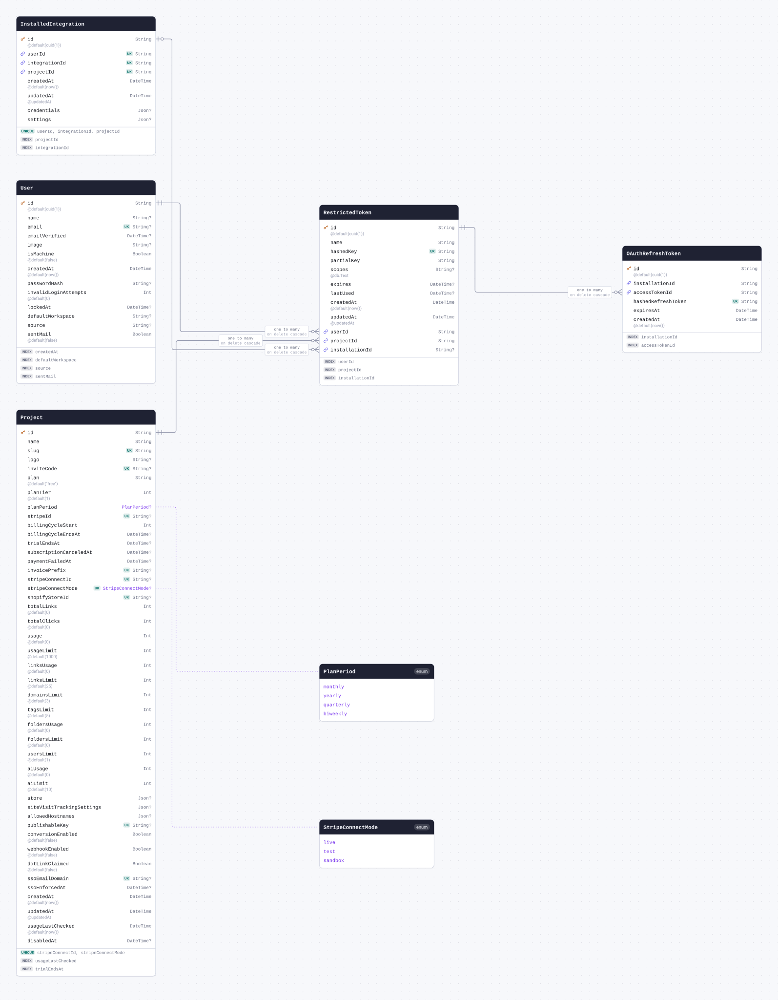

| Field            | Type                | Constraints                                                   | Default      | Description |
| ---------------- | ------------------- | ------------------------------------------------------------- | ------------ | ----------- |
| `id`             | `String`            | PK NOT NULL                                                   | `cuid(1)`    |             |
| `name`           | `String`            | NOT NULL                                                      |              |             |
| `hashedKey`      | `String`            | UNIQUE NOT NULL                                               |              |             |
| `partialKey`     | `String`            | NOT NULL                                                      |              |             |
| `scopes`         | `String` `@db.Text` | NULL                                                          |              |             |
| `expires`        | `DateTime`          | NULL                                                          |              |             |
| `lastUsed`       | `DateTime`          | NULL                                                          |              |             |
| `createdAt`      | `DateTime`          | NOT NULL                                                      | `now()`      |             |
| `updatedAt`      | `DateTime`          | NOT NULL                                                      | `@updatedAt` |             |
| `userId`         | `String`            | NOT NULL → [User.id](#model-User)                             |              |             |
| `projectId`      | `String`            | NOT NULL → [Project.id](#model-Project)                       |              |             |
| `installationId` | `String`            | NULL → [InstalledIntegration.id](#model-InstalledIntegration) |              |             |

#### Indexes

- `@@index([userId])`
- `@@index([projectId])`
- `@@index([installationId])`

#### References

- `userId` → [User.id](#model-User) (many-to-one, on delete Cascade)
- `projectId` → [Project.id](#model-Project) (many-to-one, on delete Cascade)
- `installationId` → [InstalledIntegration.id](#model-InstalledIntegration) (many-to-one, on delete Cascade)

#### Referenced by

- `id` ← [OAuthRefreshToken.accessTokenId](#model-OAuthRefreshToken) (one-to-many, on delete Cascade)

#### Definition

```sql
CREATE TABLE `RestrictedToken` (
    `id` VARCHAR(191) NOT NULL,
    `name` VARCHAR(191) NOT NULL,
    `hashedKey` VARCHAR(191) NOT NULL,
    `partialKey` VARCHAR(191) NOT NULL,
    `scopes` TEXT NULL,
    `expires` DATETIME(3) NULL,
    `lastUsed` DATETIME(3) NULL,
    `createdAt` DATETIME(3) NOT NULL DEFAULT CURRENT_TIMESTAMP(3),
    `updatedAt` DATETIME(3) NOT NULL,
    `userId` VARCHAR(191) NOT NULL,
    `projectId` VARCHAR(191) NOT NULL,
    `installationId` VARCHAR(191) NULL,

    UNIQUE INDEX `RestrictedToken_hashedKey_key`(`hashedKey`),
    INDEX `RestrictedToken_userId_idx`(`userId`),
    INDEX `RestrictedToken_projectId_idx`(`projectId`),
    INDEX `RestrictedToken_installationId_idx`(`installationId`),
    PRIMARY KEY (`id`)
) DEFAULT CHARACTER SET utf8mb4 COLLATE utf8mb4_unicode_ci;
```

<details>
<summary>Queries and their SQL</summary>

**findMany**: Every row

```ts
await prisma.restrictedToken.findMany();
```

```sql
SELECT
  `RestrictedToken`.`id`,
  `RestrictedToken`.`name`,
  `RestrictedToken`.`hashedKey`,
  `RestrictedToken`.`partialKey`,
  `RestrictedToken`.`scopes`,
  `RestrictedToken`.`expires`,
  `RestrictedToken`.`lastUsed`,
  `RestrictedToken`.`createdAt`,
  `RestrictedToken`.`updatedAt`,
  `RestrictedToken`.`userId`,
  `RestrictedToken`.`projectId`,
  `RestrictedToken`.`installationId`
FROM
  `RestrictedToken`
WHERE
  1 = 1
```

**count**: How many rows there are

```ts
await prisma.restrictedToken.count();
```

```sql
SELECT
  COUNT(*) AS `_count$_all`
FROM
  (
    SELECT
      `RestrictedToken`.`id`
    FROM
      `RestrictedToken`
    WHERE
      1 = 1
  ) AS `sub`
```

**findMany**: Every row with its relations

```ts
await prisma.restrictedToken.findMany({
  include: { user: true, project: true, refreshTokens: true, installedIntegration: true },
});
```

```sql
SELECT
  `RestrictedToken`.`id`,
  `RestrictedToken`.`name`,
  `RestrictedToken`.`hashedKey`,
  `RestrictedToken`.`partialKey`,
  `RestrictedToken`.`scopes`,
  `RestrictedToken`.`expires`,
  `RestrictedToken`.`lastUsed`,
  `RestrictedToken`.`createdAt`,
  `RestrictedToken`.`updatedAt`,
  `RestrictedToken`.`userId`,
  `RestrictedToken`.`projectId`,
  `RestrictedToken`.`installationId`
FROM
  `RestrictedToken`
WHERE
  1 = 1

SELECT
  `User`.`id`,
  `User`.`name`,
  `User`.`email`,
  `User`.`emailVerified`,
  `User`.`image`,
  `User`.`isMachine`,
  `User`.`createdAt`,
  `User`.`passwordHash`,
  `User`.`invalidLoginAttempts`,
  `User`.`lockedAt`,
  `User`.`defaultWorkspace`,
  `User`.`source`,
  `User`.`sentMail`
FROM
  `User`
WHERE
  `User`.`id` IN (?)
-- params: ["<userId of the rows above>"]

SELECT
  `Project`.`id`,
  `Project`.`name`,
  `Project`.`slug`,
  `Project`.`logo`,
  `Project`.`inviteCode`,
  `Project`.`plan`,
  `Project`.`planTier`,
  `Project`.`planPeriod`,
  `Project`.`stripeId`,
  `Project`.`billingCycleStart`,
  `Project`.`billingCycleEndsAt`,
  `Project`.`trialEndsAt`,
  `Project`.`subscriptionCanceledAt`,
  `Project`.`paymentFailedAt`,
  `Project`.`invoicePrefix`,
  `Project`.`stripeConnectId`,
  `Project`.`stripeConnectMode`,
  `Project`.`shopifyStoreId`,
  `Project`.`totalLinks`,
  `Project`.`totalClicks`,
  `Project`.`usage`,
  `Project`.`usageLimit`,
  `Project`.`linksUsage`,
  `Project`.`linksLimit`,
  `Project`.`domainsLimit`,
  `Project`.`tagsLimit`,
  `Project`.`foldersUsage`,
  `Project`.`foldersLimit`,
  `Project`.`usersLimit`,
  `Project`.`aiUsage`,
  `Project`.`aiLimit`,
  `Project`.`store`,
  `Project`.`siteVisitTrackingSettings`,
  `Project`.`allowedHostnames`,
  `Project`.`publishableKey`,
  `Project`.`conversionEnabled`,
  `Project`.`webhookEnabled`,
  `Project`.`dotLinkClaimed`,
  `Project`.`ssoEmailDomain`,
  `Project`.`ssoEnforcedAt`,
  `Project`.`createdAt`,
  `Project`.`updatedAt`,
  `Project`.`usageLastChecked`,
  `Project`.`disabledAt`
FROM
  `Project`
WHERE
  `Project`.`id` IN (?)
-- params: ["<projectId of the rows above>"]

SELECT
  `OAuthRefreshToken`.`id`,
  `OAuthRefreshToken`.`installationId`,
  `OAuthRefreshToken`.`accessTokenId`,
  `OAuthRefreshToken`.`hashedRefreshToken`,
  `OAuthRefreshToken`.`expiresAt`,
  `OAuthRefreshToken`.`createdAt`
FROM
  `OAuthRefreshToken`
WHERE
  `OAuthRefreshToken`.`accessTokenId` IN (?)
-- params: ["<id of the rows above>"]

SELECT
  `InstalledIntegration`.`id`,
  `InstalledIntegration`.`userId`,
  `InstalledIntegration`.`integrationId`,
  `InstalledIntegration`.`projectId`,
  `InstalledIntegration`.`createdAt`,
  `InstalledIntegration`.`updatedAt`,
  `InstalledIntegration`.`credentials`,
  `InstalledIntegration`.`settings`
FROM
  `InstalledIntegration`
WHERE
  `InstalledIntegration`.`id` IN (?)
-- params: ["<installationId of the rows above>"]
```

**findUnique**: One row by what is unique to it

```ts
await prisma.restrictedToken.findUnique({ where: { id: "example" } });
```

```sql
SELECT
  `RestrictedToken`.`id`,
  `RestrictedToken`.`name`,
  `RestrictedToken`.`hashedKey`,
  `RestrictedToken`.`partialKey`,
  `RestrictedToken`.`scopes`,
  `RestrictedToken`.`expires`,
  `RestrictedToken`.`lastUsed`,
  `RestrictedToken`.`createdAt`,
  `RestrictedToken`.`updatedAt`,
  `RestrictedToken`.`userId`,
  `RestrictedToken`.`projectId`,
  `RestrictedToken`.`installationId`
FROM
  `RestrictedToken`
WHERE
  (
    `RestrictedToken`.`id` = ?
    AND 1 = 1
  )
LIMIT
  ?
OFFSET
  ?
-- params: ["example","1","0"]
```

**create**: Create a row

```ts
await prisma.restrictedToken.create({
  data: {
    name: "example",
    hashedKey: "example",
    partialKey: "example",
    userId: "example",
    projectId: "example",
  },
});
```

```sql
INSERT INTO
  `RestrictedToken` (
    `id`,
    `name`,
    `hashedKey`,
    `partialKey`,
    `createdAt`,
    `updatedAt`,
    `userId`,
    `projectId`
  )
VALUES
  (?, ?, ?, ?, ?, ?, ?, ?)
-- params: ["<cuid(1)>","example","example","example","<now()>","<now()>","example","example"]

SELECT
  `RestrictedToken`.`id`,
  `RestrictedToken`.`name`,
  `RestrictedToken`.`hashedKey`,
  `RestrictedToken`.`partialKey`,
  `RestrictedToken`.`scopes`,
  `RestrictedToken`.`expires`,
  `RestrictedToken`.`lastUsed`,
  `RestrictedToken`.`createdAt`,
  `RestrictedToken`.`updatedAt`,
  `RestrictedToken`.`userId`,
  `RestrictedToken`.`projectId`,
  `RestrictedToken`.`installationId`
FROM
  `RestrictedToken`
WHERE
  `RestrictedToken`.`id` = ?
LIMIT
  ?
OFFSET
  ?
-- params: ["<id of the rows above>","1","0"]
```

**update**: Update a row

```ts
await prisma.restrictedToken.update({ where: { id: "example" }, data: { name: "example" } });
```

```sql
SELECT
  `RestrictedToken`.`id`
FROM
  `RestrictedToken`
WHERE
  (
    `RestrictedToken`.`id` = ?
    AND 1 = 1
  )
LIMIT
  ?
OFFSET
  ?
-- params: ["example","1","0"]

UPDATE `RestrictedToken`
SET
  `name` = ?,
  `updatedAt` = ?
WHERE
  (
    `RestrictedToken`.`id` IN (?)
    AND (
      `RestrictedToken`.`id` = ?
      AND 1 = 1
    )
  )
-- params: ["example",{"prisma__type":"generatorCall","prisma__value":{"name":"now","args":[],"returnType":{"type":"DateTime"}}},"<id of the rows above>","example"]

SELECT
  `RestrictedToken`.`id`,
  `RestrictedToken`.`name`,
  `RestrictedToken`.`hashedKey`,
  `RestrictedToken`.`partialKey`,
  `RestrictedToken`.`scopes`,
  `RestrictedToken`.`expires`,
  `RestrictedToken`.`lastUsed`,
  `RestrictedToken`.`createdAt`,
  `RestrictedToken`.`updatedAt`,
  `RestrictedToken`.`userId`,
  `RestrictedToken`.`projectId`,
  `RestrictedToken`.`installationId`
FROM
  `RestrictedToken`
WHERE
  `RestrictedToken`.`id` = ?
LIMIT
  ?
OFFSET
  ?
-- params: ["<id of the rows above>","1","0"]
```

**delete**: Delete a row

```ts
await prisma.restrictedToken.delete({ where: { id: "example" } });
```

```sql
SELECT
  `RestrictedToken`.`id`,
  `RestrictedToken`.`name`,
  `RestrictedToken`.`hashedKey`,
  `RestrictedToken`.`partialKey`,
  `RestrictedToken`.`scopes`,
  `RestrictedToken`.`expires`,
  `RestrictedToken`.`lastUsed`,
  `RestrictedToken`.`createdAt`,
  `RestrictedToken`.`updatedAt`,
  `RestrictedToken`.`userId`,
  `RestrictedToken`.`projectId`,
  `RestrictedToken`.`installationId`
FROM
  `RestrictedToken`
WHERE
  (
    `RestrictedToken`.`id` = ?
    AND 1 = 1
  )
LIMIT
  ?
OFFSET
  ?
-- params: ["example","1","0"]

SELECT
  `OAuthRefreshToken`.`id`,
  `OAuthRefreshToken`.`accessTokenId`
FROM
  `OAuthRefreshToken`
WHERE
  (
    1 = 1
    AND `OAuthRefreshToken`.`accessTokenId` IN (?)
  )
-- params: ["<id of the rows above>"]

DELETE FROM `OAuthRefreshToken`
WHERE
  (
    `OAuthRefreshToken`.`id` IN (?)
    AND 1 = 1
  )
-- params: ["<id of the rows above>"]

DELETE FROM `RestrictedToken`
WHERE
  (
    `RestrictedToken`.`id` = ?
    AND 1 = 1
  )
-- params: ["example"]
```

</details>

<a id="model-VerificationToken"></a>

### VerificationToken

| Field        | Type       | Constraints     | Default | Description |
| ------------ | ---------- | --------------- | ------- | ----------- |
| `identifier` | `String`   | NOT NULL        |         |             |
| `token`      | `String`   | UNIQUE NOT NULL |         |             |
| `expires`    | `DateTime` | NOT NULL        |         |             |

#### Indexes

- `@@unique([identifier, token])`

#### Definition

```sql
CREATE TABLE `VerificationToken` (
    `identifier` VARCHAR(191) NOT NULL,
    `token` VARCHAR(191) NOT NULL,
    `expires` DATETIME(3) NOT NULL,

    UNIQUE INDEX `VerificationToken_token_key`(`token`),
    UNIQUE INDEX `VerificationToken_identifier_token_key`(`identifier`, `token`)
) DEFAULT CHARACTER SET utf8mb4 COLLATE utf8mb4_unicode_ci;
```

<details>
<summary>Queries and their SQL</summary>

**findMany**: Every row

```ts
await prisma.verificationToken.findMany();
```

```sql
SELECT
  `VerificationToken`.`token`,
  `VerificationToken`.`identifier`,
  `VerificationToken`.`expires`
FROM
  `VerificationToken`
WHERE
  1 = 1
```

**count**: How many rows there are

```ts
await prisma.verificationToken.count();
```

```sql
SELECT
  COUNT(*) AS `_count$_all`
FROM
  (
    SELECT
      `VerificationToken`.`token`
    FROM
      `VerificationToken`
    WHERE
      1 = 1
  ) AS `sub`
```

**findUnique**: One row by what is unique to it

```ts
await prisma.verificationToken.findUnique({ where: { token: "example" } });
```

```sql
SELECT
  `VerificationToken`.`token`,
  `VerificationToken`.`identifier`,
  `VerificationToken`.`expires`
FROM
  `VerificationToken`
WHERE
  (
    `VerificationToken`.`token` = ?
    AND 1 = 1
  )
LIMIT
  ?
OFFSET
  ?
-- params: ["example","1","0"]
```

**create**: Create a row

```ts
await prisma.verificationToken.create({
  data: { identifier: "example", token: "example", expires: new Date("2026-01-01T00:00:00.000Z") },
});
```

```sql
INSERT INTO
  `VerificationToken` (`identifier`, `token`, `expires`)
VALUES
  (?, ?, ?)
-- params: ["example","example","2026-01-01T00:00:00.000Z"]

SELECT
  `VerificationToken`.`token`,
  `VerificationToken`.`identifier`,
  `VerificationToken`.`expires`
FROM
  `VerificationToken`
WHERE
  `VerificationToken`.`token` = ?
LIMIT
  ?
OFFSET
  ?
-- params: ["<token of the rows above>","1","0"]
```

**update**: Update a row

```ts
await prisma.verificationToken.update({
  where: { token: "example" },
  data: { identifier: "example" },
});
```

```sql
SELECT
  `VerificationToken`.`token`
FROM
  `VerificationToken`
WHERE
  (
    `VerificationToken`.`token` = ?
    AND 1 = 1
  )
LIMIT
  ?
OFFSET
  ?
-- params: ["example","1","0"]

UPDATE `VerificationToken`
SET
  `identifier` = ?
WHERE
  (
    `VerificationToken`.`token` IN (?)
    AND (
      `VerificationToken`.`token` = ?
      AND 1 = 1
    )
  )
-- params: ["example","<token of the rows above>","example"]

SELECT
  `VerificationToken`.`token`,
  `VerificationToken`.`identifier`,
  `VerificationToken`.`expires`
FROM
  `VerificationToken`
WHERE
  `VerificationToken`.`token` = ?
LIMIT
  ?
OFFSET
  ?
-- params: ["<token of the rows above>","1","0"]
```

**delete**: Delete a row

```ts
await prisma.verificationToken.delete({ where: { token: "example" } });
```

```sql
SELECT
  `VerificationToken`.`token`,
  `VerificationToken`.`identifier`,
  `VerificationToken`.`expires`
FROM
  `VerificationToken`
WHERE
  (
    `VerificationToken`.`token` = ?
    AND 1 = 1
  )
LIMIT
  ?
OFFSET
  ?
-- params: ["example","1","0"]

DELETE FROM `VerificationToken`
WHERE
  (
    `VerificationToken`.`token` = ?
    AND 1 = 1
  )
-- params: ["example"]
```

</details>

<a id="model-EmailVerificationToken"></a>

### EmailVerificationToken

| Field        | Type       | Constraints     | Default | Description |
| ------------ | ---------- | --------------- | ------- | ----------- |
| `identifier` | `String`   | NOT NULL        |         |             |
| `token`      | `String`   | UNIQUE NOT NULL |         |             |
| `expires`    | `DateTime` | NOT NULL        |         |             |

#### Indexes

- `@@unique([identifier, token])`

#### Definition

```sql
CREATE TABLE `EmailVerificationToken` (
    `identifier` VARCHAR(191) NOT NULL,
    `token` VARCHAR(191) NOT NULL,
    `expires` DATETIME(3) NOT NULL,

    UNIQUE INDEX `EmailVerificationToken_token_key`(`token`),
    UNIQUE INDEX `EmailVerificationToken_identifier_token_key`(`identifier`, `token`)
) DEFAULT CHARACTER SET utf8mb4 COLLATE utf8mb4_unicode_ci;
```

<details>
<summary>Queries and their SQL</summary>

**findMany**: Every row

```ts
await prisma.emailVerificationToken.findMany();
```

```sql
SELECT
  `EmailVerificationToken`.`token`,
  `EmailVerificationToken`.`identifier`,
  `EmailVerificationToken`.`expires`
FROM
  `EmailVerificationToken`
WHERE
  1 = 1
```

**count**: How many rows there are

```ts
await prisma.emailVerificationToken.count();
```

```sql
SELECT
  COUNT(*) AS `_count$_all`
FROM
  (
    SELECT
      `EmailVerificationToken`.`token`
    FROM
      `EmailVerificationToken`
    WHERE
      1 = 1
  ) AS `sub`
```

**findUnique**: One row by what is unique to it

```ts
await prisma.emailVerificationToken.findUnique({ where: { token: "example" } });
```

```sql
SELECT
  `EmailVerificationToken`.`token`,
  `EmailVerificationToken`.`identifier`,
  `EmailVerificationToken`.`expires`
FROM
  `EmailVerificationToken`
WHERE
  (
    `EmailVerificationToken`.`token` = ?
    AND 1 = 1
  )
LIMIT
  ?
OFFSET
  ?
-- params: ["example","1","0"]
```

**create**: Create a row

```ts
await prisma.emailVerificationToken.create({
  data: { identifier: "example", token: "example", expires: new Date("2026-01-01T00:00:00.000Z") },
});
```

```sql
INSERT INTO
  `EmailVerificationToken` (`identifier`, `token`, `expires`)
VALUES
  (?, ?, ?)
-- params: ["example","example","2026-01-01T00:00:00.000Z"]

SELECT
  `EmailVerificationToken`.`token`,
  `EmailVerificationToken`.`identifier`,
  `EmailVerificationToken`.`expires`
FROM
  `EmailVerificationToken`
WHERE
  `EmailVerificationToken`.`token` = ?
LIMIT
  ?
OFFSET
  ?
-- params: ["<token of the rows above>","1","0"]
```

**update**: Update a row

```ts
await prisma.emailVerificationToken.update({
  where: { token: "example" },
  data: { identifier: "example" },
});
```

```sql
SELECT
  `EmailVerificationToken`.`token`
FROM
  `EmailVerificationToken`
WHERE
  (
    `EmailVerificationToken`.`token` = ?
    AND 1 = 1
  )
LIMIT
  ?
OFFSET
  ?
-- params: ["example","1","0"]

UPDATE `EmailVerificationToken`
SET
  `identifier` = ?
WHERE
  (
    `EmailVerificationToken`.`token` IN (?)
    AND (
      `EmailVerificationToken`.`token` = ?
      AND 1 = 1
    )
  )
-- params: ["example","<token of the rows above>","example"]

SELECT
  `EmailVerificationToken`.`token`,
  `EmailVerificationToken`.`identifier`,
  `EmailVerificationToken`.`expires`
FROM
  `EmailVerificationToken`
WHERE
  `EmailVerificationToken`.`token` = ?
LIMIT
  ?
OFFSET
  ?
-- params: ["<token of the rows above>","1","0"]
```

**delete**: Delete a row

```ts
await prisma.emailVerificationToken.delete({ where: { token: "example" } });
```

```sql
SELECT
  `EmailVerificationToken`.`token`,
  `EmailVerificationToken`.`identifier`,
  `EmailVerificationToken`.`expires`
FROM
  `EmailVerificationToken`
WHERE
  (
    `EmailVerificationToken`.`token` = ?
    AND 1 = 1
  )
LIMIT
  ?
OFFSET
  ?
-- params: ["example","1","0"]

DELETE FROM `EmailVerificationToken`
WHERE
  (
    `EmailVerificationToken`.`token` = ?
    AND 1 = 1
  )
-- params: ["example"]
```

</details>

<a id="model-PasswordResetToken"></a>

### PasswordResetToken

| Field        | Type       | Constraints     | Default | Description |
| ------------ | ---------- | --------------- | ------- | ----------- |
| `identifier` | `String`   | NOT NULL        |         |             |
| `token`      | `String`   | UNIQUE NOT NULL |         |             |
| `expires`    | `DateTime` | NOT NULL        |         |             |

#### Indexes

- `@@unique([identifier, token])`

#### Definition

```sql
CREATE TABLE `PasswordResetToken` (
    `identifier` VARCHAR(191) NOT NULL,
    `token` VARCHAR(191) NOT NULL,
    `expires` DATETIME(3) NOT NULL,

    UNIQUE INDEX `PasswordResetToken_token_key`(`token`),
    UNIQUE INDEX `PasswordResetToken_identifier_token_key`(`identifier`, `token`)
) DEFAULT CHARACTER SET utf8mb4 COLLATE utf8mb4_unicode_ci;
```

<details>
<summary>Queries and their SQL</summary>

**findMany**: Every row

```ts
await prisma.passwordResetToken.findMany();
```

```sql
SELECT
  `PasswordResetToken`.`token`,
  `PasswordResetToken`.`identifier`,
  `PasswordResetToken`.`expires`
FROM
  `PasswordResetToken`
WHERE
  1 = 1
```

**count**: How many rows there are

```ts
await prisma.passwordResetToken.count();
```

```sql
SELECT
  COUNT(*) AS `_count$_all`
FROM
  (
    SELECT
      `PasswordResetToken`.`token`
    FROM
      `PasswordResetToken`
    WHERE
      1 = 1
  ) AS `sub`
```

**findUnique**: One row by what is unique to it

```ts
await prisma.passwordResetToken.findUnique({ where: { token: "example" } });
```

```sql
SELECT
  `PasswordResetToken`.`token`,
  `PasswordResetToken`.`identifier`,
  `PasswordResetToken`.`expires`
FROM
  `PasswordResetToken`
WHERE
  (
    `PasswordResetToken`.`token` = ?
    AND 1 = 1
  )
LIMIT
  ?
OFFSET
  ?
-- params: ["example","1","0"]
```

**create**: Create a row

```ts
await prisma.passwordResetToken.create({
  data: { identifier: "example", token: "example", expires: new Date("2026-01-01T00:00:00.000Z") },
});
```

```sql
INSERT INTO
  `PasswordResetToken` (`identifier`, `token`, `expires`)
VALUES
  (?, ?, ?)
-- params: ["example","example","2026-01-01T00:00:00.000Z"]

SELECT
  `PasswordResetToken`.`token`,
  `PasswordResetToken`.`identifier`,
  `PasswordResetToken`.`expires`
FROM
  `PasswordResetToken`
WHERE
  `PasswordResetToken`.`token` = ?
LIMIT
  ?
OFFSET
  ?
-- params: ["<token of the rows above>","1","0"]
```

**update**: Update a row

```ts
await prisma.passwordResetToken.update({
  where: { token: "example" },
  data: { identifier: "example" },
});
```

```sql
SELECT
  `PasswordResetToken`.`token`
FROM
  `PasswordResetToken`
WHERE
  (
    `PasswordResetToken`.`token` = ?
    AND 1 = 1
  )
LIMIT
  ?
OFFSET
  ?
-- params: ["example","1","0"]

UPDATE `PasswordResetToken`
SET
  `identifier` = ?
WHERE
  (
    `PasswordResetToken`.`token` IN (?)
    AND (
      `PasswordResetToken`.`token` = ?
      AND 1 = 1
    )
  )
-- params: ["example","<token of the rows above>","example"]

SELECT
  `PasswordResetToken`.`token`,
  `PasswordResetToken`.`identifier`,
  `PasswordResetToken`.`expires`
FROM
  `PasswordResetToken`
WHERE
  `PasswordResetToken`.`token` = ?
LIMIT
  ?
OFFSET
  ?
-- params: ["<token of the rows above>","1","0"]
```

**delete**: Delete a row

```ts
await prisma.passwordResetToken.delete({ where: { token: "example" } });
```

```sql
SELECT
  `PasswordResetToken`.`token`,
  `PasswordResetToken`.`identifier`,
  `PasswordResetToken`.`expires`
FROM
  `PasswordResetToken`
WHERE
  (
    `PasswordResetToken`.`token` = ?
    AND 1 = 1
  )
LIMIT
  ?
OFFSET
  ?
-- params: ["example","1","0"]

DELETE FROM `PasswordResetToken`
WHERE
  (
    `PasswordResetToken`.`token` = ?
    AND 1 = 1
  )
-- params: ["example"]
```

</details>

<a id="model-UtmTemplate"></a>

### UtmTemplate

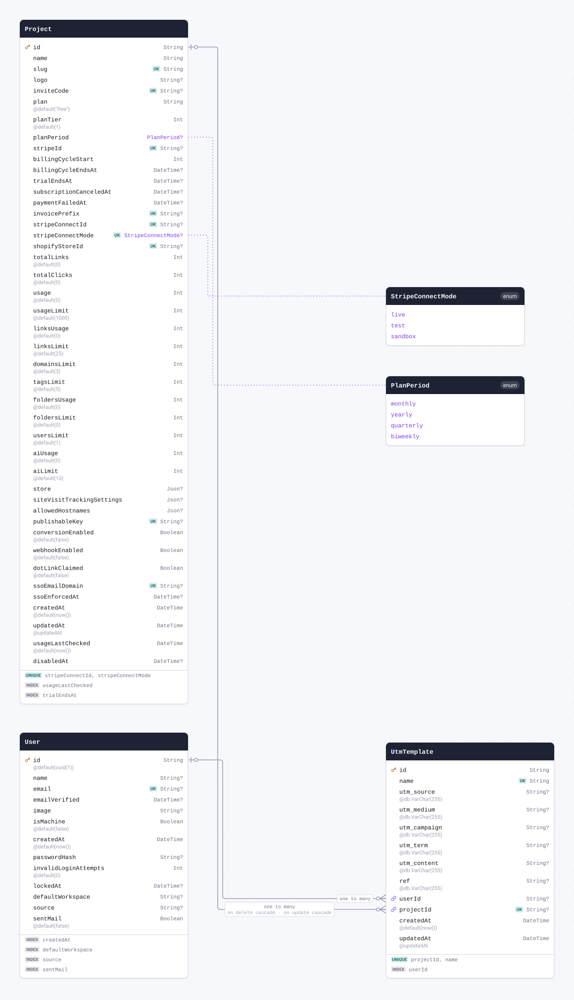

| Field          | Type                        | Constraints                         | Default      | Description |
| -------------- | --------------------------- | ----------------------------------- | ------------ | ----------- |
| `id`           | `String`                    | PK NOT NULL                         |              |             |
| `name`         | `String`                    | NOT NULL                            |              |             |
| `utm_source`   | `String` `@db.VarChar(255)` | NULL                                |              |             |
| `utm_medium`   | `String` `@db.VarChar(255)` | NULL                                |              |             |
| `utm_campaign` | `String` `@db.VarChar(255)` | NULL                                |              |             |
| `utm_term`     | `String` `@db.VarChar(255)` | NULL                                |              |             |
| `utm_content`  | `String` `@db.VarChar(255)` | NULL                                |              |             |
| `ref`          | `String` `@db.VarChar(255)` | NULL                                |              |             |
| `userId`       | `String`                    | NULL → [User.id](#model-User)       |              |             |
| `projectId`    | `String`                    | NULL → [Project.id](#model-Project) |              |             |
| `createdAt`    | `DateTime`                  | NOT NULL                            | `now()`      |             |
| `updatedAt`    | `DateTime`                  | NOT NULL                            | `@updatedAt` |             |

#### Indexes

- `@@index([userId])`
- `@@unique([projectId, name])`

#### References

- `userId` → [User.id](#model-User) (many-to-one)
- `projectId` → [Project.id](#model-Project) (many-to-one, on delete Cascade, on update Cascade)

#### Definition

```sql
CREATE TABLE `UtmTemplate` (
    `id` VARCHAR(191) NOT NULL,
    `name` VARCHAR(191) NOT NULL,
    `utm_source` VARCHAR(255) NULL,
    `utm_medium` VARCHAR(255) NULL,
    `utm_campaign` VARCHAR(255) NULL,
    `utm_term` VARCHAR(255) NULL,
    `utm_content` VARCHAR(255) NULL,
    `ref` VARCHAR(255) NULL,
    `userId` VARCHAR(191) NULL,
    `projectId` VARCHAR(191) NULL,
    `createdAt` DATETIME(3) NOT NULL DEFAULT CURRENT_TIMESTAMP(3),
    `updatedAt` DATETIME(3) NOT NULL,

    INDEX `UtmTemplate_userId_idx`(`userId`),
    UNIQUE INDEX `UtmTemplate_projectId_name_key`(`projectId`, `name`),
    PRIMARY KEY (`id`)
) DEFAULT CHARACTER SET utf8mb4 COLLATE utf8mb4_unicode_ci;
```

<details>
<summary>Queries and their SQL</summary>

**findMany**: Every row

```ts
await prisma.utmTemplate.findMany();
```

```sql
SELECT
  `UtmTemplate`.`id`,
  `UtmTemplate`.`name`,
  `UtmTemplate`.`utm_source`,
  `UtmTemplate`.`utm_medium`,
  `UtmTemplate`.`utm_campaign`,
  `UtmTemplate`.`utm_term`,
  `UtmTemplate`.`utm_content`,
  `UtmTemplate`.`ref`,
  `UtmTemplate`.`userId`,
  `UtmTemplate`.`projectId`,
  `UtmTemplate`.`createdAt`,
  `UtmTemplate`.`updatedAt`
FROM
  `UtmTemplate`
WHERE
  1 = 1
```

**count**: How many rows there are

```ts
await prisma.utmTemplate.count();
```

```sql
SELECT
  COUNT(*) AS `_count$_all`
FROM
  (
    SELECT
      `UtmTemplate`.`id`
    FROM
      `UtmTemplate`
    WHERE
      1 = 1
  ) AS `sub`
```

**findMany**: Every row with its relations

```ts
await prisma.utmTemplate.findMany({ include: { user: true, project: true } });
```

```sql
SELECT
  `UtmTemplate`.`id`,
  `UtmTemplate`.`name`,
  `UtmTemplate`.`utm_source`,
  `UtmTemplate`.`utm_medium`,
  `UtmTemplate`.`utm_campaign`,
  `UtmTemplate`.`utm_term`,
  `UtmTemplate`.`utm_content`,
  `UtmTemplate`.`ref`,
  `UtmTemplate`.`userId`,
  `UtmTemplate`.`projectId`,
  `UtmTemplate`.`createdAt`,
  `UtmTemplate`.`updatedAt`
FROM
  `UtmTemplate`
WHERE
  1 = 1

SELECT
  `User`.`id`,
  `User`.`name`,
  `User`.`email`,
  `User`.`emailVerified`,
  `User`.`image`,
  `User`.`isMachine`,
  `User`.`createdAt`,
  `User`.`passwordHash`,
  `User`.`invalidLoginAttempts`,
  `User`.`lockedAt`,
  `User`.`defaultWorkspace`,
  `User`.`source`,
  `User`.`sentMail`
FROM
  `User`
WHERE
  `User`.`id` IN (?)
-- params: ["<userId of the rows above>"]

SELECT
  `Project`.`id`,
  `Project`.`name`,
  `Project`.`slug`,
  `Project`.`logo`,
  `Project`.`inviteCode`,
  `Project`.`plan`,
  `Project`.`planTier`,
  `Project`.`planPeriod`,
  `Project`.`stripeId`,
  `Project`.`billingCycleStart`,
  `Project`.`billingCycleEndsAt`,
  `Project`.`trialEndsAt`,
  `Project`.`subscriptionCanceledAt`,
  `Project`.`paymentFailedAt`,
  `Project`.`invoicePrefix`,
  `Project`.`stripeConnectId`,
  `Project`.`stripeConnectMode`,
  `Project`.`shopifyStoreId`,
  `Project`.`totalLinks`,
  `Project`.`totalClicks`,
  `Project`.`usage`,
  `Project`.`usageLimit`,
  `Project`.`linksUsage`,
  `Project`.`linksLimit`,
  `Project`.`domainsLimit`,
  `Project`.`tagsLimit`,
  `Project`.`foldersUsage`,
  `Project`.`foldersLimit`,
  `Project`.`usersLimit`,
  `Project`.`aiUsage`,
  `Project`.`aiLimit`,
  `Project`.`store`,
  `Project`.`siteVisitTrackingSettings`,
  `Project`.`allowedHostnames`,
  `Project`.`publishableKey`,
  `Project`.`conversionEnabled`,
  `Project`.`webhookEnabled`,
  `Project`.`dotLinkClaimed`,
  `Project`.`ssoEmailDomain`,
  `Project`.`ssoEnforcedAt`,
  `Project`.`createdAt`,
  `Project`.`updatedAt`,
  `Project`.`usageLastChecked`,
  `Project`.`disabledAt`
FROM
  `Project`
WHERE
  `Project`.`id` IN (?)
-- params: ["<projectId of the rows above>"]
```

**findUnique**: One row by what is unique to it

```ts
await prisma.utmTemplate.findUnique({ where: { id: "example" } });
```

```sql
SELECT
  `UtmTemplate`.`id`,
  `UtmTemplate`.`name`,
  `UtmTemplate`.`utm_source`,
  `UtmTemplate`.`utm_medium`,
  `UtmTemplate`.`utm_campaign`,
  `UtmTemplate`.`utm_term`,
  `UtmTemplate`.`utm_content`,
  `UtmTemplate`.`ref`,
  `UtmTemplate`.`userId`,
  `UtmTemplate`.`projectId`,
  `UtmTemplate`.`createdAt`,
  `UtmTemplate`.`updatedAt`
FROM
  `UtmTemplate`
WHERE
  (
    `UtmTemplate`.`id` = ?
    AND 1 = 1
  )
LIMIT
  ?
OFFSET
  ?
-- params: ["example","1","0"]
```

**create**: Create a row

```ts
await prisma.utmTemplate.create({ data: { id: "example", name: "example" } });
```

```sql
INSERT INTO
  `UtmTemplate` (`id`, `name`, `createdAt`, `updatedAt`)
VALUES
  (?, ?, ?, ?)
-- params: ["example","example","<now()>","<now()>"]

SELECT
  `UtmTemplate`.`id`,
  `UtmTemplate`.`name`,
  `UtmTemplate`.`utm_source`,
  `UtmTemplate`.`utm_medium`,
  `UtmTemplate`.`utm_campaign`,
  `UtmTemplate`.`utm_term`,
  `UtmTemplate`.`utm_content`,
  `UtmTemplate`.`ref`,
  `UtmTemplate`.`userId`,
  `UtmTemplate`.`projectId`,
  `UtmTemplate`.`createdAt`,
  `UtmTemplate`.`updatedAt`
FROM
  `UtmTemplate`
WHERE
  `UtmTemplate`.`id` = ?
LIMIT
  ?
OFFSET
  ?
-- params: ["<id of the rows above>","1","0"]
```

**update**: Update a row

```ts
await prisma.utmTemplate.update({ where: { id: "example" }, data: { name: "example" } });
```

```sql
SELECT
  `UtmTemplate`.`id`
FROM
  `UtmTemplate`
WHERE
  (
    `UtmTemplate`.`id` = ?
    AND 1 = 1
  )
LIMIT
  ?
OFFSET
  ?
-- params: ["example","1","0"]

UPDATE `UtmTemplate`
SET
  `name` = ?,
  `updatedAt` = ?
WHERE
  (
    `UtmTemplate`.`id` IN (?)
    AND (
      `UtmTemplate`.`id` = ?
      AND 1 = 1
    )
  )
-- params: ["example",{"prisma__type":"generatorCall","prisma__value":{"name":"now","args":[],"returnType":{"type":"DateTime"}}},"<id of the rows above>","example"]

SELECT
  `UtmTemplate`.`id`,
  `UtmTemplate`.`name`,
  `UtmTemplate`.`utm_source`,
  `UtmTemplate`.`utm_medium`,
  `UtmTemplate`.`utm_campaign`,
  `UtmTemplate`.`utm_term`,
  `UtmTemplate`.`utm_content`,
  `UtmTemplate`.`ref`,
  `UtmTemplate`.`userId`,
  `UtmTemplate`.`projectId`,
  `UtmTemplate`.`createdAt`,
  `UtmTemplate`.`updatedAt`
FROM
  `UtmTemplate`
WHERE
  `UtmTemplate`.`id` = ?
LIMIT
  ?
OFFSET
  ?
-- params: ["<id of the rows above>","1","0"]
```

**delete**: Delete a row

```ts
await prisma.utmTemplate.delete({ where: { id: "example" } });
```

```sql
SELECT
  `UtmTemplate`.`id`,
  `UtmTemplate`.`name`,
  `UtmTemplate`.`utm_source`,
  `UtmTemplate`.`utm_medium`,
  `UtmTemplate`.`utm_campaign`,
  `UtmTemplate`.`utm_term`,
  `UtmTemplate`.`utm_content`,
  `UtmTemplate`.`ref`,
  `UtmTemplate`.`userId`,
  `UtmTemplate`.`projectId`,
  `UtmTemplate`.`createdAt`,
  `UtmTemplate`.`updatedAt`
FROM
  `UtmTemplate`
WHERE
  (
    `UtmTemplate`.`id` = ?
    AND 1 = 1
  )
LIMIT
  ?
OFFSET
  ?
-- params: ["example","1","0"]

DELETE FROM `UtmTemplate`
WHERE
  (
    `UtmTemplate`.`id` = ?
    AND 1 = 1
  )
-- params: ["example"]
```

</details>

<a id="model-Webhook"></a>

### Webhook

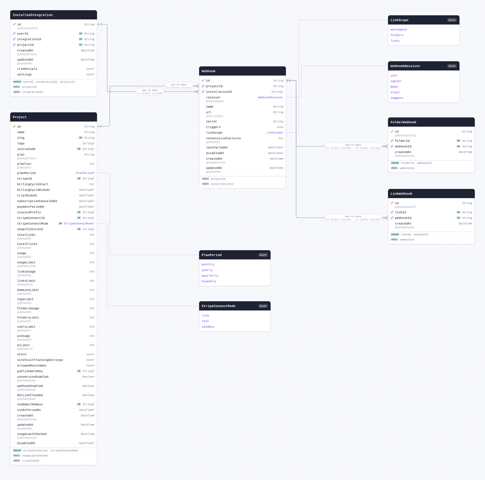

| Field                 | Type                                       | Constraints                                                   | Default      | Description |
| --------------------- | ------------------------------------------ | ------------------------------------------------------------- | ------------ | ----------- |
| `id`                  | `String`                                   | PK NOT NULL                                                   |              |             |
| `projectId`           | `String`                                   | NOT NULL → [Project.id](#model-Project)                       |              |             |
| `installationId`      | `String`                                   | NULL → [InstalledIntegration.id](#model-InstalledIntegration) |              |             |
| `receiver`            | [`WebhookReceiver`](#enum-WebhookReceiver) | NOT NULL                                                      | `user`       |             |
| `name`                | `String`                                   | NOT NULL                                                      |              |             |
| `url`                 | `String` `@db.LongText`                    | NOT NULL                                                      |              |             |
| `secret`              | `String`                                   | NOT NULL                                                      |              |             |
| `triggers`            | `Json`                                     | NOT NULL                                                      |              |             |
| `linkScope`           | [`LinkScope`](#enum-LinkScope)             | NULL                                                          |              |             |
| `consecutiveFailures` | `Int`                                      | NOT NULL                                                      | `0`          |             |
| `lastFailedAt`        | `DateTime`                                 | NULL                                                          |              |             |
| `disabledAt`          | `DateTime`                                 | NULL                                                          |              |             |
| `createdAt`           | `DateTime`                                 | NOT NULL                                                      | `now()`      |             |
| `updatedAt`           | `DateTime`                                 | NOT NULL                                                      | `@updatedAt` |             |

#### Indexes

- `@@index([projectId])`
- `@@index([installationId])`

#### References

- `projectId` → [Project.id](#model-Project) (many-to-one, on delete Cascade)
- `installationId` → [InstalledIntegration.id](#model-InstalledIntegration) (many-to-one, on delete Cascade)

#### Referenced by

- `id` ← [LinkWebhook.webhookId](#model-LinkWebhook) (one-to-many, on delete Cascade, on update Cascade)
- `id` ← [FolderWebhook.webhookId](#model-FolderWebhook) (one-to-many, on delete Cascade, on update Cascade)

#### Definition

```sql
CREATE TABLE `Webhook` (
    `id` VARCHAR(191) NOT NULL,
    `projectId` VARCHAR(191) NOT NULL,
    `installationId` VARCHAR(191) NULL,
    `receiver` ENUM('user', 'zapier', 'make', 'slack', 'segment') NOT NULL DEFAULT 'user',
    `name` VARCHAR(191) NOT NULL,
    `url` LONGTEXT NOT NULL,
    `secret` VARCHAR(191) NOT NULL,
    `triggers` JSON NOT NULL,
    `linkScope` ENUM('workspace', 'folders', 'links') NULL,
    `consecutiveFailures` INTEGER NOT NULL DEFAULT 0,
    `lastFailedAt` DATETIME(3) NULL,
    `disabledAt` DATETIME(3) NULL,
    `createdAt` DATETIME(3) NOT NULL DEFAULT CURRENT_TIMESTAMP(3),
    `updatedAt` DATETIME(3) NOT NULL,

    INDEX `Webhook_projectId_idx`(`projectId`),
    INDEX `Webhook_installationId_idx`(`installationId`),
    PRIMARY KEY (`id`)
) DEFAULT CHARACTER SET utf8mb4 COLLATE utf8mb4_unicode_ci;
```

<details>
<summary>Queries and their SQL</summary>

**findMany**: Every row

```ts
await prisma.webhook.findMany();
```

```sql
SELECT
  `Webhook`.`id`,
  `Webhook`.`projectId`,
  `Webhook`.`installationId`,
  `Webhook`.`receiver`,
  `Webhook`.`name`,
  `Webhook`.`url`,
  `Webhook`.`secret`,
  `Webhook`.`triggers`,
  `Webhook`.`linkScope`,
  `Webhook`.`consecutiveFailures`,
  `Webhook`.`lastFailedAt`,
  `Webhook`.`disabledAt`,
  `Webhook`.`createdAt`,
  `Webhook`.`updatedAt`
FROM
  `Webhook`
WHERE
  1 = 1
```

**count**: How many rows there are

```ts
await prisma.webhook.count();
```

```sql
SELECT
  COUNT(*) AS `_count$_all`
FROM
  (
    SELECT
      `Webhook`.`id`
    FROM
      `Webhook`
    WHERE
      1 = 1
  ) AS `sub`
```

**findMany**: Every row with its relations

```ts
await prisma.webhook.findMany({
  include: { project: true, installedIntegration: true, links: true, folders: true },
});
```

```sql
SELECT
  `Webhook`.`id`,
  `Webhook`.`projectId`,
  `Webhook`.`installationId`,
  `Webhook`.`receiver`,
  `Webhook`.`name`,
  `Webhook`.`url`,
  `Webhook`.`secret`,
  `Webhook`.`triggers`,
  `Webhook`.`linkScope`,
  `Webhook`.`consecutiveFailures`,
  `Webhook`.`lastFailedAt`,
  `Webhook`.`disabledAt`,
  `Webhook`.`createdAt`,
  `Webhook`.`updatedAt`
FROM
  `Webhook`
WHERE
  1 = 1

SELECT
  `Project`.`id`,
  `Project`.`name`,
  `Project`.`slug`,
  `Project`.`logo`,
  `Project`.`inviteCode`,
  `Project`.`plan`,
  `Project`.`planTier`,
  `Project`.`planPeriod`,
  `Project`.`stripeId`,
  `Project`.`billingCycleStart`,
  `Project`.`billingCycleEndsAt`,
  `Project`.`trialEndsAt`,
  `Project`.`subscriptionCanceledAt`,
  `Project`.`paymentFailedAt`,
  `Project`.`invoicePrefix`,
  `Project`.`stripeConnectId`,
  `Project`.`stripeConnectMode`,
  `Project`.`shopifyStoreId`,
  `Project`.`totalLinks`,
  `Project`.`totalClicks`,
  `Project`.`usage`,
  `Project`.`usageLimit`,
  `Project`.`linksUsage`,
  `Project`.`linksLimit`,
  `Project`.`domainsLimit`,
  `Project`.`tagsLimit`,
  `Project`.`foldersUsage`,
  `Project`.`foldersLimit`,
  `Project`.`usersLimit`,
  `Project`.`aiUsage`,
  `Project`.`aiLimit`,
  `Project`.`store`,
  `Project`.`siteVisitTrackingSettings`,
  `Project`.`allowedHostnames`,
  `Project`.`publishableKey`,
  `Project`.`conversionEnabled`,
  `Project`.`webhookEnabled`,
  `Project`.`dotLinkClaimed`,
  `Project`.`ssoEmailDomain`,
  `Project`.`ssoEnforcedAt`,
  `Project`.`createdAt`,
  `Project`.`updatedAt`,
  `Project`.`usageLastChecked`,
  `Project`.`disabledAt`
FROM
  `Project`
WHERE
  `Project`.`id` IN (?)
-- params: ["<projectId of the rows above>"]

SELECT
  `InstalledIntegration`.`id`,
  `InstalledIntegration`.`userId`,
  `InstalledIntegration`.`integrationId`,
  `InstalledIntegration`.`projectId`,
  `InstalledIntegration`.`createdAt`,
  `InstalledIntegration`.`updatedAt`,
  `InstalledIntegration`.`credentials`,
  `InstalledIntegration`.`settings`
FROM
  `InstalledIntegration`
WHERE
  `InstalledIntegration`.`id` IN (?)
-- params: ["<installationId of the rows above>"]

SELECT
  `LinkWebhook`.`id`,
  `LinkWebhook`.`linkId`,
  `LinkWebhook`.`webhookId`,
  `LinkWebhook`.`createdAt`
FROM
  `LinkWebhook`
WHERE
  `LinkWebhook`.`webhookId` IN (?)
-- params: ["<id of the rows above>"]

SELECT
  `FolderWebhook`.`id`,
  `FolderWebhook`.`folderId`,
  `FolderWebhook`.`webhookId`,
  `FolderWebhook`.`createdAt`
FROM
  `FolderWebhook`
WHERE
  `FolderWebhook`.`webhookId` IN (?)
-- params: ["<id of the rows above>"]
```

**findUnique**: One row by what is unique to it

```ts
await prisma.webhook.findUnique({ where: { id: "example" } });
```

```sql
SELECT
  `Webhook`.`id`,
  `Webhook`.`projectId`,
  `Webhook`.`installationId`,
  `Webhook`.`receiver`,
  `Webhook`.`name`,
  `Webhook`.`url`,
  `Webhook`.`secret`,
  `Webhook`.`triggers`,
  `Webhook`.`linkScope`,
  `Webhook`.`consecutiveFailures`,
  `Webhook`.`lastFailedAt`,
  `Webhook`.`disabledAt`,
  `Webhook`.`createdAt`,
  `Webhook`.`updatedAt`
FROM
  `Webhook`
WHERE
  (
    `Webhook`.`id` = ?
    AND 1 = 1
  )
LIMIT
  ?
OFFSET
  ?
-- params: ["example","1","0"]
```

**create**: Create a row

```ts
await prisma.webhook.create({
  data: {
    id: "example",
    projectId: "example",
    name: "example",
    url: "example",
    secret: "example",
    triggers: {},
  },
});
```

```sql
INSERT INTO
  `Webhook` (
    `id`,
    `projectId`,
    `receiver`,
    `name`,
    `url`,
    `secret`,
    `triggers`,
    `consecutiveFailures`,
    `createdAt`,
    `updatedAt`
  )
VALUES
  (?, ?, ?, ?, ?, ?, ?, ?, ?, ?)
-- params: ["example","example","user","example","example","example","{}","0","<now()>","<now()>"]

SELECT
  `Webhook`.`id`,
  `Webhook`.`projectId`,
  `Webhook`.`installationId`,
  `Webhook`.`receiver`,
  `Webhook`.`name`,
  `Webhook`.`url`,
  `Webhook`.`secret`,
  `Webhook`.`triggers`,
  `Webhook`.`linkScope`,
  `Webhook`.`consecutiveFailures`,
  `Webhook`.`lastFailedAt`,
  `Webhook`.`disabledAt`,
  `Webhook`.`createdAt`,
  `Webhook`.`updatedAt`
FROM
  `Webhook`
WHERE
  `Webhook`.`id` = ?
LIMIT
  ?
OFFSET
  ?
-- params: ["<id of the rows above>","1","0"]
```

**update**: Update a row

```ts
await prisma.webhook.update({ where: { id: "example" }, data: { receiver: "user" } });
```

```sql
SELECT
  `Webhook`.`id`
FROM
  `Webhook`
WHERE
  (
    `Webhook`.`id` = ?
    AND 1 = 1
  )
LIMIT
  ?
OFFSET
  ?
-- params: ["example","1","0"]

UPDATE `Webhook`
SET
  `receiver` = ?,
  `updatedAt` = ?
WHERE
  (
    `Webhook`.`id` IN (?)
    AND (
      `Webhook`.`id` = ?
      AND 1 = 1
    )
  )
-- params: ["user",{"prisma__type":"generatorCall","prisma__value":{"name":"now","args":[],"returnType":{"type":"DateTime"}}},"<id of the rows above>","example"]

SELECT
  `Webhook`.`id`,
  `Webhook`.`projectId`,
  `Webhook`.`installationId`,
  `Webhook`.`receiver`,
  `Webhook`.`name`,
  `Webhook`.`url`,
  `Webhook`.`secret`,
  `Webhook`.`triggers`,
  `Webhook`.`linkScope`,
  `Webhook`.`consecutiveFailures`,
  `Webhook`.`lastFailedAt`,
  `Webhook`.`disabledAt`,
  `Webhook`.`createdAt`,
  `Webhook`.`updatedAt`
FROM
  `Webhook`
WHERE
  `Webhook`.`id` = ?
LIMIT
  ?
OFFSET
  ?
-- params: ["<id of the rows above>","1","0"]
```

**delete**: Delete a row

```ts
await prisma.webhook.delete({ where: { id: "example" } });
```

```sql
SELECT
  `Webhook`.`id`,
  `Webhook`.`projectId`,
  `Webhook`.`installationId`,
  `Webhook`.`receiver`,
  `Webhook`.`name`,
  `Webhook`.`url`,
  `Webhook`.`secret`,
  `Webhook`.`triggers`,
  `Webhook`.`linkScope`,
  `Webhook`.`consecutiveFailures`,
  `Webhook`.`lastFailedAt`,
  `Webhook`.`disabledAt`,
  `Webhook`.`createdAt`,
  `Webhook`.`updatedAt`
FROM
  `Webhook`
WHERE
  (
    `Webhook`.`id` = ?
    AND 1 = 1
  )
LIMIT
  ?
OFFSET
  ?
-- params: ["example","1","0"]

SELECT
  `LinkWebhook`.`id`,
  `LinkWebhook`.`webhookId`
FROM
  `LinkWebhook`
WHERE
  (
    1 = 1
    AND `LinkWebhook`.`webhookId` IN (?)
  )
-- params: ["<id of the rows above>"]

DELETE FROM `LinkWebhook`
WHERE
  (
    `LinkWebhook`.`id` IN (?)
    AND 1 = 1
  )
-- params: ["<id of the rows above>"]

SELECT
  `FolderWebhook`.`id`,
  `FolderWebhook`.`webhookId`
FROM
  `FolderWebhook`
WHERE
  (
    1 = 1
    AND `FolderWebhook`.`webhookId` IN (?)
  )
-- params: ["<id of the rows above>"]

DELETE FROM `FolderWebhook`
WHERE
  (
    `FolderWebhook`.`id` IN (?)
    AND 1 = 1
  )
-- params: ["<id of the rows above>"]

DELETE FROM `Webhook`
WHERE
  (
    `Webhook`.`id` = ?
    AND 1 = 1
  )
-- params: ["example"]
```

</details>

<a id="model-LinkWebhook"></a>

### LinkWebhook

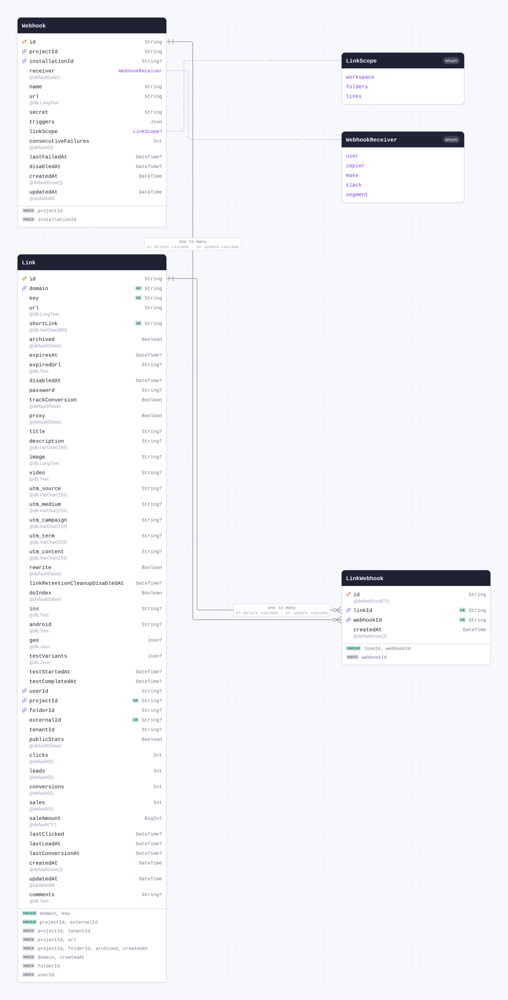

| Field       | Type       | Constraints                             | Default   | Description |
| ----------- | ---------- | --------------------------------------- | --------- | ----------- |
| `id`        | `String`   | PK NOT NULL                             | `cuid(1)` |             |
| `linkId`    | `String`   | NOT NULL → [Link.id](#model-Link)       |           |             |
| `webhookId` | `String`   | NOT NULL → [Webhook.id](#model-Webhook) |           |             |
| `createdAt` | `DateTime` | NOT NULL                                | `now()`   |             |

#### Indexes

- `@@index([webhookId])`
- `@@unique([linkId, webhookId])`

#### References

- `linkId` → [Link.id](#model-Link) (many-to-one, on delete Cascade, on update Cascade)
- `webhookId` → [Webhook.id](#model-Webhook) (many-to-one, on delete Cascade, on update Cascade)

#### Definition

```sql
CREATE TABLE `LinkWebhook` (
    `id` VARCHAR(191) NOT NULL,
    `linkId` VARCHAR(191) NOT NULL,
    `webhookId` VARCHAR(191) NOT NULL,
    `createdAt` DATETIME(3) NOT NULL DEFAULT CURRENT_TIMESTAMP(3),

    INDEX `LinkWebhook_webhookId_idx`(`webhookId`),
    UNIQUE INDEX `LinkWebhook_linkId_webhookId_key`(`linkId`, `webhookId`),
    PRIMARY KEY (`id`)
) DEFAULT CHARACTER SET utf8mb4 COLLATE utf8mb4_unicode_ci;
```

<details>
<summary>Queries and their SQL</summary>

**findMany**: Every row

```ts
await prisma.linkWebhook.findMany();
```

```sql
SELECT
  `LinkWebhook`.`id`,
  `LinkWebhook`.`linkId`,
  `LinkWebhook`.`webhookId`,
  `LinkWebhook`.`createdAt`
FROM
  `LinkWebhook`
WHERE
  1 = 1
```

**count**: How many rows there are

```ts
await prisma.linkWebhook.count();
```

```sql
SELECT
  COUNT(*) AS `_count$_all`
FROM
  (
    SELECT
      `LinkWebhook`.`id`
    FROM
      `LinkWebhook`
    WHERE
      1 = 1
  ) AS `sub`
```

**findMany**: Every row with its relations

```ts
await prisma.linkWebhook.findMany({ include: { link: true, webhook: true } });
```

```sql
SELECT
  `LinkWebhook`.`id`,
  `LinkWebhook`.`linkId`,
  `LinkWebhook`.`webhookId`,
  `LinkWebhook`.`createdAt`
FROM
  `LinkWebhook`
WHERE
  1 = 1

SELECT
  `Link`.`id`,
  `Link`.`domain`,
  `Link`.`key`,
  `Link`.`url`,
  `Link`.`shortLink`,
  `Link`.`archived`,
  `Link`.`expiresAt`,
  `Link`.`expiredUrl`,
  `Link`.`disabledAt`,
  `Link`.`password`,
  `Link`.`trackConversion`,
  `Link`.`proxy`,
  `Link`.`title`,
  `Link`.`description`,
  `Link`.`image`,
  `Link`.`video`,
  `Link`.`utm_source`,
  `Link`.`utm_medium`,
  `Link`.`utm_campaign`,
  `Link`.`utm_term`,
  `Link`.`utm_content`,
  `Link`.`rewrite`,
  `Link`.`linkRetentionCleanupDisabledAt`,
  `Link`.`doIndex`,
  `Link`.`ios`,
  `Link`.`android`,
  `Link`.`geo`,
  `Link`.`testVariants`,
  `Link`.`testStartedAt`,
  `Link`.`testCompletedAt`,
  `Link`.`userId`,
  `Link`.`projectId`,
  `Link`.`folderId`,
  `Link`.`externalId`,
  `Link`.`tenantId`,
  `Link`.`publicStats`,
  `Link`.`clicks`,
  `Link`.`leads`,
  `Link`.`conversions`,
  `Link`.`sales`,
  `Link`.`saleAmount`,
  `Link`.`lastClicked`,
  `Link`.`lastLeadAt`,
  `Link`.`lastConversionAt`,
  `Link`.`createdAt`,
  `Link`.`updatedAt`,
  `Link`.`comments`
FROM
  `Link`
WHERE
  `Link`.`id` IN (?)
-- params: ["<linkId of the rows above>"]

SELECT
  `Webhook`.`id`,
  `Webhook`.`projectId`,
  `Webhook`.`installationId`,
  `Webhook`.`receiver`,
  `Webhook`.`name`,
  `Webhook`.`url`,
  `Webhook`.`secret`,
  `Webhook`.`triggers`,
  `Webhook`.`linkScope`,
  `Webhook`.`consecutiveFailures`,
  `Webhook`.`lastFailedAt`,
  `Webhook`.`disabledAt`,
  `Webhook`.`createdAt`,
  `Webhook`.`updatedAt`
FROM
  `Webhook`
WHERE
  `Webhook`.`id` IN (?)
-- params: ["<webhookId of the rows above>"]
```

**findUnique**: One row by what is unique to it

```ts
await prisma.linkWebhook.findUnique({ where: { id: "example" } });
```

```sql
SELECT
  `LinkWebhook`.`id`,
  `LinkWebhook`.`linkId`,
  `LinkWebhook`.`webhookId`,
  `LinkWebhook`.`createdAt`
FROM
  `LinkWebhook`
WHERE
  (
    `LinkWebhook`.`id` = ?
    AND 1 = 1
  )
LIMIT
  ?
OFFSET
  ?
-- params: ["example","1","0"]
```

**create**: Create a row

```ts
await prisma.linkWebhook.create({ data: { linkId: "example", webhookId: "example" } });
```

```sql
INSERT INTO
  `LinkWebhook` (`id`, `linkId`, `webhookId`, `createdAt`)
VALUES
  (?, ?, ?, ?)
-- params: ["<cuid(1)>","example","example","<now()>"]

SELECT
  `LinkWebhook`.`id`,
  `LinkWebhook`.`linkId`,
  `LinkWebhook`.`webhookId`,
  `LinkWebhook`.`createdAt`
FROM
  `LinkWebhook`
WHERE
  `LinkWebhook`.`id` = ?
LIMIT
  ?
OFFSET
  ?
-- params: ["<id of the rows above>","1","0"]
```

**update**: Update a row

```ts
await prisma.linkWebhook.update({
  where: { id: "example" },
  data: { createdAt: new Date("2026-01-01T00:00:00.000Z") },
});
```

```sql
SELECT
  `LinkWebhook`.`id`
FROM
  `LinkWebhook`
WHERE
  (
    `LinkWebhook`.`id` = ?
    AND 1 = 1
  )
LIMIT
  ?
OFFSET
  ?
-- params: ["example","1","0"]

UPDATE `LinkWebhook`
SET
  `createdAt` = ?
WHERE
  (
    `LinkWebhook`.`id` IN (?)
    AND (
      `LinkWebhook`.`id` = ?
      AND 1 = 1
    )
  )
-- params: ["2026-01-01T00:00:00.000Z","<id of the rows above>","example"]

SELECT
  `LinkWebhook`.`id`,
  `LinkWebhook`.`linkId`,
  `LinkWebhook`.`webhookId`,
  `LinkWebhook`.`createdAt`
FROM
  `LinkWebhook`
WHERE
  `LinkWebhook`.`id` = ?
LIMIT
  ?
OFFSET
  ?
-- params: ["<id of the rows above>","1","0"]
```

**delete**: Delete a row

```ts
await prisma.linkWebhook.delete({ where: { id: "example" } });
```

```sql
SELECT
  `LinkWebhook`.`id`,
  `LinkWebhook`.`linkId`,
  `LinkWebhook`.`webhookId`,
  `LinkWebhook`.`createdAt`
FROM
  `LinkWebhook`
WHERE
  (
    `LinkWebhook`.`id` = ?
    AND 1 = 1
  )
LIMIT
  ?
OFFSET
  ?
-- params: ["example","1","0"]

DELETE FROM `LinkWebhook`
WHERE
  (
    `LinkWebhook`.`id` = ?
    AND 1 = 1
  )
-- params: ["example"]
```

</details>

<a id="model-FolderWebhook"></a>

### FolderWebhook

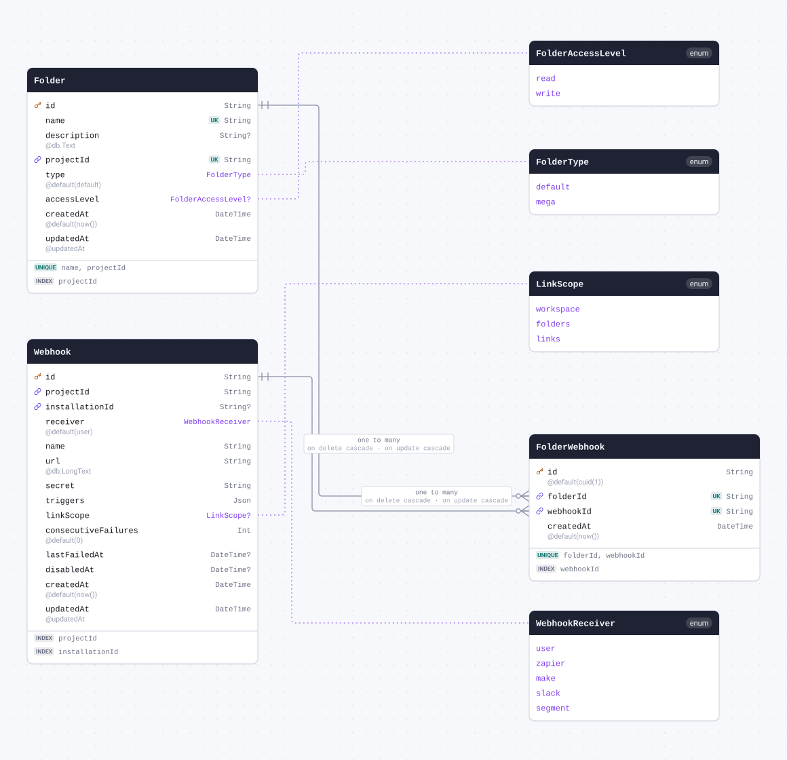

| Field       | Type       | Constraints                             | Default   | Description |
| ----------- | ---------- | --------------------------------------- | --------- | ----------- |
| `id`        | `String`   | PK NOT NULL                             | `cuid(1)` |             |
| `folderId`  | `String`   | NOT NULL → [Folder.id](#model-Folder)   |           |             |
| `webhookId` | `String`   | NOT NULL → [Webhook.id](#model-Webhook) |           |             |
| `createdAt` | `DateTime` | NOT NULL                                | `now()`   |             |

#### Indexes

- `@@index([webhookId])`
- `@@unique([folderId, webhookId])`

#### References

- `folderId` → [Folder.id](#model-Folder) (many-to-one, on delete Cascade, on update Cascade)
- `webhookId` → [Webhook.id](#model-Webhook) (many-to-one, on delete Cascade, on update Cascade)

#### Definition

```sql
CREATE TABLE `FolderWebhook` (
    `id` VARCHAR(191) NOT NULL,
    `folderId` VARCHAR(191) NOT NULL,
    `webhookId` VARCHAR(191) NOT NULL,
    `createdAt` DATETIME(3) NOT NULL DEFAULT CURRENT_TIMESTAMP(3),

    INDEX `FolderWebhook_webhookId_idx`(`webhookId`),
    UNIQUE INDEX `FolderWebhook_folderId_webhookId_key`(`folderId`, `webhookId`),
    PRIMARY KEY (`id`)
) DEFAULT CHARACTER SET utf8mb4 COLLATE utf8mb4_unicode_ci;
```

<details>
<summary>Queries and their SQL</summary>

**findMany**: Every row

```ts
await prisma.folderWebhook.findMany();
```

```sql
SELECT
  `FolderWebhook`.`id`,
  `FolderWebhook`.`folderId`,
  `FolderWebhook`.`webhookId`,
  `FolderWebhook`.`createdAt`
FROM
  `FolderWebhook`
WHERE
  1 = 1
```

**count**: How many rows there are

```ts
await prisma.folderWebhook.count();
```

```sql
SELECT
  COUNT(*) AS `_count$_all`
FROM
  (
    SELECT
      `FolderWebhook`.`id`
    FROM
      `FolderWebhook`
    WHERE
      1 = 1
  ) AS `sub`
```

**findMany**: Every row with its relations

```ts
await prisma.folderWebhook.findMany({ include: { folder: true, webhook: true } });
```

```sql
SELECT
  `FolderWebhook`.`id`,
  `FolderWebhook`.`folderId`,
  `FolderWebhook`.`webhookId`,
  `FolderWebhook`.`createdAt`
FROM
  `FolderWebhook`
WHERE
  1 = 1

SELECT
  `Folder`.`id`,
  `Folder`.`name`,
  `Folder`.`description`,
  `Folder`.`projectId`,
  `Folder`.`type`,
  `Folder`.`accessLevel`,
  `Folder`.`createdAt`,
  `Folder`.`updatedAt`
FROM
  `Folder`
WHERE
  `Folder`.`id` IN (?)
-- params: ["<folderId of the rows above>"]

SELECT
  `Webhook`.`id`,
  `Webhook`.`projectId`,
  `Webhook`.`installationId`,
  `Webhook`.`receiver`,
  `Webhook`.`name`,
  `Webhook`.`url`,
  `Webhook`.`secret`,
  `Webhook`.`triggers`,
  `Webhook`.`linkScope`,
  `Webhook`.`consecutiveFailures`,
  `Webhook`.`lastFailedAt`,
  `Webhook`.`disabledAt`,
  `Webhook`.`createdAt`,
  `Webhook`.`updatedAt`
FROM
  `Webhook`
WHERE
  `Webhook`.`id` IN (?)
-- params: ["<webhookId of the rows above>"]
```

**findUnique**: One row by what is unique to it

```ts
await prisma.folderWebhook.findUnique({ where: { id: "example" } });
```

```sql
SELECT
  `FolderWebhook`.`id`,
  `FolderWebhook`.`folderId`,
  `FolderWebhook`.`webhookId`,
  `FolderWebhook`.`createdAt`
FROM
  `FolderWebhook`
WHERE
  (
    `FolderWebhook`.`id` = ?
    AND 1 = 1
  )
LIMIT
  ?
OFFSET
  ?
-- params: ["example","1","0"]
```

**create**: Create a row

```ts
await prisma.folderWebhook.create({ data: { folderId: "example", webhookId: "example" } });
```

```sql
INSERT INTO
  `FolderWebhook` (`id`, `folderId`, `webhookId`, `createdAt`)
VALUES
  (?, ?, ?, ?)
-- params: ["<cuid(1)>","example","example","<now()>"]

SELECT
  `FolderWebhook`.`id`,
  `FolderWebhook`.`folderId`,
  `FolderWebhook`.`webhookId`,
  `FolderWebhook`.`createdAt`
FROM
  `FolderWebhook`
WHERE
  `FolderWebhook`.`id` = ?
LIMIT
  ?
OFFSET
  ?
-- params: ["<id of the rows above>","1","0"]
```

**update**: Update a row

```ts
await prisma.folderWebhook.update({
  where: { id: "example" },
  data: { createdAt: new Date("2026-01-01T00:00:00.000Z") },
});
```

```sql
SELECT
  `FolderWebhook`.`id`
FROM
  `FolderWebhook`
WHERE
  (
    `FolderWebhook`.`id` = ?
    AND 1 = 1
  )
LIMIT
  ?
OFFSET
  ?
-- params: ["example","1","0"]

UPDATE `FolderWebhook`
SET
  `createdAt` = ?
WHERE
  (
    `FolderWebhook`.`id` IN (?)
    AND (
      `FolderWebhook`.`id` = ?
      AND 1 = 1
    )
  )
-- params: ["2026-01-01T00:00:00.000Z","<id of the rows above>","example"]

SELECT
  `FolderWebhook`.`id`,
  `FolderWebhook`.`folderId`,
  `FolderWebhook`.`webhookId`,
  `FolderWebhook`.`createdAt`
FROM
  `FolderWebhook`
WHERE
  `FolderWebhook`.`id` = ?
LIMIT
  ?
OFFSET
  ?
-- params: ["<id of the rows above>","1","0"]
```

**delete**: Delete a row

```ts
await prisma.folderWebhook.delete({ where: { id: "example" } });
```

```sql
SELECT
  `FolderWebhook`.`id`,
  `FolderWebhook`.`folderId`,
  `FolderWebhook`.`webhookId`,
  `FolderWebhook`.`createdAt`
FROM
  `FolderWebhook`
WHERE
  (
    `FolderWebhook`.`id` = ?
    AND 1 = 1
  )
LIMIT
  ?
OFFSET
  ?
-- params: ["example","1","0"]

DELETE FROM `FolderWebhook`
WHERE
  (
    `FolderWebhook`.`id` = ?
    AND 1 = 1
  )
-- params: ["example"]
```

</details>

<a id="model-Project"></a>

### Project

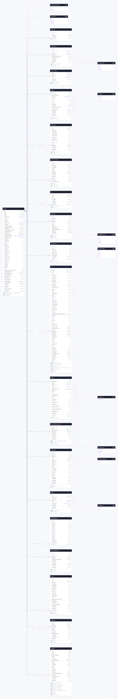

| Field                       | Type                                           | Constraints     | Default      | Description |
| --------------------------- | ---------------------------------------------- | --------------- | ------------ | ----------- |
| `id`                        | `String`                                       | PK NOT NULL     |              |             |
| `name`                      | `String`                                       | NOT NULL        |              |             |
| `slug`                      | `String`                                       | UNIQUE NOT NULL |              |             |
| `logo`                      | `String`                                       | NULL            |              |             |
| `inviteCode`                | `String`                                       | UNIQUE NULL     |              |             |
| `plan`                      | `String`                                       | NOT NULL        | `"free"`     |             |
| `planTier`                  | `Int`                                          | NOT NULL        | `1`          |             |
| `planPeriod`                | [`PlanPeriod`](#enum-PlanPeriod)               | NULL            |              |             |
| `stripeId`                  | `String`                                       | UNIQUE NULL     |              |             |
| `billingCycleStart`         | `Int`                                          | NOT NULL        |              |             |
| `billingCycleEndsAt`        | `DateTime`                                     | NULL            |              |             |
| `trialEndsAt`               | `DateTime`                                     | NULL            |              |             |
| `subscriptionCanceledAt`    | `DateTime`                                     | NULL            |              |             |
| `paymentFailedAt`           | `DateTime`                                     | NULL            |              |             |
| `invoicePrefix`             | `String`                                       | UNIQUE NULL     |              |             |
| `stripeConnectId`           | `String`                                       | NULL            |              |             |
| `stripeConnectMode`         | [`StripeConnectMode`](#enum-StripeConnectMode) | NULL            |              |             |
| `shopifyStoreId`            | `String`                                       | UNIQUE NULL     |              |             |
| `totalLinks`                | `Int`                                          | NOT NULL        | `0`          |             |
| `totalClicks`               | `Int`                                          | NOT NULL        | `0`          |             |
| `usage`                     | `Int`                                          | NOT NULL        | `0`          |             |
| `usageLimit`                | `Int`                                          | NOT NULL        | `1000`       |             |
| `linksUsage`                | `Int`                                          | NOT NULL        | `0`          |             |
| `linksLimit`                | `Int`                                          | NOT NULL        | `25`         |             |
| `domainsLimit`              | `Int`                                          | NOT NULL        | `3`          |             |
| `tagsLimit`                 | `Int`                                          | NOT NULL        | `5`          |             |
| `foldersUsage`              | `Int`                                          | NOT NULL        | `0`          |             |
| `foldersLimit`              | `Int`                                          | NOT NULL        | `0`          |             |
| `usersLimit`                | `Int`                                          | NOT NULL        | `1`          |             |
| `aiUsage`                   | `Int`                                          | NOT NULL        | `0`          |             |
| `aiLimit`                   | `Int`                                          | NOT NULL        | `10`         |             |
| `store`                     | `Json`                                         | NULL            |              |             |
| `siteVisitTrackingSettings` | `Json`                                         | NULL            |              |             |
| `allowedHostnames`          | `Json`                                         | NULL            |              |             |
| `publishableKey`            | `String`                                       | UNIQUE NULL     |              |             |
| `conversionEnabled`         | `Boolean`                                      | NOT NULL        | `false`      |             |
| `webhookEnabled`            | `Boolean`                                      | NOT NULL        | `false`      |             |
| `dotLinkClaimed`            | `Boolean`                                      | NOT NULL        | `false`      |             |
| `ssoEmailDomain`            | `String`                                       | UNIQUE NULL     |              |             |
| `ssoEnforcedAt`             | `DateTime`                                     | NULL            |              |             |
| `createdAt`                 | `DateTime`                                     | NOT NULL        | `now()`      |             |
| `updatedAt`                 | `DateTime`                                     | NOT NULL        | `@updatedAt` |             |
| `usageLastChecked`          | `DateTime`                                     | NOT NULL        | `now()`      |             |
| `disabledAt`                | `DateTime`                                     | NULL            |              |             |

#### Indexes

- `@@index([usageLastChecked])`
- `@@index([trialEndsAt])`
- `@@unique([stripeConnectId, stripeConnectMode])`

#### Referenced by

- `id` ← [Customer.projectId](#model-Customer) (one-to-many)
- `id` ← [Dashboard.projectId](#model-Dashboard) (one-to-many, on delete Cascade, on update Cascade)
- `id` ← [Domain.projectId](#model-Domain) (one-to-many, on delete Cascade)
- `id` ← [RegisteredDomain.projectId](#model-RegisteredDomain) (one-to-many)
- `id` ← [DefaultDomains.projectId](#model-DefaultDomains) (one-to-many, on delete Cascade)
- `id` ← [Folder.projectId](#model-Folder) (one-to-many)
- `id` ← [Integration.projectId](#model-Integration) (one-to-many, on delete Cascade)
- `id` ← [InstalledIntegration.projectId](#model-InstalledIntegration) (one-to-many, on delete Cascade)
- `id` ← [Invoice.workspaceId](#model-Invoice) (one-to-many)
- `id` ← [Link.projectId](#model-Link) (one-to-many, on delete Cascade, on update Cascade)
- `id` ← [YearInReview.workspaceId](#model-YearInReview) (one-to-many, on delete Cascade)
- `id` ← [OAuthCode.projectId](#model-OAuthCode) (one-to-many, on delete Cascade)
- `id` ← [Tag.projectId](#model-Tag) (one-to-many, on delete Cascade, on update Cascade)
- `id` ← [RestrictedToken.projectId](#model-RestrictedToken) (one-to-many, on delete Cascade)
- `id` ← [UtmTemplate.projectId](#model-UtmTemplate) (one-to-many, on delete Cascade, on update Cascade)
- `id` ← [Webhook.projectId](#model-Webhook) (one-to-many, on delete Cascade)
- `id` ← [ProjectInvite.projectId](#model-ProjectInvite) (one-to-many, on delete Cascade)
- `id` ← [ProjectUsers.projectId](#model-ProjectUsers) (one-to-many, on delete Cascade)
- `id` ← [SentEmail.projectId](#model-SentEmail) (one-to-many, on delete Cascade)

#### Definition

```sql
CREATE TABLE `Project` (
    `id` VARCHAR(191) NOT NULL,
    `name` VARCHAR(191) NOT NULL,
    `slug` VARCHAR(191) NOT NULL,
    `logo` VARCHAR(191) NULL,
    `inviteCode` VARCHAR(191) NULL,
    `plan` VARCHAR(191) NOT NULL DEFAULT 'free',
    `planTier` INTEGER NOT NULL DEFAULT 1,
    `planPeriod` ENUM('monthly', 'yearly', 'quarterly', 'biweekly') NULL,
    `stripeId` VARCHAR(191) NULL,
    `billingCycleStart` INTEGER NOT NULL,
    `billingCycleEndsAt` DATETIME(3) NULL,
    `trialEndsAt` DATETIME(3) NULL,
    `subscriptionCanceledAt` DATETIME(3) NULL,
    `paymentFailedAt` DATETIME(3) NULL,
    `invoicePrefix` VARCHAR(191) NULL,
    `stripeConnectId` VARCHAR(191) NULL,
    `stripeConnectMode` ENUM('live', 'test', 'sandbox') NULL,
    `shopifyStoreId` VARCHAR(191) NULL,
    `totalLinks` INTEGER NOT NULL DEFAULT 0,
    `totalClicks` INTEGER NOT NULL DEFAULT 0,
    `usage` INTEGER NOT NULL DEFAULT 0,
    `usageLimit` INTEGER NOT NULL DEFAULT 1000,
    `linksUsage` INTEGER NOT NULL DEFAULT 0,
    `linksLimit` INTEGER NOT NULL DEFAULT 25,
    `domainsLimit` INTEGER NOT NULL DEFAULT 3,
    `tagsLimit` INTEGER NOT NULL DEFAULT 5,
    `foldersUsage` INTEGER NOT NULL DEFAULT 0,
    `foldersLimit` INTEGER NOT NULL DEFAULT 0,
    `usersLimit` INTEGER NOT NULL DEFAULT 1,
    `aiUsage` INTEGER NOT NULL DEFAULT 0,
    `aiLimit` INTEGER NOT NULL DEFAULT 10,
    `store` JSON NULL,
    `siteVisitTrackingSettings` JSON NULL,
    `allowedHostnames` JSON NULL,
    `publishableKey` VARCHAR(191) NULL,
    `conversionEnabled` BOOLEAN NOT NULL DEFAULT false,
    `webhookEnabled` BOOLEAN NOT NULL DEFAULT false,
    `dotLinkClaimed` BOOLEAN NOT NULL DEFAULT false,
    `ssoEmailDomain` VARCHAR(191) NULL,
    `ssoEnforcedAt` DATETIME(3) NULL,
    `createdAt` DATETIME(3) NOT NULL DEFAULT CURRENT_TIMESTAMP(3),
    `updatedAt` DATETIME(3) NOT NULL,
    `usageLastChecked` DATETIME(3) NOT NULL DEFAULT CURRENT_TIMESTAMP(3),
    `disabledAt` DATETIME(3) NULL,

    UNIQUE INDEX `Project_slug_key`(`slug`),
    UNIQUE INDEX `Project_inviteCode_key`(`inviteCode`),
    UNIQUE INDEX `Project_stripeId_key`(`stripeId`),
    UNIQUE INDEX `Project_invoicePrefix_key`(`invoicePrefix`),
    UNIQUE INDEX `Project_shopifyStoreId_key`(`shopifyStoreId`),
    UNIQUE INDEX `Project_publishableKey_key`(`publishableKey`),
    UNIQUE INDEX `Project_ssoEmailDomain_key`(`ssoEmailDomain`),
    INDEX `Project_usageLastChecked_idx`(`usageLastChecked` ASC),
    INDEX `Project_trialEndsAt_idx`(`trialEndsAt`),
    UNIQUE INDEX `Project_stripeConnectId_stripeConnectMode_key`(`stripeConnectId`, `stripeConnectMode`),
    PRIMARY KEY (`id`)
) DEFAULT CHARACTER SET utf8mb4 COLLATE utf8mb4_unicode_ci;
```

<details>
<summary>Queries and their SQL</summary>

**findMany**: Every row

```ts
await prisma.project.findMany();
```

```sql
SELECT
  `Project`.`id`,
  `Project`.`name`,
  `Project`.`slug`,
  `Project`.`logo`,
  `Project`.`inviteCode`,
  `Project`.`plan`,
  `Project`.`planTier`,
  `Project`.`planPeriod`,
  `Project`.`stripeId`,
  `Project`.`billingCycleStart`,
  `Project`.`billingCycleEndsAt`,
  `Project`.`trialEndsAt`,
  `Project`.`subscriptionCanceledAt`,
  `Project`.`paymentFailedAt`,
  `Project`.`invoicePrefix`,
  `Project`.`stripeConnectId`,
  `Project`.`stripeConnectMode`,
  `Project`.`shopifyStoreId`,
  `Project`.`totalLinks`,
  `Project`.`totalClicks`,
  `Project`.`usage`,
  `Project`.`usageLimit`,
  `Project`.`linksUsage`,
  `Project`.`linksLimit`,
  `Project`.`domainsLimit`,
  `Project`.`tagsLimit`,
  `Project`.`foldersUsage`,
  `Project`.`foldersLimit`,
  `Project`.`usersLimit`,
  `Project`.`aiUsage`,
  `Project`.`aiLimit`,
  `Project`.`store`,
  `Project`.`siteVisitTrackingSettings`,
  `Project`.`allowedHostnames`,
  `Project`.`publishableKey`,
  `Project`.`conversionEnabled`,
  `Project`.`webhookEnabled`,
  `Project`.`dotLinkClaimed`,
  `Project`.`ssoEmailDomain`,
  `Project`.`ssoEnforcedAt`,
  `Project`.`createdAt`,
  `Project`.`updatedAt`,
  `Project`.`usageLastChecked`,
  `Project`.`disabledAt`
FROM
  `Project`
WHERE
  1 = 1
```

**count**: How many rows there are

```ts
await prisma.project.count();
```

```sql
SELECT
  COUNT(*) AS `_count$_all`
FROM
  (
    SELECT
      `Project`.`id`
    FROM
      `Project`
    WHERE
      1 = 1
  ) AS `sub`
```

**findMany**: Every row with its relations

```ts
await prisma.project.findMany({
  include: {
    users: true,
    invites: true,
    sentEmails: true,
    links: true,
    domains: true,
    tags: true,
    invoices: true,
    customers: true,
    defaultDomains: true,
    restrictedTokens: true,
    oAuthCodes: true,
    integrations: true,
    installedIntegrations: true,
    webhooks: true,
    folders: true,
    registeredDomains: true,
    dashboards: true,
    utmTemplates: true,
    yearInReviews: true,
  },
});
```

```sql
SELECT
  `Project`.`id`,
  `Project`.`name`,
  `Project`.`slug`,
  `Project`.`logo`,
  `Project`.`inviteCode`,
  `Project`.`plan`,
  `Project`.`planTier`,
  `Project`.`planPeriod`,
  `Project`.`stripeId`,
  `Project`.`billingCycleStart`,
  `Project`.`billingCycleEndsAt`,
  `Project`.`trialEndsAt`,
  `Project`.`subscriptionCanceledAt`,
  `Project`.`paymentFailedAt`,
  `Project`.`invoicePrefix`,
  `Project`.`stripeConnectId`,
  `Project`.`stripeConnectMode`,
  `Project`.`shopifyStoreId`,
  `Project`.`totalLinks`,
  `Project`.`totalClicks`,
  `Project`.`usage`,
  `Project`.`usageLimit`,
  `Project`.`linksUsage`,
  `Project`.`linksLimit`,
  `Project`.`domainsLimit`,
  `Project`.`tagsLimit`,
  `Project`.`foldersUsage`,
  `Project`.`foldersLimit`,
  `Project`.`usersLimit`,
  `Project`.`aiUsage`,
  `Project`.`aiLimit`,
  `Project`.`store`,
  `Project`.`siteVisitTrackingSettings`,
  `Project`.`allowedHostnames`,
  `Project`.`publishableKey`,
  `Project`.`conversionEnabled`,
  `Project`.`webhookEnabled`,
  `Project`.`dotLinkClaimed`,
  `Project`.`ssoEmailDomain`,
  `Project`.`ssoEnforcedAt`,
  `Project`.`createdAt`,
  `Project`.`updatedAt`,
  `Project`.`usageLastChecked`,
  `Project`.`disabledAt`
FROM
  `Project`
WHERE
  1 = 1

SELECT
  `ProjectUsers`.`id`,
  `ProjectUsers`.`role`,
  `ProjectUsers`.`userId`,
  `ProjectUsers`.`projectId`,
  `ProjectUsers`.`workspacePreferences`,
  `ProjectUsers`.`defaultFolderId`,
  `ProjectUsers`.`createdAt`,
  `ProjectUsers`.`updatedAt`
FROM
  `ProjectUsers`
WHERE
  `ProjectUsers`.`projectId` IN (?)
-- params: ["<id of the rows above>"]

SELECT
  `ProjectInvite`.`email`,
  `ProjectInvite`.`projectId`,
  `ProjectInvite`.`expires`,
  `ProjectInvite`.`role`,
  `ProjectInvite`.`createdAt`
FROM
  `ProjectInvite`
WHERE
  `ProjectInvite`.`projectId` IN (?)
-- params: ["<id of the rows above>"]

SELECT
  `SentEmail`.`id`,
  `SentEmail`.`type`,
  `SentEmail`.`createdAt`,
  `SentEmail`.`projectId`
FROM
  `SentEmail`
WHERE
  `SentEmail`.`projectId` IN (?)
-- params: ["<id of the rows above>"]

SELECT
  `Link`.`id`,
  `Link`.`domain`,
  `Link`.`key`,
  `Link`.`url`,
  `Link`.`shortLink`,
  `Link`.`archived`,
  `Link`.`expiresAt`,
  `Link`.`expiredUrl`,
  `Link`.`disabledAt`,
  `Link`.`password`,
  `Link`.`trackConversion`,
  `Link`.`proxy`,
  `Link`.`title`,
  `Link`.`description`,
  `Link`.`image`,
  `Link`.`video`,
  `Link`.`utm_source`,
  `Link`.`utm_medium`,
  `Link`.`utm_campaign`,
  `Link`.`utm_term`,
  `Link`.`utm_content`,
  `Link`.`rewrite`,
  `Link`.`linkRetentionCleanupDisabledAt`,
  `Link`.`doIndex`,
  `Link`.`ios`,
  `Link`.`android`,
  `Link`.`geo`,
  `Link`.`testVariants`,
  `Link`.`testStartedAt`,
  `Link`.`testCompletedAt`,
  `Link`.`userId`,
  `Link`.`projectId`,
  `Link`.`folderId`,
  `Link`.`externalId`,
  `Link`.`tenantId`,
  `Link`.`publicStats`,
  `Link`.`clicks`,
  `Link`.`leads`,
  `Link`.`conversions`,
  `Link`.`sales`,
  `Link`.`saleAmount`,
  `Link`.`lastClicked`,
  `Link`.`lastLeadAt`,
  `Link`.`lastConversionAt`,
  `Link`.`createdAt`,
  `Link`.`updatedAt`,
  `Link`.`comments`
FROM
  `Link`
WHERE
  `Link`.`projectId` IN (?)
-- params: ["<id of the rows above>"]

SELECT
  `Domain`.`id`,
  `Domain`.`slug`,
  `Domain`.`verified`,
  `Domain`.`placeholder`,
  `Domain`.`expiredUrl`,
  `Domain`.`notFoundUrl`,
  `Domain`.`primary`,
  `Domain`.`archived`,
  `Domain`.`lastChecked`,
  `Domain`.`logo`,
  `Domain`.`appleAppSiteAssociation`,
  `Domain`.`assetLinks`,
  `Domain`.`deepviewData`,
  `Domain`.`linkRetentionDays`,
  `Domain`.`createdAt`,
  `Domain`.`updatedAt`,
  `Domain`.`projectId`
FROM
  `Domain`
WHERE
  `Domain`.`projectId` IN (?)
-- params: ["<id of the rows above>"]

SELECT
  `Tag`.`id`,
  `Tag`.`name`,
  `Tag`.`color`,
  `Tag`.`createdAt`,
  `Tag`.`updatedAt`,
  `Tag`.`projectId`
FROM
  `Tag`
WHERE
  `Tag`.`projectId` IN (?)
-- params: ["<id of the rows above>"]

SELECT
  `Invoice`.`id`,
  `Invoice`.`workspaceId`,
  `Invoice`.`number`,
  `Invoice`.`status`,
  `Invoice`.`type`,
  `Invoice`.`paymentMethod`,
  `Invoice`.`amount`,
  `Invoice`.`fee`,
  `Invoice`.`refundedAmount`,
  `Invoice`.`total`,
  `Invoice`.`receiptUrl`,
  `Invoice`.`refundReason`,
  `Invoice`.`failedReason`,
  `Invoice`.`registeredDomains`,
  `Invoice`.`stripeChargeMetadata`,
  `Invoice`.`failedAttempts`,
  `Invoice`.`createdAt`,
  `Invoice`.`paidAt`
FROM
  `Invoice`
WHERE
  `Invoice`.`workspaceId` IN (?)
-- params: ["<id of the rows above>"]

SELECT
  `Customer`.`id`,
  `Customer`.`name`,
  `Customer`.`email`,
  `Customer`.`normalizedEmail`,
  `Customer`.`avatar`,
  `Customer`.`externalId`,
  `Customer`.`stripeCustomerId`,
  `Customer`.`linkId`,
  `Customer`.`clickId`,
  `Customer`.`clickedAt`,
  `Customer`.`country`,
  `Customer`.`sales`,
  `Customer`.`saleAmount`,
  `Customer`.`firstSaleAt`,
  `Customer`.`subscriptionCanceledAt`,
  `Customer`.`projectId`,
  `Customer`.`projectConnectId`,
  `Customer`.`createdAt`,
  `Customer`.`updatedAt`
FROM
  `Customer`
WHERE
  `Customer`.`projectId` IN (?)
-- params: ["<id of the rows above>"]

SELECT
  `DefaultDomains`.`id`,
  `DefaultDomains`.`dubsh`,
  `DefaultDomains`.`chatgpt`,
  `DefaultDomains`.`sptifi`,
  `DefaultDomains`.`gitnew`,
  `DefaultDomains`.`callink`,
  `DefaultDomains`.`amznid`,
  `DefaultDomains`.`ggllink`,
  `DefaultDomains`.`figpage`,
  `DefaultDomains`.`loooooooong`,
  `DefaultDomains`.`projectId`
FROM
  `DefaultDomains`
WHERE
  `DefaultDomains`.`projectId` IN (?)
-- params: ["<id of the rows above>"]

SELECT
  `RestrictedToken`.`id`,
  `RestrictedToken`.`name`,
  `RestrictedToken`.`hashedKey`,
  `RestrictedToken`.`partialKey`,
  `RestrictedToken`.`scopes`,
  `RestrictedToken`.`expires`,
  `RestrictedToken`.`lastUsed`,
  `RestrictedToken`.`createdAt`,
  `RestrictedToken`.`updatedAt`,
  `RestrictedToken`.`userId`,
  `RestrictedToken`.`projectId`,
  `RestrictedToken`.`installationId`
FROM
  `RestrictedToken`
WHERE
  `RestrictedToken`.`projectId` IN (?)
-- params: ["<id of the rows above>"]

SELECT
  `OAuthCode`.`id`,
  `OAuthCode`.`clientId`,
  `OAuthCode`.`userId`,
  `OAuthCode`.`projectId`,
  `OAuthCode`.`code`,
  `OAuthCode`.`scopes`,
  `OAuthCode`.`redirectUri`,
  `OAuthCode`.`codeChallenge`,
  `OAuthCode`.`codeChallengeMethod`,
  `OAuthCode`.`expiresAt`,
  `OAuthCode`.`createdAt`
FROM
  `OAuthCode`
WHERE
  `OAuthCode`.`projectId` IN (?)
-- params: ["<id of the rows above>"]

SELECT
  `Integration`.`id`,
  `Integration`.`userId`,
  `Integration`.`projectId`,
  `Integration`.`name`,
  `Integration`.`slug`,
  `Integration`.`description`,
  `Integration`.`readme`,
  `Integration`.`developer`,
  `Integration`.`website`,
  `Integration`.`logo`,
  `Integration`.`screenshots`,
  `Integration`.`verified`,
  `Integration`.`installUrl`,
  `Integration`.`guideUrl`,
  `Integration`.`category`,
  `Integration`.`comingSoon`,
  `Integration`.`createdAt`,
  `Integration`.`updatedAt`
FROM
  `Integration`
WHERE
  `Integration`.`projectId` IN (?)
-- params: ["<id of the rows above>"]

SELECT
  `InstalledIntegration`.`id`,
  `InstalledIntegration`.`userId`,
  `InstalledIntegration`.`integrationId`,
  `InstalledIntegration`.`projectId`,
  `InstalledIntegration`.`createdAt`,
  `InstalledIntegration`.`updatedAt`,
  `InstalledIntegration`.`credentials`,
  `InstalledIntegration`.`settings`
FROM
  `InstalledIntegration`
WHERE
  `InstalledIntegration`.`projectId` IN (?)
-- params: ["<id of the rows above>"]

SELECT
  `Webhook`.`id`,
  `Webhook`.`projectId`,
  `Webhook`.`installationId`,
  `Webhook`.`receiver`,
  `Webhook`.`name`,
  `Webhook`.`url`,
  `Webhook`.`secret`,
  `Webhook`.`triggers`,
  `Webhook`.`linkScope`,
  `Webhook`.`consecutiveFailures`,
  `Webhook`.`lastFailedAt`,
  `Webhook`.`disabledAt`,
  `Webhook`.`createdAt`,
  `Webhook`.`updatedAt`
FROM
  `Webhook`
WHERE
  `Webhook`.`projectId` IN (?)
-- params: ["<id of the rows above>"]

SELECT
  `Folder`.`id`,
  `Folder`.`name`,
  `Folder`.`description`,
  `Folder`.`projectId`,
  `Folder`.`type`,
  `Folder`.`accessLevel`,
  `Folder`.`createdAt`,
  `Folder`.`updatedAt`
FROM
  `Folder`
WHERE
  `Folder`.`projectId` IN (?)
-- params: ["<id of the rows above>"]

SELECT
  `RegisteredDomain`.`id`,
  `RegisteredDomain`.`slug`,
  `RegisteredDomain`.`projectId`,
  `RegisteredDomain`.`domainId`,
  `RegisteredDomain`.`autoRenewalDisabledAt`,
  `RegisteredDomain`.`renewalFee`,
  `RegisteredDomain`.`expiresAt`,
  `RegisteredDomain`.`createdAt`,
  `RegisteredDomain`.`updatedAt`
FROM
  `RegisteredDomain`
WHERE
  `RegisteredDomain`.`projectId` IN (?)
-- params: ["<id of the rows above>"]

SELECT
  `Dashboard`.`id`,
  `Dashboard`.`linkId`,
  `Dashboard`.`folderId`,
  `Dashboard`.`projectId`,
  `Dashboard`.`userId`,
  `Dashboard`.`doIndex`,
  `Dashboard`.`password`,
  `Dashboard`.`showConversions`,
  `Dashboard`.`createdAt`,
  `Dashboard`.`updatedAt`
FROM
  `Dashboard`
WHERE
  `Dashboard`.`projectId` IN (?)
-- params: ["<id of the rows above>"]

SELECT
  `UtmTemplate`.`id`,
  `UtmTemplate`.`name`,
  `UtmTemplate`.`utm_source`,
  `UtmTemplate`.`utm_medium`,
  `UtmTemplate`.`utm_campaign`,
  `UtmTemplate`.`utm_term`,
  `UtmTemplate`.`utm_content`,
  `UtmTemplate`.`ref`,
  `UtmTemplate`.`userId`,
  `UtmTemplate`.`projectId`,
  `UtmTemplate`.`createdAt`,
  `UtmTemplate`.`updatedAt`
FROM
  `UtmTemplate`
WHERE
  `UtmTemplate`.`projectId` IN (?)
-- params: ["<id of the rows above>"]

SELECT
  `YearInReview`.`id`,
  `YearInReview`.`year`,
  `YearInReview`.`totalLinks`,
  `YearInReview`.`totalClicks`,
  `YearInReview`.`topLinks`,
  `YearInReview`.`topCountries`,
  `YearInReview`.`workspaceId`,
  `YearInReview`.`createdAt`,
  `YearInReview`.`sentAt`
FROM
  `YearInReview`
WHERE
  `YearInReview`.`workspaceId` IN (?)
-- params: ["<id of the rows above>"]
```

**findUnique**: One row by what is unique to it

```ts
await prisma.project.findUnique({ where: { id: "example" } });
```

```sql
SELECT
  `Project`.`id`,
  `Project`.`name`,
  `Project`.`slug`,
  `Project`.`logo`,
  `Project`.`inviteCode`,
  `Project`.`plan`,
  `Project`.`planTier`,
  `Project`.`planPeriod`,
  `Project`.`stripeId`,
  `Project`.`billingCycleStart`,
  `Project`.`billingCycleEndsAt`,
  `Project`.`trialEndsAt`,
  `Project`.`subscriptionCanceledAt`,
  `Project`.`paymentFailedAt`,
  `Project`.`invoicePrefix`,
  `Project`.`stripeConnectId`,
  `Project`.`stripeConnectMode`,
  `Project`.`shopifyStoreId`,
  `Project`.`totalLinks`,
  `Project`.`totalClicks`,
  `Project`.`usage`,
  `Project`.`usageLimit`,
  `Project`.`linksUsage`,
  `Project`.`linksLimit`,
  `Project`.`domainsLimit`,
  `Project`.`tagsLimit`,
  `Project`.`foldersUsage`,
  `Project`.`foldersLimit`,
  `Project`.`usersLimit`,
  `Project`.`aiUsage`,
  `Project`.`aiLimit`,
  `Project`.`store`,
  `Project`.`siteVisitTrackingSettings`,
  `Project`.`allowedHostnames`,
  `Project`.`publishableKey`,
  `Project`.`conversionEnabled`,
  `Project`.`webhookEnabled`,
  `Project`.`dotLinkClaimed`,
  `Project`.`ssoEmailDomain`,
  `Project`.`ssoEnforcedAt`,
  `Project`.`createdAt`,
  `Project`.`updatedAt`,
  `Project`.`usageLastChecked`,
  `Project`.`disabledAt`
FROM
  `Project`
WHERE
  (
    `Project`.`id` = ?
    AND 1 = 1
  )
LIMIT
  ?
OFFSET
  ?
-- params: ["example","1","0"]
```

**create**: Create a row

```ts
await prisma.project.create({
  data: { id: "example", name: "example", slug: "example", billingCycleStart: 1 },
});
```

```sql
INSERT INTO
  `Project` (
    `id`,
    `name`,
    `slug`,
    `plan`,
    `planTier`,
    `billingCycleStart`,
    `totalLinks`,
    `totalClicks`,
    `usage`,
    `usageLimit`,
    `linksUsage`,
    `linksLimit`,
    `domainsLimit`,
    `tagsLimit`,
    `foldersUsage`,
    `foldersLimit`,
    `usersLimit`,
    `aiUsage`,
    `aiLimit`,
    `conversionEnabled`,
    `webhookEnabled`,
    `dotLinkClaimed`,
    `createdAt`,
    `updatedAt`,
    `usageLastChecked`
  )
VALUES
  (
    ?,
    ?,
    ?,
    ?,
    ?,
    ?,
    ?,
    ?,
    ?,
    ?,
    ?,
    ?,
    ?,
    ?,
    ?,
    ?,
    ?,
    ?,
    ?,
    ?,
    ?,
    ?,
    ?,
    ?,
    ?
  )
-- params: ["example","example","example","free","1","1","0","0","0","1000","0","25","3","5","0","0","1","0","10",false,false,false,"<now()>","<now()>","<now()>"]

SELECT
  `Project`.`id`,
  `Project`.`name`,
  `Project`.`slug`,
  `Project`.`logo`,
  `Project`.`inviteCode`,
  `Project`.`plan`,
  `Project`.`planTier`,
  `Project`.`planPeriod`,
  `Project`.`stripeId`,
  `Project`.`billingCycleStart`,
  `Project`.`billingCycleEndsAt`,
  `Project`.`trialEndsAt`,
  `Project`.`subscriptionCanceledAt`,
  `Project`.`paymentFailedAt`,
  `Project`.`invoicePrefix`,
  `Project`.`stripeConnectId`,
  `Project`.`stripeConnectMode`,
  `Project`.`shopifyStoreId`,
  `Project`.`totalLinks`,
  `Project`.`totalClicks`,
  `Project`.`usage`,
  `Project`.`usageLimit`,
  `Project`.`linksUsage`,
  `Project`.`linksLimit`,
  `Project`.`domainsLimit`,
  `Project`.`tagsLimit`,
  `Project`.`foldersUsage`,
  `Project`.`foldersLimit`,
  `Project`.`usersLimit`,
  `Project`.`aiUsage`,
  `Project`.`aiLimit`,
  `Project`.`store`,
  `Project`.`siteVisitTrackingSettings`,
  `Project`.`allowedHostnames`,
  `Project`.`publishableKey`,
  `Project`.`conversionEnabled`,
  `Project`.`webhookEnabled`,
  `Project`.`dotLinkClaimed`,
  `Project`.`ssoEmailDomain`,
  `Project`.`ssoEnforcedAt`,
  `Project`.`createdAt`,
  `Project`.`updatedAt`,
  `Project`.`usageLastChecked`,
  `Project`.`disabledAt`
FROM
  `Project`
WHERE
  `Project`.`id` = ?
LIMIT
  ?
OFFSET
  ?
-- params: ["<id of the rows above>","1","0"]
```

**update**: Update a row

```ts
await prisma.project.update({ where: { id: "example" }, data: { name: "example" } });
```

```sql
SELECT
  `Project`.`id`
FROM
  `Project`
WHERE
  (
    `Project`.`id` = ?
    AND 1 = 1
  )
LIMIT
  ?
OFFSET
  ?
-- params: ["example","1","0"]

UPDATE `Project`
SET
  `name` = ?,
  `updatedAt` = ?
WHERE
  (
    `Project`.`id` IN (?)
    AND (
      `Project`.`id` = ?
      AND 1 = 1
    )
  )
-- params: ["example",{"prisma__type":"generatorCall","prisma__value":{"name":"now","args":[],"returnType":{"type":"DateTime"}}},"<id of the rows above>","example"]

SELECT
  `Project`.`id`,
  `Project`.`name`,
  `Project`.`slug`,
  `Project`.`logo`,
  `Project`.`inviteCode`,
  `Project`.`plan`,
  `Project`.`planTier`,
  `Project`.`planPeriod`,
  `Project`.`stripeId`,
  `Project`.`billingCycleStart`,
  `Project`.`billingCycleEndsAt`,
  `Project`.`trialEndsAt`,
  `Project`.`subscriptionCanceledAt`,
  `Project`.`paymentFailedAt`,
  `Project`.`invoicePrefix`,
  `Project`.`stripeConnectId`,
  `Project`.`stripeConnectMode`,
  `Project`.`shopifyStoreId`,
  `Project`.`totalLinks`,
  `Project`.`totalClicks`,
  `Project`.`usage`,
  `Project`.`usageLimit`,
  `Project`.`linksUsage`,
  `Project`.`linksLimit`,
  `Project`.`domainsLimit`,
  `Project`.`tagsLimit`,
  `Project`.`foldersUsage`,
  `Project`.`foldersLimit`,
  `Project`.`usersLimit`,
  `Project`.`aiUsage`,
  `Project`.`aiLimit`,
  `Project`.`store`,
  `Project`.`siteVisitTrackingSettings`,
  `Project`.`allowedHostnames`,
  `Project`.`publishableKey`,
  `Project`.`conversionEnabled`,
  `Project`.`webhookEnabled`,
  `Project`.`dotLinkClaimed`,
  `Project`.`ssoEmailDomain`,
  `Project`.`ssoEnforcedAt`,
  `Project`.`createdAt`,
  `Project`.`updatedAt`,
  `Project`.`usageLastChecked`,
  `Project`.`disabledAt`
FROM
  `Project`
WHERE
  `Project`.`id` = ?
LIMIT
  ?
OFFSET
  ?
-- params: ["<id of the rows above>","1","0"]
```

**delete**: Delete a row

```ts
await prisma.project.delete({ where: { id: "example" } });
```

```sql
SELECT
  `Project`.`id`,
  `Project`.`name`,
  `Project`.`slug`,
  `Project`.`logo`,
  `Project`.`inviteCode`,
  `Project`.`plan`,
  `Project`.`planTier`,
  `Project`.`planPeriod`,
  `Project`.`stripeId`,
  `Project`.`billingCycleStart`,
  `Project`.`billingCycleEndsAt`,
  `Project`.`trialEndsAt`,
  `Project`.`subscriptionCanceledAt`,
  `Project`.`paymentFailedAt`,
  `Project`.`invoicePrefix`,
  `Project`.`stripeConnectId`,
  `Project`.`stripeConnectMode`,
  `Project`.`shopifyStoreId`,
  `Project`.`totalLinks`,
  `Project`.`totalClicks`,
  `Project`.`usage`,
  `Project`.`usageLimit`,
  `Project`.`linksUsage`,
  `Project`.`linksLimit`,
  `Project`.`domainsLimit`,
  `Project`.`tagsLimit`,
  `Project`.`foldersUsage`,
  `Project`.`foldersLimit`,
  `Project`.`usersLimit`,
  `Project`.`aiUsage`,
  `Project`.`aiLimit`,
  `Project`.`store`,
  `Project`.`siteVisitTrackingSettings`,
  `Project`.`allowedHostnames`,
  `Project`.`publishableKey`,
  `Project`.`conversionEnabled`,
  `Project`.`webhookEnabled`,
  `Project`.`dotLinkClaimed`,
  `Project`.`ssoEmailDomain`,
  `Project`.`ssoEnforcedAt`,
  `Project`.`createdAt`,
  `Project`.`updatedAt`,
  `Project`.`usageLastChecked`,
  `Project`.`disabledAt`
FROM
  `Project`
WHERE
  (
    `Project`.`id` = ?
    AND 1 = 1
  )
LIMIT
  ?
OFFSET
  ?
-- params: ["example","1","0"]

SELECT
  `Customer`.`id`,
  `Customer`.`projectId`
FROM
  `Customer`
WHERE
  (
    1 = 1
    AND `Customer`.`projectId` IN (?)
  )
-- params: ["<id of the rows above>"]

SELECT
  `Dashboard`.`id`,
  `Dashboard`.`projectId`
FROM
  `Dashboard`
WHERE
  (
    1 = 1
    AND `Dashboard`.`projectId` IN (?)
  )
-- params: ["<id of the rows above>"]

DELETE FROM `Dashboard`
WHERE
  (
    `Dashboard`.`id` IN (?)
    AND 1 = 1
  )
-- params: ["<id of the rows above>"]

SELECT
  `Domain`.`id`,
  `Domain`.`projectId`,
  `Domain`.`slug`
FROM
  `Domain`
WHERE
  (
    1 = 1
    AND `Domain`.`projectId` IN (?)
  )
-- params: ["<id of the rows above>"]

SELECT
  `RegisteredDomain`.`id`,
  `RegisteredDomain`.`domainId`
FROM
  `RegisteredDomain`
WHERE
  (
    1 = 1
    AND `RegisteredDomain`.`domainId` IN (?)
  )
-- params: ["<id of the rows above>"]

UPDATE `RegisteredDomain`
SET
  `domainId` = ?
WHERE
  (
    `RegisteredDomain`.`id` IN (?)
    AND 1 = 1
  )
-- params: [null,"<id of the rows above>"]

SELECT
  `Link`.`id`,
  `Link`.`domain`
FROM
  `Link`
WHERE
  (
    1 = 1
    AND `Link`.`domain` IN (?)
  )
-- params: ["<slug of the rows above>"]

DELETE FROM `Domain`
WHERE
  (
    `Domain`.`id` IN (?)
    AND 1 = 1
  )
-- params: ["<id of the rows above>"]

SELECT
  `RegisteredDomain`.`id`,
  `RegisteredDomain`.`projectId`
FROM
  `RegisteredDomain`
WHERE
  (
    1 = 1
    AND `RegisteredDomain`.`projectId` IN (?)
  )
-- params: ["<id of the rows above>"]

SELECT
  `DefaultDomains`.`id`,
  `DefaultDomains`.`projectId`
FROM
  `DefaultDomains`
WHERE
  (
    1 = 1
    AND `DefaultDomains`.`projectId` IN (?)
  )
-- params: ["<id of the rows above>"]

DELETE FROM `DefaultDomains`
WHERE
  (
    `DefaultDomains`.`id` IN (?)
    AND 1 = 1
  )
-- params: ["<id of the rows above>"]

SELECT
  `Folder`.`id`,
  `Folder`.`projectId`
FROM
  `Folder`
WHERE
  (
    1 = 1
    AND `Folder`.`projectId` IN (?)
  )
-- params: ["<id of the rows above>"]

SELECT
  `Integration`.`id`,
  `Integration`.`projectId`
FROM
  `Integration`
WHERE
  (
    1 = 1
    AND `Integration`.`projectId` IN (?)
  )
-- params: ["<id of the rows above>"]

SELECT
  `InstalledIntegration`.`id`,
  `InstalledIntegration`.`integrationId`
FROM
  `InstalledIntegration`
WHERE
  (
    1 = 1
    AND `InstalledIntegration`.`integrationId` IN (?)
  )
-- params: ["<id of the rows above>"]

SELECT
  `OAuthRefreshToken`.`id`,
  `OAuthRefreshToken`.`installationId`
FROM
  `OAuthRefreshToken`
WHERE
  (
    1 = 1
    AND `OAuthRefreshToken`.`installationId` IN (?)
  )
-- params: ["<id of the rows above>"]

DELETE FROM `OAuthRefreshToken`
WHERE
  (
    `OAuthRefreshToken`.`id` IN (?)
    AND 1 = 1
  )
-- params: ["<id of the rows above>"]

SELECT
  `RestrictedToken`.`id`,
  `RestrictedToken`.`installationId`
FROM
  `RestrictedToken`
WHERE
  (
    1 = 1
    AND `RestrictedToken`.`installationId` IN (?)
  )
-- params: ["<id of the rows above>"]

SELECT
  `OAuthRefreshToken`.`id`,
  `OAuthRefreshToken`.`accessTokenId`
FROM
  `OAuthRefreshToken`
WHERE
  (
    1 = 1
    AND `OAuthRefreshToken`.`accessTokenId` IN (?)
  )
-- params: ["<id of the rows above>"]

DELETE FROM `OAuthRefreshToken`
WHERE
  (
    `OAuthRefreshToken`.`id` IN (?)
    AND 1 = 1
  )
-- params: ["<id of the rows above>"]

DELETE FROM `RestrictedToken`
WHERE
  (
    `RestrictedToken`.`id` IN (?)
    AND 1 = 1
  )
-- params: ["<id of the rows above>"]

SELECT
  `Webhook`.`id`,
  `Webhook`.`installationId`
FROM
  `Webhook`
WHERE
  (
    1 = 1
    AND `Webhook`.`installationId` IN (?)
  )
-- params: ["<id of the rows above>"]

SELECT
  `LinkWebhook`.`id`,
  `LinkWebhook`.`webhookId`
FROM
  `LinkWebhook`
WHERE
  (
    1 = 1
    AND `LinkWebhook`.`webhookId` IN (?)
  )
-- params: ["<id of the rows above>"]

DELETE FROM `LinkWebhook`
WHERE
  (
    `LinkWebhook`.`id` IN (?)
    AND 1 = 1
  )
-- params: ["<id of the rows above>"]

SELECT
  `FolderWebhook`.`id`,
  `FolderWebhook`.`webhookId`
FROM
  `FolderWebhook`
WHERE
  (
    1 = 1
    AND `FolderWebhook`.`webhookId` IN (?)
  )
-- params: ["<id of the rows above>"]

DELETE FROM `FolderWebhook`
WHERE
  (
    `FolderWebhook`.`id` IN (?)
    AND 1 = 1
  )
-- params: ["<id of the rows above>"]

DELETE FROM `Webhook`
WHERE
  (
    `Webhook`.`id` IN (?)
    AND 1 = 1
  )
-- params: ["<id of the rows above>"]

DELETE FROM `InstalledIntegration`
WHERE
  (
    `InstalledIntegration`.`id` IN (?)
    AND 1 = 1
  )
-- params: ["<id of the rows above>"]

SELECT
  `OAuthApp`.`id`,
  `OAuthApp`.`integrationId`,
  `OAuthApp`.`clientId`
FROM
  `OAuthApp`
WHERE
  (
    1 = 1
    AND `OAuthApp`.`integrationId` IN (?)
  )
-- params: ["<id of the rows above>"]

SELECT
  `OAuthCode`.`id`,
  `OAuthCode`.`clientId`
FROM
  `OAuthCode`
WHERE
  (
    1 = 1
    AND `OAuthCode`.`clientId` IN (?)
  )
-- params: ["<clientId of the rows above>"]

DELETE FROM `OAuthCode`
WHERE
  (
    `OAuthCode`.`id` IN (?)
    AND 1 = 1
  )
-- params: ["<id of the rows above>"]

DELETE FROM `OAuthApp`
WHERE
  (
    `OAuthApp`.`id` IN (?)
    AND 1 = 1
  )
-- params: ["<id of the rows above>"]

DELETE FROM `Integration`
WHERE
  (
    `Integration`.`id` IN (?)
    AND 1 = 1
  )
-- params: ["<id of the rows above>"]

SELECT
  `InstalledIntegration`.`id`,
  `InstalledIntegration`.`projectId`
FROM
  `InstalledIntegration`
WHERE
  (
    1 = 1
    AND `InstalledIntegration`.`projectId` IN (?)
  )
-- params: ["<id of the rows above>"]

SELECT
  `OAuthRefreshToken`.`id`,
  `OAuthRefreshToken`.`installationId`
FROM
  `OAuthRefreshToken`
WHERE
  (
    1 = 1
    AND `OAuthRefreshToken`.`installationId` IN (?)
  )
-- params: ["<id of the rows above>"]

DELETE FROM `OAuthRefreshToken`
WHERE
  (
    `OAuthRefreshToken`.`id` IN (?)
    AND 1 = 1
  )
-- params: ["<id of the rows above>"]

SELECT
  `RestrictedToken`.`id`,
  `RestrictedToken`.`installationId`
FROM
  `RestrictedToken`
WHERE
  (
    1 = 1
    AND `RestrictedToken`.`installationId` IN (?)
  )
-- params: ["<id of the rows above>"]

SELECT
  `OAuthRefreshToken`.`id`,
  `OAuthRefreshToken`.`accessTokenId`
FROM
  `OAuthRefreshToken`
WHERE
  (
    1 = 1
    AND `OAuthRefreshToken`.`accessTokenId` IN (?)
  )
-- params: ["<id of the rows above>"]

DELETE FROM `OAuthRefreshToken`
WHERE
  (
    `OAuthRefreshToken`.`id` IN (?)
    AND 1 = 1
  )
-- params: ["<id of the rows above>"]

DELETE FROM `RestrictedToken`
WHERE
  (
    `RestrictedToken`.`id` IN (?)
    AND 1 = 1
  )
-- params: ["<id of the rows above>"]

SELECT
  `Webhook`.`id`,
  `Webhook`.`installationId`
FROM
  `Webhook`
WHERE
  (
    1 = 1
    AND `Webhook`.`installationId` IN (?)
  )
-- params: ["<id of the rows above>"]

SELECT
  `LinkWebhook`.`id`,
  `LinkWebhook`.`webhookId`
FROM
  `LinkWebhook`
WHERE
  (
    1 = 1
    AND `LinkWebhook`.`webhookId` IN (?)
  )
-- params: ["<id of the rows above>"]

DELETE FROM `LinkWebhook`
WHERE
  (
    `LinkWebhook`.`id` IN (?)
    AND 1 = 1
  )
-- params: ["<id of the rows above>"]

SELECT
  `FolderWebhook`.`id`,
  `FolderWebhook`.`webhookId`
FROM
  `FolderWebhook`
WHERE
  (
    1 = 1
    AND `FolderWebhook`.`webhookId` IN (?)
  )
-- params: ["<id of the rows above>"]

DELETE FROM `FolderWebhook`
WHERE
  (
    `FolderWebhook`.`id` IN (?)
    AND 1 = 1
  )
-- params: ["<id of the rows above>"]

DELETE FROM `Webhook`
WHERE
  (
    `Webhook`.`id` IN (?)
    AND 1 = 1
  )
-- params: ["<id of the rows above>"]

DELETE FROM `InstalledIntegration`
WHERE
  (
    `InstalledIntegration`.`id` IN (?)
    AND 1 = 1
  )
-- params: ["<id of the rows above>"]

SELECT
  `Invoice`.`id`,
  `Invoice`.`workspaceId`
FROM
  `Invoice`
WHERE
  (
    1 = 1
    AND `Invoice`.`workspaceId` IN (?)
  )
-- params: ["<id of the rows above>"]

SELECT
  `Link`.`id`,
  `Link`.`projectId`
FROM
  `Link`
WHERE
  (
    1 = 1
    AND `Link`.`projectId` IN (?)
  )
-- params: ["<id of the rows above>"]

SELECT
  `Customer`.`id`,
  `Customer`.`linkId`
FROM
  `Customer`
WHERE
  (
    1 = 1
    AND `Customer`.`linkId` IN (?)
  )
-- params: ["<id of the rows above>"]

UPDATE `Customer`
SET
  `linkId` = ?
WHERE
  (
    `Customer`.`id` IN (?)
    AND 1 = 1
  )
-- params: [null,"<id of the rows above>"]

SELECT
  `Dashboard`.`id`,
  `Dashboard`.`linkId`
FROM
  `Dashboard`
WHERE
  (
    1 = 1
    AND `Dashboard`.`linkId` IN (?)
  )
-- params: ["<id of the rows above>"]

DELETE FROM `Dashboard`
WHERE
  (
    `Dashboard`.`id` IN (?)
    AND 1 = 1
  )
-- params: ["<id of the rows above>"]

SELECT
  `LinkTag`.`id`,
  `LinkTag`.`linkId`
FROM
  `LinkTag`
WHERE
  (
    1 = 1
    AND `LinkTag`.`linkId` IN (?)
  )
-- params: ["<id of the rows above>"]

DELETE FROM `LinkTag`
WHERE
  (
    `LinkTag`.`id` IN (?)
    AND 1 = 1
  )
-- params: ["<id of the rows above>"]

SELECT
  `LinkWebhook`.`id`,
  `LinkWebhook`.`linkId`
FROM
  `LinkWebhook`
WHERE
  (
    1 = 1
    AND `LinkWebhook`.`linkId` IN (?)
  )
-- params: ["<id of the rows above>"]

DELETE FROM `LinkWebhook`
WHERE
  (
    `LinkWebhook`.`id` IN (?)
    AND 1 = 1
  )
-- params: ["<id of the rows above>"]

DELETE FROM `Link`
WHERE
  (
    `Link`.`id` IN (?)
    AND 1 = 1
  )
-- params: ["<id of the rows above>"]

SELECT
  `YearInReview`.`id`,
  `YearInReview`.`workspaceId`
FROM
  `YearInReview`
WHERE
  (
    1 = 1
    AND `YearInReview`.`workspaceId` IN (?)
  )
-- params: ["<id of the rows above>"]

DELETE FROM `YearInReview`
WHERE
  (
    `YearInReview`.`id` IN (?)
    AND 1 = 1
  )
-- params: ["<id of the rows above>"]

SELECT
  `OAuthCode`.`id`,
  `OAuthCode`.`projectId`
FROM
  `OAuthCode`
WHERE
  (
    1 = 1
    AND `OAuthCode`.`projectId` IN (?)
  )
-- params: ["<id of the rows above>"]

DELETE FROM `OAuthCode`
WHERE
  (
    `OAuthCode`.`id` IN (?)
    AND 1 = 1
  )
-- params: ["<id of the rows above>"]

SELECT
  `Tag`.`id`,
  `Tag`.`projectId`
FROM
  `Tag`
WHERE
  (
    1 = 1
    AND `Tag`.`projectId` IN (?)
  )
-- params: ["<id of the rows above>"]

SELECT
  `LinkTag`.`id`,
  `LinkTag`.`tagId`
FROM
  `LinkTag`
WHERE
  (
    1 = 1
    AND `LinkTag`.`tagId` IN (?)
  )
-- params: ["<id of the rows above>"]

DELETE FROM `LinkTag`
WHERE
  (
    `LinkTag`.`id` IN (?)
    AND 1 = 1
  )
-- params: ["<id of the rows above>"]

DELETE FROM `Tag`
WHERE
  (
    `Tag`.`id` IN (?)
    AND 1 = 1
  )
-- params: ["<id of the rows above>"]

SELECT
  `RestrictedToken`.`id`,
  `RestrictedToken`.`projectId`
FROM
  `RestrictedToken`
WHERE
  (
    1 = 1
    AND `RestrictedToken`.`projectId` IN (?)
  )
-- params: ["<id of the rows above>"]

SELECT
  `OAuthRefreshToken`.`id`,
  `OAuthRefreshToken`.`accessTokenId`
FROM
  `OAuthRefreshToken`
WHERE
  (
    1 = 1
    AND `OAuthRefreshToken`.`accessTokenId` IN (?)
  )
-- params: ["<id of the rows above>"]

DELETE FROM `OAuthRefreshToken`
WHERE
  (
    `OAuthRefreshToken`.`id` IN (?)
    AND 1 = 1
  )
-- params: ["<id of the rows above>"]

DELETE FROM `RestrictedToken`
WHERE
  (
    `RestrictedToken`.`id` IN (?)
    AND 1 = 1
  )
-- params: ["<id of the rows above>"]

SELECT
  `UtmTemplate`.`id`,
  `UtmTemplate`.`projectId`
FROM
  `UtmTemplate`
WHERE
  (
    1 = 1
    AND `UtmTemplate`.`projectId` IN (?)
  )
-- params: ["<id of the rows above>"]

DELETE FROM `UtmTemplate`
WHERE
  (
    `UtmTemplate`.`id` IN (?)
    AND 1 = 1
  )
-- params: ["<id of the rows above>"]

SELECT
  `Webhook`.`id`,
  `Webhook`.`projectId`
FROM
  `Webhook`
WHERE
  (
    1 = 1
    AND `Webhook`.`projectId` IN (?)
  )
-- params: ["<id of the rows above>"]

SELECT
  `LinkWebhook`.`id`,
  `LinkWebhook`.`webhookId`
FROM
  `LinkWebhook`
WHERE
  (
    1 = 1
    AND `LinkWebhook`.`webhookId` IN (?)
  )
-- params: ["<id of the rows above>"]

DELETE FROM `LinkWebhook`
WHERE
  (
    `LinkWebhook`.`id` IN (?)
    AND 1 = 1
  )
-- params: ["<id of the rows above>"]

SELECT
  `FolderWebhook`.`id`,
  `FolderWebhook`.`webhookId`
FROM
  `FolderWebhook`
WHERE
  (
    1 = 1
    AND `FolderWebhook`.`webhookId` IN (?)
  )
-- params: ["<id of the rows above>"]

DELETE FROM `FolderWebhook`
WHERE
  (
    `FolderWebhook`.`id` IN (?)
    AND 1 = 1
  )
-- params: ["<id of the rows above>"]

DELETE FROM `Webhook`
WHERE
  (
    `Webhook`.`id` IN (?)
    AND 1 = 1
  )
-- params: ["<id of the rows above>"]

SELECT
  `ProjectInvite`.`email`,
  `ProjectInvite`.`projectId`
FROM
  `ProjectInvite`
WHERE
  (
    1 = 1
    AND `ProjectInvite`.`projectId` IN (?)
  )
-- params: ["<id of the rows above>"]

DELETE FROM `ProjectInvite`
WHERE
  (
    `ProjectInvite`.`email` IN (?)
    AND `ProjectInvite`.`projectId` IN (?)
    AND 1 = 1
  )
-- params: ["<email of the rows above>","<projectId of the rows above>"]

SELECT
  `ProjectUsers`.`id`,
  `ProjectUsers`.`projectId`
FROM
  `ProjectUsers`
WHERE
  (
    1 = 1
    AND `ProjectUsers`.`projectId` IN (?)
  )
-- params: ["<id of the rows above>"]

SELECT
  `NotificationPreference`.`id`,
  `NotificationPreference`.`projectUserId`
FROM
  `NotificationPreference`
WHERE
  (
    1 = 1
    AND `NotificationPreference`.`projectUserId` IN (?)
  )
-- params: ["<id of the rows above>"]

DELETE FROM `NotificationPreference`
WHERE
  (
    `NotificationPreference`.`id` IN (?)
    AND 1 = 1
  )
-- params: ["<id of the rows above>"]

DELETE FROM `ProjectUsers`
WHERE
  (
    `ProjectUsers`.`id` IN (?)
    AND 1 = 1
  )
-- params: ["<id of the rows above>"]

SELECT
  `SentEmail`.`id`,
  `SentEmail`.`projectId`
FROM
  `SentEmail`
WHERE
  (
    1 = 1
    AND `SentEmail`.`projectId` IN (?)
  )
-- params: ["<id of the rows above>"]

DELETE FROM `SentEmail`
WHERE
  (
    `SentEmail`.`id` IN (?)
    AND 1 = 1
  )
-- params: ["<id of the rows above>"]

DELETE FROM `Project`
WHERE
  (
    `Project`.`id` = ?
    AND 1 = 1
  )
-- params: ["example"]
```

</details>

<a id="model-ProjectInvite"></a>

### ProjectInvite

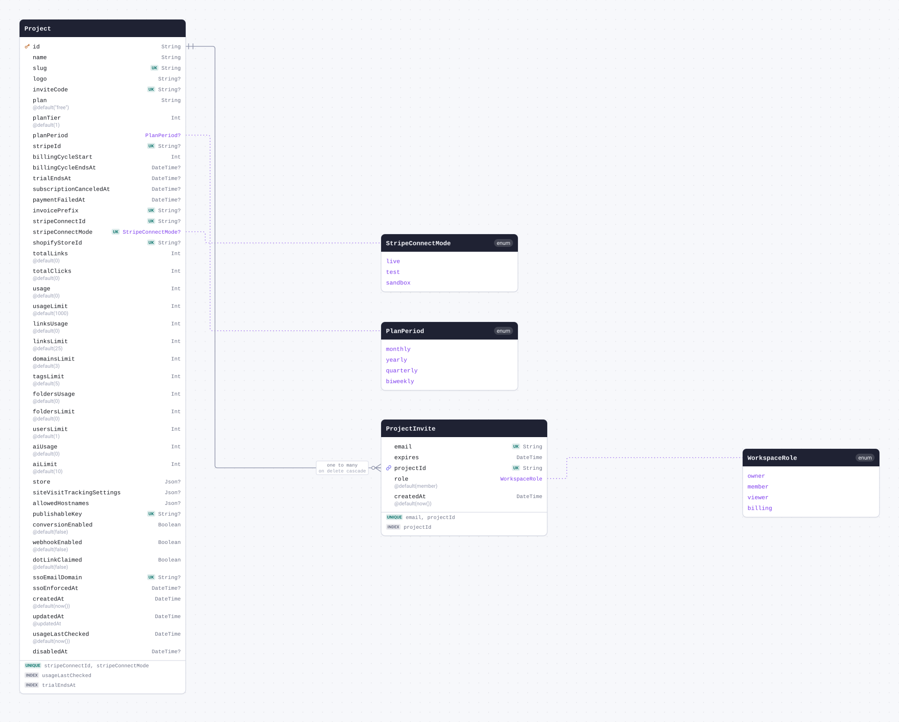

| Field       | Type                                   | Constraints                             | Default  | Description |
| ----------- | -------------------------------------- | --------------------------------------- | -------- | ----------- |
| `email`     | `String`                               | NOT NULL                                |          |             |
| `expires`   | `DateTime`                             | NOT NULL                                |          |             |
| `projectId` | `String`                               | NOT NULL → [Project.id](#model-Project) |          |             |
| `role`      | [`WorkspaceRole`](#enum-WorkspaceRole) | NOT NULL                                | `member` |             |
| `createdAt` | `DateTime`                             | NOT NULL                                | `now()`  |             |

#### Indexes

- `@@index([projectId])`
- `@@unique([email, projectId])`

#### References

- `projectId` → [Project.id](#model-Project) (many-to-one, on delete Cascade)

#### Definition

```sql
CREATE TABLE `ProjectInvite` (
    `email` VARCHAR(191) NOT NULL,
    `expires` DATETIME(3) NOT NULL,
    `projectId` VARCHAR(191) NOT NULL,
    `role` ENUM('owner', 'member', 'viewer', 'billing') NOT NULL DEFAULT 'member',
    `createdAt` DATETIME(3) NOT NULL DEFAULT CURRENT_TIMESTAMP(3),

    INDEX `ProjectInvite_projectId_idx`(`projectId`),
    UNIQUE INDEX `ProjectInvite_email_projectId_key`(`email`, `projectId`)
) DEFAULT CHARACTER SET utf8mb4 COLLATE utf8mb4_unicode_ci;
```

<details>
<summary>Queries and their SQL</summary>

**findMany**: Every row

```ts
await prisma.projectInvite.findMany();
```

```sql
SELECT
  `ProjectInvite`.`email`,
  `ProjectInvite`.`projectId`,
  `ProjectInvite`.`expires`,
  `ProjectInvite`.`role`,
  `ProjectInvite`.`createdAt`
FROM
  `ProjectInvite`
WHERE
  1 = 1
```

**count**: How many rows there are

```ts
await prisma.projectInvite.count();
```

```sql
SELECT
  COUNT(*) AS `_count$_all`
FROM
  (
    SELECT
      `ProjectInvite`.`email`,
      `ProjectInvite`.`projectId`
    FROM
      `ProjectInvite`
    WHERE
      1 = 1
  ) AS `sub`
```

**findMany**: Every row with its relations

```ts
await prisma.projectInvite.findMany({ include: { project: true } });
```

```sql
SELECT
  `ProjectInvite`.`email`,
  `ProjectInvite`.`projectId`,
  `ProjectInvite`.`expires`,
  `ProjectInvite`.`role`,
  `ProjectInvite`.`createdAt`
FROM
  `ProjectInvite`
WHERE
  1 = 1

SELECT
  `Project`.`id`,
  `Project`.`name`,
  `Project`.`slug`,
  `Project`.`logo`,
  `Project`.`inviteCode`,
  `Project`.`plan`,
  `Project`.`planTier`,
  `Project`.`planPeriod`,
  `Project`.`stripeId`,
  `Project`.`billingCycleStart`,
  `Project`.`billingCycleEndsAt`,
  `Project`.`trialEndsAt`,
  `Project`.`subscriptionCanceledAt`,
  `Project`.`paymentFailedAt`,
  `Project`.`invoicePrefix`,
  `Project`.`stripeConnectId`,
  `Project`.`stripeConnectMode`,
  `Project`.`shopifyStoreId`,
  `Project`.`totalLinks`,
  `Project`.`totalClicks`,
  `Project`.`usage`,
  `Project`.`usageLimit`,
  `Project`.`linksUsage`,
  `Project`.`linksLimit`,
  `Project`.`domainsLimit`,
  `Project`.`tagsLimit`,
  `Project`.`foldersUsage`,
  `Project`.`foldersLimit`,
  `Project`.`usersLimit`,
  `Project`.`aiUsage`,
  `Project`.`aiLimit`,
  `Project`.`store`,
  `Project`.`siteVisitTrackingSettings`,
  `Project`.`allowedHostnames`,
  `Project`.`publishableKey`,
  `Project`.`conversionEnabled`,
  `Project`.`webhookEnabled`,
  `Project`.`dotLinkClaimed`,
  `Project`.`ssoEmailDomain`,
  `Project`.`ssoEnforcedAt`,
  `Project`.`createdAt`,
  `Project`.`updatedAt`,
  `Project`.`usageLastChecked`,
  `Project`.`disabledAt`
FROM
  `Project`
WHERE
  `Project`.`id` IN (?)
-- params: ["<projectId of the rows above>"]
```

**findUnique**: One row by what is unique to it

```ts
await prisma.projectInvite.findUnique({
  where: { email_projectId: { email: "example", projectId: "example" } },
});
```

```sql
SELECT
  `ProjectInvite`.`email`,
  `ProjectInvite`.`projectId`,
  `ProjectInvite`.`expires`,
  `ProjectInvite`.`role`,
  `ProjectInvite`.`createdAt`
FROM
  `ProjectInvite`
WHERE
  (
    (
      `ProjectInvite`.`email` = ?
      AND `ProjectInvite`.`projectId` = ?
    )
    AND 1 = 1
  )
LIMIT
  ?
OFFSET
  ?
-- params: ["example","example","1","0"]
```

**create**: Create a row

```ts
await prisma.projectInvite.create({
  data: { email: "example", expires: new Date("2026-01-01T00:00:00.000Z"), projectId: "example" },
});
```

```sql
INSERT INTO
  `ProjectInvite` (
    `email`,
    `expires`,
    `projectId`,
    `role`,
    `createdAt`
  )
VALUES
  (?, ?, ?, ?, ?)
-- params: ["example","2026-01-01T00:00:00.000Z","example","member","<now()>"]

SELECT
  `ProjectInvite`.`email`,
  `ProjectInvite`.`projectId`,
  `ProjectInvite`.`expires`,
  `ProjectInvite`.`role`,
  `ProjectInvite`.`createdAt`
FROM
  `ProjectInvite`
WHERE
  (
    `ProjectInvite`.`email` = ?
    AND `ProjectInvite`.`projectId` = ?
  )
LIMIT
  ?
OFFSET
  ?
-- params: ["<email of the rows above>","<projectId of the rows above>","1","0"]
```

**update**: Update a row

```ts
await prisma.projectInvite.update({
  where: { email_projectId: { email: "example", projectId: "example" } },
  data: { expires: new Date("2026-01-01T00:00:00.000Z") },
});
```

```sql
SELECT
  `ProjectInvite`.`email`,
  `ProjectInvite`.`projectId`
FROM
  `ProjectInvite`
WHERE
  (
    (
      `ProjectInvite`.`email` = ?
      AND `ProjectInvite`.`projectId` = ?
    )
    AND 1 = 1
  )
LIMIT
  ?
OFFSET
  ?
-- params: ["example","example","1","0"]

UPDATE `ProjectInvite`
SET
  `expires` = ?
WHERE
  (
    `ProjectInvite`.`email` IN (?)
    AND `ProjectInvite`.`projectId` IN (?)
    AND (
      (
        `ProjectInvite`.`email` = ?
        AND `ProjectInvite`.`projectId` = ?
      )
      AND 1 = 1
    )
  )
-- params: ["2026-01-01T00:00:00.000Z","<email of the rows above>","<projectId of the rows above>","example","example"]

SELECT
  `ProjectInvite`.`email`,
  `ProjectInvite`.`projectId`,
  `ProjectInvite`.`expires`,
  `ProjectInvite`.`role`,
  `ProjectInvite`.`createdAt`
FROM
  `ProjectInvite`
WHERE
  (
    `ProjectInvite`.`email` = ?
    AND `ProjectInvite`.`projectId` = ?
  )
LIMIT
  ?
OFFSET
  ?
-- params: ["<email of the rows above>","<projectId of the rows above>","1","0"]
```

**delete**: Delete a row

```ts
await prisma.projectInvite.delete({
  where: { email_projectId: { email: "example", projectId: "example" } },
});
```

```sql
SELECT
  `ProjectInvite`.`email`,
  `ProjectInvite`.`projectId`,
  `ProjectInvite`.`expires`,
  `ProjectInvite`.`role`,
  `ProjectInvite`.`createdAt`
FROM
  `ProjectInvite`
WHERE
  (
    (
      `ProjectInvite`.`email` = ?
      AND `ProjectInvite`.`projectId` = ?
    )
    AND 1 = 1
  )
LIMIT
  ?
OFFSET
  ?
-- params: ["example","example","1","0"]

DELETE FROM `ProjectInvite`
WHERE
  (
    (
      `ProjectInvite`.`email` = ?
      AND `ProjectInvite`.`projectId` = ?
    )
    AND 1 = 1
  )
-- params: ["example","example"]
```

</details>

<a id="model-ProjectUsers"></a>

### ProjectUsers

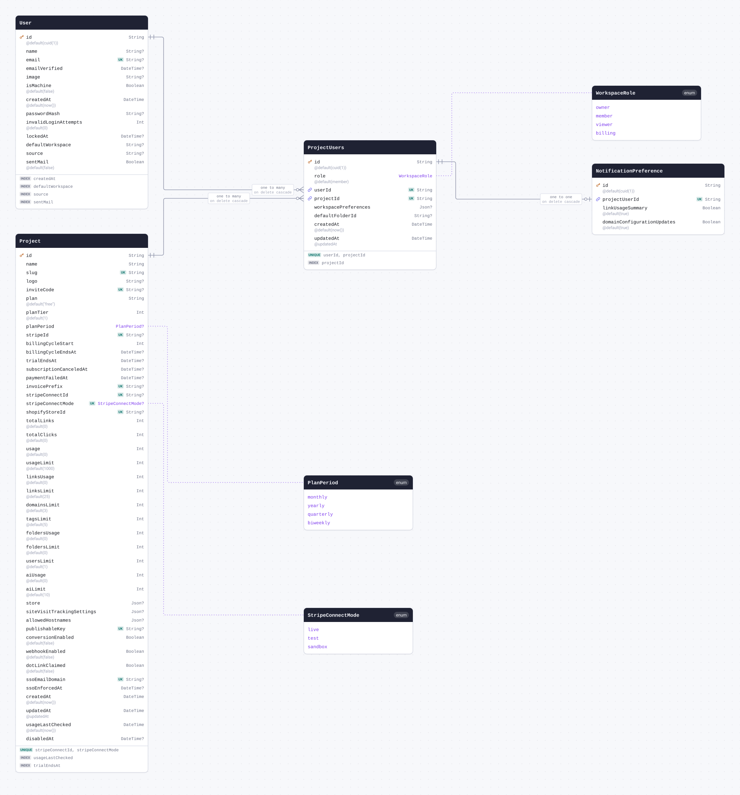

| Field                  | Type                                   | Constraints                             | Default      | Description |
| ---------------------- | -------------------------------------- | --------------------------------------- | ------------ | ----------- |
| `id`                   | `String`                               | PK NOT NULL                             | `cuid(1)`    |             |
| `role`                 | [`WorkspaceRole`](#enum-WorkspaceRole) | NOT NULL                                | `member`     |             |
| `userId`               | `String`                               | NOT NULL → [User.id](#model-User)       |              |             |
| `projectId`            | `String`                               | NOT NULL → [Project.id](#model-Project) |              |             |
| `workspacePreferences` | `Json`                                 | NULL                                    |              |             |
| `defaultFolderId`      | `String`                               | NULL                                    |              |             |
| `createdAt`            | `DateTime`                             | NOT NULL                                | `now()`      |             |
| `updatedAt`            | `DateTime`                             | NOT NULL                                | `@updatedAt` |             |

#### Indexes

- `@@index([projectId])`
- `@@unique([userId, projectId])`

#### References

- `userId` → [User.id](#model-User) (many-to-one, on delete Cascade)
- `projectId` → [Project.id](#model-Project) (many-to-one, on delete Cascade)

#### Referenced by

- `id` ← [NotificationPreference.projectUserId](#model-NotificationPreference) (one-to-one, on delete Cascade)

#### Definition

```sql
CREATE TABLE `ProjectUsers` (
    `id` VARCHAR(191) NOT NULL,
    `role` ENUM('owner', 'member', 'viewer', 'billing') NOT NULL DEFAULT 'member',
    `userId` VARCHAR(191) NOT NULL,
    `projectId` VARCHAR(191) NOT NULL,
    `workspacePreferences` JSON NULL,
    `defaultFolderId` VARCHAR(191) NULL,
    `createdAt` DATETIME(3) NOT NULL DEFAULT CURRENT_TIMESTAMP(3),
    `updatedAt` DATETIME(3) NOT NULL,

    INDEX `ProjectUsers_projectId_idx`(`projectId`),
    UNIQUE INDEX `ProjectUsers_userId_projectId_key`(`userId`, `projectId`),
    PRIMARY KEY (`id`)
) DEFAULT CHARACTER SET utf8mb4 COLLATE utf8mb4_unicode_ci;
```

<details>
<summary>Queries and their SQL</summary>

**findMany**: Every row

```ts
await prisma.projectUsers.findMany();
```

```sql
SELECT
  `ProjectUsers`.`id`,
  `ProjectUsers`.`role`,
  `ProjectUsers`.`userId`,
  `ProjectUsers`.`projectId`,
  `ProjectUsers`.`workspacePreferences`,
  `ProjectUsers`.`defaultFolderId`,
  `ProjectUsers`.`createdAt`,
  `ProjectUsers`.`updatedAt`
FROM
  `ProjectUsers`
WHERE
  1 = 1
```

**count**: How many rows there are

```ts
await prisma.projectUsers.count();
```

```sql
SELECT
  COUNT(*) AS `_count$_all`
FROM
  (
    SELECT
      `ProjectUsers`.`id`
    FROM
      `ProjectUsers`
    WHERE
      1 = 1
  ) AS `sub`
```

**findMany**: Every row with its relations

```ts
await prisma.projectUsers.findMany({
  include: { notificationPreference: true, user: true, project: true },
});
```

```sql
SELECT
  `ProjectUsers`.`id`,
  `ProjectUsers`.`role`,
  `ProjectUsers`.`userId`,
  `ProjectUsers`.`projectId`,
  `ProjectUsers`.`workspacePreferences`,
  `ProjectUsers`.`defaultFolderId`,
  `ProjectUsers`.`createdAt`,
  `ProjectUsers`.`updatedAt`
FROM
  `ProjectUsers`
WHERE
  1 = 1

SELECT
  `NotificationPreference`.`id`,
  `NotificationPreference`.`projectUserId`,
  `NotificationPreference`.`linkUsageSummary`,
  `NotificationPreference`.`domainConfigurationUpdates`
FROM
  `NotificationPreference`
WHERE
  `NotificationPreference`.`projectUserId` IN (?)
-- params: ["<id of the rows above>"]

SELECT
  `User`.`id`,
  `User`.`name`,
  `User`.`email`,
  `User`.`emailVerified`,
  `User`.`image`,
  `User`.`isMachine`,
  `User`.`createdAt`,
  `User`.`passwordHash`,
  `User`.`invalidLoginAttempts`,
  `User`.`lockedAt`,
  `User`.`defaultWorkspace`,
  `User`.`source`,
  `User`.`sentMail`
FROM
  `User`
WHERE
  `User`.`id` IN (?)
-- params: ["<userId of the rows above>"]

SELECT
  `Project`.`id`,
  `Project`.`name`,
  `Project`.`slug`,
  `Project`.`logo`,
  `Project`.`inviteCode`,
  `Project`.`plan`,
  `Project`.`planTier`,
  `Project`.`planPeriod`,
  `Project`.`stripeId`,
  `Project`.`billingCycleStart`,
  `Project`.`billingCycleEndsAt`,
  `Project`.`trialEndsAt`,
  `Project`.`subscriptionCanceledAt`,
  `Project`.`paymentFailedAt`,
  `Project`.`invoicePrefix`,
  `Project`.`stripeConnectId`,
  `Project`.`stripeConnectMode`,
  `Project`.`shopifyStoreId`,
  `Project`.`totalLinks`,
  `Project`.`totalClicks`,
  `Project`.`usage`,
  `Project`.`usageLimit`,
  `Project`.`linksUsage`,
  `Project`.`linksLimit`,
  `Project`.`domainsLimit`,
  `Project`.`tagsLimit`,
  `Project`.`foldersUsage`,
  `Project`.`foldersLimit`,
  `Project`.`usersLimit`,
  `Project`.`aiUsage`,
  `Project`.`aiLimit`,
  `Project`.`store`,
  `Project`.`siteVisitTrackingSettings`,
  `Project`.`allowedHostnames`,
  `Project`.`publishableKey`,
  `Project`.`conversionEnabled`,
  `Project`.`webhookEnabled`,
  `Project`.`dotLinkClaimed`,
  `Project`.`ssoEmailDomain`,
  `Project`.`ssoEnforcedAt`,
  `Project`.`createdAt`,
  `Project`.`updatedAt`,
  `Project`.`usageLastChecked`,
  `Project`.`disabledAt`
FROM
  `Project`
WHERE
  `Project`.`id` IN (?)
-- params: ["<projectId of the rows above>"]
```

**findUnique**: One row by what is unique to it

```ts
await prisma.projectUsers.findUnique({ where: { id: "example" } });
```

```sql
SELECT
  `ProjectUsers`.`id`,
  `ProjectUsers`.`role`,
  `ProjectUsers`.`userId`,
  `ProjectUsers`.`projectId`,
  `ProjectUsers`.`workspacePreferences`,
  `ProjectUsers`.`defaultFolderId`,
  `ProjectUsers`.`createdAt`,
  `ProjectUsers`.`updatedAt`
FROM
  `ProjectUsers`
WHERE
  (
    `ProjectUsers`.`id` = ?
    AND 1 = 1
  )
LIMIT
  ?
OFFSET
  ?
-- params: ["example","1","0"]
```

**create**: Create a row

```ts
await prisma.projectUsers.create({ data: { userId: "example", projectId: "example" } });
```

```sql
INSERT INTO
  `ProjectUsers` (
    `id`,
    `role`,
    `userId`,
    `projectId`,
    `createdAt`,
    `updatedAt`
  )
VALUES
  (?, ?, ?, ?, ?, ?)
-- params: ["<cuid(1)>","member","example","example","<now()>","<now()>"]

SELECT
  `ProjectUsers`.`id`,
  `ProjectUsers`.`role`,
  `ProjectUsers`.`userId`,
  `ProjectUsers`.`projectId`,
  `ProjectUsers`.`workspacePreferences`,
  `ProjectUsers`.`defaultFolderId`,
  `ProjectUsers`.`createdAt`,
  `ProjectUsers`.`updatedAt`
FROM
  `ProjectUsers`
WHERE
  `ProjectUsers`.`id` = ?
LIMIT
  ?
OFFSET
  ?
-- params: ["<id of the rows above>","1","0"]
```

**update**: Update a row

```ts
await prisma.projectUsers.update({ where: { id: "example" }, data: { role: "owner" } });
```

```sql
SELECT
  `ProjectUsers`.`id`
FROM
  `ProjectUsers`
WHERE
  (
    `ProjectUsers`.`id` = ?
    AND 1 = 1
  )
LIMIT
  ?
OFFSET
  ?
-- params: ["example","1","0"]

UPDATE `ProjectUsers`
SET
  `role` = ?,
  `updatedAt` = ?
WHERE
  (
    `ProjectUsers`.`id` IN (?)
    AND (
      `ProjectUsers`.`id` = ?
      AND 1 = 1
    )
  )
-- params: ["owner",{"prisma__type":"generatorCall","prisma__value":{"name":"now","args":[],"returnType":{"type":"DateTime"}}},"<id of the rows above>","example"]

SELECT
  `ProjectUsers`.`id`,
  `ProjectUsers`.`role`,
  `ProjectUsers`.`userId`,
  `ProjectUsers`.`projectId`,
  `ProjectUsers`.`workspacePreferences`,
  `ProjectUsers`.`defaultFolderId`,
  `ProjectUsers`.`createdAt`,
  `ProjectUsers`.`updatedAt`
FROM
  `ProjectUsers`
WHERE
  `ProjectUsers`.`id` = ?
LIMIT
  ?
OFFSET
  ?
-- params: ["<id of the rows above>","1","0"]
```

**delete**: Delete a row

```ts
await prisma.projectUsers.delete({ where: { id: "example" } });
```

```sql
SELECT
  `ProjectUsers`.`id`,
  `ProjectUsers`.`role`,
  `ProjectUsers`.`userId`,
  `ProjectUsers`.`projectId`,
  `ProjectUsers`.`workspacePreferences`,
  `ProjectUsers`.`defaultFolderId`,
  `ProjectUsers`.`createdAt`,
  `ProjectUsers`.`updatedAt`
FROM
  `ProjectUsers`
WHERE
  (
    `ProjectUsers`.`id` = ?
    AND 1 = 1
  )
LIMIT
  ?
OFFSET
  ?
-- params: ["example","1","0"]

SELECT
  `NotificationPreference`.`id`,
  `NotificationPreference`.`projectUserId`
FROM
  `NotificationPreference`
WHERE
  (
    1 = 1
    AND `NotificationPreference`.`projectUserId` IN (?)
  )
-- params: ["<id of the rows above>"]

DELETE FROM `NotificationPreference`
WHERE
  (
    `NotificationPreference`.`id` IN (?)
    AND 1 = 1
  )
-- params: ["<id of the rows above>"]

DELETE FROM `ProjectUsers`
WHERE
  (
    `ProjectUsers`.`id` = ?
    AND 1 = 1
  )
-- params: ["example"]
```

</details>

<a id="model-SentEmail"></a>

### SentEmail

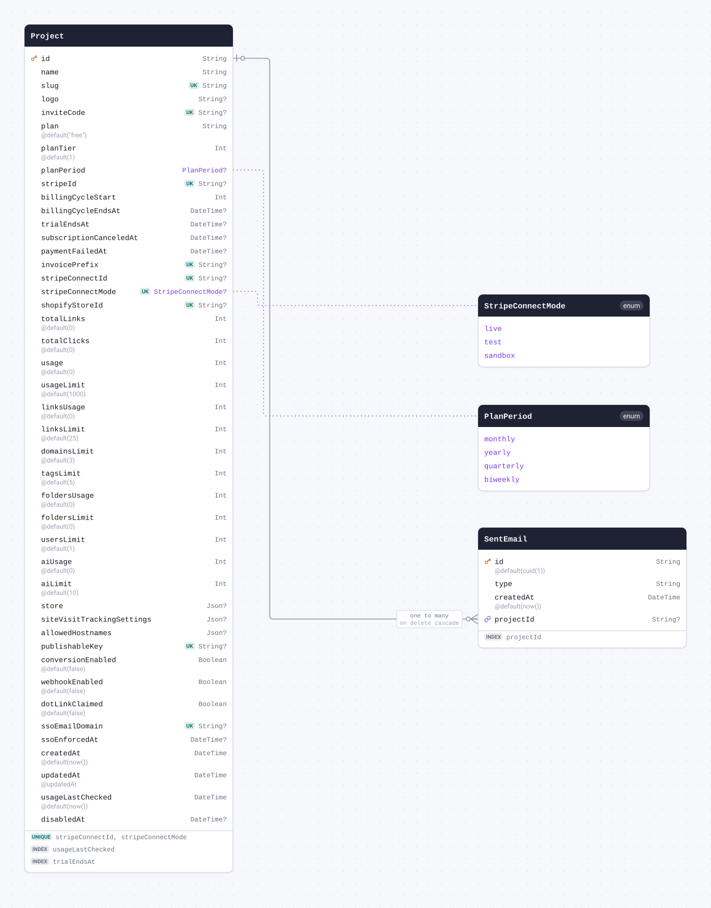

| Field       | Type       | Constraints                         | Default   | Description |
| ----------- | ---------- | ----------------------------------- | --------- | ----------- |
| `id`        | `String`   | PK NOT NULL                         | `cuid(1)` |             |
| `type`      | `String`   | NOT NULL                            |           |             |
| `createdAt` | `DateTime` | NOT NULL                            | `now()`   |             |
| `projectId` | `String`   | NULL → [Project.id](#model-Project) |           |             |

#### Indexes

- `@@index([projectId])`

#### References

- `projectId` → [Project.id](#model-Project) (many-to-one, on delete Cascade)

#### Definition

```sql
CREATE TABLE `SentEmail` (
    `id` VARCHAR(191) NOT NULL,
    `type` VARCHAR(191) NOT NULL,
    `createdAt` DATETIME(3) NOT NULL DEFAULT CURRENT_TIMESTAMP(3),
    `projectId` VARCHAR(191) NULL,

    INDEX `SentEmail_projectId_idx`(`projectId`),
    PRIMARY KEY (`id`)
) DEFAULT CHARACTER SET utf8mb4 COLLATE utf8mb4_unicode_ci;
```

<details>
<summary>Queries and their SQL</summary>

**findMany**: Every row

```ts
await prisma.sentEmail.findMany();
```

```sql
SELECT
  `SentEmail`.`id`,
  `SentEmail`.`type`,
  `SentEmail`.`createdAt`,
  `SentEmail`.`projectId`
FROM
  `SentEmail`
WHERE
  1 = 1
```

**count**: How many rows there are

```ts
await prisma.sentEmail.count();
```

```sql
SELECT
  COUNT(*) AS `_count$_all`
FROM
  (
    SELECT
      `SentEmail`.`id`
    FROM
      `SentEmail`
    WHERE
      1 = 1
  ) AS `sub`
```

**findMany**: Every row with its relations

```ts
await prisma.sentEmail.findMany({ include: { project: true } });
```

```sql
SELECT
  `SentEmail`.`id`,
  `SentEmail`.`type`,
  `SentEmail`.`createdAt`,
  `SentEmail`.`projectId`
FROM
  `SentEmail`
WHERE
  1 = 1

SELECT
  `Project`.`id`,
  `Project`.`name`,
  `Project`.`slug`,
  `Project`.`logo`,
  `Project`.`inviteCode`,
  `Project`.`plan`,
  `Project`.`planTier`,
  `Project`.`planPeriod`,
  `Project`.`stripeId`,
  `Project`.`billingCycleStart`,
  `Project`.`billingCycleEndsAt`,
  `Project`.`trialEndsAt`,
  `Project`.`subscriptionCanceledAt`,
  `Project`.`paymentFailedAt`,
  `Project`.`invoicePrefix`,
  `Project`.`stripeConnectId`,
  `Project`.`stripeConnectMode`,
  `Project`.`shopifyStoreId`,
  `Project`.`totalLinks`,
  `Project`.`totalClicks`,
  `Project`.`usage`,
  `Project`.`usageLimit`,
  `Project`.`linksUsage`,
  `Project`.`linksLimit`,
  `Project`.`domainsLimit`,
  `Project`.`tagsLimit`,
  `Project`.`foldersUsage`,
  `Project`.`foldersLimit`,
  `Project`.`usersLimit`,
  `Project`.`aiUsage`,
  `Project`.`aiLimit`,
  `Project`.`store`,
  `Project`.`siteVisitTrackingSettings`,
  `Project`.`allowedHostnames`,
  `Project`.`publishableKey`,
  `Project`.`conversionEnabled`,
  `Project`.`webhookEnabled`,
  `Project`.`dotLinkClaimed`,
  `Project`.`ssoEmailDomain`,
  `Project`.`ssoEnforcedAt`,
  `Project`.`createdAt`,
  `Project`.`updatedAt`,
  `Project`.`usageLastChecked`,
  `Project`.`disabledAt`
FROM
  `Project`
WHERE
  `Project`.`id` IN (?)
-- params: ["<projectId of the rows above>"]
```

**findUnique**: One row by what is unique to it

```ts
await prisma.sentEmail.findUnique({ where: { id: "example" } });
```

```sql
SELECT
  `SentEmail`.`id`,
  `SentEmail`.`type`,
  `SentEmail`.`createdAt`,
  `SentEmail`.`projectId`
FROM
  `SentEmail`
WHERE
  (
    `SentEmail`.`id` = ?
    AND 1 = 1
  )
LIMIT
  ?
OFFSET
  ?
-- params: ["example","1","0"]
```

**create**: Create a row

```ts
await prisma.sentEmail.create({ data: { type: "example" } });
```

```sql
INSERT INTO
  `SentEmail` (`id`, `type`, `createdAt`)
VALUES
  (?, ?, ?)
-- params: ["<cuid(1)>","example","<now()>"]

SELECT
  `SentEmail`.`id`,
  `SentEmail`.`type`,
  `SentEmail`.`createdAt`,
  `SentEmail`.`projectId`
FROM
  `SentEmail`
WHERE
  `SentEmail`.`id` = ?
LIMIT
  ?
OFFSET
  ?
-- params: ["<id of the rows above>","1","0"]
```

**update**: Update a row

```ts
await prisma.sentEmail.update({ where: { id: "example" }, data: { type: "example" } });
```

```sql
SELECT
  `SentEmail`.`id`
FROM
  `SentEmail`
WHERE
  (
    `SentEmail`.`id` = ?
    AND 1 = 1
  )
LIMIT
  ?
OFFSET
  ?
-- params: ["example","1","0"]

UPDATE `SentEmail`
SET
  `type` = ?
WHERE
  (
    `SentEmail`.`id` IN (?)
    AND (
      `SentEmail`.`id` = ?
      AND 1 = 1
    )
  )
-- params: ["example","<id of the rows above>","example"]

SELECT
  `SentEmail`.`id`,
  `SentEmail`.`type`,
  `SentEmail`.`createdAt`,
  `SentEmail`.`projectId`
FROM
  `SentEmail`
WHERE
  `SentEmail`.`id` = ?
LIMIT
  ?
OFFSET
  ?
-- params: ["<id of the rows above>","1","0"]
```

**delete**: Delete a row

```ts
await prisma.sentEmail.delete({ where: { id: "example" } });
```

```sql
SELECT
  `SentEmail`.`id`,
  `SentEmail`.`type`,
  `SentEmail`.`createdAt`,
  `SentEmail`.`projectId`
FROM
  `SentEmail`
WHERE
  (
    `SentEmail`.`id` = ?
    AND 1 = 1
  )
LIMIT
  ?
OFFSET
  ?
-- params: ["example","1","0"]

DELETE FROM `SentEmail`
WHERE
  (
    `SentEmail`.`id` = ?
    AND 1 = 1
  )
-- params: ["example"]
```

</details>

## Enums

<a id="enum-FolderType"></a>

### FolderType

- `default`
- `mega`

<a id="enum-FolderAccessLevel"></a>

### FolderAccessLevel

- `read`
- `write`

<a id="enum-FolderUserRole"></a>

### FolderUserRole

- `owner`
- `editor`
- `viewer`

<a id="enum-InvoiceStatus"></a>

### InvoiceStatus

- `processing`
- `completed`
- `failed`

<a id="enum-InvoiceType"></a>

### InvoiceType

- `domainRenewal`

<a id="enum-PaymentMethod"></a>

### PaymentMethod

- `card`
- `ach`
- `ach_fast`
- `sepa`
- `acss`

<a id="enum-WebhookReceiver"></a>

### WebhookReceiver

- `user`
- `zapier`
- `make`
- `slack`
- `segment`

<a id="enum-LinkScope"></a>

### LinkScope

- `workspace`
- `folders`
- `links`

<a id="enum-PlanPeriod"></a>

### PlanPeriod

- `monthly`
- `yearly`
- `quarterly`
- `biweekly`

<a id="enum-StripeConnectMode"></a>

### StripeConnectMode

- `live`
- `test`
- `sandbox`

<a id="enum-WorkspaceRole"></a>

### WorkspaceRole

- `owner`
- `member`
- `viewer`
- `billing`
