# Schema docs

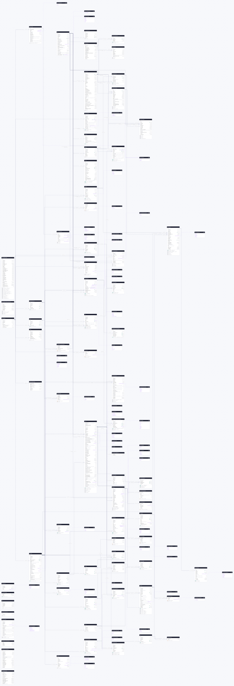

<details>
<summary>The whole schema as SQL</summary>

```sql
CREATE SCHEMA IF NOT EXISTS "public";

CREATE EXTENSION IF NOT EXISTS "vector";

CREATE TYPE "CreativeType" AS ENUM ('feedbackButton', 'banner');

CREATE TYPE "CreativeStatus" AS ENUM ('draft', 'inProgress', 'paused', 'completed');

CREATE TYPE "CreativeShowOn" AS ENUM ('pageView', 'action');

CREATE TYPE "CreativeDeviceType" AS ENUM ('phone', 'tablet', 'desktop');

CREATE TYPE "PipelineTriggers" AS ENUM ('responseCreated', 'responseUpdated', 'responseFinished');

CREATE TYPE "WebhookSource" AS ENUM ('user', 'zapier', 'make', 'n8n', 'activepieces');

CREATE TYPE "ContactAttributeType" AS ENUM ('default', 'custom');

CREATE TYPE "ContactAttributeDataType" AS ENUM ('string', 'number', 'date');

CREATE TYPE "ResponseOutcome" AS ENUM ('lowQuality');

CREATE TYPE "SurveyStatus" AS ENUM ('draft', 'inProgress', 'paused', 'completed');

CREATE TYPE "SurveyAttributeFilterCondition" AS ENUM ('equals', 'notEquals');

CREATE TYPE "SurveyQuotaAction" AS ENUM ('endSurvey', 'continueSurvey');

CREATE TYPE "ResponseQuotaLinkStatus" AS ENUM ('screenedIn', 'screenedOut');

CREATE TYPE "SurveyType" AS ENUM ('link', 'app');

CREATE TYPE "displayOptions" AS ENUM ('displayOnce', 'displayMultiple', 'displaySome', 'respondMultiple');

CREATE TYPE "SurveyVisibility" AS ENUM ('restricted', 'workspace');

CREATE TYPE "SurveyScriptMode" AS ENUM ('add', 'replace');

CREATE TYPE "ActionType" AS ENUM ('code', 'noCode');

CREATE TYPE "IntegrationType" AS ENUM ('googleSheets', 'notion', 'airtable', 'slack');

CREATE TYPE "DataMigrationStatus" AS ENUM ('pending', 'applied', 'failed');

CREATE TYPE "WidgetPlacement" AS ENUM ('bottomLeft', 'bottomRight', 'topLeft', 'topRight', 'center');

CREATE TYPE "SurveyOverlay" AS ENUM ('none', 'light', 'dark');

CREATE TYPE "BootstrapAdminMarker" AS ENUM ('bootstrapAdmin');

CREATE TYPE "OrganizationRole" AS ENUM ('owner', 'manager', 'member', 'billing', 'dashboard_viewer');

CREATE TYPE "ApiKeyPermission" AS ENUM ('read', 'write', 'manage');

CREATE TYPE "IdentityProvider" AS ENUM ('email', 'github', 'google', 'azuread', 'openid', 'saml');

CREATE TYPE "EmbeddedDataSource" AS ENUM ('computed', 'ingested', 'reserved');

CREATE TYPE "EmbeddedDataType" AS ENUM ('string', 'number', 'boolean', 'date');

CREATE TYPE "TeamUserRole" AS ENUM ('admin', 'contributor');

CREATE TYPE "WorkspaceTeamPermission" AS ENUM ('read', 'readWrite', 'manage');

CREATE TYPE "ChartType" AS ENUM ('area', 'bar', 'pie', 'big_number', 'matrix');

CREATE TYPE "FeedbackSourceType" AS ENUM ('formbricks_survey', 'csv');

CREATE TYPE "FeedbackSourceStatus" AS ENUM ('active', 'paused', 'error');

CREATE TYPE "FeedbackSourceImportMode" AS ENUM ('completedOnly', 'all');

CREATE TYPE "FeedbackSourceElementScope" AS ENUM ('all', 'specific');

CREATE TYPE "HubFieldType" AS ENUM ('text', 'categorical', 'nps', 'csat', 'ces', 'rating', 'number', 'boolean', 'date');

CREATE TYPE "DeletionCleanupKind" AS ENUM ('hubSurvey', 'hubResponses', 'storageFiles', 'storageSurveyFolder', 'hubResponseOutcome');

CREATE TYPE "AttachmentExportStatus" AS ENUM ('queued', 'running', 'completed', 'failed', 'expired');

CREATE TYPE "RetentionEntity" AS ENUM ('responses', 'surveys', 'members');

CREATE TYPE "RetentionSurveyCondition" AS ENUM ('noResponse', 'noChange', 'createdBefore');

CREATE TYPE "RetentionRunKind" AS ENUM ('sweep', 'purge');

CREATE TYPE "RetentionExemptionSource" AS ENUM ('manual', 'restore');

CREATE TYPE "RetentionTargetType" AS ENUM ('survey', 'user');

CREATE TYPE "RetentionRunItemAction" AS ENUM ('notified', 'archived', 'deactivated', 'deleted', 'skipped');

CREATE TYPE "RetentionSkipReason" AS ENUM ('exempt', 'lastOwner', 'otherOrganization', 'noRecipient');

CREATE TYPE "WorkflowStatus" AS ENUM ('draft', 'enabled', 'disabled', 'archived');

CREATE TYPE "WorkflowRunStatus" AS ENUM ('queued', 'running', 'completed', 'failed', 'canceled');

CREATE TYPE "WorkflowRunLogStatus" AS ENUM ('pending', 'running', 'succeeded', 'failed', 'skipped');

CREATE TABLE "Creative" (
    "id" TEXT NOT NULL,
    "created_at" TIMESTAMP(3) NOT NULL DEFAULT CURRENT_TIMESTAMP,
    "updated_at" TIMESTAMP(3) NOT NULL,
    "name" TEXT NOT NULL,
    "type" "CreativeType" NOT NULL,
    "status" "CreativeStatus" NOT NULL DEFAULT 'draft',
    "publishedAt" TIMESTAMP(3),
    "archivedAt" TIMESTAMP(3),
    "workspaceId" TEXT NOT NULL,
    "createdBy" TEXT,
    "content" JSONB NOT NULL,
    "styling" JSONB NOT NULL,
    "surveyId" TEXT,
    "linkUrl" TEXT,
    "showOn" "CreativeShowOn" NOT NULL DEFAULT 'pageView',
    "showConditions" JSONB,
    "displayPercentage" DOUBLE PRECISION,
    "startAt" TIMESTAMP(3),
    "endAt" TIMESTAMP(3),
    "autoSelectLanguage" BOOLEAN,

    CONSTRAINT "Creative_pkey" PRIMARY KEY ("id")
);

CREATE TABLE "CreativeDailyStat" (
    "creativeId" TEXT NOT NULL,
    "date" DATE NOT NULL,
    "deviceType" "CreativeDeviceType" NOT NULL,
    "impressions" INTEGER NOT NULL DEFAULT 0,
    "clicks" INTEGER NOT NULL DEFAULT 0,

    CONSTRAINT "CreativeDailyStat_pkey" PRIMARY KEY ("creativeId","date","deviceType")
);

CREATE TABLE "CreativeDailyPageStat" (
    "creativeId" TEXT NOT NULL,
    "date" DATE NOT NULL,
    "page" TEXT NOT NULL,
    "impressions" INTEGER NOT NULL DEFAULT 0,
    "clicks" INTEGER NOT NULL DEFAULT 0,

    CONSTRAINT "CreativeDailyPageStat_pkey" PRIMARY KEY ("creativeId","date","page")
);

CREATE TABLE "CreativeTrigger" (
    "id" TEXT NOT NULL,
    "created_at" TIMESTAMP(3) NOT NULL DEFAULT CURRENT_TIMESTAMP,
    "updated_at" TIMESTAMP(3) NOT NULL,
    "creativeId" TEXT NOT NULL,
    "actionClassId" TEXT NOT NULL,

    CONSTRAINT "CreativeTrigger_pkey" PRIMARY KEY ("id")
);

CREATE TABLE "CreativeLanguage" (
    "languageId" TEXT NOT NULL,
    "creativeId" TEXT NOT NULL,
    "default" BOOLEAN NOT NULL DEFAULT false,
    "enabled" BOOLEAN NOT NULL DEFAULT true,

    CONSTRAINT "CreativeLanguage_pkey" PRIMARY KEY ("languageId","creativeId")
);

CREATE TABLE "OutboundEmailAudit" (
    "id" TEXT NOT NULL,
    "createdAt" TIMESTAMP(3) NOT NULL DEFAULT CURRENT_TIMESTAMP,
    "updatedAt" TIMESTAMP(3) NOT NULL,
    "expiresAt" TIMESTAMP(3) NOT NULL,
    "contentExpiresAt" TIMESTAMP(3) NOT NULL,
    "environment" TEXT NOT NULL,
    "emailType" TEXT NOT NULL,
    "trigger" TEXT NOT NULL,
    "actorKind" TEXT NOT NULL,
    "actorUserId" TEXT,
    "configuredByUserId" TEXT,
    "actorUserHash" TEXT,
    "configuredByUserHash" TEXT,
    "organizationId" TEXT,
    "surveyId" TEXT,
    "responseId" TEXT,
    "followUpId" TEXT,
    "workflowId" TEXT,
    "workflowRunId" TEXT,
    "inviteId" TEXT,
    "recipientMac" TEXT,
    "sesMessageHash" TEXT,
    "snapshotKey" TEXT,
    "snapshotSha256" TEXT,
    "status" TEXT NOT NULL DEFAULT 'prepared',
    "statusRecordedAt" TIMESTAMP(3),
    "auditGap" BOOLEAN NOT NULL DEFAULT false,
    "erasureRequestedAt" TIMESTAMP(3),
    "erasedAt" TIMESTAMP(3),
    "contentDeleteRetryAt" TIMESTAMP(3),
    "contentDeleteFailures" INTEGER NOT NULL DEFAULT 0,

    CONSTRAINT "OutboundEmailAudit_pkey" PRIMARY KEY ("id")
);

CREATE TABLE "OutboundEmailAuditErasureIntent" (
    "id" TEXT NOT NULL,
    "userId" TEXT,
    "userHash" TEXT NOT NULL,
    "recipientMac" TEXT NOT NULL,
    "createdAt" TIMESTAMP(3) NOT NULL DEFAULT CURRENT_TIMESTAMP,
    "activatedAt" TIMESTAMP(3),
    "checkedAt" TIMESTAMP(3),
    "expiresAt" TIMESTAMP(3) NOT NULL,

    CONSTRAINT "OutboundEmailAuditErasureIntent_pkey" PRIMARY KEY ("id")
);

CREATE TABLE "Webhook" (
    "id" TEXT NOT NULL,
    "name" TEXT,
    "created_at" TIMESTAMP(3) NOT NULL DEFAULT CURRENT_TIMESTAMP,
    "updated_at" TIMESTAMP(3) NOT NULL DEFAULT CURRENT_TIMESTAMP,
    "url" TEXT NOT NULL,
    "source" "WebhookSource" NOT NULL DEFAULT 'user',
    "workspaceId" TEXT NOT NULL,
    "triggers" "PipelineTriggers"[],
    "surveyIds" TEXT[],
    "secret" TEXT,

    CONSTRAINT "Webhook_pkey" PRIMARY KEY ("id")
);

CREATE TABLE "ContactAttribute" (
    "id" TEXT NOT NULL,
    "created_at" TIMESTAMP(3) NOT NULL DEFAULT CURRENT_TIMESTAMP,
    "updated_at" TIMESTAMP(3) NOT NULL,
    "attributeKeyId" TEXT NOT NULL,
    "contactId" TEXT NOT NULL,
    "value" TEXT NOT NULL,
    "valueNumber" DOUBLE PRECISION,
    "valueDate" TIMESTAMP(3),

    CONSTRAINT "ContactAttribute_pkey" PRIMARY KEY ("id")
);

CREATE TABLE "ContactAttributeKey" (
    "id" TEXT NOT NULL,
    "created_at" TIMESTAMP(3) NOT NULL DEFAULT CURRENT_TIMESTAMP,
    "updated_at" TIMESTAMP(3) NOT NULL,
    "isUnique" BOOLEAN NOT NULL DEFAULT false,
    "key" TEXT NOT NULL,
    "name" TEXT,
    "description" TEXT,
    "type" "ContactAttributeType" NOT NULL DEFAULT 'custom',
    "dataType" "ContactAttributeDataType" NOT NULL DEFAULT 'string',
    "workspaceId" TEXT NOT NULL,

    CONSTRAINT "ContactAttributeKey_pkey" PRIMARY KEY ("id")
);

CREATE TABLE "Contact" (
    "id" TEXT NOT NULL,
    "created_at" TIMESTAMP(3) NOT NULL DEFAULT CURRENT_TIMESTAMP,
    "updated_at" TIMESTAMP(3) NOT NULL,
    "workspaceId" TEXT NOT NULL,

    CONSTRAINT "Contact_pkey" PRIMARY KEY ("id")
);

CREATE TABLE "Response" (
    "id" TEXT NOT NULL,
    "created_at" TIMESTAMP(3) NOT NULL DEFAULT CURRENT_TIMESTAMP,
    "updated_at" TIMESTAMP(3) NOT NULL DEFAULT CURRENT_TIMESTAMP,
    "finished" BOOLEAN NOT NULL DEFAULT false,
    "surveyId" TEXT NOT NULL,
    "contactId" TEXT,
    "endingId" TEXT,
    "data" JSONB NOT NULL DEFAULT '{}',
    "variables" JSONB NOT NULL DEFAULT '{}',
    "ttc" JSONB NOT NULL DEFAULT '{}',
    "meta" JSONB NOT NULL DEFAULT '{}',
    "ingest_flags" JSONB,
    "outcome" "ResponseOutcome",
    "not_shown" JSONB,
    "contactAttributes" JSONB,
    "singleUseId" TEXT,
    "language" TEXT,
    "displayId" TEXT,

    CONSTRAINT "Response_pkey" PRIMARY KEY ("id")
);

CREATE TABLE "Tag" (
    "id" TEXT NOT NULL,
    "created_at" TIMESTAMP(3) NOT NULL DEFAULT CURRENT_TIMESTAMP,
    "updated_at" TIMESTAMP(3) NOT NULL,
    "name" TEXT NOT NULL,
    "workspaceId" TEXT NOT NULL,

    CONSTRAINT "Tag_pkey" PRIMARY KEY ("id")
);

CREATE TABLE "TagsOnResponses" (
    "responseId" TEXT NOT NULL,
    "tagId" TEXT NOT NULL,

    CONSTRAINT "TagsOnResponses_pkey" PRIMARY KEY ("responseId","tagId")
);

CREATE TABLE "Display" (
    "id" TEXT NOT NULL,
    "created_at" TIMESTAMP(3) NOT NULL DEFAULT CURRENT_TIMESTAMP,
    "updated_at" TIMESTAMP(3) NOT NULL,
    "surveyId" TEXT NOT NULL,
    "contactId" TEXT,
    "creativeId" TEXT,

    CONSTRAINT "Display_pkey" PRIMARY KEY ("id")
);

CREATE TABLE "SurveyTrigger" (
    "id" TEXT NOT NULL,
    "created_at" TIMESTAMP(3) NOT NULL DEFAULT CURRENT_TIMESTAMP,
    "updated_at" TIMESTAMP(3) NOT NULL,
    "surveyId" TEXT NOT NULL,
    "actionClassId" TEXT NOT NULL,

    CONSTRAINT "SurveyTrigger_pkey" PRIMARY KEY ("id")
);

CREATE TABLE "SurveyAttributeFilter" (
    "id" TEXT NOT NULL,
    "created_at" TIMESTAMP(3) NOT NULL DEFAULT CURRENT_TIMESTAMP,
    "updated_at" TIMESTAMP(3) NOT NULL,
    "attributeKeyId" TEXT NOT NULL,
    "surveyId" TEXT NOT NULL,
    "condition" "SurveyAttributeFilterCondition" NOT NULL,
    "value" TEXT NOT NULL,

    CONSTRAINT "SurveyAttributeFilter_pkey" PRIMARY KEY ("id")
);

CREATE TABLE "Survey" (
    "hiddenFields" JSONB NOT NULL DEFAULT '{"enabled": false}',
    "variables" JSONB NOT NULL DEFAULT '[]',
    "ownershipInitialized" BOOLEAN NOT NULL DEFAULT false,
    "legacyEmbeddedDataBackup" JSONB,
    "id" TEXT NOT NULL,
    "created_at" TIMESTAMP(3) NOT NULL DEFAULT CURRENT_TIMESTAMP,
    "updated_at" TIMESTAMP(3) NOT NULL,
    "name" TEXT NOT NULL,
    "redirectUrl" TEXT,
    "type" "SurveyType" NOT NULL DEFAULT 'app',
    "workspaceId" TEXT NOT NULL,
    "createdBy" TEXT,
    "visibility" "SurveyVisibility" NOT NULL DEFAULT 'workspace',
    "ownerId" TEXT,
    "visibilityVersion" INTEGER NOT NULL DEFAULT 0,
    "visibilityProjectedVersion" INTEGER NOT NULL DEFAULT 0,
    "visibilityPending" BOOLEAN NOT NULL DEFAULT false,
    "visibilityChangedAt" TIMESTAMP(3),
    "visibilityChangedById" TEXT,
    "status" "SurveyStatus" NOT NULL DEFAULT 'draft',
    "welcomeCard" JSONB NOT NULL DEFAULT '{"enabled": false}',
    "questions" JSONB NOT NULL DEFAULT '[]',
    "blocks" JSONB[] DEFAULT ARRAY[]::JSONB[],
    "endings" JSONB[] DEFAULT ARRAY[]::JSONB[],
    "displayOption" "displayOptions" NOT NULL DEFAULT 'displayOnce',
    "recontactDays" INTEGER,
    "displayLimit" INTEGER,
    "inlineTriggers" JSONB,
    "autoClose" INTEGER,
    "keepEndingCardOpen" BOOLEAN NOT NULL DEFAULT false,
    "autoComplete" INTEGER,
    "delay" INTEGER NOT NULL DEFAULT 0,
    "publishOn" TIMESTAMP(3),
    "closeOn" TIMESTAMP(3),
    "archivedAt" TIMESTAMP(3),
    "surveyClosedMessage" JSONB,
    "segmentId" TEXT,
    "workspaceOverwrites" JSONB,
    "styling" JSONB,
    "singleUse" JSONB DEFAULT '{"enabled": false, "isEncrypted": true}',
    "isVerifyEmailEnabled" BOOLEAN NOT NULL DEFAULT false,
    "isBackButtonHidden" BOOLEAN NOT NULL DEFAULT false,
    "isAutoProgressingEnabled" BOOLEAN NOT NULL DEFAULT false,
    "isCaptureIpEnabled" BOOLEAN NOT NULL DEFAULT false,
    "is_anonymize_responses_enabled" BOOLEAN NOT NULL DEFAULT false,
    "pin" TEXT,
    "displayPercentage" DECIMAL(65,30),
    "showLanguageSwitch" BOOLEAN,
    "autoSelectLanguage" BOOLEAN,
    "recaptcha" JSONB DEFAULT '{"enabled": false, "threshold":0.1}',
    "metadata" JSONB NOT NULL DEFAULT '{}',
    "slug" TEXT,
    "customHeadScripts" TEXT,
    "customHeadScriptsMode" "SurveyScriptMode" DEFAULT 'add',
    "customCss" JSONB,
    "showConditions" JSONB,
    "startLogic" JSONB,

    CONSTRAINT "Survey_pkey" PRIMARY KEY ("id")
);

CREATE TABLE "SurveyQuota" (
    "id" TEXT NOT NULL,
    "created_at" TIMESTAMP(3) NOT NULL DEFAULT CURRENT_TIMESTAMP,
    "updated_at" TIMESTAMP(3) NOT NULL,
    "surveyId" TEXT NOT NULL,
    "name" TEXT NOT NULL,
    "limit" INTEGER NOT NULL,
    "logic" JSONB NOT NULL DEFAULT '{}',
    "action" "SurveyQuotaAction" NOT NULL,
    "endingCardId" TEXT,
    "countPartialSubmissions" BOOLEAN NOT NULL DEFAULT false,

    CONSTRAINT "SurveyQuota_pkey" PRIMARY KEY ("id")
);

CREATE TABLE "ResponseQuotaLink" (
    "responseId" TEXT NOT NULL,
    "quotaId" TEXT NOT NULL,
    "status" "ResponseQuotaLinkStatus" NOT NULL,

    CONSTRAINT "ResponseQuotaLink_pkey" PRIMARY KEY ("responseId","quotaId")
);

CREATE TABLE "SurveyFollowUp" (
    "id" TEXT NOT NULL,
    "created_at" TIMESTAMP(3) NOT NULL DEFAULT CURRENT_TIMESTAMP,
    "updated_at" TIMESTAMP(3) NOT NULL,
    "surveyId" TEXT NOT NULL,
    "name" TEXT NOT NULL,
    "trigger" JSONB NOT NULL,
    "action" JSONB NOT NULL,

    CONSTRAINT "SurveyFollowUp_pkey" PRIMARY KEY ("id")
);

CREATE TABLE "ActionClass" (
    "id" TEXT NOT NULL,
    "created_at" TIMESTAMP(3) NOT NULL DEFAULT CURRENT_TIMESTAMP,
    "updated_at" TIMESTAMP(3) NOT NULL,
    "name" TEXT NOT NULL,
    "description" TEXT,
    "type" "ActionType" NOT NULL,
    "key" TEXT,
    "noCodeConfig" JSONB,
    "workspaceId" TEXT NOT NULL,

    CONSTRAINT "ActionClass_pkey" PRIMARY KEY ("id")
);

CREATE TABLE "Integration" (
    "id" TEXT NOT NULL,
    "type" "IntegrationType" NOT NULL,
    "config" JSONB NOT NULL,
    "workspaceId" TEXT NOT NULL,

    CONSTRAINT "Integration_pkey" PRIMARY KEY ("id")
);

CREATE TABLE "DataMigration" (
    "id" TEXT NOT NULL,
    "started_at" TIMESTAMP(3) NOT NULL DEFAULT CURRENT_TIMESTAMP,
    "finished_at" TIMESTAMP(3),
    "name" TEXT NOT NULL,
    "status" "DataMigrationStatus" NOT NULL,

    CONSTRAINT "DataMigration_pkey" PRIMARY KEY ("id")
);

CREATE TABLE "Workspace" (
    "id" TEXT NOT NULL,
    "created_at" TIMESTAMP(3) NOT NULL DEFAULT CURRENT_TIMESTAMP,
    "updated_at" TIMESTAMP(3) NOT NULL,
    "name" TEXT NOT NULL,
    "legacyEnvironmentId" TEXT,
    "organizationId" TEXT NOT NULL,
    "styling" JSONB NOT NULL DEFAULT '{"allowStyleOverwrite":true}',
    "config" JSONB NOT NULL DEFAULT '{}',
    "recontactDays" INTEGER NOT NULL DEFAULT 7,
    "linkSurveyBranding" BOOLEAN NOT NULL DEFAULT true,
    "inAppSurveyBranding" BOOLEAN NOT NULL DEFAULT true,
    "placement" "WidgetPlacement" NOT NULL DEFAULT 'bottomRight',
    "clickOutsideClose" BOOLEAN NOT NULL DEFAULT true,
    "overlay" "SurveyOverlay" NOT NULL DEFAULT 'none',
    "overlayColor" TEXT,
    "overlayOpacity" INTEGER,
    "logo" JSONB,
    "appSetupCompleted" BOOLEAN NOT NULL DEFAULT false,
    "customHeadScripts" TEXT,
    "customCss" JSONB,
    "customCssPrevious" JSONB,

    CONSTRAINT "Workspace_pkey" PRIMARY KEY ("id")
);

CREATE TABLE "Organization" (
    "id" TEXT NOT NULL,
    "created_at" TIMESTAMP(3) NOT NULL DEFAULT CURRENT_TIMESTAMP,
    "updated_at" TIMESTAMP(3) NOT NULL,
    "name" TEXT NOT NULL,
    "whitelabel" JSONB NOT NULL DEFAULT '{}',
    "isAISmartToolsEnabled" BOOLEAN NOT NULL DEFAULT false,
    "displayTimeZone" TEXT,

    CONSTRAINT "Organization_pkey" PRIMARY KEY ("id")
);

CREATE TABLE "OrganizationBilling" (
    "organization_id" TEXT NOT NULL,
    "stripe_customer_id" TEXT,
    "limits" JSONB NOT NULL,
    "usage_cycle_anchor" TIMESTAMP(3),
    "stripe" JSONB,
    "created_at" TIMESTAMP(3) NOT NULL DEFAULT CURRENT_TIMESTAMP,
    "updated_at" TIMESTAMP(3) NOT NULL,

    CONSTRAINT "OrganizationBilling_pkey" PRIMARY KEY ("organization_id")
);

CREATE TABLE "Membership" (
    "organizationId" TEXT NOT NULL,
    "userId" TEXT NOT NULL,
    "accepted" BOOLEAN NOT NULL DEFAULT false,
    "role" "OrganizationRole" NOT NULL DEFAULT 'member',

    CONSTRAINT "Membership_pkey" PRIMARY KEY ("userId","organizationId")
);

CREATE TABLE "Invite" (
    "id" TEXT NOT NULL,
    "email" TEXT NOT NULL,
    "name" TEXT,
    "organizationId" TEXT NOT NULL,
    "creatorId" TEXT NOT NULL,
    "acceptorId" TEXT,
    "createdAt" TIMESTAMP(3) NOT NULL DEFAULT CURRENT_TIMESTAMP,
    "expiresAt" TIMESTAMP(3) NOT NULL,
    "role" "OrganizationRole" NOT NULL DEFAULT 'member',
    "teamIds" TEXT[] DEFAULT ARRAY[]::TEXT[],

    CONSTRAINT "Invite_pkey" PRIMARY KEY ("id")
);

CREATE TABLE "ApiKey" (
    "id" TEXT NOT NULL,
    "createdAt" TIMESTAMP(3) NOT NULL DEFAULT CURRENT_TIMESTAMP,
    "createdBy" TEXT,
    "lastUsedAt" TIMESTAMP(3),
    "label" TEXT NOT NULL,
    "hashedKey" TEXT NOT NULL,
    "lookupHash" TEXT,
    "organizationId" TEXT NOT NULL,
    "organizationAccess" JSONB NOT NULL DEFAULT '{}',

    CONSTRAINT "ApiKey_pkey" PRIMARY KEY ("id")
);

CREATE TABLE "ApiKeyWorkspace" (
    "id" TEXT NOT NULL,
    "createdAt" TIMESTAMP(3) NOT NULL DEFAULT CURRENT_TIMESTAMP,
    "updatedAt" TIMESTAMP(3) NOT NULL,
    "apiKeyId" TEXT NOT NULL,
    "workspaceId" TEXT NOT NULL,
    "permission" "ApiKeyPermission" NOT NULL,

    CONSTRAINT "ApiKeyWorkspace_pkey" PRIMARY KEY ("id")
);

CREATE TABLE "Account" (
    "id" TEXT NOT NULL,
    "created_at" TIMESTAMP(3) NOT NULL DEFAULT CURRENT_TIMESTAMP,
    "updated_at" TIMESTAMP(3) NOT NULL,
    "userId" TEXT NOT NULL,
    "type" TEXT,
    "provider" TEXT NOT NULL,
    "providerAccountId" TEXT NOT NULL,
    "access_token" TEXT,
    "refresh_token" TEXT,
    "expires_at" INTEGER,
    "ext_expires_in" INTEGER,
    "token_type" TEXT,
    "scope" TEXT,
    "id_token" TEXT,
    "session_state" TEXT,
    "password" TEXT,
    "accessTokenExpiresAt" TIMESTAMP(3),
    "refreshTokenExpiresAt" TIMESTAMP(3),
    "issuer" TEXT,

    CONSTRAINT "Account_pkey" PRIMARY KEY ("id")
);

CREATE TABLE "Session" (
    "id" TEXT NOT NULL,
    "created_at" TIMESTAMP(3) NOT NULL DEFAULT CURRENT_TIMESTAMP,
    "updated_at" TIMESTAMP(3) NOT NULL,
    "sessionToken" TEXT NOT NULL,
    "userId" TEXT NOT NULL,
    "expires" TIMESTAMP(3) NOT NULL,
    "ipAddress" TEXT,
    "userAgent" TEXT,

    CONSTRAINT "Session_pkey" PRIMARY KEY ("id")
);

CREATE TABLE "VerificationToken" (
    "identifier" TEXT NOT NULL,
    "token" TEXT NOT NULL,
    "expires" TIMESTAMP(3) NOT NULL
);

CREATE TABLE "TwoFactor" (
    "id" TEXT NOT NULL,
    "secret" TEXT NOT NULL,
    "backupCodes" TEXT NOT NULL,
    "userId" TEXT NOT NULL,
    "verified" BOOLEAN NOT NULL DEFAULT true,
    "failedVerificationCount" INTEGER NOT NULL DEFAULT 0,
    "lockedUntil" TIMESTAMP(3),

    CONSTRAINT "TwoFactor_pkey" PRIMARY KEY ("id")
);

CREATE TABLE "jwks" (
    "id" TEXT NOT NULL,
    "publicKey" TEXT NOT NULL,
    "privateKey" TEXT NOT NULL,
    "createdAt" TIMESTAMP(3) NOT NULL,
    "expiresAt" TIMESTAMP(3),
    "alg" TEXT,
    "crv" TEXT,

    CONSTRAINT "jwks_pkey" PRIMARY KEY ("id")
);

CREATE TABLE "oauthClient" (
    "id" TEXT NOT NULL,
    "clientId" TEXT NOT NULL,
    "clientSecret" TEXT,
    "disabled" BOOLEAN DEFAULT false,
    "skipConsent" BOOLEAN,
    "enableEndSession" BOOLEAN,
    "subjectType" TEXT,
    "scopes" TEXT[] DEFAULT ARRAY[]::TEXT[],
    "userId" TEXT,
    "createdAt" TIMESTAMP(3),
    "updatedAt" TIMESTAMP(3),
    "name" TEXT,
    "uri" TEXT,
    "icon" TEXT,
    "contacts" TEXT[] DEFAULT ARRAY[]::TEXT[],
    "tos" TEXT,
    "policy" TEXT,
    "softwareId" TEXT,
    "softwareVersion" TEXT,
    "softwareStatement" TEXT,
    "redirectUris" TEXT[],
    "postLogoutRedirectUris" TEXT[] DEFAULT ARRAY[]::TEXT[],
    "tokenEndpointAuthMethod" TEXT,
    "grantTypes" TEXT[] DEFAULT ARRAY[]::TEXT[],
    "responseTypes" TEXT[] DEFAULT ARRAY[]::TEXT[],
    "public" BOOLEAN,
    "type" TEXT,
    "requirePKCE" BOOLEAN,
    "referenceId" TEXT,
    "metadata" JSONB,
    "clientDiscoveryId" TEXT,
    "clientCredentialsScopes" TEXT[] DEFAULT ARRAY[]::TEXT[],
    "backchannelLogoutUri" TEXT,
    "backchannelLogoutSessionRequired" BOOLEAN,
    "applicationType" TEXT,
    "jwks" TEXT,
    "jwksUri" TEXT,
    "dpopBoundAccessTokens" BOOLEAN DEFAULT false,

    CONSTRAINT "oauthClient_pkey" PRIMARY KEY ("id")
);

CREATE TABLE "oauthAccessToken" (
    "id" TEXT NOT NULL,
    "token" TEXT NOT NULL,
    "clientId" TEXT NOT NULL,
    "sessionId" TEXT,
    "userId" TEXT,
    "referenceId" TEXT,
    "refreshId" TEXT,
    "expiresAt" TIMESTAMP(3) NOT NULL,
    "createdAt" TIMESTAMP(3) NOT NULL,
    "scopes" TEXT[],
    "authorizationCodeId" TEXT,
    "resources" TEXT[] DEFAULT ARRAY[]::TEXT[],
    "requestedUserInfoClaims" TEXT[] DEFAULT ARRAY[]::TEXT[],
    "revoked" TIMESTAMP(3),
    "confirmation" JSONB,

    CONSTRAINT "oauthAccessToken_pkey" PRIMARY KEY ("id")
);

CREATE TABLE "oauthRefreshToken" (
    "id" TEXT NOT NULL,
    "token" TEXT NOT NULL,
    "clientId" TEXT NOT NULL,
    "sessionId" TEXT,
    "userId" TEXT NOT NULL,
    "referenceId" TEXT,
    "expiresAt" TIMESTAMP(3) NOT NULL,
    "createdAt" TIMESTAMP(3) NOT NULL,
    "revoked" TIMESTAMP(3),
    "authTime" TIMESTAMP(3),
    "scopes" TEXT[],
    "authorizationCodeId" TEXT,
    "resources" TEXT[] DEFAULT ARRAY[]::TEXT[],
    "requestedUserInfoClaims" TEXT[] DEFAULT ARRAY[]::TEXT[],
    "rotatedAt" TIMESTAMP(3),
    "rotationReplayResponse" TEXT,
    "rotationReplayExpiresAt" TIMESTAMP(3),
    "confirmation" JSONB,

    CONSTRAINT "oauthRefreshToken_pkey" PRIMARY KEY ("id")
);

CREATE TABLE "oauthConsent" (
    "id" TEXT NOT NULL,
    "clientId" TEXT NOT NULL,
    "userId" TEXT,
    "referenceId" TEXT,
    "scopes" TEXT[],
    "createdAt" TIMESTAMP(3) NOT NULL,
    "updatedAt" TIMESTAMP(3) NOT NULL,
    "resources" TEXT[] DEFAULT ARRAY[]::TEXT[],
    "requestedUserInfoClaims" TEXT[] DEFAULT ARRAY[]::TEXT[],

    CONSTRAINT "oauthConsent_pkey" PRIMARY KEY ("id")
);

CREATE TABLE "oauthResource" (
    "id" TEXT NOT NULL,
    "identifier" TEXT NOT NULL,
    "name" TEXT NOT NULL,
    "accessTokenTtl" INTEGER,
    "refreshTokenTtl" INTEGER,
    "signingAlgorithm" TEXT,
    "signingKeyId" TEXT,
    "allowedScopes" TEXT[] DEFAULT ARRAY[]::TEXT[],
    "customClaims" JSONB,
    "dpopBoundAccessTokensRequired" BOOLEAN DEFAULT false,
    "disabled" BOOLEAN DEFAULT false,
    "createdAt" TIMESTAMP(3),
    "updatedAt" TIMESTAMP(3),
    "policyVersion" INTEGER DEFAULT 1,
    "metadata" JSONB,

    CONSTRAINT "oauthResource_pkey" PRIMARY KEY ("id")
);

CREATE TABLE "oauthClientResource" (
    "id" TEXT NOT NULL,
    "clientId" TEXT NOT NULL,
    "resourceId" TEXT NOT NULL,
    "metadata" JSONB,
    "createdAt" TIMESTAMP(3),

    CONSTRAINT "oauthClientResource_pkey" PRIMARY KEY ("id")
);

CREATE TABLE "oauthClientAssertion" (
    "id" TEXT NOT NULL,
    "expiresAt" TIMESTAMP(3) NOT NULL,

    CONSTRAINT "oauthClientAssertion_pkey" PRIMARY KEY ("id")
);

CREATE TABLE "PasswordResetToken" (
    "id" TEXT NOT NULL,
    "created_at" TIMESTAMP(3) NOT NULL DEFAULT CURRENT_TIMESTAMP,
    "updated_at" TIMESTAMP(3) NOT NULL,
    "token_hash" TEXT NOT NULL,
    "expires_at" TIMESTAMP(3) NOT NULL,
    "userId" TEXT NOT NULL,

    CONSTRAINT "PasswordResetToken_pkey" PRIMARY KEY ("id")
);

CREATE TABLE "User" (
    "id" TEXT NOT NULL,
    "created_at" TIMESTAMP(3) NOT NULL DEFAULT CURRENT_TIMESTAMP,
    "updated_at" TIMESTAMP(3) NOT NULL,
    "name" TEXT NOT NULL,
    "email" TEXT NOT NULL,
    "email_verified" BOOLEAN NOT NULL DEFAULT false,
    "email_verified_at" TIMESTAMP(3),
    "twoFactorSecret" TEXT,
    "twoFactorEnabled" BOOLEAN NOT NULL DEFAULT false,
    "backupCodes" TEXT,
    "password" TEXT,
    "identityProvider" "IdentityProvider" NOT NULL DEFAULT 'email',
    "identityProviderAccountId" TEXT,
    "groupId" TEXT,
    "notificationSettings" JSONB NOT NULL DEFAULT '{}',
    "locale" TEXT NOT NULL DEFAULT 'en-US',
    "lastLoginAt" TIMESTAMP(3),
    "isActive" BOOLEAN NOT NULL DEFAULT true,
    "reactivatedAt" TIMESTAMP(3),
    "lastActiveAt" TIMESTAMP(3),
    "isBootstrapAdmin" "BootstrapAdminMarker",

    CONSTRAINT "User_pkey" PRIMARY KEY ("id")
);

CREATE TABLE "Segment" (
    "id" TEXT NOT NULL,
    "created_at" TIMESTAMP(3) NOT NULL DEFAULT CURRENT_TIMESTAMP,
    "updated_at" TIMESTAMP(3) NOT NULL,
    "title" TEXT NOT NULL,
    "description" TEXT,
    "isPrivate" BOOLEAN NOT NULL DEFAULT true,
    "filters" JSONB NOT NULL DEFAULT '[]',
    "workspaceId" TEXT NOT NULL,

    CONSTRAINT "Segment_pkey" PRIMARY KEY ("id")
);

CREATE TABLE "Language" (
    "id" TEXT NOT NULL,
    "created_at" TIMESTAMP(3) NOT NULL DEFAULT CURRENT_TIMESTAMP,
    "updated_at" TIMESTAMP(3) NOT NULL,
    "code" TEXT NOT NULL,
    "alias" TEXT,
    "workspaceId" TEXT NOT NULL,

    CONSTRAINT "Language_pkey" PRIMARY KEY ("id")
);

CREATE TABLE "SurveyLanguage" (
    "languageId" TEXT NOT NULL,
    "surveyId" TEXT NOT NULL,
    "default" BOOLEAN NOT NULL DEFAULT false,
    "enabled" BOOLEAN NOT NULL DEFAULT true,

    CONSTRAINT "SurveyLanguage_pkey" PRIMARY KEY ("languageId","surveyId")
);

CREATE TABLE "EmbeddedData" (
    "id" TEXT NOT NULL,
    "created_at" TIMESTAMP(3) NOT NULL DEFAULT CURRENT_TIMESTAMP,
    "updated_at" TIMESTAMP(3) NOT NULL,
    "key" TEXT,
    "name" TEXT NOT NULL,
    "description" TEXT,
    "source" "EmbeddedDataSource" NOT NULL,
    "dataType" "EmbeddedDataType" NOT NULL DEFAULT 'string',
    "defaultValue" JSONB,
    "locked" BOOLEAN NOT NULL DEFAULT false,
    "surveyId" TEXT,
    "workspaceId" TEXT NOT NULL,

    CONSTRAINT "EmbeddedData_pkey" PRIMARY KEY ("id")
);

CREATE TABLE "SurveyEmbeddedData" (
    "id" TEXT NOT NULL,
    "workspaceId" TEXT NOT NULL,
    "surveyId" TEXT NOT NULL,
    "embeddedDataId" TEXT NOT NULL,
    "storageKey" TEXT NOT NULL,
    "order" INTEGER NOT NULL,

    CONSTRAINT "SurveyEmbeddedData_pkey" PRIMARY KEY ("id")
);

CREATE TABLE "Team" (
    "id" TEXT NOT NULL,
    "created_at" TIMESTAMP(3) NOT NULL DEFAULT CURRENT_TIMESTAMP,
    "updated_at" TIMESTAMP(3) NOT NULL,
    "name" TEXT NOT NULL,
    "organizationId" TEXT NOT NULL,

    CONSTRAINT "Team_pkey" PRIMARY KEY ("id")
);

CREATE TABLE "TeamUser" (
    "created_at" TIMESTAMP(3) NOT NULL DEFAULT CURRENT_TIMESTAMP,
    "updated_at" TIMESTAMP(3) NOT NULL,
    "teamId" TEXT NOT NULL,
    "userId" TEXT NOT NULL,
    "role" "TeamUserRole" NOT NULL,

    CONSTRAINT "TeamUser_pkey" PRIMARY KEY ("teamId","userId")
);

CREATE TABLE "WorkspaceTeam" (
    "created_at" TIMESTAMP(3) NOT NULL DEFAULT CURRENT_TIMESTAMP,
    "updated_at" TIMESTAMP(3) NOT NULL,
    "workspaceId" TEXT NOT NULL,
    "teamId" TEXT NOT NULL,
    "permission" "WorkspaceTeamPermission" NOT NULL DEFAULT 'read',

    CONSTRAINT "WorkspaceTeam_pkey" PRIMARY KEY ("workspaceId","teamId")
);

CREATE TABLE "Chart" (
    "id" TEXT NOT NULL,
    "created_at" TIMESTAMP(3) NOT NULL DEFAULT CURRENT_TIMESTAMP,
    "updated_at" TIMESTAMP(3) NOT NULL,
    "name" TEXT NOT NULL,
    "type" "ChartType" NOT NULL,
    "workspaceId" TEXT NOT NULL,
    "query" JSONB NOT NULL DEFAULT '{}',
    "config" JSONB NOT NULL DEFAULT '{}',
    "createdBy" TEXT,
    "feedbackDirectoryId" TEXT NOT NULL,

    CONSTRAINT "Chart_pkey" PRIMARY KEY ("id")
);

CREATE TABLE "Dashboard" (
    "id" TEXT NOT NULL,
    "created_at" TIMESTAMP(3) NOT NULL DEFAULT CURRENT_TIMESTAMP,
    "updated_at" TIMESTAMP(3) NOT NULL,
    "name" TEXT NOT NULL,
    "workspaceId" TEXT NOT NULL,
    "createdBy" TEXT,
    "filters" JSONB NOT NULL DEFAULT '[]',

    CONSTRAINT "Dashboard_pkey" PRIMARY KEY ("id")
);

CREATE TABLE "DashboardWidget" (
    "id" TEXT NOT NULL,
    "created_at" TIMESTAMP(3) NOT NULL DEFAULT CURRENT_TIMESTAMP,
    "updated_at" TIMESTAMP(3) NOT NULL,
    "dashboardId" TEXT NOT NULL,
    "chartId" TEXT NOT NULL,
    "layout" JSONB NOT NULL DEFAULT '{"x":0,"y":0,"w":4,"h":3}',
    "order" INTEGER NOT NULL DEFAULT 0,

    CONSTRAINT "DashboardWidget_pkey" PRIMARY KEY ("id")
);

CREATE TABLE "DeletionCleanup" (
    "id" TEXT NOT NULL,
    "created_at" TIMESTAMP(3) NOT NULL DEFAULT CURRENT_TIMESTAMP,
    "updated_at" TIMESTAMP(3) NOT NULL,
    "kind" "DeletionCleanupKind" NOT NULL,
    "organizationId" TEXT NOT NULL,
    "workspaceId" TEXT NOT NULL,
    "surveyId" TEXT NOT NULL,
    "tenantIds" TEXT[] DEFAULT ARRAY[]::TEXT[],
    "responseIds" TEXT[] DEFAULT ARRAY[]::TEXT[],
    "fileKeys" TEXT[] DEFAULT ARRAY[]::TEXT[],
    "attempts" INTEGER NOT NULL DEFAULT 0,
    "nextAttemptAt" TIMESTAMP(3) NOT NULL DEFAULT CURRENT_TIMESTAMP,
    "lastError" TEXT,

    CONSTRAINT "DeletionCleanup_pkey" PRIMARY KEY ("id")
);

CREATE TABLE "AttachmentExport" (
    "id" TEXT NOT NULL,
    "created_at" TIMESTAMP(3) NOT NULL DEFAULT CURRENT_TIMESTAMP,
    "updated_at" TIMESTAMP(3) NOT NULL,
    "surveyId" TEXT NOT NULL,
    "workspaceId" TEXT NOT NULL,
    "requestedById" TEXT,
    "status" "AttachmentExportStatus" NOT NULL DEFAULT 'queued',
    "filterCriteria" JSONB,
    "timeZone" TEXT NOT NULL,
    "dispatchCount" INTEGER NOT NULL DEFAULT 0,
    "fileCount" INTEGER NOT NULL,
    "responseCount" INTEGER NOT NULL,
    "includedFileCount" INTEGER,
    "totalBytes" BIGINT,
    "truncated" BOOLEAN NOT NULL DEFAULT false,
    "storageKey" TEXT,
    "errorCode" TEXT,
    "startedAt" TIMESTAMP(3),
    "finishedAt" TIMESTAMP(3),
    "expiresAt" TIMESTAMP(3),

    CONSTRAINT "AttachmentExport_pkey" PRIMARY KEY ("id")
);

CREATE TABLE "FeedbackSource" (
    "id" TEXT NOT NULL,
    "created_at" TIMESTAMP(3) NOT NULL DEFAULT CURRENT_TIMESTAMP,
    "updated_at" TIMESTAMP(3) NOT NULL,
    "name" TEXT NOT NULL,
    "type" "FeedbackSourceType" NOT NULL,
    "status" "FeedbackSourceStatus" NOT NULL DEFAULT 'active',
    "import_mode" "FeedbackSourceImportMode" NOT NULL DEFAULT 'completedOnly',
    "elementScope" "FeedbackSourceElementScope" NOT NULL DEFAULT 'specific',
    "workspaceId" TEXT NOT NULL,
    "feedbackDirectoryId" TEXT NOT NULL,
    "last_sync_at" TIMESTAMP(3),
    "created_by" TEXT,

    CONSTRAINT "FeedbackSource_pkey" PRIMARY KEY ("id")
);

CREATE TABLE "FeedbackSourceFormbricksMapping" (
    "id" TEXT NOT NULL,
    "created_at" TIMESTAMP(3) NOT NULL DEFAULT CURRENT_TIMESTAMP,
    "feedback_source_id" TEXT NOT NULL,
    "workspaceId" TEXT NOT NULL,
    "surveyId" TEXT NOT NULL,
    "elementId" TEXT NOT NULL,
    "hubFieldType" "HubFieldType" NOT NULL,
    "custom_field_label" TEXT,

    CONSTRAINT "FeedbackSourceFormbricksMapping_pkey" PRIMARY KEY ("id")
);

CREATE TABLE "FeedbackSourceFieldMapping" (
    "id" TEXT NOT NULL,
    "created_at" TIMESTAMP(3) NOT NULL DEFAULT CURRENT_TIMESTAMP,
    "feedback_source_id" TEXT NOT NULL,
    "workspaceId" TEXT NOT NULL,
    "source_field_id" TEXT NOT NULL,
    "target_field_id" TEXT NOT NULL,
    "static_value" TEXT,

    CONSTRAINT "FeedbackSourceFieldMapping_pkey" PRIMARY KEY ("id")
);

CREATE TABLE "FeedbackDirectory" (
    "id" TEXT NOT NULL,
    "created_at" TIMESTAMP(3) NOT NULL DEFAULT CURRENT_TIMESTAMP,
    "updated_at" TIMESTAMP(3) NOT NULL,
    "name" TEXT NOT NULL,
    "isArchived" BOOLEAN NOT NULL DEFAULT false,
    "organizationId" TEXT NOT NULL,

    CONSTRAINT "FeedbackDirectory_pkey" PRIMARY KEY ("id")
);

CREATE TABLE "FeedbackDirectoryWorkspace" (
    "created_at" TIMESTAMP(3) NOT NULL DEFAULT CURRENT_TIMESTAMP,
    "updated_at" TIMESTAMP(3) NOT NULL,
    "feedbackDirectoryId" TEXT NOT NULL,
    "workspaceId" TEXT NOT NULL,

    CONSTRAINT "FeedbackDirectoryWorkspace_pkey" PRIMARY KEY ("feedbackDirectoryId","workspaceId")
);

CREATE TABLE "AuthzedProjectionScopeState" (
    "scope" TEXT NOT NULL,
    "readyAt" TIMESTAMP(3),
    "readyBy" TEXT,
    "updatedAt" TIMESTAMP(3) NOT NULL,

    CONSTRAINT "AuthzedProjectionScopeState_pkey" PRIMARY KEY ("scope")
);

CREATE TABLE "AuthzedProjectionOutbox" (
    "id" TEXT NOT NULL,
    "targetType" TEXT NOT NULL,
    "primaryId" TEXT NOT NULL,
    "secondaryId" TEXT,
    "isRevocation" BOOLEAN NOT NULL DEFAULT false,
    "attempts" INTEGER NOT NULL DEFAULT 0,
    "permanentFailures" INTEGER NOT NULL DEFAULT 0,
    "availableAt" TIMESTAMP(3) NOT NULL DEFAULT CURRENT_TIMESTAMP,
    "leasedAt" TIMESTAMP(3),
    "leaseExpiresAt" TIMESTAMP(3),
    "leaseOwner" TEXT,
    "processedAt" TIMESTAMP(3),
    "deadLetteredAt" TIMESTAMP(3),
    "lastAttemptAt" TIMESTAMP(3),
    "lastErrorCode" TEXT,
    "createdAt" TIMESTAMP(3) NOT NULL DEFAULT CURRENT_TIMESTAMP,
    "updatedAt" TIMESTAMP(3) NOT NULL,

    CONSTRAINT "AuthzedProjectionOutbox_pkey" PRIMARY KEY ("id")
);

CREATE TABLE "OnlineUpgradeState" (
    "release" TEXT NOT NULL,
    "targetImage" TEXT NOT NULL,
    "phase" TEXT NOT NULL,
    "completedPhases" TEXT[] DEFAULT ARRAY[]::TEXT[],
    "surveyCursor" TEXT,
    "surveyCount" BIGINT NOT NULL DEFAULT 0,
    "baselineCompletedAt" TIMESTAMP(3),
    "forwardOnlyAt" TIMESTAMP(3),
    "queuePausedAt" TIMESTAMP(3),
    "queuePauseDeadlineAt" TIMESTAMP(3),
    "queueResumedAt" TIMESTAMP(3),
    "activatedAt" TIMESTAMP(3),
    "updatedAt" TIMESTAMP(3) NOT NULL DEFAULT CURRENT_TIMESTAMP,

    CONSTRAINT "OnlineUpgradeState_pkey" PRIMARY KEY ("release")
);

CREATE TABLE "RetentionPolicy" (
    "id" TEXT NOT NULL,
    "created_at" TIMESTAMP(3) NOT NULL DEFAULT CURRENT_TIMESTAMP,
    "updated_at" TIMESTAMP(3) NOT NULL,
    "organizationId" TEXT NOT NULL,
    "entity" "RetentionEntity" NOT NULL,
    "enabled" BOOLEAN NOT NULL DEFAULT false,
    "enabledAt" TIMESTAMP(3),
    "warnDays" INTEGER NOT NULL DEFAULT 60,
    "periodDays" INTEGER NOT NULL,
    "conditions" "RetentionSurveyCondition"[] DEFAULT ARRAY[]::"RetentionSurveyCondition"[],
    "deferredAt" TIMESTAMP(3),
    "updatedById" TEXT,

    CONSTRAINT "RetentionPolicy_pkey" PRIMARY KEY ("id")
);

CREATE TABLE "RetentionExemption" (
    "id" TEXT NOT NULL,
    "created_at" TIMESTAMP(3) NOT NULL DEFAULT CURRENT_TIMESTAMP,
    "organizationId" TEXT NOT NULL,
    "entity" "RetentionEntity" NOT NULL,
    "surveyId" TEXT,
    "until" TIMESTAMP(3) NOT NULL,
    "source" "RetentionExemptionSource" NOT NULL DEFAULT 'manual',
    "reason" TEXT,
    "createdById" TEXT,
    "revokedAt" TIMESTAMP(3),
    "revokedById" TEXT,

    CONSTRAINT "RetentionExemption_pkey" PRIMARY KEY ("id")
);

CREATE TABLE "RetentionRun" (
    "id" TEXT NOT NULL,
    "organizationId" TEXT NOT NULL,
    "entity" "RetentionEntity" NOT NULL,
    "kind" "RetentionRunKind" NOT NULL DEFAULT 'sweep',
    "startedAt" TIMESTAMP(3) NOT NULL DEFAULT CURRENT_TIMESTAMP,
    "finishedAt" TIMESTAMP(3),
    "notifiedCount" INTEGER NOT NULL DEFAULT 0,
    "archivedCount" INTEGER NOT NULL DEFAULT 0,
    "deletedCount" INTEGER NOT NULL DEFAULT 0,
    "skippedCount" INTEGER NOT NULL DEFAULT 0,
    "hasChanges" BOOLEAN NOT NULL DEFAULT false,
    "scanCursor" TEXT,

    CONSTRAINT "RetentionRun_pkey" PRIMARY KEY ("id")
);

CREATE TABLE "RetentionRunItem" (
    "id" TEXT NOT NULL,
    "runId" TEXT NOT NULL,
    "targetType" "RetentionTargetType" NOT NULL,
    "targetId" TEXT NOT NULL,
    "targetName" TEXT,
    "action" "RetentionRunItemAction" NOT NULL,
    "count" INTEGER NOT NULL DEFAULT 1,
    "recipient" TEXT,
    "skipReason" "RetentionSkipReason",

    CONSTRAINT "RetentionRunItem_pkey" PRIMARY KEY ("id")
);

CREATE TABLE "RetentionNotice" (
    "id" TEXT NOT NULL,
    "organizationId" TEXT NOT NULL,
    "entity" "RetentionEntity" NOT NULL,
    "surveyId" TEXT,
    "userId" TEXT,
    "sentAt" TIMESTAMP(3) NOT NULL DEFAULT CURRENT_TIMESTAMP,
    "deliveredAt" TIMESTAMP(3),
    "emailSent" BOOLEAN NOT NULL DEFAULT false,
    "claimToken" TEXT,
    "clockAt" TIMESTAMP(3),

    CONSTRAINT "RetentionNotice_pkey" PRIMARY KEY ("id")
);

CREATE TABLE "RetentionSurveyRestore" (
    "surveyId" TEXT NOT NULL,
    "restoredAt" TIMESTAMP(3) NOT NULL,

    CONSTRAINT "RetentionSurveyRestore_pkey" PRIMARY KEY ("surveyId")
);

CREATE TABLE "Workflow" (
    "id" TEXT NOT NULL,
    "created_at" TIMESTAMP(3) NOT NULL DEFAULT CURRENT_TIMESTAMP,
    "updated_at" TIMESTAMP(3) NOT NULL,
    "name" TEXT NOT NULL,
    "description" TEXT,
    "status" "WorkflowStatus" NOT NULL DEFAULT 'draft',
    "workspaceId" TEXT NOT NULL,
    "createdBy" TEXT,
    "definition" JSONB NOT NULL,

    CONSTRAINT "Workflow_pkey" PRIMARY KEY ("id")
);

CREATE TABLE "WorkflowVersion" (
    "id" TEXT NOT NULL,
    "workflowId" TEXT NOT NULL,
    "workspaceId" TEXT NOT NULL,
    "version" INTEGER NOT NULL,
    "definition" JSONB NOT NULL,
    "publishedAt" TIMESTAMP(3) NOT NULL DEFAULT CURRENT_TIMESTAMP,
    "publishedBy" TEXT,

    CONSTRAINT "WorkflowVersion_pkey" PRIMARY KEY ("id")
);

CREATE TABLE "WorkflowRun" (
    "id" TEXT NOT NULL,
    "created_at" TIMESTAMP(3) NOT NULL DEFAULT CURRENT_TIMESTAMP,
    "updated_at" TIMESTAMP(3) NOT NULL,
    "workflowId" TEXT NOT NULL,
    "workspaceId" TEXT NOT NULL,
    "workflowVersionId" TEXT,
    "responseId" TEXT,
    "status" "WorkflowRunStatus" NOT NULL DEFAULT 'queued',
    "triggerType" TEXT NOT NULL,
    "surveyId" TEXT,
    "isDryRun" BOOLEAN NOT NULL DEFAULT false,
    "idempotencyKey" TEXT,
    "attempt" INTEGER NOT NULL DEFAULT 0,
    "nextAttemptAt" TIMESTAMP(3),
    "lastErrorAt" TIMESTAMP(3),
    "triggerPayload" JSONB NOT NULL,
    "data" JSONB NOT NULL DEFAULT '{}',
    "error" TEXT,
    "dispatchedAt" TIMESTAMP(3),
    "startedAt" TIMESTAMP(3),
    "finishedAt" TIMESTAMP(3),

    CONSTRAINT "WorkflowRun_pkey" PRIMARY KEY ("id")
);

CREATE TABLE "WorkflowRunLog" (
    "id" TEXT NOT NULL,
    "runId" TEXT NOT NULL,
    "sequence" INTEGER NOT NULL,
    "stepId" TEXT NOT NULL,
    "stepType" TEXT NOT NULL,
    "status" "WorkflowRunLogStatus" NOT NULL DEFAULT 'pending',
    "input" JSONB NOT NULL DEFAULT '{}',
    "output" JSONB NOT NULL DEFAULT '{}',
    "error" TEXT,
    "startedAt" TIMESTAMP(3),
    "finishedAt" TIMESTAMP(3),

    CONSTRAINT "WorkflowRunLog_pkey" PRIMARY KEY ("id")
);

CREATE INDEX "Creative_workspaceId_updated_at_idx" ON "Creative"("workspaceId", "updated_at");

CREATE INDEX "Creative_workspaceId_created_at_idx" ON "Creative"("workspaceId", "created_at");

CREATE INDEX "Creative_workspaceId_name_idx" ON "Creative"("workspaceId", "name");

CREATE INDEX "Creative_surveyId_idx" ON "Creative"("surveyId");

CREATE INDEX "CreativeTrigger_actionClassId_idx" ON "CreativeTrigger"("actionClassId");

CREATE UNIQUE INDEX "CreativeTrigger_creativeId_actionClassId_key" ON "CreativeTrigger"("creativeId", "actionClassId");

CREATE INDEX "CreativeLanguage_creativeId_idx" ON "CreativeLanguage"("creativeId");

CREATE INDEX "OutboundEmailAudit_environment_createdAt_id_idx" ON "OutboundEmailAudit"("environment", "createdAt", "id");

CREATE INDEX "OutboundEmailAudit_organizationId_createdAt_id_idx" ON "OutboundEmailAudit"("organizationId", "createdAt", "id");

CREATE INDEX "OutboundEmailAudit_surveyId_createdAt_id_idx" ON "OutboundEmailAudit"("surveyId", "createdAt", "id");

CREATE INDEX "OutboundEmailAudit_responseId_createdAt_id_idx" ON "OutboundEmailAudit"("responseId", "createdAt", "id");

CREATE INDEX "OutboundEmailAudit_actorUserId_createdAt_id_idx" ON "OutboundEmailAudit"("actorUserId", "createdAt", "id");

CREATE INDEX "OutboundEmailAudit_configuredByUserId_createdAt_id_idx" ON "OutboundEmailAudit"("configuredByUserId", "createdAt", "id");

CREATE INDEX "OutboundEmailAudit_actorUserHash_createdAt_id_idx" ON "OutboundEmailAudit"("actorUserHash", "createdAt", "id");

CREATE INDEX "OutboundEmailAudit_configuredByUserHash_createdAt_id_idx" ON "OutboundEmailAudit"("configuredByUserHash", "createdAt", "id");

CREATE INDEX "OutboundEmailAudit_recipientMac_createdAt_id_idx" ON "OutboundEmailAudit"("recipientMac", "createdAt", "id");

CREATE INDEX "OutboundEmailAudit_sesMessageHash_idx" ON "OutboundEmailAudit"("sesMessageHash");

CREATE INDEX "OutboundEmailAudit_status_createdAt_id_idx" ON "OutboundEmailAudit"("status", "createdAt", "id");

CREATE INDEX "OutboundEmailAudit_contentExpiresAt_id_idx" ON "OutboundEmailAudit"("contentExpiresAt", "id");

CREATE INDEX "OutboundEmailAudit_expiresAt_id_idx" ON "OutboundEmailAudit"("expiresAt", "id");

CREATE INDEX "OutboundEmailAudit_erasureRequestedAt_id_idx" ON "OutboundEmailAudit"("erasureRequestedAt", "id");

CREATE INDEX "OutboundEmailAudit_contentDeleteRetryAt_id_idx" ON "OutboundEmailAudit"("contentDeleteRetryAt", "id");

CREATE INDEX "OutboundEmailAuditErasureIntent_userId_idx" ON "OutboundEmailAuditErasureIntent"("userId");

CREATE INDEX "OutboundEmailAuditErasureIntent_recipientMac_activatedAt_idx" ON "OutboundEmailAuditErasureIntent"("recipientMac", "activatedAt");

CREATE INDEX "OutboundEmailAuditErasureIntent_userHash_activatedAt_idx" ON "OutboundEmailAuditErasureIntent"("userHash", "activatedAt");

CREATE INDEX "OutboundEmailAuditErasureIntent_checkedAt_id_idx" ON "OutboundEmailAuditErasureIntent"("checkedAt", "id");

CREATE INDEX "OutboundEmailAuditErasureIntent_expiresAt_idx" ON "OutboundEmailAuditErasureIntent"("expiresAt");

CREATE INDEX "Webhook_workspaceId_idx" ON "Webhook"("workspaceId");

CREATE INDEX "ContactAttribute_attributeKeyId_value_idx" ON "ContactAttribute"("attributeKeyId", "value");

CREATE INDEX "ContactAttribute_attributeKeyId_valueNumber_idx" ON "ContactAttribute"("attributeKeyId", "valueNumber");

CREATE INDEX "ContactAttribute_attributeKeyId_valueDate_idx" ON "ContactAttribute"("attributeKeyId", "valueDate");

CREATE UNIQUE INDEX "ContactAttribute_contactId_attributeKeyId_key" ON "ContactAttribute"("contactId", "attributeKeyId");

CREATE INDEX "ContactAttributeKey_workspaceId_created_at_idx" ON "ContactAttributeKey"("workspaceId", "created_at");

CREATE UNIQUE INDEX "ContactAttributeKey_key_workspaceId_key" ON "ContactAttributeKey"("key", "workspaceId");

CREATE INDEX "Contact_workspaceId_idx" ON "Contact"("workspaceId");

CREATE UNIQUE INDEX "Response_displayId_key" ON "Response"("displayId");

CREATE INDEX "Response_created_at_idx" ON "Response"("created_at");

CREATE INDEX "Response_created_at_id_idx" ON "Response"("created_at", "id");

CREATE INDEX "Response_surveyId_created_at_idx" ON "Response"("surveyId", "created_at");

CREATE INDEX "Response_surveyId_created_at_id_idx" ON "Response"("surveyId", "created_at", "id");

CREATE INDEX "Response_contactId_created_at_idx" ON "Response"("contactId", "created_at");

CREATE INDEX "Response_contactId_created_at_id_idx" ON "Response"("contactId", "created_at", "id");

CREATE INDEX "Response_surveyId_finished_idx" ON "Response"("surveyId", "finished");

CREATE UNIQUE INDEX "Response_surveyId_singleUseId_key" ON "Response"("surveyId", "singleUseId");

CREATE INDEX "Tag_workspaceId_idx" ON "Tag"("workspaceId");

CREATE UNIQUE INDEX "Tag_workspaceId_name_key" ON "Tag"("workspaceId", "name");

CREATE INDEX "Display_surveyId_idx" ON "Display"("surveyId");

CREATE INDEX "Display_contactId_created_at_idx" ON "Display"("contactId", "created_at");

CREATE UNIQUE INDEX "SurveyTrigger_surveyId_actionClassId_key" ON "SurveyTrigger"("surveyId", "actionClassId");

CREATE INDEX "SurveyAttributeFilter_attributeKeyId_idx" ON "SurveyAttributeFilter"("attributeKeyId");

CREATE UNIQUE INDEX "SurveyAttributeFilter_surveyId_attributeKeyId_key" ON "SurveyAttributeFilter"("surveyId", "attributeKeyId");

CREATE UNIQUE INDEX "Survey_slug_key" ON "Survey"("slug");

CREATE INDEX "Survey_workspaceId_updated_at_idx" ON "Survey"("workspaceId", "updated_at");

CREATE INDEX "Survey_workspaceId_ownerId_idx" ON "Survey"("workspaceId", "ownerId");

CREATE INDEX "Survey_segmentId_idx" ON "Survey"("segmentId");

CREATE INDEX "Survey_status_publishOn_idx" ON "Survey"("status", "publishOn");

CREATE INDEX "Survey_status_closeOn_idx" ON "Survey"("status", "closeOn");

CREATE INDEX "Survey_archivedAt_idx" ON "Survey"("archivedAt");

CREATE UNIQUE INDEX "Survey_id_workspaceId_key" ON "Survey"("id", "workspaceId");

CREATE UNIQUE INDEX "SurveyQuota_surveyId_name_key" ON "SurveyQuota"("surveyId", "name");

CREATE INDEX "ResponseQuotaLink_quotaId_status_idx" ON "ResponseQuotaLink"("quotaId", "status");

CREATE INDEX "ActionClass_workspaceId_created_at_idx" ON "ActionClass"("workspaceId", "created_at");

CREATE UNIQUE INDEX "ActionClass_key_workspaceId_key" ON "ActionClass"("key", "workspaceId");

CREATE UNIQUE INDEX "ActionClass_name_workspaceId_key" ON "ActionClass"("name", "workspaceId");

CREATE INDEX "Integration_workspaceId_idx" ON "Integration"("workspaceId");

CREATE UNIQUE INDEX "Integration_type_workspaceId_key" ON "Integration"("type", "workspaceId");

CREATE UNIQUE INDEX "DataMigration_name_key" ON "DataMigration"("name");

CREATE UNIQUE INDEX "Workspace_legacyEnvironmentId_key" ON "Workspace"("legacyEnvironmentId");

CREATE UNIQUE INDEX "Workspace_organizationId_name_key" ON "Workspace"("organizationId", "name");

CREATE UNIQUE INDEX "OrganizationBilling_stripe_customer_id_key" ON "OrganizationBilling"("stripe_customer_id");

CREATE INDEX "Membership_organizationId_idx" ON "Membership"("organizationId");

CREATE INDEX "Invite_email_organizationId_idx" ON "Invite"("email", "organizationId");

CREATE INDEX "Invite_organizationId_idx" ON "Invite"("organizationId");

CREATE UNIQUE INDEX "ApiKey_lookupHash_key" ON "ApiKey"("lookupHash");

CREATE INDEX "ApiKey_organizationId_idx" ON "ApiKey"("organizationId");

CREATE INDEX "ApiKeyWorkspace_workspaceId_idx" ON "ApiKeyWorkspace"("workspaceId");

CREATE UNIQUE INDEX "ApiKeyWorkspace_apiKeyId_workspaceId_key" ON "ApiKeyWorkspace"("apiKeyId", "workspaceId");

CREATE INDEX "Account_userId_idx" ON "Account"("userId");

CREATE UNIQUE INDEX "Account_provider_providerAccountId_key" ON "Account"("provider", "providerAccountId");

CREATE UNIQUE INDEX "Account_issuer_providerAccountId_key" ON "Account"("issuer", "providerAccountId");

CREATE UNIQUE INDEX "Session_sessionToken_key" ON "Session"("sessionToken");

CREATE INDEX "Session_userId_idx" ON "Session"("userId");

CREATE UNIQUE INDEX "VerificationToken_identifier_token_key" ON "VerificationToken"("identifier", "token");

CREATE UNIQUE INDEX "TwoFactor_userId_key" ON "TwoFactor"("userId");

CREATE UNIQUE INDEX "oauthClient_clientId_key" ON "oauthClient"("clientId");

CREATE INDEX "oauthClient_userId_idx" ON "oauthClient"("userId");

CREATE UNIQUE INDEX "oauthAccessToken_token_key" ON "oauthAccessToken"("token");

CREATE INDEX "oauthAccessToken_clientId_idx" ON "oauthAccessToken"("clientId");

CREATE INDEX "oauthAccessToken_sessionId_idx" ON "oauthAccessToken"("sessionId");

CREATE INDEX "oauthAccessToken_userId_idx" ON "oauthAccessToken"("userId");

CREATE INDEX "oauthAccessToken_refreshId_idx" ON "oauthAccessToken"("refreshId");

CREATE INDEX "oauthAccessToken_authorizationCodeId_idx" ON "oauthAccessToken"("authorizationCodeId");

CREATE UNIQUE INDEX "oauthRefreshToken_token_key" ON "oauthRefreshToken"("token");

CREATE INDEX "oauthRefreshToken_clientId_idx" ON "oauthRefreshToken"("clientId");

CREATE INDEX "oauthRefreshToken_sessionId_idx" ON "oauthRefreshToken"("sessionId");

CREATE INDEX "oauthRefreshToken_userId_idx" ON "oauthRefreshToken"("userId");

CREATE INDEX "oauthRefreshToken_authorizationCodeId_idx" ON "oauthRefreshToken"("authorizationCodeId");

CREATE INDEX "oauthConsent_clientId_idx" ON "oauthConsent"("clientId");

CREATE INDEX "oauthConsent_userId_idx" ON "oauthConsent"("userId");

CREATE UNIQUE INDEX "oauthResource_identifier_key" ON "oauthResource"("identifier");

CREATE INDEX "oauthClientResource_resourceId_idx" ON "oauthClientResource"("resourceId");

CREATE UNIQUE INDEX "oauthClientResource_clientId_resourceId_key" ON "oauthClientResource"("clientId", "resourceId");

CREATE INDEX "oauthClientAssertion_expiresAt_idx" ON "oauthClientAssertion"("expiresAt");

CREATE UNIQUE INDEX "PasswordResetToken_token_hash_key" ON "PasswordResetToken"("token_hash");

CREATE UNIQUE INDEX "PasswordResetToken_userId_key" ON "PasswordResetToken"("userId");

CREATE INDEX "PasswordResetToken_expires_at_idx" ON "PasswordResetToken"("expires_at");

CREATE UNIQUE INDEX "User_email_key" ON "User"("email");

CREATE UNIQUE INDEX "User_isBootstrapAdmin_key" ON "User"("isBootstrapAdmin");

CREATE INDEX "Segment_workspaceId_idx" ON "Segment"("workspaceId");

CREATE UNIQUE INDEX "Segment_workspaceId_title_key" ON "Segment"("workspaceId", "title");

CREATE UNIQUE INDEX "Language_workspaceId_code_key" ON "Language"("workspaceId", "code");

CREATE INDEX "SurveyLanguage_surveyId_idx" ON "SurveyLanguage"("surveyId");

CREATE INDEX "EmbeddedData_surveyId_idx" ON "EmbeddedData"("surveyId");

CREATE UNIQUE INDEX "EmbeddedData_workspaceId_key_key" ON "EmbeddedData"("workspaceId", "key");

CREATE UNIQUE INDEX "EmbeddedData_id_workspaceId_key" ON "EmbeddedData"("id", "workspaceId");

CREATE INDEX "SurveyEmbeddedData_embeddedDataId_idx" ON "SurveyEmbeddedData"("embeddedDataId");

CREATE INDEX "SurveyEmbeddedData_surveyId_order_idx" ON "SurveyEmbeddedData"("surveyId", "order");

CREATE UNIQUE INDEX "SurveyEmbeddedData_surveyId_embeddedDataId_key" ON "SurveyEmbeddedData"("surveyId", "embeddedDataId");

CREATE UNIQUE INDEX "SurveyEmbeddedData_surveyId_storageKey_key" ON "SurveyEmbeddedData"("surveyId", "storageKey");

CREATE UNIQUE INDEX "Team_organizationId_name_key" ON "Team"("organizationId", "name");

CREATE INDEX "TeamUser_userId_idx" ON "TeamUser"("userId");

CREATE INDEX "WorkspaceTeam_teamId_idx" ON "WorkspaceTeam"("teamId");

CREATE INDEX "Chart_workspaceId_created_at_idx" ON "Chart"("workspaceId", "created_at");

CREATE INDEX "Chart_feedbackDirectoryId_idx" ON "Chart"("feedbackDirectoryId");

CREATE UNIQUE INDEX "Chart_workspaceId_name_key" ON "Chart"("workspaceId", "name");

CREATE INDEX "Dashboard_workspaceId_created_at_idx" ON "Dashboard"("workspaceId", "created_at");

CREATE UNIQUE INDEX "Dashboard_workspaceId_name_key" ON "Dashboard"("workspaceId", "name");

CREATE INDEX "DashboardWidget_dashboardId_order_idx" ON "DashboardWidget"("dashboardId", "order");

CREATE UNIQUE INDEX "DashboardWidget_dashboardId_chartId_key" ON "DashboardWidget"("dashboardId", "chartId");

CREATE INDEX "DeletionCleanup_nextAttemptAt_idx" ON "DeletionCleanup"("nextAttemptAt");

CREATE INDEX "DeletionCleanup_organizationId_created_at_idx" ON "DeletionCleanup"("organizationId", "created_at");

CREATE INDEX "AttachmentExport_surveyId_requestedById_created_at_idx" ON "AttachmentExport"("surveyId", "requestedById", "created_at");

CREATE INDEX "AttachmentExport_status_created_at_idx" ON "AttachmentExport"("status", "created_at");

CREATE INDEX "AttachmentExport_expiresAt_idx" ON "AttachmentExport"("expiresAt");

CREATE INDEX "AttachmentExport_workspaceId_idx" ON "AttachmentExport"("workspaceId");

CREATE INDEX "FeedbackSource_type_idx" ON "FeedbackSource"("type");

CREATE INDEX "FeedbackSource_feedbackDirectoryId_workspaceId_idx" ON "FeedbackSource"("feedbackDirectoryId", "workspaceId");

CREATE UNIQUE INDEX "FeedbackSource_id_workspaceId_key" ON "FeedbackSource"("id", "workspaceId");

CREATE UNIQUE INDEX "FeedbackSource_workspaceId_name_key" ON "FeedbackSource"("workspaceId", "name");

CREATE INDEX "FeedbackSourceFormbricksMapping_workspaceId_surveyId_idx" ON "FeedbackSourceFormbricksMapping"("workspaceId", "surveyId");

CREATE INDEX "FeedbackSourceFormbricksMapping_surveyId_idx" ON "FeedbackSourceFormbricksMapping"("surveyId");

CREATE UNIQUE INDEX "FeedbackSourceFormbricksMapping_workspaceId_feedbackSourceId_su" ON "FeedbackSourceFormbricksMapping"("workspaceId", "feedback_source_id", "surveyId", "elementId");

CREATE UNIQUE INDEX "FeedbackSourceFieldMapping_workspaceId_feedbackSourceId_sourceF" ON "FeedbackSourceFieldMapping"("workspaceId", "feedback_source_id", "source_field_id", "target_field_id");

CREATE UNIQUE INDEX "FeedbackDirectory_organizationId_name_key" ON "FeedbackDirectory"("organizationId", "name");

CREATE INDEX "FeedbackDirectoryWorkspace_workspaceId_idx" ON "FeedbackDirectoryWorkspace"("workspaceId");

CREATE INDEX "RetentionPolicy_updatedById_idx" ON "RetentionPolicy"("updatedById");

CREATE UNIQUE INDEX "RetentionPolicy_organizationId_entity_key" ON "RetentionPolicy"("organizationId", "entity");

CREATE INDEX "RetentionExemption_organizationId_created_at_id_idx" ON "RetentionExemption"("organizationId", "created_at", "id");

CREATE INDEX "RetentionExemption_surveyId_idx" ON "RetentionExemption"("surveyId");

CREATE INDEX "RetentionExemption_createdById_idx" ON "RetentionExemption"("createdById");

CREATE INDEX "RetentionExemption_revokedById_idx" ON "RetentionExemption"("revokedById");

CREATE INDEX "RetentionRun_organizationId_startedAt_id_idx" ON "RetentionRun"("organizationId", "startedAt", "id");

CREATE INDEX "RetentionRunItem_runId_id_idx" ON "RetentionRunItem"("runId", "id");

CREATE INDEX "RetentionRunItem_targetId_idx" ON "RetentionRunItem"("targetId");

CREATE INDEX "RetentionNotice_organizationId_idx" ON "RetentionNotice"("organizationId");

CREATE UNIQUE INDEX "RetentionNotice_surveyId_entity_key" ON "RetentionNotice"("surveyId", "entity");

CREATE UNIQUE INDEX "RetentionNotice_userId_organizationId_entity_key" ON "RetentionNotice"("userId", "organizationId", "entity");

CREATE INDEX "Workflow_workspaceId_status_idx" ON "Workflow"("workspaceId", "status");

CREATE INDEX "Workflow_workspaceId_updated_at_idx" ON "Workflow"("workspaceId", "updated_at");

CREATE UNIQUE INDEX "Workflow_id_workspaceId_key" ON "Workflow"("id", "workspaceId");

CREATE INDEX "WorkflowVersion_workflowId_workspaceId_idx" ON "WorkflowVersion"("workflowId", "workspaceId");

CREATE INDEX "WorkflowVersion_publishedBy_idx" ON "WorkflowVersion"("publishedBy");

CREATE UNIQUE INDEX "WorkflowVersion_workflowId_version_key" ON "WorkflowVersion"("workflowId", "version");

CREATE INDEX "WorkflowRun_workspaceId_created_at_idx" ON "WorkflowRun"("workspaceId", "created_at");

CREATE INDEX "WorkflowRun_workflowId_workspaceId_created_at_idx" ON "WorkflowRun"("workflowId", "workspaceId", "created_at");

CREATE INDEX "WorkflowRun_status_created_at_idx" ON "WorkflowRun"("status", "created_at");

CREATE INDEX "WorkflowRun_responseId_idx" ON "WorkflowRun"("responseId");

CREATE INDEX "WorkflowRun_isDryRun_idx" ON "WorkflowRun"("isDryRun");

CREATE INDEX "WorkflowRun_nextAttemptAt_idx" ON "WorkflowRun"("nextAttemptAt");

CREATE UNIQUE INDEX "WorkflowRun_workflowId_idempotencyKey_key" ON "WorkflowRun"("workflowId", "idempotencyKey");

CREATE INDEX "WorkflowRunLog_runId_sequence_idx" ON "WorkflowRunLog"("runId", "sequence");

CREATE UNIQUE INDEX "WorkflowRunLog_runId_stepId_key" ON "WorkflowRunLog"("runId", "stepId");

ALTER TABLE "Creative" ADD CONSTRAINT "Creative_workspaceId_fkey" FOREIGN KEY ("workspaceId") REFERENCES "Workspace"("id") ON DELETE CASCADE ON UPDATE CASCADE;

ALTER TABLE "Creative" ADD CONSTRAINT "Creative_createdBy_fkey" FOREIGN KEY ("createdBy") REFERENCES "User"("id") ON DELETE SET NULL ON UPDATE CASCADE;

ALTER TABLE "Creative" ADD CONSTRAINT "Creative_surveyId_workspaceId_fkey" FOREIGN KEY ("surveyId", "workspaceId") REFERENCES "Survey"("id", "workspaceId") ON DELETE NO ACTION ON UPDATE NO ACTION;

ALTER TABLE "CreativeDailyStat" ADD CONSTRAINT "CreativeDailyStat_creativeId_fkey" FOREIGN KEY ("creativeId") REFERENCES "Creative"("id") ON DELETE CASCADE ON UPDATE CASCADE;

ALTER TABLE "CreativeDailyPageStat" ADD CONSTRAINT "CreativeDailyPageStat_creativeId_fkey" FOREIGN KEY ("creativeId") REFERENCES "Creative"("id") ON DELETE CASCADE ON UPDATE CASCADE;

ALTER TABLE "CreativeTrigger" ADD CONSTRAINT "CreativeTrigger_creativeId_fkey" FOREIGN KEY ("creativeId") REFERENCES "Creative"("id") ON DELETE CASCADE ON UPDATE CASCADE;

ALTER TABLE "CreativeTrigger" ADD CONSTRAINT "CreativeTrigger_actionClassId_fkey" FOREIGN KEY ("actionClassId") REFERENCES "ActionClass"("id") ON DELETE CASCADE ON UPDATE CASCADE;

ALTER TABLE "CreativeLanguage" ADD CONSTRAINT "CreativeLanguage_languageId_fkey" FOREIGN KEY ("languageId") REFERENCES "Language"("id") ON DELETE CASCADE ON UPDATE CASCADE;

ALTER TABLE "CreativeLanguage" ADD CONSTRAINT "CreativeLanguage_creativeId_fkey" FOREIGN KEY ("creativeId") REFERENCES "Creative"("id") ON DELETE CASCADE ON UPDATE CASCADE;

ALTER TABLE "Webhook" ADD CONSTRAINT "Webhook_workspaceId_fkey" FOREIGN KEY ("workspaceId") REFERENCES "Workspace"("id") ON DELETE CASCADE ON UPDATE CASCADE;

ALTER TABLE "ContactAttribute" ADD CONSTRAINT "ContactAttribute_attributeKeyId_fkey" FOREIGN KEY ("attributeKeyId") REFERENCES "ContactAttributeKey"("id") ON DELETE CASCADE ON UPDATE CASCADE;

ALTER TABLE "ContactAttribute" ADD CONSTRAINT "ContactAttribute_contactId_fkey" FOREIGN KEY ("contactId") REFERENCES "Contact"("id") ON DELETE CASCADE ON UPDATE CASCADE;

ALTER TABLE "ContactAttributeKey" ADD CONSTRAINT "ContactAttributeKey_workspaceId_fkey" FOREIGN KEY ("workspaceId") REFERENCES "Workspace"("id") ON DELETE CASCADE ON UPDATE CASCADE;

ALTER TABLE "Contact" ADD CONSTRAINT "Contact_workspaceId_fkey" FOREIGN KEY ("workspaceId") REFERENCES "Workspace"("id") ON DELETE CASCADE ON UPDATE CASCADE;

ALTER TABLE "Response" ADD CONSTRAINT "Response_surveyId_fkey" FOREIGN KEY ("surveyId") REFERENCES "Survey"("id") ON DELETE CASCADE ON UPDATE CASCADE;

ALTER TABLE "Response" ADD CONSTRAINT "Response_contactId_fkey" FOREIGN KEY ("contactId") REFERENCES "Contact"("id") ON DELETE CASCADE ON UPDATE CASCADE;

ALTER TABLE "Response" ADD CONSTRAINT "Response_displayId_fkey" FOREIGN KEY ("displayId") REFERENCES "Display"("id") ON DELETE SET NULL ON UPDATE CASCADE;

ALTER TABLE "Tag" ADD CONSTRAINT "Tag_workspaceId_fkey" FOREIGN KEY ("workspaceId") REFERENCES "Workspace"("id") ON DELETE CASCADE ON UPDATE CASCADE;

ALTER TABLE "TagsOnResponses" ADD CONSTRAINT "TagsOnResponses_responseId_fkey" FOREIGN KEY ("responseId") REFERENCES "Response"("id") ON DELETE CASCADE ON UPDATE CASCADE;

ALTER TABLE "TagsOnResponses" ADD CONSTRAINT "TagsOnResponses_tagId_fkey" FOREIGN KEY ("tagId") REFERENCES "Tag"("id") ON DELETE CASCADE ON UPDATE CASCADE;

ALTER TABLE "Display" ADD CONSTRAINT "Display_surveyId_fkey" FOREIGN KEY ("surveyId") REFERENCES "Survey"("id") ON DELETE CASCADE ON UPDATE CASCADE;

ALTER TABLE "Display" ADD CONSTRAINT "Display_contactId_fkey" FOREIGN KEY ("contactId") REFERENCES "Contact"("id") ON DELETE CASCADE ON UPDATE CASCADE;

ALTER TABLE "SurveyTrigger" ADD CONSTRAINT "SurveyTrigger_surveyId_fkey" FOREIGN KEY ("surveyId") REFERENCES "Survey"("id") ON DELETE CASCADE ON UPDATE CASCADE;

ALTER TABLE "SurveyTrigger" ADD CONSTRAINT "SurveyTrigger_actionClassId_fkey" FOREIGN KEY ("actionClassId") REFERENCES "ActionClass"("id") ON DELETE CASCADE ON UPDATE CASCADE;

ALTER TABLE "SurveyAttributeFilter" ADD CONSTRAINT "SurveyAttributeFilter_attributeKeyId_fkey" FOREIGN KEY ("attributeKeyId") REFERENCES "ContactAttributeKey"("id") ON DELETE CASCADE ON UPDATE CASCADE;

ALTER TABLE "SurveyAttributeFilter" ADD CONSTRAINT "SurveyAttributeFilter_surveyId_fkey" FOREIGN KEY ("surveyId") REFERENCES "Survey"("id") ON DELETE CASCADE ON UPDATE CASCADE;

ALTER TABLE "Survey" ADD CONSTRAINT "Survey_workspaceId_fkey" FOREIGN KEY ("workspaceId") REFERENCES "Workspace"("id") ON DELETE CASCADE ON UPDATE CASCADE;

ALTER TABLE "Survey" ADD CONSTRAINT "Survey_createdBy_fkey" FOREIGN KEY ("createdBy") REFERENCES "User"("id") ON DELETE SET NULL ON UPDATE CASCADE;

ALTER TABLE "Survey" ADD CONSTRAINT "Survey_ownerId_fkey" FOREIGN KEY ("ownerId") REFERENCES "User"("id") ON DELETE SET NULL ON UPDATE CASCADE;

ALTER TABLE "Survey" ADD CONSTRAINT "Survey_segmentId_fkey" FOREIGN KEY ("segmentId") REFERENCES "Segment"("id") ON DELETE SET NULL ON UPDATE CASCADE;

ALTER TABLE "SurveyQuota" ADD CONSTRAINT "SurveyQuota_surveyId_fkey" FOREIGN KEY ("surveyId") REFERENCES "Survey"("id") ON DELETE CASCADE ON UPDATE CASCADE;

ALTER TABLE "ResponseQuotaLink" ADD CONSTRAINT "ResponseQuotaLink_responseId_fkey" FOREIGN KEY ("responseId") REFERENCES "Response"("id") ON DELETE CASCADE ON UPDATE CASCADE;

ALTER TABLE "ResponseQuotaLink" ADD CONSTRAINT "ResponseQuotaLink_quotaId_fkey" FOREIGN KEY ("quotaId") REFERENCES "SurveyQuota"("id") ON DELETE CASCADE ON UPDATE CASCADE;

ALTER TABLE "SurveyFollowUp" ADD CONSTRAINT "SurveyFollowUp_surveyId_fkey" FOREIGN KEY ("surveyId") REFERENCES "Survey"("id") ON DELETE CASCADE ON UPDATE CASCADE;

ALTER TABLE "ActionClass" ADD CONSTRAINT "ActionClass_workspaceId_fkey" FOREIGN KEY ("workspaceId") REFERENCES "Workspace"("id") ON DELETE CASCADE ON UPDATE CASCADE;

ALTER TABLE "Integration" ADD CONSTRAINT "Integration_workspaceId_fkey" FOREIGN KEY ("workspaceId") REFERENCES "Workspace"("id") ON DELETE CASCADE ON UPDATE CASCADE;

ALTER TABLE "Workspace" ADD CONSTRAINT "Workspace_organizationId_fkey" FOREIGN KEY ("organizationId") REFERENCES "Organization"("id") ON DELETE CASCADE ON UPDATE CASCADE;

ALTER TABLE "OrganizationBilling" ADD CONSTRAINT "OrganizationBilling_organization_id_fkey" FOREIGN KEY ("organization_id") REFERENCES "Organization"("id") ON DELETE CASCADE ON UPDATE CASCADE;

ALTER TABLE "Membership" ADD CONSTRAINT "Membership_organizationId_fkey" FOREIGN KEY ("organizationId") REFERENCES "Organization"("id") ON DELETE CASCADE ON UPDATE CASCADE;

ALTER TABLE "Membership" ADD CONSTRAINT "Membership_userId_fkey" FOREIGN KEY ("userId") REFERENCES "User"("id") ON DELETE CASCADE ON UPDATE CASCADE;

ALTER TABLE "Invite" ADD CONSTRAINT "Invite_organizationId_fkey" FOREIGN KEY ("organizationId") REFERENCES "Organization"("id") ON DELETE CASCADE ON UPDATE CASCADE;

ALTER TABLE "Invite" ADD CONSTRAINT "Invite_creatorId_fkey" FOREIGN KEY ("creatorId") REFERENCES "User"("id") ON DELETE RESTRICT ON UPDATE CASCADE;

ALTER TABLE "Invite" ADD CONSTRAINT "Invite_acceptorId_fkey" FOREIGN KEY ("acceptorId") REFERENCES "User"("id") ON DELETE CASCADE ON UPDATE CASCADE;

ALTER TABLE "ApiKey" ADD CONSTRAINT "ApiKey_organizationId_fkey" FOREIGN KEY ("organizationId") REFERENCES "Organization"("id") ON DELETE CASCADE ON UPDATE CASCADE;

ALTER TABLE "ApiKeyWorkspace" ADD CONSTRAINT "ApiKeyWorkspace_apiKeyId_fkey" FOREIGN KEY ("apiKeyId") REFERENCES "ApiKey"("id") ON DELETE CASCADE ON UPDATE CASCADE;

ALTER TABLE "ApiKeyWorkspace" ADD CONSTRAINT "ApiKeyWorkspace_workspaceId_fkey" FOREIGN KEY ("workspaceId") REFERENCES "Workspace"("id") ON DELETE CASCADE ON UPDATE CASCADE;

ALTER TABLE "Account" ADD CONSTRAINT "Account_userId_fkey" FOREIGN KEY ("userId") REFERENCES "User"("id") ON DELETE CASCADE ON UPDATE CASCADE;

ALTER TABLE "Session" ADD CONSTRAINT "Session_userId_fkey" FOREIGN KEY ("userId") REFERENCES "User"("id") ON DELETE CASCADE ON UPDATE CASCADE;

ALTER TABLE "TwoFactor" ADD CONSTRAINT "TwoFactor_userId_fkey" FOREIGN KEY ("userId") REFERENCES "User"("id") ON DELETE CASCADE ON UPDATE CASCADE;

ALTER TABLE "oauthClient" ADD CONSTRAINT "oauthClient_userId_fkey" FOREIGN KEY ("userId") REFERENCES "User"("id") ON DELETE CASCADE ON UPDATE CASCADE;

ALTER TABLE "oauthAccessToken" ADD CONSTRAINT "oauthAccessToken_clientId_fkey" FOREIGN KEY ("clientId") REFERENCES "oauthClient"("clientId") ON DELETE CASCADE ON UPDATE CASCADE;

ALTER TABLE "oauthAccessToken" ADD CONSTRAINT "oauthAccessToken_sessionId_fkey" FOREIGN KEY ("sessionId") REFERENCES "Session"("id") ON DELETE SET NULL ON UPDATE CASCADE;

ALTER TABLE "oauthAccessToken" ADD CONSTRAINT "oauthAccessToken_userId_fkey" FOREIGN KEY ("userId") REFERENCES "User"("id") ON DELETE CASCADE ON UPDATE CASCADE;

ALTER TABLE "oauthAccessToken" ADD CONSTRAINT "oauthAccessToken_refreshId_fkey" FOREIGN KEY ("refreshId") REFERENCES "oauthRefreshToken"("id") ON DELETE CASCADE ON UPDATE CASCADE;

ALTER TABLE "oauthRefreshToken" ADD CONSTRAINT "oauthRefreshToken_clientId_fkey" FOREIGN KEY ("clientId") REFERENCES "oauthClient"("clientId") ON DELETE CASCADE ON UPDATE CASCADE;

ALTER TABLE "oauthRefreshToken" ADD CONSTRAINT "oauthRefreshToken_sessionId_fkey" FOREIGN KEY ("sessionId") REFERENCES "Session"("id") ON DELETE SET NULL ON UPDATE CASCADE;

ALTER TABLE "oauthRefreshToken" ADD CONSTRAINT "oauthRefreshToken_userId_fkey" FOREIGN KEY ("userId") REFERENCES "User"("id") ON DELETE CASCADE ON UPDATE CASCADE;

ALTER TABLE "oauthConsent" ADD CONSTRAINT "oauthConsent_clientId_fkey" FOREIGN KEY ("clientId") REFERENCES "oauthClient"("clientId") ON DELETE CASCADE ON UPDATE CASCADE;

ALTER TABLE "oauthConsent" ADD CONSTRAINT "oauthConsent_userId_fkey" FOREIGN KEY ("userId") REFERENCES "User"("id") ON DELETE CASCADE ON UPDATE CASCADE;

ALTER TABLE "oauthClientResource" ADD CONSTRAINT "oauthClientResource_clientId_fkey" FOREIGN KEY ("clientId") REFERENCES "oauthClient"("clientId") ON DELETE CASCADE ON UPDATE CASCADE;

ALTER TABLE "oauthClientResource" ADD CONSTRAINT "oauthClientResource_resourceId_fkey" FOREIGN KEY ("resourceId") REFERENCES "oauthResource"("identifier") ON DELETE CASCADE ON UPDATE CASCADE;

ALTER TABLE "PasswordResetToken" ADD CONSTRAINT "PasswordResetToken_userId_fkey" FOREIGN KEY ("userId") REFERENCES "User"("id") ON DELETE CASCADE ON UPDATE CASCADE;

ALTER TABLE "Segment" ADD CONSTRAINT "Segment_workspaceId_fkey" FOREIGN KEY ("workspaceId") REFERENCES "Workspace"("id") ON DELETE CASCADE ON UPDATE CASCADE;

ALTER TABLE "Language" ADD CONSTRAINT "Language_workspaceId_fkey" FOREIGN KEY ("workspaceId") REFERENCES "Workspace"("id") ON DELETE CASCADE ON UPDATE CASCADE;

ALTER TABLE "SurveyLanguage" ADD CONSTRAINT "SurveyLanguage_languageId_fkey" FOREIGN KEY ("languageId") REFERENCES "Language"("id") ON DELETE CASCADE ON UPDATE CASCADE;

ALTER TABLE "SurveyLanguage" ADD CONSTRAINT "SurveyLanguage_surveyId_fkey" FOREIGN KEY ("surveyId") REFERENCES "Survey"("id") ON DELETE CASCADE ON UPDATE CASCADE;

ALTER TABLE "EmbeddedData" ADD CONSTRAINT "EmbeddedData_surveyId_workspaceId_fkey" FOREIGN KEY ("surveyId", "workspaceId") REFERENCES "Survey"("id", "workspaceId") ON DELETE CASCADE ON UPDATE CASCADE;

ALTER TABLE "EmbeddedData" ADD CONSTRAINT "EmbeddedData_workspaceId_fkey" FOREIGN KEY ("workspaceId") REFERENCES "Workspace"("id") ON DELETE CASCADE ON UPDATE CASCADE;

ALTER TABLE "SurveyEmbeddedData" ADD CONSTRAINT "SurveyEmbeddedData_surveyId_workspaceId_fkey" FOREIGN KEY ("surveyId", "workspaceId") REFERENCES "Survey"("id", "workspaceId") ON DELETE CASCADE ON UPDATE CASCADE;

ALTER TABLE "SurveyEmbeddedData" ADD CONSTRAINT "SurveyEmbeddedData_embeddedDataId_workspaceId_fkey" FOREIGN KEY ("embeddedDataId", "workspaceId") REFERENCES "EmbeddedData"("id", "workspaceId") ON DELETE CASCADE ON UPDATE CASCADE;

ALTER TABLE "Team" ADD CONSTRAINT "Team_organizationId_fkey" FOREIGN KEY ("organizationId") REFERENCES "Organization"("id") ON DELETE CASCADE ON UPDATE CASCADE;

ALTER TABLE "TeamUser" ADD CONSTRAINT "TeamUser_teamId_fkey" FOREIGN KEY ("teamId") REFERENCES "Team"("id") ON DELETE CASCADE ON UPDATE CASCADE;

ALTER TABLE "TeamUser" ADD CONSTRAINT "TeamUser_userId_fkey" FOREIGN KEY ("userId") REFERENCES "User"("id") ON DELETE CASCADE ON UPDATE CASCADE;

ALTER TABLE "WorkspaceTeam" ADD CONSTRAINT "WorkspaceTeam_workspaceId_fkey" FOREIGN KEY ("workspaceId") REFERENCES "Workspace"("id") ON DELETE CASCADE ON UPDATE CASCADE;

ALTER TABLE "WorkspaceTeam" ADD CONSTRAINT "WorkspaceTeam_teamId_fkey" FOREIGN KEY ("teamId") REFERENCES "Team"("id") ON DELETE CASCADE ON UPDATE CASCADE;

ALTER TABLE "Chart" ADD CONSTRAINT "Chart_workspaceId_fkey" FOREIGN KEY ("workspaceId") REFERENCES "Workspace"("id") ON DELETE CASCADE ON UPDATE CASCADE;

ALTER TABLE "Chart" ADD CONSTRAINT "Chart_createdBy_fkey" FOREIGN KEY ("createdBy") REFERENCES "User"("id") ON DELETE SET NULL ON UPDATE CASCADE;

ALTER TABLE "Chart" ADD CONSTRAINT "Chart_feedbackDirectoryId_fkey" FOREIGN KEY ("feedbackDirectoryId") REFERENCES "FeedbackDirectory"("id") ON DELETE RESTRICT ON UPDATE CASCADE;

ALTER TABLE "Dashboard" ADD CONSTRAINT "Dashboard_workspaceId_fkey" FOREIGN KEY ("workspaceId") REFERENCES "Workspace"("id") ON DELETE CASCADE ON UPDATE CASCADE;

ALTER TABLE "Dashboard" ADD CONSTRAINT "Dashboard_createdBy_fkey" FOREIGN KEY ("createdBy") REFERENCES "User"("id") ON DELETE SET NULL ON UPDATE CASCADE;

ALTER TABLE "DashboardWidget" ADD CONSTRAINT "DashboardWidget_dashboardId_fkey" FOREIGN KEY ("dashboardId") REFERENCES "Dashboard"("id") ON DELETE CASCADE ON UPDATE CASCADE;

ALTER TABLE "DashboardWidget" ADD CONSTRAINT "DashboardWidget_chartId_fkey" FOREIGN KEY ("chartId") REFERENCES "Chart"("id") ON DELETE CASCADE ON UPDATE CASCADE;

ALTER TABLE "AttachmentExport" ADD CONSTRAINT "AttachmentExport_surveyId_workspaceId_fkey" FOREIGN KEY ("surveyId", "workspaceId") REFERENCES "Survey"("id", "workspaceId") ON DELETE CASCADE ON UPDATE CASCADE;

ALTER TABLE "AttachmentExport" ADD CONSTRAINT "AttachmentExport_workspaceId_fkey" FOREIGN KEY ("workspaceId") REFERENCES "Workspace"("id") ON DELETE CASCADE ON UPDATE CASCADE;

ALTER TABLE "AttachmentExport" ADD CONSTRAINT "AttachmentExport_requestedById_fkey" FOREIGN KEY ("requestedById") REFERENCES "User"("id") ON DELETE SET NULL ON UPDATE CASCADE;

ALTER TABLE "FeedbackSource" ADD CONSTRAINT "FeedbackSource_workspaceId_fkey" FOREIGN KEY ("workspaceId") REFERENCES "Workspace"("id") ON DELETE CASCADE ON UPDATE CASCADE;

ALTER TABLE "FeedbackSource" ADD CONSTRAINT "FeedbackSource_feedbackDirectoryId_fkey" FOREIGN KEY ("feedbackDirectoryId") REFERENCES "FeedbackDirectory"("id") ON DELETE CASCADE ON UPDATE CASCADE;

ALTER TABLE "FeedbackSource" ADD CONSTRAINT "FeedbackSource_created_by_fkey" FOREIGN KEY ("created_by") REFERENCES "User"("id") ON DELETE SET NULL ON UPDATE CASCADE;

ALTER TABLE "FeedbackSource" ADD CONSTRAINT "FeedbackSource_feedbackDirectoryId_workspaceId_fkey" FOREIGN KEY ("feedbackDirectoryId", "workspaceId") REFERENCES "FeedbackDirectoryWorkspace"("feedbackDirectoryId", "workspaceId") ON DELETE NO ACTION ON UPDATE CASCADE;

ALTER TABLE "FeedbackSourceFormbricksMapping" ADD CONSTRAINT "FeedbackSourceFormbricksMapping_feedbackSourceId_workspaceId_fk" FOREIGN KEY ("feedback_source_id", "workspaceId") REFERENCES "FeedbackSource"("id", "workspaceId") ON DELETE CASCADE ON UPDATE CASCADE;

ALTER TABLE "FeedbackSourceFormbricksMapping" ADD CONSTRAINT "FeedbackSourceFormbricksMapping_surveyId_workspaceId_fkey" FOREIGN KEY ("surveyId", "workspaceId") REFERENCES "Survey"("id", "workspaceId") ON DELETE CASCADE ON UPDATE CASCADE;

ALTER TABLE "FeedbackSourceFieldMapping" ADD CONSTRAINT "FeedbackSourceFieldMapping_feedbackSourceId_workspaceId_fkey" FOREIGN KEY ("feedback_source_id", "workspaceId") REFERENCES "FeedbackSource"("id", "workspaceId") ON DELETE CASCADE ON UPDATE CASCADE;

ALTER TABLE "FeedbackDirectory" ADD CONSTRAINT "FeedbackDirectory_organizationId_fkey" FOREIGN KEY ("organizationId") REFERENCES "Organization"("id") ON DELETE CASCADE ON UPDATE CASCADE;

ALTER TABLE "FeedbackDirectoryWorkspace" ADD CONSTRAINT "FeedbackDirectoryWorkspace_feedbackDirectoryId_fkey" FOREIGN KEY ("feedbackDirectoryId") REFERENCES "FeedbackDirectory"("id") ON DELETE CASCADE ON UPDATE CASCADE;

ALTER TABLE "FeedbackDirectoryWorkspace" ADD CONSTRAINT "FeedbackDirectoryWorkspace_workspaceId_fkey" FOREIGN KEY ("workspaceId") REFERENCES "Workspace"("id") ON DELETE CASCADE ON UPDATE CASCADE;

ALTER TABLE "RetentionPolicy" ADD CONSTRAINT "RetentionPolicy_organizationId_fkey" FOREIGN KEY ("organizationId") REFERENCES "Organization"("id") ON DELETE CASCADE ON UPDATE CASCADE;

ALTER TABLE "RetentionPolicy" ADD CONSTRAINT "RetentionPolicy_updatedById_fkey" FOREIGN KEY ("updatedById") REFERENCES "User"("id") ON DELETE SET NULL ON UPDATE CASCADE;

ALTER TABLE "RetentionExemption" ADD CONSTRAINT "RetentionExemption_organizationId_fkey" FOREIGN KEY ("organizationId") REFERENCES "Organization"("id") ON DELETE CASCADE ON UPDATE CASCADE;

ALTER TABLE "RetentionExemption" ADD CONSTRAINT "RetentionExemption_surveyId_fkey" FOREIGN KEY ("surveyId") REFERENCES "Survey"("id") ON DELETE CASCADE ON UPDATE CASCADE;

ALTER TABLE "RetentionExemption" ADD CONSTRAINT "RetentionExemption_createdById_fkey" FOREIGN KEY ("createdById") REFERENCES "User"("id") ON DELETE SET NULL ON UPDATE CASCADE;

ALTER TABLE "RetentionExemption" ADD CONSTRAINT "RetentionExemption_revokedById_fkey" FOREIGN KEY ("revokedById") REFERENCES "User"("id") ON DELETE SET NULL ON UPDATE CASCADE;

ALTER TABLE "RetentionRun" ADD CONSTRAINT "RetentionRun_organizationId_fkey" FOREIGN KEY ("organizationId") REFERENCES "Organization"("id") ON DELETE CASCADE ON UPDATE CASCADE;

ALTER TABLE "RetentionRunItem" ADD CONSTRAINT "RetentionRunItem_runId_fkey" FOREIGN KEY ("runId") REFERENCES "RetentionRun"("id") ON DELETE CASCADE ON UPDATE CASCADE;

ALTER TABLE "RetentionNotice" ADD CONSTRAINT "RetentionNotice_organizationId_fkey" FOREIGN KEY ("organizationId") REFERENCES "Organization"("id") ON DELETE CASCADE ON UPDATE CASCADE;

ALTER TABLE "RetentionNotice" ADD CONSTRAINT "RetentionNotice_surveyId_fkey" FOREIGN KEY ("surveyId") REFERENCES "Survey"("id") ON DELETE CASCADE ON UPDATE CASCADE;

ALTER TABLE "RetentionNotice" ADD CONSTRAINT "RetentionNotice_userId_fkey" FOREIGN KEY ("userId") REFERENCES "User"("id") ON DELETE CASCADE ON UPDATE CASCADE;

ALTER TABLE "RetentionSurveyRestore" ADD CONSTRAINT "RetentionSurveyRestore_surveyId_fkey" FOREIGN KEY ("surveyId") REFERENCES "Survey"("id") ON DELETE CASCADE ON UPDATE CASCADE;

ALTER TABLE "Workflow" ADD CONSTRAINT "Workflow_workspaceId_fkey" FOREIGN KEY ("workspaceId") REFERENCES "Workspace"("id") ON DELETE CASCADE ON UPDATE CASCADE;

ALTER TABLE "Workflow" ADD CONSTRAINT "Workflow_createdBy_fkey" FOREIGN KEY ("createdBy") REFERENCES "User"("id") ON DELETE SET NULL ON UPDATE CASCADE;

ALTER TABLE "WorkflowVersion" ADD CONSTRAINT "WorkflowVersion_workflowId_workspaceId_fkey" FOREIGN KEY ("workflowId", "workspaceId") REFERENCES "Workflow"("id", "workspaceId") ON DELETE CASCADE ON UPDATE CASCADE;

ALTER TABLE "WorkflowVersion" ADD CONSTRAINT "WorkflowVersion_publishedBy_fkey" FOREIGN KEY ("publishedBy") REFERENCES "User"("id") ON DELETE SET NULL ON UPDATE CASCADE;

ALTER TABLE "WorkflowRun" ADD CONSTRAINT "WorkflowRun_workflowId_workspaceId_fkey" FOREIGN KEY ("workflowId", "workspaceId") REFERENCES "Workflow"("id", "workspaceId") ON DELETE CASCADE ON UPDATE CASCADE;

ALTER TABLE "WorkflowRun" ADD CONSTRAINT "WorkflowRun_workspaceId_fkey" FOREIGN KEY ("workspaceId") REFERENCES "Workspace"("id") ON DELETE CASCADE ON UPDATE CASCADE;

ALTER TABLE "WorkflowRun" ADD CONSTRAINT "WorkflowRun_workflowVersionId_fkey" FOREIGN KEY ("workflowVersionId") REFERENCES "WorkflowVersion"("id") ON DELETE SET NULL ON UPDATE CASCADE;

ALTER TABLE "WorkflowRun" ADD CONSTRAINT "WorkflowRun_responseId_fkey" FOREIGN KEY ("responseId") REFERENCES "Response"("id") ON DELETE CASCADE ON UPDATE CASCADE;

ALTER TABLE "WorkflowRunLog" ADD CONSTRAINT "WorkflowRunLog_runId_fkey" FOREIGN KEY ("runId") REFERENCES "WorkflowRun"("id") ON DELETE CASCADE ON UPDATE CASCADE;
```

</details>

## Contents

| Model                                                                     | Table                             | Description                                                                                                                                                                                                                                                                                                                                                                                                                                                                                                                                                                                                                                                                                                                                                                                                                                                                                                                                                                                                                                                                                                                                                                                                                                                                                                                                                               |
| ------------------------------------------------------------------------- | --------------------------------- | ------------------------------------------------------------------------------------------------------------------------------------------------------------------------------------------------------------------------------------------------------------------------------------------------------------------------------------------------------------------------------------------------------------------------------------------------------------------------------------------------------------------------------------------------------------------------------------------------------------------------------------------------------------------------------------------------------------------------------------------------------------------------------------------------------------------------------------------------------------------------------------------------------------------------------------------------------------------------------------------------------------------------------------------------------------------------------------------------------------------------------------------------------------------------------------------------------------------------------------------------------------------------------------------------------------------------------------------------------------------------- |
| [Creative](#model-Creative)                                               | `Creative`                        | A feedback button or a banner. Opens at most one Destination: a survey (`surveyId`) or a link (`linkUrl`), never both. @property type - Fixed at creation. @property content - Per-type JSON (`FeedbackButtonContent` / `BannerContent` in the v3 spec), texts keyed by locale code. @property styling - Per-type JSON (`FeedbackButtonStyling` / `BannerStyling` in the v3 spec). @property survey - The Destination survey, in the same workspace by construction of the composite key. @property showConditions - Show when (`ZShowConditions`, shared with surveys); null always shows. @property autoSelectLanguage - The browser's language picks the texts' language when the site sets none; null (never chosen, as on Survey) is off.                                                                                                                                                                                                                                                                                                                                                                                                                                                                                                                                                                                                                            |
| [CreativeDailyStat](#model-CreativeDailyStat)                             | `CreativeDailyStat`               | A creative's Impressions and Clicks on one UTC day on one device type (ENG-4000). Written only by the counter flush job as `GREATEST(stored, counted)`, from Redis counters that hold the day's running totals, so a repeated flush changes nothing. At most 3 rows per creative per day. Deleting the creative deletes its counts.                                                                                                                                                                                                                                                                                                                                                                                                                                                                                                                                                                                                                                                                                                                                                                                                                                                                                                                                                                                                                                       |
| [CreativeDailyPageStat](#model-CreativeDailyPageStat)                     | `CreativeDailyPageStat`           | A creative's Impressions and Clicks on one UTC day on one page (host + path), written like `CreativeDailyStat`. At most 1000 pages per creative per day; the rest are counted under `(other)`.                                                                                                                                                                                                                                                                                                                                                                                                                                                                                                                                                                                                                                                                                                                                                                                                                                                                                                                                                                                                                                                                                                                                                                            |
| [CreativeTrigger](#model-CreativeTrigger)                                 | `CreativeTrigger`                 | Links a creative to the actions that show it (`showOn: action`). Mirrors `SurveyTrigger`.                                                                                                                                                                                                                                                                                                                                                                                                                                                                                                                                                                                                                                                                                                                                                                                                                                                                                                                                                                                                                                                                                                                                                                                                                                                                                 |
| [CreativeLanguage](#model-CreativeLanguage)                               | `CreativeLanguage`                | The languages a creative's texts are written in. Mirrors `SurveyLanguage`; exactly one is the default.                                                                                                                                                                                                                                                                                                                                                                                                                                                                                                                                                                                                                                                                                                                                                                                                                                                                                                                                                                                                                                                                                                                                                                                                                                                                    |
| [OutboundEmailAudit](#model-OutboundEmailAudit)                           | `OutboundEmailAudit`              | Metadata for an outbound email attempt. Content and recipient addresses are never stored here. Identifiers are deliberately not foreign keys so erasure can scrub a row without retaining source data.                                                                                                                                                                                                                                                                                                                                                                                                                                                                                                                                                                                                                                                                                                                                                                                                                                                                                                                                                                                                                                                                                                                                                                    |
| [OutboundEmailAuditErasureIntent](#model-OutboundEmailAuditErasureIntent) | `OutboundEmailAuditErasureIntent` | Holds an account erasure request across an in-flight email send. The address is never stored. The user id is removed once deletion is confirmed; one-way recovery keys expire after 90 days.                                                                                                                                                                                                                                                                                                                                                                                                                                                                                                                                                                                                                                                                                                                                                                                                                                                                                                                                                                                                                                                                                                                                                                              |
| [Webhook](#model-Webhook)                                                 | `Webhook`                         | Represents a webhook endpoint for receiving survey-related events. Webhooks can be configured to receive notifications about response creation, updates, and completion. @property id - Unique identifier for the webhook @property name - Optional display name for the webhook @property url - The endpoint URL where events will be sent @property source - Origin of the webhook (user, zapier, make, etc.) @property workspace - Associated workspace @property triggers - Types of events that trigger this webhook @property surveyIds - List of surveys this webhook is monitoring                                                                                                                                                                                                                                                                                                                                                                                                                                                                                                                                                                                                                                                                                                                                                                                |
| [ContactAttribute](#model-ContactAttribute)                               | `ContactAttribute`                | Represents an attribute value associated with a contact. Used to store custom properties and characteristics of contacts. @property id - Unique identifier for the attribute @property attributeKey - Reference to the attribute definition @property contact - The contact this attribute belongs to @property value - The string value of the attribute (used for string type + backwards compatibility) @property valueNumber - Native numeric storage for number type attributes @property valueDate - Native date storage for date type attributes                                                                                                                                                                                                                                                                                                                                                                                                                                                                                                                                                                                                                                                                                                                                                                                                                   |
| [ContactAttributeKey](#model-ContactAttributeKey)                         | `ContactAttributeKey`             | Defines the possible attributes that can be assigned to contacts. Acts as a schema for contact attributes within a workspace. @property id - Unique identifier for the attribute key @property isUnique - Whether the attribute must have unique values across contacts @property key - The attribute identifier used in the system @property name - Display name for the attribute @property type - Whether this is a default or custom attribute @property dataType - The data type of the attribute (string, number, date) @property workspace - The workspace this attribute belongs to                                                                                                                                                                                                                                                                                                                                                                                                                                                                                                                                                                                                                                                                                                                                                                               |
| [Contact](#model-Contact)                                                 | `Contact`                         | Represents a person or user who can receive and respond to surveys. Contacts are workspace-specific and can have multiple attributes and responses. @property id - Unique identifier for the contact @property workspace - The workspace this contact belongs to @property responses - Survey responses from this contact @property attributes - Custom attributes associated with this contact @property displays - Record of surveys shown to this contact                                                                                                                                                                                                                                                                                                                                                                                                                                                                                                                                                                                                                                                                                                                                                                                                                                                                                                              |
| [Response](#model-Response)                                               | `Response`                        | Stores a user's response to a survey, including their answers and metadata. Each response is linked to a specific survey and optionally to a contact. @property id - Unique identifier for the response @property finished - Whether the survey was completed @property survey - The associated survey @property contact - The optional contact who provided the response @property data - JSON object containing the actual response data @property variables - Custom variables used in the response @property ttc - Time to completion metrics @property meta - Additional metadata about the response                                                                                                                                                                                                                                                                                                                                                                                                                                                                                                                                                                                                                                                                                                                                                                 |
| [Tag](#model-Tag)                                                         | `Tag`                             | Represents a label that can be applied to survey responses. Used for categorizing and organizing responses within a workspace. @property id - Unique identifier for the tag @property name - Display name of the tag @property responses - Survey responses tagged with this label @property workspace - The workspace this tag belongs to                                                                                                                                                                                                                                                                                                                                                                                                                                                                                                                                                                                                                                                                                                                                                                                                                                                                                                                                                                                                                                |
| [TagsOnResponses](#model-TagsOnResponses)                                 | `TagsOnResponses`                 | Junction table linking tags to responses. Enables many-to-many relationship between tags and responses. @property response - The tagged response @property tag - The tag applied to the response                                                                                                                                                                                                                                                                                                                                                                                                                                                                                                                                                                                                                                                                                                                                                                                                                                                                                                                                                                                                                                                                                                                                                                          |
| [Display](#model-Display)                                                 | `Display`                         | Records when a survey is shown to a user. Tracks survey display history and response status. @property id - Unique identifier for the display event @property survey - The survey that was displayed @property contact - The contact who saw the survey @property response - The associated response if one exists @property creativeId - The creative that opened the survey. No foreign key, so the record survives the creative's deletion.                                                                                                                                                                                                                                                                                                                                                                                                                                                                                                                                                                                                                                                                                                                                                                                                                                                                                                                            |
| [SurveyTrigger](#model-SurveyTrigger)                                     | `SurveyTrigger`                   | Links surveys to specific trigger actions. Defines which user actions should cause a survey to be displayed. This is the connection table between Surveys and ActionClasses that determines when and under what conditions a survey should be triggered. @property id - Unique identifier for the trigger @property survey - The survey to be triggered @property actionClass - The action that triggers the survey @property createdAt - When the trigger was created @property updatedAt - When the trigger was last modified                                                                                                                                                                                                                                                                                                                                                                                                                                                                                                                                                                                                                                                                                                                                                                                                                                           |
| [SurveyAttributeFilter](#model-SurveyAttributeFilter)                     | `SurveyAttributeFilter`           | Defines targeting rules for surveys based on contact attributes. Used to show surveys only to contacts matching specific criteria. @property id - Unique identifier for the filter @property attributeKey - The contact attribute to filter on @property survey - The survey being filtered @property condition - The comparison operator to use @property value - The value to compare against                                                                                                                                                                                                                                                                                                                                                                                                                                                                                                                                                                                                                                                                                                                                                                                                                                                                                                                                                                           |
| [Survey](#model-Survey)                                                   | `Survey`                          | Represents a complete survey configuration including questions, styling, and display rules. Core model for the survey functionality in Formbricks. @property id - Unique identifier for the survey @property name - Display name of the survey @property type - Survey delivery method (link, web, website, app) @property status - Current state of the survey (draft, active, completed, etc) @property workspace - The workspace this survey belongs to @property questions - JSON array containing survey questions configuration @property displayOption - Rules for how often the survey can be shown @property triggers - Actions that can trigger this survey @property attributeFilters - Rules for targeting specific contacts @property customHeadScripts - Survey-specific custom HTML scripts (self-hosted only) @property customHeadScriptsMode - "add" (merge with workspace) or "replace" (override workspace)                                                                                                                                                                                                                                                                                                                                                                                                                                            |
| [SurveyQuota](#model-SurveyQuota)                                         | `SurveyQuota`                     | Represents a quota configuration for a survey. Defines response limits and conditions for quota management. @property id - Unique identifier for the quota @property survey - The survey this quota belongs to @property name - Display name for the quota @property limit - Maximum number of responses allowed @property conditions - JSON object containing quota conditions @property action - Action to take when quota is reached @property endingCardId - Optional ending card to show when quota is reached                                                                                                                                                                                                                                                                                                                                                                                                                                                                                                                                                                                                                                                                                                                                                                                                                                                       |
| [ResponseQuotaLink](#model-ResponseQuotaLink)                             | `ResponseQuotaLink`               | Junction table linking responses to quotas. Tracks which responses counted towards specific quotas and their status. @property response - The response that counted towards the quota @property quota - The quota this response counted towards @property status - Whether the response was screened in or out                                                                                                                                                                                                                                                                                                                                                                                                                                                                                                                                                                                                                                                                                                                                                                                                                                                                                                                                                                                                                                                            |
| [SurveyFollowUp](#model-SurveyFollowUp)                                   | `SurveyFollowUp`                  | Defines follow-up actions for survey responses. Enables automated actions based on specific survey response conditions. @property id - Unique identifier for the follow-up @property survey - The associated survey @property name - Display name for the follow-up @property trigger - Conditions that activate the follow-up @property action - Actions to take when triggered                                                                                                                                                                                                                                                                                                                                                                                                                                                                                                                                                                                                                                                                                                                                                                                                                                                                                                                                                                                          |
| [ActionClass](#model-ActionClass)                                         | `ActionClass`                     | Represents a user action that can trigger surveys. Used to define points in the user journey where surveys can be shown. @property id - Unique identifier for the action @property name - Display name of the action @property type - Whether this is a code or no-code action @property key - Unique identifier used in code implementation @property noCodeConfig - Configuration for no-code setup @property workspace - The workspace this action belongs to                                                                                                                                                                                                                                                                                                                                                                                                                                                                                                                                                                                                                                                                                                                                                                                                                                                                                                          |
| [Integration](#model-Integration)                                         | `Integration`                     | Represents third-party service integrations. Enables data flow between Formbricks and external services. @property id - Unique identifier for the integration @property type - The service being integrated (Google Sheets, Notion, etc.) @property workspace - The workspace this integration belongs to @property config - Service-specific configuration details                                                                                                                                                                                                                                                                                                                                                                                                                                                                                                                                                                                                                                                                                                                                                                                                                                                                                                                                                                                                       |
| [DataMigration](#model-DataMigration)                                     | `DataMigration`                   | Tracks database schema migrations. Used to manage and track the state of data structure changes. @property id - Unique identifier for the migration @property name - Name of the migration @property status - Current state of the migration (pending, applied, failed) @property startedAt - When the migration began @property finishedAt - When the migration completed                                                                                                                                                                                                                                                                                                                                                                                                                                                                                                                                                                                                                                                                                                                                                                                                                                                                                                                                                                                                |
| [Workspace](#model-Workspace)                                             | `Workspace`                       | Main grouping mechanism for resources in Formbricks. Each organization can have multiple workspaces to separate different applications or products. @property id - Unique identifier for the workspace @property name - Display name of the workspace @property organization - Reference to parent organization @property surveys - Collection of surveys in this workspace @property styling - Workspace-wide styling configuration @property config - Workspace-specific configuration @property recontactDays - Default recontact delay for surveys @property placement - Default widget placement for in-app surveys                                                                                                                                                                                                                                                                                                                                                                                                                                                                                                                                                                                                                                                                                                                                                  |
| [Organization](#model-Organization)                                       | `Organization`                    | Represents the top-level organizational hierarchy in Formbricks. Self-hosting instances typically have a single organization, while Formbricks Cloud supports multiple organizations with multi-tenancy. @property id - Unique identifier for the organization @property name - Display name of the organization @property memberships - User memberships within the organization @property workspaces - Collection of workspaces owned by the organization @property billing - JSON field containing billing information @property whitelabel - Whitelabel configuration for the organization @property isAISmartToolsEnabled - Controls access to AI smart tools (e.g. translations) that never touch collected data @property displayTimeZone - Optional IANA time zone used for human-facing response timestamps (exports, integrations) and for the calendar days behind the analytics date filters (survey summary, charts, dashboards); null means UTC                                                                                                                                                                                                                                                                                                                                                                                                             |
| [OrganizationBilling](#model-OrganizationBilling)                         | `OrganizationBilling`             | Stores billing and Stripe synchronization data for an organization. @property organizationId - Reference to the organization @property stripeCustomerId - Stripe customer ID for cloud billing @property limits - Plan limits used by feature and quota checks @property usageCycleAnchor - Stable anchor used to derive the current monthly usage cycle @property stripe - Stripe synchronization snapshot data                                                                                                                                                                                                                                                                                                                                                                                                                                                                                                                                                                                                                                                                                                                                                                                                                                                                                                                                                          |
| [Membership](#model-Membership)                                           | `Membership`                      | Links users to organizations with specific roles. Manages organization membership and permissions. Core model for managing user access within organizations. @property organization - The organization the user belongs to @property user - The member user @property accepted - Whether the user has accepted the membership @property role - User's role within the organization (owner, manager, member, billing)                                                                                                                                                                                                                                                                                                                                                                                                                                                                                                                                                                                                                                                                                                                                                                                                                                                                                                                                                      |
| [Invite](#model-Invite)                                                   | `Invite`                          | Represents pending invitations to join an organization. Used to manage the process of adding new users to an organization. Once accepted, invites are converted into memberships. @property id - Unique identifier for the invite @property email - Email address of the invited user @property name - Optional display name for the invited user @property organization - The organization sending the invite @property creator - The user who created the invite @property acceptor - The user who accepted the invite (if accepted) @property expiresAt - When the invite becomes invalid @property role - Intended role for the invited user @property teamIds - Teams the user will be added to upon acceptance                                                                                                                                                                                                                                                                                                                                                                                                                                                                                                                                                                                                                                                      |
| [ApiKey](#model-ApiKey)                                                   | `ApiKey`                          | Represents enhanced API authentication keys with organization-level ownership. Used for authenticating API requests to Formbricks with more granular permissions. @property id - Unique identifier for the API key @property label - Optional descriptive name for the key @property hashedKey - Securely stored API key @property organization - The organization this key belongs to @property createdBy - User ID who created this key @property lastUsedAt - Timestamp of last usage @property apiKeyWorkspaces - Workspaces this key has access to                                                                                                                                                                                                                                                                                                                                                                                                                                                                                                                                                                                                                                                                                                                                                                                                                   |
| [ApiKeyWorkspace](#model-ApiKeyWorkspace)                                 | `ApiKeyWorkspace`                 | Links API keys to workspaces with specific permissions. Enables granular access control for API keys across workspaces. @property id - Unique identifier for the workspace access entry @property apiKey - The associated API key @property workspace - The workspace being accessed @property permission - Level of access granted                                                                                                                                                                                                                                                                                                                                                                                                                                                                                                                                                                                                                                                                                                                                                                                                                                                                                                                                                                                                                                       |
| [Account](#model-Account)                                                 | `Account`                         | Stores third-party authentication account information. Enables OAuth and other external authentication methods. @property id - Unique identifier for the account @property user - The Formbricks user who owns this account @property provider - The authentication provider (GitHub, Google, etc.) @property providerAccountId - User ID from the provider @property access_token - OAuth access token @property refresh_token - OAuth refresh token                                                                                                                                                                                                                                                                                                                                                                                                                                                                                                                                                                                                                                                                                                                                                                                                                                                                                                                     |
| [Session](#model-Session)                                                 | `Session`                         | Stores active authentication sessions for revocable server-side login state. @property sessionToken - Opaque token stored in the browser cookie @property user - The Formbricks user who owns this session @property expires - Hard expiry for the session                                                                                                                                                                                                                                                                                                                                                                                                                                                                                                                                                                                                                                                                                                                                                                                                                                                                                                                                                                                                                                                                                                                |
| [VerificationToken](#model-VerificationToken)                             | `VerificationToken`               | Stores one-time verification tokens used by Auth.js adapter flows.                                                                                                                                                                                                                                                                                                                                                                                                                                                                                                                                                                                                                                                                                                                                                                                                                                                                                                                                                                                                                                                                                                                                                                                                                                                                                                        |
| [TwoFactor](#model-TwoFactor)                                             | `TwoFactor`                       | Better Auth (ENG-1054) two-factor secrets. Supersedes the legacy User.twoFactorSecret / User.backupCodes columns (kept until cutover). `secret` and `backupCodes` are encrypted at rest by Better Auth using BETTER_AUTH_SECRET.                                                                                                                                                                                                                                                                                                                                                                                                                                                                                                                                                                                                                                                                                                                                                                                                                                                                                                                                                                                                                                                                                                                                          |
| [jwks](#model-jwks)                                                       | `jwks`                            | Better Auth JWT signing keys for OAuth/OIDC access and ID tokens.                                                                                                                                                                                                                                                                                                                                                                                                                                                                                                                                                                                                                                                                                                                                                                                                                                                                                                                                                                                                                                                                                                                                                                                                                                                                                                         |
| [oauthClient](#model-oauthClient)                                         | `oauthClient`                     | Better Auth OAuth 2.1 client registrations for MCP and future OAuth clients.                                                                                                                                                                                                                                                                                                                                                                                                                                                                                                                                                                                                                                                                                                                                                                                                                                                                                                                                                                                                                                                                                                                                                                                                                                                                                              |
| [oauthAccessToken](#model-oauthAccessToken)                               | `oauthAccessToken`                | Better Auth opaque access token records. The token column stores Better Auth's hashed lookup value. JWT access tokens are verified through JWKS and bounded by the configured short lifetime.                                                                                                                                                                                                                                                                                                                                                                                                                                                                                                                                                                                                                                                                                                                                                                                                                                                                                                                                                                                                                                                                                                                                                                             |
| [oauthRefreshToken](#model-oauthRefreshToken)                             | `oauthRefreshToken`               | Better Auth OAuth refresh tokens used by delegated MCP clients. The token column stores a hashed lookup value.                                                                                                                                                                                                                                                                                                                                                                                                                                                                                                                                                                                                                                                                                                                                                                                                                                                                                                                                                                                                                                                                                                                                                                                                                                                            |
| [oauthConsent](#model-oauthConsent)                                       | `oauthConsent`                    | Better Auth OAuth user consent grants for delegated clients.                                                                                                                                                                                                                                                                                                                                                                                                                                                                                                                                                                                                                                                                                                                                                                                                                                                                                                                                                                                                                                                                                                                                                                                                                                                                                                              |
| [oauthResource](#model-oauthResource)                                     | `oauthResource`                   | Better Auth 1.7 (ENG-2343): a protected resource the authorization server issues tokens for, with its own token lifetimes, scope allow-list and claims. Replaces the flat `validAudiences` option — a token is now bound to the resource it was approved for instead of to a static allow-list. `identifier` is the RFC 8707 `resource` value and is the natural key other rows point at.                                                                                                                                                                                                                                                                                                                                                                                                                                                                                                                                                                                                                                                                                                                                                                                                                                                                                                                                                                                 |
| [oauthClientResource](#model-oauthClientResource)                         | `oauthClientResource`             | Better Auth 1.7 (ENG-2343): links a client to the resources it may request tokens for. With `enforcePerClientResources` (the default) a missing row means `invalid_target` at the token endpoint, which is why the migration backfills one row per existing client. Both sides reference natural keys, matching the other oauth child tables.                                                                                                                                                                                                                                                                                                                                                                                                                                                                                                                                                                                                                                                                                                                                                                                                                                                                                                                                                                                                                             |
| [oauthClientAssertion](#model-oauthClientAssertion)                       | `oauthClientAssertion`            | Better Auth 1.7 (ENG-2343): replay store for `private_key_jwt` client assertions (the row id is the assertion jti). We use no private_key_jwt client authentication today, but the plugin declares the table, so omitting it risks an adapter error on a code path we do not control.                                                                                                                                                                                                                                                                                                                                                                                                                                                                                                                                                                                                                                                                                                                                                                                                                                                                                                                                                                                                                                                                                     |
| [PasswordResetToken](#model-PasswordResetToken)                           | `PasswordResetToken`              | Stores the active password reset token for a user. Tokens are opaque, hashed at rest, revocable, and single-use.                                                                                                                                                                                                                                                                                                                                                                                                                                                                                                                                                                                                                                                                                                                                                                                                                                                                                                                                                                                                                                                                                                                                                                                                                                                          |
| [User](#model-User)                                                       | `User`                            | Represents a user in the Formbricks system. Central model for user authentication and profile management. @property id - Unique identifier for the user @property name - Display name of the user @property email - User's email address @property twoFactorEnabled - Whether 2FA is active @property memberships - Organizations the user belongs to @property notificationSettings - User's notification preferences                                                                                                                                                                                                                                                                                                                                                                                                                                                                                                                                                                                                                                                                                                                                                                                                                                                                                                                                                    |
| [Segment](#model-Segment)                                                 | `Segment`                         | Defines a segment of contacts based on attributes. Used for targeting surveys to specific user groups. @property id - Unique identifier for the segment @property title - Display name of the segment @property filters - Rules defining the segment @property isPrivate - Whether the segment is private @property workspace - The workspace this segment belongs to                                                                                                                                                                                                                                                                                                                                                                                                                                                                                                                                                                                                                                                                                                                                                                                                                                                                                                                                                                                                     |
| [Language](#model-Language)                                               | `Language`                        | Represents a supported language in the system. Used for multilingual survey support. @property id - Unique identifier for the language @property code - Language code (e.g., 'en-US') @property alias - Optional friendly name @property workspace - The workspace this language is enabled for                                                                                                                                                                                                                                                                                                                                                                                                                                                                                                                                                                                                                                                                                                                                                                                                                                                                                                                                                                                                                                                                           |
| [SurveyLanguage](#model-SurveyLanguage)                                   | `SurveyLanguage`                  | Links surveys to their supported languages. Manages which languages are available for each survey. @property language - The supported language @property survey - The associated survey @property default - Whether this is the default language @property enabled - Whether this language is currently active                                                                                                                                                                                                                                                                                                                                                                                                                                                                                                                                                                                                                                                                                                                                                                                                                                                                                                                                                                                                                                                            |
| [EmbeddedData](#model-EmbeddedData)                                       | `EmbeddedData`                    | Defines one Embedded Data field: the extra context stored on a response that isn't an answer to a question (brand, plan, page type, a computed score, ...). A field is either **local** — used by a single survey, which is how existing variables and hidden fields are migrated — or **shared**, meaning it is part of the workspace library and can be linked by many surveys. There is no stored flag for that: `surveyId` is the owner and `key` is the library name, so a local field has `surveyId` set and `key` null, and a shared field the other way round. Deriving it rather than storing a boolean removes a column that could drift out of step with the two fields it stands for. @property key - Library name, unique per workspace and immutable. Null for local fields @property name - Human-readable display label @property source - Where the value comes from (computed \| ingested). `reserved` is part of the shared enum but never stored as a row: those fields are a static catalog in code @property dataType - Declared value type, used for coercion at ingest @property defaultValue - Initial value (computed) or fallback when nothing arrives (ingested) @property locked - Ingested only: ignore external writes and use the default instead @property survey - The owning survey for a local field; cascades so nothing is orphaned |
| [SurveyEmbeddedData](#model-SurveyEmbeddedData)                           | `SurveyEmbeddedData`              | Links a survey to an Embedded Data field and records the key that field's value is stored under inside that survey. `workspaceId` is part of both foreign keys on purpose: `surveyId` and `embeddedDataId` alone are independent, so nothing would stop a survey in one workspace linking a field defined in another. Referencing `(id, workspaceId)` on both sides makes a cross-workspace pair unrepresentable, and puts the workspace scope every query needs on the row instead of behind a join through Survey. @property storageKey - The key the value lives under: a cuid for computed fields, the field name for ingested ones. Migrated fields keep their original key, which is what lets existing recall tokens, logic conditions and stored responses keep resolving untouched. @property order - Position within this survey's field list, dense from 0. Lives on the link rather than on `EmbeddedData` because a shared definition sits at a different position in each survey that links it. Deliberately has no default: every writer knows the position it is writing, so a missing one should be a type error rather than a row that silently sorts to the front.                                                                                                                                                                                     |
| [Team](#model-Team)                                                       | `Team`                            | Represents a team within an organization. Enables group-based access control and collaboration. @property id - Unique identifier for the team @property name - Display name of the team @property organization - The parent organization @property teamUsers - Users who are part of this team @property workspaceTeams - Workspaces this team has access to                                                                                                                                                                                                                                                                                                                                                                                                                                                                                                                                                                                                                                                                                                                                                                                                                                                                                                                                                                                                              |
| [TeamUser](#model-TeamUser)                                               | `TeamUser`                        | Links users to teams with specific roles. Manages team membership and permissions. @property team - The associated team @property user - The team member @property role - User's role within the team                                                                                                                                                                                                                                                                                                                                                                                                                                                                                                                                                                                                                                                                                                                                                                                                                                                                                                                                                                                                                                                                                                                                                                     |
| [WorkspaceTeam](#model-WorkspaceTeam)                                     | `WorkspaceTeam`                   | Defines team access to specific workspaces. Manages workspace-level permissions for teams. @property workspace - The accessed workspace @property team - The team receiving access @property permission - Level of access granted                                                                                                                                                                                                                                                                                                                                                                                                                                                                                                                                                                                                                                                                                                                                                                                                                                                                                                                                                                                                                                                                                                                                         |
| [Chart](#model-Chart)                                                     | `Chart`                           | Represents a chart/visualization that can be used in multiple dashboards. Charts are reusable components that query analytics data. @property id - Unique identifier for the chart @property name - Display name of the chart @property type - Type of visualization (bar, line, pie, etc.) @property workspace - The workspace this chart belongs to @property query - Cube.js query configuration (JSON) @property config - Chart-specific configuration (colors, labels, etc.) @property createdBy - User who created the chart @property dashboards - Dashboards that use this chart                                                                                                                                                                                                                                                                                                                                                                                                                                                                                                                                                                                                                                                                                                                                                                                  |
| [Dashboard](#model-Dashboard)                                             | `Dashboard`                       | Represents a dashboard containing multiple charts. Dashboards aggregate analytics insights at the workspace level. @property id - Unique identifier for the dashboard @property name - Display name of the dashboard @property workspace - The workspace this dashboard belongs to @property widgets - Charts on this dashboard @property filters - The dashboard filters pinned to its top bar, in order: `{ id, field, operator, label }`, at most 10 (ADR-0026). Each viewer's picks live in their own browser, not here. @property createdBy - User who created the dashboard                                                                                                                                                                                                                                                                                                                                                                                                                                                                                                                                                                                                                                                                                                                                                                                         |
| [DashboardWidget](#model-DashboardWidget)                                 | `DashboardWidget`                 | Represents a chart widget on a dashboard. Widgets are positioned using a grid layout system. @property id - Unique identifier for the widget @property dashboard - The dashboard this widget belongs to @property chart - The chart displayed in this widget (chart name is used for display) @property layout - Grid layout configuration (x, y, width, height) @property order - Display order within the dashboard                                                                                                                                                                                                                                                                                                                                                                                                                                                                                                                                                                                                                                                                                                                                                                                                                                                                                                                                                     |
| [DeletionCleanup](#model-DeletionCleanup)                                 | `DeletionCleanup`                 | Work left over after a delete commits (ENG-3612, ENG-3614: deleted means deleted): Hub records and storage files that can't be removed inside the database transaction. A row is written in the same transaction as the delete, so a delete that commits always gets its cleanup and one that rolls back queues nothing. A worker drains it with retries, never giving up, and deletes each row once done.                                                                                                                                                                                                                                                                                                                                                                                                                                                                                                                                                                                                                                                                                                                                                                                                                                                                                                                                                                |
| [AttachmentExport](#model-AttachmentExport)                               | `AttachmentExport`                | A survey's response attachments built into one ZIP in object storage by a background job and downloaded through a short-lived presigned URL, so an interrupted download can resume (ENG-6862). Only the requester reads it. The reconcile job deletes the archive at `expiresAt`; deleting the survey deletes it with the survey's storage prefix. A partial unique index in the migration allows one queued or running export per requester and survey, so a double click returns the export already in flight.                                                                                                                                                                                                                                                                                                                                                                                                                                                                                                                                                                                                                                                                                                                                                                                                                                                          |
| [FeedbackSource](#model-FeedbackSource)                                   | `FeedbackSource`                  | A feedback source — connects external data into Unify Feedback for record creation. Naming note: "FeedbackSource" is the Unify Feedback domain term; the word "Connector" is reserved for the Workflows domain (see docs/development/standards/practices/naming-conventions.mdx). @property id - Unique identifier for the feedback source @property name - Display name for the feedback source @property type - Type of feedback source (formbricks_survey, csv, …) @property status - Current state of the feedback source (active, paused, error) @property workspace - The workspace this feedback source belongs to @property feedbackDirectory - Hub directory the feedback source writes into @property formbricksMappings - Element mappings for Formbricks feedback sources @property fieldMappings - Field mappings for other feedback source types                                                                                                                                                                                                                                                                                                                                                                                                                                                                                                            |
| [FeedbackSourceFormbricksMapping](#model-FeedbackSourceFormbricksMapping) | `FeedbackSourceFormbricksMapping` | Maps survey elements to Hub FeedbackRecords for Formbricks feedback sources. Each row represents one element that will create FeedbackRecords when answered. @property id - Unique identifier for the mapping @property feedbackSource - The parent feedback source @property survey - The survey containing the element @property elementId - The element ID within the survey (from blocks[].elements[].id) @property hubFieldType - The field_type to use in Hub (text, nps, rating, etc.) @property customFieldLabel - Optional override for the element headline as field_label in Hub                                                                                                                                                                                                                                                                                                                                                                                                                                                                                                                                                                                                                                                                                                                                                                               |
| [FeedbackSourceFieldMapping](#model-FeedbackSourceFieldMapping)           | `FeedbackSourceFieldMapping`      | Generic field mapping for non-Formbricks feedback sources (CSV today; webhook/email/slack later). Maps source fields to Hub FeedbackRecord fields. @property id - Unique identifier for the mapping @property feedbackSource - The parent feedback source @property sourceFieldId - Field path for webhook (e.g., "user.id"), column name for CSV @property targetFieldId - Hub field (collected_at, field_id, value_text, etc.) @property staticValue - If set, use this value instead of reading from sourceFieldId                                                                                                                                                                                                                                                                                                                                                                                                                                                                                                                                                                                                                                                                                                                                                                                                                                                     |
| [FeedbackDirectory](#model-FeedbackDirectory)                             | `FeedbackDirectory`               | Represents a feedback directory (Hub tenant) owned by an organization. Directories group feedback data and are assigned to workspaces for access control. @property id - Unique identifier for the directory @property name - Display name of the directory @property isArchived - Soft delete flag @property organization - The parent organization @property workspaces - Workspaces assigned to this directory                                                                                                                                                                                                                                                                                                                                                                                                                                                                                                                                                                                                                                                                                                                                                                                                                                                                                                                                                         |
| [FeedbackDirectoryWorkspace](#model-FeedbackDirectoryWorkspace)           | `FeedbackDirectoryWorkspace`      | Links feedback directories to workspaces (workspaces). Manages which workspaces can access a given directory. @property feedbackDirectory - The directory being accessed @property workspace - The workspace receiving access                                                                                                                                                                                                                                                                                                                                                                                                                                                                                                                                                                                                                                                                                                                                                                                                                                                                                                                                                                                                                                                                                                                                             |
| [AuthzedProjectionScopeState](#model-AuthzedProjectionScopeState)         | `AuthzedProjectionScopeState`     | ENG-3282: per-scope readiness of a SpiceDB projection. A row with `readyAt` set means the scope was backfilled and audited clean, so the evaluator may enforce it. Written only by the backfill CLI.                                                                                                                                                                                                                                                                                                                                                                                                                                                                                                                                                                                                                                                                                                                                                                                                                                                                                                                                                                                                                                                                                                                                                                      |
| [AuthzedProjectionOutbox](#model-AuthzedProjectionOutbox)                 | `AuthzedProjectionOutbox`         | Durable PostgreSQL queue for rebuilding SpiceDB relationships after an authorization source changes. Source-table triggers insert these rows in the same transaction as the mutation. Identifiers are operationally sensitive and must never be included in logs, metrics, or CLI output. This model declares NO indexes on purpose. All three live in `migration/20260818120000_add_authzed_projection_outbox/migration.sql`, because each one is partial (`WHERE "processedAt" IS NULL AND ...`) and Prisma's `@@index` has no `where`. Declaring approximate non-partial copies here would be worse than declaring none: `prisma db push` would see a name match with a different definition, drop and recreate them without the predicate, and the migration's `CREATE INDEX IF NOT EXISTS` would then skip them — leaving a silently wrong shape that carries a week of delivered rows on every hot-path lookup. Deployments are unaffected either way (`prisma migrate deploy` never reads this file); a dev who runs `db push` restores them by rerunning the migration, which is the same contract its triggers already live under.                                                                                                                                                                                                                               |
| [OnlineUpgradeState](#model-OnlineUpgradeState)                           | `OnlineUpgradeState`              |                                                                                                                                                                                                                                                                                                                                                                                                                                                                                                                                                                                                                                                                                                                                                                                                                                                                                                                                                                                                                                                                                                                                                                                                                                                                                                                                                                           |
| [RetentionPolicy](#model-RetentionPolicy)                                 | `RetentionPolicy`                 | One policy per organisation and kind of data: a notice `warnDays` before the action, and the action `periodDays` after the target's clock. The action follows from the kind of data: responses are deleted, surveys archived (the archive purge deletes them 30 days later, as it does every archived survey), members deactivated. The dates themselves are never stored; they are computed by the shared helper in `apps/web/modules/ee/data-retention/lib/schedule.ts`, so the UI, the emails and the sweep always agree. The allowed ranges are validated by the API. The migration repeats the ones that guard against acting early or re-notifying (a notice of at least 14 days and shorter than the period, an enabled policy always has `enabledAt`) and the structural ones (conditions on the surveys policy only) as CHECK constraints, which Prisma cannot express.                                                                                                                                                                                                                                                                                                                                                                                                                                                                                          |
| [RetentionExemption](#model-RetentionExemption)                           | `RetentionExemption`              | Holds one survey back from one policy until `until`. Keyed by organisation + entity rather than a policy id, so removing and re-adding a policy doesn't orphan its exemptions. Active means `revokedAt IS NULL AND until > now()`, so expiry needs no job. "One active exemption per survey and policy" is the partial unique index `RetentionExemption_surveyId_entity_active_key` (`WHERE "revokedAt" IS NULL`) in `migration/20261007120000_add_data_retention_tables/migration.sql`; Prisma's `@@unique` has no `where`, so it is deliberately not declared here (see "Indexes Prisma cannot express" in the README). An expired row still holds that slot until it is revoked, so creating a new exemption must close an expired one in the same transaction. `surveyId` is nullable and a CHECK requires exactly one target, so a later `workflowId` is one more column in that CHECK. The survey's organisation can't be tied to `organizationId` in the database (a survey carries its workspace, not its organisation): writers derive it from the survey.                                                                                                                                                                                                                                                                                                       |
| [RetentionRun](#model-RetentionRun)                                       | `RetentionRun`                    | One sweep of one policy for one organisation: the History tab's rows. `finishedAt` stays null while the run is in progress, or if it never finished.                                                                                                                                                                                                                                                                                                                                                                                                                                                                                                                                                                                                                                                                                                                                                                                                                                                                                                                                                                                                                                                                                                                                                                                                                      |
| [RetentionRunItem](#model-RetentionRunItem)                               | `RetentionRunItem`                | What a run did, one row per target: the History CSV. Ids, counts, names and the recipient's email, never response content. `targetId` is not a foreign key on purpose: the target is often gone, and `targetName` is a snapshot taken when the row is written so the CSV still says what it was.                                                                                                                                                                                                                                                                                                                                                                                                                                                                                                                                                                                                                                                                                                                                                                                                                                                                                                                                                                                                                                                                          |
| [RetentionNotice](#model-RetentionNotice)                                 | `RetentionNotice`                 | The notice for one target under one policy, so each notice goes out once: a survey or a member, or the one-time responses reminder for a survey. It counts only once delivered, and is void if it was claimed before the policy's `enabledAt`, before the target's latest exemption ended or (surveys and members) before the target's clock: then a later cycle claims it again and sends a new one. A CHECK in the migration ties each entity to its target: `surveys` and `responses` → `surveyId`, `members` → `userId`; another makes a sent email imply a delivery time. The survey notices that still hold a clock are the partial index `RetentionNotice_surveys_clock_pending_idx` (`WHERE "entity" = 'surveys' AND "clockAt" IS NOT NULL`) in `migration/20261012120000_retention_notice_void_on_response_delete/migration.sql`, with the triggers that clear `clockAt`; Prisma's `@@index` has no `where`, so it is deliberately not declared here (see "Indexes Prisma cannot express" in the README).                                                                                                                                                                                                                                                                                                                                                        |
| [RetentionSurveyRestore](#model-RetentionSurveyRestore)                   | `RetentionSurveyRestore`          | When a survey was last restored from the archive. A restore starts the surveys policy's "no response" and "no change" periods over (`getSurveyRetentionClock`); only ever moves forward. A table of its own so retention adds nothing to the survey row.                                                                                                                                                                                                                                                                                                                                                                                                                                                                                                                                                                                                                                                                                                                                                                                                                                                                                                                                                                                                                                                                                                                  |
| [Workflow](#model-Workflow)                                               | `Workflow`                        |                                                                                                                                                                                                                                                                                                                                                                                                                                                                                                                                                                                                                                                                                                                                                                                                                                                                                                                                                                                                                                                                                                                                                                                                                                                                                                                                                                           |
| [WorkflowVersion](#model-WorkflowVersion)                                 | `WorkflowVersion`                 |                                                                                                                                                                                                                                                                                                                                                                                                                                                                                                                                                                                                                                                                                                                                                                                                                                                                                                                                                                                                                                                                                                                                                                                                                                                                                                                                                                           |
| [WorkflowRun](#model-WorkflowRun)                                         | `WorkflowRun`                     |                                                                                                                                                                                                                                                                                                                                                                                                                                                                                                                                                                                                                                                                                                                                                                                                                                                                                                                                                                                                                                                                                                                                                                                                                                                                                                                                                                           |
| [WorkflowRunLog](#model-WorkflowRunLog)                                   | `WorkflowRunLog`                  |                                                                                                                                                                                                                                                                                                                                                                                                                                                                                                                                                                                                                                                                                                                                                                                                                                                                                                                                                                                                                                                                                                                                                                                                                                                                                                                                                                           |

| Enum                                                                   | Name in the database             | Description                                                                                                                                                                                                                                                                                                                                                                                                                                                                                                                                                                                                                                                                                                                                                                                                                                                                                                                                                                                                                                     |
| ---------------------------------------------------------------------- | -------------------------------- | ----------------------------------------------------------------------------------------------------------------------------------------------------------------------------------------------------------------------------------------------------------------------------------------------------------------------------------------------------------------------------------------------------------------------------------------------------------------------------------------------------------------------------------------------------------------------------------------------------------------------------------------------------------------------------------------------------------------------------------------------------------------------------------------------------------------------------------------------------------------------------------------------------------------------------------------------------------------------------------------------------------------------------------------------- |
| [CreativeType](#enum-CreativeType)                                     | `CreativeType`                   | Creatives (ENG-3993): page elements the web SDK renders next to surveys. Every type lives in `Creative`; `content` and `styling` are JSON validated per type by the API v3 schemas, so a new type is a new payload variant, not new columns.                                                                                                                                                                                                                                                                                                                                                                                                                                                                                                                                                                                                                                                                                                                                                                                                    |
| [CreativeStatus](#enum-CreativeStatus)                                 | `CreativeStatus`                 | The author's intent only. Scheduled, Active, "Paused with its survey" and Closed after the end time are derived (`apps/web/modules/ee/creatives/lib/display-status.ts` and its SQL twin); nothing writes this column when a schedule ends or a survey pauses.                                                                                                                                                                                                                                                                                                                                                                                                                                                                                                                                                                                                                                                                                                                                                                                   |
| [CreativeShowOn](#enum-CreativeShowOn)                                 | `CreativeShowOn`                 | What makes a creative appear. A creative left with no action never shows; it never falls back to every page view.                                                                                                                                                                                                                                                                                                                                                                                                                                                                                                                                                                                                                                                                                                                                                                                                                                                                                                                               |
| [CreativeDeviceType](#enum-CreativeDeviceType)                         | `CreativeDeviceType`             | The device type counts are split by: the values of the Show when `deviceType` operand.                                                                                                                                                                                                                                                                                                                                                                                                                                                                                                                                                                                                                                                                                                                                                                                                                                                                                                                                                          |
| [PipelineTriggers](#enum-PipelineTriggers)                             | `PipelineTriggers`               |                                                                                                                                                                                                                                                                                                                                                                                                                                                                                                                                                                                                                                                                                                                                                                                                                                                                                                                                                                                                                                                 |
| [WebhookSource](#enum-WebhookSource)                                   | `WebhookSource`                  |                                                                                                                                                                                                                                                                                                                                                                                                                                                                                                                                                                                                                                                                                                                                                                                                                                                                                                                                                                                                                                                 |
| [ContactAttributeType](#enum-ContactAttributeType)                     | `ContactAttributeType`           |                                                                                                                                                                                                                                                                                                                                                                                                                                                                                                                                                                                                                                                                                                                                                                                                                                                                                                                                                                                                                                                 |
| [ContactAttributeDataType](#enum-ContactAttributeDataType)             | `ContactAttributeDataType`       |                                                                                                                                                                                                                                                                                                                                                                                                                                                                                                                                                                                                                                                                                                                                                                                                                                                                                                                                                                                                                                                 |
| [ResponseOutcome](#enum-ResponseOutcome)                               | `ResponseOutcome`                | What a reviewer decided about a response. One value today; null on `Response.outcome` means none.                                                                                                                                                                                                                                                                                                                                                                                                                                                                                                                                                                                                                                                                                                                                                                                                                                                                                                                                               |
| [SurveyStatus](#enum-SurveyStatus)                                     | `SurveyStatus`                   |                                                                                                                                                                                                                                                                                                                                                                                                                                                                                                                                                                                                                                                                                                                                                                                                                                                                                                                                                                                                                                                 |
| [SurveyAttributeFilterCondition](#enum-SurveyAttributeFilterCondition) | `SurveyAttributeFilterCondition` |                                                                                                                                                                                                                                                                                                                                                                                                                                                                                                                                                                                                                                                                                                                                                                                                                                                                                                                                                                                                                                                 |
| [SurveyQuotaAction](#enum-SurveyQuotaAction)                           | `SurveyQuotaAction`              |                                                                                                                                                                                                                                                                                                                                                                                                                                                                                                                                                                                                                                                                                                                                                                                                                                                                                                                                                                                                                                                 |
| [ResponseQuotaLinkStatus](#enum-ResponseQuotaLinkStatus)               | `ResponseQuotaLinkStatus`        |                                                                                                                                                                                                                                                                                                                                                                                                                                                                                                                                                                                                                                                                                                                                                                                                                                                                                                                                                                                                                                                 |
| [SurveyType](#enum-SurveyType)                                         | `SurveyType`                     |                                                                                                                                                                                                                                                                                                                                                                                                                                                                                                                                                                                                                                                                                                                                                                                                                                                                                                                                                                                                                                                 |
| [displayOptions](#enum-displayOptions)                                 | `displayOptions`                 |                                                                                                                                                                                                                                                                                                                                                                                                                                                                                                                                                                                                                                                                                                                                                                                                                                                                                                                                                                                                                                                 |
| [SurveyVisibility](#enum-SurveyVisibility)                             | `SurveyVisibility`               | Who may read a survey. `workspace` is everyone with workspace access (the behaviour before ENG-3282); `restricted` is the owner and the organization's owners and managers only.                                                                                                                                                                                                                                                                                                                                                                                                                                                                                                                                                                                                                                                                                                                                                                                                                                                                |
| [SurveyScriptMode](#enum-SurveyScriptMode)                             | `SurveyScriptMode`               |                                                                                                                                                                                                                                                                                                                                                                                                                                                                                                                                                                                                                                                                                                                                                                                                                                                                                                                                                                                                                                                 |
| [ActionType](#enum-ActionType)                                         | `ActionType`                     |                                                                                                                                                                                                                                                                                                                                                                                                                                                                                                                                                                                                                                                                                                                                                                                                                                                                                                                                                                                                                                                 |
| [IntegrationType](#enum-IntegrationType)                               | `IntegrationType`                |                                                                                                                                                                                                                                                                                                                                                                                                                                                                                                                                                                                                                                                                                                                                                                                                                                                                                                                                                                                                                                                 |
| [DataMigrationStatus](#enum-DataMigrationStatus)                       | `DataMigrationStatus`            |                                                                                                                                                                                                                                                                                                                                                                                                                                                                                                                                                                                                                                                                                                                                                                                                                                                                                                                                                                                                                                                 |
| [WidgetPlacement](#enum-WidgetPlacement)                               | `WidgetPlacement`                |                                                                                                                                                                                                                                                                                                                                                                                                                                                                                                                                                                                                                                                                                                                                                                                                                                                                                                                                                                                                                                                 |
| [SurveyOverlay](#enum-SurveyOverlay)                                   | `SurveyOverlay`                  |                                                                                                                                                                                                                                                                                                                                                                                                                                                                                                                                                                                                                                                                                                                                                                                                                                                                                                                                                                                                                                                 |
| [BootstrapAdminMarker](#enum-BootstrapAdminMarker)                     | `BootstrapAdminMarker`           | The bootstrap marker's only value (ENG-2247). A one-variant enum rather than a boolean on purpose: a unique index over a nullable boolean has a slot for `true` AND one for `false`, so the first `false` ever written would take the second slot and break every later sign-up. There is no `false` to write here, which is the same guarantee without a CHECK constraint Prisma cannot model.                                                                                                                                                                                                                                                                                                                                                                                                                                                                                                                                                                                                                                                 |
| [OrganizationRole](#enum-OrganizationRole)                             | `OrganizationRole`               |                                                                                                                                                                                                                                                                                                                                                                                                                                                                                                                                                                                                                                                                                                                                                                                                                                                                                                                                                                                                                                                 |
| [ApiKeyPermission](#enum-ApiKeyPermission)                             | `ApiKeyPermission`               | Defines permission levels for API keys. Controls what operations an API key can perform.                                                                                                                                                                                                                                                                                                                                                                                                                                                                                                                                                                                                                                                                                                                                                                                                                                                                                                                                                        |
| [IdentityProvider](#enum-IdentityProvider)                             | `IdentityProvider`               |                                                                                                                                                                                                                                                                                                                                                                                                                                                                                                                                                                                                                                                                                                                                                                                                                                                                                                                                                                                                                                                 |
| [EmbeddedDataSource](#enum-EmbeddedDataSource)                         | `EmbeddedDataSource`             | Where an Embedded Data field's value comes from. `computed` is set by survey logic, `ingested` arrives from a URL param or the SDK, and `reserved` is auto-captured system metadata. Reserved fields are never stored as rows — they are a static catalog in code — but the value exists so every layer shares one type.                                                                                                                                                                                                                                                                                                                                                                                                                                                                                                                                                                                                                                                                                                                        |
| [EmbeddedDataType](#enum-EmbeddedDataType)                             | `EmbeddedDataType`               | The declared type of an Embedded Data field's value.                                                                                                                                                                                                                                                                                                                                                                                                                                                                                                                                                                                                                                                                                                                                                                                                                                                                                                                                                                                            |
| [TeamUserRole](#enum-TeamUserRole)                                     | `TeamUserRole`                   |                                                                                                                                                                                                                                                                                                                                                                                                                                                                                                                                                                                                                                                                                                                                                                                                                                                                                                                                                                                                                                                 |
| [WorkspaceTeamPermission](#enum-WorkspaceTeamPermission)               | `WorkspaceTeamPermission`        |                                                                                                                                                                                                                                                                                                                                                                                                                                                                                                                                                                                                                                                                                                                                                                                                                                                                                                                                                                                                                                                 |
| [ChartType](#enum-ChartType)                                           | `ChartType`                      |                                                                                                                                                                                                                                                                                                                                                                                                                                                                                                                                                                                                                                                                                                                                                                                                                                                                                                                                                                                                                                                 |
| [FeedbackSourceType](#enum-FeedbackSourceType)                         | `FeedbackSourceType`             |                                                                                                                                                                                                                                                                                                                                                                                                                                                                                                                                                                                                                                                                                                                                                                                                                                                                                                                                                                                                                                                 |
| [FeedbackSourceStatus](#enum-FeedbackSourceStatus)                     | `FeedbackSourceStatus`           |                                                                                                                                                                                                                                                                                                                                                                                                                                                                                                                                                                                                                                                                                                                                                                                                                                                                                                                                                                                                                                                 |
| [FeedbackSourceImportMode](#enum-FeedbackSourceImportMode)             | `FeedbackSourceImportMode`       | Which survey responses a Formbricks feedback source imports into Hub. completedOnly matches the live ingestion path, which only runs on responseFinished. all additionally imports partial responses — answers a respondent typed but never submitted.                                                                                                                                                                                                                                                                                                                                                                                                                                                                                                                                                                                                                                                                                                                                                                                          |
| [FeedbackSourceElementScope](#enum-FeedbackSourceElementScope)         | `FeedbackSourceElementScope`     | Whether a formbricks_survey source tracks every supported element of the surveys it maps, or an explicit subset the operator curated. Ignored by csv sources, which map fields instead. Orthogonal to FeedbackSourceImportMode: that decides which responses are imported, this decides which questions a response is imported for. This exists because a question added to a survey after the source was connected is indistinguishable, from stored state alone, from a question the operator deliberately excluded — survey elements carry no timestamps. Recording the intent at write time (where the full candidate set IS known) is the same approach webhooks take with `surveyIds: []` meaning "all surveys", and segment survey-interaction filters with `surveyScope: "any" \| "specific"`. Defaults to `specific` so sources that predate the column keep their current behaviour: they gain no mappings on their own until the operator next saves the source, at which point the scope is derived from the selection they submit. |
| [HubFieldType](#enum-HubFieldType)                                     | `HubFieldType`                   |                                                                                                                                                                                                                                                                                                                                                                                                                                                                                                                                                                                                                                                                                                                                                                                                                                                                                                                                                                                                                                                 |
| [DeletionCleanupKind](#enum-DeletionCleanupKind)                       | `DeletionCleanupKind`            |                                                                                                                                                                                                                                                                                                                                                                                                                                                                                                                                                                                                                                                                                                                                                                                                                                                                                                                                                                                                                                                 |
| [AttachmentExportStatus](#enum-AttachmentExportStatus)                 | `AttachmentExportStatus`         |                                                                                                                                                                                                                                                                                                                                                                                                                                                                                                                                                                                                                                                                                                                                                                                                                                                                                                                                                                                                                                                 |
| [RetentionEntity](#enum-RetentionEntity)                               | `RetentionEntity`                | Data retention (ENG-3697). The kind of data a policy governs.                                                                                                                                                                                                                                                                                                                                                                                                                                                                                                                                                                                                                                                                                                                                                                                                                                                                                                                                                                                   |
| [RetentionSurveyCondition](#enum-RetentionSurveyCondition)             | `RetentionSurveyCondition`       | The surveys policy's conditions. Every ticked one must hold, and they share the policy's period.                                                                                                                                                                                                                                                                                                                                                                                                                                                                                                                                                                                                                                                                                                                                                                                                                                                                                                                                                |
| [RetentionRunKind](#enum-RetentionRunKind)                             | `RetentionRunKind`               | What wrote a `RetentionRun`: the nightly sweep, or the archive purge recording the deletion of surveys the surveys policy archived. Only sweep runs count as the sweep having run (its lease, its warning restart after a gap, where its scan resumes, the health check).                                                                                                                                                                                                                                                                                                                                                                                                                                                                                                                                                                                                                                                                                                                                                                       |
| [RetentionExemptionSource](#enum-RetentionExemptionSource)             | `RetentionExemptionSource`       | Who made an exemption: a person (with a reason), or a restore from the archive under a surveys policy whose only condition is "created before" (`restartSurveyRetention`), which carries no reason.                                                                                                                                                                                                                                                                                                                                                                                                                                                                                                                                                                                                                                                                                                                                                                                                                                             |
| [RetentionTargetType](#enum-RetentionTargetType)                       | `RetentionTargetType`            | What a `RetentionRunItem` row points at. Response deletions are grouped into one `survey` row per survey, with the number of responses in `count`.                                                                                                                                                                                                                                                                                                                                                                                                                                                                                                                                                                                                                                                                                                                                                                                                                                                                                              |
| [RetentionRunItemAction](#enum-RetentionRunItemAction)                 | `RetentionRunItemAction`         |                                                                                                                                                                                                                                                                                                                                                                                                                                                                                                                                                                                                                                                                                                                                                                                                                                                                                                                                                                                                                                                 |
| [RetentionSkipReason](#enum-RetentionSkipReason)                       | `RetentionSkipReason`            |                                                                                                                                                                                                                                                                                                                                                                                                                                                                                                                                                                                                                                                                                                                                                                                                                                                                                                                                                                                                                                                 |
| [WorkflowStatus](#enum-WorkflowStatus)                                 | `WorkflowStatus`                 |                                                                                                                                                                                                                                                                                                                                                                                                                                                                                                                                                                                                                                                                                                                                                                                                                                                                                                                                                                                                                                                 |
| [WorkflowRunStatus](#enum-WorkflowRunStatus)                           | `WorkflowRunStatus`              |                                                                                                                                                                                                                                                                                                                                                                                                                                                                                                                                                                                                                                                                                                                                                                                                                                                                                                                                                                                                                                                 |
| [WorkflowRunLogStatus](#enum-WorkflowRunLogStatus)                     | `WorkflowRunLogStatus`           |                                                                                                                                                                                                                                                                                                                                                                                                                                                                                                                                                                                                                                                                                                                                                                                                                                                                                                                                                                                                                                                 |

## Models

<a id="model-Creative"></a>

### Creative

A feedback button or a banner. Opens at most one Destination: a survey (`surveyId`) or a link
(`linkUrl`), never both.

@property type - Fixed at creation.
@property content - Per-type JSON (`FeedbackButtonContent` / `BannerContent` in the v3 spec), texts keyed by locale code.
@property styling - Per-type JSON (`FeedbackButtonStyling` / `BannerStyling` in the v3 spec).
@property survey - The Destination survey, in the same workspace by construction of the composite key.
@property showConditions - Show when (`ZShowConditions`, shared with surveys); null always shows.
@property autoSelectLanguage - The browser's language picks the texts' language when the site sets none; null (never chosen, as on Survey) is off.

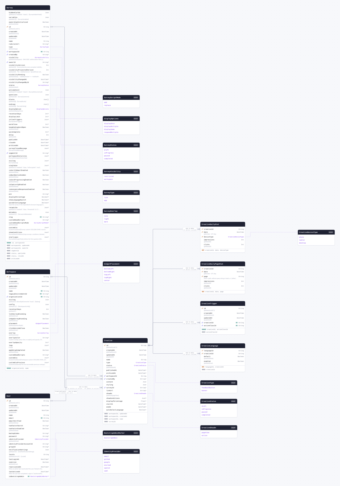

| Field                      | Type                                     | Constraints                                 | Default      | Description |
| -------------------------- | ---------------------------------------- | ------------------------------------------- | ------------ | ----------- |
| `id`                       | `String`                                 | PK NOT NULL                                 | `cuid(1)`    |             |
| `createdAt` (`created_at`) | `DateTime`                               | NOT NULL                                    | `now()`      |             |
| `updatedAt` (`updated_at`) | `DateTime`                               | NOT NULL                                    | `@updatedAt` |             |
| `name`                     | `String`                                 | NOT NULL                                    |              |             |
| `type`                     | [`CreativeType`](#enum-CreativeType)     | NOT NULL                                    |              |             |
| `status`                   | [`CreativeStatus`](#enum-CreativeStatus) | NOT NULL                                    | `draft`      |             |
| `publishedAt`              | `DateTime`                               | NULL                                        |              |             |
| `archivedAt`               | `DateTime`                               | NULL                                        |              |             |
| `workspaceId`              | `String`                                 | NOT NULL → [Workspace.id](#model-Workspace) |              |             |
| `createdBy`                | `String`                                 | NULL → [User.id](#model-User)               |              |             |
| `content`                  | `Json`                                   | NOT NULL                                    |              |             |
| `styling`                  | `Json`                                   | NOT NULL                                    |              |             |
| `surveyId`                 | `String`                                 | NULL → [Survey.id](#model-Survey)           |              |             |
| `linkUrl`                  | `String`                                 | NULL                                        |              |             |
| `showOn`                   | [`CreativeShowOn`](#enum-CreativeShowOn) | NOT NULL                                    | `pageView`   |             |
| `showConditions`           | `Json`                                   | NULL                                        |              |             |
| `displayPercentage`        | `Float`                                  | NULL                                        |              |             |
| `startAt`                  | `DateTime`                               | NULL                                        |              |             |
| `endAt`                    | `DateTime`                               | NULL                                        |              |             |
| `autoSelectLanguage`       | `Boolean`                                | NULL                                        |              |             |

#### Indexes

- `@@index([workspaceId, updatedAt])`
- `@@index([workspaceId, createdAt])`
- `@@index([workspaceId, name])`
- `@@index([surveyId])`

#### References

- `workspaceId` → [Workspace.id](#model-Workspace) (many-to-one, on delete Cascade)
- `createdBy` → [User.id](#model-User) (many-to-one, on delete SetNull)
- `surveyId` → [Survey.id](#model-Survey) (many-to-one, on delete NoAction, on update NoAction)

#### Referenced by

- `id` ← [CreativeDailyStat.creativeId](#model-CreativeDailyStat) (one-to-many, on delete Cascade)
- `id` ← [CreativeDailyPageStat.creativeId](#model-CreativeDailyPageStat) (one-to-many, on delete Cascade)
- `id` ← [CreativeTrigger.creativeId](#model-CreativeTrigger) (one-to-many, on delete Cascade)
- `id` ← [CreativeLanguage.creativeId](#model-CreativeLanguage) (one-to-many, on delete Cascade)

#### Definition

```sql
CREATE TABLE "Creative" (
    "id" TEXT NOT NULL,
    "created_at" TIMESTAMP(3) NOT NULL DEFAULT CURRENT_TIMESTAMP,
    "updated_at" TIMESTAMP(3) NOT NULL,
    "name" TEXT NOT NULL,
    "type" "CreativeType" NOT NULL,
    "status" "CreativeStatus" NOT NULL DEFAULT 'draft',
    "publishedAt" TIMESTAMP(3),
    "archivedAt" TIMESTAMP(3),
    "workspaceId" TEXT NOT NULL,
    "createdBy" TEXT,
    "content" JSONB NOT NULL,
    "styling" JSONB NOT NULL,
    "surveyId" TEXT,
    "linkUrl" TEXT,
    "showOn" "CreativeShowOn" NOT NULL DEFAULT 'pageView',
    "showConditions" JSONB,
    "displayPercentage" DOUBLE PRECISION,
    "startAt" TIMESTAMP(3),
    "endAt" TIMESTAMP(3),
    "autoSelectLanguage" BOOLEAN,

    CONSTRAINT "Creative_pkey" PRIMARY KEY ("id")
);

CREATE INDEX "Creative_workspaceId_updated_at_idx" ON "Creative"("workspaceId", "updated_at");

CREATE INDEX "Creative_workspaceId_created_at_idx" ON "Creative"("workspaceId", "created_at");

CREATE INDEX "Creative_workspaceId_name_idx" ON "Creative"("workspaceId", "name");

CREATE INDEX "Creative_surveyId_idx" ON "Creative"("surveyId");

ALTER TABLE "Creative" ADD CONSTRAINT "Creative_workspaceId_fkey" FOREIGN KEY ("workspaceId") REFERENCES "Workspace"("id") ON DELETE CASCADE ON UPDATE CASCADE;

ALTER TABLE "Creative" ADD CONSTRAINT "Creative_createdBy_fkey" FOREIGN KEY ("createdBy") REFERENCES "User"("id") ON DELETE SET NULL ON UPDATE CASCADE;

ALTER TABLE "Creative" ADD CONSTRAINT "Creative_surveyId_workspaceId_fkey" FOREIGN KEY ("surveyId", "workspaceId") REFERENCES "Survey"("id", "workspaceId") ON DELETE NO ACTION ON UPDATE NO ACTION;
```

<details>
<summary>Queries and their SQL</summary>

**findMany**: Every row

```ts
await prisma.creative.findMany();
```

```sql
SELECT
  "public"."Creative"."id",
  "public"."Creative"."created_at",
  "public"."Creative"."updated_at",
  "public"."Creative"."name",
  "public"."Creative"."type"::text,
  "public"."Creative"."status"::text,
  "public"."Creative"."publishedAt",
  "public"."Creative"."archivedAt",
  "public"."Creative"."workspaceId",
  "public"."Creative"."createdBy",
  "public"."Creative"."content",
  "public"."Creative"."styling",
  "public"."Creative"."surveyId",
  "public"."Creative"."linkUrl",
  "public"."Creative"."showOn"::text,
  "public"."Creative"."showConditions",
  "public"."Creative"."displayPercentage",
  "public"."Creative"."startAt",
  "public"."Creative"."endAt",
  "public"."Creative"."autoSelectLanguage"
FROM
  "public"."Creative"
WHERE
  1 = 1
OFFSET
  $1
-- params: ["0"]
```

**count**: How many rows there are

```ts
await prisma.creative.count();
```

```sql
SELECT
  COUNT(*) AS "_count$_all"
FROM
  (
    SELECT
      "public"."Creative"."id"
    FROM
      "public"."Creative"
    WHERE
      1 = 1
    OFFSET
      $1
  ) AS "sub"
-- params: ["0"]
```

**findMany**: Every row with its relations

```ts
await prisma.creative.findMany({
  include: {
    workspace: true,
    creator: true,
    survey: true,
    triggers: true,
    languages: true,
    dailyStats: true,
    dailyPageStats: true,
  },
});
```

```sql
SELECT
  "public"."Creative"."id",
  "public"."Creative"."created_at",
  "public"."Creative"."updated_at",
  "public"."Creative"."name",
  "public"."Creative"."type"::text,
  "public"."Creative"."status"::text,
  "public"."Creative"."publishedAt",
  "public"."Creative"."archivedAt",
  "public"."Creative"."workspaceId",
  "public"."Creative"."createdBy",
  "public"."Creative"."content",
  "public"."Creative"."styling",
  "public"."Creative"."surveyId",
  "public"."Creative"."linkUrl",
  "public"."Creative"."showOn"::text,
  "public"."Creative"."showConditions",
  "public"."Creative"."displayPercentage",
  "public"."Creative"."startAt",
  "public"."Creative"."endAt",
  "public"."Creative"."autoSelectLanguage"
FROM
  "public"."Creative"
WHERE
  1 = 1
OFFSET
  $1
-- params: ["0"]

SELECT
  "public"."Workspace"."id",
  "public"."Workspace"."created_at",
  "public"."Workspace"."updated_at",
  "public"."Workspace"."name",
  "public"."Workspace"."legacyEnvironmentId",
  "public"."Workspace"."organizationId",
  "public"."Workspace"."styling",
  "public"."Workspace"."config",
  "public"."Workspace"."recontactDays",
  "public"."Workspace"."linkSurveyBranding",
  "public"."Workspace"."inAppSurveyBranding",
  "public"."Workspace"."placement"::text,
  "public"."Workspace"."clickOutsideClose",
  "public"."Workspace"."overlay"::text,
  "public"."Workspace"."overlayColor",
  "public"."Workspace"."overlayOpacity",
  "public"."Workspace"."logo",
  "public"."Workspace"."appSetupCompleted",
  "public"."Workspace"."customHeadScripts",
  "public"."Workspace"."customCss",
  "public"."Workspace"."customCssPrevious"
FROM
  "public"."Workspace"
WHERE
  "public"."Workspace"."id" IN ($1)
OFFSET
  $2
-- params: ["<workspaceId of the rows above>","0"]

SELECT
  "public"."User"."id",
  "public"."User"."created_at",
  "public"."User"."updated_at",
  "public"."User"."name",
  "public"."User"."email",
  "public"."User"."email_verified",
  "public"."User"."twoFactorSecret",
  "public"."User"."twoFactorEnabled",
  "public"."User"."backupCodes",
  "public"."User"."password",
  "public"."User"."identityProvider"::text,
  "public"."User"."identityProviderAccountId",
  "public"."User"."groupId",
  "public"."User"."notificationSettings",
  "public"."User"."locale",
  "public"."User"."lastLoginAt",
  "public"."User"."isActive",
  "public"."User"."reactivatedAt",
  "public"."User"."lastActiveAt",
  "public"."User"."isBootstrapAdmin"::text
FROM
  "public"."User"
WHERE
  "public"."User"."id" IN ($1)
OFFSET
  $2
-- params: ["<createdBy of the rows above>","0"]

SELECT
  "public"."Survey"."id",
  "public"."Survey"."hiddenFields",
  "public"."Survey"."variables",
  "public"."Survey"."ownershipInitialized",
  "public"."Survey"."created_at",
  "public"."Survey"."updated_at",
  "public"."Survey"."name",
  "public"."Survey"."redirectUrl",
  "public"."Survey"."type"::text,
  "public"."Survey"."workspaceId",
  "public"."Survey"."createdBy",
  "public"."Survey"."visibility"::text,
  "public"."Survey"."ownerId",
  "public"."Survey"."visibilityVersion",
  "public"."Survey"."visibilityProjectedVersion",
  "public"."Survey"."visibilityPending",
  "public"."Survey"."visibilityChangedAt",
  "public"."Survey"."visibilityChangedById",
  "public"."Survey"."status"::text,
  "public"."Survey"."welcomeCard",
  "public"."Survey"."questions",
  "public"."Survey"."blocks",
  "public"."Survey"."endings",
  "public"."Survey"."displayOption"::text,
  "public"."Survey"."recontactDays",
  "public"."Survey"."displayLimit",
  "public"."Survey"."inlineTriggers",
  "public"."Survey"."autoClose",
  "public"."Survey"."keepEndingCardOpen",
  "public"."Survey"."autoComplete",
  "public"."Survey"."delay",
  "public"."Survey"."publishOn",
  "public"."Survey"."closeOn",
  "public"."Survey"."archivedAt",
  "public"."Survey"."surveyClosedMessage",
  "public"."Survey"."segmentId",
  "public"."Survey"."workspaceOverwrites",
  "public"."Survey"."styling",
  "public"."Survey"."singleUse",
  "public"."Survey"."isVerifyEmailEnabled",
  "public"."Survey"."isBackButtonHidden",
  "public"."Survey"."isAutoProgressingEnabled",
  "public"."Survey"."isCaptureIpEnabled",
  "public"."Survey"."is_anonymize_responses_enabled",
  "public"."Survey"."pin",
  "public"."Survey"."displayPercentage",
  "public"."Survey"."showLanguageSwitch",
  "public"."Survey"."autoSelectLanguage",
  "public"."Survey"."recaptcha",
  "public"."Survey"."metadata",
  "public"."Survey"."slug",
  "public"."Survey"."customHeadScripts",
  "public"."Survey"."customHeadScriptsMode"::text,
  "public"."Survey"."customCss",
  "public"."Survey"."showConditions",
  "public"."Survey"."startLogic"
FROM
  "public"."Survey"
WHERE
  (
    "public"."Survey"."id" IN ($1)
    AND "public"."Survey"."workspaceId" IN ($2)
  )
OFFSET
  $3
-- params: ["<surveyId of the rows above>","<workspaceId of the rows above>","0"]

SELECT
  "public"."CreativeTrigger"."id",
  "public"."CreativeTrigger"."created_at",
  "public"."CreativeTrigger"."updated_at",
  "public"."CreativeTrigger"."creativeId",
  "public"."CreativeTrigger"."actionClassId"
FROM
  "public"."CreativeTrigger"
WHERE
  "public"."CreativeTrigger"."creativeId" IN ($1)
OFFSET
  $2
-- params: ["<id of the rows above>","0"]

SELECT
  "public"."CreativeLanguage"."languageId",
  "public"."CreativeLanguage"."creativeId",
  "public"."CreativeLanguage"."default",
  "public"."CreativeLanguage"."enabled"
FROM
  "public"."CreativeLanguage"
WHERE
  "public"."CreativeLanguage"."creativeId" IN ($1)
OFFSET
  $2
-- params: ["<id of the rows above>","0"]

SELECT
  "public"."CreativeDailyStat"."creativeId",
  "public"."CreativeDailyStat"."date",
  "public"."CreativeDailyStat"."deviceType"::text,
  "public"."CreativeDailyStat"."impressions",
  "public"."CreativeDailyStat"."clicks"
FROM
  "public"."CreativeDailyStat"
WHERE
  "public"."CreativeDailyStat"."creativeId" IN ($1)
OFFSET
  $2
-- params: ["<id of the rows above>","0"]

SELECT
  "public"."CreativeDailyPageStat"."creativeId",
  "public"."CreativeDailyPageStat"."date",
  "public"."CreativeDailyPageStat"."page",
  "public"."CreativeDailyPageStat"."impressions",
  "public"."CreativeDailyPageStat"."clicks"
FROM
  "public"."CreativeDailyPageStat"
WHERE
  "public"."CreativeDailyPageStat"."creativeId" IN ($1)
OFFSET
  $2
-- params: ["<id of the rows above>","0"]
```

**findUnique**: One row by what is unique to it

```ts
await prisma.creative.findUnique({ where: { id: "example" } });
```

```sql
SELECT
  "public"."Creative"."id",
  "public"."Creative"."created_at",
  "public"."Creative"."updated_at",
  "public"."Creative"."name",
  "public"."Creative"."type"::text,
  "public"."Creative"."status"::text,
  "public"."Creative"."publishedAt",
  "public"."Creative"."archivedAt",
  "public"."Creative"."workspaceId",
  "public"."Creative"."createdBy",
  "public"."Creative"."content",
  "public"."Creative"."styling",
  "public"."Creative"."surveyId",
  "public"."Creative"."linkUrl",
  "public"."Creative"."showOn"::text,
  "public"."Creative"."showConditions",
  "public"."Creative"."displayPercentage",
  "public"."Creative"."startAt",
  "public"."Creative"."endAt",
  "public"."Creative"."autoSelectLanguage"
FROM
  "public"."Creative"
WHERE
  (
    "public"."Creative"."id" = $1
    AND 1 = 1
  )
LIMIT
  $2
OFFSET
  $3
-- params: ["example","1","0"]
```

**create**: Create a row

```ts
await prisma.creative.create({
  data: {
    name: "example",
    type: "feedbackButton",
    workspaceId: "example",
    content: {},
    styling: {},
  },
});
```

```sql
INSERT INTO
  "public"."Creative" (
    "id",
    "created_at",
    "updated_at",
    "name",
    "type",
    "status",
    "workspaceId",
    "content",
    "styling",
    "showOn"
  )
VALUES
  (
    $1,
    $2,
    $3,
    $4,
    CAST($5::text AS "public"."CreativeType"),
    CAST($6::text AS "public"."CreativeStatus"),
    $7,
    $8,
    $9,
    CAST($10::text AS "public"."CreativeShowOn")
  )
RETURNING
  "public"."Creative"."id",
  "public"."Creative"."created_at",
  "public"."Creative"."updated_at",
  "public"."Creative"."name",
  "public"."Creative"."type"::text,
  "public"."Creative"."status"::text,
  "public"."Creative"."publishedAt",
  "public"."Creative"."archivedAt",
  "public"."Creative"."workspaceId",
  "public"."Creative"."createdBy",
  "public"."Creative"."content",
  "public"."Creative"."styling",
  "public"."Creative"."surveyId",
  "public"."Creative"."linkUrl",
  "public"."Creative"."showOn"::text,
  "public"."Creative"."showConditions",
  "public"."Creative"."displayPercentage",
  "public"."Creative"."startAt",
  "public"."Creative"."endAt",
  "public"."Creative"."autoSelectLanguage"
-- params: ["<cuid(1)>","<now()>","<now()>","example","feedbackButton","draft","example","{}","{}","pageView"]
```

**update**: Update a row

```ts
await prisma.creative.update({
  where: { id: "example" },
  data: { createdAt: new Date("2026-01-01T00:00:00.000Z") },
});
```

```sql
UPDATE "public"."Creative"
SET
  "created_at" = $1,
  "updated_at" = $2
WHERE
  (
    "public"."Creative"."id" = $3
    AND 1 = 1
  )
RETURNING
  "public"."Creative"."id",
  "public"."Creative"."created_at",
  "public"."Creative"."updated_at",
  "public"."Creative"."name",
  "public"."Creative"."type"::text,
  "public"."Creative"."status"::text,
  "public"."Creative"."publishedAt",
  "public"."Creative"."archivedAt",
  "public"."Creative"."workspaceId",
  "public"."Creative"."createdBy",
  "public"."Creative"."content",
  "public"."Creative"."styling",
  "public"."Creative"."surveyId",
  "public"."Creative"."linkUrl",
  "public"."Creative"."showOn"::text,
  "public"."Creative"."showConditions",
  "public"."Creative"."displayPercentage",
  "public"."Creative"."startAt",
  "public"."Creative"."endAt",
  "public"."Creative"."autoSelectLanguage"
-- params: ["2026-01-01T00:00:00.000Z",{"prisma__type":"generatorCall","prisma__value":{"name":"now","args":[],"returnType":{"type":"DateTime"}}},"example"]
```

**delete**: Delete a row

```ts
await prisma.creative.delete({ where: { id: "example" } });
```

```sql
DELETE FROM "public"."Creative"
WHERE
  (
    "public"."Creative"."id" = $1
    AND 1 = 1
  )
RETURNING
  "public"."Creative"."id",
  "public"."Creative"."created_at",
  "public"."Creative"."updated_at",
  "public"."Creative"."name",
  "public"."Creative"."type"::text,
  "public"."Creative"."status"::text,
  "public"."Creative"."publishedAt",
  "public"."Creative"."archivedAt",
  "public"."Creative"."workspaceId",
  "public"."Creative"."createdBy",
  "public"."Creative"."content",
  "public"."Creative"."styling",
  "public"."Creative"."surveyId",
  "public"."Creative"."linkUrl",
  "public"."Creative"."showOn"::text,
  "public"."Creative"."showConditions",
  "public"."Creative"."displayPercentage",
  "public"."Creative"."startAt",
  "public"."Creative"."endAt",
  "public"."Creative"."autoSelectLanguage"
-- params: ["example"]
```

</details>

<a id="model-CreativeDailyStat"></a>

### CreativeDailyStat

A creative's Impressions and Clicks on one UTC day on one device type (ENG-4000). Written
only by the counter flush job as `GREATEST(stored, counted)`, from Redis counters that hold the day's
running totals, so a repeated flush changes nothing. At most 3 rows per creative per day. Deleting
the creative deletes its counts.

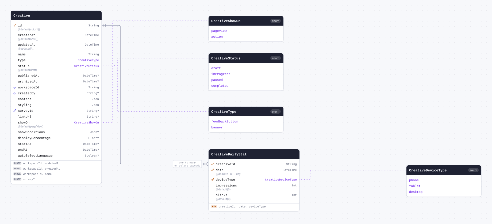

| Field         | Type                                             | Constraints                                  | Default | Description |
| ------------- | ------------------------------------------------ | -------------------------------------------- | ------- | ----------- |
| `creativeId`  | `String`                                         | PK NOT NULL → [Creative.id](#model-Creative) |         |             |
| `date`        | `DateTime` `@db.Date`                            | PK NOT NULL                                  |         | UTC day.    |
| `deviceType`  | [`CreativeDeviceType`](#enum-CreativeDeviceType) | PK NOT NULL                                  |         |             |
| `impressions` | `Int`                                            | NOT NULL                                     | `0`     |             |
| `clicks`      | `Int`                                            | NOT NULL                                     | `0`     |             |

#### Indexes

- `@@id([creativeId, date, deviceType])`

#### References

- `creativeId` → [Creative.id](#model-Creative) (many-to-one, on delete Cascade)

#### Definition

```sql
CREATE TABLE "CreativeDailyStat" (
    "creativeId" TEXT NOT NULL,
    "date" DATE NOT NULL,
    "deviceType" "CreativeDeviceType" NOT NULL,
    "impressions" INTEGER NOT NULL DEFAULT 0,
    "clicks" INTEGER NOT NULL DEFAULT 0,

    CONSTRAINT "CreativeDailyStat_pkey" PRIMARY KEY ("creativeId","date","deviceType")
);

ALTER TABLE "CreativeDailyStat" ADD CONSTRAINT "CreativeDailyStat_creativeId_fkey" FOREIGN KEY ("creativeId") REFERENCES "Creative"("id") ON DELETE CASCADE ON UPDATE CASCADE;
```

<details>
<summary>Queries and their SQL</summary>

**findMany**: Every row

```ts
await prisma.creativeDailyStat.findMany();
```

```sql
SELECT
  "public"."CreativeDailyStat"."creativeId",
  "public"."CreativeDailyStat"."date",
  "public"."CreativeDailyStat"."deviceType"::text,
  "public"."CreativeDailyStat"."impressions",
  "public"."CreativeDailyStat"."clicks"
FROM
  "public"."CreativeDailyStat"
WHERE
  1 = 1
OFFSET
  $1
-- params: ["0"]
```

**count**: How many rows there are

```ts
await prisma.creativeDailyStat.count();
```

```sql
SELECT
  COUNT(*) AS "_count$_all"
FROM
  (
    SELECT
      "public"."CreativeDailyStat"."creativeId",
      "public"."CreativeDailyStat"."date",
      "public"."CreativeDailyStat"."deviceType"
    FROM
      "public"."CreativeDailyStat"
    WHERE
      1 = 1
    OFFSET
      $1
  ) AS "sub"
-- params: ["0"]
```

**findMany**: Every row with its relations

```ts
await prisma.creativeDailyStat.findMany({ include: { creative: true } });
```

```sql
SELECT
  "public"."CreativeDailyStat"."creativeId",
  "public"."CreativeDailyStat"."date",
  "public"."CreativeDailyStat"."deviceType"::text,
  "public"."CreativeDailyStat"."impressions",
  "public"."CreativeDailyStat"."clicks"
FROM
  "public"."CreativeDailyStat"
WHERE
  1 = 1
OFFSET
  $1
-- params: ["0"]

SELECT
  "public"."Creative"."id",
  "public"."Creative"."created_at",
  "public"."Creative"."updated_at",
  "public"."Creative"."name",
  "public"."Creative"."type"::text,
  "public"."Creative"."status"::text,
  "public"."Creative"."publishedAt",
  "public"."Creative"."archivedAt",
  "public"."Creative"."workspaceId",
  "public"."Creative"."createdBy",
  "public"."Creative"."content",
  "public"."Creative"."styling",
  "public"."Creative"."surveyId",
  "public"."Creative"."linkUrl",
  "public"."Creative"."showOn"::text,
  "public"."Creative"."showConditions",
  "public"."Creative"."displayPercentage",
  "public"."Creative"."startAt",
  "public"."Creative"."endAt",
  "public"."Creative"."autoSelectLanguage"
FROM
  "public"."Creative"
WHERE
  "public"."Creative"."id" IN ($1)
OFFSET
  $2
-- params: ["<creativeId of the rows above>","0"]
```

**findUnique**: One row by what is unique to it

```ts
await prisma.creativeDailyStat.findUnique({
  where: {
    creativeId_date_deviceType: {
      creativeId: "example",
      date: new Date("2026-01-01T00:00:00.000Z"),
      deviceType: "phone",
    },
  },
});
```

```sql
SELECT
  "public"."CreativeDailyStat"."creativeId",
  "public"."CreativeDailyStat"."date",
  "public"."CreativeDailyStat"."deviceType"::text,
  "public"."CreativeDailyStat"."impressions",
  "public"."CreativeDailyStat"."clicks"
FROM
  "public"."CreativeDailyStat"
WHERE
  (
    (
      "public"."CreativeDailyStat"."creativeId" = $1
      AND "public"."CreativeDailyStat"."date" = $2
      AND "public"."CreativeDailyStat"."deviceType" = CAST($3::text AS "public"."CreativeDeviceType")
    )
    AND 1 = 1
  )
LIMIT
  $4
OFFSET
  $5
-- params: ["example","2026-01-01T00:00:00.000Z","phone","1","0"]
```

**create**: Create a row

```ts
await prisma.creativeDailyStat.create({
  data: { creativeId: "example", date: new Date("2026-01-01T00:00:00.000Z"), deviceType: "phone" },
});
```

```sql
INSERT INTO
  "public"."CreativeDailyStat" (
    "creativeId",
    "date",
    "deviceType",
    "impressions",
    "clicks"
  )
VALUES
  (
    $1,
    $2,
    CAST($3::text AS "public"."CreativeDeviceType"),
    $4,
    $5
  )
RETURNING
  "public"."CreativeDailyStat"."creativeId",
  "public"."CreativeDailyStat"."date",
  "public"."CreativeDailyStat"."deviceType"::text,
  "public"."CreativeDailyStat"."impressions",
  "public"."CreativeDailyStat"."clicks"
-- params: ["example","2026-01-01T00:00:00.000Z","phone","0","0"]
```

**update**: Update a row

```ts
await prisma.creativeDailyStat.update({
  where: {
    creativeId_date_deviceType: {
      creativeId: "example",
      date: new Date("2026-01-01T00:00:00.000Z"),
      deviceType: "phone",
    },
  },
  data: { impressions: 1 },
});
```

```sql
UPDATE "public"."CreativeDailyStat"
SET
  "impressions" = $1
WHERE
  (
    (
      "public"."CreativeDailyStat"."creativeId" = $2
      AND "public"."CreativeDailyStat"."date" = $3
      AND "public"."CreativeDailyStat"."deviceType" = CAST($4::text AS "public"."CreativeDeviceType")
    )
    AND 1 = 1
  )
RETURNING
  "public"."CreativeDailyStat"."creativeId",
  "public"."CreativeDailyStat"."date",
  "public"."CreativeDailyStat"."deviceType"::text,
  "public"."CreativeDailyStat"."impressions",
  "public"."CreativeDailyStat"."clicks"
-- params: ["1","example","2026-01-01T00:00:00.000Z","phone"]
```

**delete**: Delete a row

```ts
await prisma.creativeDailyStat.delete({
  where: {
    creativeId_date_deviceType: {
      creativeId: "example",
      date: new Date("2026-01-01T00:00:00.000Z"),
      deviceType: "phone",
    },
  },
});
```

```sql
DELETE FROM "public"."CreativeDailyStat"
WHERE
  (
    (
      "public"."CreativeDailyStat"."creativeId" = $1
      AND "public"."CreativeDailyStat"."date" = $2
      AND "public"."CreativeDailyStat"."deviceType" = CAST($3::text AS "public"."CreativeDeviceType")
    )
    AND 1 = 1
  )
RETURNING
  "public"."CreativeDailyStat"."creativeId",
  "public"."CreativeDailyStat"."date",
  "public"."CreativeDailyStat"."deviceType"::text,
  "public"."CreativeDailyStat"."impressions",
  "public"."CreativeDailyStat"."clicks"
-- params: ["example","2026-01-01T00:00:00.000Z","phone"]
```

</details>

<a id="model-CreativeDailyPageStat"></a>

### CreativeDailyPageStat

A creative's Impressions and Clicks on one UTC day on one page (host + path), written like
`CreativeDailyStat`. At most 1000 pages per creative per day; the rest are counted under `(other)`.

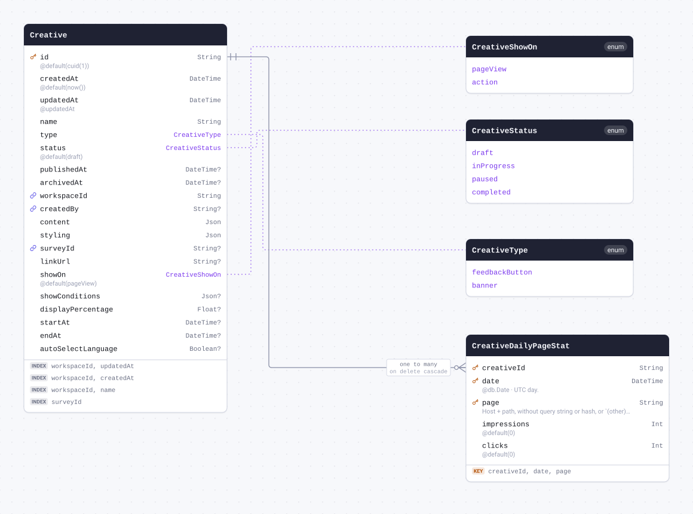

| Field         | Type                  | Constraints                                  | Default | Description                                              |
| ------------- | --------------------- | -------------------------------------------- | ------- | -------------------------------------------------------- |
| `creativeId`  | `String`              | PK NOT NULL → [Creative.id](#model-Creative) |         |                                                          |
| `date`        | `DateTime` `@db.Date` | PK NOT NULL                                  |         | UTC day.                                                 |
| `page`        | `String`              | PK NOT NULL                                  |         | Host + path, without query string or hash, or `(other)`. |
| `impressions` | `Int`                 | NOT NULL                                     | `0`     |                                                          |
| `clicks`      | `Int`                 | NOT NULL                                     | `0`     |                                                          |

#### Indexes

- `@@id([creativeId, date, page])`

#### References

- `creativeId` → [Creative.id](#model-Creative) (many-to-one, on delete Cascade)

#### Definition

```sql
CREATE TABLE "CreativeDailyPageStat" (
    "creativeId" TEXT NOT NULL,
    "date" DATE NOT NULL,
    "page" TEXT NOT NULL,
    "impressions" INTEGER NOT NULL DEFAULT 0,
    "clicks" INTEGER NOT NULL DEFAULT 0,

    CONSTRAINT "CreativeDailyPageStat_pkey" PRIMARY KEY ("creativeId","date","page")
);

ALTER TABLE "CreativeDailyPageStat" ADD CONSTRAINT "CreativeDailyPageStat_creativeId_fkey" FOREIGN KEY ("creativeId") REFERENCES "Creative"("id") ON DELETE CASCADE ON UPDATE CASCADE;
```

<details>
<summary>Queries and their SQL</summary>

**findMany**: Every row

```ts
await prisma.creativeDailyPageStat.findMany();
```

```sql
SELECT
  "public"."CreativeDailyPageStat"."creativeId",
  "public"."CreativeDailyPageStat"."date",
  "public"."CreativeDailyPageStat"."page",
  "public"."CreativeDailyPageStat"."impressions",
  "public"."CreativeDailyPageStat"."clicks"
FROM
  "public"."CreativeDailyPageStat"
WHERE
  1 = 1
OFFSET
  $1
-- params: ["0"]
```

**count**: How many rows there are

```ts
await prisma.creativeDailyPageStat.count();
```

```sql
SELECT
  COUNT(*) AS "_count$_all"
FROM
  (
    SELECT
      "public"."CreativeDailyPageStat"."creativeId",
      "public"."CreativeDailyPageStat"."date",
      "public"."CreativeDailyPageStat"."page"
    FROM
      "public"."CreativeDailyPageStat"
    WHERE
      1 = 1
    OFFSET
      $1
  ) AS "sub"
-- params: ["0"]
```

**findMany**: Every row with its relations

```ts
await prisma.creativeDailyPageStat.findMany({ include: { creative: true } });
```

```sql
SELECT
  "public"."CreativeDailyPageStat"."creativeId",
  "public"."CreativeDailyPageStat"."date",
  "public"."CreativeDailyPageStat"."page",
  "public"."CreativeDailyPageStat"."impressions",
  "public"."CreativeDailyPageStat"."clicks"
FROM
  "public"."CreativeDailyPageStat"
WHERE
  1 = 1
OFFSET
  $1
-- params: ["0"]

SELECT
  "public"."Creative"."id",
  "public"."Creative"."created_at",
  "public"."Creative"."updated_at",
  "public"."Creative"."name",
  "public"."Creative"."type"::text,
  "public"."Creative"."status"::text,
  "public"."Creative"."publishedAt",
  "public"."Creative"."archivedAt",
  "public"."Creative"."workspaceId",
  "public"."Creative"."createdBy",
  "public"."Creative"."content",
  "public"."Creative"."styling",
  "public"."Creative"."surveyId",
  "public"."Creative"."linkUrl",
  "public"."Creative"."showOn"::text,
  "public"."Creative"."showConditions",
  "public"."Creative"."displayPercentage",
  "public"."Creative"."startAt",
  "public"."Creative"."endAt",
  "public"."Creative"."autoSelectLanguage"
FROM
  "public"."Creative"
WHERE
  "public"."Creative"."id" IN ($1)
OFFSET
  $2
-- params: ["<creativeId of the rows above>","0"]
```

**findUnique**: One row by what is unique to it

```ts
await prisma.creativeDailyPageStat.findUnique({
  where: {
    creativeId_date_page: {
      creativeId: "example",
      date: new Date("2026-01-01T00:00:00.000Z"),
      page: "example",
    },
  },
});
```

```sql
SELECT
  "public"."CreativeDailyPageStat"."creativeId",
  "public"."CreativeDailyPageStat"."date",
  "public"."CreativeDailyPageStat"."page",
  "public"."CreativeDailyPageStat"."impressions",
  "public"."CreativeDailyPageStat"."clicks"
FROM
  "public"."CreativeDailyPageStat"
WHERE
  (
    (
      "public"."CreativeDailyPageStat"."creativeId" = $1
      AND "public"."CreativeDailyPageStat"."date" = $2
      AND "public"."CreativeDailyPageStat"."page" = $3
    )
    AND 1 = 1
  )
LIMIT
  $4
OFFSET
  $5
-- params: ["example","2026-01-01T00:00:00.000Z","example","1","0"]
```

**create**: Create a row

```ts
await prisma.creativeDailyPageStat.create({
  data: { creativeId: "example", date: new Date("2026-01-01T00:00:00.000Z"), page: "example" },
});
```

```sql
INSERT INTO
  "public"."CreativeDailyPageStat" (
    "creativeId",
    "date",
    "page",
    "impressions",
    "clicks"
  )
VALUES
  ($1, $2, $3, $4, $5)
RETURNING
  "public"."CreativeDailyPageStat"."creativeId",
  "public"."CreativeDailyPageStat"."date",
  "public"."CreativeDailyPageStat"."page",
  "public"."CreativeDailyPageStat"."impressions",
  "public"."CreativeDailyPageStat"."clicks"
-- params: ["example","2026-01-01T00:00:00.000Z","example","0","0"]
```

**update**: Update a row

```ts
await prisma.creativeDailyPageStat.update({
  where: {
    creativeId_date_page: {
      creativeId: "example",
      date: new Date("2026-01-01T00:00:00.000Z"),
      page: "example",
    },
  },
  data: { impressions: 1 },
});
```

```sql
UPDATE "public"."CreativeDailyPageStat"
SET
  "impressions" = $1
WHERE
  (
    (
      "public"."CreativeDailyPageStat"."creativeId" = $2
      AND "public"."CreativeDailyPageStat"."date" = $3
      AND "public"."CreativeDailyPageStat"."page" = $4
    )
    AND 1 = 1
  )
RETURNING
  "public"."CreativeDailyPageStat"."creativeId",
  "public"."CreativeDailyPageStat"."date",
  "public"."CreativeDailyPageStat"."page",
  "public"."CreativeDailyPageStat"."impressions",
  "public"."CreativeDailyPageStat"."clicks"
-- params: ["1","example","2026-01-01T00:00:00.000Z","example"]
```

**delete**: Delete a row

```ts
await prisma.creativeDailyPageStat.delete({
  where: {
    creativeId_date_page: {
      creativeId: "example",
      date: new Date("2026-01-01T00:00:00.000Z"),
      page: "example",
    },
  },
});
```

```sql
DELETE FROM "public"."CreativeDailyPageStat"
WHERE
  (
    (
      "public"."CreativeDailyPageStat"."creativeId" = $1
      AND "public"."CreativeDailyPageStat"."date" = $2
      AND "public"."CreativeDailyPageStat"."page" = $3
    )
    AND 1 = 1
  )
RETURNING
  "public"."CreativeDailyPageStat"."creativeId",
  "public"."CreativeDailyPageStat"."date",
  "public"."CreativeDailyPageStat"."page",
  "public"."CreativeDailyPageStat"."impressions",
  "public"."CreativeDailyPageStat"."clicks"
-- params: ["example","2026-01-01T00:00:00.000Z","example"]
```

</details>

<a id="model-CreativeTrigger"></a>

### CreativeTrigger

Links a creative to the actions that show it (`showOn: action`). Mirrors `SurveyTrigger`.

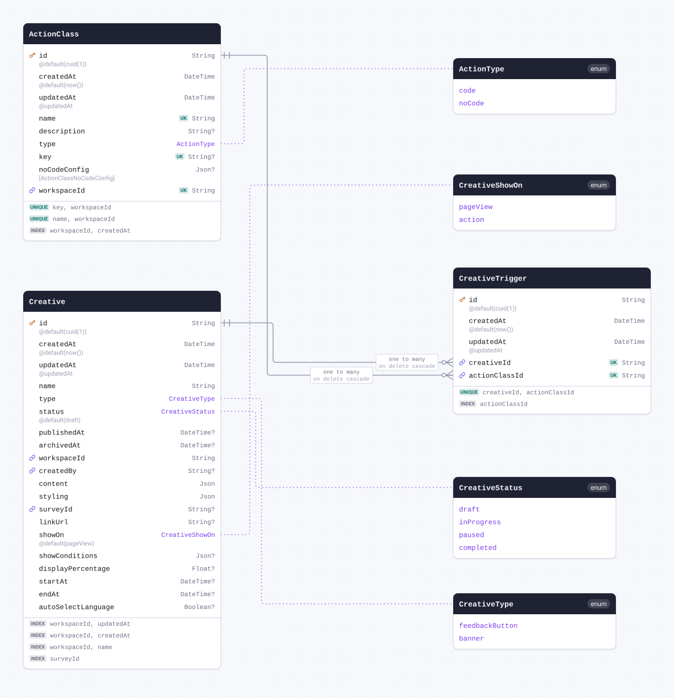

| Field                      | Type       | Constraints                                     | Default      | Description |
| -------------------------- | ---------- | ----------------------------------------------- | ------------ | ----------- |
| `id`                       | `String`   | PK NOT NULL                                     | `cuid(1)`    |             |
| `createdAt` (`created_at`) | `DateTime` | NOT NULL                                        | `now()`      |             |
| `updatedAt` (`updated_at`) | `DateTime` | NOT NULL                                        | `@updatedAt` |             |
| `creativeId`               | `String`   | NOT NULL → [Creative.id](#model-Creative)       |              |             |
| `actionClassId`            | `String`   | NOT NULL → [ActionClass.id](#model-ActionClass) |              |             |

#### Indexes

- `@@index([actionClassId])`
- `@@unique([creativeId, actionClassId])`

#### References

- `creativeId` → [Creative.id](#model-Creative) (many-to-one, on delete Cascade)
- `actionClassId` → [ActionClass.id](#model-ActionClass) (many-to-one, on delete Cascade)

#### Definition

```sql
CREATE TABLE "CreativeTrigger" (
    "id" TEXT NOT NULL,
    "created_at" TIMESTAMP(3) NOT NULL DEFAULT CURRENT_TIMESTAMP,
    "updated_at" TIMESTAMP(3) NOT NULL,
    "creativeId" TEXT NOT NULL,
    "actionClassId" TEXT NOT NULL,

    CONSTRAINT "CreativeTrigger_pkey" PRIMARY KEY ("id")
);

CREATE INDEX "CreativeTrigger_actionClassId_idx" ON "CreativeTrigger"("actionClassId");

CREATE UNIQUE INDEX "CreativeTrigger_creativeId_actionClassId_key" ON "CreativeTrigger"("creativeId", "actionClassId");

ALTER TABLE "CreativeTrigger" ADD CONSTRAINT "CreativeTrigger_creativeId_fkey" FOREIGN KEY ("creativeId") REFERENCES "Creative"("id") ON DELETE CASCADE ON UPDATE CASCADE;

ALTER TABLE "CreativeTrigger" ADD CONSTRAINT "CreativeTrigger_actionClassId_fkey" FOREIGN KEY ("actionClassId") REFERENCES "ActionClass"("id") ON DELETE CASCADE ON UPDATE CASCADE;
```

<details>
<summary>Queries and their SQL</summary>

**findMany**: Every row

```ts
await prisma.creativeTrigger.findMany();
```

```sql
SELECT
  "public"."CreativeTrigger"."id",
  "public"."CreativeTrigger"."created_at",
  "public"."CreativeTrigger"."updated_at",
  "public"."CreativeTrigger"."creativeId",
  "public"."CreativeTrigger"."actionClassId"
FROM
  "public"."CreativeTrigger"
WHERE
  1 = 1
OFFSET
  $1
-- params: ["0"]
```

**count**: How many rows there are

```ts
await prisma.creativeTrigger.count();
```

```sql
SELECT
  COUNT(*) AS "_count$_all"
FROM
  (
    SELECT
      "public"."CreativeTrigger"."id"
    FROM
      "public"."CreativeTrigger"
    WHERE
      1 = 1
    OFFSET
      $1
  ) AS "sub"
-- params: ["0"]
```

**findMany**: Every row with its relations

```ts
await prisma.creativeTrigger.findMany({ include: { creative: true, actionClass: true } });
```

```sql
SELECT
  "public"."CreativeTrigger"."id",
  "public"."CreativeTrigger"."created_at",
  "public"."CreativeTrigger"."updated_at",
  "public"."CreativeTrigger"."creativeId",
  "public"."CreativeTrigger"."actionClassId"
FROM
  "public"."CreativeTrigger"
WHERE
  1 = 1
OFFSET
  $1
-- params: ["0"]

SELECT
  "public"."Creative"."id",
  "public"."Creative"."created_at",
  "public"."Creative"."updated_at",
  "public"."Creative"."name",
  "public"."Creative"."type"::text,
  "public"."Creative"."status"::text,
  "public"."Creative"."publishedAt",
  "public"."Creative"."archivedAt",
  "public"."Creative"."workspaceId",
  "public"."Creative"."createdBy",
  "public"."Creative"."content",
  "public"."Creative"."styling",
  "public"."Creative"."surveyId",
  "public"."Creative"."linkUrl",
  "public"."Creative"."showOn"::text,
  "public"."Creative"."showConditions",
  "public"."Creative"."displayPercentage",
  "public"."Creative"."startAt",
  "public"."Creative"."endAt",
  "public"."Creative"."autoSelectLanguage"
FROM
  "public"."Creative"
WHERE
  "public"."Creative"."id" IN ($1)
OFFSET
  $2
-- params: ["<creativeId of the rows above>","0"]

SELECT
  "public"."ActionClass"."id",
  "public"."ActionClass"."created_at",
  "public"."ActionClass"."updated_at",
  "public"."ActionClass"."name",
  "public"."ActionClass"."description",
  "public"."ActionClass"."type"::text,
  "public"."ActionClass"."key",
  "public"."ActionClass"."noCodeConfig",
  "public"."ActionClass"."workspaceId"
FROM
  "public"."ActionClass"
WHERE
  "public"."ActionClass"."id" IN ($1)
OFFSET
  $2
-- params: ["<actionClassId of the rows above>","0"]
```

**findUnique**: One row by what is unique to it

```ts
await prisma.creativeTrigger.findUnique({ where: { id: "example" } });
```

```sql
SELECT
  "public"."CreativeTrigger"."id",
  "public"."CreativeTrigger"."created_at",
  "public"."CreativeTrigger"."updated_at",
  "public"."CreativeTrigger"."creativeId",
  "public"."CreativeTrigger"."actionClassId"
FROM
  "public"."CreativeTrigger"
WHERE
  (
    "public"."CreativeTrigger"."id" = $1
    AND 1 = 1
  )
LIMIT
  $2
OFFSET
  $3
-- params: ["example","1","0"]
```

**create**: Create a row

```ts
await prisma.creativeTrigger.create({ data: { creativeId: "example", actionClassId: "example" } });
```

```sql
INSERT INTO
  "public"."CreativeTrigger" (
    "id",
    "created_at",
    "updated_at",
    "creativeId",
    "actionClassId"
  )
VALUES
  ($1, $2, $3, $4, $5)
RETURNING
  "public"."CreativeTrigger"."id",
  "public"."CreativeTrigger"."created_at",
  "public"."CreativeTrigger"."updated_at",
  "public"."CreativeTrigger"."creativeId",
  "public"."CreativeTrigger"."actionClassId"
-- params: ["<cuid(1)>","<now()>","<now()>","example","example"]
```

**update**: Update a row

```ts
await prisma.creativeTrigger.update({
  where: { id: "example" },
  data: { createdAt: new Date("2026-01-01T00:00:00.000Z") },
});
```

```sql
UPDATE "public"."CreativeTrigger"
SET
  "created_at" = $1,
  "updated_at" = $2
WHERE
  (
    "public"."CreativeTrigger"."id" = $3
    AND 1 = 1
  )
RETURNING
  "public"."CreativeTrigger"."id",
  "public"."CreativeTrigger"."created_at",
  "public"."CreativeTrigger"."updated_at",
  "public"."CreativeTrigger"."creativeId",
  "public"."CreativeTrigger"."actionClassId"
-- params: ["2026-01-01T00:00:00.000Z",{"prisma__type":"generatorCall","prisma__value":{"name":"now","args":[],"returnType":{"type":"DateTime"}}},"example"]
```

**delete**: Delete a row

```ts
await prisma.creativeTrigger.delete({ where: { id: "example" } });
```

```sql
DELETE FROM "public"."CreativeTrigger"
WHERE
  (
    "public"."CreativeTrigger"."id" = $1
    AND 1 = 1
  )
RETURNING
  "public"."CreativeTrigger"."id",
  "public"."CreativeTrigger"."created_at",
  "public"."CreativeTrigger"."updated_at",
  "public"."CreativeTrigger"."creativeId",
  "public"."CreativeTrigger"."actionClassId"
-- params: ["example"]
```

</details>

<a id="model-CreativeLanguage"></a>

### CreativeLanguage

The languages a creative's texts are written in. Mirrors `SurveyLanguage`; exactly one is the default.

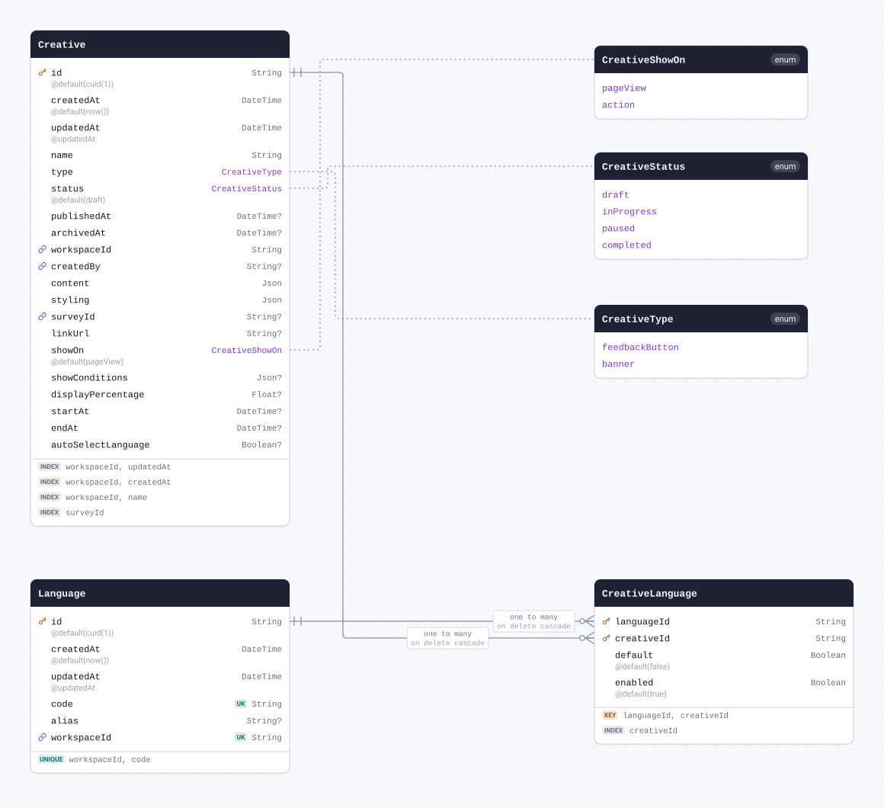

| Field        | Type      | Constraints                                  | Default | Description |
| ------------ | --------- | -------------------------------------------- | ------- | ----------- |
| `languageId` | `String`  | PK NOT NULL → [Language.id](#model-Language) |         |             |
| `creativeId` | `String`  | PK NOT NULL → [Creative.id](#model-Creative) |         |             |
| `default`    | `Boolean` | NOT NULL                                     | `false` |             |
| `enabled`    | `Boolean` | NOT NULL                                     | `true`  |             |

#### Indexes

- `@@id([languageId, creativeId])`
- `@@index([creativeId])`

#### References

- `languageId` → [Language.id](#model-Language) (many-to-one, on delete Cascade)
- `creativeId` → [Creative.id](#model-Creative) (many-to-one, on delete Cascade)

#### Definition

```sql
CREATE TABLE "CreativeLanguage" (
    "languageId" TEXT NOT NULL,
    "creativeId" TEXT NOT NULL,
    "default" BOOLEAN NOT NULL DEFAULT false,
    "enabled" BOOLEAN NOT NULL DEFAULT true,

    CONSTRAINT "CreativeLanguage_pkey" PRIMARY KEY ("languageId","creativeId")
);

CREATE INDEX "CreativeLanguage_creativeId_idx" ON "CreativeLanguage"("creativeId");

ALTER TABLE "CreativeLanguage" ADD CONSTRAINT "CreativeLanguage_languageId_fkey" FOREIGN KEY ("languageId") REFERENCES "Language"("id") ON DELETE CASCADE ON UPDATE CASCADE;

ALTER TABLE "CreativeLanguage" ADD CONSTRAINT "CreativeLanguage_creativeId_fkey" FOREIGN KEY ("creativeId") REFERENCES "Creative"("id") ON DELETE CASCADE ON UPDATE CASCADE;
```

<details>
<summary>Queries and their SQL</summary>

**findMany**: Every row

```ts
await prisma.creativeLanguage.findMany();
```

```sql
SELECT
  "public"."CreativeLanguage"."languageId",
  "public"."CreativeLanguage"."creativeId",
  "public"."CreativeLanguage"."default",
  "public"."CreativeLanguage"."enabled"
FROM
  "public"."CreativeLanguage"
WHERE
  1 = 1
OFFSET
  $1
-- params: ["0"]
```

**count**: How many rows there are

```ts
await prisma.creativeLanguage.count();
```

```sql
SELECT
  COUNT(*) AS "_count$_all"
FROM
  (
    SELECT
      "public"."CreativeLanguage"."languageId",
      "public"."CreativeLanguage"."creativeId"
    FROM
      "public"."CreativeLanguage"
    WHERE
      1 = 1
    OFFSET
      $1
  ) AS "sub"
-- params: ["0"]
```

**findMany**: Every row with its relations

```ts
await prisma.creativeLanguage.findMany({ include: { language: true, creative: true } });
```

```sql
SELECT
  "public"."CreativeLanguage"."languageId",
  "public"."CreativeLanguage"."creativeId",
  "public"."CreativeLanguage"."default",
  "public"."CreativeLanguage"."enabled"
FROM
  "public"."CreativeLanguage"
WHERE
  1 = 1
OFFSET
  $1
-- params: ["0"]

SELECT
  "public"."Language"."id",
  "public"."Language"."created_at",
  "public"."Language"."updated_at",
  "public"."Language"."code",
  "public"."Language"."alias",
  "public"."Language"."workspaceId"
FROM
  "public"."Language"
WHERE
  "public"."Language"."id" IN ($1)
OFFSET
  $2
-- params: ["<languageId of the rows above>","0"]

SELECT
  "public"."Creative"."id",
  "public"."Creative"."created_at",
  "public"."Creative"."updated_at",
  "public"."Creative"."name",
  "public"."Creative"."type"::text,
  "public"."Creative"."status"::text,
  "public"."Creative"."publishedAt",
  "public"."Creative"."archivedAt",
  "public"."Creative"."workspaceId",
  "public"."Creative"."createdBy",
  "public"."Creative"."content",
  "public"."Creative"."styling",
  "public"."Creative"."surveyId",
  "public"."Creative"."linkUrl",
  "public"."Creative"."showOn"::text,
  "public"."Creative"."showConditions",
  "public"."Creative"."displayPercentage",
  "public"."Creative"."startAt",
  "public"."Creative"."endAt",
  "public"."Creative"."autoSelectLanguage"
FROM
  "public"."Creative"
WHERE
  "public"."Creative"."id" IN ($1)
OFFSET
  $2
-- params: ["<creativeId of the rows above>","0"]
```

**findUnique**: One row by what is unique to it

```ts
await prisma.creativeLanguage.findUnique({
  where: { languageId_creativeId: { languageId: "example", creativeId: "example" } },
});
```

```sql
SELECT
  "public"."CreativeLanguage"."languageId",
  "public"."CreativeLanguage"."creativeId",
  "public"."CreativeLanguage"."default",
  "public"."CreativeLanguage"."enabled"
FROM
  "public"."CreativeLanguage"
WHERE
  (
    (
      "public"."CreativeLanguage"."languageId" = $1
      AND "public"."CreativeLanguage"."creativeId" = $2
    )
    AND 1 = 1
  )
LIMIT
  $3
OFFSET
  $4
-- params: ["example","example","1","0"]
```

**create**: Create a row

```ts
await prisma.creativeLanguage.create({ data: { languageId: "example", creativeId: "example" } });
```

```sql
INSERT INTO
  "public"."CreativeLanguage" ("languageId", "creativeId", "default", "enabled")
VALUES
  ($1, $2, $3, $4)
RETURNING
  "public"."CreativeLanguage"."languageId",
  "public"."CreativeLanguage"."creativeId",
  "public"."CreativeLanguage"."default",
  "public"."CreativeLanguage"."enabled"
-- params: ["example","example",false,true]
```

**update**: Update a row

```ts
await prisma.creativeLanguage.update({
  where: { languageId_creativeId: { languageId: "example", creativeId: "example" } },
  data: { default: true },
});
```

```sql
UPDATE "public"."CreativeLanguage"
SET
  "default" = $1
WHERE
  (
    (
      "public"."CreativeLanguage"."languageId" = $2
      AND "public"."CreativeLanguage"."creativeId" = $3
    )
    AND 1 = 1
  )
RETURNING
  "public"."CreativeLanguage"."languageId",
  "public"."CreativeLanguage"."creativeId",
  "public"."CreativeLanguage"."default",
  "public"."CreativeLanguage"."enabled"
-- params: [true,"example","example"]
```

**delete**: Delete a row

```ts
await prisma.creativeLanguage.delete({
  where: { languageId_creativeId: { languageId: "example", creativeId: "example" } },
});
```

```sql
DELETE FROM "public"."CreativeLanguage"
WHERE
  (
    (
      "public"."CreativeLanguage"."languageId" = $1
      AND "public"."CreativeLanguage"."creativeId" = $2
    )
    AND 1 = 1
  )
RETURNING
  "public"."CreativeLanguage"."languageId",
  "public"."CreativeLanguage"."creativeId",
  "public"."CreativeLanguage"."default",
  "public"."CreativeLanguage"."enabled"
-- params: ["example","example"]
```

</details>

<a id="model-OutboundEmailAudit"></a>

### OutboundEmailAudit

Metadata for an outbound email attempt. Content and recipient addresses are never stored here.
Identifiers are deliberately not foreign keys so erasure can scrub a row without retaining source data.

| Field                   | Type       | Constraints | Default      | Description |
| ----------------------- | ---------- | ----------- | ------------ | ----------- |
| `id`                    | `String`   | PK NOT NULL | `uuid(4)`    |             |
| `createdAt`             | `DateTime` | NOT NULL    | `now()`      |             |
| `updatedAt`             | `DateTime` | NOT NULL    | `@updatedAt` |             |
| `expiresAt`             | `DateTime` | NOT NULL    |              |             |
| `contentExpiresAt`      | `DateTime` | NOT NULL    |              |             |
| `environment`           | `String`   | NOT NULL    |              |             |
| `emailType`             | `String`   | NOT NULL    |              |             |
| `trigger`               | `String`   | NOT NULL    |              |             |
| `actorKind`             | `String`   | NOT NULL    |              |             |
| `actorUserId`           | `String`   | NULL        |              |             |
| `configuredByUserId`    | `String`   | NULL        |              |             |
| `actorUserHash`         | `String`   | NULL        |              |             |
| `configuredByUserHash`  | `String`   | NULL        |              |             |
| `organizationId`        | `String`   | NULL        |              |             |
| `surveyId`              | `String`   | NULL        |              |             |
| `responseId`            | `String`   | NULL        |              |             |
| `followUpId`            | `String`   | NULL        |              |             |
| `workflowId`            | `String`   | NULL        |              |             |
| `workflowRunId`         | `String`   | NULL        |              |             |
| `inviteId`              | `String`   | NULL        |              |             |
| `recipientMac`          | `String`   | NULL        |              |             |
| `sesMessageHash`        | `String`   | NULL        |              |             |
| `snapshotKey`           | `String`   | NULL        |              |             |
| `snapshotSha256`        | `String`   | NULL        |              |             |
| `status`                | `String`   | NOT NULL    | `"prepared"` |             |
| `statusRecordedAt`      | `DateTime` | NULL        |              |             |
| `auditGap`              | `Boolean`  | NOT NULL    | `false`      |             |
| `erasureRequestedAt`    | `DateTime` | NULL        |              |             |
| `erasedAt`              | `DateTime` | NULL        |              |             |
| `contentDeleteRetryAt`  | `DateTime` | NULL        |              |             |
| `contentDeleteFailures` | `Int`      | NOT NULL    | `0`          |             |

#### Indexes

- `@@index([environment, createdAt, id])`
- `@@index([organizationId, createdAt, id])`
- `@@index([surveyId, createdAt, id])`
- `@@index([responseId, createdAt, id])`
- `@@index([actorUserId, createdAt, id])`
- `@@index([configuredByUserId, createdAt, id])`
- `@@index([actorUserHash, createdAt, id])`
- `@@index([configuredByUserHash, createdAt, id])`
- `@@index([recipientMac, createdAt, id])`
- `@@index([sesMessageHash])`
- `@@index([status, createdAt, id])`
- `@@index([contentExpiresAt, id])`
- `@@index([expiresAt, id])`
- `@@index([erasureRequestedAt, id])`
- `@@index([contentDeleteRetryAt, id])`

#### Definition

```sql
CREATE TABLE "OutboundEmailAudit" (
    "id" TEXT NOT NULL,
    "createdAt" TIMESTAMP(3) NOT NULL DEFAULT CURRENT_TIMESTAMP,
    "updatedAt" TIMESTAMP(3) NOT NULL,
    "expiresAt" TIMESTAMP(3) NOT NULL,
    "contentExpiresAt" TIMESTAMP(3) NOT NULL,
    "environment" TEXT NOT NULL,
    "emailType" TEXT NOT NULL,
    "trigger" TEXT NOT NULL,
    "actorKind" TEXT NOT NULL,
    "actorUserId" TEXT,
    "configuredByUserId" TEXT,
    "actorUserHash" TEXT,
    "configuredByUserHash" TEXT,
    "organizationId" TEXT,
    "surveyId" TEXT,
    "responseId" TEXT,
    "followUpId" TEXT,
    "workflowId" TEXT,
    "workflowRunId" TEXT,
    "inviteId" TEXT,
    "recipientMac" TEXT,
    "sesMessageHash" TEXT,
    "snapshotKey" TEXT,
    "snapshotSha256" TEXT,
    "status" TEXT NOT NULL DEFAULT 'prepared',
    "statusRecordedAt" TIMESTAMP(3),
    "auditGap" BOOLEAN NOT NULL DEFAULT false,
    "erasureRequestedAt" TIMESTAMP(3),
    "erasedAt" TIMESTAMP(3),
    "contentDeleteRetryAt" TIMESTAMP(3),
    "contentDeleteFailures" INTEGER NOT NULL DEFAULT 0,

    CONSTRAINT "OutboundEmailAudit_pkey" PRIMARY KEY ("id")
);

CREATE INDEX "OutboundEmailAudit_environment_createdAt_id_idx" ON "OutboundEmailAudit"("environment", "createdAt", "id");

CREATE INDEX "OutboundEmailAudit_organizationId_createdAt_id_idx" ON "OutboundEmailAudit"("organizationId", "createdAt", "id");

CREATE INDEX "OutboundEmailAudit_surveyId_createdAt_id_idx" ON "OutboundEmailAudit"("surveyId", "createdAt", "id");

CREATE INDEX "OutboundEmailAudit_responseId_createdAt_id_idx" ON "OutboundEmailAudit"("responseId", "createdAt", "id");

CREATE INDEX "OutboundEmailAudit_actorUserId_createdAt_id_idx" ON "OutboundEmailAudit"("actorUserId", "createdAt", "id");

CREATE INDEX "OutboundEmailAudit_configuredByUserId_createdAt_id_idx" ON "OutboundEmailAudit"("configuredByUserId", "createdAt", "id");

CREATE INDEX "OutboundEmailAudit_actorUserHash_createdAt_id_idx" ON "OutboundEmailAudit"("actorUserHash", "createdAt", "id");

CREATE INDEX "OutboundEmailAudit_configuredByUserHash_createdAt_id_idx" ON "OutboundEmailAudit"("configuredByUserHash", "createdAt", "id");

CREATE INDEX "OutboundEmailAudit_recipientMac_createdAt_id_idx" ON "OutboundEmailAudit"("recipientMac", "createdAt", "id");

CREATE INDEX "OutboundEmailAudit_sesMessageHash_idx" ON "OutboundEmailAudit"("sesMessageHash");

CREATE INDEX "OutboundEmailAudit_status_createdAt_id_idx" ON "OutboundEmailAudit"("status", "createdAt", "id");

CREATE INDEX "OutboundEmailAudit_contentExpiresAt_id_idx" ON "OutboundEmailAudit"("contentExpiresAt", "id");

CREATE INDEX "OutboundEmailAudit_expiresAt_id_idx" ON "OutboundEmailAudit"("expiresAt", "id");

CREATE INDEX "OutboundEmailAudit_erasureRequestedAt_id_idx" ON "OutboundEmailAudit"("erasureRequestedAt", "id");

CREATE INDEX "OutboundEmailAudit_contentDeleteRetryAt_id_idx" ON "OutboundEmailAudit"("contentDeleteRetryAt", "id");
```

<details>
<summary>Queries and their SQL</summary>

**findMany**: Every row

```ts
await prisma.outboundEmailAudit.findMany();
```

```sql
SELECT
  "public"."OutboundEmailAudit"."id",
  "public"."OutboundEmailAudit"."createdAt",
  "public"."OutboundEmailAudit"."updatedAt",
  "public"."OutboundEmailAudit"."expiresAt",
  "public"."OutboundEmailAudit"."contentExpiresAt",
  "public"."OutboundEmailAudit"."environment",
  "public"."OutboundEmailAudit"."emailType",
  "public"."OutboundEmailAudit"."trigger",
  "public"."OutboundEmailAudit"."actorKind",
  "public"."OutboundEmailAudit"."actorUserId",
  "public"."OutboundEmailAudit"."configuredByUserId",
  "public"."OutboundEmailAudit"."actorUserHash",
  "public"."OutboundEmailAudit"."configuredByUserHash",
  "public"."OutboundEmailAudit"."organizationId",
  "public"."OutboundEmailAudit"."surveyId",
  "public"."OutboundEmailAudit"."responseId",
  "public"."OutboundEmailAudit"."followUpId",
  "public"."OutboundEmailAudit"."workflowId",
  "public"."OutboundEmailAudit"."workflowRunId",
  "public"."OutboundEmailAudit"."inviteId",
  "public"."OutboundEmailAudit"."recipientMac",
  "public"."OutboundEmailAudit"."sesMessageHash",
  "public"."OutboundEmailAudit"."snapshotKey",
  "public"."OutboundEmailAudit"."snapshotSha256",
  "public"."OutboundEmailAudit"."status",
  "public"."OutboundEmailAudit"."statusRecordedAt",
  "public"."OutboundEmailAudit"."auditGap",
  "public"."OutboundEmailAudit"."erasureRequestedAt",
  "public"."OutboundEmailAudit"."erasedAt",
  "public"."OutboundEmailAudit"."contentDeleteRetryAt",
  "public"."OutboundEmailAudit"."contentDeleteFailures"
FROM
  "public"."OutboundEmailAudit"
WHERE
  1 = 1
OFFSET
  $1
-- params: ["0"]
```

**count**: How many rows there are

```ts
await prisma.outboundEmailAudit.count();
```

```sql
SELECT
  COUNT(*) AS "_count$_all"
FROM
  (
    SELECT
      "public"."OutboundEmailAudit"."id"
    FROM
      "public"."OutboundEmailAudit"
    WHERE
      1 = 1
    OFFSET
      $1
  ) AS "sub"
-- params: ["0"]
```

**findUnique**: One row by what is unique to it

```ts
await prisma.outboundEmailAudit.findUnique({ where: { id: "example" } });
```

```sql
SELECT
  "public"."OutboundEmailAudit"."id",
  "public"."OutboundEmailAudit"."createdAt",
  "public"."OutboundEmailAudit"."updatedAt",
  "public"."OutboundEmailAudit"."expiresAt",
  "public"."OutboundEmailAudit"."contentExpiresAt",
  "public"."OutboundEmailAudit"."environment",
  "public"."OutboundEmailAudit"."emailType",
  "public"."OutboundEmailAudit"."trigger",
  "public"."OutboundEmailAudit"."actorKind",
  "public"."OutboundEmailAudit"."actorUserId",
  "public"."OutboundEmailAudit"."configuredByUserId",
  "public"."OutboundEmailAudit"."actorUserHash",
  "public"."OutboundEmailAudit"."configuredByUserHash",
  "public"."OutboundEmailAudit"."organizationId",
  "public"."OutboundEmailAudit"."surveyId",
  "public"."OutboundEmailAudit"."responseId",
  "public"."OutboundEmailAudit"."followUpId",
  "public"."OutboundEmailAudit"."workflowId",
  "public"."OutboundEmailAudit"."workflowRunId",
  "public"."OutboundEmailAudit"."inviteId",
  "public"."OutboundEmailAudit"."recipientMac",
  "public"."OutboundEmailAudit"."sesMessageHash",
  "public"."OutboundEmailAudit"."snapshotKey",
  "public"."OutboundEmailAudit"."snapshotSha256",
  "public"."OutboundEmailAudit"."status",
  "public"."OutboundEmailAudit"."statusRecordedAt",
  "public"."OutboundEmailAudit"."auditGap",
  "public"."OutboundEmailAudit"."erasureRequestedAt",
  "public"."OutboundEmailAudit"."erasedAt",
  "public"."OutboundEmailAudit"."contentDeleteRetryAt",
  "public"."OutboundEmailAudit"."contentDeleteFailures"
FROM
  "public"."OutboundEmailAudit"
WHERE
  (
    "public"."OutboundEmailAudit"."id" = $1
    AND 1 = 1
  )
LIMIT
  $2
OFFSET
  $3
-- params: ["example","1","0"]
```

**create**: Create a row

```ts
await prisma.outboundEmailAudit.create({
  data: {
    expiresAt: new Date("2026-01-01T00:00:00.000Z"),
    contentExpiresAt: new Date("2026-01-01T00:00:00.000Z"),
    environment: "example",
    emailType: "example",
    trigger: "example",
    actorKind: "example",
  },
});
```

```sql
INSERT INTO
  "public"."OutboundEmailAudit" (
    "id",
    "createdAt",
    "updatedAt",
    "expiresAt",
    "contentExpiresAt",
    "environment",
    "emailType",
    "trigger",
    "actorKind",
    "status",
    "auditGap",
    "contentDeleteFailures"
  )
VALUES
  ($1, $2, $3, $4, $5, $6, $7, $8, $9, $10, $11, $12)
RETURNING
  "public"."OutboundEmailAudit"."id",
  "public"."OutboundEmailAudit"."createdAt",
  "public"."OutboundEmailAudit"."updatedAt",
  "public"."OutboundEmailAudit"."expiresAt",
  "public"."OutboundEmailAudit"."contentExpiresAt",
  "public"."OutboundEmailAudit"."environment",
  "public"."OutboundEmailAudit"."emailType",
  "public"."OutboundEmailAudit"."trigger",
  "public"."OutboundEmailAudit"."actorKind",
  "public"."OutboundEmailAudit"."actorUserId",
  "public"."OutboundEmailAudit"."configuredByUserId",
  "public"."OutboundEmailAudit"."actorUserHash",
  "public"."OutboundEmailAudit"."configuredByUserHash",
  "public"."OutboundEmailAudit"."organizationId",
  "public"."OutboundEmailAudit"."surveyId",
  "public"."OutboundEmailAudit"."responseId",
  "public"."OutboundEmailAudit"."followUpId",
  "public"."OutboundEmailAudit"."workflowId",
  "public"."OutboundEmailAudit"."workflowRunId",
  "public"."OutboundEmailAudit"."inviteId",
  "public"."OutboundEmailAudit"."recipientMac",
  "public"."OutboundEmailAudit"."sesMessageHash",
  "public"."OutboundEmailAudit"."snapshotKey",
  "public"."OutboundEmailAudit"."snapshotSha256",
  "public"."OutboundEmailAudit"."status",
  "public"."OutboundEmailAudit"."statusRecordedAt",
  "public"."OutboundEmailAudit"."auditGap",
  "public"."OutboundEmailAudit"."erasureRequestedAt",
  "public"."OutboundEmailAudit"."erasedAt",
  "public"."OutboundEmailAudit"."contentDeleteRetryAt",
  "public"."OutboundEmailAudit"."contentDeleteFailures"
-- params: ["<uuid(4)>","<now()>","<now()>","2026-01-01T00:00:00.000Z","2026-01-01T00:00:00.000Z","example","example","example","example","prepared",false,"0"]
```

**update**: Update a row

```ts
await prisma.outboundEmailAudit.update({
  where: { id: "example" },
  data: { createdAt: new Date("2026-01-01T00:00:00.000Z") },
});
```

```sql
UPDATE "public"."OutboundEmailAudit"
SET
  "createdAt" = $1,
  "updatedAt" = $2
WHERE
  (
    "public"."OutboundEmailAudit"."id" = $3
    AND 1 = 1
  )
RETURNING
  "public"."OutboundEmailAudit"."id",
  "public"."OutboundEmailAudit"."createdAt",
  "public"."OutboundEmailAudit"."updatedAt",
  "public"."OutboundEmailAudit"."expiresAt",
  "public"."OutboundEmailAudit"."contentExpiresAt",
  "public"."OutboundEmailAudit"."environment",
  "public"."OutboundEmailAudit"."emailType",
  "public"."OutboundEmailAudit"."trigger",
  "public"."OutboundEmailAudit"."actorKind",
  "public"."OutboundEmailAudit"."actorUserId",
  "public"."OutboundEmailAudit"."configuredByUserId",
  "public"."OutboundEmailAudit"."actorUserHash",
  "public"."OutboundEmailAudit"."configuredByUserHash",
  "public"."OutboundEmailAudit"."organizationId",
  "public"."OutboundEmailAudit"."surveyId",
  "public"."OutboundEmailAudit"."responseId",
  "public"."OutboundEmailAudit"."followUpId",
  "public"."OutboundEmailAudit"."workflowId",
  "public"."OutboundEmailAudit"."workflowRunId",
  "public"."OutboundEmailAudit"."inviteId",
  "public"."OutboundEmailAudit"."recipientMac",
  "public"."OutboundEmailAudit"."sesMessageHash",
  "public"."OutboundEmailAudit"."snapshotKey",
  "public"."OutboundEmailAudit"."snapshotSha256",
  "public"."OutboundEmailAudit"."status",
  "public"."OutboundEmailAudit"."statusRecordedAt",
  "public"."OutboundEmailAudit"."auditGap",
  "public"."OutboundEmailAudit"."erasureRequestedAt",
  "public"."OutboundEmailAudit"."erasedAt",
  "public"."OutboundEmailAudit"."contentDeleteRetryAt",
  "public"."OutboundEmailAudit"."contentDeleteFailures"
-- params: ["2026-01-01T00:00:00.000Z",{"prisma__type":"generatorCall","prisma__value":{"name":"now","args":[],"returnType":{"type":"DateTime"}}},"example"]
```

**delete**: Delete a row

```ts
await prisma.outboundEmailAudit.delete({ where: { id: "example" } });
```

```sql
DELETE FROM "public"."OutboundEmailAudit"
WHERE
  (
    "public"."OutboundEmailAudit"."id" = $1
    AND 1 = 1
  )
RETURNING
  "public"."OutboundEmailAudit"."id",
  "public"."OutboundEmailAudit"."createdAt",
  "public"."OutboundEmailAudit"."updatedAt",
  "public"."OutboundEmailAudit"."expiresAt",
  "public"."OutboundEmailAudit"."contentExpiresAt",
  "public"."OutboundEmailAudit"."environment",
  "public"."OutboundEmailAudit"."emailType",
  "public"."OutboundEmailAudit"."trigger",
  "public"."OutboundEmailAudit"."actorKind",
  "public"."OutboundEmailAudit"."actorUserId",
  "public"."OutboundEmailAudit"."configuredByUserId",
  "public"."OutboundEmailAudit"."actorUserHash",
  "public"."OutboundEmailAudit"."configuredByUserHash",
  "public"."OutboundEmailAudit"."organizationId",
  "public"."OutboundEmailAudit"."surveyId",
  "public"."OutboundEmailAudit"."responseId",
  "public"."OutboundEmailAudit"."followUpId",
  "public"."OutboundEmailAudit"."workflowId",
  "public"."OutboundEmailAudit"."workflowRunId",
  "public"."OutboundEmailAudit"."inviteId",
  "public"."OutboundEmailAudit"."recipientMac",
  "public"."OutboundEmailAudit"."sesMessageHash",
  "public"."OutboundEmailAudit"."snapshotKey",
  "public"."OutboundEmailAudit"."snapshotSha256",
  "public"."OutboundEmailAudit"."status",
  "public"."OutboundEmailAudit"."statusRecordedAt",
  "public"."OutboundEmailAudit"."auditGap",
  "public"."OutboundEmailAudit"."erasureRequestedAt",
  "public"."OutboundEmailAudit"."erasedAt",
  "public"."OutboundEmailAudit"."contentDeleteRetryAt",
  "public"."OutboundEmailAudit"."contentDeleteFailures"
-- params: ["example"]
```

</details>

<a id="model-OutboundEmailAuditErasureIntent"></a>

### OutboundEmailAuditErasureIntent

Holds an account erasure request across an in-flight email send. The address is never stored.
The user id is removed once deletion is confirmed; one-way recovery keys expire after 90 days.

| Field          | Type       | Constraints | Default   | Description |
| -------------- | ---------- | ----------- | --------- | ----------- |
| `id`           | `String`   | PK NOT NULL | `uuid(4)` |             |
| `userId`       | `String`   | NULL        |           |             |
| `userHash`     | `String`   | NOT NULL    |           |             |
| `recipientMac` | `String`   | NOT NULL    |           |             |
| `createdAt`    | `DateTime` | NOT NULL    | `now()`   |             |
| `activatedAt`  | `DateTime` | NULL        |           |             |
| `checkedAt`    | `DateTime` | NULL        |           |             |
| `expiresAt`    | `DateTime` | NOT NULL    |           |             |

#### Indexes

- `@@index([userId])`
- `@@index([recipientMac, activatedAt])`
- `@@index([userHash, activatedAt])`
- `@@index([checkedAt, id])`
- `@@index([expiresAt])`

#### Definition

```sql
CREATE TABLE "OutboundEmailAuditErasureIntent" (
    "id" TEXT NOT NULL,
    "userId" TEXT,
    "userHash" TEXT NOT NULL,
    "recipientMac" TEXT NOT NULL,
    "createdAt" TIMESTAMP(3) NOT NULL DEFAULT CURRENT_TIMESTAMP,
    "activatedAt" TIMESTAMP(3),
    "checkedAt" TIMESTAMP(3),
    "expiresAt" TIMESTAMP(3) NOT NULL,

    CONSTRAINT "OutboundEmailAuditErasureIntent_pkey" PRIMARY KEY ("id")
);

CREATE INDEX "OutboundEmailAuditErasureIntent_userId_idx" ON "OutboundEmailAuditErasureIntent"("userId");

CREATE INDEX "OutboundEmailAuditErasureIntent_recipientMac_activatedAt_idx" ON "OutboundEmailAuditErasureIntent"("recipientMac", "activatedAt");

CREATE INDEX "OutboundEmailAuditErasureIntent_userHash_activatedAt_idx" ON "OutboundEmailAuditErasureIntent"("userHash", "activatedAt");

CREATE INDEX "OutboundEmailAuditErasureIntent_checkedAt_id_idx" ON "OutboundEmailAuditErasureIntent"("checkedAt", "id");

CREATE INDEX "OutboundEmailAuditErasureIntent_expiresAt_idx" ON "OutboundEmailAuditErasureIntent"("expiresAt");
```

<details>
<summary>Queries and their SQL</summary>

**findMany**: Every row

```ts
await prisma.outboundEmailAuditErasureIntent.findMany();
```

```sql
SELECT
  "public"."OutboundEmailAuditErasureIntent"."id",
  "public"."OutboundEmailAuditErasureIntent"."userId",
  "public"."OutboundEmailAuditErasureIntent"."userHash",
  "public"."OutboundEmailAuditErasureIntent"."recipientMac",
  "public"."OutboundEmailAuditErasureIntent"."createdAt",
  "public"."OutboundEmailAuditErasureIntent"."activatedAt",
  "public"."OutboundEmailAuditErasureIntent"."checkedAt",
  "public"."OutboundEmailAuditErasureIntent"."expiresAt"
FROM
  "public"."OutboundEmailAuditErasureIntent"
WHERE
  1 = 1
OFFSET
  $1
-- params: ["0"]
```

**count**: How many rows there are

```ts
await prisma.outboundEmailAuditErasureIntent.count();
```

```sql
SELECT
  COUNT(*) AS "_count$_all"
FROM
  (
    SELECT
      "public"."OutboundEmailAuditErasureIntent"."id"
    FROM
      "public"."OutboundEmailAuditErasureIntent"
    WHERE
      1 = 1
    OFFSET
      $1
  ) AS "sub"
-- params: ["0"]
```

**findUnique**: One row by what is unique to it

```ts
await prisma.outboundEmailAuditErasureIntent.findUnique({ where: { id: "example" } });
```

```sql
SELECT
  "public"."OutboundEmailAuditErasureIntent"."id",
  "public"."OutboundEmailAuditErasureIntent"."userId",
  "public"."OutboundEmailAuditErasureIntent"."userHash",
  "public"."OutboundEmailAuditErasureIntent"."recipientMac",
  "public"."OutboundEmailAuditErasureIntent"."createdAt",
  "public"."OutboundEmailAuditErasureIntent"."activatedAt",
  "public"."OutboundEmailAuditErasureIntent"."checkedAt",
  "public"."OutboundEmailAuditErasureIntent"."expiresAt"
FROM
  "public"."OutboundEmailAuditErasureIntent"
WHERE
  (
    "public"."OutboundEmailAuditErasureIntent"."id" = $1
    AND 1 = 1
  )
LIMIT
  $2
OFFSET
  $3
-- params: ["example","1","0"]
```

**create**: Create a row

```ts
await prisma.outboundEmailAuditErasureIntent.create({
  data: {
    userHash: "example",
    recipientMac: "example",
    expiresAt: new Date("2026-01-01T00:00:00.000Z"),
  },
});
```

```sql
INSERT INTO
  "public"."OutboundEmailAuditErasureIntent" (
    "id",
    "userHash",
    "recipientMac",
    "createdAt",
    "expiresAt"
  )
VALUES
  ($1, $2, $3, $4, $5)
RETURNING
  "public"."OutboundEmailAuditErasureIntent"."id",
  "public"."OutboundEmailAuditErasureIntent"."userId",
  "public"."OutboundEmailAuditErasureIntent"."userHash",
  "public"."OutboundEmailAuditErasureIntent"."recipientMac",
  "public"."OutboundEmailAuditErasureIntent"."createdAt",
  "public"."OutboundEmailAuditErasureIntent"."activatedAt",
  "public"."OutboundEmailAuditErasureIntent"."checkedAt",
  "public"."OutboundEmailAuditErasureIntent"."expiresAt"
-- params: ["<uuid(4)>","example","example","<now()>","2026-01-01T00:00:00.000Z"]
```

**update**: Update a row

```ts
await prisma.outboundEmailAuditErasureIntent.update({
  where: { id: "example" },
  data: { userId: "example" },
});
```

```sql
UPDATE "public"."OutboundEmailAuditErasureIntent"
SET
  "userId" = $1
WHERE
  (
    "public"."OutboundEmailAuditErasureIntent"."id" = $2
    AND 1 = 1
  )
RETURNING
  "public"."OutboundEmailAuditErasureIntent"."id",
  "public"."OutboundEmailAuditErasureIntent"."userId",
  "public"."OutboundEmailAuditErasureIntent"."userHash",
  "public"."OutboundEmailAuditErasureIntent"."recipientMac",
  "public"."OutboundEmailAuditErasureIntent"."createdAt",
  "public"."OutboundEmailAuditErasureIntent"."activatedAt",
  "public"."OutboundEmailAuditErasureIntent"."checkedAt",
  "public"."OutboundEmailAuditErasureIntent"."expiresAt"
-- params: ["example","example"]
```

**delete**: Delete a row

```ts
await prisma.outboundEmailAuditErasureIntent.delete({ where: { id: "example" } });
```

```sql
DELETE FROM "public"."OutboundEmailAuditErasureIntent"
WHERE
  (
    "public"."OutboundEmailAuditErasureIntent"."id" = $1
    AND 1 = 1
  )
RETURNING
  "public"."OutboundEmailAuditErasureIntent"."id",
  "public"."OutboundEmailAuditErasureIntent"."userId",
  "public"."OutboundEmailAuditErasureIntent"."userHash",
  "public"."OutboundEmailAuditErasureIntent"."recipientMac",
  "public"."OutboundEmailAuditErasureIntent"."createdAt",
  "public"."OutboundEmailAuditErasureIntent"."activatedAt",
  "public"."OutboundEmailAuditErasureIntent"."checkedAt",
  "public"."OutboundEmailAuditErasureIntent"."expiresAt"
-- params: ["example"]
```

</details>

<a id="model-Webhook"></a>

### Webhook

Represents a webhook endpoint for receiving survey-related events.
Webhooks can be configured to receive notifications about response creation, updates, and completion.

@property id - Unique identifier for the webhook
@property name - Optional display name for the webhook
@property url - The endpoint URL where events will be sent
@property source - Origin of the webhook (user, zapier, make, etc.)
@property workspace - Associated workspace
@property triggers - Types of events that trigger this webhook
@property surveyIds - List of surveys this webhook is monitoring

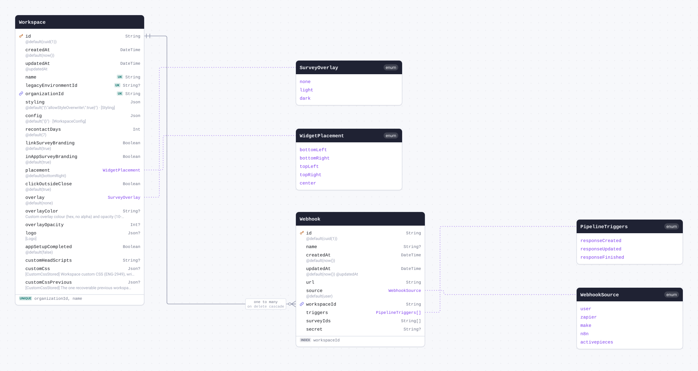

| Field                      | Type                                           | Constraints                                 | Default              | Description |
| -------------------------- | ---------------------------------------------- | ------------------------------------------- | -------------------- | ----------- |
| `id`                       | `String`                                       | PK NOT NULL                                 | `cuid(1)`            |             |
| `name`                     | `String`                                       | NULL                                        |                      |             |
| `createdAt` (`created_at`) | `DateTime`                                     | NOT NULL                                    | `now()`              |             |
| `updatedAt` (`updated_at`) | `DateTime`                                     | NOT NULL                                    | `now()` `@updatedAt` |             |
| `url`                      | `String`                                       | NOT NULL                                    |                      |             |
| `source`                   | [`WebhookSource`](#enum-WebhookSource)         | NOT NULL                                    | `user`               |             |
| `workspaceId`              | `String`                                       | NOT NULL → [Workspace.id](#model-Workspace) |                      |             |
| `triggers`                 | [`PipelineTriggers[]`](#enum-PipelineTriggers) | NOT NULL                                    |                      |             |
| `surveyIds`                | `String[]`                                     | NOT NULL                                    |                      |             |
| `secret`                   | `String`                                       | NULL                                        |                      |             |

#### Indexes

- `@@index([workspaceId])`

#### References

- `workspaceId` → [Workspace.id](#model-Workspace) (many-to-one, on delete Cascade)

#### Definition

```sql
CREATE TABLE "Webhook" (
    "id" TEXT NOT NULL,
    "name" TEXT,
    "created_at" TIMESTAMP(3) NOT NULL DEFAULT CURRENT_TIMESTAMP,
    "updated_at" TIMESTAMP(3) NOT NULL DEFAULT CURRENT_TIMESTAMP,
    "url" TEXT NOT NULL,
    "source" "WebhookSource" NOT NULL DEFAULT 'user',
    "workspaceId" TEXT NOT NULL,
    "triggers" "PipelineTriggers"[],
    "surveyIds" TEXT[],
    "secret" TEXT,

    CONSTRAINT "Webhook_pkey" PRIMARY KEY ("id")
);

CREATE INDEX "Webhook_workspaceId_idx" ON "Webhook"("workspaceId");

ALTER TABLE "Webhook" ADD CONSTRAINT "Webhook_workspaceId_fkey" FOREIGN KEY ("workspaceId") REFERENCES "Workspace"("id") ON DELETE CASCADE ON UPDATE CASCADE;
```

<details>
<summary>Queries and their SQL</summary>

**findMany**: Every row

```ts
await prisma.webhook.findMany();
```

```sql
SELECT
  "public"."Webhook"."id",
  "public"."Webhook"."name",
  "public"."Webhook"."created_at",
  "public"."Webhook"."updated_at",
  "public"."Webhook"."url",
  "public"."Webhook"."source"::text,
  "public"."Webhook"."workspaceId",
  "public"."Webhook"."triggers"::text[],
  "public"."Webhook"."surveyIds",
  "public"."Webhook"."secret"
FROM
  "public"."Webhook"
WHERE
  1 = 1
OFFSET
  $1
-- params: ["0"]
```

**count**: How many rows there are

```ts
await prisma.webhook.count();
```

```sql
SELECT
  COUNT(*) AS "_count$_all"
FROM
  (
    SELECT
      "public"."Webhook"."id"
    FROM
      "public"."Webhook"
    WHERE
      1 = 1
    OFFSET
      $1
  ) AS "sub"
-- params: ["0"]
```

**findMany**: Every row with its relations

```ts
await prisma.webhook.findMany({ include: { workspace: true } });
```

```sql
SELECT
  "public"."Webhook"."id",
  "public"."Webhook"."name",
  "public"."Webhook"."created_at",
  "public"."Webhook"."updated_at",
  "public"."Webhook"."url",
  "public"."Webhook"."source"::text,
  "public"."Webhook"."workspaceId",
  "public"."Webhook"."triggers"::text[],
  "public"."Webhook"."surveyIds",
  "public"."Webhook"."secret"
FROM
  "public"."Webhook"
WHERE
  1 = 1
OFFSET
  $1
-- params: ["0"]

SELECT
  "public"."Workspace"."id",
  "public"."Workspace"."created_at",
  "public"."Workspace"."updated_at",
  "public"."Workspace"."name",
  "public"."Workspace"."legacyEnvironmentId",
  "public"."Workspace"."organizationId",
  "public"."Workspace"."styling",
  "public"."Workspace"."config",
  "public"."Workspace"."recontactDays",
  "public"."Workspace"."linkSurveyBranding",
  "public"."Workspace"."inAppSurveyBranding",
  "public"."Workspace"."placement"::text,
  "public"."Workspace"."clickOutsideClose",
  "public"."Workspace"."overlay"::text,
  "public"."Workspace"."overlayColor",
  "public"."Workspace"."overlayOpacity",
  "public"."Workspace"."logo",
  "public"."Workspace"."appSetupCompleted",
  "public"."Workspace"."customHeadScripts",
  "public"."Workspace"."customCss",
  "public"."Workspace"."customCssPrevious"
FROM
  "public"."Workspace"
WHERE
  "public"."Workspace"."id" IN ($1)
OFFSET
  $2
-- params: ["<workspaceId of the rows above>","0"]
```

**findUnique**: One row by what is unique to it

```ts
await prisma.webhook.findUnique({ where: { id: "example" } });
```

```sql
SELECT
  "public"."Webhook"."id",
  "public"."Webhook"."name",
  "public"."Webhook"."created_at",
  "public"."Webhook"."updated_at",
  "public"."Webhook"."url",
  "public"."Webhook"."source"::text,
  "public"."Webhook"."workspaceId",
  "public"."Webhook"."triggers"::text[],
  "public"."Webhook"."surveyIds",
  "public"."Webhook"."secret"
FROM
  "public"."Webhook"
WHERE
  (
    "public"."Webhook"."id" = $1
    AND 1 = 1
  )
LIMIT
  $2
OFFSET
  $3
-- params: ["example","1","0"]
```

**create**: Create a row

```ts
await prisma.webhook.create({
  data: {
    url: "example",
    workspaceId: "example",
    triggers: ["responseCreated"],
    surveyIds: ["example"],
  },
});
```

```sql
INSERT INTO
  "public"."Webhook" (
    "id",
    "created_at",
    "updated_at",
    "url",
    "source",
    "workspaceId",
    "triggers",
    "surveyIds"
  )
VALUES
  (
    $1,
    $2,
    $3,
    $4,
    CAST($5::text AS "public"."WebhookSource"),
    $6,
    CAST($7::text[] AS "public"."PipelineTriggers" []),
    $8
  )
RETURNING
  "public"."Webhook"."id",
  "public"."Webhook"."name",
  "public"."Webhook"."created_at",
  "public"."Webhook"."updated_at",
  "public"."Webhook"."url",
  "public"."Webhook"."source"::text,
  "public"."Webhook"."workspaceId",
  "public"."Webhook"."triggers"::text[],
  "public"."Webhook"."surveyIds",
  "public"."Webhook"."secret"
-- params: ["<cuid(1)>","<now()>","<now()>","example","user","example",["responseCreated"],["example"]]
```

**update**: Update a row

```ts
await prisma.webhook.update({ where: { id: "example" }, data: { name: "example" } });
```

```sql
UPDATE "public"."Webhook"
SET
  "name" = $1,
  "updated_at" = $2
WHERE
  (
    "public"."Webhook"."id" = $3
    AND 1 = 1
  )
RETURNING
  "public"."Webhook"."id",
  "public"."Webhook"."name",
  "public"."Webhook"."created_at",
  "public"."Webhook"."updated_at",
  "public"."Webhook"."url",
  "public"."Webhook"."source"::text,
  "public"."Webhook"."workspaceId",
  "public"."Webhook"."triggers"::text[],
  "public"."Webhook"."surveyIds",
  "public"."Webhook"."secret"
-- params: ["example",{"prisma__type":"generatorCall","prisma__value":{"name":"now","args":[],"returnType":{"type":"DateTime"}}},"example"]
```

**delete**: Delete a row

```ts
await prisma.webhook.delete({ where: { id: "example" } });
```

```sql
DELETE FROM "public"."Webhook"
WHERE
  (
    "public"."Webhook"."id" = $1
    AND 1 = 1
  )
RETURNING
  "public"."Webhook"."id",
  "public"."Webhook"."name",
  "public"."Webhook"."created_at",
  "public"."Webhook"."updated_at",
  "public"."Webhook"."url",
  "public"."Webhook"."source"::text,
  "public"."Webhook"."workspaceId",
  "public"."Webhook"."triggers"::text[],
  "public"."Webhook"."surveyIds",
  "public"."Webhook"."secret"
-- params: ["example"]
```

</details>

<a id="model-ContactAttribute"></a>

### ContactAttribute

Represents an attribute value associated with a contact.
Used to store custom properties and characteristics of contacts.

@property id - Unique identifier for the attribute
@property attributeKey - Reference to the attribute definition
@property contact - The contact this attribute belongs to
@property value - The string value of the attribute (used for string type + backwards compatibility)
@property valueNumber - Native numeric storage for number type attributes
@property valueDate - Native date storage for date type attributes

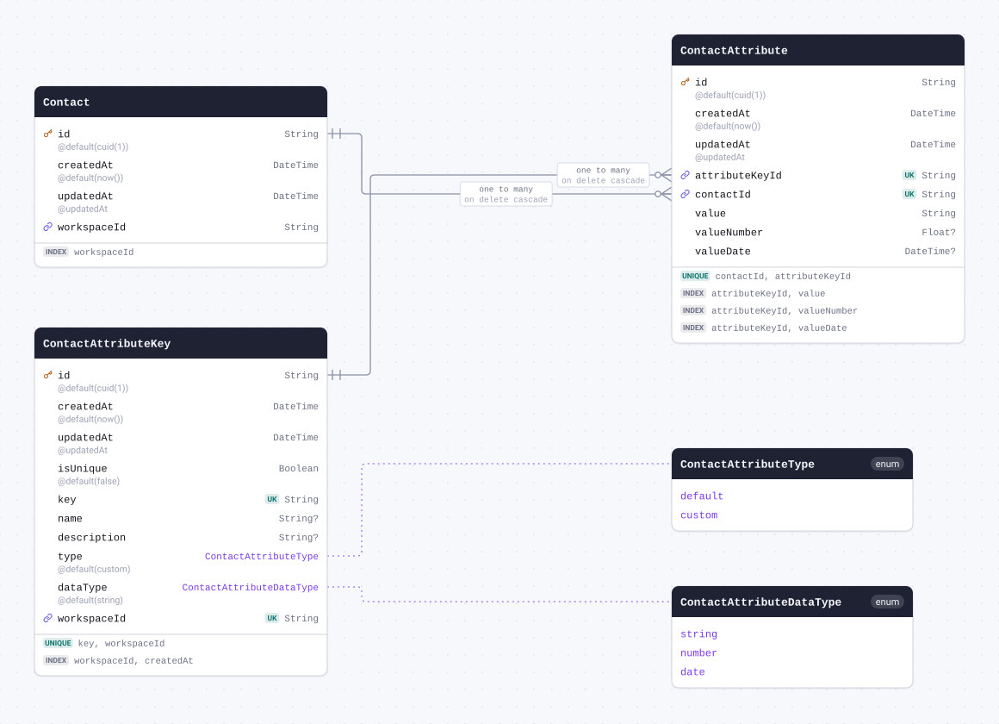

| Field                      | Type       | Constraints                                                     | Default      | Description |
| -------------------------- | ---------- | --------------------------------------------------------------- | ------------ | ----------- |
| `id`                       | `String`   | PK NOT NULL                                                     | `cuid(1)`    |             |
| `createdAt` (`created_at`) | `DateTime` | NOT NULL                                                        | `now()`      |             |
| `updatedAt` (`updated_at`) | `DateTime` | NOT NULL                                                        | `@updatedAt` |             |
| `attributeKeyId`           | `String`   | NOT NULL → [ContactAttributeKey.id](#model-ContactAttributeKey) |              |             |
| `contactId`                | `String`   | NOT NULL → [Contact.id](#model-Contact)                         |              |             |
| `value`                    | `String`   | NOT NULL                                                        |              |             |
| `valueNumber`              | `Float`    | NULL                                                            |              |             |
| `valueDate`                | `DateTime` | NULL                                                            |              |             |

#### Indexes

- `@@index([attributeKeyId, value])`
- `@@index([attributeKeyId, valueNumber])`
- `@@index([attributeKeyId, valueDate])`
- `@@unique([contactId, attributeKeyId])`

#### References

- `attributeKeyId` → [ContactAttributeKey.id](#model-ContactAttributeKey) (many-to-one, on delete Cascade)
- `contactId` → [Contact.id](#model-Contact) (many-to-one, on delete Cascade)

#### Definition

```sql
CREATE TABLE "ContactAttribute" (
    "id" TEXT NOT NULL,
    "created_at" TIMESTAMP(3) NOT NULL DEFAULT CURRENT_TIMESTAMP,
    "updated_at" TIMESTAMP(3) NOT NULL,
    "attributeKeyId" TEXT NOT NULL,
    "contactId" TEXT NOT NULL,
    "value" TEXT NOT NULL,
    "valueNumber" DOUBLE PRECISION,
    "valueDate" TIMESTAMP(3),

    CONSTRAINT "ContactAttribute_pkey" PRIMARY KEY ("id")
);

CREATE INDEX "ContactAttribute_attributeKeyId_value_idx" ON "ContactAttribute"("attributeKeyId", "value");

CREATE INDEX "ContactAttribute_attributeKeyId_valueNumber_idx" ON "ContactAttribute"("attributeKeyId", "valueNumber");

CREATE INDEX "ContactAttribute_attributeKeyId_valueDate_idx" ON "ContactAttribute"("attributeKeyId", "valueDate");

CREATE UNIQUE INDEX "ContactAttribute_contactId_attributeKeyId_key" ON "ContactAttribute"("contactId", "attributeKeyId");

ALTER TABLE "ContactAttribute" ADD CONSTRAINT "ContactAttribute_attributeKeyId_fkey" FOREIGN KEY ("attributeKeyId") REFERENCES "ContactAttributeKey"("id") ON DELETE CASCADE ON UPDATE CASCADE;

ALTER TABLE "ContactAttribute" ADD CONSTRAINT "ContactAttribute_contactId_fkey" FOREIGN KEY ("contactId") REFERENCES "Contact"("id") ON DELETE CASCADE ON UPDATE CASCADE;
```

<details>
<summary>Queries and their SQL</summary>

**findMany**: Every row

```ts
await prisma.contactAttribute.findMany();
```

```sql
SELECT
  "public"."ContactAttribute"."id",
  "public"."ContactAttribute"."created_at",
  "public"."ContactAttribute"."updated_at",
  "public"."ContactAttribute"."attributeKeyId",
  "public"."ContactAttribute"."contactId",
  "public"."ContactAttribute"."value",
  "public"."ContactAttribute"."valueNumber",
  "public"."ContactAttribute"."valueDate"
FROM
  "public"."ContactAttribute"
WHERE
  1 = 1
OFFSET
  $1
-- params: ["0"]
```

**count**: How many rows there are

```ts
await prisma.contactAttribute.count();
```

```sql
SELECT
  COUNT(*) AS "_count$_all"
FROM
  (
    SELECT
      "public"."ContactAttribute"."id"
    FROM
      "public"."ContactAttribute"
    WHERE
      1 = 1
    OFFSET
      $1
  ) AS "sub"
-- params: ["0"]
```

**findMany**: Every row with its relations

```ts
await prisma.contactAttribute.findMany({ include: { attributeKey: true, contact: true } });
```

```sql
SELECT
  "public"."ContactAttribute"."id",
  "public"."ContactAttribute"."created_at",
  "public"."ContactAttribute"."updated_at",
  "public"."ContactAttribute"."attributeKeyId",
  "public"."ContactAttribute"."contactId",
  "public"."ContactAttribute"."value",
  "public"."ContactAttribute"."valueNumber",
  "public"."ContactAttribute"."valueDate"
FROM
  "public"."ContactAttribute"
WHERE
  1 = 1
OFFSET
  $1
-- params: ["0"]

SELECT
  "public"."ContactAttributeKey"."id",
  "public"."ContactAttributeKey"."created_at",
  "public"."ContactAttributeKey"."updated_at",
  "public"."ContactAttributeKey"."isUnique",
  "public"."ContactAttributeKey"."key",
  "public"."ContactAttributeKey"."name",
  "public"."ContactAttributeKey"."description",
  "public"."ContactAttributeKey"."type"::text,
  "public"."ContactAttributeKey"."dataType"::text,
  "public"."ContactAttributeKey"."workspaceId"
FROM
  "public"."ContactAttributeKey"
WHERE
  "public"."ContactAttributeKey"."id" IN ($1)
OFFSET
  $2
-- params: ["<attributeKeyId of the rows above>","0"]

SELECT
  "public"."Contact"."id",
  "public"."Contact"."created_at",
  "public"."Contact"."updated_at",
  "public"."Contact"."workspaceId"
FROM
  "public"."Contact"
WHERE
  "public"."Contact"."id" IN ($1)
OFFSET
  $2
-- params: ["<contactId of the rows above>","0"]
```

**findUnique**: One row by what is unique to it

```ts
await prisma.contactAttribute.findUnique({ where: { id: "example" } });
```

```sql
SELECT
  "public"."ContactAttribute"."id",
  "public"."ContactAttribute"."created_at",
  "public"."ContactAttribute"."updated_at",
  "public"."ContactAttribute"."attributeKeyId",
  "public"."ContactAttribute"."contactId",
  "public"."ContactAttribute"."value",
  "public"."ContactAttribute"."valueNumber",
  "public"."ContactAttribute"."valueDate"
FROM
  "public"."ContactAttribute"
WHERE
  (
    "public"."ContactAttribute"."id" = $1
    AND 1 = 1
  )
LIMIT
  $2
OFFSET
  $3
-- params: ["example","1","0"]
```

**create**: Create a row

```ts
await prisma.contactAttribute.create({
  data: { attributeKeyId: "example", contactId: "example", value: "example" },
});
```

```sql
INSERT INTO
  "public"."ContactAttribute" (
    "id",
    "created_at",
    "updated_at",
    "attributeKeyId",
    "contactId",
    "value"
  )
VALUES
  ($1, $2, $3, $4, $5, $6)
RETURNING
  "public"."ContactAttribute"."id",
  "public"."ContactAttribute"."created_at",
  "public"."ContactAttribute"."updated_at",
  "public"."ContactAttribute"."attributeKeyId",
  "public"."ContactAttribute"."contactId",
  "public"."ContactAttribute"."value",
  "public"."ContactAttribute"."valueNumber",
  "public"."ContactAttribute"."valueDate"
-- params: ["<cuid(1)>","<now()>","<now()>","example","example","example"]
```

**update**: Update a row

```ts
await prisma.contactAttribute.update({
  where: { id: "example" },
  data: { createdAt: new Date("2026-01-01T00:00:00.000Z") },
});
```

```sql
UPDATE "public"."ContactAttribute"
SET
  "created_at" = $1,
  "updated_at" = $2
WHERE
  (
    "public"."ContactAttribute"."id" = $3
    AND 1 = 1
  )
RETURNING
  "public"."ContactAttribute"."id",
  "public"."ContactAttribute"."created_at",
  "public"."ContactAttribute"."updated_at",
  "public"."ContactAttribute"."attributeKeyId",
  "public"."ContactAttribute"."contactId",
  "public"."ContactAttribute"."value",
  "public"."ContactAttribute"."valueNumber",
  "public"."ContactAttribute"."valueDate"
-- params: ["2026-01-01T00:00:00.000Z",{"prisma__type":"generatorCall","prisma__value":{"name":"now","args":[],"returnType":{"type":"DateTime"}}},"example"]
```

**delete**: Delete a row

```ts
await prisma.contactAttribute.delete({ where: { id: "example" } });
```

```sql
DELETE FROM "public"."ContactAttribute"
WHERE
  (
    "public"."ContactAttribute"."id" = $1
    AND 1 = 1
  )
RETURNING
  "public"."ContactAttribute"."id",
  "public"."ContactAttribute"."created_at",
  "public"."ContactAttribute"."updated_at",
  "public"."ContactAttribute"."attributeKeyId",
  "public"."ContactAttribute"."contactId",
  "public"."ContactAttribute"."value",
  "public"."ContactAttribute"."valueNumber",
  "public"."ContactAttribute"."valueDate"
-- params: ["example"]
```

</details>

<a id="model-ContactAttributeKey"></a>

### ContactAttributeKey

Defines the possible attributes that can be assigned to contacts.
Acts as a schema for contact attributes within a workspace.

@property id - Unique identifier for the attribute key
@property isUnique - Whether the attribute must have unique values across contacts
@property key - The attribute identifier used in the system
@property name - Display name for the attribute
@property type - Whether this is a default or custom attribute
@property dataType - The data type of the attribute (string, number, date)
@property workspace - The workspace this attribute belongs to

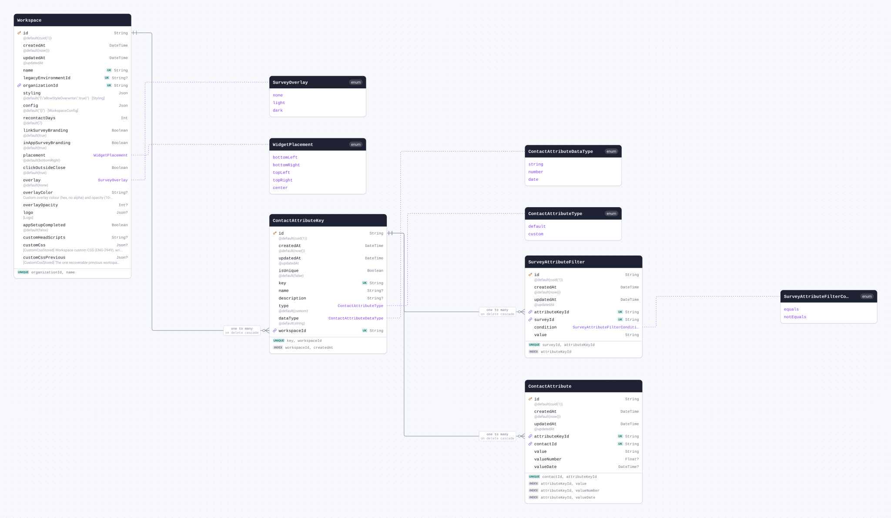

| Field                      | Type                                                         | Constraints                                 | Default      | Description |
| -------------------------- | ------------------------------------------------------------ | ------------------------------------------- | ------------ | ----------- |
| `id`                       | `String`                                                     | PK NOT NULL                                 | `cuid(1)`    |             |
| `createdAt` (`created_at`) | `DateTime`                                                   | NOT NULL                                    | `now()`      |             |
| `updatedAt` (`updated_at`) | `DateTime`                                                   | NOT NULL                                    | `@updatedAt` |             |
| `isUnique`                 | `Boolean`                                                    | NOT NULL                                    | `false`      |             |
| `key`                      | `String`                                                     | NOT NULL                                    |              |             |
| `name`                     | `String`                                                     | NULL                                        |              |             |
| `description`              | `String`                                                     | NULL                                        |              |             |
| `type`                     | [`ContactAttributeType`](#enum-ContactAttributeType)         | NOT NULL                                    | `custom`     |             |
| `dataType`                 | [`ContactAttributeDataType`](#enum-ContactAttributeDataType) | NOT NULL                                    | `string`     |             |
| `workspaceId`              | `String`                                                     | NOT NULL → [Workspace.id](#model-Workspace) |              |             |

#### Indexes

- `@@index([workspaceId, createdAt])`
- `@@unique([key, workspaceId])`

#### References

- `workspaceId` → [Workspace.id](#model-Workspace) (many-to-one, on delete Cascade)

#### Referenced by

- `id` ← [ContactAttribute.attributeKeyId](#model-ContactAttribute) (one-to-many, on delete Cascade)
- `id` ← [SurveyAttributeFilter.attributeKeyId](#model-SurveyAttributeFilter) (one-to-many, on delete Cascade)

#### Definition

```sql
CREATE TABLE "ContactAttributeKey" (
    "id" TEXT NOT NULL,
    "created_at" TIMESTAMP(3) NOT NULL DEFAULT CURRENT_TIMESTAMP,
    "updated_at" TIMESTAMP(3) NOT NULL,
    "isUnique" BOOLEAN NOT NULL DEFAULT false,
    "key" TEXT NOT NULL,
    "name" TEXT,
    "description" TEXT,
    "type" "ContactAttributeType" NOT NULL DEFAULT 'custom',
    "dataType" "ContactAttributeDataType" NOT NULL DEFAULT 'string',
    "workspaceId" TEXT NOT NULL,

    CONSTRAINT "ContactAttributeKey_pkey" PRIMARY KEY ("id")
);

CREATE INDEX "ContactAttributeKey_workspaceId_created_at_idx" ON "ContactAttributeKey"("workspaceId", "created_at");

CREATE UNIQUE INDEX "ContactAttributeKey_key_workspaceId_key" ON "ContactAttributeKey"("key", "workspaceId");

ALTER TABLE "ContactAttributeKey" ADD CONSTRAINT "ContactAttributeKey_workspaceId_fkey" FOREIGN KEY ("workspaceId") REFERENCES "Workspace"("id") ON DELETE CASCADE ON UPDATE CASCADE;
```

<details>
<summary>Queries and their SQL</summary>

**findMany**: Every row

```ts
await prisma.contactAttributeKey.findMany();
```

```sql
SELECT
  "public"."ContactAttributeKey"."id",
  "public"."ContactAttributeKey"."created_at",
  "public"."ContactAttributeKey"."updated_at",
  "public"."ContactAttributeKey"."isUnique",
  "public"."ContactAttributeKey"."key",
  "public"."ContactAttributeKey"."name",
  "public"."ContactAttributeKey"."description",
  "public"."ContactAttributeKey"."type"::text,
  "public"."ContactAttributeKey"."dataType"::text,
  "public"."ContactAttributeKey"."workspaceId"
FROM
  "public"."ContactAttributeKey"
WHERE
  1 = 1
OFFSET
  $1
-- params: ["0"]
```

**count**: How many rows there are

```ts
await prisma.contactAttributeKey.count();
```

```sql
SELECT
  COUNT(*) AS "_count$_all"
FROM
  (
    SELECT
      "public"."ContactAttributeKey"."id"
    FROM
      "public"."ContactAttributeKey"
    WHERE
      1 = 1
    OFFSET
      $1
  ) AS "sub"
-- params: ["0"]
```

**findMany**: Every row with its relations

```ts
await prisma.contactAttributeKey.findMany({
  include: { workspace: true, attributes: true, attributeFilters: true },
});
```

```sql
SELECT
  "public"."ContactAttributeKey"."id",
  "public"."ContactAttributeKey"."created_at",
  "public"."ContactAttributeKey"."updated_at",
  "public"."ContactAttributeKey"."isUnique",
  "public"."ContactAttributeKey"."key",
  "public"."ContactAttributeKey"."name",
  "public"."ContactAttributeKey"."description",
  "public"."ContactAttributeKey"."type"::text,
  "public"."ContactAttributeKey"."dataType"::text,
  "public"."ContactAttributeKey"."workspaceId"
FROM
  "public"."ContactAttributeKey"
WHERE
  1 = 1
OFFSET
  $1
-- params: ["0"]

SELECT
  "public"."Workspace"."id",
  "public"."Workspace"."created_at",
  "public"."Workspace"."updated_at",
  "public"."Workspace"."name",
  "public"."Workspace"."legacyEnvironmentId",
  "public"."Workspace"."organizationId",
  "public"."Workspace"."styling",
  "public"."Workspace"."config",
  "public"."Workspace"."recontactDays",
  "public"."Workspace"."linkSurveyBranding",
  "public"."Workspace"."inAppSurveyBranding",
  "public"."Workspace"."placement"::text,
  "public"."Workspace"."clickOutsideClose",
  "public"."Workspace"."overlay"::text,
  "public"."Workspace"."overlayColor",
  "public"."Workspace"."overlayOpacity",
  "public"."Workspace"."logo",
  "public"."Workspace"."appSetupCompleted",
  "public"."Workspace"."customHeadScripts",
  "public"."Workspace"."customCss",
  "public"."Workspace"."customCssPrevious"
FROM
  "public"."Workspace"
WHERE
  "public"."Workspace"."id" IN ($1)
OFFSET
  $2
-- params: ["<workspaceId of the rows above>","0"]

SELECT
  "public"."ContactAttribute"."id",
  "public"."ContactAttribute"."created_at",
  "public"."ContactAttribute"."updated_at",
  "public"."ContactAttribute"."attributeKeyId",
  "public"."ContactAttribute"."contactId",
  "public"."ContactAttribute"."value",
  "public"."ContactAttribute"."valueNumber",
  "public"."ContactAttribute"."valueDate"
FROM
  "public"."ContactAttribute"
WHERE
  "public"."ContactAttribute"."attributeKeyId" IN ($1)
OFFSET
  $2
-- params: ["<id of the rows above>","0"]

SELECT
  "public"."SurveyAttributeFilter"."id",
  "public"."SurveyAttributeFilter"."created_at",
  "public"."SurveyAttributeFilter"."updated_at",
  "public"."SurveyAttributeFilter"."attributeKeyId",
  "public"."SurveyAttributeFilter"."surveyId",
  "public"."SurveyAttributeFilter"."condition"::text,
  "public"."SurveyAttributeFilter"."value"
FROM
  "public"."SurveyAttributeFilter"
WHERE
  "public"."SurveyAttributeFilter"."attributeKeyId" IN ($1)
OFFSET
  $2
-- params: ["<id of the rows above>","0"]
```

**findUnique**: One row by what is unique to it

```ts
await prisma.contactAttributeKey.findUnique({ where: { id: "example" } });
```

```sql
SELECT
  "public"."ContactAttributeKey"."id",
  "public"."ContactAttributeKey"."created_at",
  "public"."ContactAttributeKey"."updated_at",
  "public"."ContactAttributeKey"."isUnique",
  "public"."ContactAttributeKey"."key",
  "public"."ContactAttributeKey"."name",
  "public"."ContactAttributeKey"."description",
  "public"."ContactAttributeKey"."type"::text,
  "public"."ContactAttributeKey"."dataType"::text,
  "public"."ContactAttributeKey"."workspaceId"
FROM
  "public"."ContactAttributeKey"
WHERE
  (
    "public"."ContactAttributeKey"."id" = $1
    AND 1 = 1
  )
LIMIT
  $2
OFFSET
  $3
-- params: ["example","1","0"]
```

**create**: Create a row

```ts
await prisma.contactAttributeKey.create({ data: { key: "example", workspaceId: "example" } });
```

```sql
INSERT INTO
  "public"."ContactAttributeKey" (
    "id",
    "created_at",
    "updated_at",
    "isUnique",
    "key",
    "type",
    "dataType",
    "workspaceId"
  )
VALUES
  (
    $1,
    $2,
    $3,
    $4,
    $5,
    CAST($6::text AS "public"."ContactAttributeType"),
    CAST($7::text AS "public"."ContactAttributeDataType"),
    $8
  )
RETURNING
  "public"."ContactAttributeKey"."id",
  "public"."ContactAttributeKey"."created_at",
  "public"."ContactAttributeKey"."updated_at",
  "public"."ContactAttributeKey"."isUnique",
  "public"."ContactAttributeKey"."key",
  "public"."ContactAttributeKey"."name",
  "public"."ContactAttributeKey"."description",
  "public"."ContactAttributeKey"."type"::text,
  "public"."ContactAttributeKey"."dataType"::text,
  "public"."ContactAttributeKey"."workspaceId"
-- params: ["<cuid(1)>","<now()>","<now()>",false,"example","custom","string","example"]
```

**update**: Update a row

```ts
await prisma.contactAttributeKey.update({
  where: { id: "example" },
  data: { createdAt: new Date("2026-01-01T00:00:00.000Z") },
});
```

```sql
UPDATE "public"."ContactAttributeKey"
SET
  "created_at" = $1,
  "updated_at" = $2
WHERE
  (
    "public"."ContactAttributeKey"."id" = $3
    AND 1 = 1
  )
RETURNING
  "public"."ContactAttributeKey"."id",
  "public"."ContactAttributeKey"."created_at",
  "public"."ContactAttributeKey"."updated_at",
  "public"."ContactAttributeKey"."isUnique",
  "public"."ContactAttributeKey"."key",
  "public"."ContactAttributeKey"."name",
  "public"."ContactAttributeKey"."description",
  "public"."ContactAttributeKey"."type"::text,
  "public"."ContactAttributeKey"."dataType"::text,
  "public"."ContactAttributeKey"."workspaceId"
-- params: ["2026-01-01T00:00:00.000Z",{"prisma__type":"generatorCall","prisma__value":{"name":"now","args":[],"returnType":{"type":"DateTime"}}},"example"]
```

**delete**: Delete a row

```ts
await prisma.contactAttributeKey.delete({ where: { id: "example" } });
```

```sql
DELETE FROM "public"."ContactAttributeKey"
WHERE
  (
    "public"."ContactAttributeKey"."id" = $1
    AND 1 = 1
  )
RETURNING
  "public"."ContactAttributeKey"."id",
  "public"."ContactAttributeKey"."created_at",
  "public"."ContactAttributeKey"."updated_at",
  "public"."ContactAttributeKey"."isUnique",
  "public"."ContactAttributeKey"."key",
  "public"."ContactAttributeKey"."name",
  "public"."ContactAttributeKey"."description",
  "public"."ContactAttributeKey"."type"::text,
  "public"."ContactAttributeKey"."dataType"::text,
  "public"."ContactAttributeKey"."workspaceId"
-- params: ["example"]
```

</details>

<a id="model-Contact"></a>

### Contact

Represents a person or user who can receive and respond to surveys.
Contacts are workspace-specific and can have multiple attributes and responses.

@property id - Unique identifier for the contact
@property workspace - The workspace this contact belongs to
@property responses - Survey responses from this contact
@property attributes - Custom attributes associated with this contact
@property displays - Record of surveys shown to this contact

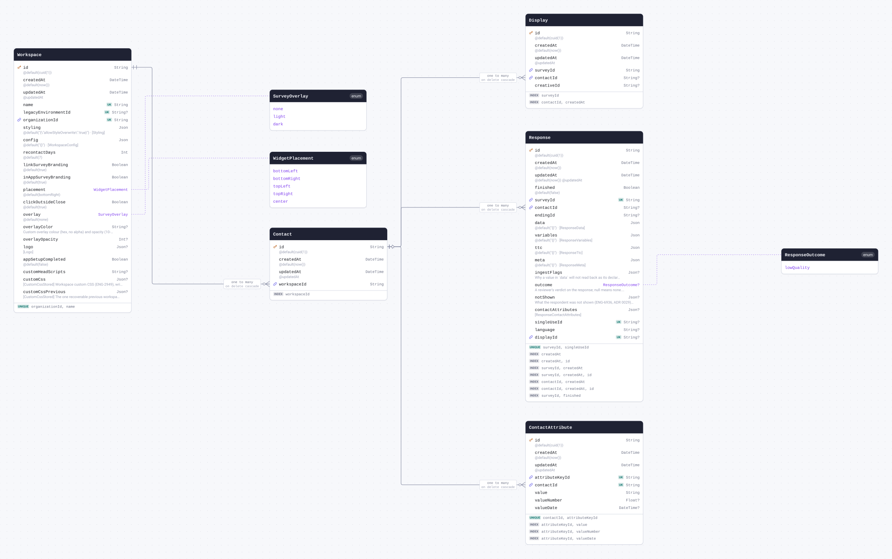

| Field                      | Type       | Constraints                                 | Default      | Description |
| -------------------------- | ---------- | ------------------------------------------- | ------------ | ----------- |
| `id`                       | `String`   | PK NOT NULL                                 | `cuid(1)`    |             |
| `createdAt` (`created_at`) | `DateTime` | NOT NULL                                    | `now()`      |             |
| `updatedAt` (`updated_at`) | `DateTime` | NOT NULL                                    | `@updatedAt` |             |
| `workspaceId`              | `String`   | NOT NULL → [Workspace.id](#model-Workspace) |              |             |

#### Indexes

- `@@index([workspaceId])`

#### References

- `workspaceId` → [Workspace.id](#model-Workspace) (many-to-one, on delete Cascade)

#### Referenced by

- `id` ← [ContactAttribute.contactId](#model-ContactAttribute) (one-to-many, on delete Cascade)
- `id` ← [Response.contactId](#model-Response) (one-to-many, on delete Cascade)
- `id` ← [Display.contactId](#model-Display) (one-to-many, on delete Cascade)

#### Definition

```sql
CREATE TABLE "Contact" (
    "id" TEXT NOT NULL,
    "created_at" TIMESTAMP(3) NOT NULL DEFAULT CURRENT_TIMESTAMP,
    "updated_at" TIMESTAMP(3) NOT NULL,
    "workspaceId" TEXT NOT NULL,

    CONSTRAINT "Contact_pkey" PRIMARY KEY ("id")
);

CREATE INDEX "Contact_workspaceId_idx" ON "Contact"("workspaceId");

ALTER TABLE "Contact" ADD CONSTRAINT "Contact_workspaceId_fkey" FOREIGN KEY ("workspaceId") REFERENCES "Workspace"("id") ON DELETE CASCADE ON UPDATE CASCADE;
```

<details>
<summary>Queries and their SQL</summary>

**findMany**: Every row

```ts
await prisma.contact.findMany();
```

```sql
SELECT
  "public"."Contact"."id",
  "public"."Contact"."created_at",
  "public"."Contact"."updated_at",
  "public"."Contact"."workspaceId"
FROM
  "public"."Contact"
WHERE
  1 = 1
OFFSET
  $1
-- params: ["0"]
```

**count**: How many rows there are

```ts
await prisma.contact.count();
```

```sql
SELECT
  COUNT(*) AS "_count$_all"
FROM
  (
    SELECT
      "public"."Contact"."id"
    FROM
      "public"."Contact"
    WHERE
      1 = 1
    OFFSET
      $1
  ) AS "sub"
-- params: ["0"]
```

**findMany**: Every row with its relations

```ts
await prisma.contact.findMany({
  include: { workspace: true, responses: true, attributes: true, displays: true },
});
```

```sql
SELECT
  "public"."Contact"."id",
  "public"."Contact"."created_at",
  "public"."Contact"."updated_at",
  "public"."Contact"."workspaceId"
FROM
  "public"."Contact"
WHERE
  1 = 1
OFFSET
  $1
-- params: ["0"]

SELECT
  "public"."Workspace"."id",
  "public"."Workspace"."created_at",
  "public"."Workspace"."updated_at",
  "public"."Workspace"."name",
  "public"."Workspace"."legacyEnvironmentId",
  "public"."Workspace"."organizationId",
  "public"."Workspace"."styling",
  "public"."Workspace"."config",
  "public"."Workspace"."recontactDays",
  "public"."Workspace"."linkSurveyBranding",
  "public"."Workspace"."inAppSurveyBranding",
  "public"."Workspace"."placement"::text,
  "public"."Workspace"."clickOutsideClose",
  "public"."Workspace"."overlay"::text,
  "public"."Workspace"."overlayColor",
  "public"."Workspace"."overlayOpacity",
  "public"."Workspace"."logo",
  "public"."Workspace"."appSetupCompleted",
  "public"."Workspace"."customHeadScripts",
  "public"."Workspace"."customCss",
  "public"."Workspace"."customCssPrevious"
FROM
  "public"."Workspace"
WHERE
  "public"."Workspace"."id" IN ($1)
OFFSET
  $2
-- params: ["<workspaceId of the rows above>","0"]

SELECT
  "public"."Response"."id",
  "public"."Response"."created_at",
  "public"."Response"."updated_at",
  "public"."Response"."finished",
  "public"."Response"."surveyId",
  "public"."Response"."contactId",
  "public"."Response"."endingId",
  "public"."Response"."data",
  "public"."Response"."variables",
  "public"."Response"."ttc",
  "public"."Response"."meta",
  "public"."Response"."ingest_flags",
  "public"."Response"."outcome"::text,
  "public"."Response"."not_shown",
  "public"."Response"."contactAttributes",
  "public"."Response"."singleUseId",
  "public"."Response"."language",
  "public"."Response"."displayId"
FROM
  "public"."Response"
WHERE
  "public"."Response"."contactId" IN ($1)
OFFSET
  $2
-- params: ["<id of the rows above>","0"]

SELECT
  "public"."ContactAttribute"."id",
  "public"."ContactAttribute"."created_at",
  "public"."ContactAttribute"."updated_at",
  "public"."ContactAttribute"."attributeKeyId",
  "public"."ContactAttribute"."contactId",
  "public"."ContactAttribute"."value",
  "public"."ContactAttribute"."valueNumber",
  "public"."ContactAttribute"."valueDate"
FROM
  "public"."ContactAttribute"
WHERE
  "public"."ContactAttribute"."contactId" IN ($1)
OFFSET
  $2
-- params: ["<id of the rows above>","0"]

SELECT
  "public"."Display"."id",
  "public"."Display"."created_at",
  "public"."Display"."updated_at",
  "public"."Display"."surveyId",
  "public"."Display"."contactId",
  "public"."Display"."creativeId"
FROM
  "public"."Display"
WHERE
  "public"."Display"."contactId" IN ($1)
OFFSET
  $2
-- params: ["<id of the rows above>","0"]
```

**findUnique**: One row by what is unique to it

```ts
await prisma.contact.findUnique({ where: { id: "example" } });
```

```sql
SELECT
  "public"."Contact"."id",
  "public"."Contact"."created_at",
  "public"."Contact"."updated_at",
  "public"."Contact"."workspaceId"
FROM
  "public"."Contact"
WHERE
  (
    "public"."Contact"."id" = $1
    AND 1 = 1
  )
LIMIT
  $2
OFFSET
  $3
-- params: ["example","1","0"]
```

**create**: Create a row

```ts
await prisma.contact.create({ data: { workspaceId: "example" } });
```

```sql
INSERT INTO
  "public"."Contact" ("id", "created_at", "updated_at", "workspaceId")
VALUES
  ($1, $2, $3, $4)
RETURNING
  "public"."Contact"."id",
  "public"."Contact"."created_at",
  "public"."Contact"."updated_at",
  "public"."Contact"."workspaceId"
-- params: ["<cuid(1)>","<now()>","<now()>","example"]
```

**update**: Update a row

```ts
await prisma.contact.update({
  where: { id: "example" },
  data: { createdAt: new Date("2026-01-01T00:00:00.000Z") },
});
```

```sql
UPDATE "public"."Contact"
SET
  "created_at" = $1,
  "updated_at" = $2
WHERE
  (
    "public"."Contact"."id" = $3
    AND 1 = 1
  )
RETURNING
  "public"."Contact"."id",
  "public"."Contact"."created_at",
  "public"."Contact"."updated_at",
  "public"."Contact"."workspaceId"
-- params: ["2026-01-01T00:00:00.000Z",{"prisma__type":"generatorCall","prisma__value":{"name":"now","args":[],"returnType":{"type":"DateTime"}}},"example"]
```

**delete**: Delete a row

```ts
await prisma.contact.delete({ where: { id: "example" } });
```

```sql
DELETE FROM "public"."Contact"
WHERE
  (
    "public"."Contact"."id" = $1
    AND 1 = 1
  )
RETURNING
  "public"."Contact"."id",
  "public"."Contact"."created_at",
  "public"."Contact"."updated_at",
  "public"."Contact"."workspaceId"
-- params: ["example"]
```

</details>

<a id="model-Response"></a>

### Response

Stores a user's response to a survey, including their answers and metadata.
Each response is linked to a specific survey and optionally to a contact.

@property id - Unique identifier for the response
@property finished - Whether the survey was completed
@property survey - The associated survey
@property contact - The optional contact who provided the response
@property data - JSON object containing the actual response data
@property variables - Custom variables used in the response
@property ttc - Time to completion metrics
@property meta - Additional metadata about the response

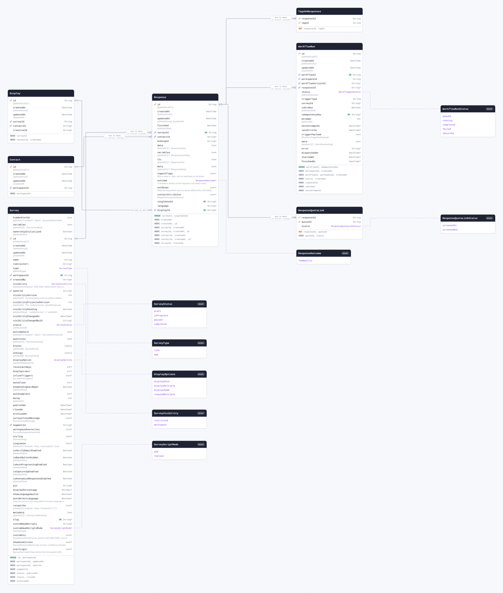

| Field                          | Type                                       | Constraints                                | Default              | Description                                                                                                                                                                                                                                                                                                                                                                                                                                                                    |
| ------------------------------ | ------------------------------------------ | ------------------------------------------ | -------------------- | ------------------------------------------------------------------------------------------------------------------------------------------------------------------------------------------------------------------------------------------------------------------------------------------------------------------------------------------------------------------------------------------------------------------------------------------------------------------------------ |
| `id`                           | `String`                                   | PK NOT NULL                                | `cuid(1)`            |                                                                                                                                                                                                                                                                                                                                                                                                                                                                                |
| `createdAt` (`created_at`)     | `DateTime`                                 | NOT NULL                                   | `now()`              |                                                                                                                                                                                                                                                                                                                                                                                                                                                                                |
| `updatedAt` (`updated_at`)     | `DateTime`                                 | NOT NULL                                   | `now()` `@updatedAt` |                                                                                                                                                                                                                                                                                                                                                                                                                                                                                |
| `finished`                     | `Boolean`                                  | NOT NULL                                   | `false`              |                                                                                                                                                                                                                                                                                                                                                                                                                                                                                |
| `surveyId`                     | `String`                                   | NOT NULL → [Survey.id](#model-Survey)      |                      |                                                                                                                                                                                                                                                                                                                                                                                                                                                                                |
| `contactId`                    | `String`                                   | NULL → [Contact.id](#model-Contact)        |                      |                                                                                                                                                                                                                                                                                                                                                                                                                                                                                |
| `endingId`                     | `String`                                   | NULL                                       |                      |                                                                                                                                                                                                                                                                                                                                                                                                                                                                                |
| `data`                         | `Json`                                     | NOT NULL                                   | `"{}"`               | [ResponseData]                                                                                                                                                                                                                                                                                                                                                                                                                                                                 |
| `variables`                    | `Json`                                     | NOT NULL                                   | `"{}"`               | [ResponseVariables]                                                                                                                                                                                                                                                                                                                                                                                                                                                            |
| `ttc`                          | `Json`                                     | NOT NULL                                   | `"{}"`               | [ResponseTtc]                                                                                                                                                                                                                                                                                                                                                                                                                                                                  |
| `meta`                         | `Json`                                     | NOT NULL                                   | `"{}"`               | [ResponseMeta]                                                                                                                                                                                                                                                                                                                                                                                                                                                                 |
| `ingestFlags` (`ingest_flags`) | `Json`                                     | NULL                                       |                      | Why a value in `data` will not read back as its declared Embedded Data type — a failed coercion or a truncated oversize value (ENG-1845). Server-computed on every ingest and never accepted from the client. Null means no ingest boundary has written it, which is not the same claim as an empty list: without this column a wrong-typed value is indistinguishable from an absent one, and surfacing that in the UI (v2) would have nothing to read. [ResponseIngestFlags] |
| `outcome`                      | [`ResponseOutcome`](#enum-ResponseOutcome) | NULL                                       |                      | A reviewer's verdict on the response; null means none. `lowQuality` hides it from the Analysis export by default and from Feedback Records, and nothing else: it is never deleted and every count, list, webhook and integration still includes it (ENG-6780).                                                                                                                                                                                                                 |
| `notShown` (`not_shown`)       | `Json`                                     | NULL                                       |                      | What the respondent was not shown (ENG-6936, ADR 0029): the blocks and elements a show-if kept from them, and per element its options, matrix rows and columns, by stable ids. Written by the survey while they answer; null means unknown (older responses and bundles), read as before. Omitted from reads without a `select` (PRISMA_GLOBAL_OMIT), so it never reaches a v1/v2 payload, webhook or integration. [ResponseNotShown]                                          |
| `contactAttributes`            | `Json`                                     | NULL                                       |                      | [ResponseContactAttributes]                                                                                                                                                                                                                                                                                                                                                                                                                                                    |
| `singleUseId`                  | `String`                                   | NULL                                       |                      |                                                                                                                                                                                                                                                                                                                                                                                                                                                                                |
| `language`                     | `String`                                   | NULL                                       |                      |                                                                                                                                                                                                                                                                                                                                                                                                                                                                                |
| `displayId`                    | `String`                                   | UNIQUE NULL → [Display.id](#model-Display) |                      |                                                                                                                                                                                                                                                                                                                                                                                                                                                                                |

#### Indexes

- `@@index([createdAt])`
- `@@index([createdAt, id])`
- `@@index([surveyId, createdAt])`
- `@@index([surveyId, createdAt, id])`
- `@@index([contactId, createdAt])`
- `@@index([contactId, createdAt, id])`
- `@@index([surveyId, finished])`
- `@@unique([surveyId, singleUseId])`

#### References

- `surveyId` → [Survey.id](#model-Survey) (many-to-one, on delete Cascade)
- `contactId` → [Contact.id](#model-Contact) (many-to-one, on delete Cascade)
- `displayId` → [Display.id](#model-Display) (one-to-one)

#### Referenced by

- `id` ← [TagsOnResponses.responseId](#model-TagsOnResponses) (one-to-many, on delete Cascade)
- `id` ← [ResponseQuotaLink.responseId](#model-ResponseQuotaLink) (one-to-many, on delete Cascade)
- `id` ← [WorkflowRun.responseId](#model-WorkflowRun) (one-to-many, on delete Cascade)

#### Definition

```sql
CREATE TABLE "Response" (
    "id" TEXT NOT NULL,
    "created_at" TIMESTAMP(3) NOT NULL DEFAULT CURRENT_TIMESTAMP,
    "updated_at" TIMESTAMP(3) NOT NULL DEFAULT CURRENT_TIMESTAMP,
    "finished" BOOLEAN NOT NULL DEFAULT false,
    "surveyId" TEXT NOT NULL,
    "contactId" TEXT,
    "endingId" TEXT,
    "data" JSONB NOT NULL DEFAULT '{}',
    "variables" JSONB NOT NULL DEFAULT '{}',
    "ttc" JSONB NOT NULL DEFAULT '{}',
    "meta" JSONB NOT NULL DEFAULT '{}',
    "ingest_flags" JSONB,
    "outcome" "ResponseOutcome",
    "not_shown" JSONB,
    "contactAttributes" JSONB,
    "singleUseId" TEXT,
    "language" TEXT,
    "displayId" TEXT,

    CONSTRAINT "Response_pkey" PRIMARY KEY ("id")
);

CREATE UNIQUE INDEX "Response_displayId_key" ON "Response"("displayId");

CREATE INDEX "Response_created_at_idx" ON "Response"("created_at");

CREATE INDEX "Response_created_at_id_idx" ON "Response"("created_at", "id");

CREATE INDEX "Response_surveyId_created_at_idx" ON "Response"("surveyId", "created_at");

CREATE INDEX "Response_surveyId_created_at_id_idx" ON "Response"("surveyId", "created_at", "id");

CREATE INDEX "Response_contactId_created_at_idx" ON "Response"("contactId", "created_at");

CREATE INDEX "Response_contactId_created_at_id_idx" ON "Response"("contactId", "created_at", "id");

CREATE INDEX "Response_surveyId_finished_idx" ON "Response"("surveyId", "finished");

CREATE UNIQUE INDEX "Response_surveyId_singleUseId_key" ON "Response"("surveyId", "singleUseId");

ALTER TABLE "Response" ADD CONSTRAINT "Response_surveyId_fkey" FOREIGN KEY ("surveyId") REFERENCES "Survey"("id") ON DELETE CASCADE ON UPDATE CASCADE;

ALTER TABLE "Response" ADD CONSTRAINT "Response_contactId_fkey" FOREIGN KEY ("contactId") REFERENCES "Contact"("id") ON DELETE CASCADE ON UPDATE CASCADE;

ALTER TABLE "Response" ADD CONSTRAINT "Response_displayId_fkey" FOREIGN KEY ("displayId") REFERENCES "Display"("id") ON DELETE SET NULL ON UPDATE CASCADE;
```

<details>
<summary>Queries and their SQL</summary>

**findMany**: Every row

```ts
await prisma.response.findMany();
```

```sql
SELECT
  "public"."Response"."id",
  "public"."Response"."created_at",
  "public"."Response"."updated_at",
  "public"."Response"."finished",
  "public"."Response"."surveyId",
  "public"."Response"."contactId",
  "public"."Response"."endingId",
  "public"."Response"."data",
  "public"."Response"."variables",
  "public"."Response"."ttc",
  "public"."Response"."meta",
  "public"."Response"."ingest_flags",
  "public"."Response"."outcome"::text,
  "public"."Response"."not_shown",
  "public"."Response"."contactAttributes",
  "public"."Response"."singleUseId",
  "public"."Response"."language",
  "public"."Response"."displayId"
FROM
  "public"."Response"
WHERE
  1 = 1
OFFSET
  $1
-- params: ["0"]
```

**count**: How many rows there are

```ts
await prisma.response.count();
```

```sql
SELECT
  COUNT(*) AS "_count$_all"
FROM
  (
    SELECT
      "public"."Response"."id"
    FROM
      "public"."Response"
    WHERE
      1 = 1
    OFFSET
      $1
  ) AS "sub"
-- params: ["0"]
```

**findMany**: Every row with its relations

```ts
await prisma.response.findMany({
  include: {
    survey: true,
    contact: true,
    tags: true,
    quotaLinks: true,
    display: true,
    workflowRuns: true,
  },
});
```

```sql
SELECT
  "public"."Response"."id",
  "public"."Response"."created_at",
  "public"."Response"."updated_at",
  "public"."Response"."finished",
  "public"."Response"."surveyId",
  "public"."Response"."contactId",
  "public"."Response"."endingId",
  "public"."Response"."data",
  "public"."Response"."variables",
  "public"."Response"."ttc",
  "public"."Response"."meta",
  "public"."Response"."ingest_flags",
  "public"."Response"."outcome"::text,
  "public"."Response"."not_shown",
  "public"."Response"."contactAttributes",
  "public"."Response"."singleUseId",
  "public"."Response"."language",
  "public"."Response"."displayId"
FROM
  "public"."Response"
WHERE
  1 = 1
OFFSET
  $1
-- params: ["0"]

SELECT
  "public"."Survey"."id",
  "public"."Survey"."hiddenFields",
  "public"."Survey"."variables",
  "public"."Survey"."ownershipInitialized",
  "public"."Survey"."created_at",
  "public"."Survey"."updated_at",
  "public"."Survey"."name",
  "public"."Survey"."redirectUrl",
  "public"."Survey"."type"::text,
  "public"."Survey"."workspaceId",
  "public"."Survey"."createdBy",
  "public"."Survey"."visibility"::text,
  "public"."Survey"."ownerId",
  "public"."Survey"."visibilityVersion",
  "public"."Survey"."visibilityProjectedVersion",
  "public"."Survey"."visibilityPending",
  "public"."Survey"."visibilityChangedAt",
  "public"."Survey"."visibilityChangedById",
  "public"."Survey"."status"::text,
  "public"."Survey"."welcomeCard",
  "public"."Survey"."questions",
  "public"."Survey"."blocks",
  "public"."Survey"."endings",
  "public"."Survey"."displayOption"::text,
  "public"."Survey"."recontactDays",
  "public"."Survey"."displayLimit",
  "public"."Survey"."inlineTriggers",
  "public"."Survey"."autoClose",
  "public"."Survey"."keepEndingCardOpen",
  "public"."Survey"."autoComplete",
  "public"."Survey"."delay",
  "public"."Survey"."publishOn",
  "public"."Survey"."closeOn",
  "public"."Survey"."archivedAt",
  "public"."Survey"."surveyClosedMessage",
  "public"."Survey"."segmentId",
  "public"."Survey"."workspaceOverwrites",
  "public"."Survey"."styling",
  "public"."Survey"."singleUse",
  "public"."Survey"."isVerifyEmailEnabled",
  "public"."Survey"."isBackButtonHidden",
  "public"."Survey"."isAutoProgressingEnabled",
  "public"."Survey"."isCaptureIpEnabled",
  "public"."Survey"."is_anonymize_responses_enabled",
  "public"."Survey"."pin",
  "public"."Survey"."displayPercentage",
  "public"."Survey"."showLanguageSwitch",
  "public"."Survey"."autoSelectLanguage",
  "public"."Survey"."recaptcha",
  "public"."Survey"."metadata",
  "public"."Survey"."slug",
  "public"."Survey"."customHeadScripts",
  "public"."Survey"."customHeadScriptsMode"::text,
  "public"."Survey"."customCss",
  "public"."Survey"."showConditions",
  "public"."Survey"."startLogic"
FROM
  "public"."Survey"
WHERE
  "public"."Survey"."id" IN ($1)
OFFSET
  $2
-- params: ["<surveyId of the rows above>","0"]

SELECT
  "public"."Contact"."id",
  "public"."Contact"."created_at",
  "public"."Contact"."updated_at",
  "public"."Contact"."workspaceId"
FROM
  "public"."Contact"
WHERE
  "public"."Contact"."id" IN ($1)
OFFSET
  $2
-- params: ["<contactId of the rows above>","0"]

SELECT
  "public"."TagsOnResponses"."responseId",
  "public"."TagsOnResponses"."tagId"
FROM
  "public"."TagsOnResponses"
WHERE
  "public"."TagsOnResponses"."responseId" IN ($1)
OFFSET
  $2
-- params: ["<id of the rows above>","0"]

SELECT
  "public"."ResponseQuotaLink"."responseId",
  "public"."ResponseQuotaLink"."quotaId",
  "public"."ResponseQuotaLink"."status"::text
FROM
  "public"."ResponseQuotaLink"
WHERE
  "public"."ResponseQuotaLink"."responseId" IN ($1)
OFFSET
  $2
-- params: ["<id of the rows above>","0"]

SELECT
  "public"."Display"."id",
  "public"."Display"."created_at",
  "public"."Display"."updated_at",
  "public"."Display"."surveyId",
  "public"."Display"."contactId",
  "public"."Display"."creativeId"
FROM
  "public"."Display"
WHERE
  "public"."Display"."id" IN ($1)
OFFSET
  $2
-- params: ["<displayId of the rows above>","0"]

SELECT
  "public"."WorkflowRun"."id",
  "public"."WorkflowRun"."created_at",
  "public"."WorkflowRun"."updated_at",
  "public"."WorkflowRun"."workflowId",
  "public"."WorkflowRun"."workspaceId",
  "public"."WorkflowRun"."workflowVersionId",
  "public"."WorkflowRun"."responseId",
  "public"."WorkflowRun"."status"::text,
  "public"."WorkflowRun"."triggerType",
  "public"."WorkflowRun"."surveyId",
  "public"."WorkflowRun"."isDryRun",
  "public"."WorkflowRun"."idempotencyKey",
  "public"."WorkflowRun"."attempt",
  "public"."WorkflowRun"."nextAttemptAt",
  "public"."WorkflowRun"."lastErrorAt",
  "public"."WorkflowRun"."triggerPayload",
  "public"."WorkflowRun"."data",
  "public"."WorkflowRun"."error",
  "public"."WorkflowRun"."dispatchedAt",
  "public"."WorkflowRun"."startedAt",
  "public"."WorkflowRun"."finishedAt"
FROM
  "public"."WorkflowRun"
WHERE
  "public"."WorkflowRun"."responseId" IN ($1)
OFFSET
  $2
-- params: ["<id of the rows above>","0"]
```

**findUnique**: One row by what is unique to it

```ts
await prisma.response.findUnique({ where: { id: "example" } });
```

```sql
SELECT
  "public"."Response"."id",
  "public"."Response"."created_at",
  "public"."Response"."updated_at",
  "public"."Response"."finished",
  "public"."Response"."surveyId",
  "public"."Response"."contactId",
  "public"."Response"."endingId",
  "public"."Response"."data",
  "public"."Response"."variables",
  "public"."Response"."ttc",
  "public"."Response"."meta",
  "public"."Response"."ingest_flags",
  "public"."Response"."outcome"::text,
  "public"."Response"."not_shown",
  "public"."Response"."contactAttributes",
  "public"."Response"."singleUseId",
  "public"."Response"."language",
  "public"."Response"."displayId"
FROM
  "public"."Response"
WHERE
  (
    "public"."Response"."id" = $1
    AND 1 = 1
  )
LIMIT
  $2
OFFSET
  $3
-- params: ["example","1","0"]
```

**create**: Create a row

```ts
await prisma.response.create({ data: { surveyId: "example" } });
```

```sql
INSERT INTO
  "public"."Response" (
    "id",
    "created_at",
    "updated_at",
    "finished",
    "surveyId",
    "data",
    "variables",
    "ttc",
    "meta"
  )
VALUES
  ($1, $2, $3, $4, $5, $6, $7, $8, $9)
RETURNING
  "public"."Response"."id",
  "public"."Response"."created_at",
  "public"."Response"."updated_at",
  "public"."Response"."finished",
  "public"."Response"."surveyId",
  "public"."Response"."contactId",
  "public"."Response"."endingId",
  "public"."Response"."data",
  "public"."Response"."variables",
  "public"."Response"."ttc",
  "public"."Response"."meta",
  "public"."Response"."ingest_flags",
  "public"."Response"."outcome"::text,
  "public"."Response"."not_shown",
  "public"."Response"."contactAttributes",
  "public"."Response"."singleUseId",
  "public"."Response"."language",
  "public"."Response"."displayId"
-- params: ["<cuid(1)>","<now()>","<now()>",false,"example","{}","{}","{}","{}"]
```

**update**: Update a row

```ts
await prisma.response.update({
  where: { id: "example" },
  data: { createdAt: new Date("2026-01-01T00:00:00.000Z") },
});
```

```sql
UPDATE "public"."Response"
SET
  "created_at" = $1,
  "updated_at" = $2
WHERE
  (
    "public"."Response"."id" = $3
    AND 1 = 1
  )
RETURNING
  "public"."Response"."id",
  "public"."Response"."created_at",
  "public"."Response"."updated_at",
  "public"."Response"."finished",
  "public"."Response"."surveyId",
  "public"."Response"."contactId",
  "public"."Response"."endingId",
  "public"."Response"."data",
  "public"."Response"."variables",
  "public"."Response"."ttc",
  "public"."Response"."meta",
  "public"."Response"."ingest_flags",
  "public"."Response"."outcome"::text,
  "public"."Response"."not_shown",
  "public"."Response"."contactAttributes",
  "public"."Response"."singleUseId",
  "public"."Response"."language",
  "public"."Response"."displayId"
-- params: ["2026-01-01T00:00:00.000Z",{"prisma__type":"generatorCall","prisma__value":{"name":"now","args":[],"returnType":{"type":"DateTime"}}},"example"]
```

**delete**: Delete a row

```ts
await prisma.response.delete({ where: { id: "example" } });
```

```sql
DELETE FROM "public"."Response"
WHERE
  (
    "public"."Response"."id" = $1
    AND 1 = 1
  )
RETURNING
  "public"."Response"."id",
  "public"."Response"."created_at",
  "public"."Response"."updated_at",
  "public"."Response"."finished",
  "public"."Response"."surveyId",
  "public"."Response"."contactId",
  "public"."Response"."endingId",
  "public"."Response"."data",
  "public"."Response"."variables",
  "public"."Response"."ttc",
  "public"."Response"."meta",
  "public"."Response"."ingest_flags",
  "public"."Response"."outcome"::text,
  "public"."Response"."not_shown",
  "public"."Response"."contactAttributes",
  "public"."Response"."singleUseId",
  "public"."Response"."language",
  "public"."Response"."displayId"
-- params: ["example"]
```

</details>

<a id="model-Tag"></a>

### Tag

Represents a label that can be applied to survey responses.
Used for categorizing and organizing responses within a workspace.

@property id - Unique identifier for the tag
@property name - Display name of the tag
@property responses - Survey responses tagged with this label
@property workspace - The workspace this tag belongs to

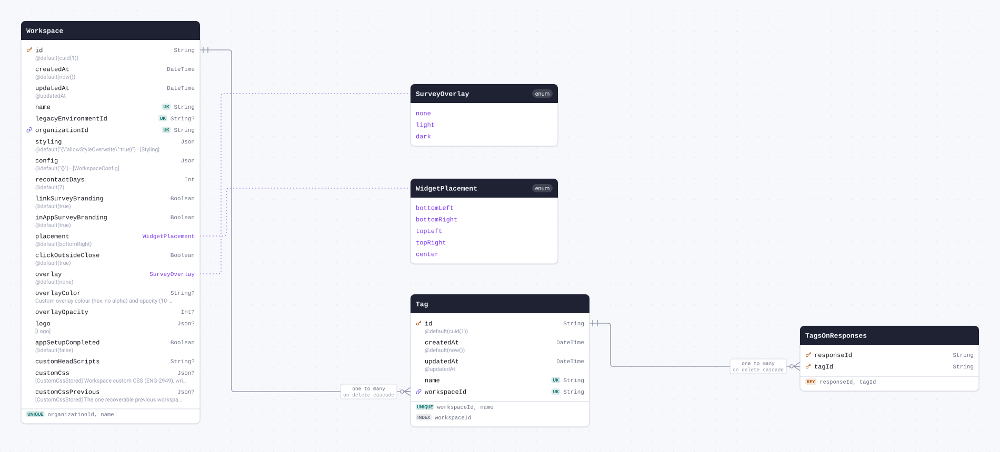

| Field                      | Type       | Constraints                                 | Default      | Description |
| -------------------------- | ---------- | ------------------------------------------- | ------------ | ----------- |
| `id`                       | `String`   | PK NOT NULL                                 | `cuid(1)`    |             |
| `createdAt` (`created_at`) | `DateTime` | NOT NULL                                    | `now()`      |             |
| `updatedAt` (`updated_at`) | `DateTime` | NOT NULL                                    | `@updatedAt` |             |
| `name`                     | `String`   | NOT NULL                                    |              |             |
| `workspaceId`              | `String`   | NOT NULL → [Workspace.id](#model-Workspace) |              |             |

#### Indexes

- `@@index([workspaceId])`
- `@@unique([workspaceId, name])`

#### References

- `workspaceId` → [Workspace.id](#model-Workspace) (many-to-one, on delete Cascade)

#### Referenced by

- `id` ← [TagsOnResponses.tagId](#model-TagsOnResponses) (one-to-many, on delete Cascade)

#### Definition

```sql
CREATE TABLE "Tag" (
    "id" TEXT NOT NULL,
    "created_at" TIMESTAMP(3) NOT NULL DEFAULT CURRENT_TIMESTAMP,
    "updated_at" TIMESTAMP(3) NOT NULL,
    "name" TEXT NOT NULL,
    "workspaceId" TEXT NOT NULL,

    CONSTRAINT "Tag_pkey" PRIMARY KEY ("id")
);

CREATE INDEX "Tag_workspaceId_idx" ON "Tag"("workspaceId");

CREATE UNIQUE INDEX "Tag_workspaceId_name_key" ON "Tag"("workspaceId", "name");

ALTER TABLE "Tag" ADD CONSTRAINT "Tag_workspaceId_fkey" FOREIGN KEY ("workspaceId") REFERENCES "Workspace"("id") ON DELETE CASCADE ON UPDATE CASCADE;
```

<details>
<summary>Queries and their SQL</summary>

**findMany**: Every row

```ts
await prisma.tag.findMany();
```

```sql
SELECT
  "public"."Tag"."id",
  "public"."Tag"."created_at",
  "public"."Tag"."updated_at",
  "public"."Tag"."name",
  "public"."Tag"."workspaceId"
FROM
  "public"."Tag"
WHERE
  1 = 1
OFFSET
  $1
-- params: ["0"]
```

**count**: How many rows there are

```ts
await prisma.tag.count();
```

```sql
SELECT
  COUNT(*) AS "_count$_all"
FROM
  (
    SELECT
      "public"."Tag"."id"
    FROM
      "public"."Tag"
    WHERE
      1 = 1
    OFFSET
      $1
  ) AS "sub"
-- params: ["0"]
```

**findMany**: Every row with its relations

```ts
await prisma.tag.findMany({ include: { responses: true, workspace: true } });
```

```sql
SELECT
  "public"."Tag"."id",
  "public"."Tag"."created_at",
  "public"."Tag"."updated_at",
  "public"."Tag"."name",
  "public"."Tag"."workspaceId"
FROM
  "public"."Tag"
WHERE
  1 = 1
OFFSET
  $1
-- params: ["0"]

SELECT
  "public"."TagsOnResponses"."responseId",
  "public"."TagsOnResponses"."tagId"
FROM
  "public"."TagsOnResponses"
WHERE
  "public"."TagsOnResponses"."tagId" IN ($1)
OFFSET
  $2
-- params: ["<id of the rows above>","0"]

SELECT
  "public"."Workspace"."id",
  "public"."Workspace"."created_at",
  "public"."Workspace"."updated_at",
  "public"."Workspace"."name",
  "public"."Workspace"."legacyEnvironmentId",
  "public"."Workspace"."organizationId",
  "public"."Workspace"."styling",
  "public"."Workspace"."config",
  "public"."Workspace"."recontactDays",
  "public"."Workspace"."linkSurveyBranding",
  "public"."Workspace"."inAppSurveyBranding",
  "public"."Workspace"."placement"::text,
  "public"."Workspace"."clickOutsideClose",
  "public"."Workspace"."overlay"::text,
  "public"."Workspace"."overlayColor",
  "public"."Workspace"."overlayOpacity",
  "public"."Workspace"."logo",
  "public"."Workspace"."appSetupCompleted",
  "public"."Workspace"."customHeadScripts",
  "public"."Workspace"."customCss",
  "public"."Workspace"."customCssPrevious"
FROM
  "public"."Workspace"
WHERE
  "public"."Workspace"."id" IN ($1)
OFFSET
  $2
-- params: ["<workspaceId of the rows above>","0"]
```

**findUnique**: One row by what is unique to it

```ts
await prisma.tag.findUnique({ where: { id: "example" } });
```

```sql
SELECT
  "public"."Tag"."id",
  "public"."Tag"."created_at",
  "public"."Tag"."updated_at",
  "public"."Tag"."name",
  "public"."Tag"."workspaceId"
FROM
  "public"."Tag"
WHERE
  (
    "public"."Tag"."id" = $1
    AND 1 = 1
  )
LIMIT
  $2
OFFSET
  $3
-- params: ["example","1","0"]
```

**create**: Create a row

```ts
await prisma.tag.create({ data: { name: "example", workspaceId: "example" } });
```

```sql
INSERT INTO
  "public"."Tag" (
    "id",
    "created_at",
    "updated_at",
    "name",
    "workspaceId"
  )
VALUES
  ($1, $2, $3, $4, $5)
RETURNING
  "public"."Tag"."id",
  "public"."Tag"."created_at",
  "public"."Tag"."updated_at",
  "public"."Tag"."name",
  "public"."Tag"."workspaceId"
-- params: ["<cuid(1)>","<now()>","<now()>","example","example"]
```

**update**: Update a row

```ts
await prisma.tag.update({
  where: { id: "example" },
  data: { createdAt: new Date("2026-01-01T00:00:00.000Z") },
});
```

```sql
UPDATE "public"."Tag"
SET
  "created_at" = $1,
  "updated_at" = $2
WHERE
  (
    "public"."Tag"."id" = $3
    AND 1 = 1
  )
RETURNING
  "public"."Tag"."id",
  "public"."Tag"."created_at",
  "public"."Tag"."updated_at",
  "public"."Tag"."name",
  "public"."Tag"."workspaceId"
-- params: ["2026-01-01T00:00:00.000Z",{"prisma__type":"generatorCall","prisma__value":{"name":"now","args":[],"returnType":{"type":"DateTime"}}},"example"]
```

**delete**: Delete a row

```ts
await prisma.tag.delete({ where: { id: "example" } });
```

```sql
DELETE FROM "public"."Tag"
WHERE
  (
    "public"."Tag"."id" = $1
    AND 1 = 1
  )
RETURNING
  "public"."Tag"."id",
  "public"."Tag"."created_at",
  "public"."Tag"."updated_at",
  "public"."Tag"."name",
  "public"."Tag"."workspaceId"
-- params: ["example"]
```

</details>

<a id="model-TagsOnResponses"></a>

### TagsOnResponses

Junction table linking tags to responses.
Enables many-to-many relationship between tags and responses.

@property response - The tagged response
@property tag - The tag applied to the response

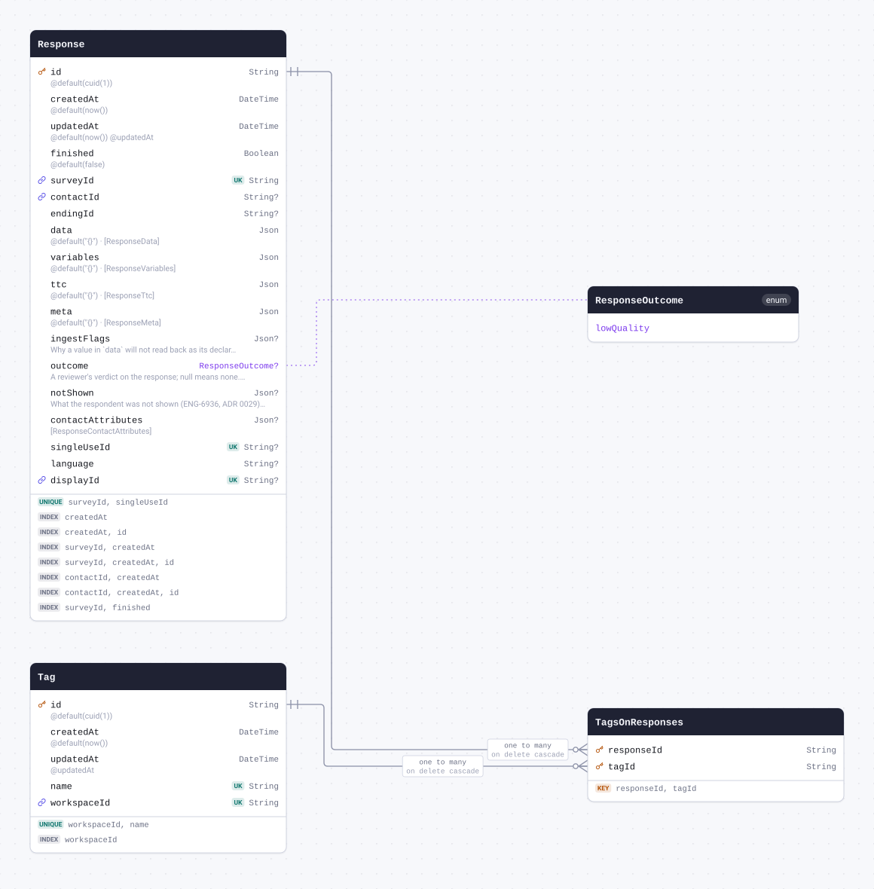

| Field        | Type     | Constraints                                  | Default | Description |
| ------------ | -------- | -------------------------------------------- | ------- | ----------- |
| `responseId` | `String` | PK NOT NULL → [Response.id](#model-Response) |         |             |
| `tagId`      | `String` | PK NOT NULL → [Tag.id](#model-Tag)           |         |             |

#### Indexes

- `@@id([responseId, tagId])`

#### References

- `responseId` → [Response.id](#model-Response) (many-to-one, on delete Cascade)
- `tagId` → [Tag.id](#model-Tag) (many-to-one, on delete Cascade)

#### Definition

```sql
CREATE TABLE "TagsOnResponses" (
    "responseId" TEXT NOT NULL,
    "tagId" TEXT NOT NULL,

    CONSTRAINT "TagsOnResponses_pkey" PRIMARY KEY ("responseId","tagId")
);

ALTER TABLE "TagsOnResponses" ADD CONSTRAINT "TagsOnResponses_responseId_fkey" FOREIGN KEY ("responseId") REFERENCES "Response"("id") ON DELETE CASCADE ON UPDATE CASCADE;

ALTER TABLE "TagsOnResponses" ADD CONSTRAINT "TagsOnResponses_tagId_fkey" FOREIGN KEY ("tagId") REFERENCES "Tag"("id") ON DELETE CASCADE ON UPDATE CASCADE;
```

<details>
<summary>Queries and their SQL</summary>

**findMany**: Every row

```ts
await prisma.tagsOnResponses.findMany();
```

```sql
SELECT
  "public"."TagsOnResponses"."responseId",
  "public"."TagsOnResponses"."tagId"
FROM
  "public"."TagsOnResponses"
WHERE
  1 = 1
OFFSET
  $1
-- params: ["0"]
```

**count**: How many rows there are

```ts
await prisma.tagsOnResponses.count();
```

```sql
SELECT
  COUNT(*) AS "_count$_all"
FROM
  (
    SELECT
      "public"."TagsOnResponses"."responseId",
      "public"."TagsOnResponses"."tagId"
    FROM
      "public"."TagsOnResponses"
    WHERE
      1 = 1
    OFFSET
      $1
  ) AS "sub"
-- params: ["0"]
```

**findMany**: Every row with its relations

```ts
await prisma.tagsOnResponses.findMany({ include: { response: true, tag: true } });
```

```sql
SELECT
  "public"."TagsOnResponses"."responseId",
  "public"."TagsOnResponses"."tagId"
FROM
  "public"."TagsOnResponses"
WHERE
  1 = 1
OFFSET
  $1
-- params: ["0"]

SELECT
  "public"."Response"."id",
  "public"."Response"."created_at",
  "public"."Response"."updated_at",
  "public"."Response"."finished",
  "public"."Response"."surveyId",
  "public"."Response"."contactId",
  "public"."Response"."endingId",
  "public"."Response"."data",
  "public"."Response"."variables",
  "public"."Response"."ttc",
  "public"."Response"."meta",
  "public"."Response"."ingest_flags",
  "public"."Response"."outcome"::text,
  "public"."Response"."not_shown",
  "public"."Response"."contactAttributes",
  "public"."Response"."singleUseId",
  "public"."Response"."language",
  "public"."Response"."displayId"
FROM
  "public"."Response"
WHERE
  "public"."Response"."id" IN ($1)
OFFSET
  $2
-- params: ["<responseId of the rows above>","0"]

SELECT
  "public"."Tag"."id",
  "public"."Tag"."created_at",
  "public"."Tag"."updated_at",
  "public"."Tag"."name",
  "public"."Tag"."workspaceId"
FROM
  "public"."Tag"
WHERE
  "public"."Tag"."id" IN ($1)
OFFSET
  $2
-- params: ["<tagId of the rows above>","0"]
```

**findUnique**: One row by what is unique to it

```ts
await prisma.tagsOnResponses.findUnique({
  where: { responseId_tagId: { responseId: "example", tagId: "example" } },
});
```

```sql
SELECT
  "public"."TagsOnResponses"."responseId",
  "public"."TagsOnResponses"."tagId"
FROM
  "public"."TagsOnResponses"
WHERE
  (
    (
      "public"."TagsOnResponses"."responseId" = $1
      AND "public"."TagsOnResponses"."tagId" = $2
    )
    AND 1 = 1
  )
LIMIT
  $3
OFFSET
  $4
-- params: ["example","example","1","0"]
```

**create**: Create a row

```ts
await prisma.tagsOnResponses.create({ data: { responseId: "example", tagId: "example" } });
```

```sql
INSERT INTO
  "public"."TagsOnResponses" ("responseId", "tagId")
VALUES
  ($1, $2)
RETURNING
  "public"."TagsOnResponses"."responseId",
  "public"."TagsOnResponses"."tagId"
-- params: ["example","example"]
```

**delete**: Delete a row

```ts
await prisma.tagsOnResponses.delete({
  where: { responseId_tagId: { responseId: "example", tagId: "example" } },
});
```

```sql
DELETE FROM "public"."TagsOnResponses"
WHERE
  (
    (
      "public"."TagsOnResponses"."responseId" = $1
      AND "public"."TagsOnResponses"."tagId" = $2
    )
    AND 1 = 1
  )
RETURNING
  "public"."TagsOnResponses"."responseId",
  "public"."TagsOnResponses"."tagId"
-- params: ["example","example"]
```

</details>

<a id="model-Display"></a>

### Display

Records when a survey is shown to a user.
Tracks survey display history and response status.

@property id - Unique identifier for the display event
@property survey - The survey that was displayed
@property contact - The contact who saw the survey
@property response - The associated response if one exists
@property creativeId - The creative that opened the survey. No foreign key, so the record survives the creative's deletion.

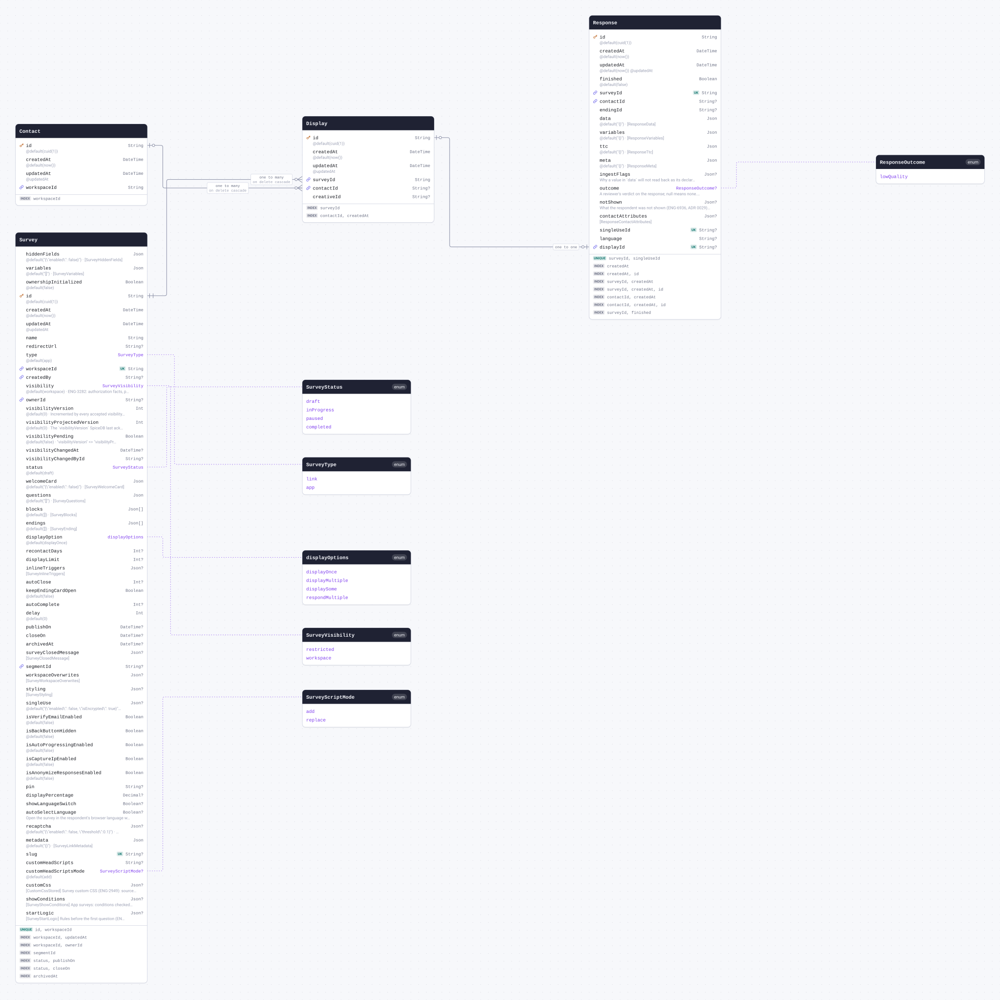

| Field                      | Type       | Constraints                           | Default      | Description |
| -------------------------- | ---------- | ------------------------------------- | ------------ | ----------- |
| `id`                       | `String`   | PK NOT NULL                           | `cuid(1)`    |             |
| `createdAt` (`created_at`) | `DateTime` | NOT NULL                              | `now()`      |             |
| `updatedAt` (`updated_at`) | `DateTime` | NOT NULL                              | `@updatedAt` |             |
| `surveyId`                 | `String`   | NOT NULL → [Survey.id](#model-Survey) |              |             |
| `contactId`                | `String`   | NULL → [Contact.id](#model-Contact)   |              |             |
| `creativeId`               | `String`   | NULL                                  |              |             |

#### Indexes

- `@@index([surveyId])`
- `@@index([contactId, createdAt])`

#### References

- `surveyId` → [Survey.id](#model-Survey) (many-to-one, on delete Cascade)
- `contactId` → [Contact.id](#model-Contact) (many-to-one, on delete Cascade)

#### Referenced by

- `id` ← [Response.displayId](#model-Response) (one-to-one)

#### Definition

```sql
CREATE TABLE "Display" (
    "id" TEXT NOT NULL,
    "created_at" TIMESTAMP(3) NOT NULL DEFAULT CURRENT_TIMESTAMP,
    "updated_at" TIMESTAMP(3) NOT NULL,
    "surveyId" TEXT NOT NULL,
    "contactId" TEXT,
    "creativeId" TEXT,

    CONSTRAINT "Display_pkey" PRIMARY KEY ("id")
);

CREATE INDEX "Display_surveyId_idx" ON "Display"("surveyId");

CREATE INDEX "Display_contactId_created_at_idx" ON "Display"("contactId", "created_at");

ALTER TABLE "Display" ADD CONSTRAINT "Display_surveyId_fkey" FOREIGN KEY ("surveyId") REFERENCES "Survey"("id") ON DELETE CASCADE ON UPDATE CASCADE;

ALTER TABLE "Display" ADD CONSTRAINT "Display_contactId_fkey" FOREIGN KEY ("contactId") REFERENCES "Contact"("id") ON DELETE CASCADE ON UPDATE CASCADE;
```

<details>
<summary>Queries and their SQL</summary>

**findMany**: Every row

```ts
await prisma.display.findMany();
```

```sql
SELECT
  "public"."Display"."id",
  "public"."Display"."created_at",
  "public"."Display"."updated_at",
  "public"."Display"."surveyId",
  "public"."Display"."contactId",
  "public"."Display"."creativeId"
FROM
  "public"."Display"
WHERE
  1 = 1
OFFSET
  $1
-- params: ["0"]
```

**count**: How many rows there are

```ts
await prisma.display.count();
```

```sql
SELECT
  COUNT(*) AS "_count$_all"
FROM
  (
    SELECT
      "public"."Display"."id"
    FROM
      "public"."Display"
    WHERE
      1 = 1
    OFFSET
      $1
  ) AS "sub"
-- params: ["0"]
```

**findMany**: Every row with its relations

```ts
await prisma.display.findMany({ include: { survey: true, contact: true, response: true } });
```

```sql
SELECT
  "public"."Display"."id",
  "public"."Display"."created_at",
  "public"."Display"."updated_at",
  "public"."Display"."surveyId",
  "public"."Display"."contactId",
  "public"."Display"."creativeId"
FROM
  "public"."Display"
WHERE
  1 = 1
OFFSET
  $1
-- params: ["0"]

SELECT
  "public"."Survey"."id",
  "public"."Survey"."hiddenFields",
  "public"."Survey"."variables",
  "public"."Survey"."ownershipInitialized",
  "public"."Survey"."created_at",
  "public"."Survey"."updated_at",
  "public"."Survey"."name",
  "public"."Survey"."redirectUrl",
  "public"."Survey"."type"::text,
  "public"."Survey"."workspaceId",
  "public"."Survey"."createdBy",
  "public"."Survey"."visibility"::text,
  "public"."Survey"."ownerId",
  "public"."Survey"."visibilityVersion",
  "public"."Survey"."visibilityProjectedVersion",
  "public"."Survey"."visibilityPending",
  "public"."Survey"."visibilityChangedAt",
  "public"."Survey"."visibilityChangedById",
  "public"."Survey"."status"::text,
  "public"."Survey"."welcomeCard",
  "public"."Survey"."questions",
  "public"."Survey"."blocks",
  "public"."Survey"."endings",
  "public"."Survey"."displayOption"::text,
  "public"."Survey"."recontactDays",
  "public"."Survey"."displayLimit",
  "public"."Survey"."inlineTriggers",
  "public"."Survey"."autoClose",
  "public"."Survey"."keepEndingCardOpen",
  "public"."Survey"."autoComplete",
  "public"."Survey"."delay",
  "public"."Survey"."publishOn",
  "public"."Survey"."closeOn",
  "public"."Survey"."archivedAt",
  "public"."Survey"."surveyClosedMessage",
  "public"."Survey"."segmentId",
  "public"."Survey"."workspaceOverwrites",
  "public"."Survey"."styling",
  "public"."Survey"."singleUse",
  "public"."Survey"."isVerifyEmailEnabled",
  "public"."Survey"."isBackButtonHidden",
  "public"."Survey"."isAutoProgressingEnabled",
  "public"."Survey"."isCaptureIpEnabled",
  "public"."Survey"."is_anonymize_responses_enabled",
  "public"."Survey"."pin",
  "public"."Survey"."displayPercentage",
  "public"."Survey"."showLanguageSwitch",
  "public"."Survey"."autoSelectLanguage",
  "public"."Survey"."recaptcha",
  "public"."Survey"."metadata",
  "public"."Survey"."slug",
  "public"."Survey"."customHeadScripts",
  "public"."Survey"."customHeadScriptsMode"::text,
  "public"."Survey"."customCss",
  "public"."Survey"."showConditions",
  "public"."Survey"."startLogic"
FROM
  "public"."Survey"
WHERE
  "public"."Survey"."id" IN ($1)
OFFSET
  $2
-- params: ["<surveyId of the rows above>","0"]

SELECT
  "public"."Contact"."id",
  "public"."Contact"."created_at",
  "public"."Contact"."updated_at",
  "public"."Contact"."workspaceId"
FROM
  "public"."Contact"
WHERE
  "public"."Contact"."id" IN ($1)
OFFSET
  $2
-- params: ["<contactId of the rows above>","0"]

SELECT
  "public"."Response"."id",
  "public"."Response"."created_at",
  "public"."Response"."updated_at",
  "public"."Response"."finished",
  "public"."Response"."surveyId",
  "public"."Response"."contactId",
  "public"."Response"."endingId",
  "public"."Response"."data",
  "public"."Response"."variables",
  "public"."Response"."ttc",
  "public"."Response"."meta",
  "public"."Response"."ingest_flags",
  "public"."Response"."outcome"::text,
  "public"."Response"."not_shown",
  "public"."Response"."contactAttributes",
  "public"."Response"."singleUseId",
  "public"."Response"."language",
  "public"."Response"."displayId"
FROM
  "public"."Response"
WHERE
  "public"."Response"."displayId" IN ($1)
OFFSET
  $2
-- params: ["<id of the rows above>","0"]
```

**findUnique**: One row by what is unique to it

```ts
await prisma.display.findUnique({ where: { id: "example" } });
```

```sql
SELECT
  "public"."Display"."id",
  "public"."Display"."created_at",
  "public"."Display"."updated_at",
  "public"."Display"."surveyId",
  "public"."Display"."contactId",
  "public"."Display"."creativeId"
FROM
  "public"."Display"
WHERE
  (
    "public"."Display"."id" = $1
    AND 1 = 1
  )
LIMIT
  $2
OFFSET
  $3
-- params: ["example","1","0"]
```

**create**: Create a row

```ts
await prisma.display.create({ data: { surveyId: "example" } });
```

```sql
INSERT INTO
  "public"."Display" ("id", "created_at", "updated_at", "surveyId")
VALUES
  ($1, $2, $3, $4)
RETURNING
  "public"."Display"."id",
  "public"."Display"."created_at",
  "public"."Display"."updated_at",
  "public"."Display"."surveyId",
  "public"."Display"."contactId",
  "public"."Display"."creativeId"
-- params: ["<cuid(1)>","<now()>","<now()>","example"]
```

**update**: Update a row

```ts
await prisma.display.update({
  where: { id: "example" },
  data: { createdAt: new Date("2026-01-01T00:00:00.000Z") },
});
```

```sql
UPDATE "public"."Display"
SET
  "created_at" = $1,
  "updated_at" = $2
WHERE
  (
    "public"."Display"."id" = $3
    AND 1 = 1
  )
RETURNING
  "public"."Display"."id",
  "public"."Display"."created_at",
  "public"."Display"."updated_at",
  "public"."Display"."surveyId",
  "public"."Display"."contactId",
  "public"."Display"."creativeId"
-- params: ["2026-01-01T00:00:00.000Z",{"prisma__type":"generatorCall","prisma__value":{"name":"now","args":[],"returnType":{"type":"DateTime"}}},"example"]
```

**delete**: Delete a row

```ts
await prisma.display.delete({ where: { id: "example" } });
```

```sql
DELETE FROM "public"."Display"
WHERE
  (
    "public"."Display"."id" = $1
    AND 1 = 1
  )
RETURNING
  "public"."Display"."id",
  "public"."Display"."created_at",
  "public"."Display"."updated_at",
  "public"."Display"."surveyId",
  "public"."Display"."contactId",
  "public"."Display"."creativeId"
-- params: ["example"]
```

</details>

<a id="model-SurveyTrigger"></a>

### SurveyTrigger

Links surveys to specific trigger actions.
Defines which user actions should cause a survey to be displayed.
This is the connection table between Surveys and ActionClasses that determines
when and under what conditions a survey should be triggered.

@property id - Unique identifier for the trigger
@property survey - The survey to be triggered
@property actionClass - The action that triggers the survey
@property createdAt - When the trigger was created
@property updatedAt - When the trigger was last modified

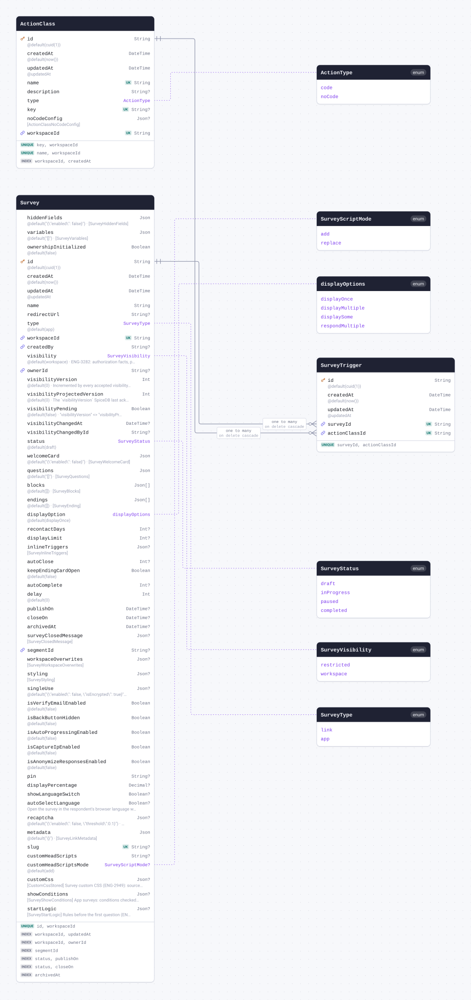

| Field                      | Type       | Constraints                                     | Default      | Description |
| -------------------------- | ---------- | ----------------------------------------------- | ------------ | ----------- |
| `id`                       | `String`   | PK NOT NULL                                     | `cuid(1)`    |             |
| `createdAt` (`created_at`) | `DateTime` | NOT NULL                                        | `now()`      |             |
| `updatedAt` (`updated_at`) | `DateTime` | NOT NULL                                        | `@updatedAt` |             |
| `surveyId`                 | `String`   | NOT NULL → [Survey.id](#model-Survey)           |              |             |
| `actionClassId`            | `String`   | NOT NULL → [ActionClass.id](#model-ActionClass) |              |             |

#### Indexes

- `@@unique([surveyId, actionClassId])`

#### References

- `surveyId` → [Survey.id](#model-Survey) (many-to-one, on delete Cascade)
- `actionClassId` → [ActionClass.id](#model-ActionClass) (many-to-one, on delete Cascade)

#### Definition

```sql
CREATE TABLE "SurveyTrigger" (
    "id" TEXT NOT NULL,
    "created_at" TIMESTAMP(3) NOT NULL DEFAULT CURRENT_TIMESTAMP,
    "updated_at" TIMESTAMP(3) NOT NULL,
    "surveyId" TEXT NOT NULL,
    "actionClassId" TEXT NOT NULL,

    CONSTRAINT "SurveyTrigger_pkey" PRIMARY KEY ("id")
);

CREATE UNIQUE INDEX "SurveyTrigger_surveyId_actionClassId_key" ON "SurveyTrigger"("surveyId", "actionClassId");

ALTER TABLE "SurveyTrigger" ADD CONSTRAINT "SurveyTrigger_surveyId_fkey" FOREIGN KEY ("surveyId") REFERENCES "Survey"("id") ON DELETE CASCADE ON UPDATE CASCADE;

ALTER TABLE "SurveyTrigger" ADD CONSTRAINT "SurveyTrigger_actionClassId_fkey" FOREIGN KEY ("actionClassId") REFERENCES "ActionClass"("id") ON DELETE CASCADE ON UPDATE CASCADE;
```

<details>
<summary>Queries and their SQL</summary>

**findMany**: Every row

```ts
await prisma.surveyTrigger.findMany();
```

```sql
SELECT
  "public"."SurveyTrigger"."id",
  "public"."SurveyTrigger"."created_at",
  "public"."SurveyTrigger"."updated_at",
  "public"."SurveyTrigger"."surveyId",
  "public"."SurveyTrigger"."actionClassId"
FROM
  "public"."SurveyTrigger"
WHERE
  1 = 1
OFFSET
  $1
-- params: ["0"]
```

**count**: How many rows there are

```ts
await prisma.surveyTrigger.count();
```

```sql
SELECT
  COUNT(*) AS "_count$_all"
FROM
  (
    SELECT
      "public"."SurveyTrigger"."id"
    FROM
      "public"."SurveyTrigger"
    WHERE
      1 = 1
    OFFSET
      $1
  ) AS "sub"
-- params: ["0"]
```

**findMany**: Every row with its relations

```ts
await prisma.surveyTrigger.findMany({ include: { survey: true, actionClass: true } });
```

```sql
SELECT
  "public"."SurveyTrigger"."id",
  "public"."SurveyTrigger"."created_at",
  "public"."SurveyTrigger"."updated_at",
  "public"."SurveyTrigger"."surveyId",
  "public"."SurveyTrigger"."actionClassId"
FROM
  "public"."SurveyTrigger"
WHERE
  1 = 1
OFFSET
  $1
-- params: ["0"]

SELECT
  "public"."Survey"."id",
  "public"."Survey"."hiddenFields",
  "public"."Survey"."variables",
  "public"."Survey"."ownershipInitialized",
  "public"."Survey"."created_at",
  "public"."Survey"."updated_at",
  "public"."Survey"."name",
  "public"."Survey"."redirectUrl",
  "public"."Survey"."type"::text,
  "public"."Survey"."workspaceId",
  "public"."Survey"."createdBy",
  "public"."Survey"."visibility"::text,
  "public"."Survey"."ownerId",
  "public"."Survey"."visibilityVersion",
  "public"."Survey"."visibilityProjectedVersion",
  "public"."Survey"."visibilityPending",
  "public"."Survey"."visibilityChangedAt",
  "public"."Survey"."visibilityChangedById",
  "public"."Survey"."status"::text,
  "public"."Survey"."welcomeCard",
  "public"."Survey"."questions",
  "public"."Survey"."blocks",
  "public"."Survey"."endings",
  "public"."Survey"."displayOption"::text,
  "public"."Survey"."recontactDays",
  "public"."Survey"."displayLimit",
  "public"."Survey"."inlineTriggers",
  "public"."Survey"."autoClose",
  "public"."Survey"."keepEndingCardOpen",
  "public"."Survey"."autoComplete",
  "public"."Survey"."delay",
  "public"."Survey"."publishOn",
  "public"."Survey"."closeOn",
  "public"."Survey"."archivedAt",
  "public"."Survey"."surveyClosedMessage",
  "public"."Survey"."segmentId",
  "public"."Survey"."workspaceOverwrites",
  "public"."Survey"."styling",
  "public"."Survey"."singleUse",
  "public"."Survey"."isVerifyEmailEnabled",
  "public"."Survey"."isBackButtonHidden",
  "public"."Survey"."isAutoProgressingEnabled",
  "public"."Survey"."isCaptureIpEnabled",
  "public"."Survey"."is_anonymize_responses_enabled",
  "public"."Survey"."pin",
  "public"."Survey"."displayPercentage",
  "public"."Survey"."showLanguageSwitch",
  "public"."Survey"."autoSelectLanguage",
  "public"."Survey"."recaptcha",
  "public"."Survey"."metadata",
  "public"."Survey"."slug",
  "public"."Survey"."customHeadScripts",
  "public"."Survey"."customHeadScriptsMode"::text,
  "public"."Survey"."customCss",
  "public"."Survey"."showConditions",
  "public"."Survey"."startLogic"
FROM
  "public"."Survey"
WHERE
  "public"."Survey"."id" IN ($1)
OFFSET
  $2
-- params: ["<surveyId of the rows above>","0"]

SELECT
  "public"."ActionClass"."id",
  "public"."ActionClass"."created_at",
  "public"."ActionClass"."updated_at",
  "public"."ActionClass"."name",
  "public"."ActionClass"."description",
  "public"."ActionClass"."type"::text,
  "public"."ActionClass"."key",
  "public"."ActionClass"."noCodeConfig",
  "public"."ActionClass"."workspaceId"
FROM
  "public"."ActionClass"
WHERE
  "public"."ActionClass"."id" IN ($1)
OFFSET
  $2
-- params: ["<actionClassId of the rows above>","0"]
```

**findUnique**: One row by what is unique to it

```ts
await prisma.surveyTrigger.findUnique({ where: { id: "example" } });
```

```sql
SELECT
  "public"."SurveyTrigger"."id",
  "public"."SurveyTrigger"."created_at",
  "public"."SurveyTrigger"."updated_at",
  "public"."SurveyTrigger"."surveyId",
  "public"."SurveyTrigger"."actionClassId"
FROM
  "public"."SurveyTrigger"
WHERE
  (
    "public"."SurveyTrigger"."id" = $1
    AND 1 = 1
  )
LIMIT
  $2
OFFSET
  $3
-- params: ["example","1","0"]
```

**create**: Create a row

```ts
await prisma.surveyTrigger.create({ data: { surveyId: "example", actionClassId: "example" } });
```

```sql
INSERT INTO
  "public"."SurveyTrigger" (
    "id",
    "created_at",
    "updated_at",
    "surveyId",
    "actionClassId"
  )
VALUES
  ($1, $2, $3, $4, $5)
RETURNING
  "public"."SurveyTrigger"."id",
  "public"."SurveyTrigger"."created_at",
  "public"."SurveyTrigger"."updated_at",
  "public"."SurveyTrigger"."surveyId",
  "public"."SurveyTrigger"."actionClassId"
-- params: ["<cuid(1)>","<now()>","<now()>","example","example"]
```

**update**: Update a row

```ts
await prisma.surveyTrigger.update({
  where: { id: "example" },
  data: { createdAt: new Date("2026-01-01T00:00:00.000Z") },
});
```

```sql
UPDATE "public"."SurveyTrigger"
SET
  "created_at" = $1,
  "updated_at" = $2
WHERE
  (
    "public"."SurveyTrigger"."id" = $3
    AND 1 = 1
  )
RETURNING
  "public"."SurveyTrigger"."id",
  "public"."SurveyTrigger"."created_at",
  "public"."SurveyTrigger"."updated_at",
  "public"."SurveyTrigger"."surveyId",
  "public"."SurveyTrigger"."actionClassId"
-- params: ["2026-01-01T00:00:00.000Z",{"prisma__type":"generatorCall","prisma__value":{"name":"now","args":[],"returnType":{"type":"DateTime"}}},"example"]
```

**delete**: Delete a row

```ts
await prisma.surveyTrigger.delete({ where: { id: "example" } });
```

```sql
DELETE FROM "public"."SurveyTrigger"
WHERE
  (
    "public"."SurveyTrigger"."id" = $1
    AND 1 = 1
  )
RETURNING
  "public"."SurveyTrigger"."id",
  "public"."SurveyTrigger"."created_at",
  "public"."SurveyTrigger"."updated_at",
  "public"."SurveyTrigger"."surveyId",
  "public"."SurveyTrigger"."actionClassId"
-- params: ["example"]
```

</details>

<a id="model-SurveyAttributeFilter"></a>

### SurveyAttributeFilter

Defines targeting rules for surveys based on contact attributes.
Used to show surveys only to contacts matching specific criteria.

@property id - Unique identifier for the filter
@property attributeKey - The contact attribute to filter on
@property survey - The survey being filtered
@property condition - The comparison operator to use
@property value - The value to compare against

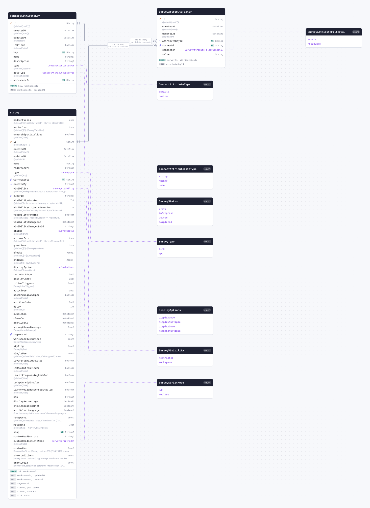

| Field                      | Type                                                                     | Constraints                                                     | Default      | Description |
| -------------------------- | ------------------------------------------------------------------------ | --------------------------------------------------------------- | ------------ | ----------- |
| `id`                       | `String`                                                                 | PK NOT NULL                                                     | `cuid(1)`    |             |
| `createdAt` (`created_at`) | `DateTime`                                                               | NOT NULL                                                        | `now()`      |             |
| `updatedAt` (`updated_at`) | `DateTime`                                                               | NOT NULL                                                        | `@updatedAt` |             |
| `attributeKeyId`           | `String`                                                                 | NOT NULL → [ContactAttributeKey.id](#model-ContactAttributeKey) |              |             |
| `surveyId`                 | `String`                                                                 | NOT NULL → [Survey.id](#model-Survey)                           |              |             |
| `condition`                | [`SurveyAttributeFilterCondition`](#enum-SurveyAttributeFilterCondition) | NOT NULL                                                        |              |             |
| `value`                    | `String`                                                                 | NOT NULL                                                        |              |             |

#### Indexes

- `@@index([attributeKeyId])`
- `@@unique([surveyId, attributeKeyId])`

#### References

- `attributeKeyId` → [ContactAttributeKey.id](#model-ContactAttributeKey) (many-to-one, on delete Cascade)
- `surveyId` → [Survey.id](#model-Survey) (many-to-one, on delete Cascade)

#### Definition

```sql
CREATE TABLE "SurveyAttributeFilter" (
    "id" TEXT NOT NULL,
    "created_at" TIMESTAMP(3) NOT NULL DEFAULT CURRENT_TIMESTAMP,
    "updated_at" TIMESTAMP(3) NOT NULL,
    "attributeKeyId" TEXT NOT NULL,
    "surveyId" TEXT NOT NULL,
    "condition" "SurveyAttributeFilterCondition" NOT NULL,
    "value" TEXT NOT NULL,

    CONSTRAINT "SurveyAttributeFilter_pkey" PRIMARY KEY ("id")
);

CREATE INDEX "SurveyAttributeFilter_attributeKeyId_idx" ON "SurveyAttributeFilter"("attributeKeyId");

CREATE UNIQUE INDEX "SurveyAttributeFilter_surveyId_attributeKeyId_key" ON "SurveyAttributeFilter"("surveyId", "attributeKeyId");

ALTER TABLE "SurveyAttributeFilter" ADD CONSTRAINT "SurveyAttributeFilter_attributeKeyId_fkey" FOREIGN KEY ("attributeKeyId") REFERENCES "ContactAttributeKey"("id") ON DELETE CASCADE ON UPDATE CASCADE;

ALTER TABLE "SurveyAttributeFilter" ADD CONSTRAINT "SurveyAttributeFilter_surveyId_fkey" FOREIGN KEY ("surveyId") REFERENCES "Survey"("id") ON DELETE CASCADE ON UPDATE CASCADE;
```

<details>
<summary>Queries and their SQL</summary>

**findMany**: Every row

```ts
await prisma.surveyAttributeFilter.findMany();
```

```sql
SELECT
  "public"."SurveyAttributeFilter"."id",
  "public"."SurveyAttributeFilter"."created_at",
  "public"."SurveyAttributeFilter"."updated_at",
  "public"."SurveyAttributeFilter"."attributeKeyId",
  "public"."SurveyAttributeFilter"."surveyId",
  "public"."SurveyAttributeFilter"."condition"::text,
  "public"."SurveyAttributeFilter"."value"
FROM
  "public"."SurveyAttributeFilter"
WHERE
  1 = 1
OFFSET
  $1
-- params: ["0"]
```

**count**: How many rows there are

```ts
await prisma.surveyAttributeFilter.count();
```

```sql
SELECT
  COUNT(*) AS "_count$_all"
FROM
  (
    SELECT
      "public"."SurveyAttributeFilter"."id"
    FROM
      "public"."SurveyAttributeFilter"
    WHERE
      1 = 1
    OFFSET
      $1
  ) AS "sub"
-- params: ["0"]
```

**findMany**: Every row with its relations

```ts
await prisma.surveyAttributeFilter.findMany({ include: { attributeKey: true, survey: true } });
```

```sql
SELECT
  "public"."SurveyAttributeFilter"."id",
  "public"."SurveyAttributeFilter"."created_at",
  "public"."SurveyAttributeFilter"."updated_at",
  "public"."SurveyAttributeFilter"."attributeKeyId",
  "public"."SurveyAttributeFilter"."surveyId",
  "public"."SurveyAttributeFilter"."condition"::text,
  "public"."SurveyAttributeFilter"."value"
FROM
  "public"."SurveyAttributeFilter"
WHERE
  1 = 1
OFFSET
  $1
-- params: ["0"]

SELECT
  "public"."ContactAttributeKey"."id",
  "public"."ContactAttributeKey"."created_at",
  "public"."ContactAttributeKey"."updated_at",
  "public"."ContactAttributeKey"."isUnique",
  "public"."ContactAttributeKey"."key",
  "public"."ContactAttributeKey"."name",
  "public"."ContactAttributeKey"."description",
  "public"."ContactAttributeKey"."type"::text,
  "public"."ContactAttributeKey"."dataType"::text,
  "public"."ContactAttributeKey"."workspaceId"
FROM
  "public"."ContactAttributeKey"
WHERE
  "public"."ContactAttributeKey"."id" IN ($1)
OFFSET
  $2
-- params: ["<attributeKeyId of the rows above>","0"]

SELECT
  "public"."Survey"."id",
  "public"."Survey"."hiddenFields",
  "public"."Survey"."variables",
  "public"."Survey"."ownershipInitialized",
  "public"."Survey"."created_at",
  "public"."Survey"."updated_at",
  "public"."Survey"."name",
  "public"."Survey"."redirectUrl",
  "public"."Survey"."type"::text,
  "public"."Survey"."workspaceId",
  "public"."Survey"."createdBy",
  "public"."Survey"."visibility"::text,
  "public"."Survey"."ownerId",
  "public"."Survey"."visibilityVersion",
  "public"."Survey"."visibilityProjectedVersion",
  "public"."Survey"."visibilityPending",
  "public"."Survey"."visibilityChangedAt",
  "public"."Survey"."visibilityChangedById",
  "public"."Survey"."status"::text,
  "public"."Survey"."welcomeCard",
  "public"."Survey"."questions",
  "public"."Survey"."blocks",
  "public"."Survey"."endings",
  "public"."Survey"."displayOption"::text,
  "public"."Survey"."recontactDays",
  "public"."Survey"."displayLimit",
  "public"."Survey"."inlineTriggers",
  "public"."Survey"."autoClose",
  "public"."Survey"."keepEndingCardOpen",
  "public"."Survey"."autoComplete",
  "public"."Survey"."delay",
  "public"."Survey"."publishOn",
  "public"."Survey"."closeOn",
  "public"."Survey"."archivedAt",
  "public"."Survey"."surveyClosedMessage",
  "public"."Survey"."segmentId",
  "public"."Survey"."workspaceOverwrites",
  "public"."Survey"."styling",
  "public"."Survey"."singleUse",
  "public"."Survey"."isVerifyEmailEnabled",
  "public"."Survey"."isBackButtonHidden",
  "public"."Survey"."isAutoProgressingEnabled",
  "public"."Survey"."isCaptureIpEnabled",
  "public"."Survey"."is_anonymize_responses_enabled",
  "public"."Survey"."pin",
  "public"."Survey"."displayPercentage",
  "public"."Survey"."showLanguageSwitch",
  "public"."Survey"."autoSelectLanguage",
  "public"."Survey"."recaptcha",
  "public"."Survey"."metadata",
  "public"."Survey"."slug",
  "public"."Survey"."customHeadScripts",
  "public"."Survey"."customHeadScriptsMode"::text,
  "public"."Survey"."customCss",
  "public"."Survey"."showConditions",
  "public"."Survey"."startLogic"
FROM
  "public"."Survey"
WHERE
  "public"."Survey"."id" IN ($1)
OFFSET
  $2
-- params: ["<surveyId of the rows above>","0"]
```

**findUnique**: One row by what is unique to it

```ts
await prisma.surveyAttributeFilter.findUnique({ where: { id: "example" } });
```

```sql
SELECT
  "public"."SurveyAttributeFilter"."id",
  "public"."SurveyAttributeFilter"."created_at",
  "public"."SurveyAttributeFilter"."updated_at",
  "public"."SurveyAttributeFilter"."attributeKeyId",
  "public"."SurveyAttributeFilter"."surveyId",
  "public"."SurveyAttributeFilter"."condition"::text,
  "public"."SurveyAttributeFilter"."value"
FROM
  "public"."SurveyAttributeFilter"
WHERE
  (
    "public"."SurveyAttributeFilter"."id" = $1
    AND 1 = 1
  )
LIMIT
  $2
OFFSET
  $3
-- params: ["example","1","0"]
```

**create**: Create a row

```ts
await prisma.surveyAttributeFilter.create({
  data: { attributeKeyId: "example", surveyId: "example", condition: "equals", value: "example" },
});
```

```sql
INSERT INTO
  "public"."SurveyAttributeFilter" (
    "id",
    "created_at",
    "updated_at",
    "attributeKeyId",
    "surveyId",
    "condition",
    "value"
  )
VALUES
  (
    $1,
    $2,
    $3,
    $4,
    $5,
    CAST(
      $6::text AS "public"."SurveyAttributeFilterCondition"
    ),
    $7
  )
RETURNING
  "public"."SurveyAttributeFilter"."id",
  "public"."SurveyAttributeFilter"."created_at",
  "public"."SurveyAttributeFilter"."updated_at",
  "public"."SurveyAttributeFilter"."attributeKeyId",
  "public"."SurveyAttributeFilter"."surveyId",
  "public"."SurveyAttributeFilter"."condition"::text,
  "public"."SurveyAttributeFilter"."value"
-- params: ["<cuid(1)>","<now()>","<now()>","example","example","equals","example"]
```

**update**: Update a row

```ts
await prisma.surveyAttributeFilter.update({
  where: { id: "example" },
  data: { createdAt: new Date("2026-01-01T00:00:00.000Z") },
});
```

```sql
UPDATE "public"."SurveyAttributeFilter"
SET
  "created_at" = $1,
  "updated_at" = $2
WHERE
  (
    "public"."SurveyAttributeFilter"."id" = $3
    AND 1 = 1
  )
RETURNING
  "public"."SurveyAttributeFilter"."id",
  "public"."SurveyAttributeFilter"."created_at",
  "public"."SurveyAttributeFilter"."updated_at",
  "public"."SurveyAttributeFilter"."attributeKeyId",
  "public"."SurveyAttributeFilter"."surveyId",
  "public"."SurveyAttributeFilter"."condition"::text,
  "public"."SurveyAttributeFilter"."value"
-- params: ["2026-01-01T00:00:00.000Z",{"prisma__type":"generatorCall","prisma__value":{"name":"now","args":[],"returnType":{"type":"DateTime"}}},"example"]
```

**delete**: Delete a row

```ts
await prisma.surveyAttributeFilter.delete({ where: { id: "example" } });
```

```sql
DELETE FROM "public"."SurveyAttributeFilter"
WHERE
  (
    "public"."SurveyAttributeFilter"."id" = $1
    AND 1 = 1
  )
RETURNING
  "public"."SurveyAttributeFilter"."id",
  "public"."SurveyAttributeFilter"."created_at",
  "public"."SurveyAttributeFilter"."updated_at",
  "public"."SurveyAttributeFilter"."attributeKeyId",
  "public"."SurveyAttributeFilter"."surveyId",
  "public"."SurveyAttributeFilter"."condition"::text,
  "public"."SurveyAttributeFilter"."value"
-- params: ["example"]
```

</details>

<a id="model-Survey"></a>

### Survey

Represents a complete survey configuration including questions, styling, and display rules.
Core model for the survey functionality in Formbricks.

@property id - Unique identifier for the survey
@property name - Display name of the survey
@property type - Survey delivery method (link, web, website, app)
@property status - Current state of the survey (draft, active, completed, etc)
@property workspace - The workspace this survey belongs to
@property questions - JSON array containing survey questions configuration
@property displayOption - Rules for how often the survey can be shown
@property triggers - Actions that can trigger this survey
@property attributeFilters - Rules for targeting specific contacts
@property customHeadScripts - Survey-specific custom HTML scripts (self-hosted only)
@property customHeadScriptsMode - "add" (merge with workspace) or "replace" (override workspace)

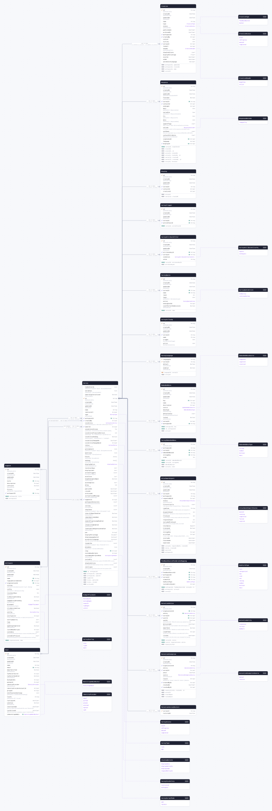

| Field                                                            | Type                                         | Constraints                                 | Default                                         | Description                                                                                                                                                                                                                                                               |
| ---------------------------------------------------------------- | -------------------------------------------- | ------------------------------------------- | ----------------------------------------------- | ------------------------------------------------------------------------------------------------------------------------------------------------------------------------------------------------------------------------------------------------------------------------- |
| `hiddenFields`                                                   | `Json`                                       | NOT NULL                                    | `"{\"enabled\": false}"`                        | [SurveyHiddenFields]                                                                                                                                                                                                                                                      |
| `variables`                                                      | `Json`                                       | NOT NULL                                    | `"[]"`                                          | [SurveyVariables]                                                                                                                                                                                                                                                         |
| `ownershipInitialized`                                           | `Boolean`                                    | NOT NULL                                    | `false`                                         |                                                                                                                                                                                                                                                                           |
| `id`                                                             | `String`                                     | PK NOT NULL                                 | `cuid(1)`                                       |                                                                                                                                                                                                                                                                           |
| `createdAt` (`created_at`)                                       | `DateTime`                                   | NOT NULL                                    | `now()`                                         |                                                                                                                                                                                                                                                                           |
| `updatedAt` (`updated_at`)                                       | `DateTime`                                   | NOT NULL                                    | `@updatedAt`                                    |                                                                                                                                                                                                                                                                           |
| `name`                                                           | `String`                                     | NOT NULL                                    |                                                 |                                                                                                                                                                                                                                                                           |
| `redirectUrl`                                                    | `String`                                     | NULL                                        |                                                 |                                                                                                                                                                                                                                                                           |
| `type`                                                           | [`SurveyType`](#enum-SurveyType)             | NOT NULL                                    | `app`                                           |                                                                                                                                                                                                                                                                           |
| `workspaceId`                                                    | `String`                                     | NOT NULL → [Workspace.id](#model-Workspace) |                                                 |                                                                                                                                                                                                                                                                           |
| `createdBy`                                                      | `String`                                     | NULL → [User.id](#model-User)               |                                                 |                                                                                                                                                                                                                                                                           |
| `visibility`                                                     | [`SurveyVisibility`](#enum-SurveyVisibility) | NOT NULL                                    | `workspace`                                     | ENG-3282: authorization facts, projected into SpiceDB by the survey outbox trigger. `ownerId` is the durable ownership source; `createdBy` stays pure attribution and is never rewritten.                                                                                 |
| `ownerId`                                                        | `String`                                     | NULL → [User.id](#model-User)               |                                                 |                                                                                                                                                                                                                                                                           |
| `visibilityVersion`                                              | `Int`                                        | NOT NULL                                    | `0`                                             | Incremented by every accepted visibility change; fences projection work. An INSERT starts at 0 with `visibilityProjectedVersion` -1 (the `survey_visibility_pending` trigger): the initial projection, decided from PostgreSQL facts until the projector acknowledges it. |
| `visibilityProjectedVersion`                                     | `Int`                                        | NOT NULL                                    | `0`                                             | The `visibilityVersion` SpiceDB last acknowledged; -1 while none ever was.                                                                                                                                                                                                |
| `visibilityPending`                                              | `Boolean`                                    | NOT NULL                                    | `false`                                         | "visibilityVersion" <> "visibilityProjectedVersion", kept by the `survey_visibility_pending` trigger (a BEFORE trigger overrides whatever an INSERT or UPDATE supplies). Read-only: never put it in create/update data.                                                   |
| `visibilityChangedAt`                                            | `DateTime`                                   | NULL                                        |                                                 |                                                                                                                                                                                                                                                                           |
| `visibilityChangedById`                                          | `String`                                     | NULL                                        |                                                 |                                                                                                                                                                                                                                                                           |
| `status`                                                         | [`SurveyStatus`](#enum-SurveyStatus)         | NOT NULL                                    | `draft`                                         |                                                                                                                                                                                                                                                                           |
| `welcomeCard`                                                    | `Json`                                       | NOT NULL                                    | `"{\"enabled\": false}"`                        | [SurveyWelcomeCard]                                                                                                                                                                                                                                                       |
| `questions`                                                      | `Json`                                       | NOT NULL                                    | `"[]"`                                          | [SurveyQuestions]                                                                                                                                                                                                                                                         |
| `blocks`                                                         | `Json[]`                                     | NOT NULL                                    | `[]`                                            | [SurveyBlocks]                                                                                                                                                                                                                                                            |
| `endings`                                                        | `Json[]`                                     | NOT NULL                                    | `[]`                                            | [SurveyEnding]                                                                                                                                                                                                                                                            |
| `displayOption`                                                  | [`displayOptions`](#enum-displayOptions)     | NOT NULL                                    | `displayOnce`                                   |                                                                                                                                                                                                                                                                           |
| `recontactDays`                                                  | `Int`                                        | NULL                                        |                                                 |                                                                                                                                                                                                                                                                           |
| `displayLimit`                                                   | `Int`                                        | NULL                                        |                                                 |                                                                                                                                                                                                                                                                           |
| `inlineTriggers`                                                 | `Json`                                       | NULL                                        |                                                 | [SurveyInlineTriggers]                                                                                                                                                                                                                                                    |
| `autoClose`                                                      | `Int`                                        | NULL                                        |                                                 |                                                                                                                                                                                                                                                                           |
| `keepEndingCardOpen`                                             | `Boolean`                                    | NOT NULL                                    | `false`                                         |                                                                                                                                                                                                                                                                           |
| `autoComplete`                                                   | `Int`                                        | NULL                                        |                                                 |                                                                                                                                                                                                                                                                           |
| `delay`                                                          | `Int`                                        | NOT NULL                                    | `0`                                             |                                                                                                                                                                                                                                                                           |
| `publishOn`                                                      | `DateTime`                                   | NULL                                        |                                                 |                                                                                                                                                                                                                                                                           |
| `closeOn`                                                        | `DateTime`                                   | NULL                                        |                                                 |                                                                                                                                                                                                                                                                           |
| `archivedAt`                                                     | `DateTime`                                   | NULL                                        |                                                 |                                                                                                                                                                                                                                                                           |
| `surveyClosedMessage`                                            | `Json`                                       | NULL                                        |                                                 | [SurveyClosedMessage]                                                                                                                                                                                                                                                     |
| `segmentId`                                                      | `String`                                     | NULL → [Segment.id](#model-Segment)         |                                                 |                                                                                                                                                                                                                                                                           |
| `workspaceOverwrites`                                            | `Json`                                       | NULL                                        |                                                 | [SurveyWorkspaceOverwrites]                                                                                                                                                                                                                                               |
| `styling`                                                        | `Json`                                       | NULL                                        |                                                 | [SurveyStyling]                                                                                                                                                                                                                                                           |
| `singleUse`                                                      | `Json`                                       | NULL                                        | `"{\"enabled\": false, \"isEncrypted\": true}"` | [SurveySingleUse]                                                                                                                                                                                                                                                         |
| `isVerifyEmailEnabled`                                           | `Boolean`                                    | NOT NULL                                    | `false`                                         |                                                                                                                                                                                                                                                                           |
| `isBackButtonHidden`                                             | `Boolean`                                    | NOT NULL                                    | `false`                                         |                                                                                                                                                                                                                                                                           |
| `isAutoProgressingEnabled`                                       | `Boolean`                                    | NOT NULL                                    | `false`                                         |                                                                                                                                                                                                                                                                           |
| `isCaptureIpEnabled`                                             | `Boolean`                                    | NOT NULL                                    | `false`                                         |                                                                                                                                                                                                                                                                           |
| `isAnonymizeResponsesEnabled` (`is_anonymize_responses_enabled`) | `Boolean`                                    | NOT NULL                                    | `false`                                         |                                                                                                                                                                                                                                                                           |
| `pin`                                                            | `String`                                     | NULL                                        |                                                 |                                                                                                                                                                                                                                                                           |
| `displayPercentage`                                              | `Decimal`                                    | NULL                                        |                                                 |                                                                                                                                                                                                                                                                           |
| `showLanguageSwitch`                                             | `Boolean`                                    | NULL                                        |                                                 |                                                                                                                                                                                                                                                                           |
| `autoSelectLanguage`                                             | `Boolean`                                    | NULL                                        |                                                 | Open the survey in the respondent's browser language when it matches an enabled survey language. Null on surveys that predate the setting, which reads as off.                                                                                                            |
| `recaptcha`                                                      | `Json`                                       | NULL                                        | `"{\"enabled\": false, \"threshold\":0.1}"`     | [SurveyRecaptcha]                                                                                                                                                                                                                                                         |
| `metadata`                                                       | `Json`                                       | NOT NULL                                    | `"{}"`                                          | [SurveyLinkMetadata]                                                                                                                                                                                                                                                      |
| `slug`                                                           | `String`                                     | UNIQUE NULL                                 |                                                 |                                                                                                                                                                                                                                                                           |
| `customHeadScripts`                                              | `String`                                     | NULL                                        |                                                 |                                                                                                                                                                                                                                                                           |
| `customHeadScriptsMode`                                          | [`SurveyScriptMode`](#enum-SurveyScriptMode) | NULL                                        | `add`                                           |                                                                                                                                                                                                                                                                           |
| `customCss`                                                      | `Json`                                       | NULL                                        |                                                 | [CustomCssStored] Survey custom CSS (ENG-2949): source plus trusted compiled output, written only by the shared custom CSS save service. null = no survey CSS. Kept outside `styling` (M2.07).                                                                            |
| `showConditions`                                                 | `Json`                                       | NULL                                        |                                                 | [SurveyShowConditions] App surveys: conditions checked in the browser when a trigger fires (ENG-3873). null = no conditions, which is what every existing survey keeps.                                                                                                   |
| `startLogic`                                                     | `Json`                                       | NULL                                        |                                                 | [SurveyStartLogic] Rules before the first question (ENG-6932): block-rule format, run by the survey on load. null = none, which is what every existing survey keeps.                                                                                                      |

#### Indexes

- `@@index([workspaceId, updatedAt])`
- `@@index([workspaceId, ownerId])`
- `@@index([segmentId])`
- `@@index([status, publishOn])`
- `@@index([status, closeOn])`
- `@@index([archivedAt])`
- `@@unique([id, workspaceId])`

#### References

- `workspaceId` → [Workspace.id](#model-Workspace) (many-to-one, on delete Cascade)
- `createdBy` → [User.id](#model-User) (many-to-one)
- `ownerId` → [User.id](#model-User) (many-to-one, on delete SetNull)
- `segmentId` → [Segment.id](#model-Segment) (many-to-one)

#### Referenced by

- `id` ← [Creative.surveyId](#model-Creative) (one-to-many, on delete NoAction, on update NoAction)
- `id` ← [Response.surveyId](#model-Response) (one-to-many, on delete Cascade)
- `id` ← [Display.surveyId](#model-Display) (one-to-many, on delete Cascade)
- `id` ← [SurveyTrigger.surveyId](#model-SurveyTrigger) (one-to-many, on delete Cascade)
- `id` ← [SurveyAttributeFilter.surveyId](#model-SurveyAttributeFilter) (one-to-many, on delete Cascade)
- `id` ← [SurveyQuota.surveyId](#model-SurveyQuota) (one-to-many, on delete Cascade)
- `id` ← [SurveyFollowUp.surveyId](#model-SurveyFollowUp) (one-to-many, on delete Cascade)
- `id` ← [SurveyLanguage.surveyId](#model-SurveyLanguage) (one-to-many, on delete Cascade)
- `id` ← [EmbeddedData.surveyId](#model-EmbeddedData) (one-to-many, on delete Cascade)
- `id` ← [SurveyEmbeddedData.surveyId](#model-SurveyEmbeddedData) (one-to-many, on delete Cascade)
- `id` ← [AttachmentExport.surveyId](#model-AttachmentExport) (one-to-many, on delete Cascade)
- `id` ← [FeedbackSourceFormbricksMapping.surveyId](#model-FeedbackSourceFormbricksMapping) (one-to-many, on delete Cascade)
- `id` ← [RetentionExemption.surveyId](#model-RetentionExemption) (one-to-many, on delete Cascade)
- `id` ← [RetentionNotice.surveyId](#model-RetentionNotice) (one-to-many, on delete Cascade)
- `id` ← [RetentionSurveyRestore.surveyId](#model-RetentionSurveyRestore) (one-to-one, on delete Cascade)

#### Definition

```sql
CREATE TABLE "Survey" (
    "hiddenFields" JSONB NOT NULL DEFAULT '{"enabled": false}',
    "variables" JSONB NOT NULL DEFAULT '[]',
    "ownershipInitialized" BOOLEAN NOT NULL DEFAULT false,
    "legacyEmbeddedDataBackup" JSONB,
    "id" TEXT NOT NULL,
    "created_at" TIMESTAMP(3) NOT NULL DEFAULT CURRENT_TIMESTAMP,
    "updated_at" TIMESTAMP(3) NOT NULL,
    "name" TEXT NOT NULL,
    "redirectUrl" TEXT,
    "type" "SurveyType" NOT NULL DEFAULT 'app',
    "workspaceId" TEXT NOT NULL,
    "createdBy" TEXT,
    "visibility" "SurveyVisibility" NOT NULL DEFAULT 'workspace',
    "ownerId" TEXT,
    "visibilityVersion" INTEGER NOT NULL DEFAULT 0,
    "visibilityProjectedVersion" INTEGER NOT NULL DEFAULT 0,
    "visibilityPending" BOOLEAN NOT NULL DEFAULT false,
    "visibilityChangedAt" TIMESTAMP(3),
    "visibilityChangedById" TEXT,
    "status" "SurveyStatus" NOT NULL DEFAULT 'draft',
    "welcomeCard" JSONB NOT NULL DEFAULT '{"enabled": false}',
    "questions" JSONB NOT NULL DEFAULT '[]',
    "blocks" JSONB[] DEFAULT ARRAY[]::JSONB[],
    "endings" JSONB[] DEFAULT ARRAY[]::JSONB[],
    "displayOption" "displayOptions" NOT NULL DEFAULT 'displayOnce',
    "recontactDays" INTEGER,
    "displayLimit" INTEGER,
    "inlineTriggers" JSONB,
    "autoClose" INTEGER,
    "keepEndingCardOpen" BOOLEAN NOT NULL DEFAULT false,
    "autoComplete" INTEGER,
    "delay" INTEGER NOT NULL DEFAULT 0,
    "publishOn" TIMESTAMP(3),
    "closeOn" TIMESTAMP(3),
    "archivedAt" TIMESTAMP(3),
    "surveyClosedMessage" JSONB,
    "segmentId" TEXT,
    "workspaceOverwrites" JSONB,
    "styling" JSONB,
    "singleUse" JSONB DEFAULT '{"enabled": false, "isEncrypted": true}',
    "isVerifyEmailEnabled" BOOLEAN NOT NULL DEFAULT false,
    "isBackButtonHidden" BOOLEAN NOT NULL DEFAULT false,
    "isAutoProgressingEnabled" BOOLEAN NOT NULL DEFAULT false,
    "isCaptureIpEnabled" BOOLEAN NOT NULL DEFAULT false,
    "is_anonymize_responses_enabled" BOOLEAN NOT NULL DEFAULT false,
    "pin" TEXT,
    "displayPercentage" DECIMAL(65,30),
    "showLanguageSwitch" BOOLEAN,
    "autoSelectLanguage" BOOLEAN,
    "recaptcha" JSONB DEFAULT '{"enabled": false, "threshold":0.1}',
    "metadata" JSONB NOT NULL DEFAULT '{}',
    "slug" TEXT,
    "customHeadScripts" TEXT,
    "customHeadScriptsMode" "SurveyScriptMode" DEFAULT 'add',
    "customCss" JSONB,
    "showConditions" JSONB,
    "startLogic" JSONB,

    CONSTRAINT "Survey_pkey" PRIMARY KEY ("id")
);

CREATE UNIQUE INDEX "Survey_slug_key" ON "Survey"("slug");

CREATE INDEX "Survey_workspaceId_updated_at_idx" ON "Survey"("workspaceId", "updated_at");

CREATE INDEX "Survey_workspaceId_ownerId_idx" ON "Survey"("workspaceId", "ownerId");

CREATE INDEX "Survey_segmentId_idx" ON "Survey"("segmentId");

CREATE INDEX "Survey_status_publishOn_idx" ON "Survey"("status", "publishOn");

CREATE INDEX "Survey_status_closeOn_idx" ON "Survey"("status", "closeOn");

CREATE INDEX "Survey_archivedAt_idx" ON "Survey"("archivedAt");

CREATE UNIQUE INDEX "Survey_id_workspaceId_key" ON "Survey"("id", "workspaceId");

ALTER TABLE "Survey" ADD CONSTRAINT "Survey_workspaceId_fkey" FOREIGN KEY ("workspaceId") REFERENCES "Workspace"("id") ON DELETE CASCADE ON UPDATE CASCADE;

ALTER TABLE "Survey" ADD CONSTRAINT "Survey_createdBy_fkey" FOREIGN KEY ("createdBy") REFERENCES "User"("id") ON DELETE SET NULL ON UPDATE CASCADE;

ALTER TABLE "Survey" ADD CONSTRAINT "Survey_ownerId_fkey" FOREIGN KEY ("ownerId") REFERENCES "User"("id") ON DELETE SET NULL ON UPDATE CASCADE;

ALTER TABLE "Survey" ADD CONSTRAINT "Survey_segmentId_fkey" FOREIGN KEY ("segmentId") REFERENCES "Segment"("id") ON DELETE SET NULL ON UPDATE CASCADE;
```

<details>
<summary>Queries and their SQL</summary>

**findMany**: Every row

```ts
await prisma.survey.findMany();
```

```sql
SELECT
  "public"."Survey"."id",
  "public"."Survey"."hiddenFields",
  "public"."Survey"."variables",
  "public"."Survey"."ownershipInitialized",
  "public"."Survey"."created_at",
  "public"."Survey"."updated_at",
  "public"."Survey"."name",
  "public"."Survey"."redirectUrl",
  "public"."Survey"."type"::text,
  "public"."Survey"."workspaceId",
  "public"."Survey"."createdBy",
  "public"."Survey"."visibility"::text,
  "public"."Survey"."ownerId",
  "public"."Survey"."visibilityVersion",
  "public"."Survey"."visibilityProjectedVersion",
  "public"."Survey"."visibilityPending",
  "public"."Survey"."visibilityChangedAt",
  "public"."Survey"."visibilityChangedById",
  "public"."Survey"."status"::text,
  "public"."Survey"."welcomeCard",
  "public"."Survey"."questions",
  "public"."Survey"."blocks",
  "public"."Survey"."endings",
  "public"."Survey"."displayOption"::text,
  "public"."Survey"."recontactDays",
  "public"."Survey"."displayLimit",
  "public"."Survey"."inlineTriggers",
  "public"."Survey"."autoClose",
  "public"."Survey"."keepEndingCardOpen",
  "public"."Survey"."autoComplete",
  "public"."Survey"."delay",
  "public"."Survey"."publishOn",
  "public"."Survey"."closeOn",
  "public"."Survey"."archivedAt",
  "public"."Survey"."surveyClosedMessage",
  "public"."Survey"."segmentId",
  "public"."Survey"."workspaceOverwrites",
  "public"."Survey"."styling",
  "public"."Survey"."singleUse",
  "public"."Survey"."isVerifyEmailEnabled",
  "public"."Survey"."isBackButtonHidden",
  "public"."Survey"."isAutoProgressingEnabled",
  "public"."Survey"."isCaptureIpEnabled",
  "public"."Survey"."is_anonymize_responses_enabled",
  "public"."Survey"."pin",
  "public"."Survey"."displayPercentage",
  "public"."Survey"."showLanguageSwitch",
  "public"."Survey"."autoSelectLanguage",
  "public"."Survey"."recaptcha",
  "public"."Survey"."metadata",
  "public"."Survey"."slug",
  "public"."Survey"."customHeadScripts",
  "public"."Survey"."customHeadScriptsMode"::text,
  "public"."Survey"."customCss",
  "public"."Survey"."showConditions",
  "public"."Survey"."startLogic"
FROM
  "public"."Survey"
WHERE
  1 = 1
OFFSET
  $1
-- params: ["0"]
```

**count**: How many rows there are

```ts
await prisma.survey.count();
```

```sql
SELECT
  COUNT(*) AS "_count$_all"
FROM
  (
    SELECT
      "public"."Survey"."id"
    FROM
      "public"."Survey"
    WHERE
      1 = 1
    OFFSET
      $1
  ) AS "sub"
-- params: ["0"]
```

**findMany**: Every row with its relations

```ts
await prisma.survey.findMany({
  include: {
    workspace: true,
    creator: true,
    owner: true,
    responses: true,
    quotas: true,
    triggers: true,
    attributeFilters: true,
    displays: true,
    segment: true,
    languages: true,
    embeddedData: true,
    embeddedDataLinks: true,
    followUps: true,
    feedbackSourceMappings: true,
    retentionExemptions: true,
    retentionNotices: true,
    retentionRestore: true,
    creatives: true,
    attachmentExports: true,
  },
});
```

```sql
SELECT
  "public"."Survey"."id",
  "public"."Survey"."hiddenFields",
  "public"."Survey"."variables",
  "public"."Survey"."ownershipInitialized",
  "public"."Survey"."created_at",
  "public"."Survey"."updated_at",
  "public"."Survey"."name",
  "public"."Survey"."redirectUrl",
  "public"."Survey"."type"::text,
  "public"."Survey"."workspaceId",
  "public"."Survey"."createdBy",
  "public"."Survey"."visibility"::text,
  "public"."Survey"."ownerId",
  "public"."Survey"."visibilityVersion",
  "public"."Survey"."visibilityProjectedVersion",
  "public"."Survey"."visibilityPending",
  "public"."Survey"."visibilityChangedAt",
  "public"."Survey"."visibilityChangedById",
  "public"."Survey"."status"::text,
  "public"."Survey"."welcomeCard",
  "public"."Survey"."questions",
  "public"."Survey"."blocks",
  "public"."Survey"."endings",
  "public"."Survey"."displayOption"::text,
  "public"."Survey"."recontactDays",
  "public"."Survey"."displayLimit",
  "public"."Survey"."inlineTriggers",
  "public"."Survey"."autoClose",
  "public"."Survey"."keepEndingCardOpen",
  "public"."Survey"."autoComplete",
  "public"."Survey"."delay",
  "public"."Survey"."publishOn",
  "public"."Survey"."closeOn",
  "public"."Survey"."archivedAt",
  "public"."Survey"."surveyClosedMessage",
  "public"."Survey"."segmentId",
  "public"."Survey"."workspaceOverwrites",
  "public"."Survey"."styling",
  "public"."Survey"."singleUse",
  "public"."Survey"."isVerifyEmailEnabled",
  "public"."Survey"."isBackButtonHidden",
  "public"."Survey"."isAutoProgressingEnabled",
  "public"."Survey"."isCaptureIpEnabled",
  "public"."Survey"."is_anonymize_responses_enabled",
  "public"."Survey"."pin",
  "public"."Survey"."displayPercentage",
  "public"."Survey"."showLanguageSwitch",
  "public"."Survey"."autoSelectLanguage",
  "public"."Survey"."recaptcha",
  "public"."Survey"."metadata",
  "public"."Survey"."slug",
  "public"."Survey"."customHeadScripts",
  "public"."Survey"."customHeadScriptsMode"::text,
  "public"."Survey"."customCss",
  "public"."Survey"."showConditions",
  "public"."Survey"."startLogic"
FROM
  "public"."Survey"
WHERE
  1 = 1
OFFSET
  $1
-- params: ["0"]

SELECT
  "public"."Workspace"."id",
  "public"."Workspace"."created_at",
  "public"."Workspace"."updated_at",
  "public"."Workspace"."name",
  "public"."Workspace"."legacyEnvironmentId",
  "public"."Workspace"."organizationId",
  "public"."Workspace"."styling",
  "public"."Workspace"."config",
  "public"."Workspace"."recontactDays",
  "public"."Workspace"."linkSurveyBranding",
  "public"."Workspace"."inAppSurveyBranding",
  "public"."Workspace"."placement"::text,
  "public"."Workspace"."clickOutsideClose",
  "public"."Workspace"."overlay"::text,
  "public"."Workspace"."overlayColor",
  "public"."Workspace"."overlayOpacity",
  "public"."Workspace"."logo",
  "public"."Workspace"."appSetupCompleted",
  "public"."Workspace"."customHeadScripts",
  "public"."Workspace"."customCss",
  "public"."Workspace"."customCssPrevious"
FROM
  "public"."Workspace"
WHERE
  "public"."Workspace"."id" IN ($1)
OFFSET
  $2
-- params: ["<workspaceId of the rows above>","0"]

SELECT
  "public"."User"."id",
  "public"."User"."created_at",
  "public"."User"."updated_at",
  "public"."User"."name",
  "public"."User"."email",
  "public"."User"."email_verified",
  "public"."User"."twoFactorSecret",
  "public"."User"."twoFactorEnabled",
  "public"."User"."backupCodes",
  "public"."User"."password",
  "public"."User"."identityProvider"::text,
  "public"."User"."identityProviderAccountId",
  "public"."User"."groupId",
  "public"."User"."notificationSettings",
  "public"."User"."locale",
  "public"."User"."lastLoginAt",
  "public"."User"."isActive",
  "public"."User"."reactivatedAt",
  "public"."User"."lastActiveAt",
  "public"."User"."isBootstrapAdmin"::text
FROM
  "public"."User"
WHERE
  "public"."User"."id" IN ($1)
OFFSET
  $2
-- params: ["<createdBy of the rows above>","0"]

SELECT
  "public"."User"."id",
  "public"."User"."created_at",
  "public"."User"."updated_at",
  "public"."User"."name",
  "public"."User"."email",
  "public"."User"."email_verified",
  "public"."User"."twoFactorSecret",
  "public"."User"."twoFactorEnabled",
  "public"."User"."backupCodes",
  "public"."User"."password",
  "public"."User"."identityProvider"::text,
  "public"."User"."identityProviderAccountId",
  "public"."User"."groupId",
  "public"."User"."notificationSettings",
  "public"."User"."locale",
  "public"."User"."lastLoginAt",
  "public"."User"."isActive",
  "public"."User"."reactivatedAt",
  "public"."User"."lastActiveAt",
  "public"."User"."isBootstrapAdmin"::text
FROM
  "public"."User"
WHERE
  "public"."User"."id" IN ($1)
OFFSET
  $2
-- params: ["<ownerId of the rows above>","0"]

SELECT
  "public"."Response"."id",
  "public"."Response"."created_at",
  "public"."Response"."updated_at",
  "public"."Response"."finished",
  "public"."Response"."surveyId",
  "public"."Response"."contactId",
  "public"."Response"."endingId",
  "public"."Response"."data",
  "public"."Response"."variables",
  "public"."Response"."ttc",
  "public"."Response"."meta",
  "public"."Response"."ingest_flags",
  "public"."Response"."outcome"::text,
  "public"."Response"."not_shown",
  "public"."Response"."contactAttributes",
  "public"."Response"."singleUseId",
  "public"."Response"."language",
  "public"."Response"."displayId"
FROM
  "public"."Response"
WHERE
  "public"."Response"."surveyId" IN ($1)
OFFSET
  $2
-- params: ["<id of the rows above>","0"]

SELECT
  "public"."SurveyQuota"."id",
  "public"."SurveyQuota"."created_at",
  "public"."SurveyQuota"."updated_at",
  "public"."SurveyQuota"."surveyId",
  "public"."SurveyQuota"."name",
  "public"."SurveyQuota"."limit",
  "public"."SurveyQuota"."logic",
  "public"."SurveyQuota"."action"::text,
  "public"."SurveyQuota"."endingCardId",
  "public"."SurveyQuota"."countPartialSubmissions"
FROM
  "public"."SurveyQuota"
WHERE
  "public"."SurveyQuota"."surveyId" IN ($1)
OFFSET
  $2
-- params: ["<id of the rows above>","0"]

SELECT
  "public"."SurveyTrigger"."id",
  "public"."SurveyTrigger"."created_at",
  "public"."SurveyTrigger"."updated_at",
  "public"."SurveyTrigger"."surveyId",
  "public"."SurveyTrigger"."actionClassId"
FROM
  "public"."SurveyTrigger"
WHERE
  "public"."SurveyTrigger"."surveyId" IN ($1)
OFFSET
  $2
-- params: ["<id of the rows above>","0"]

SELECT
  "public"."SurveyAttributeFilter"."id",
  "public"."SurveyAttributeFilter"."created_at",
  "public"."SurveyAttributeFilter"."updated_at",
  "public"."SurveyAttributeFilter"."attributeKeyId",
  "public"."SurveyAttributeFilter"."surveyId",
  "public"."SurveyAttributeFilter"."condition"::text,
  "public"."SurveyAttributeFilter"."value"
FROM
  "public"."SurveyAttributeFilter"
WHERE
  "public"."SurveyAttributeFilter"."surveyId" IN ($1)
OFFSET
  $2
-- params: ["<id of the rows above>","0"]

SELECT
  "public"."Display"."id",
  "public"."Display"."created_at",
  "public"."Display"."updated_at",
  "public"."Display"."surveyId",
  "public"."Display"."contactId",
  "public"."Display"."creativeId"
FROM
  "public"."Display"
WHERE
  "public"."Display"."surveyId" IN ($1)
OFFSET
  $2
-- params: ["<id of the rows above>","0"]

SELECT
  "public"."Segment"."id",
  "public"."Segment"."created_at",
  "public"."Segment"."updated_at",
  "public"."Segment"."title",
  "public"."Segment"."description",
  "public"."Segment"."isPrivate",
  "public"."Segment"."filters",
  "public"."Segment"."workspaceId"
FROM
  "public"."Segment"
WHERE
  "public"."Segment"."id" IN ($1)
OFFSET
  $2
-- params: ["<segmentId of the rows above>","0"]

SELECT
  "public"."SurveyLanguage"."languageId",
  "public"."SurveyLanguage"."surveyId",
  "public"."SurveyLanguage"."default",
  "public"."SurveyLanguage"."enabled"
FROM
  "public"."SurveyLanguage"
WHERE
  "public"."SurveyLanguage"."surveyId" IN ($1)
OFFSET
  $2
-- params: ["<id of the rows above>","0"]

SELECT
  "public"."EmbeddedData"."id",
  "public"."EmbeddedData"."created_at",
  "public"."EmbeddedData"."updated_at",
  "public"."EmbeddedData"."key",
  "public"."EmbeddedData"."name",
  "public"."EmbeddedData"."description",
  "public"."EmbeddedData"."source"::text,
  "public"."EmbeddedData"."dataType"::text,
  "public"."EmbeddedData"."defaultValue",
  "public"."EmbeddedData"."locked",
  "public"."EmbeddedData"."surveyId",
  "public"."EmbeddedData"."workspaceId"
FROM
  "public"."EmbeddedData"
WHERE
  (
    "public"."EmbeddedData"."surveyId" IN ($1)
    AND "public"."EmbeddedData"."workspaceId" IN ($2)
  )
OFFSET
  $3
-- params: ["<id of the rows above>","<workspaceId of the rows above>","0"]

SELECT
  "public"."SurveyEmbeddedData"."id",
  "public"."SurveyEmbeddedData"."workspaceId",
  "public"."SurveyEmbeddedData"."surveyId",
  "public"."SurveyEmbeddedData"."embeddedDataId",
  "public"."SurveyEmbeddedData"."storageKey",
  "public"."SurveyEmbeddedData"."order"
FROM
  "public"."SurveyEmbeddedData"
WHERE
  (
    "public"."SurveyEmbeddedData"."workspaceId" IN ($1)
    AND "public"."SurveyEmbeddedData"."surveyId" IN ($2)
  )
OFFSET
  $3
-- params: ["<workspaceId of the rows above>","<id of the rows above>","0"]

SELECT
  "public"."SurveyFollowUp"."id",
  "public"."SurveyFollowUp"."created_at",
  "public"."SurveyFollowUp"."updated_at",
  "public"."SurveyFollowUp"."surveyId",
  "public"."SurveyFollowUp"."name",
  "public"."SurveyFollowUp"."trigger",
  "public"."SurveyFollowUp"."action"
FROM
  "public"."SurveyFollowUp"
WHERE
  "public"."SurveyFollowUp"."surveyId" IN ($1)
OFFSET
  $2
-- params: ["<id of the rows above>","0"]

SELECT
  "public"."FeedbackSourceFormbricksMapping"."id",
  "public"."FeedbackSourceFormbricksMapping"."created_at",
  "public"."FeedbackSourceFormbricksMapping"."feedback_source_id",
  "public"."FeedbackSourceFormbricksMapping"."workspaceId",
  "public"."FeedbackSourceFormbricksMapping"."surveyId",
  "public"."FeedbackSourceFormbricksMapping"."elementId",
  "public"."FeedbackSourceFormbricksMapping"."hubFieldType"::text,
  "public"."FeedbackSourceFormbricksMapping"."custom_field_label"
FROM
  "public"."FeedbackSourceFormbricksMapping"
WHERE
  (
    "public"."FeedbackSourceFormbricksMapping"."workspaceId" IN ($1)
    AND "public"."FeedbackSourceFormbricksMapping"."surveyId" IN ($2)
  )
OFFSET
  $3
-- params: ["<workspaceId of the rows above>","<id of the rows above>","0"]

SELECT
  "public"."RetentionExemption"."id",
  "public"."RetentionExemption"."created_at",
  "public"."RetentionExemption"."organizationId",
  "public"."RetentionExemption"."entity"::text,
  "public"."RetentionExemption"."surveyId",
  "public"."RetentionExemption"."until",
  "public"."RetentionExemption"."source"::text,
  "public"."RetentionExemption"."reason",
  "public"."RetentionExemption"."createdById",
  "public"."RetentionExemption"."revokedAt",
  "public"."RetentionExemption"."revokedById"
FROM
  "public"."RetentionExemption"
WHERE
  "public"."RetentionExemption"."surveyId" IN ($1)
OFFSET
  $2
-- params: ["<id of the rows above>","0"]

SELECT
  "public"."RetentionNotice"."id",
  "public"."RetentionNotice"."organizationId",
  "public"."RetentionNotice"."entity"::text,
  "public"."RetentionNotice"."surveyId",
  "public"."RetentionNotice"."userId",
  "public"."RetentionNotice"."sentAt",
  "public"."RetentionNotice"."deliveredAt",
  "public"."RetentionNotice"."emailSent",
  "public"."RetentionNotice"."claimToken",
  "public"."RetentionNotice"."clockAt"
FROM
  "public"."RetentionNotice"
WHERE
  "public"."RetentionNotice"."surveyId" IN ($1)
OFFSET
  $2
-- params: ["<id of the rows above>","0"]

SELECT
  "public"."RetentionSurveyRestore"."surveyId",
  "public"."RetentionSurveyRestore"."restoredAt"
FROM
  "public"."RetentionSurveyRestore"
WHERE
  "public"."RetentionSurveyRestore"."surveyId" IN ($1)
OFFSET
  $2
-- params: ["<id of the rows above>","0"]

SELECT
  "public"."Creative"."id",
  "public"."Creative"."created_at",
  "public"."Creative"."updated_at",
  "public"."Creative"."name",
  "public"."Creative"."type"::text,
  "public"."Creative"."status"::text,
  "public"."Creative"."publishedAt",
  "public"."Creative"."archivedAt",
  "public"."Creative"."workspaceId",
  "public"."Creative"."createdBy",
  "public"."Creative"."content",
  "public"."Creative"."styling",
  "public"."Creative"."surveyId",
  "public"."Creative"."linkUrl",
  "public"."Creative"."showOn"::text,
  "public"."Creative"."showConditions",
  "public"."Creative"."displayPercentage",
  "public"."Creative"."startAt",
  "public"."Creative"."endAt",
  "public"."Creative"."autoSelectLanguage"
FROM
  "public"."Creative"
WHERE
  (
    "public"."Creative"."workspaceId" IN ($1)
    AND "public"."Creative"."surveyId" IN ($2)
  )
OFFSET
  $3
-- params: ["<workspaceId of the rows above>","<id of the rows above>","0"]

SELECT
  "public"."AttachmentExport"."id",
  "public"."AttachmentExport"."created_at",
  "public"."AttachmentExport"."updated_at",
  "public"."AttachmentExport"."surveyId",
  "public"."AttachmentExport"."workspaceId",
  "public"."AttachmentExport"."requestedById",
  "public"."AttachmentExport"."status"::text,
  "public"."AttachmentExport"."filterCriteria",
  "public"."AttachmentExport"."timeZone",
  "public"."AttachmentExport"."dispatchCount",
  "public"."AttachmentExport"."fileCount",
  "public"."AttachmentExport"."responseCount",
  "public"."AttachmentExport"."includedFileCount",
  "public"."AttachmentExport"."totalBytes",
  "public"."AttachmentExport"."truncated",
  "public"."AttachmentExport"."storageKey",
  "public"."AttachmentExport"."errorCode",
  "public"."AttachmentExport"."startedAt",
  "public"."AttachmentExport"."finishedAt",
  "public"."AttachmentExport"."expiresAt"
FROM
  "public"."AttachmentExport"
WHERE
  (
    "public"."AttachmentExport"."surveyId" IN ($1)
    AND "public"."AttachmentExport"."workspaceId" IN ($2)
  )
OFFSET
  $3
-- params: ["<id of the rows above>","<workspaceId of the rows above>","0"]
```

**findUnique**: One row by what is unique to it

```ts
await prisma.survey.findUnique({ where: { id: "example" } });
```

```sql
SELECT
  "public"."Survey"."id",
  "public"."Survey"."hiddenFields",
  "public"."Survey"."variables",
  "public"."Survey"."ownershipInitialized",
  "public"."Survey"."created_at",
  "public"."Survey"."updated_at",
  "public"."Survey"."name",
  "public"."Survey"."redirectUrl",
  "public"."Survey"."type"::text,
  "public"."Survey"."workspaceId",
  "public"."Survey"."createdBy",
  "public"."Survey"."visibility"::text,
  "public"."Survey"."ownerId",
  "public"."Survey"."visibilityVersion",
  "public"."Survey"."visibilityProjectedVersion",
  "public"."Survey"."visibilityPending",
  "public"."Survey"."visibilityChangedAt",
  "public"."Survey"."visibilityChangedById",
  "public"."Survey"."status"::text,
  "public"."Survey"."welcomeCard",
  "public"."Survey"."questions",
  "public"."Survey"."blocks",
  "public"."Survey"."endings",
  "public"."Survey"."displayOption"::text,
  "public"."Survey"."recontactDays",
  "public"."Survey"."displayLimit",
  "public"."Survey"."inlineTriggers",
  "public"."Survey"."autoClose",
  "public"."Survey"."keepEndingCardOpen",
  "public"."Survey"."autoComplete",
  "public"."Survey"."delay",
  "public"."Survey"."publishOn",
  "public"."Survey"."closeOn",
  "public"."Survey"."archivedAt",
  "public"."Survey"."surveyClosedMessage",
  "public"."Survey"."segmentId",
  "public"."Survey"."workspaceOverwrites",
  "public"."Survey"."styling",
  "public"."Survey"."singleUse",
  "public"."Survey"."isVerifyEmailEnabled",
  "public"."Survey"."isBackButtonHidden",
  "public"."Survey"."isAutoProgressingEnabled",
  "public"."Survey"."isCaptureIpEnabled",
  "public"."Survey"."is_anonymize_responses_enabled",
  "public"."Survey"."pin",
  "public"."Survey"."displayPercentage",
  "public"."Survey"."showLanguageSwitch",
  "public"."Survey"."autoSelectLanguage",
  "public"."Survey"."recaptcha",
  "public"."Survey"."metadata",
  "public"."Survey"."slug",
  "public"."Survey"."customHeadScripts",
  "public"."Survey"."customHeadScriptsMode"::text,
  "public"."Survey"."customCss",
  "public"."Survey"."showConditions",
  "public"."Survey"."startLogic"
FROM
  "public"."Survey"
WHERE
  (
    "public"."Survey"."id" = $1
    AND 1 = 1
  )
LIMIT
  $2
OFFSET
  $3
-- params: ["example","1","0"]
```

**create**: Create a row

```ts
await prisma.survey.create({ data: { name: "example", workspaceId: "example" } });
```

```sql
INSERT INTO
  "public"."Survey" (
    "hiddenFields",
    "variables",
    "ownershipInitialized",
    "id",
    "created_at",
    "updated_at",
    "name",
    "type",
    "workspaceId",
    "visibility",
    "visibilityVersion",
    "visibilityProjectedVersion",
    "visibilityPending",
    "status",
    "welcomeCard",
    "questions",
    "blocks",
    "endings",
    "displayOption",
    "keepEndingCardOpen",
    "delay",
    "singleUse",
    "isVerifyEmailEnabled",
    "isBackButtonHidden",
    "isAutoProgressingEnabled",
    "isCaptureIpEnabled",
    "is_anonymize_responses_enabled",
    "recaptcha",
    "metadata",
    "customHeadScriptsMode"
  )
VALUES
  (
    $1,
    $2,
    $3,
    $4,
    $5,
    $6,
    $7,
    CAST($8::text AS "public"."SurveyType"),
    $9,
    CAST($10::text AS "public"."SurveyVisibility"),
    $11,
    $12,
    $13,
    CAST($14::text AS "public"."SurveyStatus"),
    $15,
    $16,
    $17,
    $18,
    CAST($19::text AS "public"."displayOptions"),
    $20,
    $21,
    $22,
    $23,
    $24,
    $25,
    $26,
    $27,
    $28,
    $29,
    CAST($30::text AS "public"."SurveyScriptMode")
  )
RETURNING
  "public"."Survey"."id",
  "public"."Survey"."hiddenFields",
  "public"."Survey"."variables",
  "public"."Survey"."ownershipInitialized",
  "public"."Survey"."created_at",
  "public"."Survey"."updated_at",
  "public"."Survey"."name",
  "public"."Survey"."redirectUrl",
  "public"."Survey"."type"::text,
  "public"."Survey"."workspaceId",
  "public"."Survey"."createdBy",
  "public"."Survey"."visibility"::text,
  "public"."Survey"."ownerId",
  "public"."Survey"."visibilityVersion",
  "public"."Survey"."visibilityProjectedVersion",
  "public"."Survey"."visibilityPending",
  "public"."Survey"."visibilityChangedAt",
  "public"."Survey"."visibilityChangedById",
  "public"."Survey"."status"::text,
  "public"."Survey"."welcomeCard",
  "public"."Survey"."questions",
  "public"."Survey"."blocks",
  "public"."Survey"."endings",
  "public"."Survey"."displayOption"::text,
  "public"."Survey"."recontactDays",
  "public"."Survey"."displayLimit",
  "public"."Survey"."inlineTriggers",
  "public"."Survey"."autoClose",
  "public"."Survey"."keepEndingCardOpen",
  "public"."Survey"."autoComplete",
  "public"."Survey"."delay",
  "public"."Survey"."publishOn",
  "public"."Survey"."closeOn",
  "public"."Survey"."archivedAt",
  "public"."Survey"."surveyClosedMessage",
  "public"."Survey"."segmentId",
  "public"."Survey"."workspaceOverwrites",
  "public"."Survey"."styling",
  "public"."Survey"."singleUse",
  "public"."Survey"."isVerifyEmailEnabled",
  "public"."Survey"."isBackButtonHidden",
  "public"."Survey"."isAutoProgressingEnabled",
  "public"."Survey"."isCaptureIpEnabled",
  "public"."Survey"."is_anonymize_responses_enabled",
  "public"."Survey"."pin",
  "public"."Survey"."displayPercentage",
  "public"."Survey"."showLanguageSwitch",
  "public"."Survey"."autoSelectLanguage",
  "public"."Survey"."recaptcha",
  "public"."Survey"."metadata",
  "public"."Survey"."slug",
  "public"."Survey"."customHeadScripts",
  "public"."Survey"."customHeadScriptsMode"::text,
  "public"."Survey"."customCss",
  "public"."Survey"."showConditions",
  "public"."Survey"."startLogic"
-- params: ["{\"enabled\":false}","[]",false,"<cuid(1)>","<now()>","<now()>","example","app","example","workspace","0","0",false,"draft","{\"enabled\":false}","[]",[],[],"displayOnce",false,"0","{\"enabled\":false,\"isEncrypted\":true}",false,false,false,false,false,"{\"enabled\":false,\"threshold\":0.1}","{}","add"]
```

**update**: Update a row

```ts
await prisma.survey.update({ where: { id: "example" }, data: { hiddenFields: {} } });
```

```sql
UPDATE "public"."Survey"
SET
  "hiddenFields" = $1,
  "updated_at" = $2
WHERE
  (
    "public"."Survey"."id" = $3
    AND 1 = 1
  )
RETURNING
  "public"."Survey"."id",
  "public"."Survey"."hiddenFields",
  "public"."Survey"."variables",
  "public"."Survey"."ownershipInitialized",
  "public"."Survey"."created_at",
  "public"."Survey"."updated_at",
  "public"."Survey"."name",
  "public"."Survey"."redirectUrl",
  "public"."Survey"."type"::text,
  "public"."Survey"."workspaceId",
  "public"."Survey"."createdBy",
  "public"."Survey"."visibility"::text,
  "public"."Survey"."ownerId",
  "public"."Survey"."visibilityVersion",
  "public"."Survey"."visibilityProjectedVersion",
  "public"."Survey"."visibilityPending",
  "public"."Survey"."visibilityChangedAt",
  "public"."Survey"."visibilityChangedById",
  "public"."Survey"."status"::text,
  "public"."Survey"."welcomeCard",
  "public"."Survey"."questions",
  "public"."Survey"."blocks",
  "public"."Survey"."endings",
  "public"."Survey"."displayOption"::text,
  "public"."Survey"."recontactDays",
  "public"."Survey"."displayLimit",
  "public"."Survey"."inlineTriggers",
  "public"."Survey"."autoClose",
  "public"."Survey"."keepEndingCardOpen",
  "public"."Survey"."autoComplete",
  "public"."Survey"."delay",
  "public"."Survey"."publishOn",
  "public"."Survey"."closeOn",
  "public"."Survey"."archivedAt",
  "public"."Survey"."surveyClosedMessage",
  "public"."Survey"."segmentId",
  "public"."Survey"."workspaceOverwrites",
  "public"."Survey"."styling",
  "public"."Survey"."singleUse",
  "public"."Survey"."isVerifyEmailEnabled",
  "public"."Survey"."isBackButtonHidden",
  "public"."Survey"."isAutoProgressingEnabled",
  "public"."Survey"."isCaptureIpEnabled",
  "public"."Survey"."is_anonymize_responses_enabled",
  "public"."Survey"."pin",
  "public"."Survey"."displayPercentage",
  "public"."Survey"."showLanguageSwitch",
  "public"."Survey"."autoSelectLanguage",
  "public"."Survey"."recaptcha",
  "public"."Survey"."metadata",
  "public"."Survey"."slug",
  "public"."Survey"."customHeadScripts",
  "public"."Survey"."customHeadScriptsMode"::text,
  "public"."Survey"."customCss",
  "public"."Survey"."showConditions",
  "public"."Survey"."startLogic"
-- params: ["{}",{"prisma__type":"generatorCall","prisma__value":{"name":"now","args":[],"returnType":{"type":"DateTime"}}},"example"]
```

**delete**: Delete a row

```ts
await prisma.survey.delete({ where: { id: "example" } });
```

```sql
DELETE FROM "public"."Survey"
WHERE
  (
    "public"."Survey"."id" = $1
    AND 1 = 1
  )
RETURNING
  "public"."Survey"."id",
  "public"."Survey"."hiddenFields",
  "public"."Survey"."variables",
  "public"."Survey"."ownershipInitialized",
  "public"."Survey"."created_at",
  "public"."Survey"."updated_at",
  "public"."Survey"."name",
  "public"."Survey"."redirectUrl",
  "public"."Survey"."type"::text,
  "public"."Survey"."workspaceId",
  "public"."Survey"."createdBy",
  "public"."Survey"."visibility"::text,
  "public"."Survey"."ownerId",
  "public"."Survey"."visibilityVersion",
  "public"."Survey"."visibilityProjectedVersion",
  "public"."Survey"."visibilityPending",
  "public"."Survey"."visibilityChangedAt",
  "public"."Survey"."visibilityChangedById",
  "public"."Survey"."status"::text,
  "public"."Survey"."welcomeCard",
  "public"."Survey"."questions",
  "public"."Survey"."blocks",
  "public"."Survey"."endings",
  "public"."Survey"."displayOption"::text,
  "public"."Survey"."recontactDays",
  "public"."Survey"."displayLimit",
  "public"."Survey"."inlineTriggers",
  "public"."Survey"."autoClose",
  "public"."Survey"."keepEndingCardOpen",
  "public"."Survey"."autoComplete",
  "public"."Survey"."delay",
  "public"."Survey"."publishOn",
  "public"."Survey"."closeOn",
  "public"."Survey"."archivedAt",
  "public"."Survey"."surveyClosedMessage",
  "public"."Survey"."segmentId",
  "public"."Survey"."workspaceOverwrites",
  "public"."Survey"."styling",
  "public"."Survey"."singleUse",
  "public"."Survey"."isVerifyEmailEnabled",
  "public"."Survey"."isBackButtonHidden",
  "public"."Survey"."isAutoProgressingEnabled",
  "public"."Survey"."isCaptureIpEnabled",
  "public"."Survey"."is_anonymize_responses_enabled",
  "public"."Survey"."pin",
  "public"."Survey"."displayPercentage",
  "public"."Survey"."showLanguageSwitch",
  "public"."Survey"."autoSelectLanguage",
  "public"."Survey"."recaptcha",
  "public"."Survey"."metadata",
  "public"."Survey"."slug",
  "public"."Survey"."customHeadScripts",
  "public"."Survey"."customHeadScriptsMode"::text,
  "public"."Survey"."customCss",
  "public"."Survey"."showConditions",
  "public"."Survey"."startLogic"
-- params: ["example"]
```

</details>

<a id="model-SurveyQuota"></a>

### SurveyQuota

Represents a quota configuration for a survey.
Defines response limits and conditions for quota management.

@property id - Unique identifier for the quota
@property survey - The survey this quota belongs to
@property name - Display name for the quota
@property limit - Maximum number of responses allowed
@property conditions - JSON object containing quota conditions
@property action - Action to take when quota is reached
@property endingCardId - Optional ending card to show when quota is reached

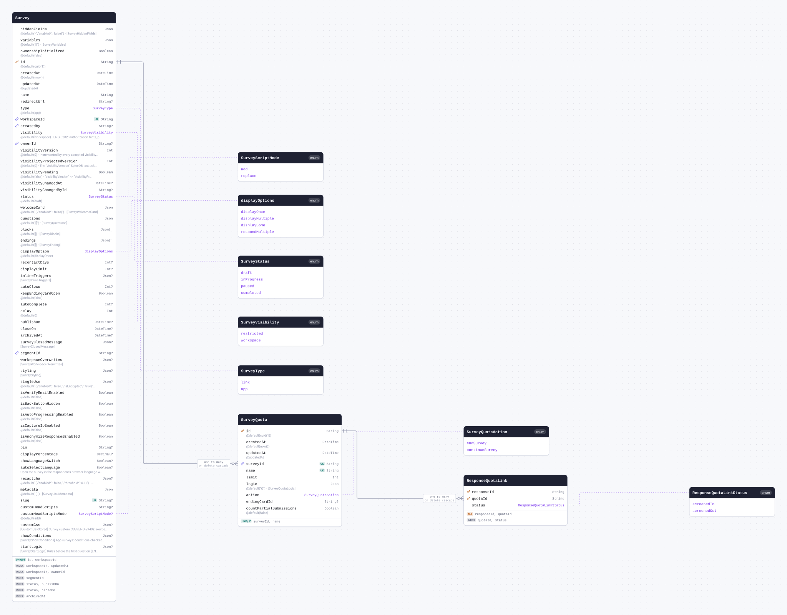

| Field                      | Type                                           | Constraints                           | Default      | Description        |
| -------------------------- | ---------------------------------------------- | ------------------------------------- | ------------ | ------------------ |
| `id`                       | `String`                                       | PK NOT NULL                           | `cuid(1)`    |                    |
| `createdAt` (`created_at`) | `DateTime`                                     | NOT NULL                              | `now()`      |                    |
| `updatedAt` (`updated_at`) | `DateTime`                                     | NOT NULL                              | `@updatedAt` |                    |
| `surveyId`                 | `String`                                       | NOT NULL → [Survey.id](#model-Survey) |              |                    |
| `name`                     | `String`                                       | NOT NULL                              |              |                    |
| `limit`                    | `Int`                                          | NOT NULL                              |              |                    |
| `logic`                    | `Json`                                         | NOT NULL                              | `"{}"`       | [SurveyQuotaLogic] |
| `action`                   | [`SurveyQuotaAction`](#enum-SurveyQuotaAction) | NOT NULL                              |              |                    |
| `endingCardId`             | `String`                                       | NULL                                  |              |                    |
| `countPartialSubmissions`  | `Boolean`                                      | NOT NULL                              | `false`      |                    |

#### Indexes

- `@@unique([surveyId, name])`

#### References

- `surveyId` → [Survey.id](#model-Survey) (many-to-one, on delete Cascade)

#### Referenced by

- `id` ← [ResponseQuotaLink.quotaId](#model-ResponseQuotaLink) (one-to-many, on delete Cascade)

#### Definition

```sql
CREATE TABLE "SurveyQuota" (
    "id" TEXT NOT NULL,
    "created_at" TIMESTAMP(3) NOT NULL DEFAULT CURRENT_TIMESTAMP,
    "updated_at" TIMESTAMP(3) NOT NULL,
    "surveyId" TEXT NOT NULL,
    "name" TEXT NOT NULL,
    "limit" INTEGER NOT NULL,
    "logic" JSONB NOT NULL DEFAULT '{}',
    "action" "SurveyQuotaAction" NOT NULL,
    "endingCardId" TEXT,
    "countPartialSubmissions" BOOLEAN NOT NULL DEFAULT false,

    CONSTRAINT "SurveyQuota_pkey" PRIMARY KEY ("id")
);

CREATE UNIQUE INDEX "SurveyQuota_surveyId_name_key" ON "SurveyQuota"("surveyId", "name");

ALTER TABLE "SurveyQuota" ADD CONSTRAINT "SurveyQuota_surveyId_fkey" FOREIGN KEY ("surveyId") REFERENCES "Survey"("id") ON DELETE CASCADE ON UPDATE CASCADE;
```

<details>
<summary>Queries and their SQL</summary>

**findMany**: Every row

```ts
await prisma.surveyQuota.findMany();
```

```sql
SELECT
  "public"."SurveyQuota"."id",
  "public"."SurveyQuota"."created_at",
  "public"."SurveyQuota"."updated_at",
  "public"."SurveyQuota"."surveyId",
  "public"."SurveyQuota"."name",
  "public"."SurveyQuota"."limit",
  "public"."SurveyQuota"."logic",
  "public"."SurveyQuota"."action"::text,
  "public"."SurveyQuota"."endingCardId",
  "public"."SurveyQuota"."countPartialSubmissions"
FROM
  "public"."SurveyQuota"
WHERE
  1 = 1
OFFSET
  $1
-- params: ["0"]
```

**count**: How many rows there are

```ts
await prisma.surveyQuota.count();
```

```sql
SELECT
  COUNT(*) AS "_count$_all"
FROM
  (
    SELECT
      "public"."SurveyQuota"."id"
    FROM
      "public"."SurveyQuota"
    WHERE
      1 = 1
    OFFSET
      $1
  ) AS "sub"
-- params: ["0"]
```

**findMany**: Every row with its relations

```ts
await prisma.surveyQuota.findMany({ include: { survey: true, quotaLinks: true } });
```

```sql
SELECT
  "public"."SurveyQuota"."id",
  "public"."SurveyQuota"."created_at",
  "public"."SurveyQuota"."updated_at",
  "public"."SurveyQuota"."surveyId",
  "public"."SurveyQuota"."name",
  "public"."SurveyQuota"."limit",
  "public"."SurveyQuota"."logic",
  "public"."SurveyQuota"."action"::text,
  "public"."SurveyQuota"."endingCardId",
  "public"."SurveyQuota"."countPartialSubmissions"
FROM
  "public"."SurveyQuota"
WHERE
  1 = 1
OFFSET
  $1
-- params: ["0"]

SELECT
  "public"."Survey"."id",
  "public"."Survey"."hiddenFields",
  "public"."Survey"."variables",
  "public"."Survey"."ownershipInitialized",
  "public"."Survey"."created_at",
  "public"."Survey"."updated_at",
  "public"."Survey"."name",
  "public"."Survey"."redirectUrl",
  "public"."Survey"."type"::text,
  "public"."Survey"."workspaceId",
  "public"."Survey"."createdBy",
  "public"."Survey"."visibility"::text,
  "public"."Survey"."ownerId",
  "public"."Survey"."visibilityVersion",
  "public"."Survey"."visibilityProjectedVersion",
  "public"."Survey"."visibilityPending",
  "public"."Survey"."visibilityChangedAt",
  "public"."Survey"."visibilityChangedById",
  "public"."Survey"."status"::text,
  "public"."Survey"."welcomeCard",
  "public"."Survey"."questions",
  "public"."Survey"."blocks",
  "public"."Survey"."endings",
  "public"."Survey"."displayOption"::text,
  "public"."Survey"."recontactDays",
  "public"."Survey"."displayLimit",
  "public"."Survey"."inlineTriggers",
  "public"."Survey"."autoClose",
  "public"."Survey"."keepEndingCardOpen",
  "public"."Survey"."autoComplete",
  "public"."Survey"."delay",
  "public"."Survey"."publishOn",
  "public"."Survey"."closeOn",
  "public"."Survey"."archivedAt",
  "public"."Survey"."surveyClosedMessage",
  "public"."Survey"."segmentId",
  "public"."Survey"."workspaceOverwrites",
  "public"."Survey"."styling",
  "public"."Survey"."singleUse",
  "public"."Survey"."isVerifyEmailEnabled",
  "public"."Survey"."isBackButtonHidden",
  "public"."Survey"."isAutoProgressingEnabled",
  "public"."Survey"."isCaptureIpEnabled",
  "public"."Survey"."is_anonymize_responses_enabled",
  "public"."Survey"."pin",
  "public"."Survey"."displayPercentage",
  "public"."Survey"."showLanguageSwitch",
  "public"."Survey"."autoSelectLanguage",
  "public"."Survey"."recaptcha",
  "public"."Survey"."metadata",
  "public"."Survey"."slug",
  "public"."Survey"."customHeadScripts",
  "public"."Survey"."customHeadScriptsMode"::text,
  "public"."Survey"."customCss",
  "public"."Survey"."showConditions",
  "public"."Survey"."startLogic"
FROM
  "public"."Survey"
WHERE
  "public"."Survey"."id" IN ($1)
OFFSET
  $2
-- params: ["<surveyId of the rows above>","0"]

SELECT
  "public"."ResponseQuotaLink"."responseId",
  "public"."ResponseQuotaLink"."quotaId",
  "public"."ResponseQuotaLink"."status"::text
FROM
  "public"."ResponseQuotaLink"
WHERE
  "public"."ResponseQuotaLink"."quotaId" IN ($1)
OFFSET
  $2
-- params: ["<id of the rows above>","0"]
```

**findUnique**: One row by what is unique to it

```ts
await prisma.surveyQuota.findUnique({ where: { id: "example" } });
```

```sql
SELECT
  "public"."SurveyQuota"."id",
  "public"."SurveyQuota"."created_at",
  "public"."SurveyQuota"."updated_at",
  "public"."SurveyQuota"."surveyId",
  "public"."SurveyQuota"."name",
  "public"."SurveyQuota"."limit",
  "public"."SurveyQuota"."logic",
  "public"."SurveyQuota"."action"::text,
  "public"."SurveyQuota"."endingCardId",
  "public"."SurveyQuota"."countPartialSubmissions"
FROM
  "public"."SurveyQuota"
WHERE
  (
    "public"."SurveyQuota"."id" = $1
    AND 1 = 1
  )
LIMIT
  $2
OFFSET
  $3
-- params: ["example","1","0"]
```

**create**: Create a row

```ts
await prisma.surveyQuota.create({
  data: { surveyId: "example", name: "example", limit: 1, action: "endSurvey" },
});
```

```sql
INSERT INTO
  "public"."SurveyQuota" (
    "id",
    "created_at",
    "updated_at",
    "surveyId",
    "name",
    "limit",
    "logic",
    "action",
    "countPartialSubmissions"
  )
VALUES
  (
    $1,
    $2,
    $3,
    $4,
    $5,
    $6,
    $7,
    CAST($8::text AS "public"."SurveyQuotaAction"),
    $9
  )
RETURNING
  "public"."SurveyQuota"."id",
  "public"."SurveyQuota"."created_at",
  "public"."SurveyQuota"."updated_at",
  "public"."SurveyQuota"."surveyId",
  "public"."SurveyQuota"."name",
  "public"."SurveyQuota"."limit",
  "public"."SurveyQuota"."logic",
  "public"."SurveyQuota"."action"::text,
  "public"."SurveyQuota"."endingCardId",
  "public"."SurveyQuota"."countPartialSubmissions"
-- params: ["<cuid(1)>","<now()>","<now()>","example","example","1","{}","endSurvey",false]
```

**update**: Update a row

```ts
await prisma.surveyQuota.update({
  where: { id: "example" },
  data: { createdAt: new Date("2026-01-01T00:00:00.000Z") },
});
```

```sql
UPDATE "public"."SurveyQuota"
SET
  "created_at" = $1,
  "updated_at" = $2
WHERE
  (
    "public"."SurveyQuota"."id" = $3
    AND 1 = 1
  )
RETURNING
  "public"."SurveyQuota"."id",
  "public"."SurveyQuota"."created_at",
  "public"."SurveyQuota"."updated_at",
  "public"."SurveyQuota"."surveyId",
  "public"."SurveyQuota"."name",
  "public"."SurveyQuota"."limit",
  "public"."SurveyQuota"."logic",
  "public"."SurveyQuota"."action"::text,
  "public"."SurveyQuota"."endingCardId",
  "public"."SurveyQuota"."countPartialSubmissions"
-- params: ["2026-01-01T00:00:00.000Z",{"prisma__type":"generatorCall","prisma__value":{"name":"now","args":[],"returnType":{"type":"DateTime"}}},"example"]
```

**delete**: Delete a row

```ts
await prisma.surveyQuota.delete({ where: { id: "example" } });
```

```sql
DELETE FROM "public"."SurveyQuota"
WHERE
  (
    "public"."SurveyQuota"."id" = $1
    AND 1 = 1
  )
RETURNING
  "public"."SurveyQuota"."id",
  "public"."SurveyQuota"."created_at",
  "public"."SurveyQuota"."updated_at",
  "public"."SurveyQuota"."surveyId",
  "public"."SurveyQuota"."name",
  "public"."SurveyQuota"."limit",
  "public"."SurveyQuota"."logic",
  "public"."SurveyQuota"."action"::text,
  "public"."SurveyQuota"."endingCardId",
  "public"."SurveyQuota"."countPartialSubmissions"
-- params: ["example"]
```

</details>

<a id="model-ResponseQuotaLink"></a>

### ResponseQuotaLink

Junction table linking responses to quotas.
Tracks which responses counted towards specific quotas and their status.

@property response - The response that counted towards the quota
@property quota - The quota this response counted towards
@property status - Whether the response was screened in or out

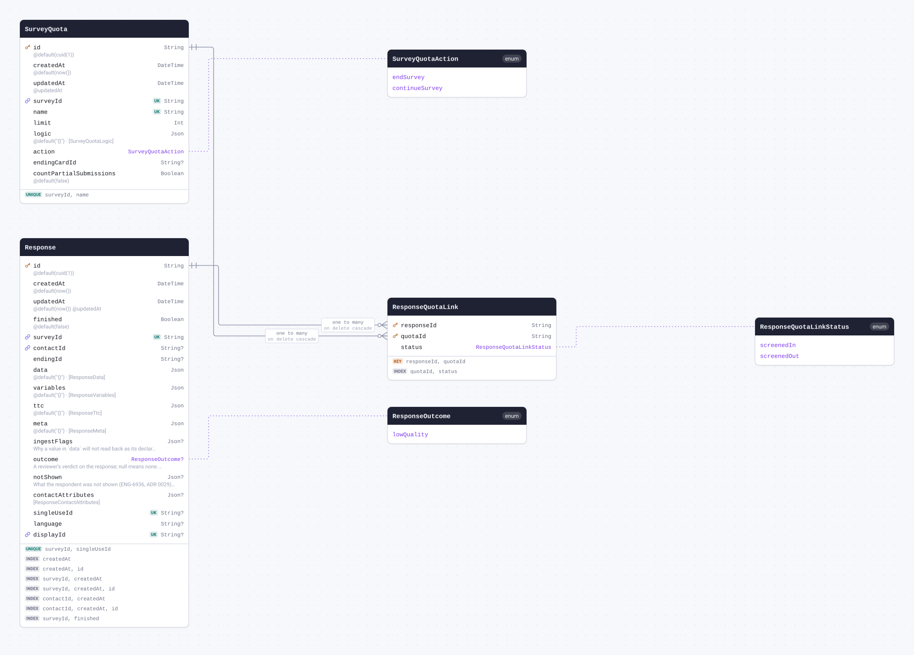

| Field        | Type                                                       | Constraints                                        | Default | Description |
| ------------ | ---------------------------------------------------------- | -------------------------------------------------- | ------- | ----------- |
| `responseId` | `String`                                                   | PK NOT NULL → [Response.id](#model-Response)       |         |             |
| `quotaId`    | `String`                                                   | PK NOT NULL → [SurveyQuota.id](#model-SurveyQuota) |         |             |
| `status`     | [`ResponseQuotaLinkStatus`](#enum-ResponseQuotaLinkStatus) | NOT NULL                                           |         |             |

#### Indexes

- `@@id([responseId, quotaId])`
- `@@index([quotaId, status])`

#### References

- `responseId` → [Response.id](#model-Response) (many-to-one, on delete Cascade)
- `quotaId` → [SurveyQuota.id](#model-SurveyQuota) (many-to-one, on delete Cascade)

#### Definition

```sql
CREATE TABLE "ResponseQuotaLink" (
    "responseId" TEXT NOT NULL,
    "quotaId" TEXT NOT NULL,
    "status" "ResponseQuotaLinkStatus" NOT NULL,

    CONSTRAINT "ResponseQuotaLink_pkey" PRIMARY KEY ("responseId","quotaId")
);

CREATE INDEX "ResponseQuotaLink_quotaId_status_idx" ON "ResponseQuotaLink"("quotaId", "status");

ALTER TABLE "ResponseQuotaLink" ADD CONSTRAINT "ResponseQuotaLink_responseId_fkey" FOREIGN KEY ("responseId") REFERENCES "Response"("id") ON DELETE CASCADE ON UPDATE CASCADE;

ALTER TABLE "ResponseQuotaLink" ADD CONSTRAINT "ResponseQuotaLink_quotaId_fkey" FOREIGN KEY ("quotaId") REFERENCES "SurveyQuota"("id") ON DELETE CASCADE ON UPDATE CASCADE;
```

<details>
<summary>Queries and their SQL</summary>

**findMany**: Every row

```ts
await prisma.responseQuotaLink.findMany();
```

```sql
SELECT
  "public"."ResponseQuotaLink"."responseId",
  "public"."ResponseQuotaLink"."quotaId",
  "public"."ResponseQuotaLink"."status"::text
FROM
  "public"."ResponseQuotaLink"
WHERE
  1 = 1
OFFSET
  $1
-- params: ["0"]
```

**count**: How many rows there are

```ts
await prisma.responseQuotaLink.count();
```

```sql
SELECT
  COUNT(*) AS "_count$_all"
FROM
  (
    SELECT
      "public"."ResponseQuotaLink"."responseId",
      "public"."ResponseQuotaLink"."quotaId"
    FROM
      "public"."ResponseQuotaLink"
    WHERE
      1 = 1
    OFFSET
      $1
  ) AS "sub"
-- params: ["0"]
```

**findMany**: Every row with its relations

```ts
await prisma.responseQuotaLink.findMany({ include: { response: true, quota: true } });
```

```sql
SELECT
  "public"."ResponseQuotaLink"."responseId",
  "public"."ResponseQuotaLink"."quotaId",
  "public"."ResponseQuotaLink"."status"::text
FROM
  "public"."ResponseQuotaLink"
WHERE
  1 = 1
OFFSET
  $1
-- params: ["0"]

SELECT
  "public"."Response"."id",
  "public"."Response"."created_at",
  "public"."Response"."updated_at",
  "public"."Response"."finished",
  "public"."Response"."surveyId",
  "public"."Response"."contactId",
  "public"."Response"."endingId",
  "public"."Response"."data",
  "public"."Response"."variables",
  "public"."Response"."ttc",
  "public"."Response"."meta",
  "public"."Response"."ingest_flags",
  "public"."Response"."outcome"::text,
  "public"."Response"."not_shown",
  "public"."Response"."contactAttributes",
  "public"."Response"."singleUseId",
  "public"."Response"."language",
  "public"."Response"."displayId"
FROM
  "public"."Response"
WHERE
  "public"."Response"."id" IN ($1)
OFFSET
  $2
-- params: ["<responseId of the rows above>","0"]

SELECT
  "public"."SurveyQuota"."id",
  "public"."SurveyQuota"."created_at",
  "public"."SurveyQuota"."updated_at",
  "public"."SurveyQuota"."surveyId",
  "public"."SurveyQuota"."name",
  "public"."SurveyQuota"."limit",
  "public"."SurveyQuota"."logic",
  "public"."SurveyQuota"."action"::text,
  "public"."SurveyQuota"."endingCardId",
  "public"."SurveyQuota"."countPartialSubmissions"
FROM
  "public"."SurveyQuota"
WHERE
  "public"."SurveyQuota"."id" IN ($1)
OFFSET
  $2
-- params: ["<quotaId of the rows above>","0"]
```

**findUnique**: One row by what is unique to it

```ts
await prisma.responseQuotaLink.findUnique({
  where: { responseId_quotaId: { responseId: "example", quotaId: "example" } },
});
```

```sql
SELECT
  "public"."ResponseQuotaLink"."responseId",
  "public"."ResponseQuotaLink"."quotaId",
  "public"."ResponseQuotaLink"."status"::text
FROM
  "public"."ResponseQuotaLink"
WHERE
  (
    (
      "public"."ResponseQuotaLink"."responseId" = $1
      AND "public"."ResponseQuotaLink"."quotaId" = $2
    )
    AND 1 = 1
  )
LIMIT
  $3
OFFSET
  $4
-- params: ["example","example","1","0"]
```

**create**: Create a row

```ts
await prisma.responseQuotaLink.create({
  data: { responseId: "example", quotaId: "example", status: "screenedIn" },
});
```

```sql
INSERT INTO
  "public"."ResponseQuotaLink" ("responseId", "quotaId", "status")
VALUES
  (
    $1,
    $2,
    CAST($3::text AS "public"."ResponseQuotaLinkStatus")
  )
RETURNING
  "public"."ResponseQuotaLink"."responseId",
  "public"."ResponseQuotaLink"."quotaId",
  "public"."ResponseQuotaLink"."status"::text
-- params: ["example","example","screenedIn"]
```

**update**: Update a row

```ts
await prisma.responseQuotaLink.update({
  where: { responseId_quotaId: { responseId: "example", quotaId: "example" } },
  data: { status: "screenedIn" },
});
```

```sql
UPDATE "public"."ResponseQuotaLink"
SET
  "status" = CAST($1::text AS "public"."ResponseQuotaLinkStatus")
WHERE
  (
    (
      "public"."ResponseQuotaLink"."responseId" = $2
      AND "public"."ResponseQuotaLink"."quotaId" = $3
    )
    AND 1 = 1
  )
RETURNING
  "public"."ResponseQuotaLink"."responseId",
  "public"."ResponseQuotaLink"."quotaId",
  "public"."ResponseQuotaLink"."status"::text
-- params: ["screenedIn","example","example"]
```

**delete**: Delete a row

```ts
await prisma.responseQuotaLink.delete({
  where: { responseId_quotaId: { responseId: "example", quotaId: "example" } },
});
```

```sql
DELETE FROM "public"."ResponseQuotaLink"
WHERE
  (
    (
      "public"."ResponseQuotaLink"."responseId" = $1
      AND "public"."ResponseQuotaLink"."quotaId" = $2
    )
    AND 1 = 1
  )
RETURNING
  "public"."ResponseQuotaLink"."responseId",
  "public"."ResponseQuotaLink"."quotaId",
  "public"."ResponseQuotaLink"."status"::text
-- params: ["example","example"]
```

</details>

<a id="model-SurveyFollowUp"></a>

### SurveyFollowUp

Defines follow-up actions for survey responses.
Enables automated actions based on specific survey response conditions.

@property id - Unique identifier for the follow-up
@property survey - The associated survey
@property name - Display name for the follow-up
@property trigger - Conditions that activate the follow-up
@property action - Actions to take when triggered

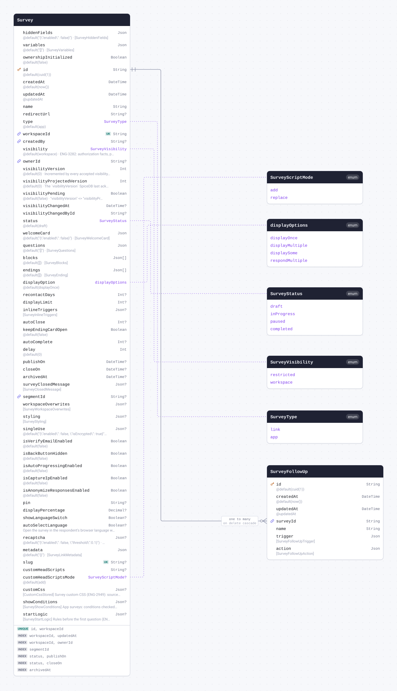

| Field                      | Type       | Constraints                           | Default      | Description             |
| -------------------------- | ---------- | ------------------------------------- | ------------ | ----------------------- |
| `id`                       | `String`   | PK NOT NULL                           | `cuid(1)`    |                         |
| `createdAt` (`created_at`) | `DateTime` | NOT NULL                              | `now()`      |                         |
| `updatedAt` (`updated_at`) | `DateTime` | NOT NULL                              | `@updatedAt` |                         |
| `surveyId`                 | `String`   | NOT NULL → [Survey.id](#model-Survey) |              |                         |
| `name`                     | `String`   | NOT NULL                              |              |                         |
| `trigger`                  | `Json`     | NOT NULL                              |              | [SurveyFollowUpTrigger] |
| `action`                   | `Json`     | NOT NULL                              |              | [SurveyFollowUpAction]  |

#### References

- `surveyId` → [Survey.id](#model-Survey) (many-to-one, on delete Cascade)

#### Definition

```sql
CREATE TABLE "SurveyFollowUp" (
    "id" TEXT NOT NULL,
    "created_at" TIMESTAMP(3) NOT NULL DEFAULT CURRENT_TIMESTAMP,
    "updated_at" TIMESTAMP(3) NOT NULL,
    "surveyId" TEXT NOT NULL,
    "name" TEXT NOT NULL,
    "trigger" JSONB NOT NULL,
    "action" JSONB NOT NULL,

    CONSTRAINT "SurveyFollowUp_pkey" PRIMARY KEY ("id")
);

ALTER TABLE "SurveyFollowUp" ADD CONSTRAINT "SurveyFollowUp_surveyId_fkey" FOREIGN KEY ("surveyId") REFERENCES "Survey"("id") ON DELETE CASCADE ON UPDATE CASCADE;
```

<details>
<summary>Queries and their SQL</summary>

**findMany**: Every row

```ts
await prisma.surveyFollowUp.findMany();
```

```sql
SELECT
  "public"."SurveyFollowUp"."id",
  "public"."SurveyFollowUp"."created_at",
  "public"."SurveyFollowUp"."updated_at",
  "public"."SurveyFollowUp"."surveyId",
  "public"."SurveyFollowUp"."name",
  "public"."SurveyFollowUp"."trigger",
  "public"."SurveyFollowUp"."action"
FROM
  "public"."SurveyFollowUp"
WHERE
  1 = 1
OFFSET
  $1
-- params: ["0"]
```

**count**: How many rows there are

```ts
await prisma.surveyFollowUp.count();
```

```sql
SELECT
  COUNT(*) AS "_count$_all"
FROM
  (
    SELECT
      "public"."SurveyFollowUp"."id"
    FROM
      "public"."SurveyFollowUp"
    WHERE
      1 = 1
    OFFSET
      $1
  ) AS "sub"
-- params: ["0"]
```

**findMany**: Every row with its relations

```ts
await prisma.surveyFollowUp.findMany({ include: { survey: true } });
```

```sql
SELECT
  "public"."SurveyFollowUp"."id",
  "public"."SurveyFollowUp"."created_at",
  "public"."SurveyFollowUp"."updated_at",
  "public"."SurveyFollowUp"."surveyId",
  "public"."SurveyFollowUp"."name",
  "public"."SurveyFollowUp"."trigger",
  "public"."SurveyFollowUp"."action"
FROM
  "public"."SurveyFollowUp"
WHERE
  1 = 1
OFFSET
  $1
-- params: ["0"]

SELECT
  "public"."Survey"."id",
  "public"."Survey"."hiddenFields",
  "public"."Survey"."variables",
  "public"."Survey"."ownershipInitialized",
  "public"."Survey"."created_at",
  "public"."Survey"."updated_at",
  "public"."Survey"."name",
  "public"."Survey"."redirectUrl",
  "public"."Survey"."type"::text,
  "public"."Survey"."workspaceId",
  "public"."Survey"."createdBy",
  "public"."Survey"."visibility"::text,
  "public"."Survey"."ownerId",
  "public"."Survey"."visibilityVersion",
  "public"."Survey"."visibilityProjectedVersion",
  "public"."Survey"."visibilityPending",
  "public"."Survey"."visibilityChangedAt",
  "public"."Survey"."visibilityChangedById",
  "public"."Survey"."status"::text,
  "public"."Survey"."welcomeCard",
  "public"."Survey"."questions",
  "public"."Survey"."blocks",
  "public"."Survey"."endings",
  "public"."Survey"."displayOption"::text,
  "public"."Survey"."recontactDays",
  "public"."Survey"."displayLimit",
  "public"."Survey"."inlineTriggers",
  "public"."Survey"."autoClose",
  "public"."Survey"."keepEndingCardOpen",
  "public"."Survey"."autoComplete",
  "public"."Survey"."delay",
  "public"."Survey"."publishOn",
  "public"."Survey"."closeOn",
  "public"."Survey"."archivedAt",
  "public"."Survey"."surveyClosedMessage",
  "public"."Survey"."segmentId",
  "public"."Survey"."workspaceOverwrites",
  "public"."Survey"."styling",
  "public"."Survey"."singleUse",
  "public"."Survey"."isVerifyEmailEnabled",
  "public"."Survey"."isBackButtonHidden",
  "public"."Survey"."isAutoProgressingEnabled",
  "public"."Survey"."isCaptureIpEnabled",
  "public"."Survey"."is_anonymize_responses_enabled",
  "public"."Survey"."pin",
  "public"."Survey"."displayPercentage",
  "public"."Survey"."showLanguageSwitch",
  "public"."Survey"."autoSelectLanguage",
  "public"."Survey"."recaptcha",
  "public"."Survey"."metadata",
  "public"."Survey"."slug",
  "public"."Survey"."customHeadScripts",
  "public"."Survey"."customHeadScriptsMode"::text,
  "public"."Survey"."customCss",
  "public"."Survey"."showConditions",
  "public"."Survey"."startLogic"
FROM
  "public"."Survey"
WHERE
  "public"."Survey"."id" IN ($1)
OFFSET
  $2
-- params: ["<surveyId of the rows above>","0"]
```

**findUnique**: One row by what is unique to it

```ts
await prisma.surveyFollowUp.findUnique({ where: { id: "example" } });
```

```sql
SELECT
  "public"."SurveyFollowUp"."id",
  "public"."SurveyFollowUp"."created_at",
  "public"."SurveyFollowUp"."updated_at",
  "public"."SurveyFollowUp"."surveyId",
  "public"."SurveyFollowUp"."name",
  "public"."SurveyFollowUp"."trigger",
  "public"."SurveyFollowUp"."action"
FROM
  "public"."SurveyFollowUp"
WHERE
  (
    "public"."SurveyFollowUp"."id" = $1
    AND 1 = 1
  )
LIMIT
  $2
OFFSET
  $3
-- params: ["example","1","0"]
```

**create**: Create a row

```ts
await prisma.surveyFollowUp.create({
  data: { surveyId: "example", name: "example", trigger: {}, action: {} },
});
```

```sql
INSERT INTO
  "public"."SurveyFollowUp" (
    "id",
    "created_at",
    "updated_at",
    "surveyId",
    "name",
    "trigger",
    "action"
  )
VALUES
  ($1, $2, $3, $4, $5, $6, $7)
RETURNING
  "public"."SurveyFollowUp"."id",
  "public"."SurveyFollowUp"."created_at",
  "public"."SurveyFollowUp"."updated_at",
  "public"."SurveyFollowUp"."surveyId",
  "public"."SurveyFollowUp"."name",
  "public"."SurveyFollowUp"."trigger",
  "public"."SurveyFollowUp"."action"
-- params: ["<cuid(1)>","<now()>","<now()>","example","example","{}","{}"]
```

**update**: Update a row

```ts
await prisma.surveyFollowUp.update({
  where: { id: "example" },
  data: { createdAt: new Date("2026-01-01T00:00:00.000Z") },
});
```

```sql
UPDATE "public"."SurveyFollowUp"
SET
  "created_at" = $1,
  "updated_at" = $2
WHERE
  (
    "public"."SurveyFollowUp"."id" = $3
    AND 1 = 1
  )
RETURNING
  "public"."SurveyFollowUp"."id",
  "public"."SurveyFollowUp"."created_at",
  "public"."SurveyFollowUp"."updated_at",
  "public"."SurveyFollowUp"."surveyId",
  "public"."SurveyFollowUp"."name",
  "public"."SurveyFollowUp"."trigger",
  "public"."SurveyFollowUp"."action"
-- params: ["2026-01-01T00:00:00.000Z",{"prisma__type":"generatorCall","prisma__value":{"name":"now","args":[],"returnType":{"type":"DateTime"}}},"example"]
```

**delete**: Delete a row

```ts
await prisma.surveyFollowUp.delete({ where: { id: "example" } });
```

```sql
DELETE FROM "public"."SurveyFollowUp"
WHERE
  (
    "public"."SurveyFollowUp"."id" = $1
    AND 1 = 1
  )
RETURNING
  "public"."SurveyFollowUp"."id",
  "public"."SurveyFollowUp"."created_at",
  "public"."SurveyFollowUp"."updated_at",
  "public"."SurveyFollowUp"."surveyId",
  "public"."SurveyFollowUp"."name",
  "public"."SurveyFollowUp"."trigger",
  "public"."SurveyFollowUp"."action"
-- params: ["example"]
```

</details>

<a id="model-ActionClass"></a>

### ActionClass

Represents a user action that can trigger surveys.
Used to define points in the user journey where surveys can be shown.

@property id - Unique identifier for the action
@property name - Display name of the action
@property type - Whether this is a code or no-code action
@property key - Unique identifier used in code implementation
@property noCodeConfig - Configuration for no-code setup
@property workspace - The workspace this action belongs to

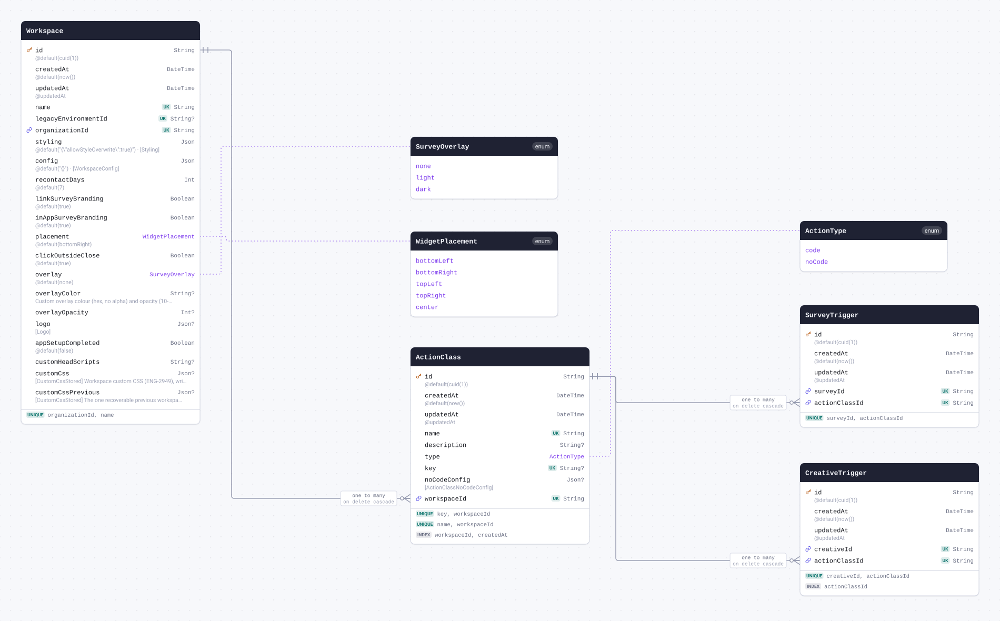

| Field                      | Type                             | Constraints                                 | Default      | Description               |
| -------------------------- | -------------------------------- | ------------------------------------------- | ------------ | ------------------------- |
| `id`                       | `String`                         | PK NOT NULL                                 | `cuid(1)`    |                           |
| `createdAt` (`created_at`) | `DateTime`                       | NOT NULL                                    | `now()`      |                           |
| `updatedAt` (`updated_at`) | `DateTime`                       | NOT NULL                                    | `@updatedAt` |                           |
| `name`                     | `String`                         | NOT NULL                                    |              |                           |
| `description`              | `String`                         | NULL                                        |              |                           |
| `type`                     | [`ActionType`](#enum-ActionType) | NOT NULL                                    |              |                           |
| `key`                      | `String`                         | NULL                                        |              |                           |
| `noCodeConfig`             | `Json`                           | NULL                                        |              | [ActionClassNoCodeConfig] |
| `workspaceId`              | `String`                         | NOT NULL → [Workspace.id](#model-Workspace) |              |                           |

#### Indexes

- `@@index([workspaceId, createdAt])`
- `@@unique([key, workspaceId])`
- `@@unique([name, workspaceId])`

#### References

- `workspaceId` → [Workspace.id](#model-Workspace) (many-to-one, on delete Cascade)

#### Referenced by

- `id` ← [CreativeTrigger.actionClassId](#model-CreativeTrigger) (one-to-many, on delete Cascade)
- `id` ← [SurveyTrigger.actionClassId](#model-SurveyTrigger) (one-to-many, on delete Cascade)

#### Definition

```sql
CREATE TABLE "ActionClass" (
    "id" TEXT NOT NULL,
    "created_at" TIMESTAMP(3) NOT NULL DEFAULT CURRENT_TIMESTAMP,
    "updated_at" TIMESTAMP(3) NOT NULL,
    "name" TEXT NOT NULL,
    "description" TEXT,
    "type" "ActionType" NOT NULL,
    "key" TEXT,
    "noCodeConfig" JSONB,
    "workspaceId" TEXT NOT NULL,

    CONSTRAINT "ActionClass_pkey" PRIMARY KEY ("id")
);

CREATE INDEX "ActionClass_workspaceId_created_at_idx" ON "ActionClass"("workspaceId", "created_at");

CREATE UNIQUE INDEX "ActionClass_key_workspaceId_key" ON "ActionClass"("key", "workspaceId");

CREATE UNIQUE INDEX "ActionClass_name_workspaceId_key" ON "ActionClass"("name", "workspaceId");

ALTER TABLE "ActionClass" ADD CONSTRAINT "ActionClass_workspaceId_fkey" FOREIGN KEY ("workspaceId") REFERENCES "Workspace"("id") ON DELETE CASCADE ON UPDATE CASCADE;
```

<details>
<summary>Queries and their SQL</summary>

**findMany**: Every row

```ts
await prisma.actionClass.findMany();
```

```sql
SELECT
  "public"."ActionClass"."id",
  "public"."ActionClass"."created_at",
  "public"."ActionClass"."updated_at",
  "public"."ActionClass"."name",
  "public"."ActionClass"."description",
  "public"."ActionClass"."type"::text,
  "public"."ActionClass"."key",
  "public"."ActionClass"."noCodeConfig",
  "public"."ActionClass"."workspaceId"
FROM
  "public"."ActionClass"
WHERE
  1 = 1
OFFSET
  $1
-- params: ["0"]
```

**count**: How many rows there are

```ts
await prisma.actionClass.count();
```

```sql
SELECT
  COUNT(*) AS "_count$_all"
FROM
  (
    SELECT
      "public"."ActionClass"."id"
    FROM
      "public"."ActionClass"
    WHERE
      1 = 1
    OFFSET
      $1
  ) AS "sub"
-- params: ["0"]
```

**findMany**: Every row with its relations

```ts
await prisma.actionClass.findMany({
  include: { workspace: true, surveyTriggers: true, creativeTriggers: true },
});
```

```sql
SELECT
  "public"."ActionClass"."id",
  "public"."ActionClass"."created_at",
  "public"."ActionClass"."updated_at",
  "public"."ActionClass"."name",
  "public"."ActionClass"."description",
  "public"."ActionClass"."type"::text,
  "public"."ActionClass"."key",
  "public"."ActionClass"."noCodeConfig",
  "public"."ActionClass"."workspaceId"
FROM
  "public"."ActionClass"
WHERE
  1 = 1
OFFSET
  $1
-- params: ["0"]

SELECT
  "public"."Workspace"."id",
  "public"."Workspace"."created_at",
  "public"."Workspace"."updated_at",
  "public"."Workspace"."name",
  "public"."Workspace"."legacyEnvironmentId",
  "public"."Workspace"."organizationId",
  "public"."Workspace"."styling",
  "public"."Workspace"."config",
  "public"."Workspace"."recontactDays",
  "public"."Workspace"."linkSurveyBranding",
  "public"."Workspace"."inAppSurveyBranding",
  "public"."Workspace"."placement"::text,
  "public"."Workspace"."clickOutsideClose",
  "public"."Workspace"."overlay"::text,
  "public"."Workspace"."overlayColor",
  "public"."Workspace"."overlayOpacity",
  "public"."Workspace"."logo",
  "public"."Workspace"."appSetupCompleted",
  "public"."Workspace"."customHeadScripts",
  "public"."Workspace"."customCss",
  "public"."Workspace"."customCssPrevious"
FROM
  "public"."Workspace"
WHERE
  "public"."Workspace"."id" IN ($1)
OFFSET
  $2
-- params: ["<workspaceId of the rows above>","0"]

SELECT
  "public"."SurveyTrigger"."id",
  "public"."SurveyTrigger"."created_at",
  "public"."SurveyTrigger"."updated_at",
  "public"."SurveyTrigger"."surveyId",
  "public"."SurveyTrigger"."actionClassId"
FROM
  "public"."SurveyTrigger"
WHERE
  "public"."SurveyTrigger"."actionClassId" IN ($1)
OFFSET
  $2
-- params: ["<id of the rows above>","0"]

SELECT
  "public"."CreativeTrigger"."id",
  "public"."CreativeTrigger"."created_at",
  "public"."CreativeTrigger"."updated_at",
  "public"."CreativeTrigger"."creativeId",
  "public"."CreativeTrigger"."actionClassId"
FROM
  "public"."CreativeTrigger"
WHERE
  "public"."CreativeTrigger"."actionClassId" IN ($1)
OFFSET
  $2
-- params: ["<id of the rows above>","0"]
```

**findUnique**: One row by what is unique to it

```ts
await prisma.actionClass.findUnique({ where: { id: "example" } });
```

```sql
SELECT
  "public"."ActionClass"."id",
  "public"."ActionClass"."created_at",
  "public"."ActionClass"."updated_at",
  "public"."ActionClass"."name",
  "public"."ActionClass"."description",
  "public"."ActionClass"."type"::text,
  "public"."ActionClass"."key",
  "public"."ActionClass"."noCodeConfig",
  "public"."ActionClass"."workspaceId"
FROM
  "public"."ActionClass"
WHERE
  (
    "public"."ActionClass"."id" = $1
    AND 1 = 1
  )
LIMIT
  $2
OFFSET
  $3
-- params: ["example","1","0"]
```

**create**: Create a row

```ts
await prisma.actionClass.create({
  data: { name: "example", type: "code", workspaceId: "example" },
});
```

```sql
INSERT INTO
  "public"."ActionClass" (
    "id",
    "created_at",
    "updated_at",
    "name",
    "type",
    "workspaceId"
  )
VALUES
  (
    $1,
    $2,
    $3,
    $4,
    CAST($5::text AS "public"."ActionType"),
    $6
  )
RETURNING
  "public"."ActionClass"."id",
  "public"."ActionClass"."created_at",
  "public"."ActionClass"."updated_at",
  "public"."ActionClass"."name",
  "public"."ActionClass"."description",
  "public"."ActionClass"."type"::text,
  "public"."ActionClass"."key",
  "public"."ActionClass"."noCodeConfig",
  "public"."ActionClass"."workspaceId"
-- params: ["<cuid(1)>","<now()>","<now()>","example","code","example"]
```

**update**: Update a row

```ts
await prisma.actionClass.update({
  where: { id: "example" },
  data: { createdAt: new Date("2026-01-01T00:00:00.000Z") },
});
```

```sql
UPDATE "public"."ActionClass"
SET
  "created_at" = $1,
  "updated_at" = $2
WHERE
  (
    "public"."ActionClass"."id" = $3
    AND 1 = 1
  )
RETURNING
  "public"."ActionClass"."id",
  "public"."ActionClass"."created_at",
  "public"."ActionClass"."updated_at",
  "public"."ActionClass"."name",
  "public"."ActionClass"."description",
  "public"."ActionClass"."type"::text,
  "public"."ActionClass"."key",
  "public"."ActionClass"."noCodeConfig",
  "public"."ActionClass"."workspaceId"
-- params: ["2026-01-01T00:00:00.000Z",{"prisma__type":"generatorCall","prisma__value":{"name":"now","args":[],"returnType":{"type":"DateTime"}}},"example"]
```

**delete**: Delete a row

```ts
await prisma.actionClass.delete({ where: { id: "example" } });
```

```sql
DELETE FROM "public"."ActionClass"
WHERE
  (
    "public"."ActionClass"."id" = $1
    AND 1 = 1
  )
RETURNING
  "public"."ActionClass"."id",
  "public"."ActionClass"."created_at",
  "public"."ActionClass"."updated_at",
  "public"."ActionClass"."name",
  "public"."ActionClass"."description",
  "public"."ActionClass"."type"::text,
  "public"."ActionClass"."key",
  "public"."ActionClass"."noCodeConfig",
  "public"."ActionClass"."workspaceId"
-- params: ["example"]
```

</details>

<a id="model-Integration"></a>

### Integration

Represents third-party service integrations.
Enables data flow between Formbricks and external services.

@property id - Unique identifier for the integration
@property type - The service being integrated (Google Sheets, Notion, etc.)
@property workspace - The workspace this integration belongs to
@property config - Service-specific configuration details

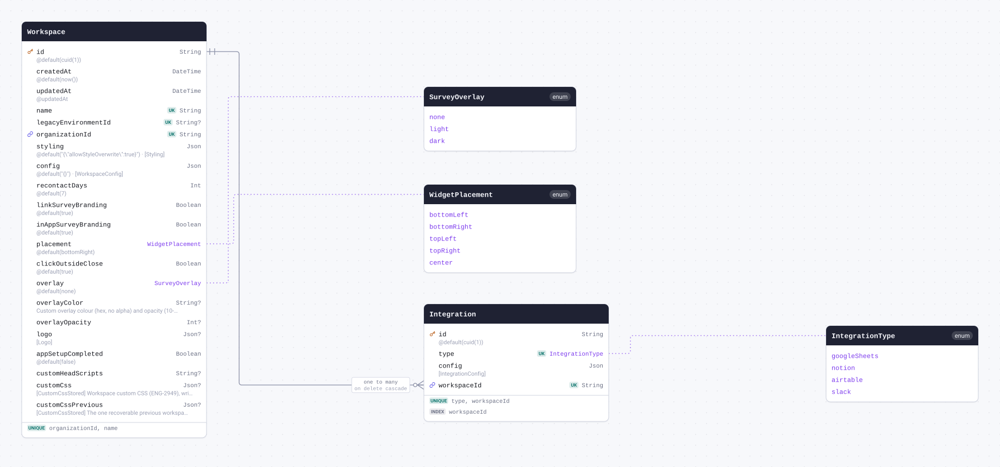

| Field         | Type                                       | Constraints                                 | Default   | Description         |
| ------------- | ------------------------------------------ | ------------------------------------------- | --------- | ------------------- |
| `id`          | `String`                                   | PK NOT NULL                                 | `cuid(1)` |                     |
| `type`        | [`IntegrationType`](#enum-IntegrationType) | NOT NULL                                    |           |                     |
| `config`      | `Json`                                     | NOT NULL                                    |           | [IntegrationConfig] |
| `workspaceId` | `String`                                   | NOT NULL → [Workspace.id](#model-Workspace) |           |                     |

#### Indexes

- `@@index([workspaceId])`
- `@@unique([type, workspaceId])`

#### References

- `workspaceId` → [Workspace.id](#model-Workspace) (many-to-one, on delete Cascade)

#### Definition

```sql
CREATE TABLE "Integration" (
    "id" TEXT NOT NULL,
    "type" "IntegrationType" NOT NULL,
    "config" JSONB NOT NULL,
    "workspaceId" TEXT NOT NULL,

    CONSTRAINT "Integration_pkey" PRIMARY KEY ("id")
);

CREATE INDEX "Integration_workspaceId_idx" ON "Integration"("workspaceId");

CREATE UNIQUE INDEX "Integration_type_workspaceId_key" ON "Integration"("type", "workspaceId");

ALTER TABLE "Integration" ADD CONSTRAINT "Integration_workspaceId_fkey" FOREIGN KEY ("workspaceId") REFERENCES "Workspace"("id") ON DELETE CASCADE ON UPDATE CASCADE;
```

<details>
<summary>Queries and their SQL</summary>

**findMany**: Every row

```ts
await prisma.integration.findMany();
```

```sql
SELECT
  "public"."Integration"."id",
  "public"."Integration"."type"::text,
  "public"."Integration"."config",
  "public"."Integration"."workspaceId"
FROM
  "public"."Integration"
WHERE
  1 = 1
OFFSET
  $1
-- params: ["0"]
```

**count**: How many rows there are

```ts
await prisma.integration.count();
```

```sql
SELECT
  COUNT(*) AS "_count$_all"
FROM
  (
    SELECT
      "public"."Integration"."id"
    FROM
      "public"."Integration"
    WHERE
      1 = 1
    OFFSET
      $1
  ) AS "sub"
-- params: ["0"]
```

**findMany**: Every row with its relations

```ts
await prisma.integration.findMany({ include: { workspace: true } });
```

```sql
SELECT
  "public"."Integration"."id",
  "public"."Integration"."type"::text,
  "public"."Integration"."config",
  "public"."Integration"."workspaceId"
FROM
  "public"."Integration"
WHERE
  1 = 1
OFFSET
  $1
-- params: ["0"]

SELECT
  "public"."Workspace"."id",
  "public"."Workspace"."created_at",
  "public"."Workspace"."updated_at",
  "public"."Workspace"."name",
  "public"."Workspace"."legacyEnvironmentId",
  "public"."Workspace"."organizationId",
  "public"."Workspace"."styling",
  "public"."Workspace"."config",
  "public"."Workspace"."recontactDays",
  "public"."Workspace"."linkSurveyBranding",
  "public"."Workspace"."inAppSurveyBranding",
  "public"."Workspace"."placement"::text,
  "public"."Workspace"."clickOutsideClose",
  "public"."Workspace"."overlay"::text,
  "public"."Workspace"."overlayColor",
  "public"."Workspace"."overlayOpacity",
  "public"."Workspace"."logo",
  "public"."Workspace"."appSetupCompleted",
  "public"."Workspace"."customHeadScripts",
  "public"."Workspace"."customCss",
  "public"."Workspace"."customCssPrevious"
FROM
  "public"."Workspace"
WHERE
  "public"."Workspace"."id" IN ($1)
OFFSET
  $2
-- params: ["<workspaceId of the rows above>","0"]
```

**findUnique**: One row by what is unique to it

```ts
await prisma.integration.findUnique({ where: { id: "example" } });
```

```sql
SELECT
  "public"."Integration"."id",
  "public"."Integration"."type"::text,
  "public"."Integration"."config",
  "public"."Integration"."workspaceId"
FROM
  "public"."Integration"
WHERE
  (
    "public"."Integration"."id" = $1
    AND 1 = 1
  )
LIMIT
  $2
OFFSET
  $3
-- params: ["example","1","0"]
```

**create**: Create a row

```ts
await prisma.integration.create({
  data: { type: "googleSheets", config: {}, workspaceId: "example" },
});
```

```sql
INSERT INTO
  "public"."Integration" ("id", "type", "config", "workspaceId")
VALUES
  (
    $1,
    CAST($2::text AS "public"."IntegrationType"),
    $3,
    $4
  )
RETURNING
  "public"."Integration"."id",
  "public"."Integration"."type"::text,
  "public"."Integration"."config",
  "public"."Integration"."workspaceId"
-- params: ["<cuid(1)>","googleSheets","{}","example"]
```

**update**: Update a row

```ts
await prisma.integration.update({ where: { id: "example" }, data: { type: "googleSheets" } });
```

```sql
UPDATE "public"."Integration"
SET
  "type" = CAST($1::text AS "public"."IntegrationType")
WHERE
  (
    "public"."Integration"."id" = $2
    AND 1 = 1
  )
RETURNING
  "public"."Integration"."id",
  "public"."Integration"."type"::text,
  "public"."Integration"."config",
  "public"."Integration"."workspaceId"
-- params: ["googleSheets","example"]
```

**delete**: Delete a row

```ts
await prisma.integration.delete({ where: { id: "example" } });
```

```sql
DELETE FROM "public"."Integration"
WHERE
  (
    "public"."Integration"."id" = $1
    AND 1 = 1
  )
RETURNING
  "public"."Integration"."id",
  "public"."Integration"."type"::text,
  "public"."Integration"."config",
  "public"."Integration"."workspaceId"
-- params: ["example"]
```

</details>

<a id="model-DataMigration"></a>

### DataMigration

Tracks database schema migrations.
Used to manage and track the state of data structure changes.

@property id - Unique identifier for the migration
@property name - Name of the migration
@property status - Current state of the migration (pending, applied, failed)
@property startedAt - When the migration began
@property finishedAt - When the migration completed

| Field                        | Type                                               | Constraints     | Default   | Description |
| ---------------------------- | -------------------------------------------------- | --------------- | --------- | ----------- |
| `id`                         | `String`                                           | PK NOT NULL     | `cuid(1)` |             |
| `startedAt` (`started_at`)   | `DateTime`                                         | NOT NULL        | `now()`   |             |
| `finishedAt` (`finished_at`) | `DateTime`                                         | NULL            |           |             |
| `name`                       | `String`                                           | UNIQUE NOT NULL |           |             |
| `status`                     | [`DataMigrationStatus`](#enum-DataMigrationStatus) | NOT NULL        |           |             |

#### Definition

```sql
CREATE TABLE "DataMigration" (
    "id" TEXT NOT NULL,
    "started_at" TIMESTAMP(3) NOT NULL DEFAULT CURRENT_TIMESTAMP,
    "finished_at" TIMESTAMP(3),
    "name" TEXT NOT NULL,
    "status" "DataMigrationStatus" NOT NULL,

    CONSTRAINT "DataMigration_pkey" PRIMARY KEY ("id")
);

CREATE UNIQUE INDEX "DataMigration_name_key" ON "DataMigration"("name");
```

<details>
<summary>Queries and their SQL</summary>

**findMany**: Every row

```ts
await prisma.dataMigration.findMany();
```

```sql
SELECT
  "public"."DataMigration"."id",
  "public"."DataMigration"."started_at",
  "public"."DataMigration"."finished_at",
  "public"."DataMigration"."name",
  "public"."DataMigration"."status"::text
FROM
  "public"."DataMigration"
WHERE
  1 = 1
OFFSET
  $1
-- params: ["0"]
```

**count**: How many rows there are

```ts
await prisma.dataMigration.count();
```

```sql
SELECT
  COUNT(*) AS "_count$_all"
FROM
  (
    SELECT
      "public"."DataMigration"."id"
    FROM
      "public"."DataMigration"
    WHERE
      1 = 1
    OFFSET
      $1
  ) AS "sub"
-- params: ["0"]
```

**findUnique**: One row by what is unique to it

```ts
await prisma.dataMigration.findUnique({ where: { id: "example" } });
```

```sql
SELECT
  "public"."DataMigration"."id",
  "public"."DataMigration"."started_at",
  "public"."DataMigration"."finished_at",
  "public"."DataMigration"."name",
  "public"."DataMigration"."status"::text
FROM
  "public"."DataMigration"
WHERE
  (
    "public"."DataMigration"."id" = $1
    AND 1 = 1
  )
LIMIT
  $2
OFFSET
  $3
-- params: ["example","1","0"]
```

**create**: Create a row

```ts
await prisma.dataMigration.create({ data: { name: "example", status: "pending" } });
```

```sql
INSERT INTO
  "public"."DataMigration" ("id", "started_at", "name", "status")
VALUES
  (
    $1,
    $2,
    $3,
    CAST($4::text AS "public"."DataMigrationStatus")
  )
RETURNING
  "public"."DataMigration"."id",
  "public"."DataMigration"."started_at",
  "public"."DataMigration"."finished_at",
  "public"."DataMigration"."name",
  "public"."DataMigration"."status"::text
-- params: ["<cuid(1)>","<now()>","example","pending"]
```

**update**: Update a row

```ts
await prisma.dataMigration.update({
  where: { id: "example" },
  data: { startedAt: new Date("2026-01-01T00:00:00.000Z") },
});
```

```sql
UPDATE "public"."DataMigration"
SET
  "started_at" = $1
WHERE
  (
    "public"."DataMigration"."id" = $2
    AND 1 = 1
  )
RETURNING
  "public"."DataMigration"."id",
  "public"."DataMigration"."started_at",
  "public"."DataMigration"."finished_at",
  "public"."DataMigration"."name",
  "public"."DataMigration"."status"::text
-- params: ["2026-01-01T00:00:00.000Z","example"]
```

**delete**: Delete a row

```ts
await prisma.dataMigration.delete({ where: { id: "example" } });
```

```sql
DELETE FROM "public"."DataMigration"
WHERE
  (
    "public"."DataMigration"."id" = $1
    AND 1 = 1
  )
RETURNING
  "public"."DataMigration"."id",
  "public"."DataMigration"."started_at",
  "public"."DataMigration"."finished_at",
  "public"."DataMigration"."name",
  "public"."DataMigration"."status"::text
-- params: ["example"]
```

</details>

<a id="model-Workspace"></a>

### Workspace

Main grouping mechanism for resources in Formbricks.
Each organization can have multiple workspaces to separate different applications or products.

@property id - Unique identifier for the workspace
@property name - Display name of the workspace
@property organization - Reference to parent organization
@property surveys - Collection of surveys in this workspace
@property styling - Workspace-wide styling configuration
@property config - Workspace-specific configuration
@property recontactDays - Default recontact delay for surveys
@property placement - Default widget placement for in-app surveys

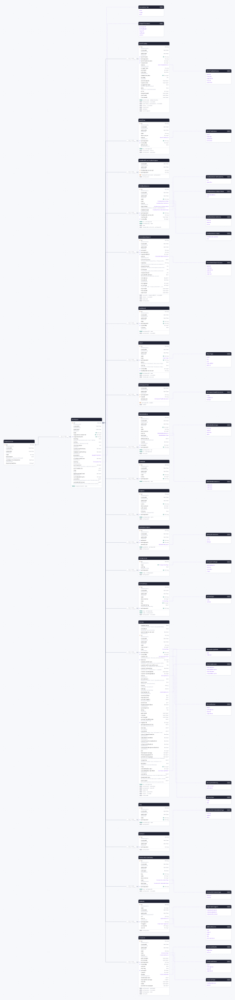

| Field                      | Type                                       | Constraints                                       | Default                            | Description                                                                                                                                                                             |
| -------------------------- | ------------------------------------------ | ------------------------------------------------- | ---------------------------------- | --------------------------------------------------------------------------------------------------------------------------------------------------------------------------------------- |
| `id`                       | `String`                                   | PK NOT NULL                                       | `cuid(1)`                          |                                                                                                                                                                                         |
| `createdAt` (`created_at`) | `DateTime`                                 | NOT NULL                                          | `now()`                            |                                                                                                                                                                                         |
| `updatedAt` (`updated_at`) | `DateTime`                                 | NOT NULL                                          | `@updatedAt`                       |                                                                                                                                                                                         |
| `name`                     | `String`                                   | NOT NULL                                          |                                    |                                                                                                                                                                                         |
| `legacyEnvironmentId`      | `String`                                   | UNIQUE NULL                                       |                                    |                                                                                                                                                                                         |
| `organizationId`           | `String`                                   | NOT NULL → [Organization.id](#model-Organization) |                                    |                                                                                                                                                                                         |
| `styling`                  | `Json`                                     | NOT NULL                                          | `"{\"allowStyleOverwrite\":true}"` | [Styling]                                                                                                                                                                               |
| `config`                   | `Json`                                     | NOT NULL                                          | `"{}"`                             | [WorkspaceConfig]                                                                                                                                                                       |
| `recontactDays`            | `Int`                                      | NOT NULL                                          | `7`                                |                                                                                                                                                                                         |
| `linkSurveyBranding`       | `Boolean`                                  | NOT NULL                                          | `true`                             |                                                                                                                                                                                         |
| `inAppSurveyBranding`      | `Boolean`                                  | NOT NULL                                          | `true`                             |                                                                                                                                                                                         |
| `placement`                | [`WidgetPlacement`](#enum-WidgetPlacement) | NOT NULL                                          | `bottomRight`                      |                                                                                                                                                                                         |
| `clickOutsideClose`        | `Boolean`                                  | NOT NULL                                          | `true`                             |                                                                                                                                                                                         |
| `overlay`                  | [`SurveyOverlay`](#enum-SurveyOverlay)     | NOT NULL                                          | `none`                             |                                                                                                                                                                                         |
| `overlayColor`             | `String`                                   | NULL                                              |                                    | Custom overlay colour (hex, no alpha) and opacity (10-100%). null = the preset for `overlay`.                                                                                           |
| `overlayOpacity`           | `Int`                                      | NULL                                              |                                    |                                                                                                                                                                                         |
| `logo`                     | `Json`                                     | NULL                                              |                                    | [Logo]                                                                                                                                                                                  |
| `appSetupCompleted`        | `Boolean`                                  | NOT NULL                                          | `false`                            |                                                                                                                                                                                         |
| `customHeadScripts`        | `String`                                   | NULL                                              |                                    |                                                                                                                                                                                         |
| `customCss`                | `Json`                                     | NULL                                              |                                    | [CustomCssStored] Workspace custom CSS (ENG-2949), written only by the shared save service.                                                                                             |
| `customCssPrevious`        | `Json`                                     | NULL                                              |                                    | [CustomCssStored] The one recoverable previous workspace CSS revision, source included. Restored by submitting its source again through the current processor and authorization checks. |

#### Indexes

- `@@unique([organizationId, name])`

#### References

- `organizationId` → [Organization.id](#model-Organization) (many-to-one, on delete Cascade)

#### Referenced by

- `id` ← [Creative.workspaceId](#model-Creative) (one-to-many, on delete Cascade)
- `id` ← [Webhook.workspaceId](#model-Webhook) (one-to-many, on delete Cascade)
- `id` ← [ContactAttributeKey.workspaceId](#model-ContactAttributeKey) (one-to-many, on delete Cascade)
- `id` ← [Contact.workspaceId](#model-Contact) (one-to-many, on delete Cascade)
- `id` ← [Tag.workspaceId](#model-Tag) (one-to-many, on delete Cascade)
- `id` ← [Survey.workspaceId](#model-Survey) (one-to-many, on delete Cascade)
- `id` ← [ActionClass.workspaceId](#model-ActionClass) (one-to-many, on delete Cascade)
- `id` ← [Integration.workspaceId](#model-Integration) (one-to-many, on delete Cascade)
- `id` ← [ApiKeyWorkspace.workspaceId](#model-ApiKeyWorkspace) (one-to-many, on delete Cascade)
- `id` ← [Segment.workspaceId](#model-Segment) (one-to-many, on delete Cascade)
- `id` ← [Language.workspaceId](#model-Language) (one-to-many, on delete Cascade)
- `id` ← [EmbeddedData.workspaceId](#model-EmbeddedData) (one-to-many, on delete Cascade)
- `id` ← [WorkspaceTeam.workspaceId](#model-WorkspaceTeam) (one-to-many, on delete Cascade)
- `id` ← [Chart.workspaceId](#model-Chart) (one-to-many, on delete Cascade)
- `id` ← [Dashboard.workspaceId](#model-Dashboard) (one-to-many, on delete Cascade)
- `id` ← [AttachmentExport.workspaceId](#model-AttachmentExport) (one-to-many, on delete Cascade)
- `id` ← [FeedbackSource.workspaceId](#model-FeedbackSource) (one-to-many, on delete Cascade)
- `id` ← [FeedbackDirectoryWorkspace.workspaceId](#model-FeedbackDirectoryWorkspace) (one-to-many, on delete Cascade)
- `id` ← [Workflow.workspaceId](#model-Workflow) (one-to-many, on delete Cascade)
- `id` ← [WorkflowRun.workspaceId](#model-WorkflowRun) (one-to-many, on delete Cascade)

#### Definition

```sql
CREATE TABLE "Workspace" (
    "id" TEXT NOT NULL,
    "created_at" TIMESTAMP(3) NOT NULL DEFAULT CURRENT_TIMESTAMP,
    "updated_at" TIMESTAMP(3) NOT NULL,
    "name" TEXT NOT NULL,
    "legacyEnvironmentId" TEXT,
    "organizationId" TEXT NOT NULL,
    "styling" JSONB NOT NULL DEFAULT '{"allowStyleOverwrite":true}',
    "config" JSONB NOT NULL DEFAULT '{}',
    "recontactDays" INTEGER NOT NULL DEFAULT 7,
    "linkSurveyBranding" BOOLEAN NOT NULL DEFAULT true,
    "inAppSurveyBranding" BOOLEAN NOT NULL DEFAULT true,
    "placement" "WidgetPlacement" NOT NULL DEFAULT 'bottomRight',
    "clickOutsideClose" BOOLEAN NOT NULL DEFAULT true,
    "overlay" "SurveyOverlay" NOT NULL DEFAULT 'none',
    "overlayColor" TEXT,
    "overlayOpacity" INTEGER,
    "logo" JSONB,
    "appSetupCompleted" BOOLEAN NOT NULL DEFAULT false,
    "customHeadScripts" TEXT,
    "customCss" JSONB,
    "customCssPrevious" JSONB,

    CONSTRAINT "Workspace_pkey" PRIMARY KEY ("id")
);

CREATE UNIQUE INDEX "Workspace_legacyEnvironmentId_key" ON "Workspace"("legacyEnvironmentId");

CREATE UNIQUE INDEX "Workspace_organizationId_name_key" ON "Workspace"("organizationId", "name");

ALTER TABLE "Workspace" ADD CONSTRAINT "Workspace_organizationId_fkey" FOREIGN KEY ("organizationId") REFERENCES "Organization"("id") ON DELETE CASCADE ON UPDATE CASCADE;
```

<details>
<summary>Queries and their SQL</summary>

**findMany**: Every row

```ts
await prisma.workspace.findMany();
```

```sql
SELECT
  "public"."Workspace"."id",
  "public"."Workspace"."created_at",
  "public"."Workspace"."updated_at",
  "public"."Workspace"."name",
  "public"."Workspace"."legacyEnvironmentId",
  "public"."Workspace"."organizationId",
  "public"."Workspace"."styling",
  "public"."Workspace"."config",
  "public"."Workspace"."recontactDays",
  "public"."Workspace"."linkSurveyBranding",
  "public"."Workspace"."inAppSurveyBranding",
  "public"."Workspace"."placement"::text,
  "public"."Workspace"."clickOutsideClose",
  "public"."Workspace"."overlay"::text,
  "public"."Workspace"."overlayColor",
  "public"."Workspace"."overlayOpacity",
  "public"."Workspace"."logo",
  "public"."Workspace"."appSetupCompleted",
  "public"."Workspace"."customHeadScripts",
  "public"."Workspace"."customCss",
  "public"."Workspace"."customCssPrevious"
FROM
  "public"."Workspace"
WHERE
  1 = 1
OFFSET
  $1
-- params: ["0"]
```

**count**: How many rows there are

```ts
await prisma.workspace.count();
```

```sql
SELECT
  COUNT(*) AS "_count$_all"
FROM
  (
    SELECT
      "public"."Workspace"."id"
    FROM
      "public"."Workspace"
    WHERE
      1 = 1
    OFFSET
      $1
  ) AS "sub"
-- params: ["0"]
```

**findMany**: Every row with its relations

```ts
await prisma.workspace.findMany({
  include: {
    organization: true,
    languages: true,
    embeddedData: true,
    workspaceTeams: true,
    feedbackDirectoryWorkspaces: true,
    charts: true,
    dashboards: true,
    creatives: true,
    attachmentExports: true,
    surveys: true,
    contacts: true,
    actionClasses: true,
    contactAttributeKeys: true,
    webhooks: true,
    tags: true,
    segments: true,
    integrations: true,
    apiKeyWorkspaces: true,
    feedbackSources: true,
    workflows: true,
    workflowRuns: true,
  },
});
```

```sql
SELECT
  "public"."Workspace"."id",
  "public"."Workspace"."created_at",
  "public"."Workspace"."updated_at",
  "public"."Workspace"."name",
  "public"."Workspace"."legacyEnvironmentId",
  "public"."Workspace"."organizationId",
  "public"."Workspace"."styling",
  "public"."Workspace"."config",
  "public"."Workspace"."recontactDays",
  "public"."Workspace"."linkSurveyBranding",
  "public"."Workspace"."inAppSurveyBranding",
  "public"."Workspace"."placement"::text,
  "public"."Workspace"."clickOutsideClose",
  "public"."Workspace"."overlay"::text,
  "public"."Workspace"."overlayColor",
  "public"."Workspace"."overlayOpacity",
  "public"."Workspace"."logo",
  "public"."Workspace"."appSetupCompleted",
  "public"."Workspace"."customHeadScripts",
  "public"."Workspace"."customCss",
  "public"."Workspace"."customCssPrevious"
FROM
  "public"."Workspace"
WHERE
  1 = 1
OFFSET
  $1
-- params: ["0"]

SELECT
  "public"."Organization"."id",
  "public"."Organization"."created_at",
  "public"."Organization"."updated_at",
  "public"."Organization"."name",
  "public"."Organization"."whitelabel",
  "public"."Organization"."isAISmartToolsEnabled",
  "public"."Organization"."displayTimeZone"
FROM
  "public"."Organization"
WHERE
  "public"."Organization"."id" IN ($1)
OFFSET
  $2
-- params: ["<organizationId of the rows above>","0"]

SELECT
  "public"."Language"."id",
  "public"."Language"."created_at",
  "public"."Language"."updated_at",
  "public"."Language"."code",
  "public"."Language"."alias",
  "public"."Language"."workspaceId"
FROM
  "public"."Language"
WHERE
  "public"."Language"."workspaceId" IN ($1)
OFFSET
  $2
-- params: ["<id of the rows above>","0"]

SELECT
  "public"."EmbeddedData"."id",
  "public"."EmbeddedData"."created_at",
  "public"."EmbeddedData"."updated_at",
  "public"."EmbeddedData"."key",
  "public"."EmbeddedData"."name",
  "public"."EmbeddedData"."description",
  "public"."EmbeddedData"."source"::text,
  "public"."EmbeddedData"."dataType"::text,
  "public"."EmbeddedData"."defaultValue",
  "public"."EmbeddedData"."locked",
  "public"."EmbeddedData"."surveyId",
  "public"."EmbeddedData"."workspaceId"
FROM
  "public"."EmbeddedData"
WHERE
  "public"."EmbeddedData"."workspaceId" IN ($1)
OFFSET
  $2
-- params: ["<id of the rows above>","0"]

SELECT
  "public"."WorkspaceTeam"."workspaceId",
  "public"."WorkspaceTeam"."teamId",
  "public"."WorkspaceTeam"."created_at",
  "public"."WorkspaceTeam"."updated_at",
  "public"."WorkspaceTeam"."permission"::text
FROM
  "public"."WorkspaceTeam"
WHERE
  "public"."WorkspaceTeam"."workspaceId" IN ($1)
OFFSET
  $2
-- params: ["<id of the rows above>","0"]

SELECT
  "public"."FeedbackDirectoryWorkspace"."feedbackDirectoryId",
  "public"."FeedbackDirectoryWorkspace"."workspaceId",
  "public"."FeedbackDirectoryWorkspace"."created_at",
  "public"."FeedbackDirectoryWorkspace"."updated_at"
FROM
  "public"."FeedbackDirectoryWorkspace"
WHERE
  "public"."FeedbackDirectoryWorkspace"."workspaceId" IN ($1)
OFFSET
  $2
-- params: ["<id of the rows above>","0"]

SELECT
  "public"."Chart"."id",
  "public"."Chart"."created_at",
  "public"."Chart"."updated_at",
  "public"."Chart"."name",
  "public"."Chart"."type"::text,
  "public"."Chart"."workspaceId",
  "public"."Chart"."query",
  "public"."Chart"."config",
  "public"."Chart"."createdBy",
  "public"."Chart"."feedbackDirectoryId"
FROM
  "public"."Chart"
WHERE
  "public"."Chart"."workspaceId" IN ($1)
OFFSET
  $2
-- params: ["<id of the rows above>","0"]

SELECT
  "public"."Dashboard"."id",
  "public"."Dashboard"."created_at",
  "public"."Dashboard"."updated_at",
  "public"."Dashboard"."name",
  "public"."Dashboard"."workspaceId",
  "public"."Dashboard"."createdBy",
  "public"."Dashboard"."filters"
FROM
  "public"."Dashboard"
WHERE
  "public"."Dashboard"."workspaceId" IN ($1)
OFFSET
  $2
-- params: ["<id of the rows above>","0"]

SELECT
  "public"."Creative"."id",
  "public"."Creative"."created_at",
  "public"."Creative"."updated_at",
  "public"."Creative"."name",
  "public"."Creative"."type"::text,
  "public"."Creative"."status"::text,
  "public"."Creative"."publishedAt",
  "public"."Creative"."archivedAt",
  "public"."Creative"."workspaceId",
  "public"."Creative"."createdBy",
  "public"."Creative"."content",
  "public"."Creative"."styling",
  "public"."Creative"."surveyId",
  "public"."Creative"."linkUrl",
  "public"."Creative"."showOn"::text,
  "public"."Creative"."showConditions",
  "public"."Creative"."displayPercentage",
  "public"."Creative"."startAt",
  "public"."Creative"."endAt",
  "public"."Creative"."autoSelectLanguage"
FROM
  "public"."Creative"
WHERE
  "public"."Creative"."workspaceId" IN ($1)
OFFSET
  $2
-- params: ["<id of the rows above>","0"]

SELECT
  "public"."AttachmentExport"."id",
  "public"."AttachmentExport"."created_at",
  "public"."AttachmentExport"."updated_at",
  "public"."AttachmentExport"."surveyId",
  "public"."AttachmentExport"."workspaceId",
  "public"."AttachmentExport"."requestedById",
  "public"."AttachmentExport"."status"::text,
  "public"."AttachmentExport"."filterCriteria",
  "public"."AttachmentExport"."timeZone",
  "public"."AttachmentExport"."dispatchCount",
  "public"."AttachmentExport"."fileCount",
  "public"."AttachmentExport"."responseCount",
  "public"."AttachmentExport"."includedFileCount",
  "public"."AttachmentExport"."totalBytes",
  "public"."AttachmentExport"."truncated",
  "public"."AttachmentExport"."storageKey",
  "public"."AttachmentExport"."errorCode",
  "public"."AttachmentExport"."startedAt",
  "public"."AttachmentExport"."finishedAt",
  "public"."AttachmentExport"."expiresAt"
FROM
  "public"."AttachmentExport"
WHERE
  "public"."AttachmentExport"."workspaceId" IN ($1)
OFFSET
  $2
-- params: ["<id of the rows above>","0"]

SELECT
  "public"."Survey"."id",
  "public"."Survey"."hiddenFields",
  "public"."Survey"."variables",
  "public"."Survey"."ownershipInitialized",
  "public"."Survey"."created_at",
  "public"."Survey"."updated_at",
  "public"."Survey"."name",
  "public"."Survey"."redirectUrl",
  "public"."Survey"."type"::text,
  "public"."Survey"."workspaceId",
  "public"."Survey"."createdBy",
  "public"."Survey"."visibility"::text,
  "public"."Survey"."ownerId",
  "public"."Survey"."visibilityVersion",
  "public"."Survey"."visibilityProjectedVersion",
  "public"."Survey"."visibilityPending",
  "public"."Survey"."visibilityChangedAt",
  "public"."Survey"."visibilityChangedById",
  "public"."Survey"."status"::text,
  "public"."Survey"."welcomeCard",
  "public"."Survey"."questions",
  "public"."Survey"."blocks",
  "public"."Survey"."endings",
  "public"."Survey"."displayOption"::text,
  "public"."Survey"."recontactDays",
  "public"."Survey"."displayLimit",
  "public"."Survey"."inlineTriggers",
  "public"."Survey"."autoClose",
  "public"."Survey"."keepEndingCardOpen",
  "public"."Survey"."autoComplete",
  "public"."Survey"."delay",
  "public"."Survey"."publishOn",
  "public"."Survey"."closeOn",
  "public"."Survey"."archivedAt",
  "public"."Survey"."surveyClosedMessage",
  "public"."Survey"."segmentId",
  "public"."Survey"."workspaceOverwrites",
  "public"."Survey"."styling",
  "public"."Survey"."singleUse",
  "public"."Survey"."isVerifyEmailEnabled",
  "public"."Survey"."isBackButtonHidden",
  "public"."Survey"."isAutoProgressingEnabled",
  "public"."Survey"."isCaptureIpEnabled",
  "public"."Survey"."is_anonymize_responses_enabled",
  "public"."Survey"."pin",
  "public"."Survey"."displayPercentage",
  "public"."Survey"."showLanguageSwitch",
  "public"."Survey"."autoSelectLanguage",
  "public"."Survey"."recaptcha",
  "public"."Survey"."metadata",
  "public"."Survey"."slug",
  "public"."Survey"."customHeadScripts",
  "public"."Survey"."customHeadScriptsMode"::text,
  "public"."Survey"."customCss",
  "public"."Survey"."showConditions",
  "public"."Survey"."startLogic"
FROM
  "public"."Survey"
WHERE
  "public"."Survey"."workspaceId" IN ($1)
OFFSET
  $2
-- params: ["<id of the rows above>","0"]

SELECT
  "public"."Contact"."id",
  "public"."Contact"."created_at",
  "public"."Contact"."updated_at",
  "public"."Contact"."workspaceId"
FROM
  "public"."Contact"
WHERE
  "public"."Contact"."workspaceId" IN ($1)
OFFSET
  $2
-- params: ["<id of the rows above>","0"]

SELECT
  "public"."ActionClass"."id",
  "public"."ActionClass"."created_at",
  "public"."ActionClass"."updated_at",
  "public"."ActionClass"."name",
  "public"."ActionClass"."description",
  "public"."ActionClass"."type"::text,
  "public"."ActionClass"."key",
  "public"."ActionClass"."noCodeConfig",
  "public"."ActionClass"."workspaceId"
FROM
  "public"."ActionClass"
WHERE
  "public"."ActionClass"."workspaceId" IN ($1)
OFFSET
  $2
-- params: ["<id of the rows above>","0"]

SELECT
  "public"."ContactAttributeKey"."id",
  "public"."ContactAttributeKey"."created_at",
  "public"."ContactAttributeKey"."updated_at",
  "public"."ContactAttributeKey"."isUnique",
  "public"."ContactAttributeKey"."key",
  "public"."ContactAttributeKey"."name",
  "public"."ContactAttributeKey"."description",
  "public"."ContactAttributeKey"."type"::text,
  "public"."ContactAttributeKey"."dataType"::text,
  "public"."ContactAttributeKey"."workspaceId"
FROM
  "public"."ContactAttributeKey"
WHERE
  "public"."ContactAttributeKey"."workspaceId" IN ($1)
OFFSET
  $2
-- params: ["<id of the rows above>","0"]

SELECT
  "public"."Webhook"."id",
  "public"."Webhook"."name",
  "public"."Webhook"."created_at",
  "public"."Webhook"."updated_at",
  "public"."Webhook"."url",
  "public"."Webhook"."source"::text,
  "public"."Webhook"."workspaceId",
  "public"."Webhook"."triggers"::text[],
  "public"."Webhook"."surveyIds",
  "public"."Webhook"."secret"
FROM
  "public"."Webhook"
WHERE
  "public"."Webhook"."workspaceId" IN ($1)
OFFSET
  $2
-- params: ["<id of the rows above>","0"]

SELECT
  "public"."Tag"."id",
  "public"."Tag"."created_at",
  "public"."Tag"."updated_at",
  "public"."Tag"."name",
  "public"."Tag"."workspaceId"
FROM
  "public"."Tag"
WHERE
  "public"."Tag"."workspaceId" IN ($1)
OFFSET
  $2
-- params: ["<id of the rows above>","0"]

SELECT
  "public"."Segment"."id",
  "public"."Segment"."created_at",
  "public"."Segment"."updated_at",
  "public"."Segment"."title",
  "public"."Segment"."description",
  "public"."Segment"."isPrivate",
  "public"."Segment"."filters",
  "public"."Segment"."workspaceId"
FROM
  "public"."Segment"
WHERE
  "public"."Segment"."workspaceId" IN ($1)
OFFSET
  $2
-- params: ["<id of the rows above>","0"]

SELECT
  "public"."Integration"."id",
  "public"."Integration"."type"::text,
  "public"."Integration"."config",
  "public"."Integration"."workspaceId"
FROM
  "public"."Integration"
WHERE
  "public"."Integration"."workspaceId" IN ($1)
OFFSET
  $2
-- params: ["<id of the rows above>","0"]

SELECT
  "public"."ApiKeyWorkspace"."id",
  "public"."ApiKeyWorkspace"."createdAt",
  "public"."ApiKeyWorkspace"."updatedAt",
  "public"."ApiKeyWorkspace"."apiKeyId",
  "public"."ApiKeyWorkspace"."workspaceId",
  "public"."ApiKeyWorkspace"."permission"::text
FROM
  "public"."ApiKeyWorkspace"
WHERE
  "public"."ApiKeyWorkspace"."workspaceId" IN ($1)
OFFSET
  $2
-- params: ["<id of the rows above>","0"]

SELECT
  "public"."FeedbackSource"."id",
  "public"."FeedbackSource"."created_at",
  "public"."FeedbackSource"."updated_at",
  "public"."FeedbackSource"."name",
  "public"."FeedbackSource"."type"::text,
  "public"."FeedbackSource"."status"::text,
  "public"."FeedbackSource"."import_mode"::text,
  "public"."FeedbackSource"."elementScope"::text,
  "public"."FeedbackSource"."workspaceId",
  "public"."FeedbackSource"."feedbackDirectoryId",
  "public"."FeedbackSource"."last_sync_at",
  "public"."FeedbackSource"."created_by"
FROM
  "public"."FeedbackSource"
WHERE
  "public"."FeedbackSource"."workspaceId" IN ($1)
OFFSET
  $2
-- params: ["<id of the rows above>","0"]

SELECT
  "public"."Workflow"."id",
  "public"."Workflow"."created_at",
  "public"."Workflow"."updated_at",
  "public"."Workflow"."name",
  "public"."Workflow"."description",
  "public"."Workflow"."status"::text,
  "public"."Workflow"."workspaceId",
  "public"."Workflow"."createdBy",
  "public"."Workflow"."definition"
FROM
  "public"."Workflow"
WHERE
  "public"."Workflow"."workspaceId" IN ($1)
OFFSET
  $2
-- params: ["<id of the rows above>","0"]

SELECT
  "public"."WorkflowRun"."id",
  "public"."WorkflowRun"."created_at",
  "public"."WorkflowRun"."updated_at",
  "public"."WorkflowRun"."workflowId",
  "public"."WorkflowRun"."workspaceId",
  "public"."WorkflowRun"."workflowVersionId",
  "public"."WorkflowRun"."responseId",
  "public"."WorkflowRun"."status"::text,
  "public"."WorkflowRun"."triggerType",
  "public"."WorkflowRun"."surveyId",
  "public"."WorkflowRun"."isDryRun",
  "public"."WorkflowRun"."idempotencyKey",
  "public"."WorkflowRun"."attempt",
  "public"."WorkflowRun"."nextAttemptAt",
  "public"."WorkflowRun"."lastErrorAt",
  "public"."WorkflowRun"."triggerPayload",
  "public"."WorkflowRun"."data",
  "public"."WorkflowRun"."error",
  "public"."WorkflowRun"."dispatchedAt",
  "public"."WorkflowRun"."startedAt",
  "public"."WorkflowRun"."finishedAt"
FROM
  "public"."WorkflowRun"
WHERE
  "public"."WorkflowRun"."workspaceId" IN ($1)
OFFSET
  $2
-- params: ["<id of the rows above>","0"]
```

**findUnique**: One row by what is unique to it

```ts
await prisma.workspace.findUnique({ where: { id: "example" } });
```

```sql
SELECT
  "public"."Workspace"."id",
  "public"."Workspace"."created_at",
  "public"."Workspace"."updated_at",
  "public"."Workspace"."name",
  "public"."Workspace"."legacyEnvironmentId",
  "public"."Workspace"."organizationId",
  "public"."Workspace"."styling",
  "public"."Workspace"."config",
  "public"."Workspace"."recontactDays",
  "public"."Workspace"."linkSurveyBranding",
  "public"."Workspace"."inAppSurveyBranding",
  "public"."Workspace"."placement"::text,
  "public"."Workspace"."clickOutsideClose",
  "public"."Workspace"."overlay"::text,
  "public"."Workspace"."overlayColor",
  "public"."Workspace"."overlayOpacity",
  "public"."Workspace"."logo",
  "public"."Workspace"."appSetupCompleted",
  "public"."Workspace"."customHeadScripts",
  "public"."Workspace"."customCss",
  "public"."Workspace"."customCssPrevious"
FROM
  "public"."Workspace"
WHERE
  (
    "public"."Workspace"."id" = $1
    AND 1 = 1
  )
LIMIT
  $2
OFFSET
  $3
-- params: ["example","1","0"]
```

**create**: Create a row

```ts
await prisma.workspace.create({ data: { name: "example", organizationId: "example" } });
```

```sql
INSERT INTO
  "public"."Workspace" (
    "id",
    "created_at",
    "updated_at",
    "name",
    "organizationId",
    "styling",
    "config",
    "recontactDays",
    "linkSurveyBranding",
    "inAppSurveyBranding",
    "placement",
    "clickOutsideClose",
    "overlay",
    "appSetupCompleted"
  )
VALUES
  (
    $1,
    $2,
    $3,
    $4,
    $5,
    $6,
    $7,
    $8,
    $9,
    $10,
    CAST($11::text AS "public"."WidgetPlacement"),
    $12,
    CAST($13::text AS "public"."SurveyOverlay"),
    $14
  )
RETURNING
  "public"."Workspace"."id",
  "public"."Workspace"."created_at",
  "public"."Workspace"."updated_at",
  "public"."Workspace"."name",
  "public"."Workspace"."legacyEnvironmentId",
  "public"."Workspace"."organizationId",
  "public"."Workspace"."styling",
  "public"."Workspace"."config",
  "public"."Workspace"."recontactDays",
  "public"."Workspace"."linkSurveyBranding",
  "public"."Workspace"."inAppSurveyBranding",
  "public"."Workspace"."placement"::text,
  "public"."Workspace"."clickOutsideClose",
  "public"."Workspace"."overlay"::text,
  "public"."Workspace"."overlayColor",
  "public"."Workspace"."overlayOpacity",
  "public"."Workspace"."logo",
  "public"."Workspace"."appSetupCompleted",
  "public"."Workspace"."customHeadScripts",
  "public"."Workspace"."customCss",
  "public"."Workspace"."customCssPrevious"
-- params: ["<cuid(1)>","<now()>","<now()>","example","example","{\"allowStyleOverwrite\":true}","{}","7",true,true,"bottomRight",true,"none",false]
```

**update**: Update a row

```ts
await prisma.workspace.update({
  where: { id: "example" },
  data: { createdAt: new Date("2026-01-01T00:00:00.000Z") },
});
```

```sql
UPDATE "public"."Workspace"
SET
  "created_at" = $1,
  "updated_at" = $2
WHERE
  (
    "public"."Workspace"."id" = $3
    AND 1 = 1
  )
RETURNING
  "public"."Workspace"."id",
  "public"."Workspace"."created_at",
  "public"."Workspace"."updated_at",
  "public"."Workspace"."name",
  "public"."Workspace"."legacyEnvironmentId",
  "public"."Workspace"."organizationId",
  "public"."Workspace"."styling",
  "public"."Workspace"."config",
  "public"."Workspace"."recontactDays",
  "public"."Workspace"."linkSurveyBranding",
  "public"."Workspace"."inAppSurveyBranding",
  "public"."Workspace"."placement"::text,
  "public"."Workspace"."clickOutsideClose",
  "public"."Workspace"."overlay"::text,
  "public"."Workspace"."overlayColor",
  "public"."Workspace"."overlayOpacity",
  "public"."Workspace"."logo",
  "public"."Workspace"."appSetupCompleted",
  "public"."Workspace"."customHeadScripts",
  "public"."Workspace"."customCss",
  "public"."Workspace"."customCssPrevious"
-- params: ["2026-01-01T00:00:00.000Z",{"prisma__type":"generatorCall","prisma__value":{"name":"now","args":[],"returnType":{"type":"DateTime"}}},"example"]
```

**delete**: Delete a row

```ts
await prisma.workspace.delete({ where: { id: "example" } });
```

```sql
DELETE FROM "public"."Workspace"
WHERE
  (
    "public"."Workspace"."id" = $1
    AND 1 = 1
  )
RETURNING
  "public"."Workspace"."id",
  "public"."Workspace"."created_at",
  "public"."Workspace"."updated_at",
  "public"."Workspace"."name",
  "public"."Workspace"."legacyEnvironmentId",
  "public"."Workspace"."organizationId",
  "public"."Workspace"."styling",
  "public"."Workspace"."config",
  "public"."Workspace"."recontactDays",
  "public"."Workspace"."linkSurveyBranding",
  "public"."Workspace"."inAppSurveyBranding",
  "public"."Workspace"."placement"::text,
  "public"."Workspace"."clickOutsideClose",
  "public"."Workspace"."overlay"::text,
  "public"."Workspace"."overlayColor",
  "public"."Workspace"."overlayOpacity",
  "public"."Workspace"."logo",
  "public"."Workspace"."appSetupCompleted",
  "public"."Workspace"."customHeadScripts",
  "public"."Workspace"."customCss",
  "public"."Workspace"."customCssPrevious"
-- params: ["example"]
```

</details>

<a id="model-Organization"></a>

### Organization

Represents the top-level organizational hierarchy in Formbricks.
Self-hosting instances typically have a single organization, while Formbricks Cloud
supports multiple organizations with multi-tenancy.

@property id - Unique identifier for the organization
@property name - Display name of the organization
@property memberships - User memberships within the organization
@property workspaces - Collection of workspaces owned by the organization
@property billing - JSON field containing billing information
@property whitelabel - Whitelabel configuration for the organization
@property isAISmartToolsEnabled - Controls access to AI smart tools (e.g. translations) that never touch collected data
@property displayTimeZone - Optional IANA time zone used for human-facing response timestamps (exports, integrations) and for the calendar days behind the analytics date filters (survey summary, charts, dashboards); null means UTC

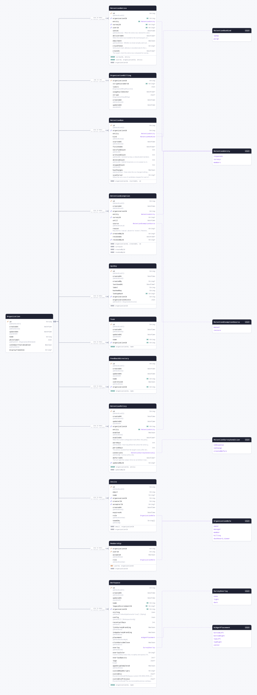

| Field                      | Type       | Constraints | Default      | Description              |
| -------------------------- | ---------- | ----------- | ------------ | ------------------------ |
| `id`                       | `String`   | PK NOT NULL | `cuid(1)`    |                          |
| `createdAt` (`created_at`) | `DateTime` | NOT NULL    | `now()`      |                          |
| `updatedAt` (`updated_at`) | `DateTime` | NOT NULL    | `@updatedAt` |                          |
| `name`                     | `String`   | NOT NULL    |              |                          |
| `whitelabel`               | `Json`     | NOT NULL    | `"{}"`       | [OrganizationWhitelabel] |
| `isAISmartToolsEnabled`    | `Boolean`  | NOT NULL    | `false`      |                          |
| `displayTimeZone`          | `String`   | NULL        |              |                          |

#### Referenced by

- `id` ← [Workspace.organizationId](#model-Workspace) (one-to-many, on delete Cascade)
- `id` ← [OrganizationBilling.organizationId](#model-OrganizationBilling) (one-to-one, on delete Cascade)
- `id` ← [Membership.organizationId](#model-Membership) (one-to-many, on delete Cascade)
- `id` ← [Invite.organizationId](#model-Invite) (one-to-many, on delete Cascade)
- `id` ← [ApiKey.organizationId](#model-ApiKey) (one-to-many, on delete Cascade)
- `id` ← [Team.organizationId](#model-Team) (one-to-many, on delete Cascade)
- `id` ← [FeedbackDirectory.organizationId](#model-FeedbackDirectory) (one-to-many, on delete Cascade)
- `id` ← [RetentionPolicy.organizationId](#model-RetentionPolicy) (one-to-many, on delete Cascade)
- `id` ← [RetentionExemption.organizationId](#model-RetentionExemption) (one-to-many, on delete Cascade)
- `id` ← [RetentionRun.organizationId](#model-RetentionRun) (one-to-many, on delete Cascade)
- `id` ← [RetentionNotice.organizationId](#model-RetentionNotice) (one-to-many, on delete Cascade)

#### Definition

```sql
CREATE TABLE "Organization" (
    "id" TEXT NOT NULL,
    "created_at" TIMESTAMP(3) NOT NULL DEFAULT CURRENT_TIMESTAMP,
    "updated_at" TIMESTAMP(3) NOT NULL,
    "name" TEXT NOT NULL,
    "whitelabel" JSONB NOT NULL DEFAULT '{}',
    "isAISmartToolsEnabled" BOOLEAN NOT NULL DEFAULT false,
    "displayTimeZone" TEXT,

    CONSTRAINT "Organization_pkey" PRIMARY KEY ("id")
);
```

<details>
<summary>Queries and their SQL</summary>

**findMany**: Every row

```ts
await prisma.organization.findMany();
```

```sql
SELECT
  "public"."Organization"."id",
  "public"."Organization"."created_at",
  "public"."Organization"."updated_at",
  "public"."Organization"."name",
  "public"."Organization"."whitelabel",
  "public"."Organization"."isAISmartToolsEnabled",
  "public"."Organization"."displayTimeZone"
FROM
  "public"."Organization"
WHERE
  1 = 1
OFFSET
  $1
-- params: ["0"]
```

**count**: How many rows there are

```ts
await prisma.organization.count();
```

```sql
SELECT
  COUNT(*) AS "_count$_all"
FROM
  (
    SELECT
      "public"."Organization"."id"
    FROM
      "public"."Organization"
    WHERE
      1 = 1
    OFFSET
      $1
  ) AS "sub"
-- params: ["0"]
```

**findMany**: Every row with its relations

```ts
await prisma.organization.findMany({
  include: {
    memberships: true,
    workspaces: true,
    billing: true,
    invites: true,
    teams: true,
    apiKeys: true,
    feedbackDirectories: true,
    retentionPolicies: true,
    retentionExemptions: true,
    retentionRuns: true,
    retentionNotices: true,
  },
});
```

```sql
SELECT
  "public"."Organization"."id",
  "public"."Organization"."created_at",
  "public"."Organization"."updated_at",
  "public"."Organization"."name",
  "public"."Organization"."whitelabel",
  "public"."Organization"."isAISmartToolsEnabled",
  "public"."Organization"."displayTimeZone"
FROM
  "public"."Organization"
WHERE
  1 = 1
OFFSET
  $1
-- params: ["0"]

SELECT
  "public"."Membership"."userId",
  "public"."Membership"."organizationId",
  "public"."Membership"."accepted",
  "public"."Membership"."role"::text
FROM
  "public"."Membership"
WHERE
  "public"."Membership"."organizationId" IN ($1)
OFFSET
  $2
-- params: ["<id of the rows above>","0"]

SELECT
  "public"."Workspace"."id",
  "public"."Workspace"."created_at",
  "public"."Workspace"."updated_at",
  "public"."Workspace"."name",
  "public"."Workspace"."legacyEnvironmentId",
  "public"."Workspace"."organizationId",
  "public"."Workspace"."styling",
  "public"."Workspace"."config",
  "public"."Workspace"."recontactDays",
  "public"."Workspace"."linkSurveyBranding",
  "public"."Workspace"."inAppSurveyBranding",
  "public"."Workspace"."placement"::text,
  "public"."Workspace"."clickOutsideClose",
  "public"."Workspace"."overlay"::text,
  "public"."Workspace"."overlayColor",
  "public"."Workspace"."overlayOpacity",
  "public"."Workspace"."logo",
  "public"."Workspace"."appSetupCompleted",
  "public"."Workspace"."customHeadScripts",
  "public"."Workspace"."customCss",
  "public"."Workspace"."customCssPrevious"
FROM
  "public"."Workspace"
WHERE
  "public"."Workspace"."organizationId" IN ($1)
OFFSET
  $2
-- params: ["<id of the rows above>","0"]

SELECT
  "public"."OrganizationBilling"."organization_id",
  "public"."OrganizationBilling"."stripe_customer_id",
  "public"."OrganizationBilling"."limits",
  "public"."OrganizationBilling"."usage_cycle_anchor",
  "public"."OrganizationBilling"."stripe",
  "public"."OrganizationBilling"."created_at",
  "public"."OrganizationBilling"."updated_at"
FROM
  "public"."OrganizationBilling"
WHERE
  "public"."OrganizationBilling"."organization_id" IN ($1)
OFFSET
  $2
-- params: ["<id of the rows above>","0"]

SELECT
  "public"."Invite"."id",
  "public"."Invite"."email",
  "public"."Invite"."name",
  "public"."Invite"."organizationId",
  "public"."Invite"."creatorId",
  "public"."Invite"."acceptorId",
  "public"."Invite"."createdAt",
  "public"."Invite"."expiresAt",
  "public"."Invite"."role"::text,
  "public"."Invite"."teamIds"
FROM
  "public"."Invite"
WHERE
  "public"."Invite"."organizationId" IN ($1)
OFFSET
  $2
-- params: ["<id of the rows above>","0"]

SELECT
  "public"."Team"."id",
  "public"."Team"."created_at",
  "public"."Team"."updated_at",
  "public"."Team"."name",
  "public"."Team"."organizationId"
FROM
  "public"."Team"
WHERE
  "public"."Team"."organizationId" IN ($1)
OFFSET
  $2
-- params: ["<id of the rows above>","0"]

SELECT
  "public"."ApiKey"."id",
  "public"."ApiKey"."createdAt",
  "public"."ApiKey"."createdBy",
  "public"."ApiKey"."lastUsedAt",
  "public"."ApiKey"."label",
  "public"."ApiKey"."hashedKey",
  "public"."ApiKey"."lookupHash",
  "public"."ApiKey"."organizationId",
  "public"."ApiKey"."organizationAccess"
FROM
  "public"."ApiKey"
WHERE
  "public"."ApiKey"."organizationId" IN ($1)
OFFSET
  $2
-- params: ["<id of the rows above>","0"]

SELECT
  "public"."FeedbackDirectory"."id",
  "public"."FeedbackDirectory"."created_at",
  "public"."FeedbackDirectory"."updated_at",
  "public"."FeedbackDirectory"."name",
  "public"."FeedbackDirectory"."isArchived",
  "public"."FeedbackDirectory"."organizationId"
FROM
  "public"."FeedbackDirectory"
WHERE
  "public"."FeedbackDirectory"."organizationId" IN ($1)
OFFSET
  $2
-- params: ["<id of the rows above>","0"]

SELECT
  "public"."RetentionPolicy"."id",
  "public"."RetentionPolicy"."created_at",
  "public"."RetentionPolicy"."updated_at",
  "public"."RetentionPolicy"."organizationId",
  "public"."RetentionPolicy"."entity"::text,
  "public"."RetentionPolicy"."enabled",
  "public"."RetentionPolicy"."enabledAt",
  "public"."RetentionPolicy"."warnDays",
  "public"."RetentionPolicy"."periodDays",
  "public"."RetentionPolicy"."conditions"::text[],
  "public"."RetentionPolicy"."deferredAt",
  "public"."RetentionPolicy"."updatedById"
FROM
  "public"."RetentionPolicy"
WHERE
  "public"."RetentionPolicy"."organizationId" IN ($1)
OFFSET
  $2
-- params: ["<id of the rows above>","0"]

SELECT
  "public"."RetentionExemption"."id",
  "public"."RetentionExemption"."created_at",
  "public"."RetentionExemption"."organizationId",
  "public"."RetentionExemption"."entity"::text,
  "public"."RetentionExemption"."surveyId",
  "public"."RetentionExemption"."until",
  "public"."RetentionExemption"."source"::text,
  "public"."RetentionExemption"."reason",
  "public"."RetentionExemption"."createdById",
  "public"."RetentionExemption"."revokedAt",
  "public"."RetentionExemption"."revokedById"
FROM
  "public"."RetentionExemption"
WHERE
  "public"."RetentionExemption"."organizationId" IN ($1)
OFFSET
  $2
-- params: ["<id of the rows above>","0"]

SELECT
  "public"."RetentionRun"."id",
  "public"."RetentionRun"."organizationId",
  "public"."RetentionRun"."entity"::text,
  "public"."RetentionRun"."kind"::text,
  "public"."RetentionRun"."startedAt",
  "public"."RetentionRun"."finishedAt",
  "public"."RetentionRun"."notifiedCount",
  "public"."RetentionRun"."archivedCount",
  "public"."RetentionRun"."deletedCount",
  "public"."RetentionRun"."skippedCount",
  "public"."RetentionRun"."hasChanges",
  "public"."RetentionRun"."scanCursor"
FROM
  "public"."RetentionRun"
WHERE
  "public"."RetentionRun"."organizationId" IN ($1)
OFFSET
  $2
-- params: ["<id of the rows above>","0"]

SELECT
  "public"."RetentionNotice"."id",
  "public"."RetentionNotice"."organizationId",
  "public"."RetentionNotice"."entity"::text,
  "public"."RetentionNotice"."surveyId",
  "public"."RetentionNotice"."userId",
  "public"."RetentionNotice"."sentAt",
  "public"."RetentionNotice"."deliveredAt",
  "public"."RetentionNotice"."emailSent",
  "public"."RetentionNotice"."claimToken",
  "public"."RetentionNotice"."clockAt"
FROM
  "public"."RetentionNotice"
WHERE
  "public"."RetentionNotice"."organizationId" IN ($1)
OFFSET
  $2
-- params: ["<id of the rows above>","0"]
```

**findUnique**: One row by what is unique to it

```ts
await prisma.organization.findUnique({ where: { id: "example" } });
```

```sql
SELECT
  "public"."Organization"."id",
  "public"."Organization"."created_at",
  "public"."Organization"."updated_at",
  "public"."Organization"."name",
  "public"."Organization"."whitelabel",
  "public"."Organization"."isAISmartToolsEnabled",
  "public"."Organization"."displayTimeZone"
FROM
  "public"."Organization"
WHERE
  (
    "public"."Organization"."id" = $1
    AND 1 = 1
  )
LIMIT
  $2
OFFSET
  $3
-- params: ["example","1","0"]
```

**create**: Create a row

```ts
await prisma.organization.create({ data: { name: "example" } });
```

```sql
INSERT INTO
  "public"."Organization" (
    "id",
    "created_at",
    "updated_at",
    "name",
    "whitelabel",
    "isAISmartToolsEnabled"
  )
VALUES
  ($1, $2, $3, $4, $5, $6)
RETURNING
  "public"."Organization"."id",
  "public"."Organization"."created_at",
  "public"."Organization"."updated_at",
  "public"."Organization"."name",
  "public"."Organization"."whitelabel",
  "public"."Organization"."isAISmartToolsEnabled",
  "public"."Organization"."displayTimeZone"
-- params: ["<cuid(1)>","<now()>","<now()>","example","{}",false]
```

**update**: Update a row

```ts
await prisma.organization.update({
  where: { id: "example" },
  data: { createdAt: new Date("2026-01-01T00:00:00.000Z") },
});
```

```sql
UPDATE "public"."Organization"
SET
  "created_at" = $1,
  "updated_at" = $2
WHERE
  (
    "public"."Organization"."id" = $3
    AND 1 = 1
  )
RETURNING
  "public"."Organization"."id",
  "public"."Organization"."created_at",
  "public"."Organization"."updated_at",
  "public"."Organization"."name",
  "public"."Organization"."whitelabel",
  "public"."Organization"."isAISmartToolsEnabled",
  "public"."Organization"."displayTimeZone"
-- params: ["2026-01-01T00:00:00.000Z",{"prisma__type":"generatorCall","prisma__value":{"name":"now","args":[],"returnType":{"type":"DateTime"}}},"example"]
```

**delete**: Delete a row

```ts
await prisma.organization.delete({ where: { id: "example" } });
```

```sql
DELETE FROM "public"."Organization"
WHERE
  (
    "public"."Organization"."id" = $1
    AND 1 = 1
  )
RETURNING
  "public"."Organization"."id",
  "public"."Organization"."created_at",
  "public"."Organization"."updated_at",
  "public"."Organization"."name",
  "public"."Organization"."whitelabel",
  "public"."Organization"."isAISmartToolsEnabled",
  "public"."Organization"."displayTimeZone"
-- params: ["example"]
```

</details>

<a id="model-OrganizationBilling"></a>

### OrganizationBilling

Stores billing and Stripe synchronization data for an organization.

@property organizationId - Reference to the organization
@property stripeCustomerId - Stripe customer ID for cloud billing
@property limits - Plan limits used by feature and quota checks
@property usageCycleAnchor - Stable anchor used to derive the current monthly usage cycle
@property stripe - Stripe synchronization snapshot data

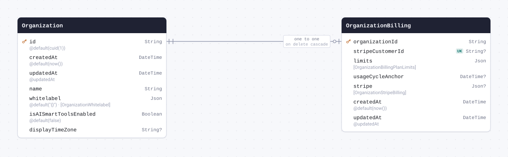

| Field                                     | Type       | Constraints                                          | Default      | Description                     |
| ----------------------------------------- | ---------- | ---------------------------------------------------- | ------------ | ------------------------------- |
| `organizationId` (`organization_id`)      | `String`   | PK NOT NULL → [Organization.id](#model-Organization) |              |                                 |
| `stripeCustomerId` (`stripe_customer_id`) | `String`   | UNIQUE NULL                                          |              |                                 |
| `limits`                                  | `Json`     | NOT NULL                                             |              | [OrganizationBillingPlanLimits] |
| `usageCycleAnchor` (`usage_cycle_anchor`) | `DateTime` | NULL                                                 |              |                                 |
| `stripe`                                  | `Json`     | NULL                                                 |              | [OrganizationStripeBilling]     |
| `createdAt` (`created_at`)                | `DateTime` | NOT NULL                                             | `now()`      |                                 |
| `updatedAt` (`updated_at`)                | `DateTime` | NOT NULL                                             | `@updatedAt` |                                 |

#### References

- `organizationId` → [Organization.id](#model-Organization) (one-to-one, on delete Cascade)

#### Definition

```sql
CREATE TABLE "OrganizationBilling" (
    "organization_id" TEXT NOT NULL,
    "stripe_customer_id" TEXT,
    "limits" JSONB NOT NULL,
    "usage_cycle_anchor" TIMESTAMP(3),
    "stripe" JSONB,
    "created_at" TIMESTAMP(3) NOT NULL DEFAULT CURRENT_TIMESTAMP,
    "updated_at" TIMESTAMP(3) NOT NULL,

    CONSTRAINT "OrganizationBilling_pkey" PRIMARY KEY ("organization_id")
);

CREATE UNIQUE INDEX "OrganizationBilling_stripe_customer_id_key" ON "OrganizationBilling"("stripe_customer_id");

ALTER TABLE "OrganizationBilling" ADD CONSTRAINT "OrganizationBilling_organization_id_fkey" FOREIGN KEY ("organization_id") REFERENCES "Organization"("id") ON DELETE CASCADE ON UPDATE CASCADE;
```

<details>
<summary>Queries and their SQL</summary>

**findMany**: Every row

```ts
await prisma.organizationBilling.findMany();
```

```sql
SELECT
  "public"."OrganizationBilling"."organization_id",
  "public"."OrganizationBilling"."stripe_customer_id",
  "public"."OrganizationBilling"."limits",
  "public"."OrganizationBilling"."usage_cycle_anchor",
  "public"."OrganizationBilling"."stripe",
  "public"."OrganizationBilling"."created_at",
  "public"."OrganizationBilling"."updated_at"
FROM
  "public"."OrganizationBilling"
WHERE
  1 = 1
OFFSET
  $1
-- params: ["0"]
```

**count**: How many rows there are

```ts
await prisma.organizationBilling.count();
```

```sql
SELECT
  COUNT(*) AS "_count$_all"
FROM
  (
    SELECT
      "public"."OrganizationBilling"."organization_id"
    FROM
      "public"."OrganizationBilling"
    WHERE
      1 = 1
    OFFSET
      $1
  ) AS "sub"
-- params: ["0"]
```

**findMany**: Every row with its relations

```ts
await prisma.organizationBilling.findMany({ include: { organization: true } });
```

```sql
SELECT
  "public"."OrganizationBilling"."organization_id",
  "public"."OrganizationBilling"."stripe_customer_id",
  "public"."OrganizationBilling"."limits",
  "public"."OrganizationBilling"."usage_cycle_anchor",
  "public"."OrganizationBilling"."stripe",
  "public"."OrganizationBilling"."created_at",
  "public"."OrganizationBilling"."updated_at"
FROM
  "public"."OrganizationBilling"
WHERE
  1 = 1
OFFSET
  $1
-- params: ["0"]

SELECT
  "public"."Organization"."id",
  "public"."Organization"."created_at",
  "public"."Organization"."updated_at",
  "public"."Organization"."name",
  "public"."Organization"."whitelabel",
  "public"."Organization"."isAISmartToolsEnabled",
  "public"."Organization"."displayTimeZone"
FROM
  "public"."Organization"
WHERE
  "public"."Organization"."id" IN ($1)
OFFSET
  $2
-- params: ["<organizationId of the rows above>","0"]
```

**findUnique**: One row by what is unique to it

```ts
await prisma.organizationBilling.findUnique({ where: { organizationId: "example" } });
```

```sql
SELECT
  "public"."OrganizationBilling"."organization_id",
  "public"."OrganizationBilling"."stripe_customer_id",
  "public"."OrganizationBilling"."limits",
  "public"."OrganizationBilling"."usage_cycle_anchor",
  "public"."OrganizationBilling"."stripe",
  "public"."OrganizationBilling"."created_at",
  "public"."OrganizationBilling"."updated_at"
FROM
  "public"."OrganizationBilling"
WHERE
  (
    "public"."OrganizationBilling"."organization_id" = $1
    AND 1 = 1
  )
LIMIT
  $2
OFFSET
  $3
-- params: ["example","1","0"]
```

**create**: Create a row

```ts
await prisma.organizationBilling.create({ data: { organizationId: "example", limits: {} } });
```

```sql
INSERT INTO
  "public"."OrganizationBilling" (
    "organization_id",
    "limits",
    "created_at",
    "updated_at"
  )
VALUES
  ($1, $2, $3, $4)
RETURNING
  "public"."OrganizationBilling"."organization_id",
  "public"."OrganizationBilling"."stripe_customer_id",
  "public"."OrganizationBilling"."limits",
  "public"."OrganizationBilling"."usage_cycle_anchor",
  "public"."OrganizationBilling"."stripe",
  "public"."OrganizationBilling"."created_at",
  "public"."OrganizationBilling"."updated_at"
-- params: ["example","{}","<now()>","<now()>"]
```

**update**: Update a row

```ts
await prisma.organizationBilling.update({
  where: { organizationId: "example" },
  data: { stripeCustomerId: "example" },
});
```

```sql
UPDATE "public"."OrganizationBilling"
SET
  "stripe_customer_id" = $1,
  "updated_at" = $2
WHERE
  (
    "public"."OrganizationBilling"."organization_id" = $3
    AND 1 = 1
  )
RETURNING
  "public"."OrganizationBilling"."organization_id",
  "public"."OrganizationBilling"."stripe_customer_id",
  "public"."OrganizationBilling"."limits",
  "public"."OrganizationBilling"."usage_cycle_anchor",
  "public"."OrganizationBilling"."stripe",
  "public"."OrganizationBilling"."created_at",
  "public"."OrganizationBilling"."updated_at"
-- params: ["example",{"prisma__type":"generatorCall","prisma__value":{"name":"now","args":[],"returnType":{"type":"DateTime"}}},"example"]
```

**delete**: Delete a row

```ts
await prisma.organizationBilling.delete({ where: { organizationId: "example" } });
```

```sql
DELETE FROM "public"."OrganizationBilling"
WHERE
  (
    "public"."OrganizationBilling"."organization_id" = $1
    AND 1 = 1
  )
RETURNING
  "public"."OrganizationBilling"."organization_id",
  "public"."OrganizationBilling"."stripe_customer_id",
  "public"."OrganizationBilling"."limits",
  "public"."OrganizationBilling"."usage_cycle_anchor",
  "public"."OrganizationBilling"."stripe",
  "public"."OrganizationBilling"."created_at",
  "public"."OrganizationBilling"."updated_at"
-- params: ["example"]
```

</details>

<a id="model-Membership"></a>

### Membership

Links users to organizations with specific roles.
Manages organization membership and permissions.
Core model for managing user access within organizations.

@property organization - The organization the user belongs to
@property user - The member user
@property accepted - Whether the user has accepted the membership
@property role - User's role within the organization (owner, manager, member, billing)

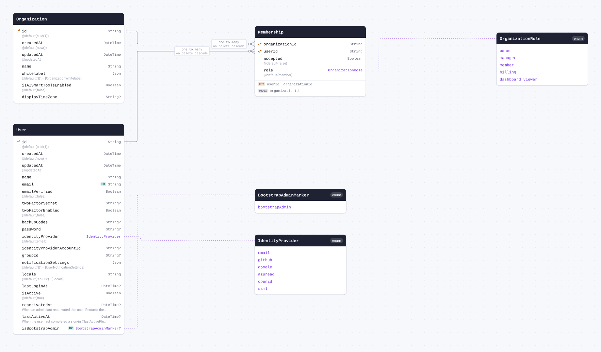

| Field            | Type                                         | Constraints                                          | Default  | Description |
| ---------------- | -------------------------------------------- | ---------------------------------------------------- | -------- | ----------- |
| `organizationId` | `String`                                     | PK NOT NULL → [Organization.id](#model-Organization) |          |             |
| `userId`         | `String`                                     | PK NOT NULL → [User.id](#model-User)                 |          |             |
| `accepted`       | `Boolean`                                    | NOT NULL                                             | `false`  |             |
| `role`           | [`OrganizationRole`](#enum-OrganizationRole) | NOT NULL                                             | `member` |             |

#### Indexes

- `@@id([userId, organizationId])`
- `@@index([organizationId])`

#### References

- `organizationId` → [Organization.id](#model-Organization) (many-to-one, on delete Cascade)
- `userId` → [User.id](#model-User) (many-to-one, on delete Cascade)

#### Definition

```sql
CREATE TABLE "Membership" (
    "organizationId" TEXT NOT NULL,
    "userId" TEXT NOT NULL,
    "accepted" BOOLEAN NOT NULL DEFAULT false,
    "role" "OrganizationRole" NOT NULL DEFAULT 'member',

    CONSTRAINT "Membership_pkey" PRIMARY KEY ("userId","organizationId")
);

CREATE INDEX "Membership_organizationId_idx" ON "Membership"("organizationId");

ALTER TABLE "Membership" ADD CONSTRAINT "Membership_organizationId_fkey" FOREIGN KEY ("organizationId") REFERENCES "Organization"("id") ON DELETE CASCADE ON UPDATE CASCADE;

ALTER TABLE "Membership" ADD CONSTRAINT "Membership_userId_fkey" FOREIGN KEY ("userId") REFERENCES "User"("id") ON DELETE CASCADE ON UPDATE CASCADE;
```

<details>
<summary>Queries and their SQL</summary>

**findMany**: Every row

```ts
await prisma.membership.findMany();
```

```sql
SELECT
  "public"."Membership"."userId",
  "public"."Membership"."organizationId",
  "public"."Membership"."accepted",
  "public"."Membership"."role"::text
FROM
  "public"."Membership"
WHERE
  1 = 1
OFFSET
  $1
-- params: ["0"]
```

**count**: How many rows there are

```ts
await prisma.membership.count();
```

```sql
SELECT
  COUNT(*) AS "_count$_all"
FROM
  (
    SELECT
      "public"."Membership"."userId",
      "public"."Membership"."organizationId"
    FROM
      "public"."Membership"
    WHERE
      1 = 1
    OFFSET
      $1
  ) AS "sub"
-- params: ["0"]
```

**findMany**: Every row with its relations

```ts
await prisma.membership.findMany({ include: { organization: true, user: true } });
```

```sql
SELECT
  "public"."Membership"."userId",
  "public"."Membership"."organizationId",
  "public"."Membership"."accepted",
  "public"."Membership"."role"::text
FROM
  "public"."Membership"
WHERE
  1 = 1
OFFSET
  $1
-- params: ["0"]

SELECT
  "public"."Organization"."id",
  "public"."Organization"."created_at",
  "public"."Organization"."updated_at",
  "public"."Organization"."name",
  "public"."Organization"."whitelabel",
  "public"."Organization"."isAISmartToolsEnabled",
  "public"."Organization"."displayTimeZone"
FROM
  "public"."Organization"
WHERE
  "public"."Organization"."id" IN ($1)
OFFSET
  $2
-- params: ["<organizationId of the rows above>","0"]

SELECT
  "public"."User"."id",
  "public"."User"."created_at",
  "public"."User"."updated_at",
  "public"."User"."name",
  "public"."User"."email",
  "public"."User"."email_verified",
  "public"."User"."twoFactorSecret",
  "public"."User"."twoFactorEnabled",
  "public"."User"."backupCodes",
  "public"."User"."password",
  "public"."User"."identityProvider"::text,
  "public"."User"."identityProviderAccountId",
  "public"."User"."groupId",
  "public"."User"."notificationSettings",
  "public"."User"."locale",
  "public"."User"."lastLoginAt",
  "public"."User"."isActive",
  "public"."User"."reactivatedAt",
  "public"."User"."lastActiveAt",
  "public"."User"."isBootstrapAdmin"::text
FROM
  "public"."User"
WHERE
  "public"."User"."id" IN ($1)
OFFSET
  $2
-- params: ["<userId of the rows above>","0"]
```

**findUnique**: One row by what is unique to it

```ts
await prisma.membership.findUnique({
  where: { userId_organizationId: { userId: "example", organizationId: "example" } },
});
```

```sql
SELECT
  "public"."Membership"."userId",
  "public"."Membership"."organizationId",
  "public"."Membership"."accepted",
  "public"."Membership"."role"::text
FROM
  "public"."Membership"
WHERE
  (
    (
      "public"."Membership"."userId" = $1
      AND "public"."Membership"."organizationId" = $2
    )
    AND 1 = 1
  )
LIMIT
  $3
OFFSET
  $4
-- params: ["example","example","1","0"]
```

**create**: Create a row

```ts
await prisma.membership.create({ data: { organizationId: "example", userId: "example" } });
```

```sql
INSERT INTO
  "public"."Membership" ("organizationId", "userId", "accepted", "role")
VALUES
  (
    $1,
    $2,
    $3,
    CAST($4::text AS "public"."OrganizationRole")
  )
RETURNING
  "public"."Membership"."userId",
  "public"."Membership"."organizationId",
  "public"."Membership"."accepted",
  "public"."Membership"."role"::text
-- params: ["example","example",false,"member"]
```

**update**: Update a row

```ts
await prisma.membership.update({
  where: { userId_organizationId: { userId: "example", organizationId: "example" } },
  data: { accepted: true },
});
```

```sql
UPDATE "public"."Membership"
SET
  "accepted" = $1
WHERE
  (
    (
      "public"."Membership"."userId" = $2
      AND "public"."Membership"."organizationId" = $3
    )
    AND 1 = 1
  )
RETURNING
  "public"."Membership"."userId",
  "public"."Membership"."organizationId",
  "public"."Membership"."accepted",
  "public"."Membership"."role"::text
-- params: [true,"example","example"]
```

**delete**: Delete a row

```ts
await prisma.membership.delete({
  where: { userId_organizationId: { userId: "example", organizationId: "example" } },
});
```

```sql
DELETE FROM "public"."Membership"
WHERE
  (
    (
      "public"."Membership"."userId" = $1
      AND "public"."Membership"."organizationId" = $2
    )
    AND 1 = 1
  )
RETURNING
  "public"."Membership"."userId",
  "public"."Membership"."organizationId",
  "public"."Membership"."accepted",
  "public"."Membership"."role"::text
-- params: ["example","example"]
```

</details>

<a id="model-Invite"></a>

### Invite

Represents pending invitations to join an organization.
Used to manage the process of adding new users to an organization.
Once accepted, invites are converted into memberships.

@property id - Unique identifier for the invite
@property email - Email address of the invited user
@property name - Optional display name for the invited user
@property organization - The organization sending the invite
@property creator - The user who created the invite
@property acceptor - The user who accepted the invite (if accepted)
@property expiresAt - When the invite becomes invalid
@property role - Intended role for the invited user
@property teamIds - Teams the user will be added to upon acceptance

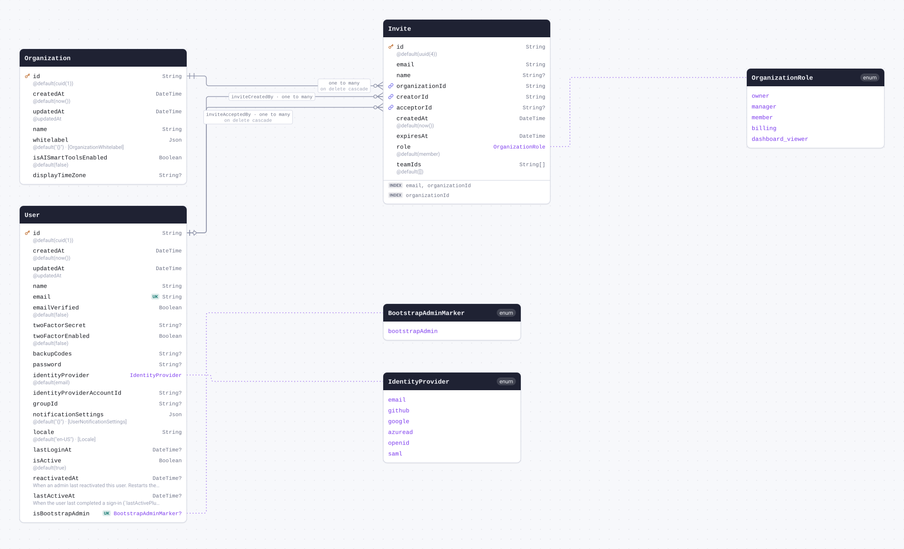

| Field            | Type                                         | Constraints                                       | Default   | Description |
| ---------------- | -------------------------------------------- | ------------------------------------------------- | --------- | ----------- |
| `id`             | `String`                                     | PK NOT NULL                                       | `uuid(4)` |             |
| `email`          | `String`                                     | NOT NULL                                          |           |             |
| `name`           | `String`                                     | NULL                                              |           |             |
| `organizationId` | `String`                                     | NOT NULL → [Organization.id](#model-Organization) |           |             |
| `creatorId`      | `String`                                     | NOT NULL → [User.id](#model-User)                 |           |             |
| `acceptorId`     | `String`                                     | NULL → [User.id](#model-User)                     |           |             |
| `createdAt`      | `DateTime`                                   | NOT NULL                                          | `now()`   |             |
| `expiresAt`      | `DateTime`                                   | NOT NULL                                          |           |             |
| `role`           | [`OrganizationRole`](#enum-OrganizationRole) | NOT NULL                                          | `member`  |             |
| `teamIds`        | `String[]`                                   | NOT NULL                                          | `[]`      |             |

#### Indexes

- `@@index([email, organizationId])`
- `@@index([organizationId])`

#### References

- `organizationId` → [Organization.id](#model-Organization) (many-to-one, on delete Cascade)
- `creatorId` → [User.id](#model-User) (many-to-one)
- `acceptorId` → [User.id](#model-User) (many-to-one, on delete Cascade)

#### Definition

```sql
CREATE TABLE "Invite" (
    "id" TEXT NOT NULL,
    "email" TEXT NOT NULL,
    "name" TEXT,
    "organizationId" TEXT NOT NULL,
    "creatorId" TEXT NOT NULL,
    "acceptorId" TEXT,
    "createdAt" TIMESTAMP(3) NOT NULL DEFAULT CURRENT_TIMESTAMP,
    "expiresAt" TIMESTAMP(3) NOT NULL,
    "role" "OrganizationRole" NOT NULL DEFAULT 'member',
    "teamIds" TEXT[] DEFAULT ARRAY[]::TEXT[],

    CONSTRAINT "Invite_pkey" PRIMARY KEY ("id")
);

CREATE INDEX "Invite_email_organizationId_idx" ON "Invite"("email", "organizationId");

CREATE INDEX "Invite_organizationId_idx" ON "Invite"("organizationId");

ALTER TABLE "Invite" ADD CONSTRAINT "Invite_organizationId_fkey" FOREIGN KEY ("organizationId") REFERENCES "Organization"("id") ON DELETE CASCADE ON UPDATE CASCADE;

ALTER TABLE "Invite" ADD CONSTRAINT "Invite_creatorId_fkey" FOREIGN KEY ("creatorId") REFERENCES "User"("id") ON DELETE RESTRICT ON UPDATE CASCADE;

ALTER TABLE "Invite" ADD CONSTRAINT "Invite_acceptorId_fkey" FOREIGN KEY ("acceptorId") REFERENCES "User"("id") ON DELETE CASCADE ON UPDATE CASCADE;
```

<details>
<summary>Queries and their SQL</summary>

**findMany**: Every row

```ts
await prisma.invite.findMany();
```

```sql
SELECT
  "public"."Invite"."id",
  "public"."Invite"."email",
  "public"."Invite"."name",
  "public"."Invite"."organizationId",
  "public"."Invite"."creatorId",
  "public"."Invite"."acceptorId",
  "public"."Invite"."createdAt",
  "public"."Invite"."expiresAt",
  "public"."Invite"."role"::text,
  "public"."Invite"."teamIds"
FROM
  "public"."Invite"
WHERE
  1 = 1
OFFSET
  $1
-- params: ["0"]
```

**count**: How many rows there are

```ts
await prisma.invite.count();
```

```sql
SELECT
  COUNT(*) AS "_count$_all"
FROM
  (
    SELECT
      "public"."Invite"."id"
    FROM
      "public"."Invite"
    WHERE
      1 = 1
    OFFSET
      $1
  ) AS "sub"
-- params: ["0"]
```

**findMany**: Every row with its relations

```ts
await prisma.invite.findMany({ include: { organization: true, creator: true, acceptor: true } });
```

```sql
SELECT
  "public"."Invite"."id",
  "public"."Invite"."email",
  "public"."Invite"."name",
  "public"."Invite"."organizationId",
  "public"."Invite"."creatorId",
  "public"."Invite"."acceptorId",
  "public"."Invite"."createdAt",
  "public"."Invite"."expiresAt",
  "public"."Invite"."role"::text,
  "public"."Invite"."teamIds"
FROM
  "public"."Invite"
WHERE
  1 = 1
OFFSET
  $1
-- params: ["0"]

SELECT
  "public"."Organization"."id",
  "public"."Organization"."created_at",
  "public"."Organization"."updated_at",
  "public"."Organization"."name",
  "public"."Organization"."whitelabel",
  "public"."Organization"."isAISmartToolsEnabled",
  "public"."Organization"."displayTimeZone"
FROM
  "public"."Organization"
WHERE
  "public"."Organization"."id" IN ($1)
OFFSET
  $2
-- params: ["<organizationId of the rows above>","0"]

SELECT
  "public"."User"."id",
  "public"."User"."created_at",
  "public"."User"."updated_at",
  "public"."User"."name",
  "public"."User"."email",
  "public"."User"."email_verified",
  "public"."User"."twoFactorSecret",
  "public"."User"."twoFactorEnabled",
  "public"."User"."backupCodes",
  "public"."User"."password",
  "public"."User"."identityProvider"::text,
  "public"."User"."identityProviderAccountId",
  "public"."User"."groupId",
  "public"."User"."notificationSettings",
  "public"."User"."locale",
  "public"."User"."lastLoginAt",
  "public"."User"."isActive",
  "public"."User"."reactivatedAt",
  "public"."User"."lastActiveAt",
  "public"."User"."isBootstrapAdmin"::text
FROM
  "public"."User"
WHERE
  "public"."User"."id" IN ($1)
OFFSET
  $2
-- params: ["<creatorId of the rows above>","0"]

SELECT
  "public"."User"."id",
  "public"."User"."created_at",
  "public"."User"."updated_at",
  "public"."User"."name",
  "public"."User"."email",
  "public"."User"."email_verified",
  "public"."User"."twoFactorSecret",
  "public"."User"."twoFactorEnabled",
  "public"."User"."backupCodes",
  "public"."User"."password",
  "public"."User"."identityProvider"::text,
  "public"."User"."identityProviderAccountId",
  "public"."User"."groupId",
  "public"."User"."notificationSettings",
  "public"."User"."locale",
  "public"."User"."lastLoginAt",
  "public"."User"."isActive",
  "public"."User"."reactivatedAt",
  "public"."User"."lastActiveAt",
  "public"."User"."isBootstrapAdmin"::text
FROM
  "public"."User"
WHERE
  "public"."User"."id" IN ($1)
OFFSET
  $2
-- params: ["<acceptorId of the rows above>","0"]
```

**findUnique**: One row by what is unique to it

```ts
await prisma.invite.findUnique({ where: { id: "example" } });
```

```sql
SELECT
  "public"."Invite"."id",
  "public"."Invite"."email",
  "public"."Invite"."name",
  "public"."Invite"."organizationId",
  "public"."Invite"."creatorId",
  "public"."Invite"."acceptorId",
  "public"."Invite"."createdAt",
  "public"."Invite"."expiresAt",
  "public"."Invite"."role"::text,
  "public"."Invite"."teamIds"
FROM
  "public"."Invite"
WHERE
  (
    "public"."Invite"."id" = $1
    AND 1 = 1
  )
LIMIT
  $2
OFFSET
  $3
-- params: ["example","1","0"]
```

**create**: Create a row

```ts
await prisma.invite.create({
  data: {
    email: "example",
    organizationId: "example",
    creatorId: "example",
    expiresAt: new Date("2026-01-01T00:00:00.000Z"),
  },
});
```

```sql
INSERT INTO
  "public"."Invite" (
    "id",
    "email",
    "organizationId",
    "creatorId",
    "createdAt",
    "expiresAt",
    "role",
    "teamIds"
  )
VALUES
  (
    $1,
    $2,
    $3,
    $4,
    $5,
    $6,
    CAST($7::text AS "public"."OrganizationRole"),
    $8
  )
RETURNING
  "public"."Invite"."id",
  "public"."Invite"."email",
  "public"."Invite"."name",
  "public"."Invite"."organizationId",
  "public"."Invite"."creatorId",
  "public"."Invite"."acceptorId",
  "public"."Invite"."createdAt",
  "public"."Invite"."expiresAt",
  "public"."Invite"."role"::text,
  "public"."Invite"."teamIds"
-- params: ["<uuid(4)>","example","example","example","<now()>","2026-01-01T00:00:00.000Z","member",[]]
```

**update**: Update a row

```ts
await prisma.invite.update({ where: { id: "example" }, data: { email: "example" } });
```

```sql
UPDATE "public"."Invite"
SET
  "email" = $1
WHERE
  (
    "public"."Invite"."id" = $2
    AND 1 = 1
  )
RETURNING
  "public"."Invite"."id",
  "public"."Invite"."email",
  "public"."Invite"."name",
  "public"."Invite"."organizationId",
  "public"."Invite"."creatorId",
  "public"."Invite"."acceptorId",
  "public"."Invite"."createdAt",
  "public"."Invite"."expiresAt",
  "public"."Invite"."role"::text,
  "public"."Invite"."teamIds"
-- params: ["example","example"]
```

**delete**: Delete a row

```ts
await prisma.invite.delete({ where: { id: "example" } });
```

```sql
DELETE FROM "public"."Invite"
WHERE
  (
    "public"."Invite"."id" = $1
    AND 1 = 1
  )
RETURNING
  "public"."Invite"."id",
  "public"."Invite"."email",
  "public"."Invite"."name",
  "public"."Invite"."organizationId",
  "public"."Invite"."creatorId",
  "public"."Invite"."acceptorId",
  "public"."Invite"."createdAt",
  "public"."Invite"."expiresAt",
  "public"."Invite"."role"::text,
  "public"."Invite"."teamIds"
-- params: ["example"]
```

</details>

<a id="model-ApiKey"></a>

### ApiKey

Represents enhanced API authentication keys with organization-level ownership.
Used for authenticating API requests to Formbricks with more granular permissions.

@property id - Unique identifier for the API key
@property label - Optional descriptive name for the key
@property hashedKey - Securely stored API key
@property organization - The organization this key belongs to
@property createdBy - User ID who created this key
@property lastUsedAt - Timestamp of last usage
@property apiKeyWorkspaces - Workspaces this key has access to

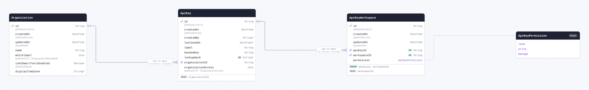

| Field                | Type       | Constraints                                       | Default   | Description          |
| -------------------- | ---------- | ------------------------------------------------- | --------- | -------------------- |
| `id`                 | `String`   | PK NOT NULL                                       | `cuid(1)` |                      |
| `createdAt`          | `DateTime` | NOT NULL                                          | `now()`   |                      |
| `createdBy`          | `String`   | NULL                                              |           |                      |
| `lastUsedAt`         | `DateTime` | NULL                                              |           |                      |
| `label`              | `String`   | NOT NULL                                          |           |                      |
| `hashedKey`          | `String`   | NOT NULL                                          |           |                      |
| `lookupHash`         | `String`   | UNIQUE NULL                                       |           |                      |
| `organizationId`     | `String`   | NOT NULL → [Organization.id](#model-Organization) |           |                      |
| `organizationAccess` | `Json`     | NOT NULL                                          | `"{}"`    | [OrganizationAccess] |

#### Indexes

- `@@index([organizationId])`

#### References

- `organizationId` → [Organization.id](#model-Organization) (many-to-one, on delete Cascade)

#### Referenced by

- `id` ← [ApiKeyWorkspace.apiKeyId](#model-ApiKeyWorkspace) (one-to-many, on delete Cascade)

#### Definition

```sql
CREATE TABLE "ApiKey" (
    "id" TEXT NOT NULL,
    "createdAt" TIMESTAMP(3) NOT NULL DEFAULT CURRENT_TIMESTAMP,
    "createdBy" TEXT,
    "lastUsedAt" TIMESTAMP(3),
    "label" TEXT NOT NULL,
    "hashedKey" TEXT NOT NULL,
    "lookupHash" TEXT,
    "organizationId" TEXT NOT NULL,
    "organizationAccess" JSONB NOT NULL DEFAULT '{}',

    CONSTRAINT "ApiKey_pkey" PRIMARY KEY ("id")
);

CREATE UNIQUE INDEX "ApiKey_lookupHash_key" ON "ApiKey"("lookupHash");

CREATE INDEX "ApiKey_organizationId_idx" ON "ApiKey"("organizationId");

ALTER TABLE "ApiKey" ADD CONSTRAINT "ApiKey_organizationId_fkey" FOREIGN KEY ("organizationId") REFERENCES "Organization"("id") ON DELETE CASCADE ON UPDATE CASCADE;
```

<details>
<summary>Queries and their SQL</summary>

**findMany**: Every row

```ts
await prisma.apiKey.findMany();
```

```sql
SELECT
  "public"."ApiKey"."id",
  "public"."ApiKey"."createdAt",
  "public"."ApiKey"."createdBy",
  "public"."ApiKey"."lastUsedAt",
  "public"."ApiKey"."label",
  "public"."ApiKey"."hashedKey",
  "public"."ApiKey"."lookupHash",
  "public"."ApiKey"."organizationId",
  "public"."ApiKey"."organizationAccess"
FROM
  "public"."ApiKey"
WHERE
  1 = 1
OFFSET
  $1
-- params: ["0"]
```

**count**: How many rows there are

```ts
await prisma.apiKey.count();
```

```sql
SELECT
  COUNT(*) AS "_count$_all"
FROM
  (
    SELECT
      "public"."ApiKey"."id"
    FROM
      "public"."ApiKey"
    WHERE
      1 = 1
    OFFSET
      $1
  ) AS "sub"
-- params: ["0"]
```

**findMany**: Every row with its relations

```ts
await prisma.apiKey.findMany({ include: { organization: true, apiKeyWorkspaces: true } });
```

```sql
SELECT
  "public"."ApiKey"."id",
  "public"."ApiKey"."createdAt",
  "public"."ApiKey"."createdBy",
  "public"."ApiKey"."lastUsedAt",
  "public"."ApiKey"."label",
  "public"."ApiKey"."hashedKey",
  "public"."ApiKey"."lookupHash",
  "public"."ApiKey"."organizationId",
  "public"."ApiKey"."organizationAccess"
FROM
  "public"."ApiKey"
WHERE
  1 = 1
OFFSET
  $1
-- params: ["0"]

SELECT
  "public"."Organization"."id",
  "public"."Organization"."created_at",
  "public"."Organization"."updated_at",
  "public"."Organization"."name",
  "public"."Organization"."whitelabel",
  "public"."Organization"."isAISmartToolsEnabled",
  "public"."Organization"."displayTimeZone"
FROM
  "public"."Organization"
WHERE
  "public"."Organization"."id" IN ($1)
OFFSET
  $2
-- params: ["<organizationId of the rows above>","0"]

SELECT
  "public"."ApiKeyWorkspace"."id",
  "public"."ApiKeyWorkspace"."createdAt",
  "public"."ApiKeyWorkspace"."updatedAt",
  "public"."ApiKeyWorkspace"."apiKeyId",
  "public"."ApiKeyWorkspace"."workspaceId",
  "public"."ApiKeyWorkspace"."permission"::text
FROM
  "public"."ApiKeyWorkspace"
WHERE
  "public"."ApiKeyWorkspace"."apiKeyId" IN ($1)
OFFSET
  $2
-- params: ["<id of the rows above>","0"]
```

**findUnique**: One row by what is unique to it

```ts
await prisma.apiKey.findUnique({ where: { id: "example" } });
```

```sql
SELECT
  "public"."ApiKey"."id",
  "public"."ApiKey"."createdAt",
  "public"."ApiKey"."createdBy",
  "public"."ApiKey"."lastUsedAt",
  "public"."ApiKey"."label",
  "public"."ApiKey"."hashedKey",
  "public"."ApiKey"."lookupHash",
  "public"."ApiKey"."organizationId",
  "public"."ApiKey"."organizationAccess"
FROM
  "public"."ApiKey"
WHERE
  (
    "public"."ApiKey"."id" = $1
    AND 1 = 1
  )
LIMIT
  $2
OFFSET
  $3
-- params: ["example","1","0"]
```

**create**: Create a row

```ts
await prisma.apiKey.create({
  data: { label: "example", hashedKey: "example", organizationId: "example" },
});
```

```sql
INSERT INTO
  "public"."ApiKey" (
    "id",
    "createdAt",
    "label",
    "hashedKey",
    "organizationId",
    "organizationAccess"
  )
VALUES
  ($1, $2, $3, $4, $5, $6)
RETURNING
  "public"."ApiKey"."id",
  "public"."ApiKey"."createdAt",
  "public"."ApiKey"."createdBy",
  "public"."ApiKey"."lastUsedAt",
  "public"."ApiKey"."label",
  "public"."ApiKey"."hashedKey",
  "public"."ApiKey"."lookupHash",
  "public"."ApiKey"."organizationId",
  "public"."ApiKey"."organizationAccess"
-- params: ["<cuid(1)>","<now()>","example","example","example","{}"]
```

**update**: Update a row

```ts
await prisma.apiKey.update({
  where: { id: "example" },
  data: { createdAt: new Date("2026-01-01T00:00:00.000Z") },
});
```

```sql
UPDATE "public"."ApiKey"
SET
  "createdAt" = $1
WHERE
  (
    "public"."ApiKey"."id" = $2
    AND 1 = 1
  )
RETURNING
  "public"."ApiKey"."id",
  "public"."ApiKey"."createdAt",
  "public"."ApiKey"."createdBy",
  "public"."ApiKey"."lastUsedAt",
  "public"."ApiKey"."label",
  "public"."ApiKey"."hashedKey",
  "public"."ApiKey"."lookupHash",
  "public"."ApiKey"."organizationId",
  "public"."ApiKey"."organizationAccess"
-- params: ["2026-01-01T00:00:00.000Z","example"]
```

**delete**: Delete a row

```ts
await prisma.apiKey.delete({ where: { id: "example" } });
```

```sql
DELETE FROM "public"."ApiKey"
WHERE
  (
    "public"."ApiKey"."id" = $1
    AND 1 = 1
  )
RETURNING
  "public"."ApiKey"."id",
  "public"."ApiKey"."createdAt",
  "public"."ApiKey"."createdBy",
  "public"."ApiKey"."lastUsedAt",
  "public"."ApiKey"."label",
  "public"."ApiKey"."hashedKey",
  "public"."ApiKey"."lookupHash",
  "public"."ApiKey"."organizationId",
  "public"."ApiKey"."organizationAccess"
-- params: ["example"]
```

</details>

<a id="model-ApiKeyWorkspace"></a>

### ApiKeyWorkspace

Links API keys to workspaces with specific permissions.
Enables granular access control for API keys across workspaces.

@property id - Unique identifier for the workspace access entry
@property apiKey - The associated API key
@property workspace - The workspace being accessed
@property permission - Level of access granted

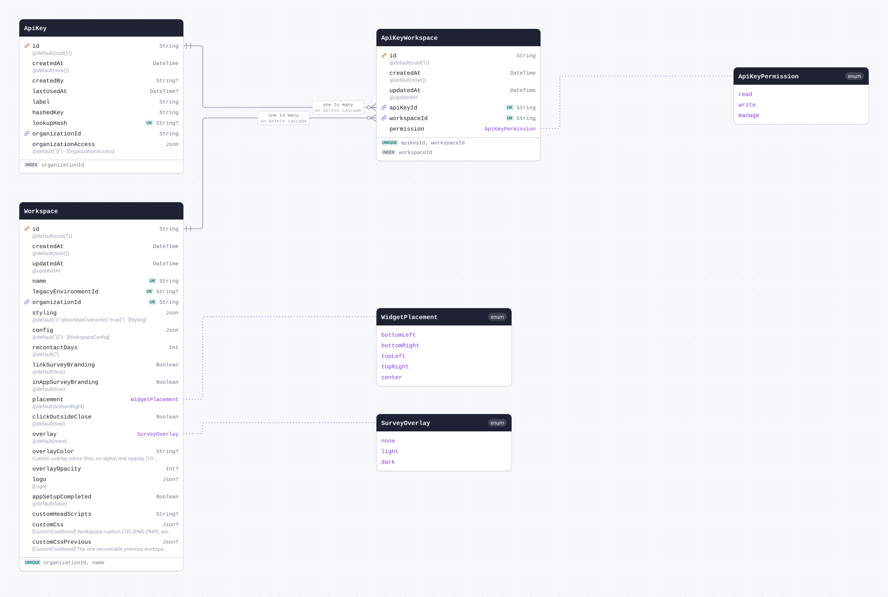

| Field         | Type                                         | Constraints                                 | Default      | Description |
| ------------- | -------------------------------------------- | ------------------------------------------- | ------------ | ----------- |
| `id`          | `String`                                     | PK NOT NULL                                 | `cuid(1)`    |             |
| `createdAt`   | `DateTime`                                   | NOT NULL                                    | `now()`      |             |
| `updatedAt`   | `DateTime`                                   | NOT NULL                                    | `@updatedAt` |             |
| `apiKeyId`    | `String`                                     | NOT NULL → [ApiKey.id](#model-ApiKey)       |              |             |
| `workspaceId` | `String`                                     | NOT NULL → [Workspace.id](#model-Workspace) |              |             |
| `permission`  | [`ApiKeyPermission`](#enum-ApiKeyPermission) | NOT NULL                                    |              |             |

#### Indexes

- `@@index([workspaceId])`
- `@@unique([apiKeyId, workspaceId])`

#### References

- `apiKeyId` → [ApiKey.id](#model-ApiKey) (many-to-one, on delete Cascade)
- `workspaceId` → [Workspace.id](#model-Workspace) (many-to-one, on delete Cascade)

#### Definition

```sql
CREATE TABLE "ApiKeyWorkspace" (
    "id" TEXT NOT NULL,
    "createdAt" TIMESTAMP(3) NOT NULL DEFAULT CURRENT_TIMESTAMP,
    "updatedAt" TIMESTAMP(3) NOT NULL,
    "apiKeyId" TEXT NOT NULL,
    "workspaceId" TEXT NOT NULL,
    "permission" "ApiKeyPermission" NOT NULL,

    CONSTRAINT "ApiKeyWorkspace_pkey" PRIMARY KEY ("id")
);

CREATE INDEX "ApiKeyWorkspace_workspaceId_idx" ON "ApiKeyWorkspace"("workspaceId");

CREATE UNIQUE INDEX "ApiKeyWorkspace_apiKeyId_workspaceId_key" ON "ApiKeyWorkspace"("apiKeyId", "workspaceId");

ALTER TABLE "ApiKeyWorkspace" ADD CONSTRAINT "ApiKeyWorkspace_apiKeyId_fkey" FOREIGN KEY ("apiKeyId") REFERENCES "ApiKey"("id") ON DELETE CASCADE ON UPDATE CASCADE;

ALTER TABLE "ApiKeyWorkspace" ADD CONSTRAINT "ApiKeyWorkspace_workspaceId_fkey" FOREIGN KEY ("workspaceId") REFERENCES "Workspace"("id") ON DELETE CASCADE ON UPDATE CASCADE;
```

<details>
<summary>Queries and their SQL</summary>

**findMany**: Every row

```ts
await prisma.apiKeyWorkspace.findMany();
```

```sql
SELECT
  "public"."ApiKeyWorkspace"."id",
  "public"."ApiKeyWorkspace"."createdAt",
  "public"."ApiKeyWorkspace"."updatedAt",
  "public"."ApiKeyWorkspace"."apiKeyId",
  "public"."ApiKeyWorkspace"."workspaceId",
  "public"."ApiKeyWorkspace"."permission"::text
FROM
  "public"."ApiKeyWorkspace"
WHERE
  1 = 1
OFFSET
  $1
-- params: ["0"]
```

**count**: How many rows there are

```ts
await prisma.apiKeyWorkspace.count();
```

```sql
SELECT
  COUNT(*) AS "_count$_all"
FROM
  (
    SELECT
      "public"."ApiKeyWorkspace"."id"
    FROM
      "public"."ApiKeyWorkspace"
    WHERE
      1 = 1
    OFFSET
      $1
  ) AS "sub"
-- params: ["0"]
```

**findMany**: Every row with its relations

```ts
await prisma.apiKeyWorkspace.findMany({ include: { apiKey: true, workspace: true } });
```

```sql
SELECT
  "public"."ApiKeyWorkspace"."id",
  "public"."ApiKeyWorkspace"."createdAt",
  "public"."ApiKeyWorkspace"."updatedAt",
  "public"."ApiKeyWorkspace"."apiKeyId",
  "public"."ApiKeyWorkspace"."workspaceId",
  "public"."ApiKeyWorkspace"."permission"::text
FROM
  "public"."ApiKeyWorkspace"
WHERE
  1 = 1
OFFSET
  $1
-- params: ["0"]

SELECT
  "public"."ApiKey"."id",
  "public"."ApiKey"."createdAt",
  "public"."ApiKey"."createdBy",
  "public"."ApiKey"."lastUsedAt",
  "public"."ApiKey"."label",
  "public"."ApiKey"."hashedKey",
  "public"."ApiKey"."lookupHash",
  "public"."ApiKey"."organizationId",
  "public"."ApiKey"."organizationAccess"
FROM
  "public"."ApiKey"
WHERE
  "public"."ApiKey"."id" IN ($1)
OFFSET
  $2
-- params: ["<apiKeyId of the rows above>","0"]

SELECT
  "public"."Workspace"."id",
  "public"."Workspace"."created_at",
  "public"."Workspace"."updated_at",
  "public"."Workspace"."name",
  "public"."Workspace"."legacyEnvironmentId",
  "public"."Workspace"."organizationId",
  "public"."Workspace"."styling",
  "public"."Workspace"."config",
  "public"."Workspace"."recontactDays",
  "public"."Workspace"."linkSurveyBranding",
  "public"."Workspace"."inAppSurveyBranding",
  "public"."Workspace"."placement"::text,
  "public"."Workspace"."clickOutsideClose",
  "public"."Workspace"."overlay"::text,
  "public"."Workspace"."overlayColor",
  "public"."Workspace"."overlayOpacity",
  "public"."Workspace"."logo",
  "public"."Workspace"."appSetupCompleted",
  "public"."Workspace"."customHeadScripts",
  "public"."Workspace"."customCss",
  "public"."Workspace"."customCssPrevious"
FROM
  "public"."Workspace"
WHERE
  "public"."Workspace"."id" IN ($1)
OFFSET
  $2
-- params: ["<workspaceId of the rows above>","0"]
```

**findUnique**: One row by what is unique to it

```ts
await prisma.apiKeyWorkspace.findUnique({ where: { id: "example" } });
```

```sql
SELECT
  "public"."ApiKeyWorkspace"."id",
  "public"."ApiKeyWorkspace"."createdAt",
  "public"."ApiKeyWorkspace"."updatedAt",
  "public"."ApiKeyWorkspace"."apiKeyId",
  "public"."ApiKeyWorkspace"."workspaceId",
  "public"."ApiKeyWorkspace"."permission"::text
FROM
  "public"."ApiKeyWorkspace"
WHERE
  (
    "public"."ApiKeyWorkspace"."id" = $1
    AND 1 = 1
  )
LIMIT
  $2
OFFSET
  $3
-- params: ["example","1","0"]
```

**create**: Create a row

```ts
await prisma.apiKeyWorkspace.create({
  data: { apiKeyId: "example", workspaceId: "example", permission: "read" },
});
```

```sql
INSERT INTO
  "public"."ApiKeyWorkspace" (
    "id",
    "createdAt",
    "updatedAt",
    "apiKeyId",
    "workspaceId",
    "permission"
  )
VALUES
  (
    $1,
    $2,
    $3,
    $4,
    $5,
    CAST($6::text AS "public"."ApiKeyPermission")
  )
RETURNING
  "public"."ApiKeyWorkspace"."id",
  "public"."ApiKeyWorkspace"."createdAt",
  "public"."ApiKeyWorkspace"."updatedAt",
  "public"."ApiKeyWorkspace"."apiKeyId",
  "public"."ApiKeyWorkspace"."workspaceId",
  "public"."ApiKeyWorkspace"."permission"::text
-- params: ["<cuid(1)>","<now()>","<now()>","example","example","read"]
```

**update**: Update a row

```ts
await prisma.apiKeyWorkspace.update({
  where: { id: "example" },
  data: { createdAt: new Date("2026-01-01T00:00:00.000Z") },
});
```

```sql
UPDATE "public"."ApiKeyWorkspace"
SET
  "createdAt" = $1,
  "updatedAt" = $2
WHERE
  (
    "public"."ApiKeyWorkspace"."id" = $3
    AND 1 = 1
  )
RETURNING
  "public"."ApiKeyWorkspace"."id",
  "public"."ApiKeyWorkspace"."createdAt",
  "public"."ApiKeyWorkspace"."updatedAt",
  "public"."ApiKeyWorkspace"."apiKeyId",
  "public"."ApiKeyWorkspace"."workspaceId",
  "public"."ApiKeyWorkspace"."permission"::text
-- params: ["2026-01-01T00:00:00.000Z",{"prisma__type":"generatorCall","prisma__value":{"name":"now","args":[],"returnType":{"type":"DateTime"}}},"example"]
```

**delete**: Delete a row

```ts
await prisma.apiKeyWorkspace.delete({ where: { id: "example" } });
```

```sql
DELETE FROM "public"."ApiKeyWorkspace"
WHERE
  (
    "public"."ApiKeyWorkspace"."id" = $1
    AND 1 = 1
  )
RETURNING
  "public"."ApiKeyWorkspace"."id",
  "public"."ApiKeyWorkspace"."createdAt",
  "public"."ApiKeyWorkspace"."updatedAt",
  "public"."ApiKeyWorkspace"."apiKeyId",
  "public"."ApiKeyWorkspace"."workspaceId",
  "public"."ApiKeyWorkspace"."permission"::text
-- params: ["example"]
```

</details>

<a id="model-Account"></a>

### Account

Stores third-party authentication account information.
Enables OAuth and other external authentication methods.

@property id - Unique identifier for the account
@property user - The Formbricks user who owns this account
@property provider - The authentication provider (GitHub, Google, etc.)
@property providerAccountId - User ID from the provider
@property access_token - OAuth access token
@property refresh_token - OAuth refresh token

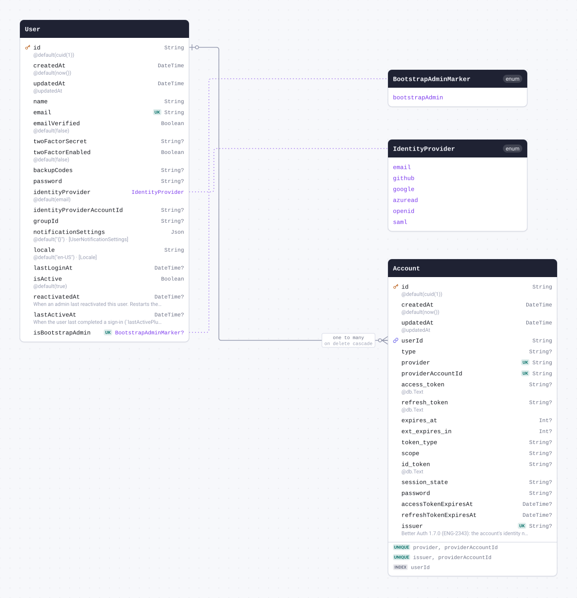

| Field                      | Type                | Constraints                       | Default      | Description                                                                                                                                                                                                                                                                                                                                                                                                                                                                                                                                                                                                                                                                                                                                                           |
| -------------------------- | ------------------- | --------------------------------- | ------------ | --------------------------------------------------------------------------------------------------------------------------------------------------------------------------------------------------------------------------------------------------------------------------------------------------------------------------------------------------------------------------------------------------------------------------------------------------------------------------------------------------------------------------------------------------------------------------------------------------------------------------------------------------------------------------------------------------------------------------------------------------------------------- |
| `id`                       | `String`            | PK NOT NULL                       | `cuid(1)`    |                                                                                                                                                                                                                                                                                                                                                                                                                                                                                                                                                                                                                                                                                                                                                                       |
| `createdAt` (`created_at`) | `DateTime`          | NOT NULL                          | `now()`      |                                                                                                                                                                                                                                                                                                                                                                                                                                                                                                                                                                                                                                                                                                                                                                       |
| `updatedAt` (`updated_at`) | `DateTime`          | NOT NULL                          | `@updatedAt` |                                                                                                                                                                                                                                                                                                                                                                                                                                                                                                                                                                                                                                                                                                                                                                       |
| `userId`                   | `String`            | NOT NULL → [User.id](#model-User) |              |                                                                                                                                                                                                                                                                                                                                                                                                                                                                                                                                                                                                                                                                                                                                                                       |
| `type`                     | `String`            | NULL                              |              |                                                                                                                                                                                                                                                                                                                                                                                                                                                                                                                                                                                                                                                                                                                                                                       |
| `provider`                 | `String`            | NOT NULL                          |              |                                                                                                                                                                                                                                                                                                                                                                                                                                                                                                                                                                                                                                                                                                                                                                       |
| `providerAccountId`        | `String`            | NOT NULL                          |              |                                                                                                                                                                                                                                                                                                                                                                                                                                                                                                                                                                                                                                                                                                                                                                       |
| `access_token`             | `String` `@db.Text` | NULL                              |              |                                                                                                                                                                                                                                                                                                                                                                                                                                                                                                                                                                                                                                                                                                                                                                       |
| `refresh_token`            | `String` `@db.Text` | NULL                              |              |                                                                                                                                                                                                                                                                                                                                                                                                                                                                                                                                                                                                                                                                                                                                                                       |
| `expires_at`               | `Int`               | NULL                              |              |                                                                                                                                                                                                                                                                                                                                                                                                                                                                                                                                                                                                                                                                                                                                                                       |
| `ext_expires_in`           | `Int`               | NULL                              |              |                                                                                                                                                                                                                                                                                                                                                                                                                                                                                                                                                                                                                                                                                                                                                                       |
| `token_type`               | `String`            | NULL                              |              |                                                                                                                                                                                                                                                                                                                                                                                                                                                                                                                                                                                                                                                                                                                                                                       |
| `scope`                    | `String`            | NULL                              |              |                                                                                                                                                                                                                                                                                                                                                                                                                                                                                                                                                                                                                                                                                                                                                                       |
| `id_token`                 | `String` `@db.Text` | NULL                              |              |                                                                                                                                                                                                                                                                                                                                                                                                                                                                                                                                                                                                                                                                                                                                                                       |
| `session_state`            | `String`            | NULL                              |              |                                                                                                                                                                                                                                                                                                                                                                                                                                                                                                                                                                                                                                                                                                                                                                       |
| `password`                 | `String`            | NULL                              |              |                                                                                                                                                                                                                                                                                                                                                                                                                                                                                                                                                                                                                                                                                                                                                                       |
| `accessTokenExpiresAt`     | `DateTime`          | NULL                              |              |                                                                                                                                                                                                                                                                                                                                                                                                                                                                                                                                                                                                                                                                                                                                                                       |
| `refreshTokenExpiresAt`    | `DateTime`          | NULL                              |              |                                                                                                                                                                                                                                                                                                                                                                                                                                                                                                                                                                                                                                                                                                                                                                       |
| `issuer`                   | `String`            | NULL                              |              | Better Auth 1.7.0 (ENG-2343): the account's identity namespace. 1.7.0 keyed accounts on (issuer, accountId) and filtered every lookup on it — findAccountByKey, findAccountOwnerByKey, findCredentialAccount and updatePassword — so on 1.7.0 a null here locks the user out. 1.7.3 dropped the field and 1.7.7 keys accounts on (provider, providerAccountId) again (ENG-3880). We keep writing it (see `account.create.before` in better-auth-hooks.ts) so a rollback to 1.7.0 still finds every row; drop it once that rollback is off the table. NULLABLE on purpose. A NOT NULL column would fail every INSERT from a 1.6 pod still serving during a rolling deploy. The migration backfills every existing row; see the migration SQL for the value derivation. |

#### Indexes

- `@@index([userId])`
- `@@unique([provider, providerAccountId])`
- `@@unique([issuer, providerAccountId])`

#### References

- `userId` → [User.id](#model-User) (many-to-one, on delete Cascade)

#### Definition

```sql
CREATE TABLE "Account" (
    "id" TEXT NOT NULL,
    "created_at" TIMESTAMP(3) NOT NULL DEFAULT CURRENT_TIMESTAMP,
    "updated_at" TIMESTAMP(3) NOT NULL,
    "userId" TEXT NOT NULL,
    "type" TEXT,
    "provider" TEXT NOT NULL,
    "providerAccountId" TEXT NOT NULL,
    "access_token" TEXT,
    "refresh_token" TEXT,
    "expires_at" INTEGER,
    "ext_expires_in" INTEGER,
    "token_type" TEXT,
    "scope" TEXT,
    "id_token" TEXT,
    "session_state" TEXT,
    "password" TEXT,
    "accessTokenExpiresAt" TIMESTAMP(3),
    "refreshTokenExpiresAt" TIMESTAMP(3),
    "issuer" TEXT,

    CONSTRAINT "Account_pkey" PRIMARY KEY ("id")
);

CREATE INDEX "Account_userId_idx" ON "Account"("userId");

CREATE UNIQUE INDEX "Account_provider_providerAccountId_key" ON "Account"("provider", "providerAccountId");

CREATE UNIQUE INDEX "Account_issuer_providerAccountId_key" ON "Account"("issuer", "providerAccountId");

ALTER TABLE "Account" ADD CONSTRAINT "Account_userId_fkey" FOREIGN KEY ("userId") REFERENCES "User"("id") ON DELETE CASCADE ON UPDATE CASCADE;
```

<details>
<summary>Queries and their SQL</summary>

**findMany**: Every row

```ts
await prisma.account.findMany();
```

```sql
SELECT
  "public"."Account"."id",
  "public"."Account"."created_at",
  "public"."Account"."updated_at",
  "public"."Account"."userId",
  "public"."Account"."type",
  "public"."Account"."provider",
  "public"."Account"."providerAccountId",
  "public"."Account"."access_token",
  "public"."Account"."refresh_token",
  "public"."Account"."expires_at",
  "public"."Account"."ext_expires_in",
  "public"."Account"."token_type",
  "public"."Account"."scope",
  "public"."Account"."id_token",
  "public"."Account"."session_state",
  "public"."Account"."password",
  "public"."Account"."accessTokenExpiresAt",
  "public"."Account"."refreshTokenExpiresAt",
  "public"."Account"."issuer"
FROM
  "public"."Account"
WHERE
  1 = 1
OFFSET
  $1
-- params: ["0"]
```

**count**: How many rows there are

```ts
await prisma.account.count();
```

```sql
SELECT
  COUNT(*) AS "_count$_all"
FROM
  (
    SELECT
      "public"."Account"."id"
    FROM
      "public"."Account"
    WHERE
      1 = 1
    OFFSET
      $1
  ) AS "sub"
-- params: ["0"]
```

**findMany**: Every row with its relations

```ts
await prisma.account.findMany({ include: { user: true } });
```

```sql
SELECT
  "public"."Account"."id",
  "public"."Account"."created_at",
  "public"."Account"."updated_at",
  "public"."Account"."userId",
  "public"."Account"."type",
  "public"."Account"."provider",
  "public"."Account"."providerAccountId",
  "public"."Account"."access_token",
  "public"."Account"."refresh_token",
  "public"."Account"."expires_at",
  "public"."Account"."ext_expires_in",
  "public"."Account"."token_type",
  "public"."Account"."scope",
  "public"."Account"."id_token",
  "public"."Account"."session_state",
  "public"."Account"."password",
  "public"."Account"."accessTokenExpiresAt",
  "public"."Account"."refreshTokenExpiresAt",
  "public"."Account"."issuer"
FROM
  "public"."Account"
WHERE
  1 = 1
OFFSET
  $1
-- params: ["0"]

SELECT
  "public"."User"."id",
  "public"."User"."created_at",
  "public"."User"."updated_at",
  "public"."User"."name",
  "public"."User"."email",
  "public"."User"."email_verified",
  "public"."User"."twoFactorSecret",
  "public"."User"."twoFactorEnabled",
  "public"."User"."backupCodes",
  "public"."User"."password",
  "public"."User"."identityProvider"::text,
  "public"."User"."identityProviderAccountId",
  "public"."User"."groupId",
  "public"."User"."notificationSettings",
  "public"."User"."locale",
  "public"."User"."lastLoginAt",
  "public"."User"."isActive",
  "public"."User"."reactivatedAt",
  "public"."User"."lastActiveAt",
  "public"."User"."isBootstrapAdmin"::text
FROM
  "public"."User"
WHERE
  "public"."User"."id" IN ($1)
OFFSET
  $2
-- params: ["<userId of the rows above>","0"]
```

**findUnique**: One row by what is unique to it

```ts
await prisma.account.findUnique({ where: { id: "example" } });
```

```sql
SELECT
  "public"."Account"."id",
  "public"."Account"."created_at",
  "public"."Account"."updated_at",
  "public"."Account"."userId",
  "public"."Account"."type",
  "public"."Account"."provider",
  "public"."Account"."providerAccountId",
  "public"."Account"."access_token",
  "public"."Account"."refresh_token",
  "public"."Account"."expires_at",
  "public"."Account"."ext_expires_in",
  "public"."Account"."token_type",
  "public"."Account"."scope",
  "public"."Account"."id_token",
  "public"."Account"."session_state",
  "public"."Account"."password",
  "public"."Account"."accessTokenExpiresAt",
  "public"."Account"."refreshTokenExpiresAt",
  "public"."Account"."issuer"
FROM
  "public"."Account"
WHERE
  (
    "public"."Account"."id" = $1
    AND 1 = 1
  )
LIMIT
  $2
OFFSET
  $3
-- params: ["example","1","0"]
```

**create**: Create a row

```ts
await prisma.account.create({
  data: { userId: "example", provider: "example", providerAccountId: "example" },
});
```

```sql
INSERT INTO
  "public"."Account" (
    "id",
    "created_at",
    "updated_at",
    "userId",
    "provider",
    "providerAccountId"
  )
VALUES
  ($1, $2, $3, $4, $5, $6)
RETURNING
  "public"."Account"."id",
  "public"."Account"."created_at",
  "public"."Account"."updated_at",
  "public"."Account"."userId",
  "public"."Account"."type",
  "public"."Account"."provider",
  "public"."Account"."providerAccountId",
  "public"."Account"."access_token",
  "public"."Account"."refresh_token",
  "public"."Account"."expires_at",
  "public"."Account"."ext_expires_in",
  "public"."Account"."token_type",
  "public"."Account"."scope",
  "public"."Account"."id_token",
  "public"."Account"."session_state",
  "public"."Account"."password",
  "public"."Account"."accessTokenExpiresAt",
  "public"."Account"."refreshTokenExpiresAt",
  "public"."Account"."issuer"
-- params: ["<cuid(1)>","<now()>","<now()>","example","example","example"]
```

**update**: Update a row

```ts
await prisma.account.update({
  where: { id: "example" },
  data: { createdAt: new Date("2026-01-01T00:00:00.000Z") },
});
```

```sql
UPDATE "public"."Account"
SET
  "created_at" = $1,
  "updated_at" = $2
WHERE
  (
    "public"."Account"."id" = $3
    AND 1 = 1
  )
RETURNING
  "public"."Account"."id",
  "public"."Account"."created_at",
  "public"."Account"."updated_at",
  "public"."Account"."userId",
  "public"."Account"."type",
  "public"."Account"."provider",
  "public"."Account"."providerAccountId",
  "public"."Account"."access_token",
  "public"."Account"."refresh_token",
  "public"."Account"."expires_at",
  "public"."Account"."ext_expires_in",
  "public"."Account"."token_type",
  "public"."Account"."scope",
  "public"."Account"."id_token",
  "public"."Account"."session_state",
  "public"."Account"."password",
  "public"."Account"."accessTokenExpiresAt",
  "public"."Account"."refreshTokenExpiresAt",
  "public"."Account"."issuer"
-- params: ["2026-01-01T00:00:00.000Z",{"prisma__type":"generatorCall","prisma__value":{"name":"now","args":[],"returnType":{"type":"DateTime"}}},"example"]
```

**delete**: Delete a row

```ts
await prisma.account.delete({ where: { id: "example" } });
```

```sql
DELETE FROM "public"."Account"
WHERE
  (
    "public"."Account"."id" = $1
    AND 1 = 1
  )
RETURNING
  "public"."Account"."id",
  "public"."Account"."created_at",
  "public"."Account"."updated_at",
  "public"."Account"."userId",
  "public"."Account"."type",
  "public"."Account"."provider",
  "public"."Account"."providerAccountId",
  "public"."Account"."access_token",
  "public"."Account"."refresh_token",
  "public"."Account"."expires_at",
  "public"."Account"."ext_expires_in",
  "public"."Account"."token_type",
  "public"."Account"."scope",
  "public"."Account"."id_token",
  "public"."Account"."session_state",
  "public"."Account"."password",
  "public"."Account"."accessTokenExpiresAt",
  "public"."Account"."refreshTokenExpiresAt",
  "public"."Account"."issuer"
-- params: ["example"]
```

</details>

<a id="model-Session"></a>

### Session

Stores active authentication sessions for revocable server-side login state.

@property sessionToken - Opaque token stored in the browser cookie
@property user - The Formbricks user who owns this session
@property expires - Hard expiry for the session

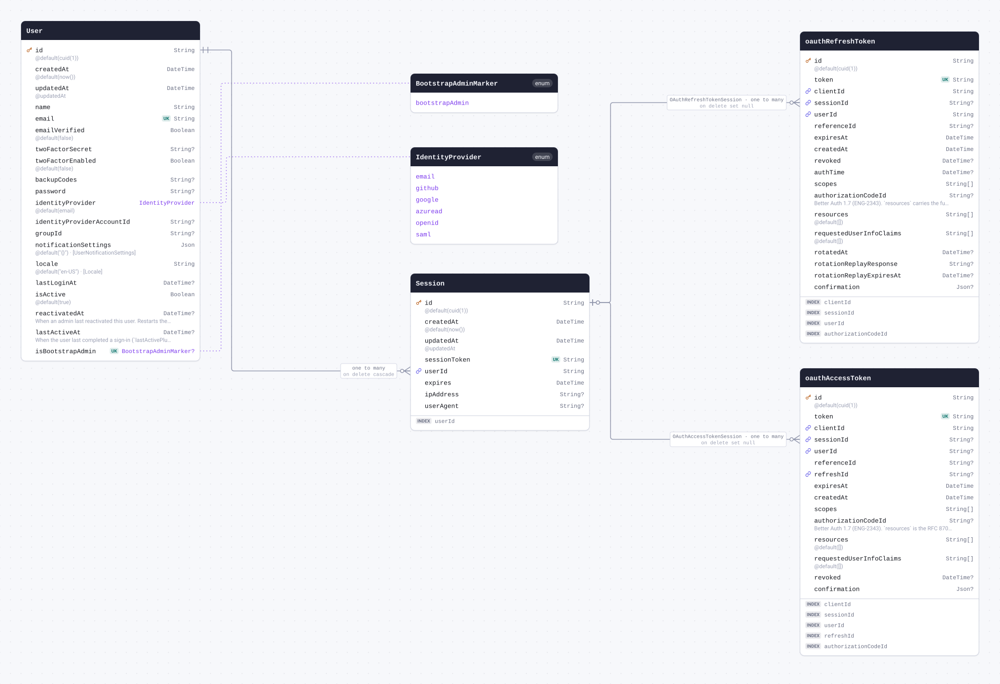

| Field                      | Type       | Constraints                       | Default      | Description |
| -------------------------- | ---------- | --------------------------------- | ------------ | ----------- |
| `id`                       | `String`   | PK NOT NULL                       | `cuid(1)`    |             |
| `createdAt` (`created_at`) | `DateTime` | NOT NULL                          | `now()`      |             |
| `updatedAt` (`updated_at`) | `DateTime` | NOT NULL                          | `@updatedAt` |             |
| `sessionToken`             | `String`   | UNIQUE NOT NULL                   |              |             |
| `userId`                   | `String`   | NOT NULL → [User.id](#model-User) |              |             |
| `expires`                  | `DateTime` | NOT NULL                          |              |             |
| `ipAddress`                | `String`   | NULL                              |              |             |
| `userAgent`                | `String`   | NULL                              |              |             |

#### Indexes

- `@@index([userId])`

#### References

- `userId` → [User.id](#model-User) (many-to-one, on delete Cascade)

#### Referenced by

- `id` ← [oauthAccessToken.sessionId](#model-oauthAccessToken) (one-to-many, on delete SetNull)
- `id` ← [oauthRefreshToken.sessionId](#model-oauthRefreshToken) (one-to-many, on delete SetNull)

#### Definition

```sql
CREATE TABLE "Session" (
    "id" TEXT NOT NULL,
    "created_at" TIMESTAMP(3) NOT NULL DEFAULT CURRENT_TIMESTAMP,
    "updated_at" TIMESTAMP(3) NOT NULL,
    "sessionToken" TEXT NOT NULL,
    "userId" TEXT NOT NULL,
    "expires" TIMESTAMP(3) NOT NULL,
    "ipAddress" TEXT,
    "userAgent" TEXT,

    CONSTRAINT "Session_pkey" PRIMARY KEY ("id")
);

CREATE UNIQUE INDEX "Session_sessionToken_key" ON "Session"("sessionToken");

CREATE INDEX "Session_userId_idx" ON "Session"("userId");

ALTER TABLE "Session" ADD CONSTRAINT "Session_userId_fkey" FOREIGN KEY ("userId") REFERENCES "User"("id") ON DELETE CASCADE ON UPDATE CASCADE;
```

<details>
<summary>Queries and their SQL</summary>

**findMany**: Every row

```ts
await prisma.session.findMany();
```

```sql
SELECT
  "public"."Session"."id",
  "public"."Session"."created_at",
  "public"."Session"."updated_at",
  "public"."Session"."sessionToken",
  "public"."Session"."userId",
  "public"."Session"."expires",
  "public"."Session"."ipAddress",
  "public"."Session"."userAgent"
FROM
  "public"."Session"
WHERE
  1 = 1
OFFSET
  $1
-- params: ["0"]
```

**count**: How many rows there are

```ts
await prisma.session.count();
```

```sql
SELECT
  COUNT(*) AS "_count$_all"
FROM
  (
    SELECT
      "public"."Session"."id"
    FROM
      "public"."Session"
    WHERE
      1 = 1
    OFFSET
      $1
  ) AS "sub"
-- params: ["0"]
```

**findMany**: Every row with its relations

```ts
await prisma.session.findMany({
  include: { user: true, oauthAccessTokens: true, oauthRefreshTokens: true },
});
```

```sql
SELECT
  "public"."Session"."id",
  "public"."Session"."created_at",
  "public"."Session"."updated_at",
  "public"."Session"."sessionToken",
  "public"."Session"."userId",
  "public"."Session"."expires",
  "public"."Session"."ipAddress",
  "public"."Session"."userAgent"
FROM
  "public"."Session"
WHERE
  1 = 1
OFFSET
  $1
-- params: ["0"]

SELECT
  "public"."User"."id",
  "public"."User"."created_at",
  "public"."User"."updated_at",
  "public"."User"."name",
  "public"."User"."email",
  "public"."User"."email_verified",
  "public"."User"."twoFactorSecret",
  "public"."User"."twoFactorEnabled",
  "public"."User"."backupCodes",
  "public"."User"."password",
  "public"."User"."identityProvider"::text,
  "public"."User"."identityProviderAccountId",
  "public"."User"."groupId",
  "public"."User"."notificationSettings",
  "public"."User"."locale",
  "public"."User"."lastLoginAt",
  "public"."User"."isActive",
  "public"."User"."reactivatedAt",
  "public"."User"."lastActiveAt",
  "public"."User"."isBootstrapAdmin"::text
FROM
  "public"."User"
WHERE
  "public"."User"."id" IN ($1)
OFFSET
  $2
-- params: ["<userId of the rows above>","0"]

SELECT
  "public"."oauthAccessToken"."id",
  "public"."oauthAccessToken"."token",
  "public"."oauthAccessToken"."clientId",
  "public"."oauthAccessToken"."sessionId",
  "public"."oauthAccessToken"."userId",
  "public"."oauthAccessToken"."referenceId",
  "public"."oauthAccessToken"."refreshId",
  "public"."oauthAccessToken"."expiresAt",
  "public"."oauthAccessToken"."createdAt",
  "public"."oauthAccessToken"."scopes",
  "public"."oauthAccessToken"."authorizationCodeId",
  "public"."oauthAccessToken"."resources",
  "public"."oauthAccessToken"."requestedUserInfoClaims",
  "public"."oauthAccessToken"."revoked",
  "public"."oauthAccessToken"."confirmation"
FROM
  "public"."oauthAccessToken"
WHERE
  "public"."oauthAccessToken"."sessionId" IN ($1)
OFFSET
  $2
-- params: ["<id of the rows above>","0"]

SELECT
  "public"."oauthRefreshToken"."id",
  "public"."oauthRefreshToken"."token",
  "public"."oauthRefreshToken"."clientId",
  "public"."oauthRefreshToken"."sessionId",
  "public"."oauthRefreshToken"."userId",
  "public"."oauthRefreshToken"."referenceId",
  "public"."oauthRefreshToken"."expiresAt",
  "public"."oauthRefreshToken"."createdAt",
  "public"."oauthRefreshToken"."revoked",
  "public"."oauthRefreshToken"."authTime",
  "public"."oauthRefreshToken"."scopes",
  "public"."oauthRefreshToken"."authorizationCodeId",
  "public"."oauthRefreshToken"."resources",
  "public"."oauthRefreshToken"."requestedUserInfoClaims",
  "public"."oauthRefreshToken"."rotatedAt",
  "public"."oauthRefreshToken"."rotationReplayResponse",
  "public"."oauthRefreshToken"."rotationReplayExpiresAt",
  "public"."oauthRefreshToken"."confirmation"
FROM
  "public"."oauthRefreshToken"
WHERE
  "public"."oauthRefreshToken"."sessionId" IN ($1)
OFFSET
  $2
-- params: ["<id of the rows above>","0"]
```

**findUnique**: One row by what is unique to it

```ts
await prisma.session.findUnique({ where: { id: "example" } });
```

```sql
SELECT
  "public"."Session"."id",
  "public"."Session"."created_at",
  "public"."Session"."updated_at",
  "public"."Session"."sessionToken",
  "public"."Session"."userId",
  "public"."Session"."expires",
  "public"."Session"."ipAddress",
  "public"."Session"."userAgent"
FROM
  "public"."Session"
WHERE
  (
    "public"."Session"."id" = $1
    AND 1 = 1
  )
LIMIT
  $2
OFFSET
  $3
-- params: ["example","1","0"]
```

**create**: Create a row

```ts
await prisma.session.create({
  data: {
    sessionToken: "example",
    userId: "example",
    expires: new Date("2026-01-01T00:00:00.000Z"),
  },
});
```

```sql
INSERT INTO
  "public"."Session" (
    "id",
    "created_at",
    "updated_at",
    "sessionToken",
    "userId",
    "expires"
  )
VALUES
  ($1, $2, $3, $4, $5, $6)
RETURNING
  "public"."Session"."id",
  "public"."Session"."created_at",
  "public"."Session"."updated_at",
  "public"."Session"."sessionToken",
  "public"."Session"."userId",
  "public"."Session"."expires",
  "public"."Session"."ipAddress",
  "public"."Session"."userAgent"
-- params: ["<cuid(1)>","<now()>","<now()>","example","example","2026-01-01T00:00:00.000Z"]
```

**update**: Update a row

```ts
await prisma.session.update({
  where: { id: "example" },
  data: { createdAt: new Date("2026-01-01T00:00:00.000Z") },
});
```

```sql
UPDATE "public"."Session"
SET
  "created_at" = $1,
  "updated_at" = $2
WHERE
  (
    "public"."Session"."id" = $3
    AND 1 = 1
  )
RETURNING
  "public"."Session"."id",
  "public"."Session"."created_at",
  "public"."Session"."updated_at",
  "public"."Session"."sessionToken",
  "public"."Session"."userId",
  "public"."Session"."expires",
  "public"."Session"."ipAddress",
  "public"."Session"."userAgent"
-- params: ["2026-01-01T00:00:00.000Z",{"prisma__type":"generatorCall","prisma__value":{"name":"now","args":[],"returnType":{"type":"DateTime"}}},"example"]
```

**delete**: Delete a row

```ts
await prisma.session.delete({ where: { id: "example" } });
```

```sql
DELETE FROM "public"."Session"
WHERE
  (
    "public"."Session"."id" = $1
    AND 1 = 1
  )
RETURNING
  "public"."Session"."id",
  "public"."Session"."created_at",
  "public"."Session"."updated_at",
  "public"."Session"."sessionToken",
  "public"."Session"."userId",
  "public"."Session"."expires",
  "public"."Session"."ipAddress",
  "public"."Session"."userAgent"
-- params: ["example"]
```

</details>

<a id="model-VerificationToken"></a>

### VerificationToken

Stores one-time verification tokens used by Auth.js adapter flows.

| Field        | Type       | Constraints | Default | Description |
| ------------ | ---------- | ----------- | ------- | ----------- |
| `identifier` | `String`   | NOT NULL    |         |             |
| `token`      | `String`   | NOT NULL    |         |             |
| `expires`    | `DateTime` | NOT NULL    |         |             |

#### Indexes

- `@@unique([identifier, token])`

#### Definition

```sql
CREATE TABLE "VerificationToken" (
    "identifier" TEXT NOT NULL,
    "token" TEXT NOT NULL,
    "expires" TIMESTAMP(3) NOT NULL
);

CREATE UNIQUE INDEX "VerificationToken_identifier_token_key" ON "VerificationToken"("identifier", "token");
```

<details>
<summary>Queries and their SQL</summary>

**findMany**: Every row

```ts
await prisma.verificationToken.findMany();
```

```sql
SELECT
  "public"."VerificationToken"."identifier",
  "public"."VerificationToken"."token",
  "public"."VerificationToken"."expires"
FROM
  "public"."VerificationToken"
WHERE
  1 = 1
OFFSET
  $1
-- params: ["0"]
```

**count**: How many rows there are

```ts
await prisma.verificationToken.count();
```

```sql
SELECT
  COUNT(*) AS "_count$_all"
FROM
  (
    SELECT
      "public"."VerificationToken"."identifier",
      "public"."VerificationToken"."token"
    FROM
      "public"."VerificationToken"
    WHERE
      1 = 1
    OFFSET
      $1
  ) AS "sub"
-- params: ["0"]
```

**findUnique**: One row by what is unique to it

```ts
await prisma.verificationToken.findUnique({
  where: { identifier_token: { identifier: "example", token: "example" } },
});
```

```sql
SELECT
  "public"."VerificationToken"."identifier",
  "public"."VerificationToken"."token",
  "public"."VerificationToken"."expires"
FROM
  "public"."VerificationToken"
WHERE
  (
    (
      "public"."VerificationToken"."identifier" = $1
      AND "public"."VerificationToken"."token" = $2
    )
    AND 1 = 1
  )
LIMIT
  $3
OFFSET
  $4
-- params: ["example","example","1","0"]
```

**create**: Create a row

```ts
await prisma.verificationToken.create({
  data: { identifier: "example", token: "example", expires: new Date("2026-01-01T00:00:00.000Z") },
});
```

```sql
INSERT INTO
  "public"."VerificationToken" ("identifier", "token", "expires")
VALUES
  ($1, $2, $3)
RETURNING
  "public"."VerificationToken"."identifier",
  "public"."VerificationToken"."token",
  "public"."VerificationToken"."expires"
-- params: ["example","example","2026-01-01T00:00:00.000Z"]
```

**update**: Update a row

```ts
await prisma.verificationToken.update({
  where: { identifier_token: { identifier: "example", token: "example" } },
  data: { expires: new Date("2026-01-01T00:00:00.000Z") },
});
```

```sql
UPDATE "public"."VerificationToken"
SET
  "expires" = $1
WHERE
  (
    (
      "public"."VerificationToken"."identifier" = $2
      AND "public"."VerificationToken"."token" = $3
    )
    AND 1 = 1
  )
RETURNING
  "public"."VerificationToken"."identifier",
  "public"."VerificationToken"."token",
  "public"."VerificationToken"."expires"
-- params: ["2026-01-01T00:00:00.000Z","example","example"]
```

**delete**: Delete a row

```ts
await prisma.verificationToken.delete({
  where: { identifier_token: { identifier: "example", token: "example" } },
});
```

```sql
DELETE FROM "public"."VerificationToken"
WHERE
  (
    (
      "public"."VerificationToken"."identifier" = $1
      AND "public"."VerificationToken"."token" = $2
    )
    AND 1 = 1
  )
RETURNING
  "public"."VerificationToken"."identifier",
  "public"."VerificationToken"."token",
  "public"."VerificationToken"."expires"
-- params: ["example","example"]
```

</details>

<a id="model-TwoFactor"></a>

### TwoFactor

Better Auth (ENG-1054) two-factor secrets. Supersedes the legacy User.twoFactorSecret /
User.backupCodes columns (kept until cutover). `secret` and `backupCodes` are encrypted
at rest by Better Auth using BETTER_AUTH_SECRET.

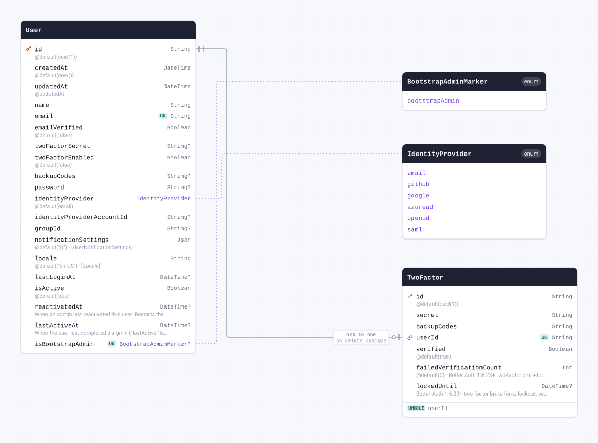

| Field                     | Type       | Constraints                              | Default   | Description                                                                                           |
| ------------------------- | ---------- | ---------------------------------------- | --------- | ----------------------------------------------------------------------------------------------------- |
| `id`                      | `String`   | PK NOT NULL                              | `cuid(1)` |                                                                                                       |
| `secret`                  | `String`   | NOT NULL                                 |           |                                                                                                       |
| `backupCodes`             | `String`   | NOT NULL                                 |           |                                                                                                       |
| `userId`                  | `String`   | UNIQUE NOT NULL → [User.id](#model-User) |           |                                                                                                       |
| `verified`                | `Boolean`  | NOT NULL                                 | `true`    |                                                                                                       |
| `failedVerificationCount` | `Int`      | NOT NULL                                 | `0`       | Better Auth 1.6.23+ two-factor brute-force lockout: consecutive failed verification attempts.         |
| `lockedUntil`             | `DateTime` | NULL                                     |           | Better Auth 1.6.23+ two-factor brute-force lockout: set once failedVerificationCount trips the limit. |

#### Indexes

- `@@unique([userId])`

#### References

- `userId` → [User.id](#model-User) (one-to-one, on delete Cascade)

#### Definition

```sql
CREATE TABLE "TwoFactor" (
    "id" TEXT NOT NULL,
    "secret" TEXT NOT NULL,
    "backupCodes" TEXT NOT NULL,
    "userId" TEXT NOT NULL,
    "verified" BOOLEAN NOT NULL DEFAULT true,
    "failedVerificationCount" INTEGER NOT NULL DEFAULT 0,
    "lockedUntil" TIMESTAMP(3),

    CONSTRAINT "TwoFactor_pkey" PRIMARY KEY ("id")
);

CREATE UNIQUE INDEX "TwoFactor_userId_key" ON "TwoFactor"("userId");

ALTER TABLE "TwoFactor" ADD CONSTRAINT "TwoFactor_userId_fkey" FOREIGN KEY ("userId") REFERENCES "User"("id") ON DELETE CASCADE ON UPDATE CASCADE;
```

<details>
<summary>Queries and their SQL</summary>

**findMany**: Every row

```ts
await prisma.twoFactor.findMany();
```

```sql
SELECT
  "public"."TwoFactor"."id",
  "public"."TwoFactor"."secret",
  "public"."TwoFactor"."backupCodes",
  "public"."TwoFactor"."userId",
  "public"."TwoFactor"."verified",
  "public"."TwoFactor"."failedVerificationCount",
  "public"."TwoFactor"."lockedUntil"
FROM
  "public"."TwoFactor"
WHERE
  1 = 1
OFFSET
  $1
-- params: ["0"]
```

**count**: How many rows there are

```ts
await prisma.twoFactor.count();
```

```sql
SELECT
  COUNT(*) AS "_count$_all"
FROM
  (
    SELECT
      "public"."TwoFactor"."id"
    FROM
      "public"."TwoFactor"
    WHERE
      1 = 1
    OFFSET
      $1
  ) AS "sub"
-- params: ["0"]
```

**findMany**: Every row with its relations

```ts
await prisma.twoFactor.findMany({ include: { user: true } });
```

```sql
SELECT
  "public"."TwoFactor"."id",
  "public"."TwoFactor"."secret",
  "public"."TwoFactor"."backupCodes",
  "public"."TwoFactor"."userId",
  "public"."TwoFactor"."verified",
  "public"."TwoFactor"."failedVerificationCount",
  "public"."TwoFactor"."lockedUntil"
FROM
  "public"."TwoFactor"
WHERE
  1 = 1
OFFSET
  $1
-- params: ["0"]

SELECT
  "public"."User"."id",
  "public"."User"."created_at",
  "public"."User"."updated_at",
  "public"."User"."name",
  "public"."User"."email",
  "public"."User"."email_verified",
  "public"."User"."twoFactorSecret",
  "public"."User"."twoFactorEnabled",
  "public"."User"."backupCodes",
  "public"."User"."password",
  "public"."User"."identityProvider"::text,
  "public"."User"."identityProviderAccountId",
  "public"."User"."groupId",
  "public"."User"."notificationSettings",
  "public"."User"."locale",
  "public"."User"."lastLoginAt",
  "public"."User"."isActive",
  "public"."User"."reactivatedAt",
  "public"."User"."lastActiveAt",
  "public"."User"."isBootstrapAdmin"::text
FROM
  "public"."User"
WHERE
  "public"."User"."id" IN ($1)
OFFSET
  $2
-- params: ["<userId of the rows above>","0"]
```

**findUnique**: One row by what is unique to it

```ts
await prisma.twoFactor.findUnique({ where: { id: "example" } });
```

```sql
SELECT
  "public"."TwoFactor"."id",
  "public"."TwoFactor"."secret",
  "public"."TwoFactor"."backupCodes",
  "public"."TwoFactor"."userId",
  "public"."TwoFactor"."verified",
  "public"."TwoFactor"."failedVerificationCount",
  "public"."TwoFactor"."lockedUntil"
FROM
  "public"."TwoFactor"
WHERE
  (
    "public"."TwoFactor"."id" = $1
    AND 1 = 1
  )
LIMIT
  $2
OFFSET
  $3
-- params: ["example","1","0"]
```

**create**: Create a row

```ts
await prisma.twoFactor.create({
  data: { secret: "example", backupCodes: "example", userId: "example" },
});
```

```sql
INSERT INTO
  "public"."TwoFactor" (
    "id",
    "secret",
    "backupCodes",
    "userId",
    "verified",
    "failedVerificationCount"
  )
VALUES
  ($1, $2, $3, $4, $5, $6)
RETURNING
  "public"."TwoFactor"."id",
  "public"."TwoFactor"."secret",
  "public"."TwoFactor"."backupCodes",
  "public"."TwoFactor"."userId",
  "public"."TwoFactor"."verified",
  "public"."TwoFactor"."failedVerificationCount",
  "public"."TwoFactor"."lockedUntil"
-- params: ["<cuid(1)>","example","example","example",true,"0"]
```

**update**: Update a row

```ts
await prisma.twoFactor.update({ where: { id: "example" }, data: { secret: "example" } });
```

```sql
UPDATE "public"."TwoFactor"
SET
  "secret" = $1
WHERE
  (
    "public"."TwoFactor"."id" = $2
    AND 1 = 1
  )
RETURNING
  "public"."TwoFactor"."id",
  "public"."TwoFactor"."secret",
  "public"."TwoFactor"."backupCodes",
  "public"."TwoFactor"."userId",
  "public"."TwoFactor"."verified",
  "public"."TwoFactor"."failedVerificationCount",
  "public"."TwoFactor"."lockedUntil"
-- params: ["example","example"]
```

**delete**: Delete a row

```ts
await prisma.twoFactor.delete({ where: { id: "example" } });
```

```sql
DELETE FROM "public"."TwoFactor"
WHERE
  (
    "public"."TwoFactor"."id" = $1
    AND 1 = 1
  )
RETURNING
  "public"."TwoFactor"."id",
  "public"."TwoFactor"."secret",
  "public"."TwoFactor"."backupCodes",
  "public"."TwoFactor"."userId",
  "public"."TwoFactor"."verified",
  "public"."TwoFactor"."failedVerificationCount",
  "public"."TwoFactor"."lockedUntil"
-- params: ["example"]
```

</details>

<a id="model-jwks"></a>

### jwks

Better Auth JWT signing keys for OAuth/OIDC access and ID tokens.

| Field        | Type       | Constraints | Default   | Description                                                                                                                                                                                                                                                                                                                                                                                                                                                                                                                                                                                                                                                                                        |
| ------------ | ---------- | ----------- | --------- | -------------------------------------------------------------------------------------------------------------------------------------------------------------------------------------------------------------------------------------------------------------------------------------------------------------------------------------------------------------------------------------------------------------------------------------------------------------------------------------------------------------------------------------------------------------------------------------------------------------------------------------------------------------------------------------------------- |
| `id`         | `String`   | PK NOT NULL | `cuid(1)` |                                                                                                                                                                                                                                                                                                                                                                                                                                                                                                                                                                                                                                                                                                    |
| `publicKey`  | `String`   | NOT NULL    |           |                                                                                                                                                                                                                                                                                                                                                                                                                                                                                                                                                                                                                                                                                                    |
| `privateKey` | `String`   | NOT NULL    |           |                                                                                                                                                                                                                                                                                                                                                                                                                                                                                                                                                                                                                                                                                                    |
| `createdAt`  | `DateTime` | NOT NULL    |           |                                                                                                                                                                                                                                                                                                                                                                                                                                                                                                                                                                                                                                                                                                    |
| `expiresAt`  | `DateTime` | NULL        |           |                                                                                                                                                                                                                                                                                                                                                                                                                                                                                                                                                                                                                                                                                                    |
| `alg`        | `String`   | NULL        |           | Better Auth 1.7 (ENG-2343): the JWS algorithm this key signs with, so a keyring can hold more than one alg and `getLatestKeyByAlg` can pick the right key per resource. NOT optional upstream in practice, despite being declared `required: false`: `createJwk` always puts `alg` in the row it writes (defaulting to EdDSA), so without this column every key mint is rejected by Prisma as an unknown argument — which breaks JWT signing, and with it the whole MCP OAuth flow, on any deployment that has yet to mint a key. Nullable because rows written before 1.7 have no value; upstream reads treat `alg: null` as the configured default alg, so existing keys keep working untouched. |
| `crv`        | `String`   | NULL        |           | Better Auth 1.7 (ENG-2343): the curve for EC/OKP keys. Written whenever it can be derived from the generated key, which it can for the default EdDSA/Ed25519 config we run, so it is on the same always-written path as `alg` above.                                                                                                                                                                                                                                                                                                                                                                                                                                                               |

#### Definition

```sql
CREATE TABLE "jwks" (
    "id" TEXT NOT NULL,
    "publicKey" TEXT NOT NULL,
    "privateKey" TEXT NOT NULL,
    "createdAt" TIMESTAMP(3) NOT NULL,
    "expiresAt" TIMESTAMP(3),
    "alg" TEXT,
    "crv" TEXT,

    CONSTRAINT "jwks_pkey" PRIMARY KEY ("id")
);
```

<details>
<summary>Queries and their SQL</summary>

**findMany**: Every row

```ts
await prisma.jwks.findMany();
```

```sql
SELECT
  "public"."jwks"."id",
  "public"."jwks"."publicKey",
  "public"."jwks"."privateKey",
  "public"."jwks"."createdAt",
  "public"."jwks"."expiresAt",
  "public"."jwks"."alg",
  "public"."jwks"."crv"
FROM
  "public"."jwks"
WHERE
  1 = 1
OFFSET
  $1
-- params: ["0"]
```

**count**: How many rows there are

```ts
await prisma.jwks.count();
```

```sql
SELECT
  COUNT(*) AS "_count$_all"
FROM
  (
    SELECT
      "public"."jwks"."id"
    FROM
      "public"."jwks"
    WHERE
      1 = 1
    OFFSET
      $1
  ) AS "sub"
-- params: ["0"]
```

**findUnique**: One row by what is unique to it

```ts
await prisma.jwks.findUnique({ where: { id: "example" } });
```

```sql
SELECT
  "public"."jwks"."id",
  "public"."jwks"."publicKey",
  "public"."jwks"."privateKey",
  "public"."jwks"."createdAt",
  "public"."jwks"."expiresAt",
  "public"."jwks"."alg",
  "public"."jwks"."crv"
FROM
  "public"."jwks"
WHERE
  (
    "public"."jwks"."id" = $1
    AND 1 = 1
  )
LIMIT
  $2
OFFSET
  $3
-- params: ["example","1","0"]
```

**create**: Create a row

```ts
await prisma.jwks.create({
  data: {
    publicKey: "example",
    privateKey: "example",
    createdAt: new Date("2026-01-01T00:00:00.000Z"),
  },
});
```

```sql
INSERT INTO
  "public"."jwks" ("id", "publicKey", "privateKey", "createdAt")
VALUES
  ($1, $2, $3, $4)
RETURNING
  "public"."jwks"."id",
  "public"."jwks"."publicKey",
  "public"."jwks"."privateKey",
  "public"."jwks"."createdAt",
  "public"."jwks"."expiresAt",
  "public"."jwks"."alg",
  "public"."jwks"."crv"
-- params: ["<cuid(1)>","example","example","2026-01-01T00:00:00.000Z"]
```

**update**: Update a row

```ts
await prisma.jwks.update({ where: { id: "example" }, data: { publicKey: "example" } });
```

```sql
UPDATE "public"."jwks"
SET
  "publicKey" = $1
WHERE
  (
    "public"."jwks"."id" = $2
    AND 1 = 1
  )
RETURNING
  "public"."jwks"."id",
  "public"."jwks"."publicKey",
  "public"."jwks"."privateKey",
  "public"."jwks"."createdAt",
  "public"."jwks"."expiresAt",
  "public"."jwks"."alg",
  "public"."jwks"."crv"
-- params: ["example","example"]
```

**delete**: Delete a row

```ts
await prisma.jwks.delete({ where: { id: "example" } });
```

```sql
DELETE FROM "public"."jwks"
WHERE
  (
    "public"."jwks"."id" = $1
    AND 1 = 1
  )
RETURNING
  "public"."jwks"."id",
  "public"."jwks"."publicKey",
  "public"."jwks"."privateKey",
  "public"."jwks"."createdAt",
  "public"."jwks"."expiresAt",
  "public"."jwks"."alg",
  "public"."jwks"."crv"
-- params: ["example"]
```

</details>

<a id="model-oauthClient"></a>

### oauthClient

Better Auth OAuth 2.1 client registrations for MCP and future OAuth clients.

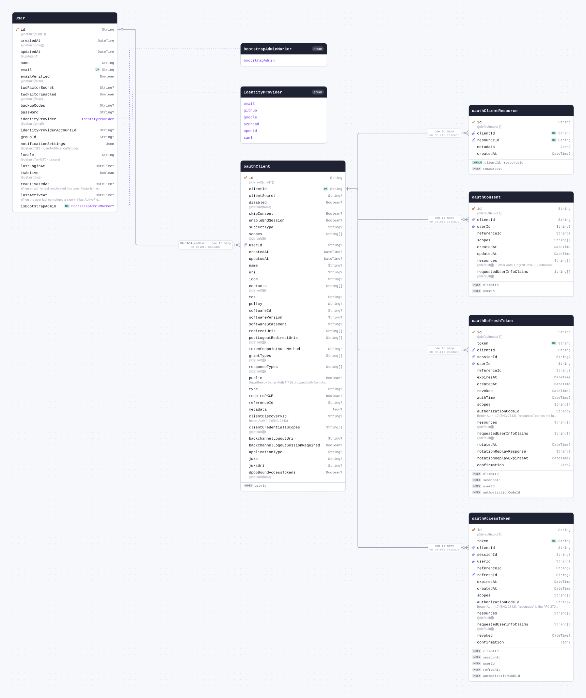

| Field                              | Type       | Constraints                   | Default   | Description                                                                                                                                                                                                                                                       |
| ---------------------------------- | ---------- | ----------------------------- | --------- | ----------------------------------------------------------------------------------------------------------------------------------------------------------------------------------------------------------------------------------------------------------------- |
| `id`                               | `String`   | PK NOT NULL                   | `cuid(1)` |                                                                                                                                                                                                                                                                   |
| `clientId`                         | `String`   | UNIQUE NOT NULL               |           |                                                                                                                                                                                                                                                                   |
| `clientSecret`                     | `String`   | NULL                          |           |                                                                                                                                                                                                                                                                   |
| `disabled`                         | `Boolean`  | NULL                          | `false`   |                                                                                                                                                                                                                                                                   |
| `skipConsent`                      | `Boolean`  | NULL                          |           |                                                                                                                                                                                                                                                                   |
| `enableEndSession`                 | `Boolean`  | NULL                          |           |                                                                                                                                                                                                                                                                   |
| `subjectType`                      | `String`   | NULL                          |           |                                                                                                                                                                                                                                                                   |
| `scopes`                           | `String[]` | NOT NULL                      | `[]`      |                                                                                                                                                                                                                                                                   |
| `userId`                           | `String`   | NULL → [User.id](#model-User) |           |                                                                                                                                                                                                                                                                   |
| `createdAt`                        | `DateTime` | NULL                          |           |                                                                                                                                                                                                                                                                   |
| `updatedAt`                        | `DateTime` | NULL                          |           |                                                                                                                                                                                                                                                                   |
| `name`                             | `String`   | NULL                          |           |                                                                                                                                                                                                                                                                   |
| `uri`                              | `String`   | NULL                          |           |                                                                                                                                                                                                                                                                   |
| `icon`                             | `String`   | NULL                          |           |                                                                                                                                                                                                                                                                   |
| `contacts`                         | `String[]` | NOT NULL                      | `[]`      |                                                                                                                                                                                                                                                                   |
| `tos`                              | `String`   | NULL                          |           |                                                                                                                                                                                                                                                                   |
| `policy`                           | `String`   | NULL                          |           |                                                                                                                                                                                                                                                                   |
| `softwareId`                       | `String`   | NULL                          |           |                                                                                                                                                                                                                                                                   |
| `softwareVersion`                  | `String`   | NULL                          |           |                                                                                                                                                                                                                                                                   |
| `softwareStatement`                | `String`   | NULL                          |           |                                                                                                                                                                                                                                                                   |
| `redirectUris`                     | `String[]` | NOT NULL                      |           |                                                                                                                                                                                                                                                                   |
| `postLogoutRedirectUris`           | `String[]` | NOT NULL                      | `[]`      |                                                                                                                                                                                                                                                                   |
| `tokenEndpointAuthMethod`          | `String`   | NULL                          |           |                                                                                                                                                                                                                                                                   |
| `grantTypes`                       | `String[]` | NOT NULL                      | `[]`      |                                                                                                                                                                                                                                                                   |
| `responseTypes`                    | `String[]` | NOT NULL                      | `[]`      |                                                                                                                                                                                                                                                                   |
| `public`                           | `Boolean`  | NULL                          |           | Unwritten by Better Auth 1.7 (it dropped both from its schema), kept deliberately: they are nullable, so keeping them makes the 1.7 migration purely additive and a rollback to 1.6 needs no down-migration. Drop them in a separate cleanup after a bake period. |
| `type`                             | `String`   | NULL                          |           |                                                                                                                                                                                                                                                                   |
| `requirePKCE`                      | `Boolean`  | NULL                          |           |                                                                                                                                                                                                                                                                   |
| `referenceId`                      | `String`   | NULL                          |           |                                                                                                                                                                                                                                                                   |
| `metadata`                         | `Json`     | NULL                          |           |                                                                                                                                                                                                                                                                   |
| `clientDiscoveryId`                | `String`   | NULL                          |           | Better Auth 1.7 (ENG-2343).                                                                                                                                                                                                                                       |
| `clientCredentialsScopes`          | `String[]` | NOT NULL                      | `[]`      |                                                                                                                                                                                                                                                                   |
| `backchannelLogoutUri`             | `String`   | NULL                          |           |                                                                                                                                                                                                                                                                   |
| `backchannelLogoutSessionRequired` | `Boolean`  | NULL                          |           |                                                                                                                                                                                                                                                                   |
| `applicationType`                  | `String`   | NULL                          |           |                                                                                                                                                                                                                                                                   |
| `jwks`                             | `String`   | NULL                          |           |                                                                                                                                                                                                                                                                   |
| `jwksUri`                          | `String`   | NULL                          |           |                                                                                                                                                                                                                                                                   |
| `dpopBoundAccessTokens`            | `Boolean`  | NULL                          | `false`   |                                                                                                                                                                                                                                                                   |

#### Indexes

- `@@index([userId])`

#### References

- `userId` → [User.id](#model-User) (many-to-one, on delete Cascade)

#### Referenced by

- `clientId` ← [oauthAccessToken.clientId](#model-oauthAccessToken) (one-to-many, on delete Cascade)
- `clientId` ← [oauthRefreshToken.clientId](#model-oauthRefreshToken) (one-to-many, on delete Cascade)
- `clientId` ← [oauthConsent.clientId](#model-oauthConsent) (one-to-many, on delete Cascade)
- `clientId` ← [oauthClientResource.clientId](#model-oauthClientResource) (one-to-many, on delete Cascade)

#### Definition

```sql
CREATE TABLE "oauthClient" (
    "id" TEXT NOT NULL,
    "clientId" TEXT NOT NULL,
    "clientSecret" TEXT,
    "disabled" BOOLEAN DEFAULT false,
    "skipConsent" BOOLEAN,
    "enableEndSession" BOOLEAN,
    "subjectType" TEXT,
    "scopes" TEXT[] DEFAULT ARRAY[]::TEXT[],
    "userId" TEXT,
    "createdAt" TIMESTAMP(3),
    "updatedAt" TIMESTAMP(3),
    "name" TEXT,
    "uri" TEXT,
    "icon" TEXT,
    "contacts" TEXT[] DEFAULT ARRAY[]::TEXT[],
    "tos" TEXT,
    "policy" TEXT,
    "softwareId" TEXT,
    "softwareVersion" TEXT,
    "softwareStatement" TEXT,
    "redirectUris" TEXT[],
    "postLogoutRedirectUris" TEXT[] DEFAULT ARRAY[]::TEXT[],
    "tokenEndpointAuthMethod" TEXT,
    "grantTypes" TEXT[] DEFAULT ARRAY[]::TEXT[],
    "responseTypes" TEXT[] DEFAULT ARRAY[]::TEXT[],
    "public" BOOLEAN,
    "type" TEXT,
    "requirePKCE" BOOLEAN,
    "referenceId" TEXT,
    "metadata" JSONB,
    "clientDiscoveryId" TEXT,
    "clientCredentialsScopes" TEXT[] DEFAULT ARRAY[]::TEXT[],
    "backchannelLogoutUri" TEXT,
    "backchannelLogoutSessionRequired" BOOLEAN,
    "applicationType" TEXT,
    "jwks" TEXT,
    "jwksUri" TEXT,
    "dpopBoundAccessTokens" BOOLEAN DEFAULT false,

    CONSTRAINT "oauthClient_pkey" PRIMARY KEY ("id")
);

CREATE UNIQUE INDEX "oauthClient_clientId_key" ON "oauthClient"("clientId");

CREATE INDEX "oauthClient_userId_idx" ON "oauthClient"("userId");

ALTER TABLE "oauthClient" ADD CONSTRAINT "oauthClient_userId_fkey" FOREIGN KEY ("userId") REFERENCES "User"("id") ON DELETE CASCADE ON UPDATE CASCADE;
```

<details>
<summary>Queries and their SQL</summary>

**findMany**: Every row

```ts
await prisma.oauthClient.findMany();
```

```sql
SELECT
  "public"."oauthClient"."id",
  "public"."oauthClient"."clientId",
  "public"."oauthClient"."clientSecret",
  "public"."oauthClient"."disabled",
  "public"."oauthClient"."skipConsent",
  "public"."oauthClient"."enableEndSession",
  "public"."oauthClient"."subjectType",
  "public"."oauthClient"."scopes",
  "public"."oauthClient"."userId",
  "public"."oauthClient"."createdAt",
  "public"."oauthClient"."updatedAt",
  "public"."oauthClient"."name",
  "public"."oauthClient"."uri",
  "public"."oauthClient"."icon",
  "public"."oauthClient"."contacts",
  "public"."oauthClient"."tos",
  "public"."oauthClient"."policy",
  "public"."oauthClient"."softwareId",
  "public"."oauthClient"."softwareVersion",
  "public"."oauthClient"."softwareStatement",
  "public"."oauthClient"."redirectUris",
  "public"."oauthClient"."postLogoutRedirectUris",
  "public"."oauthClient"."tokenEndpointAuthMethod",
  "public"."oauthClient"."grantTypes",
  "public"."oauthClient"."responseTypes",
  "public"."oauthClient"."public",
  "public"."oauthClient"."type",
  "public"."oauthClient"."requirePKCE",
  "public"."oauthClient"."referenceId",
  "public"."oauthClient"."metadata",
  "public"."oauthClient"."clientDiscoveryId",
  "public"."oauthClient"."clientCredentialsScopes",
  "public"."oauthClient"."backchannelLogoutUri",
  "public"."oauthClient"."backchannelLogoutSessionRequired",
  "public"."oauthClient"."applicationType",
  "public"."oauthClient"."jwks",
  "public"."oauthClient"."jwksUri",
  "public"."oauthClient"."dpopBoundAccessTokens"
FROM
  "public"."oauthClient"
WHERE
  1 = 1
OFFSET
  $1
-- params: ["0"]
```

**count**: How many rows there are

```ts
await prisma.oauthClient.count();
```

```sql
SELECT
  COUNT(*) AS "_count$_all"
FROM
  (
    SELECT
      "public"."oauthClient"."id"
    FROM
      "public"."oauthClient"
    WHERE
      1 = 1
    OFFSET
      $1
  ) AS "sub"
-- params: ["0"]
```

**findMany**: Every row with its relations

```ts
await prisma.oauthClient.findMany({
  include: { user: true, accessTokens: true, refreshTokens: true, consents: true, resources: true },
});
```

```sql
SELECT
  "public"."oauthClient"."id",
  "public"."oauthClient"."clientId",
  "public"."oauthClient"."clientSecret",
  "public"."oauthClient"."disabled",
  "public"."oauthClient"."skipConsent",
  "public"."oauthClient"."enableEndSession",
  "public"."oauthClient"."subjectType",
  "public"."oauthClient"."scopes",
  "public"."oauthClient"."userId",
  "public"."oauthClient"."createdAt",
  "public"."oauthClient"."updatedAt",
  "public"."oauthClient"."name",
  "public"."oauthClient"."uri",
  "public"."oauthClient"."icon",
  "public"."oauthClient"."contacts",
  "public"."oauthClient"."tos",
  "public"."oauthClient"."policy",
  "public"."oauthClient"."softwareId",
  "public"."oauthClient"."softwareVersion",
  "public"."oauthClient"."softwareStatement",
  "public"."oauthClient"."redirectUris",
  "public"."oauthClient"."postLogoutRedirectUris",
  "public"."oauthClient"."tokenEndpointAuthMethod",
  "public"."oauthClient"."grantTypes",
  "public"."oauthClient"."responseTypes",
  "public"."oauthClient"."public",
  "public"."oauthClient"."type",
  "public"."oauthClient"."requirePKCE",
  "public"."oauthClient"."referenceId",
  "public"."oauthClient"."metadata",
  "public"."oauthClient"."clientDiscoveryId",
  "public"."oauthClient"."clientCredentialsScopes",
  "public"."oauthClient"."backchannelLogoutUri",
  "public"."oauthClient"."backchannelLogoutSessionRequired",
  "public"."oauthClient"."applicationType",
  "public"."oauthClient"."jwks",
  "public"."oauthClient"."jwksUri",
  "public"."oauthClient"."dpopBoundAccessTokens"
FROM
  "public"."oauthClient"
WHERE
  1 = 1
OFFSET
  $1
-- params: ["0"]

SELECT
  "public"."User"."id",
  "public"."User"."created_at",
  "public"."User"."updated_at",
  "public"."User"."name",
  "public"."User"."email",
  "public"."User"."email_verified",
  "public"."User"."twoFactorSecret",
  "public"."User"."twoFactorEnabled",
  "public"."User"."backupCodes",
  "public"."User"."password",
  "public"."User"."identityProvider"::text,
  "public"."User"."identityProviderAccountId",
  "public"."User"."groupId",
  "public"."User"."notificationSettings",
  "public"."User"."locale",
  "public"."User"."lastLoginAt",
  "public"."User"."isActive",
  "public"."User"."reactivatedAt",
  "public"."User"."lastActiveAt",
  "public"."User"."isBootstrapAdmin"::text
FROM
  "public"."User"
WHERE
  "public"."User"."id" IN ($1)
OFFSET
  $2
-- params: ["<userId of the rows above>","0"]

SELECT
  "public"."oauthAccessToken"."id",
  "public"."oauthAccessToken"."token",
  "public"."oauthAccessToken"."clientId",
  "public"."oauthAccessToken"."sessionId",
  "public"."oauthAccessToken"."userId",
  "public"."oauthAccessToken"."referenceId",
  "public"."oauthAccessToken"."refreshId",
  "public"."oauthAccessToken"."expiresAt",
  "public"."oauthAccessToken"."createdAt",
  "public"."oauthAccessToken"."scopes",
  "public"."oauthAccessToken"."authorizationCodeId",
  "public"."oauthAccessToken"."resources",
  "public"."oauthAccessToken"."requestedUserInfoClaims",
  "public"."oauthAccessToken"."revoked",
  "public"."oauthAccessToken"."confirmation"
FROM
  "public"."oauthAccessToken"
WHERE
  "public"."oauthAccessToken"."clientId" IN ($1)
OFFSET
  $2
-- params: ["<clientId of the rows above>","0"]

SELECT
  "public"."oauthRefreshToken"."id",
  "public"."oauthRefreshToken"."token",
  "public"."oauthRefreshToken"."clientId",
  "public"."oauthRefreshToken"."sessionId",
  "public"."oauthRefreshToken"."userId",
  "public"."oauthRefreshToken"."referenceId",
  "public"."oauthRefreshToken"."expiresAt",
  "public"."oauthRefreshToken"."createdAt",
  "public"."oauthRefreshToken"."revoked",
  "public"."oauthRefreshToken"."authTime",
  "public"."oauthRefreshToken"."scopes",
  "public"."oauthRefreshToken"."authorizationCodeId",
  "public"."oauthRefreshToken"."resources",
  "public"."oauthRefreshToken"."requestedUserInfoClaims",
  "public"."oauthRefreshToken"."rotatedAt",
  "public"."oauthRefreshToken"."rotationReplayResponse",
  "public"."oauthRefreshToken"."rotationReplayExpiresAt",
  "public"."oauthRefreshToken"."confirmation"
FROM
  "public"."oauthRefreshToken"
WHERE
  "public"."oauthRefreshToken"."clientId" IN ($1)
OFFSET
  $2
-- params: ["<clientId of the rows above>","0"]

SELECT
  "public"."oauthConsent"."id",
  "public"."oauthConsent"."clientId",
  "public"."oauthConsent"."userId",
  "public"."oauthConsent"."referenceId",
  "public"."oauthConsent"."scopes",
  "public"."oauthConsent"."createdAt",
  "public"."oauthConsent"."updatedAt",
  "public"."oauthConsent"."resources",
  "public"."oauthConsent"."requestedUserInfoClaims"
FROM
  "public"."oauthConsent"
WHERE
  "public"."oauthConsent"."clientId" IN ($1)
OFFSET
  $2
-- params: ["<clientId of the rows above>","0"]

SELECT
  "public"."oauthClientResource"."id",
  "public"."oauthClientResource"."clientId",
  "public"."oauthClientResource"."resourceId",
  "public"."oauthClientResource"."metadata",
  "public"."oauthClientResource"."createdAt"
FROM
  "public"."oauthClientResource"
WHERE
  "public"."oauthClientResource"."clientId" IN ($1)
OFFSET
  $2
-- params: ["<clientId of the rows above>","0"]
```

**findUnique**: One row by what is unique to it

```ts
await prisma.oauthClient.findUnique({ where: { id: "example" } });
```

```sql
SELECT
  "public"."oauthClient"."id",
  "public"."oauthClient"."clientId",
  "public"."oauthClient"."clientSecret",
  "public"."oauthClient"."disabled",
  "public"."oauthClient"."skipConsent",
  "public"."oauthClient"."enableEndSession",
  "public"."oauthClient"."subjectType",
  "public"."oauthClient"."scopes",
  "public"."oauthClient"."userId",
  "public"."oauthClient"."createdAt",
  "public"."oauthClient"."updatedAt",
  "public"."oauthClient"."name",
  "public"."oauthClient"."uri",
  "public"."oauthClient"."icon",
  "public"."oauthClient"."contacts",
  "public"."oauthClient"."tos",
  "public"."oauthClient"."policy",
  "public"."oauthClient"."softwareId",
  "public"."oauthClient"."softwareVersion",
  "public"."oauthClient"."softwareStatement",
  "public"."oauthClient"."redirectUris",
  "public"."oauthClient"."postLogoutRedirectUris",
  "public"."oauthClient"."tokenEndpointAuthMethod",
  "public"."oauthClient"."grantTypes",
  "public"."oauthClient"."responseTypes",
  "public"."oauthClient"."public",
  "public"."oauthClient"."type",
  "public"."oauthClient"."requirePKCE",
  "public"."oauthClient"."referenceId",
  "public"."oauthClient"."metadata",
  "public"."oauthClient"."clientDiscoveryId",
  "public"."oauthClient"."clientCredentialsScopes",
  "public"."oauthClient"."backchannelLogoutUri",
  "public"."oauthClient"."backchannelLogoutSessionRequired",
  "public"."oauthClient"."applicationType",
  "public"."oauthClient"."jwks",
  "public"."oauthClient"."jwksUri",
  "public"."oauthClient"."dpopBoundAccessTokens"
FROM
  "public"."oauthClient"
WHERE
  (
    "public"."oauthClient"."id" = $1
    AND 1 = 1
  )
LIMIT
  $2
OFFSET
  $3
-- params: ["example","1","0"]
```

**create**: Create a row

```ts
await prisma.oauthClient.create({ data: { clientId: "example", redirectUris: ["example"] } });
```

```sql
INSERT INTO
  "public"."oauthClient" (
    "id",
    "clientId",
    "disabled",
    "scopes",
    "contacts",
    "redirectUris",
    "postLogoutRedirectUris",
    "grantTypes",
    "responseTypes",
    "clientCredentialsScopes",
    "dpopBoundAccessTokens"
  )
VALUES
  ($1, $2, $3, $4, $5, $6, $7, $8, $9, $10, $11)
RETURNING
  "public"."oauthClient"."id",
  "public"."oauthClient"."clientId",
  "public"."oauthClient"."clientSecret",
  "public"."oauthClient"."disabled",
  "public"."oauthClient"."skipConsent",
  "public"."oauthClient"."enableEndSession",
  "public"."oauthClient"."subjectType",
  "public"."oauthClient"."scopes",
  "public"."oauthClient"."userId",
  "public"."oauthClient"."createdAt",
  "public"."oauthClient"."updatedAt",
  "public"."oauthClient"."name",
  "public"."oauthClient"."uri",
  "public"."oauthClient"."icon",
  "public"."oauthClient"."contacts",
  "public"."oauthClient"."tos",
  "public"."oauthClient"."policy",
  "public"."oauthClient"."softwareId",
  "public"."oauthClient"."softwareVersion",
  "public"."oauthClient"."softwareStatement",
  "public"."oauthClient"."redirectUris",
  "public"."oauthClient"."postLogoutRedirectUris",
  "public"."oauthClient"."tokenEndpointAuthMethod",
  "public"."oauthClient"."grantTypes",
  "public"."oauthClient"."responseTypes",
  "public"."oauthClient"."public",
  "public"."oauthClient"."type",
  "public"."oauthClient"."requirePKCE",
  "public"."oauthClient"."referenceId",
  "public"."oauthClient"."metadata",
  "public"."oauthClient"."clientDiscoveryId",
  "public"."oauthClient"."clientCredentialsScopes",
  "public"."oauthClient"."backchannelLogoutUri",
  "public"."oauthClient"."backchannelLogoutSessionRequired",
  "public"."oauthClient"."applicationType",
  "public"."oauthClient"."jwks",
  "public"."oauthClient"."jwksUri",
  "public"."oauthClient"."dpopBoundAccessTokens"
-- params: ["<cuid(1)>","example",false,[],[],["example"],[],[],[],[],false]
```

**update**: Update a row

```ts
await prisma.oauthClient.update({ where: { id: "example" }, data: { clientId: "example" } });
```

```sql
UPDATE "public"."oauthClient"
SET
  "clientId" = $1
WHERE
  (
    "public"."oauthClient"."id" = $2
    AND 1 = 1
  )
RETURNING
  "public"."oauthClient"."id",
  "public"."oauthClient"."clientId",
  "public"."oauthClient"."clientSecret",
  "public"."oauthClient"."disabled",
  "public"."oauthClient"."skipConsent",
  "public"."oauthClient"."enableEndSession",
  "public"."oauthClient"."subjectType",
  "public"."oauthClient"."scopes",
  "public"."oauthClient"."userId",
  "public"."oauthClient"."createdAt",
  "public"."oauthClient"."updatedAt",
  "public"."oauthClient"."name",
  "public"."oauthClient"."uri",
  "public"."oauthClient"."icon",
  "public"."oauthClient"."contacts",
  "public"."oauthClient"."tos",
  "public"."oauthClient"."policy",
  "public"."oauthClient"."softwareId",
  "public"."oauthClient"."softwareVersion",
  "public"."oauthClient"."softwareStatement",
  "public"."oauthClient"."redirectUris",
  "public"."oauthClient"."postLogoutRedirectUris",
  "public"."oauthClient"."tokenEndpointAuthMethod",
  "public"."oauthClient"."grantTypes",
  "public"."oauthClient"."responseTypes",
  "public"."oauthClient"."public",
  "public"."oauthClient"."type",
  "public"."oauthClient"."requirePKCE",
  "public"."oauthClient"."referenceId",
  "public"."oauthClient"."metadata",
  "public"."oauthClient"."clientDiscoveryId",
  "public"."oauthClient"."clientCredentialsScopes",
  "public"."oauthClient"."backchannelLogoutUri",
  "public"."oauthClient"."backchannelLogoutSessionRequired",
  "public"."oauthClient"."applicationType",
  "public"."oauthClient"."jwks",
  "public"."oauthClient"."jwksUri",
  "public"."oauthClient"."dpopBoundAccessTokens"
-- params: ["example","example"]
```

**delete**: Delete a row

```ts
await prisma.oauthClient.delete({ where: { id: "example" } });
```

```sql
DELETE FROM "public"."oauthClient"
WHERE
  (
    "public"."oauthClient"."id" = $1
    AND 1 = 1
  )
RETURNING
  "public"."oauthClient"."id",
  "public"."oauthClient"."clientId",
  "public"."oauthClient"."clientSecret",
  "public"."oauthClient"."disabled",
  "public"."oauthClient"."skipConsent",
  "public"."oauthClient"."enableEndSession",
  "public"."oauthClient"."subjectType",
  "public"."oauthClient"."scopes",
  "public"."oauthClient"."userId",
  "public"."oauthClient"."createdAt",
  "public"."oauthClient"."updatedAt",
  "public"."oauthClient"."name",
  "public"."oauthClient"."uri",
  "public"."oauthClient"."icon",
  "public"."oauthClient"."contacts",
  "public"."oauthClient"."tos",
  "public"."oauthClient"."policy",
  "public"."oauthClient"."softwareId",
  "public"."oauthClient"."softwareVersion",
  "public"."oauthClient"."softwareStatement",
  "public"."oauthClient"."redirectUris",
  "public"."oauthClient"."postLogoutRedirectUris",
  "public"."oauthClient"."tokenEndpointAuthMethod",
  "public"."oauthClient"."grantTypes",
  "public"."oauthClient"."responseTypes",
  "public"."oauthClient"."public",
  "public"."oauthClient"."type",
  "public"."oauthClient"."requirePKCE",
  "public"."oauthClient"."referenceId",
  "public"."oauthClient"."metadata",
  "public"."oauthClient"."clientDiscoveryId",
  "public"."oauthClient"."clientCredentialsScopes",
  "public"."oauthClient"."backchannelLogoutUri",
  "public"."oauthClient"."backchannelLogoutSessionRequired",
  "public"."oauthClient"."applicationType",
  "public"."oauthClient"."jwks",
  "public"."oauthClient"."jwksUri",
  "public"."oauthClient"."dpopBoundAccessTokens"
-- params: ["example"]
```

</details>

<a id="model-oauthAccessToken"></a>

### oauthAccessToken

Better Auth opaque access token records. The token column stores Better Auth's hashed lookup value.
JWT access tokens are verified through JWKS and bounded by the configured short lifetime.

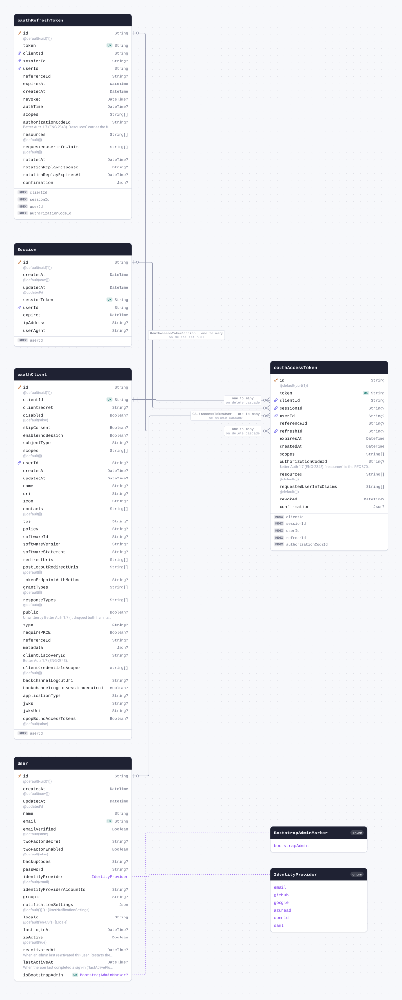

| Field                     | Type       | Constraints                                             | Default   | Description                                                                                                                                                   |
| ------------------------- | ---------- | ------------------------------------------------------- | --------- | ------------------------------------------------------------------------------------------------------------------------------------------------------------- |
| `id`                      | `String`   | PK NOT NULL                                             | `cuid(1)` |                                                                                                                                                               |
| `token`                   | `String`   | UNIQUE NOT NULL                                         |           |                                                                                                                                                               |
| `clientId`                | `String`   | NOT NULL → [oauthClient.clientId](#model-oauthClient)   |           |                                                                                                                                                               |
| `sessionId`               | `String`   | NULL → [Session.id](#model-Session)                     |           |                                                                                                                                                               |
| `userId`                  | `String`   | NULL → [User.id](#model-User)                           |           |                                                                                                                                                               |
| `referenceId`             | `String`   | NULL                                                    |           |                                                                                                                                                               |
| `refreshId`               | `String`   | NULL → [oauthRefreshToken.id](#model-oauthRefreshToken) |           |                                                                                                                                                               |
| `expiresAt`               | `DateTime` | NOT NULL                                                |           |                                                                                                                                                               |
| `createdAt`               | `DateTime` | NOT NULL                                                |           |                                                                                                                                                               |
| `scopes`                  | `String[]` | NOT NULL                                                |           |                                                                                                                                                               |
| `authorizationCodeId`     | `String`   | NULL                                                    |           | Better Auth 1.7 (ENG-2343). `resources` is the RFC 8707 resource set the grant approved — the binding this whole upgrade exists to get (GHSA-p2fr-6hmx-4528). |
| `resources`               | `String[]` | NOT NULL                                                | `[]`      |                                                                                                                                                               |
| `requestedUserInfoClaims` | `String[]` | NOT NULL                                                | `[]`      |                                                                                                                                                               |
| `revoked`                 | `DateTime` | NULL                                                    |           |                                                                                                                                                               |
| `confirmation`            | `Json`     | NULL                                                    |           |                                                                                                                                                               |

#### Indexes

- `@@index([clientId])`
- `@@index([sessionId])`
- `@@index([userId])`
- `@@index([refreshId])`
- `@@index([authorizationCodeId])`

#### References

- `clientId` → [oauthClient.clientId](#model-oauthClient) (many-to-one, on delete Cascade)
- `sessionId` → [Session.id](#model-Session) (many-to-one, on delete SetNull)
- `userId` → [User.id](#model-User) (many-to-one, on delete Cascade)
- `refreshId` → [oauthRefreshToken.id](#model-oauthRefreshToken) (many-to-one, on delete Cascade)

#### Definition

```sql
CREATE TABLE "oauthAccessToken" (
    "id" TEXT NOT NULL,
    "token" TEXT NOT NULL,
    "clientId" TEXT NOT NULL,
    "sessionId" TEXT,
    "userId" TEXT,
    "referenceId" TEXT,
    "refreshId" TEXT,
    "expiresAt" TIMESTAMP(3) NOT NULL,
    "createdAt" TIMESTAMP(3) NOT NULL,
    "scopes" TEXT[],
    "authorizationCodeId" TEXT,
    "resources" TEXT[] DEFAULT ARRAY[]::TEXT[],
    "requestedUserInfoClaims" TEXT[] DEFAULT ARRAY[]::TEXT[],
    "revoked" TIMESTAMP(3),
    "confirmation" JSONB,

    CONSTRAINT "oauthAccessToken_pkey" PRIMARY KEY ("id")
);

CREATE UNIQUE INDEX "oauthAccessToken_token_key" ON "oauthAccessToken"("token");

CREATE INDEX "oauthAccessToken_clientId_idx" ON "oauthAccessToken"("clientId");

CREATE INDEX "oauthAccessToken_sessionId_idx" ON "oauthAccessToken"("sessionId");

CREATE INDEX "oauthAccessToken_userId_idx" ON "oauthAccessToken"("userId");

CREATE INDEX "oauthAccessToken_refreshId_idx" ON "oauthAccessToken"("refreshId");

CREATE INDEX "oauthAccessToken_authorizationCodeId_idx" ON "oauthAccessToken"("authorizationCodeId");

ALTER TABLE "oauthAccessToken" ADD CONSTRAINT "oauthAccessToken_clientId_fkey" FOREIGN KEY ("clientId") REFERENCES "oauthClient"("clientId") ON DELETE CASCADE ON UPDATE CASCADE;

ALTER TABLE "oauthAccessToken" ADD CONSTRAINT "oauthAccessToken_sessionId_fkey" FOREIGN KEY ("sessionId") REFERENCES "Session"("id") ON DELETE SET NULL ON UPDATE CASCADE;

ALTER TABLE "oauthAccessToken" ADD CONSTRAINT "oauthAccessToken_userId_fkey" FOREIGN KEY ("userId") REFERENCES "User"("id") ON DELETE CASCADE ON UPDATE CASCADE;

ALTER TABLE "oauthAccessToken" ADD CONSTRAINT "oauthAccessToken_refreshId_fkey" FOREIGN KEY ("refreshId") REFERENCES "oauthRefreshToken"("id") ON DELETE CASCADE ON UPDATE CASCADE;
```

<details>
<summary>Queries and their SQL</summary>

**findMany**: Every row

```ts
await prisma.oauthAccessToken.findMany();
```

```sql
SELECT
  "public"."oauthAccessToken"."id",
  "public"."oauthAccessToken"."token",
  "public"."oauthAccessToken"."clientId",
  "public"."oauthAccessToken"."sessionId",
  "public"."oauthAccessToken"."userId",
  "public"."oauthAccessToken"."referenceId",
  "public"."oauthAccessToken"."refreshId",
  "public"."oauthAccessToken"."expiresAt",
  "public"."oauthAccessToken"."createdAt",
  "public"."oauthAccessToken"."scopes",
  "public"."oauthAccessToken"."authorizationCodeId",
  "public"."oauthAccessToken"."resources",
  "public"."oauthAccessToken"."requestedUserInfoClaims",
  "public"."oauthAccessToken"."revoked",
  "public"."oauthAccessToken"."confirmation"
FROM
  "public"."oauthAccessToken"
WHERE
  1 = 1
OFFSET
  $1
-- params: ["0"]
```

**count**: How many rows there are

```ts
await prisma.oauthAccessToken.count();
```

```sql
SELECT
  COUNT(*) AS "_count$_all"
FROM
  (
    SELECT
      "public"."oauthAccessToken"."id"
    FROM
      "public"."oauthAccessToken"
    WHERE
      1 = 1
    OFFSET
      $1
  ) AS "sub"
-- params: ["0"]
```

**findMany**: Every row with its relations

```ts
await prisma.oauthAccessToken.findMany({
  include: { client: true, session: true, user: true, refresh: true },
});
```

```sql
SELECT
  "public"."oauthAccessToken"."id",
  "public"."oauthAccessToken"."token",
  "public"."oauthAccessToken"."clientId",
  "public"."oauthAccessToken"."sessionId",
  "public"."oauthAccessToken"."userId",
  "public"."oauthAccessToken"."referenceId",
  "public"."oauthAccessToken"."refreshId",
  "public"."oauthAccessToken"."expiresAt",
  "public"."oauthAccessToken"."createdAt",
  "public"."oauthAccessToken"."scopes",
  "public"."oauthAccessToken"."authorizationCodeId",
  "public"."oauthAccessToken"."resources",
  "public"."oauthAccessToken"."requestedUserInfoClaims",
  "public"."oauthAccessToken"."revoked",
  "public"."oauthAccessToken"."confirmation"
FROM
  "public"."oauthAccessToken"
WHERE
  1 = 1
OFFSET
  $1
-- params: ["0"]

SELECT
  "public"."oauthClient"."id",
  "public"."oauthClient"."clientId",
  "public"."oauthClient"."clientSecret",
  "public"."oauthClient"."disabled",
  "public"."oauthClient"."skipConsent",
  "public"."oauthClient"."enableEndSession",
  "public"."oauthClient"."subjectType",
  "public"."oauthClient"."scopes",
  "public"."oauthClient"."userId",
  "public"."oauthClient"."createdAt",
  "public"."oauthClient"."updatedAt",
  "public"."oauthClient"."name",
  "public"."oauthClient"."uri",
  "public"."oauthClient"."icon",
  "public"."oauthClient"."contacts",
  "public"."oauthClient"."tos",
  "public"."oauthClient"."policy",
  "public"."oauthClient"."softwareId",
  "public"."oauthClient"."softwareVersion",
  "public"."oauthClient"."softwareStatement",
  "public"."oauthClient"."redirectUris",
  "public"."oauthClient"."postLogoutRedirectUris",
  "public"."oauthClient"."tokenEndpointAuthMethod",
  "public"."oauthClient"."grantTypes",
  "public"."oauthClient"."responseTypes",
  "public"."oauthClient"."public",
  "public"."oauthClient"."type",
  "public"."oauthClient"."requirePKCE",
  "public"."oauthClient"."referenceId",
  "public"."oauthClient"."metadata",
  "public"."oauthClient"."clientDiscoveryId",
  "public"."oauthClient"."clientCredentialsScopes",
  "public"."oauthClient"."backchannelLogoutUri",
  "public"."oauthClient"."backchannelLogoutSessionRequired",
  "public"."oauthClient"."applicationType",
  "public"."oauthClient"."jwks",
  "public"."oauthClient"."jwksUri",
  "public"."oauthClient"."dpopBoundAccessTokens"
FROM
  "public"."oauthClient"
WHERE
  "public"."oauthClient"."clientId" IN ($1)
OFFSET
  $2
-- params: ["<clientId of the rows above>","0"]

SELECT
  "public"."Session"."id",
  "public"."Session"."created_at",
  "public"."Session"."updated_at",
  "public"."Session"."sessionToken",
  "public"."Session"."userId",
  "public"."Session"."expires",
  "public"."Session"."ipAddress",
  "public"."Session"."userAgent"
FROM
  "public"."Session"
WHERE
  "public"."Session"."id" IN ($1)
OFFSET
  $2
-- params: ["<sessionId of the rows above>","0"]

SELECT
  "public"."User"."id",
  "public"."User"."created_at",
  "public"."User"."updated_at",
  "public"."User"."name",
  "public"."User"."email",
  "public"."User"."email_verified",
  "public"."User"."twoFactorSecret",
  "public"."User"."twoFactorEnabled",
  "public"."User"."backupCodes",
  "public"."User"."password",
  "public"."User"."identityProvider"::text,
  "public"."User"."identityProviderAccountId",
  "public"."User"."groupId",
  "public"."User"."notificationSettings",
  "public"."User"."locale",
  "public"."User"."lastLoginAt",
  "public"."User"."isActive",
  "public"."User"."reactivatedAt",
  "public"."User"."lastActiveAt",
  "public"."User"."isBootstrapAdmin"::text
FROM
  "public"."User"
WHERE
  "public"."User"."id" IN ($1)
OFFSET
  $2
-- params: ["<userId of the rows above>","0"]

SELECT
  "public"."oauthRefreshToken"."id",
  "public"."oauthRefreshToken"."token",
  "public"."oauthRefreshToken"."clientId",
  "public"."oauthRefreshToken"."sessionId",
  "public"."oauthRefreshToken"."userId",
  "public"."oauthRefreshToken"."referenceId",
  "public"."oauthRefreshToken"."expiresAt",
  "public"."oauthRefreshToken"."createdAt",
  "public"."oauthRefreshToken"."revoked",
  "public"."oauthRefreshToken"."authTime",
  "public"."oauthRefreshToken"."scopes",
  "public"."oauthRefreshToken"."authorizationCodeId",
  "public"."oauthRefreshToken"."resources",
  "public"."oauthRefreshToken"."requestedUserInfoClaims",
  "public"."oauthRefreshToken"."rotatedAt",
  "public"."oauthRefreshToken"."rotationReplayResponse",
  "public"."oauthRefreshToken"."rotationReplayExpiresAt",
  "public"."oauthRefreshToken"."confirmation"
FROM
  "public"."oauthRefreshToken"
WHERE
  "public"."oauthRefreshToken"."id" IN ($1)
OFFSET
  $2
-- params: ["<refreshId of the rows above>","0"]
```

**findUnique**: One row by what is unique to it

```ts
await prisma.oauthAccessToken.findUnique({ where: { id: "example" } });
```

```sql
SELECT
  "public"."oauthAccessToken"."id",
  "public"."oauthAccessToken"."token",
  "public"."oauthAccessToken"."clientId",
  "public"."oauthAccessToken"."sessionId",
  "public"."oauthAccessToken"."userId",
  "public"."oauthAccessToken"."referenceId",
  "public"."oauthAccessToken"."refreshId",
  "public"."oauthAccessToken"."expiresAt",
  "public"."oauthAccessToken"."createdAt",
  "public"."oauthAccessToken"."scopes",
  "public"."oauthAccessToken"."authorizationCodeId",
  "public"."oauthAccessToken"."resources",
  "public"."oauthAccessToken"."requestedUserInfoClaims",
  "public"."oauthAccessToken"."revoked",
  "public"."oauthAccessToken"."confirmation"
FROM
  "public"."oauthAccessToken"
WHERE
  (
    "public"."oauthAccessToken"."id" = $1
    AND 1 = 1
  )
LIMIT
  $2
OFFSET
  $3
-- params: ["example","1","0"]
```

**create**: Create a row

```ts
await prisma.oauthAccessToken.create({
  data: {
    token: "example",
    clientId: "example",
    expiresAt: new Date("2026-01-01T00:00:00.000Z"),
    createdAt: new Date("2026-01-01T00:00:00.000Z"),
    scopes: ["example"],
  },
});
```

```sql
INSERT INTO
  "public"."oauthAccessToken" (
    "id",
    "token",
    "clientId",
    "expiresAt",
    "createdAt",
    "scopes",
    "resources",
    "requestedUserInfoClaims"
  )
VALUES
  ($1, $2, $3, $4, $5, $6, $7, $8)
RETURNING
  "public"."oauthAccessToken"."id",
  "public"."oauthAccessToken"."token",
  "public"."oauthAccessToken"."clientId",
  "public"."oauthAccessToken"."sessionId",
  "public"."oauthAccessToken"."userId",
  "public"."oauthAccessToken"."referenceId",
  "public"."oauthAccessToken"."refreshId",
  "public"."oauthAccessToken"."expiresAt",
  "public"."oauthAccessToken"."createdAt",
  "public"."oauthAccessToken"."scopes",
  "public"."oauthAccessToken"."authorizationCodeId",
  "public"."oauthAccessToken"."resources",
  "public"."oauthAccessToken"."requestedUserInfoClaims",
  "public"."oauthAccessToken"."revoked",
  "public"."oauthAccessToken"."confirmation"
-- params: ["<cuid(1)>","example","example","2026-01-01T00:00:00.000Z","2026-01-01T00:00:00.000Z",["example"],[],[]]
```

**update**: Update a row

```ts
await prisma.oauthAccessToken.update({ where: { id: "example" }, data: { token: "example" } });
```

```sql
UPDATE "public"."oauthAccessToken"
SET
  "token" = $1
WHERE
  (
    "public"."oauthAccessToken"."id" = $2
    AND 1 = 1
  )
RETURNING
  "public"."oauthAccessToken"."id",
  "public"."oauthAccessToken"."token",
  "public"."oauthAccessToken"."clientId",
  "public"."oauthAccessToken"."sessionId",
  "public"."oauthAccessToken"."userId",
  "public"."oauthAccessToken"."referenceId",
  "public"."oauthAccessToken"."refreshId",
  "public"."oauthAccessToken"."expiresAt",
  "public"."oauthAccessToken"."createdAt",
  "public"."oauthAccessToken"."scopes",
  "public"."oauthAccessToken"."authorizationCodeId",
  "public"."oauthAccessToken"."resources",
  "public"."oauthAccessToken"."requestedUserInfoClaims",
  "public"."oauthAccessToken"."revoked",
  "public"."oauthAccessToken"."confirmation"
-- params: ["example","example"]
```

**delete**: Delete a row

```ts
await prisma.oauthAccessToken.delete({ where: { id: "example" } });
```

```sql
DELETE FROM "public"."oauthAccessToken"
WHERE
  (
    "public"."oauthAccessToken"."id" = $1
    AND 1 = 1
  )
RETURNING
  "public"."oauthAccessToken"."id",
  "public"."oauthAccessToken"."token",
  "public"."oauthAccessToken"."clientId",
  "public"."oauthAccessToken"."sessionId",
  "public"."oauthAccessToken"."userId",
  "public"."oauthAccessToken"."referenceId",
  "public"."oauthAccessToken"."refreshId",
  "public"."oauthAccessToken"."expiresAt",
  "public"."oauthAccessToken"."createdAt",
  "public"."oauthAccessToken"."scopes",
  "public"."oauthAccessToken"."authorizationCodeId",
  "public"."oauthAccessToken"."resources",
  "public"."oauthAccessToken"."requestedUserInfoClaims",
  "public"."oauthAccessToken"."revoked",
  "public"."oauthAccessToken"."confirmation"
-- params: ["example"]
```

</details>

<a id="model-oauthRefreshToken"></a>

### oauthRefreshToken

Better Auth OAuth refresh tokens used by delegated MCP clients. The token column stores a hashed lookup value.

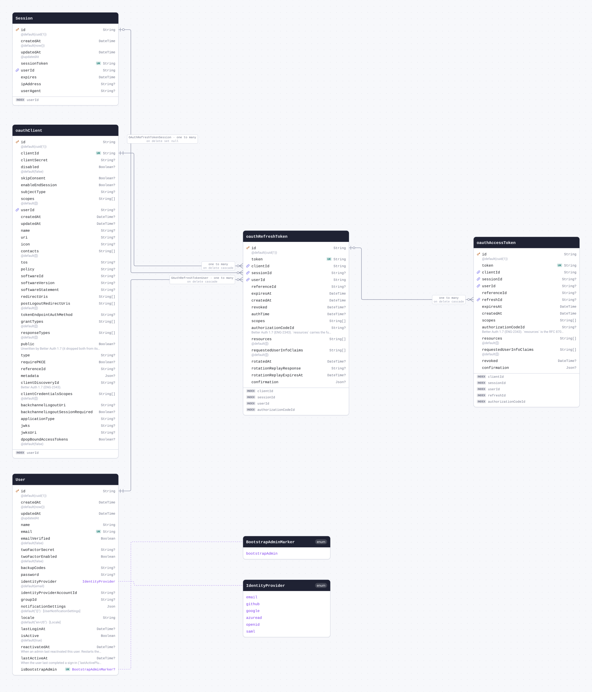

| Field                     | Type       | Constraints                                           | Default   | Description                                                                                                                          |
| ------------------------- | ---------- | ----------------------------------------------------- | --------- | ------------------------------------------------------------------------------------------------------------------------------------ |
| `id`                      | `String`   | PK NOT NULL                                           | `cuid(1)` |                                                                                                                                      |
| `token`                   | `String`   | UNIQUE NOT NULL                                       |           |                                                                                                                                      |
| `clientId`                | `String`   | NOT NULL → [oauthClient.clientId](#model-oauthClient) |           |                                                                                                                                      |
| `sessionId`               | `String`   | NULL → [Session.id](#model-Session)                   |           |                                                                                                                                      |
| `userId`                  | `String`   | NOT NULL → [User.id](#model-User)                     |           |                                                                                                                                      |
| `referenceId`             | `String`   | NULL                                                  |           |                                                                                                                                      |
| `expiresAt`               | `DateTime` | NOT NULL                                              |           |                                                                                                                                      |
| `createdAt`               | `DateTime` | NOT NULL                                              |           |                                                                                                                                      |
| `revoked`                 | `DateTime` | NULL                                                  |           |                                                                                                                                      |
| `authTime`                | `DateTime` | NULL                                                  |           |                                                                                                                                      |
| `scopes`                  | `String[]` | NOT NULL                                              |           |                                                                                                                                      |
| `authorizationCodeId`     | `String`   | NULL                                                  |           | Better Auth 1.7 (ENG-2343). `resources` carries the full original grant so a refresh can narrow the resource set but never widen it. |
| `resources`               | `String[]` | NOT NULL                                              | `[]`      |                                                                                                                                      |
| `requestedUserInfoClaims` | `String[]` | NOT NULL                                              | `[]`      |                                                                                                                                      |
| `rotatedAt`               | `DateTime` | NULL                                                  |           |                                                                                                                                      |
| `rotationReplayResponse`  | `String`   | NULL                                                  |           |                                                                                                                                      |
| `rotationReplayExpiresAt` | `DateTime` | NULL                                                  |           |                                                                                                                                      |
| `confirmation`            | `Json`     | NULL                                                  |           |                                                                                                                                      |

#### Indexes

- `@@index([clientId])`
- `@@index([sessionId])`
- `@@index([userId])`
- `@@index([authorizationCodeId])`

#### References

- `clientId` → [oauthClient.clientId](#model-oauthClient) (many-to-one, on delete Cascade)
- `sessionId` → [Session.id](#model-Session) (many-to-one, on delete SetNull)
- `userId` → [User.id](#model-User) (many-to-one, on delete Cascade)

#### Referenced by

- `id` ← [oauthAccessToken.refreshId](#model-oauthAccessToken) (one-to-many, on delete Cascade)

#### Definition

```sql
CREATE TABLE "oauthRefreshToken" (
    "id" TEXT NOT NULL,
    "token" TEXT NOT NULL,
    "clientId" TEXT NOT NULL,
    "sessionId" TEXT,
    "userId" TEXT NOT NULL,
    "referenceId" TEXT,
    "expiresAt" TIMESTAMP(3) NOT NULL,
    "createdAt" TIMESTAMP(3) NOT NULL,
    "revoked" TIMESTAMP(3),
    "authTime" TIMESTAMP(3),
    "scopes" TEXT[],
    "authorizationCodeId" TEXT,
    "resources" TEXT[] DEFAULT ARRAY[]::TEXT[],
    "requestedUserInfoClaims" TEXT[] DEFAULT ARRAY[]::TEXT[],
    "rotatedAt" TIMESTAMP(3),
    "rotationReplayResponse" TEXT,
    "rotationReplayExpiresAt" TIMESTAMP(3),
    "confirmation" JSONB,

    CONSTRAINT "oauthRefreshToken_pkey" PRIMARY KEY ("id")
);

CREATE UNIQUE INDEX "oauthRefreshToken_token_key" ON "oauthRefreshToken"("token");

CREATE INDEX "oauthRefreshToken_clientId_idx" ON "oauthRefreshToken"("clientId");

CREATE INDEX "oauthRefreshToken_sessionId_idx" ON "oauthRefreshToken"("sessionId");

CREATE INDEX "oauthRefreshToken_userId_idx" ON "oauthRefreshToken"("userId");

CREATE INDEX "oauthRefreshToken_authorizationCodeId_idx" ON "oauthRefreshToken"("authorizationCodeId");

ALTER TABLE "oauthRefreshToken" ADD CONSTRAINT "oauthRefreshToken_clientId_fkey" FOREIGN KEY ("clientId") REFERENCES "oauthClient"("clientId") ON DELETE CASCADE ON UPDATE CASCADE;

ALTER TABLE "oauthRefreshToken" ADD CONSTRAINT "oauthRefreshToken_sessionId_fkey" FOREIGN KEY ("sessionId") REFERENCES "Session"("id") ON DELETE SET NULL ON UPDATE CASCADE;

ALTER TABLE "oauthRefreshToken" ADD CONSTRAINT "oauthRefreshToken_userId_fkey" FOREIGN KEY ("userId") REFERENCES "User"("id") ON DELETE CASCADE ON UPDATE CASCADE;
```

<details>
<summary>Queries and their SQL</summary>

**findMany**: Every row

```ts
await prisma.oauthRefreshToken.findMany();
```

```sql
SELECT
  "public"."oauthRefreshToken"."id",
  "public"."oauthRefreshToken"."token",
  "public"."oauthRefreshToken"."clientId",
  "public"."oauthRefreshToken"."sessionId",
  "public"."oauthRefreshToken"."userId",
  "public"."oauthRefreshToken"."referenceId",
  "public"."oauthRefreshToken"."expiresAt",
  "public"."oauthRefreshToken"."createdAt",
  "public"."oauthRefreshToken"."revoked",
  "public"."oauthRefreshToken"."authTime",
  "public"."oauthRefreshToken"."scopes",
  "public"."oauthRefreshToken"."authorizationCodeId",
  "public"."oauthRefreshToken"."resources",
  "public"."oauthRefreshToken"."requestedUserInfoClaims",
  "public"."oauthRefreshToken"."rotatedAt",
  "public"."oauthRefreshToken"."rotationReplayResponse",
  "public"."oauthRefreshToken"."rotationReplayExpiresAt",
  "public"."oauthRefreshToken"."confirmation"
FROM
  "public"."oauthRefreshToken"
WHERE
  1 = 1
OFFSET
  $1
-- params: ["0"]
```

**count**: How many rows there are

```ts
await prisma.oauthRefreshToken.count();
```

```sql
SELECT
  COUNT(*) AS "_count$_all"
FROM
  (
    SELECT
      "public"."oauthRefreshToken"."id"
    FROM
      "public"."oauthRefreshToken"
    WHERE
      1 = 1
    OFFSET
      $1
  ) AS "sub"
-- params: ["0"]
```

**findMany**: Every row with its relations

```ts
await prisma.oauthRefreshToken.findMany({
  include: { client: true, session: true, user: true, accessTokens: true },
});
```

```sql
SELECT
  "public"."oauthRefreshToken"."id",
  "public"."oauthRefreshToken"."token",
  "public"."oauthRefreshToken"."clientId",
  "public"."oauthRefreshToken"."sessionId",
  "public"."oauthRefreshToken"."userId",
  "public"."oauthRefreshToken"."referenceId",
  "public"."oauthRefreshToken"."expiresAt",
  "public"."oauthRefreshToken"."createdAt",
  "public"."oauthRefreshToken"."revoked",
  "public"."oauthRefreshToken"."authTime",
  "public"."oauthRefreshToken"."scopes",
  "public"."oauthRefreshToken"."authorizationCodeId",
  "public"."oauthRefreshToken"."resources",
  "public"."oauthRefreshToken"."requestedUserInfoClaims",
  "public"."oauthRefreshToken"."rotatedAt",
  "public"."oauthRefreshToken"."rotationReplayResponse",
  "public"."oauthRefreshToken"."rotationReplayExpiresAt",
  "public"."oauthRefreshToken"."confirmation"
FROM
  "public"."oauthRefreshToken"
WHERE
  1 = 1
OFFSET
  $1
-- params: ["0"]

SELECT
  "public"."oauthClient"."id",
  "public"."oauthClient"."clientId",
  "public"."oauthClient"."clientSecret",
  "public"."oauthClient"."disabled",
  "public"."oauthClient"."skipConsent",
  "public"."oauthClient"."enableEndSession",
  "public"."oauthClient"."subjectType",
  "public"."oauthClient"."scopes",
  "public"."oauthClient"."userId",
  "public"."oauthClient"."createdAt",
  "public"."oauthClient"."updatedAt",
  "public"."oauthClient"."name",
  "public"."oauthClient"."uri",
  "public"."oauthClient"."icon",
  "public"."oauthClient"."contacts",
  "public"."oauthClient"."tos",
  "public"."oauthClient"."policy",
  "public"."oauthClient"."softwareId",
  "public"."oauthClient"."softwareVersion",
  "public"."oauthClient"."softwareStatement",
  "public"."oauthClient"."redirectUris",
  "public"."oauthClient"."postLogoutRedirectUris",
  "public"."oauthClient"."tokenEndpointAuthMethod",
  "public"."oauthClient"."grantTypes",
  "public"."oauthClient"."responseTypes",
  "public"."oauthClient"."public",
  "public"."oauthClient"."type",
  "public"."oauthClient"."requirePKCE",
  "public"."oauthClient"."referenceId",
  "public"."oauthClient"."metadata",
  "public"."oauthClient"."clientDiscoveryId",
  "public"."oauthClient"."clientCredentialsScopes",
  "public"."oauthClient"."backchannelLogoutUri",
  "public"."oauthClient"."backchannelLogoutSessionRequired",
  "public"."oauthClient"."applicationType",
  "public"."oauthClient"."jwks",
  "public"."oauthClient"."jwksUri",
  "public"."oauthClient"."dpopBoundAccessTokens"
FROM
  "public"."oauthClient"
WHERE
  "public"."oauthClient"."clientId" IN ($1)
OFFSET
  $2
-- params: ["<clientId of the rows above>","0"]

SELECT
  "public"."Session"."id",
  "public"."Session"."created_at",
  "public"."Session"."updated_at",
  "public"."Session"."sessionToken",
  "public"."Session"."userId",
  "public"."Session"."expires",
  "public"."Session"."ipAddress",
  "public"."Session"."userAgent"
FROM
  "public"."Session"
WHERE
  "public"."Session"."id" IN ($1)
OFFSET
  $2
-- params: ["<sessionId of the rows above>","0"]

SELECT
  "public"."User"."id",
  "public"."User"."created_at",
  "public"."User"."updated_at",
  "public"."User"."name",
  "public"."User"."email",
  "public"."User"."email_verified",
  "public"."User"."twoFactorSecret",
  "public"."User"."twoFactorEnabled",
  "public"."User"."backupCodes",
  "public"."User"."password",
  "public"."User"."identityProvider"::text,
  "public"."User"."identityProviderAccountId",
  "public"."User"."groupId",
  "public"."User"."notificationSettings",
  "public"."User"."locale",
  "public"."User"."lastLoginAt",
  "public"."User"."isActive",
  "public"."User"."reactivatedAt",
  "public"."User"."lastActiveAt",
  "public"."User"."isBootstrapAdmin"::text
FROM
  "public"."User"
WHERE
  "public"."User"."id" IN ($1)
OFFSET
  $2
-- params: ["<userId of the rows above>","0"]

SELECT
  "public"."oauthAccessToken"."id",
  "public"."oauthAccessToken"."token",
  "public"."oauthAccessToken"."clientId",
  "public"."oauthAccessToken"."sessionId",
  "public"."oauthAccessToken"."userId",
  "public"."oauthAccessToken"."referenceId",
  "public"."oauthAccessToken"."refreshId",
  "public"."oauthAccessToken"."expiresAt",
  "public"."oauthAccessToken"."createdAt",
  "public"."oauthAccessToken"."scopes",
  "public"."oauthAccessToken"."authorizationCodeId",
  "public"."oauthAccessToken"."resources",
  "public"."oauthAccessToken"."requestedUserInfoClaims",
  "public"."oauthAccessToken"."revoked",
  "public"."oauthAccessToken"."confirmation"
FROM
  "public"."oauthAccessToken"
WHERE
  "public"."oauthAccessToken"."refreshId" IN ($1)
OFFSET
  $2
-- params: ["<id of the rows above>","0"]
```

**findUnique**: One row by what is unique to it

```ts
await prisma.oauthRefreshToken.findUnique({ where: { id: "example" } });
```

```sql
SELECT
  "public"."oauthRefreshToken"."id",
  "public"."oauthRefreshToken"."token",
  "public"."oauthRefreshToken"."clientId",
  "public"."oauthRefreshToken"."sessionId",
  "public"."oauthRefreshToken"."userId",
  "public"."oauthRefreshToken"."referenceId",
  "public"."oauthRefreshToken"."expiresAt",
  "public"."oauthRefreshToken"."createdAt",
  "public"."oauthRefreshToken"."revoked",
  "public"."oauthRefreshToken"."authTime",
  "public"."oauthRefreshToken"."scopes",
  "public"."oauthRefreshToken"."authorizationCodeId",
  "public"."oauthRefreshToken"."resources",
  "public"."oauthRefreshToken"."requestedUserInfoClaims",
  "public"."oauthRefreshToken"."rotatedAt",
  "public"."oauthRefreshToken"."rotationReplayResponse",
  "public"."oauthRefreshToken"."rotationReplayExpiresAt",
  "public"."oauthRefreshToken"."confirmation"
FROM
  "public"."oauthRefreshToken"
WHERE
  (
    "public"."oauthRefreshToken"."id" = $1
    AND 1 = 1
  )
LIMIT
  $2
OFFSET
  $3
-- params: ["example","1","0"]
```

**create**: Create a row

```ts
await prisma.oauthRefreshToken.create({
  data: {
    token: "example",
    clientId: "example",
    userId: "example",
    expiresAt: new Date("2026-01-01T00:00:00.000Z"),
    createdAt: new Date("2026-01-01T00:00:00.000Z"),
    scopes: ["example"],
  },
});
```

```sql
INSERT INTO
  "public"."oauthRefreshToken" (
    "id",
    "token",
    "clientId",
    "userId",
    "expiresAt",
    "createdAt",
    "scopes",
    "resources",
    "requestedUserInfoClaims"
  )
VALUES
  ($1, $2, $3, $4, $5, $6, $7, $8, $9)
RETURNING
  "public"."oauthRefreshToken"."id",
  "public"."oauthRefreshToken"."token",
  "public"."oauthRefreshToken"."clientId",
  "public"."oauthRefreshToken"."sessionId",
  "public"."oauthRefreshToken"."userId",
  "public"."oauthRefreshToken"."referenceId",
  "public"."oauthRefreshToken"."expiresAt",
  "public"."oauthRefreshToken"."createdAt",
  "public"."oauthRefreshToken"."revoked",
  "public"."oauthRefreshToken"."authTime",
  "public"."oauthRefreshToken"."scopes",
  "public"."oauthRefreshToken"."authorizationCodeId",
  "public"."oauthRefreshToken"."resources",
  "public"."oauthRefreshToken"."requestedUserInfoClaims",
  "public"."oauthRefreshToken"."rotatedAt",
  "public"."oauthRefreshToken"."rotationReplayResponse",
  "public"."oauthRefreshToken"."rotationReplayExpiresAt",
  "public"."oauthRefreshToken"."confirmation"
-- params: ["<cuid(1)>","example","example","example","2026-01-01T00:00:00.000Z","2026-01-01T00:00:00.000Z",["example"],[],[]]
```

**update**: Update a row

```ts
await prisma.oauthRefreshToken.update({ where: { id: "example" }, data: { token: "example" } });
```

```sql
UPDATE "public"."oauthRefreshToken"
SET
  "token" = $1
WHERE
  (
    "public"."oauthRefreshToken"."id" = $2
    AND 1 = 1
  )
RETURNING
  "public"."oauthRefreshToken"."id",
  "public"."oauthRefreshToken"."token",
  "public"."oauthRefreshToken"."clientId",
  "public"."oauthRefreshToken"."sessionId",
  "public"."oauthRefreshToken"."userId",
  "public"."oauthRefreshToken"."referenceId",
  "public"."oauthRefreshToken"."expiresAt",
  "public"."oauthRefreshToken"."createdAt",
  "public"."oauthRefreshToken"."revoked",
  "public"."oauthRefreshToken"."authTime",
  "public"."oauthRefreshToken"."scopes",
  "public"."oauthRefreshToken"."authorizationCodeId",
  "public"."oauthRefreshToken"."resources",
  "public"."oauthRefreshToken"."requestedUserInfoClaims",
  "public"."oauthRefreshToken"."rotatedAt",
  "public"."oauthRefreshToken"."rotationReplayResponse",
  "public"."oauthRefreshToken"."rotationReplayExpiresAt",
  "public"."oauthRefreshToken"."confirmation"
-- params: ["example","example"]
```

**delete**: Delete a row

```ts
await prisma.oauthRefreshToken.delete({ where: { id: "example" } });
```

```sql
DELETE FROM "public"."oauthRefreshToken"
WHERE
  (
    "public"."oauthRefreshToken"."id" = $1
    AND 1 = 1
  )
RETURNING
  "public"."oauthRefreshToken"."id",
  "public"."oauthRefreshToken"."token",
  "public"."oauthRefreshToken"."clientId",
  "public"."oauthRefreshToken"."sessionId",
  "public"."oauthRefreshToken"."userId",
  "public"."oauthRefreshToken"."referenceId",
  "public"."oauthRefreshToken"."expiresAt",
  "public"."oauthRefreshToken"."createdAt",
  "public"."oauthRefreshToken"."revoked",
  "public"."oauthRefreshToken"."authTime",
  "public"."oauthRefreshToken"."scopes",
  "public"."oauthRefreshToken"."authorizationCodeId",
  "public"."oauthRefreshToken"."resources",
  "public"."oauthRefreshToken"."requestedUserInfoClaims",
  "public"."oauthRefreshToken"."rotatedAt",
  "public"."oauthRefreshToken"."rotationReplayResponse",
  "public"."oauthRefreshToken"."rotationReplayExpiresAt",
  "public"."oauthRefreshToken"."confirmation"
-- params: ["example"]
```

</details>

<a id="model-oauthConsent"></a>

### oauthConsent

Better Auth OAuth user consent grants for delegated clients.

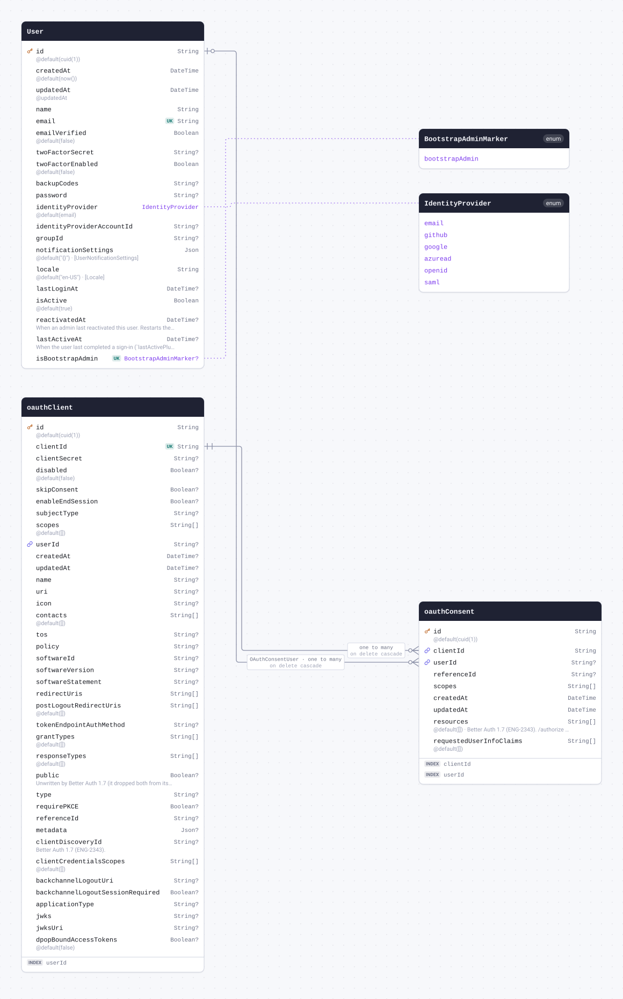

| Field                     | Type       | Constraints                                           | Default   | Description                                                                                                                                                                  |
| ------------------------- | ---------- | ----------------------------------------------------- | --------- | ---------------------------------------------------------------------------------------------------------------------------------------------------------------------------- |
| `id`                      | `String`   | PK NOT NULL                                           | `cuid(1)` |                                                                                                                                                                              |
| `clientId`                | `String`   | NOT NULL → [oauthClient.clientId](#model-oauthClient) |           |                                                                                                                                                                              |
| `userId`                  | `String`   | NULL → [User.id](#model-User)                         |           |                                                                                                                                                                              |
| `referenceId`             | `String`   | NULL                                                  |           |                                                                                                                                                                              |
| `scopes`                  | `String[]` | NOT NULL                                              |           |                                                                                                                                                                              |
| `createdAt`               | `DateTime` | NOT NULL                                              |           |                                                                                                                                                                              |
| `updatedAt`               | `DateTime` | NOT NULL                                              |           |                                                                                                                                                                              |
| `resources`               | `String[]` | NOT NULL                                              | `[]`      | Better Auth 1.7 (ENG-2343). /authorize compares the requested resources against these; without them every pre-existing connection is forced back through the consent screen. |
| `requestedUserInfoClaims` | `String[]` | NOT NULL                                              | `[]`      |                                                                                                                                                                              |

#### Indexes

- `@@index([clientId])`
- `@@index([userId])`

#### References

- `clientId` → [oauthClient.clientId](#model-oauthClient) (many-to-one, on delete Cascade)
- `userId` → [User.id](#model-User) (many-to-one, on delete Cascade)

#### Definition

```sql
CREATE TABLE "oauthConsent" (
    "id" TEXT NOT NULL,
    "clientId" TEXT NOT NULL,
    "userId" TEXT,
    "referenceId" TEXT,
    "scopes" TEXT[],
    "createdAt" TIMESTAMP(3) NOT NULL,
    "updatedAt" TIMESTAMP(3) NOT NULL,
    "resources" TEXT[] DEFAULT ARRAY[]::TEXT[],
    "requestedUserInfoClaims" TEXT[] DEFAULT ARRAY[]::TEXT[],

    CONSTRAINT "oauthConsent_pkey" PRIMARY KEY ("id")
);

CREATE INDEX "oauthConsent_clientId_idx" ON "oauthConsent"("clientId");

CREATE INDEX "oauthConsent_userId_idx" ON "oauthConsent"("userId");

ALTER TABLE "oauthConsent" ADD CONSTRAINT "oauthConsent_clientId_fkey" FOREIGN KEY ("clientId") REFERENCES "oauthClient"("clientId") ON DELETE CASCADE ON UPDATE CASCADE;

ALTER TABLE "oauthConsent" ADD CONSTRAINT "oauthConsent_userId_fkey" FOREIGN KEY ("userId") REFERENCES "User"("id") ON DELETE CASCADE ON UPDATE CASCADE;
```

<details>
<summary>Queries and their SQL</summary>

**findMany**: Every row

```ts
await prisma.oauthConsent.findMany();
```

```sql
SELECT
  "public"."oauthConsent"."id",
  "public"."oauthConsent"."clientId",
  "public"."oauthConsent"."userId",
  "public"."oauthConsent"."referenceId",
  "public"."oauthConsent"."scopes",
  "public"."oauthConsent"."createdAt",
  "public"."oauthConsent"."updatedAt",
  "public"."oauthConsent"."resources",
  "public"."oauthConsent"."requestedUserInfoClaims"
FROM
  "public"."oauthConsent"
WHERE
  1 = 1
OFFSET
  $1
-- params: ["0"]
```

**count**: How many rows there are

```ts
await prisma.oauthConsent.count();
```

```sql
SELECT
  COUNT(*) AS "_count$_all"
FROM
  (
    SELECT
      "public"."oauthConsent"."id"
    FROM
      "public"."oauthConsent"
    WHERE
      1 = 1
    OFFSET
      $1
  ) AS "sub"
-- params: ["0"]
```

**findMany**: Every row with its relations

```ts
await prisma.oauthConsent.findMany({ include: { client: true, user: true } });
```

```sql
SELECT
  "public"."oauthConsent"."id",
  "public"."oauthConsent"."clientId",
  "public"."oauthConsent"."userId",
  "public"."oauthConsent"."referenceId",
  "public"."oauthConsent"."scopes",
  "public"."oauthConsent"."createdAt",
  "public"."oauthConsent"."updatedAt",
  "public"."oauthConsent"."resources",
  "public"."oauthConsent"."requestedUserInfoClaims"
FROM
  "public"."oauthConsent"
WHERE
  1 = 1
OFFSET
  $1
-- params: ["0"]

SELECT
  "public"."oauthClient"."id",
  "public"."oauthClient"."clientId",
  "public"."oauthClient"."clientSecret",
  "public"."oauthClient"."disabled",
  "public"."oauthClient"."skipConsent",
  "public"."oauthClient"."enableEndSession",
  "public"."oauthClient"."subjectType",
  "public"."oauthClient"."scopes",
  "public"."oauthClient"."userId",
  "public"."oauthClient"."createdAt",
  "public"."oauthClient"."updatedAt",
  "public"."oauthClient"."name",
  "public"."oauthClient"."uri",
  "public"."oauthClient"."icon",
  "public"."oauthClient"."contacts",
  "public"."oauthClient"."tos",
  "public"."oauthClient"."policy",
  "public"."oauthClient"."softwareId",
  "public"."oauthClient"."softwareVersion",
  "public"."oauthClient"."softwareStatement",
  "public"."oauthClient"."redirectUris",
  "public"."oauthClient"."postLogoutRedirectUris",
  "public"."oauthClient"."tokenEndpointAuthMethod",
  "public"."oauthClient"."grantTypes",
  "public"."oauthClient"."responseTypes",
  "public"."oauthClient"."public",
  "public"."oauthClient"."type",
  "public"."oauthClient"."requirePKCE",
  "public"."oauthClient"."referenceId",
  "public"."oauthClient"."metadata",
  "public"."oauthClient"."clientDiscoveryId",
  "public"."oauthClient"."clientCredentialsScopes",
  "public"."oauthClient"."backchannelLogoutUri",
  "public"."oauthClient"."backchannelLogoutSessionRequired",
  "public"."oauthClient"."applicationType",
  "public"."oauthClient"."jwks",
  "public"."oauthClient"."jwksUri",
  "public"."oauthClient"."dpopBoundAccessTokens"
FROM
  "public"."oauthClient"
WHERE
  "public"."oauthClient"."clientId" IN ($1)
OFFSET
  $2
-- params: ["<clientId of the rows above>","0"]

SELECT
  "public"."User"."id",
  "public"."User"."created_at",
  "public"."User"."updated_at",
  "public"."User"."name",
  "public"."User"."email",
  "public"."User"."email_verified",
  "public"."User"."twoFactorSecret",
  "public"."User"."twoFactorEnabled",
  "public"."User"."backupCodes",
  "public"."User"."password",
  "public"."User"."identityProvider"::text,
  "public"."User"."identityProviderAccountId",
  "public"."User"."groupId",
  "public"."User"."notificationSettings",
  "public"."User"."locale",
  "public"."User"."lastLoginAt",
  "public"."User"."isActive",
  "public"."User"."reactivatedAt",
  "public"."User"."lastActiveAt",
  "public"."User"."isBootstrapAdmin"::text
FROM
  "public"."User"
WHERE
  "public"."User"."id" IN ($1)
OFFSET
  $2
-- params: ["<userId of the rows above>","0"]
```

**findUnique**: One row by what is unique to it

```ts
await prisma.oauthConsent.findUnique({ where: { id: "example" } });
```

```sql
SELECT
  "public"."oauthConsent"."id",
  "public"."oauthConsent"."clientId",
  "public"."oauthConsent"."userId",
  "public"."oauthConsent"."referenceId",
  "public"."oauthConsent"."scopes",
  "public"."oauthConsent"."createdAt",
  "public"."oauthConsent"."updatedAt",
  "public"."oauthConsent"."resources",
  "public"."oauthConsent"."requestedUserInfoClaims"
FROM
  "public"."oauthConsent"
WHERE
  (
    "public"."oauthConsent"."id" = $1
    AND 1 = 1
  )
LIMIT
  $2
OFFSET
  $3
-- params: ["example","1","0"]
```

**create**: Create a row

```ts
await prisma.oauthConsent.create({
  data: {
    clientId: "example",
    scopes: ["example"],
    createdAt: new Date("2026-01-01T00:00:00.000Z"),
    updatedAt: new Date("2026-01-01T00:00:00.000Z"),
  },
});
```

```sql
INSERT INTO
  "public"."oauthConsent" (
    "id",
    "clientId",
    "scopes",
    "createdAt",
    "updatedAt",
    "resources",
    "requestedUserInfoClaims"
  )
VALUES
  ($1, $2, $3, $4, $5, $6, $7)
RETURNING
  "public"."oauthConsent"."id",
  "public"."oauthConsent"."clientId",
  "public"."oauthConsent"."userId",
  "public"."oauthConsent"."referenceId",
  "public"."oauthConsent"."scopes",
  "public"."oauthConsent"."createdAt",
  "public"."oauthConsent"."updatedAt",
  "public"."oauthConsent"."resources",
  "public"."oauthConsent"."requestedUserInfoClaims"
-- params: ["<cuid(1)>","example",["example"],"2026-01-01T00:00:00.000Z","2026-01-01T00:00:00.000Z",[],[]]
```

**update**: Update a row

```ts
await prisma.oauthConsent.update({ where: { id: "example" }, data: { referenceId: "example" } });
```

```sql
UPDATE "public"."oauthConsent"
SET
  "referenceId" = $1
WHERE
  (
    "public"."oauthConsent"."id" = $2
    AND 1 = 1
  )
RETURNING
  "public"."oauthConsent"."id",
  "public"."oauthConsent"."clientId",
  "public"."oauthConsent"."userId",
  "public"."oauthConsent"."referenceId",
  "public"."oauthConsent"."scopes",
  "public"."oauthConsent"."createdAt",
  "public"."oauthConsent"."updatedAt",
  "public"."oauthConsent"."resources",
  "public"."oauthConsent"."requestedUserInfoClaims"
-- params: ["example","example"]
```

**delete**: Delete a row

```ts
await prisma.oauthConsent.delete({ where: { id: "example" } });
```

```sql
DELETE FROM "public"."oauthConsent"
WHERE
  (
    "public"."oauthConsent"."id" = $1
    AND 1 = 1
  )
RETURNING
  "public"."oauthConsent"."id",
  "public"."oauthConsent"."clientId",
  "public"."oauthConsent"."userId",
  "public"."oauthConsent"."referenceId",
  "public"."oauthConsent"."scopes",
  "public"."oauthConsent"."createdAt",
  "public"."oauthConsent"."updatedAt",
  "public"."oauthConsent"."resources",
  "public"."oauthConsent"."requestedUserInfoClaims"
-- params: ["example"]
```

</details>

<a id="model-oauthResource"></a>

### oauthResource

Better Auth 1.7 (ENG-2343): a protected resource the authorization server issues tokens for, with
its own token lifetimes, scope allow-list and claims. Replaces the flat `validAudiences` option —
a token is now bound to the resource it was approved for instead of to a static allow-list.
`identifier` is the RFC 8707 `resource` value and is the natural key other rows point at.

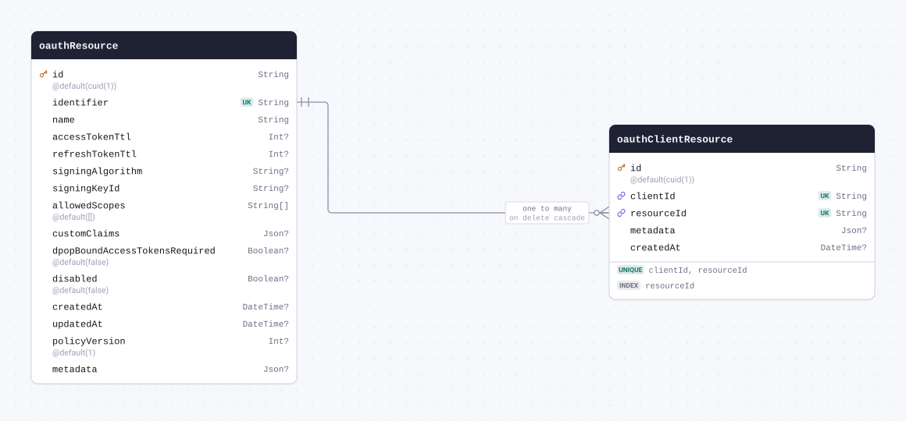

| Field                           | Type       | Constraints     | Default   | Description |
| ------------------------------- | ---------- | --------------- | --------- | ----------- |
| `id`                            | `String`   | PK NOT NULL     | `cuid(1)` |             |
| `identifier`                    | `String`   | UNIQUE NOT NULL |           |             |
| `name`                          | `String`   | NOT NULL        |           |             |
| `accessTokenTtl`                | `Int`      | NULL            |           |             |
| `refreshTokenTtl`               | `Int`      | NULL            |           |             |
| `signingAlgorithm`              | `String`   | NULL            |           |             |
| `signingKeyId`                  | `String`   | NULL            |           |             |
| `allowedScopes`                 | `String[]` | NOT NULL        | `[]`      |             |
| `customClaims`                  | `Json`     | NULL            |           |             |
| `dpopBoundAccessTokensRequired` | `Boolean`  | NULL            | `false`   |             |
| `disabled`                      | `Boolean`  | NULL            | `false`   |             |
| `createdAt`                     | `DateTime` | NULL            |           |             |
| `updatedAt`                     | `DateTime` | NULL            |           |             |
| `policyVersion`                 | `Int`      | NULL            | `1`       |             |
| `metadata`                      | `Json`     | NULL            |           |             |

#### Referenced by

- `identifier` ← [oauthClientResource.resourceId](#model-oauthClientResource) (one-to-many, on delete Cascade)

#### Definition

```sql
CREATE TABLE "oauthResource" (
    "id" TEXT NOT NULL,
    "identifier" TEXT NOT NULL,
    "name" TEXT NOT NULL,
    "accessTokenTtl" INTEGER,
    "refreshTokenTtl" INTEGER,
    "signingAlgorithm" TEXT,
    "signingKeyId" TEXT,
    "allowedScopes" TEXT[] DEFAULT ARRAY[]::TEXT[],
    "customClaims" JSONB,
    "dpopBoundAccessTokensRequired" BOOLEAN DEFAULT false,
    "disabled" BOOLEAN DEFAULT false,
    "createdAt" TIMESTAMP(3),
    "updatedAt" TIMESTAMP(3),
    "policyVersion" INTEGER DEFAULT 1,
    "metadata" JSONB,

    CONSTRAINT "oauthResource_pkey" PRIMARY KEY ("id")
);

CREATE UNIQUE INDEX "oauthResource_identifier_key" ON "oauthResource"("identifier");
```

<details>
<summary>Queries and their SQL</summary>

**findMany**: Every row

```ts
await prisma.oauthResource.findMany();
```

```sql
SELECT
  "public"."oauthResource"."id",
  "public"."oauthResource"."identifier",
  "public"."oauthResource"."name",
  "public"."oauthResource"."accessTokenTtl",
  "public"."oauthResource"."refreshTokenTtl",
  "public"."oauthResource"."signingAlgorithm",
  "public"."oauthResource"."signingKeyId",
  "public"."oauthResource"."allowedScopes",
  "public"."oauthResource"."customClaims",
  "public"."oauthResource"."dpopBoundAccessTokensRequired",
  "public"."oauthResource"."disabled",
  "public"."oauthResource"."createdAt",
  "public"."oauthResource"."updatedAt",
  "public"."oauthResource"."policyVersion",
  "public"."oauthResource"."metadata"
FROM
  "public"."oauthResource"
WHERE
  1 = 1
OFFSET
  $1
-- params: ["0"]
```

**count**: How many rows there are

```ts
await prisma.oauthResource.count();
```

```sql
SELECT
  COUNT(*) AS "_count$_all"
FROM
  (
    SELECT
      "public"."oauthResource"."id"
    FROM
      "public"."oauthResource"
    WHERE
      1 = 1
    OFFSET
      $1
  ) AS "sub"
-- params: ["0"]
```

**findMany**: Every row with its relations

```ts
await prisma.oauthResource.findMany({ include: { clients: true } });
```

```sql
SELECT
  "public"."oauthResource"."id",
  "public"."oauthResource"."identifier",
  "public"."oauthResource"."name",
  "public"."oauthResource"."accessTokenTtl",
  "public"."oauthResource"."refreshTokenTtl",
  "public"."oauthResource"."signingAlgorithm",
  "public"."oauthResource"."signingKeyId",
  "public"."oauthResource"."allowedScopes",
  "public"."oauthResource"."customClaims",
  "public"."oauthResource"."dpopBoundAccessTokensRequired",
  "public"."oauthResource"."disabled",
  "public"."oauthResource"."createdAt",
  "public"."oauthResource"."updatedAt",
  "public"."oauthResource"."policyVersion",
  "public"."oauthResource"."metadata"
FROM
  "public"."oauthResource"
WHERE
  1 = 1
OFFSET
  $1
-- params: ["0"]

SELECT
  "public"."oauthClientResource"."id",
  "public"."oauthClientResource"."clientId",
  "public"."oauthClientResource"."resourceId",
  "public"."oauthClientResource"."metadata",
  "public"."oauthClientResource"."createdAt"
FROM
  "public"."oauthClientResource"
WHERE
  "public"."oauthClientResource"."resourceId" IN ($1)
OFFSET
  $2
-- params: ["<identifier of the rows above>","0"]
```

**findUnique**: One row by what is unique to it

```ts
await prisma.oauthResource.findUnique({ where: { id: "example" } });
```

```sql
SELECT
  "public"."oauthResource"."id",
  "public"."oauthResource"."identifier",
  "public"."oauthResource"."name",
  "public"."oauthResource"."accessTokenTtl",
  "public"."oauthResource"."refreshTokenTtl",
  "public"."oauthResource"."signingAlgorithm",
  "public"."oauthResource"."signingKeyId",
  "public"."oauthResource"."allowedScopes",
  "public"."oauthResource"."customClaims",
  "public"."oauthResource"."dpopBoundAccessTokensRequired",
  "public"."oauthResource"."disabled",
  "public"."oauthResource"."createdAt",
  "public"."oauthResource"."updatedAt",
  "public"."oauthResource"."policyVersion",
  "public"."oauthResource"."metadata"
FROM
  "public"."oauthResource"
WHERE
  (
    "public"."oauthResource"."id" = $1
    AND 1 = 1
  )
LIMIT
  $2
OFFSET
  $3
-- params: ["example","1","0"]
```

**create**: Create a row

```ts
await prisma.oauthResource.create({ data: { identifier: "example", name: "example" } });
```

```sql
INSERT INTO
  "public"."oauthResource" (
    "id",
    "identifier",
    "name",
    "allowedScopes",
    "dpopBoundAccessTokensRequired",
    "disabled",
    "policyVersion"
  )
VALUES
  ($1, $2, $3, $4, $5, $6, $7)
RETURNING
  "public"."oauthResource"."id",
  "public"."oauthResource"."identifier",
  "public"."oauthResource"."name",
  "public"."oauthResource"."accessTokenTtl",
  "public"."oauthResource"."refreshTokenTtl",
  "public"."oauthResource"."signingAlgorithm",
  "public"."oauthResource"."signingKeyId",
  "public"."oauthResource"."allowedScopes",
  "public"."oauthResource"."customClaims",
  "public"."oauthResource"."dpopBoundAccessTokensRequired",
  "public"."oauthResource"."disabled",
  "public"."oauthResource"."createdAt",
  "public"."oauthResource"."updatedAt",
  "public"."oauthResource"."policyVersion",
  "public"."oauthResource"."metadata"
-- params: ["<cuid(1)>","example","example",[],false,false,"1"]
```

**update**: Update a row

```ts
await prisma.oauthResource.update({ where: { id: "example" }, data: { identifier: "example" } });
```

```sql
UPDATE "public"."oauthResource"
SET
  "identifier" = $1
WHERE
  (
    "public"."oauthResource"."id" = $2
    AND 1 = 1
  )
RETURNING
  "public"."oauthResource"."id",
  "public"."oauthResource"."identifier",
  "public"."oauthResource"."name",
  "public"."oauthResource"."accessTokenTtl",
  "public"."oauthResource"."refreshTokenTtl",
  "public"."oauthResource"."signingAlgorithm",
  "public"."oauthResource"."signingKeyId",
  "public"."oauthResource"."allowedScopes",
  "public"."oauthResource"."customClaims",
  "public"."oauthResource"."dpopBoundAccessTokensRequired",
  "public"."oauthResource"."disabled",
  "public"."oauthResource"."createdAt",
  "public"."oauthResource"."updatedAt",
  "public"."oauthResource"."policyVersion",
  "public"."oauthResource"."metadata"
-- params: ["example","example"]
```

**delete**: Delete a row

```ts
await prisma.oauthResource.delete({ where: { id: "example" } });
```

```sql
DELETE FROM "public"."oauthResource"
WHERE
  (
    "public"."oauthResource"."id" = $1
    AND 1 = 1
  )
RETURNING
  "public"."oauthResource"."id",
  "public"."oauthResource"."identifier",
  "public"."oauthResource"."name",
  "public"."oauthResource"."accessTokenTtl",
  "public"."oauthResource"."refreshTokenTtl",
  "public"."oauthResource"."signingAlgorithm",
  "public"."oauthResource"."signingKeyId",
  "public"."oauthResource"."allowedScopes",
  "public"."oauthResource"."customClaims",
  "public"."oauthResource"."dpopBoundAccessTokensRequired",
  "public"."oauthResource"."disabled",
  "public"."oauthResource"."createdAt",
  "public"."oauthResource"."updatedAt",
  "public"."oauthResource"."policyVersion",
  "public"."oauthResource"."metadata"
-- params: ["example"]
```

</details>

<a id="model-oauthClientResource"></a>

### oauthClientResource

Better Auth 1.7 (ENG-2343): links a client to the resources it may request tokens for. With
`enforcePerClientResources` (the default) a missing row means `invalid_target` at the token
endpoint, which is why the migration backfills one row per existing client.
Both sides reference natural keys, matching the other oauth child tables.

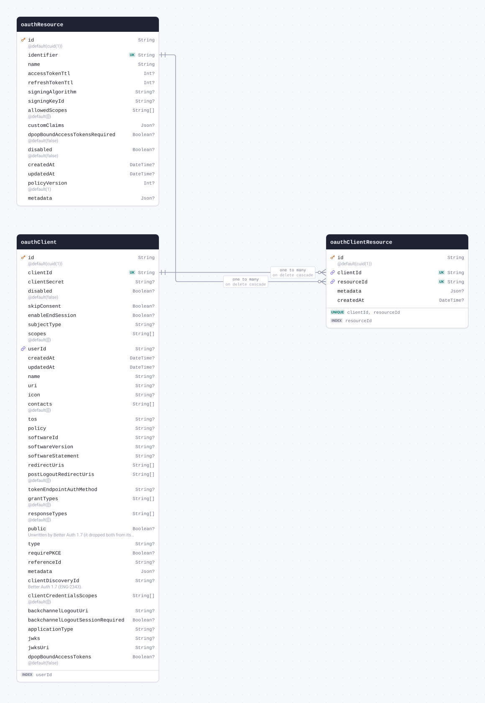

| Field        | Type       | Constraints                                                 | Default   | Description |
| ------------ | ---------- | ----------------------------------------------------------- | --------- | ----------- |
| `id`         | `String`   | PK NOT NULL                                                 | `cuid(1)` |             |
| `clientId`   | `String`   | NOT NULL → [oauthClient.clientId](#model-oauthClient)       |           |             |
| `resourceId` | `String`   | NOT NULL → [oauthResource.identifier](#model-oauthResource) |           |             |
| `metadata`   | `Json`     | NULL                                                        |           |             |
| `createdAt`  | `DateTime` | NULL                                                        |           |             |

#### Indexes

- `@@index([resourceId])`
- `@@unique([clientId, resourceId])`

#### References

- `clientId` → [oauthClient.clientId](#model-oauthClient) (many-to-one, on delete Cascade)
- `resourceId` → [oauthResource.identifier](#model-oauthResource) (many-to-one, on delete Cascade)

#### Definition

```sql
CREATE TABLE "oauthClientResource" (
    "id" TEXT NOT NULL,
    "clientId" TEXT NOT NULL,
    "resourceId" TEXT NOT NULL,
    "metadata" JSONB,
    "createdAt" TIMESTAMP(3),

    CONSTRAINT "oauthClientResource_pkey" PRIMARY KEY ("id")
);

CREATE INDEX "oauthClientResource_resourceId_idx" ON "oauthClientResource"("resourceId");

CREATE UNIQUE INDEX "oauthClientResource_clientId_resourceId_key" ON "oauthClientResource"("clientId", "resourceId");

ALTER TABLE "oauthClientResource" ADD CONSTRAINT "oauthClientResource_clientId_fkey" FOREIGN KEY ("clientId") REFERENCES "oauthClient"("clientId") ON DELETE CASCADE ON UPDATE CASCADE;

ALTER TABLE "oauthClientResource" ADD CONSTRAINT "oauthClientResource_resourceId_fkey" FOREIGN KEY ("resourceId") REFERENCES "oauthResource"("identifier") ON DELETE CASCADE ON UPDATE CASCADE;
```

<details>
<summary>Queries and their SQL</summary>

**findMany**: Every row

```ts
await prisma.oauthClientResource.findMany();
```

```sql
SELECT
  "public"."oauthClientResource"."id",
  "public"."oauthClientResource"."clientId",
  "public"."oauthClientResource"."resourceId",
  "public"."oauthClientResource"."metadata",
  "public"."oauthClientResource"."createdAt"
FROM
  "public"."oauthClientResource"
WHERE
  1 = 1
OFFSET
  $1
-- params: ["0"]
```

**count**: How many rows there are

```ts
await prisma.oauthClientResource.count();
```

```sql
SELECT
  COUNT(*) AS "_count$_all"
FROM
  (
    SELECT
      "public"."oauthClientResource"."id"
    FROM
      "public"."oauthClientResource"
    WHERE
      1 = 1
    OFFSET
      $1
  ) AS "sub"
-- params: ["0"]
```

**findMany**: Every row with its relations

```ts
await prisma.oauthClientResource.findMany({ include: { client: true, resource: true } });
```

```sql
SELECT
  "public"."oauthClientResource"."id",
  "public"."oauthClientResource"."clientId",
  "public"."oauthClientResource"."resourceId",
  "public"."oauthClientResource"."metadata",
  "public"."oauthClientResource"."createdAt"
FROM
  "public"."oauthClientResource"
WHERE
  1 = 1
OFFSET
  $1
-- params: ["0"]

SELECT
  "public"."oauthClient"."id",
  "public"."oauthClient"."clientId",
  "public"."oauthClient"."clientSecret",
  "public"."oauthClient"."disabled",
  "public"."oauthClient"."skipConsent",
  "public"."oauthClient"."enableEndSession",
  "public"."oauthClient"."subjectType",
  "public"."oauthClient"."scopes",
  "public"."oauthClient"."userId",
  "public"."oauthClient"."createdAt",
  "public"."oauthClient"."updatedAt",
  "public"."oauthClient"."name",
  "public"."oauthClient"."uri",
  "public"."oauthClient"."icon",
  "public"."oauthClient"."contacts",
  "public"."oauthClient"."tos",
  "public"."oauthClient"."policy",
  "public"."oauthClient"."softwareId",
  "public"."oauthClient"."softwareVersion",
  "public"."oauthClient"."softwareStatement",
  "public"."oauthClient"."redirectUris",
  "public"."oauthClient"."postLogoutRedirectUris",
  "public"."oauthClient"."tokenEndpointAuthMethod",
  "public"."oauthClient"."grantTypes",
  "public"."oauthClient"."responseTypes",
  "public"."oauthClient"."public",
  "public"."oauthClient"."type",
  "public"."oauthClient"."requirePKCE",
  "public"."oauthClient"."referenceId",
  "public"."oauthClient"."metadata",
  "public"."oauthClient"."clientDiscoveryId",
  "public"."oauthClient"."clientCredentialsScopes",
  "public"."oauthClient"."backchannelLogoutUri",
  "public"."oauthClient"."backchannelLogoutSessionRequired",
  "public"."oauthClient"."applicationType",
  "public"."oauthClient"."jwks",
  "public"."oauthClient"."jwksUri",
  "public"."oauthClient"."dpopBoundAccessTokens"
FROM
  "public"."oauthClient"
WHERE
  "public"."oauthClient"."clientId" IN ($1)
OFFSET
  $2
-- params: ["<clientId of the rows above>","0"]

SELECT
  "public"."oauthResource"."id",
  "public"."oauthResource"."identifier",
  "public"."oauthResource"."name",
  "public"."oauthResource"."accessTokenTtl",
  "public"."oauthResource"."refreshTokenTtl",
  "public"."oauthResource"."signingAlgorithm",
  "public"."oauthResource"."signingKeyId",
  "public"."oauthResource"."allowedScopes",
  "public"."oauthResource"."customClaims",
  "public"."oauthResource"."dpopBoundAccessTokensRequired",
  "public"."oauthResource"."disabled",
  "public"."oauthResource"."createdAt",
  "public"."oauthResource"."updatedAt",
  "public"."oauthResource"."policyVersion",
  "public"."oauthResource"."metadata"
FROM
  "public"."oauthResource"
WHERE
  "public"."oauthResource"."identifier" IN ($1)
OFFSET
  $2
-- params: ["<resourceId of the rows above>","0"]
```

**findUnique**: One row by what is unique to it

```ts
await prisma.oauthClientResource.findUnique({ where: { id: "example" } });
```

```sql
SELECT
  "public"."oauthClientResource"."id",
  "public"."oauthClientResource"."clientId",
  "public"."oauthClientResource"."resourceId",
  "public"."oauthClientResource"."metadata",
  "public"."oauthClientResource"."createdAt"
FROM
  "public"."oauthClientResource"
WHERE
  (
    "public"."oauthClientResource"."id" = $1
    AND 1 = 1
  )
LIMIT
  $2
OFFSET
  $3
-- params: ["example","1","0"]
```

**create**: Create a row

```ts
await prisma.oauthClientResource.create({ data: { clientId: "example", resourceId: "example" } });
```

```sql
INSERT INTO
  "public"."oauthClientResource" ("id", "clientId", "resourceId")
VALUES
  ($1, $2, $3)
RETURNING
  "public"."oauthClientResource"."id",
  "public"."oauthClientResource"."clientId",
  "public"."oauthClientResource"."resourceId",
  "public"."oauthClientResource"."metadata",
  "public"."oauthClientResource"."createdAt"
-- params: ["<cuid(1)>","example","example"]
```

**update**: Update a row

```ts
await prisma.oauthClientResource.update({ where: { id: "example" }, data: { metadata: {} } });
```

```sql
UPDATE "public"."oauthClientResource"
SET
  "metadata" = $1
WHERE
  (
    "public"."oauthClientResource"."id" = $2
    AND 1 = 1
  )
RETURNING
  "public"."oauthClientResource"."id",
  "public"."oauthClientResource"."clientId",
  "public"."oauthClientResource"."resourceId",
  "public"."oauthClientResource"."metadata",
  "public"."oauthClientResource"."createdAt"
-- params: ["{}","example"]
```

**delete**: Delete a row

```ts
await prisma.oauthClientResource.delete({ where: { id: "example" } });
```

```sql
DELETE FROM "public"."oauthClientResource"
WHERE
  (
    "public"."oauthClientResource"."id" = $1
    AND 1 = 1
  )
RETURNING
  "public"."oauthClientResource"."id",
  "public"."oauthClientResource"."clientId",
  "public"."oauthClientResource"."resourceId",
  "public"."oauthClientResource"."metadata",
  "public"."oauthClientResource"."createdAt"
-- params: ["example"]
```

</details>

<a id="model-oauthClientAssertion"></a>

### oauthClientAssertion

Better Auth 1.7 (ENG-2343): replay store for `private_key_jwt` client assertions (the row id is the
assertion jti). We use no private_key_jwt client authentication today, but the plugin declares the
table, so omitting it risks an adapter error on a code path we do not control.

| Field       | Type       | Constraints | Default   | Description |
| ----------- | ---------- | ----------- | --------- | ----------- |
| `id`        | `String`   | PK NOT NULL | `cuid(1)` |             |
| `expiresAt` | `DateTime` | NOT NULL    |           |             |

#### Indexes

- `@@index([expiresAt])`

#### Definition

```sql
CREATE TABLE "oauthClientAssertion" (
    "id" TEXT NOT NULL,
    "expiresAt" TIMESTAMP(3) NOT NULL,

    CONSTRAINT "oauthClientAssertion_pkey" PRIMARY KEY ("id")
);

CREATE INDEX "oauthClientAssertion_expiresAt_idx" ON "oauthClientAssertion"("expiresAt");
```

<details>
<summary>Queries and their SQL</summary>

**findMany**: Every row

```ts
await prisma.oauthClientAssertion.findMany();
```

```sql
SELECT
  "public"."oauthClientAssertion"."id",
  "public"."oauthClientAssertion"."expiresAt"
FROM
  "public"."oauthClientAssertion"
WHERE
  1 = 1
OFFSET
  $1
-- params: ["0"]
```

**count**: How many rows there are

```ts
await prisma.oauthClientAssertion.count();
```

```sql
SELECT
  COUNT(*) AS "_count$_all"
FROM
  (
    SELECT
      "public"."oauthClientAssertion"."id"
    FROM
      "public"."oauthClientAssertion"
    WHERE
      1 = 1
    OFFSET
      $1
  ) AS "sub"
-- params: ["0"]
```

**findUnique**: One row by what is unique to it

```ts
await prisma.oauthClientAssertion.findUnique({ where: { id: "example" } });
```

```sql
SELECT
  "public"."oauthClientAssertion"."id",
  "public"."oauthClientAssertion"."expiresAt"
FROM
  "public"."oauthClientAssertion"
WHERE
  (
    "public"."oauthClientAssertion"."id" = $1
    AND 1 = 1
  )
LIMIT
  $2
OFFSET
  $3
-- params: ["example","1","0"]
```

**create**: Create a row

```ts
await prisma.oauthClientAssertion.create({
  data: { expiresAt: new Date("2026-01-01T00:00:00.000Z") },
});
```

```sql
INSERT INTO
  "public"."oauthClientAssertion" ("id", "expiresAt")
VALUES
  ($1, $2)
RETURNING
  "public"."oauthClientAssertion"."id",
  "public"."oauthClientAssertion"."expiresAt"
-- params: ["<cuid(1)>","2026-01-01T00:00:00.000Z"]
```

**update**: Update a row

```ts
await prisma.oauthClientAssertion.update({
  where: { id: "example" },
  data: { expiresAt: new Date("2026-01-01T00:00:00.000Z") },
});
```

```sql
UPDATE "public"."oauthClientAssertion"
SET
  "expiresAt" = $1
WHERE
  (
    "public"."oauthClientAssertion"."id" = $2
    AND 1 = 1
  )
RETURNING
  "public"."oauthClientAssertion"."id",
  "public"."oauthClientAssertion"."expiresAt"
-- params: ["2026-01-01T00:00:00.000Z","example"]
```

**delete**: Delete a row

```ts
await prisma.oauthClientAssertion.delete({ where: { id: "example" } });
```

```sql
DELETE FROM "public"."oauthClientAssertion"
WHERE
  (
    "public"."oauthClientAssertion"."id" = $1
    AND 1 = 1
  )
RETURNING
  "public"."oauthClientAssertion"."id",
  "public"."oauthClientAssertion"."expiresAt"
-- params: ["example"]
```

</details>

<a id="model-PasswordResetToken"></a>

### PasswordResetToken

Stores the active password reset token for a user.
Tokens are opaque, hashed at rest, revocable, and single-use.

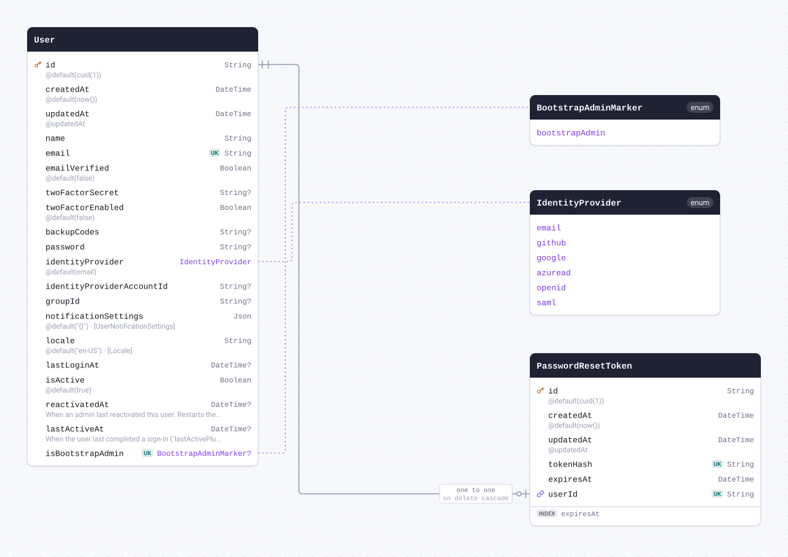

| Field                      | Type       | Constraints                              | Default      | Description |
| -------------------------- | ---------- | ---------------------------------------- | ------------ | ----------- |
| `id`                       | `String`   | PK NOT NULL                              | `cuid(1)`    |             |
| `createdAt` (`created_at`) | `DateTime` | NOT NULL                                 | `now()`      |             |
| `updatedAt` (`updated_at`) | `DateTime` | NOT NULL                                 | `@updatedAt` |             |
| `tokenHash` (`token_hash`) | `String`   | UNIQUE NOT NULL                          |              |             |
| `expiresAt` (`expires_at`) | `DateTime` | NOT NULL                                 |              |             |
| `userId`                   | `String`   | UNIQUE NOT NULL → [User.id](#model-User) |              |             |

#### Indexes

- `@@index([expiresAt])`

#### References

- `userId` → [User.id](#model-User) (one-to-one, on delete Cascade)

#### Definition

```sql
CREATE TABLE "PasswordResetToken" (
    "id" TEXT NOT NULL,
    "created_at" TIMESTAMP(3) NOT NULL DEFAULT CURRENT_TIMESTAMP,
    "updated_at" TIMESTAMP(3) NOT NULL,
    "token_hash" TEXT NOT NULL,
    "expires_at" TIMESTAMP(3) NOT NULL,
    "userId" TEXT NOT NULL,

    CONSTRAINT "PasswordResetToken_pkey" PRIMARY KEY ("id")
);

CREATE UNIQUE INDEX "PasswordResetToken_token_hash_key" ON "PasswordResetToken"("token_hash");

CREATE UNIQUE INDEX "PasswordResetToken_userId_key" ON "PasswordResetToken"("userId");

CREATE INDEX "PasswordResetToken_expires_at_idx" ON "PasswordResetToken"("expires_at");

ALTER TABLE "PasswordResetToken" ADD CONSTRAINT "PasswordResetToken_userId_fkey" FOREIGN KEY ("userId") REFERENCES "User"("id") ON DELETE CASCADE ON UPDATE CASCADE;
```

<details>
<summary>Queries and their SQL</summary>

**findMany**: Every row

```ts
await prisma.passwordResetToken.findMany();
```

```sql
SELECT
  "public"."PasswordResetToken"."id",
  "public"."PasswordResetToken"."created_at",
  "public"."PasswordResetToken"."updated_at",
  "public"."PasswordResetToken"."token_hash",
  "public"."PasswordResetToken"."expires_at",
  "public"."PasswordResetToken"."userId"
FROM
  "public"."PasswordResetToken"
WHERE
  1 = 1
OFFSET
  $1
-- params: ["0"]
```

**count**: How many rows there are

```ts
await prisma.passwordResetToken.count();
```

```sql
SELECT
  COUNT(*) AS "_count$_all"
FROM
  (
    SELECT
      "public"."PasswordResetToken"."id"
    FROM
      "public"."PasswordResetToken"
    WHERE
      1 = 1
    OFFSET
      $1
  ) AS "sub"
-- params: ["0"]
```

**findMany**: Every row with its relations

```ts
await prisma.passwordResetToken.findMany({ include: { user: true } });
```

```sql
SELECT
  "public"."PasswordResetToken"."id",
  "public"."PasswordResetToken"."created_at",
  "public"."PasswordResetToken"."updated_at",
  "public"."PasswordResetToken"."token_hash",
  "public"."PasswordResetToken"."expires_at",
  "public"."PasswordResetToken"."userId"
FROM
  "public"."PasswordResetToken"
WHERE
  1 = 1
OFFSET
  $1
-- params: ["0"]

SELECT
  "public"."User"."id",
  "public"."User"."created_at",
  "public"."User"."updated_at",
  "public"."User"."name",
  "public"."User"."email",
  "public"."User"."email_verified",
  "public"."User"."twoFactorSecret",
  "public"."User"."twoFactorEnabled",
  "public"."User"."backupCodes",
  "public"."User"."password",
  "public"."User"."identityProvider"::text,
  "public"."User"."identityProviderAccountId",
  "public"."User"."groupId",
  "public"."User"."notificationSettings",
  "public"."User"."locale",
  "public"."User"."lastLoginAt",
  "public"."User"."isActive",
  "public"."User"."reactivatedAt",
  "public"."User"."lastActiveAt",
  "public"."User"."isBootstrapAdmin"::text
FROM
  "public"."User"
WHERE
  "public"."User"."id" IN ($1)
OFFSET
  $2
-- params: ["<userId of the rows above>","0"]
```

**findUnique**: One row by what is unique to it

```ts
await prisma.passwordResetToken.findUnique({ where: { id: "example" } });
```

```sql
SELECT
  "public"."PasswordResetToken"."id",
  "public"."PasswordResetToken"."created_at",
  "public"."PasswordResetToken"."updated_at",
  "public"."PasswordResetToken"."token_hash",
  "public"."PasswordResetToken"."expires_at",
  "public"."PasswordResetToken"."userId"
FROM
  "public"."PasswordResetToken"
WHERE
  (
    "public"."PasswordResetToken"."id" = $1
    AND 1 = 1
  )
LIMIT
  $2
OFFSET
  $3
-- params: ["example","1","0"]
```

**create**: Create a row

```ts
await prisma.passwordResetToken.create({
  data: {
    tokenHash: "example",
    expiresAt: new Date("2026-01-01T00:00:00.000Z"),
    userId: "example",
  },
});
```

```sql
INSERT INTO
  "public"."PasswordResetToken" (
    "id",
    "created_at",
    "updated_at",
    "token_hash",
    "expires_at",
    "userId"
  )
VALUES
  ($1, $2, $3, $4, $5, $6)
RETURNING
  "public"."PasswordResetToken"."id",
  "public"."PasswordResetToken"."created_at",
  "public"."PasswordResetToken"."updated_at",
  "public"."PasswordResetToken"."token_hash",
  "public"."PasswordResetToken"."expires_at",
  "public"."PasswordResetToken"."userId"
-- params: ["<cuid(1)>","<now()>","<now()>","example","2026-01-01T00:00:00.000Z","example"]
```

**update**: Update a row

```ts
await prisma.passwordResetToken.update({
  where: { id: "example" },
  data: { createdAt: new Date("2026-01-01T00:00:00.000Z") },
});
```

```sql
UPDATE "public"."PasswordResetToken"
SET
  "created_at" = $1,
  "updated_at" = $2
WHERE
  (
    "public"."PasswordResetToken"."id" = $3
    AND 1 = 1
  )
RETURNING
  "public"."PasswordResetToken"."id",
  "public"."PasswordResetToken"."created_at",
  "public"."PasswordResetToken"."updated_at",
  "public"."PasswordResetToken"."token_hash",
  "public"."PasswordResetToken"."expires_at",
  "public"."PasswordResetToken"."userId"
-- params: ["2026-01-01T00:00:00.000Z",{"prisma__type":"generatorCall","prisma__value":{"name":"now","args":[],"returnType":{"type":"DateTime"}}},"example"]
```

**delete**: Delete a row

```ts
await prisma.passwordResetToken.delete({ where: { id: "example" } });
```

```sql
DELETE FROM "public"."PasswordResetToken"
WHERE
  (
    "public"."PasswordResetToken"."id" = $1
    AND 1 = 1
  )
RETURNING
  "public"."PasswordResetToken"."id",
  "public"."PasswordResetToken"."created_at",
  "public"."PasswordResetToken"."updated_at",
  "public"."PasswordResetToken"."token_hash",
  "public"."PasswordResetToken"."expires_at",
  "public"."PasswordResetToken"."userId"
-- params: ["example"]
```

</details>

<a id="model-User"></a>

### User

Represents a user in the Formbricks system.
Central model for user authentication and profile management.

@property id - Unique identifier for the user
@property name - Display name of the user
@property email - User's email address
@property twoFactorEnabled - Whether 2FA is active
@property memberships - Organizations the user belongs to
@property notificationSettings - User's notification preferences

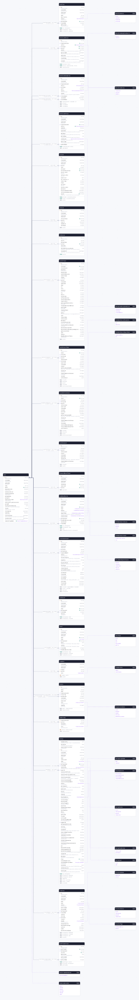

| Field                              | Type                                                 | Constraints     | Default      | Description                                                                                                                                                                                                                                                                                                                                              |
| ---------------------------------- | ---------------------------------------------------- | --------------- | ------------ | -------------------------------------------------------------------------------------------------------------------------------------------------------------------------------------------------------------------------------------------------------------------------------------------------------------------------------------------------------- |
| `id`                               | `String`                                             | PK NOT NULL     | `cuid(1)`    |                                                                                                                                                                                                                                                                                                                                                          |
| `createdAt` (`created_at`)         | `DateTime`                                           | NOT NULL        | `now()`      |                                                                                                                                                                                                                                                                                                                                                          |
| `updatedAt` (`updated_at`)         | `DateTime`                                           | NOT NULL        | `@updatedAt` |                                                                                                                                                                                                                                                                                                                                                          |
| `name`                             | `String`                                             | NOT NULL        |              |                                                                                                                                                                                                                                                                                                                                                          |
| `email`                            | `String`                                             | UNIQUE NOT NULL |              |                                                                                                                                                                                                                                                                                                                                                          |
| `emailVerified` (`email_verified`) | `Boolean`                                            | NOT NULL        | `false`      |                                                                                                                                                                                                                                                                                                                                                          |
| `twoFactorSecret`                  | `String`                                             | NULL            |              |                                                                                                                                                                                                                                                                                                                                                          |
| `twoFactorEnabled`                 | `Boolean`                                            | NOT NULL        | `false`      |                                                                                                                                                                                                                                                                                                                                                          |
| `backupCodes`                      | `String`                                             | NULL            |              |                                                                                                                                                                                                                                                                                                                                                          |
| `password`                         | `String`                                             | NULL            |              |                                                                                                                                                                                                                                                                                                                                                          |
| `identityProvider`                 | [`IdentityProvider`](#enum-IdentityProvider)         | NOT NULL        | `email`      |                                                                                                                                                                                                                                                                                                                                                          |
| `identityProviderAccountId`        | `String`                                             | NULL            |              |                                                                                                                                                                                                                                                                                                                                                          |
| `groupId`                          | `String`                                             | NULL            |              |                                                                                                                                                                                                                                                                                                                                                          |
| `notificationSettings`             | `Json`                                               | NOT NULL        | `"{}"`       | [UserNotificationSettings]                                                                                                                                                                                                                                                                                                                               |
| `locale`                           | `String`                                             | NOT NULL        | `"en-US"`    | [Locale]                                                                                                                                                                                                                                                                                                                                                 |
| `lastLoginAt`                      | `DateTime`                                           | NULL            |              |                                                                                                                                                                                                                                                                                                                                                          |
| `isActive`                         | `Boolean`                                            | NOT NULL        | `true`       |                                                                                                                                                                                                                                                                                                                                                          |
| `reactivatedAt`                    | `DateTime`                                           | NULL            |              | When an admin last reactivated this user. Restarts the members retention clock (ENG-3713) without touching `lastLoginAt`, which the member list, usage counts and APIs report as a real sign-in.                                                                                                                                                         |
| `lastActiveAt`                     | `DateTime`                                           | NULL            |              | When the user last completed a sign-in (`lastActivePlugin`, after any second factor) or renewed a session (Better Auth `databaseHooks.session.update`), on the database clock and never moved backwards. The members retention clock reads it: sessions are deleted on sign-out and expiry, so their own timestamps can't serve as a record of activity. |
| `isBootstrapAdmin`                 | [`BootstrapAdminMarker`](#enum-BootstrapAdminMarker) | UNIQUE NULL     |              |                                                                                                                                                                                                                                                                                                                                                          |

#### Referenced by

- `id` ← [Creative.createdBy](#model-Creative) (one-to-many, on delete SetNull)
- `id` ← [Survey.createdBy](#model-Survey) (one-to-many)
- `id` ← [Survey.ownerId](#model-Survey) (one-to-many, on delete SetNull)
- `id` ← [Membership.userId](#model-Membership) (one-to-many, on delete Cascade)
- `id` ← [Invite.creatorId](#model-Invite) (one-to-many)
- `id` ← [Invite.acceptorId](#model-Invite) (one-to-many, on delete Cascade)
- `id` ← [Account.userId](#model-Account) (one-to-many, on delete Cascade)
- `id` ← [Session.userId](#model-Session) (one-to-many, on delete Cascade)
- `id` ← [TwoFactor.userId](#model-TwoFactor) (one-to-one, on delete Cascade)
- `id` ← [oauthClient.userId](#model-oauthClient) (one-to-many, on delete Cascade)
- `id` ← [oauthAccessToken.userId](#model-oauthAccessToken) (one-to-many, on delete Cascade)
- `id` ← [oauthRefreshToken.userId](#model-oauthRefreshToken) (one-to-many, on delete Cascade)
- `id` ← [oauthConsent.userId](#model-oauthConsent) (one-to-many, on delete Cascade)
- `id` ← [PasswordResetToken.userId](#model-PasswordResetToken) (one-to-one, on delete Cascade)
- `id` ← [TeamUser.userId](#model-TeamUser) (one-to-many, on delete Cascade)
- `id` ← [Chart.createdBy](#model-Chart) (one-to-many, on delete SetNull)
- `id` ← [Dashboard.createdBy](#model-Dashboard) (one-to-many, on delete SetNull)
- `id` ← [AttachmentExport.requestedById](#model-AttachmentExport) (one-to-many, on delete SetNull)
- `id` ← [FeedbackSource.createdBy](#model-FeedbackSource) (one-to-many, on delete SetNull)
- `id` ← [RetentionPolicy.updatedById](#model-RetentionPolicy) (one-to-many, on delete SetNull)
- `id` ← [RetentionExemption.createdById](#model-RetentionExemption) (one-to-many, on delete SetNull)
- `id` ← [RetentionExemption.revokedById](#model-RetentionExemption) (one-to-many, on delete SetNull)
- `id` ← [RetentionNotice.userId](#model-RetentionNotice) (one-to-many, on delete Cascade)
- `id` ← [Workflow.createdBy](#model-Workflow) (one-to-many, on delete SetNull)
- `id` ← [WorkflowVersion.publishedBy](#model-WorkflowVersion) (one-to-many, on delete SetNull)

#### Definition

```sql
CREATE TABLE "User" (
    "id" TEXT NOT NULL,
    "created_at" TIMESTAMP(3) NOT NULL DEFAULT CURRENT_TIMESTAMP,
    "updated_at" TIMESTAMP(3) NOT NULL,
    "name" TEXT NOT NULL,
    "email" TEXT NOT NULL,
    "email_verified" BOOLEAN NOT NULL DEFAULT false,
    "email_verified_at" TIMESTAMP(3),
    "twoFactorSecret" TEXT,
    "twoFactorEnabled" BOOLEAN NOT NULL DEFAULT false,
    "backupCodes" TEXT,
    "password" TEXT,
    "identityProvider" "IdentityProvider" NOT NULL DEFAULT 'email',
    "identityProviderAccountId" TEXT,
    "groupId" TEXT,
    "notificationSettings" JSONB NOT NULL DEFAULT '{}',
    "locale" TEXT NOT NULL DEFAULT 'en-US',
    "lastLoginAt" TIMESTAMP(3),
    "isActive" BOOLEAN NOT NULL DEFAULT true,
    "reactivatedAt" TIMESTAMP(3),
    "lastActiveAt" TIMESTAMP(3),
    "isBootstrapAdmin" "BootstrapAdminMarker",

    CONSTRAINT "User_pkey" PRIMARY KEY ("id")
);

CREATE UNIQUE INDEX "User_email_key" ON "User"("email");

CREATE UNIQUE INDEX "User_isBootstrapAdmin_key" ON "User"("isBootstrapAdmin");
```

<details>
<summary>Queries and their SQL</summary>

**findMany**: Every row

```ts
await prisma.user.findMany();
```

```sql
SELECT
  "public"."User"."id",
  "public"."User"."created_at",
  "public"."User"."updated_at",
  "public"."User"."name",
  "public"."User"."email",
  "public"."User"."email_verified",
  "public"."User"."twoFactorSecret",
  "public"."User"."twoFactorEnabled",
  "public"."User"."backupCodes",
  "public"."User"."password",
  "public"."User"."identityProvider"::text,
  "public"."User"."identityProviderAccountId",
  "public"."User"."groupId",
  "public"."User"."notificationSettings",
  "public"."User"."locale",
  "public"."User"."lastLoginAt",
  "public"."User"."isActive",
  "public"."User"."reactivatedAt",
  "public"."User"."lastActiveAt",
  "public"."User"."isBootstrapAdmin"::text
FROM
  "public"."User"
WHERE
  1 = 1
OFFSET
  $1
-- params: ["0"]
```

**count**: How many rows there are

```ts
await prisma.user.count();
```

```sql
SELECT
  COUNT(*) AS "_count$_all"
FROM
  (
    SELECT
      "public"."User"."id"
    FROM
      "public"."User"
    WHERE
      1 = 1
    OFFSET
      $1
  ) AS "sub"
-- params: ["0"]
```

**findMany**: Every row with its relations

```ts
await prisma.user.findMany({
  include: {
    memberships: true,
    accounts: true,
    sessions: true,
    twoFactor: true,
    oauthClients: true,
    oauthAccessTokens: true,
    oauthRefreshTokens: true,
    oauthConsents: true,
    passwordResetToken: true,
    invitesCreated: true,
    invitesAccepted: true,
    surveys: true,
    ownedSurveys: true,
    charts: true,
    dashboards: true,
    creatives: true,
    feedbackSources: true,
    teamUsers: true,
    workflows: true,
    workflowVersionsPublished: true,
    retentionPoliciesUpdated: true,
    exemptionsCreated: true,
    exemptionsRevoked: true,
    retentionNotices: true,
    attachmentExports: true,
  },
});
```

```sql
SELECT
  "public"."User"."id",
  "public"."User"."created_at",
  "public"."User"."updated_at",
  "public"."User"."name",
  "public"."User"."email",
  "public"."User"."email_verified",
  "public"."User"."twoFactorSecret",
  "public"."User"."twoFactorEnabled",
  "public"."User"."backupCodes",
  "public"."User"."password",
  "public"."User"."identityProvider"::text,
  "public"."User"."identityProviderAccountId",
  "public"."User"."groupId",
  "public"."User"."notificationSettings",
  "public"."User"."locale",
  "public"."User"."lastLoginAt",
  "public"."User"."isActive",
  "public"."User"."reactivatedAt",
  "public"."User"."lastActiveAt",
  "public"."User"."isBootstrapAdmin"::text
FROM
  "public"."User"
WHERE
  1 = 1
OFFSET
  $1
-- params: ["0"]

SELECT
  "public"."Membership"."userId",
  "public"."Membership"."organizationId",
  "public"."Membership"."accepted",
  "public"."Membership"."role"::text
FROM
  "public"."Membership"
WHERE
  "public"."Membership"."userId" IN ($1)
OFFSET
  $2
-- params: ["<id of the rows above>","0"]

SELECT
  "public"."Account"."id",
  "public"."Account"."created_at",
  "public"."Account"."updated_at",
  "public"."Account"."userId",
  "public"."Account"."type",
  "public"."Account"."provider",
  "public"."Account"."providerAccountId",
  "public"."Account"."access_token",
  "public"."Account"."refresh_token",
  "public"."Account"."expires_at",
  "public"."Account"."ext_expires_in",
  "public"."Account"."token_type",
  "public"."Account"."scope",
  "public"."Account"."id_token",
  "public"."Account"."session_state",
  "public"."Account"."password",
  "public"."Account"."accessTokenExpiresAt",
  "public"."Account"."refreshTokenExpiresAt",
  "public"."Account"."issuer"
FROM
  "public"."Account"
WHERE
  "public"."Account"."userId" IN ($1)
OFFSET
  $2
-- params: ["<id of the rows above>","0"]

SELECT
  "public"."Session"."id",
  "public"."Session"."created_at",
  "public"."Session"."updated_at",
  "public"."Session"."sessionToken",
  "public"."Session"."userId",
  "public"."Session"."expires",
  "public"."Session"."ipAddress",
  "public"."Session"."userAgent"
FROM
  "public"."Session"
WHERE
  "public"."Session"."userId" IN ($1)
OFFSET
  $2
-- params: ["<id of the rows above>","0"]

SELECT
  "public"."TwoFactor"."id",
  "public"."TwoFactor"."secret",
  "public"."TwoFactor"."backupCodes",
  "public"."TwoFactor"."userId",
  "public"."TwoFactor"."verified",
  "public"."TwoFactor"."failedVerificationCount",
  "public"."TwoFactor"."lockedUntil"
FROM
  "public"."TwoFactor"
WHERE
  "public"."TwoFactor"."userId" IN ($1)
OFFSET
  $2
-- params: ["<id of the rows above>","0"]

SELECT
  "public"."oauthClient"."id",
  "public"."oauthClient"."clientId",
  "public"."oauthClient"."clientSecret",
  "public"."oauthClient"."disabled",
  "public"."oauthClient"."skipConsent",
  "public"."oauthClient"."enableEndSession",
  "public"."oauthClient"."subjectType",
  "public"."oauthClient"."scopes",
  "public"."oauthClient"."userId",
  "public"."oauthClient"."createdAt",
  "public"."oauthClient"."updatedAt",
  "public"."oauthClient"."name",
  "public"."oauthClient"."uri",
  "public"."oauthClient"."icon",
  "public"."oauthClient"."contacts",
  "public"."oauthClient"."tos",
  "public"."oauthClient"."policy",
  "public"."oauthClient"."softwareId",
  "public"."oauthClient"."softwareVersion",
  "public"."oauthClient"."softwareStatement",
  "public"."oauthClient"."redirectUris",
  "public"."oauthClient"."postLogoutRedirectUris",
  "public"."oauthClient"."tokenEndpointAuthMethod",
  "public"."oauthClient"."grantTypes",
  "public"."oauthClient"."responseTypes",
  "public"."oauthClient"."public",
  "public"."oauthClient"."type",
  "public"."oauthClient"."requirePKCE",
  "public"."oauthClient"."referenceId",
  "public"."oauthClient"."metadata",
  "public"."oauthClient"."clientDiscoveryId",
  "public"."oauthClient"."clientCredentialsScopes",
  "public"."oauthClient"."backchannelLogoutUri",
  "public"."oauthClient"."backchannelLogoutSessionRequired",
  "public"."oauthClient"."applicationType",
  "public"."oauthClient"."jwks",
  "public"."oauthClient"."jwksUri",
  "public"."oauthClient"."dpopBoundAccessTokens"
FROM
  "public"."oauthClient"
WHERE
  "public"."oauthClient"."userId" IN ($1)
OFFSET
  $2
-- params: ["<id of the rows above>","0"]

SELECT
  "public"."oauthAccessToken"."id",
  "public"."oauthAccessToken"."token",
  "public"."oauthAccessToken"."clientId",
  "public"."oauthAccessToken"."sessionId",
  "public"."oauthAccessToken"."userId",
  "public"."oauthAccessToken"."referenceId",
  "public"."oauthAccessToken"."refreshId",
  "public"."oauthAccessToken"."expiresAt",
  "public"."oauthAccessToken"."createdAt",
  "public"."oauthAccessToken"."scopes",
  "public"."oauthAccessToken"."authorizationCodeId",
  "public"."oauthAccessToken"."resources",
  "public"."oauthAccessToken"."requestedUserInfoClaims",
  "public"."oauthAccessToken"."revoked",
  "public"."oauthAccessToken"."confirmation"
FROM
  "public"."oauthAccessToken"
WHERE
  "public"."oauthAccessToken"."userId" IN ($1)
OFFSET
  $2
-- params: ["<id of the rows above>","0"]

SELECT
  "public"."oauthRefreshToken"."id",
  "public"."oauthRefreshToken"."token",
  "public"."oauthRefreshToken"."clientId",
  "public"."oauthRefreshToken"."sessionId",
  "public"."oauthRefreshToken"."userId",
  "public"."oauthRefreshToken"."referenceId",
  "public"."oauthRefreshToken"."expiresAt",
  "public"."oauthRefreshToken"."createdAt",
  "public"."oauthRefreshToken"."revoked",
  "public"."oauthRefreshToken"."authTime",
  "public"."oauthRefreshToken"."scopes",
  "public"."oauthRefreshToken"."authorizationCodeId",
  "public"."oauthRefreshToken"."resources",
  "public"."oauthRefreshToken"."requestedUserInfoClaims",
  "public"."oauthRefreshToken"."rotatedAt",
  "public"."oauthRefreshToken"."rotationReplayResponse",
  "public"."oauthRefreshToken"."rotationReplayExpiresAt",
  "public"."oauthRefreshToken"."confirmation"
FROM
  "public"."oauthRefreshToken"
WHERE
  "public"."oauthRefreshToken"."userId" IN ($1)
OFFSET
  $2
-- params: ["<id of the rows above>","0"]

SELECT
  "public"."oauthConsent"."id",
  "public"."oauthConsent"."clientId",
  "public"."oauthConsent"."userId",
  "public"."oauthConsent"."referenceId",
  "public"."oauthConsent"."scopes",
  "public"."oauthConsent"."createdAt",
  "public"."oauthConsent"."updatedAt",
  "public"."oauthConsent"."resources",
  "public"."oauthConsent"."requestedUserInfoClaims"
FROM
  "public"."oauthConsent"
WHERE
  "public"."oauthConsent"."userId" IN ($1)
OFFSET
  $2
-- params: ["<id of the rows above>","0"]

SELECT
  "public"."PasswordResetToken"."id",
  "public"."PasswordResetToken"."created_at",
  "public"."PasswordResetToken"."updated_at",
  "public"."PasswordResetToken"."token_hash",
  "public"."PasswordResetToken"."expires_at",
  "public"."PasswordResetToken"."userId"
FROM
  "public"."PasswordResetToken"
WHERE
  "public"."PasswordResetToken"."userId" IN ($1)
OFFSET
  $2
-- params: ["<id of the rows above>","0"]

SELECT
  "public"."Invite"."id",
  "public"."Invite"."email",
  "public"."Invite"."name",
  "public"."Invite"."organizationId",
  "public"."Invite"."creatorId",
  "public"."Invite"."acceptorId",
  "public"."Invite"."createdAt",
  "public"."Invite"."expiresAt",
  "public"."Invite"."role"::text,
  "public"."Invite"."teamIds"
FROM
  "public"."Invite"
WHERE
  "public"."Invite"."creatorId" IN ($1)
OFFSET
  $2
-- params: ["<id of the rows above>","0"]

SELECT
  "public"."Invite"."id",
  "public"."Invite"."email",
  "public"."Invite"."name",
  "public"."Invite"."organizationId",
  "public"."Invite"."creatorId",
  "public"."Invite"."acceptorId",
  "public"."Invite"."createdAt",
  "public"."Invite"."expiresAt",
  "public"."Invite"."role"::text,
  "public"."Invite"."teamIds"
FROM
  "public"."Invite"
WHERE
  "public"."Invite"."acceptorId" IN ($1)
OFFSET
  $2
-- params: ["<id of the rows above>","0"]

SELECT
  "public"."Survey"."id",
  "public"."Survey"."hiddenFields",
  "public"."Survey"."variables",
  "public"."Survey"."ownershipInitialized",
  "public"."Survey"."created_at",
  "public"."Survey"."updated_at",
  "public"."Survey"."name",
  "public"."Survey"."redirectUrl",
  "public"."Survey"."type"::text,
  "public"."Survey"."workspaceId",
  "public"."Survey"."createdBy",
  "public"."Survey"."visibility"::text,
  "public"."Survey"."ownerId",
  "public"."Survey"."visibilityVersion",
  "public"."Survey"."visibilityProjectedVersion",
  "public"."Survey"."visibilityPending",
  "public"."Survey"."visibilityChangedAt",
  "public"."Survey"."visibilityChangedById",
  "public"."Survey"."status"::text,
  "public"."Survey"."welcomeCard",
  "public"."Survey"."questions",
  "public"."Survey"."blocks",
  "public"."Survey"."endings",
  "public"."Survey"."displayOption"::text,
  "public"."Survey"."recontactDays",
  "public"."Survey"."displayLimit",
  "public"."Survey"."inlineTriggers",
  "public"."Survey"."autoClose",
  "public"."Survey"."keepEndingCardOpen",
  "public"."Survey"."autoComplete",
  "public"."Survey"."delay",
  "public"."Survey"."publishOn",
  "public"."Survey"."closeOn",
  "public"."Survey"."archivedAt",
  "public"."Survey"."surveyClosedMessage",
  "public"."Survey"."segmentId",
  "public"."Survey"."workspaceOverwrites",
  "public"."Survey"."styling",
  "public"."Survey"."singleUse",
  "public"."Survey"."isVerifyEmailEnabled",
  "public"."Survey"."isBackButtonHidden",
  "public"."Survey"."isAutoProgressingEnabled",
  "public"."Survey"."isCaptureIpEnabled",
  "public"."Survey"."is_anonymize_responses_enabled",
  "public"."Survey"."pin",
  "public"."Survey"."displayPercentage",
  "public"."Survey"."showLanguageSwitch",
  "public"."Survey"."autoSelectLanguage",
  "public"."Survey"."recaptcha",
  "public"."Survey"."metadata",
  "public"."Survey"."slug",
  "public"."Survey"."customHeadScripts",
  "public"."Survey"."customHeadScriptsMode"::text,
  "public"."Survey"."customCss",
  "public"."Survey"."showConditions",
  "public"."Survey"."startLogic"
FROM
  "public"."Survey"
WHERE
  "public"."Survey"."createdBy" IN ($1)
OFFSET
  $2
-- params: ["<id of the rows above>","0"]

SELECT
  "public"."Survey"."id",
  "public"."Survey"."hiddenFields",
  "public"."Survey"."variables",
  "public"."Survey"."ownershipInitialized",
  "public"."Survey"."created_at",
  "public"."Survey"."updated_at",
  "public"."Survey"."name",
  "public"."Survey"."redirectUrl",
  "public"."Survey"."type"::text,
  "public"."Survey"."workspaceId",
  "public"."Survey"."createdBy",
  "public"."Survey"."visibility"::text,
  "public"."Survey"."ownerId",
  "public"."Survey"."visibilityVersion",
  "public"."Survey"."visibilityProjectedVersion",
  "public"."Survey"."visibilityPending",
  "public"."Survey"."visibilityChangedAt",
  "public"."Survey"."visibilityChangedById",
  "public"."Survey"."status"::text,
  "public"."Survey"."welcomeCard",
  "public"."Survey"."questions",
  "public"."Survey"."blocks",
  "public"."Survey"."endings",
  "public"."Survey"."displayOption"::text,
  "public"."Survey"."recontactDays",
  "public"."Survey"."displayLimit",
  "public"."Survey"."inlineTriggers",
  "public"."Survey"."autoClose",
  "public"."Survey"."keepEndingCardOpen",
  "public"."Survey"."autoComplete",
  "public"."Survey"."delay",
  "public"."Survey"."publishOn",
  "public"."Survey"."closeOn",
  "public"."Survey"."archivedAt",
  "public"."Survey"."surveyClosedMessage",
  "public"."Survey"."segmentId",
  "public"."Survey"."workspaceOverwrites",
  "public"."Survey"."styling",
  "public"."Survey"."singleUse",
  "public"."Survey"."isVerifyEmailEnabled",
  "public"."Survey"."isBackButtonHidden",
  "public"."Survey"."isAutoProgressingEnabled",
  "public"."Survey"."isCaptureIpEnabled",
  "public"."Survey"."is_anonymize_responses_enabled",
  "public"."Survey"."pin",
  "public"."Survey"."displayPercentage",
  "public"."Survey"."showLanguageSwitch",
  "public"."Survey"."autoSelectLanguage",
  "public"."Survey"."recaptcha",
  "public"."Survey"."metadata",
  "public"."Survey"."slug",
  "public"."Survey"."customHeadScripts",
  "public"."Survey"."customHeadScriptsMode"::text,
  "public"."Survey"."customCss",
  "public"."Survey"."showConditions",
  "public"."Survey"."startLogic"
FROM
  "public"."Survey"
WHERE
  "public"."Survey"."ownerId" IN ($1)
OFFSET
  $2
-- params: ["<id of the rows above>","0"]

SELECT
  "public"."Chart"."id",
  "public"."Chart"."created_at",
  "public"."Chart"."updated_at",
  "public"."Chart"."name",
  "public"."Chart"."type"::text,
  "public"."Chart"."workspaceId",
  "public"."Chart"."query",
  "public"."Chart"."config",
  "public"."Chart"."createdBy",
  "public"."Chart"."feedbackDirectoryId"
FROM
  "public"."Chart"
WHERE
  "public"."Chart"."createdBy" IN ($1)
OFFSET
  $2
-- params: ["<id of the rows above>","0"]

SELECT
  "public"."Dashboard"."id",
  "public"."Dashboard"."created_at",
  "public"."Dashboard"."updated_at",
  "public"."Dashboard"."name",
  "public"."Dashboard"."workspaceId",
  "public"."Dashboard"."createdBy",
  "public"."Dashboard"."filters"
FROM
  "public"."Dashboard"
WHERE
  "public"."Dashboard"."createdBy" IN ($1)
OFFSET
  $2
-- params: ["<id of the rows above>","0"]

SELECT
  "public"."Creative"."id",
  "public"."Creative"."created_at",
  "public"."Creative"."updated_at",
  "public"."Creative"."name",
  "public"."Creative"."type"::text,
  "public"."Creative"."status"::text,
  "public"."Creative"."publishedAt",
  "public"."Creative"."archivedAt",
  "public"."Creative"."workspaceId",
  "public"."Creative"."createdBy",
  "public"."Creative"."content",
  "public"."Creative"."styling",
  "public"."Creative"."surveyId",
  "public"."Creative"."linkUrl",
  "public"."Creative"."showOn"::text,
  "public"."Creative"."showConditions",
  "public"."Creative"."displayPercentage",
  "public"."Creative"."startAt",
  "public"."Creative"."endAt",
  "public"."Creative"."autoSelectLanguage"
FROM
  "public"."Creative"
WHERE
  "public"."Creative"."createdBy" IN ($1)
OFFSET
  $2
-- params: ["<id of the rows above>","0"]

SELECT
  "public"."FeedbackSource"."id",
  "public"."FeedbackSource"."created_at",
  "public"."FeedbackSource"."updated_at",
  "public"."FeedbackSource"."name",
  "public"."FeedbackSource"."type"::text,
  "public"."FeedbackSource"."status"::text,
  "public"."FeedbackSource"."import_mode"::text,
  "public"."FeedbackSource"."elementScope"::text,
  "public"."FeedbackSource"."workspaceId",
  "public"."FeedbackSource"."feedbackDirectoryId",
  "public"."FeedbackSource"."last_sync_at",
  "public"."FeedbackSource"."created_by"
FROM
  "public"."FeedbackSource"
WHERE
  "public"."FeedbackSource"."created_by" IN ($1)
OFFSET
  $2
-- params: ["<id of the rows above>","0"]

SELECT
  "public"."TeamUser"."teamId",
  "public"."TeamUser"."userId",
  "public"."TeamUser"."created_at",
  "public"."TeamUser"."updated_at",
  "public"."TeamUser"."role"::text
FROM
  "public"."TeamUser"
WHERE
  "public"."TeamUser"."userId" IN ($1)
OFFSET
  $2
-- params: ["<id of the rows above>","0"]

SELECT
  "public"."Workflow"."id",
  "public"."Workflow"."created_at",
  "public"."Workflow"."updated_at",
  "public"."Workflow"."name",
  "public"."Workflow"."description",
  "public"."Workflow"."status"::text,
  "public"."Workflow"."workspaceId",
  "public"."Workflow"."createdBy",
  "public"."Workflow"."definition"
FROM
  "public"."Workflow"
WHERE
  "public"."Workflow"."createdBy" IN ($1)
OFFSET
  $2
-- params: ["<id of the rows above>","0"]

SELECT
  "public"."WorkflowVersion"."id",
  "public"."WorkflowVersion"."workflowId",
  "public"."WorkflowVersion"."workspaceId",
  "public"."WorkflowVersion"."version",
  "public"."WorkflowVersion"."definition",
  "public"."WorkflowVersion"."publishedAt",
  "public"."WorkflowVersion"."publishedBy"
FROM
  "public"."WorkflowVersion"
WHERE
  "public"."WorkflowVersion"."publishedBy" IN ($1)
OFFSET
  $2
-- params: ["<id of the rows above>","0"]

SELECT
  "public"."RetentionPolicy"."id",
  "public"."RetentionPolicy"."created_at",
  "public"."RetentionPolicy"."updated_at",
  "public"."RetentionPolicy"."organizationId",
  "public"."RetentionPolicy"."entity"::text,
  "public"."RetentionPolicy"."enabled",
  "public"."RetentionPolicy"."enabledAt",
  "public"."RetentionPolicy"."warnDays",
  "public"."RetentionPolicy"."periodDays",
  "public"."RetentionPolicy"."conditions"::text[],
  "public"."RetentionPolicy"."deferredAt",
  "public"."RetentionPolicy"."updatedById"
FROM
  "public"."RetentionPolicy"
WHERE
  "public"."RetentionPolicy"."updatedById" IN ($1)
OFFSET
  $2
-- params: ["<id of the rows above>","0"]

SELECT
  "public"."RetentionExemption"."id",
  "public"."RetentionExemption"."created_at",
  "public"."RetentionExemption"."organizationId",
  "public"."RetentionExemption"."entity"::text,
  "public"."RetentionExemption"."surveyId",
  "public"."RetentionExemption"."until",
  "public"."RetentionExemption"."source"::text,
  "public"."RetentionExemption"."reason",
  "public"."RetentionExemption"."createdById",
  "public"."RetentionExemption"."revokedAt",
  "public"."RetentionExemption"."revokedById"
FROM
  "public"."RetentionExemption"
WHERE
  "public"."RetentionExemption"."createdById" IN ($1)
OFFSET
  $2
-- params: ["<id of the rows above>","0"]

SELECT
  "public"."RetentionExemption"."id",
  "public"."RetentionExemption"."created_at",
  "public"."RetentionExemption"."organizationId",
  "public"."RetentionExemption"."entity"::text,
  "public"."RetentionExemption"."surveyId",
  "public"."RetentionExemption"."until",
  "public"."RetentionExemption"."source"::text,
  "public"."RetentionExemption"."reason",
  "public"."RetentionExemption"."createdById",
  "public"."RetentionExemption"."revokedAt",
  "public"."RetentionExemption"."revokedById"
FROM
  "public"."RetentionExemption"
WHERE
  "public"."RetentionExemption"."revokedById" IN ($1)
OFFSET
  $2
-- params: ["<id of the rows above>","0"]

SELECT
  "public"."RetentionNotice"."id",
  "public"."RetentionNotice"."organizationId",
  "public"."RetentionNotice"."entity"::text,
  "public"."RetentionNotice"."surveyId",
  "public"."RetentionNotice"."userId",
  "public"."RetentionNotice"."sentAt",
  "public"."RetentionNotice"."deliveredAt",
  "public"."RetentionNotice"."emailSent",
  "public"."RetentionNotice"."claimToken",
  "public"."RetentionNotice"."clockAt"
FROM
  "public"."RetentionNotice"
WHERE
  "public"."RetentionNotice"."userId" IN ($1)
OFFSET
  $2
-- params: ["<id of the rows above>","0"]

SELECT
  "public"."AttachmentExport"."id",
  "public"."AttachmentExport"."created_at",
  "public"."AttachmentExport"."updated_at",
  "public"."AttachmentExport"."surveyId",
  "public"."AttachmentExport"."workspaceId",
  "public"."AttachmentExport"."requestedById",
  "public"."AttachmentExport"."status"::text,
  "public"."AttachmentExport"."filterCriteria",
  "public"."AttachmentExport"."timeZone",
  "public"."AttachmentExport"."dispatchCount",
  "public"."AttachmentExport"."fileCount",
  "public"."AttachmentExport"."responseCount",
  "public"."AttachmentExport"."includedFileCount",
  "public"."AttachmentExport"."totalBytes",
  "public"."AttachmentExport"."truncated",
  "public"."AttachmentExport"."storageKey",
  "public"."AttachmentExport"."errorCode",
  "public"."AttachmentExport"."startedAt",
  "public"."AttachmentExport"."finishedAt",
  "public"."AttachmentExport"."expiresAt"
FROM
  "public"."AttachmentExport"
WHERE
  "public"."AttachmentExport"."requestedById" IN ($1)
OFFSET
  $2
-- params: ["<id of the rows above>","0"]
```

**findUnique**: One row by what is unique to it

```ts
await prisma.user.findUnique({ where: { id: "example" } });
```

```sql
SELECT
  "public"."User"."id",
  "public"."User"."created_at",
  "public"."User"."updated_at",
  "public"."User"."name",
  "public"."User"."email",
  "public"."User"."email_verified",
  "public"."User"."twoFactorSecret",
  "public"."User"."twoFactorEnabled",
  "public"."User"."backupCodes",
  "public"."User"."password",
  "public"."User"."identityProvider"::text,
  "public"."User"."identityProviderAccountId",
  "public"."User"."groupId",
  "public"."User"."notificationSettings",
  "public"."User"."locale",
  "public"."User"."lastLoginAt",
  "public"."User"."isActive",
  "public"."User"."reactivatedAt",
  "public"."User"."lastActiveAt",
  "public"."User"."isBootstrapAdmin"::text
FROM
  "public"."User"
WHERE
  (
    "public"."User"."id" = $1
    AND 1 = 1
  )
LIMIT
  $2
OFFSET
  $3
-- params: ["example","1","0"]
```

**create**: Create a row

```ts
await prisma.user.create({ data: { name: "example", email: "example" } });
```

```sql
INSERT INTO
  "public"."User" (
    "id",
    "created_at",
    "updated_at",
    "name",
    "email",
    "email_verified",
    "twoFactorEnabled",
    "identityProvider",
    "notificationSettings",
    "locale",
    "isActive"
  )
VALUES
  (
    $1,
    $2,
    $3,
    $4,
    $5,
    $6,
    $7,
    CAST($8::text AS "public"."IdentityProvider"),
    $9,
    $10,
    $11
  )
RETURNING
  "public"."User"."id",
  "public"."User"."created_at",
  "public"."User"."updated_at",
  "public"."User"."name",
  "public"."User"."email",
  "public"."User"."email_verified",
  "public"."User"."twoFactorSecret",
  "public"."User"."twoFactorEnabled",
  "public"."User"."backupCodes",
  "public"."User"."password",
  "public"."User"."identityProvider"::text,
  "public"."User"."identityProviderAccountId",
  "public"."User"."groupId",
  "public"."User"."notificationSettings",
  "public"."User"."locale",
  "public"."User"."lastLoginAt",
  "public"."User"."isActive",
  "public"."User"."reactivatedAt",
  "public"."User"."lastActiveAt",
  "public"."User"."isBootstrapAdmin"::text
-- params: ["<cuid(1)>","<now()>","<now()>","example","example",false,false,"email","{}","en-US",true]
```

**update**: Update a row

```ts
await prisma.user.update({
  where: { id: "example" },
  data: { createdAt: new Date("2026-01-01T00:00:00.000Z") },
});
```

```sql
UPDATE "public"."User"
SET
  "created_at" = $1,
  "updated_at" = $2
WHERE
  (
    "public"."User"."id" = $3
    AND 1 = 1
  )
RETURNING
  "public"."User"."id",
  "public"."User"."created_at",
  "public"."User"."updated_at",
  "public"."User"."name",
  "public"."User"."email",
  "public"."User"."email_verified",
  "public"."User"."twoFactorSecret",
  "public"."User"."twoFactorEnabled",
  "public"."User"."backupCodes",
  "public"."User"."password",
  "public"."User"."identityProvider"::text,
  "public"."User"."identityProviderAccountId",
  "public"."User"."groupId",
  "public"."User"."notificationSettings",
  "public"."User"."locale",
  "public"."User"."lastLoginAt",
  "public"."User"."isActive",
  "public"."User"."reactivatedAt",
  "public"."User"."lastActiveAt",
  "public"."User"."isBootstrapAdmin"::text
-- params: ["2026-01-01T00:00:00.000Z",{"prisma__type":"generatorCall","prisma__value":{"name":"now","args":[],"returnType":{"type":"DateTime"}}},"example"]
```

**delete**: Delete a row

```ts
await prisma.user.delete({ where: { id: "example" } });
```

```sql
DELETE FROM "public"."User"
WHERE
  (
    "public"."User"."id" = $1
    AND 1 = 1
  )
RETURNING
  "public"."User"."id",
  "public"."User"."created_at",
  "public"."User"."updated_at",
  "public"."User"."name",
  "public"."User"."email",
  "public"."User"."email_verified",
  "public"."User"."twoFactorSecret",
  "public"."User"."twoFactorEnabled",
  "public"."User"."backupCodes",
  "public"."User"."password",
  "public"."User"."identityProvider"::text,
  "public"."User"."identityProviderAccountId",
  "public"."User"."groupId",
  "public"."User"."notificationSettings",
  "public"."User"."locale",
  "public"."User"."lastLoginAt",
  "public"."User"."isActive",
  "public"."User"."reactivatedAt",
  "public"."User"."lastActiveAt",
  "public"."User"."isBootstrapAdmin"::text
-- params: ["example"]
```

</details>

<a id="model-Segment"></a>

### Segment

Defines a segment of contacts based on attributes.
Used for targeting surveys to specific user groups.

@property id - Unique identifier for the segment
@property title - Display name of the segment
@property filters - Rules defining the segment
@property isPrivate - Whether the segment is private
@property workspace - The workspace this segment belongs to

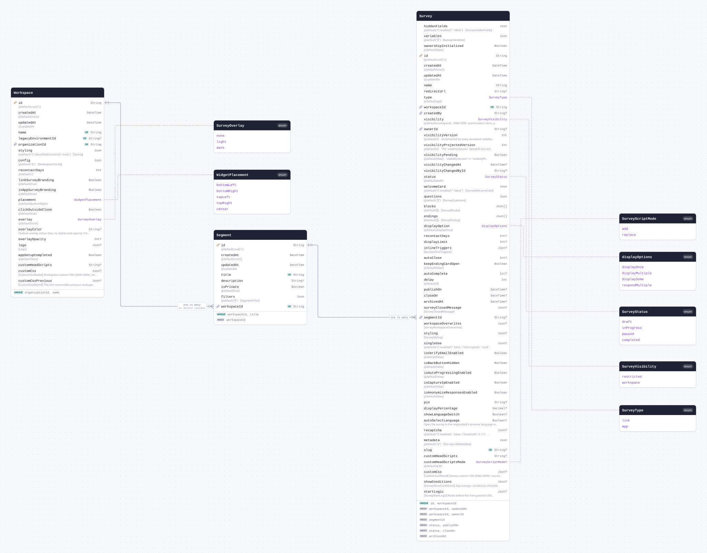

| Field                      | Type       | Constraints                                 | Default      | Description     |
| -------------------------- | ---------- | ------------------------------------------- | ------------ | --------------- |
| `id`                       | `String`   | PK NOT NULL                                 | `cuid(1)`    |                 |
| `createdAt` (`created_at`) | `DateTime` | NOT NULL                                    | `now()`      |                 |
| `updatedAt` (`updated_at`) | `DateTime` | NOT NULL                                    | `@updatedAt` |                 |
| `title`                    | `String`   | NOT NULL                                    |              |                 |
| `description`              | `String`   | NULL                                        |              |                 |
| `isPrivate`                | `Boolean`  | NOT NULL                                    | `true`       |                 |
| `filters`                  | `Json`     | NOT NULL                                    | `"[]"`       | [SegmentFilter] |
| `workspaceId`              | `String`   | NOT NULL → [Workspace.id](#model-Workspace) |              |                 |

#### Indexes

- `@@index([workspaceId])`
- `@@unique([workspaceId, title])`

#### References

- `workspaceId` → [Workspace.id](#model-Workspace) (many-to-one, on delete Cascade)

#### Referenced by

- `id` ← [Survey.segmentId](#model-Survey) (one-to-many)

#### Definition

```sql
CREATE TABLE "Segment" (
    "id" TEXT NOT NULL,
    "created_at" TIMESTAMP(3) NOT NULL DEFAULT CURRENT_TIMESTAMP,
    "updated_at" TIMESTAMP(3) NOT NULL,
    "title" TEXT NOT NULL,
    "description" TEXT,
    "isPrivate" BOOLEAN NOT NULL DEFAULT true,
    "filters" JSONB NOT NULL DEFAULT '[]',
    "workspaceId" TEXT NOT NULL,

    CONSTRAINT "Segment_pkey" PRIMARY KEY ("id")
);

CREATE INDEX "Segment_workspaceId_idx" ON "Segment"("workspaceId");

CREATE UNIQUE INDEX "Segment_workspaceId_title_key" ON "Segment"("workspaceId", "title");

ALTER TABLE "Segment" ADD CONSTRAINT "Segment_workspaceId_fkey" FOREIGN KEY ("workspaceId") REFERENCES "Workspace"("id") ON DELETE CASCADE ON UPDATE CASCADE;
```

<details>
<summary>Queries and their SQL</summary>

**findMany**: Every row

```ts
await prisma.segment.findMany();
```

```sql
SELECT
  "public"."Segment"."id",
  "public"."Segment"."created_at",
  "public"."Segment"."updated_at",
  "public"."Segment"."title",
  "public"."Segment"."description",
  "public"."Segment"."isPrivate",
  "public"."Segment"."filters",
  "public"."Segment"."workspaceId"
FROM
  "public"."Segment"
WHERE
  1 = 1
OFFSET
  $1
-- params: ["0"]
```

**count**: How many rows there are

```ts
await prisma.segment.count();
```

```sql
SELECT
  COUNT(*) AS "_count$_all"
FROM
  (
    SELECT
      "public"."Segment"."id"
    FROM
      "public"."Segment"
    WHERE
      1 = 1
    OFFSET
      $1
  ) AS "sub"
-- params: ["0"]
```

**findMany**: Every row with its relations

```ts
await prisma.segment.findMany({ include: { workspace: true, surveys: true } });
```

```sql
SELECT
  "public"."Segment"."id",
  "public"."Segment"."created_at",
  "public"."Segment"."updated_at",
  "public"."Segment"."title",
  "public"."Segment"."description",
  "public"."Segment"."isPrivate",
  "public"."Segment"."filters",
  "public"."Segment"."workspaceId"
FROM
  "public"."Segment"
WHERE
  1 = 1
OFFSET
  $1
-- params: ["0"]

SELECT
  "public"."Workspace"."id",
  "public"."Workspace"."created_at",
  "public"."Workspace"."updated_at",
  "public"."Workspace"."name",
  "public"."Workspace"."legacyEnvironmentId",
  "public"."Workspace"."organizationId",
  "public"."Workspace"."styling",
  "public"."Workspace"."config",
  "public"."Workspace"."recontactDays",
  "public"."Workspace"."linkSurveyBranding",
  "public"."Workspace"."inAppSurveyBranding",
  "public"."Workspace"."placement"::text,
  "public"."Workspace"."clickOutsideClose",
  "public"."Workspace"."overlay"::text,
  "public"."Workspace"."overlayColor",
  "public"."Workspace"."overlayOpacity",
  "public"."Workspace"."logo",
  "public"."Workspace"."appSetupCompleted",
  "public"."Workspace"."customHeadScripts",
  "public"."Workspace"."customCss",
  "public"."Workspace"."customCssPrevious"
FROM
  "public"."Workspace"
WHERE
  "public"."Workspace"."id" IN ($1)
OFFSET
  $2
-- params: ["<workspaceId of the rows above>","0"]

SELECT
  "public"."Survey"."id",
  "public"."Survey"."hiddenFields",
  "public"."Survey"."variables",
  "public"."Survey"."ownershipInitialized",
  "public"."Survey"."created_at",
  "public"."Survey"."updated_at",
  "public"."Survey"."name",
  "public"."Survey"."redirectUrl",
  "public"."Survey"."type"::text,
  "public"."Survey"."workspaceId",
  "public"."Survey"."createdBy",
  "public"."Survey"."visibility"::text,
  "public"."Survey"."ownerId",
  "public"."Survey"."visibilityVersion",
  "public"."Survey"."visibilityProjectedVersion",
  "public"."Survey"."visibilityPending",
  "public"."Survey"."visibilityChangedAt",
  "public"."Survey"."visibilityChangedById",
  "public"."Survey"."status"::text,
  "public"."Survey"."welcomeCard",
  "public"."Survey"."questions",
  "public"."Survey"."blocks",
  "public"."Survey"."endings",
  "public"."Survey"."displayOption"::text,
  "public"."Survey"."recontactDays",
  "public"."Survey"."displayLimit",
  "public"."Survey"."inlineTriggers",
  "public"."Survey"."autoClose",
  "public"."Survey"."keepEndingCardOpen",
  "public"."Survey"."autoComplete",
  "public"."Survey"."delay",
  "public"."Survey"."publishOn",
  "public"."Survey"."closeOn",
  "public"."Survey"."archivedAt",
  "public"."Survey"."surveyClosedMessage",
  "public"."Survey"."segmentId",
  "public"."Survey"."workspaceOverwrites",
  "public"."Survey"."styling",
  "public"."Survey"."singleUse",
  "public"."Survey"."isVerifyEmailEnabled",
  "public"."Survey"."isBackButtonHidden",
  "public"."Survey"."isAutoProgressingEnabled",
  "public"."Survey"."isCaptureIpEnabled",
  "public"."Survey"."is_anonymize_responses_enabled",
  "public"."Survey"."pin",
  "public"."Survey"."displayPercentage",
  "public"."Survey"."showLanguageSwitch",
  "public"."Survey"."autoSelectLanguage",
  "public"."Survey"."recaptcha",
  "public"."Survey"."metadata",
  "public"."Survey"."slug",
  "public"."Survey"."customHeadScripts",
  "public"."Survey"."customHeadScriptsMode"::text,
  "public"."Survey"."customCss",
  "public"."Survey"."showConditions",
  "public"."Survey"."startLogic"
FROM
  "public"."Survey"
WHERE
  "public"."Survey"."segmentId" IN ($1)
OFFSET
  $2
-- params: ["<id of the rows above>","0"]
```

**findUnique**: One row by what is unique to it

```ts
await prisma.segment.findUnique({ where: { id: "example" } });
```

```sql
SELECT
  "public"."Segment"."id",
  "public"."Segment"."created_at",
  "public"."Segment"."updated_at",
  "public"."Segment"."title",
  "public"."Segment"."description",
  "public"."Segment"."isPrivate",
  "public"."Segment"."filters",
  "public"."Segment"."workspaceId"
FROM
  "public"."Segment"
WHERE
  (
    "public"."Segment"."id" = $1
    AND 1 = 1
  )
LIMIT
  $2
OFFSET
  $3
-- params: ["example","1","0"]
```

**create**: Create a row

```ts
await prisma.segment.create({ data: { title: "example", workspaceId: "example" } });
```

```sql
INSERT INTO
  "public"."Segment" (
    "id",
    "created_at",
    "updated_at",
    "title",
    "isPrivate",
    "filters",
    "workspaceId"
  )
VALUES
  ($1, $2, $3, $4, $5, $6, $7)
RETURNING
  "public"."Segment"."id",
  "public"."Segment"."created_at",
  "public"."Segment"."updated_at",
  "public"."Segment"."title",
  "public"."Segment"."description",
  "public"."Segment"."isPrivate",
  "public"."Segment"."filters",
  "public"."Segment"."workspaceId"
-- params: ["<cuid(1)>","<now()>","<now()>","example",true,"[]","example"]
```

**update**: Update a row

```ts
await prisma.segment.update({
  where: { id: "example" },
  data: { createdAt: new Date("2026-01-01T00:00:00.000Z") },
});
```

```sql
UPDATE "public"."Segment"
SET
  "created_at" = $1,
  "updated_at" = $2
WHERE
  (
    "public"."Segment"."id" = $3
    AND 1 = 1
  )
RETURNING
  "public"."Segment"."id",
  "public"."Segment"."created_at",
  "public"."Segment"."updated_at",
  "public"."Segment"."title",
  "public"."Segment"."description",
  "public"."Segment"."isPrivate",
  "public"."Segment"."filters",
  "public"."Segment"."workspaceId"
-- params: ["2026-01-01T00:00:00.000Z",{"prisma__type":"generatorCall","prisma__value":{"name":"now","args":[],"returnType":{"type":"DateTime"}}},"example"]
```

**delete**: Delete a row

```ts
await prisma.segment.delete({ where: { id: "example" } });
```

```sql
DELETE FROM "public"."Segment"
WHERE
  (
    "public"."Segment"."id" = $1
    AND 1 = 1
  )
RETURNING
  "public"."Segment"."id",
  "public"."Segment"."created_at",
  "public"."Segment"."updated_at",
  "public"."Segment"."title",
  "public"."Segment"."description",
  "public"."Segment"."isPrivate",
  "public"."Segment"."filters",
  "public"."Segment"."workspaceId"
-- params: ["example"]
```

</details>

<a id="model-Language"></a>

### Language

Represents a supported language in the system.
Used for multilingual survey support.

@property id - Unique identifier for the language
@property code - Language code (e.g., 'en-US')
@property alias - Optional friendly name
@property workspace - The workspace this language is enabled for

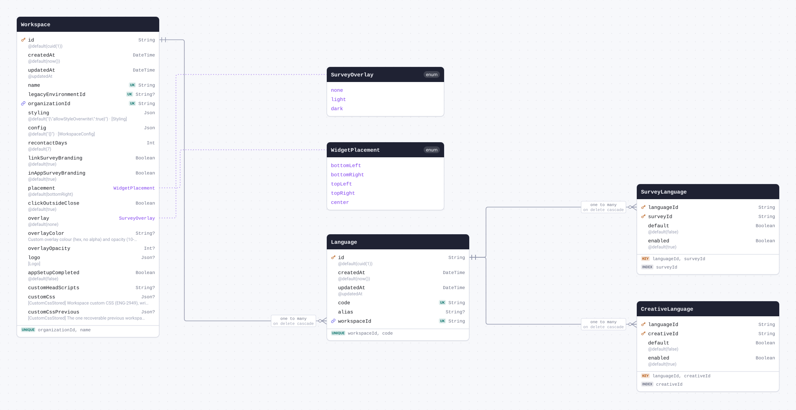

| Field                      | Type       | Constraints                                 | Default      | Description |
| -------------------------- | ---------- | ------------------------------------------- | ------------ | ----------- |
| `id`                       | `String`   | PK NOT NULL                                 | `cuid(1)`    |             |
| `createdAt` (`created_at`) | `DateTime` | NOT NULL                                    | `now()`      |             |
| `updatedAt` (`updated_at`) | `DateTime` | NOT NULL                                    | `@updatedAt` |             |
| `code`                     | `String`   | NOT NULL                                    |              |             |
| `alias`                    | `String`   | NULL                                        |              |             |
| `workspaceId`              | `String`   | NOT NULL → [Workspace.id](#model-Workspace) |              |             |

#### Indexes

- `@@unique([workspaceId, code])`

#### References

- `workspaceId` → [Workspace.id](#model-Workspace) (many-to-one, on delete Cascade)

#### Referenced by

- `id` ← [CreativeLanguage.languageId](#model-CreativeLanguage) (one-to-many, on delete Cascade)
- `id` ← [SurveyLanguage.languageId](#model-SurveyLanguage) (one-to-many, on delete Cascade)

#### Definition

```sql
CREATE TABLE "Language" (
    "id" TEXT NOT NULL,
    "created_at" TIMESTAMP(3) NOT NULL DEFAULT CURRENT_TIMESTAMP,
    "updated_at" TIMESTAMP(3) NOT NULL,
    "code" TEXT NOT NULL,
    "alias" TEXT,
    "workspaceId" TEXT NOT NULL,

    CONSTRAINT "Language_pkey" PRIMARY KEY ("id")
);

CREATE UNIQUE INDEX "Language_workspaceId_code_key" ON "Language"("workspaceId", "code");

ALTER TABLE "Language" ADD CONSTRAINT "Language_workspaceId_fkey" FOREIGN KEY ("workspaceId") REFERENCES "Workspace"("id") ON DELETE CASCADE ON UPDATE CASCADE;
```

<details>
<summary>Queries and their SQL</summary>

**findMany**: Every row

```ts
await prisma.language.findMany();
```

```sql
SELECT
  "public"."Language"."id",
  "public"."Language"."created_at",
  "public"."Language"."updated_at",
  "public"."Language"."code",
  "public"."Language"."alias",
  "public"."Language"."workspaceId"
FROM
  "public"."Language"
WHERE
  1 = 1
OFFSET
  $1
-- params: ["0"]
```

**count**: How many rows there are

```ts
await prisma.language.count();
```

```sql
SELECT
  COUNT(*) AS "_count$_all"
FROM
  (
    SELECT
      "public"."Language"."id"
    FROM
      "public"."Language"
    WHERE
      1 = 1
    OFFSET
      $1
  ) AS "sub"
-- params: ["0"]
```

**findMany**: Every row with its relations

```ts
await prisma.language.findMany({
  include: { workspace: true, surveyLanguages: true, creativeLanguages: true },
});
```

```sql
SELECT
  "public"."Language"."id",
  "public"."Language"."created_at",
  "public"."Language"."updated_at",
  "public"."Language"."code",
  "public"."Language"."alias",
  "public"."Language"."workspaceId"
FROM
  "public"."Language"
WHERE
  1 = 1
OFFSET
  $1
-- params: ["0"]

SELECT
  "public"."Workspace"."id",
  "public"."Workspace"."created_at",
  "public"."Workspace"."updated_at",
  "public"."Workspace"."name",
  "public"."Workspace"."legacyEnvironmentId",
  "public"."Workspace"."organizationId",
  "public"."Workspace"."styling",
  "public"."Workspace"."config",
  "public"."Workspace"."recontactDays",
  "public"."Workspace"."linkSurveyBranding",
  "public"."Workspace"."inAppSurveyBranding",
  "public"."Workspace"."placement"::text,
  "public"."Workspace"."clickOutsideClose",
  "public"."Workspace"."overlay"::text,
  "public"."Workspace"."overlayColor",
  "public"."Workspace"."overlayOpacity",
  "public"."Workspace"."logo",
  "public"."Workspace"."appSetupCompleted",
  "public"."Workspace"."customHeadScripts",
  "public"."Workspace"."customCss",
  "public"."Workspace"."customCssPrevious"
FROM
  "public"."Workspace"
WHERE
  "public"."Workspace"."id" IN ($1)
OFFSET
  $2
-- params: ["<workspaceId of the rows above>","0"]

SELECT
  "public"."SurveyLanguage"."languageId",
  "public"."SurveyLanguage"."surveyId",
  "public"."SurveyLanguage"."default",
  "public"."SurveyLanguage"."enabled"
FROM
  "public"."SurveyLanguage"
WHERE
  "public"."SurveyLanguage"."languageId" IN ($1)
OFFSET
  $2
-- params: ["<id of the rows above>","0"]

SELECT
  "public"."CreativeLanguage"."languageId",
  "public"."CreativeLanguage"."creativeId",
  "public"."CreativeLanguage"."default",
  "public"."CreativeLanguage"."enabled"
FROM
  "public"."CreativeLanguage"
WHERE
  "public"."CreativeLanguage"."languageId" IN ($1)
OFFSET
  $2
-- params: ["<id of the rows above>","0"]
```

**findUnique**: One row by what is unique to it

```ts
await prisma.language.findUnique({ where: { id: "example" } });
```

```sql
SELECT
  "public"."Language"."id",
  "public"."Language"."created_at",
  "public"."Language"."updated_at",
  "public"."Language"."code",
  "public"."Language"."alias",
  "public"."Language"."workspaceId"
FROM
  "public"."Language"
WHERE
  (
    "public"."Language"."id" = $1
    AND 1 = 1
  )
LIMIT
  $2
OFFSET
  $3
-- params: ["example","1","0"]
```

**create**: Create a row

```ts
await prisma.language.create({ data: { code: "example", workspaceId: "example" } });
```

```sql
INSERT INTO
  "public"."Language" (
    "id",
    "created_at",
    "updated_at",
    "code",
    "workspaceId"
  )
VALUES
  ($1, $2, $3, $4, $5)
RETURNING
  "public"."Language"."id",
  "public"."Language"."created_at",
  "public"."Language"."updated_at",
  "public"."Language"."code",
  "public"."Language"."alias",
  "public"."Language"."workspaceId"
-- params: ["<cuid(1)>","<now()>","<now()>","example","example"]
```

**update**: Update a row

```ts
await prisma.language.update({
  where: { id: "example" },
  data: { createdAt: new Date("2026-01-01T00:00:00.000Z") },
});
```

```sql
UPDATE "public"."Language"
SET
  "created_at" = $1,
  "updated_at" = $2
WHERE
  (
    "public"."Language"."id" = $3
    AND 1 = 1
  )
RETURNING
  "public"."Language"."id",
  "public"."Language"."created_at",
  "public"."Language"."updated_at",
  "public"."Language"."code",
  "public"."Language"."alias",
  "public"."Language"."workspaceId"
-- params: ["2026-01-01T00:00:00.000Z",{"prisma__type":"generatorCall","prisma__value":{"name":"now","args":[],"returnType":{"type":"DateTime"}}},"example"]
```

**delete**: Delete a row

```ts
await prisma.language.delete({ where: { id: "example" } });
```

```sql
DELETE FROM "public"."Language"
WHERE
  (
    "public"."Language"."id" = $1
    AND 1 = 1
  )
RETURNING
  "public"."Language"."id",
  "public"."Language"."created_at",
  "public"."Language"."updated_at",
  "public"."Language"."code",
  "public"."Language"."alias",
  "public"."Language"."workspaceId"
-- params: ["example"]
```

</details>

<a id="model-SurveyLanguage"></a>

### SurveyLanguage

Links surveys to their supported languages.
Manages which languages are available for each survey.

@property language - The supported language
@property survey - The associated survey
@property default - Whether this is the default language
@property enabled - Whether this language is currently active

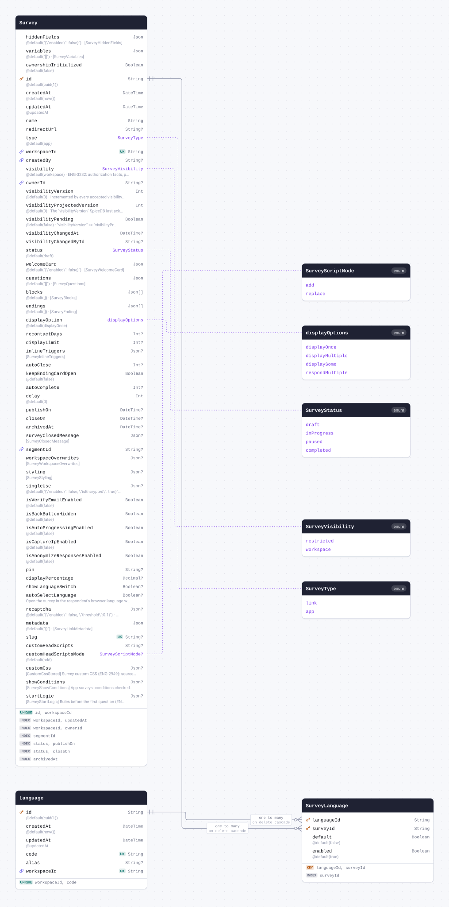

| Field        | Type      | Constraints                                  | Default | Description |
| ------------ | --------- | -------------------------------------------- | ------- | ----------- |
| `languageId` | `String`  | PK NOT NULL → [Language.id](#model-Language) |         |             |
| `surveyId`   | `String`  | PK NOT NULL → [Survey.id](#model-Survey)     |         |             |
| `default`    | `Boolean` | NOT NULL                                     | `false` |             |
| `enabled`    | `Boolean` | NOT NULL                                     | `true`  |             |

#### Indexes

- `@@id([languageId, surveyId])`
- `@@index([surveyId])`

#### References

- `languageId` → [Language.id](#model-Language) (many-to-one, on delete Cascade)
- `surveyId` → [Survey.id](#model-Survey) (many-to-one, on delete Cascade)

#### Definition

```sql
CREATE TABLE "SurveyLanguage" (
    "languageId" TEXT NOT NULL,
    "surveyId" TEXT NOT NULL,
    "default" BOOLEAN NOT NULL DEFAULT false,
    "enabled" BOOLEAN NOT NULL DEFAULT true,

    CONSTRAINT "SurveyLanguage_pkey" PRIMARY KEY ("languageId","surveyId")
);

CREATE INDEX "SurveyLanguage_surveyId_idx" ON "SurveyLanguage"("surveyId");

ALTER TABLE "SurveyLanguage" ADD CONSTRAINT "SurveyLanguage_languageId_fkey" FOREIGN KEY ("languageId") REFERENCES "Language"("id") ON DELETE CASCADE ON UPDATE CASCADE;

ALTER TABLE "SurveyLanguage" ADD CONSTRAINT "SurveyLanguage_surveyId_fkey" FOREIGN KEY ("surveyId") REFERENCES "Survey"("id") ON DELETE CASCADE ON UPDATE CASCADE;
```

<details>
<summary>Queries and their SQL</summary>

**findMany**: Every row

```ts
await prisma.surveyLanguage.findMany();
```

```sql
SELECT
  "public"."SurveyLanguage"."languageId",
  "public"."SurveyLanguage"."surveyId",
  "public"."SurveyLanguage"."default",
  "public"."SurveyLanguage"."enabled"
FROM
  "public"."SurveyLanguage"
WHERE
  1 = 1
OFFSET
  $1
-- params: ["0"]
```

**count**: How many rows there are

```ts
await prisma.surveyLanguage.count();
```

```sql
SELECT
  COUNT(*) AS "_count$_all"
FROM
  (
    SELECT
      "public"."SurveyLanguage"."languageId",
      "public"."SurveyLanguage"."surveyId"
    FROM
      "public"."SurveyLanguage"
    WHERE
      1 = 1
    OFFSET
      $1
  ) AS "sub"
-- params: ["0"]
```

**findMany**: Every row with its relations

```ts
await prisma.surveyLanguage.findMany({ include: { language: true, survey: true } });
```

```sql
SELECT
  "public"."SurveyLanguage"."languageId",
  "public"."SurveyLanguage"."surveyId",
  "public"."SurveyLanguage"."default",
  "public"."SurveyLanguage"."enabled"
FROM
  "public"."SurveyLanguage"
WHERE
  1 = 1
OFFSET
  $1
-- params: ["0"]

SELECT
  "public"."Language"."id",
  "public"."Language"."created_at",
  "public"."Language"."updated_at",
  "public"."Language"."code",
  "public"."Language"."alias",
  "public"."Language"."workspaceId"
FROM
  "public"."Language"
WHERE
  "public"."Language"."id" IN ($1)
OFFSET
  $2
-- params: ["<languageId of the rows above>","0"]

SELECT
  "public"."Survey"."id",
  "public"."Survey"."hiddenFields",
  "public"."Survey"."variables",
  "public"."Survey"."ownershipInitialized",
  "public"."Survey"."created_at",
  "public"."Survey"."updated_at",
  "public"."Survey"."name",
  "public"."Survey"."redirectUrl",
  "public"."Survey"."type"::text,
  "public"."Survey"."workspaceId",
  "public"."Survey"."createdBy",
  "public"."Survey"."visibility"::text,
  "public"."Survey"."ownerId",
  "public"."Survey"."visibilityVersion",
  "public"."Survey"."visibilityProjectedVersion",
  "public"."Survey"."visibilityPending",
  "public"."Survey"."visibilityChangedAt",
  "public"."Survey"."visibilityChangedById",
  "public"."Survey"."status"::text,
  "public"."Survey"."welcomeCard",
  "public"."Survey"."questions",
  "public"."Survey"."blocks",
  "public"."Survey"."endings",
  "public"."Survey"."displayOption"::text,
  "public"."Survey"."recontactDays",
  "public"."Survey"."displayLimit",
  "public"."Survey"."inlineTriggers",
  "public"."Survey"."autoClose",
  "public"."Survey"."keepEndingCardOpen",
  "public"."Survey"."autoComplete",
  "public"."Survey"."delay",
  "public"."Survey"."publishOn",
  "public"."Survey"."closeOn",
  "public"."Survey"."archivedAt",
  "public"."Survey"."surveyClosedMessage",
  "public"."Survey"."segmentId",
  "public"."Survey"."workspaceOverwrites",
  "public"."Survey"."styling",
  "public"."Survey"."singleUse",
  "public"."Survey"."isVerifyEmailEnabled",
  "public"."Survey"."isBackButtonHidden",
  "public"."Survey"."isAutoProgressingEnabled",
  "public"."Survey"."isCaptureIpEnabled",
  "public"."Survey"."is_anonymize_responses_enabled",
  "public"."Survey"."pin",
  "public"."Survey"."displayPercentage",
  "public"."Survey"."showLanguageSwitch",
  "public"."Survey"."autoSelectLanguage",
  "public"."Survey"."recaptcha",
  "public"."Survey"."metadata",
  "public"."Survey"."slug",
  "public"."Survey"."customHeadScripts",
  "public"."Survey"."customHeadScriptsMode"::text,
  "public"."Survey"."customCss",
  "public"."Survey"."showConditions",
  "public"."Survey"."startLogic"
FROM
  "public"."Survey"
WHERE
  "public"."Survey"."id" IN ($1)
OFFSET
  $2
-- params: ["<surveyId of the rows above>","0"]
```

**findUnique**: One row by what is unique to it

```ts
await prisma.surveyLanguage.findUnique({
  where: { languageId_surveyId: { languageId: "example", surveyId: "example" } },
});
```

```sql
SELECT
  "public"."SurveyLanguage"."languageId",
  "public"."SurveyLanguage"."surveyId",
  "public"."SurveyLanguage"."default",
  "public"."SurveyLanguage"."enabled"
FROM
  "public"."SurveyLanguage"
WHERE
  (
    (
      "public"."SurveyLanguage"."languageId" = $1
      AND "public"."SurveyLanguage"."surveyId" = $2
    )
    AND 1 = 1
  )
LIMIT
  $3
OFFSET
  $4
-- params: ["example","example","1","0"]
```

**create**: Create a row

```ts
await prisma.surveyLanguage.create({ data: { languageId: "example", surveyId: "example" } });
```

```sql
INSERT INTO
  "public"."SurveyLanguage" ("languageId", "surveyId", "default", "enabled")
VALUES
  ($1, $2, $3, $4)
RETURNING
  "public"."SurveyLanguage"."languageId",
  "public"."SurveyLanguage"."surveyId",
  "public"."SurveyLanguage"."default",
  "public"."SurveyLanguage"."enabled"
-- params: ["example","example",false,true]
```

**update**: Update a row

```ts
await prisma.surveyLanguage.update({
  where: { languageId_surveyId: { languageId: "example", surveyId: "example" } },
  data: { default: true },
});
```

```sql
UPDATE "public"."SurveyLanguage"
SET
  "default" = $1
WHERE
  (
    (
      "public"."SurveyLanguage"."languageId" = $2
      AND "public"."SurveyLanguage"."surveyId" = $3
    )
    AND 1 = 1
  )
RETURNING
  "public"."SurveyLanguage"."languageId",
  "public"."SurveyLanguage"."surveyId",
  "public"."SurveyLanguage"."default",
  "public"."SurveyLanguage"."enabled"
-- params: [true,"example","example"]
```

**delete**: Delete a row

```ts
await prisma.surveyLanguage.delete({
  where: { languageId_surveyId: { languageId: "example", surveyId: "example" } },
});
```

```sql
DELETE FROM "public"."SurveyLanguage"
WHERE
  (
    (
      "public"."SurveyLanguage"."languageId" = $1
      AND "public"."SurveyLanguage"."surveyId" = $2
    )
    AND 1 = 1
  )
RETURNING
  "public"."SurveyLanguage"."languageId",
  "public"."SurveyLanguage"."surveyId",
  "public"."SurveyLanguage"."default",
  "public"."SurveyLanguage"."enabled"
-- params: ["example","example"]
```

</details>

<a id="model-EmbeddedData"></a>

### EmbeddedData

Defines one Embedded Data field: the extra context stored on a response that isn't an
answer to a question (brand, plan, page type, a computed score, ...).

A field is either **local** — used by a single survey, which is how existing variables and
hidden fields are migrated — or **shared**, meaning it is part of the workspace library and can
be linked by many surveys. There is no stored flag for that: `surveyId` is the owner and `key`
is the library name, so a local field has `surveyId` set and `key` null, and a shared field the
other way round. Deriving it rather than storing a boolean removes a column that could drift
out of step with the two fields it stands for.

@property key - Library name, unique per workspace and immutable. Null for local fields
@property name - Human-readable display label
@property source - Where the value comes from (computed | ingested). `reserved` is part of the
shared enum but never stored as a row: those fields are a static catalog in code
@property dataType - Declared value type, used for coercion at ingest
@property defaultValue - Initial value (computed) or fallback when nothing arrives (ingested)
@property locked - Ingested only: ignore external writes and use the default instead
@property survey - The owning survey for a local field; cascades so nothing is orphaned

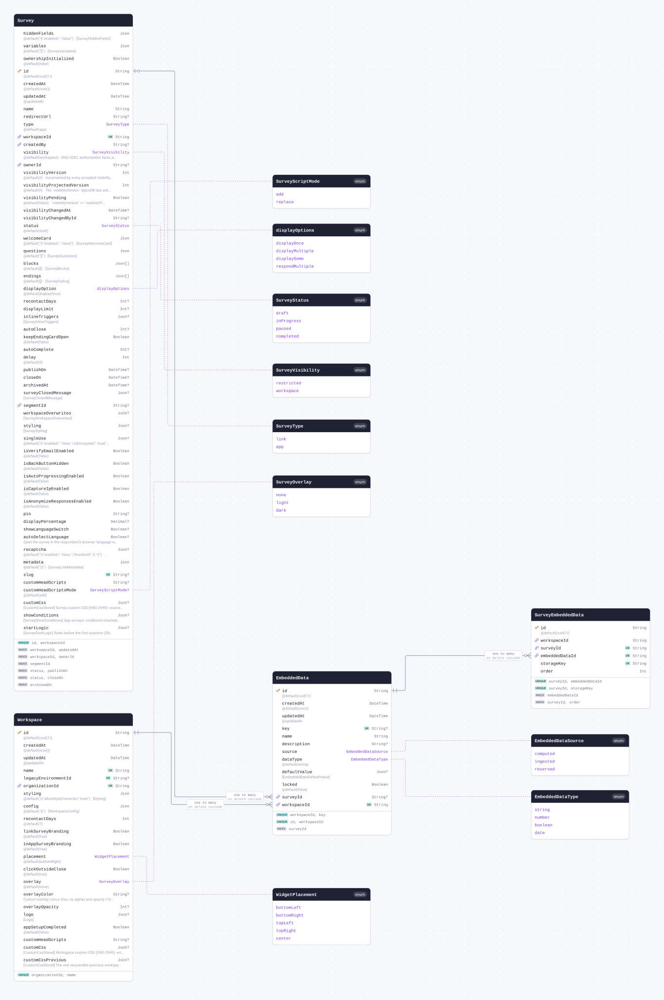

| Field                      | Type                                             | Constraints                                    | Default      | Description                |
| -------------------------- | ------------------------------------------------ | ---------------------------------------------- | ------------ | -------------------------- |
| `id`                       | `String`                                         | PK NOT NULL                                    | `cuid(1)`    |                            |
| `createdAt` (`created_at`) | `DateTime`                                       | NOT NULL                                       | `now()`      |                            |
| `updatedAt` (`updated_at`) | `DateTime`                                       | NOT NULL                                       | `@updatedAt` |                            |
| `key`                      | `String`                                         | NULL                                           |              |                            |
| `name`                     | `String`                                         | NOT NULL                                       |              |                            |
| `description`              | `String`                                         | NULL                                           |              |                            |
| `source`                   | [`EmbeddedDataSource`](#enum-EmbeddedDataSource) | NOT NULL                                       |              |                            |
| `dataType`                 | [`EmbeddedDataType`](#enum-EmbeddedDataType)     | NOT NULL                                       | `string`     |                            |
| `defaultValue`             | `Json`                                           | NULL                                           |              | [EmbeddedDataDefaultValue] |
| `locked`                   | `Boolean`                                        | NOT NULL                                       | `false`      |                            |
| `surveyId`                 | `String`                                         | NULL → [Survey.id](#model-Survey)              |              |                            |
| `workspaceId`              | `String`                                         | NOT NULL → [Survey.workspaceId](#model-Survey) |              |                            |

#### Indexes

- `@@index([surveyId])`
- `@@unique([workspaceId, key])`
- `@@unique([id, workspaceId])`

#### References

- `surveyId` → [Survey.id](#model-Survey) (many-to-one, on delete Cascade)
- `workspaceId` → [Workspace.id](#model-Workspace) (many-to-one, on delete Cascade)

#### Referenced by

- `id` ← [SurveyEmbeddedData.embeddedDataId](#model-SurveyEmbeddedData) (one-to-many, on delete Cascade)

#### Definition

```sql
CREATE TABLE "EmbeddedData" (
    "id" TEXT NOT NULL,
    "created_at" TIMESTAMP(3) NOT NULL DEFAULT CURRENT_TIMESTAMP,
    "updated_at" TIMESTAMP(3) NOT NULL,
    "key" TEXT,
    "name" TEXT NOT NULL,
    "description" TEXT,
    "source" "EmbeddedDataSource" NOT NULL,
    "dataType" "EmbeddedDataType" NOT NULL DEFAULT 'string',
    "defaultValue" JSONB,
    "locked" BOOLEAN NOT NULL DEFAULT false,
    "surveyId" TEXT,
    "workspaceId" TEXT NOT NULL,

    CONSTRAINT "EmbeddedData_pkey" PRIMARY KEY ("id")
);

CREATE INDEX "EmbeddedData_surveyId_idx" ON "EmbeddedData"("surveyId");

CREATE UNIQUE INDEX "EmbeddedData_workspaceId_key_key" ON "EmbeddedData"("workspaceId", "key");

CREATE UNIQUE INDEX "EmbeddedData_id_workspaceId_key" ON "EmbeddedData"("id", "workspaceId");

ALTER TABLE "EmbeddedData" ADD CONSTRAINT "EmbeddedData_surveyId_workspaceId_fkey" FOREIGN KEY ("surveyId", "workspaceId") REFERENCES "Survey"("id", "workspaceId") ON DELETE CASCADE ON UPDATE CASCADE;

ALTER TABLE "EmbeddedData" ADD CONSTRAINT "EmbeddedData_workspaceId_fkey" FOREIGN KEY ("workspaceId") REFERENCES "Workspace"("id") ON DELETE CASCADE ON UPDATE CASCADE;
```

<details>
<summary>Queries and their SQL</summary>

**findMany**: Every row

```ts
await prisma.embeddedData.findMany();
```

```sql
SELECT
  "public"."EmbeddedData"."id",
  "public"."EmbeddedData"."created_at",
  "public"."EmbeddedData"."updated_at",
  "public"."EmbeddedData"."key",
  "public"."EmbeddedData"."name",
  "public"."EmbeddedData"."description",
  "public"."EmbeddedData"."source"::text,
  "public"."EmbeddedData"."dataType"::text,
  "public"."EmbeddedData"."defaultValue",
  "public"."EmbeddedData"."locked",
  "public"."EmbeddedData"."surveyId",
  "public"."EmbeddedData"."workspaceId"
FROM
  "public"."EmbeddedData"
WHERE
  1 = 1
OFFSET
  $1
-- params: ["0"]
```

**count**: How many rows there are

```ts
await prisma.embeddedData.count();
```

```sql
SELECT
  COUNT(*) AS "_count$_all"
FROM
  (
    SELECT
      "public"."EmbeddedData"."id"
    FROM
      "public"."EmbeddedData"
    WHERE
      1 = 1
    OFFSET
      $1
  ) AS "sub"
-- params: ["0"]
```

**findMany**: Every row with its relations

```ts
await prisma.embeddedData.findMany({
  include: { survey: true, workspace: true, surveyLinks: true },
});
```

```sql
SELECT
  "public"."EmbeddedData"."id",
  "public"."EmbeddedData"."created_at",
  "public"."EmbeddedData"."updated_at",
  "public"."EmbeddedData"."key",
  "public"."EmbeddedData"."name",
  "public"."EmbeddedData"."description",
  "public"."EmbeddedData"."source"::text,
  "public"."EmbeddedData"."dataType"::text,
  "public"."EmbeddedData"."defaultValue",
  "public"."EmbeddedData"."locked",
  "public"."EmbeddedData"."surveyId",
  "public"."EmbeddedData"."workspaceId"
FROM
  "public"."EmbeddedData"
WHERE
  1 = 1
OFFSET
  $1
-- params: ["0"]

SELECT
  "public"."Survey"."id",
  "public"."Survey"."hiddenFields",
  "public"."Survey"."variables",
  "public"."Survey"."ownershipInitialized",
  "public"."Survey"."created_at",
  "public"."Survey"."updated_at",
  "public"."Survey"."name",
  "public"."Survey"."redirectUrl",
  "public"."Survey"."type"::text,
  "public"."Survey"."workspaceId",
  "public"."Survey"."createdBy",
  "public"."Survey"."visibility"::text,
  "public"."Survey"."ownerId",
  "public"."Survey"."visibilityVersion",
  "public"."Survey"."visibilityProjectedVersion",
  "public"."Survey"."visibilityPending",
  "public"."Survey"."visibilityChangedAt",
  "public"."Survey"."visibilityChangedById",
  "public"."Survey"."status"::text,
  "public"."Survey"."welcomeCard",
  "public"."Survey"."questions",
  "public"."Survey"."blocks",
  "public"."Survey"."endings",
  "public"."Survey"."displayOption"::text,
  "public"."Survey"."recontactDays",
  "public"."Survey"."displayLimit",
  "public"."Survey"."inlineTriggers",
  "public"."Survey"."autoClose",
  "public"."Survey"."keepEndingCardOpen",
  "public"."Survey"."autoComplete",
  "public"."Survey"."delay",
  "public"."Survey"."publishOn",
  "public"."Survey"."closeOn",
  "public"."Survey"."archivedAt",
  "public"."Survey"."surveyClosedMessage",
  "public"."Survey"."segmentId",
  "public"."Survey"."workspaceOverwrites",
  "public"."Survey"."styling",
  "public"."Survey"."singleUse",
  "public"."Survey"."isVerifyEmailEnabled",
  "public"."Survey"."isBackButtonHidden",
  "public"."Survey"."isAutoProgressingEnabled",
  "public"."Survey"."isCaptureIpEnabled",
  "public"."Survey"."is_anonymize_responses_enabled",
  "public"."Survey"."pin",
  "public"."Survey"."displayPercentage",
  "public"."Survey"."showLanguageSwitch",
  "public"."Survey"."autoSelectLanguage",
  "public"."Survey"."recaptcha",
  "public"."Survey"."metadata",
  "public"."Survey"."slug",
  "public"."Survey"."customHeadScripts",
  "public"."Survey"."customHeadScriptsMode"::text,
  "public"."Survey"."customCss",
  "public"."Survey"."showConditions",
  "public"."Survey"."startLogic"
FROM
  "public"."Survey"
WHERE
  (
    "public"."Survey"."id" IN ($1)
    AND "public"."Survey"."workspaceId" IN ($2)
  )
OFFSET
  $3
-- params: ["<surveyId of the rows above>","<workspaceId of the rows above>","0"]

SELECT
  "public"."Workspace"."id",
  "public"."Workspace"."created_at",
  "public"."Workspace"."updated_at",
  "public"."Workspace"."name",
  "public"."Workspace"."legacyEnvironmentId",
  "public"."Workspace"."organizationId",
  "public"."Workspace"."styling",
  "public"."Workspace"."config",
  "public"."Workspace"."recontactDays",
  "public"."Workspace"."linkSurveyBranding",
  "public"."Workspace"."inAppSurveyBranding",
  "public"."Workspace"."placement"::text,
  "public"."Workspace"."clickOutsideClose",
  "public"."Workspace"."overlay"::text,
  "public"."Workspace"."overlayColor",
  "public"."Workspace"."overlayOpacity",
  "public"."Workspace"."logo",
  "public"."Workspace"."appSetupCompleted",
  "public"."Workspace"."customHeadScripts",
  "public"."Workspace"."customCss",
  "public"."Workspace"."customCssPrevious"
FROM
  "public"."Workspace"
WHERE
  "public"."Workspace"."id" IN ($1)
OFFSET
  $2
-- params: ["<workspaceId of the rows above>","0"]

SELECT
  "public"."SurveyEmbeddedData"."id",
  "public"."SurveyEmbeddedData"."workspaceId",
  "public"."SurveyEmbeddedData"."surveyId",
  "public"."SurveyEmbeddedData"."embeddedDataId",
  "public"."SurveyEmbeddedData"."storageKey",
  "public"."SurveyEmbeddedData"."order"
FROM
  "public"."SurveyEmbeddedData"
WHERE
  (
    "public"."SurveyEmbeddedData"."workspaceId" IN ($1)
    AND "public"."SurveyEmbeddedData"."embeddedDataId" IN ($2)
  )
OFFSET
  $3
-- params: ["<workspaceId of the rows above>","<id of the rows above>","0"]
```

**findUnique**: One row by what is unique to it

```ts
await prisma.embeddedData.findUnique({ where: { id: "example" } });
```

```sql
SELECT
  "public"."EmbeddedData"."id",
  "public"."EmbeddedData"."created_at",
  "public"."EmbeddedData"."updated_at",
  "public"."EmbeddedData"."key",
  "public"."EmbeddedData"."name",
  "public"."EmbeddedData"."description",
  "public"."EmbeddedData"."source"::text,
  "public"."EmbeddedData"."dataType"::text,
  "public"."EmbeddedData"."defaultValue",
  "public"."EmbeddedData"."locked",
  "public"."EmbeddedData"."surveyId",
  "public"."EmbeddedData"."workspaceId"
FROM
  "public"."EmbeddedData"
WHERE
  (
    "public"."EmbeddedData"."id" = $1
    AND 1 = 1
  )
LIMIT
  $2
OFFSET
  $3
-- params: ["example","1","0"]
```

**create**: Create a row

```ts
await prisma.embeddedData.create({
  data: { name: "example", source: "computed", workspaceId: "example" },
});
```

```sql
INSERT INTO
  "public"."EmbeddedData" (
    "id",
    "created_at",
    "updated_at",
    "name",
    "source",
    "dataType",
    "locked",
    "workspaceId"
  )
VALUES
  (
    $1,
    $2,
    $3,
    $4,
    CAST($5::text AS "public"."EmbeddedDataSource"),
    CAST($6::text AS "public"."EmbeddedDataType"),
    $7,
    $8
  )
RETURNING
  "public"."EmbeddedData"."id",
  "public"."EmbeddedData"."created_at",
  "public"."EmbeddedData"."updated_at",
  "public"."EmbeddedData"."key",
  "public"."EmbeddedData"."name",
  "public"."EmbeddedData"."description",
  "public"."EmbeddedData"."source"::text,
  "public"."EmbeddedData"."dataType"::text,
  "public"."EmbeddedData"."defaultValue",
  "public"."EmbeddedData"."locked",
  "public"."EmbeddedData"."surveyId",
  "public"."EmbeddedData"."workspaceId"
-- params: ["<cuid(1)>","<now()>","<now()>","example","computed","string",false,"example"]
```

**update**: Update a row

```ts
await prisma.embeddedData.update({
  where: { id: "example" },
  data: { createdAt: new Date("2026-01-01T00:00:00.000Z") },
});
```

```sql
UPDATE "public"."EmbeddedData"
SET
  "created_at" = $1,
  "updated_at" = $2
WHERE
  (
    "public"."EmbeddedData"."id" = $3
    AND 1 = 1
  )
RETURNING
  "public"."EmbeddedData"."id",
  "public"."EmbeddedData"."created_at",
  "public"."EmbeddedData"."updated_at",
  "public"."EmbeddedData"."key",
  "public"."EmbeddedData"."name",
  "public"."EmbeddedData"."description",
  "public"."EmbeddedData"."source"::text,
  "public"."EmbeddedData"."dataType"::text,
  "public"."EmbeddedData"."defaultValue",
  "public"."EmbeddedData"."locked",
  "public"."EmbeddedData"."surveyId",
  "public"."EmbeddedData"."workspaceId"
-- params: ["2026-01-01T00:00:00.000Z",{"prisma__type":"generatorCall","prisma__value":{"name":"now","args":[],"returnType":{"type":"DateTime"}}},"example"]
```

**delete**: Delete a row

```ts
await prisma.embeddedData.delete({ where: { id: "example" } });
```

```sql
DELETE FROM "public"."EmbeddedData"
WHERE
  (
    "public"."EmbeddedData"."id" = $1
    AND 1 = 1
  )
RETURNING
  "public"."EmbeddedData"."id",
  "public"."EmbeddedData"."created_at",
  "public"."EmbeddedData"."updated_at",
  "public"."EmbeddedData"."key",
  "public"."EmbeddedData"."name",
  "public"."EmbeddedData"."description",
  "public"."EmbeddedData"."source"::text,
  "public"."EmbeddedData"."dataType"::text,
  "public"."EmbeddedData"."defaultValue",
  "public"."EmbeddedData"."locked",
  "public"."EmbeddedData"."surveyId",
  "public"."EmbeddedData"."workspaceId"
-- params: ["example"]
```

</details>

<a id="model-SurveyEmbeddedData"></a>

### SurveyEmbeddedData

Links a survey to an Embedded Data field and records the key that field's value is stored
under inside that survey.

`workspaceId` is part of both foreign keys on purpose: `surveyId` and `embeddedDataId` alone are
independent, so nothing would stop a survey in one workspace linking a field defined in another.
Referencing `(id, workspaceId)` on both sides makes a cross-workspace pair unrepresentable, and
puts the workspace scope every query needs on the row instead of behind a join through Survey.

@property storageKey - The key the value lives under: a cuid for computed fields, the field
name for ingested ones. Migrated fields keep their original key, which is what lets existing
recall tokens, logic conditions and stored responses keep resolving untouched.

@property order - Position within this survey's field list, dense from 0. Lives on the link
rather than on `EmbeddedData` because a shared definition sits at a different position in each
survey that links it. Deliberately has no default: every writer knows the position it is writing,
so a missing one should be a type error rather than a row that silently sorts to the front.

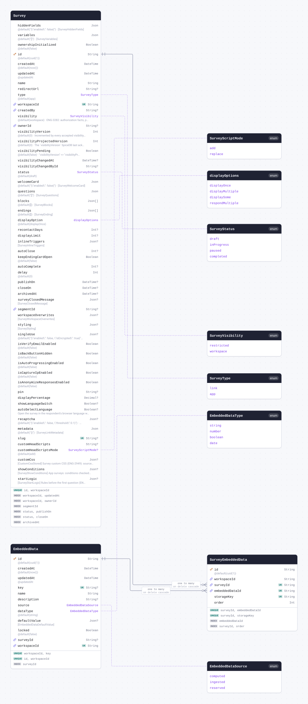

| Field            | Type     | Constraints                                       | Default   | Description |
| ---------------- | -------- | ------------------------------------------------- | --------- | ----------- |
| `id`             | `String` | PK NOT NULL                                       | `cuid(1)` |             |
| `workspaceId`    | `String` | NOT NULL → [Survey.workspaceId](#model-Survey)    |           |             |
| `surveyId`       | `String` | NOT NULL → [Survey.id](#model-Survey)             |           |             |
| `embeddedDataId` | `String` | NOT NULL → [EmbeddedData.id](#model-EmbeddedData) |           |             |
| `storageKey`     | `String` | NOT NULL                                          |           |             |
| `order`          | `Int`    | NOT NULL                                          |           |             |

#### Indexes

- `@@index([embeddedDataId])`
- `@@index([surveyId, order])`
- `@@unique([surveyId, embeddedDataId])`
- `@@unique([surveyId, storageKey])`

#### References

- `surveyId` → [Survey.id](#model-Survey) (many-to-one, on delete Cascade)
- `embeddedDataId` → [EmbeddedData.id](#model-EmbeddedData) (many-to-one, on delete Cascade)

#### Definition

```sql
CREATE TABLE "SurveyEmbeddedData" (
    "id" TEXT NOT NULL,
    "workspaceId" TEXT NOT NULL,
    "surveyId" TEXT NOT NULL,
    "embeddedDataId" TEXT NOT NULL,
    "storageKey" TEXT NOT NULL,
    "order" INTEGER NOT NULL,

    CONSTRAINT "SurveyEmbeddedData_pkey" PRIMARY KEY ("id")
);

CREATE INDEX "SurveyEmbeddedData_embeddedDataId_idx" ON "SurveyEmbeddedData"("embeddedDataId");

CREATE INDEX "SurveyEmbeddedData_surveyId_order_idx" ON "SurveyEmbeddedData"("surveyId", "order");

CREATE UNIQUE INDEX "SurveyEmbeddedData_surveyId_embeddedDataId_key" ON "SurveyEmbeddedData"("surveyId", "embeddedDataId");

CREATE UNIQUE INDEX "SurveyEmbeddedData_surveyId_storageKey_key" ON "SurveyEmbeddedData"("surveyId", "storageKey");

ALTER TABLE "SurveyEmbeddedData" ADD CONSTRAINT "SurveyEmbeddedData_surveyId_workspaceId_fkey" FOREIGN KEY ("surveyId", "workspaceId") REFERENCES "Survey"("id", "workspaceId") ON DELETE CASCADE ON UPDATE CASCADE;

ALTER TABLE "SurveyEmbeddedData" ADD CONSTRAINT "SurveyEmbeddedData_embeddedDataId_workspaceId_fkey" FOREIGN KEY ("embeddedDataId", "workspaceId") REFERENCES "EmbeddedData"("id", "workspaceId") ON DELETE CASCADE ON UPDATE CASCADE;
```

<details>
<summary>Queries and their SQL</summary>

**findMany**: Every row

```ts
await prisma.surveyEmbeddedData.findMany();
```

```sql
SELECT
  "public"."SurveyEmbeddedData"."id",
  "public"."SurveyEmbeddedData"."workspaceId",
  "public"."SurveyEmbeddedData"."surveyId",
  "public"."SurveyEmbeddedData"."embeddedDataId",
  "public"."SurveyEmbeddedData"."storageKey",
  "public"."SurveyEmbeddedData"."order"
FROM
  "public"."SurveyEmbeddedData"
WHERE
  1 = 1
OFFSET
  $1
-- params: ["0"]
```

**count**: How many rows there are

```ts
await prisma.surveyEmbeddedData.count();
```

```sql
SELECT
  COUNT(*) AS "_count$_all"
FROM
  (
    SELECT
      "public"."SurveyEmbeddedData"."id"
    FROM
      "public"."SurveyEmbeddedData"
    WHERE
      1 = 1
    OFFSET
      $1
  ) AS "sub"
-- params: ["0"]
```

**findMany**: Every row with its relations

```ts
await prisma.surveyEmbeddedData.findMany({ include: { survey: true, embeddedData: true } });
```

```sql
SELECT
  "public"."SurveyEmbeddedData"."id",
  "public"."SurveyEmbeddedData"."workspaceId",
  "public"."SurveyEmbeddedData"."surveyId",
  "public"."SurveyEmbeddedData"."embeddedDataId",
  "public"."SurveyEmbeddedData"."storageKey",
  "public"."SurveyEmbeddedData"."order"
FROM
  "public"."SurveyEmbeddedData"
WHERE
  1 = 1
OFFSET
  $1
-- params: ["0"]

SELECT
  "public"."Survey"."id",
  "public"."Survey"."hiddenFields",
  "public"."Survey"."variables",
  "public"."Survey"."ownershipInitialized",
  "public"."Survey"."created_at",
  "public"."Survey"."updated_at",
  "public"."Survey"."name",
  "public"."Survey"."redirectUrl",
  "public"."Survey"."type"::text,
  "public"."Survey"."workspaceId",
  "public"."Survey"."createdBy",
  "public"."Survey"."visibility"::text,
  "public"."Survey"."ownerId",
  "public"."Survey"."visibilityVersion",
  "public"."Survey"."visibilityProjectedVersion",
  "public"."Survey"."visibilityPending",
  "public"."Survey"."visibilityChangedAt",
  "public"."Survey"."visibilityChangedById",
  "public"."Survey"."status"::text,
  "public"."Survey"."welcomeCard",
  "public"."Survey"."questions",
  "public"."Survey"."blocks",
  "public"."Survey"."endings",
  "public"."Survey"."displayOption"::text,
  "public"."Survey"."recontactDays",
  "public"."Survey"."displayLimit",
  "public"."Survey"."inlineTriggers",
  "public"."Survey"."autoClose",
  "public"."Survey"."keepEndingCardOpen",
  "public"."Survey"."autoComplete",
  "public"."Survey"."delay",
  "public"."Survey"."publishOn",
  "public"."Survey"."closeOn",
  "public"."Survey"."archivedAt",
  "public"."Survey"."surveyClosedMessage",
  "public"."Survey"."segmentId",
  "public"."Survey"."workspaceOverwrites",
  "public"."Survey"."styling",
  "public"."Survey"."singleUse",
  "public"."Survey"."isVerifyEmailEnabled",
  "public"."Survey"."isBackButtonHidden",
  "public"."Survey"."isAutoProgressingEnabled",
  "public"."Survey"."isCaptureIpEnabled",
  "public"."Survey"."is_anonymize_responses_enabled",
  "public"."Survey"."pin",
  "public"."Survey"."displayPercentage",
  "public"."Survey"."showLanguageSwitch",
  "public"."Survey"."autoSelectLanguage",
  "public"."Survey"."recaptcha",
  "public"."Survey"."metadata",
  "public"."Survey"."slug",
  "public"."Survey"."customHeadScripts",
  "public"."Survey"."customHeadScriptsMode"::text,
  "public"."Survey"."customCss",
  "public"."Survey"."showConditions",
  "public"."Survey"."startLogic"
FROM
  "public"."Survey"
WHERE
  (
    "public"."Survey"."id" IN ($1)
    AND "public"."Survey"."workspaceId" IN ($2)
  )
OFFSET
  $3
-- params: ["<surveyId of the rows above>","<workspaceId of the rows above>","0"]

SELECT
  "public"."EmbeddedData"."id",
  "public"."EmbeddedData"."created_at",
  "public"."EmbeddedData"."updated_at",
  "public"."EmbeddedData"."key",
  "public"."EmbeddedData"."name",
  "public"."EmbeddedData"."description",
  "public"."EmbeddedData"."source"::text,
  "public"."EmbeddedData"."dataType"::text,
  "public"."EmbeddedData"."defaultValue",
  "public"."EmbeddedData"."locked",
  "public"."EmbeddedData"."surveyId",
  "public"."EmbeddedData"."workspaceId"
FROM
  "public"."EmbeddedData"
WHERE
  (
    "public"."EmbeddedData"."id" IN ($1)
    AND "public"."EmbeddedData"."workspaceId" IN ($2)
  )
OFFSET
  $3
-- params: ["<embeddedDataId of the rows above>","<workspaceId of the rows above>","0"]
```

**findUnique**: One row by what is unique to it

```ts
await prisma.surveyEmbeddedData.findUnique({ where: { id: "example" } });
```

```sql
SELECT
  "public"."SurveyEmbeddedData"."id",
  "public"."SurveyEmbeddedData"."workspaceId",
  "public"."SurveyEmbeddedData"."surveyId",
  "public"."SurveyEmbeddedData"."embeddedDataId",
  "public"."SurveyEmbeddedData"."storageKey",
  "public"."SurveyEmbeddedData"."order"
FROM
  "public"."SurveyEmbeddedData"
WHERE
  (
    "public"."SurveyEmbeddedData"."id" = $1
    AND 1 = 1
  )
LIMIT
  $2
OFFSET
  $3
-- params: ["example","1","0"]
```

**create**: Create a row

```ts
await prisma.surveyEmbeddedData.create({
  data: {
    workspaceId: "example",
    surveyId: "example",
    embeddedDataId: "example",
    storageKey: "example",
    order: 1,
  },
});
```

```sql
INSERT INTO
  "public"."SurveyEmbeddedData" (
    "id",
    "workspaceId",
    "surveyId",
    "embeddedDataId",
    "storageKey",
    "order"
  )
VALUES
  ($1, $2, $3, $4, $5, $6)
RETURNING
  "public"."SurveyEmbeddedData"."id",
  "public"."SurveyEmbeddedData"."workspaceId",
  "public"."SurveyEmbeddedData"."surveyId",
  "public"."SurveyEmbeddedData"."embeddedDataId",
  "public"."SurveyEmbeddedData"."storageKey",
  "public"."SurveyEmbeddedData"."order"
-- params: ["<cuid(1)>","example","example","example","example","1"]
```

**update**: Update a row

```ts
await prisma.surveyEmbeddedData.update({
  where: { id: "example" },
  data: { storageKey: "example" },
});
```

```sql
UPDATE "public"."SurveyEmbeddedData"
SET
  "storageKey" = $1
WHERE
  (
    "public"."SurveyEmbeddedData"."id" = $2
    AND 1 = 1
  )
RETURNING
  "public"."SurveyEmbeddedData"."id",
  "public"."SurveyEmbeddedData"."workspaceId",
  "public"."SurveyEmbeddedData"."surveyId",
  "public"."SurveyEmbeddedData"."embeddedDataId",
  "public"."SurveyEmbeddedData"."storageKey",
  "public"."SurveyEmbeddedData"."order"
-- params: ["example","example"]
```

**delete**: Delete a row

```ts
await prisma.surveyEmbeddedData.delete({ where: { id: "example" } });
```

```sql
DELETE FROM "public"."SurveyEmbeddedData"
WHERE
  (
    "public"."SurveyEmbeddedData"."id" = $1
    AND 1 = 1
  )
RETURNING
  "public"."SurveyEmbeddedData"."id",
  "public"."SurveyEmbeddedData"."workspaceId",
  "public"."SurveyEmbeddedData"."surveyId",
  "public"."SurveyEmbeddedData"."embeddedDataId",
  "public"."SurveyEmbeddedData"."storageKey",
  "public"."SurveyEmbeddedData"."order"
-- params: ["example"]
```

</details>

<a id="model-Team"></a>

### Team

Represents a team within an organization.
Enables group-based access control and collaboration.

@property id - Unique identifier for the team
@property name - Display name of the team
@property organization - The parent organization
@property teamUsers - Users who are part of this team
@property workspaceTeams - Workspaces this team has access to

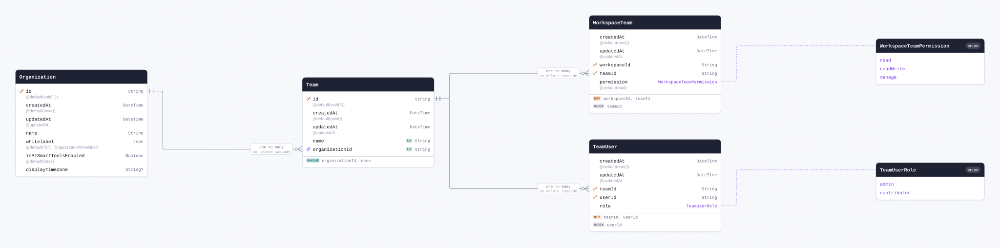

| Field                      | Type       | Constraints                                       | Default      | Description |
| -------------------------- | ---------- | ------------------------------------------------- | ------------ | ----------- |
| `id`                       | `String`   | PK NOT NULL                                       | `cuid(1)`    |             |
| `createdAt` (`created_at`) | `DateTime` | NOT NULL                                          | `now()`      |             |
| `updatedAt` (`updated_at`) | `DateTime` | NOT NULL                                          | `@updatedAt` |             |
| `name`                     | `String`   | NOT NULL                                          |              |             |
| `organizationId`           | `String`   | NOT NULL → [Organization.id](#model-Organization) |              |             |

#### Indexes

- `@@unique([organizationId, name])`

#### References

- `organizationId` → [Organization.id](#model-Organization) (many-to-one, on delete Cascade)

#### Referenced by

- `id` ← [TeamUser.teamId](#model-TeamUser) (one-to-many, on delete Cascade)
- `id` ← [WorkspaceTeam.teamId](#model-WorkspaceTeam) (one-to-many, on delete Cascade)

#### Definition

```sql
CREATE TABLE "Team" (
    "id" TEXT NOT NULL,
    "created_at" TIMESTAMP(3) NOT NULL DEFAULT CURRENT_TIMESTAMP,
    "updated_at" TIMESTAMP(3) NOT NULL,
    "name" TEXT NOT NULL,
    "organizationId" TEXT NOT NULL,

    CONSTRAINT "Team_pkey" PRIMARY KEY ("id")
);

CREATE UNIQUE INDEX "Team_organizationId_name_key" ON "Team"("organizationId", "name");

ALTER TABLE "Team" ADD CONSTRAINT "Team_organizationId_fkey" FOREIGN KEY ("organizationId") REFERENCES "Organization"("id") ON DELETE CASCADE ON UPDATE CASCADE;
```

<details>
<summary>Queries and their SQL</summary>

**findMany**: Every row

```ts
await prisma.team.findMany();
```

```sql
SELECT
  "public"."Team"."id",
  "public"."Team"."created_at",
  "public"."Team"."updated_at",
  "public"."Team"."name",
  "public"."Team"."organizationId"
FROM
  "public"."Team"
WHERE
  1 = 1
OFFSET
  $1
-- params: ["0"]
```

**count**: How many rows there are

```ts
await prisma.team.count();
```

```sql
SELECT
  COUNT(*) AS "_count$_all"
FROM
  (
    SELECT
      "public"."Team"."id"
    FROM
      "public"."Team"
    WHERE
      1 = 1
    OFFSET
      $1
  ) AS "sub"
-- params: ["0"]
```

**findMany**: Every row with its relations

```ts
await prisma.team.findMany({
  include: { organization: true, teamUsers: true, workspaceTeams: true },
});
```

```sql
SELECT
  "public"."Team"."id",
  "public"."Team"."created_at",
  "public"."Team"."updated_at",
  "public"."Team"."name",
  "public"."Team"."organizationId"
FROM
  "public"."Team"
WHERE
  1 = 1
OFFSET
  $1
-- params: ["0"]

SELECT
  "public"."Organization"."id",
  "public"."Organization"."created_at",
  "public"."Organization"."updated_at",
  "public"."Organization"."name",
  "public"."Organization"."whitelabel",
  "public"."Organization"."isAISmartToolsEnabled",
  "public"."Organization"."displayTimeZone"
FROM
  "public"."Organization"
WHERE
  "public"."Organization"."id" IN ($1)
OFFSET
  $2
-- params: ["<organizationId of the rows above>","0"]

SELECT
  "public"."TeamUser"."teamId",
  "public"."TeamUser"."userId",
  "public"."TeamUser"."created_at",
  "public"."TeamUser"."updated_at",
  "public"."TeamUser"."role"::text
FROM
  "public"."TeamUser"
WHERE
  "public"."TeamUser"."teamId" IN ($1)
OFFSET
  $2
-- params: ["<id of the rows above>","0"]

SELECT
  "public"."WorkspaceTeam"."workspaceId",
  "public"."WorkspaceTeam"."teamId",
  "public"."WorkspaceTeam"."created_at",
  "public"."WorkspaceTeam"."updated_at",
  "public"."WorkspaceTeam"."permission"::text
FROM
  "public"."WorkspaceTeam"
WHERE
  "public"."WorkspaceTeam"."teamId" IN ($1)
OFFSET
  $2
-- params: ["<id of the rows above>","0"]
```

**findUnique**: One row by what is unique to it

```ts
await prisma.team.findUnique({ where: { id: "example" } });
```

```sql
SELECT
  "public"."Team"."id",
  "public"."Team"."created_at",
  "public"."Team"."updated_at",
  "public"."Team"."name",
  "public"."Team"."organizationId"
FROM
  "public"."Team"
WHERE
  (
    "public"."Team"."id" = $1
    AND 1 = 1
  )
LIMIT
  $2
OFFSET
  $3
-- params: ["example","1","0"]
```

**create**: Create a row

```ts
await prisma.team.create({ data: { name: "example", organizationId: "example" } });
```

```sql
INSERT INTO
  "public"."Team" (
    "id",
    "created_at",
    "updated_at",
    "name",
    "organizationId"
  )
VALUES
  ($1, $2, $3, $4, $5)
RETURNING
  "public"."Team"."id",
  "public"."Team"."created_at",
  "public"."Team"."updated_at",
  "public"."Team"."name",
  "public"."Team"."organizationId"
-- params: ["<cuid(1)>","<now()>","<now()>","example","example"]
```

**update**: Update a row

```ts
await prisma.team.update({
  where: { id: "example" },
  data: { createdAt: new Date("2026-01-01T00:00:00.000Z") },
});
```

```sql
UPDATE "public"."Team"
SET
  "created_at" = $1,
  "updated_at" = $2
WHERE
  (
    "public"."Team"."id" = $3
    AND 1 = 1
  )
RETURNING
  "public"."Team"."id",
  "public"."Team"."created_at",
  "public"."Team"."updated_at",
  "public"."Team"."name",
  "public"."Team"."organizationId"
-- params: ["2026-01-01T00:00:00.000Z",{"prisma__type":"generatorCall","prisma__value":{"name":"now","args":[],"returnType":{"type":"DateTime"}}},"example"]
```

**delete**: Delete a row

```ts
await prisma.team.delete({ where: { id: "example" } });
```

```sql
DELETE FROM "public"."Team"
WHERE
  (
    "public"."Team"."id" = $1
    AND 1 = 1
  )
RETURNING
  "public"."Team"."id",
  "public"."Team"."created_at",
  "public"."Team"."updated_at",
  "public"."Team"."name",
  "public"."Team"."organizationId"
-- params: ["example"]
```

</details>

<a id="model-TeamUser"></a>

### TeamUser

Links users to teams with specific roles.
Manages team membership and permissions.

@property team - The associated team
@property user - The team member
@property role - User's role within the team

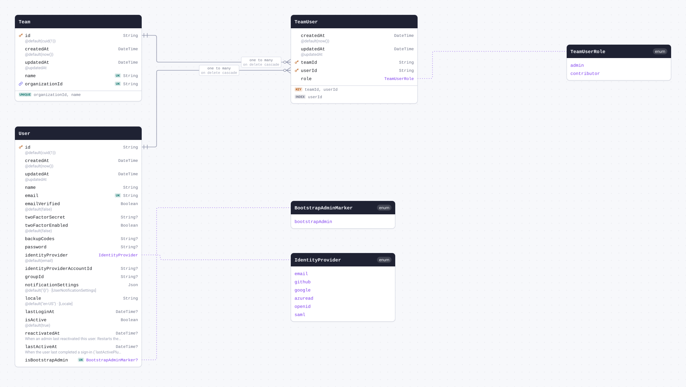

| Field                      | Type                                 | Constraints                          | Default      | Description |
| -------------------------- | ------------------------------------ | ------------------------------------ | ------------ | ----------- |
| `createdAt` (`created_at`) | `DateTime`                           | NOT NULL                             | `now()`      |             |
| `updatedAt` (`updated_at`) | `DateTime`                           | NOT NULL                             | `@updatedAt` |             |
| `teamId`                   | `String`                             | PK NOT NULL → [Team.id](#model-Team) |              |             |
| `userId`                   | `String`                             | PK NOT NULL → [User.id](#model-User) |              |             |
| `role`                     | [`TeamUserRole`](#enum-TeamUserRole) | NOT NULL                             |              |             |

#### Indexes

- `@@id([teamId, userId])`
- `@@index([userId])`

#### References

- `teamId` → [Team.id](#model-Team) (many-to-one, on delete Cascade)
- `userId` → [User.id](#model-User) (many-to-one, on delete Cascade)

#### Definition

```sql
CREATE TABLE "TeamUser" (
    "created_at" TIMESTAMP(3) NOT NULL DEFAULT CURRENT_TIMESTAMP,
    "updated_at" TIMESTAMP(3) NOT NULL,
    "teamId" TEXT NOT NULL,
    "userId" TEXT NOT NULL,
    "role" "TeamUserRole" NOT NULL,

    CONSTRAINT "TeamUser_pkey" PRIMARY KEY ("teamId","userId")
);

CREATE INDEX "TeamUser_userId_idx" ON "TeamUser"("userId");

ALTER TABLE "TeamUser" ADD CONSTRAINT "TeamUser_teamId_fkey" FOREIGN KEY ("teamId") REFERENCES "Team"("id") ON DELETE CASCADE ON UPDATE CASCADE;

ALTER TABLE "TeamUser" ADD CONSTRAINT "TeamUser_userId_fkey" FOREIGN KEY ("userId") REFERENCES "User"("id") ON DELETE CASCADE ON UPDATE CASCADE;
```

<details>
<summary>Queries and their SQL</summary>

**findMany**: Every row

```ts
await prisma.teamUser.findMany();
```

```sql
SELECT
  "public"."TeamUser"."teamId",
  "public"."TeamUser"."userId",
  "public"."TeamUser"."created_at",
  "public"."TeamUser"."updated_at",
  "public"."TeamUser"."role"::text
FROM
  "public"."TeamUser"
WHERE
  1 = 1
OFFSET
  $1
-- params: ["0"]
```

**count**: How many rows there are

```ts
await prisma.teamUser.count();
```

```sql
SELECT
  COUNT(*) AS "_count$_all"
FROM
  (
    SELECT
      "public"."TeamUser"."teamId",
      "public"."TeamUser"."userId"
    FROM
      "public"."TeamUser"
    WHERE
      1 = 1
    OFFSET
      $1
  ) AS "sub"
-- params: ["0"]
```

**findMany**: Every row with its relations

```ts
await prisma.teamUser.findMany({ include: { team: true, user: true } });
```

```sql
SELECT
  "public"."TeamUser"."teamId",
  "public"."TeamUser"."userId",
  "public"."TeamUser"."created_at",
  "public"."TeamUser"."updated_at",
  "public"."TeamUser"."role"::text
FROM
  "public"."TeamUser"
WHERE
  1 = 1
OFFSET
  $1
-- params: ["0"]

SELECT
  "public"."Team"."id",
  "public"."Team"."created_at",
  "public"."Team"."updated_at",
  "public"."Team"."name",
  "public"."Team"."organizationId"
FROM
  "public"."Team"
WHERE
  "public"."Team"."id" IN ($1)
OFFSET
  $2
-- params: ["<teamId of the rows above>","0"]

SELECT
  "public"."User"."id",
  "public"."User"."created_at",
  "public"."User"."updated_at",
  "public"."User"."name",
  "public"."User"."email",
  "public"."User"."email_verified",
  "public"."User"."twoFactorSecret",
  "public"."User"."twoFactorEnabled",
  "public"."User"."backupCodes",
  "public"."User"."password",
  "public"."User"."identityProvider"::text,
  "public"."User"."identityProviderAccountId",
  "public"."User"."groupId",
  "public"."User"."notificationSettings",
  "public"."User"."locale",
  "public"."User"."lastLoginAt",
  "public"."User"."isActive",
  "public"."User"."reactivatedAt",
  "public"."User"."lastActiveAt",
  "public"."User"."isBootstrapAdmin"::text
FROM
  "public"."User"
WHERE
  "public"."User"."id" IN ($1)
OFFSET
  $2
-- params: ["<userId of the rows above>","0"]
```

**findUnique**: One row by what is unique to it

```ts
await prisma.teamUser.findUnique({
  where: { teamId_userId: { teamId: "example", userId: "example" } },
});
```

```sql
SELECT
  "public"."TeamUser"."teamId",
  "public"."TeamUser"."userId",
  "public"."TeamUser"."created_at",
  "public"."TeamUser"."updated_at",
  "public"."TeamUser"."role"::text
FROM
  "public"."TeamUser"
WHERE
  (
    (
      "public"."TeamUser"."teamId" = $1
      AND "public"."TeamUser"."userId" = $2
    )
    AND 1 = 1
  )
LIMIT
  $3
OFFSET
  $4
-- params: ["example","example","1","0"]
```

**create**: Create a row

```ts
await prisma.teamUser.create({ data: { teamId: "example", userId: "example", role: "admin" } });
```

```sql
INSERT INTO
  "public"."TeamUser" (
    "created_at",
    "updated_at",
    "teamId",
    "userId",
    "role"
  )
VALUES
  (
    $1,
    $2,
    $3,
    $4,
    CAST($5::text AS "public"."TeamUserRole")
  )
RETURNING
  "public"."TeamUser"."teamId",
  "public"."TeamUser"."userId",
  "public"."TeamUser"."created_at",
  "public"."TeamUser"."updated_at",
  "public"."TeamUser"."role"::text
-- params: ["<now()>","<now()>","example","example","admin"]
```

**update**: Update a row

```ts
await prisma.teamUser.update({
  where: { teamId_userId: { teamId: "example", userId: "example" } },
  data: { createdAt: new Date("2026-01-01T00:00:00.000Z") },
});
```

```sql
UPDATE "public"."TeamUser"
SET
  "created_at" = $1,
  "updated_at" = $2
WHERE
  (
    (
      "public"."TeamUser"."teamId" = $3
      AND "public"."TeamUser"."userId" = $4
    )
    AND 1 = 1
  )
RETURNING
  "public"."TeamUser"."teamId",
  "public"."TeamUser"."userId",
  "public"."TeamUser"."created_at",
  "public"."TeamUser"."updated_at",
  "public"."TeamUser"."role"::text
-- params: ["2026-01-01T00:00:00.000Z",{"prisma__type":"generatorCall","prisma__value":{"name":"now","args":[],"returnType":{"type":"DateTime"}}},"example","example"]
```

**delete**: Delete a row

```ts
await prisma.teamUser.delete({
  where: { teamId_userId: { teamId: "example", userId: "example" } },
});
```

```sql
DELETE FROM "public"."TeamUser"
WHERE
  (
    (
      "public"."TeamUser"."teamId" = $1
      AND "public"."TeamUser"."userId" = $2
    )
    AND 1 = 1
  )
RETURNING
  "public"."TeamUser"."teamId",
  "public"."TeamUser"."userId",
  "public"."TeamUser"."created_at",
  "public"."TeamUser"."updated_at",
  "public"."TeamUser"."role"::text
-- params: ["example","example"]
```

</details>

<a id="model-WorkspaceTeam"></a>

### WorkspaceTeam

Defines team access to specific workspaces.
Manages workspace-level permissions for teams.

@property workspace - The accessed workspace
@property team - The team receiving access
@property permission - Level of access granted

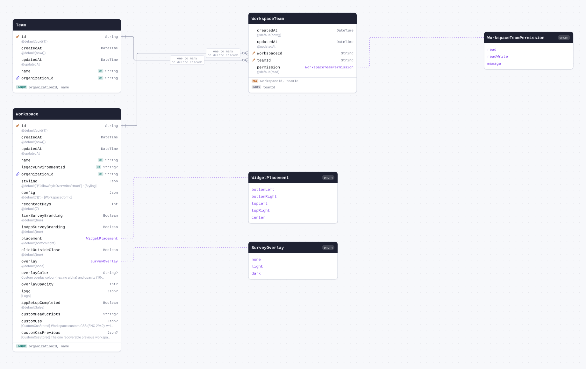

| Field                      | Type                                                       | Constraints                                    | Default      | Description |
| -------------------------- | ---------------------------------------------------------- | ---------------------------------------------- | ------------ | ----------- |
| `createdAt` (`created_at`) | `DateTime`                                                 | NOT NULL                                       | `now()`      |             |
| `updatedAt` (`updated_at`) | `DateTime`                                                 | NOT NULL                                       | `@updatedAt` |             |
| `workspaceId`              | `String`                                                   | PK NOT NULL → [Workspace.id](#model-Workspace) |              |             |
| `teamId`                   | `String`                                                   | PK NOT NULL → [Team.id](#model-Team)           |              |             |
| `permission`               | [`WorkspaceTeamPermission`](#enum-WorkspaceTeamPermission) | NOT NULL                                       | `read`       |             |

#### Indexes

- `@@id([workspaceId, teamId])`
- `@@index([teamId])`

#### References

- `workspaceId` → [Workspace.id](#model-Workspace) (many-to-one, on delete Cascade)
- `teamId` → [Team.id](#model-Team) (many-to-one, on delete Cascade)

#### Definition

```sql
CREATE TABLE "WorkspaceTeam" (
    "created_at" TIMESTAMP(3) NOT NULL DEFAULT CURRENT_TIMESTAMP,
    "updated_at" TIMESTAMP(3) NOT NULL,
    "workspaceId" TEXT NOT NULL,
    "teamId" TEXT NOT NULL,
    "permission" "WorkspaceTeamPermission" NOT NULL DEFAULT 'read',

    CONSTRAINT "WorkspaceTeam_pkey" PRIMARY KEY ("workspaceId","teamId")
);

CREATE INDEX "WorkspaceTeam_teamId_idx" ON "WorkspaceTeam"("teamId");

ALTER TABLE "WorkspaceTeam" ADD CONSTRAINT "WorkspaceTeam_workspaceId_fkey" FOREIGN KEY ("workspaceId") REFERENCES "Workspace"("id") ON DELETE CASCADE ON UPDATE CASCADE;

ALTER TABLE "WorkspaceTeam" ADD CONSTRAINT "WorkspaceTeam_teamId_fkey" FOREIGN KEY ("teamId") REFERENCES "Team"("id") ON DELETE CASCADE ON UPDATE CASCADE;
```

<details>
<summary>Queries and their SQL</summary>

**findMany**: Every row

```ts
await prisma.workspaceTeam.findMany();
```

```sql
SELECT
  "public"."WorkspaceTeam"."workspaceId",
  "public"."WorkspaceTeam"."teamId",
  "public"."WorkspaceTeam"."created_at",
  "public"."WorkspaceTeam"."updated_at",
  "public"."WorkspaceTeam"."permission"::text
FROM
  "public"."WorkspaceTeam"
WHERE
  1 = 1
OFFSET
  $1
-- params: ["0"]
```

**count**: How many rows there are

```ts
await prisma.workspaceTeam.count();
```

```sql
SELECT
  COUNT(*) AS "_count$_all"
FROM
  (
    SELECT
      "public"."WorkspaceTeam"."workspaceId",
      "public"."WorkspaceTeam"."teamId"
    FROM
      "public"."WorkspaceTeam"
    WHERE
      1 = 1
    OFFSET
      $1
  ) AS "sub"
-- params: ["0"]
```

**findMany**: Every row with its relations

```ts
await prisma.workspaceTeam.findMany({ include: { workspace: true, team: true } });
```

```sql
SELECT
  "public"."WorkspaceTeam"."workspaceId",
  "public"."WorkspaceTeam"."teamId",
  "public"."WorkspaceTeam"."created_at",
  "public"."WorkspaceTeam"."updated_at",
  "public"."WorkspaceTeam"."permission"::text
FROM
  "public"."WorkspaceTeam"
WHERE
  1 = 1
OFFSET
  $1
-- params: ["0"]

SELECT
  "public"."Workspace"."id",
  "public"."Workspace"."created_at",
  "public"."Workspace"."updated_at",
  "public"."Workspace"."name",
  "public"."Workspace"."legacyEnvironmentId",
  "public"."Workspace"."organizationId",
  "public"."Workspace"."styling",
  "public"."Workspace"."config",
  "public"."Workspace"."recontactDays",
  "public"."Workspace"."linkSurveyBranding",
  "public"."Workspace"."inAppSurveyBranding",
  "public"."Workspace"."placement"::text,
  "public"."Workspace"."clickOutsideClose",
  "public"."Workspace"."overlay"::text,
  "public"."Workspace"."overlayColor",
  "public"."Workspace"."overlayOpacity",
  "public"."Workspace"."logo",
  "public"."Workspace"."appSetupCompleted",
  "public"."Workspace"."customHeadScripts",
  "public"."Workspace"."customCss",
  "public"."Workspace"."customCssPrevious"
FROM
  "public"."Workspace"
WHERE
  "public"."Workspace"."id" IN ($1)
OFFSET
  $2
-- params: ["<workspaceId of the rows above>","0"]

SELECT
  "public"."Team"."id",
  "public"."Team"."created_at",
  "public"."Team"."updated_at",
  "public"."Team"."name",
  "public"."Team"."organizationId"
FROM
  "public"."Team"
WHERE
  "public"."Team"."id" IN ($1)
OFFSET
  $2
-- params: ["<teamId of the rows above>","0"]
```

**findUnique**: One row by what is unique to it

```ts
await prisma.workspaceTeam.findUnique({
  where: { workspaceId_teamId: { workspaceId: "example", teamId: "example" } },
});
```

```sql
SELECT
  "public"."WorkspaceTeam"."workspaceId",
  "public"."WorkspaceTeam"."teamId",
  "public"."WorkspaceTeam"."created_at",
  "public"."WorkspaceTeam"."updated_at",
  "public"."WorkspaceTeam"."permission"::text
FROM
  "public"."WorkspaceTeam"
WHERE
  (
    (
      "public"."WorkspaceTeam"."workspaceId" = $1
      AND "public"."WorkspaceTeam"."teamId" = $2
    )
    AND 1 = 1
  )
LIMIT
  $3
OFFSET
  $4
-- params: ["example","example","1","0"]
```

**create**: Create a row

```ts
await prisma.workspaceTeam.create({ data: { workspaceId: "example", teamId: "example" } });
```

```sql
INSERT INTO
  "public"."WorkspaceTeam" (
    "created_at",
    "updated_at",
    "workspaceId",
    "teamId",
    "permission"
  )
VALUES
  (
    $1,
    $2,
    $3,
    $4,
    CAST($5::text AS "public"."WorkspaceTeamPermission")
  )
RETURNING
  "public"."WorkspaceTeam"."workspaceId",
  "public"."WorkspaceTeam"."teamId",
  "public"."WorkspaceTeam"."created_at",
  "public"."WorkspaceTeam"."updated_at",
  "public"."WorkspaceTeam"."permission"::text
-- params: ["<now()>","<now()>","example","example","read"]
```

**update**: Update a row

```ts
await prisma.workspaceTeam.update({
  where: { workspaceId_teamId: { workspaceId: "example", teamId: "example" } },
  data: { createdAt: new Date("2026-01-01T00:00:00.000Z") },
});
```

```sql
UPDATE "public"."WorkspaceTeam"
SET
  "created_at" = $1,
  "updated_at" = $2
WHERE
  (
    (
      "public"."WorkspaceTeam"."workspaceId" = $3
      AND "public"."WorkspaceTeam"."teamId" = $4
    )
    AND 1 = 1
  )
RETURNING
  "public"."WorkspaceTeam"."workspaceId",
  "public"."WorkspaceTeam"."teamId",
  "public"."WorkspaceTeam"."created_at",
  "public"."WorkspaceTeam"."updated_at",
  "public"."WorkspaceTeam"."permission"::text
-- params: ["2026-01-01T00:00:00.000Z",{"prisma__type":"generatorCall","prisma__value":{"name":"now","args":[],"returnType":{"type":"DateTime"}}},"example","example"]
```

**delete**: Delete a row

```ts
await prisma.workspaceTeam.delete({
  where: { workspaceId_teamId: { workspaceId: "example", teamId: "example" } },
});
```

```sql
DELETE FROM "public"."WorkspaceTeam"
WHERE
  (
    (
      "public"."WorkspaceTeam"."workspaceId" = $1
      AND "public"."WorkspaceTeam"."teamId" = $2
    )
    AND 1 = 1
  )
RETURNING
  "public"."WorkspaceTeam"."workspaceId",
  "public"."WorkspaceTeam"."teamId",
  "public"."WorkspaceTeam"."created_at",
  "public"."WorkspaceTeam"."updated_at",
  "public"."WorkspaceTeam"."permission"::text
-- params: ["example","example"]
```

</details>

<a id="model-Chart"></a>

### Chart

Represents a chart/visualization that can be used in multiple dashboards.
Charts are reusable components that query analytics data.

@property id - Unique identifier for the chart
@property name - Display name of the chart
@property type - Type of visualization (bar, line, pie, etc.)
@property workspace - The workspace this chart belongs to
@property query - Cube.js query configuration (JSON)
@property config - Chart-specific configuration (colors, labels, etc.)
@property createdBy - User who created the chart
@property dashboards - Dashboards that use this chart

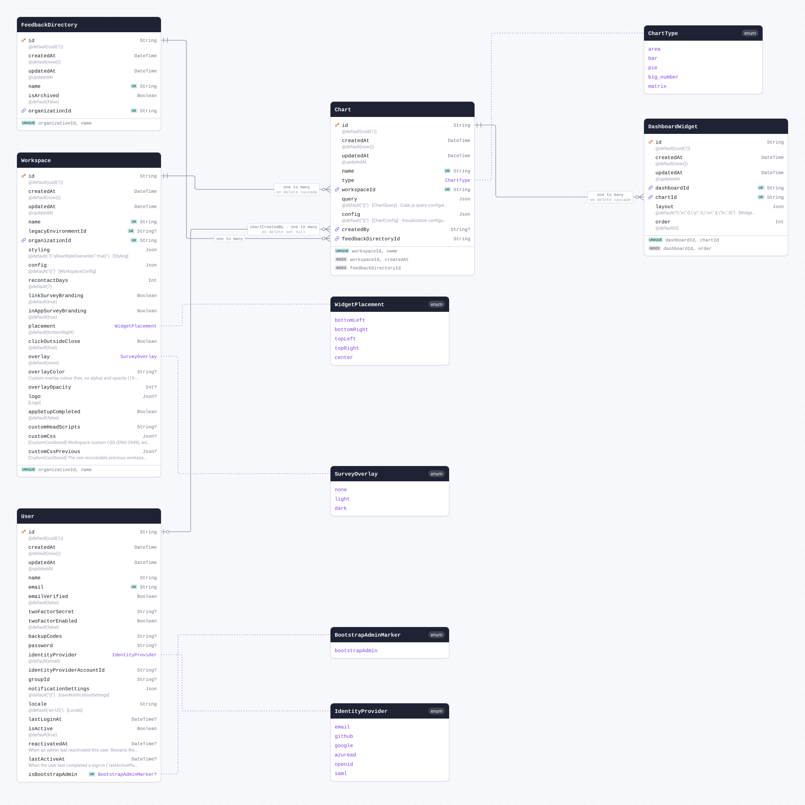

| Field                      | Type                           | Constraints                                                 | Default      | Description                                                              |
| -------------------------- | ------------------------------ | ----------------------------------------------------------- | ------------ | ------------------------------------------------------------------------ |
| `id`                       | `String`                       | PK NOT NULL                                                 | `cuid(1)`    |                                                                          |
| `createdAt` (`created_at`) | `DateTime`                     | NOT NULL                                                    | `now()`      |                                                                          |
| `updatedAt` (`updated_at`) | `DateTime`                     | NOT NULL                                                    | `@updatedAt` |                                                                          |
| `name`                     | `String`                       | NOT NULL                                                    |              |                                                                          |
| `type`                     | [`ChartType`](#enum-ChartType) | NOT NULL                                                    |              |                                                                          |
| `workspaceId`              | `String`                       | NOT NULL → [Workspace.id](#model-Workspace)                 |              |                                                                          |
| `query`                    | `Json`                         | NOT NULL                                                    | `"{}"`       | [ChartQuery] - Cube.js query configuration                               |
| `config`                   | `Json`                         | NOT NULL                                                    | `"{}"`       | [ChartConfig] - Visualization configuration (colors, labels, formatting) |
| `createdBy`                | `String`                       | NULL → [User.id](#model-User)                               |              |                                                                          |
| `feedbackDirectoryId`      | `String`                       | NOT NULL → [FeedbackDirectory.id](#model-FeedbackDirectory) |              |                                                                          |

#### Indexes

- `@@index([workspaceId, createdAt])`
- `@@index([feedbackDirectoryId])`
- `@@unique([workspaceId, name])`

#### References

- `workspaceId` → [Workspace.id](#model-Workspace) (many-to-one, on delete Cascade)
- `createdBy` → [User.id](#model-User) (many-to-one, on delete SetNull)
- `feedbackDirectoryId` → [FeedbackDirectory.id](#model-FeedbackDirectory) (many-to-one)

#### Referenced by

- `id` ← [DashboardWidget.chartId](#model-DashboardWidget) (one-to-many, on delete Cascade)

#### Definition

```sql
CREATE TABLE "Chart" (
    "id" TEXT NOT NULL,
    "created_at" TIMESTAMP(3) NOT NULL DEFAULT CURRENT_TIMESTAMP,
    "updated_at" TIMESTAMP(3) NOT NULL,
    "name" TEXT NOT NULL,
    "type" "ChartType" NOT NULL,
    "workspaceId" TEXT NOT NULL,
    "query" JSONB NOT NULL DEFAULT '{}',
    "config" JSONB NOT NULL DEFAULT '{}',
    "createdBy" TEXT,
    "feedbackDirectoryId" TEXT NOT NULL,

    CONSTRAINT "Chart_pkey" PRIMARY KEY ("id")
);

CREATE INDEX "Chart_workspaceId_created_at_idx" ON "Chart"("workspaceId", "created_at");

CREATE INDEX "Chart_feedbackDirectoryId_idx" ON "Chart"("feedbackDirectoryId");

CREATE UNIQUE INDEX "Chart_workspaceId_name_key" ON "Chart"("workspaceId", "name");

ALTER TABLE "Chart" ADD CONSTRAINT "Chart_workspaceId_fkey" FOREIGN KEY ("workspaceId") REFERENCES "Workspace"("id") ON DELETE CASCADE ON UPDATE CASCADE;

ALTER TABLE "Chart" ADD CONSTRAINT "Chart_createdBy_fkey" FOREIGN KEY ("createdBy") REFERENCES "User"("id") ON DELETE SET NULL ON UPDATE CASCADE;

ALTER TABLE "Chart" ADD CONSTRAINT "Chart_feedbackDirectoryId_fkey" FOREIGN KEY ("feedbackDirectoryId") REFERENCES "FeedbackDirectory"("id") ON DELETE RESTRICT ON UPDATE CASCADE;
```

<details>
<summary>Queries and their SQL</summary>

**findMany**: Every row

```ts
await prisma.chart.findMany();
```

```sql
SELECT
  "public"."Chart"."id",
  "public"."Chart"."created_at",
  "public"."Chart"."updated_at",
  "public"."Chart"."name",
  "public"."Chart"."type"::text,
  "public"."Chart"."workspaceId",
  "public"."Chart"."query",
  "public"."Chart"."config",
  "public"."Chart"."createdBy",
  "public"."Chart"."feedbackDirectoryId"
FROM
  "public"."Chart"
WHERE
  1 = 1
OFFSET
  $1
-- params: ["0"]
```

**count**: How many rows there are

```ts
await prisma.chart.count();
```

```sql
SELECT
  COUNT(*) AS "_count$_all"
FROM
  (
    SELECT
      "public"."Chart"."id"
    FROM
      "public"."Chart"
    WHERE
      1 = 1
    OFFSET
      $1
  ) AS "sub"
-- params: ["0"]
```

**findMany**: Every row with its relations

```ts
await prisma.chart.findMany({
  include: { workspace: true, creator: true, feedbackDirectory: true, widgets: true },
});
```

```sql
SELECT
  "public"."Chart"."id",
  "public"."Chart"."created_at",
  "public"."Chart"."updated_at",
  "public"."Chart"."name",
  "public"."Chart"."type"::text,
  "public"."Chart"."workspaceId",
  "public"."Chart"."query",
  "public"."Chart"."config",
  "public"."Chart"."createdBy",
  "public"."Chart"."feedbackDirectoryId"
FROM
  "public"."Chart"
WHERE
  1 = 1
OFFSET
  $1
-- params: ["0"]

SELECT
  "public"."Workspace"."id",
  "public"."Workspace"."created_at",
  "public"."Workspace"."updated_at",
  "public"."Workspace"."name",
  "public"."Workspace"."legacyEnvironmentId",
  "public"."Workspace"."organizationId",
  "public"."Workspace"."styling",
  "public"."Workspace"."config",
  "public"."Workspace"."recontactDays",
  "public"."Workspace"."linkSurveyBranding",
  "public"."Workspace"."inAppSurveyBranding",
  "public"."Workspace"."placement"::text,
  "public"."Workspace"."clickOutsideClose",
  "public"."Workspace"."overlay"::text,
  "public"."Workspace"."overlayColor",
  "public"."Workspace"."overlayOpacity",
  "public"."Workspace"."logo",
  "public"."Workspace"."appSetupCompleted",
  "public"."Workspace"."customHeadScripts",
  "public"."Workspace"."customCss",
  "public"."Workspace"."customCssPrevious"
FROM
  "public"."Workspace"
WHERE
  "public"."Workspace"."id" IN ($1)
OFFSET
  $2
-- params: ["<workspaceId of the rows above>","0"]

SELECT
  "public"."User"."id",
  "public"."User"."created_at",
  "public"."User"."updated_at",
  "public"."User"."name",
  "public"."User"."email",
  "public"."User"."email_verified",
  "public"."User"."twoFactorSecret",
  "public"."User"."twoFactorEnabled",
  "public"."User"."backupCodes",
  "public"."User"."password",
  "public"."User"."identityProvider"::text,
  "public"."User"."identityProviderAccountId",
  "public"."User"."groupId",
  "public"."User"."notificationSettings",
  "public"."User"."locale",
  "public"."User"."lastLoginAt",
  "public"."User"."isActive",
  "public"."User"."reactivatedAt",
  "public"."User"."lastActiveAt",
  "public"."User"."isBootstrapAdmin"::text
FROM
  "public"."User"
WHERE
  "public"."User"."id" IN ($1)
OFFSET
  $2
-- params: ["<createdBy of the rows above>","0"]

SELECT
  "public"."FeedbackDirectory"."id",
  "public"."FeedbackDirectory"."created_at",
  "public"."FeedbackDirectory"."updated_at",
  "public"."FeedbackDirectory"."name",
  "public"."FeedbackDirectory"."isArchived",
  "public"."FeedbackDirectory"."organizationId"
FROM
  "public"."FeedbackDirectory"
WHERE
  "public"."FeedbackDirectory"."id" IN ($1)
OFFSET
  $2
-- params: ["<feedbackDirectoryId of the rows above>","0"]

SELECT
  "public"."DashboardWidget"."id",
  "public"."DashboardWidget"."created_at",
  "public"."DashboardWidget"."updated_at",
  "public"."DashboardWidget"."dashboardId",
  "public"."DashboardWidget"."chartId",
  "public"."DashboardWidget"."layout",
  "public"."DashboardWidget"."order"
FROM
  "public"."DashboardWidget"
WHERE
  "public"."DashboardWidget"."chartId" IN ($1)
OFFSET
  $2
-- params: ["<id of the rows above>","0"]
```

**findUnique**: One row by what is unique to it

```ts
await prisma.chart.findUnique({ where: { id: "example" } });
```

```sql
SELECT
  "public"."Chart"."id",
  "public"."Chart"."created_at",
  "public"."Chart"."updated_at",
  "public"."Chart"."name",
  "public"."Chart"."type"::text,
  "public"."Chart"."workspaceId",
  "public"."Chart"."query",
  "public"."Chart"."config",
  "public"."Chart"."createdBy",
  "public"."Chart"."feedbackDirectoryId"
FROM
  "public"."Chart"
WHERE
  (
    "public"."Chart"."id" = $1
    AND 1 = 1
  )
LIMIT
  $2
OFFSET
  $3
-- params: ["example","1","0"]
```

**create**: Create a row

```ts
await prisma.chart.create({
  data: { name: "example", type: "area", workspaceId: "example", feedbackDirectoryId: "example" },
});
```

```sql
INSERT INTO
  "public"."Chart" (
    "id",
    "created_at",
    "updated_at",
    "name",
    "type",
    "workspaceId",
    "query",
    "config",
    "feedbackDirectoryId"
  )
VALUES
  (
    $1,
    $2,
    $3,
    $4,
    CAST($5::text AS "public"."ChartType"),
    $6,
    $7,
    $8,
    $9
  )
RETURNING
  "public"."Chart"."id",
  "public"."Chart"."created_at",
  "public"."Chart"."updated_at",
  "public"."Chart"."name",
  "public"."Chart"."type"::text,
  "public"."Chart"."workspaceId",
  "public"."Chart"."query",
  "public"."Chart"."config",
  "public"."Chart"."createdBy",
  "public"."Chart"."feedbackDirectoryId"
-- params: ["<cuid(1)>","<now()>","<now()>","example","area","example","{}","{}","example"]
```

**update**: Update a row

```ts
await prisma.chart.update({
  where: { id: "example" },
  data: { createdAt: new Date("2026-01-01T00:00:00.000Z") },
});
```

```sql
UPDATE "public"."Chart"
SET
  "created_at" = $1,
  "updated_at" = $2
WHERE
  (
    "public"."Chart"."id" = $3
    AND 1 = 1
  )
RETURNING
  "public"."Chart"."id",
  "public"."Chart"."created_at",
  "public"."Chart"."updated_at",
  "public"."Chart"."name",
  "public"."Chart"."type"::text,
  "public"."Chart"."workspaceId",
  "public"."Chart"."query",
  "public"."Chart"."config",
  "public"."Chart"."createdBy",
  "public"."Chart"."feedbackDirectoryId"
-- params: ["2026-01-01T00:00:00.000Z",{"prisma__type":"generatorCall","prisma__value":{"name":"now","args":[],"returnType":{"type":"DateTime"}}},"example"]
```

**delete**: Delete a row

```ts
await prisma.chart.delete({ where: { id: "example" } });
```

```sql
DELETE FROM "public"."Chart"
WHERE
  (
    "public"."Chart"."id" = $1
    AND 1 = 1
  )
RETURNING
  "public"."Chart"."id",
  "public"."Chart"."created_at",
  "public"."Chart"."updated_at",
  "public"."Chart"."name",
  "public"."Chart"."type"::text,
  "public"."Chart"."workspaceId",
  "public"."Chart"."query",
  "public"."Chart"."config",
  "public"."Chart"."createdBy",
  "public"."Chart"."feedbackDirectoryId"
-- params: ["example"]
```

</details>

<a id="model-Dashboard"></a>

### Dashboard

Represents a dashboard containing multiple charts.
Dashboards aggregate analytics insights at the workspace level.

@property id - Unique identifier for the dashboard
@property name - Display name of the dashboard
@property workspace - The workspace this dashboard belongs to
@property widgets - Charts on this dashboard
@property filters - The dashboard filters pinned to its top bar, in order: `{ id, field, operator, label }`,
at most 10 (ADR-0026). Each viewer's picks live in their own browser, not here.
@property createdBy - User who created the dashboard

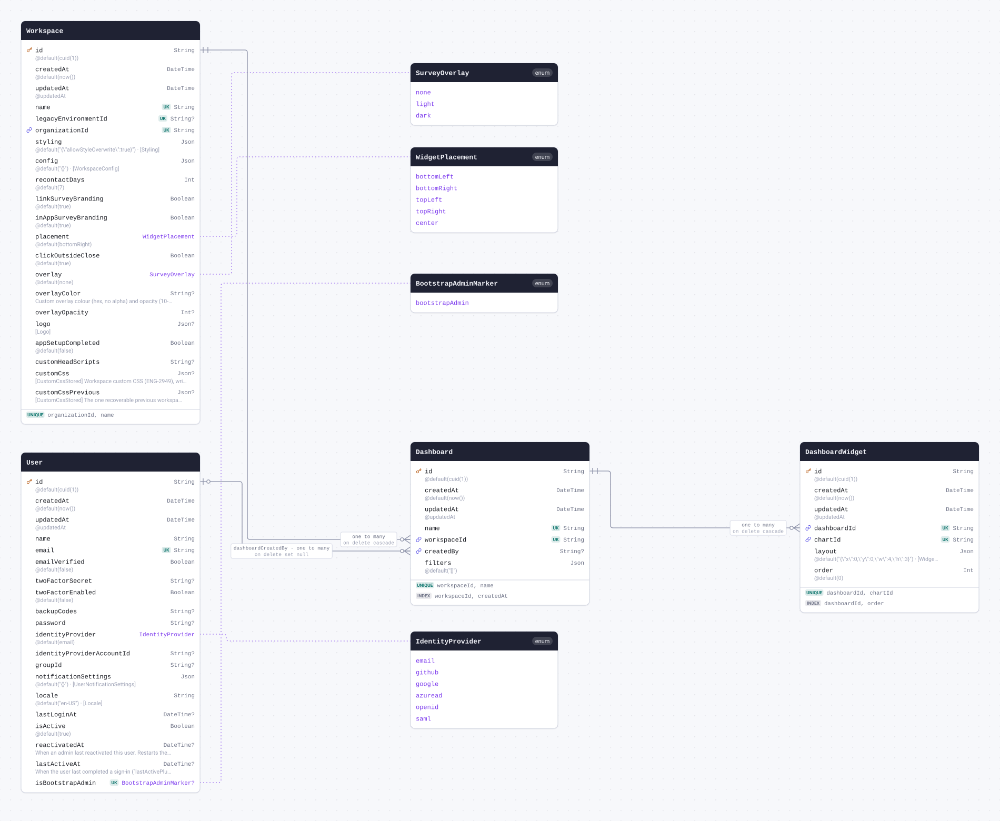

| Field                      | Type       | Constraints                                 | Default      | Description |
| -------------------------- | ---------- | ------------------------------------------- | ------------ | ----------- |
| `id`                       | `String`   | PK NOT NULL                                 | `cuid(1)`    |             |
| `createdAt` (`created_at`) | `DateTime` | NOT NULL                                    | `now()`      |             |
| `updatedAt` (`updated_at`) | `DateTime` | NOT NULL                                    | `@updatedAt` |             |
| `name`                     | `String`   | NOT NULL                                    |              |             |
| `workspaceId`              | `String`   | NOT NULL → [Workspace.id](#model-Workspace) |              |             |
| `createdBy`                | `String`   | NULL → [User.id](#model-User)               |              |             |
| `filters`                  | `Json`     | NOT NULL                                    | `"[]"`       |             |

#### Indexes

- `@@index([workspaceId, createdAt])`
- `@@unique([workspaceId, name])`

#### References

- `workspaceId` → [Workspace.id](#model-Workspace) (many-to-one, on delete Cascade)
- `createdBy` → [User.id](#model-User) (many-to-one, on delete SetNull)

#### Referenced by

- `id` ← [DashboardWidget.dashboardId](#model-DashboardWidget) (one-to-many, on delete Cascade)

#### Definition

```sql
CREATE TABLE "Dashboard" (
    "id" TEXT NOT NULL,
    "created_at" TIMESTAMP(3) NOT NULL DEFAULT CURRENT_TIMESTAMP,
    "updated_at" TIMESTAMP(3) NOT NULL,
    "name" TEXT NOT NULL,
    "workspaceId" TEXT NOT NULL,
    "createdBy" TEXT,
    "filters" JSONB NOT NULL DEFAULT '[]',

    CONSTRAINT "Dashboard_pkey" PRIMARY KEY ("id")
);

CREATE INDEX "Dashboard_workspaceId_created_at_idx" ON "Dashboard"("workspaceId", "created_at");

CREATE UNIQUE INDEX "Dashboard_workspaceId_name_key" ON "Dashboard"("workspaceId", "name");

ALTER TABLE "Dashboard" ADD CONSTRAINT "Dashboard_workspaceId_fkey" FOREIGN KEY ("workspaceId") REFERENCES "Workspace"("id") ON DELETE CASCADE ON UPDATE CASCADE;

ALTER TABLE "Dashboard" ADD CONSTRAINT "Dashboard_createdBy_fkey" FOREIGN KEY ("createdBy") REFERENCES "User"("id") ON DELETE SET NULL ON UPDATE CASCADE;
```

<details>
<summary>Queries and their SQL</summary>

**findMany**: Every row

```ts
await prisma.dashboard.findMany();
```

```sql
SELECT
  "public"."Dashboard"."id",
  "public"."Dashboard"."created_at",
  "public"."Dashboard"."updated_at",
  "public"."Dashboard"."name",
  "public"."Dashboard"."workspaceId",
  "public"."Dashboard"."createdBy",
  "public"."Dashboard"."filters"
FROM
  "public"."Dashboard"
WHERE
  1 = 1
OFFSET
  $1
-- params: ["0"]
```

**count**: How many rows there are

```ts
await prisma.dashboard.count();
```

```sql
SELECT
  COUNT(*) AS "_count$_all"
FROM
  (
    SELECT
      "public"."Dashboard"."id"
    FROM
      "public"."Dashboard"
    WHERE
      1 = 1
    OFFSET
      $1
  ) AS "sub"
-- params: ["0"]
```

**findMany**: Every row with its relations

```ts
await prisma.dashboard.findMany({ include: { workspace: true, creator: true, widgets: true } });
```

```sql
SELECT
  "public"."Dashboard"."id",
  "public"."Dashboard"."created_at",
  "public"."Dashboard"."updated_at",
  "public"."Dashboard"."name",
  "public"."Dashboard"."workspaceId",
  "public"."Dashboard"."createdBy",
  "public"."Dashboard"."filters"
FROM
  "public"."Dashboard"
WHERE
  1 = 1
OFFSET
  $1
-- params: ["0"]

SELECT
  "public"."Workspace"."id",
  "public"."Workspace"."created_at",
  "public"."Workspace"."updated_at",
  "public"."Workspace"."name",
  "public"."Workspace"."legacyEnvironmentId",
  "public"."Workspace"."organizationId",
  "public"."Workspace"."styling",
  "public"."Workspace"."config",
  "public"."Workspace"."recontactDays",
  "public"."Workspace"."linkSurveyBranding",
  "public"."Workspace"."inAppSurveyBranding",
  "public"."Workspace"."placement"::text,
  "public"."Workspace"."clickOutsideClose",
  "public"."Workspace"."overlay"::text,
  "public"."Workspace"."overlayColor",
  "public"."Workspace"."overlayOpacity",
  "public"."Workspace"."logo",
  "public"."Workspace"."appSetupCompleted",
  "public"."Workspace"."customHeadScripts",
  "public"."Workspace"."customCss",
  "public"."Workspace"."customCssPrevious"
FROM
  "public"."Workspace"
WHERE
  "public"."Workspace"."id" IN ($1)
OFFSET
  $2
-- params: ["<workspaceId of the rows above>","0"]

SELECT
  "public"."User"."id",
  "public"."User"."created_at",
  "public"."User"."updated_at",
  "public"."User"."name",
  "public"."User"."email",
  "public"."User"."email_verified",
  "public"."User"."twoFactorSecret",
  "public"."User"."twoFactorEnabled",
  "public"."User"."backupCodes",
  "public"."User"."password",
  "public"."User"."identityProvider"::text,
  "public"."User"."identityProviderAccountId",
  "public"."User"."groupId",
  "public"."User"."notificationSettings",
  "public"."User"."locale",
  "public"."User"."lastLoginAt",
  "public"."User"."isActive",
  "public"."User"."reactivatedAt",
  "public"."User"."lastActiveAt",
  "public"."User"."isBootstrapAdmin"::text
FROM
  "public"."User"
WHERE
  "public"."User"."id" IN ($1)
OFFSET
  $2
-- params: ["<createdBy of the rows above>","0"]

SELECT
  "public"."DashboardWidget"."id",
  "public"."DashboardWidget"."created_at",
  "public"."DashboardWidget"."updated_at",
  "public"."DashboardWidget"."dashboardId",
  "public"."DashboardWidget"."chartId",
  "public"."DashboardWidget"."layout",
  "public"."DashboardWidget"."order"
FROM
  "public"."DashboardWidget"
WHERE
  "public"."DashboardWidget"."dashboardId" IN ($1)
OFFSET
  $2
-- params: ["<id of the rows above>","0"]
```

**findUnique**: One row by what is unique to it

```ts
await prisma.dashboard.findUnique({ where: { id: "example" } });
```

```sql
SELECT
  "public"."Dashboard"."id",
  "public"."Dashboard"."created_at",
  "public"."Dashboard"."updated_at",
  "public"."Dashboard"."name",
  "public"."Dashboard"."workspaceId",
  "public"."Dashboard"."createdBy",
  "public"."Dashboard"."filters"
FROM
  "public"."Dashboard"
WHERE
  (
    "public"."Dashboard"."id" = $1
    AND 1 = 1
  )
LIMIT
  $2
OFFSET
  $3
-- params: ["example","1","0"]
```

**create**: Create a row

```ts
await prisma.dashboard.create({ data: { name: "example", workspaceId: "example" } });
```

```sql
INSERT INTO
  "public"."Dashboard" (
    "id",
    "created_at",
    "updated_at",
    "name",
    "workspaceId",
    "filters"
  )
VALUES
  ($1, $2, $3, $4, $5, $6)
RETURNING
  "public"."Dashboard"."id",
  "public"."Dashboard"."created_at",
  "public"."Dashboard"."updated_at",
  "public"."Dashboard"."name",
  "public"."Dashboard"."workspaceId",
  "public"."Dashboard"."createdBy",
  "public"."Dashboard"."filters"
-- params: ["<cuid(1)>","<now()>","<now()>","example","example","[]"]
```

**update**: Update a row

```ts
await prisma.dashboard.update({
  where: { id: "example" },
  data: { createdAt: new Date("2026-01-01T00:00:00.000Z") },
});
```

```sql
UPDATE "public"."Dashboard"
SET
  "created_at" = $1,
  "updated_at" = $2
WHERE
  (
    "public"."Dashboard"."id" = $3
    AND 1 = 1
  )
RETURNING
  "public"."Dashboard"."id",
  "public"."Dashboard"."created_at",
  "public"."Dashboard"."updated_at",
  "public"."Dashboard"."name",
  "public"."Dashboard"."workspaceId",
  "public"."Dashboard"."createdBy",
  "public"."Dashboard"."filters"
-- params: ["2026-01-01T00:00:00.000Z",{"prisma__type":"generatorCall","prisma__value":{"name":"now","args":[],"returnType":{"type":"DateTime"}}},"example"]
```

**delete**: Delete a row

```ts
await prisma.dashboard.delete({ where: { id: "example" } });
```

```sql
DELETE FROM "public"."Dashboard"
WHERE
  (
    "public"."Dashboard"."id" = $1
    AND 1 = 1
  )
RETURNING
  "public"."Dashboard"."id",
  "public"."Dashboard"."created_at",
  "public"."Dashboard"."updated_at",
  "public"."Dashboard"."name",
  "public"."Dashboard"."workspaceId",
  "public"."Dashboard"."createdBy",
  "public"."Dashboard"."filters"
-- params: ["example"]
```

</details>

<a id="model-DashboardWidget"></a>

### DashboardWidget

Represents a chart widget on a dashboard.
Widgets are positioned using a grid layout system.

@property id - Unique identifier for the widget
@property dashboard - The dashboard this widget belongs to
@property chart - The chart displayed in this widget (chart name is used for display)
@property layout - Grid layout configuration (x, y, width, height)
@property order - Display order within the dashboard


| Field                      | Type       | Constraints                                 | Default                               | Description                                  |
| -------------------------- | ---------- | ------------------------------------------- | ------------------------------------- | -------------------------------------------- |
| `id`                       | `String`   | PK NOT NULL                                 | `cuid(1)`                             |                                              |
| `createdAt` (`created_at`) | `DateTime` | NOT NULL                                    | `now()`                               |                                              |
| `updatedAt` (`updated_at`) | `DateTime` | NOT NULL                                    | `@updatedAt`                          |                                              |
| `dashboardId`              | `String`   | NOT NULL → [Dashboard.id](#model-Dashboard) |                                       |                                              |
| `chartId`                  | `String`   | NOT NULL → [Chart.id](#model-Chart)         |                                       |                                              |
| `layout`                   | `Json`     | NOT NULL                                    | `"{\"x\":0,\"y\":0,\"w\":4,\"h\":3}"` | [WidgetLayout] - Grid layout: { x, y, w, h } |
| `order`                    | `Int`      | NOT NULL                                    | `0`                                   |                                              |

#### Indexes

- `@@index([dashboardId, order])`
- `@@unique([dashboardId, chartId])`

#### References

- `dashboardId` → [Dashboard.id](#model-Dashboard) (many-to-one, on delete Cascade)
- `chartId` → [Chart.id](#model-Chart) (many-to-one, on delete Cascade)

#### Definition

```sql
CREATE TABLE "DashboardWidget" (
    "id" TEXT NOT NULL,
    "created_at" TIMESTAMP(3) NOT NULL DEFAULT CURRENT_TIMESTAMP,
    "updated_at" TIMESTAMP(3) NOT NULL,
    "dashboardId" TEXT NOT NULL,
    "chartId" TEXT NOT NULL,
    "layout" JSONB NOT NULL DEFAULT '{"x":0,"y":0,"w":4,"h":3}',
    "order" INTEGER NOT NULL DEFAULT 0,

    CONSTRAINT "DashboardWidget_pkey" PRIMARY KEY ("id")
);

CREATE INDEX "DashboardWidget_dashboardId_order_idx" ON "DashboardWidget"("dashboardId", "order");

CREATE UNIQUE INDEX "DashboardWidget_dashboardId_chartId_key" ON "DashboardWidget"("dashboardId", "chartId");

ALTER TABLE "DashboardWidget" ADD CONSTRAINT "DashboardWidget_dashboardId_fkey" FOREIGN KEY ("dashboardId") REFERENCES "Dashboard"("id") ON DELETE CASCADE ON UPDATE CASCADE;

ALTER TABLE "DashboardWidget" ADD CONSTRAINT "DashboardWidget_chartId_fkey" FOREIGN KEY ("chartId") REFERENCES "Chart"("id") ON DELETE CASCADE ON UPDATE CASCADE;
```

<details>
<summary>Queries and their SQL</summary>

**findMany**: Every row

```ts
await prisma.dashboardWidget.findMany();
```

```sql
SELECT
  "public"."DashboardWidget"."id",
  "public"."DashboardWidget"."created_at",
  "public"."DashboardWidget"."updated_at",
  "public"."DashboardWidget"."dashboardId",
  "public"."DashboardWidget"."chartId",
  "public"."DashboardWidget"."layout",
  "public"."DashboardWidget"."order"
FROM
  "public"."DashboardWidget"
WHERE
  1 = 1
OFFSET
  $1
-- params: ["0"]
```

**count**: How many rows there are

```ts
await prisma.dashboardWidget.count();
```

```sql
SELECT
  COUNT(*) AS "_count$_all"
FROM
  (
    SELECT
      "public"."DashboardWidget"."id"
    FROM
      "public"."DashboardWidget"
    WHERE
      1 = 1
    OFFSET
      $1
  ) AS "sub"
-- params: ["0"]
```

**findMany**: Every row with its relations

```ts
await prisma.dashboardWidget.findMany({ include: { dashboard: true, chart: true } });
```

```sql
SELECT
  "public"."DashboardWidget"."id",
  "public"."DashboardWidget"."created_at",
  "public"."DashboardWidget"."updated_at",
  "public"."DashboardWidget"."dashboardId",
  "public"."DashboardWidget"."chartId",
  "public"."DashboardWidget"."layout",
  "public"."DashboardWidget"."order"
FROM
  "public"."DashboardWidget"
WHERE
  1 = 1
OFFSET
  $1
-- params: ["0"]

SELECT
  "public"."Dashboard"."id",
  "public"."Dashboard"."created_at",
  "public"."Dashboard"."updated_at",
  "public"."Dashboard"."name",
  "public"."Dashboard"."workspaceId",
  "public"."Dashboard"."createdBy",
  "public"."Dashboard"."filters"
FROM
  "public"."Dashboard"
WHERE
  "public"."Dashboard"."id" IN ($1)
OFFSET
  $2
-- params: ["<dashboardId of the rows above>","0"]

SELECT
  "public"."Chart"."id",
  "public"."Chart"."created_at",
  "public"."Chart"."updated_at",
  "public"."Chart"."name",
  "public"."Chart"."type"::text,
  "public"."Chart"."workspaceId",
  "public"."Chart"."query",
  "public"."Chart"."config",
  "public"."Chart"."createdBy",
  "public"."Chart"."feedbackDirectoryId"
FROM
  "public"."Chart"
WHERE
  "public"."Chart"."id" IN ($1)
OFFSET
  $2
-- params: ["<chartId of the rows above>","0"]
```

**findUnique**: One row by what is unique to it

```ts
await prisma.dashboardWidget.findUnique({ where: { id: "example" } });
```

```sql
SELECT
  "public"."DashboardWidget"."id",
  "public"."DashboardWidget"."created_at",
  "public"."DashboardWidget"."updated_at",
  "public"."DashboardWidget"."dashboardId",
  "public"."DashboardWidget"."chartId",
  "public"."DashboardWidget"."layout",
  "public"."DashboardWidget"."order"
FROM
  "public"."DashboardWidget"
WHERE
  (
    "public"."DashboardWidget"."id" = $1
    AND 1 = 1
  )
LIMIT
  $2
OFFSET
  $3
-- params: ["example","1","0"]
```

**create**: Create a row

```ts
await prisma.dashboardWidget.create({ data: { dashboardId: "example", chartId: "example" } });
```

```sql
INSERT INTO
  "public"."DashboardWidget" (
    "id",
    "created_at",
    "updated_at",
    "dashboardId",
    "chartId",
    "layout",
    "order"
  )
VALUES
  ($1, $2, $3, $4, $5, $6, $7)
RETURNING
  "public"."DashboardWidget"."id",
  "public"."DashboardWidget"."created_at",
  "public"."DashboardWidget"."updated_at",
  "public"."DashboardWidget"."dashboardId",
  "public"."DashboardWidget"."chartId",
  "public"."DashboardWidget"."layout",
  "public"."DashboardWidget"."order"
-- params: ["<cuid(1)>","<now()>","<now()>","example","example","{\"x\":0,\"y\":0,\"w\":4,\"h\":3}","0"]
```

**update**: Update a row

```ts
await prisma.dashboardWidget.update({
  where: { id: "example" },
  data: { createdAt: new Date("2026-01-01T00:00:00.000Z") },
});
```

```sql
UPDATE "public"."DashboardWidget"
SET
  "created_at" = $1,
  "updated_at" = $2
WHERE
  (
    "public"."DashboardWidget"."id" = $3
    AND 1 = 1
  )
RETURNING
  "public"."DashboardWidget"."id",
  "public"."DashboardWidget"."created_at",
  "public"."DashboardWidget"."updated_at",
  "public"."DashboardWidget"."dashboardId",
  "public"."DashboardWidget"."chartId",
  "public"."DashboardWidget"."layout",
  "public"."DashboardWidget"."order"
-- params: ["2026-01-01T00:00:00.000Z",{"prisma__type":"generatorCall","prisma__value":{"name":"now","args":[],"returnType":{"type":"DateTime"}}},"example"]
```

**delete**: Delete a row

```ts
await prisma.dashboardWidget.delete({ where: { id: "example" } });
```

```sql
DELETE FROM "public"."DashboardWidget"
WHERE
  (
    "public"."DashboardWidget"."id" = $1
    AND 1 = 1
  )
RETURNING
  "public"."DashboardWidget"."id",
  "public"."DashboardWidget"."created_at",
  "public"."DashboardWidget"."updated_at",
  "public"."DashboardWidget"."dashboardId",
  "public"."DashboardWidget"."chartId",
  "public"."DashboardWidget"."layout",
  "public"."DashboardWidget"."order"
-- params: ["example"]
```

</details>

<a id="model-DeletionCleanup"></a>

### DeletionCleanup

Work left over after a delete commits (ENG-3612, ENG-3614: deleted means deleted): Hub records and
storage files that can't be removed inside the database transaction. A row is written in the same
transaction as the delete, so a delete that commits always gets its cleanup and one that rolls back
queues nothing. A worker drains it with retries, never giving up, and deletes each row once done.

| Field                      | Type                                               | Constraints | Default      | Description                                                                                              |
| -------------------------- | -------------------------------------------------- | ----------- | ------------ | -------------------------------------------------------------------------------------------------------- |
| `id`                       | `String`                                           | PK NOT NULL | `cuid(2)`    |                                                                                                          |
| `createdAt` (`created_at`) | `DateTime`                                         | NOT NULL    | `now()`      |                                                                                                          |
| `updatedAt` (`updated_at`) | `DateTime`                                         | NOT NULL    | `@updatedAt` |                                                                                                          |
| `kind`                     | [`DeletionCleanupKind`](#enum-DeletionCleanupKind) | NOT NULL    |              |                                                                                                          |
| `organizationId`           | `String`                                           | NOT NULL    |              | Scoping and logs. Not foreign keys: the rows they name are usually gone already.                         |
| `workspaceId`              | `String`                                           | NOT NULL    |              |                                                                                                          |
| `surveyId`                 | `String`                                           | NOT NULL    |              |                                                                                                          |
| `tenantIds`                | `String[]`                                         | NOT NULL    | `[]`         | Hub kinds: the organisation's feedback directories, read inside the delete's transaction.                |
| `responseIds`              | `String[]`                                         | NOT NULL    | `[]`         | `hubResponses`: the deleted responses whose records go. `hubResponseOutcome`: exactly one live response. |
| `fileKeys`                 | `String[]`                                         | NOT NULL    | `[]`         | `storageFiles`: the object keys or URLs to delete.                                                       |
| `attempts`                 | `Int`                                              | NOT NULL    | `0`          |                                                                                                          |
| `nextAttemptAt`            | `DateTime`                                         | NOT NULL    | `now()`      | Not drained before this, so a late pipeline write can't slip in behind a survey's cleanup.               |
| `lastError`                | `String`                                           | NULL        |              | The last failure: a short code and message, never record or file content.                                |

#### Indexes

- `@@index([nextAttemptAt])`
- `@@index([organizationId, createdAt])`

#### Definition

```sql
CREATE TABLE "DeletionCleanup" (
    "id" TEXT NOT NULL,
    "created_at" TIMESTAMP(3) NOT NULL DEFAULT CURRENT_TIMESTAMP,
    "updated_at" TIMESTAMP(3) NOT NULL,
    "kind" "DeletionCleanupKind" NOT NULL,
    "organizationId" TEXT NOT NULL,
    "workspaceId" TEXT NOT NULL,
    "surveyId" TEXT NOT NULL,
    "tenantIds" TEXT[] DEFAULT ARRAY[]::TEXT[],
    "responseIds" TEXT[] DEFAULT ARRAY[]::TEXT[],
    "fileKeys" TEXT[] DEFAULT ARRAY[]::TEXT[],
    "attempts" INTEGER NOT NULL DEFAULT 0,
    "nextAttemptAt" TIMESTAMP(3) NOT NULL DEFAULT CURRENT_TIMESTAMP,
    "lastError" TEXT,

    CONSTRAINT "DeletionCleanup_pkey" PRIMARY KEY ("id")
);

CREATE INDEX "DeletionCleanup_nextAttemptAt_idx" ON "DeletionCleanup"("nextAttemptAt");

CREATE INDEX "DeletionCleanup_organizationId_created_at_idx" ON "DeletionCleanup"("organizationId", "created_at");
```

<details>
<summary>Queries and their SQL</summary>

**findMany**: Every row

```ts
await prisma.deletionCleanup.findMany();
```

```sql
SELECT
  "public"."DeletionCleanup"."id",
  "public"."DeletionCleanup"."created_at",
  "public"."DeletionCleanup"."updated_at",
  "public"."DeletionCleanup"."kind"::text,
  "public"."DeletionCleanup"."organizationId",
  "public"."DeletionCleanup"."workspaceId",
  "public"."DeletionCleanup"."surveyId",
  "public"."DeletionCleanup"."tenantIds",
  "public"."DeletionCleanup"."responseIds",
  "public"."DeletionCleanup"."fileKeys",
  "public"."DeletionCleanup"."attempts",
  "public"."DeletionCleanup"."nextAttemptAt",
  "public"."DeletionCleanup"."lastError"
FROM
  "public"."DeletionCleanup"
WHERE
  1 = 1
OFFSET
  $1
-- params: ["0"]
```

**count**: How many rows there are

```ts
await prisma.deletionCleanup.count();
```

```sql
SELECT
  COUNT(*) AS "_count$_all"
FROM
  (
    SELECT
      "public"."DeletionCleanup"."id"
    FROM
      "public"."DeletionCleanup"
    WHERE
      1 = 1
    OFFSET
      $1
  ) AS "sub"
-- params: ["0"]
```

**findUnique**: One row by what is unique to it

```ts
await prisma.deletionCleanup.findUnique({ where: { id: "example" } });
```

```sql
SELECT
  "public"."DeletionCleanup"."id",
  "public"."DeletionCleanup"."created_at",
  "public"."DeletionCleanup"."updated_at",
  "public"."DeletionCleanup"."kind"::text,
  "public"."DeletionCleanup"."organizationId",
  "public"."DeletionCleanup"."workspaceId",
  "public"."DeletionCleanup"."surveyId",
  "public"."DeletionCleanup"."tenantIds",
  "public"."DeletionCleanup"."responseIds",
  "public"."DeletionCleanup"."fileKeys",
  "public"."DeletionCleanup"."attempts",
  "public"."DeletionCleanup"."nextAttemptAt",
  "public"."DeletionCleanup"."lastError"
FROM
  "public"."DeletionCleanup"
WHERE
  (
    "public"."DeletionCleanup"."id" = $1
    AND 1 = 1
  )
LIMIT
  $2
OFFSET
  $3
-- params: ["example","1","0"]
```

**create**: Create a row

```ts
await prisma.deletionCleanup.create({
  data: {
    kind: "hubSurvey",
    organizationId: "example",
    workspaceId: "example",
    surveyId: "example",
  },
});
```

```sql
INSERT INTO
  "public"."DeletionCleanup" (
    "id",
    "created_at",
    "updated_at",
    "kind",
    "organizationId",
    "workspaceId",
    "surveyId",
    "tenantIds",
    "responseIds",
    "fileKeys",
    "attempts",
    "nextAttemptAt"
  )
VALUES
  (
    $1,
    $2,
    $3,
    CAST($4::text AS "public"."DeletionCleanupKind"),
    $5,
    $6,
    $7,
    $8,
    $9,
    $10,
    $11,
    $12
  )
RETURNING
  "public"."DeletionCleanup"."id",
  "public"."DeletionCleanup"."created_at",
  "public"."DeletionCleanup"."updated_at",
  "public"."DeletionCleanup"."kind"::text,
  "public"."DeletionCleanup"."organizationId",
  "public"."DeletionCleanup"."workspaceId",
  "public"."DeletionCleanup"."surveyId",
  "public"."DeletionCleanup"."tenantIds",
  "public"."DeletionCleanup"."responseIds",
  "public"."DeletionCleanup"."fileKeys",
  "public"."DeletionCleanup"."attempts",
  "public"."DeletionCleanup"."nextAttemptAt",
  "public"."DeletionCleanup"."lastError"
-- params: ["<cuid(2)>","<now()>","<now()>","hubSurvey","example","example","example",[],[],[],"0","<now()>"]
```

**update**: Update a row

```ts
await prisma.deletionCleanup.update({
  where: { id: "example" },
  data: { createdAt: new Date("2026-01-01T00:00:00.000Z") },
});
```

```sql
UPDATE "public"."DeletionCleanup"
SET
  "created_at" = $1,
  "updated_at" = $2
WHERE
  (
    "public"."DeletionCleanup"."id" = $3
    AND 1 = 1
  )
RETURNING
  "public"."DeletionCleanup"."id",
  "public"."DeletionCleanup"."created_at",
  "public"."DeletionCleanup"."updated_at",
  "public"."DeletionCleanup"."kind"::text,
  "public"."DeletionCleanup"."organizationId",
  "public"."DeletionCleanup"."workspaceId",
  "public"."DeletionCleanup"."surveyId",
  "public"."DeletionCleanup"."tenantIds",
  "public"."DeletionCleanup"."responseIds",
  "public"."DeletionCleanup"."fileKeys",
  "public"."DeletionCleanup"."attempts",
  "public"."DeletionCleanup"."nextAttemptAt",
  "public"."DeletionCleanup"."lastError"
-- params: ["2026-01-01T00:00:00.000Z",{"prisma__type":"generatorCall","prisma__value":{"name":"now","args":[],"returnType":{"type":"DateTime"}}},"example"]
```

**delete**: Delete a row

```ts
await prisma.deletionCleanup.delete({ where: { id: "example" } });
```

```sql
DELETE FROM "public"."DeletionCleanup"
WHERE
  (
    "public"."DeletionCleanup"."id" = $1
    AND 1 = 1
  )
RETURNING
  "public"."DeletionCleanup"."id",
  "public"."DeletionCleanup"."created_at",
  "public"."DeletionCleanup"."updated_at",
  "public"."DeletionCleanup"."kind"::text,
  "public"."DeletionCleanup"."organizationId",
  "public"."DeletionCleanup"."workspaceId",
  "public"."DeletionCleanup"."surveyId",
  "public"."DeletionCleanup"."tenantIds",
  "public"."DeletionCleanup"."responseIds",
  "public"."DeletionCleanup"."fileKeys",
  "public"."DeletionCleanup"."attempts",
  "public"."DeletionCleanup"."nextAttemptAt",
  "public"."DeletionCleanup"."lastError"
-- params: ["example"]
```

</details>

<a id="model-AttachmentExport"></a>

### AttachmentExport

A survey's response attachments built into one ZIP in object storage by a background job and
downloaded through a short-lived presigned URL, so an interrupted download can resume (ENG-6862).
Only the requester reads it. The reconcile job deletes the archive at `expiresAt`; deleting the
survey deletes it with the survey's storage prefix.

A partial unique index in the migration allows one queued or running export per requester and
survey, so a double click returns the export already in flight.


| Field                      | Type                                                     | Constraints                                    | Default      | Description                                                                                                                                            |
| -------------------------- | -------------------------------------------------------- | ---------------------------------------------- | ------------ | ------------------------------------------------------------------------------------------------------------------------------------------------------ |
| `id`                       | `String`                                                 | PK NOT NULL                                    | `cuid(2)`    |                                                                                                                                                        |
| `createdAt` (`created_at`) | `DateTime`                                               | NOT NULL                                       | `now()`      |                                                                                                                                                        |
| `updatedAt` (`updated_at`) | `DateTime`                                               | NOT NULL                                       | `@updatedAt` |                                                                                                                                                        |
| `surveyId`                 | `String`                                                 | NOT NULL → [Survey.id](#model-Survey)          |              |                                                                                                                                                        |
| `workspaceId`              | `String`                                                 | NOT NULL → [Survey.workspaceId](#model-Survey) |              |                                                                                                                                                        |
| `requestedById`            | `String`                                                 | NULL → [User.id](#model-User)                  |              |                                                                                                                                                        |
| `status`                   | [`AttachmentExportStatus`](#enum-AttachmentExportStatus) | NOT NULL                                       | `queued`     |                                                                                                                                                        |
| `filterCriteria`           | `Json`                                                   | NULL                                           |              | The response filter at request time, a `TResponseFilterCriteria`; null exports every response.                                                         |
| `timeZone`                 | `String`                                                 | NOT NULL                                       |              | IANA zone the archive's folder names are stamped in: the org's display zone at request time.                                                           |
| `dispatchCount`            | `Int`                                                    | NOT NULL                                       | `0`          | Bumped on every enqueue and part of the job id, so a re-dispatch never dedupes against a job an older pod dropped as unknown during a rolling upgrade. |
| `fileCount`                | `Int`                                                    | NOT NULL                                       |              | The pre-flight's counts, shown while the archive builds.                                                                                               |
| `responseCount`            | `Int`                                                    | NOT NULL                                       |              |                                                                                                                                                        |
| `includedFileCount`        | `Int`                                                    | NULL                                           |              | What the archive actually holds, once built.                                                                                                           |
| `totalBytes`               | `BigInt`                                                 | NULL                                           |              |                                                                                                                                                        |
| `truncated`                | `Boolean`                                                | NOT NULL                                       | `false`      |                                                                                                                                                        |
| `storageKey`               | `String`                                                 | NULL                                           |              |                                                                                                                                                        |
| `errorCode`                | `String`                                                 | NULL                                           |              | A short code (`stale`, `storage_upload_failed`, …), never a message or file name.                                                                      |
| `startedAt`                | `DateTime`                                               | NULL                                           |              |                                                                                                                                                        |
| `finishedAt`               | `DateTime`                                               | NULL                                           |              |                                                                                                                                                        |
| `expiresAt`                | `DateTime`                                               | NULL                                           |              |                                                                                                                                                        |

#### Indexes

- `@@index([surveyId, requestedById, createdAt])`
- `@@index([status, createdAt])`
- `@@index([expiresAt])`
- `@@index([workspaceId])`

#### References

- `surveyId` → [Survey.id](#model-Survey) (many-to-one, on delete Cascade)
- `workspaceId` → [Workspace.id](#model-Workspace) (many-to-one, on delete Cascade)
- `requestedById` → [User.id](#model-User) (many-to-one, on delete SetNull)

#### Definition

```sql
CREATE TABLE "AttachmentExport" (
    "id" TEXT NOT NULL,
    "created_at" TIMESTAMP(3) NOT NULL DEFAULT CURRENT_TIMESTAMP,
    "updated_at" TIMESTAMP(3) NOT NULL,
    "surveyId" TEXT NOT NULL,
    "workspaceId" TEXT NOT NULL,
    "requestedById" TEXT,
    "status" "AttachmentExportStatus" NOT NULL DEFAULT 'queued',
    "filterCriteria" JSONB,
    "timeZone" TEXT NOT NULL,
    "dispatchCount" INTEGER NOT NULL DEFAULT 0,
    "fileCount" INTEGER NOT NULL,
    "responseCount" INTEGER NOT NULL,
    "includedFileCount" INTEGER,
    "totalBytes" BIGINT,
    "truncated" BOOLEAN NOT NULL DEFAULT false,
    "storageKey" TEXT,
    "errorCode" TEXT,
    "startedAt" TIMESTAMP(3),
    "finishedAt" TIMESTAMP(3),
    "expiresAt" TIMESTAMP(3),

    CONSTRAINT "AttachmentExport_pkey" PRIMARY KEY ("id")
);

CREATE INDEX "AttachmentExport_surveyId_requestedById_created_at_idx" ON "AttachmentExport"("surveyId", "requestedById", "created_at");

CREATE INDEX "AttachmentExport_status_created_at_idx" ON "AttachmentExport"("status", "created_at");

CREATE INDEX "AttachmentExport_expiresAt_idx" ON "AttachmentExport"("expiresAt");

CREATE INDEX "AttachmentExport_workspaceId_idx" ON "AttachmentExport"("workspaceId");

ALTER TABLE "AttachmentExport" ADD CONSTRAINT "AttachmentExport_surveyId_workspaceId_fkey" FOREIGN KEY ("surveyId", "workspaceId") REFERENCES "Survey"("id", "workspaceId") ON DELETE CASCADE ON UPDATE CASCADE;

ALTER TABLE "AttachmentExport" ADD CONSTRAINT "AttachmentExport_workspaceId_fkey" FOREIGN KEY ("workspaceId") REFERENCES "Workspace"("id") ON DELETE CASCADE ON UPDATE CASCADE;

ALTER TABLE "AttachmentExport" ADD CONSTRAINT "AttachmentExport_requestedById_fkey" FOREIGN KEY ("requestedById") REFERENCES "User"("id") ON DELETE SET NULL ON UPDATE CASCADE;
```

<details>
<summary>Queries and their SQL</summary>

**findMany**: Every row

```ts
await prisma.attachmentExport.findMany();
```

```sql
SELECT
  "public"."AttachmentExport"."id",
  "public"."AttachmentExport"."created_at",
  "public"."AttachmentExport"."updated_at",
  "public"."AttachmentExport"."surveyId",
  "public"."AttachmentExport"."workspaceId",
  "public"."AttachmentExport"."requestedById",
  "public"."AttachmentExport"."status"::text,
  "public"."AttachmentExport"."filterCriteria",
  "public"."AttachmentExport"."timeZone",
  "public"."AttachmentExport"."dispatchCount",
  "public"."AttachmentExport"."fileCount",
  "public"."AttachmentExport"."responseCount",
  "public"."AttachmentExport"."includedFileCount",
  "public"."AttachmentExport"."totalBytes",
  "public"."AttachmentExport"."truncated",
  "public"."AttachmentExport"."storageKey",
  "public"."AttachmentExport"."errorCode",
  "public"."AttachmentExport"."startedAt",
  "public"."AttachmentExport"."finishedAt",
  "public"."AttachmentExport"."expiresAt"
FROM
  "public"."AttachmentExport"
WHERE
  1 = 1
OFFSET
  $1
-- params: ["0"]
```

**count**: How many rows there are

```ts
await prisma.attachmentExport.count();
```

```sql
SELECT
  COUNT(*) AS "_count$_all"
FROM
  (
    SELECT
      "public"."AttachmentExport"."id"
    FROM
      "public"."AttachmentExport"
    WHERE
      1 = 1
    OFFSET
      $1
  ) AS "sub"
-- params: ["0"]
```

**findMany**: Every row with its relations

```ts
await prisma.attachmentExport.findMany({
  include: { survey: true, workspace: true, requestedBy: true },
});
```

```sql
SELECT
  "public"."AttachmentExport"."id",
  "public"."AttachmentExport"."created_at",
  "public"."AttachmentExport"."updated_at",
  "public"."AttachmentExport"."surveyId",
  "public"."AttachmentExport"."workspaceId",
  "public"."AttachmentExport"."requestedById",
  "public"."AttachmentExport"."status"::text,
  "public"."AttachmentExport"."filterCriteria",
  "public"."AttachmentExport"."timeZone",
  "public"."AttachmentExport"."dispatchCount",
  "public"."AttachmentExport"."fileCount",
  "public"."AttachmentExport"."responseCount",
  "public"."AttachmentExport"."includedFileCount",
  "public"."AttachmentExport"."totalBytes",
  "public"."AttachmentExport"."truncated",
  "public"."AttachmentExport"."storageKey",
  "public"."AttachmentExport"."errorCode",
  "public"."AttachmentExport"."startedAt",
  "public"."AttachmentExport"."finishedAt",
  "public"."AttachmentExport"."expiresAt"
FROM
  "public"."AttachmentExport"
WHERE
  1 = 1
OFFSET
  $1
-- params: ["0"]

SELECT
  "public"."Survey"."id",
  "public"."Survey"."hiddenFields",
  "public"."Survey"."variables",
  "public"."Survey"."ownershipInitialized",
  "public"."Survey"."created_at",
  "public"."Survey"."updated_at",
  "public"."Survey"."name",
  "public"."Survey"."redirectUrl",
  "public"."Survey"."type"::text,
  "public"."Survey"."workspaceId",
  "public"."Survey"."createdBy",
  "public"."Survey"."visibility"::text,
  "public"."Survey"."ownerId",
  "public"."Survey"."visibilityVersion",
  "public"."Survey"."visibilityProjectedVersion",
  "public"."Survey"."visibilityPending",
  "public"."Survey"."visibilityChangedAt",
  "public"."Survey"."visibilityChangedById",
  "public"."Survey"."status"::text,
  "public"."Survey"."welcomeCard",
  "public"."Survey"."questions",
  "public"."Survey"."blocks",
  "public"."Survey"."endings",
  "public"."Survey"."displayOption"::text,
  "public"."Survey"."recontactDays",
  "public"."Survey"."displayLimit",
  "public"."Survey"."inlineTriggers",
  "public"."Survey"."autoClose",
  "public"."Survey"."keepEndingCardOpen",
  "public"."Survey"."autoComplete",
  "public"."Survey"."delay",
  "public"."Survey"."publishOn",
  "public"."Survey"."closeOn",
  "public"."Survey"."archivedAt",
  "public"."Survey"."surveyClosedMessage",
  "public"."Survey"."segmentId",
  "public"."Survey"."workspaceOverwrites",
  "public"."Survey"."styling",
  "public"."Survey"."singleUse",
  "public"."Survey"."isVerifyEmailEnabled",
  "public"."Survey"."isBackButtonHidden",
  "public"."Survey"."isAutoProgressingEnabled",
  "public"."Survey"."isCaptureIpEnabled",
  "public"."Survey"."is_anonymize_responses_enabled",
  "public"."Survey"."pin",
  "public"."Survey"."displayPercentage",
  "public"."Survey"."showLanguageSwitch",
  "public"."Survey"."autoSelectLanguage",
  "public"."Survey"."recaptcha",
  "public"."Survey"."metadata",
  "public"."Survey"."slug",
  "public"."Survey"."customHeadScripts",
  "public"."Survey"."customHeadScriptsMode"::text,
  "public"."Survey"."customCss",
  "public"."Survey"."showConditions",
  "public"."Survey"."startLogic"
FROM
  "public"."Survey"
WHERE
  (
    "public"."Survey"."id" IN ($1)
    AND "public"."Survey"."workspaceId" IN ($2)
  )
OFFSET
  $3
-- params: ["<surveyId of the rows above>","<workspaceId of the rows above>","0"]

SELECT
  "public"."Workspace"."id",
  "public"."Workspace"."created_at",
  "public"."Workspace"."updated_at",
  "public"."Workspace"."name",
  "public"."Workspace"."legacyEnvironmentId",
  "public"."Workspace"."organizationId",
  "public"."Workspace"."styling",
  "public"."Workspace"."config",
  "public"."Workspace"."recontactDays",
  "public"."Workspace"."linkSurveyBranding",
  "public"."Workspace"."inAppSurveyBranding",
  "public"."Workspace"."placement"::text,
  "public"."Workspace"."clickOutsideClose",
  "public"."Workspace"."overlay"::text,
  "public"."Workspace"."overlayColor",
  "public"."Workspace"."overlayOpacity",
  "public"."Workspace"."logo",
  "public"."Workspace"."appSetupCompleted",
  "public"."Workspace"."customHeadScripts",
  "public"."Workspace"."customCss",
  "public"."Workspace"."customCssPrevious"
FROM
  "public"."Workspace"
WHERE
  "public"."Workspace"."id" IN ($1)
OFFSET
  $2
-- params: ["<workspaceId of the rows above>","0"]

SELECT
  "public"."User"."id",
  "public"."User"."created_at",
  "public"."User"."updated_at",
  "public"."User"."name",
  "public"."User"."email",
  "public"."User"."email_verified",
  "public"."User"."twoFactorSecret",
  "public"."User"."twoFactorEnabled",
  "public"."User"."backupCodes",
  "public"."User"."password",
  "public"."User"."identityProvider"::text,
  "public"."User"."identityProviderAccountId",
  "public"."User"."groupId",
  "public"."User"."notificationSettings",
  "public"."User"."locale",
  "public"."User"."lastLoginAt",
  "public"."User"."isActive",
  "public"."User"."reactivatedAt",
  "public"."User"."lastActiveAt",
  "public"."User"."isBootstrapAdmin"::text
FROM
  "public"."User"
WHERE
  "public"."User"."id" IN ($1)
OFFSET
  $2
-- params: ["<requestedById of the rows above>","0"]
```

**findUnique**: One row by what is unique to it

```ts
await prisma.attachmentExport.findUnique({ where: { id: "example" } });
```

```sql
SELECT
  "public"."AttachmentExport"."id",
  "public"."AttachmentExport"."created_at",
  "public"."AttachmentExport"."updated_at",
  "public"."AttachmentExport"."surveyId",
  "public"."AttachmentExport"."workspaceId",
  "public"."AttachmentExport"."requestedById",
  "public"."AttachmentExport"."status"::text,
  "public"."AttachmentExport"."filterCriteria",
  "public"."AttachmentExport"."timeZone",
  "public"."AttachmentExport"."dispatchCount",
  "public"."AttachmentExport"."fileCount",
  "public"."AttachmentExport"."responseCount",
  "public"."AttachmentExport"."includedFileCount",
  "public"."AttachmentExport"."totalBytes",
  "public"."AttachmentExport"."truncated",
  "public"."AttachmentExport"."storageKey",
  "public"."AttachmentExport"."errorCode",
  "public"."AttachmentExport"."startedAt",
  "public"."AttachmentExport"."finishedAt",
  "public"."AttachmentExport"."expiresAt"
FROM
  "public"."AttachmentExport"
WHERE
  (
    "public"."AttachmentExport"."id" = $1
    AND 1 = 1
  )
LIMIT
  $2
OFFSET
  $3
-- params: ["example","1","0"]
```

**create**: Create a row

```ts
await prisma.attachmentExport.create({
  data: {
    surveyId: "example",
    workspaceId: "example",
    timeZone: "example",
    fileCount: 1,
    responseCount: 1,
  },
});
```

```sql
INSERT INTO
  "public"."AttachmentExport" (
    "id",
    "created_at",
    "updated_at",
    "surveyId",
    "workspaceId",
    "status",
    "timeZone",
    "dispatchCount",
    "fileCount",
    "responseCount",
    "truncated"
  )
VALUES
  (
    $1,
    $2,
    $3,
    $4,
    $5,
    CAST($6::text AS "public"."AttachmentExportStatus"),
    $7,
    $8,
    $9,
    $10,
    $11
  )
RETURNING
  "public"."AttachmentExport"."id",
  "public"."AttachmentExport"."created_at",
  "public"."AttachmentExport"."updated_at",
  "public"."AttachmentExport"."surveyId",
  "public"."AttachmentExport"."workspaceId",
  "public"."AttachmentExport"."requestedById",
  "public"."AttachmentExport"."status"::text,
  "public"."AttachmentExport"."filterCriteria",
  "public"."AttachmentExport"."timeZone",
  "public"."AttachmentExport"."dispatchCount",
  "public"."AttachmentExport"."fileCount",
  "public"."AttachmentExport"."responseCount",
  "public"."AttachmentExport"."includedFileCount",
  "public"."AttachmentExport"."totalBytes",
  "public"."AttachmentExport"."truncated",
  "public"."AttachmentExport"."storageKey",
  "public"."AttachmentExport"."errorCode",
  "public"."AttachmentExport"."startedAt",
  "public"."AttachmentExport"."finishedAt",
  "public"."AttachmentExport"."expiresAt"
-- params: ["<cuid(2)>","<now()>","<now()>","example","example","queued","example","0","1","1",false]
```

**update**: Update a row

```ts
await prisma.attachmentExport.update({
  where: { id: "example" },
  data: { createdAt: new Date("2026-01-01T00:00:00.000Z") },
});
```

```sql
UPDATE "public"."AttachmentExport"
SET
  "created_at" = $1,
  "updated_at" = $2
WHERE
  (
    "public"."AttachmentExport"."id" = $3
    AND 1 = 1
  )
RETURNING
  "public"."AttachmentExport"."id",
  "public"."AttachmentExport"."created_at",
  "public"."AttachmentExport"."updated_at",
  "public"."AttachmentExport"."surveyId",
  "public"."AttachmentExport"."workspaceId",
  "public"."AttachmentExport"."requestedById",
  "public"."AttachmentExport"."status"::text,
  "public"."AttachmentExport"."filterCriteria",
  "public"."AttachmentExport"."timeZone",
  "public"."AttachmentExport"."dispatchCount",
  "public"."AttachmentExport"."fileCount",
  "public"."AttachmentExport"."responseCount",
  "public"."AttachmentExport"."includedFileCount",
  "public"."AttachmentExport"."totalBytes",
  "public"."AttachmentExport"."truncated",
  "public"."AttachmentExport"."storageKey",
  "public"."AttachmentExport"."errorCode",
  "public"."AttachmentExport"."startedAt",
  "public"."AttachmentExport"."finishedAt",
  "public"."AttachmentExport"."expiresAt"
-- params: ["2026-01-01T00:00:00.000Z",{"prisma__type":"generatorCall","prisma__value":{"name":"now","args":[],"returnType":{"type":"DateTime"}}},"example"]
```

**delete**: Delete a row

```ts
await prisma.attachmentExport.delete({ where: { id: "example" } });
```

```sql
DELETE FROM "public"."AttachmentExport"
WHERE
  (
    "public"."AttachmentExport"."id" = $1
    AND 1 = 1
  )
RETURNING
  "public"."AttachmentExport"."id",
  "public"."AttachmentExport"."created_at",
  "public"."AttachmentExport"."updated_at",
  "public"."AttachmentExport"."surveyId",
  "public"."AttachmentExport"."workspaceId",
  "public"."AttachmentExport"."requestedById",
  "public"."AttachmentExport"."status"::text,
  "public"."AttachmentExport"."filterCriteria",
  "public"."AttachmentExport"."timeZone",
  "public"."AttachmentExport"."dispatchCount",
  "public"."AttachmentExport"."fileCount",
  "public"."AttachmentExport"."responseCount",
  "public"."AttachmentExport"."includedFileCount",
  "public"."AttachmentExport"."totalBytes",
  "public"."AttachmentExport"."truncated",
  "public"."AttachmentExport"."storageKey",
  "public"."AttachmentExport"."errorCode",
  "public"."AttachmentExport"."startedAt",
  "public"."AttachmentExport"."finishedAt",
  "public"."AttachmentExport"."expiresAt"
-- params: ["example"]
```

</details>

<a id="model-FeedbackSource"></a>

### FeedbackSource

A feedback source — connects external data into Unify Feedback for record creation.
Naming note: "FeedbackSource" is the Unify Feedback domain term; the word "Connector"
is reserved for the Workflows domain (see docs/development/standards/practices/naming-conventions.mdx).

@property id - Unique identifier for the feedback source
@property name - Display name for the feedback source
@property type - Type of feedback source (formbricks_survey, csv, …)
@property status - Current state of the feedback source (active, paused, error)
@property workspace - The workspace this feedback source belongs to
@property feedbackDirectory - Hub directory the feedback source writes into
@property formbricksMappings - Element mappings for Formbricks feedback sources
@property fieldMappings - Field mappings for other feedback source types


| Field                         | Type                                                             | Constraints                                                 | Default         | Description                                                                                                                                                                  |
| ----------------------------- | ---------------------------------------------------------------- | ----------------------------------------------------------- | --------------- | ---------------------------------------------------------------------------------------------------------------------------------------------------------------------------- |
| `id`                          | `String`                                                         | PK NOT NULL                                                 | `cuid(1)`       |                                                                                                                                                                              |
| `createdAt` (`created_at`)    | `DateTime`                                                       | NOT NULL                                                    | `now()`         |                                                                                                                                                                              |
| `updatedAt` (`updated_at`)    | `DateTime`                                                       | NOT NULL                                                    | `@updatedAt`    |                                                                                                                                                                              |
| `name`                        | `String`                                                         | NOT NULL                                                    |                 |                                                                                                                                                                              |
| `type`                        | [`FeedbackSourceType`](#enum-FeedbackSourceType)                 | NOT NULL                                                    |                 |                                                                                                                                                                              |
| `status`                      | [`FeedbackSourceStatus`](#enum-FeedbackSourceStatus)             | NOT NULL                                                    | `active`        |                                                                                                                                                                              |
| `importMode` (`import_mode`)  | [`FeedbackSourceImportMode`](#enum-FeedbackSourceImportMode)     | NOT NULL                                                    | `completedOnly` | Defaults to completedOnly so a new source agrees with the live ingestion path, which only fires on responseFinished. Existing rows take the default; nothing is re-imported. |
| `elementScope`                | [`FeedbackSourceElementScope`](#enum-FeedbackSourceElementScope) | NOT NULL                                                    | `specific`      |                                                                                                                                                                              |
| `workspaceId`                 | `String`                                                         | NOT NULL → [Workspace.id](#model-Workspace)                 |                 |                                                                                                                                                                              |
| `feedbackDirectoryId`         | `String`                                                         | NOT NULL → [FeedbackDirectory.id](#model-FeedbackDirectory) |                 |                                                                                                                                                                              |
| `lastSyncAt` (`last_sync_at`) | `DateTime`                                                       | NULL                                                        |                 |                                                                                                                                                                              |
| `createdBy` (`created_by`)    | `String`                                                         | NULL → [User.id](#model-User)                               |                 |                                                                                                                                                                              |

#### Indexes

- `@@index([type])`
- `@@index([feedbackDirectoryId, workspaceId])`
- `@@unique([id, workspaceId])`
- `@@unique([workspaceId, name])`

#### References

- `workspaceId` → [Workspace.id](#model-Workspace) (many-to-one, on delete Cascade)
- `feedbackDirectoryId` → [FeedbackDirectory.id](#model-FeedbackDirectory) (many-to-one, on delete Cascade)
- `createdBy` → [User.id](#model-User) (many-to-one, on delete SetNull)
- `feedbackDirectoryId` → [FeedbackDirectoryWorkspace.feedbackDirectoryId](#model-FeedbackDirectoryWorkspace) (many-to-one, on delete NoAction, on update Cascade)

#### Referenced by

- `id` ← [FeedbackSourceFormbricksMapping.feedbackSourceId](#model-FeedbackSourceFormbricksMapping) (one-to-many, on delete Cascade)
- `id` ← [FeedbackSourceFieldMapping.feedbackSourceId](#model-FeedbackSourceFieldMapping) (one-to-many, on delete Cascade)

#### Definition

```sql
CREATE TABLE "FeedbackSource" (
    "id" TEXT NOT NULL,
    "created_at" TIMESTAMP(3) NOT NULL DEFAULT CURRENT_TIMESTAMP,
    "updated_at" TIMESTAMP(3) NOT NULL,
    "name" TEXT NOT NULL,
    "type" "FeedbackSourceType" NOT NULL,
    "status" "FeedbackSourceStatus" NOT NULL DEFAULT 'active',
    "import_mode" "FeedbackSourceImportMode" NOT NULL DEFAULT 'completedOnly',
    "elementScope" "FeedbackSourceElementScope" NOT NULL DEFAULT 'specific',
    "workspaceId" TEXT NOT NULL,
    "feedbackDirectoryId" TEXT NOT NULL,
    "last_sync_at" TIMESTAMP(3),
    "created_by" TEXT,

    CONSTRAINT "FeedbackSource_pkey" PRIMARY KEY ("id")
);

CREATE INDEX "FeedbackSource_type_idx" ON "FeedbackSource"("type");

CREATE INDEX "FeedbackSource_feedbackDirectoryId_workspaceId_idx" ON "FeedbackSource"("feedbackDirectoryId", "workspaceId");

CREATE UNIQUE INDEX "FeedbackSource_id_workspaceId_key" ON "FeedbackSource"("id", "workspaceId");

CREATE UNIQUE INDEX "FeedbackSource_workspaceId_name_key" ON "FeedbackSource"("workspaceId", "name");

ALTER TABLE "FeedbackSource" ADD CONSTRAINT "FeedbackSource_workspaceId_fkey" FOREIGN KEY ("workspaceId") REFERENCES "Workspace"("id") ON DELETE CASCADE ON UPDATE CASCADE;

ALTER TABLE "FeedbackSource" ADD CONSTRAINT "FeedbackSource_feedbackDirectoryId_fkey" FOREIGN KEY ("feedbackDirectoryId") REFERENCES "FeedbackDirectory"("id") ON DELETE CASCADE ON UPDATE CASCADE;

ALTER TABLE "FeedbackSource" ADD CONSTRAINT "FeedbackSource_created_by_fkey" FOREIGN KEY ("created_by") REFERENCES "User"("id") ON DELETE SET NULL ON UPDATE CASCADE;

ALTER TABLE "FeedbackSource" ADD CONSTRAINT "FeedbackSource_feedbackDirectoryId_workspaceId_fkey" FOREIGN KEY ("feedbackDirectoryId", "workspaceId") REFERENCES "FeedbackDirectoryWorkspace"("feedbackDirectoryId", "workspaceId") ON DELETE NO ACTION ON UPDATE CASCADE;
```

<details>
<summary>Queries and their SQL</summary>

**findMany**: Every row

```ts
await prisma.feedbackSource.findMany();
```

```sql
SELECT
  "public"."FeedbackSource"."id",
  "public"."FeedbackSource"."created_at",
  "public"."FeedbackSource"."updated_at",
  "public"."FeedbackSource"."name",
  "public"."FeedbackSource"."type"::text,
  "public"."FeedbackSource"."status"::text,
  "public"."FeedbackSource"."import_mode"::text,
  "public"."FeedbackSource"."elementScope"::text,
  "public"."FeedbackSource"."workspaceId",
  "public"."FeedbackSource"."feedbackDirectoryId",
  "public"."FeedbackSource"."last_sync_at",
  "public"."FeedbackSource"."created_by"
FROM
  "public"."FeedbackSource"
WHERE
  1 = 1
OFFSET
  $1
-- params: ["0"]
```

**count**: How many rows there are

```ts
await prisma.feedbackSource.count();
```

```sql
SELECT
  COUNT(*) AS "_count$_all"
FROM
  (
    SELECT
      "public"."FeedbackSource"."id"
    FROM
      "public"."FeedbackSource"
    WHERE
      1 = 1
    OFFSET
      $1
  ) AS "sub"
-- params: ["0"]
```

**findMany**: Every row with its relations

```ts
await prisma.feedbackSource.findMany({
  include: {
    workspace: true,
    feedbackDirectory: true,
    formbricksMappings: true,
    fieldMappings: true,
    creator: true,
    feedbackDirectoryWorkspace: true,
  },
});
```

```sql
SELECT
  "public"."FeedbackSource"."id",
  "public"."FeedbackSource"."created_at",
  "public"."FeedbackSource"."updated_at",
  "public"."FeedbackSource"."name",
  "public"."FeedbackSource"."type"::text,
  "public"."FeedbackSource"."status"::text,
  "public"."FeedbackSource"."import_mode"::text,
  "public"."FeedbackSource"."elementScope"::text,
  "public"."FeedbackSource"."workspaceId",
  "public"."FeedbackSource"."feedbackDirectoryId",
  "public"."FeedbackSource"."last_sync_at",
  "public"."FeedbackSource"."created_by"
FROM
  "public"."FeedbackSource"
WHERE
  1 = 1
OFFSET
  $1
-- params: ["0"]

SELECT
  "public"."Workspace"."id",
  "public"."Workspace"."created_at",
  "public"."Workspace"."updated_at",
  "public"."Workspace"."name",
  "public"."Workspace"."legacyEnvironmentId",
  "public"."Workspace"."organizationId",
  "public"."Workspace"."styling",
  "public"."Workspace"."config",
  "public"."Workspace"."recontactDays",
  "public"."Workspace"."linkSurveyBranding",
  "public"."Workspace"."inAppSurveyBranding",
  "public"."Workspace"."placement"::text,
  "public"."Workspace"."clickOutsideClose",
  "public"."Workspace"."overlay"::text,
  "public"."Workspace"."overlayColor",
  "public"."Workspace"."overlayOpacity",
  "public"."Workspace"."logo",
  "public"."Workspace"."appSetupCompleted",
  "public"."Workspace"."customHeadScripts",
  "public"."Workspace"."customCss",
  "public"."Workspace"."customCssPrevious"
FROM
  "public"."Workspace"
WHERE
  "public"."Workspace"."id" IN ($1)
OFFSET
  $2
-- params: ["<workspaceId of the rows above>","0"]

SELECT
  "public"."FeedbackDirectory"."id",
  "public"."FeedbackDirectory"."created_at",
  "public"."FeedbackDirectory"."updated_at",
  "public"."FeedbackDirectory"."name",
  "public"."FeedbackDirectory"."isArchived",
  "public"."FeedbackDirectory"."organizationId"
FROM
  "public"."FeedbackDirectory"
WHERE
  "public"."FeedbackDirectory"."id" IN ($1)
OFFSET
  $2
-- params: ["<feedbackDirectoryId of the rows above>","0"]

SELECT
  "public"."FeedbackSourceFormbricksMapping"."id",
  "public"."FeedbackSourceFormbricksMapping"."created_at",
  "public"."FeedbackSourceFormbricksMapping"."feedback_source_id",
  "public"."FeedbackSourceFormbricksMapping"."workspaceId",
  "public"."FeedbackSourceFormbricksMapping"."surveyId",
  "public"."FeedbackSourceFormbricksMapping"."elementId",
  "public"."FeedbackSourceFormbricksMapping"."hubFieldType"::text,
  "public"."FeedbackSourceFormbricksMapping"."custom_field_label"
FROM
  "public"."FeedbackSourceFormbricksMapping"
WHERE
  (
    "public"."FeedbackSourceFormbricksMapping"."feedback_source_id" IN ($1)
    AND "public"."FeedbackSourceFormbricksMapping"."workspaceId" IN ($2)
  )
OFFSET
  $3
-- params: ["<id of the rows above>","<workspaceId of the rows above>","0"]

SELECT
  "public"."FeedbackSourceFieldMapping"."id",
  "public"."FeedbackSourceFieldMapping"."created_at",
  "public"."FeedbackSourceFieldMapping"."feedback_source_id",
  "public"."FeedbackSourceFieldMapping"."workspaceId",
  "public"."FeedbackSourceFieldMapping"."source_field_id",
  "public"."FeedbackSourceFieldMapping"."target_field_id",
  "public"."FeedbackSourceFieldMapping"."static_value"
FROM
  "public"."FeedbackSourceFieldMapping"
WHERE
  (
    "public"."FeedbackSourceFieldMapping"."feedback_source_id" IN ($1)
    AND "public"."FeedbackSourceFieldMapping"."workspaceId" IN ($2)
  )
OFFSET
  $3
-- params: ["<id of the rows above>","<workspaceId of the rows above>","0"]

SELECT
  "public"."User"."id",
  "public"."User"."created_at",
  "public"."User"."updated_at",
  "public"."User"."name",
  "public"."User"."email",
  "public"."User"."email_verified",
  "public"."User"."twoFactorSecret",
  "public"."User"."twoFactorEnabled",
  "public"."User"."backupCodes",
  "public"."User"."password",
  "public"."User"."identityProvider"::text,
  "public"."User"."identityProviderAccountId",
  "public"."User"."groupId",
  "public"."User"."notificationSettings",
  "public"."User"."locale",
  "public"."User"."lastLoginAt",
  "public"."User"."isActive",
  "public"."User"."reactivatedAt",
  "public"."User"."lastActiveAt",
  "public"."User"."isBootstrapAdmin"::text
FROM
  "public"."User"
WHERE
  "public"."User"."id" IN ($1)
OFFSET
  $2
-- params: ["<createdBy of the rows above>","0"]

SELECT
  "public"."FeedbackDirectoryWorkspace"."feedbackDirectoryId",
  "public"."FeedbackDirectoryWorkspace"."workspaceId",
  "public"."FeedbackDirectoryWorkspace"."created_at",
  "public"."FeedbackDirectoryWorkspace"."updated_at"
FROM
  "public"."FeedbackDirectoryWorkspace"
WHERE
  (
    "public"."FeedbackDirectoryWorkspace"."feedbackDirectoryId" IN ($1)
    AND "public"."FeedbackDirectoryWorkspace"."workspaceId" IN ($2)
  )
OFFSET
  $3
-- params: ["<feedbackDirectoryId of the rows above>","<workspaceId of the rows above>","0"]
```

**findUnique**: One row by what is unique to it

```ts
await prisma.feedbackSource.findUnique({ where: { id: "example" } });
```

```sql
SELECT
  "public"."FeedbackSource"."id",
  "public"."FeedbackSource"."created_at",
  "public"."FeedbackSource"."updated_at",
  "public"."FeedbackSource"."name",
  "public"."FeedbackSource"."type"::text,
  "public"."FeedbackSource"."status"::text,
  "public"."FeedbackSource"."import_mode"::text,
  "public"."FeedbackSource"."elementScope"::text,
  "public"."FeedbackSource"."workspaceId",
  "public"."FeedbackSource"."feedbackDirectoryId",
  "public"."FeedbackSource"."last_sync_at",
  "public"."FeedbackSource"."created_by"
FROM
  "public"."FeedbackSource"
WHERE
  (
    "public"."FeedbackSource"."id" = $1
    AND 1 = 1
  )
LIMIT
  $2
OFFSET
  $3
-- params: ["example","1","0"]
```

**create**: Create a row

```ts
await prisma.feedbackSource.create({
  data: {
    name: "example",
    type: "formbricks_survey",
    workspaceId: "example",
    feedbackDirectoryId: "example",
  },
});
```

```sql
INSERT INTO
  "public"."FeedbackSource" (
    "id",
    "created_at",
    "updated_at",
    "name",
    "type",
    "status",
    "import_mode",
    "elementScope",
    "workspaceId",
    "feedbackDirectoryId"
  )
VALUES
  (
    $1,
    $2,
    $3,
    $4,
    CAST($5::text AS "public"."FeedbackSourceType"),
    CAST($6::text AS "public"."FeedbackSourceStatus"),
    CAST($7::text AS "public"."FeedbackSourceImportMode"),
    CAST($8::text AS "public"."FeedbackSourceElementScope"),
    $9,
    $10
  )
RETURNING
  "public"."FeedbackSource"."id",
  "public"."FeedbackSource"."created_at",
  "public"."FeedbackSource"."updated_at",
  "public"."FeedbackSource"."name",
  "public"."FeedbackSource"."type"::text,
  "public"."FeedbackSource"."status"::text,
  "public"."FeedbackSource"."import_mode"::text,
  "public"."FeedbackSource"."elementScope"::text,
  "public"."FeedbackSource"."workspaceId",
  "public"."FeedbackSource"."feedbackDirectoryId",
  "public"."FeedbackSource"."last_sync_at",
  "public"."FeedbackSource"."created_by"
-- params: ["<cuid(1)>","<now()>","<now()>","example","formbricks_survey","active","completedOnly","specific","example","example"]
```

**update**: Update a row

```ts
await prisma.feedbackSource.update({
  where: { id: "example" },
  data: { createdAt: new Date("2026-01-01T00:00:00.000Z") },
});
```

```sql
UPDATE "public"."FeedbackSource"
SET
  "created_at" = $1,
  "updated_at" = $2
WHERE
  (
    "public"."FeedbackSource"."id" = $3
    AND 1 = 1
  )
RETURNING
  "public"."FeedbackSource"."id",
  "public"."FeedbackSource"."created_at",
  "public"."FeedbackSource"."updated_at",
  "public"."FeedbackSource"."name",
  "public"."FeedbackSource"."type"::text,
  "public"."FeedbackSource"."status"::text,
  "public"."FeedbackSource"."import_mode"::text,
  "public"."FeedbackSource"."elementScope"::text,
  "public"."FeedbackSource"."workspaceId",
  "public"."FeedbackSource"."feedbackDirectoryId",
  "public"."FeedbackSource"."last_sync_at",
  "public"."FeedbackSource"."created_by"
-- params: ["2026-01-01T00:00:00.000Z",{"prisma__type":"generatorCall","prisma__value":{"name":"now","args":[],"returnType":{"type":"DateTime"}}},"example"]
```

**delete**: Delete a row

```ts
await prisma.feedbackSource.delete({ where: { id: "example" } });
```

```sql
DELETE FROM "public"."FeedbackSource"
WHERE
  (
    "public"."FeedbackSource"."id" = $1
    AND 1 = 1
  )
RETURNING
  "public"."FeedbackSource"."id",
  "public"."FeedbackSource"."created_at",
  "public"."FeedbackSource"."updated_at",
  "public"."FeedbackSource"."name",
  "public"."FeedbackSource"."type"::text,
  "public"."FeedbackSource"."status"::text,
  "public"."FeedbackSource"."import_mode"::text,
  "public"."FeedbackSource"."elementScope"::text,
  "public"."FeedbackSource"."workspaceId",
  "public"."FeedbackSource"."feedbackDirectoryId",
  "public"."FeedbackSource"."last_sync_at",
  "public"."FeedbackSource"."created_by"
-- params: ["example"]
```

</details>

<a id="model-FeedbackSourceFormbricksMapping"></a>

### FeedbackSourceFormbricksMapping

Maps survey elements to Hub FeedbackRecords for Formbricks feedback sources.
Each row represents one element that will create FeedbackRecords when answered.

@property id - Unique identifier for the mapping
@property feedbackSource - The parent feedback source
@property survey - The survey containing the element
@property elementId - The element ID within the survey (from blocks[].elements[].id)
@property hubFieldType - The field_type to use in Hub (text, nps, rating, etc.)
@property customFieldLabel - Optional override for the element headline as field_label in Hub


| Field                                     | Type                                 | Constraints                                                    | Default   | Description |
| ----------------------------------------- | ------------------------------------ | -------------------------------------------------------------- | --------- | ----------- |
| `id`                                      | `String`                             | PK NOT NULL                                                    | `cuid(1)` |             |
| `createdAt` (`created_at`)                | `DateTime`                           | NOT NULL                                                       | `now()`   |             |
| `feedbackSourceId` (`feedback_source_id`) | `String`                             | NOT NULL → [FeedbackSource.id](#model-FeedbackSource)          |           |             |
| `workspaceId`                             | `String`                             | NOT NULL → [FeedbackSource.workspaceId](#model-FeedbackSource) |           |             |
| `surveyId`                                | `String`                             | NOT NULL → [Survey.id](#model-Survey)                          |           |             |
| `elementId`                               | `String`                             | NOT NULL                                                       |           |             |
| `hubFieldType`                            | [`HubFieldType`](#enum-HubFieldType) | NOT NULL                                                       |           |             |
| `customFieldLabel` (`custom_field_label`) | `String`                             | NULL                                                           |           |             |

#### Indexes

- `@@index([workspaceId, surveyId])`
- `@@index([surveyId])`
- `@@unique([workspaceId, feedbackSourceId, surveyId, elementId], map: "FeedbackSourceFormbricksMapping_workspaceId_feedbackSourceId_su")`

#### References

- `feedbackSourceId` → [FeedbackSource.id](#model-FeedbackSource) (many-to-one, on delete Cascade)
- `surveyId` → [Survey.id](#model-Survey) (many-to-one, on delete Cascade)

#### Definition

```sql
CREATE TABLE "FeedbackSourceFormbricksMapping" (
    "id" TEXT NOT NULL,
    "created_at" TIMESTAMP(3) NOT NULL DEFAULT CURRENT_TIMESTAMP,
    "feedback_source_id" TEXT NOT NULL,
    "workspaceId" TEXT NOT NULL,
    "surveyId" TEXT NOT NULL,
    "elementId" TEXT NOT NULL,
    "hubFieldType" "HubFieldType" NOT NULL,
    "custom_field_label" TEXT,

    CONSTRAINT "FeedbackSourceFormbricksMapping_pkey" PRIMARY KEY ("id")
);

CREATE INDEX "FeedbackSourceFormbricksMapping_workspaceId_surveyId_idx" ON "FeedbackSourceFormbricksMapping"("workspaceId", "surveyId");

CREATE INDEX "FeedbackSourceFormbricksMapping_surveyId_idx" ON "FeedbackSourceFormbricksMapping"("surveyId");

CREATE UNIQUE INDEX "FeedbackSourceFormbricksMapping_workspaceId_feedbackSourceId_su" ON "FeedbackSourceFormbricksMapping"("workspaceId", "feedback_source_id", "surveyId", "elementId");

ALTER TABLE "FeedbackSourceFormbricksMapping" ADD CONSTRAINT "FeedbackSourceFormbricksMapping_feedbackSourceId_workspaceId_fk" FOREIGN KEY ("feedback_source_id", "workspaceId") REFERENCES "FeedbackSource"("id", "workspaceId") ON DELETE CASCADE ON UPDATE CASCADE;

ALTER TABLE "FeedbackSourceFormbricksMapping" ADD CONSTRAINT "FeedbackSourceFormbricksMapping_surveyId_workspaceId_fkey" FOREIGN KEY ("surveyId", "workspaceId") REFERENCES "Survey"("id", "workspaceId") ON DELETE CASCADE ON UPDATE CASCADE;
```

<details>
<summary>Queries and their SQL</summary>

**findMany**: Every row

```ts
await prisma.feedbackSourceFormbricksMapping.findMany();
```

```sql
SELECT
  "public"."FeedbackSourceFormbricksMapping"."id",
  "public"."FeedbackSourceFormbricksMapping"."created_at",
  "public"."FeedbackSourceFormbricksMapping"."feedback_source_id",
  "public"."FeedbackSourceFormbricksMapping"."workspaceId",
  "public"."FeedbackSourceFormbricksMapping"."surveyId",
  "public"."FeedbackSourceFormbricksMapping"."elementId",
  "public"."FeedbackSourceFormbricksMapping"."hubFieldType"::text,
  "public"."FeedbackSourceFormbricksMapping"."custom_field_label"
FROM
  "public"."FeedbackSourceFormbricksMapping"
WHERE
  1 = 1
OFFSET
  $1
-- params: ["0"]
```

**count**: How many rows there are

```ts
await prisma.feedbackSourceFormbricksMapping.count();
```

```sql
SELECT
  COUNT(*) AS "_count$_all"
FROM
  (
    SELECT
      "public"."FeedbackSourceFormbricksMapping"."id"
    FROM
      "public"."FeedbackSourceFormbricksMapping"
    WHERE
      1 = 1
    OFFSET
      $1
  ) AS "sub"
-- params: ["0"]
```

**findMany**: Every row with its relations

```ts
await prisma.feedbackSourceFormbricksMapping.findMany({
  include: { feedbackSource: true, survey: true },
});
```

```sql
SELECT
  "public"."FeedbackSourceFormbricksMapping"."id",
  "public"."FeedbackSourceFormbricksMapping"."created_at",
  "public"."FeedbackSourceFormbricksMapping"."feedback_source_id",
  "public"."FeedbackSourceFormbricksMapping"."workspaceId",
  "public"."FeedbackSourceFormbricksMapping"."surveyId",
  "public"."FeedbackSourceFormbricksMapping"."elementId",
  "public"."FeedbackSourceFormbricksMapping"."hubFieldType"::text,
  "public"."FeedbackSourceFormbricksMapping"."custom_field_label"
FROM
  "public"."FeedbackSourceFormbricksMapping"
WHERE
  1 = 1
OFFSET
  $1
-- params: ["0"]

SELECT
  "public"."FeedbackSource"."id",
  "public"."FeedbackSource"."created_at",
  "public"."FeedbackSource"."updated_at",
  "public"."FeedbackSource"."name",
  "public"."FeedbackSource"."type"::text,
  "public"."FeedbackSource"."status"::text,
  "public"."FeedbackSource"."import_mode"::text,
  "public"."FeedbackSource"."elementScope"::text,
  "public"."FeedbackSource"."workspaceId",
  "public"."FeedbackSource"."feedbackDirectoryId",
  "public"."FeedbackSource"."last_sync_at",
  "public"."FeedbackSource"."created_by"
FROM
  "public"."FeedbackSource"
WHERE
  (
    "public"."FeedbackSource"."id" IN ($1)
    AND "public"."FeedbackSource"."workspaceId" IN ($2)
  )
OFFSET
  $3
-- params: ["<feedbackSourceId of the rows above>","<workspaceId of the rows above>","0"]

SELECT
  "public"."Survey"."id",
  "public"."Survey"."hiddenFields",
  "public"."Survey"."variables",
  "public"."Survey"."ownershipInitialized",
  "public"."Survey"."created_at",
  "public"."Survey"."updated_at",
  "public"."Survey"."name",
  "public"."Survey"."redirectUrl",
  "public"."Survey"."type"::text,
  "public"."Survey"."workspaceId",
  "public"."Survey"."createdBy",
  "public"."Survey"."visibility"::text,
  "public"."Survey"."ownerId",
  "public"."Survey"."visibilityVersion",
  "public"."Survey"."visibilityProjectedVersion",
  "public"."Survey"."visibilityPending",
  "public"."Survey"."visibilityChangedAt",
  "public"."Survey"."visibilityChangedById",
  "public"."Survey"."status"::text,
  "public"."Survey"."welcomeCard",
  "public"."Survey"."questions",
  "public"."Survey"."blocks",
  "public"."Survey"."endings",
  "public"."Survey"."displayOption"::text,
  "public"."Survey"."recontactDays",
  "public"."Survey"."displayLimit",
  "public"."Survey"."inlineTriggers",
  "public"."Survey"."autoClose",
  "public"."Survey"."keepEndingCardOpen",
  "public"."Survey"."autoComplete",
  "public"."Survey"."delay",
  "public"."Survey"."publishOn",
  "public"."Survey"."closeOn",
  "public"."Survey"."archivedAt",
  "public"."Survey"."surveyClosedMessage",
  "public"."Survey"."segmentId",
  "public"."Survey"."workspaceOverwrites",
  "public"."Survey"."styling",
  "public"."Survey"."singleUse",
  "public"."Survey"."isVerifyEmailEnabled",
  "public"."Survey"."isBackButtonHidden",
  "public"."Survey"."isAutoProgressingEnabled",
  "public"."Survey"."isCaptureIpEnabled",
  "public"."Survey"."is_anonymize_responses_enabled",
  "public"."Survey"."pin",
  "public"."Survey"."displayPercentage",
  "public"."Survey"."showLanguageSwitch",
  "public"."Survey"."autoSelectLanguage",
  "public"."Survey"."recaptcha",
  "public"."Survey"."metadata",
  "public"."Survey"."slug",
  "public"."Survey"."customHeadScripts",
  "public"."Survey"."customHeadScriptsMode"::text,
  "public"."Survey"."customCss",
  "public"."Survey"."showConditions",
  "public"."Survey"."startLogic"
FROM
  "public"."Survey"
WHERE
  (
    "public"."Survey"."id" IN ($1)
    AND "public"."Survey"."workspaceId" IN ($2)
  )
OFFSET
  $3
-- params: ["<surveyId of the rows above>","<workspaceId of the rows above>","0"]
```

**findUnique**: One row by what is unique to it

```ts
await prisma.feedbackSourceFormbricksMapping.findUnique({ where: { id: "example" } });
```

```sql
SELECT
  "public"."FeedbackSourceFormbricksMapping"."id",
  "public"."FeedbackSourceFormbricksMapping"."created_at",
  "public"."FeedbackSourceFormbricksMapping"."feedback_source_id",
  "public"."FeedbackSourceFormbricksMapping"."workspaceId",
  "public"."FeedbackSourceFormbricksMapping"."surveyId",
  "public"."FeedbackSourceFormbricksMapping"."elementId",
  "public"."FeedbackSourceFormbricksMapping"."hubFieldType"::text,
  "public"."FeedbackSourceFormbricksMapping"."custom_field_label"
FROM
  "public"."FeedbackSourceFormbricksMapping"
WHERE
  (
    "public"."FeedbackSourceFormbricksMapping"."id" = $1
    AND 1 = 1
  )
LIMIT
  $2
OFFSET
  $3
-- params: ["example","1","0"]
```

**create**: Create a row

```ts
await prisma.feedbackSourceFormbricksMapping.create({
  data: {
    feedbackSourceId: "example",
    workspaceId: "example",
    surveyId: "example",
    elementId: "example",
    hubFieldType: "text",
  },
});
```

```sql
INSERT INTO
  "public"."FeedbackSourceFormbricksMapping" (
    "id",
    "created_at",
    "feedback_source_id",
    "workspaceId",
    "surveyId",
    "elementId",
    "hubFieldType"
  )
VALUES
  (
    $1,
    $2,
    $3,
    $4,
    $5,
    $6,
    CAST($7::text AS "public"."HubFieldType")
  )
RETURNING
  "public"."FeedbackSourceFormbricksMapping"."id",
  "public"."FeedbackSourceFormbricksMapping"."created_at",
  "public"."FeedbackSourceFormbricksMapping"."feedback_source_id",
  "public"."FeedbackSourceFormbricksMapping"."workspaceId",
  "public"."FeedbackSourceFormbricksMapping"."surveyId",
  "public"."FeedbackSourceFormbricksMapping"."elementId",
  "public"."FeedbackSourceFormbricksMapping"."hubFieldType"::text,
  "public"."FeedbackSourceFormbricksMapping"."custom_field_label"
-- params: ["<cuid(1)>","<now()>","example","example","example","example","text"]
```

**update**: Update a row

```ts
await prisma.feedbackSourceFormbricksMapping.update({
  where: { id: "example" },
  data: { createdAt: new Date("2026-01-01T00:00:00.000Z") },
});
```

```sql
UPDATE "public"."FeedbackSourceFormbricksMapping"
SET
  "created_at" = $1
WHERE
  (
    "public"."FeedbackSourceFormbricksMapping"."id" = $2
    AND 1 = 1
  )
RETURNING
  "public"."FeedbackSourceFormbricksMapping"."id",
  "public"."FeedbackSourceFormbricksMapping"."created_at",
  "public"."FeedbackSourceFormbricksMapping"."feedback_source_id",
  "public"."FeedbackSourceFormbricksMapping"."workspaceId",
  "public"."FeedbackSourceFormbricksMapping"."surveyId",
  "public"."FeedbackSourceFormbricksMapping"."elementId",
  "public"."FeedbackSourceFormbricksMapping"."hubFieldType"::text,
  "public"."FeedbackSourceFormbricksMapping"."custom_field_label"
-- params: ["2026-01-01T00:00:00.000Z","example"]
```

**delete**: Delete a row

```ts
await prisma.feedbackSourceFormbricksMapping.delete({ where: { id: "example" } });
```

```sql
DELETE FROM "public"."FeedbackSourceFormbricksMapping"
WHERE
  (
    "public"."FeedbackSourceFormbricksMapping"."id" = $1
    AND 1 = 1
  )
RETURNING
  "public"."FeedbackSourceFormbricksMapping"."id",
  "public"."FeedbackSourceFormbricksMapping"."created_at",
  "public"."FeedbackSourceFormbricksMapping"."feedback_source_id",
  "public"."FeedbackSourceFormbricksMapping"."workspaceId",
  "public"."FeedbackSourceFormbricksMapping"."surveyId",
  "public"."FeedbackSourceFormbricksMapping"."elementId",
  "public"."FeedbackSourceFormbricksMapping"."hubFieldType"::text,
  "public"."FeedbackSourceFormbricksMapping"."custom_field_label"
-- params: ["example"]
```

</details>

<a id="model-FeedbackSourceFieldMapping"></a>

### FeedbackSourceFieldMapping

Generic field mapping for non-Formbricks feedback sources (CSV today; webhook/email/slack later).
Maps source fields to Hub FeedbackRecord fields.

@property id - Unique identifier for the mapping
@property feedbackSource - The parent feedback source
@property sourceFieldId - Field path for webhook (e.g., "user.id"), column name for CSV
@property targetFieldId - Hub field (collected_at, field_id, value_text, etc.)
@property staticValue - If set, use this value instead of reading from sourceFieldId


| Field                                     | Type       | Constraints                                                    | Default   | Description |
| ----------------------------------------- | ---------- | -------------------------------------------------------------- | --------- | ----------- |
| `id`                                      | `String`   | PK NOT NULL                                                    | `cuid(1)` |             |
| `createdAt` (`created_at`)                | `DateTime` | NOT NULL                                                       | `now()`   |             |
| `feedbackSourceId` (`feedback_source_id`) | `String`   | NOT NULL → [FeedbackSource.id](#model-FeedbackSource)          |           |             |
| `workspaceId`                             | `String`   | NOT NULL → [FeedbackSource.workspaceId](#model-FeedbackSource) |           |             |
| `sourceFieldId` (`source_field_id`)       | `String`   | NOT NULL                                                       |           |             |
| `targetFieldId` (`target_field_id`)       | `String`   | NOT NULL                                                       |           |             |
| `staticValue` (`static_value`)            | `String`   | NULL                                                           |           |             |

#### Indexes

- `@@unique([workspaceId, feedbackSourceId, sourceFieldId, targetFieldId], map: "FeedbackSourceFieldMapping_workspaceId_feedbackSourceId_sourceF")`

#### References

- `feedbackSourceId` → [FeedbackSource.id](#model-FeedbackSource) (many-to-one, on delete Cascade)

#### Definition

```sql
CREATE TABLE "FeedbackSourceFieldMapping" (
    "id" TEXT NOT NULL,
    "created_at" TIMESTAMP(3) NOT NULL DEFAULT CURRENT_TIMESTAMP,
    "feedback_source_id" TEXT NOT NULL,
    "workspaceId" TEXT NOT NULL,
    "source_field_id" TEXT NOT NULL,
    "target_field_id" TEXT NOT NULL,
    "static_value" TEXT,

    CONSTRAINT "FeedbackSourceFieldMapping_pkey" PRIMARY KEY ("id")
);

CREATE UNIQUE INDEX "FeedbackSourceFieldMapping_workspaceId_feedbackSourceId_sourceF" ON "FeedbackSourceFieldMapping"("workspaceId", "feedback_source_id", "source_field_id", "target_field_id");

ALTER TABLE "FeedbackSourceFieldMapping" ADD CONSTRAINT "FeedbackSourceFieldMapping_feedbackSourceId_workspaceId_fkey" FOREIGN KEY ("feedback_source_id", "workspaceId") REFERENCES "FeedbackSource"("id", "workspaceId") ON DELETE CASCADE ON UPDATE CASCADE;
```

<details>
<summary>Queries and their SQL</summary>

**findMany**: Every row

```ts
await prisma.feedbackSourceFieldMapping.findMany();
```

```sql
SELECT
  "public"."FeedbackSourceFieldMapping"."id",
  "public"."FeedbackSourceFieldMapping"."created_at",
  "public"."FeedbackSourceFieldMapping"."feedback_source_id",
  "public"."FeedbackSourceFieldMapping"."workspaceId",
  "public"."FeedbackSourceFieldMapping"."source_field_id",
  "public"."FeedbackSourceFieldMapping"."target_field_id",
  "public"."FeedbackSourceFieldMapping"."static_value"
FROM
  "public"."FeedbackSourceFieldMapping"
WHERE
  1 = 1
OFFSET
  $1
-- params: ["0"]
```

**count**: How many rows there are

```ts
await prisma.feedbackSourceFieldMapping.count();
```

```sql
SELECT
  COUNT(*) AS "_count$_all"
FROM
  (
    SELECT
      "public"."FeedbackSourceFieldMapping"."id"
    FROM
      "public"."FeedbackSourceFieldMapping"
    WHERE
      1 = 1
    OFFSET
      $1
  ) AS "sub"
-- params: ["0"]
```

**findMany**: Every row with its relations

```ts
await prisma.feedbackSourceFieldMapping.findMany({ include: { feedbackSource: true } });
```

```sql
SELECT
  "public"."FeedbackSourceFieldMapping"."id",
  "public"."FeedbackSourceFieldMapping"."created_at",
  "public"."FeedbackSourceFieldMapping"."feedback_source_id",
  "public"."FeedbackSourceFieldMapping"."workspaceId",
  "public"."FeedbackSourceFieldMapping"."source_field_id",
  "public"."FeedbackSourceFieldMapping"."target_field_id",
  "public"."FeedbackSourceFieldMapping"."static_value"
FROM
  "public"."FeedbackSourceFieldMapping"
WHERE
  1 = 1
OFFSET
  $1
-- params: ["0"]

SELECT
  "public"."FeedbackSource"."id",
  "public"."FeedbackSource"."created_at",
  "public"."FeedbackSource"."updated_at",
  "public"."FeedbackSource"."name",
  "public"."FeedbackSource"."type"::text,
  "public"."FeedbackSource"."status"::text,
  "public"."FeedbackSource"."import_mode"::text,
  "public"."FeedbackSource"."elementScope"::text,
  "public"."FeedbackSource"."workspaceId",
  "public"."FeedbackSource"."feedbackDirectoryId",
  "public"."FeedbackSource"."last_sync_at",
  "public"."FeedbackSource"."created_by"
FROM
  "public"."FeedbackSource"
WHERE
  (
    "public"."FeedbackSource"."id" IN ($1)
    AND "public"."FeedbackSource"."workspaceId" IN ($2)
  )
OFFSET
  $3
-- params: ["<feedbackSourceId of the rows above>","<workspaceId of the rows above>","0"]
```

**findUnique**: One row by what is unique to it

```ts
await prisma.feedbackSourceFieldMapping.findUnique({ where: { id: "example" } });
```

```sql
SELECT
  "public"."FeedbackSourceFieldMapping"."id",
  "public"."FeedbackSourceFieldMapping"."created_at",
  "public"."FeedbackSourceFieldMapping"."feedback_source_id",
  "public"."FeedbackSourceFieldMapping"."workspaceId",
  "public"."FeedbackSourceFieldMapping"."source_field_id",
  "public"."FeedbackSourceFieldMapping"."target_field_id",
  "public"."FeedbackSourceFieldMapping"."static_value"
FROM
  "public"."FeedbackSourceFieldMapping"
WHERE
  (
    "public"."FeedbackSourceFieldMapping"."id" = $1
    AND 1 = 1
  )
LIMIT
  $2
OFFSET
  $3
-- params: ["example","1","0"]
```

**create**: Create a row

```ts
await prisma.feedbackSourceFieldMapping.create({
  data: {
    feedbackSourceId: "example",
    workspaceId: "example",
    sourceFieldId: "example",
    targetFieldId: "example",
  },
});
```

```sql
INSERT INTO
  "public"."FeedbackSourceFieldMapping" (
    "id",
    "created_at",
    "feedback_source_id",
    "workspaceId",
    "source_field_id",
    "target_field_id"
  )
VALUES
  ($1, $2, $3, $4, $5, $6)
RETURNING
  "public"."FeedbackSourceFieldMapping"."id",
  "public"."FeedbackSourceFieldMapping"."created_at",
  "public"."FeedbackSourceFieldMapping"."feedback_source_id",
  "public"."FeedbackSourceFieldMapping"."workspaceId",
  "public"."FeedbackSourceFieldMapping"."source_field_id",
  "public"."FeedbackSourceFieldMapping"."target_field_id",
  "public"."FeedbackSourceFieldMapping"."static_value"
-- params: ["<cuid(1)>","<now()>","example","example","example","example"]
```

**update**: Update a row

```ts
await prisma.feedbackSourceFieldMapping.update({
  where: { id: "example" },
  data: { createdAt: new Date("2026-01-01T00:00:00.000Z") },
});
```

```sql
UPDATE "public"."FeedbackSourceFieldMapping"
SET
  "created_at" = $1
WHERE
  (
    "public"."FeedbackSourceFieldMapping"."id" = $2
    AND 1 = 1
  )
RETURNING
  "public"."FeedbackSourceFieldMapping"."id",
  "public"."FeedbackSourceFieldMapping"."created_at",
  "public"."FeedbackSourceFieldMapping"."feedback_source_id",
  "public"."FeedbackSourceFieldMapping"."workspaceId",
  "public"."FeedbackSourceFieldMapping"."source_field_id",
  "public"."FeedbackSourceFieldMapping"."target_field_id",
  "public"."FeedbackSourceFieldMapping"."static_value"
-- params: ["2026-01-01T00:00:00.000Z","example"]
```

**delete**: Delete a row

```ts
await prisma.feedbackSourceFieldMapping.delete({ where: { id: "example" } });
```

```sql
DELETE FROM "public"."FeedbackSourceFieldMapping"
WHERE
  (
    "public"."FeedbackSourceFieldMapping"."id" = $1
    AND 1 = 1
  )
RETURNING
  "public"."FeedbackSourceFieldMapping"."id",
  "public"."FeedbackSourceFieldMapping"."created_at",
  "public"."FeedbackSourceFieldMapping"."feedback_source_id",
  "public"."FeedbackSourceFieldMapping"."workspaceId",
  "public"."FeedbackSourceFieldMapping"."source_field_id",
  "public"."FeedbackSourceFieldMapping"."target_field_id",
  "public"."FeedbackSourceFieldMapping"."static_value"
-- params: ["example"]
```

</details>

<a id="model-FeedbackDirectory"></a>

### FeedbackDirectory

Represents a feedback directory (Hub tenant) owned by an organization.
Directories group feedback data and are assigned to workspaces for access control.

@property id - Unique identifier for the directory
@property name - Display name of the directory
@property isArchived - Soft delete flag
@property organization - The parent organization
@property workspaces - Workspaces assigned to this directory


| Field                      | Type       | Constraints                                       | Default      | Description |
| -------------------------- | ---------- | ------------------------------------------------- | ------------ | ----------- |
| `id`                       | `String`   | PK NOT NULL                                       | `cuid(1)`    |             |
| `createdAt` (`created_at`) | `DateTime` | NOT NULL                                          | `now()`      |             |
| `updatedAt` (`updated_at`) | `DateTime` | NOT NULL                                          | `@updatedAt` |             |
| `name`                     | `String`   | NOT NULL                                          |              |             |
| `isArchived`               | `Boolean`  | NOT NULL                                          | `false`      |             |
| `organizationId`           | `String`   | NOT NULL → [Organization.id](#model-Organization) |              |             |

#### Indexes

- `@@unique([organizationId, name])`

#### References

- `organizationId` → [Organization.id](#model-Organization) (many-to-one, on delete Cascade)

#### Referenced by

- `id` ← [Chart.feedbackDirectoryId](#model-Chart) (one-to-many)
- `id` ← [FeedbackSource.feedbackDirectoryId](#model-FeedbackSource) (one-to-many, on delete Cascade)
- `id` ← [FeedbackDirectoryWorkspace.feedbackDirectoryId](#model-FeedbackDirectoryWorkspace) (one-to-many, on delete Cascade)

#### Definition

```sql
CREATE TABLE "FeedbackDirectory" (
    "id" TEXT NOT NULL,
    "created_at" TIMESTAMP(3) NOT NULL DEFAULT CURRENT_TIMESTAMP,
    "updated_at" TIMESTAMP(3) NOT NULL,
    "name" TEXT NOT NULL,
    "isArchived" BOOLEAN NOT NULL DEFAULT false,
    "organizationId" TEXT NOT NULL,

    CONSTRAINT "FeedbackDirectory_pkey" PRIMARY KEY ("id")
);

CREATE UNIQUE INDEX "FeedbackDirectory_organizationId_name_key" ON "FeedbackDirectory"("organizationId", "name");

ALTER TABLE "FeedbackDirectory" ADD CONSTRAINT "FeedbackDirectory_organizationId_fkey" FOREIGN KEY ("organizationId") REFERENCES "Organization"("id") ON DELETE CASCADE ON UPDATE CASCADE;
```

<details>
<summary>Queries and their SQL</summary>

**findMany**: Every row

```ts
await prisma.feedbackDirectory.findMany();
```

```sql
SELECT
  "public"."FeedbackDirectory"."id",
  "public"."FeedbackDirectory"."created_at",
  "public"."FeedbackDirectory"."updated_at",
  "public"."FeedbackDirectory"."name",
  "public"."FeedbackDirectory"."isArchived",
  "public"."FeedbackDirectory"."organizationId"
FROM
  "public"."FeedbackDirectory"
WHERE
  1 = 1
OFFSET
  $1
-- params: ["0"]
```

**count**: How many rows there are

```ts
await prisma.feedbackDirectory.count();
```

```sql
SELECT
  COUNT(*) AS "_count$_all"
FROM
  (
    SELECT
      "public"."FeedbackDirectory"."id"
    FROM
      "public"."FeedbackDirectory"
    WHERE
      1 = 1
    OFFSET
      $1
  ) AS "sub"
-- params: ["0"]
```

**findMany**: Every row with its relations

```ts
await prisma.feedbackDirectory.findMany({
  include: { organization: true, workspaces: true, feedbackSources: true, charts: true },
});
```

```sql
SELECT
  "public"."FeedbackDirectory"."id",
  "public"."FeedbackDirectory"."created_at",
  "public"."FeedbackDirectory"."updated_at",
  "public"."FeedbackDirectory"."name",
  "public"."FeedbackDirectory"."isArchived",
  "public"."FeedbackDirectory"."organizationId"
FROM
  "public"."FeedbackDirectory"
WHERE
  1 = 1
OFFSET
  $1
-- params: ["0"]

SELECT
  "public"."Organization"."id",
  "public"."Organization"."created_at",
  "public"."Organization"."updated_at",
  "public"."Organization"."name",
  "public"."Organization"."whitelabel",
  "public"."Organization"."isAISmartToolsEnabled",
  "public"."Organization"."displayTimeZone"
FROM
  "public"."Organization"
WHERE
  "public"."Organization"."id" IN ($1)
OFFSET
  $2
-- params: ["<organizationId of the rows above>","0"]

SELECT
  "public"."FeedbackDirectoryWorkspace"."feedbackDirectoryId",
  "public"."FeedbackDirectoryWorkspace"."workspaceId",
  "public"."FeedbackDirectoryWorkspace"."created_at",
  "public"."FeedbackDirectoryWorkspace"."updated_at"
FROM
  "public"."FeedbackDirectoryWorkspace"
WHERE
  "public"."FeedbackDirectoryWorkspace"."feedbackDirectoryId" IN ($1)
OFFSET
  $2
-- params: ["<id of the rows above>","0"]

SELECT
  "public"."FeedbackSource"."id",
  "public"."FeedbackSource"."created_at",
  "public"."FeedbackSource"."updated_at",
  "public"."FeedbackSource"."name",
  "public"."FeedbackSource"."type"::text,
  "public"."FeedbackSource"."status"::text,
  "public"."FeedbackSource"."import_mode"::text,
  "public"."FeedbackSource"."elementScope"::text,
  "public"."FeedbackSource"."workspaceId",
  "public"."FeedbackSource"."feedbackDirectoryId",
  "public"."FeedbackSource"."last_sync_at",
  "public"."FeedbackSource"."created_by"
FROM
  "public"."FeedbackSource"
WHERE
  "public"."FeedbackSource"."feedbackDirectoryId" IN ($1)
OFFSET
  $2
-- params: ["<id of the rows above>","0"]

SELECT
  "public"."Chart"."id",
  "public"."Chart"."created_at",
  "public"."Chart"."updated_at",
  "public"."Chart"."name",
  "public"."Chart"."type"::text,
  "public"."Chart"."workspaceId",
  "public"."Chart"."query",
  "public"."Chart"."config",
  "public"."Chart"."createdBy",
  "public"."Chart"."feedbackDirectoryId"
FROM
  "public"."Chart"
WHERE
  "public"."Chart"."feedbackDirectoryId" IN ($1)
OFFSET
  $2
-- params: ["<id of the rows above>","0"]
```

**findUnique**: One row by what is unique to it

```ts
await prisma.feedbackDirectory.findUnique({ where: { id: "example" } });
```

```sql
SELECT
  "public"."FeedbackDirectory"."id",
  "public"."FeedbackDirectory"."created_at",
  "public"."FeedbackDirectory"."updated_at",
  "public"."FeedbackDirectory"."name",
  "public"."FeedbackDirectory"."isArchived",
  "public"."FeedbackDirectory"."organizationId"
FROM
  "public"."FeedbackDirectory"
WHERE
  (
    "public"."FeedbackDirectory"."id" = $1
    AND 1 = 1
  )
LIMIT
  $2
OFFSET
  $3
-- params: ["example","1","0"]
```

**create**: Create a row

```ts
await prisma.feedbackDirectory.create({ data: { name: "example", organizationId: "example" } });
```

```sql
INSERT INTO
  "public"."FeedbackDirectory" (
    "id",
    "created_at",
    "updated_at",
    "name",
    "isArchived",
    "organizationId"
  )
VALUES
  ($1, $2, $3, $4, $5, $6)
RETURNING
  "public"."FeedbackDirectory"."id",
  "public"."FeedbackDirectory"."created_at",
  "public"."FeedbackDirectory"."updated_at",
  "public"."FeedbackDirectory"."name",
  "public"."FeedbackDirectory"."isArchived",
  "public"."FeedbackDirectory"."organizationId"
-- params: ["<cuid(1)>","<now()>","<now()>","example",false,"example"]
```

**update**: Update a row

```ts
await prisma.feedbackDirectory.update({
  where: { id: "example" },
  data: { createdAt: new Date("2026-01-01T00:00:00.000Z") },
});
```

```sql
UPDATE "public"."FeedbackDirectory"
SET
  "created_at" = $1,
  "updated_at" = $2
WHERE
  (
    "public"."FeedbackDirectory"."id" = $3
    AND 1 = 1
  )
RETURNING
  "public"."FeedbackDirectory"."id",
  "public"."FeedbackDirectory"."created_at",
  "public"."FeedbackDirectory"."updated_at",
  "public"."FeedbackDirectory"."name",
  "public"."FeedbackDirectory"."isArchived",
  "public"."FeedbackDirectory"."organizationId"
-- params: ["2026-01-01T00:00:00.000Z",{"prisma__type":"generatorCall","prisma__value":{"name":"now","args":[],"returnType":{"type":"DateTime"}}},"example"]
```

**delete**: Delete a row

```ts
await prisma.feedbackDirectory.delete({ where: { id: "example" } });
```

```sql
DELETE FROM "public"."FeedbackDirectory"
WHERE
  (
    "public"."FeedbackDirectory"."id" = $1
    AND 1 = 1
  )
RETURNING
  "public"."FeedbackDirectory"."id",
  "public"."FeedbackDirectory"."created_at",
  "public"."FeedbackDirectory"."updated_at",
  "public"."FeedbackDirectory"."name",
  "public"."FeedbackDirectory"."isArchived",
  "public"."FeedbackDirectory"."organizationId"
-- params: ["example"]
```

</details>

<a id="model-FeedbackDirectoryWorkspace"></a>

### FeedbackDirectoryWorkspace

Links feedback directories to workspaces (workspaces).
Manages which workspaces can access a given directory.

@property feedbackDirectory - The directory being accessed
@property workspace - The workspace receiving access


| Field                      | Type       | Constraints                                                    | Default      | Description |
| -------------------------- | ---------- | -------------------------------------------------------------- | ------------ | ----------- |
| `createdAt` (`created_at`) | `DateTime` | NOT NULL                                                       | `now()`      |             |
| `updatedAt` (`updated_at`) | `DateTime` | NOT NULL                                                       | `@updatedAt` |             |
| `feedbackDirectoryId`      | `String`   | PK NOT NULL → [FeedbackDirectory.id](#model-FeedbackDirectory) |              |             |
| `workspaceId`              | `String`   | PK NOT NULL → [Workspace.id](#model-Workspace)                 |              |             |

#### Indexes

- `@@id([feedbackDirectoryId, workspaceId])`
- `@@index([workspaceId])`

#### References

- `feedbackDirectoryId` → [FeedbackDirectory.id](#model-FeedbackDirectory) (many-to-one, on delete Cascade)
- `workspaceId` → [Workspace.id](#model-Workspace) (many-to-one, on delete Cascade)

#### Referenced by

- `feedbackDirectoryId` ← [FeedbackSource.feedbackDirectoryId](#model-FeedbackSource) (one-to-many, on delete NoAction, on update Cascade)

#### Definition

```sql
CREATE TABLE "FeedbackDirectoryWorkspace" (
    "created_at" TIMESTAMP(3) NOT NULL DEFAULT CURRENT_TIMESTAMP,
    "updated_at" TIMESTAMP(3) NOT NULL,
    "feedbackDirectoryId" TEXT NOT NULL,
    "workspaceId" TEXT NOT NULL,

    CONSTRAINT "FeedbackDirectoryWorkspace_pkey" PRIMARY KEY ("feedbackDirectoryId","workspaceId")
);

CREATE INDEX "FeedbackDirectoryWorkspace_workspaceId_idx" ON "FeedbackDirectoryWorkspace"("workspaceId");

ALTER TABLE "FeedbackDirectoryWorkspace" ADD CONSTRAINT "FeedbackDirectoryWorkspace_feedbackDirectoryId_fkey" FOREIGN KEY ("feedbackDirectoryId") REFERENCES "FeedbackDirectory"("id") ON DELETE CASCADE ON UPDATE CASCADE;

ALTER TABLE "FeedbackDirectoryWorkspace" ADD CONSTRAINT "FeedbackDirectoryWorkspace_workspaceId_fkey" FOREIGN KEY ("workspaceId") REFERENCES "Workspace"("id") ON DELETE CASCADE ON UPDATE CASCADE;
```

<details>
<summary>Queries and their SQL</summary>

**findMany**: Every row

```ts
await prisma.feedbackDirectoryWorkspace.findMany();
```

```sql
SELECT
  "public"."FeedbackDirectoryWorkspace"."feedbackDirectoryId",
  "public"."FeedbackDirectoryWorkspace"."workspaceId",
  "public"."FeedbackDirectoryWorkspace"."created_at",
  "public"."FeedbackDirectoryWorkspace"."updated_at"
FROM
  "public"."FeedbackDirectoryWorkspace"
WHERE
  1 = 1
OFFSET
  $1
-- params: ["0"]
```

**count**: How many rows there are

```ts
await prisma.feedbackDirectoryWorkspace.count();
```

```sql
SELECT
  COUNT(*) AS "_count$_all"
FROM
  (
    SELECT
      "public"."FeedbackDirectoryWorkspace"."feedbackDirectoryId",
      "public"."FeedbackDirectoryWorkspace"."workspaceId"
    FROM
      "public"."FeedbackDirectoryWorkspace"
    WHERE
      1 = 1
    OFFSET
      $1
  ) AS "sub"
-- params: ["0"]
```

**findMany**: Every row with its relations

```ts
await prisma.feedbackDirectoryWorkspace.findMany({
  include: { feedbackDirectory: true, workspace: true, feedbackSources: true },
});
```

```sql
SELECT
  "public"."FeedbackDirectoryWorkspace"."feedbackDirectoryId",
  "public"."FeedbackDirectoryWorkspace"."workspaceId",
  "public"."FeedbackDirectoryWorkspace"."created_at",
  "public"."FeedbackDirectoryWorkspace"."updated_at"
FROM
  "public"."FeedbackDirectoryWorkspace"
WHERE
  1 = 1
OFFSET
  $1
-- params: ["0"]

SELECT
  "public"."FeedbackDirectory"."id",
  "public"."FeedbackDirectory"."created_at",
  "public"."FeedbackDirectory"."updated_at",
  "public"."FeedbackDirectory"."name",
  "public"."FeedbackDirectory"."isArchived",
  "public"."FeedbackDirectory"."organizationId"
FROM
  "public"."FeedbackDirectory"
WHERE
  "public"."FeedbackDirectory"."id" IN ($1)
OFFSET
  $2
-- params: ["<feedbackDirectoryId of the rows above>","0"]

SELECT
  "public"."Workspace"."id",
  "public"."Workspace"."created_at",
  "public"."Workspace"."updated_at",
  "public"."Workspace"."name",
  "public"."Workspace"."legacyEnvironmentId",
  "public"."Workspace"."organizationId",
  "public"."Workspace"."styling",
  "public"."Workspace"."config",
  "public"."Workspace"."recontactDays",
  "public"."Workspace"."linkSurveyBranding",
  "public"."Workspace"."inAppSurveyBranding",
  "public"."Workspace"."placement"::text,
  "public"."Workspace"."clickOutsideClose",
  "public"."Workspace"."overlay"::text,
  "public"."Workspace"."overlayColor",
  "public"."Workspace"."overlayOpacity",
  "public"."Workspace"."logo",
  "public"."Workspace"."appSetupCompleted",
  "public"."Workspace"."customHeadScripts",
  "public"."Workspace"."customCss",
  "public"."Workspace"."customCssPrevious"
FROM
  "public"."Workspace"
WHERE
  "public"."Workspace"."id" IN ($1)
OFFSET
  $2
-- params: ["<workspaceId of the rows above>","0"]

SELECT
  "public"."FeedbackSource"."id",
  "public"."FeedbackSource"."created_at",
  "public"."FeedbackSource"."updated_at",
  "public"."FeedbackSource"."name",
  "public"."FeedbackSource"."type"::text,
  "public"."FeedbackSource"."status"::text,
  "public"."FeedbackSource"."import_mode"::text,
  "public"."FeedbackSource"."elementScope"::text,
  "public"."FeedbackSource"."workspaceId",
  "public"."FeedbackSource"."feedbackDirectoryId",
  "public"."FeedbackSource"."last_sync_at",
  "public"."FeedbackSource"."created_by"
FROM
  "public"."FeedbackSource"
WHERE
  (
    "public"."FeedbackSource"."workspaceId" IN ($1)
    AND "public"."FeedbackSource"."feedbackDirectoryId" IN ($2)
  )
OFFSET
  $3
-- params: ["<workspaceId of the rows above>","<feedbackDirectoryId of the rows above>","0"]
```

**findUnique**: One row by what is unique to it

```ts
await prisma.feedbackDirectoryWorkspace.findUnique({
  where: {
    feedbackDirectoryId_workspaceId: { feedbackDirectoryId: "example", workspaceId: "example" },
  },
});
```

```sql
SELECT
  "public"."FeedbackDirectoryWorkspace"."feedbackDirectoryId",
  "public"."FeedbackDirectoryWorkspace"."workspaceId",
  "public"."FeedbackDirectoryWorkspace"."created_at",
  "public"."FeedbackDirectoryWorkspace"."updated_at"
FROM
  "public"."FeedbackDirectoryWorkspace"
WHERE
  (
    (
      "public"."FeedbackDirectoryWorkspace"."feedbackDirectoryId" = $1
      AND "public"."FeedbackDirectoryWorkspace"."workspaceId" = $2
    )
    AND 1 = 1
  )
LIMIT
  $3
OFFSET
  $4
-- params: ["example","example","1","0"]
```

**create**: Create a row

```ts
await prisma.feedbackDirectoryWorkspace.create({
  data: { feedbackDirectoryId: "example", workspaceId: "example" },
});
```

```sql
INSERT INTO
  "public"."FeedbackDirectoryWorkspace" (
    "created_at",
    "updated_at",
    "feedbackDirectoryId",
    "workspaceId"
  )
VALUES
  ($1, $2, $3, $4)
RETURNING
  "public"."FeedbackDirectoryWorkspace"."feedbackDirectoryId",
  "public"."FeedbackDirectoryWorkspace"."workspaceId",
  "public"."FeedbackDirectoryWorkspace"."created_at",
  "public"."FeedbackDirectoryWorkspace"."updated_at"
-- params: ["<now()>","<now()>","example","example"]
```

**update**: Update a row

```ts
await prisma.feedbackDirectoryWorkspace.update({
  where: {
    feedbackDirectoryId_workspaceId: { feedbackDirectoryId: "example", workspaceId: "example" },
  },
  data: { createdAt: new Date("2026-01-01T00:00:00.000Z") },
});
```

```sql
UPDATE "public"."FeedbackDirectoryWorkspace"
SET
  "created_at" = $1,
  "updated_at" = $2
WHERE
  (
    (
      "public"."FeedbackDirectoryWorkspace"."feedbackDirectoryId" = $3
      AND "public"."FeedbackDirectoryWorkspace"."workspaceId" = $4
    )
    AND 1 = 1
  )
RETURNING
  "public"."FeedbackDirectoryWorkspace"."feedbackDirectoryId",
  "public"."FeedbackDirectoryWorkspace"."workspaceId",
  "public"."FeedbackDirectoryWorkspace"."created_at",
  "public"."FeedbackDirectoryWorkspace"."updated_at"
-- params: ["2026-01-01T00:00:00.000Z",{"prisma__type":"generatorCall","prisma__value":{"name":"now","args":[],"returnType":{"type":"DateTime"}}},"example","example"]
```

**delete**: Delete a row

```ts
await prisma.feedbackDirectoryWorkspace.delete({
  where: {
    feedbackDirectoryId_workspaceId: { feedbackDirectoryId: "example", workspaceId: "example" },
  },
});
```

```sql
DELETE FROM "public"."FeedbackDirectoryWorkspace"
WHERE
  (
    (
      "public"."FeedbackDirectoryWorkspace"."feedbackDirectoryId" = $1
      AND "public"."FeedbackDirectoryWorkspace"."workspaceId" = $2
    )
    AND 1 = 1
  )
RETURNING
  "public"."FeedbackDirectoryWorkspace"."feedbackDirectoryId",
  "public"."FeedbackDirectoryWorkspace"."workspaceId",
  "public"."FeedbackDirectoryWorkspace"."created_at",
  "public"."FeedbackDirectoryWorkspace"."updated_at"
-- params: ["example","example"]
```

</details>

<a id="model-AuthzedProjectionScopeState"></a>

### AuthzedProjectionScopeState

ENG-3282: per-scope readiness of a SpiceDB projection. A row with `readyAt` set means the scope was
backfilled and audited clean, so the evaluator may enforce it. Written only by the backfill CLI.

| Field       | Type       | Constraints | Default      | Description |
| ----------- | ---------- | ----------- | ------------ | ----------- |
| `scope`     | `String`   | PK NOT NULL |              |             |
| `readyAt`   | `DateTime` | NULL        |              |             |
| `readyBy`   | `String`   | NULL        |              |             |
| `updatedAt` | `DateTime` | NOT NULL    | `@updatedAt` |             |

#### Definition

```sql
CREATE TABLE "AuthzedProjectionScopeState" (
    "scope" TEXT NOT NULL,
    "readyAt" TIMESTAMP(3),
    "readyBy" TEXT,
    "updatedAt" TIMESTAMP(3) NOT NULL,

    CONSTRAINT "AuthzedProjectionScopeState_pkey" PRIMARY KEY ("scope")
);
```

<details>
<summary>Queries and their SQL</summary>

**findMany**: Every row

```ts
await prisma.authzedProjectionScopeState.findMany();
```

```sql
SELECT
  "public"."AuthzedProjectionScopeState"."scope",
  "public"."AuthzedProjectionScopeState"."readyAt",
  "public"."AuthzedProjectionScopeState"."readyBy",
  "public"."AuthzedProjectionScopeState"."updatedAt"
FROM
  "public"."AuthzedProjectionScopeState"
WHERE
  1 = 1
OFFSET
  $1
-- params: ["0"]
```

**count**: How many rows there are

```ts
await prisma.authzedProjectionScopeState.count();
```

```sql
SELECT
  COUNT(*) AS "_count$_all"
FROM
  (
    SELECT
      "public"."AuthzedProjectionScopeState"."scope"
    FROM
      "public"."AuthzedProjectionScopeState"
    WHERE
      1 = 1
    OFFSET
      $1
  ) AS "sub"
-- params: ["0"]
```

**findUnique**: One row by what is unique to it

```ts
await prisma.authzedProjectionScopeState.findUnique({ where: { scope: "example" } });
```

```sql
SELECT
  "public"."AuthzedProjectionScopeState"."scope",
  "public"."AuthzedProjectionScopeState"."readyAt",
  "public"."AuthzedProjectionScopeState"."readyBy",
  "public"."AuthzedProjectionScopeState"."updatedAt"
FROM
  "public"."AuthzedProjectionScopeState"
WHERE
  (
    "public"."AuthzedProjectionScopeState"."scope" = $1
    AND 1 = 1
  )
LIMIT
  $2
OFFSET
  $3
-- params: ["example","1","0"]
```

**create**: Create a row

```ts
await prisma.authzedProjectionScopeState.create({ data: { scope: "example" } });
```

```sql
INSERT INTO
  "public"."AuthzedProjectionScopeState" ("scope", "updatedAt")
VALUES
  ($1, $2)
RETURNING
  "public"."AuthzedProjectionScopeState"."scope",
  "public"."AuthzedProjectionScopeState"."readyAt",
  "public"."AuthzedProjectionScopeState"."readyBy",
  "public"."AuthzedProjectionScopeState"."updatedAt"
-- params: ["example","<now()>"]
```

**update**: Update a row

```ts
await prisma.authzedProjectionScopeState.update({
  where: { scope: "example" },
  data: { readyAt: new Date("2026-01-01T00:00:00.000Z") },
});
```

```sql
UPDATE "public"."AuthzedProjectionScopeState"
SET
  "readyAt" = $1,
  "updatedAt" = $2
WHERE
  (
    "public"."AuthzedProjectionScopeState"."scope" = $3
    AND 1 = 1
  )
RETURNING
  "public"."AuthzedProjectionScopeState"."scope",
  "public"."AuthzedProjectionScopeState"."readyAt",
  "public"."AuthzedProjectionScopeState"."readyBy",
  "public"."AuthzedProjectionScopeState"."updatedAt"
-- params: ["2026-01-01T00:00:00.000Z",{"prisma__type":"generatorCall","prisma__value":{"name":"now","args":[],"returnType":{"type":"DateTime"}}},"example"]
```

**delete**: Delete a row

```ts
await prisma.authzedProjectionScopeState.delete({ where: { scope: "example" } });
```

```sql
DELETE FROM "public"."AuthzedProjectionScopeState"
WHERE
  (
    "public"."AuthzedProjectionScopeState"."scope" = $1
    AND 1 = 1
  )
RETURNING
  "public"."AuthzedProjectionScopeState"."scope",
  "public"."AuthzedProjectionScopeState"."readyAt",
  "public"."AuthzedProjectionScopeState"."readyBy",
  "public"."AuthzedProjectionScopeState"."updatedAt"
-- params: ["example"]
```

</details>

<a id="model-AuthzedProjectionOutbox"></a>

### AuthzedProjectionOutbox

Durable PostgreSQL queue for rebuilding SpiceDB relationships after an authorization source changes.
Source-table triggers insert these rows in the same transaction as the mutation. Identifiers are
operationally sensitive and must never be included in logs, metrics, or CLI output.

This model declares NO indexes on purpose. All three live in
`migration/20260818120000_add_authzed_projection_outbox/migration.sql`, because each one is
partial (`WHERE "processedAt" IS NULL AND ...`) and Prisma's `@@index` has no `where`. Declaring
approximate non-partial copies here would be worse than declaring none: `prisma db push` would
see a name match with a different definition, drop and recreate them without the predicate, and
the migration's `CREATE INDEX IF NOT EXISTS` would then skip them — leaving a silently wrong
shape that carries a week of delivered rows on every hot-path lookup. Deployments are unaffected
either way (`prisma migrate deploy` never reads this file); a dev who runs `db push` restores
them by rerunning the migration, which is the same contract its triggers already live under.

| Field               | Type       | Constraints | Default      | Description                                                                                                                                                                                |
| ------------------- | ---------- | ----------- | ------------ | ------------------------------------------------------------------------------------------------------------------------------------------------------------------------------------------ |
| `id`                | `String`   | PK NOT NULL | `uuid(4)`    |                                                                                                                                                                                            |
| `targetType`        | `String`   | NOT NULL    |              |                                                                                                                                                                                            |
| `primaryId`         | `String`   | NOT NULL    |              |                                                                                                                                                                                            |
| `secondaryId`       | `String`   | NULL        |              |                                                                                                                                                                                            |
| `isRevocation`      | `Boolean`  | NOT NULL    | `false`      |                                                                                                                                                                                            |
| `attempts`          | `Int`      | NOT NULL    | `0`          | Total delivery attempts. Drives the retry backoff and reports how hard delivery was tried.                                                                                                 |
| `permanentFailures` | `Int`      | NOT NULL    | `0`          | Non-retryable failures attributable to this event alone. The only input to dead-lettering, so that a SpiceDB outage of any duration cannot dead-letter events that were never the problem. |
| `availableAt`       | `DateTime` | NOT NULL    | `now()`      |                                                                                                                                                                                            |
| `leasedAt`          | `DateTime` | NULL        |              |                                                                                                                                                                                            |
| `leaseExpiresAt`    | `DateTime` | NULL        |              |                                                                                                                                                                                            |
| `leaseOwner`        | `String`   | NULL        |              |                                                                                                                                                                                            |
| `processedAt`       | `DateTime` | NULL        |              |                                                                                                                                                                                            |
| `deadLetteredAt`    | `DateTime` | NULL        |              |                                                                                                                                                                                            |
| `lastAttemptAt`     | `DateTime` | NULL        |              |                                                                                                                                                                                            |
| `lastErrorCode`     | `String`   | NULL        |              |                                                                                                                                                                                            |
| `createdAt`         | `DateTime` | NOT NULL    | `now()`      |                                                                                                                                                                                            |
| `updatedAt`         | `DateTime` | NOT NULL    | `@updatedAt` |                                                                                                                                                                                            |

#### Definition

```sql
CREATE TABLE "AuthzedProjectionOutbox" (
    "id" TEXT NOT NULL,
    "targetType" TEXT NOT NULL,
    "primaryId" TEXT NOT NULL,
    "secondaryId" TEXT,
    "isRevocation" BOOLEAN NOT NULL DEFAULT false,
    "attempts" INTEGER NOT NULL DEFAULT 0,
    "permanentFailures" INTEGER NOT NULL DEFAULT 0,
    "availableAt" TIMESTAMP(3) NOT NULL DEFAULT CURRENT_TIMESTAMP,
    "leasedAt" TIMESTAMP(3),
    "leaseExpiresAt" TIMESTAMP(3),
    "leaseOwner" TEXT,
    "processedAt" TIMESTAMP(3),
    "deadLetteredAt" TIMESTAMP(3),
    "lastAttemptAt" TIMESTAMP(3),
    "lastErrorCode" TEXT,
    "createdAt" TIMESTAMP(3) NOT NULL DEFAULT CURRENT_TIMESTAMP,
    "updatedAt" TIMESTAMP(3) NOT NULL,

    CONSTRAINT "AuthzedProjectionOutbox_pkey" PRIMARY KEY ("id")
);
```

<details>
<summary>Queries and their SQL</summary>

**findMany**: Every row

```ts
await prisma.authzedProjectionOutbox.findMany();
```

```sql
SELECT
  "public"."AuthzedProjectionOutbox"."id",
  "public"."AuthzedProjectionOutbox"."targetType",
  "public"."AuthzedProjectionOutbox"."primaryId",
  "public"."AuthzedProjectionOutbox"."secondaryId",
  "public"."AuthzedProjectionOutbox"."isRevocation",
  "public"."AuthzedProjectionOutbox"."attempts",
  "public"."AuthzedProjectionOutbox"."permanentFailures",
  "public"."AuthzedProjectionOutbox"."availableAt",
  "public"."AuthzedProjectionOutbox"."leasedAt",
  "public"."AuthzedProjectionOutbox"."leaseExpiresAt",
  "public"."AuthzedProjectionOutbox"."leaseOwner",
  "public"."AuthzedProjectionOutbox"."processedAt",
  "public"."AuthzedProjectionOutbox"."deadLetteredAt",
  "public"."AuthzedProjectionOutbox"."lastAttemptAt",
  "public"."AuthzedProjectionOutbox"."lastErrorCode",
  "public"."AuthzedProjectionOutbox"."createdAt",
  "public"."AuthzedProjectionOutbox"."updatedAt"
FROM
  "public"."AuthzedProjectionOutbox"
WHERE
  1 = 1
OFFSET
  $1
-- params: ["0"]
```

**count**: How many rows there are

```ts
await prisma.authzedProjectionOutbox.count();
```

```sql
SELECT
  COUNT(*) AS "_count$_all"
FROM
  (
    SELECT
      "public"."AuthzedProjectionOutbox"."id"
    FROM
      "public"."AuthzedProjectionOutbox"
    WHERE
      1 = 1
    OFFSET
      $1
  ) AS "sub"
-- params: ["0"]
```

**findUnique**: One row by what is unique to it

```ts
await prisma.authzedProjectionOutbox.findUnique({ where: { id: "example" } });
```

```sql
SELECT
  "public"."AuthzedProjectionOutbox"."id",
  "public"."AuthzedProjectionOutbox"."targetType",
  "public"."AuthzedProjectionOutbox"."primaryId",
  "public"."AuthzedProjectionOutbox"."secondaryId",
  "public"."AuthzedProjectionOutbox"."isRevocation",
  "public"."AuthzedProjectionOutbox"."attempts",
  "public"."AuthzedProjectionOutbox"."permanentFailures",
  "public"."AuthzedProjectionOutbox"."availableAt",
  "public"."AuthzedProjectionOutbox"."leasedAt",
  "public"."AuthzedProjectionOutbox"."leaseExpiresAt",
  "public"."AuthzedProjectionOutbox"."leaseOwner",
  "public"."AuthzedProjectionOutbox"."processedAt",
  "public"."AuthzedProjectionOutbox"."deadLetteredAt",
  "public"."AuthzedProjectionOutbox"."lastAttemptAt",
  "public"."AuthzedProjectionOutbox"."lastErrorCode",
  "public"."AuthzedProjectionOutbox"."createdAt",
  "public"."AuthzedProjectionOutbox"."updatedAt"
FROM
  "public"."AuthzedProjectionOutbox"
WHERE
  (
    "public"."AuthzedProjectionOutbox"."id" = $1
    AND 1 = 1
  )
LIMIT
  $2
OFFSET
  $3
-- params: ["example","1","0"]
```

**create**: Create a row

```ts
await prisma.authzedProjectionOutbox.create({
  data: { targetType: "example", primaryId: "example" },
});
```

```sql
INSERT INTO
  "public"."AuthzedProjectionOutbox" (
    "id",
    "targetType",
    "primaryId",
    "isRevocation",
    "attempts",
    "permanentFailures",
    "availableAt",
    "createdAt",
    "updatedAt"
  )
VALUES
  ($1, $2, $3, $4, $5, $6, $7, $8, $9)
RETURNING
  "public"."AuthzedProjectionOutbox"."id",
  "public"."AuthzedProjectionOutbox"."targetType",
  "public"."AuthzedProjectionOutbox"."primaryId",
  "public"."AuthzedProjectionOutbox"."secondaryId",
  "public"."AuthzedProjectionOutbox"."isRevocation",
  "public"."AuthzedProjectionOutbox"."attempts",
  "public"."AuthzedProjectionOutbox"."permanentFailures",
  "public"."AuthzedProjectionOutbox"."availableAt",
  "public"."AuthzedProjectionOutbox"."leasedAt",
  "public"."AuthzedProjectionOutbox"."leaseExpiresAt",
  "public"."AuthzedProjectionOutbox"."leaseOwner",
  "public"."AuthzedProjectionOutbox"."processedAt",
  "public"."AuthzedProjectionOutbox"."deadLetteredAt",
  "public"."AuthzedProjectionOutbox"."lastAttemptAt",
  "public"."AuthzedProjectionOutbox"."lastErrorCode",
  "public"."AuthzedProjectionOutbox"."createdAt",
  "public"."AuthzedProjectionOutbox"."updatedAt"
-- params: ["<uuid(4)>","example","example",false,"0","0","<now()>","<now()>","<now()>"]
```

**update**: Update a row

```ts
await prisma.authzedProjectionOutbox.update({
  where: { id: "example" },
  data: { targetType: "example" },
});
```

```sql
UPDATE "public"."AuthzedProjectionOutbox"
SET
  "targetType" = $1,
  "updatedAt" = $2
WHERE
  (
    "public"."AuthzedProjectionOutbox"."id" = $3
    AND 1 = 1
  )
RETURNING
  "public"."AuthzedProjectionOutbox"."id",
  "public"."AuthzedProjectionOutbox"."targetType",
  "public"."AuthzedProjectionOutbox"."primaryId",
  "public"."AuthzedProjectionOutbox"."secondaryId",
  "public"."AuthzedProjectionOutbox"."isRevocation",
  "public"."AuthzedProjectionOutbox"."attempts",
  "public"."AuthzedProjectionOutbox"."permanentFailures",
  "public"."AuthzedProjectionOutbox"."availableAt",
  "public"."AuthzedProjectionOutbox"."leasedAt",
  "public"."AuthzedProjectionOutbox"."leaseExpiresAt",
  "public"."AuthzedProjectionOutbox"."leaseOwner",
  "public"."AuthzedProjectionOutbox"."processedAt",
  "public"."AuthzedProjectionOutbox"."deadLetteredAt",
  "public"."AuthzedProjectionOutbox"."lastAttemptAt",
  "public"."AuthzedProjectionOutbox"."lastErrorCode",
  "public"."AuthzedProjectionOutbox"."createdAt",
  "public"."AuthzedProjectionOutbox"."updatedAt"
-- params: ["example",{"prisma__type":"generatorCall","prisma__value":{"name":"now","args":[],"returnType":{"type":"DateTime"}}},"example"]
```

**delete**: Delete a row

```ts
await prisma.authzedProjectionOutbox.delete({ where: { id: "example" } });
```

```sql
DELETE FROM "public"."AuthzedProjectionOutbox"
WHERE
  (
    "public"."AuthzedProjectionOutbox"."id" = $1
    AND 1 = 1
  )
RETURNING
  "public"."AuthzedProjectionOutbox"."id",
  "public"."AuthzedProjectionOutbox"."targetType",
  "public"."AuthzedProjectionOutbox"."primaryId",
  "public"."AuthzedProjectionOutbox"."secondaryId",
  "public"."AuthzedProjectionOutbox"."isRevocation",
  "public"."AuthzedProjectionOutbox"."attempts",
  "public"."AuthzedProjectionOutbox"."permanentFailures",
  "public"."AuthzedProjectionOutbox"."availableAt",
  "public"."AuthzedProjectionOutbox"."leasedAt",
  "public"."AuthzedProjectionOutbox"."leaseExpiresAt",
  "public"."AuthzedProjectionOutbox"."leaseOwner",
  "public"."AuthzedProjectionOutbox"."processedAt",
  "public"."AuthzedProjectionOutbox"."deadLetteredAt",
  "public"."AuthzedProjectionOutbox"."lastAttemptAt",
  "public"."AuthzedProjectionOutbox"."lastErrorCode",
  "public"."AuthzedProjectionOutbox"."createdAt",
  "public"."AuthzedProjectionOutbox"."updatedAt"
-- params: ["example"]
```

</details>

<a id="model-OnlineUpgradeState"></a>

### OnlineUpgradeState

| Field                  | Type       | Constraints | Default              | Description |
| ---------------------- | ---------- | ----------- | -------------------- | ----------- |
| `release`              | `String`   | PK NOT NULL |                      |             |
| `targetImage`          | `String`   | NOT NULL    |                      |             |
| `phase`                | `String`   | NOT NULL    |                      |             |
| `completedPhases`      | `String[]` | NOT NULL    | `[]`                 |             |
| `surveyCursor`         | `String`   | NULL        |                      |             |
| `surveyCount`          | `BigInt`   | NOT NULL    | `"0"`                |             |
| `baselineCompletedAt`  | `DateTime` | NULL        |                      |             |
| `forwardOnlyAt`        | `DateTime` | NULL        |                      |             |
| `queuePausedAt`        | `DateTime` | NULL        |                      |             |
| `queuePauseDeadlineAt` | `DateTime` | NULL        |                      |             |
| `queueResumedAt`       | `DateTime` | NULL        |                      |             |
| `activatedAt`          | `DateTime` | NULL        |                      |             |
| `updatedAt`            | `DateTime` | NOT NULL    | `now()` `@updatedAt` |             |

#### Definition

```sql
CREATE TABLE "OnlineUpgradeState" (
    "release" TEXT NOT NULL,
    "targetImage" TEXT NOT NULL,
    "phase" TEXT NOT NULL,
    "completedPhases" TEXT[] DEFAULT ARRAY[]::TEXT[],
    "surveyCursor" TEXT,
    "surveyCount" BIGINT NOT NULL DEFAULT 0,
    "baselineCompletedAt" TIMESTAMP(3),
    "forwardOnlyAt" TIMESTAMP(3),
    "queuePausedAt" TIMESTAMP(3),
    "queuePauseDeadlineAt" TIMESTAMP(3),
    "queueResumedAt" TIMESTAMP(3),
    "activatedAt" TIMESTAMP(3),
    "updatedAt" TIMESTAMP(3) NOT NULL DEFAULT CURRENT_TIMESTAMP,

    CONSTRAINT "OnlineUpgradeState_pkey" PRIMARY KEY ("release")
);
```

<details>
<summary>Queries and their SQL</summary>

**findMany**: Every row

```ts
await prisma.onlineUpgradeState.findMany();
```

```sql
SELECT
  "public"."OnlineUpgradeState"."release",
  "public"."OnlineUpgradeState"."targetImage",
  "public"."OnlineUpgradeState"."phase",
  "public"."OnlineUpgradeState"."completedPhases",
  "public"."OnlineUpgradeState"."surveyCursor",
  "public"."OnlineUpgradeState"."surveyCount",
  "public"."OnlineUpgradeState"."baselineCompletedAt",
  "public"."OnlineUpgradeState"."forwardOnlyAt",
  "public"."OnlineUpgradeState"."queuePausedAt",
  "public"."OnlineUpgradeState"."queuePauseDeadlineAt",
  "public"."OnlineUpgradeState"."queueResumedAt",
  "public"."OnlineUpgradeState"."activatedAt",
  "public"."OnlineUpgradeState"."updatedAt"
FROM
  "public"."OnlineUpgradeState"
WHERE
  1 = 1
OFFSET
  $1
-- params: ["0"]
```

**count**: How many rows there are

```ts
await prisma.onlineUpgradeState.count();
```

```sql
SELECT
  COUNT(*) AS "_count$_all"
FROM
  (
    SELECT
      "public"."OnlineUpgradeState"."release"
    FROM
      "public"."OnlineUpgradeState"
    WHERE
      1 = 1
    OFFSET
      $1
  ) AS "sub"
-- params: ["0"]
```

**findUnique**: One row by what is unique to it

```ts
await prisma.onlineUpgradeState.findUnique({ where: { release: "example" } });
```

```sql
SELECT
  "public"."OnlineUpgradeState"."release",
  "public"."OnlineUpgradeState"."targetImage",
  "public"."OnlineUpgradeState"."phase",
  "public"."OnlineUpgradeState"."completedPhases",
  "public"."OnlineUpgradeState"."surveyCursor",
  "public"."OnlineUpgradeState"."surveyCount",
  "public"."OnlineUpgradeState"."baselineCompletedAt",
  "public"."OnlineUpgradeState"."forwardOnlyAt",
  "public"."OnlineUpgradeState"."queuePausedAt",
  "public"."OnlineUpgradeState"."queuePauseDeadlineAt",
  "public"."OnlineUpgradeState"."queueResumedAt",
  "public"."OnlineUpgradeState"."activatedAt",
  "public"."OnlineUpgradeState"."updatedAt"
FROM
  "public"."OnlineUpgradeState"
WHERE
  (
    "public"."OnlineUpgradeState"."release" = $1
    AND 1 = 1
  )
LIMIT
  $2
OFFSET
  $3
-- params: ["example","1","0"]
```

**create**: Create a row

```ts
await prisma.onlineUpgradeState.create({
  data: { release: "example", targetImage: "example", phase: "example" },
});
```

```sql
INSERT INTO
  "public"."OnlineUpgradeState" (
    "release",
    "targetImage",
    "phase",
    "completedPhases",
    "surveyCount",
    "updatedAt"
  )
VALUES
  ($1, $2, $3, $4, $5, $6)
RETURNING
  "public"."OnlineUpgradeState"."release",
  "public"."OnlineUpgradeState"."targetImage",
  "public"."OnlineUpgradeState"."phase",
  "public"."OnlineUpgradeState"."completedPhases",
  "public"."OnlineUpgradeState"."surveyCursor",
  "public"."OnlineUpgradeState"."surveyCount",
  "public"."OnlineUpgradeState"."baselineCompletedAt",
  "public"."OnlineUpgradeState"."forwardOnlyAt",
  "public"."OnlineUpgradeState"."queuePausedAt",
  "public"."OnlineUpgradeState"."queuePauseDeadlineAt",
  "public"."OnlineUpgradeState"."queueResumedAt",
  "public"."OnlineUpgradeState"."activatedAt",
  "public"."OnlineUpgradeState"."updatedAt"
-- params: ["example","example","example",[],"0","<now()>"]
```

**update**: Update a row

```ts
await prisma.onlineUpgradeState.update({
  where: { release: "example" },
  data: { targetImage: "example" },
});
```

```sql
UPDATE "public"."OnlineUpgradeState"
SET
  "targetImage" = $1,
  "updatedAt" = $2
WHERE
  (
    "public"."OnlineUpgradeState"."release" = $3
    AND 1 = 1
  )
RETURNING
  "public"."OnlineUpgradeState"."release",
  "public"."OnlineUpgradeState"."targetImage",
  "public"."OnlineUpgradeState"."phase",
  "public"."OnlineUpgradeState"."completedPhases",
  "public"."OnlineUpgradeState"."surveyCursor",
  "public"."OnlineUpgradeState"."surveyCount",
  "public"."OnlineUpgradeState"."baselineCompletedAt",
  "public"."OnlineUpgradeState"."forwardOnlyAt",
  "public"."OnlineUpgradeState"."queuePausedAt",
  "public"."OnlineUpgradeState"."queuePauseDeadlineAt",
  "public"."OnlineUpgradeState"."queueResumedAt",
  "public"."OnlineUpgradeState"."activatedAt",
  "public"."OnlineUpgradeState"."updatedAt"
-- params: ["example",{"prisma__type":"generatorCall","prisma__value":{"name":"now","args":[],"returnType":{"type":"DateTime"}}},"example"]
```

**delete**: Delete a row

```ts
await prisma.onlineUpgradeState.delete({ where: { release: "example" } });
```

```sql
DELETE FROM "public"."OnlineUpgradeState"
WHERE
  (
    "public"."OnlineUpgradeState"."release" = $1
    AND 1 = 1
  )
RETURNING
  "public"."OnlineUpgradeState"."release",
  "public"."OnlineUpgradeState"."targetImage",
  "public"."OnlineUpgradeState"."phase",
  "public"."OnlineUpgradeState"."completedPhases",
  "public"."OnlineUpgradeState"."surveyCursor",
  "public"."OnlineUpgradeState"."surveyCount",
  "public"."OnlineUpgradeState"."baselineCompletedAt",
  "public"."OnlineUpgradeState"."forwardOnlyAt",
  "public"."OnlineUpgradeState"."queuePausedAt",
  "public"."OnlineUpgradeState"."queuePauseDeadlineAt",
  "public"."OnlineUpgradeState"."queueResumedAt",
  "public"."OnlineUpgradeState"."activatedAt",
  "public"."OnlineUpgradeState"."updatedAt"
-- params: ["example"]
```

</details>

<a id="model-RetentionPolicy"></a>

### RetentionPolicy

One policy per organisation and kind of data: a notice `warnDays` before the action, and the action
`periodDays` after the target's clock. The action follows from the kind of data: responses are
deleted, surveys archived (the archive purge deletes them 30 days later, as it does every archived
survey), members deactivated. The dates themselves are never stored; they are computed by the shared
helper in `apps/web/modules/ee/data-retention/lib/schedule.ts`, so the UI, the emails and the sweep
always agree.

The allowed ranges are validated by the API. The migration repeats the ones that guard against
acting early or re-notifying (a notice of at least 14 days and shorter than the period, an enabled
policy always has `enabledAt`) and the structural ones (conditions on the surveys policy only) as
CHECK constraints, which Prisma cannot express.


| Field                      | Type                                                           | Constraints                                       | Default      | Description                                                                                                                                                                                                                                                                                                                                                                                    |
| -------------------------- | -------------------------------------------------------------- | ------------------------------------------------- | ------------ | ---------------------------------------------------------------------------------------------------------------------------------------------------------------------------------------------------------------------------------------------------------------------------------------------------------------------------------------------------------------------------------------------- |
| `id`                       | `String`                                                       | PK NOT NULL                                       | `cuid(2)`    |                                                                                                                                                                                                                                                                                                                                                                                                |
| `createdAt` (`created_at`) | `DateTime`                                                     | NOT NULL                                          | `now()`      |                                                                                                                                                                                                                                                                                                                                                                                                |
| `updatedAt` (`updated_at`) | `DateTime`                                                     | NOT NULL                                          | `@updatedAt` |                                                                                                                                                                                                                                                                                                                                                                                                |
| `organizationId`           | `String`                                                       | NOT NULL → [Organization.id](#model-Organization) |              |                                                                                                                                                                                                                                                                                                                                                                                                |
| `entity`                   | [`RetentionEntity`](#enum-RetentionEntity)                     | NOT NULL                                          |              |                                                                                                                                                                                                                                                                                                                                                                                                |
| `enabled`                  | `Boolean`                                                      | NOT NULL                                          | `false`      |                                                                                                                                                                                                                                                                                                                                                                                                |
| `enabledAt`                | `DateTime`                                                     | NULL                                              |              | When the current configuration took effect: the policy was switched on or unpaused, or changed in a way that could bring an action earlier (a shorter period or warning, different conditions). Lengthening does not move it. The warning always runs in full from here, so no change can delete data on the night it is made (ENG-3614). Also the clock for members with no recorded sign-in. |
| `warnDays`                 | `Int`                                                          | NOT NULL                                          | `60`         | How long before the action the notice goes out. The action never runs before the notice has been out for this long, so the warning always runs in full.                                                                                                                                                                                                                                        |
| `periodDays`               | `Int`                                                          | NOT NULL                                          |              | The period, counted from the target's clock, after which the policy acts: responses are deleted, surveys archived (the archive purge deletes them 30 days later), members deactivated.                                                                                                                                                                                                         |
| `conditions`               | [`RetentionSurveyCondition[]`](#enum-RetentionSurveyCondition) | NOT NULL                                          | `[]`         | Surveys policy only.                                                                                                                                                                                                                                                                                                                                                                           |
| `deferredAt`               | `DateTime`                                                     | NULL                                              |              | The last night the sweep's time ran out before it reached this policy's organisation, licensed. The organisation was due and the sweep was running, so it counts as reached for the gap that restarts the warning (`RETENTION_SWEEP_GAP_MS`): a backlog of organisations never restarts warnings.                                                                                              |
| `updatedById`              | `String`                                                       | NULL → [User.id](#model-User)                     |              |                                                                                                                                                                                                                                                                                                                                                                                                |

#### Indexes

- `@@index([updatedById])`
- `@@unique([organizationId, entity])`

#### References

- `organizationId` → [Organization.id](#model-Organization) (many-to-one, on delete Cascade)
- `updatedById` → [User.id](#model-User) (many-to-one, on delete SetNull)

#### Definition

```sql
CREATE TABLE "RetentionPolicy" (
    "id" TEXT NOT NULL,
    "created_at" TIMESTAMP(3) NOT NULL DEFAULT CURRENT_TIMESTAMP,
    "updated_at" TIMESTAMP(3) NOT NULL,
    "organizationId" TEXT NOT NULL,
    "entity" "RetentionEntity" NOT NULL,
    "enabled" BOOLEAN NOT NULL DEFAULT false,
    "enabledAt" TIMESTAMP(3),
    "warnDays" INTEGER NOT NULL DEFAULT 60,
    "periodDays" INTEGER NOT NULL,
    "conditions" "RetentionSurveyCondition"[] DEFAULT ARRAY[]::"RetentionSurveyCondition"[],
    "deferredAt" TIMESTAMP(3),
    "updatedById" TEXT,

    CONSTRAINT "RetentionPolicy_pkey" PRIMARY KEY ("id")
);

CREATE INDEX "RetentionPolicy_updatedById_idx" ON "RetentionPolicy"("updatedById");

CREATE UNIQUE INDEX "RetentionPolicy_organizationId_entity_key" ON "RetentionPolicy"("organizationId", "entity");

ALTER TABLE "RetentionPolicy" ADD CONSTRAINT "RetentionPolicy_organizationId_fkey" FOREIGN KEY ("organizationId") REFERENCES "Organization"("id") ON DELETE CASCADE ON UPDATE CASCADE;

ALTER TABLE "RetentionPolicy" ADD CONSTRAINT "RetentionPolicy_updatedById_fkey" FOREIGN KEY ("updatedById") REFERENCES "User"("id") ON DELETE SET NULL ON UPDATE CASCADE;
```

<details>
<summary>Queries and their SQL</summary>

**findMany**: Every row

```ts
await prisma.retentionPolicy.findMany();
```

```sql
SELECT
  "public"."RetentionPolicy"."id",
  "public"."RetentionPolicy"."created_at",
  "public"."RetentionPolicy"."updated_at",
  "public"."RetentionPolicy"."organizationId",
  "public"."RetentionPolicy"."entity"::text,
  "public"."RetentionPolicy"."enabled",
  "public"."RetentionPolicy"."enabledAt",
  "public"."RetentionPolicy"."warnDays",
  "public"."RetentionPolicy"."periodDays",
  "public"."RetentionPolicy"."conditions"::text[],
  "public"."RetentionPolicy"."deferredAt",
  "public"."RetentionPolicy"."updatedById"
FROM
  "public"."RetentionPolicy"
WHERE
  1 = 1
OFFSET
  $1
-- params: ["0"]
```

**count**: How many rows there are

```ts
await prisma.retentionPolicy.count();
```

```sql
SELECT
  COUNT(*) AS "_count$_all"
FROM
  (
    SELECT
      "public"."RetentionPolicy"."id"
    FROM
      "public"."RetentionPolicy"
    WHERE
      1 = 1
    OFFSET
      $1
  ) AS "sub"
-- params: ["0"]
```

**findMany**: Every row with its relations

```ts
await prisma.retentionPolicy.findMany({ include: { organization: true, updatedBy: true } });
```

```sql
SELECT
  "public"."RetentionPolicy"."id",
  "public"."RetentionPolicy"."created_at",
  "public"."RetentionPolicy"."updated_at",
  "public"."RetentionPolicy"."organizationId",
  "public"."RetentionPolicy"."entity"::text,
  "public"."RetentionPolicy"."enabled",
  "public"."RetentionPolicy"."enabledAt",
  "public"."RetentionPolicy"."warnDays",
  "public"."RetentionPolicy"."periodDays",
  "public"."RetentionPolicy"."conditions"::text[],
  "public"."RetentionPolicy"."deferredAt",
  "public"."RetentionPolicy"."updatedById"
FROM
  "public"."RetentionPolicy"
WHERE
  1 = 1
OFFSET
  $1
-- params: ["0"]

SELECT
  "public"."Organization"."id",
  "public"."Organization"."created_at",
  "public"."Organization"."updated_at",
  "public"."Organization"."name",
  "public"."Organization"."whitelabel",
  "public"."Organization"."isAISmartToolsEnabled",
  "public"."Organization"."displayTimeZone"
FROM
  "public"."Organization"
WHERE
  "public"."Organization"."id" IN ($1)
OFFSET
  $2
-- params: ["<organizationId of the rows above>","0"]

SELECT
  "public"."User"."id",
  "public"."User"."created_at",
  "public"."User"."updated_at",
  "public"."User"."name",
  "public"."User"."email",
  "public"."User"."email_verified",
  "public"."User"."twoFactorSecret",
  "public"."User"."twoFactorEnabled",
  "public"."User"."backupCodes",
  "public"."User"."password",
  "public"."User"."identityProvider"::text,
  "public"."User"."identityProviderAccountId",
  "public"."User"."groupId",
  "public"."User"."notificationSettings",
  "public"."User"."locale",
  "public"."User"."lastLoginAt",
  "public"."User"."isActive",
  "public"."User"."reactivatedAt",
  "public"."User"."lastActiveAt",
  "public"."User"."isBootstrapAdmin"::text
FROM
  "public"."User"
WHERE
  "public"."User"."id" IN ($1)
OFFSET
  $2
-- params: ["<updatedById of the rows above>","0"]
```

**findUnique**: One row by what is unique to it

```ts
await prisma.retentionPolicy.findUnique({ where: { id: "example" } });
```

```sql
SELECT
  "public"."RetentionPolicy"."id",
  "public"."RetentionPolicy"."created_at",
  "public"."RetentionPolicy"."updated_at",
  "public"."RetentionPolicy"."organizationId",
  "public"."RetentionPolicy"."entity"::text,
  "public"."RetentionPolicy"."enabled",
  "public"."RetentionPolicy"."enabledAt",
  "public"."RetentionPolicy"."warnDays",
  "public"."RetentionPolicy"."periodDays",
  "public"."RetentionPolicy"."conditions"::text[],
  "public"."RetentionPolicy"."deferredAt",
  "public"."RetentionPolicy"."updatedById"
FROM
  "public"."RetentionPolicy"
WHERE
  (
    "public"."RetentionPolicy"."id" = $1
    AND 1 = 1
  )
LIMIT
  $2
OFFSET
  $3
-- params: ["example","1","0"]
```

**create**: Create a row

```ts
await prisma.retentionPolicy.create({
  data: { organizationId: "example", entity: "responses", periodDays: 1 },
});
```

```sql
INSERT INTO
  "public"."RetentionPolicy" (
    "id",
    "created_at",
    "updated_at",
    "organizationId",
    "entity",
    "enabled",
    "warnDays",
    "periodDays",
    "conditions"
  )
VALUES
  (
    $1,
    $2,
    $3,
    $4,
    CAST($5::text AS "public"."RetentionEntity"),
    $6,
    $7,
    $8,
    CAST(
      $9::text[] AS "public"."RetentionSurveyCondition" []
    )
  )
RETURNING
  "public"."RetentionPolicy"."id",
  "public"."RetentionPolicy"."created_at",
  "public"."RetentionPolicy"."updated_at",
  "public"."RetentionPolicy"."organizationId",
  "public"."RetentionPolicy"."entity"::text,
  "public"."RetentionPolicy"."enabled",
  "public"."RetentionPolicy"."enabledAt",
  "public"."RetentionPolicy"."warnDays",
  "public"."RetentionPolicy"."periodDays",
  "public"."RetentionPolicy"."conditions"::text[],
  "public"."RetentionPolicy"."deferredAt",
  "public"."RetentionPolicy"."updatedById"
-- params: ["<cuid(2)>","<now()>","<now()>","example","responses",false,"60","1",[]]
```

**update**: Update a row

```ts
await prisma.retentionPolicy.update({
  where: { id: "example" },
  data: { createdAt: new Date("2026-01-01T00:00:00.000Z") },
});
```

```sql
UPDATE "public"."RetentionPolicy"
SET
  "created_at" = $1,
  "updated_at" = $2
WHERE
  (
    "public"."RetentionPolicy"."id" = $3
    AND 1 = 1
  )
RETURNING
  "public"."RetentionPolicy"."id",
  "public"."RetentionPolicy"."created_at",
  "public"."RetentionPolicy"."updated_at",
  "public"."RetentionPolicy"."organizationId",
  "public"."RetentionPolicy"."entity"::text,
  "public"."RetentionPolicy"."enabled",
  "public"."RetentionPolicy"."enabledAt",
  "public"."RetentionPolicy"."warnDays",
  "public"."RetentionPolicy"."periodDays",
  "public"."RetentionPolicy"."conditions"::text[],
  "public"."RetentionPolicy"."deferredAt",
  "public"."RetentionPolicy"."updatedById"
-- params: ["2026-01-01T00:00:00.000Z",{"prisma__type":"generatorCall","prisma__value":{"name":"now","args":[],"returnType":{"type":"DateTime"}}},"example"]
```

**delete**: Delete a row

```ts
await prisma.retentionPolicy.delete({ where: { id: "example" } });
```

```sql
DELETE FROM "public"."RetentionPolicy"
WHERE
  (
    "public"."RetentionPolicy"."id" = $1
    AND 1 = 1
  )
RETURNING
  "public"."RetentionPolicy"."id",
  "public"."RetentionPolicy"."created_at",
  "public"."RetentionPolicy"."updated_at",
  "public"."RetentionPolicy"."organizationId",
  "public"."RetentionPolicy"."entity"::text,
  "public"."RetentionPolicy"."enabled",
  "public"."RetentionPolicy"."enabledAt",
  "public"."RetentionPolicy"."warnDays",
  "public"."RetentionPolicy"."periodDays",
  "public"."RetentionPolicy"."conditions"::text[],
  "public"."RetentionPolicy"."deferredAt",
  "public"."RetentionPolicy"."updatedById"
-- params: ["example"]
```

</details>

<a id="model-RetentionExemption"></a>

### RetentionExemption

Holds one survey back from one policy until `until`. Keyed by organisation + entity rather than a
policy id, so removing and re-adding a policy doesn't orphan its exemptions.

Active means `revokedAt IS NULL AND until > now()`, so expiry needs no job. "One active exemption
per survey and policy" is the partial unique index `RetentionExemption_surveyId_entity_active_key`
(`WHERE "revokedAt" IS NULL`) in
`migration/20261007120000_add_data_retention_tables/migration.sql`; Prisma's `@@unique` has no
`where`, so it is deliberately not declared here (see "Indexes Prisma cannot express" in the
README). An expired row still holds that slot until it is revoked, so creating a new exemption
must close an expired one in the same transaction.

`surveyId` is nullable and a CHECK requires exactly one target, so a later `workflowId` is one more
column in that CHECK. The survey's organisation can't be tied to `organizationId` in the database
(a survey carries its workspace, not its organisation): writers derive it from the survey.


| Field                      | Type                                                         | Constraints                                       | Default   | Description                                                                      |
| -------------------------- | ------------------------------------------------------------ | ------------------------------------------------- | --------- | -------------------------------------------------------------------------------- |
| `id`                       | `String`                                                     | PK NOT NULL                                       | `cuid(2)` |                                                                                  |
| `createdAt` (`created_at`) | `DateTime`                                                   | NOT NULL                                          | `now()`   |                                                                                  |
| `organizationId`           | `String`                                                     | NOT NULL → [Organization.id](#model-Organization) |           |                                                                                  |
| `entity`                   | [`RetentionEntity`](#enum-RetentionEntity)                   | NOT NULL                                          |           |                                                                                  |
| `surveyId`                 | `String`                                                     | NULL → [Survey.id](#model-Survey)                 |           |                                                                                  |
| `until`                    | `DateTime`                                                   | NOT NULL                                          |           |                                                                                  |
| `source`                   | [`RetentionExemptionSource`](#enum-RetentionExemptionSource) | NOT NULL                                          | `manual`  |                                                                                  |
| `reason`                   | `String`                                                     | NULL                                              |           | Required for `manual`, absent for `restore` (`RetentionExemption_reason_check`). |
| `createdById`              | `String`                                                     | NULL → [User.id](#model-User)                     |           |                                                                                  |
| `revokedAt`                | `DateTime`                                                   | NULL                                              |           |                                                                                  |
| `revokedById`              | `String`                                                     | NULL → [User.id](#model-User)                     |           |                                                                                  |

#### Indexes

- `@@index([organizationId, createdAt, id])`
- `@@index([surveyId])`
- `@@index([createdById])`
- `@@index([revokedById])`

#### References

- `organizationId` → [Organization.id](#model-Organization) (many-to-one, on delete Cascade)
- `surveyId` → [Survey.id](#model-Survey) (many-to-one, on delete Cascade)
- `createdById` → [User.id](#model-User) (many-to-one, on delete SetNull)
- `revokedById` → [User.id](#model-User) (many-to-one, on delete SetNull)

#### Definition

```sql
CREATE TABLE "RetentionExemption" (
    "id" TEXT NOT NULL,
    "created_at" TIMESTAMP(3) NOT NULL DEFAULT CURRENT_TIMESTAMP,
    "organizationId" TEXT NOT NULL,
    "entity" "RetentionEntity" NOT NULL,
    "surveyId" TEXT,
    "until" TIMESTAMP(3) NOT NULL,
    "source" "RetentionExemptionSource" NOT NULL DEFAULT 'manual',
    "reason" TEXT,
    "createdById" TEXT,
    "revokedAt" TIMESTAMP(3),
    "revokedById" TEXT,

    CONSTRAINT "RetentionExemption_pkey" PRIMARY KEY ("id")
);

CREATE INDEX "RetentionExemption_organizationId_created_at_id_idx" ON "RetentionExemption"("organizationId", "created_at", "id");

CREATE INDEX "RetentionExemption_surveyId_idx" ON "RetentionExemption"("surveyId");

CREATE INDEX "RetentionExemption_createdById_idx" ON "RetentionExemption"("createdById");

CREATE INDEX "RetentionExemption_revokedById_idx" ON "RetentionExemption"("revokedById");

ALTER TABLE "RetentionExemption" ADD CONSTRAINT "RetentionExemption_organizationId_fkey" FOREIGN KEY ("organizationId") REFERENCES "Organization"("id") ON DELETE CASCADE ON UPDATE CASCADE;

ALTER TABLE "RetentionExemption" ADD CONSTRAINT "RetentionExemption_surveyId_fkey" FOREIGN KEY ("surveyId") REFERENCES "Survey"("id") ON DELETE CASCADE ON UPDATE CASCADE;

ALTER TABLE "RetentionExemption" ADD CONSTRAINT "RetentionExemption_createdById_fkey" FOREIGN KEY ("createdById") REFERENCES "User"("id") ON DELETE SET NULL ON UPDATE CASCADE;

ALTER TABLE "RetentionExemption" ADD CONSTRAINT "RetentionExemption_revokedById_fkey" FOREIGN KEY ("revokedById") REFERENCES "User"("id") ON DELETE SET NULL ON UPDATE CASCADE;
```

<details>
<summary>Queries and their SQL</summary>

**findMany**: Every row

```ts
await prisma.retentionExemption.findMany();
```

```sql
SELECT
  "public"."RetentionExemption"."id",
  "public"."RetentionExemption"."created_at",
  "public"."RetentionExemption"."organizationId",
  "public"."RetentionExemption"."entity"::text,
  "public"."RetentionExemption"."surveyId",
  "public"."RetentionExemption"."until",
  "public"."RetentionExemption"."source"::text,
  "public"."RetentionExemption"."reason",
  "public"."RetentionExemption"."createdById",
  "public"."RetentionExemption"."revokedAt",
  "public"."RetentionExemption"."revokedById"
FROM
  "public"."RetentionExemption"
WHERE
  1 = 1
OFFSET
  $1
-- params: ["0"]
```

**count**: How many rows there are

```ts
await prisma.retentionExemption.count();
```

```sql
SELECT
  COUNT(*) AS "_count$_all"
FROM
  (
    SELECT
      "public"."RetentionExemption"."id"
    FROM
      "public"."RetentionExemption"
    WHERE
      1 = 1
    OFFSET
      $1
  ) AS "sub"
-- params: ["0"]
```

**findMany**: Every row with its relations

```ts
await prisma.retentionExemption.findMany({
  include: { organization: true, survey: true, createdBy: true, revokedBy: true },
});
```

```sql
SELECT
  "public"."RetentionExemption"."id",
  "public"."RetentionExemption"."created_at",
  "public"."RetentionExemption"."organizationId",
  "public"."RetentionExemption"."entity"::text,
  "public"."RetentionExemption"."surveyId",
  "public"."RetentionExemption"."until",
  "public"."RetentionExemption"."source"::text,
  "public"."RetentionExemption"."reason",
  "public"."RetentionExemption"."createdById",
  "public"."RetentionExemption"."revokedAt",
  "public"."RetentionExemption"."revokedById"
FROM
  "public"."RetentionExemption"
WHERE
  1 = 1
OFFSET
  $1
-- params: ["0"]

SELECT
  "public"."Organization"."id",
  "public"."Organization"."created_at",
  "public"."Organization"."updated_at",
  "public"."Organization"."name",
  "public"."Organization"."whitelabel",
  "public"."Organization"."isAISmartToolsEnabled",
  "public"."Organization"."displayTimeZone"
FROM
  "public"."Organization"
WHERE
  "public"."Organization"."id" IN ($1)
OFFSET
  $2
-- params: ["<organizationId of the rows above>","0"]

SELECT
  "public"."Survey"."id",
  "public"."Survey"."hiddenFields",
  "public"."Survey"."variables",
  "public"."Survey"."ownershipInitialized",
  "public"."Survey"."created_at",
  "public"."Survey"."updated_at",
  "public"."Survey"."name",
  "public"."Survey"."redirectUrl",
  "public"."Survey"."type"::text,
  "public"."Survey"."workspaceId",
  "public"."Survey"."createdBy",
  "public"."Survey"."visibility"::text,
  "public"."Survey"."ownerId",
  "public"."Survey"."visibilityVersion",
  "public"."Survey"."visibilityProjectedVersion",
  "public"."Survey"."visibilityPending",
  "public"."Survey"."visibilityChangedAt",
  "public"."Survey"."visibilityChangedById",
  "public"."Survey"."status"::text,
  "public"."Survey"."welcomeCard",
  "public"."Survey"."questions",
  "public"."Survey"."blocks",
  "public"."Survey"."endings",
  "public"."Survey"."displayOption"::text,
  "public"."Survey"."recontactDays",
  "public"."Survey"."displayLimit",
  "public"."Survey"."inlineTriggers",
  "public"."Survey"."autoClose",
  "public"."Survey"."keepEndingCardOpen",
  "public"."Survey"."autoComplete",
  "public"."Survey"."delay",
  "public"."Survey"."publishOn",
  "public"."Survey"."closeOn",
  "public"."Survey"."archivedAt",
  "public"."Survey"."surveyClosedMessage",
  "public"."Survey"."segmentId",
  "public"."Survey"."workspaceOverwrites",
  "public"."Survey"."styling",
  "public"."Survey"."singleUse",
  "public"."Survey"."isVerifyEmailEnabled",
  "public"."Survey"."isBackButtonHidden",
  "public"."Survey"."isAutoProgressingEnabled",
  "public"."Survey"."isCaptureIpEnabled",
  "public"."Survey"."is_anonymize_responses_enabled",
  "public"."Survey"."pin",
  "public"."Survey"."displayPercentage",
  "public"."Survey"."showLanguageSwitch",
  "public"."Survey"."autoSelectLanguage",
  "public"."Survey"."recaptcha",
  "public"."Survey"."metadata",
  "public"."Survey"."slug",
  "public"."Survey"."customHeadScripts",
  "public"."Survey"."customHeadScriptsMode"::text,
  "public"."Survey"."customCss",
  "public"."Survey"."showConditions",
  "public"."Survey"."startLogic"
FROM
  "public"."Survey"
WHERE
  "public"."Survey"."id" IN ($1)
OFFSET
  $2
-- params: ["<surveyId of the rows above>","0"]

SELECT
  "public"."User"."id",
  "public"."User"."created_at",
  "public"."User"."updated_at",
  "public"."User"."name",
  "public"."User"."email",
  "public"."User"."email_verified",
  "public"."User"."twoFactorSecret",
  "public"."User"."twoFactorEnabled",
  "public"."User"."backupCodes",
  "public"."User"."password",
  "public"."User"."identityProvider"::text,
  "public"."User"."identityProviderAccountId",
  "public"."User"."groupId",
  "public"."User"."notificationSettings",
  "public"."User"."locale",
  "public"."User"."lastLoginAt",
  "public"."User"."isActive",
  "public"."User"."reactivatedAt",
  "public"."User"."lastActiveAt",
  "public"."User"."isBootstrapAdmin"::text
FROM
  "public"."User"
WHERE
  "public"."User"."id" IN ($1)
OFFSET
  $2
-- params: ["<createdById of the rows above>","0"]

SELECT
  "public"."User"."id",
  "public"."User"."created_at",
  "public"."User"."updated_at",
  "public"."User"."name",
  "public"."User"."email",
  "public"."User"."email_verified",
  "public"."User"."twoFactorSecret",
  "public"."User"."twoFactorEnabled",
  "public"."User"."backupCodes",
  "public"."User"."password",
  "public"."User"."identityProvider"::text,
  "public"."User"."identityProviderAccountId",
  "public"."User"."groupId",
  "public"."User"."notificationSettings",
  "public"."User"."locale",
  "public"."User"."lastLoginAt",
  "public"."User"."isActive",
  "public"."User"."reactivatedAt",
  "public"."User"."lastActiveAt",
  "public"."User"."isBootstrapAdmin"::text
FROM
  "public"."User"
WHERE
  "public"."User"."id" IN ($1)
OFFSET
  $2
-- params: ["<revokedById of the rows above>","0"]
```

**findUnique**: One row by what is unique to it

```ts
await prisma.retentionExemption.findUnique({ where: { id: "example" } });
```

```sql
SELECT
  "public"."RetentionExemption"."id",
  "public"."RetentionExemption"."created_at",
  "public"."RetentionExemption"."organizationId",
  "public"."RetentionExemption"."entity"::text,
  "public"."RetentionExemption"."surveyId",
  "public"."RetentionExemption"."until",
  "public"."RetentionExemption"."source"::text,
  "public"."RetentionExemption"."reason",
  "public"."RetentionExemption"."createdById",
  "public"."RetentionExemption"."revokedAt",
  "public"."RetentionExemption"."revokedById"
FROM
  "public"."RetentionExemption"
WHERE
  (
    "public"."RetentionExemption"."id" = $1
    AND 1 = 1
  )
LIMIT
  $2
OFFSET
  $3
-- params: ["example","1","0"]
```

**create**: Create a row

```ts
await prisma.retentionExemption.create({
  data: {
    organizationId: "example",
    entity: "responses",
    until: new Date("2026-01-01T00:00:00.000Z"),
  },
});
```

```sql
INSERT INTO
  "public"."RetentionExemption" (
    "id",
    "created_at",
    "organizationId",
    "entity",
    "until",
    "source"
  )
VALUES
  (
    $1,
    $2,
    $3,
    CAST($4::text AS "public"."RetentionEntity"),
    $5,
    CAST($6::text AS "public"."RetentionExemptionSource")
  )
RETURNING
  "public"."RetentionExemption"."id",
  "public"."RetentionExemption"."created_at",
  "public"."RetentionExemption"."organizationId",
  "public"."RetentionExemption"."entity"::text,
  "public"."RetentionExemption"."surveyId",
  "public"."RetentionExemption"."until",
  "public"."RetentionExemption"."source"::text,
  "public"."RetentionExemption"."reason",
  "public"."RetentionExemption"."createdById",
  "public"."RetentionExemption"."revokedAt",
  "public"."RetentionExemption"."revokedById"
-- params: ["<cuid(2)>","<now()>","example","responses","2026-01-01T00:00:00.000Z","manual"]
```

**update**: Update a row

```ts
await prisma.retentionExemption.update({
  where: { id: "example" },
  data: { createdAt: new Date("2026-01-01T00:00:00.000Z") },
});
```

```sql
UPDATE "public"."RetentionExemption"
SET
  "created_at" = $1
WHERE
  (
    "public"."RetentionExemption"."id" = $2
    AND 1 = 1
  )
RETURNING
  "public"."RetentionExemption"."id",
  "public"."RetentionExemption"."created_at",
  "public"."RetentionExemption"."organizationId",
  "public"."RetentionExemption"."entity"::text,
  "public"."RetentionExemption"."surveyId",
  "public"."RetentionExemption"."until",
  "public"."RetentionExemption"."source"::text,
  "public"."RetentionExemption"."reason",
  "public"."RetentionExemption"."createdById",
  "public"."RetentionExemption"."revokedAt",
  "public"."RetentionExemption"."revokedById"
-- params: ["2026-01-01T00:00:00.000Z","example"]
```

**delete**: Delete a row

```ts
await prisma.retentionExemption.delete({ where: { id: "example" } });
```

```sql
DELETE FROM "public"."RetentionExemption"
WHERE
  (
    "public"."RetentionExemption"."id" = $1
    AND 1 = 1
  )
RETURNING
  "public"."RetentionExemption"."id",
  "public"."RetentionExemption"."created_at",
  "public"."RetentionExemption"."organizationId",
  "public"."RetentionExemption"."entity"::text,
  "public"."RetentionExemption"."surveyId",
  "public"."RetentionExemption"."until",
  "public"."RetentionExemption"."source"::text,
  "public"."RetentionExemption"."reason",
  "public"."RetentionExemption"."createdById",
  "public"."RetentionExemption"."revokedAt",
  "public"."RetentionExemption"."revokedById"
-- params: ["example"]
```

</details>

<a id="model-RetentionRun"></a>

### RetentionRun

One sweep of one policy for one organisation: the History tab's rows. `finishedAt` stays null
while the run is in progress, or if it never finished.


| Field            | Type                                         | Constraints                                       | Default   | Description                                                                                                                                                                              |
| ---------------- | -------------------------------------------- | ------------------------------------------------- | --------- | ---------------------------------------------------------------------------------------------------------------------------------------------------------------------------------------- |
| `id`             | `String`                                     | PK NOT NULL                                       | `cuid(2)` |                                                                                                                                                                                          |
| `organizationId` | `String`                                     | NOT NULL → [Organization.id](#model-Organization) |           |                                                                                                                                                                                          |
| `entity`         | [`RetentionEntity`](#enum-RetentionEntity)   | NOT NULL                                          |           |                                                                                                                                                                                          |
| `kind`           | [`RetentionRunKind`](#enum-RetentionRunKind) | NOT NULL                                          | `sweep`   |                                                                                                                                                                                          |
| `startedAt`      | `DateTime`                                   | NOT NULL                                          | `now()`   |                                                                                                                                                                                          |
| `finishedAt`     | `DateTime`                                   | NULL                                              |           |                                                                                                                                                                                          |
| `notifiedCount`  | `Int`                                        | NOT NULL                                          | `0`       |                                                                                                                                                                                          |
| `archivedCount`  | `Int`                                        | NOT NULL                                          | `0`       | Archived surveys, or deactivated members.                                                                                                                                                |
| `deletedCount`   | `Int`                                        | NOT NULL                                          | `0`       | Deleted responses, or, on a purge run, deleted surveys.                                                                                                                                  |
| `skippedCount`   | `Int`                                        | NOT NULL                                          | `0`       |                                                                                                                                                                                          |
| `hasChanges`     | `Boolean`                                    | NOT NULL                                          | `false`   | False when the run changed nothing. History hides those by default.                                                                                                                      |
| `scanCursor`     | `String`                                     | NULL                                              |           | Where the run's scan of candidates stopped for want of time, so the next run resumes there instead of rescanning the same first targets every night. Null when the scan reached the end. |

#### Indexes

- `@@index([organizationId, startedAt, id])`

#### References

- `organizationId` → [Organization.id](#model-Organization) (many-to-one, on delete Cascade)

#### Referenced by

- `id` ← [RetentionRunItem.runId](#model-RetentionRunItem) (one-to-many, on delete Cascade)

#### Definition

```sql
CREATE TABLE "RetentionRun" (
    "id" TEXT NOT NULL,
    "organizationId" TEXT NOT NULL,
    "entity" "RetentionEntity" NOT NULL,
    "kind" "RetentionRunKind" NOT NULL DEFAULT 'sweep',
    "startedAt" TIMESTAMP(3) NOT NULL DEFAULT CURRENT_TIMESTAMP,
    "finishedAt" TIMESTAMP(3),
    "notifiedCount" INTEGER NOT NULL DEFAULT 0,
    "archivedCount" INTEGER NOT NULL DEFAULT 0,
    "deletedCount" INTEGER NOT NULL DEFAULT 0,
    "skippedCount" INTEGER NOT NULL DEFAULT 0,
    "hasChanges" BOOLEAN NOT NULL DEFAULT false,
    "scanCursor" TEXT,

    CONSTRAINT "RetentionRun_pkey" PRIMARY KEY ("id")
);

CREATE INDEX "RetentionRun_organizationId_startedAt_id_idx" ON "RetentionRun"("organizationId", "startedAt", "id");

ALTER TABLE "RetentionRun" ADD CONSTRAINT "RetentionRun_organizationId_fkey" FOREIGN KEY ("organizationId") REFERENCES "Organization"("id") ON DELETE CASCADE ON UPDATE CASCADE;
```

<details>
<summary>Queries and their SQL</summary>

**findMany**: Every row

```ts
await prisma.retentionRun.findMany();
```

```sql
SELECT
  "public"."RetentionRun"."id",
  "public"."RetentionRun"."organizationId",
  "public"."RetentionRun"."entity"::text,
  "public"."RetentionRun"."kind"::text,
  "public"."RetentionRun"."startedAt",
  "public"."RetentionRun"."finishedAt",
  "public"."RetentionRun"."notifiedCount",
  "public"."RetentionRun"."archivedCount",
  "public"."RetentionRun"."deletedCount",
  "public"."RetentionRun"."skippedCount",
  "public"."RetentionRun"."hasChanges",
  "public"."RetentionRun"."scanCursor"
FROM
  "public"."RetentionRun"
WHERE
  1 = 1
OFFSET
  $1
-- params: ["0"]
```

**count**: How many rows there are

```ts
await prisma.retentionRun.count();
```

```sql
SELECT
  COUNT(*) AS "_count$_all"
FROM
  (
    SELECT
      "public"."RetentionRun"."id"
    FROM
      "public"."RetentionRun"
    WHERE
      1 = 1
    OFFSET
      $1
  ) AS "sub"
-- params: ["0"]
```

**findMany**: Every row with its relations

```ts
await prisma.retentionRun.findMany({ include: { organization: true, items: true } });
```

```sql
SELECT
  "public"."RetentionRun"."id",
  "public"."RetentionRun"."organizationId",
  "public"."RetentionRun"."entity"::text,
  "public"."RetentionRun"."kind"::text,
  "public"."RetentionRun"."startedAt",
  "public"."RetentionRun"."finishedAt",
  "public"."RetentionRun"."notifiedCount",
  "public"."RetentionRun"."archivedCount",
  "public"."RetentionRun"."deletedCount",
  "public"."RetentionRun"."skippedCount",
  "public"."RetentionRun"."hasChanges",
  "public"."RetentionRun"."scanCursor"
FROM
  "public"."RetentionRun"
WHERE
  1 = 1
OFFSET
  $1
-- params: ["0"]

SELECT
  "public"."Organization"."id",
  "public"."Organization"."created_at",
  "public"."Organization"."updated_at",
  "public"."Organization"."name",
  "public"."Organization"."whitelabel",
  "public"."Organization"."isAISmartToolsEnabled",
  "public"."Organization"."displayTimeZone"
FROM
  "public"."Organization"
WHERE
  "public"."Organization"."id" IN ($1)
OFFSET
  $2
-- params: ["<organizationId of the rows above>","0"]

SELECT
  "public"."RetentionRunItem"."id",
  "public"."RetentionRunItem"."runId",
  "public"."RetentionRunItem"."targetType"::text,
  "public"."RetentionRunItem"."targetId",
  "public"."RetentionRunItem"."targetName",
  "public"."RetentionRunItem"."action"::text,
  "public"."RetentionRunItem"."count",
  "public"."RetentionRunItem"."recipient",
  "public"."RetentionRunItem"."skipReason"::text
FROM
  "public"."RetentionRunItem"
WHERE
  "public"."RetentionRunItem"."runId" IN ($1)
OFFSET
  $2
-- params: ["<id of the rows above>","0"]
```

**findUnique**: One row by what is unique to it

```ts
await prisma.retentionRun.findUnique({ where: { id: "example" } });
```

```sql
SELECT
  "public"."RetentionRun"."id",
  "public"."RetentionRun"."organizationId",
  "public"."RetentionRun"."entity"::text,
  "public"."RetentionRun"."kind"::text,
  "public"."RetentionRun"."startedAt",
  "public"."RetentionRun"."finishedAt",
  "public"."RetentionRun"."notifiedCount",
  "public"."RetentionRun"."archivedCount",
  "public"."RetentionRun"."deletedCount",
  "public"."RetentionRun"."skippedCount",
  "public"."RetentionRun"."hasChanges",
  "public"."RetentionRun"."scanCursor"
FROM
  "public"."RetentionRun"
WHERE
  (
    "public"."RetentionRun"."id" = $1
    AND 1 = 1
  )
LIMIT
  $2
OFFSET
  $3
-- params: ["example","1","0"]
```

**create**: Create a row

```ts
await prisma.retentionRun.create({ data: { organizationId: "example", entity: "responses" } });
```

```sql
INSERT INTO
  "public"."RetentionRun" (
    "id",
    "organizationId",
    "entity",
    "kind",
    "startedAt",
    "notifiedCount",
    "archivedCount",
    "deletedCount",
    "skippedCount",
    "hasChanges"
  )
VALUES
  (
    $1,
    $2,
    CAST($3::text AS "public"."RetentionEntity"),
    CAST($4::text AS "public"."RetentionRunKind"),
    $5,
    $6,
    $7,
    $8,
    $9,
    $10
  )
RETURNING
  "public"."RetentionRun"."id",
  "public"."RetentionRun"."organizationId",
  "public"."RetentionRun"."entity"::text,
  "public"."RetentionRun"."kind"::text,
  "public"."RetentionRun"."startedAt",
  "public"."RetentionRun"."finishedAt",
  "public"."RetentionRun"."notifiedCount",
  "public"."RetentionRun"."archivedCount",
  "public"."RetentionRun"."deletedCount",
  "public"."RetentionRun"."skippedCount",
  "public"."RetentionRun"."hasChanges",
  "public"."RetentionRun"."scanCursor"
-- params: ["<cuid(2)>","example","responses","sweep","<now()>","0","0","0","0",false]
```

**update**: Update a row

```ts
await prisma.retentionRun.update({ where: { id: "example" }, data: { entity: "responses" } });
```

```sql
UPDATE "public"."RetentionRun"
SET
  "entity" = CAST($1::text AS "public"."RetentionEntity")
WHERE
  (
    "public"."RetentionRun"."id" = $2
    AND 1 = 1
  )
RETURNING
  "public"."RetentionRun"."id",
  "public"."RetentionRun"."organizationId",
  "public"."RetentionRun"."entity"::text,
  "public"."RetentionRun"."kind"::text,
  "public"."RetentionRun"."startedAt",
  "public"."RetentionRun"."finishedAt",
  "public"."RetentionRun"."notifiedCount",
  "public"."RetentionRun"."archivedCount",
  "public"."RetentionRun"."deletedCount",
  "public"."RetentionRun"."skippedCount",
  "public"."RetentionRun"."hasChanges",
  "public"."RetentionRun"."scanCursor"
-- params: ["responses","example"]
```

**delete**: Delete a row

```ts
await prisma.retentionRun.delete({ where: { id: "example" } });
```

```sql
DELETE FROM "public"."RetentionRun"
WHERE
  (
    "public"."RetentionRun"."id" = $1
    AND 1 = 1
  )
RETURNING
  "public"."RetentionRun"."id",
  "public"."RetentionRun"."organizationId",
  "public"."RetentionRun"."entity"::text,
  "public"."RetentionRun"."kind"::text,
  "public"."RetentionRun"."startedAt",
  "public"."RetentionRun"."finishedAt",
  "public"."RetentionRun"."notifiedCount",
  "public"."RetentionRun"."archivedCount",
  "public"."RetentionRun"."deletedCount",
  "public"."RetentionRun"."skippedCount",
  "public"."RetentionRun"."hasChanges",
  "public"."RetentionRun"."scanCursor"
-- params: ["example"]
```

</details>

<a id="model-RetentionRunItem"></a>

### RetentionRunItem

What a run did, one row per target: the History CSV. Ids, counts, names and the recipient's email,
never response content. `targetId` is not a foreign key on purpose: the target is often gone, and
`targetName` is a snapshot taken when the row is written so the CSV still says what it was.


| Field        | Type                                                     | Constraints                                       | Default   | Description                                                                            |
| ------------ | -------------------------------------------------------- | ------------------------------------------------- | --------- | -------------------------------------------------------------------------------------- |
| `id`         | `String`                                                 | PK NOT NULL                                       | `cuid(2)` |                                                                                        |
| `runId`      | `String`                                                 | NOT NULL → [RetentionRun.id](#model-RetentionRun) |           |                                                                                        |
| `targetType` | [`RetentionTargetType`](#enum-RetentionTargetType)       | NOT NULL                                          |           |                                                                                        |
| `targetId`   | `String`                                                 | NOT NULL                                          |           |                                                                                        |
| `targetName` | `String`                                                 | NULL                                              |           |                                                                                        |
| `action`     | [`RetentionRunItemAction`](#enum-RetentionRunItemAction) | NOT NULL                                          |           |                                                                                        |
| `count`      | `Int`                                                    | NOT NULL                                          | `1`       | 1, except for grouped response deletions, where it is the number of responses deleted. |
| `recipient`  | `String`                                                 | NULL                                              |           | Who was emailed, for `notified` rows.                                                  |
| `skipReason` | [`RetentionSkipReason`](#enum-RetentionSkipReason)       | NULL                                              |           |                                                                                        |

#### Indexes

- `@@index([runId, id])`
- `@@index([targetId])`

#### References

- `runId` → [RetentionRun.id](#model-RetentionRun) (many-to-one, on delete Cascade)

#### Definition

```sql
CREATE TABLE "RetentionRunItem" (
    "id" TEXT NOT NULL,
    "runId" TEXT NOT NULL,
    "targetType" "RetentionTargetType" NOT NULL,
    "targetId" TEXT NOT NULL,
    "targetName" TEXT,
    "action" "RetentionRunItemAction" NOT NULL,
    "count" INTEGER NOT NULL DEFAULT 1,
    "recipient" TEXT,
    "skipReason" "RetentionSkipReason",

    CONSTRAINT "RetentionRunItem_pkey" PRIMARY KEY ("id")
);

CREATE INDEX "RetentionRunItem_runId_id_idx" ON "RetentionRunItem"("runId", "id");

CREATE INDEX "RetentionRunItem_targetId_idx" ON "RetentionRunItem"("targetId");

ALTER TABLE "RetentionRunItem" ADD CONSTRAINT "RetentionRunItem_runId_fkey" FOREIGN KEY ("runId") REFERENCES "RetentionRun"("id") ON DELETE CASCADE ON UPDATE CASCADE;
```

<details>
<summary>Queries and their SQL</summary>

**findMany**: Every row

```ts
await prisma.retentionRunItem.findMany();
```

```sql
SELECT
  "public"."RetentionRunItem"."id",
  "public"."RetentionRunItem"."runId",
  "public"."RetentionRunItem"."targetType"::text,
  "public"."RetentionRunItem"."targetId",
  "public"."RetentionRunItem"."targetName",
  "public"."RetentionRunItem"."action"::text,
  "public"."RetentionRunItem"."count",
  "public"."RetentionRunItem"."recipient",
  "public"."RetentionRunItem"."skipReason"::text
FROM
  "public"."RetentionRunItem"
WHERE
  1 = 1
OFFSET
  $1
-- params: ["0"]
```

**count**: How many rows there are

```ts
await prisma.retentionRunItem.count();
```

```sql
SELECT
  COUNT(*) AS "_count$_all"
FROM
  (
    SELECT
      "public"."RetentionRunItem"."id"
    FROM
      "public"."RetentionRunItem"
    WHERE
      1 = 1
    OFFSET
      $1
  ) AS "sub"
-- params: ["0"]
```

**findMany**: Every row with its relations

```ts
await prisma.retentionRunItem.findMany({ include: { run: true } });
```

```sql
SELECT
  "public"."RetentionRunItem"."id",
  "public"."RetentionRunItem"."runId",
  "public"."RetentionRunItem"."targetType"::text,
  "public"."RetentionRunItem"."targetId",
  "public"."RetentionRunItem"."targetName",
  "public"."RetentionRunItem"."action"::text,
  "public"."RetentionRunItem"."count",
  "public"."RetentionRunItem"."recipient",
  "public"."RetentionRunItem"."skipReason"::text
FROM
  "public"."RetentionRunItem"
WHERE
  1 = 1
OFFSET
  $1
-- params: ["0"]

SELECT
  "public"."RetentionRun"."id",
  "public"."RetentionRun"."organizationId",
  "public"."RetentionRun"."entity"::text,
  "public"."RetentionRun"."kind"::text,
  "public"."RetentionRun"."startedAt",
  "public"."RetentionRun"."finishedAt",
  "public"."RetentionRun"."notifiedCount",
  "public"."RetentionRun"."archivedCount",
  "public"."RetentionRun"."deletedCount",
  "public"."RetentionRun"."skippedCount",
  "public"."RetentionRun"."hasChanges",
  "public"."RetentionRun"."scanCursor"
FROM
  "public"."RetentionRun"
WHERE
  "public"."RetentionRun"."id" IN ($1)
OFFSET
  $2
-- params: ["<runId of the rows above>","0"]
```

**findUnique**: One row by what is unique to it

```ts
await prisma.retentionRunItem.findUnique({ where: { id: "example" } });
```

```sql
SELECT
  "public"."RetentionRunItem"."id",
  "public"."RetentionRunItem"."runId",
  "public"."RetentionRunItem"."targetType"::text,
  "public"."RetentionRunItem"."targetId",
  "public"."RetentionRunItem"."targetName",
  "public"."RetentionRunItem"."action"::text,
  "public"."RetentionRunItem"."count",
  "public"."RetentionRunItem"."recipient",
  "public"."RetentionRunItem"."skipReason"::text
FROM
  "public"."RetentionRunItem"
WHERE
  (
    "public"."RetentionRunItem"."id" = $1
    AND 1 = 1
  )
LIMIT
  $2
OFFSET
  $3
-- params: ["example","1","0"]
```

**create**: Create a row

```ts
await prisma.retentionRunItem.create({
  data: { runId: "example", targetType: "survey", targetId: "example", action: "notified" },
});
```

```sql
INSERT INTO
  "public"."RetentionRunItem" (
    "id",
    "runId",
    "targetType",
    "targetId",
    "action",
    "count"
  )
VALUES
  (
    $1,
    $2,
    CAST($3::text AS "public"."RetentionTargetType"),
    $4,
    CAST($5::text AS "public"."RetentionRunItemAction"),
    $6
  )
RETURNING
  "public"."RetentionRunItem"."id",
  "public"."RetentionRunItem"."runId",
  "public"."RetentionRunItem"."targetType"::text,
  "public"."RetentionRunItem"."targetId",
  "public"."RetentionRunItem"."targetName",
  "public"."RetentionRunItem"."action"::text,
  "public"."RetentionRunItem"."count",
  "public"."RetentionRunItem"."recipient",
  "public"."RetentionRunItem"."skipReason"::text
-- params: ["<cuid(2)>","example","survey","example","notified","1"]
```

**update**: Update a row

```ts
await prisma.retentionRunItem.update({ where: { id: "example" }, data: { targetType: "survey" } });
```

```sql
UPDATE "public"."RetentionRunItem"
SET
  "targetType" = CAST($1::text AS "public"."RetentionTargetType")
WHERE
  (
    "public"."RetentionRunItem"."id" = $2
    AND 1 = 1
  )
RETURNING
  "public"."RetentionRunItem"."id",
  "public"."RetentionRunItem"."runId",
  "public"."RetentionRunItem"."targetType"::text,
  "public"."RetentionRunItem"."targetId",
  "public"."RetentionRunItem"."targetName",
  "public"."RetentionRunItem"."action"::text,
  "public"."RetentionRunItem"."count",
  "public"."RetentionRunItem"."recipient",
  "public"."RetentionRunItem"."skipReason"::text
-- params: ["survey","example"]
```

**delete**: Delete a row

```ts
await prisma.retentionRunItem.delete({ where: { id: "example" } });
```

```sql
DELETE FROM "public"."RetentionRunItem"
WHERE
  (
    "public"."RetentionRunItem"."id" = $1
    AND 1 = 1
  )
RETURNING
  "public"."RetentionRunItem"."id",
  "public"."RetentionRunItem"."runId",
  "public"."RetentionRunItem"."targetType"::text,
  "public"."RetentionRunItem"."targetId",
  "public"."RetentionRunItem"."targetName",
  "public"."RetentionRunItem"."action"::text,
  "public"."RetentionRunItem"."count",
  "public"."RetentionRunItem"."recipient",
  "public"."RetentionRunItem"."skipReason"::text
-- params: ["example"]
```

</details>

<a id="model-RetentionNotice"></a>

### RetentionNotice

The notice for one target under one policy, so each notice goes out once: a survey or a member, or
the one-time responses reminder for a survey. It counts only once delivered, and is void if it was
claimed before the policy's `enabledAt`, before the target's latest exemption ended or (surveys and
members) before the target's clock: then a later cycle claims it again and sends a new one.

A CHECK in the migration ties each entity to its target: `surveys` and `responses` → `surveyId`,
`members` → `userId`; another makes a sent email imply a delivery time. The survey notices that still
hold a clock are the partial index `RetentionNotice_surveys_clock_pending_idx` (`WHERE "entity" =
'surveys' AND "clockAt" IS NOT NULL`) in
`migration/20261012120000_retention_notice_void_on_response_delete/migration.sql`, with the triggers
that clear `clockAt`; Prisma's `@@index` has no `where`, so it is deliberately not declared here (see
"Indexes Prisma cannot express" in the README).


| Field            | Type                                       | Constraints                                       | Default   | Description                                                                                                                                                                                                                                                                                                                                                                                                                                                                               |
| ---------------- | ------------------------------------------ | ------------------------------------------------- | --------- | ----------------------------------------------------------------------------------------------------------------------------------------------------------------------------------------------------------------------------------------------------------------------------------------------------------------------------------------------------------------------------------------------------------------------------------------------------------------------------------------- |
| `id`             | `String`                                   | PK NOT NULL                                       | `cuid(2)` |                                                                                                                                                                                                                                                                                                                                                                                                                                                                                           |
| `organizationId` | `String`                                   | NOT NULL → [Organization.id](#model-Organization) |           |                                                                                                                                                                                                                                                                                                                                                                                                                                                                                           |
| `entity`         | [`RetentionEntity`](#enum-RetentionEntity) | NOT NULL                                          |           |                                                                                                                                                                                                                                                                                                                                                                                                                                                                                           |
| `surveyId`       | `String`                                   | NULL → [Survey.id](#model-Survey)                 |           |                                                                                                                                                                                                                                                                                                                                                                                                                                                                                           |
| `userId`         | `String`                                   | NULL → [User.id](#model-User)                     |           |                                                                                                                                                                                                                                                                                                                                                                                                                                                                                           |
| `sentAt`         | `DateTime`                                 | NOT NULL                                          | `now()`   | When the notice was claimed for sending. A claim that never got delivered can be taken over.                                                                                                                                                                                                                                                                                                                                                                                              |
| `deliveredAt`    | `DateTime`                                 | NULL                                              |           | When the notice was handed to the mail transport, or recorded without one (no SMTP). The warning only counts from a delivered notice, so a crash between claim and send can't let the action run without it.                                                                                                                                                                                                                                                                              |
| `emailSent`      | `Boolean`                                  | NOT NULL                                          | `false`   | Whether an email actually went out. False when SMTP isn't configured.                                                                                                                                                                                                                                                                                                                                                                                                                     |
| `claimToken`     | `String`                                   | NULL                                              |           | Set by each claim; delivery is recorded only for the claim that sent the email, so a slow sender can't mark a newer claim delivered.                                                                                                                                                                                                                                                                                                                                                      |
| `clockAt`        | `DateTime`                                 | NULL                                              |           | The target's clock the notice was computed for (surveys and members). A notice counts only while the target's clock is still this one, so activity between the sweep's read and its claim voids it. Null for the responses reminder, which is sent once per survey and follows no one clock, and for a survey notice voided for good: a person deleted or moved one of its responses, or the responses policy's deletion left it computed for another clock (see `NOTICE_FOLLOWS_CLOCK`). |

#### Indexes

- `@@index([organizationId])`
- `@@unique([surveyId, entity])`
- `@@unique([userId, organizationId, entity])`

#### References

- `organizationId` → [Organization.id](#model-Organization) (many-to-one, on delete Cascade)
- `surveyId` → [Survey.id](#model-Survey) (many-to-one, on delete Cascade)
- `userId` → [User.id](#model-User) (many-to-one, on delete Cascade)

#### Definition

```sql
CREATE TABLE "RetentionNotice" (
    "id" TEXT NOT NULL,
    "organizationId" TEXT NOT NULL,
    "entity" "RetentionEntity" NOT NULL,
    "surveyId" TEXT,
    "userId" TEXT,
    "sentAt" TIMESTAMP(3) NOT NULL DEFAULT CURRENT_TIMESTAMP,
    "deliveredAt" TIMESTAMP(3),
    "emailSent" BOOLEAN NOT NULL DEFAULT false,
    "claimToken" TEXT,
    "clockAt" TIMESTAMP(3),

    CONSTRAINT "RetentionNotice_pkey" PRIMARY KEY ("id")
);

CREATE INDEX "RetentionNotice_organizationId_idx" ON "RetentionNotice"("organizationId");

CREATE UNIQUE INDEX "RetentionNotice_surveyId_entity_key" ON "RetentionNotice"("surveyId", "entity");

CREATE UNIQUE INDEX "RetentionNotice_userId_organizationId_entity_key" ON "RetentionNotice"("userId", "organizationId", "entity");

ALTER TABLE "RetentionNotice" ADD CONSTRAINT "RetentionNotice_organizationId_fkey" FOREIGN KEY ("organizationId") REFERENCES "Organization"("id") ON DELETE CASCADE ON UPDATE CASCADE;

ALTER TABLE "RetentionNotice" ADD CONSTRAINT "RetentionNotice_surveyId_fkey" FOREIGN KEY ("surveyId") REFERENCES "Survey"("id") ON DELETE CASCADE ON UPDATE CASCADE;

ALTER TABLE "RetentionNotice" ADD CONSTRAINT "RetentionNotice_userId_fkey" FOREIGN KEY ("userId") REFERENCES "User"("id") ON DELETE CASCADE ON UPDATE CASCADE;
```

<details>
<summary>Queries and their SQL</summary>

**findMany**: Every row

```ts
await prisma.retentionNotice.findMany();
```

```sql
SELECT
  "public"."RetentionNotice"."id",
  "public"."RetentionNotice"."organizationId",
  "public"."RetentionNotice"."entity"::text,
  "public"."RetentionNotice"."surveyId",
  "public"."RetentionNotice"."userId",
  "public"."RetentionNotice"."sentAt",
  "public"."RetentionNotice"."deliveredAt",
  "public"."RetentionNotice"."emailSent",
  "public"."RetentionNotice"."claimToken",
  "public"."RetentionNotice"."clockAt"
FROM
  "public"."RetentionNotice"
WHERE
  1 = 1
OFFSET
  $1
-- params: ["0"]
```

**count**: How many rows there are

```ts
await prisma.retentionNotice.count();
```

```sql
SELECT
  COUNT(*) AS "_count$_all"
FROM
  (
    SELECT
      "public"."RetentionNotice"."id"
    FROM
      "public"."RetentionNotice"
    WHERE
      1 = 1
    OFFSET
      $1
  ) AS "sub"
-- params: ["0"]
```

**findMany**: Every row with its relations

```ts
await prisma.retentionNotice.findMany({
  include: { organization: true, survey: true, user: true },
});
```

```sql
SELECT
  "public"."RetentionNotice"."id",
  "public"."RetentionNotice"."organizationId",
  "public"."RetentionNotice"."entity"::text,
  "public"."RetentionNotice"."surveyId",
  "public"."RetentionNotice"."userId",
  "public"."RetentionNotice"."sentAt",
  "public"."RetentionNotice"."deliveredAt",
  "public"."RetentionNotice"."emailSent",
  "public"."RetentionNotice"."claimToken",
  "public"."RetentionNotice"."clockAt"
FROM
  "public"."RetentionNotice"
WHERE
  1 = 1
OFFSET
  $1
-- params: ["0"]

SELECT
  "public"."Organization"."id",
  "public"."Organization"."created_at",
  "public"."Organization"."updated_at",
  "public"."Organization"."name",
  "public"."Organization"."whitelabel",
  "public"."Organization"."isAISmartToolsEnabled",
  "public"."Organization"."displayTimeZone"
FROM
  "public"."Organization"
WHERE
  "public"."Organization"."id" IN ($1)
OFFSET
  $2
-- params: ["<organizationId of the rows above>","0"]

SELECT
  "public"."Survey"."id",
  "public"."Survey"."hiddenFields",
  "public"."Survey"."variables",
  "public"."Survey"."ownershipInitialized",
  "public"."Survey"."created_at",
  "public"."Survey"."updated_at",
  "public"."Survey"."name",
  "public"."Survey"."redirectUrl",
  "public"."Survey"."type"::text,
  "public"."Survey"."workspaceId",
  "public"."Survey"."createdBy",
  "public"."Survey"."visibility"::text,
  "public"."Survey"."ownerId",
  "public"."Survey"."visibilityVersion",
  "public"."Survey"."visibilityProjectedVersion",
  "public"."Survey"."visibilityPending",
  "public"."Survey"."visibilityChangedAt",
  "public"."Survey"."visibilityChangedById",
  "public"."Survey"."status"::text,
  "public"."Survey"."welcomeCard",
  "public"."Survey"."questions",
  "public"."Survey"."blocks",
  "public"."Survey"."endings",
  "public"."Survey"."displayOption"::text,
  "public"."Survey"."recontactDays",
  "public"."Survey"."displayLimit",
  "public"."Survey"."inlineTriggers",
  "public"."Survey"."autoClose",
  "public"."Survey"."keepEndingCardOpen",
  "public"."Survey"."autoComplete",
  "public"."Survey"."delay",
  "public"."Survey"."publishOn",
  "public"."Survey"."closeOn",
  "public"."Survey"."archivedAt",
  "public"."Survey"."surveyClosedMessage",
  "public"."Survey"."segmentId",
  "public"."Survey"."workspaceOverwrites",
  "public"."Survey"."styling",
  "public"."Survey"."singleUse",
  "public"."Survey"."isVerifyEmailEnabled",
  "public"."Survey"."isBackButtonHidden",
  "public"."Survey"."isAutoProgressingEnabled",
  "public"."Survey"."isCaptureIpEnabled",
  "public"."Survey"."is_anonymize_responses_enabled",
  "public"."Survey"."pin",
  "public"."Survey"."displayPercentage",
  "public"."Survey"."showLanguageSwitch",
  "public"."Survey"."autoSelectLanguage",
  "public"."Survey"."recaptcha",
  "public"."Survey"."metadata",
  "public"."Survey"."slug",
  "public"."Survey"."customHeadScripts",
  "public"."Survey"."customHeadScriptsMode"::text,
  "public"."Survey"."customCss",
  "public"."Survey"."showConditions",
  "public"."Survey"."startLogic"
FROM
  "public"."Survey"
WHERE
  "public"."Survey"."id" IN ($1)
OFFSET
  $2
-- params: ["<surveyId of the rows above>","0"]

SELECT
  "public"."User"."id",
  "public"."User"."created_at",
  "public"."User"."updated_at",
  "public"."User"."name",
  "public"."User"."email",
  "public"."User"."email_verified",
  "public"."User"."twoFactorSecret",
  "public"."User"."twoFactorEnabled",
  "public"."User"."backupCodes",
  "public"."User"."password",
  "public"."User"."identityProvider"::text,
  "public"."User"."identityProviderAccountId",
  "public"."User"."groupId",
  "public"."User"."notificationSettings",
  "public"."User"."locale",
  "public"."User"."lastLoginAt",
  "public"."User"."isActive",
  "public"."User"."reactivatedAt",
  "public"."User"."lastActiveAt",
  "public"."User"."isBootstrapAdmin"::text
FROM
  "public"."User"
WHERE
  "public"."User"."id" IN ($1)
OFFSET
  $2
-- params: ["<userId of the rows above>","0"]
```

**findUnique**: One row by what is unique to it

```ts
await prisma.retentionNotice.findUnique({ where: { id: "example" } });
```

```sql
SELECT
  "public"."RetentionNotice"."id",
  "public"."RetentionNotice"."organizationId",
  "public"."RetentionNotice"."entity"::text,
  "public"."RetentionNotice"."surveyId",
  "public"."RetentionNotice"."userId",
  "public"."RetentionNotice"."sentAt",
  "public"."RetentionNotice"."deliveredAt",
  "public"."RetentionNotice"."emailSent",
  "public"."RetentionNotice"."claimToken",
  "public"."RetentionNotice"."clockAt"
FROM
  "public"."RetentionNotice"
WHERE
  (
    "public"."RetentionNotice"."id" = $1
    AND 1 = 1
  )
LIMIT
  $2
OFFSET
  $3
-- params: ["example","1","0"]
```

**create**: Create a row

```ts
await prisma.retentionNotice.create({ data: { organizationId: "example", entity: "responses" } });
```

```sql
INSERT INTO
  "public"."RetentionNotice" (
    "id",
    "organizationId",
    "entity",
    "sentAt",
    "emailSent"
  )
VALUES
  (
    $1,
    $2,
    CAST($3::text AS "public"."RetentionEntity"),
    $4,
    $5
  )
RETURNING
  "public"."RetentionNotice"."id",
  "public"."RetentionNotice"."organizationId",
  "public"."RetentionNotice"."entity"::text,
  "public"."RetentionNotice"."surveyId",
  "public"."RetentionNotice"."userId",
  "public"."RetentionNotice"."sentAt",
  "public"."RetentionNotice"."deliveredAt",
  "public"."RetentionNotice"."emailSent",
  "public"."RetentionNotice"."claimToken",
  "public"."RetentionNotice"."clockAt"
-- params: ["<cuid(2)>","example","responses","<now()>",false]
```

**update**: Update a row

```ts
await prisma.retentionNotice.update({ where: { id: "example" }, data: { entity: "responses" } });
```

```sql
UPDATE "public"."RetentionNotice"
SET
  "entity" = CAST($1::text AS "public"."RetentionEntity")
WHERE
  (
    "public"."RetentionNotice"."id" = $2
    AND 1 = 1
  )
RETURNING
  "public"."RetentionNotice"."id",
  "public"."RetentionNotice"."organizationId",
  "public"."RetentionNotice"."entity"::text,
  "public"."RetentionNotice"."surveyId",
  "public"."RetentionNotice"."userId",
  "public"."RetentionNotice"."sentAt",
  "public"."RetentionNotice"."deliveredAt",
  "public"."RetentionNotice"."emailSent",
  "public"."RetentionNotice"."claimToken",
  "public"."RetentionNotice"."clockAt"
-- params: ["responses","example"]
```

**delete**: Delete a row

```ts
await prisma.retentionNotice.delete({ where: { id: "example" } });
```

```sql
DELETE FROM "public"."RetentionNotice"
WHERE
  (
    "public"."RetentionNotice"."id" = $1
    AND 1 = 1
  )
RETURNING
  "public"."RetentionNotice"."id",
  "public"."RetentionNotice"."organizationId",
  "public"."RetentionNotice"."entity"::text,
  "public"."RetentionNotice"."surveyId",
  "public"."RetentionNotice"."userId",
  "public"."RetentionNotice"."sentAt",
  "public"."RetentionNotice"."deliveredAt",
  "public"."RetentionNotice"."emailSent",
  "public"."RetentionNotice"."claimToken",
  "public"."RetentionNotice"."clockAt"
-- params: ["example"]
```

</details>

<a id="model-RetentionSurveyRestore"></a>

### RetentionSurveyRestore

When a survey was last restored from the archive. A restore starts the surveys policy's "no response"
and "no change" periods over (`getSurveyRetentionClock`); only ever moves forward. A table of its own
so retention adds nothing to the survey row.


| Field        | Type       | Constraints                              | Default | Description |
| ------------ | ---------- | ---------------------------------------- | ------- | ----------- |
| `surveyId`   | `String`   | PK NOT NULL → [Survey.id](#model-Survey) |         |             |
| `restoredAt` | `DateTime` | NOT NULL                                 |         |             |

#### References

- `surveyId` → [Survey.id](#model-Survey) (one-to-one, on delete Cascade)

#### Definition

```sql
CREATE TABLE "RetentionSurveyRestore" (
    "surveyId" TEXT NOT NULL,
    "restoredAt" TIMESTAMP(3) NOT NULL,

    CONSTRAINT "RetentionSurveyRestore_pkey" PRIMARY KEY ("surveyId")
);

ALTER TABLE "RetentionSurveyRestore" ADD CONSTRAINT "RetentionSurveyRestore_surveyId_fkey" FOREIGN KEY ("surveyId") REFERENCES "Survey"("id") ON DELETE CASCADE ON UPDATE CASCADE;
```

<details>
<summary>Queries and their SQL</summary>

**findMany**: Every row

```ts
await prisma.retentionSurveyRestore.findMany();
```

```sql
SELECT
  "public"."RetentionSurveyRestore"."surveyId",
  "public"."RetentionSurveyRestore"."restoredAt"
FROM
  "public"."RetentionSurveyRestore"
WHERE
  1 = 1
OFFSET
  $1
-- params: ["0"]
```

**count**: How many rows there are

```ts
await prisma.retentionSurveyRestore.count();
```

```sql
SELECT
  COUNT(*) AS "_count$_all"
FROM
  (
    SELECT
      "public"."RetentionSurveyRestore"."surveyId"
    FROM
      "public"."RetentionSurveyRestore"
    WHERE
      1 = 1
    OFFSET
      $1
  ) AS "sub"
-- params: ["0"]
```

**findMany**: Every row with its relations

```ts
await prisma.retentionSurveyRestore.findMany({ include: { survey: true } });
```

```sql
SELECT
  "public"."RetentionSurveyRestore"."surveyId",
  "public"."RetentionSurveyRestore"."restoredAt"
FROM
  "public"."RetentionSurveyRestore"
WHERE
  1 = 1
OFFSET
  $1
-- params: ["0"]

SELECT
  "public"."Survey"."id",
  "public"."Survey"."hiddenFields",
  "public"."Survey"."variables",
  "public"."Survey"."ownershipInitialized",
  "public"."Survey"."created_at",
  "public"."Survey"."updated_at",
  "public"."Survey"."name",
  "public"."Survey"."redirectUrl",
  "public"."Survey"."type"::text,
  "public"."Survey"."workspaceId",
  "public"."Survey"."createdBy",
  "public"."Survey"."visibility"::text,
  "public"."Survey"."ownerId",
  "public"."Survey"."visibilityVersion",
  "public"."Survey"."visibilityProjectedVersion",
  "public"."Survey"."visibilityPending",
  "public"."Survey"."visibilityChangedAt",
  "public"."Survey"."visibilityChangedById",
  "public"."Survey"."status"::text,
  "public"."Survey"."welcomeCard",
  "public"."Survey"."questions",
  "public"."Survey"."blocks",
  "public"."Survey"."endings",
  "public"."Survey"."displayOption"::text,
  "public"."Survey"."recontactDays",
  "public"."Survey"."displayLimit",
  "public"."Survey"."inlineTriggers",
  "public"."Survey"."autoClose",
  "public"."Survey"."keepEndingCardOpen",
  "public"."Survey"."autoComplete",
  "public"."Survey"."delay",
  "public"."Survey"."publishOn",
  "public"."Survey"."closeOn",
  "public"."Survey"."archivedAt",
  "public"."Survey"."surveyClosedMessage",
  "public"."Survey"."segmentId",
  "public"."Survey"."workspaceOverwrites",
  "public"."Survey"."styling",
  "public"."Survey"."singleUse",
  "public"."Survey"."isVerifyEmailEnabled",
  "public"."Survey"."isBackButtonHidden",
  "public"."Survey"."isAutoProgressingEnabled",
  "public"."Survey"."isCaptureIpEnabled",
  "public"."Survey"."is_anonymize_responses_enabled",
  "public"."Survey"."pin",
  "public"."Survey"."displayPercentage",
  "public"."Survey"."showLanguageSwitch",
  "public"."Survey"."autoSelectLanguage",
  "public"."Survey"."recaptcha",
  "public"."Survey"."metadata",
  "public"."Survey"."slug",
  "public"."Survey"."customHeadScripts",
  "public"."Survey"."customHeadScriptsMode"::text,
  "public"."Survey"."customCss",
  "public"."Survey"."showConditions",
  "public"."Survey"."startLogic"
FROM
  "public"."Survey"
WHERE
  "public"."Survey"."id" IN ($1)
OFFSET
  $2
-- params: ["<surveyId of the rows above>","0"]
```

**findUnique**: One row by what is unique to it

```ts
await prisma.retentionSurveyRestore.findUnique({ where: { surveyId: "example" } });
```

```sql
SELECT
  "public"."RetentionSurveyRestore"."surveyId",
  "public"."RetentionSurveyRestore"."restoredAt"
FROM
  "public"."RetentionSurveyRestore"
WHERE
  (
    "public"."RetentionSurveyRestore"."surveyId" = $1
    AND 1 = 1
  )
LIMIT
  $2
OFFSET
  $3
-- params: ["example","1","0"]
```

**create**: Create a row

```ts
await prisma.retentionSurveyRestore.create({
  data: { surveyId: "example", restoredAt: new Date("2026-01-01T00:00:00.000Z") },
});
```

```sql
INSERT INTO
  "public"."RetentionSurveyRestore" ("surveyId", "restoredAt")
VALUES
  ($1, $2)
RETURNING
  "public"."RetentionSurveyRestore"."surveyId",
  "public"."RetentionSurveyRestore"."restoredAt"
-- params: ["example","2026-01-01T00:00:00.000Z"]
```

**update**: Update a row

```ts
await prisma.retentionSurveyRestore.update({
  where: { surveyId: "example" },
  data: { restoredAt: new Date("2026-01-01T00:00:00.000Z") },
});
```

```sql
UPDATE "public"."RetentionSurveyRestore"
SET
  "restoredAt" = $1
WHERE
  (
    "public"."RetentionSurveyRestore"."surveyId" = $2
    AND 1 = 1
  )
RETURNING
  "public"."RetentionSurveyRestore"."surveyId",
  "public"."RetentionSurveyRestore"."restoredAt"
-- params: ["2026-01-01T00:00:00.000Z","example"]
```

**delete**: Delete a row

```ts
await prisma.retentionSurveyRestore.delete({ where: { surveyId: "example" } });
```

```sql
DELETE FROM "public"."RetentionSurveyRestore"
WHERE
  (
    "public"."RetentionSurveyRestore"."surveyId" = $1
    AND 1 = 1
  )
RETURNING
  "public"."RetentionSurveyRestore"."surveyId",
  "public"."RetentionSurveyRestore"."restoredAt"
-- params: ["example"]
```

</details>

<a id="model-Workflow"></a>

### Workflow


| Field                      | Type                                     | Constraints                                 | Default      | Description          |
| -------------------------- | ---------------------------------------- | ------------------------------------------- | ------------ | -------------------- |
| `id`                       | `String`                                 | PK NOT NULL                                 | `cuid(2)`    |                      |
| `createdAt` (`created_at`) | `DateTime`                               | NOT NULL                                    | `now()`      |                      |
| `updatedAt` (`updated_at`) | `DateTime`                               | NOT NULL                                    | `@updatedAt` |                      |
| `name`                     | `String`                                 | NOT NULL                                    |              |                      |
| `description`              | `String`                                 | NULL                                        |              |                      |
| `status`                   | [`WorkflowStatus`](#enum-WorkflowStatus) | NOT NULL                                    | `draft`      |                      |
| `workspaceId`              | `String`                                 | NOT NULL → [Workspace.id](#model-Workspace) |              |                      |
| `createdBy`                | `String`                                 | NULL → [User.id](#model-User)               |              |                      |
| `definition`               | `Json`                                   | NOT NULL                                    |              | [WorkflowDefinition] |

#### Indexes

- `@@index([workspaceId, status])`
- `@@index([workspaceId, updatedAt])`
- `@@unique([id, workspaceId])`

#### References

- `workspaceId` → [Workspace.id](#model-Workspace) (many-to-one, on delete Cascade)
- `createdBy` → [User.id](#model-User) (many-to-one, on delete SetNull)

#### Referenced by

- `id` ← [WorkflowVersion.workflowId](#model-WorkflowVersion) (one-to-many, on delete Cascade)
- `id` ← [WorkflowRun.workflowId](#model-WorkflowRun) (one-to-many, on delete Cascade)

#### Definition

```sql
CREATE TABLE "Workflow" (
    "id" TEXT NOT NULL,
    "created_at" TIMESTAMP(3) NOT NULL DEFAULT CURRENT_TIMESTAMP,
    "updated_at" TIMESTAMP(3) NOT NULL,
    "name" TEXT NOT NULL,
    "description" TEXT,
    "status" "WorkflowStatus" NOT NULL DEFAULT 'draft',
    "workspaceId" TEXT NOT NULL,
    "createdBy" TEXT,
    "definition" JSONB NOT NULL,

    CONSTRAINT "Workflow_pkey" PRIMARY KEY ("id")
);

CREATE INDEX "Workflow_workspaceId_status_idx" ON "Workflow"("workspaceId", "status");

CREATE INDEX "Workflow_workspaceId_updated_at_idx" ON "Workflow"("workspaceId", "updated_at");

CREATE UNIQUE INDEX "Workflow_id_workspaceId_key" ON "Workflow"("id", "workspaceId");

ALTER TABLE "Workflow" ADD CONSTRAINT "Workflow_workspaceId_fkey" FOREIGN KEY ("workspaceId") REFERENCES "Workspace"("id") ON DELETE CASCADE ON UPDATE CASCADE;

ALTER TABLE "Workflow" ADD CONSTRAINT "Workflow_createdBy_fkey" FOREIGN KEY ("createdBy") REFERENCES "User"("id") ON DELETE SET NULL ON UPDATE CASCADE;
```

<details>
<summary>Queries and their SQL</summary>

**findMany**: Every row

```ts
await prisma.workflow.findMany();
```

```sql
SELECT
  "public"."Workflow"."id",
  "public"."Workflow"."created_at",
  "public"."Workflow"."updated_at",
  "public"."Workflow"."name",
  "public"."Workflow"."description",
  "public"."Workflow"."status"::text,
  "public"."Workflow"."workspaceId",
  "public"."Workflow"."createdBy",
  "public"."Workflow"."definition"
FROM
  "public"."Workflow"
WHERE
  1 = 1
OFFSET
  $1
-- params: ["0"]
```

**count**: How many rows there are

```ts
await prisma.workflow.count();
```

```sql
SELECT
  COUNT(*) AS "_count$_all"
FROM
  (
    SELECT
      "public"."Workflow"."id"
    FROM
      "public"."Workflow"
    WHERE
      1 = 1
    OFFSET
      $1
  ) AS "sub"
-- params: ["0"]
```

**findMany**: Every row with its relations

```ts
await prisma.workflow.findMany({
  include: { workspace: true, creator: true, versions: true, runs: true },
});
```

```sql
SELECT
  "public"."Workflow"."id",
  "public"."Workflow"."created_at",
  "public"."Workflow"."updated_at",
  "public"."Workflow"."name",
  "public"."Workflow"."description",
  "public"."Workflow"."status"::text,
  "public"."Workflow"."workspaceId",
  "public"."Workflow"."createdBy",
  "public"."Workflow"."definition"
FROM
  "public"."Workflow"
WHERE
  1 = 1
OFFSET
  $1
-- params: ["0"]

SELECT
  "public"."Workspace"."id",
  "public"."Workspace"."created_at",
  "public"."Workspace"."updated_at",
  "public"."Workspace"."name",
  "public"."Workspace"."legacyEnvironmentId",
  "public"."Workspace"."organizationId",
  "public"."Workspace"."styling",
  "public"."Workspace"."config",
  "public"."Workspace"."recontactDays",
  "public"."Workspace"."linkSurveyBranding",
  "public"."Workspace"."inAppSurveyBranding",
  "public"."Workspace"."placement"::text,
  "public"."Workspace"."clickOutsideClose",
  "public"."Workspace"."overlay"::text,
  "public"."Workspace"."overlayColor",
  "public"."Workspace"."overlayOpacity",
  "public"."Workspace"."logo",
  "public"."Workspace"."appSetupCompleted",
  "public"."Workspace"."customHeadScripts",
  "public"."Workspace"."customCss",
  "public"."Workspace"."customCssPrevious"
FROM
  "public"."Workspace"
WHERE
  "public"."Workspace"."id" IN ($1)
OFFSET
  $2
-- params: ["<workspaceId of the rows above>","0"]

SELECT
  "public"."User"."id",
  "public"."User"."created_at",
  "public"."User"."updated_at",
  "public"."User"."name",
  "public"."User"."email",
  "public"."User"."email_verified",
  "public"."User"."twoFactorSecret",
  "public"."User"."twoFactorEnabled",
  "public"."User"."backupCodes",
  "public"."User"."password",
  "public"."User"."identityProvider"::text,
  "public"."User"."identityProviderAccountId",
  "public"."User"."groupId",
  "public"."User"."notificationSettings",
  "public"."User"."locale",
  "public"."User"."lastLoginAt",
  "public"."User"."isActive",
  "public"."User"."reactivatedAt",
  "public"."User"."lastActiveAt",
  "public"."User"."isBootstrapAdmin"::text
FROM
  "public"."User"
WHERE
  "public"."User"."id" IN ($1)
OFFSET
  $2
-- params: ["<createdBy of the rows above>","0"]

SELECT
  "public"."WorkflowVersion"."id",
  "public"."WorkflowVersion"."workflowId",
  "public"."WorkflowVersion"."workspaceId",
  "public"."WorkflowVersion"."version",
  "public"."WorkflowVersion"."definition",
  "public"."WorkflowVersion"."publishedAt",
  "public"."WorkflowVersion"."publishedBy"
FROM
  "public"."WorkflowVersion"
WHERE
  (
    "public"."WorkflowVersion"."workflowId" IN ($1)
    AND "public"."WorkflowVersion"."workspaceId" IN ($2)
  )
OFFSET
  $3
-- params: ["<id of the rows above>","<workspaceId of the rows above>","0"]

SELECT
  "public"."WorkflowRun"."id",
  "public"."WorkflowRun"."created_at",
  "public"."WorkflowRun"."updated_at",
  "public"."WorkflowRun"."workflowId",
  "public"."WorkflowRun"."workspaceId",
  "public"."WorkflowRun"."workflowVersionId",
  "public"."WorkflowRun"."responseId",
  "public"."WorkflowRun"."status"::text,
  "public"."WorkflowRun"."triggerType",
  "public"."WorkflowRun"."surveyId",
  "public"."WorkflowRun"."isDryRun",
  "public"."WorkflowRun"."idempotencyKey",
  "public"."WorkflowRun"."attempt",
  "public"."WorkflowRun"."nextAttemptAt",
  "public"."WorkflowRun"."lastErrorAt",
  "public"."WorkflowRun"."triggerPayload",
  "public"."WorkflowRun"."data",
  "public"."WorkflowRun"."error",
  "public"."WorkflowRun"."dispatchedAt",
  "public"."WorkflowRun"."startedAt",
  "public"."WorkflowRun"."finishedAt"
FROM
  "public"."WorkflowRun"
WHERE
  (
    "public"."WorkflowRun"."workflowId" IN ($1)
    AND "public"."WorkflowRun"."workspaceId" IN ($2)
  )
OFFSET
  $3
-- params: ["<id of the rows above>","<workspaceId of the rows above>","0"]
```

**findUnique**: One row by what is unique to it

```ts
await prisma.workflow.findUnique({ where: { id: "example" } });
```

```sql
SELECT
  "public"."Workflow"."id",
  "public"."Workflow"."created_at",
  "public"."Workflow"."updated_at",
  "public"."Workflow"."name",
  "public"."Workflow"."description",
  "public"."Workflow"."status"::text,
  "public"."Workflow"."workspaceId",
  "public"."Workflow"."createdBy",
  "public"."Workflow"."definition"
FROM
  "public"."Workflow"
WHERE
  (
    "public"."Workflow"."id" = $1
    AND 1 = 1
  )
LIMIT
  $2
OFFSET
  $3
-- params: ["example","1","0"]
```

**create**: Create a row

```ts
await prisma.workflow.create({ data: { name: "example", workspaceId: "example", definition: {} } });
```

```sql
INSERT INTO
  "public"."Workflow" (
    "id",
    "created_at",
    "updated_at",
    "name",
    "status",
    "workspaceId",
    "definition"
  )
VALUES
  (
    $1,
    $2,
    $3,
    $4,
    CAST($5::text AS "public"."WorkflowStatus"),
    $6,
    $7
  )
RETURNING
  "public"."Workflow"."id",
  "public"."Workflow"."created_at",
  "public"."Workflow"."updated_at",
  "public"."Workflow"."name",
  "public"."Workflow"."description",
  "public"."Workflow"."status"::text,
  "public"."Workflow"."workspaceId",
  "public"."Workflow"."createdBy",
  "public"."Workflow"."definition"
-- params: ["<cuid(2)>","<now()>","<now()>","example","draft","example","{}"]
```

**update**: Update a row

```ts
await prisma.workflow.update({
  where: { id: "example" },
  data: { createdAt: new Date("2026-01-01T00:00:00.000Z") },
});
```

```sql
UPDATE "public"."Workflow"
SET
  "created_at" = $1,
  "updated_at" = $2
WHERE
  (
    "public"."Workflow"."id" = $3
    AND 1 = 1
  )
RETURNING
  "public"."Workflow"."id",
  "public"."Workflow"."created_at",
  "public"."Workflow"."updated_at",
  "public"."Workflow"."name",
  "public"."Workflow"."description",
  "public"."Workflow"."status"::text,
  "public"."Workflow"."workspaceId",
  "public"."Workflow"."createdBy",
  "public"."Workflow"."definition"
-- params: ["2026-01-01T00:00:00.000Z",{"prisma__type":"generatorCall","prisma__value":{"name":"now","args":[],"returnType":{"type":"DateTime"}}},"example"]
```

**delete**: Delete a row

```ts
await prisma.workflow.delete({ where: { id: "example" } });
```

```sql
DELETE FROM "public"."Workflow"
WHERE
  (
    "public"."Workflow"."id" = $1
    AND 1 = 1
  )
RETURNING
  "public"."Workflow"."id",
  "public"."Workflow"."created_at",
  "public"."Workflow"."updated_at",
  "public"."Workflow"."name",
  "public"."Workflow"."description",
  "public"."Workflow"."status"::text,
  "public"."Workflow"."workspaceId",
  "public"."Workflow"."createdBy",
  "public"."Workflow"."definition"
-- params: ["example"]
```

</details>

<a id="model-WorkflowVersion"></a>

### WorkflowVersion


| Field         | Type       | Constraints                                        | Default   | Description                    |
| ------------- | ---------- | -------------------------------------------------- | --------- | ------------------------------ |
| `id`          | `String`   | PK NOT NULL                                        | `cuid(2)` |                                |
| `workflowId`  | `String`   | NOT NULL → [Workflow.id](#model-Workflow)          |           |                                |
| `workspaceId` | `String`   | NOT NULL → [Workflow.workspaceId](#model-Workflow) |           |                                |
| `version`     | `Int`      | NOT NULL                                           |           |                                |
| `definition`  | `Json`     | NOT NULL                                           |           | [WorkflowExecutableDefinition] |
| `publishedAt` | `DateTime` | NOT NULL                                           | `now()`   |                                |
| `publishedBy` | `String`   | NULL → [User.id](#model-User)                      |           |                                |

#### Indexes

- `@@index([workflowId, workspaceId])`
- `@@index([publishedBy])`
- `@@unique([workflowId, version])`

#### References

- `workflowId` → [Workflow.id](#model-Workflow) (many-to-one, on delete Cascade)
- `publishedBy` → [User.id](#model-User) (many-to-one, on delete SetNull)

#### Referenced by

- `id` ← [WorkflowRun.workflowVersionId](#model-WorkflowRun) (one-to-many, on delete SetNull)

#### Definition

```sql
CREATE TABLE "WorkflowVersion" (
    "id" TEXT NOT NULL,
    "workflowId" TEXT NOT NULL,
    "workspaceId" TEXT NOT NULL,
    "version" INTEGER NOT NULL,
    "definition" JSONB NOT NULL,
    "publishedAt" TIMESTAMP(3) NOT NULL DEFAULT CURRENT_TIMESTAMP,
    "publishedBy" TEXT,

    CONSTRAINT "WorkflowVersion_pkey" PRIMARY KEY ("id")
);

CREATE INDEX "WorkflowVersion_workflowId_workspaceId_idx" ON "WorkflowVersion"("workflowId", "workspaceId");

CREATE INDEX "WorkflowVersion_publishedBy_idx" ON "WorkflowVersion"("publishedBy");

CREATE UNIQUE INDEX "WorkflowVersion_workflowId_version_key" ON "WorkflowVersion"("workflowId", "version");

ALTER TABLE "WorkflowVersion" ADD CONSTRAINT "WorkflowVersion_workflowId_workspaceId_fkey" FOREIGN KEY ("workflowId", "workspaceId") REFERENCES "Workflow"("id", "workspaceId") ON DELETE CASCADE ON UPDATE CASCADE;

ALTER TABLE "WorkflowVersion" ADD CONSTRAINT "WorkflowVersion_publishedBy_fkey" FOREIGN KEY ("publishedBy") REFERENCES "User"("id") ON DELETE SET NULL ON UPDATE CASCADE;
```

<details>
<summary>Queries and their SQL</summary>

**findMany**: Every row

```ts
await prisma.workflowVersion.findMany();
```

```sql
SELECT
  "public"."WorkflowVersion"."id",
  "public"."WorkflowVersion"."workflowId",
  "public"."WorkflowVersion"."workspaceId",
  "public"."WorkflowVersion"."version",
  "public"."WorkflowVersion"."definition",
  "public"."WorkflowVersion"."publishedAt",
  "public"."WorkflowVersion"."publishedBy"
FROM
  "public"."WorkflowVersion"
WHERE
  1 = 1
OFFSET
  $1
-- params: ["0"]
```

**count**: How many rows there are

```ts
await prisma.workflowVersion.count();
```

```sql
SELECT
  COUNT(*) AS "_count$_all"
FROM
  (
    SELECT
      "public"."WorkflowVersion"."id"
    FROM
      "public"."WorkflowVersion"
    WHERE
      1 = 1
    OFFSET
      $1
  ) AS "sub"
-- params: ["0"]
```

**findMany**: Every row with its relations

```ts
await prisma.workflowVersion.findMany({ include: { workflow: true, publisher: true, runs: true } });
```

```sql
SELECT
  "public"."WorkflowVersion"."id",
  "public"."WorkflowVersion"."workflowId",
  "public"."WorkflowVersion"."workspaceId",
  "public"."WorkflowVersion"."version",
  "public"."WorkflowVersion"."definition",
  "public"."WorkflowVersion"."publishedAt",
  "public"."WorkflowVersion"."publishedBy"
FROM
  "public"."WorkflowVersion"
WHERE
  1 = 1
OFFSET
  $1
-- params: ["0"]

SELECT
  "public"."Workflow"."id",
  "public"."Workflow"."created_at",
  "public"."Workflow"."updated_at",
  "public"."Workflow"."name",
  "public"."Workflow"."description",
  "public"."Workflow"."status"::text,
  "public"."Workflow"."workspaceId",
  "public"."Workflow"."createdBy",
  "public"."Workflow"."definition"
FROM
  "public"."Workflow"
WHERE
  (
    "public"."Workflow"."id" IN ($1)
    AND "public"."Workflow"."workspaceId" IN ($2)
  )
OFFSET
  $3
-- params: ["<workflowId of the rows above>","<workspaceId of the rows above>","0"]

SELECT
  "public"."User"."id",
  "public"."User"."created_at",
  "public"."User"."updated_at",
  "public"."User"."name",
  "public"."User"."email",
  "public"."User"."email_verified",
  "public"."User"."twoFactorSecret",
  "public"."User"."twoFactorEnabled",
  "public"."User"."backupCodes",
  "public"."User"."password",
  "public"."User"."identityProvider"::text,
  "public"."User"."identityProviderAccountId",
  "public"."User"."groupId",
  "public"."User"."notificationSettings",
  "public"."User"."locale",
  "public"."User"."lastLoginAt",
  "public"."User"."isActive",
  "public"."User"."reactivatedAt",
  "public"."User"."lastActiveAt",
  "public"."User"."isBootstrapAdmin"::text
FROM
  "public"."User"
WHERE
  "public"."User"."id" IN ($1)
OFFSET
  $2
-- params: ["<publishedBy of the rows above>","0"]

SELECT
  "public"."WorkflowRun"."id",
  "public"."WorkflowRun"."created_at",
  "public"."WorkflowRun"."updated_at",
  "public"."WorkflowRun"."workflowId",
  "public"."WorkflowRun"."workspaceId",
  "public"."WorkflowRun"."workflowVersionId",
  "public"."WorkflowRun"."responseId",
  "public"."WorkflowRun"."status"::text,
  "public"."WorkflowRun"."triggerType",
  "public"."WorkflowRun"."surveyId",
  "public"."WorkflowRun"."isDryRun",
  "public"."WorkflowRun"."idempotencyKey",
  "public"."WorkflowRun"."attempt",
  "public"."WorkflowRun"."nextAttemptAt",
  "public"."WorkflowRun"."lastErrorAt",
  "public"."WorkflowRun"."triggerPayload",
  "public"."WorkflowRun"."data",
  "public"."WorkflowRun"."error",
  "public"."WorkflowRun"."dispatchedAt",
  "public"."WorkflowRun"."startedAt",
  "public"."WorkflowRun"."finishedAt"
FROM
  "public"."WorkflowRun"
WHERE
  "public"."WorkflowRun"."workflowVersionId" IN ($1)
OFFSET
  $2
-- params: ["<id of the rows above>","0"]
```

**findUnique**: One row by what is unique to it

```ts
await prisma.workflowVersion.findUnique({ where: { id: "example" } });
```

```sql
SELECT
  "public"."WorkflowVersion"."id",
  "public"."WorkflowVersion"."workflowId",
  "public"."WorkflowVersion"."workspaceId",
  "public"."WorkflowVersion"."version",
  "public"."WorkflowVersion"."definition",
  "public"."WorkflowVersion"."publishedAt",
  "public"."WorkflowVersion"."publishedBy"
FROM
  "public"."WorkflowVersion"
WHERE
  (
    "public"."WorkflowVersion"."id" = $1
    AND 1 = 1
  )
LIMIT
  $2
OFFSET
  $3
-- params: ["example","1","0"]
```

**create**: Create a row

```ts
await prisma.workflowVersion.create({
  data: { workflowId: "example", workspaceId: "example", version: 1, definition: {} },
});
```

```sql
INSERT INTO
  "public"."WorkflowVersion" (
    "id",
    "workflowId",
    "workspaceId",
    "version",
    "definition",
    "publishedAt"
  )
VALUES
  ($1, $2, $3, $4, $5, $6)
RETURNING
  "public"."WorkflowVersion"."id",
  "public"."WorkflowVersion"."workflowId",
  "public"."WorkflowVersion"."workspaceId",
  "public"."WorkflowVersion"."version",
  "public"."WorkflowVersion"."definition",
  "public"."WorkflowVersion"."publishedAt",
  "public"."WorkflowVersion"."publishedBy"
-- params: ["<cuid(2)>","example","example","1","{}","<now()>"]
```

**update**: Update a row

```ts
await prisma.workflowVersion.update({ where: { id: "example" }, data: { version: 1 } });
```

```sql
UPDATE "public"."WorkflowVersion"
SET
  "version" = $1
WHERE
  (
    "public"."WorkflowVersion"."id" = $2
    AND 1 = 1
  )
RETURNING
  "public"."WorkflowVersion"."id",
  "public"."WorkflowVersion"."workflowId",
  "public"."WorkflowVersion"."workspaceId",
  "public"."WorkflowVersion"."version",
  "public"."WorkflowVersion"."definition",
  "public"."WorkflowVersion"."publishedAt",
  "public"."WorkflowVersion"."publishedBy"
-- params: ["1","example"]
```

**delete**: Delete a row

```ts
await prisma.workflowVersion.delete({ where: { id: "example" } });
```

```sql
DELETE FROM "public"."WorkflowVersion"
WHERE
  (
    "public"."WorkflowVersion"."id" = $1
    AND 1 = 1
  )
RETURNING
  "public"."WorkflowVersion"."id",
  "public"."WorkflowVersion"."workflowId",
  "public"."WorkflowVersion"."workspaceId",
  "public"."WorkflowVersion"."version",
  "public"."WorkflowVersion"."definition",
  "public"."WorkflowVersion"."publishedAt",
  "public"."WorkflowVersion"."publishedBy"
-- params: ["example"]
```

</details>

<a id="model-WorkflowRun"></a>

### WorkflowRun


| Field                      | Type                                           | Constraints                                         | Default      | Description                 |
| -------------------------- | ---------------------------------------------- | --------------------------------------------------- | ------------ | --------------------------- |
| `id`                       | `String`                                       | PK NOT NULL                                         | `cuid(2)`    |                             |
| `createdAt` (`created_at`) | `DateTime`                                     | NOT NULL                                            | `now()`      |                             |
| `updatedAt` (`updated_at`) | `DateTime`                                     | NOT NULL                                            | `@updatedAt` |                             |
| `workflowId`               | `String`                                       | NOT NULL → [Workflow.id](#model-Workflow)           |              |                             |
| `workspaceId`              | `String`                                       | NOT NULL → [Workflow.workspaceId](#model-Workflow)  |              |                             |
| `workflowVersionId`        | `String`                                       | NULL → [WorkflowVersion.id](#model-WorkflowVersion) |              |                             |
| `responseId`               | `String`                                       | NULL → [Response.id](#model-Response)               |              |                             |
| `status`                   | [`WorkflowRunStatus`](#enum-WorkflowRunStatus) | NOT NULL                                            | `queued`     |                             |
| `triggerType`              | `String`                                       | NOT NULL                                            |              |                             |
| `surveyId`                 | `String`                                       | NULL                                                |              |                             |
| `isDryRun`                 | `Boolean`                                      | NOT NULL                                            | `false`      |                             |
| `idempotencyKey`           | `String`                                       | NULL                                                |              |                             |
| `attempt`                  | `Int`                                          | NOT NULL                                            | `0`          |                             |
| `nextAttemptAt`            | `DateTime`                                     | NULL                                                |              |                             |
| `lastErrorAt`              | `DateTime`                                     | NULL                                                |              |                             |
| `triggerPayload`           | `Json`                                         | NOT NULL                                            |              | [WorkflowTriggerRunPayload] |
| `data`                     | `Json`                                         | NOT NULL                                            | `"{}"`       | [WorkflowRunData]           |
| `error`                    | `String`                                       | NULL                                                |              |                             |
| `dispatchedAt`             | `DateTime`                                     | NULL                                                |              |                             |
| `startedAt`                | `DateTime`                                     | NULL                                                |              |                             |
| `finishedAt`               | `DateTime`                                     | NULL                                                |              |                             |

#### Indexes

- `@@index([workspaceId, createdAt])`
- `@@index([workflowId, workspaceId, createdAt])`
- `@@index([status, createdAt])`
- `@@index([responseId])`
- `@@index([isDryRun])`
- `@@index([nextAttemptAt])`
- `@@unique([workflowId, idempotencyKey])`

#### References

- `workflowId` → [Workflow.id](#model-Workflow) (many-to-one, on delete Cascade)
- `workspaceId` → [Workspace.id](#model-Workspace) (many-to-one, on delete Cascade)
- `workflowVersionId` → [WorkflowVersion.id](#model-WorkflowVersion) (many-to-one, on delete SetNull)
- `responseId` → [Response.id](#model-Response) (many-to-one, on delete Cascade)

#### Referenced by

- `id` ← [WorkflowRunLog.runId](#model-WorkflowRunLog) (one-to-many, on delete Cascade)

#### Definition

```sql
CREATE TABLE "WorkflowRun" (
    "id" TEXT NOT NULL,
    "created_at" TIMESTAMP(3) NOT NULL DEFAULT CURRENT_TIMESTAMP,
    "updated_at" TIMESTAMP(3) NOT NULL,
    "workflowId" TEXT NOT NULL,
    "workspaceId" TEXT NOT NULL,
    "workflowVersionId" TEXT,
    "responseId" TEXT,
    "status" "WorkflowRunStatus" NOT NULL DEFAULT 'queued',
    "triggerType" TEXT NOT NULL,
    "surveyId" TEXT,
    "isDryRun" BOOLEAN NOT NULL DEFAULT false,
    "idempotencyKey" TEXT,
    "attempt" INTEGER NOT NULL DEFAULT 0,
    "nextAttemptAt" TIMESTAMP(3),
    "lastErrorAt" TIMESTAMP(3),
    "triggerPayload" JSONB NOT NULL,
    "data" JSONB NOT NULL DEFAULT '{}',
    "error" TEXT,
    "dispatchedAt" TIMESTAMP(3),
    "startedAt" TIMESTAMP(3),
    "finishedAt" TIMESTAMP(3),

    CONSTRAINT "WorkflowRun_pkey" PRIMARY KEY ("id")
);

CREATE INDEX "WorkflowRun_workspaceId_created_at_idx" ON "WorkflowRun"("workspaceId", "created_at");

CREATE INDEX "WorkflowRun_workflowId_workspaceId_created_at_idx" ON "WorkflowRun"("workflowId", "workspaceId", "created_at");

CREATE INDEX "WorkflowRun_status_created_at_idx" ON "WorkflowRun"("status", "created_at");

CREATE INDEX "WorkflowRun_responseId_idx" ON "WorkflowRun"("responseId");

CREATE INDEX "WorkflowRun_isDryRun_idx" ON "WorkflowRun"("isDryRun");

CREATE INDEX "WorkflowRun_nextAttemptAt_idx" ON "WorkflowRun"("nextAttemptAt");

CREATE UNIQUE INDEX "WorkflowRun_workflowId_idempotencyKey_key" ON "WorkflowRun"("workflowId", "idempotencyKey");

ALTER TABLE "WorkflowRun" ADD CONSTRAINT "WorkflowRun_workflowId_workspaceId_fkey" FOREIGN KEY ("workflowId", "workspaceId") REFERENCES "Workflow"("id", "workspaceId") ON DELETE CASCADE ON UPDATE CASCADE;

ALTER TABLE "WorkflowRun" ADD CONSTRAINT "WorkflowRun_workspaceId_fkey" FOREIGN KEY ("workspaceId") REFERENCES "Workspace"("id") ON DELETE CASCADE ON UPDATE CASCADE;

ALTER TABLE "WorkflowRun" ADD CONSTRAINT "WorkflowRun_workflowVersionId_fkey" FOREIGN KEY ("workflowVersionId") REFERENCES "WorkflowVersion"("id") ON DELETE SET NULL ON UPDATE CASCADE;

ALTER TABLE "WorkflowRun" ADD CONSTRAINT "WorkflowRun_responseId_fkey" FOREIGN KEY ("responseId") REFERENCES "Response"("id") ON DELETE CASCADE ON UPDATE CASCADE;
```

<details>
<summary>Queries and their SQL</summary>

**findMany**: Every row

```ts
await prisma.workflowRun.findMany();
```

```sql
SELECT
  "public"."WorkflowRun"."id",
  "public"."WorkflowRun"."created_at",
  "public"."WorkflowRun"."updated_at",
  "public"."WorkflowRun"."workflowId",
  "public"."WorkflowRun"."workspaceId",
  "public"."WorkflowRun"."workflowVersionId",
  "public"."WorkflowRun"."responseId",
  "public"."WorkflowRun"."status"::text,
  "public"."WorkflowRun"."triggerType",
  "public"."WorkflowRun"."surveyId",
  "public"."WorkflowRun"."isDryRun",
  "public"."WorkflowRun"."idempotencyKey",
  "public"."WorkflowRun"."attempt",
  "public"."WorkflowRun"."nextAttemptAt",
  "public"."WorkflowRun"."lastErrorAt",
  "public"."WorkflowRun"."triggerPayload",
  "public"."WorkflowRun"."data",
  "public"."WorkflowRun"."error",
  "public"."WorkflowRun"."dispatchedAt",
  "public"."WorkflowRun"."startedAt",
  "public"."WorkflowRun"."finishedAt"
FROM
  "public"."WorkflowRun"
WHERE
  1 = 1
OFFSET
  $1
-- params: ["0"]
```

**count**: How many rows there are

```ts
await prisma.workflowRun.count();
```

```sql
SELECT
  COUNT(*) AS "_count$_all"
FROM
  (
    SELECT
      "public"."WorkflowRun"."id"
    FROM
      "public"."WorkflowRun"
    WHERE
      1 = 1
    OFFSET
      $1
  ) AS "sub"
-- params: ["0"]
```

**findMany**: Every row with its relations

```ts
await prisma.workflowRun.findMany({
  include: { workflow: true, workspace: true, workflowVersion: true, response: true, logs: true },
});
```

```sql
SELECT
  "public"."WorkflowRun"."id",
  "public"."WorkflowRun"."created_at",
  "public"."WorkflowRun"."updated_at",
  "public"."WorkflowRun"."workflowId",
  "public"."WorkflowRun"."workspaceId",
  "public"."WorkflowRun"."workflowVersionId",
  "public"."WorkflowRun"."responseId",
  "public"."WorkflowRun"."status"::text,
  "public"."WorkflowRun"."triggerType",
  "public"."WorkflowRun"."surveyId",
  "public"."WorkflowRun"."isDryRun",
  "public"."WorkflowRun"."idempotencyKey",
  "public"."WorkflowRun"."attempt",
  "public"."WorkflowRun"."nextAttemptAt",
  "public"."WorkflowRun"."lastErrorAt",
  "public"."WorkflowRun"."triggerPayload",
  "public"."WorkflowRun"."data",
  "public"."WorkflowRun"."error",
  "public"."WorkflowRun"."dispatchedAt",
  "public"."WorkflowRun"."startedAt",
  "public"."WorkflowRun"."finishedAt"
FROM
  "public"."WorkflowRun"
WHERE
  1 = 1
OFFSET
  $1
-- params: ["0"]

SELECT
  "public"."Workflow"."id",
  "public"."Workflow"."created_at",
  "public"."Workflow"."updated_at",
  "public"."Workflow"."name",
  "public"."Workflow"."description",
  "public"."Workflow"."status"::text,
  "public"."Workflow"."workspaceId",
  "public"."Workflow"."createdBy",
  "public"."Workflow"."definition"
FROM
  "public"."Workflow"
WHERE
  (
    "public"."Workflow"."id" IN ($1)
    AND "public"."Workflow"."workspaceId" IN ($2)
  )
OFFSET
  $3
-- params: ["<workflowId of the rows above>","<workspaceId of the rows above>","0"]

SELECT
  "public"."Workspace"."id",
  "public"."Workspace"."created_at",
  "public"."Workspace"."updated_at",
  "public"."Workspace"."name",
  "public"."Workspace"."legacyEnvironmentId",
  "public"."Workspace"."organizationId",
  "public"."Workspace"."styling",
  "public"."Workspace"."config",
  "public"."Workspace"."recontactDays",
  "public"."Workspace"."linkSurveyBranding",
  "public"."Workspace"."inAppSurveyBranding",
  "public"."Workspace"."placement"::text,
  "public"."Workspace"."clickOutsideClose",
  "public"."Workspace"."overlay"::text,
  "public"."Workspace"."overlayColor",
  "public"."Workspace"."overlayOpacity",
  "public"."Workspace"."logo",
  "public"."Workspace"."appSetupCompleted",
  "public"."Workspace"."customHeadScripts",
  "public"."Workspace"."customCss",
  "public"."Workspace"."customCssPrevious"
FROM
  "public"."Workspace"
WHERE
  "public"."Workspace"."id" IN ($1)
OFFSET
  $2
-- params: ["<workspaceId of the rows above>","0"]

SELECT
  "public"."WorkflowVersion"."id",
  "public"."WorkflowVersion"."workflowId",
  "public"."WorkflowVersion"."workspaceId",
  "public"."WorkflowVersion"."version",
  "public"."WorkflowVersion"."definition",
  "public"."WorkflowVersion"."publishedAt",
  "public"."WorkflowVersion"."publishedBy"
FROM
  "public"."WorkflowVersion"
WHERE
  "public"."WorkflowVersion"."id" IN ($1)
OFFSET
  $2
-- params: ["<workflowVersionId of the rows above>","0"]

SELECT
  "public"."Response"."id",
  "public"."Response"."created_at",
  "public"."Response"."updated_at",
  "public"."Response"."finished",
  "public"."Response"."surveyId",
  "public"."Response"."contactId",
  "public"."Response"."endingId",
  "public"."Response"."data",
  "public"."Response"."variables",
  "public"."Response"."ttc",
  "public"."Response"."meta",
  "public"."Response"."ingest_flags",
  "public"."Response"."outcome"::text,
  "public"."Response"."not_shown",
  "public"."Response"."contactAttributes",
  "public"."Response"."singleUseId",
  "public"."Response"."language",
  "public"."Response"."displayId"
FROM
  "public"."Response"
WHERE
  "public"."Response"."id" IN ($1)
OFFSET
  $2
-- params: ["<responseId of the rows above>","0"]

SELECT
  "public"."WorkflowRunLog"."id",
  "public"."WorkflowRunLog"."runId",
  "public"."WorkflowRunLog"."sequence",
  "public"."WorkflowRunLog"."stepId",
  "public"."WorkflowRunLog"."stepType",
  "public"."WorkflowRunLog"."status"::text,
  "public"."WorkflowRunLog"."input",
  "public"."WorkflowRunLog"."output",
  "public"."WorkflowRunLog"."error",
  "public"."WorkflowRunLog"."startedAt",
  "public"."WorkflowRunLog"."finishedAt"
FROM
  "public"."WorkflowRunLog"
WHERE
  "public"."WorkflowRunLog"."runId" IN ($1)
OFFSET
  $2
-- params: ["<id of the rows above>","0"]
```

**findUnique**: One row by what is unique to it

```ts
await prisma.workflowRun.findUnique({ where: { id: "example" } });
```

```sql
SELECT
  "public"."WorkflowRun"."id",
  "public"."WorkflowRun"."created_at",
  "public"."WorkflowRun"."updated_at",
  "public"."WorkflowRun"."workflowId",
  "public"."WorkflowRun"."workspaceId",
  "public"."WorkflowRun"."workflowVersionId",
  "public"."WorkflowRun"."responseId",
  "public"."WorkflowRun"."status"::text,
  "public"."WorkflowRun"."triggerType",
  "public"."WorkflowRun"."surveyId",
  "public"."WorkflowRun"."isDryRun",
  "public"."WorkflowRun"."idempotencyKey",
  "public"."WorkflowRun"."attempt",
  "public"."WorkflowRun"."nextAttemptAt",
  "public"."WorkflowRun"."lastErrorAt",
  "public"."WorkflowRun"."triggerPayload",
  "public"."WorkflowRun"."data",
  "public"."WorkflowRun"."error",
  "public"."WorkflowRun"."dispatchedAt",
  "public"."WorkflowRun"."startedAt",
  "public"."WorkflowRun"."finishedAt"
FROM
  "public"."WorkflowRun"
WHERE
  (
    "public"."WorkflowRun"."id" = $1
    AND 1 = 1
  )
LIMIT
  $2
OFFSET
  $3
-- params: ["example","1","0"]
```

**create**: Create a row

```ts
await prisma.workflowRun.create({
  data: {
    workflowId: "example",
    workspaceId: "example",
    triggerType: "example",
    triggerPayload: {},
  },
});
```

```sql
INSERT INTO
  "public"."WorkflowRun" (
    "id",
    "created_at",
    "updated_at",
    "workflowId",
    "workspaceId",
    "status",
    "triggerType",
    "isDryRun",
    "attempt",
    "triggerPayload",
    "data"
  )
VALUES
  (
    $1,
    $2,
    $3,
    $4,
    $5,
    CAST($6::text AS "public"."WorkflowRunStatus"),
    $7,
    $8,
    $9,
    $10,
    $11
  )
RETURNING
  "public"."WorkflowRun"."id",
  "public"."WorkflowRun"."created_at",
  "public"."WorkflowRun"."updated_at",
  "public"."WorkflowRun"."workflowId",
  "public"."WorkflowRun"."workspaceId",
  "public"."WorkflowRun"."workflowVersionId",
  "public"."WorkflowRun"."responseId",
  "public"."WorkflowRun"."status"::text,
  "public"."WorkflowRun"."triggerType",
  "public"."WorkflowRun"."surveyId",
  "public"."WorkflowRun"."isDryRun",
  "public"."WorkflowRun"."idempotencyKey",
  "public"."WorkflowRun"."attempt",
  "public"."WorkflowRun"."nextAttemptAt",
  "public"."WorkflowRun"."lastErrorAt",
  "public"."WorkflowRun"."triggerPayload",
  "public"."WorkflowRun"."data",
  "public"."WorkflowRun"."error",
  "public"."WorkflowRun"."dispatchedAt",
  "public"."WorkflowRun"."startedAt",
  "public"."WorkflowRun"."finishedAt"
-- params: ["<cuid(2)>","<now()>","<now()>","example","example","queued","example",false,"0","{}","{}"]
```

**update**: Update a row

```ts
await prisma.workflowRun.update({
  where: { id: "example" },
  data: { createdAt: new Date("2026-01-01T00:00:00.000Z") },
});
```

```sql
UPDATE "public"."WorkflowRun"
SET
  "created_at" = $1,
  "updated_at" = $2
WHERE
  (
    "public"."WorkflowRun"."id" = $3
    AND 1 = 1
  )
RETURNING
  "public"."WorkflowRun"."id",
  "public"."WorkflowRun"."created_at",
  "public"."WorkflowRun"."updated_at",
  "public"."WorkflowRun"."workflowId",
  "public"."WorkflowRun"."workspaceId",
  "public"."WorkflowRun"."workflowVersionId",
  "public"."WorkflowRun"."responseId",
  "public"."WorkflowRun"."status"::text,
  "public"."WorkflowRun"."triggerType",
  "public"."WorkflowRun"."surveyId",
  "public"."WorkflowRun"."isDryRun",
  "public"."WorkflowRun"."idempotencyKey",
  "public"."WorkflowRun"."attempt",
  "public"."WorkflowRun"."nextAttemptAt",
  "public"."WorkflowRun"."lastErrorAt",
  "public"."WorkflowRun"."triggerPayload",
  "public"."WorkflowRun"."data",
  "public"."WorkflowRun"."error",
  "public"."WorkflowRun"."dispatchedAt",
  "public"."WorkflowRun"."startedAt",
  "public"."WorkflowRun"."finishedAt"
-- params: ["2026-01-01T00:00:00.000Z",{"prisma__type":"generatorCall","prisma__value":{"name":"now","args":[],"returnType":{"type":"DateTime"}}},"example"]
```

**delete**: Delete a row

```ts
await prisma.workflowRun.delete({ where: { id: "example" } });
```

```sql
DELETE FROM "public"."WorkflowRun"
WHERE
  (
    "public"."WorkflowRun"."id" = $1
    AND 1 = 1
  )
RETURNING
  "public"."WorkflowRun"."id",
  "public"."WorkflowRun"."created_at",
  "public"."WorkflowRun"."updated_at",
  "public"."WorkflowRun"."workflowId",
  "public"."WorkflowRun"."workspaceId",
  "public"."WorkflowRun"."workflowVersionId",
  "public"."WorkflowRun"."responseId",
  "public"."WorkflowRun"."status"::text,
  "public"."WorkflowRun"."triggerType",
  "public"."WorkflowRun"."surveyId",
  "public"."WorkflowRun"."isDryRun",
  "public"."WorkflowRun"."idempotencyKey",
  "public"."WorkflowRun"."attempt",
  "public"."WorkflowRun"."nextAttemptAt",
  "public"."WorkflowRun"."lastErrorAt",
  "public"."WorkflowRun"."triggerPayload",
  "public"."WorkflowRun"."data",
  "public"."WorkflowRun"."error",
  "public"."WorkflowRun"."dispatchedAt",
  "public"."WorkflowRun"."startedAt",
  "public"."WorkflowRun"."finishedAt"
-- params: ["example"]
```

</details>

<a id="model-WorkflowRunLog"></a>

### WorkflowRunLog


| Field        | Type                                                 | Constraints                                     | Default   | Description            |
| ------------ | ---------------------------------------------------- | ----------------------------------------------- | --------- | ---------------------- |
| `id`         | `String`                                             | PK NOT NULL                                     | `cuid(2)` |                        |
| `runId`      | `String`                                             | NOT NULL → [WorkflowRun.id](#model-WorkflowRun) |           |                        |
| `sequence`   | `Int`                                                | NOT NULL                                        |           |                        |
| `stepId`     | `String`                                             | NOT NULL                                        |           |                        |
| `stepType`   | `String`                                             | NOT NULL                                        |           |                        |
| `status`     | [`WorkflowRunLogStatus`](#enum-WorkflowRunLogStatus) | NOT NULL                                        | `pending` |                        |
| `input`      | `Json`                                               | NOT NULL                                        | `"{}"`    | [WorkflowRunLogInput]  |
| `output`     | `Json`                                               | NOT NULL                                        | `"{}"`    | [WorkflowRunLogOutput] |
| `error`      | `String`                                             | NULL                                            |           |                        |
| `startedAt`  | `DateTime`                                           | NULL                                            |           |                        |
| `finishedAt` | `DateTime`                                           | NULL                                            |           |                        |

#### Indexes

- `@@index([runId, sequence])`
- `@@unique([runId, stepId])`

#### References

- `runId` → [WorkflowRun.id](#model-WorkflowRun) (many-to-one, on delete Cascade)

#### Definition

```sql
CREATE TABLE "WorkflowRunLog" (
    "id" TEXT NOT NULL,
    "runId" TEXT NOT NULL,
    "sequence" INTEGER NOT NULL,
    "stepId" TEXT NOT NULL,
    "stepType" TEXT NOT NULL,
    "status" "WorkflowRunLogStatus" NOT NULL DEFAULT 'pending',
    "input" JSONB NOT NULL DEFAULT '{}',
    "output" JSONB NOT NULL DEFAULT '{}',
    "error" TEXT,
    "startedAt" TIMESTAMP(3),
    "finishedAt" TIMESTAMP(3),

    CONSTRAINT "WorkflowRunLog_pkey" PRIMARY KEY ("id")
);

CREATE INDEX "WorkflowRunLog_runId_sequence_idx" ON "WorkflowRunLog"("runId", "sequence");

CREATE UNIQUE INDEX "WorkflowRunLog_runId_stepId_key" ON "WorkflowRunLog"("runId", "stepId");

ALTER TABLE "WorkflowRunLog" ADD CONSTRAINT "WorkflowRunLog_runId_fkey" FOREIGN KEY ("runId") REFERENCES "WorkflowRun"("id") ON DELETE CASCADE ON UPDATE CASCADE;
```

<details>
<summary>Queries and their SQL</summary>

**findMany**: Every row

```ts
await prisma.workflowRunLog.findMany();
```

```sql
SELECT
  "public"."WorkflowRunLog"."id",
  "public"."WorkflowRunLog"."runId",
  "public"."WorkflowRunLog"."sequence",
  "public"."WorkflowRunLog"."stepId",
  "public"."WorkflowRunLog"."stepType",
  "public"."WorkflowRunLog"."status"::text,
  "public"."WorkflowRunLog"."input",
  "public"."WorkflowRunLog"."output",
  "public"."WorkflowRunLog"."error",
  "public"."WorkflowRunLog"."startedAt",
  "public"."WorkflowRunLog"."finishedAt"
FROM
  "public"."WorkflowRunLog"
WHERE
  1 = 1
OFFSET
  $1
-- params: ["0"]
```

**count**: How many rows there are

```ts
await prisma.workflowRunLog.count();
```

```sql
SELECT
  COUNT(*) AS "_count$_all"
FROM
  (
    SELECT
      "public"."WorkflowRunLog"."id"
    FROM
      "public"."WorkflowRunLog"
    WHERE
      1 = 1
    OFFSET
      $1
  ) AS "sub"
-- params: ["0"]
```

**findMany**: Every row with its relations

```ts
await prisma.workflowRunLog.findMany({ include: { run: true } });
```

```sql
SELECT
  "public"."WorkflowRunLog"."id",
  "public"."WorkflowRunLog"."runId",
  "public"."WorkflowRunLog"."sequence",
  "public"."WorkflowRunLog"."stepId",
  "public"."WorkflowRunLog"."stepType",
  "public"."WorkflowRunLog"."status"::text,
  "public"."WorkflowRunLog"."input",
  "public"."WorkflowRunLog"."output",
  "public"."WorkflowRunLog"."error",
  "public"."WorkflowRunLog"."startedAt",
  "public"."WorkflowRunLog"."finishedAt"
FROM
  "public"."WorkflowRunLog"
WHERE
  1 = 1
OFFSET
  $1
-- params: ["0"]

SELECT
  "public"."WorkflowRun"."id",
  "public"."WorkflowRun"."created_at",
  "public"."WorkflowRun"."updated_at",
  "public"."WorkflowRun"."workflowId",
  "public"."WorkflowRun"."workspaceId",
  "public"."WorkflowRun"."workflowVersionId",
  "public"."WorkflowRun"."responseId",
  "public"."WorkflowRun"."status"::text,
  "public"."WorkflowRun"."triggerType",
  "public"."WorkflowRun"."surveyId",
  "public"."WorkflowRun"."isDryRun",
  "public"."WorkflowRun"."idempotencyKey",
  "public"."WorkflowRun"."attempt",
  "public"."WorkflowRun"."nextAttemptAt",
  "public"."WorkflowRun"."lastErrorAt",
  "public"."WorkflowRun"."triggerPayload",
  "public"."WorkflowRun"."data",
  "public"."WorkflowRun"."error",
  "public"."WorkflowRun"."dispatchedAt",
  "public"."WorkflowRun"."startedAt",
  "public"."WorkflowRun"."finishedAt"
FROM
  "public"."WorkflowRun"
WHERE
  "public"."WorkflowRun"."id" IN ($1)
OFFSET
  $2
-- params: ["<runId of the rows above>","0"]
```

**findUnique**: One row by what is unique to it

```ts
await prisma.workflowRunLog.findUnique({ where: { id: "example" } });
```

```sql
SELECT
  "public"."WorkflowRunLog"."id",
  "public"."WorkflowRunLog"."runId",
  "public"."WorkflowRunLog"."sequence",
  "public"."WorkflowRunLog"."stepId",
  "public"."WorkflowRunLog"."stepType",
  "public"."WorkflowRunLog"."status"::text,
  "public"."WorkflowRunLog"."input",
  "public"."WorkflowRunLog"."output",
  "public"."WorkflowRunLog"."error",
  "public"."WorkflowRunLog"."startedAt",
  "public"."WorkflowRunLog"."finishedAt"
FROM
  "public"."WorkflowRunLog"
WHERE
  (
    "public"."WorkflowRunLog"."id" = $1
    AND 1 = 1
  )
LIMIT
  $2
OFFSET
  $3
-- params: ["example","1","0"]
```

**create**: Create a row

```ts
await prisma.workflowRunLog.create({
  data: { runId: "example", sequence: 1, stepId: "example", stepType: "example" },
});
```

```sql
INSERT INTO
  "public"."WorkflowRunLog" (
    "id",
    "runId",
    "sequence",
    "stepId",
    "stepType",
    "status",
    "input",
    "output"
  )
VALUES
  (
    $1,
    $2,
    $3,
    $4,
    $5,
    CAST($6::text AS "public"."WorkflowRunLogStatus"),
    $7,
    $8
  )
RETURNING
  "public"."WorkflowRunLog"."id",
  "public"."WorkflowRunLog"."runId",
  "public"."WorkflowRunLog"."sequence",
  "public"."WorkflowRunLog"."stepId",
  "public"."WorkflowRunLog"."stepType",
  "public"."WorkflowRunLog"."status"::text,
  "public"."WorkflowRunLog"."input",
  "public"."WorkflowRunLog"."output",
  "public"."WorkflowRunLog"."error",
  "public"."WorkflowRunLog"."startedAt",
  "public"."WorkflowRunLog"."finishedAt"
-- params: ["<cuid(2)>","example","1","example","example","pending","{}","{}"]
```

**update**: Update a row

```ts
await prisma.workflowRunLog.update({ where: { id: "example" }, data: { sequence: 1 } });
```

```sql
UPDATE "public"."WorkflowRunLog"
SET
  "sequence" = $1
WHERE
  (
    "public"."WorkflowRunLog"."id" = $2
    AND 1 = 1
  )
RETURNING
  "public"."WorkflowRunLog"."id",
  "public"."WorkflowRunLog"."runId",
  "public"."WorkflowRunLog"."sequence",
  "public"."WorkflowRunLog"."stepId",
  "public"."WorkflowRunLog"."stepType",
  "public"."WorkflowRunLog"."status"::text,
  "public"."WorkflowRunLog"."input",
  "public"."WorkflowRunLog"."output",
  "public"."WorkflowRunLog"."error",
  "public"."WorkflowRunLog"."startedAt",
  "public"."WorkflowRunLog"."finishedAt"
-- params: ["1","example"]
```

**delete**: Delete a row

```ts
await prisma.workflowRunLog.delete({ where: { id: "example" } });
```

```sql
DELETE FROM "public"."WorkflowRunLog"
WHERE
  (
    "public"."WorkflowRunLog"."id" = $1
    AND 1 = 1
  )
RETURNING
  "public"."WorkflowRunLog"."id",
  "public"."WorkflowRunLog"."runId",
  "public"."WorkflowRunLog"."sequence",
  "public"."WorkflowRunLog"."stepId",
  "public"."WorkflowRunLog"."stepType",
  "public"."WorkflowRunLog"."status"::text,
  "public"."WorkflowRunLog"."input",
  "public"."WorkflowRunLog"."output",
  "public"."WorkflowRunLog"."error",
  "public"."WorkflowRunLog"."startedAt",
  "public"."WorkflowRunLog"."finishedAt"
-- params: ["example"]
```

</details>

## Enums

<a id="enum-CreativeType"></a>

### CreativeType

Creatives (ENG-3993): page elements the web SDK renders next to surveys. Every type lives in
`Creative`; `content` and `styling` are JSON validated per type by the API v3 schemas, so a new type is
a new payload variant, not new columns.

- `feedbackButton`
- `banner`

#### Definition

```sql
CREATE TYPE "CreativeType" AS ENUM ('feedbackButton', 'banner');
```

<a id="enum-CreativeStatus"></a>

### CreativeStatus

The author's intent only. Scheduled, Active, "Paused with its survey" and Closed after the
end time are derived (`apps/web/modules/ee/creatives/lib/display-status.ts` and its SQL twin); nothing
writes this column when a schedule ends or a survey pauses.

- `draft`
- `inProgress`
- `paused`
- `completed`

#### Definition

```sql
CREATE TYPE "CreativeStatus" AS ENUM ('draft', 'inProgress', 'paused', 'completed');
```

<a id="enum-CreativeShowOn"></a>

### CreativeShowOn

What makes a creative appear. A creative left with no action never shows; it never falls back to
every page view.

- `pageView`
- `action`

#### Definition

```sql
CREATE TYPE "CreativeShowOn" AS ENUM ('pageView', 'action');
```

<a id="enum-CreativeDeviceType"></a>

### CreativeDeviceType

The device type counts are split by: the values of the Show when `deviceType` operand.

- `phone`
- `tablet`
- `desktop`

#### Definition

```sql
CREATE TYPE "CreativeDeviceType" AS ENUM ('phone', 'tablet', 'desktop');
```

<a id="enum-PipelineTriggers"></a>

### PipelineTriggers

- `responseCreated`
- `responseUpdated`
- `responseFinished`

#### Definition

```sql
CREATE TYPE "PipelineTriggers" AS ENUM ('responseCreated', 'responseUpdated', 'responseFinished');
```

<a id="enum-WebhookSource"></a>

### WebhookSource

- `user`
- `zapier`
- `make`
- `n8n`
- `activepieces`

#### Definition

```sql
CREATE TYPE "WebhookSource" AS ENUM ('user', 'zapier', 'make', 'n8n', 'activepieces');
```

<a id="enum-ContactAttributeType"></a>

### ContactAttributeType

- `default`
- `custom`

#### Definition

```sql
CREATE TYPE "ContactAttributeType" AS ENUM ('default', 'custom');
```

<a id="enum-ContactAttributeDataType"></a>

### ContactAttributeDataType

- `string`
- `number`
- `date`

#### Definition

```sql
CREATE TYPE "ContactAttributeDataType" AS ENUM ('string', 'number', 'date');
```

<a id="enum-ResponseOutcome"></a>

### ResponseOutcome

What a reviewer decided about a response. One value today; null on `Response.outcome` means none.

- `lowQuality`

#### Definition

```sql
CREATE TYPE "ResponseOutcome" AS ENUM ('lowQuality');
```

<a id="enum-SurveyStatus"></a>

### SurveyStatus

- `draft`
- `inProgress`
- `paused`
- `completed`

#### Definition

```sql
CREATE TYPE "SurveyStatus" AS ENUM ('draft', 'inProgress', 'paused', 'completed');
```

<a id="enum-SurveyAttributeFilterCondition"></a>

### SurveyAttributeFilterCondition

- `equals`
- `notEquals`

#### Definition

```sql
CREATE TYPE "SurveyAttributeFilterCondition" AS ENUM ('equals', 'notEquals');
```

<a id="enum-SurveyQuotaAction"></a>

### SurveyQuotaAction

- `endSurvey`
- `continueSurvey`

#### Definition

```sql
CREATE TYPE "SurveyQuotaAction" AS ENUM ('endSurvey', 'continueSurvey');
```

<a id="enum-ResponseQuotaLinkStatus"></a>

### ResponseQuotaLinkStatus

- `screenedIn`
- `screenedOut`

#### Definition

```sql
CREATE TYPE "ResponseQuotaLinkStatus" AS ENUM ('screenedIn', 'screenedOut');
```

<a id="enum-SurveyType"></a>

### SurveyType

- `link`
- `app`

#### Definition

```sql
CREATE TYPE "SurveyType" AS ENUM ('link', 'app');
```

<a id="enum-displayOptions"></a>

### displayOptions

- `displayOnce`
- `displayMultiple`
- `displaySome`
- `respondMultiple`

#### Definition

```sql
CREATE TYPE "displayOptions" AS ENUM ('displayOnce', 'displayMultiple', 'displaySome', 'respondMultiple');
```

<a id="enum-SurveyVisibility"></a>

### SurveyVisibility

Who may read a survey. `workspace` is everyone with workspace access (the behaviour before ENG-3282);
`restricted` is the owner and the organization's owners and managers only.

- `restricted`
- `workspace`

#### Definition

```sql
CREATE TYPE "SurveyVisibility" AS ENUM ('restricted', 'workspace');
```

<a id="enum-SurveyScriptMode"></a>

### SurveyScriptMode

- `add`
- `replace`

#### Definition

```sql
CREATE TYPE "SurveyScriptMode" AS ENUM ('add', 'replace');
```

<a id="enum-ActionType"></a>

### ActionType

- `code`
- `noCode`

#### Definition

```sql
CREATE TYPE "ActionType" AS ENUM ('code', 'noCode');
```

<a id="enum-IntegrationType"></a>

### IntegrationType

- `googleSheets`
- `notion`
- `airtable`
- `slack`

#### Definition

```sql
CREATE TYPE "IntegrationType" AS ENUM ('googleSheets', 'notion', 'airtable', 'slack');
```

<a id="enum-DataMigrationStatus"></a>

### DataMigrationStatus

- `pending`
- `applied`
- `failed`

#### Definition

```sql
CREATE TYPE "DataMigrationStatus" AS ENUM ('pending', 'applied', 'failed');
```

<a id="enum-WidgetPlacement"></a>

### WidgetPlacement

- `bottomLeft`
- `bottomRight`
- `topLeft`
- `topRight`
- `center`

#### Definition

```sql
CREATE TYPE "WidgetPlacement" AS ENUM ('bottomLeft', 'bottomRight', 'topLeft', 'topRight', 'center');
```

<a id="enum-SurveyOverlay"></a>

### SurveyOverlay

- `none`
- `light`
- `dark`

#### Definition

```sql
CREATE TYPE "SurveyOverlay" AS ENUM ('none', 'light', 'dark');
```

<a id="enum-BootstrapAdminMarker"></a>

### BootstrapAdminMarker

The bootstrap marker's only value (ENG-2247). A one-variant enum rather than a boolean on
purpose: a unique index over a nullable boolean has a slot for `true` AND one for `false`, so the
first `false` ever written would take the second slot and break every later sign-up. There is no
`false` to write here, which is the same guarantee without a CHECK constraint Prisma cannot model.

- `bootstrapAdmin`

#### Definition

```sql
CREATE TYPE "BootstrapAdminMarker" AS ENUM ('bootstrapAdmin');
```

<a id="enum-OrganizationRole"></a>

### OrganizationRole

- `owner`
- `manager`
- `member`
- `billing`
- `dashboard_viewer`

#### Definition

```sql
CREATE TYPE "OrganizationRole" AS ENUM ('owner', 'manager', 'member', 'billing', 'dashboard_viewer');
```

<a id="enum-ApiKeyPermission"></a>

### ApiKeyPermission

Defines permission levels for API keys.
Controls what operations an API key can perform.

- `read`
- `write`
- `manage`

#### Definition

```sql
CREATE TYPE "ApiKeyPermission" AS ENUM ('read', 'write', 'manage');
```

<a id="enum-IdentityProvider"></a>

### IdentityProvider

- `email`
- `github`
- `google`
- `azuread`
- `openid`
- `saml`

#### Definition

```sql
CREATE TYPE "IdentityProvider" AS ENUM ('email', 'github', 'google', 'azuread', 'openid', 'saml');
```

<a id="enum-EmbeddedDataSource"></a>

### EmbeddedDataSource

Where an Embedded Data field's value comes from.
`computed` is set by survey logic, `ingested` arrives from a URL param or the SDK, and
`reserved` is auto-captured system metadata. Reserved fields are never stored as rows —
they are a static catalog in code — but the value exists so every layer shares one type.

- `computed`
- `ingested`
- `reserved`

#### Definition

```sql
CREATE TYPE "EmbeddedDataSource" AS ENUM ('computed', 'ingested', 'reserved');
```

<a id="enum-EmbeddedDataType"></a>

### EmbeddedDataType

The declared type of an Embedded Data field's value.

- `string`
- `number`
- `boolean`
- `date`

#### Definition

```sql
CREATE TYPE "EmbeddedDataType" AS ENUM ('string', 'number', 'boolean', 'date');
```

<a id="enum-TeamUserRole"></a>

### TeamUserRole

- `admin`
- `contributor`

#### Definition

```sql
CREATE TYPE "TeamUserRole" AS ENUM ('admin', 'contributor');
```

<a id="enum-WorkspaceTeamPermission"></a>

### WorkspaceTeamPermission

- `read`
- `readWrite`
- `manage`

#### Definition

```sql
CREATE TYPE "WorkspaceTeamPermission" AS ENUM ('read', 'readWrite', 'manage');
```

<a id="enum-ChartType"></a>

### ChartType

- `area`
- `bar`
- `pie`
- `big_number`
- `matrix`

#### Definition

```sql
CREATE TYPE "ChartType" AS ENUM ('area', 'bar', 'pie', 'big_number', 'matrix');
```

<a id="enum-FeedbackSourceType"></a>

### FeedbackSourceType

- `formbricks_survey`
- `csv`

#### Definition

```sql
CREATE TYPE "FeedbackSourceType" AS ENUM ('formbricks_survey', 'csv');
```

<a id="enum-FeedbackSourceStatus"></a>

### FeedbackSourceStatus

- `active`
- `paused`
- `error`

#### Definition

```sql
CREATE TYPE "FeedbackSourceStatus" AS ENUM ('active', 'paused', 'error');
```

<a id="enum-FeedbackSourceImportMode"></a>

### FeedbackSourceImportMode

Which survey responses a Formbricks feedback source imports into Hub.
completedOnly matches the live ingestion path, which only runs on responseFinished.
all additionally imports partial responses — answers a respondent typed but never submitted.

- `completedOnly`
- `all`

#### Definition

```sql
CREATE TYPE "FeedbackSourceImportMode" AS ENUM ('completedOnly', 'all');
```

<a id="enum-FeedbackSourceElementScope"></a>

### FeedbackSourceElementScope

Whether a formbricks_survey source tracks every supported element of the surveys it maps, or an
explicit subset the operator curated. Ignored by csv sources, which map fields instead.

Orthogonal to FeedbackSourceImportMode: that decides which responses are imported, this decides
which questions a response is imported for.

This exists because a question added to a survey after the source was connected is
indistinguishable, from stored state alone, from a question the operator deliberately excluded —
survey elements carry no timestamps. Recording the intent at write time (where the full candidate
set IS known) is the same approach webhooks take with `surveyIds: []` meaning "all surveys", and
segment survey-interaction filters with `surveyScope: "any" | "specific"`.

Defaults to `specific` so sources that predate the column keep their current behaviour: they gain
no mappings on their own until the operator next saves the source, at which point the scope is
derived from the selection they submit.

- `all`
- `specific`

#### Definition

```sql
CREATE TYPE "FeedbackSourceElementScope" AS ENUM ('all', 'specific');
```

<a id="enum-HubFieldType"></a>

### HubFieldType

- `text`
- `categorical`
- `nps`
- `csat`
- `ces`
- `rating`
- `number`
- `boolean`
- `date`

#### Definition

```sql
CREATE TYPE "HubFieldType" AS ENUM ('text', 'categorical', 'nps', 'csat', 'ces', 'rating', 'number', 'boolean', 'date');
```

<a id="enum-DeletionCleanupKind"></a>

### DeletionCleanupKind

- `hubSurvey`
- `hubResponses`
- `storageFiles`
- `storageSurveyFolder`
- `hubResponseOutcome`

#### Definition

```sql
CREATE TYPE "DeletionCleanupKind" AS ENUM ('hubSurvey', 'hubResponses', 'storageFiles', 'storageSurveyFolder', 'hubResponseOutcome');
```

<a id="enum-AttachmentExportStatus"></a>

### AttachmentExportStatus

- `queued`
- `running`
- `completed`
- `failed`
- `expired`

#### Definition

```sql
CREATE TYPE "AttachmentExportStatus" AS ENUM ('queued', 'running', 'completed', 'failed', 'expired');
```

<a id="enum-RetentionEntity"></a>

### RetentionEntity

Data retention (ENG-3697). The kind of data a policy governs.

- `responses`
- `surveys`
- `members`

#### Definition

```sql
CREATE TYPE "RetentionEntity" AS ENUM ('responses', 'surveys', 'members');
```

<a id="enum-RetentionSurveyCondition"></a>

### RetentionSurveyCondition

The surveys policy's conditions. Every ticked one must hold, and they share the policy's period.

- `noResponse`
- `noChange`
- `createdBefore`

#### Definition

```sql
CREATE TYPE "RetentionSurveyCondition" AS ENUM ('noResponse', 'noChange', 'createdBefore');
```

<a id="enum-RetentionRunKind"></a>

### RetentionRunKind

What wrote a `RetentionRun`: the nightly sweep, or the archive purge recording the deletion of surveys
the surveys policy archived. Only sweep runs count as the sweep having run (its lease, its warning
restart after a gap, where its scan resumes, the health check).

- `sweep`
- `purge`

#### Definition

```sql
CREATE TYPE "RetentionRunKind" AS ENUM ('sweep', 'purge');
```

<a id="enum-RetentionExemptionSource"></a>

### RetentionExemptionSource

Who made an exemption: a person (with a reason), or a restore from the archive under a surveys policy
whose only condition is "created before" (`restartSurveyRetention`), which carries no reason.

- `manual`
- `restore`

#### Definition

```sql
CREATE TYPE "RetentionExemptionSource" AS ENUM ('manual', 'restore');
```

<a id="enum-RetentionTargetType"></a>

### RetentionTargetType

What a `RetentionRunItem` row points at. Response deletions are grouped into one `survey` row per
survey, with the number of responses in `count`.

- `survey`
- `user`

#### Definition

```sql
CREATE TYPE "RetentionTargetType" AS ENUM ('survey', 'user');
```

<a id="enum-RetentionRunItemAction"></a>

### RetentionRunItemAction

- `notified`
- `archived`
- `deactivated`
- `deleted`
- `skipped`

#### Definition

```sql
CREATE TYPE "RetentionRunItemAction" AS ENUM ('notified', 'archived', 'deactivated', 'deleted', 'skipped');
```

<a id="enum-RetentionSkipReason"></a>

### RetentionSkipReason

- `exempt`
- `lastOwner`
- `otherOrganization`
- `noRecipient`

#### Definition

```sql
CREATE TYPE "RetentionSkipReason" AS ENUM ('exempt', 'lastOwner', 'otherOrganization', 'noRecipient');
```

<a id="enum-WorkflowStatus"></a>

### WorkflowStatus

- `draft`
- `enabled`
- `disabled`
- `archived`

#### Definition

```sql
CREATE TYPE "WorkflowStatus" AS ENUM ('draft', 'enabled', 'disabled', 'archived');
```

<a id="enum-WorkflowRunStatus"></a>

### WorkflowRunStatus

- `queued`
- `running`
- `completed`
- `failed`
- `canceled`

#### Definition

```sql
CREATE TYPE "WorkflowRunStatus" AS ENUM ('queued', 'running', 'completed', 'failed', 'canceled');
```

<a id="enum-WorkflowRunLogStatus"></a>

### WorkflowRunLogStatus

- `pending`
- `running`
- `succeeded`
- `failed`
- `skipped`

#### Definition

```sql
CREATE TYPE "WorkflowRunLogStatus" AS ENUM ('pending', 'running', 'succeeded', 'failed', 'skipped');
```
