# Schema docs

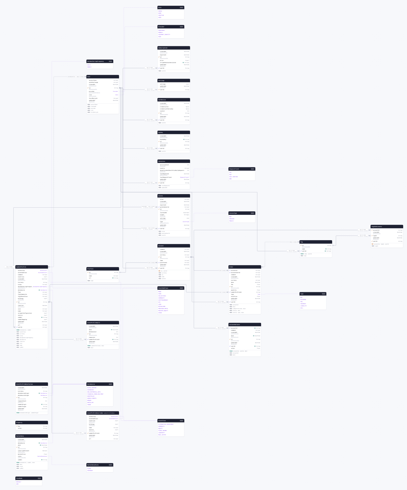

<details>
<summary>The whole schema as SQL</summary>

```sql
CREATE SCHEMA IF NOT EXISTS "public";

CREATE TYPE "AccessType" AS ENUM ('MCP', 'PRIVATE', 'PUBLIC');

CREATE TYPE "AssetClass" AS ENUM ('ALTERNATIVE_INVESTMENT', 'COMMODITY', 'EQUITY', 'FIXED_INCOME', 'LIQUIDITY', 'REAL_ESTATE');

CREATE TYPE "AssetSubClass" AS ENUM ('BOND', 'CASH', 'COLLECTIBLE', 'COMMODITY', 'CRYPTOCURRENCY', 'ETF', 'LOAN', 'MUTUALFUND', 'PRECIOUS_METAL', 'PRIVATE_EQUITY', 'STOCK');

CREATE TYPE "DataGatheringFrequency" AS ENUM ('DAILY', 'HOURLY');

CREATE TYPE "DataSource" AS ENUM ('ALPHA_VANTAGE', 'COINGECKO', 'EOD_HISTORICAL_DATA', 'FINANCIAL_MODELING_PREP', 'GHOSTFOLIO', 'GOOGLE_SHEETS', 'MANUAL', 'RAPID_API', 'YAHOO');

CREATE TYPE "MarketDataState" AS ENUM ('CLOSE', 'INTRADAY');

CREATE TYPE "Provider" AS ENUM ('ANONYMOUS', 'GOOGLE', 'INTERNET_IDENTITY', 'OIDC');

CREATE TYPE "RequestClient" AS ENUM ('API', 'MCP', 'SELF_HOSTING', 'WEB');

CREATE TYPE "Role" AS ENUM ('ADMIN', 'DEMO', 'INACTIVE', 'USER');

CREATE TYPE "Type" AS ENUM ('BUY', 'DIVIDEND', 'FEE', 'INTEREST', 'LIABILITY', 'SELL');

CREATE TYPE "ViewMode" AS ENUM ('DEFAULT', 'ZEN');

CREATE TABLE "Access" (
    "alias" TEXT,
    "createdAt" TIMESTAMP(3) NOT NULL DEFAULT CURRENT_TIMESTAMP,
    "expiresAt" TIMESTAMP(3) NOT NULL,
    "granteeUserId" TEXT,
    "id" TEXT NOT NULL,
    "lastUsedAt" TIMESTAMP(3),
    "scopes" TEXT[] DEFAULT ARRAY[]::TEXT[],
    "settings" JSONB NOT NULL DEFAULT '{}',
    "type" "AccessType" NOT NULL DEFAULT 'PRIVATE',
    "updatedAt" TIMESTAMP(3) NOT NULL,
    "userId" TEXT NOT NULL,

    CONSTRAINT "Access_pkey" PRIMARY KEY ("id")
);

CREATE TABLE "Account" (
    "comment" TEXT,
    "createdAt" TIMESTAMP(3) NOT NULL DEFAULT CURRENT_TIMESTAMP,
    "currency" TEXT,
    "id" TEXT NOT NULL,
    "name" TEXT,
    "platformId" TEXT,
    "updatedAt" TIMESTAMP(3) NOT NULL,
    "userId" TEXT NOT NULL,

    CONSTRAINT "Account_pkey" PRIMARY KEY ("id","userId")
);

CREATE TABLE "AccountBalance" (
    "accountId" TEXT NOT NULL,
    "comment" TEXT,
    "createdAt" TIMESTAMP(3) NOT NULL DEFAULT CURRENT_TIMESTAMP,
    "date" TIMESTAMP(3) NOT NULL DEFAULT CURRENT_TIMESTAMP,
    "id" TEXT NOT NULL,
    "updatedAt" TIMESTAMP(3) NOT NULL,
    "userId" TEXT NOT NULL,
    "value" DOUBLE PRECISION NOT NULL,

    CONSTRAINT "AccountBalance_pkey" PRIMARY KEY ("id")
);

CREATE TABLE "Analytics" (
    "activityCount" INTEGER NOT NULL DEFAULT 0,
    "country" TEXT,
    "dataProviderGhostfolioDailyRequests" INTEGER NOT NULL DEFAULT 0,
    "lastRequestAt" TIMESTAMP(3) NOT NULL DEFAULT CURRENT_TIMESTAMP,
    "lastRequestClient" "RequestClient",
    "updatedAt" TIMESTAMP(3) NOT NULL,
    "userId" TEXT NOT NULL,

    CONSTRAINT "Analytics_pkey" PRIMARY KEY ("userId")
);

CREATE TABLE "ApiKey" (
    "createdAt" TIMESTAMP(3) NOT NULL DEFAULT CURRENT_TIMESTAMP,
    "hashedKey" TEXT NOT NULL,
    "id" TEXT NOT NULL,
    "updatedAt" TIMESTAMP(3) NOT NULL,
    "userId" TEXT NOT NULL,

    CONSTRAINT "ApiKey_pkey" PRIMARY KEY ("id")
);

CREATE TABLE "SymbolProfileOverrides" (
    "assetClass" "AssetClass",
    "assetSubClass" "AssetSubClass",
    "countries" JSONB DEFAULT '[]',
    "holdings" JSONB DEFAULT '[]',
    "name" TEXT,
    "sectors" JSONB DEFAULT '[]',
    "symbolProfileId" TEXT NOT NULL,
    "updatedAt" TIMESTAMP(3) NOT NULL,
    "url" TEXT,

    CONSTRAINT "SymbolProfileOverrides_pkey" PRIMARY KEY ("symbolProfileId")
);

CREATE TABLE "AssetProfileResolution" (
    "createdAt" TIMESTAMP(3) NOT NULL DEFAULT CURRENT_TIMESTAMP,
    "currency" TEXT NOT NULL,
    "dataSourceOrigin" "DataSource" NOT NULL,
    "dataSourceTarget" "DataSource" NOT NULL,
    "id" TEXT NOT NULL,
    "requestCount" INTEGER NOT NULL DEFAULT 1,
    "symbolOrigin" TEXT NOT NULL,
    "symbolTarget" TEXT NOT NULL,
    "updatedAt" TIMESTAMP(3) NOT NULL,

    CONSTRAINT "AssetProfileResolution_pkey" PRIMARY KEY ("id")
);

CREATE TABLE "AssetProfileSplit" (
    "createdAt" TIMESTAMP(3) NOT NULL DEFAULT CURRENT_TIMESTAMP,
    "date" TIMESTAMP(3) NOT NULL,
    "denominator" INTEGER NOT NULL,
    "id" TEXT NOT NULL,
    "numerator" INTEGER NOT NULL,
    "symbolProfileId" TEXT NOT NULL,
    "updatedAt" TIMESTAMP(3) NOT NULL,

    CONSTRAINT "AssetProfileSplit_pkey" PRIMARY KEY ("id")
);

CREATE TABLE "AuthDevice" (
    "createdAt" TIMESTAMP(3) NOT NULL DEFAULT CURRENT_TIMESTAMP,
    "credentialId" BYTEA NOT NULL,
    "credentialPublicKey" BYTEA NOT NULL,
    "counter" INTEGER NOT NULL,
    "id" TEXT NOT NULL,
    "updatedAt" TIMESTAMP(3) NOT NULL,
    "userId" TEXT NOT NULL,

    CONSTRAINT "AuthDevice_pkey" PRIMARY KEY ("id")
);

CREATE TABLE "MarketData" (
    "createdAt" TIMESTAMP(3) NOT NULL DEFAULT CURRENT_TIMESTAMP,
    "dataSource" "DataSource" NOT NULL,
    "date" TIMESTAMP(3) NOT NULL,
    "id" TEXT NOT NULL,
    "isCarriedForward" BOOLEAN NOT NULL DEFAULT false,
    "marketPrice" DOUBLE PRECISION NOT NULL,
    "state" "MarketDataState" NOT NULL DEFAULT 'CLOSE',
    "symbol" TEXT NOT NULL,

    CONSTRAINT "MarketData_pkey" PRIMARY KEY ("id")
);

CREATE TABLE "Order" (
    "accountId" TEXT,
    "accountUserId" TEXT,
    "comment" TEXT,
    "createdAt" TIMESTAMP(3) NOT NULL DEFAULT CURRENT_TIMESTAMP,
    "currency" TEXT,
    "date" TIMESTAMP(3) NOT NULL,
    "fee" DOUBLE PRECISION NOT NULL,
    "id" TEXT NOT NULL,
    "quantity" DOUBLE PRECISION NOT NULL,
    "symbolProfileId" TEXT NOT NULL,
    "type" "Type" NOT NULL,
    "unitPrice" DOUBLE PRECISION NOT NULL,
    "updatedAt" TIMESTAMP(3) NOT NULL,
    "userId" TEXT NOT NULL,

    CONSTRAINT "Order_pkey" PRIMARY KEY ("id")
);

CREATE TABLE "Platform" (
    "id" TEXT NOT NULL,
    "name" TEXT,
    "url" TEXT NOT NULL,

    CONSTRAINT "Platform_pkey" PRIMARY KEY ("id")
);

CREATE TABLE "Property" (
    "key" TEXT NOT NULL,
    "value" TEXT NOT NULL,

    CONSTRAINT "Property_pkey" PRIMARY KEY ("key")
);

CREATE TABLE "Settings" (
    "settings" JSONB,
    "updatedAt" TIMESTAMP(3) NOT NULL,
    "userId" TEXT NOT NULL,

    CONSTRAINT "Settings_pkey" PRIMARY KEY ("userId")
);

CREATE TABLE "SymbolProfile" (
    "assetClass" "AssetClass",
    "assetSubClass" "AssetSubClass",
    "comment" TEXT,
    "countries" JSONB,
    "createdAt" TIMESTAMP(3) NOT NULL DEFAULT CURRENT_TIMESTAMP,
    "currency" TEXT NOT NULL,
    "cusip" TEXT,
    "dataGatheringFrequency" "DataGatheringFrequency" NOT NULL DEFAULT 'DAILY',
    "dataSource" "DataSource" NOT NULL,
    "figi" TEXT,
    "figiComposite" TEXT,
    "figiShareClass" TEXT,
    "holdings" JSONB DEFAULT '[]',
    "id" TEXT NOT NULL,
    "isActive" BOOLEAN NOT NULL DEFAULT true,
    "isin" TEXT,
    "name" TEXT,
    "scraperConfiguration" JSONB,
    "sectors" JSONB,
    "symbol" TEXT NOT NULL,
    "symbolMapping" JSONB,
    "updatedAt" TIMESTAMP(3) NOT NULL,
    "url" TEXT,
    "userId" TEXT,

    CONSTRAINT "SymbolProfile_pkey" PRIMARY KEY ("id")
);

CREATE TABLE "Subscription" (
    "createdAt" TIMESTAMP(3) NOT NULL DEFAULT CURRENT_TIMESTAMP,
    "expiresAt" TIMESTAMP(3) NOT NULL,
    "id" TEXT NOT NULL,
    "price" DOUBLE PRECISION,
    "stripeCheckoutSessionId" TEXT,
    "updatedAt" TIMESTAMP(3) NOT NULL,
    "userId" TEXT NOT NULL,

    CONSTRAINT "Subscription_pkey" PRIMARY KEY ("id")
);

CREATE TABLE "Tag" (
    "id" TEXT NOT NULL,
    "name" TEXT NOT NULL,
    "userId" TEXT,

    CONSTRAINT "Tag_pkey" PRIMARY KEY ("id")
);

CREATE TABLE "TagsOnAccounts" (
    "accountId" TEXT NOT NULL,
    "createdAt" TIMESTAMP(3) NOT NULL DEFAULT CURRENT_TIMESTAMP,
    "tagId" TEXT NOT NULL,
    "updatedAt" TIMESTAMP(3) NOT NULL,
    "userId" TEXT NOT NULL,

    CONSTRAINT "TagsOnAccounts_pkey" PRIMARY KEY ("accountId","tagId","userId")
);

CREATE TABLE "User" (
    "accessToken" TEXT,
    "authChallenge" TEXT,
    "createdAt" TIMESTAMP(3) NOT NULL DEFAULT CURRENT_TIMESTAMP,
    "id" TEXT NOT NULL,
    "provider" "Provider" NOT NULL DEFAULT 'ANONYMOUS',
    "role" "Role" NOT NULL DEFAULT 'USER',
    "thirdPartyId" TEXT,
    "updatedAt" TIMESTAMP(3) NOT NULL,

    CONSTRAINT "User_pkey" PRIMARY KEY ("id")
);

CREATE TABLE "_OrderToTag" (
    "A" TEXT NOT NULL,
    "B" TEXT NOT NULL,

    CONSTRAINT "_OrderToTag_AB_pkey" PRIMARY KEY ("A","B")
);

CREATE TABLE "_UserWatchlist" (
    "A" TEXT NOT NULL,
    "B" TEXT NOT NULL,

    CONSTRAINT "_UserWatchlist_AB_pkey" PRIMARY KEY ("A","B")
);

CREATE INDEX "Access_alias_idx" ON "Access"("alias");

CREATE INDEX "Access_granteeUserId_idx" ON "Access"("granteeUserId");

CREATE INDEX "Access_userId_idx" ON "Access"("userId");

CREATE INDEX "Account_currency_idx" ON "Account"("currency");

CREATE INDEX "Account_id_idx" ON "Account"("id");

CREATE INDEX "Account_name_idx" ON "Account"("name");

CREATE INDEX "Account_userId_idx" ON "Account"("userId");

CREATE INDEX "AccountBalance_accountId_idx" ON "AccountBalance"("accountId");

CREATE INDEX "AccountBalance_date_idx" ON "AccountBalance"("date");

CREATE UNIQUE INDEX "AccountBalance_accountId_userId_date_key" ON "AccountBalance"("accountId", "userId", "date");

CREATE INDEX "Analytics_lastRequestAt_idx" ON "Analytics"("lastRequestAt");

CREATE INDEX "Analytics_updatedAt_idx" ON "Analytics"("updatedAt");

CREATE UNIQUE INDEX "ApiKey_hashedKey_key" ON "ApiKey"("hashedKey");

CREATE INDEX "ApiKey_userId_idx" ON "ApiKey"("userId");

CREATE UNIQUE INDEX "AssetProfileResolution_dataSourceOrigin_symbolOrigin_key" ON "AssetProfileResolution"("dataSourceOrigin", "symbolOrigin");

CREATE INDEX "AssetProfileSplit_date_idx" ON "AssetProfileSplit"("date");

CREATE UNIQUE INDEX "AssetProfileSplit_symbolProfileId_date_key" ON "AssetProfileSplit"("symbolProfileId", "date");

CREATE INDEX "AuthDevice_userId_idx" ON "AuthDevice"("userId");

CREATE INDEX "MarketData_date_idx" ON "MarketData"("date");

CREATE INDEX "MarketData_state_idx" ON "MarketData"("state");

CREATE INDEX "MarketData_symbol_idx" ON "MarketData"("symbol");

CREATE UNIQUE INDEX "MarketData_dataSource_symbol_date_key" ON "MarketData"("dataSource", "symbol", "date");

CREATE INDEX "Order_accountId_idx" ON "Order"("accountId");

CREATE INDEX "Order_date_idx" ON "Order"("date");

CREATE INDEX "Order_symbolProfileId_date_idx" ON "Order"("symbolProfileId", "date");

CREATE INDEX "Order_userId_date_idx" ON "Order"("userId", "date");

CREATE INDEX "Order_userId_type_date_idx" ON "Order"("userId", "type", "date");

CREATE UNIQUE INDEX "Platform_url_key" ON "Platform"("url");

CREATE INDEX "Platform_name_idx" ON "Platform"("name");

CREATE INDEX "SymbolProfile_assetClass_idx" ON "SymbolProfile"("assetClass");

CREATE INDEX "SymbolProfile_currency_idx" ON "SymbolProfile"("currency");

CREATE INDEX "SymbolProfile_cusip_idx" ON "SymbolProfile"("cusip");

CREATE INDEX "SymbolProfile_dataGatheringFrequency_idx" ON "SymbolProfile"("dataGatheringFrequency");

CREATE INDEX "SymbolProfile_dataSource_idx" ON "SymbolProfile"("dataSource");

CREATE INDEX "SymbolProfile_isActive_idx" ON "SymbolProfile"("isActive");

CREATE INDEX "SymbolProfile_isin_idx" ON "SymbolProfile"("isin");

CREATE INDEX "SymbolProfile_name_idx" ON "SymbolProfile"("name");

CREATE INDEX "SymbolProfile_symbol_idx" ON "SymbolProfile"("symbol");

CREATE UNIQUE INDEX "SymbolProfile_dataSource_symbol_key" ON "SymbolProfile"("dataSource", "symbol");

CREATE UNIQUE INDEX "Subscription_stripeCheckoutSessionId_key" ON "Subscription"("stripeCheckoutSessionId");

CREATE INDEX "Subscription_userId_idx" ON "Subscription"("userId");

CREATE INDEX "Tag_name_idx" ON "Tag"("name");

CREATE UNIQUE INDEX "Tag_name_userId_key" ON "Tag"("name", "userId");

CREATE INDEX "TagsOnAccounts_tagId_idx" ON "TagsOnAccounts"("tagId");

CREATE INDEX "User_accessToken_idx" ON "User"("accessToken");

CREATE INDEX "User_createdAt_idx" ON "User"("createdAt");

CREATE INDEX "User_provider_idx" ON "User"("provider");

CREATE INDEX "User_role_idx" ON "User"("role");

CREATE INDEX "User_thirdPartyId_idx" ON "User"("thirdPartyId");

CREATE INDEX "_OrderToTag_B_index" ON "_OrderToTag"("B");

CREATE INDEX "_UserWatchlist_B_index" ON "_UserWatchlist"("B");

ALTER TABLE "Access" ADD CONSTRAINT "Access_granteeUserId_fkey" FOREIGN KEY ("granteeUserId") REFERENCES "User"("id") ON DELETE CASCADE ON UPDATE CASCADE;

ALTER TABLE "Access" ADD CONSTRAINT "Access_userId_fkey" FOREIGN KEY ("userId") REFERENCES "User"("id") ON DELETE CASCADE ON UPDATE CASCADE;

ALTER TABLE "Account" ADD CONSTRAINT "Account_platformId_fkey" FOREIGN KEY ("platformId") REFERENCES "Platform"("id") ON DELETE SET NULL ON UPDATE CASCADE;

ALTER TABLE "Account" ADD CONSTRAINT "Account_userId_fkey" FOREIGN KEY ("userId") REFERENCES "User"("id") ON DELETE CASCADE ON UPDATE CASCADE;

ALTER TABLE "AccountBalance" ADD CONSTRAINT "AccountBalance_accountId_userId_fkey" FOREIGN KEY ("accountId", "userId") REFERENCES "Account"("id", "userId") ON DELETE CASCADE ON UPDATE CASCADE;

ALTER TABLE "Analytics" ADD CONSTRAINT "Analytics_userId_fkey" FOREIGN KEY ("userId") REFERENCES "User"("id") ON DELETE CASCADE ON UPDATE CASCADE;

ALTER TABLE "ApiKey" ADD CONSTRAINT "ApiKey_userId_fkey" FOREIGN KEY ("userId") REFERENCES "User"("id") ON DELETE CASCADE ON UPDATE CASCADE;

ALTER TABLE "SymbolProfileOverrides" ADD CONSTRAINT "SymbolProfileOverrides_symbolProfileId_fkey" FOREIGN KEY ("symbolProfileId") REFERENCES "SymbolProfile"("id") ON DELETE CASCADE ON UPDATE CASCADE;

ALTER TABLE "AssetProfileSplit" ADD CONSTRAINT "AssetProfileSplit_symbolProfileId_fkey" FOREIGN KEY ("symbolProfileId") REFERENCES "SymbolProfile"("id") ON DELETE CASCADE ON UPDATE CASCADE;

ALTER TABLE "AuthDevice" ADD CONSTRAINT "AuthDevice_userId_fkey" FOREIGN KEY ("userId") REFERENCES "User"("id") ON DELETE CASCADE ON UPDATE CASCADE;

ALTER TABLE "Order" ADD CONSTRAINT "Order_accountId_accountUserId_fkey" FOREIGN KEY ("accountId", "accountUserId") REFERENCES "Account"("id", "userId") ON DELETE SET NULL ON UPDATE CASCADE;

ALTER TABLE "Order" ADD CONSTRAINT "Order_userId_fkey" FOREIGN KEY ("userId") REFERENCES "User"("id") ON DELETE CASCADE ON UPDATE CASCADE;

ALTER TABLE "Order" ADD CONSTRAINT "Order_symbolProfileId_fkey" FOREIGN KEY ("symbolProfileId") REFERENCES "SymbolProfile"("id") ON DELETE RESTRICT ON UPDATE CASCADE;

ALTER TABLE "Settings" ADD CONSTRAINT "Settings_userId_fkey" FOREIGN KEY ("userId") REFERENCES "User"("id") ON DELETE CASCADE ON UPDATE CASCADE;

ALTER TABLE "SymbolProfile" ADD CONSTRAINT "SymbolProfile_userId_fkey" FOREIGN KEY ("userId") REFERENCES "User"("id") ON DELETE CASCADE ON UPDATE CASCADE;

ALTER TABLE "Subscription" ADD CONSTRAINT "Subscription_userId_fkey" FOREIGN KEY ("userId") REFERENCES "User"("id") ON DELETE CASCADE ON UPDATE CASCADE;

ALTER TABLE "Tag" ADD CONSTRAINT "Tag_userId_fkey" FOREIGN KEY ("userId") REFERENCES "User"("id") ON DELETE CASCADE ON UPDATE CASCADE;

ALTER TABLE "TagsOnAccounts" ADD CONSTRAINT "TagsOnAccounts_accountId_userId_fkey" FOREIGN KEY ("accountId", "userId") REFERENCES "Account"("id", "userId") ON DELETE CASCADE ON UPDATE CASCADE;

ALTER TABLE "TagsOnAccounts" ADD CONSTRAINT "TagsOnAccounts_tagId_fkey" FOREIGN KEY ("tagId") REFERENCES "Tag"("id") ON DELETE CASCADE ON UPDATE CASCADE;

ALTER TABLE "_OrderToTag" ADD CONSTRAINT "_OrderToTag_A_fkey" FOREIGN KEY ("A") REFERENCES "Order"("id") ON DELETE CASCADE ON UPDATE CASCADE;

ALTER TABLE "_OrderToTag" ADD CONSTRAINT "_OrderToTag_B_fkey" FOREIGN KEY ("B") REFERENCES "Tag"("id") ON DELETE CASCADE ON UPDATE CASCADE;

ALTER TABLE "_UserWatchlist" ADD CONSTRAINT "_UserWatchlist_A_fkey" FOREIGN KEY ("A") REFERENCES "SymbolProfile"("id") ON DELETE CASCADE ON UPDATE CASCADE;

ALTER TABLE "_UserWatchlist" ADD CONSTRAINT "_UserWatchlist_B_fkey" FOREIGN KEY ("B") REFERENCES "User"("id") ON DELETE CASCADE ON UPDATE CASCADE;
```

</details>

## Contents

| Model                                                   | Table                    | Description                                                                                                                                                                                                                                                                                                                                                                                                                                                                                                                                                                                                                                  |
| ------------------------------------------------------- | ------------------------ | -------------------------------------------------------------------------------------------------------------------------------------------------------------------------------------------------------------------------------------------------------------------------------------------------------------------------------------------------------------------------------------------------------------------------------------------------------------------------------------------------------------------------------------------------------------------------------------------------------------------------------------------- |
| [Access](#model-Access)                                 | `Access`                 |                                                                                                                                                                                                                                                                                                                                                                                                                                                                                                                                                                                                                                              |
| [Account](#model-Account)                               | `Account`                |                                                                                                                                                                                                                                                                                                                                                                                                                                                                                                                                                                                                                                              |
| [AccountBalance](#model-AccountBalance)                 | `AccountBalance`         |                                                                                                                                                                                                                                                                                                                                                                                                                                                                                                                                                                                                                                              |
| [Analytics](#model-Analytics)                           | `Analytics`              |                                                                                                                                                                                                                                                                                                                                                                                                                                                                                                                                                                                                                                              |
| [ApiKey](#model-ApiKey)                                 | `ApiKey`                 |                                                                                                                                                                                                                                                                                                                                                                                                                                                                                                                                                                                                                                              |
| [AssetProfileOverrides](#model-AssetProfileOverrides)   | `SymbolProfileOverrides` |                                                                                                                                                                                                                                                                                                                                                                                                                                                                                                                                                                                                                                              |
| [AssetProfileResolution](#model-AssetProfileResolution) | `AssetProfileResolution` |                                                                                                                                                                                                                                                                                                                                                                                                                                                                                                                                                                                                                                              |
| [AssetProfileSplit](#model-AssetProfileSplit)           | `AssetProfileSplit`      | A stock split of an asset profile. The numerator is the number of shares held after the split, the denominator the number of shares held before, for example 4 and 1 for a 4:1 split or 1 and 10 for a 1:10 reverse split. The ratio is stored as two integers instead of the resulting factor, so that it stays exact, for example 1/3 for a 1:3 reverse split. Activities before the date are adjusted by the ratio: the quantity is multiplied by it and the unit price divided by it, so that the total value of an activity stays the same. Market data is already split-adjusted by the data providers and must not be adjusted again. |
| [AuthDevice](#model-AuthDevice)                         | `AuthDevice`             |                                                                                                                                                                                                                                                                                                                                                                                                                                                                                                                                                                                                                                              |
| [MarketData](#model-MarketData)                         | `MarketData`             |                                                                                                                                                                                                                                                                                                                                                                                                                                                                                                                                                                                                                                              |
| [Order](#model-Order)                                   | `Order`                  |                                                                                                                                                                                                                                                                                                                                                                                                                                                                                                                                                                                                                                              |
| [Platform](#model-Platform)                             | `Platform`               |                                                                                                                                                                                                                                                                                                                                                                                                                                                                                                                                                                                                                                              |
| [Property](#model-Property)                             | `Property`               |                                                                                                                                                                                                                                                                                                                                                                                                                                                                                                                                                                                                                                              |
| [Settings](#model-Settings)                             | `Settings`               |                                                                                                                                                                                                                                                                                                                                                                                                                                                                                                                                                                                                                                              |
| [SymbolProfile](#model-SymbolProfile)                   | `SymbolProfile`          |                                                                                                                                                                                                                                                                                                                                                                                                                                                                                                                                                                                                                                              |
| [Subscription](#model-Subscription)                     | `Subscription`           |                                                                                                                                                                                                                                                                                                                                                                                                                                                                                                                                                                                                                                              |
| [Tag](#model-Tag)                                       | `Tag`                    |                                                                                                                                                                                                                                                                                                                                                                                                                                                                                                                                                                                                                                              |
| [TagsOnAccounts](#model-TagsOnAccounts)                 | `TagsOnAccounts`         |                                                                                                                                                                                                                                                                                                                                                                                                                                                                                                                                                                                                                                              |
| [User](#model-User)                                     | `User`                   |                                                                                                                                                                                                                                                                                                                                                                                                                                                                                                                                                                                                                                              |

| Enum                                                   | Name in the database     | Description |
| ------------------------------------------------------ | ------------------------ | ----------- |
| [AccessType](#enum-AccessType)                         | `AccessType`             |             |
| [AssetClass](#enum-AssetClass)                         | `AssetClass`             |             |
| [AssetSubClass](#enum-AssetSubClass)                   | `AssetSubClass`          |             |
| [DataGatheringFrequency](#enum-DataGatheringFrequency) | `DataGatheringFrequency` |             |
| [DataSource](#enum-DataSource)                         | `DataSource`             |             |
| [MarketDataState](#enum-MarketDataState)               | `MarketDataState`        |             |
| [Provider](#enum-Provider)                             | `Provider`               |             |
| [RequestClient](#enum-RequestClient)                   | `RequestClient`          |             |
| [Role](#enum-Role)                                     | `Role`                   |             |
| [Type](#enum-Type)                                     | `Type`                   |             |
| [ViewMode](#enum-ViewMode)                             | `ViewMode`               |             |

## Models

<a id="model-Access"></a>

### Access

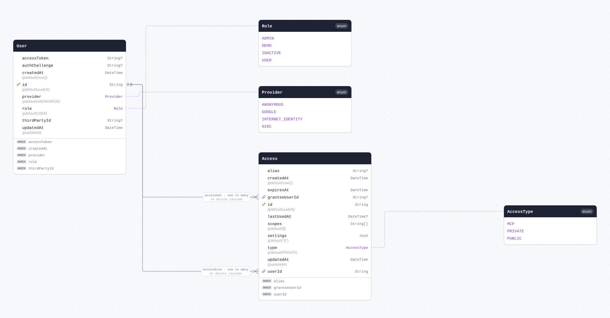

| Field           | Type                             | Constraints                       | Default      | Description |
| --------------- | -------------------------------- | --------------------------------- | ------------ | ----------- |
| `alias`         | `String`                         | NULL                              |              |             |
| `createdAt`     | `DateTime`                       | NOT NULL                          | `now()`      |             |
| `expiresAt`     | `DateTime`                       | NOT NULL                          |              |             |
| `granteeUserId` | `String`                         | NULL → [User.id](#model-User)     |              |             |
| `id`            | `String`                         | PK NOT NULL                       | `uuid(4)`    |             |
| `lastUsedAt`    | `DateTime`                       | NULL                              |              |             |
| `scopes`        | `String[]`                       | NOT NULL                          | `[]`         |             |
| `settings`      | `Json`                           | NOT NULL                          | `"{}"`       |             |
| `type`          | [`AccessType`](#enum-AccessType) | NOT NULL                          | `PRIVATE`    |             |
| `updatedAt`     | `DateTime`                       | NOT NULL                          | `@updatedAt` |             |
| `userId`        | `String`                         | NOT NULL → [User.id](#model-User) |              |             |

#### Indexes

- `@@index([alias])`
- `@@index([granteeUserId])`
- `@@index([userId])`

#### References

- `granteeUserId` → [User.id](#model-User) (many-to-one, on delete Cascade)
- `userId` → [User.id](#model-User) (many-to-one, on delete Cascade)

#### Definition

```sql
CREATE TABLE "Access" (
    "alias" TEXT,
    "createdAt" TIMESTAMP(3) NOT NULL DEFAULT CURRENT_TIMESTAMP,
    "expiresAt" TIMESTAMP(3) NOT NULL,
    "granteeUserId" TEXT,
    "id" TEXT NOT NULL,
    "lastUsedAt" TIMESTAMP(3),
    "scopes" TEXT[] DEFAULT ARRAY[]::TEXT[],
    "settings" JSONB NOT NULL DEFAULT '{}',
    "type" "AccessType" NOT NULL DEFAULT 'PRIVATE',
    "updatedAt" TIMESTAMP(3) NOT NULL,
    "userId" TEXT NOT NULL,

    CONSTRAINT "Access_pkey" PRIMARY KEY ("id")
);

CREATE INDEX "Access_alias_idx" ON "Access"("alias");

CREATE INDEX "Access_granteeUserId_idx" ON "Access"("granteeUserId");

CREATE INDEX "Access_userId_idx" ON "Access"("userId");

ALTER TABLE "Access" ADD CONSTRAINT "Access_granteeUserId_fkey" FOREIGN KEY ("granteeUserId") REFERENCES "User"("id") ON DELETE CASCADE ON UPDATE CASCADE;

ALTER TABLE "Access" ADD CONSTRAINT "Access_userId_fkey" FOREIGN KEY ("userId") REFERENCES "User"("id") ON DELETE CASCADE ON UPDATE CASCADE;
```

<details>
<summary>Queries and their SQL</summary>

**findMany**: Every row

```ts
await prisma.access.findMany();
```

```sql
SELECT
  "public"."Access"."id",
  "public"."Access"."alias",
  "public"."Access"."createdAt",
  "public"."Access"."expiresAt",
  "public"."Access"."granteeUserId",
  "public"."Access"."lastUsedAt",
  "public"."Access"."scopes",
  "public"."Access"."settings",
  "public"."Access"."type"::text,
  "public"."Access"."updatedAt",
  "public"."Access"."userId"
FROM
  "public"."Access"
WHERE
  1 = 1
OFFSET
  $1
-- params: ["0"]
```

**count**: How many rows there are

```ts
await prisma.access.count();
```

```sql
SELECT
  COUNT(*) AS "_count$_all"
FROM
  (
    SELECT
      "public"."Access"."id"
    FROM
      "public"."Access"
    WHERE
      1 = 1
    OFFSET
      $1
  ) AS "sub"
-- params: ["0"]
```

**findMany**: Every row with its relations

```ts
await prisma.access.findMany({ include: { granteeUser: true, user: true } });
```

```sql
SELECT
  "public"."Access"."id",
  "public"."Access"."alias",
  "public"."Access"."createdAt",
  "public"."Access"."expiresAt",
  "public"."Access"."granteeUserId",
  "public"."Access"."lastUsedAt",
  "public"."Access"."scopes",
  "public"."Access"."settings",
  "public"."Access"."type"::text,
  "public"."Access"."updatedAt",
  "public"."Access"."userId"
FROM
  "public"."Access"
WHERE
  1 = 1
OFFSET
  $1
-- params: ["0"]

SELECT
  "public"."User"."id",
  "public"."User"."accessToken",
  "public"."User"."authChallenge",
  "public"."User"."createdAt",
  "public"."User"."provider"::text,
  "public"."User"."role"::text,
  "public"."User"."thirdPartyId",
  "public"."User"."updatedAt"
FROM
  "public"."User"
WHERE
  "public"."User"."id" IN ($1)
OFFSET
  $2
-- params: ["<granteeUserId of the rows above>","0"]

SELECT
  "public"."User"."id",
  "public"."User"."accessToken",
  "public"."User"."authChallenge",
  "public"."User"."createdAt",
  "public"."User"."provider"::text,
  "public"."User"."role"::text,
  "public"."User"."thirdPartyId",
  "public"."User"."updatedAt"
FROM
  "public"."User"
WHERE
  "public"."User"."id" IN ($1)
OFFSET
  $2
-- params: ["<userId of the rows above>","0"]
```

**findUnique**: One row by what is unique to it

```ts
await prisma.access.findUnique({ where: { id: "example" } });
```

```sql
SELECT
  "public"."Access"."id",
  "public"."Access"."alias",
  "public"."Access"."createdAt",
  "public"."Access"."expiresAt",
  "public"."Access"."granteeUserId",
  "public"."Access"."lastUsedAt",
  "public"."Access"."scopes",
  "public"."Access"."settings",
  "public"."Access"."type"::text,
  "public"."Access"."updatedAt",
  "public"."Access"."userId"
FROM
  "public"."Access"
WHERE
  (
    "public"."Access"."id" = $1
    AND 1 = 1
  )
LIMIT
  $2
OFFSET
  $3
-- params: ["example","1","0"]
```

**create**: Create a row

```ts
await prisma.access.create({
  data: { expiresAt: new Date("2026-01-01T00:00:00.000Z"), userId: "example" },
});
```

```sql
INSERT INTO
  "public"."Access" (
    "createdAt",
    "expiresAt",
    "id",
    "scopes",
    "settings",
    "type",
    "updatedAt",
    "userId"
  )
VALUES
  (
    $1,
    $2,
    $3,
    $4,
    $5,
    CAST($6::text AS "public"."AccessType"),
    $7,
    $8
  )
RETURNING
  "public"."Access"."id",
  "public"."Access"."alias",
  "public"."Access"."createdAt",
  "public"."Access"."expiresAt",
  "public"."Access"."granteeUserId",
  "public"."Access"."lastUsedAt",
  "public"."Access"."scopes",
  "public"."Access"."settings",
  "public"."Access"."type"::text,
  "public"."Access"."updatedAt",
  "public"."Access"."userId"
-- params: ["<now()>","2026-01-01T00:00:00.000Z","<uuid(4)>",[],"{}","PRIVATE","<now()>","example"]
```

**update**: Update a row

```ts
await prisma.access.update({ where: { id: "example" }, data: { alias: "example" } });
```

```sql
UPDATE "public"."Access"
SET
  "alias" = $1,
  "updatedAt" = $2
WHERE
  (
    "public"."Access"."id" = $3
    AND 1 = 1
  )
RETURNING
  "public"."Access"."id",
  "public"."Access"."alias",
  "public"."Access"."createdAt",
  "public"."Access"."expiresAt",
  "public"."Access"."granteeUserId",
  "public"."Access"."lastUsedAt",
  "public"."Access"."scopes",
  "public"."Access"."settings",
  "public"."Access"."type"::text,
  "public"."Access"."updatedAt",
  "public"."Access"."userId"
-- params: ["example",{"prisma__type":"generatorCall","prisma__value":{"name":"now","args":[],"returnType":{"type":"DateTime"}}},"example"]
```

**delete**: Delete a row

```ts
await prisma.access.delete({ where: { id: "example" } });
```

```sql
DELETE FROM "public"."Access"
WHERE
  (
    "public"."Access"."id" = $1
    AND 1 = 1
  )
RETURNING
  "public"."Access"."id",
  "public"."Access"."alias",
  "public"."Access"."createdAt",
  "public"."Access"."expiresAt",
  "public"."Access"."granteeUserId",
  "public"."Access"."lastUsedAt",
  "public"."Access"."scopes",
  "public"."Access"."settings",
  "public"."Access"."type"::text,
  "public"."Access"."updatedAt",
  "public"."Access"."userId"
-- params: ["example"]
```

</details>

<a id="model-Account"></a>

### Account

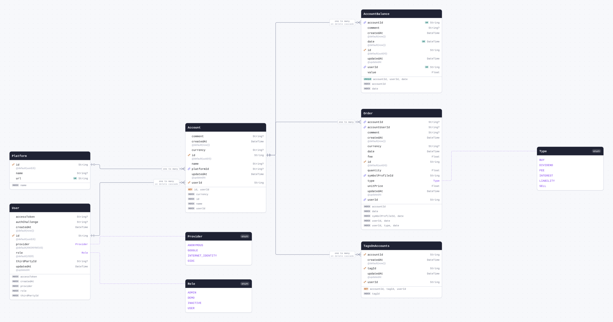

| Field        | Type       | Constraints                           | Default      | Description |
| ------------ | ---------- | ------------------------------------- | ------------ | ----------- |
| `comment`    | `String`   | NULL                                  |              |             |
| `createdAt`  | `DateTime` | NOT NULL                              | `now()`      |             |
| `currency`   | `String`   | NULL                                  |              |             |
| `id`         | `String`   | PK NOT NULL                           | `uuid(4)`    |             |
| `name`       | `String`   | NULL                                  |              |             |
| `platformId` | `String`   | NULL → [Platform.id](#model-Platform) |              |             |
| `updatedAt`  | `DateTime` | NOT NULL                              | `@updatedAt` |             |
| `userId`     | `String`   | PK NOT NULL → [User.id](#model-User)  |              |             |

#### Indexes

- `@@id([id, userId])`
- `@@index([currency])`
- `@@index([id])`
- `@@index([name])`
- `@@index([userId])`

#### References

- `platformId` → [Platform.id](#model-Platform) (many-to-one)
- `userId` → [User.id](#model-User) (many-to-one, on delete Cascade)

#### Referenced by

- `id` ← [AccountBalance.accountId](#model-AccountBalance) (one-to-many, on delete Cascade)
- `id` ← [Order.accountId](#model-Order) (one-to-many)
- `id` ← [TagsOnAccounts.accountId](#model-TagsOnAccounts) (one-to-many, on delete Cascade)

#### Definition

```sql
CREATE TABLE "Account" (
    "comment" TEXT,
    "createdAt" TIMESTAMP(3) NOT NULL DEFAULT CURRENT_TIMESTAMP,
    "currency" TEXT,
    "id" TEXT NOT NULL,
    "name" TEXT,
    "platformId" TEXT,
    "updatedAt" TIMESTAMP(3) NOT NULL,
    "userId" TEXT NOT NULL,

    CONSTRAINT "Account_pkey" PRIMARY KEY ("id","userId")
);

CREATE INDEX "Account_currency_idx" ON "Account"("currency");

CREATE INDEX "Account_id_idx" ON "Account"("id");

CREATE INDEX "Account_name_idx" ON "Account"("name");

CREATE INDEX "Account_userId_idx" ON "Account"("userId");

ALTER TABLE "Account" ADD CONSTRAINT "Account_platformId_fkey" FOREIGN KEY ("platformId") REFERENCES "Platform"("id") ON DELETE SET NULL ON UPDATE CASCADE;

ALTER TABLE "Account" ADD CONSTRAINT "Account_userId_fkey" FOREIGN KEY ("userId") REFERENCES "User"("id") ON DELETE CASCADE ON UPDATE CASCADE;
```

<details>
<summary>Queries and their SQL</summary>

**findMany**: Every row

```ts
await prisma.account.findMany();
```

```sql
SELECT
  "public"."Account"."id",
  "public"."Account"."userId",
  "public"."Account"."comment",
  "public"."Account"."createdAt",
  "public"."Account"."currency",
  "public"."Account"."name",
  "public"."Account"."platformId",
  "public"."Account"."updatedAt"
FROM
  "public"."Account"
WHERE
  1 = 1
OFFSET
  $1
-- params: ["0"]
```

**count**: How many rows there are

```ts
await prisma.account.count();
```

```sql
SELECT
  COUNT(*) AS "_count$_all"
FROM
  (
    SELECT
      "public"."Account"."id",
      "public"."Account"."userId"
    FROM
      "public"."Account"
    WHERE
      1 = 1
    OFFSET
      $1
  ) AS "sub"
-- params: ["0"]
```

**findMany**: Every row with its relations

```ts
await prisma.account.findMany({
  include: { activities: true, balances: true, platform: true, tags: true, user: true },
});
```

```sql
SELECT
  "public"."Account"."id",
  "public"."Account"."userId",
  "public"."Account"."comment",
  "public"."Account"."createdAt",
  "public"."Account"."currency",
  "public"."Account"."name",
  "public"."Account"."platformId",
  "public"."Account"."updatedAt"
FROM
  "public"."Account"
WHERE
  1 = 1
OFFSET
  $1
-- params: ["0"]

SELECT
  "public"."Order"."id",
  "public"."Order"."accountId",
  "public"."Order"."accountUserId",
  "public"."Order"."comment",
  "public"."Order"."createdAt",
  "public"."Order"."currency",
  "public"."Order"."date",
  "public"."Order"."fee",
  "public"."Order"."quantity",
  "public"."Order"."symbolProfileId",
  "public"."Order"."type"::text,
  "public"."Order"."unitPrice",
  "public"."Order"."updatedAt",
  "public"."Order"."userId"
FROM
  "public"."Order"
WHERE
  (
    "public"."Order"."accountId" IN ($1)
    AND "public"."Order"."accountUserId" IN ($2)
  )
OFFSET
  $3
-- params: ["<id of the rows above>","<userId of the rows above>","0"]

SELECT
  "public"."AccountBalance"."id",
  "public"."AccountBalance"."accountId",
  "public"."AccountBalance"."comment",
  "public"."AccountBalance"."createdAt",
  "public"."AccountBalance"."date",
  "public"."AccountBalance"."updatedAt",
  "public"."AccountBalance"."userId",
  "public"."AccountBalance"."value"
FROM
  "public"."AccountBalance"
WHERE
  (
    "public"."AccountBalance"."accountId" IN ($1)
    AND "public"."AccountBalance"."userId" IN ($2)
  )
OFFSET
  $3
-- params: ["<id of the rows above>","<userId of the rows above>","0"]

SELECT
  "public"."Platform"."id",
  "public"."Platform"."name",
  "public"."Platform"."url"
FROM
  "public"."Platform"
WHERE
  "public"."Platform"."id" IN ($1)
OFFSET
  $2
-- params: ["<platformId of the rows above>","0"]

SELECT
  "public"."TagsOnAccounts"."accountId",
  "public"."TagsOnAccounts"."tagId",
  "public"."TagsOnAccounts"."userId",
  "public"."TagsOnAccounts"."createdAt",
  "public"."TagsOnAccounts"."updatedAt"
FROM
  "public"."TagsOnAccounts"
WHERE
  (
    "public"."TagsOnAccounts"."accountId" IN ($1)
    AND "public"."TagsOnAccounts"."userId" IN ($2)
  )
OFFSET
  $3
-- params: ["<id of the rows above>","<userId of the rows above>","0"]

SELECT
  "public"."User"."id",
  "public"."User"."accessToken",
  "public"."User"."authChallenge",
  "public"."User"."createdAt",
  "public"."User"."provider"::text,
  "public"."User"."role"::text,
  "public"."User"."thirdPartyId",
  "public"."User"."updatedAt"
FROM
  "public"."User"
WHERE
  "public"."User"."id" IN ($1)
OFFSET
  $2
-- params: ["<userId of the rows above>","0"]
```

**findUnique**: One row by what is unique to it

```ts
await prisma.account.findUnique({ where: { id_userId: { id: "example", userId: "example" } } });
```

```sql
SELECT
  "public"."Account"."id",
  "public"."Account"."userId",
  "public"."Account"."comment",
  "public"."Account"."createdAt",
  "public"."Account"."currency",
  "public"."Account"."name",
  "public"."Account"."platformId",
  "public"."Account"."updatedAt"
FROM
  "public"."Account"
WHERE
  (
    (
      "public"."Account"."id" = $1
      AND "public"."Account"."userId" = $2
    )
    AND 1 = 1
  )
LIMIT
  $3
OFFSET
  $4
-- params: ["example","example","1","0"]
```

**create**: Create a row

```ts
await prisma.account.create({ data: { userId: "example" } });
```

```sql
INSERT INTO
  "public"."Account" ("createdAt", "id", "updatedAt", "userId")
VALUES
  ($1, $2, $3, $4)
RETURNING
  "public"."Account"."id",
  "public"."Account"."userId",
  "public"."Account"."comment",
  "public"."Account"."createdAt",
  "public"."Account"."currency",
  "public"."Account"."name",
  "public"."Account"."platformId",
  "public"."Account"."updatedAt"
-- params: ["<now()>","<uuid(4)>","<now()>","example"]
```

**update**: Update a row

```ts
await prisma.account.update({
  where: { id_userId: { id: "example", userId: "example" } },
  data: { comment: "example" },
});
```

```sql
UPDATE "public"."Account"
SET
  "comment" = $1,
  "updatedAt" = $2
WHERE
  (
    (
      "public"."Account"."id" = $3
      AND "public"."Account"."userId" = $4
    )
    AND 1 = 1
  )
RETURNING
  "public"."Account"."id",
  "public"."Account"."userId",
  "public"."Account"."comment",
  "public"."Account"."createdAt",
  "public"."Account"."currency",
  "public"."Account"."name",
  "public"."Account"."platformId",
  "public"."Account"."updatedAt"
-- params: ["example",{"prisma__type":"generatorCall","prisma__value":{"name":"now","args":[],"returnType":{"type":"DateTime"}}},"example","example"]
```

**delete**: Delete a row

```ts
await prisma.account.delete({ where: { id_userId: { id: "example", userId: "example" } } });
```

```sql
DELETE FROM "public"."Account"
WHERE
  (
    (
      "public"."Account"."id" = $1
      AND "public"."Account"."userId" = $2
    )
    AND 1 = 1
  )
RETURNING
  "public"."Account"."id",
  "public"."Account"."userId",
  "public"."Account"."comment",
  "public"."Account"."createdAt",
  "public"."Account"."currency",
  "public"."Account"."name",
  "public"."Account"."platformId",
  "public"."Account"."updatedAt"
-- params: ["example","example"]
```

</details>

<a id="model-AccountBalance"></a>

### AccountBalance

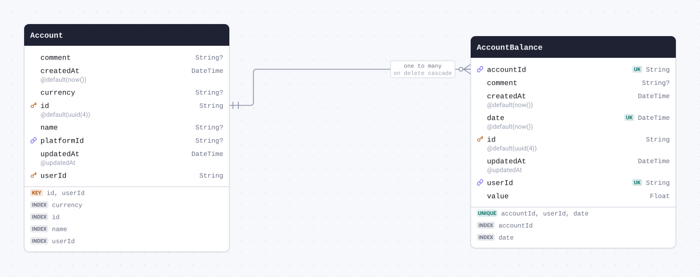

| Field       | Type       | Constraints                                 | Default      | Description |
| ----------- | ---------- | ------------------------------------------- | ------------ | ----------- |
| `accountId` | `String`   | NOT NULL → [Account.id](#model-Account)     |              |             |
| `comment`   | `String`   | NULL                                        |              |             |
| `createdAt` | `DateTime` | NOT NULL                                    | `now()`      |             |
| `date`      | `DateTime` | NOT NULL                                    | `now()`      |             |
| `id`        | `String`   | PK NOT NULL                                 | `uuid(4)`    |             |
| `updatedAt` | `DateTime` | NOT NULL                                    | `@updatedAt` |             |
| `userId`    | `String`   | NOT NULL → [Account.userId](#model-Account) |              |             |
| `value`     | `Float`    | NOT NULL                                    |              |             |

#### Indexes

- `@@index([accountId])`
- `@@index([date])`
- `@@unique([accountId, userId, date])`

#### References

- `accountId` → [Account.id](#model-Account) (many-to-one, on delete Cascade)

#### Definition

```sql
CREATE TABLE "AccountBalance" (
    "accountId" TEXT NOT NULL,
    "comment" TEXT,
    "createdAt" TIMESTAMP(3) NOT NULL DEFAULT CURRENT_TIMESTAMP,
    "date" TIMESTAMP(3) NOT NULL DEFAULT CURRENT_TIMESTAMP,
    "id" TEXT NOT NULL,
    "updatedAt" TIMESTAMP(3) NOT NULL,
    "userId" TEXT NOT NULL,
    "value" DOUBLE PRECISION NOT NULL,

    CONSTRAINT "AccountBalance_pkey" PRIMARY KEY ("id")
);

CREATE INDEX "AccountBalance_accountId_idx" ON "AccountBalance"("accountId");

CREATE INDEX "AccountBalance_date_idx" ON "AccountBalance"("date");

CREATE UNIQUE INDEX "AccountBalance_accountId_userId_date_key" ON "AccountBalance"("accountId", "userId", "date");

ALTER TABLE "AccountBalance" ADD CONSTRAINT "AccountBalance_accountId_userId_fkey" FOREIGN KEY ("accountId", "userId") REFERENCES "Account"("id", "userId") ON DELETE CASCADE ON UPDATE CASCADE;
```

<details>
<summary>Queries and their SQL</summary>

**findMany**: Every row

```ts
await prisma.accountBalance.findMany();
```

```sql
SELECT
  "public"."AccountBalance"."id",
  "public"."AccountBalance"."accountId",
  "public"."AccountBalance"."comment",
  "public"."AccountBalance"."createdAt",
  "public"."AccountBalance"."date",
  "public"."AccountBalance"."updatedAt",
  "public"."AccountBalance"."userId",
  "public"."AccountBalance"."value"
FROM
  "public"."AccountBalance"
WHERE
  1 = 1
OFFSET
  $1
-- params: ["0"]
```

**count**: How many rows there are

```ts
await prisma.accountBalance.count();
```

```sql
SELECT
  COUNT(*) AS "_count$_all"
FROM
  (
    SELECT
      "public"."AccountBalance"."id"
    FROM
      "public"."AccountBalance"
    WHERE
      1 = 1
    OFFSET
      $1
  ) AS "sub"
-- params: ["0"]
```

**findMany**: Every row with its relations

```ts
await prisma.accountBalance.findMany({ include: { account: true } });
```

```sql
SELECT
  "public"."AccountBalance"."id",
  "public"."AccountBalance"."accountId",
  "public"."AccountBalance"."comment",
  "public"."AccountBalance"."createdAt",
  "public"."AccountBalance"."date",
  "public"."AccountBalance"."updatedAt",
  "public"."AccountBalance"."userId",
  "public"."AccountBalance"."value"
FROM
  "public"."AccountBalance"
WHERE
  1 = 1
OFFSET
  $1
-- params: ["0"]

SELECT
  "public"."Account"."id",
  "public"."Account"."userId",
  "public"."Account"."comment",
  "public"."Account"."createdAt",
  "public"."Account"."currency",
  "public"."Account"."name",
  "public"."Account"."platformId",
  "public"."Account"."updatedAt"
FROM
  "public"."Account"
WHERE
  (
    "public"."Account"."id" IN ($1)
    AND "public"."Account"."userId" IN ($2)
  )
OFFSET
  $3
-- params: ["<accountId of the rows above>","<userId of the rows above>","0"]
```

**findUnique**: One row by what is unique to it

```ts
await prisma.accountBalance.findUnique({ where: { id: "example" } });
```

```sql
SELECT
  "public"."AccountBalance"."id",
  "public"."AccountBalance"."accountId",
  "public"."AccountBalance"."comment",
  "public"."AccountBalance"."createdAt",
  "public"."AccountBalance"."date",
  "public"."AccountBalance"."updatedAt",
  "public"."AccountBalance"."userId",
  "public"."AccountBalance"."value"
FROM
  "public"."AccountBalance"
WHERE
  (
    "public"."AccountBalance"."id" = $1
    AND 1 = 1
  )
LIMIT
  $2
OFFSET
  $3
-- params: ["example","1","0"]
```

**create**: Create a row

```ts
await prisma.accountBalance.create({
  data: { accountId: "example", userId: "example", value: 1.5 },
});
```

```sql
INSERT INTO
  "public"."AccountBalance" (
    "accountId",
    "createdAt",
    "date",
    "id",
    "updatedAt",
    "userId",
    "value"
  )
VALUES
  ($1, $2, $3, $4, $5, $6, $7)
RETURNING
  "public"."AccountBalance"."id",
  "public"."AccountBalance"."accountId",
  "public"."AccountBalance"."comment",
  "public"."AccountBalance"."createdAt",
  "public"."AccountBalance"."date",
  "public"."AccountBalance"."updatedAt",
  "public"."AccountBalance"."userId",
  "public"."AccountBalance"."value"
-- params: ["example","<now()>","<now()>","<uuid(4)>","<now()>","example","1.5"]
```

**update**: Update a row

```ts
await prisma.accountBalance.update({ where: { id: "example" }, data: { comment: "example" } });
```

```sql
UPDATE "public"."AccountBalance"
SET
  "comment" = $1,
  "updatedAt" = $2
WHERE
  (
    "public"."AccountBalance"."id" = $3
    AND 1 = 1
  )
RETURNING
  "public"."AccountBalance"."id",
  "public"."AccountBalance"."accountId",
  "public"."AccountBalance"."comment",
  "public"."AccountBalance"."createdAt",
  "public"."AccountBalance"."date",
  "public"."AccountBalance"."updatedAt",
  "public"."AccountBalance"."userId",
  "public"."AccountBalance"."value"
-- params: ["example",{"prisma__type":"generatorCall","prisma__value":{"name":"now","args":[],"returnType":{"type":"DateTime"}}},"example"]
```

**delete**: Delete a row

```ts
await prisma.accountBalance.delete({ where: { id: "example" } });
```

```sql
DELETE FROM "public"."AccountBalance"
WHERE
  (
    "public"."AccountBalance"."id" = $1
    AND 1 = 1
  )
RETURNING
  "public"."AccountBalance"."id",
  "public"."AccountBalance"."accountId",
  "public"."AccountBalance"."comment",
  "public"."AccountBalance"."createdAt",
  "public"."AccountBalance"."date",
  "public"."AccountBalance"."updatedAt",
  "public"."AccountBalance"."userId",
  "public"."AccountBalance"."value"
-- params: ["example"]
```

</details>

<a id="model-Analytics"></a>

### Analytics

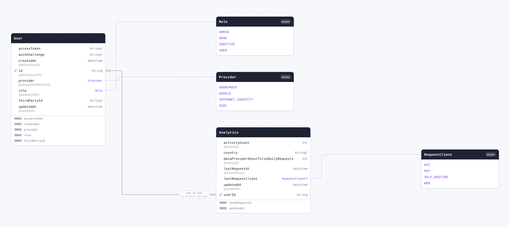

| Field                                 | Type                                   | Constraints                          | Default      | Description |
| ------------------------------------- | -------------------------------------- | ------------------------------------ | ------------ | ----------- |
| `activityCount`                       | `Int`                                  | NOT NULL                             | `0`          |             |
| `country`                             | `String`                               | NULL                                 |              |             |
| `dataProviderGhostfolioDailyRequests` | `Int`                                  | NOT NULL                             | `0`          |             |
| `lastRequestAt`                       | `DateTime`                             | NOT NULL                             | `now()`      |             |
| `lastRequestClient`                   | [`RequestClient`](#enum-RequestClient) | NULL                                 |              |             |
| `updatedAt`                           | `DateTime`                             | NOT NULL                             | `@updatedAt` |             |
| `userId`                              | `String`                               | PK NOT NULL → [User.id](#model-User) |              |             |

#### Indexes

- `@@index([lastRequestAt])`
- `@@index([updatedAt])`

#### References

- `userId` → [User.id](#model-User) (one-to-one, on delete Cascade)

#### Definition

```sql
CREATE TABLE "Analytics" (
    "activityCount" INTEGER NOT NULL DEFAULT 0,
    "country" TEXT,
    "dataProviderGhostfolioDailyRequests" INTEGER NOT NULL DEFAULT 0,
    "lastRequestAt" TIMESTAMP(3) NOT NULL DEFAULT CURRENT_TIMESTAMP,
    "lastRequestClient" "RequestClient",
    "updatedAt" TIMESTAMP(3) NOT NULL,
    "userId" TEXT NOT NULL,

    CONSTRAINT "Analytics_pkey" PRIMARY KEY ("userId")
);

CREATE INDEX "Analytics_lastRequestAt_idx" ON "Analytics"("lastRequestAt");

CREATE INDEX "Analytics_updatedAt_idx" ON "Analytics"("updatedAt");

ALTER TABLE "Analytics" ADD CONSTRAINT "Analytics_userId_fkey" FOREIGN KEY ("userId") REFERENCES "User"("id") ON DELETE CASCADE ON UPDATE CASCADE;
```

<details>
<summary>Queries and their SQL</summary>

**findMany**: Every row

```ts
await prisma.analytics.findMany();
```

```sql
SELECT
  "public"."Analytics"."userId",
  "public"."Analytics"."activityCount",
  "public"."Analytics"."country",
  "public"."Analytics"."dataProviderGhostfolioDailyRequests",
  "public"."Analytics"."lastRequestAt",
  "public"."Analytics"."lastRequestClient"::text,
  "public"."Analytics"."updatedAt"
FROM
  "public"."Analytics"
WHERE
  1 = 1
OFFSET
  $1
-- params: ["0"]
```

**count**: How many rows there are

```ts
await prisma.analytics.count();
```

```sql
SELECT
  COUNT(*) AS "_count$_all"
FROM
  (
    SELECT
      "public"."Analytics"."userId"
    FROM
      "public"."Analytics"
    WHERE
      1 = 1
    OFFSET
      $1
  ) AS "sub"
-- params: ["0"]
```

**findMany**: Every row with its relations

```ts
await prisma.analytics.findMany({ include: { user: true } });
```

```sql
SELECT
  "public"."Analytics"."userId",
  "public"."Analytics"."activityCount",
  "public"."Analytics"."country",
  "public"."Analytics"."dataProviderGhostfolioDailyRequests",
  "public"."Analytics"."lastRequestAt",
  "public"."Analytics"."lastRequestClient"::text,
  "public"."Analytics"."updatedAt"
FROM
  "public"."Analytics"
WHERE
  1 = 1
OFFSET
  $1
-- params: ["0"]

SELECT
  "public"."User"."id",
  "public"."User"."accessToken",
  "public"."User"."authChallenge",
  "public"."User"."createdAt",
  "public"."User"."provider"::text,
  "public"."User"."role"::text,
  "public"."User"."thirdPartyId",
  "public"."User"."updatedAt"
FROM
  "public"."User"
WHERE
  "public"."User"."id" IN ($1)
OFFSET
  $2
-- params: ["<userId of the rows above>","0"]
```

**findUnique**: One row by what is unique to it

```ts
await prisma.analytics.findUnique({ where: { userId: "example" } });
```

```sql
SELECT
  "public"."Analytics"."userId",
  "public"."Analytics"."activityCount",
  "public"."Analytics"."country",
  "public"."Analytics"."dataProviderGhostfolioDailyRequests",
  "public"."Analytics"."lastRequestAt",
  "public"."Analytics"."lastRequestClient"::text,
  "public"."Analytics"."updatedAt"
FROM
  "public"."Analytics"
WHERE
  (
    "public"."Analytics"."userId" = $1
    AND 1 = 1
  )
LIMIT
  $2
OFFSET
  $3
-- params: ["example","1","0"]
```

**create**: Create a row

```ts
await prisma.analytics.create({ data: { userId: "example" } });
```

```sql
INSERT INTO
  "public"."Analytics" (
    "activityCount",
    "dataProviderGhostfolioDailyRequests",
    "lastRequestAt",
    "updatedAt",
    "userId"
  )
VALUES
  ($1, $2, $3, $4, $5)
RETURNING
  "public"."Analytics"."userId",
  "public"."Analytics"."activityCount",
  "public"."Analytics"."country",
  "public"."Analytics"."dataProviderGhostfolioDailyRequests",
  "public"."Analytics"."lastRequestAt",
  "public"."Analytics"."lastRequestClient"::text,
  "public"."Analytics"."updatedAt"
-- params: ["0","0","<now()>","<now()>","example"]
```

**update**: Update a row

```ts
await prisma.analytics.update({ where: { userId: "example" }, data: { activityCount: 1 } });
```

```sql
UPDATE "public"."Analytics"
SET
  "activityCount" = $1,
  "updatedAt" = $2
WHERE
  (
    "public"."Analytics"."userId" = $3
    AND 1 = 1
  )
RETURNING
  "public"."Analytics"."userId",
  "public"."Analytics"."activityCount",
  "public"."Analytics"."country",
  "public"."Analytics"."dataProviderGhostfolioDailyRequests",
  "public"."Analytics"."lastRequestAt",
  "public"."Analytics"."lastRequestClient"::text,
  "public"."Analytics"."updatedAt"
-- params: ["1",{"prisma__type":"generatorCall","prisma__value":{"name":"now","args":[],"returnType":{"type":"DateTime"}}},"example"]
```

**delete**: Delete a row

```ts
await prisma.analytics.delete({ where: { userId: "example" } });
```

```sql
DELETE FROM "public"."Analytics"
WHERE
  (
    "public"."Analytics"."userId" = $1
    AND 1 = 1
  )
RETURNING
  "public"."Analytics"."userId",
  "public"."Analytics"."activityCount",
  "public"."Analytics"."country",
  "public"."Analytics"."dataProviderGhostfolioDailyRequests",
  "public"."Analytics"."lastRequestAt",
  "public"."Analytics"."lastRequestClient"::text,
  "public"."Analytics"."updatedAt"
-- params: ["example"]
```

</details>

<a id="model-ApiKey"></a>

### ApiKey

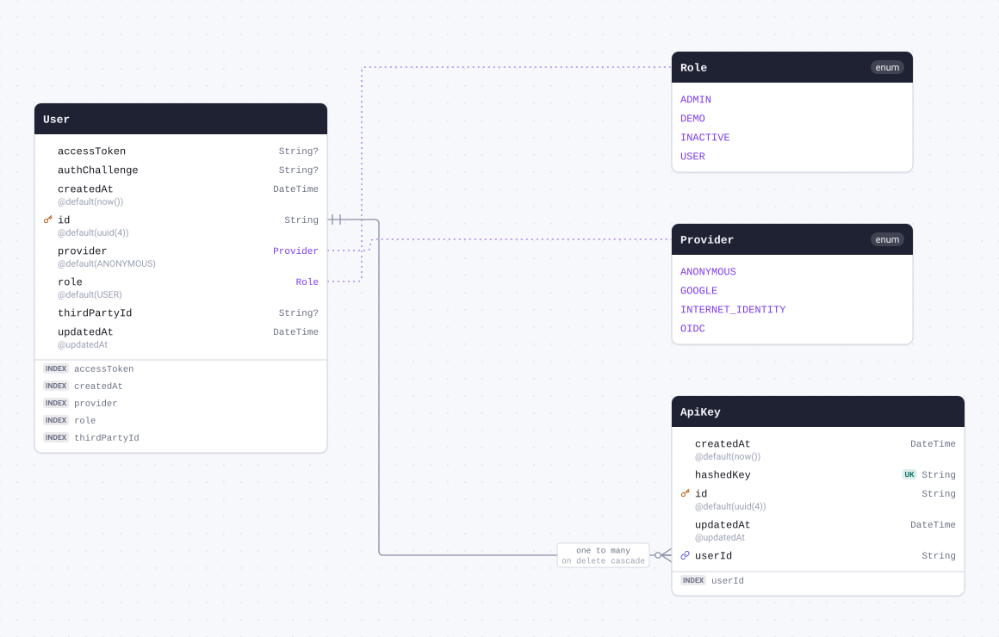

| Field       | Type       | Constraints                       | Default      | Description |
| ----------- | ---------- | --------------------------------- | ------------ | ----------- |
| `createdAt` | `DateTime` | NOT NULL                          | `now()`      |             |
| `hashedKey` | `String`   | UNIQUE NOT NULL                   |              |             |
| `id`        | `String`   | PK NOT NULL                       | `uuid(4)`    |             |
| `updatedAt` | `DateTime` | NOT NULL                          | `@updatedAt` |             |
| `userId`    | `String`   | NOT NULL → [User.id](#model-User) |              |             |

#### Indexes

- `@@index([userId])`

#### References

- `userId` → [User.id](#model-User) (many-to-one, on delete Cascade)

#### Definition

```sql
CREATE TABLE "ApiKey" (
    "createdAt" TIMESTAMP(3) NOT NULL DEFAULT CURRENT_TIMESTAMP,
    "hashedKey" TEXT NOT NULL,
    "id" TEXT NOT NULL,
    "updatedAt" TIMESTAMP(3) NOT NULL,
    "userId" TEXT NOT NULL,

    CONSTRAINT "ApiKey_pkey" PRIMARY KEY ("id")
);

CREATE UNIQUE INDEX "ApiKey_hashedKey_key" ON "ApiKey"("hashedKey");

CREATE INDEX "ApiKey_userId_idx" ON "ApiKey"("userId");

ALTER TABLE "ApiKey" ADD CONSTRAINT "ApiKey_userId_fkey" FOREIGN KEY ("userId") REFERENCES "User"("id") ON DELETE CASCADE ON UPDATE CASCADE;
```

<details>
<summary>Queries and their SQL</summary>

**findMany**: Every row

```ts
await prisma.apiKey.findMany();
```

```sql
SELECT
  "public"."ApiKey"."id",
  "public"."ApiKey"."createdAt",
  "public"."ApiKey"."hashedKey",
  "public"."ApiKey"."updatedAt",
  "public"."ApiKey"."userId"
FROM
  "public"."ApiKey"
WHERE
  1 = 1
OFFSET
  $1
-- params: ["0"]
```

**count**: How many rows there are

```ts
await prisma.apiKey.count();
```

```sql
SELECT
  COUNT(*) AS "_count$_all"
FROM
  (
    SELECT
      "public"."ApiKey"."id"
    FROM
      "public"."ApiKey"
    WHERE
      1 = 1
    OFFSET
      $1
  ) AS "sub"
-- params: ["0"]
```

**findMany**: Every row with its relations

```ts
await prisma.apiKey.findMany({ include: { user: true } });
```

```sql
SELECT
  "public"."ApiKey"."id",
  "public"."ApiKey"."createdAt",
  "public"."ApiKey"."hashedKey",
  "public"."ApiKey"."updatedAt",
  "public"."ApiKey"."userId"
FROM
  "public"."ApiKey"
WHERE
  1 = 1
OFFSET
  $1
-- params: ["0"]

SELECT
  "public"."User"."id",
  "public"."User"."accessToken",
  "public"."User"."authChallenge",
  "public"."User"."createdAt",
  "public"."User"."provider"::text,
  "public"."User"."role"::text,
  "public"."User"."thirdPartyId",
  "public"."User"."updatedAt"
FROM
  "public"."User"
WHERE
  "public"."User"."id" IN ($1)
OFFSET
  $2
-- params: ["<userId of the rows above>","0"]
```

**findUnique**: One row by what is unique to it

```ts
await prisma.apiKey.findUnique({ where: { id: "example" } });
```

```sql
SELECT
  "public"."ApiKey"."id",
  "public"."ApiKey"."createdAt",
  "public"."ApiKey"."hashedKey",
  "public"."ApiKey"."updatedAt",
  "public"."ApiKey"."userId"
FROM
  "public"."ApiKey"
WHERE
  (
    "public"."ApiKey"."id" = $1
    AND 1 = 1
  )
LIMIT
  $2
OFFSET
  $3
-- params: ["example","1","0"]
```

**create**: Create a row

```ts
await prisma.apiKey.create({ data: { hashedKey: "example", userId: "example" } });
```

```sql
INSERT INTO
  "public"."ApiKey" (
    "createdAt",
    "hashedKey",
    "id",
    "updatedAt",
    "userId"
  )
VALUES
  ($1, $2, $3, $4, $5)
RETURNING
  "public"."ApiKey"."id",
  "public"."ApiKey"."createdAt",
  "public"."ApiKey"."hashedKey",
  "public"."ApiKey"."updatedAt",
  "public"."ApiKey"."userId"
-- params: ["<now()>","example","<uuid(4)>","<now()>","example"]
```

**update**: Update a row

```ts
await prisma.apiKey.update({
  where: { id: "example" },
  data: { createdAt: new Date("2026-01-01T00:00:00.000Z") },
});
```

```sql
UPDATE "public"."ApiKey"
SET
  "createdAt" = $1,
  "updatedAt" = $2
WHERE
  (
    "public"."ApiKey"."id" = $3
    AND 1 = 1
  )
RETURNING
  "public"."ApiKey"."id",
  "public"."ApiKey"."createdAt",
  "public"."ApiKey"."hashedKey",
  "public"."ApiKey"."updatedAt",
  "public"."ApiKey"."userId"
-- params: ["2026-01-01T00:00:00.000Z",{"prisma__type":"generatorCall","prisma__value":{"name":"now","args":[],"returnType":{"type":"DateTime"}}},"example"]
```

**delete**: Delete a row

```ts
await prisma.apiKey.delete({ where: { id: "example" } });
```

```sql
DELETE FROM "public"."ApiKey"
WHERE
  (
    "public"."ApiKey"."id" = $1
    AND 1 = 1
  )
RETURNING
  "public"."ApiKey"."id",
  "public"."ApiKey"."createdAt",
  "public"."ApiKey"."hashedKey",
  "public"."ApiKey"."updatedAt",
  "public"."ApiKey"."userId"
-- params: ["example"]
```

</details>

<a id="model-AssetProfileOverrides"></a>

### AssetProfileOverrides

Table `SymbolProfileOverrides`.

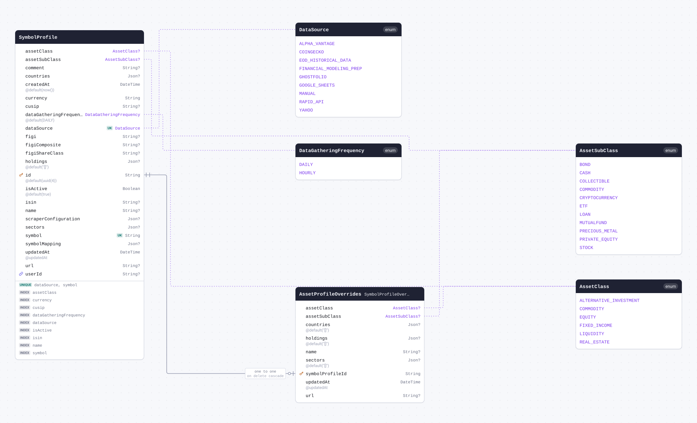

| Field             | Type                                   | Constraints                                            | Default      | Description |
| ----------------- | -------------------------------------- | ------------------------------------------------------ | ------------ | ----------- |
| `assetClass`      | [`AssetClass`](#enum-AssetClass)       | NULL                                                   |              |             |
| `assetSubClass`   | [`AssetSubClass`](#enum-AssetSubClass) | NULL                                                   |              |             |
| `countries`       | `Json`                                 | NULL                                                   | `"[]"`       |             |
| `holdings`        | `Json`                                 | NULL                                                   | `"[]"`       |             |
| `name`            | `String`                               | NULL                                                   |              |             |
| `sectors`         | `Json`                                 | NULL                                                   | `"[]"`       |             |
| `symbolProfileId` | `String`                               | PK NOT NULL → [SymbolProfile.id](#model-SymbolProfile) |              |             |
| `updatedAt`       | `DateTime`                             | NOT NULL                                               | `@updatedAt` |             |
| `url`             | `String`                               | NULL                                                   |              |             |

#### References

- `symbolProfileId` → [SymbolProfile.id](#model-SymbolProfile) (one-to-one, on delete Cascade)

#### Definition

```sql
CREATE TABLE "SymbolProfileOverrides" (
    "assetClass" "AssetClass",
    "assetSubClass" "AssetSubClass",
    "countries" JSONB DEFAULT '[]',
    "holdings" JSONB DEFAULT '[]',
    "name" TEXT,
    "sectors" JSONB DEFAULT '[]',
    "symbolProfileId" TEXT NOT NULL,
    "updatedAt" TIMESTAMP(3) NOT NULL,
    "url" TEXT,

    CONSTRAINT "SymbolProfileOverrides_pkey" PRIMARY KEY ("symbolProfileId")
);

ALTER TABLE "SymbolProfileOverrides" ADD CONSTRAINT "SymbolProfileOverrides_symbolProfileId_fkey" FOREIGN KEY ("symbolProfileId") REFERENCES "SymbolProfile"("id") ON DELETE CASCADE ON UPDATE CASCADE;
```

<details>
<summary>Queries and their SQL</summary>

**findMany**: Every row

```ts
await prisma.assetProfileOverrides.findMany();
```

```sql
SELECT
  "public"."SymbolProfileOverrides"."symbolProfileId",
  "public"."SymbolProfileOverrides"."assetClass"::text,
  "public"."SymbolProfileOverrides"."assetSubClass"::text,
  "public"."SymbolProfileOverrides"."countries",
  "public"."SymbolProfileOverrides"."holdings",
  "public"."SymbolProfileOverrides"."name",
  "public"."SymbolProfileOverrides"."sectors",
  "public"."SymbolProfileOverrides"."updatedAt",
  "public"."SymbolProfileOverrides"."url"
FROM
  "public"."SymbolProfileOverrides"
WHERE
  1 = 1
OFFSET
  $1
-- params: ["0"]
```

**count**: How many rows there are

```ts
await prisma.assetProfileOverrides.count();
```

```sql
SELECT
  COUNT(*) AS "_count$_all"
FROM
  (
    SELECT
      "public"."SymbolProfileOverrides"."symbolProfileId"
    FROM
      "public"."SymbolProfileOverrides"
    WHERE
      1 = 1
    OFFSET
      $1
  ) AS "sub"
-- params: ["0"]
```

**findMany**: Every row with its relations

```ts
await prisma.assetProfileOverrides.findMany({ include: { symbolProfile: true } });
```

```sql
SELECT
  "public"."SymbolProfileOverrides"."symbolProfileId",
  "public"."SymbolProfileOverrides"."assetClass"::text,
  "public"."SymbolProfileOverrides"."assetSubClass"::text,
  "public"."SymbolProfileOverrides"."countries",
  "public"."SymbolProfileOverrides"."holdings",
  "public"."SymbolProfileOverrides"."name",
  "public"."SymbolProfileOverrides"."sectors",
  "public"."SymbolProfileOverrides"."updatedAt",
  "public"."SymbolProfileOverrides"."url"
FROM
  "public"."SymbolProfileOverrides"
WHERE
  1 = 1
OFFSET
  $1
-- params: ["0"]

SELECT
  "public"."SymbolProfile"."id",
  "public"."SymbolProfile"."assetClass"::text,
  "public"."SymbolProfile"."assetSubClass"::text,
  "public"."SymbolProfile"."comment",
  "public"."SymbolProfile"."countries",
  "public"."SymbolProfile"."createdAt",
  "public"."SymbolProfile"."currency",
  "public"."SymbolProfile"."cusip",
  "public"."SymbolProfile"."dataGatheringFrequency"::text,
  "public"."SymbolProfile"."dataSource"::text,
  "public"."SymbolProfile"."figi",
  "public"."SymbolProfile"."figiComposite",
  "public"."SymbolProfile"."figiShareClass",
  "public"."SymbolProfile"."holdings",
  "public"."SymbolProfile"."isActive",
  "public"."SymbolProfile"."isin",
  "public"."SymbolProfile"."name",
  "public"."SymbolProfile"."scraperConfiguration",
  "public"."SymbolProfile"."sectors",
  "public"."SymbolProfile"."symbol",
  "public"."SymbolProfile"."symbolMapping",
  "public"."SymbolProfile"."updatedAt",
  "public"."SymbolProfile"."url",
  "public"."SymbolProfile"."userId"
FROM
  "public"."SymbolProfile"
WHERE
  "public"."SymbolProfile"."id" IN ($1)
OFFSET
  $2
-- params: ["<symbolProfileId of the rows above>","0"]
```

**findUnique**: One row by what is unique to it

```ts
await prisma.assetProfileOverrides.findUnique({ where: { symbolProfileId: "example" } });
```

```sql
SELECT
  "public"."SymbolProfileOverrides"."symbolProfileId",
  "public"."SymbolProfileOverrides"."assetClass"::text,
  "public"."SymbolProfileOverrides"."assetSubClass"::text,
  "public"."SymbolProfileOverrides"."countries",
  "public"."SymbolProfileOverrides"."holdings",
  "public"."SymbolProfileOverrides"."name",
  "public"."SymbolProfileOverrides"."sectors",
  "public"."SymbolProfileOverrides"."updatedAt",
  "public"."SymbolProfileOverrides"."url"
FROM
  "public"."SymbolProfileOverrides"
WHERE
  (
    "public"."SymbolProfileOverrides"."symbolProfileId" = $1
    AND 1 = 1
  )
LIMIT
  $2
OFFSET
  $3
-- params: ["example","1","0"]
```

**create**: Create a row

```ts
await prisma.assetProfileOverrides.create({ data: { symbolProfileId: "example" } });
```

```sql
INSERT INTO
  "public"."SymbolProfileOverrides" (
    "countries",
    "holdings",
    "sectors",
    "symbolProfileId",
    "updatedAt"
  )
VALUES
  ($1, $2, $3, $4, $5)
RETURNING
  "public"."SymbolProfileOverrides"."symbolProfileId",
  "public"."SymbolProfileOverrides"."assetClass"::text,
  "public"."SymbolProfileOverrides"."assetSubClass"::text,
  "public"."SymbolProfileOverrides"."countries",
  "public"."SymbolProfileOverrides"."holdings",
  "public"."SymbolProfileOverrides"."name",
  "public"."SymbolProfileOverrides"."sectors",
  "public"."SymbolProfileOverrides"."updatedAt",
  "public"."SymbolProfileOverrides"."url"
-- params: ["[]","[]","[]","example","<now()>"]
```

**update**: Update a row

```ts
await prisma.assetProfileOverrides.update({
  where: { symbolProfileId: "example" },
  data: { assetClass: "ALTERNATIVE_INVESTMENT" },
});
```

```sql
UPDATE "public"."SymbolProfileOverrides"
SET
  "assetClass" = CAST($1::text AS "public"."AssetClass"),
  "updatedAt" = $2
WHERE
  (
    "public"."SymbolProfileOverrides"."symbolProfileId" = $3
    AND 1 = 1
  )
RETURNING
  "public"."SymbolProfileOverrides"."symbolProfileId",
  "public"."SymbolProfileOverrides"."assetClass"::text,
  "public"."SymbolProfileOverrides"."assetSubClass"::text,
  "public"."SymbolProfileOverrides"."countries",
  "public"."SymbolProfileOverrides"."holdings",
  "public"."SymbolProfileOverrides"."name",
  "public"."SymbolProfileOverrides"."sectors",
  "public"."SymbolProfileOverrides"."updatedAt",
  "public"."SymbolProfileOverrides"."url"
-- params: ["ALTERNATIVE_INVESTMENT",{"prisma__type":"generatorCall","prisma__value":{"name":"now","args":[],"returnType":{"type":"DateTime"}}},"example"]
```

**delete**: Delete a row

```ts
await prisma.assetProfileOverrides.delete({ where: { symbolProfileId: "example" } });
```

```sql
DELETE FROM "public"."SymbolProfileOverrides"
WHERE
  (
    "public"."SymbolProfileOverrides"."symbolProfileId" = $1
    AND 1 = 1
  )
RETURNING
  "public"."SymbolProfileOverrides"."symbolProfileId",
  "public"."SymbolProfileOverrides"."assetClass"::text,
  "public"."SymbolProfileOverrides"."assetSubClass"::text,
  "public"."SymbolProfileOverrides"."countries",
  "public"."SymbolProfileOverrides"."holdings",
  "public"."SymbolProfileOverrides"."name",
  "public"."SymbolProfileOverrides"."sectors",
  "public"."SymbolProfileOverrides"."updatedAt",
  "public"."SymbolProfileOverrides"."url"
-- params: ["example"]
```

</details>

<a id="model-AssetProfileResolution"></a>

### AssetProfileResolution

| Field              | Type                             | Constraints | Default      | Description |
| ------------------ | -------------------------------- | ----------- | ------------ | ----------- |
| `createdAt`        | `DateTime`                       | NOT NULL    | `now()`      |             |
| `currency`         | `String`                         | NOT NULL    |              |             |
| `dataSourceOrigin` | [`DataSource`](#enum-DataSource) | NOT NULL    |              |             |
| `dataSourceTarget` | [`DataSource`](#enum-DataSource) | NOT NULL    |              |             |
| `id`               | `String`                         | PK NOT NULL | `uuid(4)`    |             |
| `requestCount`     | `Int`                            | NOT NULL    | `1`          |             |
| `symbolOrigin`     | `String`                         | NOT NULL    |              |             |
| `symbolTarget`     | `String`                         | NOT NULL    |              |             |
| `updatedAt`        | `DateTime`                       | NOT NULL    | `@updatedAt` |             |

#### Indexes

- `@@unique([dataSourceOrigin, symbolOrigin])`

#### Definition

```sql
CREATE TABLE "AssetProfileResolution" (
    "createdAt" TIMESTAMP(3) NOT NULL DEFAULT CURRENT_TIMESTAMP,
    "currency" TEXT NOT NULL,
    "dataSourceOrigin" "DataSource" NOT NULL,
    "dataSourceTarget" "DataSource" NOT NULL,
    "id" TEXT NOT NULL,
    "requestCount" INTEGER NOT NULL DEFAULT 1,
    "symbolOrigin" TEXT NOT NULL,
    "symbolTarget" TEXT NOT NULL,
    "updatedAt" TIMESTAMP(3) NOT NULL,

    CONSTRAINT "AssetProfileResolution_pkey" PRIMARY KEY ("id")
);

CREATE UNIQUE INDEX "AssetProfileResolution_dataSourceOrigin_symbolOrigin_key" ON "AssetProfileResolution"("dataSourceOrigin", "symbolOrigin");
```

<details>
<summary>Queries and their SQL</summary>

**findMany**: Every row

```ts
await prisma.assetProfileResolution.findMany();
```

```sql
SELECT
  "public"."AssetProfileResolution"."id",
  "public"."AssetProfileResolution"."createdAt",
  "public"."AssetProfileResolution"."currency",
  "public"."AssetProfileResolution"."dataSourceOrigin"::text,
  "public"."AssetProfileResolution"."dataSourceTarget"::text,
  "public"."AssetProfileResolution"."requestCount",
  "public"."AssetProfileResolution"."symbolOrigin",
  "public"."AssetProfileResolution"."symbolTarget",
  "public"."AssetProfileResolution"."updatedAt"
FROM
  "public"."AssetProfileResolution"
WHERE
  1 = 1
OFFSET
  $1
-- params: ["0"]
```

**count**: How many rows there are

```ts
await prisma.assetProfileResolution.count();
```

```sql
SELECT
  COUNT(*) AS "_count$_all"
FROM
  (
    SELECT
      "public"."AssetProfileResolution"."id"
    FROM
      "public"."AssetProfileResolution"
    WHERE
      1 = 1
    OFFSET
      $1
  ) AS "sub"
-- params: ["0"]
```

**findUnique**: One row by what is unique to it

```ts
await prisma.assetProfileResolution.findUnique({ where: { id: "example" } });
```

```sql
SELECT
  "public"."AssetProfileResolution"."id",
  "public"."AssetProfileResolution"."createdAt",
  "public"."AssetProfileResolution"."currency",
  "public"."AssetProfileResolution"."dataSourceOrigin"::text,
  "public"."AssetProfileResolution"."dataSourceTarget"::text,
  "public"."AssetProfileResolution"."requestCount",
  "public"."AssetProfileResolution"."symbolOrigin",
  "public"."AssetProfileResolution"."symbolTarget",
  "public"."AssetProfileResolution"."updatedAt"
FROM
  "public"."AssetProfileResolution"
WHERE
  (
    "public"."AssetProfileResolution"."id" = $1
    AND 1 = 1
  )
LIMIT
  $2
OFFSET
  $3
-- params: ["example","1","0"]
```

**create**: Create a row

```ts
await prisma.assetProfileResolution.create({
  data: {
    currency: "example",
    dataSourceOrigin: "ALPHA_VANTAGE",
    dataSourceTarget: "ALPHA_VANTAGE",
    symbolOrigin: "example",
    symbolTarget: "example",
  },
});
```

```sql
INSERT INTO
  "public"."AssetProfileResolution" (
    "createdAt",
    "currency",
    "dataSourceOrigin",
    "dataSourceTarget",
    "id",
    "requestCount",
    "symbolOrigin",
    "symbolTarget",
    "updatedAt"
  )
VALUES
  (
    $1,
    $2,
    CAST($3::text AS "public"."DataSource"),
    CAST($4::text AS "public"."DataSource"),
    $5,
    $6,
    $7,
    $8,
    $9
  )
RETURNING
  "public"."AssetProfileResolution"."id",
  "public"."AssetProfileResolution"."createdAt",
  "public"."AssetProfileResolution"."currency",
  "public"."AssetProfileResolution"."dataSourceOrigin"::text,
  "public"."AssetProfileResolution"."dataSourceTarget"::text,
  "public"."AssetProfileResolution"."requestCount",
  "public"."AssetProfileResolution"."symbolOrigin",
  "public"."AssetProfileResolution"."symbolTarget",
  "public"."AssetProfileResolution"."updatedAt"
-- params: ["<now()>","example","ALPHA_VANTAGE","ALPHA_VANTAGE","<uuid(4)>","1","example","example","<now()>"]
```

**update**: Update a row

```ts
await prisma.assetProfileResolution.update({
  where: { id: "example" },
  data: { createdAt: new Date("2026-01-01T00:00:00.000Z") },
});
```

```sql
UPDATE "public"."AssetProfileResolution"
SET
  "createdAt" = $1,
  "updatedAt" = $2
WHERE
  (
    "public"."AssetProfileResolution"."id" = $3
    AND 1 = 1
  )
RETURNING
  "public"."AssetProfileResolution"."id",
  "public"."AssetProfileResolution"."createdAt",
  "public"."AssetProfileResolution"."currency",
  "public"."AssetProfileResolution"."dataSourceOrigin"::text,
  "public"."AssetProfileResolution"."dataSourceTarget"::text,
  "public"."AssetProfileResolution"."requestCount",
  "public"."AssetProfileResolution"."symbolOrigin",
  "public"."AssetProfileResolution"."symbolTarget",
  "public"."AssetProfileResolution"."updatedAt"
-- params: ["2026-01-01T00:00:00.000Z",{"prisma__type":"generatorCall","prisma__value":{"name":"now","args":[],"returnType":{"type":"DateTime"}}},"example"]
```

**delete**: Delete a row

```ts
await prisma.assetProfileResolution.delete({ where: { id: "example" } });
```

```sql
DELETE FROM "public"."AssetProfileResolution"
WHERE
  (
    "public"."AssetProfileResolution"."id" = $1
    AND 1 = 1
  )
RETURNING
  "public"."AssetProfileResolution"."id",
  "public"."AssetProfileResolution"."createdAt",
  "public"."AssetProfileResolution"."currency",
  "public"."AssetProfileResolution"."dataSourceOrigin"::text,
  "public"."AssetProfileResolution"."dataSourceTarget"::text,
  "public"."AssetProfileResolution"."requestCount",
  "public"."AssetProfileResolution"."symbolOrigin",
  "public"."AssetProfileResolution"."symbolTarget",
  "public"."AssetProfileResolution"."updatedAt"
-- params: ["example"]
```

</details>

<a id="model-AssetProfileSplit"></a>

### AssetProfileSplit

A stock split of an asset profile. The numerator is the number of shares
held after the split, the denominator the number of shares held before, for
example 4 and 1 for a 4:1 split or 1 and 10 for a 1:10 reverse split.

The ratio is stored as two integers instead of the resulting factor, so that
it stays exact, for example 1/3 for a 1:3 reverse split.

Activities before the date are adjusted by the ratio: the quantity is
multiplied by it and the unit price divided by it, so that the total value
of an activity stays the same.

Market data is already split-adjusted by the data providers and must not be
adjusted again.

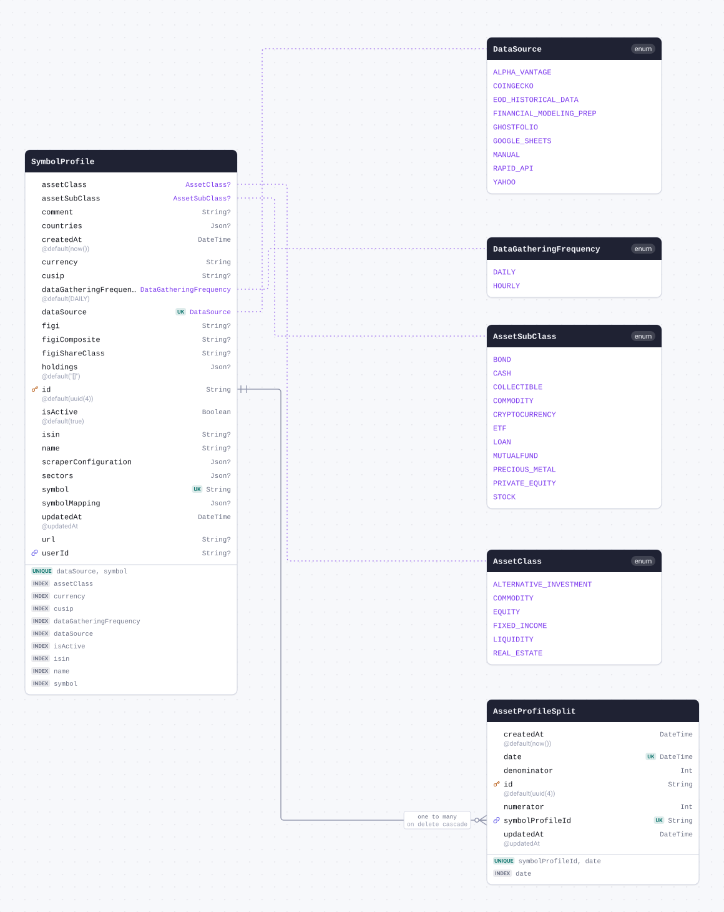

| Field             | Type       | Constraints                                         | Default      | Description |
| ----------------- | ---------- | --------------------------------------------------- | ------------ | ----------- |
| `createdAt`       | `DateTime` | NOT NULL                                            | `now()`      |             |
| `date`            | `DateTime` | NOT NULL                                            |              |             |
| `denominator`     | `Int`      | NOT NULL                                            |              |             |
| `id`              | `String`   | PK NOT NULL                                         | `uuid(4)`    |             |
| `numerator`       | `Int`      | NOT NULL                                            |              |             |
| `symbolProfileId` | `String`   | NOT NULL → [SymbolProfile.id](#model-SymbolProfile) |              |             |
| `updatedAt`       | `DateTime` | NOT NULL                                            | `@updatedAt` |             |

#### Indexes

- `@@index([date])`
- `@@unique([symbolProfileId, date])`

#### References

- `symbolProfileId` → [SymbolProfile.id](#model-SymbolProfile) (many-to-one, on delete Cascade)

#### Definition

```sql
CREATE TABLE "AssetProfileSplit" (
    "createdAt" TIMESTAMP(3) NOT NULL DEFAULT CURRENT_TIMESTAMP,
    "date" TIMESTAMP(3) NOT NULL,
    "denominator" INTEGER NOT NULL,
    "id" TEXT NOT NULL,
    "numerator" INTEGER NOT NULL,
    "symbolProfileId" TEXT NOT NULL,
    "updatedAt" TIMESTAMP(3) NOT NULL,

    CONSTRAINT "AssetProfileSplit_pkey" PRIMARY KEY ("id")
);

CREATE INDEX "AssetProfileSplit_date_idx" ON "AssetProfileSplit"("date");

CREATE UNIQUE INDEX "AssetProfileSplit_symbolProfileId_date_key" ON "AssetProfileSplit"("symbolProfileId", "date");

ALTER TABLE "AssetProfileSplit" ADD CONSTRAINT "AssetProfileSplit_symbolProfileId_fkey" FOREIGN KEY ("symbolProfileId") REFERENCES "SymbolProfile"("id") ON DELETE CASCADE ON UPDATE CASCADE;
```

<details>
<summary>Queries and their SQL</summary>

**findMany**: Every row

```ts
await prisma.assetProfileSplit.findMany();
```

```sql
SELECT
  "public"."AssetProfileSplit"."id",
  "public"."AssetProfileSplit"."createdAt",
  "public"."AssetProfileSplit"."date",
  "public"."AssetProfileSplit"."denominator",
  "public"."AssetProfileSplit"."numerator",
  "public"."AssetProfileSplit"."symbolProfileId",
  "public"."AssetProfileSplit"."updatedAt"
FROM
  "public"."AssetProfileSplit"
WHERE
  1 = 1
OFFSET
  $1
-- params: ["0"]
```

**count**: How many rows there are

```ts
await prisma.assetProfileSplit.count();
```

```sql
SELECT
  COUNT(*) AS "_count$_all"
FROM
  (
    SELECT
      "public"."AssetProfileSplit"."id"
    FROM
      "public"."AssetProfileSplit"
    WHERE
      1 = 1
    OFFSET
      $1
  ) AS "sub"
-- params: ["0"]
```

**findMany**: Every row with its relations

```ts
await prisma.assetProfileSplit.findMany({ include: { symbolProfile: true } });
```

```sql
SELECT
  "public"."AssetProfileSplit"."id",
  "public"."AssetProfileSplit"."createdAt",
  "public"."AssetProfileSplit"."date",
  "public"."AssetProfileSplit"."denominator",
  "public"."AssetProfileSplit"."numerator",
  "public"."AssetProfileSplit"."symbolProfileId",
  "public"."AssetProfileSplit"."updatedAt"
FROM
  "public"."AssetProfileSplit"
WHERE
  1 = 1
OFFSET
  $1
-- params: ["0"]

SELECT
  "public"."SymbolProfile"."id",
  "public"."SymbolProfile"."assetClass"::text,
  "public"."SymbolProfile"."assetSubClass"::text,
  "public"."SymbolProfile"."comment",
  "public"."SymbolProfile"."countries",
  "public"."SymbolProfile"."createdAt",
  "public"."SymbolProfile"."currency",
  "public"."SymbolProfile"."cusip",
  "public"."SymbolProfile"."dataGatheringFrequency"::text,
  "public"."SymbolProfile"."dataSource"::text,
  "public"."SymbolProfile"."figi",
  "public"."SymbolProfile"."figiComposite",
  "public"."SymbolProfile"."figiShareClass",
  "public"."SymbolProfile"."holdings",
  "public"."SymbolProfile"."isActive",
  "public"."SymbolProfile"."isin",
  "public"."SymbolProfile"."name",
  "public"."SymbolProfile"."scraperConfiguration",
  "public"."SymbolProfile"."sectors",
  "public"."SymbolProfile"."symbol",
  "public"."SymbolProfile"."symbolMapping",
  "public"."SymbolProfile"."updatedAt",
  "public"."SymbolProfile"."url",
  "public"."SymbolProfile"."userId"
FROM
  "public"."SymbolProfile"
WHERE
  "public"."SymbolProfile"."id" IN ($1)
OFFSET
  $2
-- params: ["<symbolProfileId of the rows above>","0"]
```

**findUnique**: One row by what is unique to it

```ts
await prisma.assetProfileSplit.findUnique({ where: { id: "example" } });
```

```sql
SELECT
  "public"."AssetProfileSplit"."id",
  "public"."AssetProfileSplit"."createdAt",
  "public"."AssetProfileSplit"."date",
  "public"."AssetProfileSplit"."denominator",
  "public"."AssetProfileSplit"."numerator",
  "public"."AssetProfileSplit"."symbolProfileId",
  "public"."AssetProfileSplit"."updatedAt"
FROM
  "public"."AssetProfileSplit"
WHERE
  (
    "public"."AssetProfileSplit"."id" = $1
    AND 1 = 1
  )
LIMIT
  $2
OFFSET
  $3
-- params: ["example","1","0"]
```

**create**: Create a row

```ts
await prisma.assetProfileSplit.create({
  data: {
    date: new Date("2026-01-01T00:00:00.000Z"),
    denominator: 1,
    numerator: 1,
    symbolProfileId: "example",
  },
});
```

```sql
INSERT INTO
  "public"."AssetProfileSplit" (
    "createdAt",
    "date",
    "denominator",
    "id",
    "numerator",
    "symbolProfileId",
    "updatedAt"
  )
VALUES
  ($1, $2, $3, $4, $5, $6, $7)
RETURNING
  "public"."AssetProfileSplit"."id",
  "public"."AssetProfileSplit"."createdAt",
  "public"."AssetProfileSplit"."date",
  "public"."AssetProfileSplit"."denominator",
  "public"."AssetProfileSplit"."numerator",
  "public"."AssetProfileSplit"."symbolProfileId",
  "public"."AssetProfileSplit"."updatedAt"
-- params: ["<now()>","2026-01-01T00:00:00.000Z","1","<uuid(4)>","1","example","<now()>"]
```

**update**: Update a row

```ts
await prisma.assetProfileSplit.update({
  where: { id: "example" },
  data: { createdAt: new Date("2026-01-01T00:00:00.000Z") },
});
```

```sql
UPDATE "public"."AssetProfileSplit"
SET
  "createdAt" = $1,
  "updatedAt" = $2
WHERE
  (
    "public"."AssetProfileSplit"."id" = $3
    AND 1 = 1
  )
RETURNING
  "public"."AssetProfileSplit"."id",
  "public"."AssetProfileSplit"."createdAt",
  "public"."AssetProfileSplit"."date",
  "public"."AssetProfileSplit"."denominator",
  "public"."AssetProfileSplit"."numerator",
  "public"."AssetProfileSplit"."symbolProfileId",
  "public"."AssetProfileSplit"."updatedAt"
-- params: ["2026-01-01T00:00:00.000Z",{"prisma__type":"generatorCall","prisma__value":{"name":"now","args":[],"returnType":{"type":"DateTime"}}},"example"]
```

**delete**: Delete a row

```ts
await prisma.assetProfileSplit.delete({ where: { id: "example" } });
```

```sql
DELETE FROM "public"."AssetProfileSplit"
WHERE
  (
    "public"."AssetProfileSplit"."id" = $1
    AND 1 = 1
  )
RETURNING
  "public"."AssetProfileSplit"."id",
  "public"."AssetProfileSplit"."createdAt",
  "public"."AssetProfileSplit"."date",
  "public"."AssetProfileSplit"."denominator",
  "public"."AssetProfileSplit"."numerator",
  "public"."AssetProfileSplit"."symbolProfileId",
  "public"."AssetProfileSplit"."updatedAt"
-- params: ["example"]
```

</details>

<a id="model-AuthDevice"></a>

### AuthDevice

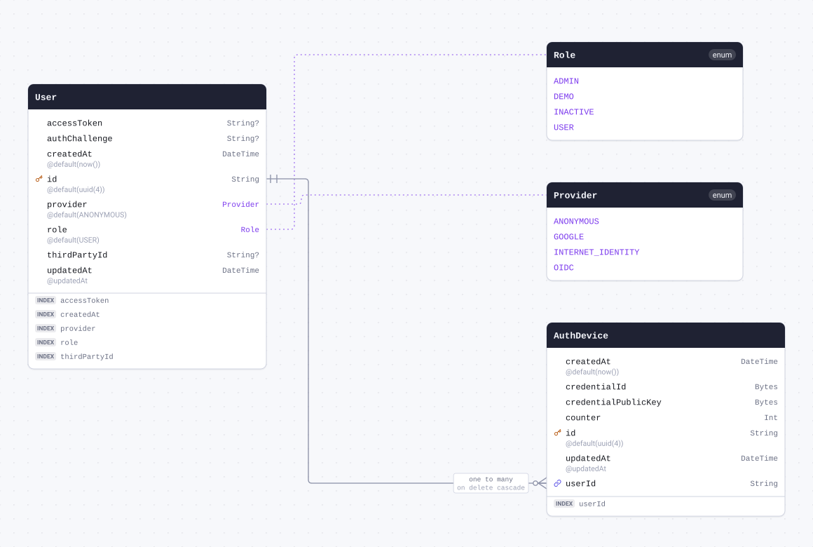

| Field                 | Type       | Constraints                       | Default      | Description |
| --------------------- | ---------- | --------------------------------- | ------------ | ----------- |
| `createdAt`           | `DateTime` | NOT NULL                          | `now()`      |             |
| `credentialId`        | `Bytes`    | NOT NULL                          |              |             |
| `credentialPublicKey` | `Bytes`    | NOT NULL                          |              |             |
| `counter`             | `Int`      | NOT NULL                          |              |             |
| `id`                  | `String`   | PK NOT NULL                       | `uuid(4)`    |             |
| `updatedAt`           | `DateTime` | NOT NULL                          | `@updatedAt` |             |
| `userId`              | `String`   | NOT NULL → [User.id](#model-User) |              |             |

#### Indexes

- `@@index([userId])`

#### References

- `userId` → [User.id](#model-User) (many-to-one, on delete Cascade)

#### Definition

```sql
CREATE TABLE "AuthDevice" (
    "createdAt" TIMESTAMP(3) NOT NULL DEFAULT CURRENT_TIMESTAMP,
    "credentialId" BYTEA NOT NULL,
    "credentialPublicKey" BYTEA NOT NULL,
    "counter" INTEGER NOT NULL,
    "id" TEXT NOT NULL,
    "updatedAt" TIMESTAMP(3) NOT NULL,
    "userId" TEXT NOT NULL,

    CONSTRAINT "AuthDevice_pkey" PRIMARY KEY ("id")
);

CREATE INDEX "AuthDevice_userId_idx" ON "AuthDevice"("userId");

ALTER TABLE "AuthDevice" ADD CONSTRAINT "AuthDevice_userId_fkey" FOREIGN KEY ("userId") REFERENCES "User"("id") ON DELETE CASCADE ON UPDATE CASCADE;
```

<details>
<summary>Queries and their SQL</summary>

**findMany**: Every row

```ts
await prisma.authDevice.findMany();
```

```sql
SELECT
  "public"."AuthDevice"."id",
  "public"."AuthDevice"."createdAt",
  "public"."AuthDevice"."credentialId",
  "public"."AuthDevice"."credentialPublicKey",
  "public"."AuthDevice"."counter",
  "public"."AuthDevice"."updatedAt",
  "public"."AuthDevice"."userId"
FROM
  "public"."AuthDevice"
WHERE
  1 = 1
OFFSET
  $1
-- params: ["0"]
```

**count**: How many rows there are

```ts
await prisma.authDevice.count();
```

```sql
SELECT
  COUNT(*) AS "_count$_all"
FROM
  (
    SELECT
      "public"."AuthDevice"."id"
    FROM
      "public"."AuthDevice"
    WHERE
      1 = 1
    OFFSET
      $1
  ) AS "sub"
-- params: ["0"]
```

**findMany**: Every row with its relations

```ts
await prisma.authDevice.findMany({ include: { user: true } });
```

```sql
SELECT
  "public"."AuthDevice"."id",
  "public"."AuthDevice"."createdAt",
  "public"."AuthDevice"."credentialId",
  "public"."AuthDevice"."credentialPublicKey",
  "public"."AuthDevice"."counter",
  "public"."AuthDevice"."updatedAt",
  "public"."AuthDevice"."userId"
FROM
  "public"."AuthDevice"
WHERE
  1 = 1
OFFSET
  $1
-- params: ["0"]

SELECT
  "public"."User"."id",
  "public"."User"."accessToken",
  "public"."User"."authChallenge",
  "public"."User"."createdAt",
  "public"."User"."provider"::text,
  "public"."User"."role"::text,
  "public"."User"."thirdPartyId",
  "public"."User"."updatedAt"
FROM
  "public"."User"
WHERE
  "public"."User"."id" IN ($1)
OFFSET
  $2
-- params: ["<userId of the rows above>","0"]
```

**findUnique**: One row by what is unique to it

```ts
await prisma.authDevice.findUnique({ where: { id: "example" } });
```

```sql
SELECT
  "public"."AuthDevice"."id",
  "public"."AuthDevice"."createdAt",
  "public"."AuthDevice"."credentialId",
  "public"."AuthDevice"."credentialPublicKey",
  "public"."AuthDevice"."counter",
  "public"."AuthDevice"."updatedAt",
  "public"."AuthDevice"."userId"
FROM
  "public"."AuthDevice"
WHERE
  (
    "public"."AuthDevice"."id" = $1
    AND 1 = 1
  )
LIMIT
  $2
OFFSET
  $3
-- params: ["example","1","0"]
```

**create**: Create a row

```ts
await prisma.authDevice.create({
  data: {
    credentialId: Uint8Array.from([1, 2, 3]),
    credentialPublicKey: Uint8Array.from([1, 2, 3]),
    counter: 1,
    userId: "example",
  },
});
```

```sql
INSERT INTO
  "public"."AuthDevice" (
    "createdAt",
    "credentialId",
    "credentialPublicKey",
    "counter",
    "id",
    "updatedAt",
    "userId"
  )
VALUES
  ($1, $2, $3, $4, $5, $6, $7)
RETURNING
  "public"."AuthDevice"."id",
  "public"."AuthDevice"."createdAt",
  "public"."AuthDevice"."credentialId",
  "public"."AuthDevice"."credentialPublicKey",
  "public"."AuthDevice"."counter",
  "public"."AuthDevice"."updatedAt",
  "public"."AuthDevice"."userId"
-- params: ["<now()>","AQID","AQID","1","<uuid(4)>","<now()>","example"]
```

**update**: Update a row

```ts
await prisma.authDevice.update({
  where: { id: "example" },
  data: { createdAt: new Date("2026-01-01T00:00:00.000Z") },
});
```

```sql
UPDATE "public"."AuthDevice"
SET
  "createdAt" = $1,
  "updatedAt" = $2
WHERE
  (
    "public"."AuthDevice"."id" = $3
    AND 1 = 1
  )
RETURNING
  "public"."AuthDevice"."id",
  "public"."AuthDevice"."createdAt",
  "public"."AuthDevice"."credentialId",
  "public"."AuthDevice"."credentialPublicKey",
  "public"."AuthDevice"."counter",
  "public"."AuthDevice"."updatedAt",
  "public"."AuthDevice"."userId"
-- params: ["2026-01-01T00:00:00.000Z",{"prisma__type":"generatorCall","prisma__value":{"name":"now","args":[],"returnType":{"type":"DateTime"}}},"example"]
```

**delete**: Delete a row

```ts
await prisma.authDevice.delete({ where: { id: "example" } });
```

```sql
DELETE FROM "public"."AuthDevice"
WHERE
  (
    "public"."AuthDevice"."id" = $1
    AND 1 = 1
  )
RETURNING
  "public"."AuthDevice"."id",
  "public"."AuthDevice"."createdAt",
  "public"."AuthDevice"."credentialId",
  "public"."AuthDevice"."credentialPublicKey",
  "public"."AuthDevice"."counter",
  "public"."AuthDevice"."updatedAt",
  "public"."AuthDevice"."userId"
-- params: ["example"]
```

</details>

<a id="model-MarketData"></a>

### MarketData

| Field              | Type                                       | Constraints | Default   | Description |
| ------------------ | ------------------------------------------ | ----------- | --------- | ----------- |
| `createdAt`        | `DateTime`                                 | NOT NULL    | `now()`   |             |
| `dataSource`       | [`DataSource`](#enum-DataSource)           | NOT NULL    |           |             |
| `date`             | `DateTime`                                 | NOT NULL    |           |             |
| `id`               | `String`                                   | PK NOT NULL | `uuid(4)` |             |
| `isCarriedForward` | `Boolean`                                  | NOT NULL    | `false`   |             |
| `marketPrice`      | `Float`                                    | NOT NULL    |           |             |
| `state`            | [`MarketDataState`](#enum-MarketDataState) | NOT NULL    | `CLOSE`   |             |
| `symbol`           | `String`                                   | NOT NULL    |           |             |

#### Indexes

- `@@index([date])`
- `@@index([state])`
- `@@index([symbol])`
- `@@unique([dataSource, symbol, date])`

#### Definition

```sql
CREATE TABLE "MarketData" (
    "createdAt" TIMESTAMP(3) NOT NULL DEFAULT CURRENT_TIMESTAMP,
    "dataSource" "DataSource" NOT NULL,
    "date" TIMESTAMP(3) NOT NULL,
    "id" TEXT NOT NULL,
    "isCarriedForward" BOOLEAN NOT NULL DEFAULT false,
    "marketPrice" DOUBLE PRECISION NOT NULL,
    "state" "MarketDataState" NOT NULL DEFAULT 'CLOSE',
    "symbol" TEXT NOT NULL,

    CONSTRAINT "MarketData_pkey" PRIMARY KEY ("id")
);

CREATE INDEX "MarketData_date_idx" ON "MarketData"("date");

CREATE INDEX "MarketData_state_idx" ON "MarketData"("state");

CREATE INDEX "MarketData_symbol_idx" ON "MarketData"("symbol");

CREATE UNIQUE INDEX "MarketData_dataSource_symbol_date_key" ON "MarketData"("dataSource", "symbol", "date");
```

<details>
<summary>Queries and their SQL</summary>

**findMany**: Every row

```ts
await prisma.marketData.findMany();
```

```sql
SELECT
  "public"."MarketData"."id",
  "public"."MarketData"."createdAt",
  "public"."MarketData"."dataSource"::text,
  "public"."MarketData"."date",
  "public"."MarketData"."isCarriedForward",
  "public"."MarketData"."marketPrice",
  "public"."MarketData"."state"::text,
  "public"."MarketData"."symbol"
FROM
  "public"."MarketData"
WHERE
  1 = 1
OFFSET
  $1
-- params: ["0"]
```

**count**: How many rows there are

```ts
await prisma.marketData.count();
```

```sql
SELECT
  COUNT(*) AS "_count$_all"
FROM
  (
    SELECT
      "public"."MarketData"."id"
    FROM
      "public"."MarketData"
    WHERE
      1 = 1
    OFFSET
      $1
  ) AS "sub"
-- params: ["0"]
```

**findUnique**: One row by what is unique to it

```ts
await prisma.marketData.findUnique({ where: { id: "example" } });
```

```sql
SELECT
  "public"."MarketData"."id",
  "public"."MarketData"."createdAt",
  "public"."MarketData"."dataSource"::text,
  "public"."MarketData"."date",
  "public"."MarketData"."isCarriedForward",
  "public"."MarketData"."marketPrice",
  "public"."MarketData"."state"::text,
  "public"."MarketData"."symbol"
FROM
  "public"."MarketData"
WHERE
  (
    "public"."MarketData"."id" = $1
    AND 1 = 1
  )
LIMIT
  $2
OFFSET
  $3
-- params: ["example","1","0"]
```

**create**: Create a row

```ts
await prisma.marketData.create({
  data: {
    dataSource: "ALPHA_VANTAGE",
    date: new Date("2026-01-01T00:00:00.000Z"),
    marketPrice: 1.5,
    symbol: "example",
  },
});
```

```sql
INSERT INTO
  "public"."MarketData" (
    "createdAt",
    "dataSource",
    "date",
    "id",
    "isCarriedForward",
    "marketPrice",
    "state",
    "symbol"
  )
VALUES
  (
    $1,
    CAST($2::text AS "public"."DataSource"),
    $3,
    $4,
    $5,
    $6,
    CAST($7::text AS "public"."MarketDataState"),
    $8
  )
RETURNING
  "public"."MarketData"."id",
  "public"."MarketData"."createdAt",
  "public"."MarketData"."dataSource"::text,
  "public"."MarketData"."date",
  "public"."MarketData"."isCarriedForward",
  "public"."MarketData"."marketPrice",
  "public"."MarketData"."state"::text,
  "public"."MarketData"."symbol"
-- params: ["<now()>","ALPHA_VANTAGE","2026-01-01T00:00:00.000Z","<uuid(4)>",false,"1.5","CLOSE","example"]
```

**update**: Update a row

```ts
await prisma.marketData.update({
  where: { id: "example" },
  data: { createdAt: new Date("2026-01-01T00:00:00.000Z") },
});
```

```sql
UPDATE "public"."MarketData"
SET
  "createdAt" = $1
WHERE
  (
    "public"."MarketData"."id" = $2
    AND 1 = 1
  )
RETURNING
  "public"."MarketData"."id",
  "public"."MarketData"."createdAt",
  "public"."MarketData"."dataSource"::text,
  "public"."MarketData"."date",
  "public"."MarketData"."isCarriedForward",
  "public"."MarketData"."marketPrice",
  "public"."MarketData"."state"::text,
  "public"."MarketData"."symbol"
-- params: ["2026-01-01T00:00:00.000Z","example"]
```

**delete**: Delete a row

```ts
await prisma.marketData.delete({ where: { id: "example" } });
```

```sql
DELETE FROM "public"."MarketData"
WHERE
  (
    "public"."MarketData"."id" = $1
    AND 1 = 1
  )
RETURNING
  "public"."MarketData"."id",
  "public"."MarketData"."createdAt",
  "public"."MarketData"."dataSource"::text,
  "public"."MarketData"."date",
  "public"."MarketData"."isCarriedForward",
  "public"."MarketData"."marketPrice",
  "public"."MarketData"."state"::text,
  "public"."MarketData"."symbol"
-- params: ["example"]
```

</details>

<a id="model-Order"></a>

### Order

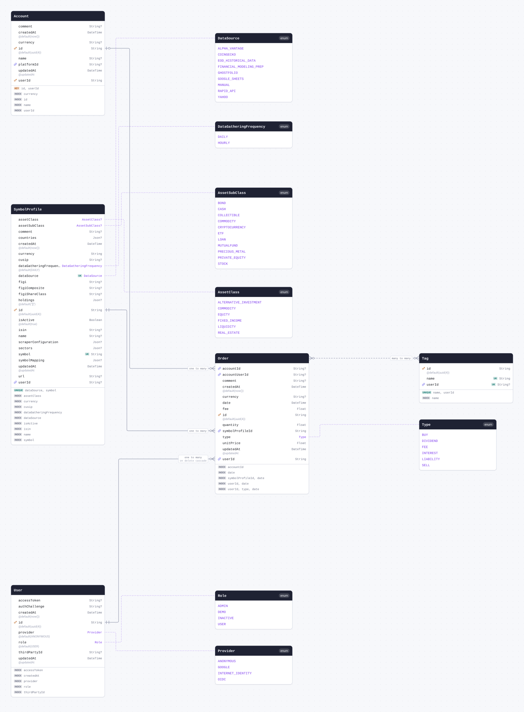

| Field             | Type                 | Constraints                                         | Default      | Description |
| ----------------- | -------------------- | --------------------------------------------------- | ------------ | ----------- |
| `accountId`       | `String`             | NULL → [Account.id](#model-Account)                 |              |             |
| `accountUserId`   | `String`             | NULL → [Account.userId](#model-Account)             |              |             |
| `comment`         | `String`             | NULL                                                |              |             |
| `createdAt`       | `DateTime`           | NOT NULL                                            | `now()`      |             |
| `currency`        | `String`             | NULL                                                |              |             |
| `date`            | `DateTime`           | NOT NULL                                            |              |             |
| `fee`             | `Float`              | NOT NULL                                            |              |             |
| `id`              | `String`             | PK NOT NULL                                         | `uuid(4)`    |             |
| `quantity`        | `Float`              | NOT NULL                                            |              |             |
| `symbolProfileId` | `String`             | NOT NULL → [SymbolProfile.id](#model-SymbolProfile) |              |             |
| `type`            | [`Type`](#enum-Type) | NOT NULL                                            |              |             |
| `unitPrice`       | `Float`              | NOT NULL                                            |              |             |
| `updatedAt`       | `DateTime`           | NOT NULL                                            | `@updatedAt` |             |
| `userId`          | `String`             | NOT NULL → [User.id](#model-User)                   |              |             |

#### Indexes

- `@@index([accountId])`
- `@@index([date])`
- `@@index([symbolProfileId, date])`
- `@@index([userId, date])`
- `@@index([userId, type, date])`

#### References

- `accountId` → [Account.id](#model-Account) (many-to-one)
- `userId` → [User.id](#model-User) (many-to-one, on delete Cascade)
- `symbolProfileId` → [SymbolProfile.id](#model-SymbolProfile) (many-to-one)

#### Many to many

- `tags` ↔ [Tag.activities](#model-Tag) through `_OrderToTag`

#### Definition

```sql
CREATE TABLE "Order" (
    "accountId" TEXT,
    "accountUserId" TEXT,
    "comment" TEXT,
    "createdAt" TIMESTAMP(3) NOT NULL DEFAULT CURRENT_TIMESTAMP,
    "currency" TEXT,
    "date" TIMESTAMP(3) NOT NULL,
    "fee" DOUBLE PRECISION NOT NULL,
    "id" TEXT NOT NULL,
    "quantity" DOUBLE PRECISION NOT NULL,
    "symbolProfileId" TEXT NOT NULL,
    "type" "Type" NOT NULL,
    "unitPrice" DOUBLE PRECISION NOT NULL,
    "updatedAt" TIMESTAMP(3) NOT NULL,
    "userId" TEXT NOT NULL,

    CONSTRAINT "Order_pkey" PRIMARY KEY ("id")
);

CREATE INDEX "Order_accountId_idx" ON "Order"("accountId");

CREATE INDEX "Order_date_idx" ON "Order"("date");

CREATE INDEX "Order_symbolProfileId_date_idx" ON "Order"("symbolProfileId", "date");

CREATE INDEX "Order_userId_date_idx" ON "Order"("userId", "date");

CREATE INDEX "Order_userId_type_date_idx" ON "Order"("userId", "type", "date");

ALTER TABLE "Order" ADD CONSTRAINT "Order_accountId_accountUserId_fkey" FOREIGN KEY ("accountId", "accountUserId") REFERENCES "Account"("id", "userId") ON DELETE SET NULL ON UPDATE CASCADE;

ALTER TABLE "Order" ADD CONSTRAINT "Order_userId_fkey" FOREIGN KEY ("userId") REFERENCES "User"("id") ON DELETE CASCADE ON UPDATE CASCADE;

ALTER TABLE "Order" ADD CONSTRAINT "Order_symbolProfileId_fkey" FOREIGN KEY ("symbolProfileId") REFERENCES "SymbolProfile"("id") ON DELETE RESTRICT ON UPDATE CASCADE;
```

<details>
<summary>Queries and their SQL</summary>

**findMany**: Every row

```ts
await prisma.order.findMany();
```

```sql
SELECT
  "public"."Order"."id",
  "public"."Order"."accountId",
  "public"."Order"."accountUserId",
  "public"."Order"."comment",
  "public"."Order"."createdAt",
  "public"."Order"."currency",
  "public"."Order"."date",
  "public"."Order"."fee",
  "public"."Order"."quantity",
  "public"."Order"."symbolProfileId",
  "public"."Order"."type"::text,
  "public"."Order"."unitPrice",
  "public"."Order"."updatedAt",
  "public"."Order"."userId"
FROM
  "public"."Order"
WHERE
  1 = 1
OFFSET
  $1
-- params: ["0"]
```

**count**: How many rows there are

```ts
await prisma.order.count();
```

```sql
SELECT
  COUNT(*) AS "_count$_all"
FROM
  (
    SELECT
      "public"."Order"."id"
    FROM
      "public"."Order"
    WHERE
      1 = 1
    OFFSET
      $1
  ) AS "sub"
-- params: ["0"]
```

**findMany**: Every row with its relations

```ts
await prisma.order.findMany({
  include: { account: true, tags: true, user: true, SymbolProfile: true },
});
```

```sql
SELECT
  "public"."Order"."id",
  "public"."Order"."accountId",
  "public"."Order"."accountUserId",
  "public"."Order"."comment",
  "public"."Order"."createdAt",
  "public"."Order"."currency",
  "public"."Order"."date",
  "public"."Order"."fee",
  "public"."Order"."quantity",
  "public"."Order"."symbolProfileId",
  "public"."Order"."type"::text,
  "public"."Order"."unitPrice",
  "public"."Order"."updatedAt",
  "public"."Order"."userId"
FROM
  "public"."Order"
WHERE
  1 = 1
OFFSET
  $1
-- params: ["0"]

SELECT
  "public"."Account"."id",
  "public"."Account"."userId",
  "public"."Account"."comment",
  "public"."Account"."createdAt",
  "public"."Account"."currency",
  "public"."Account"."name",
  "public"."Account"."platformId",
  "public"."Account"."updatedAt"
FROM
  "public"."Account"
WHERE
  (
    "public"."Account"."id" IN ($1)
    AND "public"."Account"."userId" IN ($2)
  )
OFFSET
  $3
-- params: ["<accountId of the rows above>","<accountUserId of the rows above>","0"]

SELECT
  "public"."Tag"."id",
  "public"."Tag"."name",
  "public"."Tag"."userId",
  "t0"."A" AS "OrderToTag@Order"
FROM
  "public"."Tag"
  INNER JOIN "public"."_OrderToTag" AS "t0" ON "t0"."B" = "public"."Tag"."id"
WHERE
  (
    1 = 1
    AND "t0"."A" IN ($1)
  )
OFFSET
  $2
-- params: ["<id of the rows above>","0"]

SELECT
  "public"."User"."id",
  "public"."User"."accessToken",
  "public"."User"."authChallenge",
  "public"."User"."createdAt",
  "public"."User"."provider"::text,
  "public"."User"."role"::text,
  "public"."User"."thirdPartyId",
  "public"."User"."updatedAt"
FROM
  "public"."User"
WHERE
  "public"."User"."id" IN ($1)
OFFSET
  $2
-- params: ["<userId of the rows above>","0"]

SELECT
  "public"."SymbolProfile"."id",
  "public"."SymbolProfile"."assetClass"::text,
  "public"."SymbolProfile"."assetSubClass"::text,
  "public"."SymbolProfile"."comment",
  "public"."SymbolProfile"."countries",
  "public"."SymbolProfile"."createdAt",
  "public"."SymbolProfile"."currency",
  "public"."SymbolProfile"."cusip",
  "public"."SymbolProfile"."dataGatheringFrequency"::text,
  "public"."SymbolProfile"."dataSource"::text,
  "public"."SymbolProfile"."figi",
  "public"."SymbolProfile"."figiComposite",
  "public"."SymbolProfile"."figiShareClass",
  "public"."SymbolProfile"."holdings",
  "public"."SymbolProfile"."isActive",
  "public"."SymbolProfile"."isin",
  "public"."SymbolProfile"."name",
  "public"."SymbolProfile"."scraperConfiguration",
  "public"."SymbolProfile"."sectors",
  "public"."SymbolProfile"."symbol",
  "public"."SymbolProfile"."symbolMapping",
  "public"."SymbolProfile"."updatedAt",
  "public"."SymbolProfile"."url",
  "public"."SymbolProfile"."userId"
FROM
  "public"."SymbolProfile"
WHERE
  "public"."SymbolProfile"."id" IN ($1)
OFFSET
  $2
-- params: ["<symbolProfileId of the rows above>","0"]
```

**findUnique**: One row by what is unique to it

```ts
await prisma.order.findUnique({ where: { id: "example" } });
```

```sql
SELECT
  "public"."Order"."id",
  "public"."Order"."accountId",
  "public"."Order"."accountUserId",
  "public"."Order"."comment",
  "public"."Order"."createdAt",
  "public"."Order"."currency",
  "public"."Order"."date",
  "public"."Order"."fee",
  "public"."Order"."quantity",
  "public"."Order"."symbolProfileId",
  "public"."Order"."type"::text,
  "public"."Order"."unitPrice",
  "public"."Order"."updatedAt",
  "public"."Order"."userId"
FROM
  "public"."Order"
WHERE
  (
    "public"."Order"."id" = $1
    AND 1 = 1
  )
LIMIT
  $2
OFFSET
  $3
-- params: ["example","1","0"]
```

**create**: Create a row

```ts
await prisma.order.create({
  data: {
    date: new Date("2026-01-01T00:00:00.000Z"),
    fee: 1.5,
    quantity: 1.5,
    symbolProfileId: "example",
    type: "BUY",
    unitPrice: 1.5,
    userId: "example",
  },
});
```

```sql
INSERT INTO
  "public"."Order" (
    "createdAt",
    "date",
    "fee",
    "id",
    "quantity",
    "symbolProfileId",
    "type",
    "unitPrice",
    "updatedAt",
    "userId"
  )
VALUES
  (
    $1,
    $2,
    $3,
    $4,
    $5,
    $6,
    CAST($7::text AS "public"."Type"),
    $8,
    $9,
    $10
  )
RETURNING
  "public"."Order"."id",
  "public"."Order"."accountId",
  "public"."Order"."accountUserId",
  "public"."Order"."comment",
  "public"."Order"."createdAt",
  "public"."Order"."currency",
  "public"."Order"."date",
  "public"."Order"."fee",
  "public"."Order"."quantity",
  "public"."Order"."symbolProfileId",
  "public"."Order"."type"::text,
  "public"."Order"."unitPrice",
  "public"."Order"."updatedAt",
  "public"."Order"."userId"
-- params: ["<now()>","2026-01-01T00:00:00.000Z","1.5","<uuid(4)>","1.5","example","BUY","1.5","<now()>","example"]
```

**update**: Update a row

```ts
await prisma.order.update({ where: { id: "example" }, data: { comment: "example" } });
```

```sql
UPDATE "public"."Order"
SET
  "comment" = $1,
  "updatedAt" = $2
WHERE
  (
    "public"."Order"."id" = $3
    AND 1 = 1
  )
RETURNING
  "public"."Order"."id",
  "public"."Order"."accountId",
  "public"."Order"."accountUserId",
  "public"."Order"."comment",
  "public"."Order"."createdAt",
  "public"."Order"."currency",
  "public"."Order"."date",
  "public"."Order"."fee",
  "public"."Order"."quantity",
  "public"."Order"."symbolProfileId",
  "public"."Order"."type"::text,
  "public"."Order"."unitPrice",
  "public"."Order"."updatedAt",
  "public"."Order"."userId"
-- params: ["example",{"prisma__type":"generatorCall","prisma__value":{"name":"now","args":[],"returnType":{"type":"DateTime"}}},"example"]
```

**delete**: Delete a row

```ts
await prisma.order.delete({ where: { id: "example" } });
```

```sql
DELETE FROM "public"."Order"
WHERE
  (
    "public"."Order"."id" = $1
    AND 1 = 1
  )
RETURNING
  "public"."Order"."id",
  "public"."Order"."accountId",
  "public"."Order"."accountUserId",
  "public"."Order"."comment",
  "public"."Order"."createdAt",
  "public"."Order"."currency",
  "public"."Order"."date",
  "public"."Order"."fee",
  "public"."Order"."quantity",
  "public"."Order"."symbolProfileId",
  "public"."Order"."type"::text,
  "public"."Order"."unitPrice",
  "public"."Order"."updatedAt",
  "public"."Order"."userId"
-- params: ["example"]
```

</details>

<a id="model-Platform"></a>

### Platform

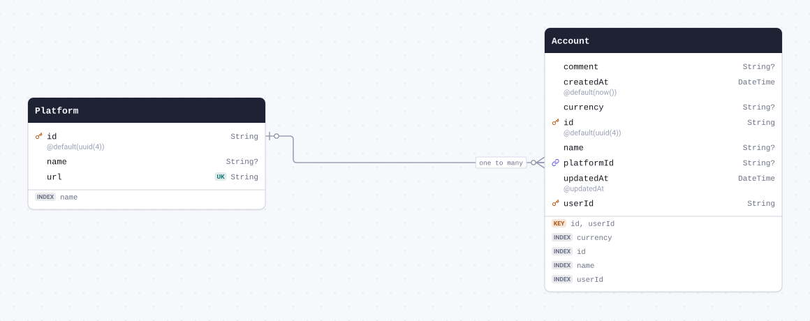

| Field  | Type     | Constraints     | Default   | Description |
| ------ | -------- | --------------- | --------- | ----------- |
| `id`   | `String` | PK NOT NULL     | `uuid(4)` |             |
| `name` | `String` | NULL            |           |             |
| `url`  | `String` | UNIQUE NOT NULL |           |             |

#### Indexes

- `@@index([name])`

#### Referenced by

- `id` ← [Account.platformId](#model-Account) (one-to-many)

#### Definition

```sql
CREATE TABLE "Platform" (
    "id" TEXT NOT NULL,
    "name" TEXT,
    "url" TEXT NOT NULL,

    CONSTRAINT "Platform_pkey" PRIMARY KEY ("id")
);

CREATE UNIQUE INDEX "Platform_url_key" ON "Platform"("url");

CREATE INDEX "Platform_name_idx" ON "Platform"("name");
```

<details>
<summary>Queries and their SQL</summary>

**findMany**: Every row

```ts
await prisma.platform.findMany();
```

```sql
SELECT
  "public"."Platform"."id",
  "public"."Platform"."name",
  "public"."Platform"."url"
FROM
  "public"."Platform"
WHERE
  1 = 1
OFFSET
  $1
-- params: ["0"]
```

**count**: How many rows there are

```ts
await prisma.platform.count();
```

```sql
SELECT
  COUNT(*) AS "_count$_all"
FROM
  (
    SELECT
      "public"."Platform"."id"
    FROM
      "public"."Platform"
    WHERE
      1 = 1
    OFFSET
      $1
  ) AS "sub"
-- params: ["0"]
```

**findMany**: Every row with its relations

```ts
await prisma.platform.findMany({ include: { accounts: true } });
```

```sql
SELECT
  "public"."Platform"."id",
  "public"."Platform"."name",
  "public"."Platform"."url"
FROM
  "public"."Platform"
WHERE
  1 = 1
OFFSET
  $1
-- params: ["0"]

SELECT
  "public"."Account"."id",
  "public"."Account"."userId",
  "public"."Account"."comment",
  "public"."Account"."createdAt",
  "public"."Account"."currency",
  "public"."Account"."name",
  "public"."Account"."platformId",
  "public"."Account"."updatedAt"
FROM
  "public"."Account"
WHERE
  "public"."Account"."platformId" IN ($1)
OFFSET
  $2
-- params: ["<id of the rows above>","0"]
```

**findUnique**: One row by what is unique to it

```ts
await prisma.platform.findUnique({ where: { id: "example" } });
```

```sql
SELECT
  "public"."Platform"."id",
  "public"."Platform"."name",
  "public"."Platform"."url"
FROM
  "public"."Platform"
WHERE
  (
    "public"."Platform"."id" = $1
    AND 1 = 1
  )
LIMIT
  $2
OFFSET
  $3
-- params: ["example","1","0"]
```

**create**: Create a row

```ts
await prisma.platform.create({ data: { url: "example" } });
```

```sql
INSERT INTO
  "public"."Platform" ("id", "url")
VALUES
  ($1, $2)
RETURNING
  "public"."Platform"."id",
  "public"."Platform"."name",
  "public"."Platform"."url"
-- params: ["<uuid(4)>","example"]
```

**update**: Update a row

```ts
await prisma.platform.update({ where: { id: "example" }, data: { name: "example" } });
```

```sql
UPDATE "public"."Platform"
SET
  "name" = $1
WHERE
  (
    "public"."Platform"."id" = $2
    AND 1 = 1
  )
RETURNING
  "public"."Platform"."id",
  "public"."Platform"."name",
  "public"."Platform"."url"
-- params: ["example","example"]
```

**delete**: Delete a row

```ts
await prisma.platform.delete({ where: { id: "example" } });
```

```sql
DELETE FROM "public"."Platform"
WHERE
  (
    "public"."Platform"."id" = $1
    AND 1 = 1
  )
RETURNING
  "public"."Platform"."id",
  "public"."Platform"."name",
  "public"."Platform"."url"
-- params: ["example"]
```

</details>

<a id="model-Property"></a>

### Property

| Field   | Type     | Constraints | Default | Description |
| ------- | -------- | ----------- | ------- | ----------- |
| `key`   | `String` | PK NOT NULL |         |             |
| `value` | `String` | NOT NULL    |         |             |

#### Definition

```sql
CREATE TABLE "Property" (
    "key" TEXT NOT NULL,
    "value" TEXT NOT NULL,

    CONSTRAINT "Property_pkey" PRIMARY KEY ("key")
);
```

<details>
<summary>Queries and their SQL</summary>

**findMany**: Every row

```ts
await prisma.property.findMany();
```

```sql
SELECT
  "public"."Property"."key",
  "public"."Property"."value"
FROM
  "public"."Property"
WHERE
  1 = 1
OFFSET
  $1
-- params: ["0"]
```

**count**: How many rows there are

```ts
await prisma.property.count();
```

```sql
SELECT
  COUNT(*) AS "_count$_all"
FROM
  (
    SELECT
      "public"."Property"."key"
    FROM
      "public"."Property"
    WHERE
      1 = 1
    OFFSET
      $1
  ) AS "sub"
-- params: ["0"]
```

**findUnique**: One row by what is unique to it

```ts
await prisma.property.findUnique({ where: { key: "example" } });
```

```sql
SELECT
  "public"."Property"."key",
  "public"."Property"."value"
FROM
  "public"."Property"
WHERE
  (
    "public"."Property"."key" = $1
    AND 1 = 1
  )
LIMIT
  $2
OFFSET
  $3
-- params: ["example","1","0"]
```

**create**: Create a row

```ts
await prisma.property.create({ data: { key: "example", value: "example" } });
```

```sql
INSERT INTO
  "public"."Property" ("key", "value")
VALUES
  ($1, $2)
RETURNING
  "public"."Property"."key",
  "public"."Property"."value"
-- params: ["example","example"]
```

**update**: Update a row

```ts
await prisma.property.update({ where: { key: "example" }, data: { value: "example" } });
```

```sql
UPDATE "public"."Property"
SET
  "value" = $1
WHERE
  (
    "public"."Property"."key" = $2
    AND 1 = 1
  )
RETURNING
  "public"."Property"."key",
  "public"."Property"."value"
-- params: ["example","example"]
```

**delete**: Delete a row

```ts
await prisma.property.delete({ where: { key: "example" } });
```

```sql
DELETE FROM "public"."Property"
WHERE
  (
    "public"."Property"."key" = $1
    AND 1 = 1
  )
RETURNING
  "public"."Property"."key",
  "public"."Property"."value"
-- params: ["example"]
```

</details>

<a id="model-Settings"></a>

### Settings

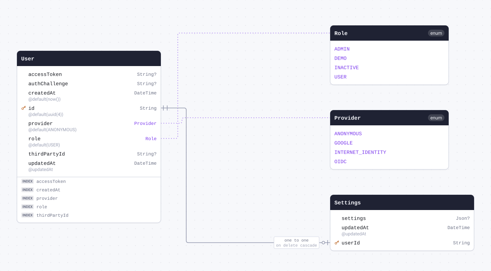

| Field       | Type       | Constraints                          | Default      | Description |
| ----------- | ---------- | ------------------------------------ | ------------ | ----------- |
| `settings`  | `Json`     | NULL                                 |              |             |
| `updatedAt` | `DateTime` | NOT NULL                             | `@updatedAt` |             |
| `userId`    | `String`   | PK NOT NULL → [User.id](#model-User) |              |             |

#### References

- `userId` → [User.id](#model-User) (one-to-one, on delete Cascade)

#### Definition

```sql
CREATE TABLE "Settings" (
    "settings" JSONB,
    "updatedAt" TIMESTAMP(3) NOT NULL,
    "userId" TEXT NOT NULL,

    CONSTRAINT "Settings_pkey" PRIMARY KEY ("userId")
);

ALTER TABLE "Settings" ADD CONSTRAINT "Settings_userId_fkey" FOREIGN KEY ("userId") REFERENCES "User"("id") ON DELETE CASCADE ON UPDATE CASCADE;
```

<details>
<summary>Queries and their SQL</summary>

**findMany**: Every row

```ts
await prisma.settings.findMany();
```

```sql
SELECT
  "public"."Settings"."userId",
  "public"."Settings"."settings",
  "public"."Settings"."updatedAt"
FROM
  "public"."Settings"
WHERE
  1 = 1
OFFSET
  $1
-- params: ["0"]
```

**count**: How many rows there are

```ts
await prisma.settings.count();
```

```sql
SELECT
  COUNT(*) AS "_count$_all"
FROM
  (
    SELECT
      "public"."Settings"."userId"
    FROM
      "public"."Settings"
    WHERE
      1 = 1
    OFFSET
      $1
  ) AS "sub"
-- params: ["0"]
```

**findMany**: Every row with its relations

```ts
await prisma.settings.findMany({ include: { user: true } });
```

```sql
SELECT
  "public"."Settings"."userId",
  "public"."Settings"."settings",
  "public"."Settings"."updatedAt"
FROM
  "public"."Settings"
WHERE
  1 = 1
OFFSET
  $1
-- params: ["0"]

SELECT
  "public"."User"."id",
  "public"."User"."accessToken",
  "public"."User"."authChallenge",
  "public"."User"."createdAt",
  "public"."User"."provider"::text,
  "public"."User"."role"::text,
  "public"."User"."thirdPartyId",
  "public"."User"."updatedAt"
FROM
  "public"."User"
WHERE
  "public"."User"."id" IN ($1)
OFFSET
  $2
-- params: ["<userId of the rows above>","0"]
```

**findUnique**: One row by what is unique to it

```ts
await prisma.settings.findUnique({ where: { userId: "example" } });
```

```sql
SELECT
  "public"."Settings"."userId",
  "public"."Settings"."settings",
  "public"."Settings"."updatedAt"
FROM
  "public"."Settings"
WHERE
  (
    "public"."Settings"."userId" = $1
    AND 1 = 1
  )
LIMIT
  $2
OFFSET
  $3
-- params: ["example","1","0"]
```

**create**: Create a row

```ts
await prisma.settings.create({ data: { userId: "example" } });
```

```sql
INSERT INTO
  "public"."Settings" ("updatedAt", "userId")
VALUES
  ($1, $2)
RETURNING
  "public"."Settings"."userId",
  "public"."Settings"."settings",
  "public"."Settings"."updatedAt"
-- params: ["<now()>","example"]
```

**update**: Update a row

```ts
await prisma.settings.update({ where: { userId: "example" }, data: { settings: {} } });
```

```sql
UPDATE "public"."Settings"
SET
  "settings" = $1,
  "updatedAt" = $2
WHERE
  (
    "public"."Settings"."userId" = $3
    AND 1 = 1
  )
RETURNING
  "public"."Settings"."userId",
  "public"."Settings"."settings",
  "public"."Settings"."updatedAt"
-- params: ["{}",{"prisma__type":"generatorCall","prisma__value":{"name":"now","args":[],"returnType":{"type":"DateTime"}}},"example"]
```

**delete**: Delete a row

```ts
await prisma.settings.delete({ where: { userId: "example" } });
```

```sql
DELETE FROM "public"."Settings"
WHERE
  (
    "public"."Settings"."userId" = $1
    AND 1 = 1
  )
RETURNING
  "public"."Settings"."userId",
  "public"."Settings"."settings",
  "public"."Settings"."updatedAt"
-- params: ["example"]
```

</details>

<a id="model-SymbolProfile"></a>

### SymbolProfile

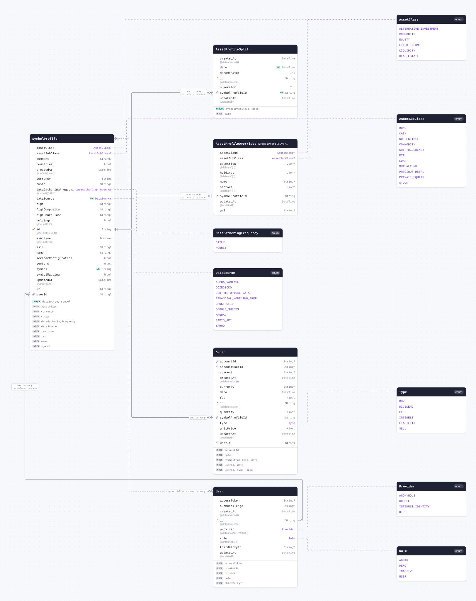

| Field                    | Type                                                     | Constraints                   | Default      | Description |
| ------------------------ | -------------------------------------------------------- | ----------------------------- | ------------ | ----------- |
| `assetClass`             | [`AssetClass`](#enum-AssetClass)                         | NULL                          |              |             |
| `assetSubClass`          | [`AssetSubClass`](#enum-AssetSubClass)                   | NULL                          |              |             |
| `comment`                | `String`                                                 | NULL                          |              |             |
| `countries`              | `Json`                                                   | NULL                          |              |             |
| `createdAt`              | `DateTime`                                               | NOT NULL                      | `now()`      |             |
| `currency`               | `String`                                                 | NOT NULL                      |              |             |
| `cusip`                  | `String`                                                 | NULL                          |              |             |
| `dataGatheringFrequency` | [`DataGatheringFrequency`](#enum-DataGatheringFrequency) | NOT NULL                      | `DAILY`      |             |
| `dataSource`             | [`DataSource`](#enum-DataSource)                         | NOT NULL                      |              |             |
| `figi`                   | `String`                                                 | NULL                          |              |             |
| `figiComposite`          | `String`                                                 | NULL                          |              |             |
| `figiShareClass`         | `String`                                                 | NULL                          |              |             |
| `holdings`               | `Json`                                                   | NULL                          | `"[]"`       |             |
| `id`                     | `String`                                                 | PK NOT NULL                   | `uuid(4)`    |             |
| `isActive`               | `Boolean`                                                | NOT NULL                      | `true`       |             |
| `isin`                   | `String`                                                 | NULL                          |              |             |
| `name`                   | `String`                                                 | NULL                          |              |             |
| `scraperConfiguration`   | `Json`                                                   | NULL                          |              |             |
| `sectors`                | `Json`                                                   | NULL                          |              |             |
| `symbol`                 | `String`                                                 | NOT NULL                      |              |             |
| `symbolMapping`          | `Json`                                                   | NULL                          |              |             |
| `updatedAt`              | `DateTime`                                               | NOT NULL                      | `@updatedAt` |             |
| `url`                    | `String`                                                 | NULL                          |              |             |
| `userId`                 | `String`                                                 | NULL → [User.id](#model-User) |              |             |

#### Indexes

- `@@index([assetClass])`
- `@@index([currency])`
- `@@index([cusip])`
- `@@index([dataGatheringFrequency])`
- `@@index([dataSource])`
- `@@index([isActive])`
- `@@index([isin])`
- `@@index([name])`
- `@@index([symbol])`
- `@@unique([dataSource, symbol])`

#### References

- `userId` → [User.id](#model-User) (many-to-one, on delete Cascade)

#### Referenced by

- `id` ← [AssetProfileOverrides.symbolProfileId](#model-AssetProfileOverrides) (one-to-one, on delete Cascade)
- `id` ← [AssetProfileSplit.symbolProfileId](#model-AssetProfileSplit) (one-to-many, on delete Cascade)
- `id` ← [Order.symbolProfileId](#model-Order) (one-to-many)

#### Many to many

- `watchedBy` ↔ [User.watchlist](#model-User) through `_UserWatchlist`

#### Definition

```sql
CREATE TABLE "SymbolProfile" (
    "assetClass" "AssetClass",
    "assetSubClass" "AssetSubClass",
    "comment" TEXT,
    "countries" JSONB,
    "createdAt" TIMESTAMP(3) NOT NULL DEFAULT CURRENT_TIMESTAMP,
    "currency" TEXT NOT NULL,
    "cusip" TEXT,
    "dataGatheringFrequency" "DataGatheringFrequency" NOT NULL DEFAULT 'DAILY',
    "dataSource" "DataSource" NOT NULL,
    "figi" TEXT,
    "figiComposite" TEXT,
    "figiShareClass" TEXT,
    "holdings" JSONB DEFAULT '[]',
    "id" TEXT NOT NULL,
    "isActive" BOOLEAN NOT NULL DEFAULT true,
    "isin" TEXT,
    "name" TEXT,
    "scraperConfiguration" JSONB,
    "sectors" JSONB,
    "symbol" TEXT NOT NULL,
    "symbolMapping" JSONB,
    "updatedAt" TIMESTAMP(3) NOT NULL,
    "url" TEXT,
    "userId" TEXT,

    CONSTRAINT "SymbolProfile_pkey" PRIMARY KEY ("id")
);

CREATE INDEX "SymbolProfile_assetClass_idx" ON "SymbolProfile"("assetClass");

CREATE INDEX "SymbolProfile_currency_idx" ON "SymbolProfile"("currency");

CREATE INDEX "SymbolProfile_cusip_idx" ON "SymbolProfile"("cusip");

CREATE INDEX "SymbolProfile_dataGatheringFrequency_idx" ON "SymbolProfile"("dataGatheringFrequency");

CREATE INDEX "SymbolProfile_dataSource_idx" ON "SymbolProfile"("dataSource");

CREATE INDEX "SymbolProfile_isActive_idx" ON "SymbolProfile"("isActive");

CREATE INDEX "SymbolProfile_isin_idx" ON "SymbolProfile"("isin");

CREATE INDEX "SymbolProfile_name_idx" ON "SymbolProfile"("name");

CREATE INDEX "SymbolProfile_symbol_idx" ON "SymbolProfile"("symbol");

CREATE UNIQUE INDEX "SymbolProfile_dataSource_symbol_key" ON "SymbolProfile"("dataSource", "symbol");

ALTER TABLE "SymbolProfile" ADD CONSTRAINT "SymbolProfile_userId_fkey" FOREIGN KEY ("userId") REFERENCES "User"("id") ON DELETE CASCADE ON UPDATE CASCADE;
```

<details>
<summary>Queries and their SQL</summary>

**findMany**: Every row

```ts
await prisma.symbolProfile.findMany();
```

```sql
SELECT
  "public"."SymbolProfile"."id",
  "public"."SymbolProfile"."assetClass"::text,
  "public"."SymbolProfile"."assetSubClass"::text,
  "public"."SymbolProfile"."comment",
  "public"."SymbolProfile"."countries",
  "public"."SymbolProfile"."createdAt",
  "public"."SymbolProfile"."currency",
  "public"."SymbolProfile"."cusip",
  "public"."SymbolProfile"."dataGatheringFrequency"::text,
  "public"."SymbolProfile"."dataSource"::text,
  "public"."SymbolProfile"."figi",
  "public"."SymbolProfile"."figiComposite",
  "public"."SymbolProfile"."figiShareClass",
  "public"."SymbolProfile"."holdings",
  "public"."SymbolProfile"."isActive",
  "public"."SymbolProfile"."isin",
  "public"."SymbolProfile"."name",
  "public"."SymbolProfile"."scraperConfiguration",
  "public"."SymbolProfile"."sectors",
  "public"."SymbolProfile"."symbol",
  "public"."SymbolProfile"."symbolMapping",
  "public"."SymbolProfile"."updatedAt",
  "public"."SymbolProfile"."url",
  "public"."SymbolProfile"."userId"
FROM
  "public"."SymbolProfile"
WHERE
  1 = 1
OFFSET
  $1
-- params: ["0"]
```

**count**: How many rows there are

```ts
await prisma.symbolProfile.count();
```

```sql
SELECT
  COUNT(*) AS "_count$_all"
FROM
  (
    SELECT
      "public"."SymbolProfile"."id"
    FROM
      "public"."SymbolProfile"
    WHERE
      1 = 1
    OFFSET
      $1
  ) AS "sub"
-- params: ["0"]
```

**findMany**: Every row with its relations

```ts
await prisma.symbolProfile.findMany({
  include: {
    activities: true,
    assetProfileOverrides: true,
    assetProfileSplits: true,
    user: true,
    watchedBy: true,
  },
});
```

```sql
SELECT
  "public"."SymbolProfile"."id",
  "public"."SymbolProfile"."assetClass"::text,
  "public"."SymbolProfile"."assetSubClass"::text,
  "public"."SymbolProfile"."comment",
  "public"."SymbolProfile"."countries",
  "public"."SymbolProfile"."createdAt",
  "public"."SymbolProfile"."currency",
  "public"."SymbolProfile"."cusip",
  "public"."SymbolProfile"."dataGatheringFrequency"::text,
  "public"."SymbolProfile"."dataSource"::text,
  "public"."SymbolProfile"."figi",
  "public"."SymbolProfile"."figiComposite",
  "public"."SymbolProfile"."figiShareClass",
  "public"."SymbolProfile"."holdings",
  "public"."SymbolProfile"."isActive",
  "public"."SymbolProfile"."isin",
  "public"."SymbolProfile"."name",
  "public"."SymbolProfile"."scraperConfiguration",
  "public"."SymbolProfile"."sectors",
  "public"."SymbolProfile"."symbol",
  "public"."SymbolProfile"."symbolMapping",
  "public"."SymbolProfile"."updatedAt",
  "public"."SymbolProfile"."url",
  "public"."SymbolProfile"."userId"
FROM
  "public"."SymbolProfile"
WHERE
  1 = 1
OFFSET
  $1
-- params: ["0"]

SELECT
  "public"."Order"."id",
  "public"."Order"."accountId",
  "public"."Order"."accountUserId",
  "public"."Order"."comment",
  "public"."Order"."createdAt",
  "public"."Order"."currency",
  "public"."Order"."date",
  "public"."Order"."fee",
  "public"."Order"."quantity",
  "public"."Order"."symbolProfileId",
  "public"."Order"."type"::text,
  "public"."Order"."unitPrice",
  "public"."Order"."updatedAt",
  "public"."Order"."userId"
FROM
  "public"."Order"
WHERE
  "public"."Order"."symbolProfileId" IN ($1)
OFFSET
  $2
-- params: ["<id of the rows above>","0"]

SELECT
  "public"."SymbolProfileOverrides"."symbolProfileId",
  "public"."SymbolProfileOverrides"."assetClass"::text,
  "public"."SymbolProfileOverrides"."assetSubClass"::text,
  "public"."SymbolProfileOverrides"."countries",
  "public"."SymbolProfileOverrides"."holdings",
  "public"."SymbolProfileOverrides"."name",
  "public"."SymbolProfileOverrides"."sectors",
  "public"."SymbolProfileOverrides"."updatedAt",
  "public"."SymbolProfileOverrides"."url"
FROM
  "public"."SymbolProfileOverrides"
WHERE
  "public"."SymbolProfileOverrides"."symbolProfileId" IN ($1)
OFFSET
  $2
-- params: ["<id of the rows above>","0"]

SELECT
  "public"."AssetProfileSplit"."id",
  "public"."AssetProfileSplit"."createdAt",
  "public"."AssetProfileSplit"."date",
  "public"."AssetProfileSplit"."denominator",
  "public"."AssetProfileSplit"."numerator",
  "public"."AssetProfileSplit"."symbolProfileId",
  "public"."AssetProfileSplit"."updatedAt"
FROM
  "public"."AssetProfileSplit"
WHERE
  "public"."AssetProfileSplit"."symbolProfileId" IN ($1)
OFFSET
  $2
-- params: ["<id of the rows above>","0"]

SELECT
  "public"."User"."id",
  "public"."User"."accessToken",
  "public"."User"."authChallenge",
  "public"."User"."createdAt",
  "public"."User"."provider"::text,
  "public"."User"."role"::text,
  "public"."User"."thirdPartyId",
  "public"."User"."updatedAt"
FROM
  "public"."User"
WHERE
  "public"."User"."id" IN ($1)
OFFSET
  $2
-- params: ["<userId of the rows above>","0"]

SELECT
  "public"."User"."id",
  "public"."User"."accessToken",
  "public"."User"."authChallenge",
  "public"."User"."createdAt",
  "public"."User"."provider"::text,
  "public"."User"."role"::text,
  "public"."User"."thirdPartyId",
  "public"."User"."updatedAt",
  "t0"."A" AS "UserWatchlist@SymbolProfile"
FROM
  "public"."User"
  INNER JOIN "public"."_UserWatchlist" AS "t0" ON "t0"."B" = "public"."User"."id"
WHERE
  (
    1 = 1
    AND "t0"."A" IN ($1)
  )
OFFSET
  $2
-- params: ["<id of the rows above>","0"]
```

**findUnique**: One row by what is unique to it

```ts
await prisma.symbolProfile.findUnique({ where: { id: "example" } });
```

```sql
SELECT
  "public"."SymbolProfile"."id",
  "public"."SymbolProfile"."assetClass"::text,
  "public"."SymbolProfile"."assetSubClass"::text,
  "public"."SymbolProfile"."comment",
  "public"."SymbolProfile"."countries",
  "public"."SymbolProfile"."createdAt",
  "public"."SymbolProfile"."currency",
  "public"."SymbolProfile"."cusip",
  "public"."SymbolProfile"."dataGatheringFrequency"::text,
  "public"."SymbolProfile"."dataSource"::text,
  "public"."SymbolProfile"."figi",
  "public"."SymbolProfile"."figiComposite",
  "public"."SymbolProfile"."figiShareClass",
  "public"."SymbolProfile"."holdings",
  "public"."SymbolProfile"."isActive",
  "public"."SymbolProfile"."isin",
  "public"."SymbolProfile"."name",
  "public"."SymbolProfile"."scraperConfiguration",
  "public"."SymbolProfile"."sectors",
  "public"."SymbolProfile"."symbol",
  "public"."SymbolProfile"."symbolMapping",
  "public"."SymbolProfile"."updatedAt",
  "public"."SymbolProfile"."url",
  "public"."SymbolProfile"."userId"
FROM
  "public"."SymbolProfile"
WHERE
  (
    "public"."SymbolProfile"."id" = $1
    AND 1 = 1
  )
LIMIT
  $2
OFFSET
  $3
-- params: ["example","1","0"]
```

**create**: Create a row

```ts
await prisma.symbolProfile.create({
  data: { currency: "example", dataSource: "ALPHA_VANTAGE", symbol: "example" },
});
```

```sql
INSERT INTO
  "public"."SymbolProfile" (
    "createdAt",
    "currency",
    "dataGatheringFrequency",
    "dataSource",
    "holdings",
    "id",
    "isActive",
    "symbol",
    "updatedAt"
  )
VALUES
  (
    $1,
    $2,
    CAST($3::text AS "public"."DataGatheringFrequency"),
    CAST($4::text AS "public"."DataSource"),
    $5,
    $6,
    $7,
    $8,
    $9
  )
RETURNING
  "public"."SymbolProfile"."id",
  "public"."SymbolProfile"."assetClass"::text,
  "public"."SymbolProfile"."assetSubClass"::text,
  "public"."SymbolProfile"."comment",
  "public"."SymbolProfile"."countries",
  "public"."SymbolProfile"."createdAt",
  "public"."SymbolProfile"."currency",
  "public"."SymbolProfile"."cusip",
  "public"."SymbolProfile"."dataGatheringFrequency"::text,
  "public"."SymbolProfile"."dataSource"::text,
  "public"."SymbolProfile"."figi",
  "public"."SymbolProfile"."figiComposite",
  "public"."SymbolProfile"."figiShareClass",
  "public"."SymbolProfile"."holdings",
  "public"."SymbolProfile"."isActive",
  "public"."SymbolProfile"."isin",
  "public"."SymbolProfile"."name",
  "public"."SymbolProfile"."scraperConfiguration",
  "public"."SymbolProfile"."sectors",
  "public"."SymbolProfile"."symbol",
  "public"."SymbolProfile"."symbolMapping",
  "public"."SymbolProfile"."updatedAt",
  "public"."SymbolProfile"."url",
  "public"."SymbolProfile"."userId"
-- params: ["<now()>","example","DAILY","ALPHA_VANTAGE","[]","<uuid(4)>",true,"example","<now()>"]
```

**update**: Update a row

```ts
await prisma.symbolProfile.update({
  where: { id: "example" },
  data: { assetClass: "ALTERNATIVE_INVESTMENT" },
});
```

```sql
UPDATE "public"."SymbolProfile"
SET
  "assetClass" = CAST($1::text AS "public"."AssetClass"),
  "updatedAt" = $2
WHERE
  (
    "public"."SymbolProfile"."id" = $3
    AND 1 = 1
  )
RETURNING
  "public"."SymbolProfile"."id",
  "public"."SymbolProfile"."assetClass"::text,
  "public"."SymbolProfile"."assetSubClass"::text,
  "public"."SymbolProfile"."comment",
  "public"."SymbolProfile"."countries",
  "public"."SymbolProfile"."createdAt",
  "public"."SymbolProfile"."currency",
  "public"."SymbolProfile"."cusip",
  "public"."SymbolProfile"."dataGatheringFrequency"::text,
  "public"."SymbolProfile"."dataSource"::text,
  "public"."SymbolProfile"."figi",
  "public"."SymbolProfile"."figiComposite",
  "public"."SymbolProfile"."figiShareClass",
  "public"."SymbolProfile"."holdings",
  "public"."SymbolProfile"."isActive",
  "public"."SymbolProfile"."isin",
  "public"."SymbolProfile"."name",
  "public"."SymbolProfile"."scraperConfiguration",
  "public"."SymbolProfile"."sectors",
  "public"."SymbolProfile"."symbol",
  "public"."SymbolProfile"."symbolMapping",
  "public"."SymbolProfile"."updatedAt",
  "public"."SymbolProfile"."url",
  "public"."SymbolProfile"."userId"
-- params: ["ALTERNATIVE_INVESTMENT",{"prisma__type":"generatorCall","prisma__value":{"name":"now","args":[],"returnType":{"type":"DateTime"}}},"example"]
```

**delete**: Delete a row

```ts
await prisma.symbolProfile.delete({ where: { id: "example" } });
```

```sql
DELETE FROM "public"."SymbolProfile"
WHERE
  (
    "public"."SymbolProfile"."id" = $1
    AND 1 = 1
  )
RETURNING
  "public"."SymbolProfile"."id",
  "public"."SymbolProfile"."assetClass"::text,
  "public"."SymbolProfile"."assetSubClass"::text,
  "public"."SymbolProfile"."comment",
  "public"."SymbolProfile"."countries",
  "public"."SymbolProfile"."createdAt",
  "public"."SymbolProfile"."currency",
  "public"."SymbolProfile"."cusip",
  "public"."SymbolProfile"."dataGatheringFrequency"::text,
  "public"."SymbolProfile"."dataSource"::text,
  "public"."SymbolProfile"."figi",
  "public"."SymbolProfile"."figiComposite",
  "public"."SymbolProfile"."figiShareClass",
  "public"."SymbolProfile"."holdings",
  "public"."SymbolProfile"."isActive",
  "public"."SymbolProfile"."isin",
  "public"."SymbolProfile"."name",
  "public"."SymbolProfile"."scraperConfiguration",
  "public"."SymbolProfile"."sectors",
  "public"."SymbolProfile"."symbol",
  "public"."SymbolProfile"."symbolMapping",
  "public"."SymbolProfile"."updatedAt",
  "public"."SymbolProfile"."url",
  "public"."SymbolProfile"."userId"
-- params: ["example"]
```

</details>

<a id="model-Subscription"></a>

### Subscription

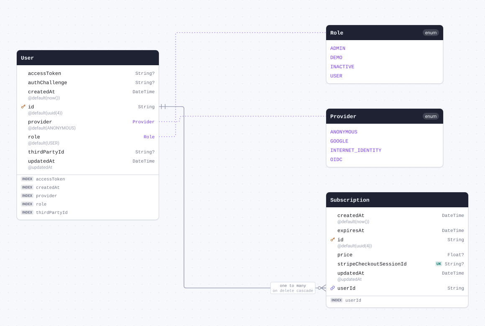

| Field                     | Type       | Constraints                       | Default      | Description |
| ------------------------- | ---------- | --------------------------------- | ------------ | ----------- |
| `createdAt`               | `DateTime` | NOT NULL                          | `now()`      |             |
| `expiresAt`               | `DateTime` | NOT NULL                          |              |             |
| `id`                      | `String`   | PK NOT NULL                       | `uuid(4)`    |             |
| `price`                   | `Float`    | NULL                              |              |             |
| `stripeCheckoutSessionId` | `String`   | UNIQUE NULL                       |              |             |
| `updatedAt`               | `DateTime` | NOT NULL                          | `@updatedAt` |             |
| `userId`                  | `String`   | NOT NULL → [User.id](#model-User) |              |             |

#### Indexes

- `@@index([userId])`

#### References

- `userId` → [User.id](#model-User) (many-to-one, on delete Cascade)

#### Definition

```sql
CREATE TABLE "Subscription" (
    "createdAt" TIMESTAMP(3) NOT NULL DEFAULT CURRENT_TIMESTAMP,
    "expiresAt" TIMESTAMP(3) NOT NULL,
    "id" TEXT NOT NULL,
    "price" DOUBLE PRECISION,
    "stripeCheckoutSessionId" TEXT,
    "updatedAt" TIMESTAMP(3) NOT NULL,
    "userId" TEXT NOT NULL,

    CONSTRAINT "Subscription_pkey" PRIMARY KEY ("id")
);

CREATE UNIQUE INDEX "Subscription_stripeCheckoutSessionId_key" ON "Subscription"("stripeCheckoutSessionId");

CREATE INDEX "Subscription_userId_idx" ON "Subscription"("userId");

ALTER TABLE "Subscription" ADD CONSTRAINT "Subscription_userId_fkey" FOREIGN KEY ("userId") REFERENCES "User"("id") ON DELETE CASCADE ON UPDATE CASCADE;
```

<details>
<summary>Queries and their SQL</summary>

**findMany**: Every row

```ts
await prisma.subscription.findMany();
```

```sql
SELECT
  "public"."Subscription"."id",
  "public"."Subscription"."createdAt",
  "public"."Subscription"."expiresAt",
  "public"."Subscription"."price",
  "public"."Subscription"."stripeCheckoutSessionId",
  "public"."Subscription"."updatedAt",
  "public"."Subscription"."userId"
FROM
  "public"."Subscription"
WHERE
  1 = 1
OFFSET
  $1
-- params: ["0"]
```

**count**: How many rows there are

```ts
await prisma.subscription.count();
```

```sql
SELECT
  COUNT(*) AS "_count$_all"
FROM
  (
    SELECT
      "public"."Subscription"."id"
    FROM
      "public"."Subscription"
    WHERE
      1 = 1
    OFFSET
      $1
  ) AS "sub"
-- params: ["0"]
```

**findMany**: Every row with its relations

```ts
await prisma.subscription.findMany({ include: { user: true } });
```

```sql
SELECT
  "public"."Subscription"."id",
  "public"."Subscription"."createdAt",
  "public"."Subscription"."expiresAt",
  "public"."Subscription"."price",
  "public"."Subscription"."stripeCheckoutSessionId",
  "public"."Subscription"."updatedAt",
  "public"."Subscription"."userId"
FROM
  "public"."Subscription"
WHERE
  1 = 1
OFFSET
  $1
-- params: ["0"]

SELECT
  "public"."User"."id",
  "public"."User"."accessToken",
  "public"."User"."authChallenge",
  "public"."User"."createdAt",
  "public"."User"."provider"::text,
  "public"."User"."role"::text,
  "public"."User"."thirdPartyId",
  "public"."User"."updatedAt"
FROM
  "public"."User"
WHERE
  "public"."User"."id" IN ($1)
OFFSET
  $2
-- params: ["<userId of the rows above>","0"]
```

**findUnique**: One row by what is unique to it

```ts
await prisma.subscription.findUnique({ where: { id: "example" } });
```

```sql
SELECT
  "public"."Subscription"."id",
  "public"."Subscription"."createdAt",
  "public"."Subscription"."expiresAt",
  "public"."Subscription"."price",
  "public"."Subscription"."stripeCheckoutSessionId",
  "public"."Subscription"."updatedAt",
  "public"."Subscription"."userId"
FROM
  "public"."Subscription"
WHERE
  (
    "public"."Subscription"."id" = $1
    AND 1 = 1
  )
LIMIT
  $2
OFFSET
  $3
-- params: ["example","1","0"]
```

**create**: Create a row

```ts
await prisma.subscription.create({
  data: { expiresAt: new Date("2026-01-01T00:00:00.000Z"), userId: "example" },
});
```

```sql
INSERT INTO
  "public"."Subscription" (
    "createdAt",
    "expiresAt",
    "id",
    "updatedAt",
    "userId"
  )
VALUES
  ($1, $2, $3, $4, $5)
RETURNING
  "public"."Subscription"."id",
  "public"."Subscription"."createdAt",
  "public"."Subscription"."expiresAt",
  "public"."Subscription"."price",
  "public"."Subscription"."stripeCheckoutSessionId",
  "public"."Subscription"."updatedAt",
  "public"."Subscription"."userId"
-- params: ["<now()>","2026-01-01T00:00:00.000Z","<uuid(4)>","<now()>","example"]
```

**update**: Update a row

```ts
await prisma.subscription.update({
  where: { id: "example" },
  data: { createdAt: new Date("2026-01-01T00:00:00.000Z") },
});
```

```sql
UPDATE "public"."Subscription"
SET
  "createdAt" = $1,
  "updatedAt" = $2
WHERE
  (
    "public"."Subscription"."id" = $3
    AND 1 = 1
  )
RETURNING
  "public"."Subscription"."id",
  "public"."Subscription"."createdAt",
  "public"."Subscription"."expiresAt",
  "public"."Subscription"."price",
  "public"."Subscription"."stripeCheckoutSessionId",
  "public"."Subscription"."updatedAt",
  "public"."Subscription"."userId"
-- params: ["2026-01-01T00:00:00.000Z",{"prisma__type":"generatorCall","prisma__value":{"name":"now","args":[],"returnType":{"type":"DateTime"}}},"example"]
```

**delete**: Delete a row

```ts
await prisma.subscription.delete({ where: { id: "example" } });
```

```sql
DELETE FROM "public"."Subscription"
WHERE
  (
    "public"."Subscription"."id" = $1
    AND 1 = 1
  )
RETURNING
  "public"."Subscription"."id",
  "public"."Subscription"."createdAt",
  "public"."Subscription"."expiresAt",
  "public"."Subscription"."price",
  "public"."Subscription"."stripeCheckoutSessionId",
  "public"."Subscription"."updatedAt",
  "public"."Subscription"."userId"
-- params: ["example"]
```

</details>

<a id="model-Tag"></a>

### Tag

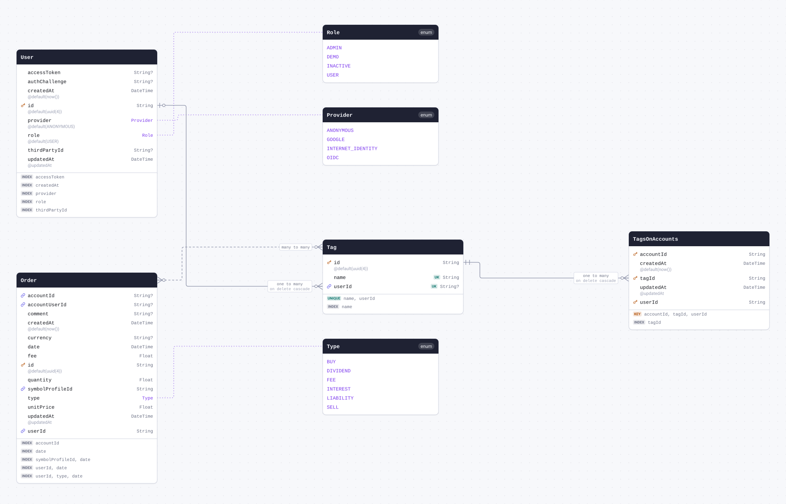

| Field    | Type     | Constraints                   | Default   | Description |
| -------- | -------- | ----------------------------- | --------- | ----------- |
| `id`     | `String` | PK NOT NULL                   | `uuid(4)` |             |
| `name`   | `String` | NOT NULL                      |           |             |
| `userId` | `String` | NULL → [User.id](#model-User) |           |             |

#### Indexes

- `@@index([name])`
- `@@unique([name, userId])`

#### References

- `userId` → [User.id](#model-User) (many-to-one, on delete Cascade)

#### Referenced by

- `id` ← [TagsOnAccounts.tagId](#model-TagsOnAccounts) (one-to-many, on delete Cascade)

#### Many to many

- `activities` ↔ [Order.tags](#model-Order) through `_OrderToTag`

#### Definition

```sql
CREATE TABLE "Tag" (
    "id" TEXT NOT NULL,
    "name" TEXT NOT NULL,
    "userId" TEXT,

    CONSTRAINT "Tag_pkey" PRIMARY KEY ("id")
);

CREATE INDEX "Tag_name_idx" ON "Tag"("name");

CREATE UNIQUE INDEX "Tag_name_userId_key" ON "Tag"("name", "userId");

ALTER TABLE "Tag" ADD CONSTRAINT "Tag_userId_fkey" FOREIGN KEY ("userId") REFERENCES "User"("id") ON DELETE CASCADE ON UPDATE CASCADE;
```

<details>
<summary>Queries and their SQL</summary>

**findMany**: Every row

```ts
await prisma.tag.findMany();
```

```sql
SELECT
  "public"."Tag"."id",
  "public"."Tag"."name",
  "public"."Tag"."userId"
FROM
  "public"."Tag"
WHERE
  1 = 1
OFFSET
  $1
-- params: ["0"]
```

**count**: How many rows there are

```ts
await prisma.tag.count();
```

```sql
SELECT
  COUNT(*) AS "_count$_all"
FROM
  (
    SELECT
      "public"."Tag"."id"
    FROM
      "public"."Tag"
    WHERE
      1 = 1
    OFFSET
      $1
  ) AS "sub"
-- params: ["0"]
```

**findMany**: Every row with its relations

```ts
await prisma.tag.findMany({ include: { accounts: true, activities: true, user: true } });
```

```sql
SELECT
  "public"."Tag"."id",
  "public"."Tag"."name",
  "public"."Tag"."userId"
FROM
  "public"."Tag"
WHERE
  1 = 1
OFFSET
  $1
-- params: ["0"]

SELECT
  "public"."TagsOnAccounts"."accountId",
  "public"."TagsOnAccounts"."tagId",
  "public"."TagsOnAccounts"."userId",
  "public"."TagsOnAccounts"."createdAt",
  "public"."TagsOnAccounts"."updatedAt"
FROM
  "public"."TagsOnAccounts"
WHERE
  "public"."TagsOnAccounts"."tagId" IN ($1)
OFFSET
  $2
-- params: ["<id of the rows above>","0"]

SELECT
  "public"."Order"."id",
  "public"."Order"."accountId",
  "public"."Order"."accountUserId",
  "public"."Order"."comment",
  "public"."Order"."createdAt",
  "public"."Order"."currency",
  "public"."Order"."date",
  "public"."Order"."fee",
  "public"."Order"."quantity",
  "public"."Order"."symbolProfileId",
  "public"."Order"."type"::text,
  "public"."Order"."unitPrice",
  "public"."Order"."updatedAt",
  "public"."Order"."userId",
  "t0"."B" AS "OrderToTag@Tag"
FROM
  "public"."Order"
  INNER JOIN "public"."_OrderToTag" AS "t0" ON "t0"."A" = "public"."Order"."id"
WHERE
  (
    1 = 1
    AND "t0"."B" IN ($1)
  )
OFFSET
  $2
-- params: ["<id of the rows above>","0"]

SELECT
  "public"."User"."id",
  "public"."User"."accessToken",
  "public"."User"."authChallenge",
  "public"."User"."createdAt",
  "public"."User"."provider"::text,
  "public"."User"."role"::text,
  "public"."User"."thirdPartyId",
  "public"."User"."updatedAt"
FROM
  "public"."User"
WHERE
  "public"."User"."id" IN ($1)
OFFSET
  $2
-- params: ["<userId of the rows above>","0"]
```

**findUnique**: One row by what is unique to it

```ts
await prisma.tag.findUnique({ where: { id: "example" } });
```

```sql
SELECT
  "public"."Tag"."id",
  "public"."Tag"."name",
  "public"."Tag"."userId"
FROM
  "public"."Tag"
WHERE
  (
    "public"."Tag"."id" = $1
    AND 1 = 1
  )
LIMIT
  $2
OFFSET
  $3
-- params: ["example","1","0"]
```

**create**: Create a row

```ts
await prisma.tag.create({ data: { name: "example" } });
```

```sql
INSERT INTO
  "public"."Tag" ("id", "name")
VALUES
  ($1, $2)
RETURNING
  "public"."Tag"."id",
  "public"."Tag"."name",
  "public"."Tag"."userId"
-- params: ["<uuid(4)>","example"]
```

**update**: Update a row

```ts
await prisma.tag.update({ where: { id: "example" }, data: { name: "example" } });
```

```sql
UPDATE "public"."Tag"
SET
  "name" = $1
WHERE
  (
    "public"."Tag"."id" = $2
    AND 1 = 1
  )
RETURNING
  "public"."Tag"."id",
  "public"."Tag"."name",
  "public"."Tag"."userId"
-- params: ["example","example"]
```

**delete**: Delete a row

```ts
await prisma.tag.delete({ where: { id: "example" } });
```

```sql
DELETE FROM "public"."Tag"
WHERE
  (
    "public"."Tag"."id" = $1
    AND 1 = 1
  )
RETURNING
  "public"."Tag"."id",
  "public"."Tag"."name",
  "public"."Tag"."userId"
-- params: ["example"]
```

</details>

<a id="model-TagsOnAccounts"></a>

### TagsOnAccounts

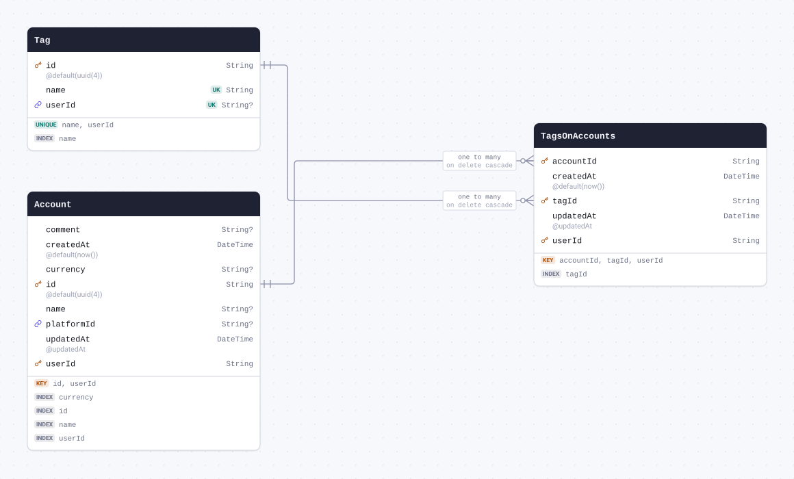

| Field       | Type       | Constraints                                    | Default      | Description |
| ----------- | ---------- | ---------------------------------------------- | ------------ | ----------- |
| `accountId` | `String`   | PK NOT NULL → [Account.id](#model-Account)     |              |             |
| `createdAt` | `DateTime` | NOT NULL                                       | `now()`      |             |
| `tagId`     | `String`   | PK NOT NULL → [Tag.id](#model-Tag)             |              |             |
| `updatedAt` | `DateTime` | NOT NULL                                       | `@updatedAt` |             |
| `userId`    | `String`   | PK NOT NULL → [Account.userId](#model-Account) |              |             |

#### Indexes

- `@@id([accountId, tagId, userId])`
- `@@index([tagId])`

#### References

- `accountId` → [Account.id](#model-Account) (many-to-one, on delete Cascade)
- `tagId` → [Tag.id](#model-Tag) (many-to-one, on delete Cascade)

#### Definition

```sql
CREATE TABLE "TagsOnAccounts" (
    "accountId" TEXT NOT NULL,
    "createdAt" TIMESTAMP(3) NOT NULL DEFAULT CURRENT_TIMESTAMP,
    "tagId" TEXT NOT NULL,
    "updatedAt" TIMESTAMP(3) NOT NULL,
    "userId" TEXT NOT NULL,

    CONSTRAINT "TagsOnAccounts_pkey" PRIMARY KEY ("accountId","tagId","userId")
);

CREATE INDEX "TagsOnAccounts_tagId_idx" ON "TagsOnAccounts"("tagId");

ALTER TABLE "TagsOnAccounts" ADD CONSTRAINT "TagsOnAccounts_accountId_userId_fkey" FOREIGN KEY ("accountId", "userId") REFERENCES "Account"("id", "userId") ON DELETE CASCADE ON UPDATE CASCADE;

ALTER TABLE "TagsOnAccounts" ADD CONSTRAINT "TagsOnAccounts_tagId_fkey" FOREIGN KEY ("tagId") REFERENCES "Tag"("id") ON DELETE CASCADE ON UPDATE CASCADE;
```

<details>
<summary>Queries and their SQL</summary>

**findMany**: Every row

```ts
await prisma.tagsOnAccounts.findMany();
```

```sql
SELECT
  "public"."TagsOnAccounts"."accountId",
  "public"."TagsOnAccounts"."tagId",
  "public"."TagsOnAccounts"."userId",
  "public"."TagsOnAccounts"."createdAt",
  "public"."TagsOnAccounts"."updatedAt"
FROM
  "public"."TagsOnAccounts"
WHERE
  1 = 1
OFFSET
  $1
-- params: ["0"]
```

**count**: How many rows there are

```ts
await prisma.tagsOnAccounts.count();
```

```sql
SELECT
  COUNT(*) AS "_count$_all"
FROM
  (
    SELECT
      "public"."TagsOnAccounts"."accountId",
      "public"."TagsOnAccounts"."tagId",
      "public"."TagsOnAccounts"."userId"
    FROM
      "public"."TagsOnAccounts"
    WHERE
      1 = 1
    OFFSET
      $1
  ) AS "sub"
-- params: ["0"]
```

**findMany**: Every row with its relations

```ts
await prisma.tagsOnAccounts.findMany({ include: { account: true, tag: true } });
```

```sql
SELECT
  "public"."TagsOnAccounts"."accountId",
  "public"."TagsOnAccounts"."tagId",
  "public"."TagsOnAccounts"."userId",
  "public"."TagsOnAccounts"."createdAt",
  "public"."TagsOnAccounts"."updatedAt"
FROM
  "public"."TagsOnAccounts"
WHERE
  1 = 1
OFFSET
  $1
-- params: ["0"]

SELECT
  "public"."Account"."id",
  "public"."Account"."userId",
  "public"."Account"."comment",
  "public"."Account"."createdAt",
  "public"."Account"."currency",
  "public"."Account"."name",
  "public"."Account"."platformId",
  "public"."Account"."updatedAt"
FROM
  "public"."Account"
WHERE
  (
    "public"."Account"."id" IN ($1)
    AND "public"."Account"."userId" IN ($2)
  )
OFFSET
  $3
-- params: ["<accountId of the rows above>","<userId of the rows above>","0"]

SELECT
  "public"."Tag"."id",
  "public"."Tag"."name",
  "public"."Tag"."userId"
FROM
  "public"."Tag"
WHERE
  "public"."Tag"."id" IN ($1)
OFFSET
  $2
-- params: ["<tagId of the rows above>","0"]
```

**findUnique**: One row by what is unique to it

```ts
await prisma.tagsOnAccounts.findUnique({
  where: { accountId_tagId_userId: { accountId: "example", tagId: "example", userId: "example" } },
});
```

```sql
SELECT
  "public"."TagsOnAccounts"."accountId",
  "public"."TagsOnAccounts"."tagId",
  "public"."TagsOnAccounts"."userId",
  "public"."TagsOnAccounts"."createdAt",
  "public"."TagsOnAccounts"."updatedAt"
FROM
  "public"."TagsOnAccounts"
WHERE
  (
    (
      "public"."TagsOnAccounts"."accountId" = $1
      AND "public"."TagsOnAccounts"."tagId" = $2
      AND "public"."TagsOnAccounts"."userId" = $3
    )
    AND 1 = 1
  )
LIMIT
  $4
OFFSET
  $5
-- params: ["example","example","example","1","0"]
```

**create**: Create a row

```ts
await prisma.tagsOnAccounts.create({
  data: { accountId: "example", tagId: "example", userId: "example" },
});
```

```sql
INSERT INTO
  "public"."TagsOnAccounts" (
    "accountId",
    "createdAt",
    "tagId",
    "updatedAt",
    "userId"
  )
VALUES
  ($1, $2, $3, $4, $5)
RETURNING
  "public"."TagsOnAccounts"."accountId",
  "public"."TagsOnAccounts"."tagId",
  "public"."TagsOnAccounts"."userId",
  "public"."TagsOnAccounts"."createdAt",
  "public"."TagsOnAccounts"."updatedAt"
-- params: ["example","<now()>","example","<now()>","example"]
```

**update**: Update a row

```ts
await prisma.tagsOnAccounts.update({
  where: { accountId_tagId_userId: { accountId: "example", tagId: "example", userId: "example" } },
  data: { createdAt: new Date("2026-01-01T00:00:00.000Z") },
});
```

```sql
UPDATE "public"."TagsOnAccounts"
SET
  "createdAt" = $1,
  "updatedAt" = $2
WHERE
  (
    (
      "public"."TagsOnAccounts"."accountId" = $3
      AND "public"."TagsOnAccounts"."tagId" = $4
      AND "public"."TagsOnAccounts"."userId" = $5
    )
    AND 1 = 1
  )
RETURNING
  "public"."TagsOnAccounts"."accountId",
  "public"."TagsOnAccounts"."tagId",
  "public"."TagsOnAccounts"."userId",
  "public"."TagsOnAccounts"."createdAt",
  "public"."TagsOnAccounts"."updatedAt"
-- params: ["2026-01-01T00:00:00.000Z",{"prisma__type":"generatorCall","prisma__value":{"name":"now","args":[],"returnType":{"type":"DateTime"}}},"example","example","example"]
```

**delete**: Delete a row

```ts
await prisma.tagsOnAccounts.delete({
  where: { accountId_tagId_userId: { accountId: "example", tagId: "example", userId: "example" } },
});
```

```sql
DELETE FROM "public"."TagsOnAccounts"
WHERE
  (
    (
      "public"."TagsOnAccounts"."accountId" = $1
      AND "public"."TagsOnAccounts"."tagId" = $2
      AND "public"."TagsOnAccounts"."userId" = $3
    )
    AND 1 = 1
  )
RETURNING
  "public"."TagsOnAccounts"."accountId",
  "public"."TagsOnAccounts"."tagId",
  "public"."TagsOnAccounts"."userId",
  "public"."TagsOnAccounts"."createdAt",
  "public"."TagsOnAccounts"."updatedAt"
-- params: ["example","example","example"]
```

</details>

<a id="model-User"></a>

### User

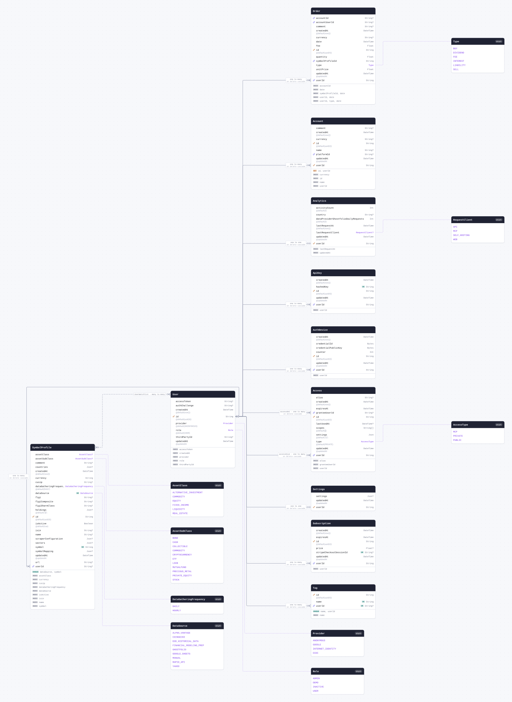

| Field           | Type                         | Constraints | Default      | Description |
| --------------- | ---------------------------- | ----------- | ------------ | ----------- |
| `accessToken`   | `String`                     | NULL        |              |             |
| `authChallenge` | `String`                     | NULL        |              |             |
| `createdAt`     | `DateTime`                   | NOT NULL    | `now()`      |             |
| `id`            | `String`                     | PK NOT NULL | `uuid(4)`    |             |
| `provider`      | [`Provider`](#enum-Provider) | NOT NULL    | `ANONYMOUS`  |             |
| `role`          | [`Role`](#enum-Role)         | NOT NULL    | `USER`       |             |
| `thirdPartyId`  | `String`                     | NULL        |              |             |
| `updatedAt`     | `DateTime`                   | NOT NULL    | `@updatedAt` |             |

#### Indexes

- `@@index([accessToken])`
- `@@index([createdAt])`
- `@@index([provider])`
- `@@index([role])`
- `@@index([thirdPartyId])`

#### Referenced by

- `id` ← [Access.granteeUserId](#model-Access) (one-to-many, on delete Cascade)
- `id` ← [Access.userId](#model-Access) (one-to-many, on delete Cascade)
- `id` ← [Account.userId](#model-Account) (one-to-many, on delete Cascade)
- `id` ← [Analytics.userId](#model-Analytics) (one-to-one, on delete Cascade)
- `id` ← [ApiKey.userId](#model-ApiKey) (one-to-many, on delete Cascade)
- `id` ← [AuthDevice.userId](#model-AuthDevice) (one-to-many, on delete Cascade)
- `id` ← [Order.userId](#model-Order) (one-to-many, on delete Cascade)
- `id` ← [Settings.userId](#model-Settings) (one-to-one, on delete Cascade)
- `id` ← [SymbolProfile.userId](#model-SymbolProfile) (one-to-many, on delete Cascade)
- `id` ← [Subscription.userId](#model-Subscription) (one-to-many, on delete Cascade)
- `id` ← [Tag.userId](#model-Tag) (one-to-many, on delete Cascade)

#### Many to many

- `watchlist` ↔ [SymbolProfile.watchedBy](#model-SymbolProfile) through `_UserWatchlist`

#### Definition

```sql
CREATE TABLE "User" (
    "accessToken" TEXT,
    "authChallenge" TEXT,
    "createdAt" TIMESTAMP(3) NOT NULL DEFAULT CURRENT_TIMESTAMP,
    "id" TEXT NOT NULL,
    "provider" "Provider" NOT NULL DEFAULT 'ANONYMOUS',
    "role" "Role" NOT NULL DEFAULT 'USER',
    "thirdPartyId" TEXT,
    "updatedAt" TIMESTAMP(3) NOT NULL,

    CONSTRAINT "User_pkey" PRIMARY KEY ("id")
);

CREATE INDEX "User_accessToken_idx" ON "User"("accessToken");

CREATE INDEX "User_createdAt_idx" ON "User"("createdAt");

CREATE INDEX "User_provider_idx" ON "User"("provider");

CREATE INDEX "User_role_idx" ON "User"("role");

CREATE INDEX "User_thirdPartyId_idx" ON "User"("thirdPartyId");
```

<details>
<summary>Queries and their SQL</summary>

**findMany**: Every row

```ts
await prisma.user.findMany();
```

```sql
SELECT
  "public"."User"."id",
  "public"."User"."accessToken",
  "public"."User"."authChallenge",
  "public"."User"."createdAt",
  "public"."User"."provider"::text,
  "public"."User"."role"::text,
  "public"."User"."thirdPartyId",
  "public"."User"."updatedAt"
FROM
  "public"."User"
WHERE
  1 = 1
OFFSET
  $1
-- params: ["0"]
```

**count**: How many rows there are

```ts
await prisma.user.count();
```

```sql
SELECT
  COUNT(*) AS "_count$_all"
FROM
  (
    SELECT
      "public"."User"."id"
    FROM
      "public"."User"
    WHERE
      1 = 1
    OFFSET
      $1
  ) AS "sub"
-- params: ["0"]
```

**findMany**: Every row with its relations

```ts
await prisma.user.findMany({
  include: {
    accessesGet: true,
    accessesGive: true,
    accounts: true,
    activities: true,
    analytics: true,
    apiKeys: true,
    authDevices: true,
    settings: true,
    subscriptions: true,
    tags: true,
    watchlist: true,
    SymbolProfile: true,
  },
});
```

```sql
SELECT
  "public"."User"."id",
  "public"."User"."accessToken",
  "public"."User"."authChallenge",
  "public"."User"."createdAt",
  "public"."User"."provider"::text,
  "public"."User"."role"::text,
  "public"."User"."thirdPartyId",
  "public"."User"."updatedAt"
FROM
  "public"."User"
WHERE
  1 = 1
OFFSET
  $1
-- params: ["0"]

SELECT
  "public"."Access"."id",
  "public"."Access"."alias",
  "public"."Access"."createdAt",
  "public"."Access"."expiresAt",
  "public"."Access"."granteeUserId",
  "public"."Access"."lastUsedAt",
  "public"."Access"."scopes",
  "public"."Access"."settings",
  "public"."Access"."type"::text,
  "public"."Access"."updatedAt",
  "public"."Access"."userId"
FROM
  "public"."Access"
WHERE
  "public"."Access"."granteeUserId" IN ($1)
OFFSET
  $2
-- params: ["<id of the rows above>","0"]

SELECT
  "public"."Access"."id",
  "public"."Access"."alias",
  "public"."Access"."createdAt",
  "public"."Access"."expiresAt",
  "public"."Access"."granteeUserId",
  "public"."Access"."lastUsedAt",
  "public"."Access"."scopes",
  "public"."Access"."settings",
  "public"."Access"."type"::text,
  "public"."Access"."updatedAt",
  "public"."Access"."userId"
FROM
  "public"."Access"
WHERE
  "public"."Access"."userId" IN ($1)
OFFSET
  $2
-- params: ["<id of the rows above>","0"]

SELECT
  "public"."Account"."id",
  "public"."Account"."userId",
  "public"."Account"."comment",
  "public"."Account"."createdAt",
  "public"."Account"."currency",
  "public"."Account"."name",
  "public"."Account"."platformId",
  "public"."Account"."updatedAt"
FROM
  "public"."Account"
WHERE
  "public"."Account"."userId" IN ($1)
OFFSET
  $2
-- params: ["<id of the rows above>","0"]

SELECT
  "public"."Order"."id",
  "public"."Order"."accountId",
  "public"."Order"."accountUserId",
  "public"."Order"."comment",
  "public"."Order"."createdAt",
  "public"."Order"."currency",
  "public"."Order"."date",
  "public"."Order"."fee",
  "public"."Order"."quantity",
  "public"."Order"."symbolProfileId",
  "public"."Order"."type"::text,
  "public"."Order"."unitPrice",
  "public"."Order"."updatedAt",
  "public"."Order"."userId"
FROM
  "public"."Order"
WHERE
  "public"."Order"."userId" IN ($1)
OFFSET
  $2
-- params: ["<id of the rows above>","0"]

SELECT
  "public"."Analytics"."userId",
  "public"."Analytics"."activityCount",
  "public"."Analytics"."country",
  "public"."Analytics"."dataProviderGhostfolioDailyRequests",
  "public"."Analytics"."lastRequestAt",
  "public"."Analytics"."lastRequestClient"::text,
  "public"."Analytics"."updatedAt"
FROM
  "public"."Analytics"
WHERE
  "public"."Analytics"."userId" IN ($1)
OFFSET
  $2
-- params: ["<id of the rows above>","0"]

SELECT
  "public"."ApiKey"."id",
  "public"."ApiKey"."createdAt",
  "public"."ApiKey"."hashedKey",
  "public"."ApiKey"."updatedAt",
  "public"."ApiKey"."userId"
FROM
  "public"."ApiKey"
WHERE
  "public"."ApiKey"."userId" IN ($1)
OFFSET
  $2
-- params: ["<id of the rows above>","0"]

SELECT
  "public"."AuthDevice"."id",
  "public"."AuthDevice"."createdAt",
  "public"."AuthDevice"."credentialId",
  "public"."AuthDevice"."credentialPublicKey",
  "public"."AuthDevice"."counter",
  "public"."AuthDevice"."updatedAt",
  "public"."AuthDevice"."userId"
FROM
  "public"."AuthDevice"
WHERE
  "public"."AuthDevice"."userId" IN ($1)
OFFSET
  $2
-- params: ["<id of the rows above>","0"]

SELECT
  "public"."Settings"."userId",
  "public"."Settings"."settings",
  "public"."Settings"."updatedAt"
FROM
  "public"."Settings"
WHERE
  "public"."Settings"."userId" IN ($1)
OFFSET
  $2
-- params: ["<id of the rows above>","0"]

SELECT
  "public"."Subscription"."id",
  "public"."Subscription"."createdAt",
  "public"."Subscription"."expiresAt",
  "public"."Subscription"."price",
  "public"."Subscription"."stripeCheckoutSessionId",
  "public"."Subscription"."updatedAt",
  "public"."Subscription"."userId"
FROM
  "public"."Subscription"
WHERE
  "public"."Subscription"."userId" IN ($1)
OFFSET
  $2
-- params: ["<id of the rows above>","0"]

SELECT
  "public"."Tag"."id",
  "public"."Tag"."name",
  "public"."Tag"."userId"
FROM
  "public"."Tag"
WHERE
  "public"."Tag"."userId" IN ($1)
OFFSET
  $2
-- params: ["<id of the rows above>","0"]

SELECT
  "public"."SymbolProfile"."id",
  "public"."SymbolProfile"."assetClass"::text,
  "public"."SymbolProfile"."assetSubClass"::text,
  "public"."SymbolProfile"."comment",
  "public"."SymbolProfile"."countries",
  "public"."SymbolProfile"."createdAt",
  "public"."SymbolProfile"."currency",
  "public"."SymbolProfile"."cusip",
  "public"."SymbolProfile"."dataGatheringFrequency"::text,
  "public"."SymbolProfile"."dataSource"::text,
  "public"."SymbolProfile"."figi",
  "public"."SymbolProfile"."figiComposite",
  "public"."SymbolProfile"."figiShareClass",
  "public"."SymbolProfile"."holdings",
  "public"."SymbolProfile"."isActive",
  "public"."SymbolProfile"."isin",
  "public"."SymbolProfile"."name",
  "public"."SymbolProfile"."scraperConfiguration",
  "public"."SymbolProfile"."sectors",
  "public"."SymbolProfile"."symbol",
  "public"."SymbolProfile"."symbolMapping",
  "public"."SymbolProfile"."updatedAt",
  "public"."SymbolProfile"."url",
  "public"."SymbolProfile"."userId",
  "t0"."B" AS "UserWatchlist@User"
FROM
  "public"."SymbolProfile"
  INNER JOIN "public"."_UserWatchlist" AS "t0" ON "t0"."A" = "public"."SymbolProfile"."id"
WHERE
  (
    1 = 1
    AND "t0"."B" IN ($1)
  )
OFFSET
  $2
-- params: ["<id of the rows above>","0"]

SELECT
  "public"."SymbolProfile"."id",
  "public"."SymbolProfile"."assetClass"::text,
  "public"."SymbolProfile"."assetSubClass"::text,
  "public"."SymbolProfile"."comment",
  "public"."SymbolProfile"."countries",
  "public"."SymbolProfile"."createdAt",
  "public"."SymbolProfile"."currency",
  "public"."SymbolProfile"."cusip",
  "public"."SymbolProfile"."dataGatheringFrequency"::text,
  "public"."SymbolProfile"."dataSource"::text,
  "public"."SymbolProfile"."figi",
  "public"."SymbolProfile"."figiComposite",
  "public"."SymbolProfile"."figiShareClass",
  "public"."SymbolProfile"."holdings",
  "public"."SymbolProfile"."isActive",
  "public"."SymbolProfile"."isin",
  "public"."SymbolProfile"."name",
  "public"."SymbolProfile"."scraperConfiguration",
  "public"."SymbolProfile"."sectors",
  "public"."SymbolProfile"."symbol",
  "public"."SymbolProfile"."symbolMapping",
  "public"."SymbolProfile"."updatedAt",
  "public"."SymbolProfile"."url",
  "public"."SymbolProfile"."userId"
FROM
  "public"."SymbolProfile"
WHERE
  "public"."SymbolProfile"."userId" IN ($1)
OFFSET
  $2
-- params: ["<id of the rows above>","0"]
```

**findUnique**: One row by what is unique to it

```ts
await prisma.user.findUnique({ where: { id: "example" } });
```

```sql
SELECT
  "public"."User"."id",
  "public"."User"."accessToken",
  "public"."User"."authChallenge",
  "public"."User"."createdAt",
  "public"."User"."provider"::text,
  "public"."User"."role"::text,
  "public"."User"."thirdPartyId",
  "public"."User"."updatedAt"
FROM
  "public"."User"
WHERE
  (
    "public"."User"."id" = $1
    AND 1 = 1
  )
LIMIT
  $2
OFFSET
  $3
-- params: ["example","1","0"]
```

**create**: Create a row

```ts
await prisma.user.create({ data: {} });
```

```sql
INSERT INTO
  "public"."User" (
    "createdAt",
    "id",
    "provider",
    "role",
    "updatedAt"
  )
VALUES
  (
    $1,
    $2,
    CAST($3::text AS "public"."Provider"),
    CAST($4::text AS "public"."Role"),
    $5
  )
RETURNING
  "public"."User"."id",
  "public"."User"."accessToken",
  "public"."User"."authChallenge",
  "public"."User"."createdAt",
  "public"."User"."provider"::text,
  "public"."User"."role"::text,
  "public"."User"."thirdPartyId",
  "public"."User"."updatedAt"
-- params: ["<now()>","<uuid(4)>","ANONYMOUS","USER","<now()>"]
```

**update**: Update a row

```ts
await prisma.user.update({ where: { id: "example" }, data: { accessToken: "example" } });
```

```sql
UPDATE "public"."User"
SET
  "accessToken" = $1,
  "updatedAt" = $2
WHERE
  (
    "public"."User"."id" = $3
    AND 1 = 1
  )
RETURNING
  "public"."User"."id",
  "public"."User"."accessToken",
  "public"."User"."authChallenge",
  "public"."User"."createdAt",
  "public"."User"."provider"::text,
  "public"."User"."role"::text,
  "public"."User"."thirdPartyId",
  "public"."User"."updatedAt"
-- params: ["example",{"prisma__type":"generatorCall","prisma__value":{"name":"now","args":[],"returnType":{"type":"DateTime"}}},"example"]
```

**delete**: Delete a row

```ts
await prisma.user.delete({ where: { id: "example" } });
```

```sql
DELETE FROM "public"."User"
WHERE
  (
    "public"."User"."id" = $1
    AND 1 = 1
  )
RETURNING
  "public"."User"."id",
  "public"."User"."accessToken",
  "public"."User"."authChallenge",
  "public"."User"."createdAt",
  "public"."User"."provider"::text,
  "public"."User"."role"::text,
  "public"."User"."thirdPartyId",
  "public"."User"."updatedAt"
-- params: ["example"]
```

</details>

## Enums

<a id="enum-AccessType"></a>

### AccessType

- `MCP`
- `PRIVATE`
- `PUBLIC`

#### Definition

```sql
CREATE TYPE "AccessType" AS ENUM ('MCP', 'PRIVATE', 'PUBLIC');
```

<a id="enum-AssetClass"></a>

### AssetClass

- `ALTERNATIVE_INVESTMENT`
- `COMMODITY`
- `EQUITY`
- `FIXED_INCOME`
- `LIQUIDITY`
- `REAL_ESTATE`

#### Definition

```sql
CREATE TYPE "AssetClass" AS ENUM ('ALTERNATIVE_INVESTMENT', 'COMMODITY', 'EQUITY', 'FIXED_INCOME', 'LIQUIDITY', 'REAL_ESTATE');
```

<a id="enum-AssetSubClass"></a>

### AssetSubClass

- `BOND`
- `CASH`
- `COLLECTIBLE`
- `COMMODITY`
- `CRYPTOCURRENCY`
- `ETF`
- `LOAN`
- `MUTUALFUND`
- `PRECIOUS_METAL`
- `PRIVATE_EQUITY`
- `STOCK`

#### Definition

```sql
CREATE TYPE "AssetSubClass" AS ENUM ('BOND', 'CASH', 'COLLECTIBLE', 'COMMODITY', 'CRYPTOCURRENCY', 'ETF', 'LOAN', 'MUTUALFUND', 'PRECIOUS_METAL', 'PRIVATE_EQUITY', 'STOCK');
```

<a id="enum-DataGatheringFrequency"></a>

### DataGatheringFrequency

- `DAILY`
- `HOURLY`

#### Definition

```sql
CREATE TYPE "DataGatheringFrequency" AS ENUM ('DAILY', 'HOURLY');
```

<a id="enum-DataSource"></a>

### DataSource

- `ALPHA_VANTAGE`
- `COINGECKO`
- `EOD_HISTORICAL_DATA`
- `FINANCIAL_MODELING_PREP`
- `GHOSTFOLIO`
- `GOOGLE_SHEETS`
- `MANUAL`
- `RAPID_API`
- `YAHOO`

#### Definition

```sql
CREATE TYPE "DataSource" AS ENUM ('ALPHA_VANTAGE', 'COINGECKO', 'EOD_HISTORICAL_DATA', 'FINANCIAL_MODELING_PREP', 'GHOSTFOLIO', 'GOOGLE_SHEETS', 'MANUAL', 'RAPID_API', 'YAHOO');
```

<a id="enum-MarketDataState"></a>

### MarketDataState

- `CLOSE`
- `INTRADAY`

#### Definition

```sql
CREATE TYPE "MarketDataState" AS ENUM ('CLOSE', 'INTRADAY');
```

<a id="enum-Provider"></a>

### Provider

- `ANONYMOUS`
- `GOOGLE`
- `INTERNET_IDENTITY`
- `OIDC`

#### Definition

```sql
CREATE TYPE "Provider" AS ENUM ('ANONYMOUS', 'GOOGLE', 'INTERNET_IDENTITY', 'OIDC');
```

<a id="enum-RequestClient"></a>

### RequestClient

- `API`
- `MCP`
- `SELF_HOSTING`
- `WEB`

#### Definition

```sql
CREATE TYPE "RequestClient" AS ENUM ('API', 'MCP', 'SELF_HOSTING', 'WEB');
```

<a id="enum-Role"></a>

### Role

- `ADMIN`
- `DEMO`
- `INACTIVE`
- `USER`

#### Definition

```sql
CREATE TYPE "Role" AS ENUM ('ADMIN', 'DEMO', 'INACTIVE', 'USER');
```

<a id="enum-Type"></a>

### Type

- `BUY`
- `DIVIDEND`
- `FEE`
- `INTEREST`
- `LIABILITY`
- `SELL`

#### Definition

```sql
CREATE TYPE "Type" AS ENUM ('BUY', 'DIVIDEND', 'FEE', 'INTEREST', 'LIABILITY', 'SELL');
```

<a id="enum-ViewMode"></a>

### ViewMode

- `DEFAULT`
- `ZEN`

#### Definition

```sql
CREATE TYPE "ViewMode" AS ENUM ('DEFAULT', 'ZEN');
```
