# Schema docs

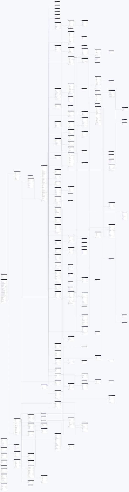

<details>
<summary>The whole schema as SQL</summary>

```sql
CREATE SCHEMA IF NOT EXISTS "public";

CREATE TYPE "SignupIntent" AS ENUM ('AI_ASSISTANT', 'MAIL_CLIENT', 'BOTH');

CREATE TYPE "ApiKeyScope" AS ENUM ('STATS_READ', 'RULES_READ', 'RULES_WRITE', 'SETTINGS_READ', 'SETTINGS_WRITE', 'ASSISTANT_CHAT', 'SENDERS_UNSUBSCRIBE');

CREATE TYPE "ScheduledEmailStatus" AS ENUM ('PENDING', 'PROCESSING', 'SENT', 'BLOCKED_AUTH', 'UNCERTAIN', 'FAILED', 'CANCELLED');

CREATE TYPE "EmailReminderStatus" AS ENUM ('NONE', 'PENDING', 'PROCESSING', 'COMPLETED', 'CANCELLED');

CREATE TYPE "MeetingJoinRule" AS ENUM ('ALL', 'EXTERNAL_ONLY', 'HOST_ONLY', 'OFF');

CREATE TYPE "MeetingRecordingStatus" AS ENUM ('PENDING', 'SCHEDULED', 'CANCELLING', 'JOINING', 'IN_WAITING_ROOM', 'IN_CALL', 'RECORDING', 'CALL_ENDED', 'DONE', 'FAILED', 'CANCELLED');

CREATE TYPE "MeetingProcessingStatus" AS ENUM ('PENDING', 'PROCESSING', 'COMPLETED', 'FAILED');

CREATE TYPE "McpAuthType" AS ENUM ('OAUTH', 'API_TOKEN', 'NONE');

CREATE TYPE "MobilePushPlatform" AS ENUM ('android', 'ios');

CREATE TYPE "MobilePushTokenType" AS ENUM ('expo', 'apns', 'fcm');

CREATE TYPE "ActionType" AS ENUM ('ARCHIVE', 'LABEL', 'REPLY', 'SEND_EMAIL', 'FORWARD', 'DRAFT_EMAIL', 'DRAFT_MESSAGING_CHANNEL', 'NOTIFY_MESSAGING_CHANNEL', 'MARK_SPAM', 'CALL_WEBHOOK', 'MARK_READ', 'STAR', 'DELETE', 'DIGEST', 'MOVE_FOLDER', 'NOTIFY_SENDER', 'INTEGRATION');

CREATE TYPE "MessagingMessageStatus" AS ENUM ('SENT', 'DRAFT_SENT', 'DRAFT_EDITED', 'DISMISSED', 'EXPIRED', 'FAILED');

CREATE TYPE "Frequency" AS ENUM ('NEVER', 'DAILY', 'WEEKLY');

CREATE TYPE "MailLayout" AS ENUM ('LIST', 'SPLIT');

CREATE TYPE "MailSetupState" AS ENUM ('PENDING', 'SUGGESTED', 'DONE');

CREATE TYPE "MailSplitFilterKind" AS ENUM ('UNREAD', 'STARRED', 'LABEL', 'CATEGORY', 'FROM', 'OLDER_THAN', 'TO');

CREATE TYPE "DraftReplyConfidence" AS ENUM ('ALL_EMAILS', 'STANDARD', 'HIGH_CONFIDENCE');

CREATE TYPE "DraftEmailStatus" AS ENUM ('PENDING', 'LIKELY_SENT', 'REPLIED_WITHOUT_DRAFT', 'CLEANED_UP_UNUSED', 'MISSING_FROM_PROVIDER', 'USER_EDITED', 'CLEANUP_SKIPPED');

CREATE TYPE "ReplyMemoryKind" AS ENUM ('FACT', 'PREFERENCE', 'PROCEDURE');

CREATE TYPE "ReplyMemoryScopeType" AS ENUM ('GLOBAL', 'SENDER', 'DOMAIN', 'TOPIC');

CREATE TYPE "NewsletterStatus" AS ENUM ('APPROVED', 'UNSUBSCRIBED', 'AUTO_ARCHIVED');

CREATE TYPE "ColdEmailStatus" AS ENUM ('AI_LABELED_COLD', 'USER_REJECTED_COLD');

CREATE TYPE "DocumentFilingStatus" AS ENUM ('PROCESSING', 'PENDING', 'FILED', 'REJECTED', 'ERROR', 'PREVIEW');

CREATE TYPE "AttachmentSourceType" AS ENUM ('FILE', 'FOLDER');

CREATE TYPE "ColdEmailSetting" AS ENUM ('DISABLED', 'LIST', 'LABEL', 'ARCHIVE_AND_LABEL', 'ARCHIVE_AND_READ_AND_LABEL');

CREATE TYPE "PremiumTier" AS ENUM ('BASIC_MONTHLY', 'BASIC_ANNUALLY', 'PRO_MONTHLY', 'PRO_ANNUALLY', 'BUSINESS_MONTHLY', 'BUSINESS_ANNUALLY', 'PLUS_MONTHLY', 'PLUS_ANNUALLY', 'BUSINESS_PLUS_MONTHLY', 'BUSINESS_PLUS_ANNUALLY', 'COPILOT_MONTHLY', 'LIFETIME');

CREATE TYPE "ExecutedRuleStatus" AS ENUM ('APPLIED', 'APPLYING', 'REJECTED', 'PENDING', 'SKIPPED', 'ERROR');

CREATE TYPE "ExecutedActionStatus" AS ENUM ('SUCCEEDED', 'FAILED', 'SKIPPED');

CREATE TYPE "GroupItemType" AS ENUM ('FROM', 'SUBJECT', 'BODY');

CREATE TYPE "CategoryFilterType" AS ENUM ('INCLUDE', 'EXCLUDE');

CREATE TYPE "LogicalOperator" AS ENUM ('AND', 'OR');

CREATE TYPE "ThreadTrackerType" AS ENUM ('AWAITING', 'NEEDS_REPLY', 'NEEDS_ACTION');

CREATE TYPE "ProcessorType" AS ENUM ('LEMON_SQUEEZY', 'STRIPE');

CREATE TYPE "BulkInboxActionJobStatus" AS ENUM ('RUNNING', 'COMPLETED', 'FAILED', 'CANCELLED');

CREATE TYPE "CleanAction" AS ENUM ('ARCHIVE', 'MARK_READ');

CREATE TYPE "SystemType" AS ENUM ('TO_REPLY', 'FYI', 'AWAITING_REPLY', 'ACTIONED', 'COLD_EMAIL', 'NEWSLETTER', 'MARKETING', 'CALENDAR', 'RECEIPT', 'NOTIFICATION', 'OTP');

CREATE TYPE "ReferralStatus" AS ENUM ('PENDING', 'COMPLETED');

CREATE TYPE "DigestStatus" AS ENUM ('PENDING', 'PROCESSING', 'SENT', 'FAILED');

CREATE TYPE "ScheduledActionStatus" AS ENUM ('PENDING', 'EXECUTING', 'COMPLETED', 'FAILED', 'CANCELLED');

CREATE TYPE "SnoozedThreadStatus" AS ENUM ('PREPARING', 'PENDING', 'EXECUTING', 'COMPLETED', 'CANCELLED');

CREATE TYPE "EmailSendOperationStatus" AS ENUM ('PROCESSING', 'SENT', 'UNCERTAIN');

CREATE TYPE "SchedulingStatus" AS ENUM ('PENDING', 'SCHEDULED', 'FAILED');

CREATE TYPE "MeetingBriefingStatus" AS ENUM ('PENDING', 'SENT', 'FAILED', 'SKIPPED');

CREATE TYPE "BookingLinkLocationType" AS ENUM ('IN_PERSON', 'GOOGLE_MEET', 'MICROSOFT_TEAMS', 'PHONE', 'CUSTOM');

CREATE TYPE "BookingStatus" AS ENUM ('PENDING_PROVIDER_EVENT', 'CONFIRMED', 'CANCELED', 'FAILED');

CREATE TYPE "GroupItemSource" AS ENUM ('AI', 'USER', 'LABEL_REMOVED', 'LABEL_ADDED');

CREATE TYPE "ClassificationFeedbackEventType" AS ENUM ('LABEL_ADDED', 'LABEL_REMOVED');

CREATE TYPE "MessagingProvider" AS ENUM ('SLACK', 'TEAMS', 'TELEGRAM');

CREATE TYPE "MessagingRoutePurpose" AS ENUM ('RULE_NOTIFICATIONS', 'SCHEDULED_CHECK_INS', 'MEETING_BRIEFS', 'DOCUMENT_FILINGS', 'DIGESTS', 'FOLLOW_UPS');

CREATE TYPE "MessagingRouteTargetType" AS ENUM ('CHANNEL', 'DIRECT_MESSAGE');

CREATE TYPE "AutomationJobRunStatus" AS ENUM ('PENDING', 'RUNNING', 'SENT', 'SKIPPED', 'FAILED');

CREATE TYPE "ConversationStatus" AS ENUM ('ACTIVE', 'STOPPED');

CREATE TYPE "ConversationActivityKind" AS ENUM ('INVITED', 'COMMENT', 'MENTION');

CREATE TABLE "Account" (
    "password" TEXT,
    "id" TEXT NOT NULL,
    "createdAt" TIMESTAMP(3) NOT NULL DEFAULT CURRENT_TIMESTAMP,
    "updatedAt" TIMESTAMP(3) NOT NULL,
    "userId" TEXT NOT NULL,
    "provider" TEXT NOT NULL,
    "type" TEXT NOT NULL DEFAULT 'oidc',
    "providerAccountId" TEXT NOT NULL,
    "refresh_token" TEXT,
    "refreshTokenExpiresAt" TIMESTAMP(3),
    "access_token" TEXT,
    "expires_at" TIMESTAMP(3) DEFAULT CURRENT_TIMESTAMP,
    "disconnectedAt" TIMESTAMP(3),
    "token_type" TEXT,
    "scope" TEXT,
    "id_token" TEXT,
    "session_state" TEXT,

    CONSTRAINT "Account_pkey" PRIMARY KEY ("id")
);

CREATE TABLE "Session" (
    "id" TEXT NOT NULL,
    "sessionToken" TEXT NOT NULL,
    "userId" TEXT NOT NULL,
    "expires" TIMESTAMP(3) NOT NULL,
    "createdAt" TIMESTAMP(3) NOT NULL DEFAULT CURRENT_TIMESTAMP,
    "updatedAt" TIMESTAMP(3) NOT NULL,
    "emailOtp" BOOLEAN NOT NULL DEFAULT false,
    "emailOtpVersion" INTEGER NOT NULL DEFAULT 0,
    "ipAddress" TEXT,
    "userAgent" TEXT,
    "activeOrganizationId" TEXT,

    CONSTRAINT "Session_pkey" PRIMARY KEY ("id")
);

CREATE TABLE "User" (
    "id" TEXT NOT NULL,
    "createdAt" TIMESTAMP(3) NOT NULL DEFAULT CURRENT_TIMESTAMP,
    "updatedAt" TIMESTAMP(3) NOT NULL,
    "name" TEXT,
    "email" TEXT NOT NULL,
    "emailVerified" BOOLEAN DEFAULT false,
    "image" TEXT,
    "completedOnboardingAt" TIMESTAMP(3),
    "signupIntent" "SignupIntent",
    "onboardingAnswers" JSONB,
    "lastLogin" TIMESTAMP(3),
    "utms" JSONB,
    "errorMessages" JSONB,
    "announcementDismissedAt" TIMESTAMP(3),
    "dismissedHints" TEXT[] DEFAULT ARRAY[]::TEXT[],
    "surveyFeatures" TEXT[],
    "surveyRole" TEXT,
    "surveyGoal" TEXT,
    "surveyCompanySize" INTEGER,
    "surveySource" TEXT,
    "surveyImprovements" TEXT,
    "mcpServerEnabled" BOOLEAN NOT NULL DEFAULT false,
    "mcpTokenVersion" INTEGER NOT NULL DEFAULT 0,
    "emailOtpEnabled" BOOLEAN NOT NULL DEFAULT false,
    "emailOtpVersion" INTEGER NOT NULL DEFAULT 0,
    "aiProvider" TEXT,
    "aiModel" TEXT,
    "aiApiKey" TEXT,
    "decisionModelEnabled" BOOLEAN,
    "webhookSecret" TEXT,
    "referralCode" TEXT,
    "premiumId" TEXT,
    "premiumAdminId" TEXT,
    "scimAccessDisabled" BOOLEAN NOT NULL DEFAULT false,

    CONSTRAINT "User_pkey" PRIMARY KEY ("id")
);

CREATE TABLE "EmailAccount" (
    "id" TEXT NOT NULL,
    "email" TEXT NOT NULL,
    "createdAt" TIMESTAMP(3) NOT NULL DEFAULT CURRENT_TIMESTAMP,
    "updatedAt" TIMESTAMP(3) NOT NULL,
    "name" TEXT,
    "image" TEXT,
    "sortOrder" INTEGER,
    "about" TEXT,
    "writingStyle" TEXT,
    "signature" TEXT,
    "sentSignatureScan" JSONB,
    "sentSignatureScannedAt" TIMESTAMP(3),
    "includeReferralSignature" BOOLEAN NOT NULL DEFAULT false,
    "includeSentWithSignature" BOOLEAN NOT NULL DEFAULT true,
    "sentMessageOpenTrackingEnabled" BOOLEAN NOT NULL DEFAULT true,
    "watchEmailsExpirationDate" TIMESTAMP(3),
    "watchEmailsSubscriptionId" TEXT,
    "watchEmailsSubscriptionHistory" JSONB,
    "lastSyncedHistoryId" TEXT,
    "behaviorProfile" JSONB,
    "personaAnalysis" JSONB,
    "role" TEXT,
    "timezone" TEXT,
    "calendarBookingLink" TEXT,
    "draftDocsUrls" TEXT[] DEFAULT ARRAY[]::TEXT[],
    "statsEmailFrequency" "Frequency" NOT NULL DEFAULT 'WEEKLY',
    "summaryEmailFrequency" "Frequency" NOT NULL DEFAULT 'WEEKLY',
    "lastSummaryEmailAt" TIMESTAMP(3),
    "lastInboxHealthEmailAt" TIMESTAMP(3),
    "coldEmailBlocker" "ColdEmailSetting",
    "coldEmailDigest" BOOLEAN NOT NULL DEFAULT false,
    "coldEmailPrompt" TEXT,
    "rulesPrompt" TEXT,
    "autoCategorizeSenders" BOOLEAN NOT NULL DEFAULT false,
    "multiRuleSelectionEnabled" BOOLEAN NOT NULL DEFAULT false,
    "sensitiveDataPolicy" TEXT,
    "draftReplyConfidence" "DraftReplyConfidence" NOT NULL DEFAULT 'ALL_EMAILS',
    "draftCleanupDays" INTEGER DEFAULT 14,
    "allowHiddenAiDraftLinks" BOOLEAN NOT NULL DEFAULT false,
    "rulesRevision" INTEGER NOT NULL DEFAULT 0,
    "mailLayout" "MailLayout" NOT NULL DEFAULT 'LIST',
    "mailExpandedPreview" BOOLEAN NOT NULL DEFAULT false,
    "mailBundleInbox" BOOLEAN,
    "mailDefaultSplitId" TEXT,
    "mailSetup" "MailSetupState" NOT NULL DEFAULT 'PENDING',
    "includeInAllAccounts" BOOLEAN NOT NULL DEFAULT true,
    "meetingBriefingsEnabled" BOOLEAN NOT NULL DEFAULT false,
    "meetingBriefingsMinutesBefore" INTEGER NOT NULL DEFAULT 240,
    "meetingBriefsSendEmail" BOOLEAN NOT NULL DEFAULT true,
    "meetingRecorderEnabled" BOOLEAN NOT NULL DEFAULT false,
    "meetingRecorderJoinRule" "MeetingJoinRule" NOT NULL DEFAULT 'ALL',
    "meetingRecorderRecapEmailEnabled" BOOLEAN NOT NULL DEFAULT true,
    "meetingRecorderFollowUpDraftEnabled" BOOLEAN NOT NULL DEFAULT true,
    "filingEnabled" BOOLEAN NOT NULL DEFAULT false,
    "filingPrompt" TEXT,
    "filingConfirmationSendEmail" BOOLEAN NOT NULL DEFAULT true,
    "followUpAwaitingReplyDays" DOUBLE PRECISION,
    "followUpNeedsReplyDays" DOUBLE PRECISION,
    "followUpAutoDraftEnabled" BOOLEAN NOT NULL DEFAULT true,
    "digestSendEmail" BOOLEAN NOT NULL DEFAULT true,
    "learnedWritingStyle" TEXT,
    "userId" TEXT NOT NULL,
    "accountId" TEXT NOT NULL,

    CONSTRAINT "EmailAccount_pkey" PRIMARY KEY ("id")
);

CREATE TABLE "MailSplit" (
    "id" TEXT NOT NULL,
    "createdAt" TIMESTAMP(3) NOT NULL DEFAULT CURRENT_TIMESTAMP,
    "updatedAt" TIMESTAMP(3) NOT NULL,
    "name" TEXT NOT NULL,
    "order" INTEGER NOT NULL,
    "matchAll" BOOLEAN NOT NULL DEFAULT true,
    "bundleInInbox" BOOLEAN NOT NULL DEFAULT false,
    "hideFromAll" BOOLEAN NOT NULL DEFAULT false,
    "emailAccountId" TEXT NOT NULL,

    CONSTRAINT "MailSplit_pkey" PRIMARY KEY ("id")
);

CREATE TABLE "MailSplitFilter" (
    "id" TEXT NOT NULL,
    "kind" "MailSplitFilterKind" NOT NULL,
    "value" TEXT,
    "order" INTEGER NOT NULL,
    "mailSplitId" TEXT NOT NULL,

    CONSTRAINT "MailSplitFilter_pkey" PRIMARY KEY ("id")
);

CREATE TABLE "Organization" (
    "id" TEXT NOT NULL,
    "name" TEXT NOT NULL,
    "slug" TEXT NOT NULL,
    "logo" TEXT,
    "metadata" JSONB,
    "createdAt" TIMESTAMP(3) NOT NULL DEFAULT CURRENT_TIMESTAMP,
    "updatedAt" TIMESTAMP(3) NOT NULL,

    CONSTRAINT "Organization_pkey" PRIMARY KEY ("id")
);

CREATE TABLE "OrganizationRule" (
    "id" TEXT NOT NULL,
    "createdAt" TIMESTAMP(3) NOT NULL DEFAULT CURRENT_TIMESTAMP,
    "updatedAt" TIMESTAMP(3) NOT NULL,
    "organizationId" TEXT NOT NULL,
    "enabled" BOOLEAN NOT NULL DEFAULT true,
    "name" TEXT NOT NULL,
    "instructions" TEXT,
    "runOnThreads" BOOLEAN NOT NULL DEFAULT false,
    "conditionalOperator" "LogicalOperator" NOT NULL DEFAULT 'AND',
    "from" TEXT,
    "to" TEXT,
    "subject" TEXT,
    "body" TEXT,

    CONSTRAINT "OrganizationRule_pkey" PRIMARY KEY ("id")
);

CREATE TABLE "OrganizationRuleAction" (
    "id" TEXT NOT NULL,
    "createdAt" TIMESTAMP(3) NOT NULL DEFAULT CURRENT_TIMESTAMP,
    "updatedAt" TIMESTAMP(3) NOT NULL,
    "organizationRuleId" TEXT NOT NULL,
    "type" "ActionType" NOT NULL,
    "label" TEXT,
    "subject" TEXT,
    "content" TEXT,
    "to" TEXT,
    "cc" TEXT,
    "bcc" TEXT,
    "url" TEXT,
    "folderName" TEXT,
    "delayInMinutes" INTEGER,
    "staticAttachments" JSONB,

    CONSTRAINT "OrganizationRuleAction_pkey" PRIMARY KEY ("id")
);

CREATE TABLE "Member" (
    "id" TEXT NOT NULL,
    "organizationId" TEXT NOT NULL,
    "emailAccountId" TEXT NOT NULL,
    "role" TEXT NOT NULL DEFAULT 'member',
    "allowOrgAdminAnalytics" BOOLEAN NOT NULL DEFAULT false,
    "createdAt" TIMESTAMP(3) NOT NULL DEFAULT CURRENT_TIMESTAMP,
    "updatedAt" TIMESTAMP(3) NOT NULL,

    CONSTRAINT "Member_pkey" PRIMARY KEY ("id")
);

CREATE TABLE "Conversation" (
    "id" TEXT NOT NULL,
    "createdAt" TIMESTAMP(3) NOT NULL DEFAULT CURRENT_TIMESTAMP,
    "updatedAt" TIMESTAMP(3) NOT NULL,
    "organizationId" TEXT NOT NULL,
    "publisherId" TEXT NOT NULL,
    "threadId" TEXT NOT NULL,
    "status" "ConversationStatus" NOT NULL DEFAULT 'ACTIVE',
    "revision" INTEGER NOT NULL DEFAULT 0,
    "generation" INTEGER NOT NULL DEFAULT 1,

    CONSTRAINT "Conversation_pkey" PRIMARY KEY ("id")
);

CREATE TABLE "ConversationParticipant" (
    "id" TEXT NOT NULL,
    "conversationId" TEXT NOT NULL,
    "memberId" TEXT NOT NULL,
    "generation" INTEGER NOT NULL,
    "active" BOOLEAN NOT NULL DEFAULT true,
    "readRevision" INTEGER NOT NULL DEFAULT 0,
    "muted" BOOLEAN NOT NULL DEFAULT false,
    "createdAt" TIMESTAMP(3) NOT NULL DEFAULT CURRENT_TIMESTAMP,

    CONSTRAINT "ConversationParticipant_pkey" PRIMARY KEY ("id")
);

CREATE TABLE "ConversationComment" (
    "id" TEXT NOT NULL,
    "conversationId" TEXT NOT NULL,
    "authorMemberId" TEXT,
    "clientMutationId" TEXT NOT NULL,
    "body" TEXT NOT NULL,
    "revision" INTEGER NOT NULL,
    "deletedAt" TIMESTAMP(3),
    "createdAt" TIMESTAMP(3) NOT NULL DEFAULT CURRENT_TIMESTAMP,

    CONSTRAINT "ConversationComment_pkey" PRIMARY KEY ("id")
);

CREATE TABLE "ConversationActivity" (
    "id" TEXT NOT NULL,
    "participantId" TEXT NOT NULL,
    "commentId" TEXT,
    "kind" "ConversationActivityKind" NOT NULL,
    "revision" INTEGER NOT NULL,
    "createdAt" TIMESTAMP(3) NOT NULL DEFAULT CURRENT_TIMESTAMP,

    CONSTRAINT "ConversationActivity_pkey" PRIMARY KEY ("id")
);

CREATE TABLE "invitation" (
    "id" TEXT NOT NULL,
    "organizationId" TEXT NOT NULL,
    "email" TEXT NOT NULL,
    "role" TEXT,
    "status" TEXT NOT NULL,
    "expiresAt" TIMESTAMP(3) NOT NULL,
    "inviterId" TEXT NOT NULL,

    CONSTRAINT "invitation_pkey" PRIMARY KEY ("id")
);

CREATE TABLE "verification" (
    "id" TEXT NOT NULL,
    "identifier" TEXT NOT NULL,
    "value" TEXT NOT NULL,
    "expiresAt" TIMESTAMP(3) NOT NULL,
    "createdAt" TIMESTAMP(3) NOT NULL DEFAULT CURRENT_TIMESTAMP,
    "updatedAt" TIMESTAMP(3) NOT NULL DEFAULT CURRENT_TIMESTAMP,

    CONSTRAINT "verification_pkey" PRIMARY KEY ("id")
);

CREATE TABLE "ssoProvider" (
    "userId" TEXT,
    "id" TEXT NOT NULL,
    "issuer" TEXT NOT NULL,
    "oidcConfig" TEXT,
    "samlConfig" TEXT,
    "emailAccountId" TEXT,
    "providerId" TEXT NOT NULL,
    "organizationId" TEXT,
    "domain" TEXT NOT NULL,

    CONSTRAINT "ssoProvider_pkey" PRIMARY KEY ("id")
);

CREATE TABLE "Digest" (
    "id" TEXT NOT NULL,
    "createdAt" TIMESTAMP(3) NOT NULL DEFAULT CURRENT_TIMESTAMP,
    "updatedAt" TIMESTAMP(3) NOT NULL,
    "emailAccountId" TEXT NOT NULL,
    "sentAt" TIMESTAMP(3),
    "status" "DigestStatus" NOT NULL DEFAULT 'PENDING',

    CONSTRAINT "Digest_pkey" PRIMARY KEY ("id")
);

CREATE TABLE "DigestItem" (
    "id" TEXT NOT NULL,
    "createdAt" TIMESTAMP(3) NOT NULL DEFAULT CURRENT_TIMESTAMP,
    "updatedAt" TIMESTAMP(3) NOT NULL,
    "messageId" TEXT NOT NULL,
    "threadId" TEXT NOT NULL,
    "content" TEXT NOT NULL,
    "digestId" TEXT NOT NULL,
    "actionId" TEXT,
    "coldEmailId" TEXT,

    CONSTRAINT "DigestItem_pkey" PRIMARY KEY ("id")
);

CREATE TABLE "Schedule" (
    "id" TEXT NOT NULL,
    "createdAt" TIMESTAMP(3) NOT NULL DEFAULT CURRENT_TIMESTAMP,
    "updatedAt" TIMESTAMP(3) NOT NULL,
    "intervalDays" INTEGER,
    "occurrences" INTEGER,
    "daysOfWeek" INTEGER,
    "timeOfDay" TIMESTAMP(3),
    "emailAccountId" TEXT NOT NULL,
    "lastOccurrenceAt" TIMESTAMP(3),
    "nextOccurrenceAt" TIMESTAMP(3),

    CONSTRAINT "Schedule_pkey" PRIMARY KEY ("id")
);

CREATE TABLE "Premium" (
    "id" TEXT NOT NULL,
    "createdAt" TIMESTAMP(3) NOT NULL DEFAULT CURRENT_TIMESTAMP,
    "updatedAt" TIMESTAMP(3) NOT NULL,
    "pendingInvites" TEXT[],
    "lemonSqueezyRenewsAt" TIMESTAMP(3),
    "lemonSqueezyCustomerId" INTEGER,
    "lemonSqueezySubscriptionId" INTEGER,
    "lemonSqueezySubscriptionItemId" INTEGER,
    "lemonSqueezyOrderId" INTEGER,
    "lemonSqueezyProductId" INTEGER,
    "lemonSqueezyVariantId" INTEGER,
    "lemonLicenseKey" TEXT,
    "lemonLicenseInstanceId" TEXT,
    "lemonSubscriptionStatus" TEXT,
    "stripeCustomerId" TEXT,
    "stripeSubscriptionId" TEXT,
    "stripeSubscriptionItemId" TEXT,
    "stripePriceId" TEXT,
    "stripeProductId" TEXT,
    "stripeSubscriptionStatus" TEXT,
    "stripeCancelAt" TIMESTAMP(3),
    "stripeCancelAtPeriodEnd" BOOLEAN,
    "stripeRenewsAt" TIMESTAMP(3),
    "stripeTrialEnd" TIMESTAMP(3),
    "stripeTrialConversionInvoiceId" TEXT,
    "stripeTrialConvertedAt" TIMESTAMP(3),
    "stripeCancellationInitiatedAt" TIMESTAMP(3),
    "stripeCanceledAt" TIMESTAMP(3),
    "stripeEndedAt" TIMESTAMP(3),
    "stripeCancellationFeedback" TEXT,
    "stripeCancellationComment" TEXT,
    "stripeAiOverageLastInvoiceId" TEXT,
    "stripeAiOverageLastPeriodEnd" TIMESTAMP(3),
    "stripeAiOverageLastUnits" INTEGER,
    "stripeInvoiceEmailsEnabled" BOOLEAN NOT NULL DEFAULT false,
    "appleOriginalTransactionId" TEXT,
    "appleLatestTransactionId" TEXT,
    "appleProductId" TEXT,
    "appleSubscriptionGroupIdentifier" TEXT,
    "appleAppAccountToken" TEXT,
    "appleSubscriptionStatus" TEXT,
    "appleEnvironment" TEXT,
    "applePurchaseDate" TIMESTAMP(3),
    "appleExpiresAt" TIMESTAMP(3),
    "appleRevokedAt" TIMESTAMP(3),
    "appleOfferDiscountType" TEXT,
    "adminGrantExpiresAt" TIMESTAMP(3),
    "adminGrantTier" "PremiumTier",
    "tier" "PremiumTier",
    "emailAccountsAccess" INTEGER,
    "unsubscribeMonth" INTEGER,
    "unsubscribeCredits" INTEGER,
    "aiMonth" INTEGER,
    "aiCredits" INTEGER,

    CONSTRAINT "Premium_pkey" PRIMARY KEY ("id")
);

CREATE TABLE "PendingPremiumGrant" (
    "id" TEXT NOT NULL,
    "createdAt" TIMESTAMP(3) NOT NULL DEFAULT CURRENT_TIMESTAMP,
    "updatedAt" TIMESTAMP(3) NOT NULL,
    "email" TEXT NOT NULL,
    "tier" "PremiumTier" NOT NULL,
    "count" INTEGER NOT NULL DEFAULT 1,
    "emailAccountsAccess" INTEGER,

    CONSTRAINT "PendingPremiumGrant_pkey" PRIMARY KEY ("id")
);

CREATE TABLE "VerificationToken" (
    "id" TEXT NOT NULL,
    "createdAt" TIMESTAMP(3) NOT NULL DEFAULT CURRENT_TIMESTAMP,
    "updatedAt" TIMESTAMP(3) NOT NULL,
    "identifier" TEXT NOT NULL,
    "token" TEXT NOT NULL,
    "expires" TIMESTAMP(3) NOT NULL,

    CONSTRAINT "VerificationToken_pkey" PRIMARY KEY ("id")
);

CREATE TABLE "Label" (
    "id" TEXT NOT NULL,
    "createdAt" TIMESTAMP(3) NOT NULL DEFAULT CURRENT_TIMESTAMP,
    "updatedAt" TIMESTAMP(3) NOT NULL,
    "gmailLabelId" TEXT NOT NULL,
    "name" TEXT NOT NULL,
    "description" TEXT,
    "enabled" BOOLEAN NOT NULL DEFAULT true,
    "emailAccountId" TEXT NOT NULL,

    CONSTRAINT "Label_pkey" PRIMARY KEY ("id")
);

CREATE TABLE "Rule" (
    "id" TEXT NOT NULL,
    "createdAt" TIMESTAMP(3) NOT NULL DEFAULT CURRENT_TIMESTAMP,
    "updatedAt" TIMESTAMP(3) NOT NULL,
    "name" TEXT NOT NULL,
    "enabled" BOOLEAN NOT NULL DEFAULT true,
    "automate" BOOLEAN NOT NULL DEFAULT true,
    "runOnThreads" BOOLEAN NOT NULL DEFAULT false,
    "emailAccountId" TEXT NOT NULL,
    "organizationRuleId" TEXT,
    "organizationRuleMemberEnabled" BOOLEAN,
    "conditionalOperator" "LogicalOperator" NOT NULL DEFAULT 'AND',
    "instructions" TEXT,
    "groupId" TEXT,
    "from" TEXT,
    "to" TEXT,
    "subject" TEXT,
    "body" TEXT,
    "categoryFilterType" "CategoryFilterType",
    "systemType" "SystemType",
    "promptText" TEXT,

    CONSTRAINT "Rule_pkey" PRIMARY KEY ("id")
);

CREATE TABLE "Action" (
    "id" TEXT NOT NULL,
    "createdAt" TIMESTAMP(3) NOT NULL DEFAULT CURRENT_TIMESTAMP,
    "updatedAt" TIMESTAMP(3) NOT NULL,
    "type" "ActionType" NOT NULL,
    "ruleId" TEXT NOT NULL,
    "emailAccountId" TEXT NOT NULL,
    "messagingChannelId" TEXT,
    "messagingChannelEmailAccountId" TEXT,
    "label" TEXT,
    "labelId" TEXT,
    "subject" TEXT,
    "content" TEXT,
    "to" TEXT,
    "cc" TEXT,
    "bcc" TEXT,
    "url" TEXT,
    "folderName" TEXT,
    "folderId" TEXT,
    "delayInMinutes" INTEGER,
    "staticAttachments" JSONB,
    "integrationName" TEXT,
    "integrationToolName" TEXT,
    "integrationArgs" JSONB,

    CONSTRAINT "Action_pkey" PRIMARY KEY ("id")
);

CREATE TABLE "RuleHistory" (
    "id" TEXT NOT NULL,
    "createdAt" TIMESTAMP(3) NOT NULL DEFAULT CURRENT_TIMESTAMP,
    "ruleId" TEXT NOT NULL,
    "version" INTEGER NOT NULL,
    "triggerType" TEXT NOT NULL,
    "promptText" TEXT,
    "name" TEXT NOT NULL,
    "instructions" TEXT,
    "enabled" BOOLEAN NOT NULL,
    "automate" BOOLEAN NOT NULL,
    "runOnThreads" BOOLEAN NOT NULL,
    "conditionalOperator" TEXT NOT NULL,
    "from" TEXT,
    "to" TEXT,
    "subject" TEXT,
    "body" TEXT,
    "categoryFilterType" TEXT,
    "systemType" TEXT,
    "actions" JSONB NOT NULL,
    "categoryFilters" JSONB,

    CONSTRAINT "RuleHistory_pkey" PRIMARY KEY ("id")
);

CREATE TABLE "ExecutedRule" (
    "id" TEXT NOT NULL,
    "createdAt" TIMESTAMP(3) NOT NULL DEFAULT CURRENT_TIMESTAMP,
    "updatedAt" TIMESTAMP(3) NOT NULL,
    "threadId" TEXT NOT NULL,
    "messageId" TEXT NOT NULL,
    "status" "ExecutedRuleStatus" NOT NULL,
    "automated" BOOLEAN NOT NULL,
    "reason" TEXT,
    "matchMetadata" JSONB,
    "ruleId" TEXT,
    "emailAccountId" TEXT NOT NULL,

    CONSTRAINT "ExecutedRule_pkey" PRIMARY KEY ("id")
);

CREATE TABLE "ExecutedAction" (
    "id" TEXT NOT NULL,
    "createdAt" TIMESTAMP(3) NOT NULL DEFAULT CURRENT_TIMESTAMP,
    "updatedAt" TIMESTAMP(3) NOT NULL,
    "type" "ActionType" NOT NULL,
    "executionStatus" "ExecutedActionStatus",
    "executionStartedAt" TIMESTAMP(3),
    "executedAt" TIMESTAMP(3),
    "executionError" JSONB,
    "sentMessageIds" TEXT[] DEFAULT ARRAY[]::TEXT[],
    "executedRuleId" TEXT NOT NULL,
    "messagingChannelId" TEXT,
    "messagingMessageId" TEXT,
    "messagingMessageSentAt" TIMESTAMP(3),
    "messagingMessageStatus" "MessagingMessageStatus",
    "label" TEXT,
    "labelId" TEXT,
    "subject" TEXT,
    "content" TEXT,
    "to" TEXT,
    "cc" TEXT,
    "bcc" TEXT,
    "url" TEXT,
    "folderName" TEXT,
    "folderId" TEXT,
    "staticAttachments" JSONB,
    "selectedAttachments" JSONB,
    "integrationName" TEXT,
    "integrationToolName" TEXT,
    "integrationArgs" JSONB,
    "draftId" TEXT,
    "draftStatus" "DraftEmailStatus",
    "wasDraftSent" BOOLEAN,
    "draftModelProvider" TEXT,
    "draftModelName" TEXT,
    "draftPipelineVersion" INTEGER,
    "draftContextMetadata" JSONB,

    CONSTRAINT "ExecutedAction_pkey" PRIMARY KEY ("id")
);

CREATE TABLE "ScheduledAction" (
    "id" TEXT NOT NULL,
    "createdAt" TIMESTAMP(3) NOT NULL DEFAULT CURRENT_TIMESTAMP,
    "updatedAt" TIMESTAMP(3) NOT NULL,
    "executedRuleId" TEXT NOT NULL,
    "actionType" "ActionType" NOT NULL,
    "messageId" TEXT NOT NULL,
    "threadId" TEXT NOT NULL,
    "scheduledFor" TIMESTAMP(3) NOT NULL,
    "emailAccountId" TEXT NOT NULL,
    "status" "ScheduledActionStatus" NOT NULL DEFAULT 'PENDING',
    "schedulingStatus" "SchedulingStatus" NOT NULL DEFAULT 'PENDING',
    "label" TEXT,
    "labelId" TEXT,
    "subject" TEXT,
    "content" TEXT,
    "to" TEXT,
    "cc" TEXT,
    "bcc" TEXT,
    "url" TEXT,
    "folderName" TEXT,
    "folderId" TEXT,
    "scheduledId" TEXT,
    "staticAttachments" JSONB,
    "selectedAttachments" JSONB,
    "executedAt" TIMESTAMP(3),
    "executedActionId" TEXT,

    CONSTRAINT "ScheduledAction_pkey" PRIMARY KEY ("id")
);

CREATE TABLE "SnoozedThread" (
    "id" TEXT NOT NULL,
    "updatedAt" TIMESTAMP(3) NOT NULL,
    "threadId" TEXT NOT NULL,
    "scheduledFor" TIMESTAMP(3) NOT NULL,
    "status" "SnoozedThreadStatus" NOT NULL DEFAULT 'PENDING',
    "clientMutationId" TEXT,
    "emailAccountId" TEXT NOT NULL,

    CONSTRAINT "SnoozedThread_pkey" PRIMARY KEY ("id")
);

CREATE TABLE "ScheduledEmail" (
    "id" TEXT NOT NULL,
    "createdAt" TIMESTAMP(3) NOT NULL DEFAULT CURRENT_TIMESTAMP,
    "updatedAt" TIMESTAMP(3) NOT NULL,
    "emailAccountId" TEXT NOT NULL,
    "clientMutationId" TEXT NOT NULL,
    "payloadHash" TEXT NOT NULL,
    "payload" JSONB NOT NULL,
    "threadId" TEXT,
    "sendAt" TIMESTAMP(3) NOT NULL,
    "status" "ScheduledEmailStatus" NOT NULL DEFAULT 'PENDING',
    "processingStartedAt" TIMESTAMP(3),
    "executionQueuedAt" TIMESTAMP(3),
    "sentAt" TIMESTAMP(3),
    "error" TEXT,
    "remindAt" TIMESTAMP(3),
    "reminderStatus" "EmailReminderStatus" NOT NULL DEFAULT 'NONE',
    "reminderStartedAt" TIMESTAMP(3),
    "heldForUndo" BOOLEAN NOT NULL DEFAULT false,
    "draftMessageIds" TEXT[] DEFAULT ARRAY[]::TEXT[],

    CONSTRAINT "ScheduledEmail_pkey" PRIMARY KEY ("id")
);

CREATE TABLE "EmailSendOperation" (
    "id" TEXT NOT NULL,
    "createdAt" TIMESTAMP(3) NOT NULL DEFAULT CURRENT_TIMESTAMP,
    "updatedAt" TIMESTAMP(3) NOT NULL,
    "clientMutationId" TEXT NOT NULL,
    "payloadHash" TEXT NOT NULL,
    "status" "EmailSendOperationStatus" NOT NULL DEFAULT 'PROCESSING',
    "processingStartedAt" TIMESTAMP(3) NOT NULL DEFAULT CURRENT_TIMESTAMP,
    "result" JSONB,
    "emailAccountId" TEXT NOT NULL,

    CONSTRAINT "EmailSendOperation_pkey" PRIMARY KEY ("id")
);

CREATE TABLE "SentMessageOpen" (
    "id" TEXT NOT NULL,
    "createdAt" TIMESTAMP(3) NOT NULL DEFAULT CURRENT_TIMESTAMP,
    "updatedAt" TIMESTAMP(3) NOT NULL,
    "token" TEXT NOT NULL,
    "emailAccountId" TEXT NOT NULL,
    "threadId" TEXT,
    "messageId" TEXT,
    "firstOpenedAt" TIMESTAMP(3),
    "lastOpenedAt" TIMESTAMP(3),
    "openCount" INTEGER NOT NULL DEFAULT 0,

    CONSTRAINT "SentMessageOpen_pkey" PRIMARY KEY ("id")
);

CREATE TABLE "Group" (
    "id" TEXT NOT NULL,
    "createdAt" TIMESTAMP(3) NOT NULL DEFAULT CURRENT_TIMESTAMP,
    "updatedAt" TIMESTAMP(3) NOT NULL,
    "name" TEXT NOT NULL,
    "prompt" TEXT,
    "emailAccountId" TEXT NOT NULL,

    CONSTRAINT "Group_pkey" PRIMARY KEY ("id")
);

CREATE TABLE "GroupItem" (
    "id" TEXT NOT NULL,
    "createdAt" TIMESTAMP(3) NOT NULL DEFAULT CURRENT_TIMESTAMP,
    "updatedAt" TIMESTAMP(3) NOT NULL,
    "groupId" TEXT,
    "type" "GroupItemType" NOT NULL,
    "value" TEXT NOT NULL,
    "exclude" BOOLEAN NOT NULL DEFAULT false,
    "reason" TEXT,
    "threadId" TEXT,
    "messageId" TEXT,
    "source" "GroupItemSource",

    CONSTRAINT "GroupItem_pkey" PRIMARY KEY ("id")
);

CREATE TABLE "ClassificationFeedback" (
    "id" TEXT NOT NULL,
    "createdAt" TIMESTAMP(3) NOT NULL DEFAULT CURRENT_TIMESTAMP,
    "sender" TEXT NOT NULL,
    "eventType" "ClassificationFeedbackEventType" NOT NULL,
    "ruleId" TEXT NOT NULL,
    "emailAccountId" TEXT NOT NULL,
    "threadId" TEXT NOT NULL,
    "messageId" TEXT NOT NULL,

    CONSTRAINT "ClassificationFeedback_pkey" PRIMARY KEY ("id")
);

CREATE TABLE "Category" (
    "id" TEXT NOT NULL,
    "createdAt" TIMESTAMP(3) NOT NULL DEFAULT CURRENT_TIMESTAMP,
    "updatedAt" TIMESTAMP(3) NOT NULL,
    "name" TEXT NOT NULL,
    "description" TEXT,
    "emailAccountId" TEXT NOT NULL,

    CONSTRAINT "Category_pkey" PRIMARY KEY ("id")
);

CREATE TABLE "Newsletter" (
    "id" TEXT NOT NULL,
    "createdAt" TIMESTAMP(3) NOT NULL DEFAULT CURRENT_TIMESTAMP,
    "updatedAt" TIMESTAMP(3) NOT NULL,
    "email" TEXT NOT NULL,
    "name" TEXT,
    "status" "NewsletterStatus",
    "patternAnalyzed" BOOLEAN NOT NULL DEFAULT false,
    "lastAnalyzedAt" TIMESTAMP(3),
    "emailAccountId" TEXT NOT NULL,
    "categoryId" TEXT,

    CONSTRAINT "Newsletter_pkey" PRIMARY KEY ("id")
);

CREATE TABLE "ColdEmail" (
    "id" TEXT NOT NULL,
    "createdAt" TIMESTAMP(3) NOT NULL DEFAULT CURRENT_TIMESTAMP,
    "updatedAt" TIMESTAMP(3) NOT NULL,
    "fromEmail" TEXT NOT NULL,
    "messageId" TEXT,
    "threadId" TEXT,
    "status" "ColdEmailStatus",
    "reason" TEXT,
    "emailAccountId" TEXT NOT NULL,

    CONSTRAINT "ColdEmail_pkey" PRIMARY KEY ("id")
);

CREATE TABLE "EmailMessage" (
    "id" TEXT NOT NULL,
    "createdAt" TIMESTAMP(3) NOT NULL DEFAULT CURRENT_TIMESTAMP,
    "updatedAt" TIMESTAMP(3) NOT NULL,
    "threadId" TEXT NOT NULL,
    "messageId" TEXT NOT NULL,
    "date" TIMESTAMP(3) NOT NULL,
    "from" TEXT NOT NULL,
    "fromName" TEXT,
    "fromDomain" TEXT NOT NULL,
    "to" TEXT NOT NULL,
    "unsubscribeLink" TEXT,
    "read" BOOLEAN NOT NULL,
    "sent" BOOLEAN NOT NULL,
    "draft" BOOLEAN NOT NULL,
    "inbox" BOOLEAN NOT NULL,
    "emailAccountId" TEXT NOT NULL,

    CONSTRAINT "EmailMessage_pkey" PRIMARY KEY ("id")
);

CREATE TABLE "ResponseTime" (
    "id" TEXT NOT NULL,
    "createdAt" TIMESTAMP(3) NOT NULL DEFAULT CURRENT_TIMESTAMP,
    "threadId" TEXT NOT NULL,
    "sentMessageId" TEXT NOT NULL,
    "receivedMessageId" TEXT NOT NULL,
    "responseTimeMins" INTEGER NOT NULL,
    "receivedAt" TIMESTAMP(3) NOT NULL,
    "sentAt" TIMESTAMP(3) NOT NULL,
    "emailAccountId" TEXT NOT NULL,

    CONSTRAINT "ResponseTime_pkey" PRIMARY KEY ("id")
);

CREATE TABLE "ThreadTracker" (
    "id" TEXT NOT NULL,
    "createdAt" TIMESTAMP(3) NOT NULL DEFAULT CURRENT_TIMESTAMP,
    "updatedAt" TIMESTAMP(3) NOT NULL,
    "sentAt" TIMESTAMP(3) NOT NULL,
    "threadId" TEXT NOT NULL,
    "messageId" TEXT NOT NULL,
    "resolved" BOOLEAN NOT NULL DEFAULT false,
    "type" "ThreadTrackerType" NOT NULL,
    "followUpAppliedAt" TIMESTAMP(3),
    "followUpDraftId" TEXT,
    "followUpDraftContent" TEXT,
    "followUpDraftCreatedAt" TIMESTAMP(3),
    "followUpNotifications" JSONB,
    "emailAccountId" TEXT NOT NULL,

    CONSTRAINT "ThreadTracker_pkey" PRIMARY KEY ("id")
);

CREATE TABLE "CleanupJob" (
    "id" TEXT NOT NULL,
    "createdAt" TIMESTAMP(3) NOT NULL DEFAULT CURRENT_TIMESTAMP,
    "updatedAt" TIMESTAMP(3) NOT NULL,
    "action" "CleanAction" NOT NULL DEFAULT 'ARCHIVE',
    "daysOld" INTEGER NOT NULL DEFAULT 7,
    "instructions" TEXT,
    "skipReply" BOOLEAN,
    "skipStarred" BOOLEAN,
    "skipCalendar" BOOLEAN,
    "skipReceipt" BOOLEAN,
    "skipAttachment" BOOLEAN,
    "skipConversation" BOOLEAN,
    "emailAccountId" TEXT NOT NULL,

    CONSTRAINT "CleanupJob_pkey" PRIMARY KEY ("id")
);

CREATE TABLE "CleanupThread" (
    "id" TEXT NOT NULL,
    "createdAt" TIMESTAMP(3) NOT NULL DEFAULT CURRENT_TIMESTAMP,
    "updatedAt" TIMESTAMP(3) NOT NULL,
    "threadId" TEXT NOT NULL,
    "archived" BOOLEAN NOT NULL,
    "jobId" TEXT NOT NULL,
    "emailAccountId" TEXT NOT NULL,

    CONSTRAINT "CleanupThread_pkey" PRIMARY KEY ("id")
);

CREATE TABLE "BulkInboxActionJob" (
    "id" TEXT NOT NULL,
    "createdAt" TIMESTAMP(3) NOT NULL DEFAULT CURRENT_TIMESTAMP,
    "updatedAt" TIMESTAMP(3) NOT NULL,
    "status" "BulkInboxActionJobStatus" NOT NULL DEFAULT 'RUNNING',
    "search" JSONB NOT NULL,
    "action" TEXT NOT NULL,
    "labelId" TEXT,
    "labelName" TEXT,
    "instruction" TEXT,
    "pageToken" TEXT,
    "rateLimitedUntil" TIMESTAMP(3),
    "leaseExpiresAt" TIMESTAMP(3),
    "chunkToken" TEXT,
    "recoveryCount" INTEGER NOT NULL DEFAULT 0,
    "processedCount" INTEGER NOT NULL DEFAULT 0,
    "matchedCount" INTEGER NOT NULL DEFAULT 0,
    "actedCount" INTEGER NOT NULL DEFAULT 0,
    "skippedCount" INTEGER NOT NULL DEFAULT 0,
    "failedCount" INTEGER NOT NULL DEFAULT 0,
    "limitReached" BOOLEAN NOT NULL DEFAULT false,
    "error" TEXT,
    "completedAt" TIMESTAMP(3),
    "confirmationKey" TEXT NOT NULL,
    "chatId" TEXT,
    "emailAccountId" TEXT NOT NULL,

    CONSTRAINT "BulkInboxActionJob_pkey" PRIMARY KEY ("id")
);

CREATE TABLE "BulkInboxActionThread" (
    "jobId" TEXT NOT NULL,
    "threadId" TEXT NOT NULL,

    CONSTRAINT "BulkInboxActionThread_pkey" PRIMARY KEY ("jobId","threadId")
);

CREATE TABLE "Knowledge" (
    "id" TEXT NOT NULL,
    "createdAt" TIMESTAMP(3) NOT NULL DEFAULT CURRENT_TIMESTAMP,
    "updatedAt" TIMESTAMP(3) NOT NULL,
    "title" TEXT NOT NULL,
    "content" TEXT NOT NULL,
    "emailAccountId" TEXT NOT NULL,

    CONSTRAINT "Knowledge_pkey" PRIMARY KEY ("id")
);

CREATE TABLE "Snippet" (
    "id" TEXT NOT NULL,
    "createdAt" TIMESTAMP(3) NOT NULL DEFAULT CURRENT_TIMESTAMP,
    "updatedAt" TIMESTAMP(3) NOT NULL,
    "shortcut" TEXT NOT NULL,
    "content" TEXT NOT NULL,
    "emailAccountId" TEXT NOT NULL,

    CONSTRAINT "Snippet_pkey" PRIMARY KEY ("id")
);

CREATE TABLE "EmailSignature" (
    "id" TEXT NOT NULL,
    "createdAt" TIMESTAMP(3) NOT NULL DEFAULT CURRENT_TIMESTAMP,
    "updatedAt" TIMESTAMP(3) NOT NULL,
    "name" TEXT NOT NULL,
    "html" TEXT NOT NULL,
    "emailAccountId" TEXT NOT NULL,

    CONSTRAINT "EmailSignature_pkey" PRIMARY KEY ("id")
);

CREATE TABLE "ReplyMemory" (
    "id" TEXT NOT NULL,
    "createdAt" TIMESTAMP(3) NOT NULL DEFAULT CURRENT_TIMESTAMP,
    "updatedAt" TIMESTAMP(3) NOT NULL,
    "content" TEXT NOT NULL,
    "kind" "ReplyMemoryKind" NOT NULL,
    "scopeType" "ReplyMemoryScopeType" NOT NULL,
    "scopeValue" TEXT NOT NULL,
    "isLearnedStyleEvidence" BOOLEAN NOT NULL DEFAULT false,
    "emailAccountId" TEXT NOT NULL,

    CONSTRAINT "ReplyMemory_pkey" PRIMARY KEY ("id")
);

CREATE TABLE "ReplyMemorySource" (
    "createdAt" TIMESTAMP(3) NOT NULL DEFAULT CURRENT_TIMESTAMP,
    "learnedWritingStyleAnalyzedAt" TIMESTAMP(3),
    "replyMemoryId" TEXT NOT NULL,
    "draftSendLogId" TEXT NOT NULL,

    CONSTRAINT "ReplyMemorySource_pkey" PRIMARY KEY ("replyMemoryId","draftSendLogId")
);

CREATE TABLE "ApiKey" (
    "id" TEXT NOT NULL,
    "createdAt" TIMESTAMP(3) NOT NULL DEFAULT CURRENT_TIMESTAMP,
    "updatedAt" TIMESTAMP(3) NOT NULL,
    "name" TEXT,
    "hashedKey" TEXT NOT NULL,
    "isActive" BOOLEAN NOT NULL DEFAULT true,
    "expiresAt" TIMESTAMP(3),
    "lastUsedAt" TIMESTAMP(3),
    "scopes" "ApiKeyScope"[] DEFAULT ARRAY[]::"ApiKeyScope"[],
    "userId" TEXT NOT NULL,
    "emailAccountId" TEXT,

    CONSTRAINT "ApiKey_pkey" PRIMARY KEY ("id")
);

CREATE TABLE "EmailToken" (
    "id" TEXT NOT NULL,
    "createdAt" TIMESTAMP(3) NOT NULL DEFAULT CURRENT_TIMESTAMP,
    "token" TEXT NOT NULL,
    "expiresAt" TIMESTAMP(3) NOT NULL,
    "emailAccountId" TEXT NOT NULL,

    CONSTRAINT "EmailToken_pkey" PRIMARY KEY ("id")
);

CREATE TABLE "Payment" (
    "id" TEXT NOT NULL,
    "createdAt" TIMESTAMP(3) NOT NULL,
    "updatedAt" TIMESTAMP(3) NOT NULL,
    "premiumId" TEXT,
    "processorType" "ProcessorType" NOT NULL DEFAULT 'LEMON_SQUEEZY',
    "processorId" TEXT,
    "processorSubscriptionId" TEXT,
    "processorCustomerId" TEXT,
    "amount" INTEGER NOT NULL,
    "currency" TEXT NOT NULL,
    "status" TEXT NOT NULL,
    "tax" INTEGER NOT NULL,
    "taxInclusive" BOOLEAN NOT NULL,
    "refunded" BOOLEAN NOT NULL DEFAULT false,
    "refundedAt" TIMESTAMP(3),
    "refundedAmount" INTEGER,
    "billingReason" TEXT,
    "invoiceEmailSentAt" TIMESTAMP(3),

    CONSTRAINT "Payment_pkey" PRIMARY KEY ("id")
);

CREATE TABLE "DraftSendLog" (
    "id" TEXT NOT NULL,
    "createdAt" TIMESTAMP(3) NOT NULL DEFAULT CURRENT_TIMESTAMP,
    "executedActionId" TEXT NOT NULL,
    "sentMessageId" TEXT NOT NULL,
    "similarityScore" DOUBLE PRECISION NOT NULL,
    "bodySimilarityScore" DOUBLE PRECISION,
    "bodySimilarityStatus" TEXT,
    "similarityMetadata" JSONB,
    "sentText" TEXT,
    "replyMemorySentText" TEXT,
    "replyMemoryAttemptCount" INTEGER NOT NULL DEFAULT 0,
    "replyMemoryProcessedAt" TIMESTAMP(3),

    CONSTRAINT "DraftSendLog_pkey" PRIMARY KEY ("id")
);

CREATE TABLE "Chat" (
    "id" TEXT NOT NULL,
    "createdAt" TIMESTAMP(3) NOT NULL DEFAULT CURRENT_TIMESTAMP,
    "updatedAt" TIMESTAMP(3) NOT NULL,
    "deletedAt" TIMESTAMP(3),
    "name" TEXT,
    "compactionCount" INTEGER NOT NULL DEFAULT 0,
    "lastSeenRulesRevision" INTEGER,
    "activeStreamId" TEXT,
    "activeStreamStartedAt" TIMESTAMP(3),
    "emailAccountId" TEXT NOT NULL,

    CONSTRAINT "Chat_pkey" PRIMARY KEY ("id")
);

CREATE TABLE "ChatMessage" (
    "id" TEXT NOT NULL,
    "createdAt" TIMESTAMP(3) NOT NULL DEFAULT CURRENT_TIMESTAMP,
    "updatedAt" TIMESTAMP(3) NOT NULL,
    "role" TEXT NOT NULL,
    "parts" JSONB NOT NULL,
    "metadata" JSONB,
    "chatId" TEXT NOT NULL,

    CONSTRAINT "ChatMessage_pkey" PRIMARY KEY ("id")
);

CREATE TABLE "ChatCompaction" (
    "id" TEXT NOT NULL,
    "createdAt" TIMESTAMP(3) NOT NULL DEFAULT CURRENT_TIMESTAMP,
    "summary" TEXT NOT NULL,
    "messageCount" INTEGER NOT NULL,
    "compactedBeforeCreatedAt" TIMESTAMP(3) NOT NULL,
    "chatId" TEXT NOT NULL,

    CONSTRAINT "ChatCompaction_pkey" PRIMARY KEY ("id")
);

CREATE TABLE "ChatActionTotal" (
    "id" TEXT NOT NULL,
    "createdAt" TIMESTAMP(3) NOT NULL DEFAULT CURRENT_TIMESTAMP,
    "updatedAt" TIMESTAMP(3) NOT NULL,
    "action" TEXT NOT NULL,
    "count" INTEGER NOT NULL DEFAULT 0,
    "chatId" TEXT NOT NULL,

    CONSTRAINT "ChatActionTotal_pkey" PRIMARY KEY ("id")
);

CREATE TABLE "ChatMemory" (
    "id" TEXT NOT NULL,
    "createdAt" TIMESTAMP(3) NOT NULL DEFAULT CURRENT_TIMESTAMP,
    "updatedAt" TIMESTAMP(3) NOT NULL,
    "content" TEXT NOT NULL,
    "chatId" TEXT,
    "emailAccountId" TEXT NOT NULL,

    CONSTRAINT "ChatMemory_pkey" PRIMARY KEY ("id")
);

CREATE TABLE "CalendarConnection" (
    "id" TEXT NOT NULL,
    "createdAt" TIMESTAMP(3) NOT NULL DEFAULT CURRENT_TIMESTAMP,
    "updatedAt" TIMESTAMP(3) NOT NULL,
    "provider" TEXT NOT NULL,
    "email" TEXT NOT NULL,
    "accessToken" TEXT,
    "refreshToken" TEXT,
    "expiresAt" TIMESTAMP(3),
    "isConnected" BOOLEAN NOT NULL DEFAULT true,
    "emailAccountId" TEXT NOT NULL,

    CONSTRAINT "CalendarConnection_pkey" PRIMARY KEY ("id")
);

CREATE TABLE "Calendar" (
    "id" TEXT NOT NULL,
    "createdAt" TIMESTAMP(3) NOT NULL DEFAULT CURRENT_TIMESTAMP,
    "updatedAt" TIMESTAMP(3) NOT NULL,
    "calendarId" TEXT NOT NULL,
    "name" TEXT NOT NULL,
    "description" TEXT,
    "primary" BOOLEAN NOT NULL DEFAULT false,
    "isEnabled" BOOLEAN NOT NULL DEFAULT true,
    "timezone" TEXT,
    "connectionId" TEXT NOT NULL,

    CONSTRAINT "Calendar_pkey" PRIMARY KEY ("id")
);

CREATE TABLE "BookingLink" (
    "id" TEXT NOT NULL,
    "createdAt" TIMESTAMP(3) NOT NULL DEFAULT CURRENT_TIMESTAMP,
    "updatedAt" TIMESTAMP(3) NOT NULL,
    "slug" TEXT NOT NULL,
    "title" TEXT NOT NULL,
    "description" TEXT,
    "isActive" BOOLEAN NOT NULL DEFAULT true,
    "durationMinutes" INTEGER NOT NULL,
    "slotIntervalMinutes" INTEGER NOT NULL,
    "locationType" "BookingLinkLocationType" NOT NULL DEFAULT 'CUSTOM',
    "locationValue" TEXT,
    "minimumNoticeMinutes" INTEGER NOT NULL DEFAULT 120,
    "maxDaysAhead" INTEGER NOT NULL DEFAULT 90,
    "emailAccountId" TEXT NOT NULL,
    "destinationCalendarId" TEXT,
    "availabilityScheduleId" TEXT NOT NULL,

    CONSTRAINT "BookingLink_pkey" PRIMARY KEY ("id")
);

CREATE TABLE "AvailabilitySchedule" (
    "id" TEXT NOT NULL,
    "createdAt" TIMESTAMP(3) NOT NULL DEFAULT CURRENT_TIMESTAMP,
    "updatedAt" TIMESTAMP(3) NOT NULL,
    "name" TEXT NOT NULL,
    "isDefault" BOOLEAN NOT NULL DEFAULT false,
    "timezone" TEXT NOT NULL DEFAULT 'UTC',
    "emailAccountId" TEXT NOT NULL,

    CONSTRAINT "AvailabilitySchedule_pkey" PRIMARY KEY ("id")
);

CREATE TABLE "AvailabilityWindow" (
    "id" TEXT NOT NULL,
    "createdAt" TIMESTAMP(3) NOT NULL DEFAULT CURRENT_TIMESTAMP,
    "updatedAt" TIMESTAMP(3) NOT NULL,
    "weekday" INTEGER NOT NULL,
    "startMinutes" INTEGER NOT NULL,
    "endMinutes" INTEGER NOT NULL,
    "availabilityScheduleId" TEXT NOT NULL,

    CONSTRAINT "AvailabilityWindow_pkey" PRIMARY KEY ("id")
);

CREATE TABLE "Booking" (
    "id" TEXT NOT NULL,
    "createdAt" TIMESTAMP(3) NOT NULL DEFAULT CURRENT_TIMESTAMP,
    "updatedAt" TIMESTAMP(3) NOT NULL,
    "guestName" TEXT NOT NULL,
    "guestEmail" TEXT NOT NULL,
    "guestNote" TEXT,
    "startTime" TIMESTAMP(3) NOT NULL,
    "endTime" TIMESTAMP(3) NOT NULL,
    "status" "BookingStatus" NOT NULL DEFAULT 'PENDING_PROVIDER_EVENT',
    "provider" TEXT,
    "providerConnectionId" TEXT,
    "providerCalendarId" TEXT,
    "providerEventId" TEXT,
    "videoConferenceLink" TEXT,
    "cancelTokenHash" TEXT NOT NULL,
    "cancellationReason" TEXT,
    "idempotencyToken" TEXT,
    "bookingLinkId" TEXT NOT NULL,
    "emailAccountId" TEXT NOT NULL,

    CONSTRAINT "Booking_pkey" PRIMARY KEY ("id")
);

CREATE TABLE "MeetingBriefing" (
    "id" TEXT NOT NULL,
    "createdAt" TIMESTAMP(3) NOT NULL DEFAULT CURRENT_TIMESTAMP,
    "calendarEventId" TEXT NOT NULL,
    "eventTitle" TEXT NOT NULL,
    "eventStartTime" TIMESTAMP(3) NOT NULL,
    "guestCount" INTEGER NOT NULL,
    "status" "MeetingBriefingStatus" NOT NULL,
    "emailAccountId" TEXT NOT NULL,

    CONSTRAINT "MeetingBriefing_pkey" PRIMARY KEY ("id")
);

CREATE TABLE "ContactResearch" (
    "id" TEXT NOT NULL,
    "createdAt" TIMESTAMP(3) NOT NULL DEFAULT CURRENT_TIMESTAMP,
    "email" TEXT NOT NULL,
    "researchStartedAt" TIMESTAMP(3) NOT NULL,
    "found" BOOLEAN NOT NULL,
    "role" TEXT,
    "confidence" TEXT,
    "company" JSONB,
    "sources" TEXT[] DEFAULT ARRAY[]::TEXT[],

    CONSTRAINT "ContactResearch_pkey" PRIMARY KEY ("id")
);

CREATE TABLE "MeetingRecording" (
    "id" TEXT NOT NULL,
    "createdAt" TIMESTAMP(3) NOT NULL DEFAULT CURRENT_TIMESTAMP,
    "updatedAt" TIMESTAMP(3) NOT NULL,
    "botProvider" TEXT NOT NULL DEFAULT 'recall',
    "externalBotId" TEXT,
    "botName" TEXT,
    "externalRecordingId" TEXT,
    "transcriptRequestedAt" TIMESTAMP(3),
    "externalTranscriptId" TEXT,
    "meetingUrl" TEXT NOT NULL,
    "normalizedMeetingUrl" TEXT NOT NULL,
    "activeKey" TEXT,
    "meetingStartTime" TIMESTAMP(3) NOT NULL,
    "status" "MeetingRecordingStatus" NOT NULL DEFAULT 'PENDING',
    "failureReason" TEXT,
    "transcript" JSONB,
    "transcriptFetchedAt" TIMESTAMP(3),
    "mediaDeletedAt" TIMESTAMP(3),
    "emailAccountId" TEXT NOT NULL,

    CONSTRAINT "MeetingRecording_pkey" PRIMARY KEY ("id")
);

CREATE TABLE "Meeting" (
    "id" TEXT NOT NULL,
    "createdAt" TIMESTAMP(3) NOT NULL DEFAULT CURRENT_TIMESTAMP,
    "updatedAt" TIMESTAMP(3) NOT NULL,
    "calendarEventId" TEXT NOT NULL,
    "eventTitle" TEXT NOT NULL,
    "startTime" TIMESTAMP(3) NOT NULL,
    "endTime" TIMESTAMP(3) NOT NULL,
    "attendees" JSONB NOT NULL,
    "organizerEmail" TEXT,
    "joinOverride" BOOLEAN,
    "processingStatus" "MeetingProcessingStatus" NOT NULL DEFAULT 'PENDING',
    "processingAttempts" INTEGER NOT NULL DEFAULT 0,
    "summary" JSONB,
    "followUpDraftStartedAt" TIMESTAMP(3),
    "followUpDraftId" TEXT,
    "recapSentAt" TIMESTAMP(3),
    "recordingId" TEXT,
    "emailAccountId" TEXT NOT NULL,

    CONSTRAINT "Meeting_pkey" PRIMARY KEY ("id")
);

CREATE TABLE "MessagingChannel" (
    "id" TEXT NOT NULL,
    "createdAt" TIMESTAMP(3) NOT NULL DEFAULT CURRENT_TIMESTAMP,
    "updatedAt" TIMESTAMP(3) NOT NULL,
    "provider" "MessagingProvider" NOT NULL,
    "isConnected" BOOLEAN NOT NULL DEFAULT true,
    "teamId" TEXT NOT NULL,
    "teamName" TEXT,
    "providerUserId" TEXT,
    "botUserId" TEXT,
    "accessToken" TEXT,
    "refreshToken" TEXT,
    "expiresAt" TIMESTAMP(3),
    "emailAccountId" TEXT NOT NULL,

    CONSTRAINT "MessagingChannel_pkey" PRIMARY KEY ("id")
);

CREATE TABLE "MessagingRoute" (
    "id" TEXT NOT NULL,
    "createdAt" TIMESTAMP(3) NOT NULL DEFAULT CURRENT_TIMESTAMP,
    "updatedAt" TIMESTAMP(3) NOT NULL,
    "purpose" "MessagingRoutePurpose" NOT NULL,
    "targetType" "MessagingRouteTargetType" NOT NULL,
    "targetId" TEXT NOT NULL,
    "messagingChannelId" TEXT NOT NULL,

    CONSTRAINT "MessagingRoute_pkey" PRIMARY KEY ("id")
);

CREATE TABLE "AutomationJob" (
    "id" TEXT NOT NULL,
    "createdAt" TIMESTAMP(3) NOT NULL DEFAULT CURRENT_TIMESTAMP,
    "updatedAt" TIMESTAMP(3) NOT NULL,
    "name" TEXT NOT NULL,
    "enabled" BOOLEAN NOT NULL DEFAULT true,
    "prompt" TEXT,
    "cronExpression" TEXT NOT NULL,
    "nextRunAt" TIMESTAMP(3) NOT NULL,
    "messagingChannelId" TEXT NOT NULL,
    "emailAccountId" TEXT NOT NULL,

    CONSTRAINT "AutomationJob_pkey" PRIMARY KEY ("id")
);

CREATE TABLE "AutomationJobRun" (
    "id" TEXT NOT NULL,
    "createdAt" TIMESTAMP(3) NOT NULL DEFAULT CURRENT_TIMESTAMP,
    "status" "AutomationJobRunStatus" NOT NULL DEFAULT 'PENDING',
    "scheduledFor" TIMESTAMP(3) NOT NULL,
    "processedAt" TIMESTAMP(3),
    "outboundMessage" TEXT,
    "providerMessageId" TEXT,
    "error" TEXT,
    "automationJobId" TEXT NOT NULL,

    CONSTRAINT "AutomationJobRun_pkey" PRIMARY KEY ("id")
);

CREATE TABLE "DriveConnection" (
    "id" TEXT NOT NULL,
    "createdAt" TIMESTAMP(3) NOT NULL DEFAULT CURRENT_TIMESTAMP,
    "updatedAt" TIMESTAMP(3) NOT NULL,
    "provider" TEXT NOT NULL,
    "email" TEXT NOT NULL,
    "accessToken" TEXT,
    "refreshToken" TEXT,
    "expiresAt" TIMESTAMP(3),
    "isConnected" BOOLEAN NOT NULL DEFAULT true,
    "emailAccountId" TEXT NOT NULL,

    CONSTRAINT "DriveConnection_pkey" PRIMARY KEY ("id")
);

CREATE TABLE "FilingFolder" (
    "id" TEXT NOT NULL,
    "createdAt" TIMESTAMP(3) NOT NULL DEFAULT CURRENT_TIMESTAMP,
    "updatedAt" TIMESTAMP(3) NOT NULL,
    "folderId" TEXT NOT NULL,
    "folderName" TEXT NOT NULL,
    "folderPath" TEXT NOT NULL,
    "driveConnectionId" TEXT NOT NULL,
    "emailAccountId" TEXT NOT NULL,

    CONSTRAINT "FilingFolder_pkey" PRIMARY KEY ("id")
);

CREATE TABLE "DocumentFiling" (
    "id" TEXT NOT NULL,
    "createdAt" TIMESTAMP(3) NOT NULL DEFAULT CURRENT_TIMESTAMP,
    "updatedAt" TIMESTAMP(3) NOT NULL,
    "messageId" TEXT NOT NULL,
    "attachmentId" TEXT NOT NULL,
    "filename" TEXT NOT NULL,
    "folderId" TEXT,
    "folderPath" TEXT NOT NULL,
    "fileId" TEXT,
    "reasoning" TEXT,
    "confidence" DOUBLE PRECISION,
    "status" "DocumentFilingStatus" NOT NULL DEFAULT 'FILED',
    "wasAsked" BOOLEAN NOT NULL DEFAULT false,
    "wasCorrected" BOOLEAN NOT NULL DEFAULT false,
    "originalPath" TEXT,
    "correctedAt" TIMESTAMP(3),
    "feedbackPositive" BOOLEAN,
    "feedbackAt" TIMESTAMP(3),
    "notificationMessageId" TEXT,
    "notificationSentAt" TIMESTAMP(3),
    "notificationBatchId" TEXT,
    "driveConnectionId" TEXT NOT NULL,
    "emailAccountId" TEXT NOT NULL,

    CONSTRAINT "DocumentFiling_pkey" PRIMARY KEY ("id")
);

CREATE TABLE "AttachmentSource" (
    "id" TEXT NOT NULL,
    "createdAt" TIMESTAMP(3) NOT NULL DEFAULT CURRENT_TIMESTAMP,
    "updatedAt" TIMESTAMP(3) NOT NULL,
    "name" TEXT NOT NULL,
    "type" "AttachmentSourceType" NOT NULL,
    "sourceId" TEXT NOT NULL,
    "sourcePath" TEXT,
    "ruleId" TEXT NOT NULL,
    "driveConnectionId" TEXT NOT NULL,

    CONSTRAINT "AttachmentSource_pkey" PRIMARY KEY ("id")
);

CREATE TABLE "AttachmentDocument" (
    "id" TEXT NOT NULL,
    "createdAt" TIMESTAMP(3) NOT NULL DEFAULT CURRENT_TIMESTAMP,
    "updatedAt" TIMESTAMP(3) NOT NULL,
    "attachmentSourceId" TEXT NOT NULL,
    "fileId" TEXT NOT NULL,
    "name" TEXT NOT NULL,
    "mimeType" TEXT NOT NULL,
    "modifiedAt" TIMESTAMP(3),
    "summary" TEXT,
    "content" TEXT,
    "metadata" JSONB,
    "indexedAt" TIMESTAMP(3),
    "error" TEXT,

    CONSTRAINT "AttachmentDocument_pkey" PRIMARY KEY ("id")
);

CREATE TABLE "Referral" (
    "id" TEXT NOT NULL,
    "createdAt" TIMESTAMP(3) NOT NULL DEFAULT CURRENT_TIMESTAMP,
    "updatedAt" TIMESTAMP(3) NOT NULL,
    "referrerUserId" TEXT NOT NULL,
    "referredUserId" TEXT NOT NULL,
    "referralCodeUsed" TEXT NOT NULL,
    "status" "ReferralStatus" NOT NULL DEFAULT 'PENDING',
    "rewardGrantedAt" TIMESTAMP(3),
    "stripeBalanceTransactionId" TEXT,
    "rewardAmount" INTEGER,

    CONSTRAINT "Referral_pkey" PRIMARY KEY ("id")
);

CREATE TABLE "McpIntegration" (
    "id" TEXT NOT NULL,
    "createdAt" TIMESTAMP(3) NOT NULL DEFAULT CURRENT_TIMESTAMP,
    "updatedAt" TIMESTAMP(3) NOT NULL,
    "name" TEXT NOT NULL,
    "registeredServerUrl" TEXT,
    "registeredAuthorizationUrl" TEXT,
    "registeredTokenUrl" TEXT,
    "oauthClientId" TEXT,
    "oauthClientSecret" TEXT,
    "displayName" TEXT,
    "serverUrl" TEXT,
    "authType" "McpAuthType",
    "emailAccountId" TEXT,

    CONSTRAINT "McpIntegration_pkey" PRIMARY KEY ("id")
);

CREATE TABLE "McpConnection" (
    "id" TEXT NOT NULL,
    "createdAt" TIMESTAMP(3) NOT NULL DEFAULT CURRENT_TIMESTAMP,
    "updatedAt" TIMESTAMP(3) NOT NULL,
    "name" TEXT NOT NULL,
    "isActive" BOOLEAN NOT NULL DEFAULT true,
    "accessToken" TEXT,
    "refreshToken" TEXT,
    "apiKey" TEXT,
    "expiresAt" TIMESTAMP(3),
    "integrationId" TEXT NOT NULL,
    "emailAccountId" TEXT,

    CONSTRAINT "McpConnection_pkey" PRIMARY KEY ("id")
);

CREATE TABLE "McpTool" (
    "id" TEXT NOT NULL,
    "createdAt" TIMESTAMP(3) NOT NULL DEFAULT CURRENT_TIMESTAMP,
    "updatedAt" TIMESTAMP(3) NOT NULL,
    "name" TEXT NOT NULL,
    "description" TEXT,
    "schema" JSONB,
    "isEnabled" BOOLEAN NOT NULL DEFAULT true,
    "isWrite" BOOLEAN NOT NULL DEFAULT false,
    "connectionId" TEXT NOT NULL,

    CONSTRAINT "McpTool_pkey" PRIMARY KEY ("id")
);

CREATE TABLE "MobilePushToken" (
    "id" TEXT NOT NULL,
    "createdAt" TIMESTAMP(3) NOT NULL DEFAULT CURRENT_TIMESTAMP,
    "updatedAt" TIMESTAMP(3) NOT NULL,
    "token" TEXT NOT NULL,
    "platform" "MobilePushPlatform" NOT NULL,
    "tokenType" "MobilePushTokenType" NOT NULL DEFAULT 'expo',
    "appVersion" TEXT,
    "userId" TEXT NOT NULL,

    CONSTRAINT "MobilePushToken_pkey" PRIMARY KEY ("id")
);

CREATE TABLE "MobilePushDelivery" (
    "id" TEXT NOT NULL,
    "createdAt" TIMESTAMP(3) NOT NULL DEFAULT CURRENT_TIMESTAMP,
    "deduplicationKey" TEXT NOT NULL,
    "mobilePushTokenId" TEXT NOT NULL,

    CONSTRAINT "MobilePushDelivery_pkey" PRIMARY KEY ("id")
);

CREATE TABLE "OauthClient" (
    "id" TEXT NOT NULL,
    "clientId" TEXT NOT NULL,
    "clientSecret" TEXT,
    "clientDiscoveryId" TEXT,
    "disabled" BOOLEAN DEFAULT false,
    "skipConsent" BOOLEAN,
    "enableEndSession" BOOLEAN,
    "subjectType" TEXT,
    "scopes" TEXT[],
    "clientCredentialsScopes" TEXT[] DEFAULT ARRAY[]::TEXT[],
    "userId" TEXT,
    "createdAt" TIMESTAMP(3),
    "updatedAt" TIMESTAMP(3),
    "name" TEXT,
    "uri" TEXT,
    "icon" TEXT,
    "contacts" TEXT[],
    "tos" TEXT,
    "policy" TEXT,
    "softwareId" TEXT,
    "softwareVersion" TEXT,
    "softwareStatement" TEXT,
    "redirectUris" TEXT[],
    "postLogoutRedirectUris" TEXT[],
    "backchannelLogoutUri" TEXT,
    "backchannelLogoutSessionRequired" BOOLEAN,
    "tokenEndpointAuthMethod" TEXT,
    "applicationType" TEXT,
    "jwks" TEXT,
    "jwksUri" TEXT,
    "grantTypes" TEXT[],
    "responseTypes" TEXT[],
    "requirePKCE" BOOLEAN,
    "dpopBoundAccessTokens" BOOLEAN DEFAULT false,
    "referenceId" TEXT,
    "metadata" JSONB,

    CONSTRAINT "OauthClient_pkey" PRIMARY KEY ("id")
);

CREATE TABLE "OauthRefreshToken" (
    "id" TEXT NOT NULL,
    "token" TEXT NOT NULL,
    "clientId" TEXT NOT NULL,
    "sessionId" TEXT,
    "userId" TEXT NOT NULL,
    "referenceId" TEXT,
    "authorizationCodeId" TEXT,
    "resources" TEXT[],
    "requestedUserInfoClaims" TEXT[],
    "expiresAt" TIMESTAMP(3) NOT NULL,
    "createdAt" TIMESTAMP(3) NOT NULL,
    "revoked" TIMESTAMP(3),
    "rotatedAt" TIMESTAMP(3),
    "rotationReplayResponse" TEXT,
    "rotationReplayExpiresAt" TIMESTAMP(3),
    "authTime" TIMESTAMP(3),
    "confirmation" JSONB,
    "scopes" TEXT[],

    CONSTRAINT "OauthRefreshToken_pkey" PRIMARY KEY ("id")
);

CREATE TABLE "OauthAccessToken" (
    "id" TEXT NOT NULL,
    "token" TEXT NOT NULL,
    "clientId" TEXT NOT NULL,
    "sessionId" TEXT,
    "userId" TEXT,
    "referenceId" TEXT,
    "authorizationCodeId" TEXT,
    "resources" TEXT[],
    "requestedUserInfoClaims" TEXT[],
    "refreshId" TEXT,
    "expiresAt" TIMESTAMP(3) NOT NULL,
    "createdAt" TIMESTAMP(3) NOT NULL,
    "revoked" TIMESTAMP(3),
    "confirmation" JSONB,
    "scopes" TEXT[],

    CONSTRAINT "OauthAccessToken_pkey" PRIMARY KEY ("id")
);

CREATE TABLE "OauthConsent" (
    "id" TEXT NOT NULL,
    "clientId" TEXT NOT NULL,
    "userId" TEXT,
    "referenceId" TEXT,
    "resources" TEXT[],
    "requestedUserInfoClaims" TEXT[],
    "scopes" TEXT[],
    "createdAt" TIMESTAMP(3) NOT NULL,
    "updatedAt" TIMESTAMP(3) NOT NULL,

    CONSTRAINT "OauthConsent_pkey" PRIMARY KEY ("id")
);

CREATE TABLE "Jwks" (
    "id" TEXT NOT NULL,
    "publicKey" TEXT NOT NULL,
    "privateKey" TEXT NOT NULL,
    "createdAt" TIMESTAMP(3) NOT NULL,
    "expiresAt" TIMESTAMP(3),
    "alg" TEXT,
    "crv" TEXT,

    CONSTRAINT "Jwks_pkey" PRIMARY KEY ("id")
);

CREATE TABLE "OauthResource" (
    "id" TEXT NOT NULL,
    "identifier" TEXT NOT NULL,
    "name" TEXT NOT NULL,
    "accessTokenTtl" INTEGER,
    "refreshTokenTtl" INTEGER,
    "signingAlgorithm" TEXT,
    "signingKeyId" TEXT,
    "allowedScopes" TEXT[],
    "customClaims" JSONB,
    "dpopBoundAccessTokensRequired" BOOLEAN DEFAULT false,
    "disabled" BOOLEAN DEFAULT false,
    "createdAt" TIMESTAMP(3),
    "updatedAt" TIMESTAMP(3),
    "policyVersion" INTEGER DEFAULT 1,
    "metadata" JSONB,

    CONSTRAINT "OauthResource_pkey" PRIMARY KEY ("id")
);

CREATE TABLE "OauthClientResource" (
    "id" TEXT NOT NULL,
    "clientId" TEXT NOT NULL,
    "resourceId" TEXT NOT NULL,
    "metadata" JSONB,
    "createdAt" TIMESTAMP(3),

    CONSTRAINT "OauthClientResource_pkey" PRIMARY KEY ("id")
);

CREATE TABLE "OauthClientAssertion" (
    "id" TEXT NOT NULL,
    "expiresAt" TIMESTAMP(3) NOT NULL,

    CONSTRAINT "OauthClientAssertion_pkey" PRIMARY KEY ("id")
);

CREATE TABLE "scimManagedConnection" (
    "id" TEXT NOT NULL,
    "creationRequestId" TEXT NOT NULL,
    "connectionId" TEXT NOT NULL,
    "provisioningDomainId" TEXT NOT NULL,
    "status" TEXT NOT NULL,
    "revision" INTEGER NOT NULL,
    "createdAt" TIMESTAMP(3) NOT NULL,
    "createdBy" TEXT NOT NULL,
    "decommissionStartedAt" TIMESTAMP(3),
    "decommissionStartedBy" TEXT,
    "decommissionedAt" TIMESTAMP(3),
    "decommissionedBy" TEXT,

    CONSTRAINT "scimManagedConnection_pkey" PRIMARY KEY ("id")
);

CREATE TABLE "scimManagedCredential" (
    "id" TEXT NOT NULL,
    "connectionRecordId" TEXT NOT NULL,
    "credentialId" TEXT NOT NULL,
    "tokenDigest" TEXT NOT NULL,
    "hashVersion" TEXT NOT NULL,
    "activeSlotKey" TEXT NOT NULL,
    "status" TEXT NOT NULL,
    "serializedScopes" TEXT NOT NULL,
    "expiresAt" TIMESTAMP(3) NOT NULL,
    "createdAt" TIMESTAMP(3) NOT NULL,
    "createdBy" TEXT NOT NULL,
    "lastUsedAt" TIMESTAMP(3),
    "revokedAt" TIMESTAMP(3),
    "revokedBy" TEXT,
    "decommissionedAt" TIMESTAMP(3),

    CONSTRAINT "scimManagedCredential_pkey" PRIMARY KEY ("id")
);

CREATE TABLE "scimManagedConnectionEvent" (
    "id" TEXT NOT NULL,
    "connectionRecordId" TEXT NOT NULL,
    "eventKey" TEXT NOT NULL,
    "sequence" INTEGER NOT NULL,
    "type" TEXT NOT NULL,
    "actorId" TEXT NOT NULL,
    "credentialId" TEXT,
    "createdAt" TIMESTAMP(3) NOT NULL,

    CONSTRAINT "scimManagedConnectionEvent_pkey" PRIMARY KEY ("id")
);

CREATE TABLE "scimConnectionBinding" (
    "id" TEXT NOT NULL,
    "connectionId" TEXT NOT NULL,
    "connectionKey" TEXT NOT NULL,
    "provisioningDomainId" TEXT NOT NULL,
    "createdAt" TIMESTAMP(3) NOT NULL,
    "decommissionedAt" TIMESTAMP(3),
    "decommissionStatus" TEXT NOT NULL DEFAULT 'active',
    "decommissionCursorUserId" TEXT,
    "decommissionReconciledUserCount" INTEGER NOT NULL DEFAULT 0,
    "decommissionBatchCount" INTEGER NOT NULL DEFAULT 0,
    "decommissionRevision" INTEGER NOT NULL DEFAULT 0,
    "decommissionCompletedAt" TIMESTAMP(3),
    "decommissionLeaseId" TEXT,
    "decommissionLeaseExpiresAt" TIMESTAMP(3),

    CONSTRAINT "scimConnectionBinding_pkey" PRIMARY KEY ("id")
);

CREATE TABLE "scimIdentityTombstone" (
    "id" TEXT NOT NULL,
    "connectionId" TEXT NOT NULL,
    "provisioningDomainId" TEXT NOT NULL,
    "externalId" TEXT NOT NULL,
    "externalIdKey" TEXT NOT NULL,
    "userId" TEXT NOT NULL,
    "profile" TEXT NOT NULL,
    "deletedAt" TIMESTAMP(3) NOT NULL,

    CONSTRAINT "scimIdentityTombstone_pkey" PRIMARY KEY ("id")
);

CREATE TABLE "scimSubject" (
    "id" TEXT NOT NULL,
    "userId" TEXT NOT NULL,
    "profileSourceId" TEXT,
    "revision" INTEGER NOT NULL,
    "createdAt" TIMESTAMP(3) NOT NULL,
    "updatedAt" TIMESTAMP(3) NOT NULL,

    CONSTRAINT "scimSubject_pkey" PRIMARY KEY ("id")
);

CREATE TABLE "scimUser" (
    "id" TEXT NOT NULL,
    "connectionId" TEXT NOT NULL,
    "provisioningDomainId" TEXT NOT NULL,
    "userId" TEXT NOT NULL,
    "connectionUserKey" TEXT NOT NULL,
    "userName" TEXT NOT NULL,
    "userNameKey" TEXT NOT NULL,
    "primaryEmail" TEXT NOT NULL,
    "workEmailValueIndex" TEXT NOT NULL,
    "emailValueIndex" TEXT NOT NULL,
    "displayName" TEXT NOT NULL,
    "formattedName" TEXT NOT NULL,
    "givenName" TEXT,
    "familyName" TEXT,
    "serializedEmails" TEXT NOT NULL,
    "serializedAttributes" TEXT,
    "externalId" TEXT,
    "externalIdKey" TEXT,
    "active" BOOLEAN NOT NULL,
    "orderKey" TEXT NOT NULL,
    "createdAt" TIMESTAMP(3) NOT NULL,
    "updatedAt" TIMESTAMP(3) NOT NULL,

    CONSTRAINT "scimUser_pkey" PRIMARY KEY ("id")
);

CREATE TABLE "scimProjectionGrant" (
    "id" TEXT NOT NULL,
    "connectionId" TEXT NOT NULL,
    "provisioningDomainId" TEXT NOT NULL,
    "scimUserId" TEXT NOT NULL,
    "userId" TEXT NOT NULL,
    "sourceKind" TEXT NOT NULL,
    "sourceId" TEXT NOT NULL,
    "sourceValue" TEXT,
    "role" TEXT NOT NULL,
    "grantKey" TEXT NOT NULL,
    "createdAt" TIMESTAMP(3) NOT NULL,
    "updatedAt" TIMESTAMP(3) NOT NULL,

    CONSTRAINT "scimProjectionGrant_pkey" PRIMARY KEY ("id")
);

CREATE TABLE "scimGroup" (
    "id" TEXT NOT NULL,
    "connectionId" TEXT NOT NULL,
    "provisioningDomainId" TEXT NOT NULL,
    "revision" INTEGER NOT NULL DEFAULT 0,
    "displayName" TEXT NOT NULL,
    "displayNameKey" TEXT NOT NULL,
    "externalId" TEXT,
    "externalIdKey" TEXT,
    "orderKey" TEXT NOT NULL,
    "createdAt" TIMESTAMP(3) NOT NULL,
    "updatedAt" TIMESTAMP(3) NOT NULL,

    CONSTRAINT "scimGroup_pkey" PRIMARY KEY ("id")
);

CREATE TABLE "scimGroupMember" (
    "id" TEXT NOT NULL,
    "connectionId" TEXT NOT NULL,
    "groupId" TEXT NOT NULL,
    "scimUserId" TEXT NOT NULL,
    "membershipKey" TEXT NOT NULL,
    "createdAt" TIMESTAMP(3) NOT NULL,

    CONSTRAINT "scimGroupMember_pkey" PRIMARY KEY ("id")
);

CREATE TABLE "ScimIdentityLink" (
    "id" TEXT NOT NULL,
    "connectionId" TEXT NOT NULL,
    "externalId" TEXT NOT NULL,
    "userId" TEXT NOT NULL,

    CONSTRAINT "ScimIdentityLink_pkey" PRIMARY KEY ("id")
);

CREATE TABLE "LoopsEmailSource" (
    "id" TEXT NOT NULL,
    "createdAt" TIMESTAMP(3) NOT NULL DEFAULT CURRENT_TIMESTAMP,
    "updatedAt" TIMESTAMP(3) NOT NULL,
    "emailMessageId" TEXT,
    "loopId" TEXT,
    "loopName" TEXT,
    "campaignId" TEXT,
    "campaignName" TEXT,
    "sourceType" TEXT,
    "eventTime" TIMESTAMP(3),

    CONSTRAINT "LoopsEmailSource_pkey" PRIMARY KEY ("id")
);

CREATE TABLE "_CategoryToRule" (
    "A" TEXT NOT NULL,
    "B" TEXT NOT NULL,

    CONSTRAINT "_CategoryToRule_AB_pkey" PRIMARY KEY ("A","B")
);

CREATE INDEX "Account_userId_idx" ON "Account"("userId");

CREATE UNIQUE INDEX "Account_provider_providerAccountId_key" ON "Account"("provider", "providerAccountId");

CREATE UNIQUE INDEX "Session_sessionToken_key" ON "Session"("sessionToken");

CREATE INDEX "Session_userId_idx" ON "Session"("userId");

CREATE INDEX "Session_activeOrganizationId_idx" ON "Session"("activeOrganizationId");

CREATE UNIQUE INDEX "User_email_key" ON "User"("email");

CREATE UNIQUE INDEX "User_referralCode_key" ON "User"("referralCode");

CREATE UNIQUE INDEX "EmailAccount_email_key" ON "EmailAccount"("email");

CREATE UNIQUE INDEX "EmailAccount_accountId_key" ON "EmailAccount"("accountId");

CREATE INDEX "EmailAccount_userId_idx" ON "EmailAccount"("userId");

CREATE INDEX "EmailAccount_lastSummaryEmailAt_idx" ON "EmailAccount"("lastSummaryEmailAt");

CREATE INDEX "EmailAccount_lastInboxHealthEmailAt_idx" ON "EmailAccount"("lastInboxHealthEmailAt");

CREATE INDEX "EmailAccount_watchEmailsSubscriptionId_idx" ON "EmailAccount"("watchEmailsSubscriptionId");

CREATE INDEX "EmailAccount_watchEmailsSubscriptionHistory_idx" ON "EmailAccount" USING GIN ("watchEmailsSubscriptionHistory" jsonb_path_ops);

CREATE INDEX "MailSplit_emailAccountId_order_idx" ON "MailSplit"("emailAccountId", "order");

CREATE UNIQUE INDEX "MailSplit_emailAccountId_name_key" ON "MailSplit"("emailAccountId", "name");

CREATE INDEX "MailSplitFilter_mailSplitId_idx" ON "MailSplitFilter"("mailSplitId");

CREATE INDEX "MailSplitFilter_kind_value_idx" ON "MailSplitFilter"("kind", "value");

CREATE UNIQUE INDEX "MailSplitFilter_mailSplitId_order_key" ON "MailSplitFilter"("mailSplitId", "order");

CREATE UNIQUE INDEX "Organization_slug_key" ON "Organization"("slug");

CREATE INDEX "OrganizationRule_organizationId_enabled_idx" ON "OrganizationRule"("organizationId", "enabled");

CREATE UNIQUE INDEX "OrganizationRule_organizationId_name_key" ON "OrganizationRule"("organizationId", "name");

CREATE INDEX "OrganizationRuleAction_organizationRuleId_idx" ON "OrganizationRuleAction"("organizationRuleId");

CREATE UNIQUE INDEX "Member_organizationId_emailAccountId_key" ON "Member"("organizationId", "emailAccountId");

CREATE UNIQUE INDEX "Member_emailAccountId_key" ON "Member"("emailAccountId");

CREATE INDEX "Conversation_organizationId_idx" ON "Conversation"("organizationId");

CREATE UNIQUE INDEX "Conversation_publisherId_threadId_key" ON "Conversation"("publisherId", "threadId");

CREATE INDEX "ConversationParticipant_memberId_idx" ON "ConversationParticipant"("memberId");

CREATE UNIQUE INDEX "ConversationParticipant_conversationId_memberId_generation_key" ON "ConversationParticipant"("conversationId", "memberId", "generation");

CREATE UNIQUE INDEX "ConversationComment_conversationId_revision_key" ON "ConversationComment"("conversationId", "revision");

CREATE UNIQUE INDEX "ConversationComment_conversationId_authorMemberId_clientMut_key" ON "ConversationComment"("conversationId", "authorMemberId", "clientMutationId");

CREATE INDEX "ConversationActivity_participantId_createdAt_id_idx" ON "ConversationActivity"("participantId", "createdAt", "id");

CREATE UNIQUE INDEX "ConversationActivity_participantId_kind_revision_key" ON "ConversationActivity"("participantId", "kind", "revision");

CREATE INDEX "invitation_organizationId_idx" ON "invitation"("organizationId");

CREATE INDEX "invitation_inviterId_idx" ON "invitation"("inviterId");

CREATE UNIQUE INDEX "ssoProvider_providerId_key" ON "ssoProvider"("providerId");

CREATE UNIQUE INDEX "ssoProvider_organizationId_key" ON "ssoProvider"("organizationId");

CREATE INDEX "ssoProvider_emailAccountId_idx" ON "ssoProvider"("emailAccountId");

CREATE INDEX "Digest_emailAccountId_idx" ON "Digest"("emailAccountId");

CREATE INDEX "DigestItem_actionId_idx" ON "DigestItem"("actionId");

CREATE INDEX "DigestItem_coldEmailId_idx" ON "DigestItem"("coldEmailId");

CREATE UNIQUE INDEX "DigestItem_digestId_threadId_messageId_key" ON "DigestItem"("digestId", "threadId", "messageId");

CREATE UNIQUE INDEX "Schedule_emailAccountId_key" ON "Schedule"("emailAccountId");

CREATE UNIQUE INDEX "Premium_stripeCustomerId_key" ON "Premium"("stripeCustomerId");

CREATE UNIQUE INDEX "Premium_stripeSubscriptionId_key" ON "Premium"("stripeSubscriptionId");

CREATE UNIQUE INDEX "Premium_stripeSubscriptionItemId_key" ON "Premium"("stripeSubscriptionItemId");

CREATE UNIQUE INDEX "Premium_appleOriginalTransactionId_key" ON "Premium"("appleOriginalTransactionId");

CREATE UNIQUE INDEX "Premium_appleLatestTransactionId_key" ON "Premium"("appleLatestTransactionId");

CREATE INDEX "Premium_pendingInvites_idx" ON "Premium"("pendingInvites");

CREATE UNIQUE INDEX "PendingPremiumGrant_email_key" ON "PendingPremiumGrant"("email");

CREATE UNIQUE INDEX "VerificationToken_token_key" ON "VerificationToken"("token");

CREATE UNIQUE INDEX "VerificationToken_identifier_token_key" ON "VerificationToken"("identifier", "token");

CREATE INDEX "Label_emailAccountId_idx" ON "Label"("emailAccountId");

CREATE UNIQUE INDEX "Label_gmailLabelId_emailAccountId_key" ON "Label"("gmailLabelId", "emailAccountId");

CREATE UNIQUE INDEX "Label_name_emailAccountId_key" ON "Label"("name", "emailAccountId");

CREATE UNIQUE INDEX "Rule_groupId_key" ON "Rule"("groupId");

CREATE INDEX "Rule_emailAccountId_enabled_idx" ON "Rule"("emailAccountId", "enabled");

CREATE INDEX "Rule_organizationRuleId_idx" ON "Rule"("organizationRuleId");

CREATE UNIQUE INDEX "Rule_id_emailAccountId_key" ON "Rule"("id", "emailAccountId");

CREATE UNIQUE INDEX "Rule_name_emailAccountId_key" ON "Rule"("name", "emailAccountId");

CREATE UNIQUE INDEX "Rule_emailAccountId_systemType_key" ON "Rule"("emailAccountId", "systemType");

CREATE UNIQUE INDEX "Rule_emailAccountId_organizationRuleId_key" ON "Rule"("emailAccountId", "organizationRuleId");

CREATE INDEX "Action_ruleId_idx" ON "Action"("ruleId");

CREATE INDEX "Action_emailAccountId_idx" ON "Action"("emailAccountId");

CREATE INDEX "Action_messagingChannelId_messagingChannelEmailAccountId_idx" ON "Action"("messagingChannelId", "messagingChannelEmailAccountId");

CREATE INDEX "RuleHistory_ruleId_createdAt_idx" ON "RuleHistory"("ruleId", "createdAt");

CREATE UNIQUE INDEX "RuleHistory_ruleId_version_key" ON "RuleHistory"("ruleId", "version");

CREATE INDEX "ExecutedRule_emailAccountId_threadId_messageId_ruleId_idx" ON "ExecutedRule"("emailAccountId", "threadId", "messageId", "ruleId");

CREATE INDEX "ExecutedRule_emailAccountId_messageId_idx" ON "ExecutedRule"("emailAccountId", "messageId");

CREATE INDEX "ExecutedRule_emailAccountId_status_createdAt_idx" ON "ExecutedRule"("emailAccountId", "status", "createdAt");

CREATE INDEX "ExecutedRule_emailAccountId_createdAt_idx" ON "ExecutedRule"("emailAccountId", "createdAt");

CREATE INDEX "ExecutedRule_emailAccountId_id_idx" ON "ExecutedRule"("emailAccountId", "id");

CREATE INDEX "ExecutedRule_emailAccountId_updatedAt_id_idx" ON "ExecutedRule"("emailAccountId", "updatedAt", "id");

CREATE INDEX "ExecutedRule_ruleId_idx" ON "ExecutedRule"("ruleId");

CREATE INDEX "ExecutedAction_executedRuleId_idx" ON "ExecutedAction"("executedRuleId");

CREATE INDEX "ExecutedAction_executionStatus_createdAt_idx" ON "ExecutedAction"("executionStatus", "createdAt");

CREATE INDEX "ExecutedAction_sentMessageIds_idx" ON "ExecutedAction" USING GIN ("sentMessageIds");

CREATE INDEX "ExecutedAction_messagingChannelId_createdAt_idx" ON "ExecutedAction"("messagingChannelId", "createdAt");

CREATE INDEX "ExecutedAction_draftStatus_createdAt_draft_idx" ON "ExecutedAction"("draftStatus", "createdAt") WHERE ("draftId" IS NOT NULL);

CREATE INDEX "ExecutedAction_executedRuleId_draft_idx" ON "ExecutedAction"("executedRuleId") WHERE ("draftId" IS NOT NULL);

CREATE UNIQUE INDEX "ScheduledAction_executedActionId_key" ON "ScheduledAction"("executedActionId");

CREATE INDEX "ScheduledAction_executedRuleId_idx" ON "ScheduledAction"("executedRuleId");

CREATE INDEX "ScheduledAction_status_scheduledFor_idx" ON "ScheduledAction"("status", "scheduledFor");

CREATE INDEX "ScheduledAction_emailAccountId_messageId_idx" ON "ScheduledAction"("emailAccountId", "messageId");

CREATE INDEX "SnoozedThread_status_scheduledFor_idx" ON "SnoozedThread"("status", "scheduledFor");

CREATE INDEX "SnoozedThread_emailAccountId_threadId_status_idx" ON "SnoozedThread"("emailAccountId", "threadId", "status");

CREATE UNIQUE INDEX "SnoozedThread_emailAccountId_clientMutationId_key" ON "SnoozedThread"("emailAccountId", "clientMutationId");

CREATE INDEX "ScheduledEmail_status_sendAt_idx" ON "ScheduledEmail"("status", "sendAt");

CREATE INDEX "ScheduledEmail_status_processingStartedAt_idx" ON "ScheduledEmail"("status", "processingStartedAt");

CREATE INDEX "ScheduledEmail_reminderStatus_remindAt_idx" ON "ScheduledEmail"("reminderStatus", "remindAt");

CREATE INDEX "ScheduledEmail_reminderStatus_reminderStartedAt_idx" ON "ScheduledEmail"("reminderStatus", "reminderStartedAt");

CREATE INDEX "ScheduledEmail_emailAccountId_threadId_idx" ON "ScheduledEmail"("emailAccountId", "threadId");

CREATE UNIQUE INDEX "ScheduledEmail_emailAccountId_clientMutationId_key" ON "ScheduledEmail"("emailAccountId", "clientMutationId");

CREATE INDEX "EmailSendOperation_status_updatedAt_idx" ON "EmailSendOperation"("status", "updatedAt");

CREATE UNIQUE INDEX "EmailSendOperation_emailAccountId_clientMutationId_key" ON "EmailSendOperation"("emailAccountId", "clientMutationId");

CREATE UNIQUE INDEX "SentMessageOpen_token_key" ON "SentMessageOpen"("token");

CREATE INDEX "SentMessageOpen_emailAccountId_threadId_idx" ON "SentMessageOpen"("emailAccountId", "threadId");

CREATE UNIQUE INDEX "SentMessageOpen_emailAccountId_messageId_key" ON "SentMessageOpen"("emailAccountId", "messageId");

CREATE INDEX "Group_emailAccountId_idx" ON "Group"("emailAccountId");

CREATE UNIQUE INDEX "Group_name_emailAccountId_key" ON "Group"("name", "emailAccountId");

CREATE UNIQUE INDEX "GroupItem_groupId_type_value_key" ON "GroupItem"("groupId", "type", "value");

CREATE INDEX "ClassificationFeedback_ruleId_idx" ON "ClassificationFeedback"("ruleId");

CREATE UNIQUE INDEX "ClassificationFeedback_emailAccountId_sender_ruleId_message_key" ON "ClassificationFeedback"("emailAccountId", "sender", "ruleId", "messageId", "eventType");

CREATE INDEX "Category_emailAccountId_idx" ON "Category"("emailAccountId");

CREATE UNIQUE INDEX "Category_name_emailAccountId_key" ON "Category"("name", "emailAccountId");

CREATE INDEX "Newsletter_emailAccountId_status_idx" ON "Newsletter"("emailAccountId", "status");

CREATE INDEX "Newsletter_categoryId_idx" ON "Newsletter"("categoryId");

CREATE UNIQUE INDEX "Newsletter_email_emailAccountId_key" ON "Newsletter"("email", "emailAccountId");

CREATE INDEX "ColdEmail_emailAccountId_status_idx" ON "ColdEmail"("emailAccountId", "status");

CREATE INDEX "ColdEmail_emailAccountId_createdAt_idx" ON "ColdEmail"("emailAccountId", "createdAt");

CREATE UNIQUE INDEX "ColdEmail_emailAccountId_fromEmail_key" ON "ColdEmail"("emailAccountId", "fromEmail");

CREATE INDEX "EmailMessage_emailAccountId_threadId_idx" ON "EmailMessage"("emailAccountId", "threadId");

CREATE INDEX "EmailMessage_emailAccountId_date_idx" ON "EmailMessage"("emailAccountId", "date");

CREATE INDEX "EmailMessage_emailAccountId_from_idx" ON "EmailMessage"("emailAccountId", "from");

CREATE INDEX "EmailMessage_emailAccountId_fromName_idx" ON "EmailMessage"("emailAccountId", "fromName");

CREATE UNIQUE INDEX "EmailMessage_emailAccountId_threadId_messageId_key" ON "EmailMessage"("emailAccountId", "threadId", "messageId");

CREATE INDEX "ResponseTime_emailAccountId_sentAt_idx" ON "ResponseTime"("emailAccountId", "sentAt");

CREATE UNIQUE INDEX "ResponseTime_emailAccountId_sentMessageId_key" ON "ResponseTime"("emailAccountId", "sentMessageId");

CREATE INDEX "ThreadTracker_emailAccountId_resolved_idx" ON "ThreadTracker"("emailAccountId", "resolved");

CREATE INDEX "ThreadTracker_emailAccountId_resolved_sentAt_type_idx" ON "ThreadTracker"("emailAccountId", "resolved", "sentAt", "type");

CREATE INDEX "ThreadTracker_emailAccountId_type_resolved_sentAt_idx" ON "ThreadTracker"("emailAccountId", "type", "resolved", "sentAt");

CREATE INDEX "ThreadTracker_emailAccountId_type_resolved_followUpAppliedA_idx" ON "ThreadTracker"("emailAccountId", "type", "resolved", "followUpAppliedAt", "sentAt");

CREATE INDEX "ThreadTracker_followUpDraft_cleanup_idx" ON "ThreadTracker"("emailAccountId", "followUpDraftCreatedAt") WHERE ("followUpDraftContent" IS NOT NULL);

CREATE UNIQUE INDEX "ThreadTracker_emailAccountId_threadId_messageId_key" ON "ThreadTracker"("emailAccountId", "threadId", "messageId");

CREATE INDEX "CleanupJob_emailAccountId_idx" ON "CleanupJob"("emailAccountId");

CREATE INDEX "CleanupThread_jobId_idx" ON "CleanupThread"("jobId");

CREATE INDEX "CleanupThread_emailAccountId_idx" ON "CleanupThread"("emailAccountId");

CREATE INDEX "BulkInboxActionJob_chatId_updatedAt_idx" ON "BulkInboxActionJob"("chatId", "updatedAt");

CREATE UNIQUE INDEX "BulkInboxActionJob_emailAccountId_confirmationKey_key" ON "BulkInboxActionJob"("emailAccountId", "confirmationKey");

CREATE UNIQUE INDEX "Knowledge_emailAccountId_title_key" ON "Knowledge"("emailAccountId", "title");

CREATE INDEX "Snippet_emailAccountId_idx" ON "Snippet"("emailAccountId");

CREATE UNIQUE INDEX "Snippet_emailAccountId_shortcut_key" ON "Snippet"("emailAccountId", "shortcut");

CREATE UNIQUE INDEX "EmailSignature_emailAccountId_name_key" ON "EmailSignature"("emailAccountId", "name");

CREATE INDEX "ReplyMemory_emailAccountId_updatedAt_idx" ON "ReplyMemory"("emailAccountId", "updatedAt");

CREATE INDEX "ReplyMemory_emailAccountId_scopeType_scopeValue_idx" ON "ReplyMemory"("emailAccountId", "scopeType", "scopeValue");

CREATE UNIQUE INDEX "ReplyMemory_emailAccountId_kind_scopeType_scopeValue_conten_key" ON "ReplyMemory"("emailAccountId", "kind", "scopeType", "scopeValue", "content");

CREATE INDEX "ReplyMemorySource_draftSendLogId_idx" ON "ReplyMemorySource"("draftSendLogId");

CREATE INDEX "ReplyMemorySource_replyMemoryId_learnedWritingStyleAnalyzed_idx" ON "ReplyMemorySource"("replyMemoryId", "learnedWritingStyleAnalyzedAt", "createdAt");

CREATE UNIQUE INDEX "ApiKey_hashedKey_key" ON "ApiKey"("hashedKey");

CREATE INDEX "ApiKey_userId_isActive_idx" ON "ApiKey"("userId", "isActive");

CREATE INDEX "ApiKey_emailAccountId_isActive_idx" ON "ApiKey"("emailAccountId", "isActive");

CREATE UNIQUE INDEX "EmailToken_token_key" ON "EmailToken"("token");

CREATE INDEX "EmailToken_emailAccountId_idx" ON "EmailToken"("emailAccountId");

CREATE UNIQUE INDEX "Payment_processorId_key" ON "Payment"("processorId");

CREATE INDEX "Payment_premiumId_createdAt_idx" ON "Payment"("premiumId", "createdAt");

CREATE UNIQUE INDEX "DraftSendLog_executedActionId_key" ON "DraftSendLog"("executedActionId");

CREATE INDEX "DraftSendLog_executedActionId_idx" ON "DraftSendLog"("executedActionId");

CREATE INDEX "DraftSendLog_replyMemoryProcessedAt_replyMemoryAttemptCount_idx" ON "DraftSendLog"("replyMemoryProcessedAt", "replyMemoryAttemptCount", "createdAt");

CREATE INDEX "Chat_emailAccountId_idx" ON "Chat"("emailAccountId");

CREATE INDEX "Chat_deletedAt_idx" ON "Chat"("deletedAt");

CREATE INDEX "ChatMessage_chatId_idx" ON "ChatMessage"("chatId");

CREATE INDEX "ChatCompaction_chatId_idx" ON "ChatCompaction"("chatId");

CREATE UNIQUE INDEX "ChatActionTotal_chatId_action_key" ON "ChatActionTotal"("chatId", "action");

CREATE INDEX "ChatMemory_emailAccountId_idx" ON "ChatMemory"("emailAccountId");

CREATE UNIQUE INDEX "CalendarConnection_emailAccountId_provider_email_key" ON "CalendarConnection"("emailAccountId", "provider", "email");

CREATE UNIQUE INDEX "Calendar_connectionId_calendarId_key" ON "Calendar"("connectionId", "calendarId");

CREATE UNIQUE INDEX "BookingLink_slug_key" ON "BookingLink"("slug");

CREATE UNIQUE INDEX "BookingLink_emailAccountId_key" ON "BookingLink"("emailAccountId");

CREATE INDEX "BookingLink_destinationCalendarId_idx" ON "BookingLink"("destinationCalendarId");

CREATE INDEX "BookingLink_availabilityScheduleId_idx" ON "BookingLink"("availabilityScheduleId");

CREATE INDEX "AvailabilitySchedule_emailAccountId_idx" ON "AvailabilitySchedule"("emailAccountId");

CREATE INDEX "AvailabilitySchedule_emailAccountId_isDefault_idx" ON "AvailabilitySchedule"("emailAccountId", "isDefault");

CREATE UNIQUE INDEX "AvailabilitySchedule_id_emailAccountId_key" ON "AvailabilitySchedule"("id", "emailAccountId");

CREATE INDEX "AvailabilityWindow_availabilityScheduleId_idx" ON "AvailabilityWindow"("availabilityScheduleId");

CREATE INDEX "Booking_bookingLinkId_startTime_endTime_idx" ON "Booking"("bookingLinkId", "startTime", "endTime");

CREATE INDEX "Booking_emailAccountId_idx" ON "Booking"("emailAccountId");

CREATE UNIQUE INDEX "Booking_bookingLinkId_idempotencyToken_key" ON "Booking"("bookingLinkId", "idempotencyToken");

CREATE INDEX "MeetingBriefing_emailAccountId_idx" ON "MeetingBriefing"("emailAccountId");

CREATE UNIQUE INDEX "MeetingBriefing_emailAccountId_calendarEventId_key" ON "MeetingBriefing"("emailAccountId", "calendarEventId");

CREATE INDEX "ContactResearch_latest_idx" ON "ContactResearch"("email", "researchStartedAt" DESC, "createdAt" DESC, "id" DESC);

CREATE INDEX "MeetingRecording_normalizedMeetingUrl_meetingStartTime_idx" ON "MeetingRecording"("normalizedMeetingUrl", "meetingStartTime");

CREATE INDEX "MeetingRecording_status_meetingStartTime_idx" ON "MeetingRecording"("status", "meetingStartTime");

CREATE INDEX "MeetingRecording_status_mediaDeletedAt_idx" ON "MeetingRecording"("status", "mediaDeletedAt");

CREATE INDEX "MeetingRecording_emailAccountId_idx" ON "MeetingRecording"("emailAccountId");

CREATE UNIQUE INDEX "MeetingRecording_botProvider_externalBotId_key" ON "MeetingRecording"("botProvider", "externalBotId");

CREATE UNIQUE INDEX "MeetingRecording_activeKey_meetingStartTime_key" ON "MeetingRecording"("activeKey", "meetingStartTime");

CREATE INDEX "Meeting_emailAccountId_startTime_idx" ON "Meeting"("emailAccountId", "startTime");

CREATE INDEX "Meeting_recordingId_idx" ON "Meeting"("recordingId");

CREATE INDEX "Meeting_processingStatus_updatedAt_idx" ON "Meeting"("processingStatus", "updatedAt");

CREATE UNIQUE INDEX "Meeting_emailAccountId_calendarEventId_key" ON "Meeting"("emailAccountId", "calendarEventId");

CREATE UNIQUE INDEX "Meeting_emailAccountId_recordingId_key" ON "Meeting"("emailAccountId", "recordingId");

CREATE INDEX "MessagingChannel_emailAccountId_idx" ON "MessagingChannel"("emailAccountId");

CREATE INDEX "MessagingChannel_provider_teamId_idx" ON "MessagingChannel"("provider", "teamId");

CREATE UNIQUE INDEX "MessagingChannel_emailAccountId_provider_teamId_key" ON "MessagingChannel"("emailAccountId", "provider", "teamId");

CREATE UNIQUE INDEX "MessagingChannel_id_emailAccountId_key" ON "MessagingChannel"("id", "emailAccountId");

CREATE UNIQUE INDEX "MessagingRoute_messagingChannelId_purpose_key" ON "MessagingRoute"("messagingChannelId", "purpose");

CREATE INDEX "AutomationJob_emailAccountId_enabled_nextRunAt_idx" ON "AutomationJob"("emailAccountId", "enabled", "nextRunAt");

CREATE INDEX "AutomationJob_enabled_nextRunAt_idx" ON "AutomationJob"("enabled", "nextRunAt");

CREATE INDEX "AutomationJob_messagingChannelId_emailAccountId_idx" ON "AutomationJob"("messagingChannelId", "emailAccountId");

CREATE UNIQUE INDEX "AutomationJob_emailAccountId_key" ON "AutomationJob"("emailAccountId");

CREATE INDEX "AutomationJobRun_automationJobId_createdAt_idx" ON "AutomationJobRun"("automationJobId", "createdAt");

CREATE INDEX "AutomationJobRun_status_createdAt_idx" ON "AutomationJobRun"("status", "createdAt");

CREATE UNIQUE INDEX "AutomationJobRun_automationJobId_scheduledFor_key" ON "AutomationJobRun"("automationJobId", "scheduledFor");

CREATE INDEX "DriveConnection_emailAccountId_idx" ON "DriveConnection"("emailAccountId");

CREATE UNIQUE INDEX "DriveConnection_emailAccountId_provider_key" ON "DriveConnection"("emailAccountId", "provider");

CREATE INDEX "FilingFolder_driveConnectionId_idx" ON "FilingFolder"("driveConnectionId");

CREATE UNIQUE INDEX "FilingFolder_emailAccountId_folderId_key" ON "FilingFolder"("emailAccountId", "folderId");

CREATE UNIQUE INDEX "DocumentFiling_notificationMessageId_key" ON "DocumentFiling"("notificationMessageId");

CREATE INDEX "DocumentFiling_emailAccountId_status_idx" ON "DocumentFiling"("emailAccountId", "status");

CREATE INDEX "DocumentFiling_emailAccountId_notificationBatchId_idx" ON "DocumentFiling"("emailAccountId", "notificationBatchId");

CREATE INDEX "DocumentFiling_driveConnectionId_idx" ON "DocumentFiling"("driveConnectionId");

CREATE INDEX "DocumentFiling_messageId_idx" ON "DocumentFiling"("messageId");

CREATE UNIQUE INDEX "DocumentFiling_emailAccountId_messageId_attachmentId_key" ON "DocumentFiling"("emailAccountId", "messageId", "attachmentId");

CREATE INDEX "AttachmentSource_ruleId_idx" ON "AttachmentSource"("ruleId");

CREATE INDEX "AttachmentSource_driveConnectionId_idx" ON "AttachmentSource"("driveConnectionId");

CREATE UNIQUE INDEX "AttachmentSource_ruleId_driveConnectionId_type_sourceId_key" ON "AttachmentSource"("ruleId", "driveConnectionId", "type", "sourceId");

CREATE INDEX "AttachmentDocument_attachmentSourceId_modifiedAt_idx" ON "AttachmentDocument"("attachmentSourceId", "modifiedAt");

CREATE UNIQUE INDEX "AttachmentDocument_attachmentSourceId_fileId_key" ON "AttachmentDocument"("attachmentSourceId", "fileId");

CREATE UNIQUE INDEX "Referral_referredUserId_key" ON "Referral"("referredUserId");

CREATE INDEX "Referral_referrerUserId_idx" ON "Referral"("referrerUserId");

CREATE INDEX "Referral_status_idx" ON "Referral"("status");

CREATE UNIQUE INDEX "McpIntegration_name_key" ON "McpIntegration"("name");

CREATE INDEX "McpIntegration_emailAccountId_idx" ON "McpIntegration"("emailAccountId");

CREATE UNIQUE INDEX "McpConnection_emailAccountId_integrationId_key" ON "McpConnection"("emailAccountId", "integrationId");

CREATE UNIQUE INDEX "McpTool_connectionId_name_key" ON "McpTool"("connectionId", "name");

CREATE UNIQUE INDEX "MobilePushToken_token_key" ON "MobilePushToken"("token");

CREATE INDEX "MobilePushToken_userId_idx" ON "MobilePushToken"("userId");

CREATE INDEX "MobilePushDelivery_createdAt_idx" ON "MobilePushDelivery"("createdAt");

CREATE INDEX "MobilePushDelivery_mobilePushTokenId_idx" ON "MobilePushDelivery"("mobilePushTokenId");

CREATE UNIQUE INDEX "MobilePushDelivery_key_token_key" ON "MobilePushDelivery"("deduplicationKey", "mobilePushTokenId");

CREATE INDEX "OauthClient_userId_idx" ON "OauthClient"("userId");

CREATE UNIQUE INDEX "OauthClient_clientId_key" ON "OauthClient"("clientId");

CREATE INDEX "OauthRefreshToken_clientId_idx" ON "OauthRefreshToken"("clientId");

CREATE INDEX "OauthRefreshToken_sessionId_idx" ON "OauthRefreshToken"("sessionId");

CREATE INDEX "OauthRefreshToken_userId_idx" ON "OauthRefreshToken"("userId");

CREATE INDEX "OauthRefreshToken_authorizationCodeId_idx" ON "OauthRefreshToken"("authorizationCodeId");

CREATE UNIQUE INDEX "OauthRefreshToken_token_key" ON "OauthRefreshToken"("token");

CREATE INDEX "OauthAccessToken_clientId_idx" ON "OauthAccessToken"("clientId");

CREATE INDEX "OauthAccessToken_sessionId_idx" ON "OauthAccessToken"("sessionId");

CREATE INDEX "OauthAccessToken_userId_idx" ON "OauthAccessToken"("userId");

CREATE INDEX "OauthAccessToken_authorizationCodeId_idx" ON "OauthAccessToken"("authorizationCodeId");

CREATE INDEX "OauthAccessToken_refreshId_idx" ON "OauthAccessToken"("refreshId");

CREATE UNIQUE INDEX "OauthAccessToken_token_key" ON "OauthAccessToken"("token");

CREATE INDEX "OauthConsent_userId_idx" ON "OauthConsent"("userId");

CREATE UNIQUE INDEX "OauthConsent_clientId_userId_key" ON "OauthConsent"("clientId", "userId");

CREATE UNIQUE INDEX "OauthResource_identifier_key" ON "OauthResource"("identifier");

CREATE INDEX "OauthClientResource_clientId_idx" ON "OauthClientResource"("clientId");

CREATE INDEX "OauthClientResource_resourceId_idx" ON "OauthClientResource"("resourceId");

CREATE UNIQUE INDEX "oauthClientResource_clientId_resourceId_uidx" ON "OauthClientResource"("clientId", "resourceId");

CREATE INDEX "scimManagedConnection_provisioningDomainId_idx" ON "scimManagedConnection"("provisioningDomainId");

CREATE UNIQUE INDEX "scimManagedConnection_creationRequestId_key" ON "scimManagedConnection"("creationRequestId");

CREATE UNIQUE INDEX "scimManagedConnection_connectionId_key" ON "scimManagedConnection"("connectionId");

CREATE INDEX "scimManagedCredential_connectionRecordId_idx" ON "scimManagedCredential"("connectionRecordId");

CREATE UNIQUE INDEX "scimManagedCredential_credentialId_key" ON "scimManagedCredential"("credentialId");

CREATE UNIQUE INDEX "scimManagedCredential_activeSlotKey_key" ON "scimManagedCredential"("activeSlotKey");

CREATE INDEX "scimManagedConnectionEvent_connectionRecordId_idx" ON "scimManagedConnectionEvent"("connectionRecordId");

CREATE UNIQUE INDEX "scimManagedConnectionEvent_eventKey_key" ON "scimManagedConnectionEvent"("eventKey");

CREATE INDEX "scimConnectionBinding_connectionId_idx" ON "scimConnectionBinding"("connectionId");

CREATE UNIQUE INDEX "scimConnectionBinding_connectionKey_key" ON "scimConnectionBinding"("connectionKey");

CREATE INDEX "scimIdentityTombstone_connectionId_idx" ON "scimIdentityTombstone"("connectionId");

CREATE INDEX "scimIdentityTombstone_provisioningDomainId_idx" ON "scimIdentityTombstone"("provisioningDomainId");

CREATE INDEX "scimIdentityTombstone_userId_idx" ON "scimIdentityTombstone"("userId");

CREATE UNIQUE INDEX "scimIdentityTombstone_externalIdKey_key" ON "scimIdentityTombstone"("externalIdKey");

CREATE INDEX "scimSubject_profileSourceId_idx" ON "scimSubject"("profileSourceId");

CREATE UNIQUE INDEX "scimSubject_userId_key" ON "scimSubject"("userId");

CREATE INDEX "scimUser_connectionId_idx" ON "scimUser"("connectionId");

CREATE INDEX "scimUser_provisioningDomainId_idx" ON "scimUser"("provisioningDomainId");

CREATE INDEX "scimUser_userId_idx" ON "scimUser"("userId");

CREATE UNIQUE INDEX "scimUser_connectionUserKey_key" ON "scimUser"("connectionUserKey");

CREATE UNIQUE INDEX "scimUser_userNameKey_key" ON "scimUser"("userNameKey");

CREATE UNIQUE INDEX "scimUser_externalIdKey_key" ON "scimUser"("externalIdKey");

CREATE UNIQUE INDEX "scimUser_orderKey_key" ON "scimUser"("orderKey");

CREATE INDEX "scimProjectionGrant_connectionId_idx" ON "scimProjectionGrant"("connectionId");

CREATE INDEX "scimProjectionGrant_provisioningDomainId_idx" ON "scimProjectionGrant"("provisioningDomainId");

CREATE INDEX "scimProjectionGrant_scimUserId_idx" ON "scimProjectionGrant"("scimUserId");

CREATE INDEX "scimProjectionGrant_userId_idx" ON "scimProjectionGrant"("userId");

CREATE UNIQUE INDEX "scimProjectionGrant_grantKey_key" ON "scimProjectionGrant"("grantKey");

CREATE INDEX "scimGroup_connectionId_idx" ON "scimGroup"("connectionId");

CREATE INDEX "scimGroup_provisioningDomainId_idx" ON "scimGroup"("provisioningDomainId");

CREATE UNIQUE INDEX "scimGroup_displayNameKey_key" ON "scimGroup"("displayNameKey");

CREATE UNIQUE INDEX "scimGroup_externalIdKey_key" ON "scimGroup"("externalIdKey");

CREATE UNIQUE INDEX "scimGroup_orderKey_key" ON "scimGroup"("orderKey");

CREATE INDEX "scimGroupMember_connectionId_idx" ON "scimGroupMember"("connectionId");

CREATE INDEX "scimGroupMember_groupId_idx" ON "scimGroupMember"("groupId");

CREATE INDEX "scimGroupMember_scimUserId_idx" ON "scimGroupMember"("scimUserId");

CREATE UNIQUE INDEX "scimGroupMember_membershipKey_key" ON "scimGroupMember"("membershipKey");

CREATE INDEX "ScimIdentityLink_userId_idx" ON "ScimIdentityLink"("userId");

CREATE UNIQUE INDEX "ScimIdentityLink_connectionId_externalId_key" ON "ScimIdentityLink"("connectionId", "externalId");

CREATE UNIQUE INDEX "LoopsEmailSource_emailMessageId_key" ON "LoopsEmailSource"("emailMessageId");

CREATE INDEX "LoopsEmailSource_loopId_idx" ON "LoopsEmailSource"("loopId");

CREATE INDEX "LoopsEmailSource_campaignId_idx" ON "LoopsEmailSource"("campaignId");

CREATE UNIQUE INDEX "LoopsEmailSource_loopId_unversioned_key" ON "LoopsEmailSource"("loopId") WHERE ("emailMessageId" IS NULL AND "loopId" IS NOT NULL);

CREATE UNIQUE INDEX "LoopsEmailSource_campaignId_unversioned_key" ON "LoopsEmailSource"("campaignId") WHERE ("emailMessageId" IS NULL AND "campaignId" IS NOT NULL);

CREATE INDEX "_CategoryToRule_B_index" ON "_CategoryToRule"("B");

ALTER TABLE "Account" ADD CONSTRAINT "Account_userId_fkey" FOREIGN KEY ("userId") REFERENCES "User"("id") ON DELETE CASCADE ON UPDATE CASCADE;

ALTER TABLE "Session" ADD CONSTRAINT "Session_userId_fkey" FOREIGN KEY ("userId") REFERENCES "User"("id") ON DELETE CASCADE ON UPDATE CASCADE;

ALTER TABLE "Session" ADD CONSTRAINT "Session_activeOrganizationId_fkey" FOREIGN KEY ("activeOrganizationId") REFERENCES "Organization"("id") ON DELETE SET NULL ON UPDATE CASCADE;

ALTER TABLE "User" ADD CONSTRAINT "User_premiumId_fkey" FOREIGN KEY ("premiumId") REFERENCES "Premium"("id") ON DELETE SET NULL ON UPDATE CASCADE;

ALTER TABLE "User" ADD CONSTRAINT "User_premiumAdminId_fkey" FOREIGN KEY ("premiumAdminId") REFERENCES "Premium"("id") ON DELETE SET NULL ON UPDATE CASCADE;

ALTER TABLE "EmailAccount" ADD CONSTRAINT "EmailAccount_userId_fkey" FOREIGN KEY ("userId") REFERENCES "User"("id") ON DELETE CASCADE ON UPDATE CASCADE;

ALTER TABLE "EmailAccount" ADD CONSTRAINT "EmailAccount_accountId_fkey" FOREIGN KEY ("accountId") REFERENCES "Account"("id") ON DELETE CASCADE ON UPDATE CASCADE;

ALTER TABLE "MailSplit" ADD CONSTRAINT "MailSplit_emailAccountId_fkey" FOREIGN KEY ("emailAccountId") REFERENCES "EmailAccount"("id") ON DELETE CASCADE ON UPDATE CASCADE;

ALTER TABLE "MailSplitFilter" ADD CONSTRAINT "MailSplitFilter_mailSplitId_fkey" FOREIGN KEY ("mailSplitId") REFERENCES "MailSplit"("id") ON DELETE CASCADE ON UPDATE CASCADE;

ALTER TABLE "OrganizationRule" ADD CONSTRAINT "OrganizationRule_organizationId_fkey" FOREIGN KEY ("organizationId") REFERENCES "Organization"("id") ON DELETE CASCADE ON UPDATE CASCADE;

ALTER TABLE "OrganizationRuleAction" ADD CONSTRAINT "OrganizationRuleAction_organizationRuleId_fkey" FOREIGN KEY ("organizationRuleId") REFERENCES "OrganizationRule"("id") ON DELETE CASCADE ON UPDATE CASCADE;

ALTER TABLE "Member" ADD CONSTRAINT "Member_organizationId_fkey" FOREIGN KEY ("organizationId") REFERENCES "Organization"("id") ON DELETE CASCADE ON UPDATE CASCADE;

ALTER TABLE "Member" ADD CONSTRAINT "Member_emailAccountId_fkey" FOREIGN KEY ("emailAccountId") REFERENCES "EmailAccount"("id") ON DELETE RESTRICT ON UPDATE CASCADE;

ALTER TABLE "Conversation" ADD CONSTRAINT "Conversation_organizationId_fkey" FOREIGN KEY ("organizationId") REFERENCES "Organization"("id") ON DELETE CASCADE ON UPDATE CASCADE;

ALTER TABLE "Conversation" ADD CONSTRAINT "Conversation_publisherId_fkey" FOREIGN KEY ("publisherId") REFERENCES "Member"("id") ON DELETE CASCADE ON UPDATE CASCADE;

ALTER TABLE "ConversationParticipant" ADD CONSTRAINT "ConversationParticipant_conversationId_fkey" FOREIGN KEY ("conversationId") REFERENCES "Conversation"("id") ON DELETE CASCADE ON UPDATE CASCADE;

ALTER TABLE "ConversationParticipant" ADD CONSTRAINT "ConversationParticipant_memberId_fkey" FOREIGN KEY ("memberId") REFERENCES "Member"("id") ON DELETE CASCADE ON UPDATE CASCADE;

ALTER TABLE "ConversationComment" ADD CONSTRAINT "ConversationComment_conversationId_fkey" FOREIGN KEY ("conversationId") REFERENCES "Conversation"("id") ON DELETE CASCADE ON UPDATE CASCADE;

ALTER TABLE "ConversationComment" ADD CONSTRAINT "ConversationComment_authorMemberId_fkey" FOREIGN KEY ("authorMemberId") REFERENCES "Member"("id") ON DELETE SET NULL ON UPDATE CASCADE;

ALTER TABLE "ConversationActivity" ADD CONSTRAINT "ConversationActivity_participantId_fkey" FOREIGN KEY ("participantId") REFERENCES "ConversationParticipant"("id") ON DELETE CASCADE ON UPDATE CASCADE;

ALTER TABLE "ConversationActivity" ADD CONSTRAINT "ConversationActivity_commentId_fkey" FOREIGN KEY ("commentId") REFERENCES "ConversationComment"("id") ON DELETE SET NULL ON UPDATE CASCADE;

ALTER TABLE "invitation" ADD CONSTRAINT "invitation_organizationId_fkey" FOREIGN KEY ("organizationId") REFERENCES "Organization"("id") ON DELETE CASCADE ON UPDATE CASCADE;

ALTER TABLE "invitation" ADD CONSTRAINT "invitation_inviterId_fkey" FOREIGN KEY ("inviterId") REFERENCES "EmailAccount"("id") ON DELETE CASCADE ON UPDATE CASCADE;

ALTER TABLE "ssoProvider" ADD CONSTRAINT "ssoProvider_userId_fkey" FOREIGN KEY ("userId") REFERENCES "User"("id") ON DELETE SET NULL ON UPDATE CASCADE;

ALTER TABLE "ssoProvider" ADD CONSTRAINT "ssoProvider_emailAccountId_fkey" FOREIGN KEY ("emailAccountId") REFERENCES "EmailAccount"("id") ON DELETE CASCADE ON UPDATE CASCADE;

ALTER TABLE "ssoProvider" ADD CONSTRAINT "ssoProvider_organizationId_fkey" FOREIGN KEY ("organizationId") REFERENCES "Organization"("id") ON DELETE CASCADE ON UPDATE CASCADE;

ALTER TABLE "Digest" ADD CONSTRAINT "Digest_emailAccountId_fkey" FOREIGN KEY ("emailAccountId") REFERENCES "EmailAccount"("id") ON DELETE CASCADE ON UPDATE CASCADE;

ALTER TABLE "DigestItem" ADD CONSTRAINT "DigestItem_digestId_fkey" FOREIGN KEY ("digestId") REFERENCES "Digest"("id") ON DELETE CASCADE ON UPDATE CASCADE;

ALTER TABLE "DigestItem" ADD CONSTRAINT "DigestItem_actionId_fkey" FOREIGN KEY ("actionId") REFERENCES "ExecutedAction"("id") ON DELETE CASCADE ON UPDATE CASCADE;

ALTER TABLE "DigestItem" ADD CONSTRAINT "DigestItem_coldEmailId_fkey" FOREIGN KEY ("coldEmailId") REFERENCES "ColdEmail"("id") ON DELETE SET NULL ON UPDATE CASCADE;

ALTER TABLE "Schedule" ADD CONSTRAINT "Schedule_emailAccountId_fkey" FOREIGN KEY ("emailAccountId") REFERENCES "EmailAccount"("id") ON DELETE CASCADE ON UPDATE CASCADE;

ALTER TABLE "Label" ADD CONSTRAINT "Label_emailAccountId_fkey" FOREIGN KEY ("emailAccountId") REFERENCES "EmailAccount"("id") ON DELETE CASCADE ON UPDATE CASCADE;

ALTER TABLE "Rule" ADD CONSTRAINT "Rule_emailAccountId_fkey" FOREIGN KEY ("emailAccountId") REFERENCES "EmailAccount"("id") ON DELETE CASCADE ON UPDATE CASCADE;

ALTER TABLE "Rule" ADD CONSTRAINT "Rule_organizationRuleId_fkey" FOREIGN KEY ("organizationRuleId") REFERENCES "OrganizationRule"("id") ON DELETE CASCADE ON UPDATE CASCADE;

ALTER TABLE "Rule" ADD CONSTRAINT "Rule_groupId_fkey" FOREIGN KEY ("groupId") REFERENCES "Group"("id") ON DELETE CASCADE ON UPDATE CASCADE;

ALTER TABLE "Action" ADD CONSTRAINT "Action_ruleId_emailAccountId_fkey" FOREIGN KEY ("ruleId", "emailAccountId") REFERENCES "Rule"("id", "emailAccountId") ON DELETE CASCADE ON UPDATE CASCADE;

ALTER TABLE "Action" ADD CONSTRAINT "Action_emailAccountId_fkey" FOREIGN KEY ("emailAccountId") REFERENCES "EmailAccount"("id") ON DELETE CASCADE ON UPDATE CASCADE;

ALTER TABLE "Action" ADD CONSTRAINT "Action_messagingChannelId_messagingChannelEmailAccountId_fkey" FOREIGN KEY ("messagingChannelId", "messagingChannelEmailAccountId") REFERENCES "MessagingChannel"("id", "emailAccountId") ON DELETE SET NULL ON UPDATE CASCADE;

ALTER TABLE "RuleHistory" ADD CONSTRAINT "RuleHistory_ruleId_fkey" FOREIGN KEY ("ruleId") REFERENCES "Rule"("id") ON DELETE CASCADE ON UPDATE CASCADE;

ALTER TABLE "ExecutedRule" ADD CONSTRAINT "ExecutedRule_ruleId_fkey" FOREIGN KEY ("ruleId") REFERENCES "Rule"("id") ON DELETE SET NULL ON UPDATE CASCADE;

ALTER TABLE "ExecutedRule" ADD CONSTRAINT "ExecutedRule_emailAccountId_fkey" FOREIGN KEY ("emailAccountId") REFERENCES "EmailAccount"("id") ON DELETE CASCADE ON UPDATE CASCADE;

ALTER TABLE "ExecutedAction" ADD CONSTRAINT "ExecutedAction_executedRuleId_fkey" FOREIGN KEY ("executedRuleId") REFERENCES "ExecutedRule"("id") ON DELETE CASCADE ON UPDATE CASCADE;

ALTER TABLE "ExecutedAction" ADD CONSTRAINT "ExecutedAction_messagingChannelId_fkey" FOREIGN KEY ("messagingChannelId") REFERENCES "MessagingChannel"("id") ON DELETE SET NULL ON UPDATE CASCADE;

ALTER TABLE "ScheduledAction" ADD CONSTRAINT "ScheduledAction_executedRuleId_fkey" FOREIGN KEY ("executedRuleId") REFERENCES "ExecutedRule"("id") ON DELETE CASCADE ON UPDATE CASCADE;

ALTER TABLE "ScheduledAction" ADD CONSTRAINT "ScheduledAction_executedActionId_fkey" FOREIGN KEY ("executedActionId") REFERENCES "ExecutedAction"("id") ON DELETE CASCADE ON UPDATE CASCADE;

ALTER TABLE "ScheduledAction" ADD CONSTRAINT "ScheduledAction_emailAccountId_fkey" FOREIGN KEY ("emailAccountId") REFERENCES "EmailAccount"("id") ON DELETE CASCADE ON UPDATE CASCADE;

ALTER TABLE "SnoozedThread" ADD CONSTRAINT "SnoozedThread_emailAccountId_fkey" FOREIGN KEY ("emailAccountId") REFERENCES "EmailAccount"("id") ON DELETE CASCADE ON UPDATE CASCADE;

ALTER TABLE "ScheduledEmail" ADD CONSTRAINT "ScheduledEmail_emailAccountId_fkey" FOREIGN KEY ("emailAccountId") REFERENCES "EmailAccount"("id") ON DELETE CASCADE ON UPDATE CASCADE;

ALTER TABLE "EmailSendOperation" ADD CONSTRAINT "EmailSendOperation_emailAccountId_fkey" FOREIGN KEY ("emailAccountId") REFERENCES "EmailAccount"("id") ON DELETE CASCADE ON UPDATE CASCADE;

ALTER TABLE "SentMessageOpen" ADD CONSTRAINT "SentMessageOpen_emailAccountId_fkey" FOREIGN KEY ("emailAccountId") REFERENCES "EmailAccount"("id") ON DELETE CASCADE ON UPDATE CASCADE;

ALTER TABLE "Group" ADD CONSTRAINT "Group_emailAccountId_fkey" FOREIGN KEY ("emailAccountId") REFERENCES "EmailAccount"("id") ON DELETE CASCADE ON UPDATE CASCADE;

ALTER TABLE "GroupItem" ADD CONSTRAINT "GroupItem_groupId_fkey" FOREIGN KEY ("groupId") REFERENCES "Group"("id") ON DELETE CASCADE ON UPDATE CASCADE;

ALTER TABLE "ClassificationFeedback" ADD CONSTRAINT "ClassificationFeedback_ruleId_fkey" FOREIGN KEY ("ruleId") REFERENCES "Rule"("id") ON DELETE CASCADE ON UPDATE CASCADE;

ALTER TABLE "ClassificationFeedback" ADD CONSTRAINT "ClassificationFeedback_emailAccountId_fkey" FOREIGN KEY ("emailAccountId") REFERENCES "EmailAccount"("id") ON DELETE CASCADE ON UPDATE CASCADE;

ALTER TABLE "Category" ADD CONSTRAINT "Category_emailAccountId_fkey" FOREIGN KEY ("emailAccountId") REFERENCES "EmailAccount"("id") ON DELETE CASCADE ON UPDATE CASCADE;

ALTER TABLE "Newsletter" ADD CONSTRAINT "Newsletter_emailAccountId_fkey" FOREIGN KEY ("emailAccountId") REFERENCES "EmailAccount"("id") ON DELETE CASCADE ON UPDATE CASCADE;

ALTER TABLE "Newsletter" ADD CONSTRAINT "Newsletter_categoryId_fkey" FOREIGN KEY ("categoryId") REFERENCES "Category"("id") ON DELETE SET NULL ON UPDATE CASCADE;

ALTER TABLE "ColdEmail" ADD CONSTRAINT "ColdEmail_emailAccountId_fkey" FOREIGN KEY ("emailAccountId") REFERENCES "EmailAccount"("id") ON DELETE CASCADE ON UPDATE CASCADE;

ALTER TABLE "EmailMessage" ADD CONSTRAINT "EmailMessage_emailAccountId_fkey" FOREIGN KEY ("emailAccountId") REFERENCES "EmailAccount"("id") ON DELETE CASCADE ON UPDATE CASCADE;

ALTER TABLE "ResponseTime" ADD CONSTRAINT "ResponseTime_emailAccountId_fkey" FOREIGN KEY ("emailAccountId") REFERENCES "EmailAccount"("id") ON DELETE CASCADE ON UPDATE CASCADE;

ALTER TABLE "ThreadTracker" ADD CONSTRAINT "ThreadTracker_emailAccountId_fkey" FOREIGN KEY ("emailAccountId") REFERENCES "EmailAccount"("id") ON DELETE CASCADE ON UPDATE CASCADE;

ALTER TABLE "CleanupJob" ADD CONSTRAINT "CleanupJob_emailAccountId_fkey" FOREIGN KEY ("emailAccountId") REFERENCES "EmailAccount"("id") ON DELETE CASCADE ON UPDATE CASCADE;

ALTER TABLE "CleanupThread" ADD CONSTRAINT "CleanupThread_jobId_fkey" FOREIGN KEY ("jobId") REFERENCES "CleanupJob"("id") ON DELETE CASCADE ON UPDATE CASCADE;

ALTER TABLE "CleanupThread" ADD CONSTRAINT "CleanupThread_emailAccountId_fkey" FOREIGN KEY ("emailAccountId") REFERENCES "EmailAccount"("id") ON DELETE CASCADE ON UPDATE CASCADE;

ALTER TABLE "BulkInboxActionJob" ADD CONSTRAINT "BulkInboxActionJob_chatId_fkey" FOREIGN KEY ("chatId") REFERENCES "Chat"("id") ON DELETE SET NULL ON UPDATE CASCADE;

ALTER TABLE "BulkInboxActionJob" ADD CONSTRAINT "BulkInboxActionJob_emailAccountId_fkey" FOREIGN KEY ("emailAccountId") REFERENCES "EmailAccount"("id") ON DELETE CASCADE ON UPDATE CASCADE;

ALTER TABLE "BulkInboxActionThread" ADD CONSTRAINT "BulkInboxActionThread_jobId_fkey" FOREIGN KEY ("jobId") REFERENCES "BulkInboxActionJob"("id") ON DELETE CASCADE ON UPDATE CASCADE;

ALTER TABLE "Knowledge" ADD CONSTRAINT "Knowledge_emailAccountId_fkey" FOREIGN KEY ("emailAccountId") REFERENCES "EmailAccount"("id") ON DELETE CASCADE ON UPDATE CASCADE;

ALTER TABLE "Snippet" ADD CONSTRAINT "Snippet_emailAccountId_fkey" FOREIGN KEY ("emailAccountId") REFERENCES "EmailAccount"("id") ON DELETE CASCADE ON UPDATE CASCADE;

ALTER TABLE "EmailSignature" ADD CONSTRAINT "EmailSignature_emailAccountId_fkey" FOREIGN KEY ("emailAccountId") REFERENCES "EmailAccount"("id") ON DELETE CASCADE ON UPDATE CASCADE;

ALTER TABLE "ReplyMemory" ADD CONSTRAINT "ReplyMemory_emailAccountId_fkey" FOREIGN KEY ("emailAccountId") REFERENCES "EmailAccount"("id") ON DELETE CASCADE ON UPDATE CASCADE;

ALTER TABLE "ReplyMemorySource" ADD CONSTRAINT "ReplyMemorySource_replyMemoryId_fkey" FOREIGN KEY ("replyMemoryId") REFERENCES "ReplyMemory"("id") ON DELETE CASCADE ON UPDATE CASCADE;

ALTER TABLE "ReplyMemorySource" ADD CONSTRAINT "ReplyMemorySource_draftSendLogId_fkey" FOREIGN KEY ("draftSendLogId") REFERENCES "DraftSendLog"("id") ON DELETE CASCADE ON UPDATE CASCADE;

ALTER TABLE "ApiKey" ADD CONSTRAINT "ApiKey_userId_fkey" FOREIGN KEY ("userId") REFERENCES "User"("id") ON DELETE CASCADE ON UPDATE CASCADE;

ALTER TABLE "ApiKey" ADD CONSTRAINT "ApiKey_emailAccountId_fkey" FOREIGN KEY ("emailAccountId") REFERENCES "EmailAccount"("id") ON DELETE CASCADE ON UPDATE CASCADE;

ALTER TABLE "EmailToken" ADD CONSTRAINT "EmailToken_emailAccountId_fkey" FOREIGN KEY ("emailAccountId") REFERENCES "EmailAccount"("id") ON DELETE CASCADE ON UPDATE CASCADE;

ALTER TABLE "Payment" ADD CONSTRAINT "Payment_premiumId_fkey" FOREIGN KEY ("premiumId") REFERENCES "Premium"("id") ON DELETE SET NULL ON UPDATE CASCADE;

ALTER TABLE "DraftSendLog" ADD CONSTRAINT "DraftSendLog_executedActionId_fkey" FOREIGN KEY ("executedActionId") REFERENCES "ExecutedAction"("id") ON DELETE CASCADE ON UPDATE CASCADE;

ALTER TABLE "Chat" ADD CONSTRAINT "Chat_emailAccountId_fkey" FOREIGN KEY ("emailAccountId") REFERENCES "EmailAccount"("id") ON DELETE CASCADE ON UPDATE CASCADE;

ALTER TABLE "ChatMessage" ADD CONSTRAINT "ChatMessage_chatId_fkey" FOREIGN KEY ("chatId") REFERENCES "Chat"("id") ON DELETE CASCADE ON UPDATE CASCADE;

ALTER TABLE "ChatCompaction" ADD CONSTRAINT "ChatCompaction_chatId_fkey" FOREIGN KEY ("chatId") REFERENCES "Chat"("id") ON DELETE CASCADE ON UPDATE CASCADE;

ALTER TABLE "ChatActionTotal" ADD CONSTRAINT "ChatActionTotal_chatId_fkey" FOREIGN KEY ("chatId") REFERENCES "Chat"("id") ON DELETE CASCADE ON UPDATE CASCADE;

ALTER TABLE "ChatMemory" ADD CONSTRAINT "ChatMemory_chatId_fkey" FOREIGN KEY ("chatId") REFERENCES "Chat"("id") ON DELETE SET NULL ON UPDATE CASCADE;

ALTER TABLE "ChatMemory" ADD CONSTRAINT "ChatMemory_emailAccountId_fkey" FOREIGN KEY ("emailAccountId") REFERENCES "EmailAccount"("id") ON DELETE CASCADE ON UPDATE CASCADE;

ALTER TABLE "CalendarConnection" ADD CONSTRAINT "CalendarConnection_emailAccountId_fkey" FOREIGN KEY ("emailAccountId") REFERENCES "EmailAccount"("id") ON DELETE CASCADE ON UPDATE CASCADE;

ALTER TABLE "Calendar" ADD CONSTRAINT "Calendar_connectionId_fkey" FOREIGN KEY ("connectionId") REFERENCES "CalendarConnection"("id") ON DELETE CASCADE ON UPDATE CASCADE;

ALTER TABLE "BookingLink" ADD CONSTRAINT "BookingLink_emailAccountId_fkey" FOREIGN KEY ("emailAccountId") REFERENCES "EmailAccount"("id") ON DELETE CASCADE ON UPDATE CASCADE;

ALTER TABLE "BookingLink" ADD CONSTRAINT "BookingLink_destinationCalendarId_fkey" FOREIGN KEY ("destinationCalendarId") REFERENCES "Calendar"("id") ON DELETE SET NULL ON UPDATE CASCADE;

ALTER TABLE "BookingLink" ADD CONSTRAINT "BookingLink_availabilityScheduleId_emailAccountId_fkey" FOREIGN KEY ("availabilityScheduleId", "emailAccountId") REFERENCES "AvailabilitySchedule"("id", "emailAccountId") ON DELETE NO ACTION ON UPDATE CASCADE;

ALTER TABLE "AvailabilitySchedule" ADD CONSTRAINT "AvailabilitySchedule_emailAccountId_fkey" FOREIGN KEY ("emailAccountId") REFERENCES "EmailAccount"("id") ON DELETE CASCADE ON UPDATE CASCADE;

ALTER TABLE "AvailabilityWindow" ADD CONSTRAINT "AvailabilityWindow_availabilityScheduleId_fkey" FOREIGN KEY ("availabilityScheduleId") REFERENCES "AvailabilitySchedule"("id") ON DELETE CASCADE ON UPDATE CASCADE;

ALTER TABLE "Booking" ADD CONSTRAINT "Booking_bookingLinkId_fkey" FOREIGN KEY ("bookingLinkId") REFERENCES "BookingLink"("id") ON DELETE CASCADE ON UPDATE CASCADE;

ALTER TABLE "Booking" ADD CONSTRAINT "Booking_emailAccountId_fkey" FOREIGN KEY ("emailAccountId") REFERENCES "EmailAccount"("id") ON DELETE CASCADE ON UPDATE CASCADE;

ALTER TABLE "MeetingBriefing" ADD CONSTRAINT "MeetingBriefing_emailAccountId_fkey" FOREIGN KEY ("emailAccountId") REFERENCES "EmailAccount"("id") ON DELETE CASCADE ON UPDATE CASCADE;

ALTER TABLE "MeetingRecording" ADD CONSTRAINT "MeetingRecording_emailAccountId_fkey" FOREIGN KEY ("emailAccountId") REFERENCES "EmailAccount"("id") ON DELETE CASCADE ON UPDATE CASCADE;

ALTER TABLE "Meeting" ADD CONSTRAINT "Meeting_recordingId_fkey" FOREIGN KEY ("recordingId") REFERENCES "MeetingRecording"("id") ON DELETE SET NULL ON UPDATE CASCADE;

ALTER TABLE "Meeting" ADD CONSTRAINT "Meeting_emailAccountId_fkey" FOREIGN KEY ("emailAccountId") REFERENCES "EmailAccount"("id") ON DELETE CASCADE ON UPDATE CASCADE;

ALTER TABLE "MessagingChannel" ADD CONSTRAINT "MessagingChannel_emailAccountId_fkey" FOREIGN KEY ("emailAccountId") REFERENCES "EmailAccount"("id") ON DELETE CASCADE ON UPDATE CASCADE;

ALTER TABLE "MessagingRoute" ADD CONSTRAINT "MessagingRoute_messagingChannelId_fkey" FOREIGN KEY ("messagingChannelId") REFERENCES "MessagingChannel"("id") ON DELETE CASCADE ON UPDATE CASCADE;

ALTER TABLE "AutomationJob" ADD CONSTRAINT "AutomationJob_messagingChannelId_emailAccountId_fkey" FOREIGN KEY ("messagingChannelId", "emailAccountId") REFERENCES "MessagingChannel"("id", "emailAccountId") ON DELETE CASCADE ON UPDATE CASCADE;

ALTER TABLE "AutomationJobRun" ADD CONSTRAINT "AutomationJobRun_automationJobId_fkey" FOREIGN KEY ("automationJobId") REFERENCES "AutomationJob"("id") ON DELETE CASCADE ON UPDATE CASCADE;

ALTER TABLE "DriveConnection" ADD CONSTRAINT "DriveConnection_emailAccountId_fkey" FOREIGN KEY ("emailAccountId") REFERENCES "EmailAccount"("id") ON DELETE CASCADE ON UPDATE CASCADE;

ALTER TABLE "FilingFolder" ADD CONSTRAINT "FilingFolder_driveConnectionId_fkey" FOREIGN KEY ("driveConnectionId") REFERENCES "DriveConnection"("id") ON DELETE CASCADE ON UPDATE CASCADE;

ALTER TABLE "FilingFolder" ADD CONSTRAINT "FilingFolder_emailAccountId_fkey" FOREIGN KEY ("emailAccountId") REFERENCES "EmailAccount"("id") ON DELETE CASCADE ON UPDATE CASCADE;

ALTER TABLE "DocumentFiling" ADD CONSTRAINT "DocumentFiling_driveConnectionId_fkey" FOREIGN KEY ("driveConnectionId") REFERENCES "DriveConnection"("id") ON DELETE CASCADE ON UPDATE CASCADE;

ALTER TABLE "DocumentFiling" ADD CONSTRAINT "DocumentFiling_emailAccountId_fkey" FOREIGN KEY ("emailAccountId") REFERENCES "EmailAccount"("id") ON DELETE CASCADE ON UPDATE CASCADE;

ALTER TABLE "AttachmentSource" ADD CONSTRAINT "AttachmentSource_ruleId_fkey" FOREIGN KEY ("ruleId") REFERENCES "Rule"("id") ON DELETE CASCADE ON UPDATE CASCADE;

ALTER TABLE "AttachmentSource" ADD CONSTRAINT "AttachmentSource_driveConnectionId_fkey" FOREIGN KEY ("driveConnectionId") REFERENCES "DriveConnection"("id") ON DELETE CASCADE ON UPDATE CASCADE;

ALTER TABLE "AttachmentDocument" ADD CONSTRAINT "AttachmentDocument_attachmentSourceId_fkey" FOREIGN KEY ("attachmentSourceId") REFERENCES "AttachmentSource"("id") ON DELETE CASCADE ON UPDATE CASCADE;

ALTER TABLE "Referral" ADD CONSTRAINT "Referral_referrerUserId_fkey" FOREIGN KEY ("referrerUserId") REFERENCES "User"("id") ON DELETE CASCADE ON UPDATE CASCADE;

ALTER TABLE "Referral" ADD CONSTRAINT "Referral_referredUserId_fkey" FOREIGN KEY ("referredUserId") REFERENCES "User"("id") ON DELETE CASCADE ON UPDATE CASCADE;

ALTER TABLE "McpIntegration" ADD CONSTRAINT "McpIntegration_emailAccountId_fkey" FOREIGN KEY ("emailAccountId") REFERENCES "EmailAccount"("id") ON DELETE CASCADE ON UPDATE CASCADE;

ALTER TABLE "McpConnection" ADD CONSTRAINT "McpConnection_integrationId_fkey" FOREIGN KEY ("integrationId") REFERENCES "McpIntegration"("id") ON DELETE CASCADE ON UPDATE CASCADE;

ALTER TABLE "McpConnection" ADD CONSTRAINT "McpConnection_emailAccountId_fkey" FOREIGN KEY ("emailAccountId") REFERENCES "EmailAccount"("id") ON DELETE CASCADE ON UPDATE CASCADE;

ALTER TABLE "McpTool" ADD CONSTRAINT "McpTool_connectionId_fkey" FOREIGN KEY ("connectionId") REFERENCES "McpConnection"("id") ON DELETE CASCADE ON UPDATE CASCADE;

ALTER TABLE "MobilePushToken" ADD CONSTRAINT "MobilePushToken_userId_fkey" FOREIGN KEY ("userId") REFERENCES "User"("id") ON DELETE CASCADE ON UPDATE CASCADE;

ALTER TABLE "MobilePushDelivery" ADD CONSTRAINT "MobilePushDelivery_mobilePushTokenId_fkey" FOREIGN KEY ("mobilePushTokenId") REFERENCES "MobilePushToken"("id") ON DELETE CASCADE ON UPDATE CASCADE;

ALTER TABLE "OauthClient" ADD CONSTRAINT "OauthClient_userId_fkey" FOREIGN KEY ("userId") REFERENCES "User"("id") ON DELETE CASCADE ON UPDATE CASCADE;

ALTER TABLE "OauthRefreshToken" ADD CONSTRAINT "OauthRefreshToken_clientId_fkey" FOREIGN KEY ("clientId") REFERENCES "OauthClient"("clientId") ON DELETE CASCADE ON UPDATE CASCADE;

ALTER TABLE "OauthRefreshToken" ADD CONSTRAINT "OauthRefreshToken_sessionId_fkey" FOREIGN KEY ("sessionId") REFERENCES "Session"("id") ON DELETE SET NULL ON UPDATE CASCADE;

ALTER TABLE "OauthRefreshToken" ADD CONSTRAINT "OauthRefreshToken_userId_fkey" FOREIGN KEY ("userId") REFERENCES "User"("id") ON DELETE CASCADE ON UPDATE CASCADE;

ALTER TABLE "OauthAccessToken" ADD CONSTRAINT "OauthAccessToken_clientId_fkey" FOREIGN KEY ("clientId") REFERENCES "OauthClient"("clientId") ON DELETE CASCADE ON UPDATE CASCADE;

ALTER TABLE "OauthAccessToken" ADD CONSTRAINT "OauthAccessToken_sessionId_fkey" FOREIGN KEY ("sessionId") REFERENCES "Session"("id") ON DELETE SET NULL ON UPDATE CASCADE;

ALTER TABLE "OauthAccessToken" ADD CONSTRAINT "OauthAccessToken_userId_fkey" FOREIGN KEY ("userId") REFERENCES "User"("id") ON DELETE CASCADE ON UPDATE CASCADE;

ALTER TABLE "OauthAccessToken" ADD CONSTRAINT "OauthAccessToken_refreshId_fkey" FOREIGN KEY ("refreshId") REFERENCES "OauthRefreshToken"("id") ON DELETE CASCADE ON UPDATE CASCADE;

ALTER TABLE "OauthConsent" ADD CONSTRAINT "OauthConsent_clientId_fkey" FOREIGN KEY ("clientId") REFERENCES "OauthClient"("clientId") ON DELETE CASCADE ON UPDATE CASCADE;

ALTER TABLE "OauthConsent" ADD CONSTRAINT "OauthConsent_userId_fkey" FOREIGN KEY ("userId") REFERENCES "User"("id") ON DELETE CASCADE ON UPDATE CASCADE;

ALTER TABLE "OauthClientResource" ADD CONSTRAINT "OauthClientResource_clientId_fkey" FOREIGN KEY ("clientId") REFERENCES "OauthClient"("clientId") ON DELETE CASCADE ON UPDATE CASCADE;

ALTER TABLE "OauthClientResource" ADD CONSTRAINT "OauthClientResource_resourceId_fkey" FOREIGN KEY ("resourceId") REFERENCES "OauthResource"("identifier") ON DELETE CASCADE ON UPDATE CASCADE;

ALTER TABLE "scimManagedCredential" ADD CONSTRAINT "scimManagedCredential_connectionRecordId_fkey" FOREIGN KEY ("connectionRecordId") REFERENCES "scimManagedConnection"("id") ON DELETE CASCADE ON UPDATE CASCADE;

ALTER TABLE "scimManagedConnectionEvent" ADD CONSTRAINT "scimManagedConnectionEvent_connectionRecordId_fkey" FOREIGN KEY ("connectionRecordId") REFERENCES "scimManagedConnection"("id") ON DELETE CASCADE ON UPDATE CASCADE;

ALTER TABLE "scimIdentityTombstone" ADD CONSTRAINT "scimIdentityTombstone_userId_fkey" FOREIGN KEY ("userId") REFERENCES "User"("id") ON DELETE CASCADE ON UPDATE CASCADE;

ALTER TABLE "scimSubject" ADD CONSTRAINT "scimSubject_userId_fkey" FOREIGN KEY ("userId") REFERENCES "User"("id") ON DELETE CASCADE ON UPDATE CASCADE;

ALTER TABLE "scimUser" ADD CONSTRAINT "scimUser_userId_fkey" FOREIGN KEY ("userId") REFERENCES "User"("id") ON DELETE CASCADE ON UPDATE CASCADE;

ALTER TABLE "scimProjectionGrant" ADD CONSTRAINT "scimProjectionGrant_scimUserId_fkey" FOREIGN KEY ("scimUserId") REFERENCES "scimUser"("id") ON DELETE CASCADE ON UPDATE CASCADE;

ALTER TABLE "scimProjectionGrant" ADD CONSTRAINT "scimProjectionGrant_userId_fkey" FOREIGN KEY ("userId") REFERENCES "User"("id") ON DELETE CASCADE ON UPDATE CASCADE;

ALTER TABLE "scimGroupMember" ADD CONSTRAINT "scimGroupMember_groupId_fkey" FOREIGN KEY ("groupId") REFERENCES "scimGroup"("id") ON DELETE CASCADE ON UPDATE CASCADE;

ALTER TABLE "scimGroupMember" ADD CONSTRAINT "scimGroupMember_scimUserId_fkey" FOREIGN KEY ("scimUserId") REFERENCES "scimUser"("id") ON DELETE CASCADE ON UPDATE CASCADE;

ALTER TABLE "ScimIdentityLink" ADD CONSTRAINT "ScimIdentityLink_userId_fkey" FOREIGN KEY ("userId") REFERENCES "User"("id") ON DELETE CASCADE ON UPDATE CASCADE;

ALTER TABLE "_CategoryToRule" ADD CONSTRAINT "_CategoryToRule_A_fkey" FOREIGN KEY ("A") REFERENCES "Category"("id") ON DELETE CASCADE ON UPDATE CASCADE;

ALTER TABLE "_CategoryToRule" ADD CONSTRAINT "_CategoryToRule_B_fkey" FOREIGN KEY ("B") REFERENCES "Rule"("id") ON DELETE CASCADE ON UPDATE CASCADE;
```

</details>

## Contents

| Model                                                           | Table                        | Description                                                                                                                                                |
| --------------------------------------------------------------- | ---------------------------- | ---------------------------------------------------------------------------------------------------------------------------------------------------------- |
| [Account](#model-Account)                                       | `Account`                    |                                                                                                                                                            |
| [Session](#model-Session)                                       | `Session`                    |                                                                                                                                                            |
| [User](#model-User)                                             | `User`                       |                                                                                                                                                            |
| [EmailAccount](#model-EmailAccount)                             | `EmailAccount`               |                                                                                                                                                            |
| [MailSplit](#model-MailSplit)                                   | `MailSplit`                  |                                                                                                                                                            |
| [MailSplitFilter](#model-MailSplitFilter)                       | `MailSplitFilter`            | One condition row in the split builder. A split may hold several of the same kind (two senders, two labels), so kind is deliberately not unique per split. |
| [Organization](#model-Organization)                             | `Organization`               |                                                                                                                                                            |
| [OrganizationRule](#model-OrganizationRule)                     | `OrganizationRule`           |                                                                                                                                                            |
| [OrganizationRuleAction](#model-OrganizationRuleAction)         | `OrganizationRuleAction`     |                                                                                                                                                            |
| [Member](#model-Member)                                         | `Member`                     |                                                                                                                                                            |
| [Conversation](#model-Conversation)                             | `Conversation`               |                                                                                                                                                            |
| [ConversationParticipant](#model-ConversationParticipant)       | `ConversationParticipant`    |                                                                                                                                                            |
| [ConversationComment](#model-ConversationComment)               | `ConversationComment`        |                                                                                                                                                            |
| [ConversationActivity](#model-ConversationActivity)             | `ConversationActivity`       |                                                                                                                                                            |
| [Invitation](#model-Invitation)                                 | `invitation`                 |                                                                                                                                                            |
| [Verification](#model-Verification)                             | `verification`               |                                                                                                                                                            |
| [SsoProvider](#model-SsoProvider)                               | `ssoProvider`                |                                                                                                                                                            |
| [Digest](#model-Digest)                                         | `Digest`                     |                                                                                                                                                            |
| [DigestItem](#model-DigestItem)                                 | `DigestItem`                 |                                                                                                                                                            |
| [Schedule](#model-Schedule)                                     | `Schedule`                   |                                                                                                                                                            |
| [Premium](#model-Premium)                                       | `Premium`                    |                                                                                                                                                            |
| [PendingPremiumGrant](#model-PendingPremiumGrant)               | `PendingPremiumGrant`        |                                                                                                                                                            |
| [VerificationToken](#model-VerificationToken)                   | `VerificationToken`          |                                                                                                                                                            |
| [Label](#model-Label)                                           | `Label`                      |                                                                                                                                                            |
| [Rule](#model-Rule)                                             | `Rule`                       |                                                                                                                                                            |
| [Action](#model-Action)                                         | `Action`                     |                                                                                                                                                            |
| [RuleHistory](#model-RuleHistory)                               | `RuleHistory`                |                                                                                                                                                            |
| [ExecutedRule](#model-ExecutedRule)                             | `ExecutedRule`               |                                                                                                                                                            |
| [ExecutedAction](#model-ExecutedAction)                         | `ExecutedAction`             |                                                                                                                                                            |
| [ScheduledAction](#model-ScheduledAction)                       | `ScheduledAction`            |                                                                                                                                                            |
| [SnoozedThread](#model-SnoozedThread)                           | `SnoozedThread`              |                                                                                                                                                            |
| [ScheduledEmail](#model-ScheduledEmail)                         | `ScheduledEmail`             |                                                                                                                                                            |
| [EmailSendOperation](#model-EmailSendOperation)                 | `EmailSendOperation`         |                                                                                                                                                            |
| [SentMessageOpen](#model-SentMessageOpen)                       | `SentMessageOpen`            |                                                                                                                                                            |
| [Group](#model-Group)                                           | `Group`                      |                                                                                                                                                            |
| [GroupItem](#model-GroupItem)                                   | `GroupItem`                  |                                                                                                                                                            |
| [ClassificationFeedback](#model-ClassificationFeedback)         | `ClassificationFeedback`     |                                                                                                                                                            |
| [Category](#model-Category)                                     | `Category`                   |                                                                                                                                                            |
| [Newsletter](#model-Newsletter)                                 | `Newsletter`                 |                                                                                                                                                            |
| [ColdEmail](#model-ColdEmail)                                   | `ColdEmail`                  |                                                                                                                                                            |
| [EmailMessage](#model-EmailMessage)                             | `EmailMessage`               |                                                                                                                                                            |
| [ResponseTime](#model-ResponseTime)                             | `ResponseTime`               |                                                                                                                                                            |
| [ThreadTracker](#model-ThreadTracker)                           | `ThreadTracker`              |                                                                                                                                                            |
| [CleanupJob](#model-CleanupJob)                                 | `CleanupJob`                 |                                                                                                                                                            |
| [CleanupThread](#model-CleanupThread)                           | `CleanupThread`              |                                                                                                                                                            |
| [BulkInboxActionJob](#model-BulkInboxActionJob)                 | `BulkInboxActionJob`         |                                                                                                                                                            |
| [BulkInboxActionThread](#model-BulkInboxActionThread)           | `BulkInboxActionThread`      |                                                                                                                                                            |
| [Knowledge](#model-Knowledge)                                   | `Knowledge`                  |                                                                                                                                                            |
| [Snippet](#model-Snippet)                                       | `Snippet`                    |                                                                                                                                                            |
| [EmailSignature](#model-EmailSignature)                         | `EmailSignature`             |                                                                                                                                                            |
| [ReplyMemory](#model-ReplyMemory)                               | `ReplyMemory`                |                                                                                                                                                            |
| [ReplyMemorySource](#model-ReplyMemorySource)                   | `ReplyMemorySource`          |                                                                                                                                                            |
| [ApiKey](#model-ApiKey)                                         | `ApiKey`                     |                                                                                                                                                            |
| [EmailToken](#model-EmailToken)                                 | `EmailToken`                 |                                                                                                                                                            |
| [Payment](#model-Payment)                                       | `Payment`                    |                                                                                                                                                            |
| [DraftSendLog](#model-DraftSendLog)                             | `DraftSendLog`               |                                                                                                                                                            |
| [Chat](#model-Chat)                                             | `Chat`                       |                                                                                                                                                            |
| [ChatMessage](#model-ChatMessage)                               | `ChatMessage`                |                                                                                                                                                            |
| [ChatCompaction](#model-ChatCompaction)                         | `ChatCompaction`             |                                                                                                                                                            |
| [ChatActionTotal](#model-ChatActionTotal)                       | `ChatActionTotal`            |                                                                                                                                                            |
| [ChatMemory](#model-ChatMemory)                                 | `ChatMemory`                 |                                                                                                                                                            |
| [CalendarConnection](#model-CalendarConnection)                 | `CalendarConnection`         |                                                                                                                                                            |
| [Calendar](#model-Calendar)                                     | `Calendar`                   |                                                                                                                                                            |
| [BookingLink](#model-BookingLink)                               | `BookingLink`                |                                                                                                                                                            |
| [AvailabilitySchedule](#model-AvailabilitySchedule)             | `AvailabilitySchedule`       |                                                                                                                                                            |
| [AvailabilityWindow](#model-AvailabilityWindow)                 | `AvailabilityWindow`         |                                                                                                                                                            |
| [Booking](#model-Booking)                                       | `Booking`                    |                                                                                                                                                            |
| [MeetingBriefing](#model-MeetingBriefing)                       | `MeetingBriefing`            |                                                                                                                                                            |
| [ContactResearch](#model-ContactResearch)                       | `ContactResearch`            |                                                                                                                                                            |
| [MeetingRecording](#model-MeetingRecording)                     | `MeetingRecording`           |                                                                                                                                                            |
| [Meeting](#model-Meeting)                                       | `Meeting`                    |                                                                                                                                                            |
| [MessagingChannel](#model-MessagingChannel)                     | `MessagingChannel`           |                                                                                                                                                            |
| [MessagingRoute](#model-MessagingRoute)                         | `MessagingRoute`             |                                                                                                                                                            |
| [AutomationJob](#model-AutomationJob)                           | `AutomationJob`              |                                                                                                                                                            |
| [AutomationJobRun](#model-AutomationJobRun)                     | `AutomationJobRun`           |                                                                                                                                                            |
| [DriveConnection](#model-DriveConnection)                       | `DriveConnection`            |                                                                                                                                                            |
| [FilingFolder](#model-FilingFolder)                             | `FilingFolder`               |                                                                                                                                                            |
| [DocumentFiling](#model-DocumentFiling)                         | `DocumentFiling`             |                                                                                                                                                            |
| [AttachmentSource](#model-AttachmentSource)                     | `AttachmentSource`           |                                                                                                                                                            |
| [AttachmentDocument](#model-AttachmentDocument)                 | `AttachmentDocument`         |                                                                                                                                                            |
| [Referral](#model-Referral)                                     | `Referral`                   |                                                                                                                                                            |
| [McpIntegration](#model-McpIntegration)                         | `McpIntegration`             |                                                                                                                                                            |
| [McpConnection](#model-McpConnection)                           | `McpConnection`              |                                                                                                                                                            |
| [McpTool](#model-McpTool)                                       | `McpTool`                    |                                                                                                                                                            |
| [MobilePushToken](#model-MobilePushToken)                       | `MobilePushToken`            |                                                                                                                                                            |
| [MobilePushDelivery](#model-MobilePushDelivery)                 | `MobilePushDelivery`         |                                                                                                                                                            |
| [OauthClient](#model-OauthClient)                               | `OauthClient`                |                                                                                                                                                            |
| [OauthRefreshToken](#model-OauthRefreshToken)                   | `OauthRefreshToken`          |                                                                                                                                                            |
| [OauthAccessToken](#model-OauthAccessToken)                     | `OauthAccessToken`           |                                                                                                                                                            |
| [OauthConsent](#model-OauthConsent)                             | `OauthConsent`               |                                                                                                                                                            |
| [Jwks](#model-Jwks)                                             | `Jwks`                       |                                                                                                                                                            |
| [OauthResource](#model-OauthResource)                           | `OauthResource`              |                                                                                                                                                            |
| [OauthClientResource](#model-OauthClientResource)               | `OauthClientResource`        |                                                                                                                                                            |
| [OauthClientAssertion](#model-OauthClientAssertion)             | `OauthClientAssertion`       |                                                                                                                                                            |
| [ScimManagedConnection](#model-ScimManagedConnection)           | `scimManagedConnection`      |                                                                                                                                                            |
| [ScimManagedCredential](#model-ScimManagedCredential)           | `scimManagedCredential`      |                                                                                                                                                            |
| [ScimManagedConnectionEvent](#model-ScimManagedConnectionEvent) | `scimManagedConnectionEvent` |                                                                                                                                                            |
| [ScimConnectionBinding](#model-ScimConnectionBinding)           | `scimConnectionBinding`      |                                                                                                                                                            |
| [ScimIdentityTombstone](#model-ScimIdentityTombstone)           | `scimIdentityTombstone`      |                                                                                                                                                            |
| [ScimSubject](#model-ScimSubject)                               | `scimSubject`                |                                                                                                                                                            |
| [ScimUser](#model-ScimUser)                                     | `scimUser`                   |                                                                                                                                                            |
| [ScimProjectionGrant](#model-ScimProjectionGrant)               | `scimProjectionGrant`        |                                                                                                                                                            |
| [ScimGroup](#model-ScimGroup)                                   | `scimGroup`                  |                                                                                                                                                            |
| [ScimGroupMember](#model-ScimGroupMember)                       | `scimGroupMember`            |                                                                                                                                                            |
| [ScimIdentityLink](#model-ScimIdentityLink)                     | `ScimIdentityLink`           |                                                                                                                                                            |
| [LoopsEmailSource](#model-LoopsEmailSource)                     | `LoopsEmailSource`           |                                                                                                                                                            |

| Enum                                                                     | Name in the database              | Description |
| ------------------------------------------------------------------------ | --------------------------------- | ----------- |
| [SignupIntent](#enum-SignupIntent)                                       | `SignupIntent`                    |             |
| [ApiKeyScope](#enum-ApiKeyScope)                                         | `ApiKeyScope`                     |             |
| [ScheduledEmailStatus](#enum-ScheduledEmailStatus)                       | `ScheduledEmailStatus`            |             |
| [EmailReminderStatus](#enum-EmailReminderStatus)                         | `EmailReminderStatus`             |             |
| [MeetingJoinRule](#enum-MeetingJoinRule)                                 | `MeetingJoinRule`                 |             |
| [MeetingRecordingStatus](#enum-MeetingRecordingStatus)                   | `MeetingRecordingStatus`          |             |
| [MeetingProcessingStatus](#enum-MeetingProcessingStatus)                 | `MeetingProcessingStatus`         |             |
| [McpAuthType](#enum-McpAuthType)                                         | `McpAuthType`                     |             |
| [MobilePushPlatform](#enum-MobilePushPlatform)                           | `MobilePushPlatform`              |             |
| [MobilePushTokenType](#enum-MobilePushTokenType)                         | `MobilePushTokenType`             |             |
| [ActionType](#enum-ActionType)                                           | `ActionType`                      |             |
| [MessagingMessageStatus](#enum-MessagingMessageStatus)                   | `MessagingMessageStatus`          |             |
| [Frequency](#enum-Frequency)                                             | `Frequency`                       |             |
| [MailLayout](#enum-MailLayout)                                           | `MailLayout`                      |             |
| [MailSetupState](#enum-MailSetupState)                                   | `MailSetupState`                  |             |
| [MailSplitFilterKind](#enum-MailSplitFilterKind)                         | `MailSplitFilterKind`             |             |
| [DraftReplyConfidence](#enum-DraftReplyConfidence)                       | `DraftReplyConfidence`            |             |
| [DraftEmailStatus](#enum-DraftEmailStatus)                               | `DraftEmailStatus`                |             |
| [ReplyMemoryKind](#enum-ReplyMemoryKind)                                 | `ReplyMemoryKind`                 |             |
| [ReplyMemoryScopeType](#enum-ReplyMemoryScopeType)                       | `ReplyMemoryScopeType`            |             |
| [NewsletterStatus](#enum-NewsletterStatus)                               | `NewsletterStatus`                |             |
| [ColdEmailStatus](#enum-ColdEmailStatus)                                 | `ColdEmailStatus`                 |             |
| [DocumentFilingStatus](#enum-DocumentFilingStatus)                       | `DocumentFilingStatus`            |             |
| [AttachmentSourceType](#enum-AttachmentSourceType)                       | `AttachmentSourceType`            |             |
| [ColdEmailSetting](#enum-ColdEmailSetting)                               | `ColdEmailSetting`                |             |
| [PremiumTier](#enum-PremiumTier)                                         | `PremiumTier`                     |             |
| [ExecutedRuleStatus](#enum-ExecutedRuleStatus)                           | `ExecutedRuleStatus`              |             |
| [ExecutedActionStatus](#enum-ExecutedActionStatus)                       | `ExecutedActionStatus`            |             |
| [GroupItemType](#enum-GroupItemType)                                     | `GroupItemType`                   |             |
| [CategoryFilterType](#enum-CategoryFilterType)                           | `CategoryFilterType`              |             |
| [LogicalOperator](#enum-LogicalOperator)                                 | `LogicalOperator`                 |             |
| [ThreadTrackerType](#enum-ThreadTrackerType)                             | `ThreadTrackerType`               |             |
| [ProcessorType](#enum-ProcessorType)                                     | `ProcessorType`                   |             |
| [BulkInboxActionJobStatus](#enum-BulkInboxActionJobStatus)               | `BulkInboxActionJobStatus`        |             |
| [CleanAction](#enum-CleanAction)                                         | `CleanAction`                     |             |
| [SystemType](#enum-SystemType)                                           | `SystemType`                      |             |
| [ReferralStatus](#enum-ReferralStatus)                                   | `ReferralStatus`                  |             |
| [DigestStatus](#enum-DigestStatus)                                       | `DigestStatus`                    |             |
| [ScheduledActionStatus](#enum-ScheduledActionStatus)                     | `ScheduledActionStatus`           |             |
| [SnoozedThreadStatus](#enum-SnoozedThreadStatus)                         | `SnoozedThreadStatus`             |             |
| [EmailSendOperationStatus](#enum-EmailSendOperationStatus)               | `EmailSendOperationStatus`        |             |
| [SchedulingStatus](#enum-SchedulingStatus)                               | `SchedulingStatus`                |             |
| [MeetingBriefingStatus](#enum-MeetingBriefingStatus)                     | `MeetingBriefingStatus`           |             |
| [BookingLinkLocationType](#enum-BookingLinkLocationType)                 | `BookingLinkLocationType`         |             |
| [BookingStatus](#enum-BookingStatus)                                     | `BookingStatus`                   |             |
| [GroupItemSource](#enum-GroupItemSource)                                 | `GroupItemSource`                 |             |
| [ClassificationFeedbackEventType](#enum-ClassificationFeedbackEventType) | `ClassificationFeedbackEventType` |             |
| [MessagingProvider](#enum-MessagingProvider)                             | `MessagingProvider`               |             |
| [MessagingRoutePurpose](#enum-MessagingRoutePurpose)                     | `MessagingRoutePurpose`           |             |
| [MessagingRouteTargetType](#enum-MessagingRouteTargetType)               | `MessagingRouteTargetType`        |             |
| [AutomationJobRunStatus](#enum-AutomationJobRunStatus)                   | `AutomationJobRunStatus`          |             |
| [ConversationStatus](#enum-ConversationStatus)                           | `ConversationStatus`              |             |
| [ConversationActivityKind](#enum-ConversationActivityKind)               | `ConversationActivityKind`        |             |

## Models

<a id="model-Account"></a>

### Account

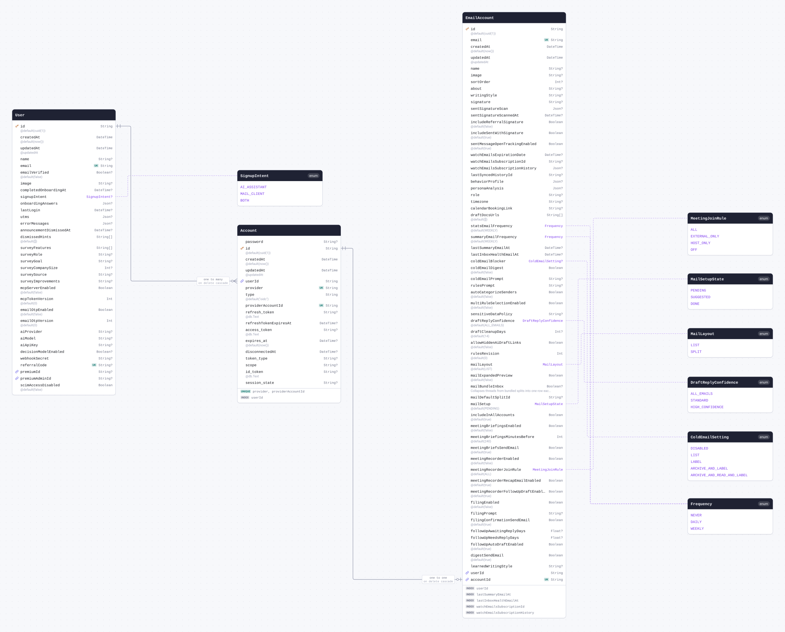

| Field                   | Type                | Constraints                       | Default      | Description |
| ----------------------- | ------------------- | --------------------------------- | ------------ | ----------- |
| `password`              | `String`            | NULL                              |              |             |
| `id`                    | `String`            | PK NOT NULL                       | `cuid(1)`    |             |
| `createdAt`             | `DateTime`          | NOT NULL                          | `now()`      |             |
| `updatedAt`             | `DateTime`          | NOT NULL                          | `@updatedAt` |             |
| `userId`                | `String`            | NOT NULL → [User.id](#model-User) |              |             |
| `provider`              | `String`            | NOT NULL                          |              |             |
| `type`                  | `String`            | NOT NULL                          | `"oidc"`     |             |
| `providerAccountId`     | `String`            | NOT NULL                          |              |             |
| `refresh_token`         | `String` `@db.Text` | NULL                              |              |             |
| `refreshTokenExpiresAt` | `DateTime`          | NULL                              |              |             |
| `access_token`          | `String` `@db.Text` | NULL                              |              |             |
| `expires_at`            | `DateTime`          | NULL                              | `now()`      |             |
| `disconnectedAt`        | `DateTime`          | NULL                              |              |             |
| `token_type`            | `String`            | NULL                              |              |             |
| `scope`                 | `String`            | NULL                              |              |             |
| `id_token`              | `String` `@db.Text` | NULL                              |              |             |
| `session_state`         | `String`            | NULL                              |              |             |

#### Indexes

- `@@index([userId])`
- `@@unique([provider, providerAccountId])`

#### References

- `userId` → [User.id](#model-User) (many-to-one, on delete Cascade)

#### Referenced by

- `id` ← [EmailAccount.accountId](#model-EmailAccount) (one-to-one, on delete Cascade)

#### Definition

```sql
CREATE TABLE "Account" (
    "password" TEXT,
    "id" TEXT NOT NULL,
    "createdAt" TIMESTAMP(3) NOT NULL DEFAULT CURRENT_TIMESTAMP,
    "updatedAt" TIMESTAMP(3) NOT NULL,
    "userId" TEXT NOT NULL,
    "provider" TEXT NOT NULL,
    "type" TEXT NOT NULL DEFAULT 'oidc',
    "providerAccountId" TEXT NOT NULL,
    "refresh_token" TEXT,
    "refreshTokenExpiresAt" TIMESTAMP(3),
    "access_token" TEXT,
    "expires_at" TIMESTAMP(3) DEFAULT CURRENT_TIMESTAMP,
    "disconnectedAt" TIMESTAMP(3),
    "token_type" TEXT,
    "scope" TEXT,
    "id_token" TEXT,
    "session_state" TEXT,

    CONSTRAINT "Account_pkey" PRIMARY KEY ("id")
);

CREATE INDEX "Account_userId_idx" ON "Account"("userId");

CREATE UNIQUE INDEX "Account_provider_providerAccountId_key" ON "Account"("provider", "providerAccountId");

ALTER TABLE "Account" ADD CONSTRAINT "Account_userId_fkey" FOREIGN KEY ("userId") REFERENCES "User"("id") ON DELETE CASCADE ON UPDATE CASCADE;
```

<details>
<summary>Queries and their SQL</summary>

**findMany**: Every row

```ts
await prisma.account.findMany();
```

```sql
SELECT
  "public"."Account"."id",
  "public"."Account"."password",
  "public"."Account"."createdAt",
  "public"."Account"."updatedAt",
  "public"."Account"."userId",
  "public"."Account"."provider",
  "public"."Account"."type",
  "public"."Account"."providerAccountId",
  "public"."Account"."refresh_token",
  "public"."Account"."refreshTokenExpiresAt",
  "public"."Account"."access_token",
  "public"."Account"."expires_at",
  "public"."Account"."disconnectedAt",
  "public"."Account"."token_type",
  "public"."Account"."scope",
  "public"."Account"."id_token",
  "public"."Account"."session_state"
FROM
  "public"."Account"
WHERE
  1 = 1
OFFSET
  $1
-- params: ["0"]
```

**count**: How many rows there are

```ts
await prisma.account.count();
```

```sql
SELECT
  COUNT(*) AS "_count$_all"
FROM
  (
    SELECT
      "public"."Account"."id"
    FROM
      "public"."Account"
    WHERE
      1 = 1
    OFFSET
      $1
  ) AS "sub"
-- params: ["0"]
```

**findMany**: Every row with its relations

```ts
await prisma.account.findMany({ include: { user: true, emailAccount: true } });
```

```sql
SELECT
  "public"."Account"."id",
  "public"."Account"."password",
  "public"."Account"."createdAt",
  "public"."Account"."updatedAt",
  "public"."Account"."userId",
  "public"."Account"."provider",
  "public"."Account"."type",
  "public"."Account"."providerAccountId",
  "public"."Account"."refresh_token",
  "public"."Account"."refreshTokenExpiresAt",
  "public"."Account"."access_token",
  "public"."Account"."expires_at",
  "public"."Account"."disconnectedAt",
  "public"."Account"."token_type",
  "public"."Account"."scope",
  "public"."Account"."id_token",
  "public"."Account"."session_state"
FROM
  "public"."Account"
WHERE
  1 = 1
OFFSET
  $1
-- params: ["0"]

SELECT
  "public"."User"."id",
  "public"."User"."createdAt",
  "public"."User"."updatedAt",
  "public"."User"."name",
  "public"."User"."email",
  "public"."User"."emailVerified",
  "public"."User"."image",
  "public"."User"."completedOnboardingAt",
  "public"."User"."signupIntent"::text,
  "public"."User"."onboardingAnswers",
  "public"."User"."lastLogin",
  "public"."User"."utms",
  "public"."User"."errorMessages",
  "public"."User"."announcementDismissedAt",
  "public"."User"."dismissedHints",
  "public"."User"."surveyFeatures",
  "public"."User"."surveyRole",
  "public"."User"."surveyGoal",
  "public"."User"."surveyCompanySize",
  "public"."User"."surveySource",
  "public"."User"."surveyImprovements",
  "public"."User"."mcpServerEnabled",
  "public"."User"."mcpTokenVersion",
  "public"."User"."emailOtpEnabled",
  "public"."User"."emailOtpVersion",
  "public"."User"."aiProvider",
  "public"."User"."aiModel",
  "public"."User"."aiApiKey",
  "public"."User"."decisionModelEnabled",
  "public"."User"."webhookSecret",
  "public"."User"."referralCode",
  "public"."User"."premiumId",
  "public"."User"."premiumAdminId",
  "public"."User"."scimAccessDisabled"
FROM
  "public"."User"
WHERE
  "public"."User"."id" IN ($1)
OFFSET
  $2
-- params: ["<userId of the rows above>","0"]

SELECT
  "public"."EmailAccount"."id",
  "public"."EmailAccount"."email",
  "public"."EmailAccount"."createdAt",
  "public"."EmailAccount"."updatedAt",
  "public"."EmailAccount"."name",
  "public"."EmailAccount"."image",
  "public"."EmailAccount"."sortOrder",
  "public"."EmailAccount"."about",
  "public"."EmailAccount"."writingStyle",
  "public"."EmailAccount"."signature",
  "public"."EmailAccount"."sentSignatureScan",
  "public"."EmailAccount"."sentSignatureScannedAt",
  "public"."EmailAccount"."includeReferralSignature",
  "public"."EmailAccount"."includeSentWithSignature",
  "public"."EmailAccount"."sentMessageOpenTrackingEnabled",
  "public"."EmailAccount"."watchEmailsExpirationDate",
  "public"."EmailAccount"."watchEmailsSubscriptionId",
  "public"."EmailAccount"."watchEmailsSubscriptionHistory",
  "public"."EmailAccount"."lastSyncedHistoryId",
  "public"."EmailAccount"."behaviorProfile",
  "public"."EmailAccount"."personaAnalysis",
  "public"."EmailAccount"."role",
  "public"."EmailAccount"."timezone",
  "public"."EmailAccount"."calendarBookingLink",
  "public"."EmailAccount"."draftDocsUrls",
  "public"."EmailAccount"."statsEmailFrequency"::text,
  "public"."EmailAccount"."summaryEmailFrequency"::text,
  "public"."EmailAccount"."lastSummaryEmailAt",
  "public"."EmailAccount"."lastInboxHealthEmailAt",
  "public"."EmailAccount"."coldEmailBlocker"::text,
  "public"."EmailAccount"."coldEmailDigest",
  "public"."EmailAccount"."coldEmailPrompt",
  "public"."EmailAccount"."rulesPrompt",
  "public"."EmailAccount"."autoCategorizeSenders",
  "public"."EmailAccount"."multiRuleSelectionEnabled",
  "public"."EmailAccount"."sensitiveDataPolicy",
  "public"."EmailAccount"."draftReplyConfidence"::text,
  "public"."EmailAccount"."draftCleanupDays",
  "public"."EmailAccount"."allowHiddenAiDraftLinks",
  "public"."EmailAccount"."rulesRevision",
  "public"."EmailAccount"."mailLayout"::text,
  "public"."EmailAccount"."mailExpandedPreview",
  "public"."EmailAccount"."mailBundleInbox",
  "public"."EmailAccount"."mailDefaultSplitId",
  "public"."EmailAccount"."mailSetup"::text,
  "public"."EmailAccount"."includeInAllAccounts",
  "public"."EmailAccount"."meetingBriefingsEnabled",
  "public"."EmailAccount"."meetingBriefingsMinutesBefore",
  "public"."EmailAccount"."meetingBriefsSendEmail",
  "public"."EmailAccount"."meetingRecorderEnabled",
  "public"."EmailAccount"."meetingRecorderJoinRule"::text,
  "public"."EmailAccount"."meetingRecorderRecapEmailEnabled",
  "public"."EmailAccount"."meetingRecorderFollowUpDraftEnabled",
  "public"."EmailAccount"."filingEnabled",
  "public"."EmailAccount"."filingPrompt",
  "public"."EmailAccount"."filingConfirmationSendEmail",
  "public"."EmailAccount"."followUpAwaitingReplyDays",
  "public"."EmailAccount"."followUpNeedsReplyDays",
  "public"."EmailAccount"."followUpAutoDraftEnabled",
  "public"."EmailAccount"."digestSendEmail",
  "public"."EmailAccount"."learnedWritingStyle",
  "public"."EmailAccount"."userId",
  "public"."EmailAccount"."accountId"
FROM
  "public"."EmailAccount"
WHERE
  "public"."EmailAccount"."accountId" IN ($1)
OFFSET
  $2
-- params: ["<id of the rows above>","0"]
```

**findUnique**: One row by what is unique to it

```ts
await prisma.account.findUnique({ where: { id: "example" } });
```

```sql
SELECT
  "public"."Account"."id",
  "public"."Account"."password",
  "public"."Account"."createdAt",
  "public"."Account"."updatedAt",
  "public"."Account"."userId",
  "public"."Account"."provider",
  "public"."Account"."type",
  "public"."Account"."providerAccountId",
  "public"."Account"."refresh_token",
  "public"."Account"."refreshTokenExpiresAt",
  "public"."Account"."access_token",
  "public"."Account"."expires_at",
  "public"."Account"."disconnectedAt",
  "public"."Account"."token_type",
  "public"."Account"."scope",
  "public"."Account"."id_token",
  "public"."Account"."session_state"
FROM
  "public"."Account"
WHERE
  (
    "public"."Account"."id" = $1
    AND 1 = 1
  )
LIMIT
  $2
OFFSET
  $3
-- params: ["example","1","0"]
```

**create**: Create a row

```ts
await prisma.account.create({
  data: { userId: "example", provider: "example", providerAccountId: "example" },
});
```

```sql
INSERT INTO
  "public"."Account" (
    "id",
    "createdAt",
    "updatedAt",
    "userId",
    "provider",
    "type",
    "providerAccountId",
    "expires_at"
  )
VALUES
  ($1, $2, $3, $4, $5, $6, $7, $8)
RETURNING
  "public"."Account"."id",
  "public"."Account"."password",
  "public"."Account"."createdAt",
  "public"."Account"."updatedAt",
  "public"."Account"."userId",
  "public"."Account"."provider",
  "public"."Account"."type",
  "public"."Account"."providerAccountId",
  "public"."Account"."refresh_token",
  "public"."Account"."refreshTokenExpiresAt",
  "public"."Account"."access_token",
  "public"."Account"."expires_at",
  "public"."Account"."disconnectedAt",
  "public"."Account"."token_type",
  "public"."Account"."scope",
  "public"."Account"."id_token",
  "public"."Account"."session_state"
-- params: ["<cuid(1)>","<now()>","<now()>","example","example","oidc","example","<now()>"]
```

**update**: Update a row

```ts
await prisma.account.update({ where: { id: "example" }, data: { password: "example" } });
```

```sql
UPDATE "public"."Account"
SET
  "password" = $1,
  "updatedAt" = $2
WHERE
  (
    "public"."Account"."id" = $3
    AND 1 = 1
  )
RETURNING
  "public"."Account"."id",
  "public"."Account"."password",
  "public"."Account"."createdAt",
  "public"."Account"."updatedAt",
  "public"."Account"."userId",
  "public"."Account"."provider",
  "public"."Account"."type",
  "public"."Account"."providerAccountId",
  "public"."Account"."refresh_token",
  "public"."Account"."refreshTokenExpiresAt",
  "public"."Account"."access_token",
  "public"."Account"."expires_at",
  "public"."Account"."disconnectedAt",
  "public"."Account"."token_type",
  "public"."Account"."scope",
  "public"."Account"."id_token",
  "public"."Account"."session_state"
-- params: ["example",{"prisma__type":"generatorCall","prisma__value":{"name":"now","args":[],"returnType":{"type":"DateTime"}}},"example"]
```

**delete**: Delete a row

```ts
await prisma.account.delete({ where: { id: "example" } });
```

```sql
DELETE FROM "public"."Account"
WHERE
  (
    "public"."Account"."id" = $1
    AND 1 = 1
  )
RETURNING
  "public"."Account"."id",
  "public"."Account"."password",
  "public"."Account"."createdAt",
  "public"."Account"."updatedAt",
  "public"."Account"."userId",
  "public"."Account"."provider",
  "public"."Account"."type",
  "public"."Account"."providerAccountId",
  "public"."Account"."refresh_token",
  "public"."Account"."refreshTokenExpiresAt",
  "public"."Account"."access_token",
  "public"."Account"."expires_at",
  "public"."Account"."disconnectedAt",
  "public"."Account"."token_type",
  "public"."Account"."scope",
  "public"."Account"."id_token",
  "public"."Account"."session_state"
-- params: ["example"]
```

</details>

<a id="model-Session"></a>

### Session

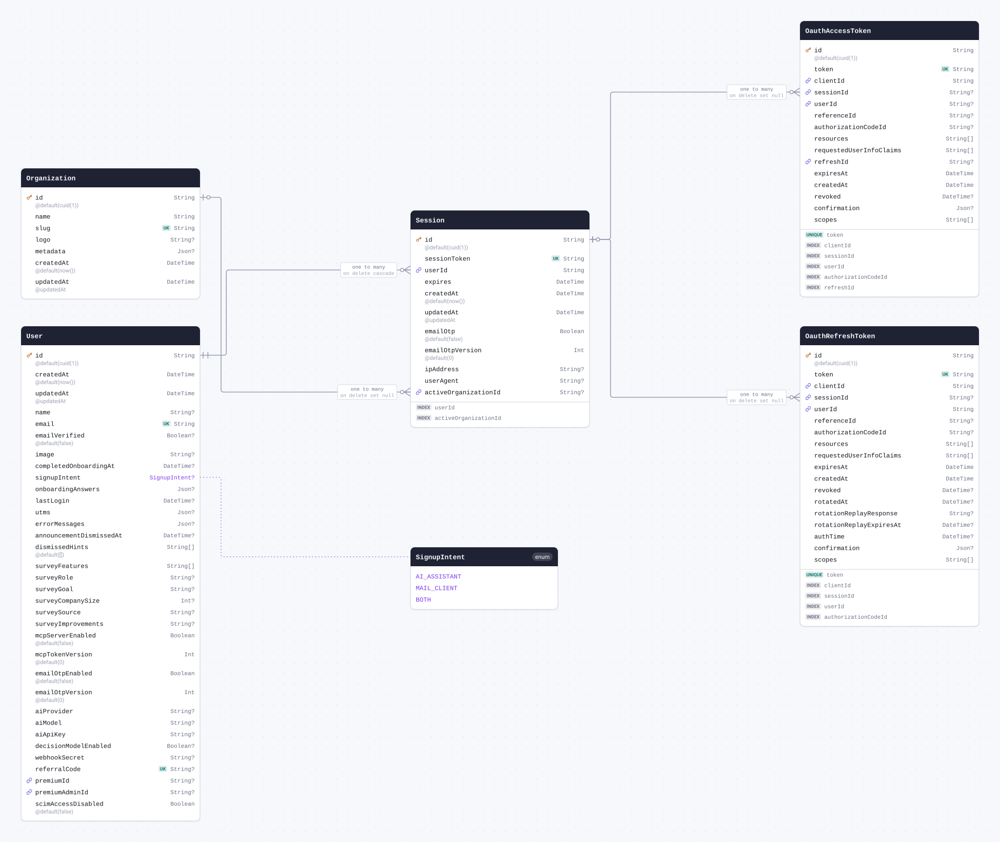

| Field                  | Type       | Constraints                                   | Default      | Description |
| ---------------------- | ---------- | --------------------------------------------- | ------------ | ----------- |
| `id`                   | `String`   | PK NOT NULL                                   | `cuid(1)`    |             |
| `sessionToken`         | `String`   | UNIQUE NOT NULL                               |              |             |
| `userId`               | `String`   | NOT NULL → [User.id](#model-User)             |              |             |
| `expires`              | `DateTime` | NOT NULL                                      |              |             |
| `createdAt`            | `DateTime` | NOT NULL                                      | `now()`      |             |
| `updatedAt`            | `DateTime` | NOT NULL                                      | `@updatedAt` |             |
| `emailOtp`             | `Boolean`  | NOT NULL                                      | `false`      |             |
| `emailOtpVersion`      | `Int`      | NOT NULL                                      | `0`          |             |
| `ipAddress`            | `String`   | NULL                                          |              |             |
| `userAgent`            | `String`   | NULL                                          |              |             |
| `activeOrganizationId` | `String`   | NULL → [Organization.id](#model-Organization) |              |             |

#### Indexes

- `@@index([userId])`
- `@@index([activeOrganizationId])`

#### References

- `userId` → [User.id](#model-User) (many-to-one, on delete Cascade)
- `activeOrganizationId` → [Organization.id](#model-Organization) (many-to-one, on delete SetNull)

#### Referenced by

- `id` ← [OauthRefreshToken.sessionId](#model-OauthRefreshToken) (one-to-many, on delete SetNull)
- `id` ← [OauthAccessToken.sessionId](#model-OauthAccessToken) (one-to-many, on delete SetNull)

#### Definition

```sql
CREATE TABLE "Session" (
    "id" TEXT NOT NULL,
    "sessionToken" TEXT NOT NULL,
    "userId" TEXT NOT NULL,
    "expires" TIMESTAMP(3) NOT NULL,
    "createdAt" TIMESTAMP(3) NOT NULL DEFAULT CURRENT_TIMESTAMP,
    "updatedAt" TIMESTAMP(3) NOT NULL,
    "emailOtp" BOOLEAN NOT NULL DEFAULT false,
    "emailOtpVersion" INTEGER NOT NULL DEFAULT 0,
    "ipAddress" TEXT,
    "userAgent" TEXT,
    "activeOrganizationId" TEXT,

    CONSTRAINT "Session_pkey" PRIMARY KEY ("id")
);

CREATE UNIQUE INDEX "Session_sessionToken_key" ON "Session"("sessionToken");

CREATE INDEX "Session_userId_idx" ON "Session"("userId");

CREATE INDEX "Session_activeOrganizationId_idx" ON "Session"("activeOrganizationId");

ALTER TABLE "Session" ADD CONSTRAINT "Session_userId_fkey" FOREIGN KEY ("userId") REFERENCES "User"("id") ON DELETE CASCADE ON UPDATE CASCADE;

ALTER TABLE "Session" ADD CONSTRAINT "Session_activeOrganizationId_fkey" FOREIGN KEY ("activeOrganizationId") REFERENCES "Organization"("id") ON DELETE SET NULL ON UPDATE CASCADE;
```

<details>
<summary>Queries and their SQL</summary>

**findMany**: Every row

```ts
await prisma.session.findMany();
```

```sql
SELECT
  "public"."Session"."id",
  "public"."Session"."sessionToken",
  "public"."Session"."userId",
  "public"."Session"."expires",
  "public"."Session"."createdAt",
  "public"."Session"."updatedAt",
  "public"."Session"."emailOtp",
  "public"."Session"."emailOtpVersion",
  "public"."Session"."ipAddress",
  "public"."Session"."userAgent",
  "public"."Session"."activeOrganizationId"
FROM
  "public"."Session"
WHERE
  1 = 1
OFFSET
  $1
-- params: ["0"]
```

**count**: How many rows there are

```ts
await prisma.session.count();
```

```sql
SELECT
  COUNT(*) AS "_count$_all"
FROM
  (
    SELECT
      "public"."Session"."id"
    FROM
      "public"."Session"
    WHERE
      1 = 1
    OFFSET
      $1
  ) AS "sub"
-- params: ["0"]
```

**findMany**: Every row with its relations

```ts
await prisma.session.findMany({
  include: {
    user: true,
    activeOrganization: true,
    oauthRefreshTokenRecords: true,
    oauthAccessTokenRecords: true,
  },
});
```

```sql
SELECT
  "public"."Session"."id",
  "public"."Session"."sessionToken",
  "public"."Session"."userId",
  "public"."Session"."expires",
  "public"."Session"."createdAt",
  "public"."Session"."updatedAt",
  "public"."Session"."emailOtp",
  "public"."Session"."emailOtpVersion",
  "public"."Session"."ipAddress",
  "public"."Session"."userAgent",
  "public"."Session"."activeOrganizationId"
FROM
  "public"."Session"
WHERE
  1 = 1
OFFSET
  $1
-- params: ["0"]

SELECT
  "public"."User"."id",
  "public"."User"."createdAt",
  "public"."User"."updatedAt",
  "public"."User"."name",
  "public"."User"."email",
  "public"."User"."emailVerified",
  "public"."User"."image",
  "public"."User"."completedOnboardingAt",
  "public"."User"."signupIntent"::text,
  "public"."User"."onboardingAnswers",
  "public"."User"."lastLogin",
  "public"."User"."utms",
  "public"."User"."errorMessages",
  "public"."User"."announcementDismissedAt",
  "public"."User"."dismissedHints",
  "public"."User"."surveyFeatures",
  "public"."User"."surveyRole",
  "public"."User"."surveyGoal",
  "public"."User"."surveyCompanySize",
  "public"."User"."surveySource",
  "public"."User"."surveyImprovements",
  "public"."User"."mcpServerEnabled",
  "public"."User"."mcpTokenVersion",
  "public"."User"."emailOtpEnabled",
  "public"."User"."emailOtpVersion",
  "public"."User"."aiProvider",
  "public"."User"."aiModel",
  "public"."User"."aiApiKey",
  "public"."User"."decisionModelEnabled",
  "public"."User"."webhookSecret",
  "public"."User"."referralCode",
  "public"."User"."premiumId",
  "public"."User"."premiumAdminId",
  "public"."User"."scimAccessDisabled"
FROM
  "public"."User"
WHERE
  "public"."User"."id" IN ($1)
OFFSET
  $2
-- params: ["<userId of the rows above>","0"]

SELECT
  "public"."Organization"."id",
  "public"."Organization"."name",
  "public"."Organization"."slug",
  "public"."Organization"."logo",
  "public"."Organization"."metadata",
  "public"."Organization"."createdAt",
  "public"."Organization"."updatedAt"
FROM
  "public"."Organization"
WHERE
  "public"."Organization"."id" IN ($1)
OFFSET
  $2
-- params: ["<activeOrganizationId of the rows above>","0"]

SELECT
  "public"."OauthRefreshToken"."id",
  "public"."OauthRefreshToken"."token",
  "public"."OauthRefreshToken"."clientId",
  "public"."OauthRefreshToken"."sessionId",
  "public"."OauthRefreshToken"."userId",
  "public"."OauthRefreshToken"."referenceId",
  "public"."OauthRefreshToken"."authorizationCodeId",
  "public"."OauthRefreshToken"."resources",
  "public"."OauthRefreshToken"."requestedUserInfoClaims",
  "public"."OauthRefreshToken"."expiresAt",
  "public"."OauthRefreshToken"."createdAt",
  "public"."OauthRefreshToken"."revoked",
  "public"."OauthRefreshToken"."rotatedAt",
  "public"."OauthRefreshToken"."rotationReplayResponse",
  "public"."OauthRefreshToken"."rotationReplayExpiresAt",
  "public"."OauthRefreshToken"."authTime",
  "public"."OauthRefreshToken"."confirmation",
  "public"."OauthRefreshToken"."scopes"
FROM
  "public"."OauthRefreshToken"
WHERE
  "public"."OauthRefreshToken"."sessionId" IN ($1)
OFFSET
  $2
-- params: ["<id of the rows above>","0"]

SELECT
  "public"."OauthAccessToken"."id",
  "public"."OauthAccessToken"."token",
  "public"."OauthAccessToken"."clientId",
  "public"."OauthAccessToken"."sessionId",
  "public"."OauthAccessToken"."userId",
  "public"."OauthAccessToken"."referenceId",
  "public"."OauthAccessToken"."authorizationCodeId",
  "public"."OauthAccessToken"."resources",
  "public"."OauthAccessToken"."requestedUserInfoClaims",
  "public"."OauthAccessToken"."refreshId",
  "public"."OauthAccessToken"."expiresAt",
  "public"."OauthAccessToken"."createdAt",
  "public"."OauthAccessToken"."revoked",
  "public"."OauthAccessToken"."confirmation",
  "public"."OauthAccessToken"."scopes"
FROM
  "public"."OauthAccessToken"
WHERE
  "public"."OauthAccessToken"."sessionId" IN ($1)
OFFSET
  $2
-- params: ["<id of the rows above>","0"]
```

**findUnique**: One row by what is unique to it

```ts
await prisma.session.findUnique({ where: { id: "example" } });
```

```sql
SELECT
  "public"."Session"."id",
  "public"."Session"."sessionToken",
  "public"."Session"."userId",
  "public"."Session"."expires",
  "public"."Session"."createdAt",
  "public"."Session"."updatedAt",
  "public"."Session"."emailOtp",
  "public"."Session"."emailOtpVersion",
  "public"."Session"."ipAddress",
  "public"."Session"."userAgent",
  "public"."Session"."activeOrganizationId"
FROM
  "public"."Session"
WHERE
  (
    "public"."Session"."id" = $1
    AND 1 = 1
  )
LIMIT
  $2
OFFSET
  $3
-- params: ["example","1","0"]
```

**create**: Create a row

```ts
await prisma.session.create({
  data: {
    sessionToken: "example",
    userId: "example",
    expires: new Date("2026-01-01T00:00:00.000Z"),
  },
});
```

```sql
INSERT INTO
  "public"."Session" (
    "id",
    "sessionToken",
    "userId",
    "expires",
    "createdAt",
    "updatedAt",
    "emailOtp",
    "emailOtpVersion"
  )
VALUES
  ($1, $2, $3, $4, $5, $6, $7, $8)
RETURNING
  "public"."Session"."id",
  "public"."Session"."sessionToken",
  "public"."Session"."userId",
  "public"."Session"."expires",
  "public"."Session"."createdAt",
  "public"."Session"."updatedAt",
  "public"."Session"."emailOtp",
  "public"."Session"."emailOtpVersion",
  "public"."Session"."ipAddress",
  "public"."Session"."userAgent",
  "public"."Session"."activeOrganizationId"
-- params: ["<cuid(1)>","example","example","2026-01-01T00:00:00.000Z","<now()>","<now()>",false,"0"]
```

**update**: Update a row

```ts
await prisma.session.update({ where: { id: "example" }, data: { sessionToken: "example" } });
```

```sql
UPDATE "public"."Session"
SET
  "sessionToken" = $1,
  "updatedAt" = $2
WHERE
  (
    "public"."Session"."id" = $3
    AND 1 = 1
  )
RETURNING
  "public"."Session"."id",
  "public"."Session"."sessionToken",
  "public"."Session"."userId",
  "public"."Session"."expires",
  "public"."Session"."createdAt",
  "public"."Session"."updatedAt",
  "public"."Session"."emailOtp",
  "public"."Session"."emailOtpVersion",
  "public"."Session"."ipAddress",
  "public"."Session"."userAgent",
  "public"."Session"."activeOrganizationId"
-- params: ["example",{"prisma__type":"generatorCall","prisma__value":{"name":"now","args":[],"returnType":{"type":"DateTime"}}},"example"]
```

**delete**: Delete a row

```ts
await prisma.session.delete({ where: { id: "example" } });
```

```sql
DELETE FROM "public"."Session"
WHERE
  (
    "public"."Session"."id" = $1
    AND 1 = 1
  )
RETURNING
  "public"."Session"."id",
  "public"."Session"."sessionToken",
  "public"."Session"."userId",
  "public"."Session"."expires",
  "public"."Session"."createdAt",
  "public"."Session"."updatedAt",
  "public"."Session"."emailOtp",
  "public"."Session"."emailOtpVersion",
  "public"."Session"."ipAddress",
  "public"."Session"."userAgent",
  "public"."Session"."activeOrganizationId"
-- params: ["example"]
```

</details>

<a id="model-User"></a>

### User

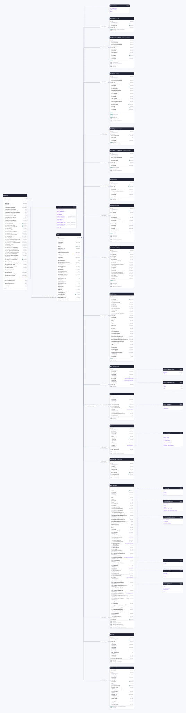

| Field                     | Type                                 | Constraints                         | Default      | Description |
| ------------------------- | ------------------------------------ | ----------------------------------- | ------------ | ----------- |
| `id`                      | `String`                             | PK NOT NULL                         | `cuid(1)`    |             |
| `createdAt`               | `DateTime`                           | NOT NULL                            | `now()`      |             |
| `updatedAt`               | `DateTime`                           | NOT NULL                            | `@updatedAt` |             |
| `name`                    | `String`                             | NULL                                |              |             |
| `email`                   | `String`                             | UNIQUE NOT NULL                     |              |             |
| `emailVerified`           | `Boolean`                            | NULL                                | `false`      |             |
| `image`                   | `String`                             | NULL                                |              |             |
| `completedOnboardingAt`   | `DateTime`                           | NULL                                |              |             |
| `signupIntent`            | [`SignupIntent`](#enum-SignupIntent) | NULL                                |              |             |
| `onboardingAnswers`       | `Json`                               | NULL                                |              |             |
| `lastLogin`               | `DateTime`                           | NULL                                |              |             |
| `utms`                    | `Json`                               | NULL                                |              |             |
| `errorMessages`           | `Json`                               | NULL                                |              |             |
| `announcementDismissedAt` | `DateTime`                           | NULL                                |              |             |
| `dismissedHints`          | `String[]`                           | NOT NULL                            | `[]`         |             |
| `surveyFeatures`          | `String[]`                           | NOT NULL                            |              |             |
| `surveyRole`              | `String`                             | NULL                                |              |             |
| `surveyGoal`              | `String`                             | NULL                                |              |             |
| `surveyCompanySize`       | `Int`                                | NULL                                |              |             |
| `surveySource`            | `String`                             | NULL                                |              |             |
| `surveyImprovements`      | `String`                             | NULL                                |              |             |
| `mcpServerEnabled`        | `Boolean`                            | NOT NULL                            | `false`      |             |
| `mcpTokenVersion`         | `Int`                                | NOT NULL                            | `0`          |             |
| `emailOtpEnabled`         | `Boolean`                            | NOT NULL                            | `false`      |             |
| `emailOtpVersion`         | `Int`                                | NOT NULL                            | `0`          |             |
| `aiProvider`              | `String`                             | NULL                                |              |             |
| `aiModel`                 | `String`                             | NULL                                |              |             |
| `aiApiKey`                | `String`                             | NULL                                |              |             |
| `decisionModelEnabled`    | `Boolean`                            | NULL                                |              |             |
| `webhookSecret`           | `String`                             | NULL                                |              |             |
| `referralCode`            | `String`                             | UNIQUE NULL                         |              |             |
| `premiumId`               | `String`                             | NULL → [Premium.id](#model-Premium) |              |             |
| `premiumAdminId`          | `String`                             | NULL → [Premium.id](#model-Premium) |              |             |
| `scimAccessDisabled`      | `Boolean`                            | NOT NULL                            | `false`      |             |

#### References

- `premiumId` → [Premium.id](#model-Premium) (many-to-one)
- `premiumAdminId` → [Premium.id](#model-Premium) (many-to-one)

#### Referenced by

- `id` ← [Account.userId](#model-Account) (one-to-many, on delete Cascade)
- `id` ← [Session.userId](#model-Session) (one-to-many, on delete Cascade)
- `id` ← [EmailAccount.userId](#model-EmailAccount) (one-to-many, on delete Cascade)
- `id` ← [SsoProvider.userId](#model-SsoProvider) (one-to-many, on delete SetNull)
- `id` ← [ApiKey.userId](#model-ApiKey) (one-to-many, on delete Cascade)
- `id` ← [Referral.referrerUserId](#model-Referral) (one-to-many, on delete Cascade)
- `id` ← [Referral.referredUserId](#model-Referral) (one-to-one, on delete Cascade)
- `id` ← [MobilePushToken.userId](#model-MobilePushToken) (one-to-many, on delete Cascade)
- `id` ← [OauthClient.userId](#model-OauthClient) (one-to-many, on delete Cascade)
- `id` ← [OauthRefreshToken.userId](#model-OauthRefreshToken) (one-to-many, on delete Cascade)
- `id` ← [OauthAccessToken.userId](#model-OauthAccessToken) (one-to-many, on delete Cascade)
- `id` ← [OauthConsent.userId](#model-OauthConsent) (one-to-many, on delete Cascade)
- `id` ← [ScimIdentityTombstone.userId](#model-ScimIdentityTombstone) (one-to-many, on delete Cascade)
- `id` ← [ScimSubject.userId](#model-ScimSubject) (one-to-one, on delete Cascade)
- `id` ← [ScimUser.userId](#model-ScimUser) (one-to-many, on delete Cascade)
- `id` ← [ScimProjectionGrant.userId](#model-ScimProjectionGrant) (one-to-many, on delete Cascade)
- `id` ← [ScimIdentityLink.userId](#model-ScimIdentityLink) (one-to-many, on delete Cascade)

#### Definition

```sql
CREATE TABLE "User" (
    "id" TEXT NOT NULL,
    "createdAt" TIMESTAMP(3) NOT NULL DEFAULT CURRENT_TIMESTAMP,
    "updatedAt" TIMESTAMP(3) NOT NULL,
    "name" TEXT,
    "email" TEXT NOT NULL,
    "emailVerified" BOOLEAN DEFAULT false,
    "image" TEXT,
    "completedOnboardingAt" TIMESTAMP(3),
    "signupIntent" "SignupIntent",
    "onboardingAnswers" JSONB,
    "lastLogin" TIMESTAMP(3),
    "utms" JSONB,
    "errorMessages" JSONB,
    "announcementDismissedAt" TIMESTAMP(3),
    "dismissedHints" TEXT[] DEFAULT ARRAY[]::TEXT[],
    "surveyFeatures" TEXT[],
    "surveyRole" TEXT,
    "surveyGoal" TEXT,
    "surveyCompanySize" INTEGER,
    "surveySource" TEXT,
    "surveyImprovements" TEXT,
    "mcpServerEnabled" BOOLEAN NOT NULL DEFAULT false,
    "mcpTokenVersion" INTEGER NOT NULL DEFAULT 0,
    "emailOtpEnabled" BOOLEAN NOT NULL DEFAULT false,
    "emailOtpVersion" INTEGER NOT NULL DEFAULT 0,
    "aiProvider" TEXT,
    "aiModel" TEXT,
    "aiApiKey" TEXT,
    "decisionModelEnabled" BOOLEAN,
    "webhookSecret" TEXT,
    "referralCode" TEXT,
    "premiumId" TEXT,
    "premiumAdminId" TEXT,
    "scimAccessDisabled" BOOLEAN NOT NULL DEFAULT false,

    CONSTRAINT "User_pkey" PRIMARY KEY ("id")
);

CREATE UNIQUE INDEX "User_email_key" ON "User"("email");

CREATE UNIQUE INDEX "User_referralCode_key" ON "User"("referralCode");

ALTER TABLE "User" ADD CONSTRAINT "User_premiumId_fkey" FOREIGN KEY ("premiumId") REFERENCES "Premium"("id") ON DELETE SET NULL ON UPDATE CASCADE;

ALTER TABLE "User" ADD CONSTRAINT "User_premiumAdminId_fkey" FOREIGN KEY ("premiumAdminId") REFERENCES "Premium"("id") ON DELETE SET NULL ON UPDATE CASCADE;
```

<details>
<summary>Queries and their SQL</summary>

**findMany**: Every row

```ts
await prisma.user.findMany();
```

```sql
SELECT
  "public"."User"."id",
  "public"."User"."createdAt",
  "public"."User"."updatedAt",
  "public"."User"."name",
  "public"."User"."email",
  "public"."User"."emailVerified",
  "public"."User"."image",
  "public"."User"."completedOnboardingAt",
  "public"."User"."signupIntent"::text,
  "public"."User"."onboardingAnswers",
  "public"."User"."lastLogin",
  "public"."User"."utms",
  "public"."User"."errorMessages",
  "public"."User"."announcementDismissedAt",
  "public"."User"."dismissedHints",
  "public"."User"."surveyFeatures",
  "public"."User"."surveyRole",
  "public"."User"."surveyGoal",
  "public"."User"."surveyCompanySize",
  "public"."User"."surveySource",
  "public"."User"."surveyImprovements",
  "public"."User"."mcpServerEnabled",
  "public"."User"."mcpTokenVersion",
  "public"."User"."emailOtpEnabled",
  "public"."User"."emailOtpVersion",
  "public"."User"."aiProvider",
  "public"."User"."aiModel",
  "public"."User"."aiApiKey",
  "public"."User"."decisionModelEnabled",
  "public"."User"."webhookSecret",
  "public"."User"."referralCode",
  "public"."User"."premiumId",
  "public"."User"."premiumAdminId",
  "public"."User"."scimAccessDisabled"
FROM
  "public"."User"
WHERE
  1 = 1
OFFSET
  $1
-- params: ["0"]
```

**count**: How many rows there are

```ts
await prisma.user.count();
```

```sql
SELECT
  COUNT(*) AS "_count$_all"
FROM
  (
    SELECT
      "public"."User"."id"
    FROM
      "public"."User"
    WHERE
      1 = 1
    OFFSET
      $1
  ) AS "sub"
-- params: ["0"]
```

**findMany**: Every row with its relations

```ts
await prisma.user.findMany({
  include: {
    accounts: true,
    sessions: true,
    premium: true,
    premiumAdmin: true,
    apiKeys: true,
    emailAccounts: true,
    referralsMade: true,
    referralReceived: true,
    mobilePushTokens: true,
    oauthClientRecords: true,
    oauthRefreshTokenRecords: true,
    oauthAccessTokenRecords: true,
    oauthConsentRecords: true,
    ssoProviders: true,
    scimIdentityTombstones: true,
    scimSubject: true,
    scimUsers: true,
    scimProjectionGrants: true,
    scimIdentityLinks: true,
  },
});
```

```sql
SELECT
  "public"."User"."id",
  "public"."User"."createdAt",
  "public"."User"."updatedAt",
  "public"."User"."name",
  "public"."User"."email",
  "public"."User"."emailVerified",
  "public"."User"."image",
  "public"."User"."completedOnboardingAt",
  "public"."User"."signupIntent"::text,
  "public"."User"."onboardingAnswers",
  "public"."User"."lastLogin",
  "public"."User"."utms",
  "public"."User"."errorMessages",
  "public"."User"."announcementDismissedAt",
  "public"."User"."dismissedHints",
  "public"."User"."surveyFeatures",
  "public"."User"."surveyRole",
  "public"."User"."surveyGoal",
  "public"."User"."surveyCompanySize",
  "public"."User"."surveySource",
  "public"."User"."surveyImprovements",
  "public"."User"."mcpServerEnabled",
  "public"."User"."mcpTokenVersion",
  "public"."User"."emailOtpEnabled",
  "public"."User"."emailOtpVersion",
  "public"."User"."aiProvider",
  "public"."User"."aiModel",
  "public"."User"."aiApiKey",
  "public"."User"."decisionModelEnabled",
  "public"."User"."webhookSecret",
  "public"."User"."referralCode",
  "public"."User"."premiumId",
  "public"."User"."premiumAdminId",
  "public"."User"."scimAccessDisabled"
FROM
  "public"."User"
WHERE
  1 = 1
OFFSET
  $1
-- params: ["0"]

SELECT
  "public"."Account"."id",
  "public"."Account"."password",
  "public"."Account"."createdAt",
  "public"."Account"."updatedAt",
  "public"."Account"."userId",
  "public"."Account"."provider",
  "public"."Account"."type",
  "public"."Account"."providerAccountId",
  "public"."Account"."refresh_token",
  "public"."Account"."refreshTokenExpiresAt",
  "public"."Account"."access_token",
  "public"."Account"."expires_at",
  "public"."Account"."disconnectedAt",
  "public"."Account"."token_type",
  "public"."Account"."scope",
  "public"."Account"."id_token",
  "public"."Account"."session_state"
FROM
  "public"."Account"
WHERE
  "public"."Account"."userId" IN ($1)
OFFSET
  $2
-- params: ["<id of the rows above>","0"]

SELECT
  "public"."Session"."id",
  "public"."Session"."sessionToken",
  "public"."Session"."userId",
  "public"."Session"."expires",
  "public"."Session"."createdAt",
  "public"."Session"."updatedAt",
  "public"."Session"."emailOtp",
  "public"."Session"."emailOtpVersion",
  "public"."Session"."ipAddress",
  "public"."Session"."userAgent",
  "public"."Session"."activeOrganizationId"
FROM
  "public"."Session"
WHERE
  "public"."Session"."userId" IN ($1)
OFFSET
  $2
-- params: ["<id of the rows above>","0"]

SELECT
  "public"."Premium"."id",
  "public"."Premium"."createdAt",
  "public"."Premium"."updatedAt",
  "public"."Premium"."pendingInvites",
  "public"."Premium"."lemonSqueezyRenewsAt",
  "public"."Premium"."lemonSqueezyCustomerId",
  "public"."Premium"."lemonSqueezySubscriptionId",
  "public"."Premium"."lemonSqueezySubscriptionItemId",
  "public"."Premium"."lemonSqueezyOrderId",
  "public"."Premium"."lemonSqueezyProductId",
  "public"."Premium"."lemonSqueezyVariantId",
  "public"."Premium"."lemonLicenseKey",
  "public"."Premium"."lemonLicenseInstanceId",
  "public"."Premium"."lemonSubscriptionStatus",
  "public"."Premium"."stripeCustomerId",
  "public"."Premium"."stripeSubscriptionId",
  "public"."Premium"."stripeSubscriptionItemId",
  "public"."Premium"."stripePriceId",
  "public"."Premium"."stripeProductId",
  "public"."Premium"."stripeSubscriptionStatus",
  "public"."Premium"."stripeCancelAt",
  "public"."Premium"."stripeCancelAtPeriodEnd",
  "public"."Premium"."stripeRenewsAt",
  "public"."Premium"."stripeTrialEnd",
  "public"."Premium"."stripeTrialConversionInvoiceId",
  "public"."Premium"."stripeTrialConvertedAt",
  "public"."Premium"."stripeCancellationInitiatedAt",
  "public"."Premium"."stripeCanceledAt",
  "public"."Premium"."stripeEndedAt",
  "public"."Premium"."stripeCancellationFeedback",
  "public"."Premium"."stripeCancellationComment",
  "public"."Premium"."stripeAiOverageLastInvoiceId",
  "public"."Premium"."stripeAiOverageLastPeriodEnd",
  "public"."Premium"."stripeAiOverageLastUnits",
  "public"."Premium"."stripeInvoiceEmailsEnabled",
  "public"."Premium"."appleOriginalTransactionId",
  "public"."Premium"."appleLatestTransactionId",
  "public"."Premium"."appleProductId",
  "public"."Premium"."appleSubscriptionGroupIdentifier",
  "public"."Premium"."appleAppAccountToken",
  "public"."Premium"."appleSubscriptionStatus",
  "public"."Premium"."appleEnvironment",
  "public"."Premium"."applePurchaseDate",
  "public"."Premium"."appleExpiresAt",
  "public"."Premium"."appleRevokedAt",
  "public"."Premium"."appleOfferDiscountType",
  "public"."Premium"."adminGrantExpiresAt",
  "public"."Premium"."adminGrantTier"::text,
  "public"."Premium"."tier"::text,
  "public"."Premium"."emailAccountsAccess",
  "public"."Premium"."unsubscribeMonth",
  "public"."Premium"."unsubscribeCredits",
  "public"."Premium"."aiMonth",
  "public"."Premium"."aiCredits"
FROM
  "public"."Premium"
WHERE
  "public"."Premium"."id" IN ($1)
OFFSET
  $2
-- params: ["<premiumId of the rows above>","0"]

SELECT
  "public"."Premium"."id",
  "public"."Premium"."createdAt",
  "public"."Premium"."updatedAt",
  "public"."Premium"."pendingInvites",
  "public"."Premium"."lemonSqueezyRenewsAt",
  "public"."Premium"."lemonSqueezyCustomerId",
  "public"."Premium"."lemonSqueezySubscriptionId",
  "public"."Premium"."lemonSqueezySubscriptionItemId",
  "public"."Premium"."lemonSqueezyOrderId",
  "public"."Premium"."lemonSqueezyProductId",
  "public"."Premium"."lemonSqueezyVariantId",
  "public"."Premium"."lemonLicenseKey",
  "public"."Premium"."lemonLicenseInstanceId",
  "public"."Premium"."lemonSubscriptionStatus",
  "public"."Premium"."stripeCustomerId",
  "public"."Premium"."stripeSubscriptionId",
  "public"."Premium"."stripeSubscriptionItemId",
  "public"."Premium"."stripePriceId",
  "public"."Premium"."stripeProductId",
  "public"."Premium"."stripeSubscriptionStatus",
  "public"."Premium"."stripeCancelAt",
  "public"."Premium"."stripeCancelAtPeriodEnd",
  "public"."Premium"."stripeRenewsAt",
  "public"."Premium"."stripeTrialEnd",
  "public"."Premium"."stripeTrialConversionInvoiceId",
  "public"."Premium"."stripeTrialConvertedAt",
  "public"."Premium"."stripeCancellationInitiatedAt",
  "public"."Premium"."stripeCanceledAt",
  "public"."Premium"."stripeEndedAt",
  "public"."Premium"."stripeCancellationFeedback",
  "public"."Premium"."stripeCancellationComment",
  "public"."Premium"."stripeAiOverageLastInvoiceId",
  "public"."Premium"."stripeAiOverageLastPeriodEnd",
  "public"."Premium"."stripeAiOverageLastUnits",
  "public"."Premium"."stripeInvoiceEmailsEnabled",
  "public"."Premium"."appleOriginalTransactionId",
  "public"."Premium"."appleLatestTransactionId",
  "public"."Premium"."appleProductId",
  "public"."Premium"."appleSubscriptionGroupIdentifier",
  "public"."Premium"."appleAppAccountToken",
  "public"."Premium"."appleSubscriptionStatus",
  "public"."Premium"."appleEnvironment",
  "public"."Premium"."applePurchaseDate",
  "public"."Premium"."appleExpiresAt",
  "public"."Premium"."appleRevokedAt",
  "public"."Premium"."appleOfferDiscountType",
  "public"."Premium"."adminGrantExpiresAt",
  "public"."Premium"."adminGrantTier"::text,
  "public"."Premium"."tier"::text,
  "public"."Premium"."emailAccountsAccess",
  "public"."Premium"."unsubscribeMonth",
  "public"."Premium"."unsubscribeCredits",
  "public"."Premium"."aiMonth",
  "public"."Premium"."aiCredits"
FROM
  "public"."Premium"
WHERE
  "public"."Premium"."id" IN ($1)
OFFSET
  $2
-- params: ["<premiumAdminId of the rows above>","0"]

SELECT
  "public"."ApiKey"."id",
  "public"."ApiKey"."createdAt",
  "public"."ApiKey"."updatedAt",
  "public"."ApiKey"."name",
  "public"."ApiKey"."hashedKey",
  "public"."ApiKey"."isActive",
  "public"."ApiKey"."expiresAt",
  "public"."ApiKey"."lastUsedAt",
  "public"."ApiKey"."scopes"::text[],
  "public"."ApiKey"."userId",
  "public"."ApiKey"."emailAccountId"
FROM
  "public"."ApiKey"
WHERE
  "public"."ApiKey"."userId" IN ($1)
OFFSET
  $2
-- params: ["<id of the rows above>","0"]

SELECT
  "public"."EmailAccount"."id",
  "public"."EmailAccount"."email",
  "public"."EmailAccount"."createdAt",
  "public"."EmailAccount"."updatedAt",
  "public"."EmailAccount"."name",
  "public"."EmailAccount"."image",
  "public"."EmailAccount"."sortOrder",
  "public"."EmailAccount"."about",
  "public"."EmailAccount"."writingStyle",
  "public"."EmailAccount"."signature",
  "public"."EmailAccount"."sentSignatureScan",
  "public"."EmailAccount"."sentSignatureScannedAt",
  "public"."EmailAccount"."includeReferralSignature",
  "public"."EmailAccount"."includeSentWithSignature",
  "public"."EmailAccount"."sentMessageOpenTrackingEnabled",
  "public"."EmailAccount"."watchEmailsExpirationDate",
  "public"."EmailAccount"."watchEmailsSubscriptionId",
  "public"."EmailAccount"."watchEmailsSubscriptionHistory",
  "public"."EmailAccount"."lastSyncedHistoryId",
  "public"."EmailAccount"."behaviorProfile",
  "public"."EmailAccount"."personaAnalysis",
  "public"."EmailAccount"."role",
  "public"."EmailAccount"."timezone",
  "public"."EmailAccount"."calendarBookingLink",
  "public"."EmailAccount"."draftDocsUrls",
  "public"."EmailAccount"."statsEmailFrequency"::text,
  "public"."EmailAccount"."summaryEmailFrequency"::text,
  "public"."EmailAccount"."lastSummaryEmailAt",
  "public"."EmailAccount"."lastInboxHealthEmailAt",
  "public"."EmailAccount"."coldEmailBlocker"::text,
  "public"."EmailAccount"."coldEmailDigest",
  "public"."EmailAccount"."coldEmailPrompt",
  "public"."EmailAccount"."rulesPrompt",
  "public"."EmailAccount"."autoCategorizeSenders",
  "public"."EmailAccount"."multiRuleSelectionEnabled",
  "public"."EmailAccount"."sensitiveDataPolicy",
  "public"."EmailAccount"."draftReplyConfidence"::text,
  "public"."EmailAccount"."draftCleanupDays",
  "public"."EmailAccount"."allowHiddenAiDraftLinks",
  "public"."EmailAccount"."rulesRevision",
  "public"."EmailAccount"."mailLayout"::text,
  "public"."EmailAccount"."mailExpandedPreview",
  "public"."EmailAccount"."mailBundleInbox",
  "public"."EmailAccount"."mailDefaultSplitId",
  "public"."EmailAccount"."mailSetup"::text,
  "public"."EmailAccount"."includeInAllAccounts",
  "public"."EmailAccount"."meetingBriefingsEnabled",
  "public"."EmailAccount"."meetingBriefingsMinutesBefore",
  "public"."EmailAccount"."meetingBriefsSendEmail",
  "public"."EmailAccount"."meetingRecorderEnabled",
  "public"."EmailAccount"."meetingRecorderJoinRule"::text,
  "public"."EmailAccount"."meetingRecorderRecapEmailEnabled",
  "public"."EmailAccount"."meetingRecorderFollowUpDraftEnabled",
  "public"."EmailAccount"."filingEnabled",
  "public"."EmailAccount"."filingPrompt",
  "public"."EmailAccount"."filingConfirmationSendEmail",
  "public"."EmailAccount"."followUpAwaitingReplyDays",
  "public"."EmailAccount"."followUpNeedsReplyDays",
  "public"."EmailAccount"."followUpAutoDraftEnabled",
  "public"."EmailAccount"."digestSendEmail",
  "public"."EmailAccount"."learnedWritingStyle",
  "public"."EmailAccount"."userId",
  "public"."EmailAccount"."accountId"
FROM
  "public"."EmailAccount"
WHERE
  "public"."EmailAccount"."userId" IN ($1)
OFFSET
  $2
-- params: ["<id of the rows above>","0"]

SELECT
  "public"."Referral"."id",
  "public"."Referral"."createdAt",
  "public"."Referral"."updatedAt",
  "public"."Referral"."referrerUserId",
  "public"."Referral"."referredUserId",
  "public"."Referral"."referralCodeUsed",
  "public"."Referral"."status"::text,
  "public"."Referral"."rewardGrantedAt",
  "public"."Referral"."stripeBalanceTransactionId",
  "public"."Referral"."rewardAmount"
FROM
  "public"."Referral"
WHERE
  "public"."Referral"."referrerUserId" IN ($1)
OFFSET
  $2
-- params: ["<id of the rows above>","0"]

SELECT
  "public"."Referral"."id",
  "public"."Referral"."createdAt",
  "public"."Referral"."updatedAt",
  "public"."Referral"."referrerUserId",
  "public"."Referral"."referredUserId",
  "public"."Referral"."referralCodeUsed",
  "public"."Referral"."status"::text,
  "public"."Referral"."rewardGrantedAt",
  "public"."Referral"."stripeBalanceTransactionId",
  "public"."Referral"."rewardAmount"
FROM
  "public"."Referral"
WHERE
  "public"."Referral"."referredUserId" IN ($1)
OFFSET
  $2
-- params: ["<id of the rows above>","0"]

SELECT
  "public"."MobilePushToken"."id",
  "public"."MobilePushToken"."createdAt",
  "public"."MobilePushToken"."updatedAt",
  "public"."MobilePushToken"."token",
  "public"."MobilePushToken"."platform"::text,
  "public"."MobilePushToken"."tokenType"::text,
  "public"."MobilePushToken"."appVersion",
  "public"."MobilePushToken"."userId"
FROM
  "public"."MobilePushToken"
WHERE
  "public"."MobilePushToken"."userId" IN ($1)
OFFSET
  $2
-- params: ["<id of the rows above>","0"]

SELECT
  "public"."OauthClient"."id",
  "public"."OauthClient"."clientId",
  "public"."OauthClient"."clientSecret",
  "public"."OauthClient"."clientDiscoveryId",
  "public"."OauthClient"."disabled",
  "public"."OauthClient"."skipConsent",
  "public"."OauthClient"."enableEndSession",
  "public"."OauthClient"."subjectType",
  "public"."OauthClient"."scopes",
  "public"."OauthClient"."clientCredentialsScopes",
  "public"."OauthClient"."userId",
  "public"."OauthClient"."createdAt",
  "public"."OauthClient"."updatedAt",
  "public"."OauthClient"."name",
  "public"."OauthClient"."uri",
  "public"."OauthClient"."icon",
  "public"."OauthClient"."contacts",
  "public"."OauthClient"."tos",
  "public"."OauthClient"."policy",
  "public"."OauthClient"."softwareId",
  "public"."OauthClient"."softwareVersion",
  "public"."OauthClient"."softwareStatement",
  "public"."OauthClient"."redirectUris",
  "public"."OauthClient"."postLogoutRedirectUris",
  "public"."OauthClient"."backchannelLogoutUri",
  "public"."OauthClient"."backchannelLogoutSessionRequired",
  "public"."OauthClient"."tokenEndpointAuthMethod",
  "public"."OauthClient"."applicationType",
  "public"."OauthClient"."jwks",
  "public"."OauthClient"."jwksUri",
  "public"."OauthClient"."grantTypes",
  "public"."OauthClient"."responseTypes",
  "public"."OauthClient"."requirePKCE",
  "public"."OauthClient"."dpopBoundAccessTokens",
  "public"."OauthClient"."referenceId",
  "public"."OauthClient"."metadata"
FROM
  "public"."OauthClient"
WHERE
  "public"."OauthClient"."userId" IN ($1)
OFFSET
  $2
-- params: ["<id of the rows above>","0"]

SELECT
  "public"."OauthRefreshToken"."id",
  "public"."OauthRefreshToken"."token",
  "public"."OauthRefreshToken"."clientId",
  "public"."OauthRefreshToken"."sessionId",
  "public"."OauthRefreshToken"."userId",
  "public"."OauthRefreshToken"."referenceId",
  "public"."OauthRefreshToken"."authorizationCodeId",
  "public"."OauthRefreshToken"."resources",
  "public"."OauthRefreshToken"."requestedUserInfoClaims",
  "public"."OauthRefreshToken"."expiresAt",
  "public"."OauthRefreshToken"."createdAt",
  "public"."OauthRefreshToken"."revoked",
  "public"."OauthRefreshToken"."rotatedAt",
  "public"."OauthRefreshToken"."rotationReplayResponse",
  "public"."OauthRefreshToken"."rotationReplayExpiresAt",
  "public"."OauthRefreshToken"."authTime",
  "public"."OauthRefreshToken"."confirmation",
  "public"."OauthRefreshToken"."scopes"
FROM
  "public"."OauthRefreshToken"
WHERE
  "public"."OauthRefreshToken"."userId" IN ($1)
OFFSET
  $2
-- params: ["<id of the rows above>","0"]

SELECT
  "public"."OauthAccessToken"."id",
  "public"."OauthAccessToken"."token",
  "public"."OauthAccessToken"."clientId",
  "public"."OauthAccessToken"."sessionId",
  "public"."OauthAccessToken"."userId",
  "public"."OauthAccessToken"."referenceId",
  "public"."OauthAccessToken"."authorizationCodeId",
  "public"."OauthAccessToken"."resources",
  "public"."OauthAccessToken"."requestedUserInfoClaims",
  "public"."OauthAccessToken"."refreshId",
  "public"."OauthAccessToken"."expiresAt",
  "public"."OauthAccessToken"."createdAt",
  "public"."OauthAccessToken"."revoked",
  "public"."OauthAccessToken"."confirmation",
  "public"."OauthAccessToken"."scopes"
FROM
  "public"."OauthAccessToken"
WHERE
  "public"."OauthAccessToken"."userId" IN ($1)
OFFSET
  $2
-- params: ["<id of the rows above>","0"]

SELECT
  "public"."OauthConsent"."id",
  "public"."OauthConsent"."clientId",
  "public"."OauthConsent"."userId",
  "public"."OauthConsent"."referenceId",
  "public"."OauthConsent"."resources",
  "public"."OauthConsent"."requestedUserInfoClaims",
  "public"."OauthConsent"."scopes",
  "public"."OauthConsent"."createdAt",
  "public"."OauthConsent"."updatedAt"
FROM
  "public"."OauthConsent"
WHERE
  "public"."OauthConsent"."userId" IN ($1)
OFFSET
  $2
-- params: ["<id of the rows above>","0"]

SELECT
  "public"."ssoProvider"."id",
  "public"."ssoProvider"."userId",
  "public"."ssoProvider"."issuer",
  "public"."ssoProvider"."oidcConfig",
  "public"."ssoProvider"."samlConfig",
  "public"."ssoProvider"."emailAccountId",
  "public"."ssoProvider"."providerId",
  "public"."ssoProvider"."organizationId",
  "public"."ssoProvider"."domain"
FROM
  "public"."ssoProvider"
WHERE
  "public"."ssoProvider"."userId" IN ($1)
OFFSET
  $2
-- params: ["<id of the rows above>","0"]

SELECT
  "public"."scimIdentityTombstone"."id",
  "public"."scimIdentityTombstone"."connectionId",
  "public"."scimIdentityTombstone"."provisioningDomainId",
  "public"."scimIdentityTombstone"."externalId",
  "public"."scimIdentityTombstone"."externalIdKey",
  "public"."scimIdentityTombstone"."userId",
  "public"."scimIdentityTombstone"."profile",
  "public"."scimIdentityTombstone"."deletedAt"
FROM
  "public"."scimIdentityTombstone"
WHERE
  "public"."scimIdentityTombstone"."userId" IN ($1)
OFFSET
  $2
-- params: ["<id of the rows above>","0"]

SELECT
  "public"."scimSubject"."id",
  "public"."scimSubject"."userId",
  "public"."scimSubject"."profileSourceId",
  "public"."scimSubject"."revision",
  "public"."scimSubject"."createdAt",
  "public"."scimSubject"."updatedAt"
FROM
  "public"."scimSubject"
WHERE
  "public"."scimSubject"."userId" IN ($1)
OFFSET
  $2
-- params: ["<id of the rows above>","0"]

SELECT
  "public"."scimUser"."id",
  "public"."scimUser"."connectionId",
  "public"."scimUser"."provisioningDomainId",
  "public"."scimUser"."userId",
  "public"."scimUser"."connectionUserKey",
  "public"."scimUser"."userName",
  "public"."scimUser"."userNameKey",
  "public"."scimUser"."primaryEmail",
  "public"."scimUser"."workEmailValueIndex",
  "public"."scimUser"."emailValueIndex",
  "public"."scimUser"."displayName",
  "public"."scimUser"."formattedName",
  "public"."scimUser"."givenName",
  "public"."scimUser"."familyName",
  "public"."scimUser"."serializedEmails",
  "public"."scimUser"."serializedAttributes",
  "public"."scimUser"."externalId",
  "public"."scimUser"."externalIdKey",
  "public"."scimUser"."active",
  "public"."scimUser"."orderKey",
  "public"."scimUser"."createdAt",
  "public"."scimUser"."updatedAt"
FROM
  "public"."scimUser"
WHERE
  "public"."scimUser"."userId" IN ($1)
OFFSET
  $2
-- params: ["<id of the rows above>","0"]

SELECT
  "public"."scimProjectionGrant"."id",
  "public"."scimProjectionGrant"."connectionId",
  "public"."scimProjectionGrant"."provisioningDomainId",
  "public"."scimProjectionGrant"."scimUserId",
  "public"."scimProjectionGrant"."userId",
  "public"."scimProjectionGrant"."sourceKind",
  "public"."scimProjectionGrant"."sourceId",
  "public"."scimProjectionGrant"."sourceValue",
  "public"."scimProjectionGrant"."role",
  "public"."scimProjectionGrant"."grantKey",
  "public"."scimProjectionGrant"."createdAt",
  "public"."scimProjectionGrant"."updatedAt"
FROM
  "public"."scimProjectionGrant"
WHERE
  "public"."scimProjectionGrant"."userId" IN ($1)
OFFSET
  $2
-- params: ["<id of the rows above>","0"]

SELECT
  "public"."ScimIdentityLink"."id",
  "public"."ScimIdentityLink"."connectionId",
  "public"."ScimIdentityLink"."externalId",
  "public"."ScimIdentityLink"."userId"
FROM
  "public"."ScimIdentityLink"
WHERE
  "public"."ScimIdentityLink"."userId" IN ($1)
OFFSET
  $2
-- params: ["<id of the rows above>","0"]
```

**findUnique**: One row by what is unique to it

```ts
await prisma.user.findUnique({ where: { id: "example" } });
```

```sql
SELECT
  "public"."User"."id",
  "public"."User"."createdAt",
  "public"."User"."updatedAt",
  "public"."User"."name",
  "public"."User"."email",
  "public"."User"."emailVerified",
  "public"."User"."image",
  "public"."User"."completedOnboardingAt",
  "public"."User"."signupIntent"::text,
  "public"."User"."onboardingAnswers",
  "public"."User"."lastLogin",
  "public"."User"."utms",
  "public"."User"."errorMessages",
  "public"."User"."announcementDismissedAt",
  "public"."User"."dismissedHints",
  "public"."User"."surveyFeatures",
  "public"."User"."surveyRole",
  "public"."User"."surveyGoal",
  "public"."User"."surveyCompanySize",
  "public"."User"."surveySource",
  "public"."User"."surveyImprovements",
  "public"."User"."mcpServerEnabled",
  "public"."User"."mcpTokenVersion",
  "public"."User"."emailOtpEnabled",
  "public"."User"."emailOtpVersion",
  "public"."User"."aiProvider",
  "public"."User"."aiModel",
  "public"."User"."aiApiKey",
  "public"."User"."decisionModelEnabled",
  "public"."User"."webhookSecret",
  "public"."User"."referralCode",
  "public"."User"."premiumId",
  "public"."User"."premiumAdminId",
  "public"."User"."scimAccessDisabled"
FROM
  "public"."User"
WHERE
  (
    "public"."User"."id" = $1
    AND 1 = 1
  )
LIMIT
  $2
OFFSET
  $3
-- params: ["example","1","0"]
```

**create**: Create a row

```ts
await prisma.user.create({ data: { email: "example", surveyFeatures: ["example"] } });
```

```sql
INSERT INTO
  "public"."User" (
    "id",
    "createdAt",
    "updatedAt",
    "email",
    "emailVerified",
    "dismissedHints",
    "surveyFeatures",
    "mcpServerEnabled",
    "mcpTokenVersion",
    "emailOtpEnabled",
    "emailOtpVersion",
    "scimAccessDisabled"
  )
VALUES
  ($1, $2, $3, $4, $5, $6, $7, $8, $9, $10, $11, $12)
RETURNING
  "public"."User"."id",
  "public"."User"."createdAt",
  "public"."User"."updatedAt",
  "public"."User"."name",
  "public"."User"."email",
  "public"."User"."emailVerified",
  "public"."User"."image",
  "public"."User"."completedOnboardingAt",
  "public"."User"."signupIntent"::text,
  "public"."User"."onboardingAnswers",
  "public"."User"."lastLogin",
  "public"."User"."utms",
  "public"."User"."errorMessages",
  "public"."User"."announcementDismissedAt",
  "public"."User"."dismissedHints",
  "public"."User"."surveyFeatures",
  "public"."User"."surveyRole",
  "public"."User"."surveyGoal",
  "public"."User"."surveyCompanySize",
  "public"."User"."surveySource",
  "public"."User"."surveyImprovements",
  "public"."User"."mcpServerEnabled",
  "public"."User"."mcpTokenVersion",
  "public"."User"."emailOtpEnabled",
  "public"."User"."emailOtpVersion",
  "public"."User"."aiProvider",
  "public"."User"."aiModel",
  "public"."User"."aiApiKey",
  "public"."User"."decisionModelEnabled",
  "public"."User"."webhookSecret",
  "public"."User"."referralCode",
  "public"."User"."premiumId",
  "public"."User"."premiumAdminId",
  "public"."User"."scimAccessDisabled"
-- params: ["<cuid(1)>","<now()>","<now()>","example",false,[],["example"],false,"0",false,"0",false]
```

**update**: Update a row

```ts
await prisma.user.update({
  where: { id: "example" },
  data: { createdAt: new Date("2026-01-01T00:00:00.000Z") },
});
```

```sql
UPDATE "public"."User"
SET
  "createdAt" = $1,
  "updatedAt" = $2
WHERE
  (
    "public"."User"."id" = $3
    AND 1 = 1
  )
RETURNING
  "public"."User"."id",
  "public"."User"."createdAt",
  "public"."User"."updatedAt",
  "public"."User"."name",
  "public"."User"."email",
  "public"."User"."emailVerified",
  "public"."User"."image",
  "public"."User"."completedOnboardingAt",
  "public"."User"."signupIntent"::text,
  "public"."User"."onboardingAnswers",
  "public"."User"."lastLogin",
  "public"."User"."utms",
  "public"."User"."errorMessages",
  "public"."User"."announcementDismissedAt",
  "public"."User"."dismissedHints",
  "public"."User"."surveyFeatures",
  "public"."User"."surveyRole",
  "public"."User"."surveyGoal",
  "public"."User"."surveyCompanySize",
  "public"."User"."surveySource",
  "public"."User"."surveyImprovements",
  "public"."User"."mcpServerEnabled",
  "public"."User"."mcpTokenVersion",
  "public"."User"."emailOtpEnabled",
  "public"."User"."emailOtpVersion",
  "public"."User"."aiProvider",
  "public"."User"."aiModel",
  "public"."User"."aiApiKey",
  "public"."User"."decisionModelEnabled",
  "public"."User"."webhookSecret",
  "public"."User"."referralCode",
  "public"."User"."premiumId",
  "public"."User"."premiumAdminId",
  "public"."User"."scimAccessDisabled"
-- params: ["2026-01-01T00:00:00.000Z",{"prisma__type":"generatorCall","prisma__value":{"name":"now","args":[],"returnType":{"type":"DateTime"}}},"example"]
```

**delete**: Delete a row

```ts
await prisma.user.delete({ where: { id: "example" } });
```

```sql
DELETE FROM "public"."User"
WHERE
  (
    "public"."User"."id" = $1
    AND 1 = 1
  )
RETURNING
  "public"."User"."id",
  "public"."User"."createdAt",
  "public"."User"."updatedAt",
  "public"."User"."name",
  "public"."User"."email",
  "public"."User"."emailVerified",
  "public"."User"."image",
  "public"."User"."completedOnboardingAt",
  "public"."User"."signupIntent"::text,
  "public"."User"."onboardingAnswers",
  "public"."User"."lastLogin",
  "public"."User"."utms",
  "public"."User"."errorMessages",
  "public"."User"."announcementDismissedAt",
  "public"."User"."dismissedHints",
  "public"."User"."surveyFeatures",
  "public"."User"."surveyRole",
  "public"."User"."surveyGoal",
  "public"."User"."surveyCompanySize",
  "public"."User"."surveySource",
  "public"."User"."surveyImprovements",
  "public"."User"."mcpServerEnabled",
  "public"."User"."mcpTokenVersion",
  "public"."User"."emailOtpEnabled",
  "public"."User"."emailOtpVersion",
  "public"."User"."aiProvider",
  "public"."User"."aiModel",
  "public"."User"."aiApiKey",
  "public"."User"."decisionModelEnabled",
  "public"."User"."webhookSecret",
  "public"."User"."referralCode",
  "public"."User"."premiumId",
  "public"."User"."premiumAdminId",
  "public"."User"."scimAccessDisabled"
-- params: ["example"]
```

</details>

<a id="model-EmailAccount"></a>

### EmailAccount

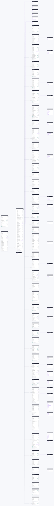

| Field                                 | Type                                                 | Constraints                                    | Default      | Description                                                                                                                                 |
| ------------------------------------- | ---------------------------------------------------- | ---------------------------------------------- | ------------ | ------------------------------------------------------------------------------------------------------------------------------------------- |
| `id`                                  | `String`                                             | PK NOT NULL                                    | `cuid(1)`    |                                                                                                                                             |
| `email`                               | `String`                                             | UNIQUE NOT NULL                                |              |                                                                                                                                             |
| `createdAt`                           | `DateTime`                                           | NOT NULL                                       | `now()`      |                                                                                                                                             |
| `updatedAt`                           | `DateTime`                                           | NOT NULL                                       | `@updatedAt` |                                                                                                                                             |
| `name`                                | `String`                                             | NULL                                           |              |                                                                                                                                             |
| `image`                               | `String`                                             | NULL                                           |              |                                                                                                                                             |
| `sortOrder`                           | `Int`                                                | NULL                                           |              |                                                                                                                                             |
| `about`                               | `String`                                             | NULL                                           |              |                                                                                                                                             |
| `writingStyle`                        | `String`                                             | NULL                                           |              |                                                                                                                                             |
| `signature`                           | `String`                                             | NULL                                           |              |                                                                                                                                             |
| `sentSignatureScan`                   | `Json`                                               | NULL                                           |              |                                                                                                                                             |
| `sentSignatureScannedAt`              | `DateTime`                                           | NULL                                           |              |                                                                                                                                             |
| `includeReferralSignature`            | `Boolean`                                            | NOT NULL                                       | `false`      |                                                                                                                                             |
| `includeSentWithSignature`            | `Boolean`                                            | NOT NULL                                       | `true`       |                                                                                                                                             |
| `sentMessageOpenTrackingEnabled`      | `Boolean`                                            | NOT NULL                                       | `true`       |                                                                                                                                             |
| `watchEmailsExpirationDate`           | `DateTime`                                           | NULL                                           |              |                                                                                                                                             |
| `watchEmailsSubscriptionId`           | `String`                                             | NULL                                           |              |                                                                                                                                             |
| `watchEmailsSubscriptionHistory`      | `Json`                                               | NULL                                           |              |                                                                                                                                             |
| `lastSyncedHistoryId`                 | `String`                                             | NULL                                           |              |                                                                                                                                             |
| `behaviorProfile`                     | `Json`                                               | NULL                                           |              |                                                                                                                                             |
| `personaAnalysis`                     | `Json`                                               | NULL                                           |              |                                                                                                                                             |
| `role`                                | `String`                                             | NULL                                           |              |                                                                                                                                             |
| `timezone`                            | `String`                                             | NULL                                           |              |                                                                                                                                             |
| `calendarBookingLink`                 | `String`                                             | NULL                                           |              |                                                                                                                                             |
| `draftDocsUrls`                       | `String[]`                                           | NOT NULL                                       | `[]`         |                                                                                                                                             |
| `statsEmailFrequency`                 | [`Frequency`](#enum-Frequency)                       | NOT NULL                                       | `WEEKLY`     |                                                                                                                                             |
| `summaryEmailFrequency`               | [`Frequency`](#enum-Frequency)                       | NOT NULL                                       | `WEEKLY`     |                                                                                                                                             |
| `lastSummaryEmailAt`                  | `DateTime`                                           | NULL                                           |              |                                                                                                                                             |
| `lastInboxHealthEmailAt`              | `DateTime`                                           | NULL                                           |              |                                                                                                                                             |
| `coldEmailBlocker`                    | [`ColdEmailSetting`](#enum-ColdEmailSetting)         | NULL                                           |              |                                                                                                                                             |
| `coldEmailDigest`                     | `Boolean`                                            | NOT NULL                                       | `false`      |                                                                                                                                             |
| `coldEmailPrompt`                     | `String`                                             | NULL                                           |              |                                                                                                                                             |
| `rulesPrompt`                         | `String`                                             | NULL                                           |              |                                                                                                                                             |
| `autoCategorizeSenders`               | `Boolean`                                            | NOT NULL                                       | `false`      |                                                                                                                                             |
| `multiRuleSelectionEnabled`           | `Boolean`                                            | NOT NULL                                       | `false`      |                                                                                                                                             |
| `sensitiveDataPolicy`                 | `String`                                             | NULL                                           |              |                                                                                                                                             |
| `draftReplyConfidence`                | [`DraftReplyConfidence`](#enum-DraftReplyConfidence) | NOT NULL                                       | `ALL_EMAILS` |                                                                                                                                             |
| `draftCleanupDays`                    | `Int`                                                | NULL                                           | `14`         |                                                                                                                                             |
| `allowHiddenAiDraftLinks`             | `Boolean`                                            | NOT NULL                                       | `false`      |                                                                                                                                             |
| `rulesRevision`                       | `Int`                                                | NOT NULL                                       | `0`          |                                                                                                                                             |
| `mailLayout`                          | [`MailLayout`](#enum-MailLayout)                     | NOT NULL                                       | `LIST`       |                                                                                                                                             |
| `mailExpandedPreview`                 | `Boolean`                                            | NOT NULL                                       | `false`      |                                                                                                                                             |
| `mailBundleInbox`                     | `Boolean`                                            | NULL                                           |              | Collapses threads from bundled splits into one row each in the inbox. Null until first turned on, which is when default bundles are chosen. |
| `mailDefaultSplitId`                  | `String`                                             | NULL                                           |              |                                                                                                                                             |
| `mailSetup`                           | [`MailSetupState`](#enum-MailSetupState)             | NOT NULL                                       | `PENDING`    |                                                                                                                                             |
| `includeInAllAccounts`                | `Boolean`                                            | NOT NULL                                       | `true`       |                                                                                                                                             |
| `meetingBriefingsEnabled`             | `Boolean`                                            | NOT NULL                                       | `false`      |                                                                                                                                             |
| `meetingBriefingsMinutesBefore`       | `Int`                                                | NOT NULL                                       | `240`        |                                                                                                                                             |
| `meetingBriefsSendEmail`              | `Boolean`                                            | NOT NULL                                       | `true`       |                                                                                                                                             |
| `meetingRecorderEnabled`              | `Boolean`                                            | NOT NULL                                       | `false`      |                                                                                                                                             |
| `meetingRecorderJoinRule`             | [`MeetingJoinRule`](#enum-MeetingJoinRule)           | NOT NULL                                       | `ALL`        |                                                                                                                                             |
| `meetingRecorderRecapEmailEnabled`    | `Boolean`                                            | NOT NULL                                       | `true`       |                                                                                                                                             |
| `meetingRecorderFollowUpDraftEnabled` | `Boolean`                                            | NOT NULL                                       | `true`       |                                                                                                                                             |
| `filingEnabled`                       | `Boolean`                                            | NOT NULL                                       | `false`      |                                                                                                                                             |
| `filingPrompt`                        | `String`                                             | NULL                                           |              |                                                                                                                                             |
| `filingConfirmationSendEmail`         | `Boolean`                                            | NOT NULL                                       | `true`       |                                                                                                                                             |
| `followUpAwaitingReplyDays`           | `Float`                                              | NULL                                           |              |                                                                                                                                             |
| `followUpNeedsReplyDays`              | `Float`                                              | NULL                                           |              |                                                                                                                                             |
| `followUpAutoDraftEnabled`            | `Boolean`                                            | NOT NULL                                       | `true`       |                                                                                                                                             |
| `digestSendEmail`                     | `Boolean`                                            | NOT NULL                                       | `true`       |                                                                                                                                             |
| `learnedWritingStyle`                 | `String`                                             | NULL                                           |              |                                                                                                                                             |
| `userId`                              | `String`                                             | NOT NULL → [User.id](#model-User)              |              |                                                                                                                                             |
| `accountId`                           | `String`                                             | UNIQUE NOT NULL → [Account.id](#model-Account) |              |                                                                                                                                             |

#### Indexes

- `@@index([userId])`
- `@@index([lastSummaryEmailAt])`
- `@@index([lastInboxHealthEmailAt])`
- `@@index([watchEmailsSubscriptionId])`
- `@@index([watchEmailsSubscriptionHistory])`

#### References

- `userId` → [User.id](#model-User) (many-to-one, on delete Cascade)
- `accountId` → [Account.id](#model-Account) (one-to-one, on delete Cascade)

#### Referenced by

- `id` ← [MailSplit.emailAccountId](#model-MailSplit) (one-to-many, on delete Cascade)
- `id` ← [Member.emailAccountId](#model-Member) (one-to-many, on delete Restrict)
- `id` ← [Invitation.inviterId](#model-Invitation) (one-to-many, on delete Cascade)
- `id` ← [SsoProvider.emailAccountId](#model-SsoProvider) (one-to-many, on delete Cascade)
- `id` ← [Digest.emailAccountId](#model-Digest) (one-to-many, on delete Cascade)
- `id` ← [Schedule.emailAccountId](#model-Schedule) (one-to-one, on delete Cascade)
- `id` ← [Label.emailAccountId](#model-Label) (one-to-many, on delete Cascade)
- `id` ← [Rule.emailAccountId](#model-Rule) (one-to-many, on delete Cascade)
- `id` ← [Action.emailAccountId](#model-Action) (one-to-many, on delete Cascade)
- `id` ← [ExecutedRule.emailAccountId](#model-ExecutedRule) (one-to-many, on delete Cascade)
- `id` ← [ScheduledAction.emailAccountId](#model-ScheduledAction) (one-to-many, on delete Cascade)
- `id` ← [SnoozedThread.emailAccountId](#model-SnoozedThread) (one-to-many, on delete Cascade)
- `id` ← [ScheduledEmail.emailAccountId](#model-ScheduledEmail) (one-to-many, on delete Cascade)
- `id` ← [EmailSendOperation.emailAccountId](#model-EmailSendOperation) (one-to-many, on delete Cascade)
- `id` ← [SentMessageOpen.emailAccountId](#model-SentMessageOpen) (one-to-many, on delete Cascade)
- `id` ← [Group.emailAccountId](#model-Group) (one-to-many, on delete Cascade)
- `id` ← [ClassificationFeedback.emailAccountId](#model-ClassificationFeedback) (one-to-many, on delete Cascade)
- `id` ← [Category.emailAccountId](#model-Category) (one-to-many, on delete Cascade)
- `id` ← [Newsletter.emailAccountId](#model-Newsletter) (one-to-many, on delete Cascade)
- `id` ← [ColdEmail.emailAccountId](#model-ColdEmail) (one-to-many, on delete Cascade)
- `id` ← [EmailMessage.emailAccountId](#model-EmailMessage) (one-to-many, on delete Cascade)
- `id` ← [ResponseTime.emailAccountId](#model-ResponseTime) (one-to-many, on delete Cascade)
- `id` ← [ThreadTracker.emailAccountId](#model-ThreadTracker) (one-to-many, on delete Cascade)
- `id` ← [CleanupJob.emailAccountId](#model-CleanupJob) (one-to-many, on delete Cascade)
- `id` ← [CleanupThread.emailAccountId](#model-CleanupThread) (one-to-many, on delete Cascade)
- `id` ← [BulkInboxActionJob.emailAccountId](#model-BulkInboxActionJob) (one-to-many, on delete Cascade)
- `id` ← [Knowledge.emailAccountId](#model-Knowledge) (one-to-many, on delete Cascade)
- `id` ← [Snippet.emailAccountId](#model-Snippet) (one-to-many, on delete Cascade)
- `id` ← [EmailSignature.emailAccountId](#model-EmailSignature) (one-to-many, on delete Cascade)
- `id` ← [ReplyMemory.emailAccountId](#model-ReplyMemory) (one-to-many, on delete Cascade)
- `id` ← [ApiKey.emailAccountId](#model-ApiKey) (one-to-many, on delete Cascade)
- `id` ← [EmailToken.emailAccountId](#model-EmailToken) (one-to-many, on delete Cascade)
- `id` ← [Chat.emailAccountId](#model-Chat) (one-to-many, on delete Cascade)
- `id` ← [ChatMemory.emailAccountId](#model-ChatMemory) (one-to-many, on delete Cascade)
- `id` ← [CalendarConnection.emailAccountId](#model-CalendarConnection) (one-to-many, on delete Cascade)
- `id` ← [BookingLink.emailAccountId](#model-BookingLink) (one-to-many, on delete Cascade)
- `id` ← [AvailabilitySchedule.emailAccountId](#model-AvailabilitySchedule) (one-to-many, on delete Cascade)
- `id` ← [Booking.emailAccountId](#model-Booking) (one-to-many, on delete Cascade)
- `id` ← [MeetingBriefing.emailAccountId](#model-MeetingBriefing) (one-to-many, on delete Cascade)
- `id` ← [MeetingRecording.emailAccountId](#model-MeetingRecording) (one-to-many, on delete Cascade)
- `id` ← [Meeting.emailAccountId](#model-Meeting) (one-to-many, on delete Cascade)
- `id` ← [MessagingChannel.emailAccountId](#model-MessagingChannel) (one-to-many, on delete Cascade)
- `id` ← [DriveConnection.emailAccountId](#model-DriveConnection) (one-to-many, on delete Cascade)
- `id` ← [FilingFolder.emailAccountId](#model-FilingFolder) (one-to-many, on delete Cascade)
- `id` ← [DocumentFiling.emailAccountId](#model-DocumentFiling) (one-to-many, on delete Cascade)
- `id` ← [McpIntegration.emailAccountId](#model-McpIntegration) (one-to-many, on delete Cascade)
- `id` ← [McpConnection.emailAccountId](#model-McpConnection) (one-to-many, on delete Cascade)

#### Definition

```sql
CREATE TABLE "EmailAccount" (
    "id" TEXT NOT NULL,
    "email" TEXT NOT NULL,
    "createdAt" TIMESTAMP(3) NOT NULL DEFAULT CURRENT_TIMESTAMP,
    "updatedAt" TIMESTAMP(3) NOT NULL,
    "name" TEXT,
    "image" TEXT,
    "sortOrder" INTEGER,
    "about" TEXT,
    "writingStyle" TEXT,
    "signature" TEXT,
    "sentSignatureScan" JSONB,
    "sentSignatureScannedAt" TIMESTAMP(3),
    "includeReferralSignature" BOOLEAN NOT NULL DEFAULT false,
    "includeSentWithSignature" BOOLEAN NOT NULL DEFAULT true,
    "sentMessageOpenTrackingEnabled" BOOLEAN NOT NULL DEFAULT true,
    "watchEmailsExpirationDate" TIMESTAMP(3),
    "watchEmailsSubscriptionId" TEXT,
    "watchEmailsSubscriptionHistory" JSONB,
    "lastSyncedHistoryId" TEXT,
    "behaviorProfile" JSONB,
    "personaAnalysis" JSONB,
    "role" TEXT,
    "timezone" TEXT,
    "calendarBookingLink" TEXT,
    "draftDocsUrls" TEXT[] DEFAULT ARRAY[]::TEXT[],
    "statsEmailFrequency" "Frequency" NOT NULL DEFAULT 'WEEKLY',
    "summaryEmailFrequency" "Frequency" NOT NULL DEFAULT 'WEEKLY',
    "lastSummaryEmailAt" TIMESTAMP(3),
    "lastInboxHealthEmailAt" TIMESTAMP(3),
    "coldEmailBlocker" "ColdEmailSetting",
    "coldEmailDigest" BOOLEAN NOT NULL DEFAULT false,
    "coldEmailPrompt" TEXT,
    "rulesPrompt" TEXT,
    "autoCategorizeSenders" BOOLEAN NOT NULL DEFAULT false,
    "multiRuleSelectionEnabled" BOOLEAN NOT NULL DEFAULT false,
    "sensitiveDataPolicy" TEXT,
    "draftReplyConfidence" "DraftReplyConfidence" NOT NULL DEFAULT 'ALL_EMAILS',
    "draftCleanupDays" INTEGER DEFAULT 14,
    "allowHiddenAiDraftLinks" BOOLEAN NOT NULL DEFAULT false,
    "rulesRevision" INTEGER NOT NULL DEFAULT 0,
    "mailLayout" "MailLayout" NOT NULL DEFAULT 'LIST',
    "mailExpandedPreview" BOOLEAN NOT NULL DEFAULT false,
    "mailBundleInbox" BOOLEAN,
    "mailDefaultSplitId" TEXT,
    "mailSetup" "MailSetupState" NOT NULL DEFAULT 'PENDING',
    "includeInAllAccounts" BOOLEAN NOT NULL DEFAULT true,
    "meetingBriefingsEnabled" BOOLEAN NOT NULL DEFAULT false,
    "meetingBriefingsMinutesBefore" INTEGER NOT NULL DEFAULT 240,
    "meetingBriefsSendEmail" BOOLEAN NOT NULL DEFAULT true,
    "meetingRecorderEnabled" BOOLEAN NOT NULL DEFAULT false,
    "meetingRecorderJoinRule" "MeetingJoinRule" NOT NULL DEFAULT 'ALL',
    "meetingRecorderRecapEmailEnabled" BOOLEAN NOT NULL DEFAULT true,
    "meetingRecorderFollowUpDraftEnabled" BOOLEAN NOT NULL DEFAULT true,
    "filingEnabled" BOOLEAN NOT NULL DEFAULT false,
    "filingPrompt" TEXT,
    "filingConfirmationSendEmail" BOOLEAN NOT NULL DEFAULT true,
    "followUpAwaitingReplyDays" DOUBLE PRECISION,
    "followUpNeedsReplyDays" DOUBLE PRECISION,
    "followUpAutoDraftEnabled" BOOLEAN NOT NULL DEFAULT true,
    "digestSendEmail" BOOLEAN NOT NULL DEFAULT true,
    "learnedWritingStyle" TEXT,
    "userId" TEXT NOT NULL,
    "accountId" TEXT NOT NULL,

    CONSTRAINT "EmailAccount_pkey" PRIMARY KEY ("id")
);

CREATE UNIQUE INDEX "EmailAccount_email_key" ON "EmailAccount"("email");

CREATE UNIQUE INDEX "EmailAccount_accountId_key" ON "EmailAccount"("accountId");

CREATE INDEX "EmailAccount_userId_idx" ON "EmailAccount"("userId");

CREATE INDEX "EmailAccount_lastSummaryEmailAt_idx" ON "EmailAccount"("lastSummaryEmailAt");

CREATE INDEX "EmailAccount_lastInboxHealthEmailAt_idx" ON "EmailAccount"("lastInboxHealthEmailAt");

CREATE INDEX "EmailAccount_watchEmailsSubscriptionId_idx" ON "EmailAccount"("watchEmailsSubscriptionId");

CREATE INDEX "EmailAccount_watchEmailsSubscriptionHistory_idx" ON "EmailAccount" USING GIN ("watchEmailsSubscriptionHistory" jsonb_path_ops);

ALTER TABLE "EmailAccount" ADD CONSTRAINT "EmailAccount_userId_fkey" FOREIGN KEY ("userId") REFERENCES "User"("id") ON DELETE CASCADE ON UPDATE CASCADE;

ALTER TABLE "EmailAccount" ADD CONSTRAINT "EmailAccount_accountId_fkey" FOREIGN KEY ("accountId") REFERENCES "Account"("id") ON DELETE CASCADE ON UPDATE CASCADE;
```

<details>
<summary>Queries and their SQL</summary>

**findMany**: Every row

```ts
await prisma.emailAccount.findMany();
```

```sql
SELECT
  "public"."EmailAccount"."id",
  "public"."EmailAccount"."email",
  "public"."EmailAccount"."createdAt",
  "public"."EmailAccount"."updatedAt",
  "public"."EmailAccount"."name",
  "public"."EmailAccount"."image",
  "public"."EmailAccount"."sortOrder",
  "public"."EmailAccount"."about",
  "public"."EmailAccount"."writingStyle",
  "public"."EmailAccount"."signature",
  "public"."EmailAccount"."sentSignatureScan",
  "public"."EmailAccount"."sentSignatureScannedAt",
  "public"."EmailAccount"."includeReferralSignature",
  "public"."EmailAccount"."includeSentWithSignature",
  "public"."EmailAccount"."sentMessageOpenTrackingEnabled",
  "public"."EmailAccount"."watchEmailsExpirationDate",
  "public"."EmailAccount"."watchEmailsSubscriptionId",
  "public"."EmailAccount"."watchEmailsSubscriptionHistory",
  "public"."EmailAccount"."lastSyncedHistoryId",
  "public"."EmailAccount"."behaviorProfile",
  "public"."EmailAccount"."personaAnalysis",
  "public"."EmailAccount"."role",
  "public"."EmailAccount"."timezone",
  "public"."EmailAccount"."calendarBookingLink",
  "public"."EmailAccount"."draftDocsUrls",
  "public"."EmailAccount"."statsEmailFrequency"::text,
  "public"."EmailAccount"."summaryEmailFrequency"::text,
  "public"."EmailAccount"."lastSummaryEmailAt",
  "public"."EmailAccount"."lastInboxHealthEmailAt",
  "public"."EmailAccount"."coldEmailBlocker"::text,
  "public"."EmailAccount"."coldEmailDigest",
  "public"."EmailAccount"."coldEmailPrompt",
  "public"."EmailAccount"."rulesPrompt",
  "public"."EmailAccount"."autoCategorizeSenders",
  "public"."EmailAccount"."multiRuleSelectionEnabled",
  "public"."EmailAccount"."sensitiveDataPolicy",
  "public"."EmailAccount"."draftReplyConfidence"::text,
  "public"."EmailAccount"."draftCleanupDays",
  "public"."EmailAccount"."allowHiddenAiDraftLinks",
  "public"."EmailAccount"."rulesRevision",
  "public"."EmailAccount"."mailLayout"::text,
  "public"."EmailAccount"."mailExpandedPreview",
  "public"."EmailAccount"."mailBundleInbox",
  "public"."EmailAccount"."mailDefaultSplitId",
  "public"."EmailAccount"."mailSetup"::text,
  "public"."EmailAccount"."includeInAllAccounts",
  "public"."EmailAccount"."meetingBriefingsEnabled",
  "public"."EmailAccount"."meetingBriefingsMinutesBefore",
  "public"."EmailAccount"."meetingBriefsSendEmail",
  "public"."EmailAccount"."meetingRecorderEnabled",
  "public"."EmailAccount"."meetingRecorderJoinRule"::text,
  "public"."EmailAccount"."meetingRecorderRecapEmailEnabled",
  "public"."EmailAccount"."meetingRecorderFollowUpDraftEnabled",
  "public"."EmailAccount"."filingEnabled",
  "public"."EmailAccount"."filingPrompt",
  "public"."EmailAccount"."filingConfirmationSendEmail",
  "public"."EmailAccount"."followUpAwaitingReplyDays",
  "public"."EmailAccount"."followUpNeedsReplyDays",
  "public"."EmailAccount"."followUpAutoDraftEnabled",
  "public"."EmailAccount"."digestSendEmail",
  "public"."EmailAccount"."learnedWritingStyle",
  "public"."EmailAccount"."userId",
  "public"."EmailAccount"."accountId"
FROM
  "public"."EmailAccount"
WHERE
  1 = 1
OFFSET
  $1
-- params: ["0"]
```

**count**: How many rows there are

```ts
await prisma.emailAccount.count();
```

```sql
SELECT
  COUNT(*) AS "_count$_all"
FROM
  (
    SELECT
      "public"."EmailAccount"."id"
    FROM
      "public"."EmailAccount"
    WHERE
      1 = 1
    OFFSET
      $1
  ) AS "sub"
-- params: ["0"]
```

**findMany**: Every row with its relations

```ts
await prisma.emailAccount.findMany({
  include: {
    digestSchedule: true,
    user: true,
    account: true,
    labels: true,
    rules: true,
    executedRules: true,
    newsletters: true,
    coldEmails: true,
    groups: true,
    categories: true,
    threadTrackers: true,
    cleanupJobs: true,
    bulkInboxActionJobs: true,
    cleanupThreads: true,
    emailMessages: true,
    emailTokens: true,
    knowledge: true,
    snippets: true,
    emailSignatures: true,
    replyMemories: true,
    chats: true,
    chatMemories: true,
    digests: true,
    scheduledActions: true,
    snoozedThreads: true,
    emailSendOperations: true,
    sentMessageOpens: true,
    scheduledEmails: true,
    responseTimes: true,
    actions: true,
    members: true,
    invitations: true,
    ssoproviders: true,
    calendarConnections: true,
    availabilitySchedules: true,
    bookingLinks: true,
    bookings: true,
    mcpConnections: true,
    mcpIntegrations: true,
    meetingBriefings: true,
    meetings: true,
    meetingRecordings: true,
    driveConnections: true,
    messagingChannels: true,
    documentFilings: true,
    filingFolders: true,
    apiKeys: true,
    classificationFeedback: true,
    mailSplits: true,
  },
});
```

```sql
SELECT
  "public"."EmailAccount"."id",
  "public"."EmailAccount"."email",
  "public"."EmailAccount"."createdAt",
  "public"."EmailAccount"."updatedAt",
  "public"."EmailAccount"."name",
  "public"."EmailAccount"."image",
  "public"."EmailAccount"."sortOrder",
  "public"."EmailAccount"."about",
  "public"."EmailAccount"."writingStyle",
  "public"."EmailAccount"."signature",
  "public"."EmailAccount"."sentSignatureScan",
  "public"."EmailAccount"."sentSignatureScannedAt",
  "public"."EmailAccount"."includeReferralSignature",
  "public"."EmailAccount"."includeSentWithSignature",
  "public"."EmailAccount"."sentMessageOpenTrackingEnabled",
  "public"."EmailAccount"."watchEmailsExpirationDate",
  "public"."EmailAccount"."watchEmailsSubscriptionId",
  "public"."EmailAccount"."watchEmailsSubscriptionHistory",
  "public"."EmailAccount"."lastSyncedHistoryId",
  "public"."EmailAccount"."behaviorProfile",
  "public"."EmailAccount"."personaAnalysis",
  "public"."EmailAccount"."role",
  "public"."EmailAccount"."timezone",
  "public"."EmailAccount"."calendarBookingLink",
  "public"."EmailAccount"."draftDocsUrls",
  "public"."EmailAccount"."statsEmailFrequency"::text,
  "public"."EmailAccount"."summaryEmailFrequency"::text,
  "public"."EmailAccount"."lastSummaryEmailAt",
  "public"."EmailAccount"."lastInboxHealthEmailAt",
  "public"."EmailAccount"."coldEmailBlocker"::text,
  "public"."EmailAccount"."coldEmailDigest",
  "public"."EmailAccount"."coldEmailPrompt",
  "public"."EmailAccount"."rulesPrompt",
  "public"."EmailAccount"."autoCategorizeSenders",
  "public"."EmailAccount"."multiRuleSelectionEnabled",
  "public"."EmailAccount"."sensitiveDataPolicy",
  "public"."EmailAccount"."draftReplyConfidence"::text,
  "public"."EmailAccount"."draftCleanupDays",
  "public"."EmailAccount"."allowHiddenAiDraftLinks",
  "public"."EmailAccount"."rulesRevision",
  "public"."EmailAccount"."mailLayout"::text,
  "public"."EmailAccount"."mailExpandedPreview",
  "public"."EmailAccount"."mailBundleInbox",
  "public"."EmailAccount"."mailDefaultSplitId",
  "public"."EmailAccount"."mailSetup"::text,
  "public"."EmailAccount"."includeInAllAccounts",
  "public"."EmailAccount"."meetingBriefingsEnabled",
  "public"."EmailAccount"."meetingBriefingsMinutesBefore",
  "public"."EmailAccount"."meetingBriefsSendEmail",
  "public"."EmailAccount"."meetingRecorderEnabled",
  "public"."EmailAccount"."meetingRecorderJoinRule"::text,
  "public"."EmailAccount"."meetingRecorderRecapEmailEnabled",
  "public"."EmailAccount"."meetingRecorderFollowUpDraftEnabled",
  "public"."EmailAccount"."filingEnabled",
  "public"."EmailAccount"."filingPrompt",
  "public"."EmailAccount"."filingConfirmationSendEmail",
  "public"."EmailAccount"."followUpAwaitingReplyDays",
  "public"."EmailAccount"."followUpNeedsReplyDays",
  "public"."EmailAccount"."followUpAutoDraftEnabled",
  "public"."EmailAccount"."digestSendEmail",
  "public"."EmailAccount"."learnedWritingStyle",
  "public"."EmailAccount"."userId",
  "public"."EmailAccount"."accountId"
FROM
  "public"."EmailAccount"
WHERE
  1 = 1
OFFSET
  $1
-- params: ["0"]

SELECT
  "public"."Schedule"."id",
  "public"."Schedule"."createdAt",
  "public"."Schedule"."updatedAt",
  "public"."Schedule"."intervalDays",
  "public"."Schedule"."occurrences",
  "public"."Schedule"."daysOfWeek",
  "public"."Schedule"."timeOfDay",
  "public"."Schedule"."emailAccountId",
  "public"."Schedule"."lastOccurrenceAt",
  "public"."Schedule"."nextOccurrenceAt"
FROM
  "public"."Schedule"
WHERE
  "public"."Schedule"."emailAccountId" IN ($1)
OFFSET
  $2
-- params: ["<id of the rows above>","0"]

SELECT
  "public"."User"."id",
  "public"."User"."createdAt",
  "public"."User"."updatedAt",
  "public"."User"."name",
  "public"."User"."email",
  "public"."User"."emailVerified",
  "public"."User"."image",
  "public"."User"."completedOnboardingAt",
  "public"."User"."signupIntent"::text,
  "public"."User"."onboardingAnswers",
  "public"."User"."lastLogin",
  "public"."User"."utms",
  "public"."User"."errorMessages",
  "public"."User"."announcementDismissedAt",
  "public"."User"."dismissedHints",
  "public"."User"."surveyFeatures",
  "public"."User"."surveyRole",
  "public"."User"."surveyGoal",
  "public"."User"."surveyCompanySize",
  "public"."User"."surveySource",
  "public"."User"."surveyImprovements",
  "public"."User"."mcpServerEnabled",
  "public"."User"."mcpTokenVersion",
  "public"."User"."emailOtpEnabled",
  "public"."User"."emailOtpVersion",
  "public"."User"."aiProvider",
  "public"."User"."aiModel",
  "public"."User"."aiApiKey",
  "public"."User"."decisionModelEnabled",
  "public"."User"."webhookSecret",
  "public"."User"."referralCode",
  "public"."User"."premiumId",
  "public"."User"."premiumAdminId",
  "public"."User"."scimAccessDisabled"
FROM
  "public"."User"
WHERE
  "public"."User"."id" IN ($1)
OFFSET
  $2
-- params: ["<userId of the rows above>","0"]

SELECT
  "public"."Account"."id",
  "public"."Account"."password",
  "public"."Account"."createdAt",
  "public"."Account"."updatedAt",
  "public"."Account"."userId",
  "public"."Account"."provider",
  "public"."Account"."type",
  "public"."Account"."providerAccountId",
  "public"."Account"."refresh_token",
  "public"."Account"."refreshTokenExpiresAt",
  "public"."Account"."access_token",
  "public"."Account"."expires_at",
  "public"."Account"."disconnectedAt",
  "public"."Account"."token_type",
  "public"."Account"."scope",
  "public"."Account"."id_token",
  "public"."Account"."session_state"
FROM
  "public"."Account"
WHERE
  "public"."Account"."id" IN ($1)
OFFSET
  $2
-- params: ["<accountId of the rows above>","0"]

SELECT
  "public"."Label"."id",
  "public"."Label"."createdAt",
  "public"."Label"."updatedAt",
  "public"."Label"."gmailLabelId",
  "public"."Label"."name",
  "public"."Label"."description",
  "public"."Label"."enabled",
  "public"."Label"."emailAccountId"
FROM
  "public"."Label"
WHERE
  "public"."Label"."emailAccountId" IN ($1)
OFFSET
  $2
-- params: ["<id of the rows above>","0"]

SELECT
  "public"."Rule"."id",
  "public"."Rule"."createdAt",
  "public"."Rule"."updatedAt",
  "public"."Rule"."name",
  "public"."Rule"."enabled",
  "public"."Rule"."automate",
  "public"."Rule"."runOnThreads",
  "public"."Rule"."emailAccountId",
  "public"."Rule"."organizationRuleId",
  "public"."Rule"."organizationRuleMemberEnabled",
  "public"."Rule"."conditionalOperator"::text,
  "public"."Rule"."instructions",
  "public"."Rule"."groupId",
  "public"."Rule"."from",
  "public"."Rule"."to",
  "public"."Rule"."subject",
  "public"."Rule"."body",
  "public"."Rule"."categoryFilterType"::text,
  "public"."Rule"."systemType"::text,
  "public"."Rule"."promptText"
FROM
  "public"."Rule"
WHERE
  "public"."Rule"."emailAccountId" IN ($1)
OFFSET
  $2
-- params: ["<id of the rows above>","0"]

SELECT
  "public"."ExecutedRule"."id",
  "public"."ExecutedRule"."createdAt",
  "public"."ExecutedRule"."updatedAt",
  "public"."ExecutedRule"."threadId",
  "public"."ExecutedRule"."messageId",
  "public"."ExecutedRule"."status"::text,
  "public"."ExecutedRule"."automated",
  "public"."ExecutedRule"."reason",
  "public"."ExecutedRule"."matchMetadata",
  "public"."ExecutedRule"."ruleId",
  "public"."ExecutedRule"."emailAccountId"
FROM
  "public"."ExecutedRule"
WHERE
  "public"."ExecutedRule"."emailAccountId" IN ($1)
OFFSET
  $2
-- params: ["<id of the rows above>","0"]

SELECT
  "public"."Newsletter"."id",
  "public"."Newsletter"."createdAt",
  "public"."Newsletter"."updatedAt",
  "public"."Newsletter"."email",
  "public"."Newsletter"."name",
  "public"."Newsletter"."status"::text,
  "public"."Newsletter"."patternAnalyzed",
  "public"."Newsletter"."lastAnalyzedAt",
  "public"."Newsletter"."emailAccountId",
  "public"."Newsletter"."categoryId"
FROM
  "public"."Newsletter"
WHERE
  "public"."Newsletter"."emailAccountId" IN ($1)
OFFSET
  $2
-- params: ["<id of the rows above>","0"]

SELECT
  "public"."ColdEmail"."id",
  "public"."ColdEmail"."createdAt",
  "public"."ColdEmail"."updatedAt",
  "public"."ColdEmail"."fromEmail",
  "public"."ColdEmail"."messageId",
  "public"."ColdEmail"."threadId",
  "public"."ColdEmail"."status"::text,
  "public"."ColdEmail"."reason",
  "public"."ColdEmail"."emailAccountId"
FROM
  "public"."ColdEmail"
WHERE
  "public"."ColdEmail"."emailAccountId" IN ($1)
OFFSET
  $2
-- params: ["<id of the rows above>","0"]

SELECT
  "public"."Group"."id",
  "public"."Group"."createdAt",
  "public"."Group"."updatedAt",
  "public"."Group"."name",
  "public"."Group"."prompt",
  "public"."Group"."emailAccountId"
FROM
  "public"."Group"
WHERE
  "public"."Group"."emailAccountId" IN ($1)
OFFSET
  $2
-- params: ["<id of the rows above>","0"]

SELECT
  "public"."Category"."id",
  "public"."Category"."createdAt",
  "public"."Category"."updatedAt",
  "public"."Category"."name",
  "public"."Category"."description",
  "public"."Category"."emailAccountId"
FROM
  "public"."Category"
WHERE
  "public"."Category"."emailAccountId" IN ($1)
OFFSET
  $2
-- params: ["<id of the rows above>","0"]

SELECT
  "public"."ThreadTracker"."id",
  "public"."ThreadTracker"."createdAt",
  "public"."ThreadTracker"."updatedAt",
  "public"."ThreadTracker"."sentAt",
  "public"."ThreadTracker"."threadId",
  "public"."ThreadTracker"."messageId",
  "public"."ThreadTracker"."resolved",
  "public"."ThreadTracker"."type"::text,
  "public"."ThreadTracker"."followUpAppliedAt",
  "public"."ThreadTracker"."followUpDraftId",
  "public"."ThreadTracker"."followUpDraftContent",
  "public"."ThreadTracker"."followUpDraftCreatedAt",
  "public"."ThreadTracker"."followUpNotifications",
  "public"."ThreadTracker"."emailAccountId"
FROM
  "public"."ThreadTracker"
WHERE
  "public"."ThreadTracker"."emailAccountId" IN ($1)
OFFSET
  $2
-- params: ["<id of the rows above>","0"]

SELECT
  "public"."CleanupJob"."id",
  "public"."CleanupJob"."createdAt",
  "public"."CleanupJob"."updatedAt",
  "public"."CleanupJob"."action"::text,
  "public"."CleanupJob"."daysOld",
  "public"."CleanupJob"."instructions",
  "public"."CleanupJob"."skipReply",
  "public"."CleanupJob"."skipStarred",
  "public"."CleanupJob"."skipCalendar",
  "public"."CleanupJob"."skipReceipt",
  "public"."CleanupJob"."skipAttachment",
  "public"."CleanupJob"."skipConversation",
  "public"."CleanupJob"."emailAccountId"
FROM
  "public"."CleanupJob"
WHERE
  "public"."CleanupJob"."emailAccountId" IN ($1)
OFFSET
  $2
-- params: ["<id of the rows above>","0"]

SELECT
  "public"."BulkInboxActionJob"."id",
  "public"."BulkInboxActionJob"."createdAt",
  "public"."BulkInboxActionJob"."updatedAt",
  "public"."BulkInboxActionJob"."status"::text,
  "public"."BulkInboxActionJob"."search",
  "public"."BulkInboxActionJob"."action",
  "public"."BulkInboxActionJob"."labelId",
  "public"."BulkInboxActionJob"."labelName",
  "public"."BulkInboxActionJob"."instruction",
  "public"."BulkInboxActionJob"."pageToken",
  "public"."BulkInboxActionJob"."rateLimitedUntil",
  "public"."BulkInboxActionJob"."leaseExpiresAt",
  "public"."BulkInboxActionJob"."chunkToken",
  "public"."BulkInboxActionJob"."recoveryCount",
  "public"."BulkInboxActionJob"."processedCount",
  "public"."BulkInboxActionJob"."matchedCount",
  "public"."BulkInboxActionJob"."actedCount",
  "public"."BulkInboxActionJob"."skippedCount",
  "public"."BulkInboxActionJob"."failedCount",
  "public"."BulkInboxActionJob"."limitReached",
  "public"."BulkInboxActionJob"."error",
  "public"."BulkInboxActionJob"."completedAt",
  "public"."BulkInboxActionJob"."confirmationKey",
  "public"."BulkInboxActionJob"."chatId",
  "public"."BulkInboxActionJob"."emailAccountId"
FROM
  "public"."BulkInboxActionJob"
WHERE
  "public"."BulkInboxActionJob"."emailAccountId" IN ($1)
OFFSET
  $2
-- params: ["<id of the rows above>","0"]

SELECT
  "public"."CleanupThread"."id",
  "public"."CleanupThread"."createdAt",
  "public"."CleanupThread"."updatedAt",
  "public"."CleanupThread"."threadId",
  "public"."CleanupThread"."archived",
  "public"."CleanupThread"."jobId",
  "public"."CleanupThread"."emailAccountId"
FROM
  "public"."CleanupThread"
WHERE
  "public"."CleanupThread"."emailAccountId" IN ($1)
OFFSET
  $2
-- params: ["<id of the rows above>","0"]

SELECT
  "public"."EmailMessage"."id",
  "public"."EmailMessage"."createdAt",
  "public"."EmailMessage"."updatedAt",
  "public"."EmailMessage"."threadId",
  "public"."EmailMessage"."messageId",
  "public"."EmailMessage"."date",
  "public"."EmailMessage"."from",
  "public"."EmailMessage"."fromName",
  "public"."EmailMessage"."fromDomain",
  "public"."EmailMessage"."to",
  "public"."EmailMessage"."unsubscribeLink",
  "public"."EmailMessage"."read",
  "public"."EmailMessage"."sent",
  "public"."EmailMessage"."draft",
  "public"."EmailMessage"."inbox",
  "public"."EmailMessage"."emailAccountId"
FROM
  "public"."EmailMessage"
WHERE
  "public"."EmailMessage"."emailAccountId" IN ($1)
OFFSET
  $2
-- params: ["<id of the rows above>","0"]

SELECT
  "public"."EmailToken"."id",
  "public"."EmailToken"."createdAt",
  "public"."EmailToken"."token",
  "public"."EmailToken"."expiresAt",
  "public"."EmailToken"."emailAccountId"
FROM
  "public"."EmailToken"
WHERE
  "public"."EmailToken"."emailAccountId" IN ($1)
OFFSET
  $2
-- params: ["<id of the rows above>","0"]

SELECT
  "public"."Knowledge"."id",
  "public"."Knowledge"."createdAt",
  "public"."Knowledge"."updatedAt",
  "public"."Knowledge"."title",
  "public"."Knowledge"."content",
  "public"."Knowledge"."emailAccountId"
FROM
  "public"."Knowledge"
WHERE
  "public"."Knowledge"."emailAccountId" IN ($1)
OFFSET
  $2
-- params: ["<id of the rows above>","0"]

SELECT
  "public"."Snippet"."id",
  "public"."Snippet"."createdAt",
  "public"."Snippet"."updatedAt",
  "public"."Snippet"."shortcut",
  "public"."Snippet"."content",
  "public"."Snippet"."emailAccountId"
FROM
  "public"."Snippet"
WHERE
  "public"."Snippet"."emailAccountId" IN ($1)
OFFSET
  $2
-- params: ["<id of the rows above>","0"]

SELECT
  "public"."EmailSignature"."id",
  "public"."EmailSignature"."createdAt",
  "public"."EmailSignature"."updatedAt",
  "public"."EmailSignature"."name",
  "public"."EmailSignature"."html",
  "public"."EmailSignature"."emailAccountId"
FROM
  "public"."EmailSignature"
WHERE
  "public"."EmailSignature"."emailAccountId" IN ($1)
OFFSET
  $2
-- params: ["<id of the rows above>","0"]

SELECT
  "public"."ReplyMemory"."id",
  "public"."ReplyMemory"."createdAt",
  "public"."ReplyMemory"."updatedAt",
  "public"."ReplyMemory"."content",
  "public"."ReplyMemory"."kind"::text,
  "public"."ReplyMemory"."scopeType"::text,
  "public"."ReplyMemory"."scopeValue",
  "public"."ReplyMemory"."isLearnedStyleEvidence",
  "public"."ReplyMemory"."emailAccountId"
FROM
  "public"."ReplyMemory"
WHERE
  "public"."ReplyMemory"."emailAccountId" IN ($1)
OFFSET
  $2
-- params: ["<id of the rows above>","0"]

SELECT
  "public"."Chat"."id",
  "public"."Chat"."createdAt",
  "public"."Chat"."updatedAt",
  "public"."Chat"."deletedAt",
  "public"."Chat"."name",
  "public"."Chat"."compactionCount",
  "public"."Chat"."lastSeenRulesRevision",
  "public"."Chat"."activeStreamId",
  "public"."Chat"."activeStreamStartedAt",
  "public"."Chat"."emailAccountId"
FROM
  "public"."Chat"
WHERE
  "public"."Chat"."emailAccountId" IN ($1)
OFFSET
  $2
-- params: ["<id of the rows above>","0"]

SELECT
  "public"."ChatMemory"."id",
  "public"."ChatMemory"."createdAt",
  "public"."ChatMemory"."updatedAt",
  "public"."ChatMemory"."content",
  "public"."ChatMemory"."chatId",
  "public"."ChatMemory"."emailAccountId"
FROM
  "public"."ChatMemory"
WHERE
  "public"."ChatMemory"."emailAccountId" IN ($1)
OFFSET
  $2
-- params: ["<id of the rows above>","0"]

SELECT
  "public"."Digest"."id",
  "public"."Digest"."createdAt",
  "public"."Digest"."updatedAt",
  "public"."Digest"."emailAccountId",
  "public"."Digest"."sentAt",
  "public"."Digest"."status"::text
FROM
  "public"."Digest"
WHERE
  "public"."Digest"."emailAccountId" IN ($1)
OFFSET
  $2
-- params: ["<id of the rows above>","0"]

SELECT
  "public"."ScheduledAction"."id",
  "public"."ScheduledAction"."createdAt",
  "public"."ScheduledAction"."updatedAt",
  "public"."ScheduledAction"."executedRuleId",
  "public"."ScheduledAction"."actionType"::text,
  "public"."ScheduledAction"."messageId",
  "public"."ScheduledAction"."threadId",
  "public"."ScheduledAction"."scheduledFor",
  "public"."ScheduledAction"."emailAccountId",
  "public"."ScheduledAction"."status"::text,
  "public"."ScheduledAction"."schedulingStatus"::text,
  "public"."ScheduledAction"."label",
  "public"."ScheduledAction"."labelId",
  "public"."ScheduledAction"."subject",
  "public"."ScheduledAction"."content",
  "public"."ScheduledAction"."to",
  "public"."ScheduledAction"."cc",
  "public"."ScheduledAction"."bcc",
  "public"."ScheduledAction"."url",
  "public"."ScheduledAction"."folderName",
  "public"."ScheduledAction"."folderId",
  "public"."ScheduledAction"."scheduledId",
  "public"."ScheduledAction"."staticAttachments",
  "public"."ScheduledAction"."selectedAttachments",
  "public"."ScheduledAction"."executedAt",
  "public"."ScheduledAction"."executedActionId"
FROM
  "public"."ScheduledAction"
WHERE
  "public"."ScheduledAction"."emailAccountId" IN ($1)
OFFSET
  $2
-- params: ["<id of the rows above>","0"]

SELECT
  "public"."SnoozedThread"."id",
  "public"."SnoozedThread"."updatedAt",
  "public"."SnoozedThread"."threadId",
  "public"."SnoozedThread"."scheduledFor",
  "public"."SnoozedThread"."status"::text,
  "public"."SnoozedThread"."clientMutationId",
  "public"."SnoozedThread"."emailAccountId"
FROM
  "public"."SnoozedThread"
WHERE
  "public"."SnoozedThread"."emailAccountId" IN ($1)
OFFSET
  $2
-- params: ["<id of the rows above>","0"]

SELECT
  "public"."EmailSendOperation"."id",
  "public"."EmailSendOperation"."createdAt",
  "public"."EmailSendOperation"."updatedAt",
  "public"."EmailSendOperation"."clientMutationId",
  "public"."EmailSendOperation"."payloadHash",
  "public"."EmailSendOperation"."status"::text,
  "public"."EmailSendOperation"."processingStartedAt",
  "public"."EmailSendOperation"."result",
  "public"."EmailSendOperation"."emailAccountId"
FROM
  "public"."EmailSendOperation"
WHERE
  "public"."EmailSendOperation"."emailAccountId" IN ($1)
OFFSET
  $2
-- params: ["<id of the rows above>","0"]

SELECT
  "public"."SentMessageOpen"."id",
  "public"."SentMessageOpen"."createdAt",
  "public"."SentMessageOpen"."updatedAt",
  "public"."SentMessageOpen"."token",
  "public"."SentMessageOpen"."emailAccountId",
  "public"."SentMessageOpen"."threadId",
  "public"."SentMessageOpen"."messageId",
  "public"."SentMessageOpen"."firstOpenedAt",
  "public"."SentMessageOpen"."lastOpenedAt",
  "public"."SentMessageOpen"."openCount"
FROM
  "public"."SentMessageOpen"
WHERE
  "public"."SentMessageOpen"."emailAccountId" IN ($1)
OFFSET
  $2
-- params: ["<id of the rows above>","0"]

SELECT
  "public"."ScheduledEmail"."id",
  "public"."ScheduledEmail"."createdAt",
  "public"."ScheduledEmail"."updatedAt",
  "public"."ScheduledEmail"."emailAccountId",
  "public"."ScheduledEmail"."clientMutationId",
  "public"."ScheduledEmail"."payloadHash",
  "public"."ScheduledEmail"."payload",
  "public"."ScheduledEmail"."threadId",
  "public"."ScheduledEmail"."sendAt",
  "public"."ScheduledEmail"."status"::text,
  "public"."ScheduledEmail"."processingStartedAt",
  "public"."ScheduledEmail"."executionQueuedAt",
  "public"."ScheduledEmail"."sentAt",
  "public"."ScheduledEmail"."error",
  "public"."ScheduledEmail"."remindAt",
  "public"."ScheduledEmail"."reminderStatus"::text,
  "public"."ScheduledEmail"."reminderStartedAt",
  "public"."ScheduledEmail"."heldForUndo",
  "public"."ScheduledEmail"."draftMessageIds"
FROM
  "public"."ScheduledEmail"
WHERE
  "public"."ScheduledEmail"."emailAccountId" IN ($1)
OFFSET
  $2
-- params: ["<id of the rows above>","0"]

SELECT
  "public"."ResponseTime"."id",
  "public"."ResponseTime"."createdAt",
  "public"."ResponseTime"."threadId",
  "public"."ResponseTime"."sentMessageId",
  "public"."ResponseTime"."receivedMessageId",
  "public"."ResponseTime"."responseTimeMins",
  "public"."ResponseTime"."receivedAt",
  "public"."ResponseTime"."sentAt",
  "public"."ResponseTime"."emailAccountId"
FROM
  "public"."ResponseTime"
WHERE
  "public"."ResponseTime"."emailAccountId" IN ($1)
OFFSET
  $2
-- params: ["<id of the rows above>","0"]

SELECT
  "public"."Action"."id",
  "public"."Action"."createdAt",
  "public"."Action"."updatedAt",
  "public"."Action"."type"::text,
  "public"."Action"."ruleId",
  "public"."Action"."emailAccountId",
  "public"."Action"."messagingChannelId",
  "public"."Action"."messagingChannelEmailAccountId",
  "public"."Action"."label",
  "public"."Action"."labelId",
  "public"."Action"."subject",
  "public"."Action"."content",
  "public"."Action"."to",
  "public"."Action"."cc",
  "public"."Action"."bcc",
  "public"."Action"."url",
  "public"."Action"."folderName",
  "public"."Action"."folderId",
  "public"."Action"."delayInMinutes",
  "public"."Action"."staticAttachments",
  "public"."Action"."integrationName",
  "public"."Action"."integrationToolName",
  "public"."Action"."integrationArgs"
FROM
  "public"."Action"
WHERE
  "public"."Action"."emailAccountId" IN ($1)
OFFSET
  $2
-- params: ["<id of the rows above>","0"]

SELECT
  "public"."Member"."id",
  "public"."Member"."organizationId",
  "public"."Member"."emailAccountId",
  "public"."Member"."role",
  "public"."Member"."allowOrgAdminAnalytics",
  "public"."Member"."createdAt",
  "public"."Member"."updatedAt"
FROM
  "public"."Member"
WHERE
  "public"."Member"."emailAccountId" IN ($1)
OFFSET
  $2
-- params: ["<id of the rows above>","0"]

SELECT
  "public"."invitation"."id",
  "public"."invitation"."organizationId",
  "public"."invitation"."email",
  "public"."invitation"."role",
  "public"."invitation"."status",
  "public"."invitation"."expiresAt",
  "public"."invitation"."inviterId"
FROM
  "public"."invitation"
WHERE
  "public"."invitation"."inviterId" IN ($1)
OFFSET
  $2
-- params: ["<id of the rows above>","0"]

SELECT
  "public"."ssoProvider"."id",
  "public"."ssoProvider"."userId",
  "public"."ssoProvider"."issuer",
  "public"."ssoProvider"."oidcConfig",
  "public"."ssoProvider"."samlConfig",
  "public"."ssoProvider"."emailAccountId",
  "public"."ssoProvider"."providerId",
  "public"."ssoProvider"."organizationId",
  "public"."ssoProvider"."domain"
FROM
  "public"."ssoProvider"
WHERE
  "public"."ssoProvider"."emailAccountId" IN ($1)
OFFSET
  $2
-- params: ["<id of the rows above>","0"]

SELECT
  "public"."CalendarConnection"."id",
  "public"."CalendarConnection"."createdAt",
  "public"."CalendarConnection"."updatedAt",
  "public"."CalendarConnection"."provider",
  "public"."CalendarConnection"."email",
  "public"."CalendarConnection"."accessToken",
  "public"."CalendarConnection"."refreshToken",
  "public"."CalendarConnection"."expiresAt",
  "public"."CalendarConnection"."isConnected",
  "public"."CalendarConnection"."emailAccountId"
FROM
  "public"."CalendarConnection"
WHERE
  "public"."CalendarConnection"."emailAccountId" IN ($1)
OFFSET
  $2
-- params: ["<id of the rows above>","0"]

SELECT
  "public"."AvailabilitySchedule"."id",
  "public"."AvailabilitySchedule"."createdAt",
  "public"."AvailabilitySchedule"."updatedAt",
  "public"."AvailabilitySchedule"."name",
  "public"."AvailabilitySchedule"."isDefault",
  "public"."AvailabilitySchedule"."timezone",
  "public"."AvailabilitySchedule"."emailAccountId"
FROM
  "public"."AvailabilitySchedule"
WHERE
  "public"."AvailabilitySchedule"."emailAccountId" IN ($1)
OFFSET
  $2
-- params: ["<id of the rows above>","0"]

SELECT
  "public"."BookingLink"."id",
  "public"."BookingLink"."createdAt",
  "public"."BookingLink"."updatedAt",
  "public"."BookingLink"."slug",
  "public"."BookingLink"."title",
  "public"."BookingLink"."description",
  "public"."BookingLink"."isActive",
  "public"."BookingLink"."durationMinutes",
  "public"."BookingLink"."slotIntervalMinutes",
  "public"."BookingLink"."locationType"::text,
  "public"."BookingLink"."locationValue",
  "public"."BookingLink"."minimumNoticeMinutes",
  "public"."BookingLink"."maxDaysAhead",
  "public"."BookingLink"."emailAccountId",
  "public"."BookingLink"."destinationCalendarId",
  "public"."BookingLink"."availabilityScheduleId"
FROM
  "public"."BookingLink"
WHERE
  "public"."BookingLink"."emailAccountId" IN ($1)
OFFSET
  $2
-- params: ["<id of the rows above>","0"]

SELECT
  "public"."Booking"."id",
  "public"."Booking"."createdAt",
  "public"."Booking"."updatedAt",
  "public"."Booking"."guestName",
  "public"."Booking"."guestEmail",
  "public"."Booking"."guestNote",
  "public"."Booking"."startTime",
  "public"."Booking"."endTime",
  "public"."Booking"."status"::text,
  "public"."Booking"."provider",
  "public"."Booking"."providerConnectionId",
  "public"."Booking"."providerCalendarId",
  "public"."Booking"."providerEventId",
  "public"."Booking"."videoConferenceLink",
  "public"."Booking"."cancelTokenHash",
  "public"."Booking"."cancellationReason",
  "public"."Booking"."idempotencyToken",
  "public"."Booking"."bookingLinkId",
  "public"."Booking"."emailAccountId"
FROM
  "public"."Booking"
WHERE
  "public"."Booking"."emailAccountId" IN ($1)
OFFSET
  $2
-- params: ["<id of the rows above>","0"]

SELECT
  "public"."McpConnection"."id",
  "public"."McpConnection"."createdAt",
  "public"."McpConnection"."updatedAt",
  "public"."McpConnection"."name",
  "public"."McpConnection"."isActive",
  "public"."McpConnection"."accessToken",
  "public"."McpConnection"."refreshToken",
  "public"."McpConnection"."apiKey",
  "public"."McpConnection"."expiresAt",
  "public"."McpConnection"."integrationId",
  "public"."McpConnection"."emailAccountId"
FROM
  "public"."McpConnection"
WHERE
  "public"."McpConnection"."emailAccountId" IN ($1)
OFFSET
  $2
-- params: ["<id of the rows above>","0"]

SELECT
  "public"."McpIntegration"."id",
  "public"."McpIntegration"."createdAt",
  "public"."McpIntegration"."updatedAt",
  "public"."McpIntegration"."name",
  "public"."McpIntegration"."registeredServerUrl",
  "public"."McpIntegration"."registeredAuthorizationUrl",
  "public"."McpIntegration"."registeredTokenUrl",
  "public"."McpIntegration"."oauthClientId",
  "public"."McpIntegration"."oauthClientSecret",
  "public"."McpIntegration"."displayName",
  "public"."McpIntegration"."serverUrl",
  "public"."McpIntegration"."authType"::text,
  "public"."McpIntegration"."emailAccountId"
FROM
  "public"."McpIntegration"
WHERE
  "public"."McpIntegration"."emailAccountId" IN ($1)
OFFSET
  $2
-- params: ["<id of the rows above>","0"]

SELECT
  "public"."MeetingBriefing"."id",
  "public"."MeetingBriefing"."createdAt",
  "public"."MeetingBriefing"."calendarEventId",
  "public"."MeetingBriefing"."eventTitle",
  "public"."MeetingBriefing"."eventStartTime",
  "public"."MeetingBriefing"."guestCount",
  "public"."MeetingBriefing"."status"::text,
  "public"."MeetingBriefing"."emailAccountId"
FROM
  "public"."MeetingBriefing"
WHERE
  "public"."MeetingBriefing"."emailAccountId" IN ($1)
OFFSET
  $2
-- params: ["<id of the rows above>","0"]

SELECT
  "public"."Meeting"."id",
  "public"."Meeting"."createdAt",
  "public"."Meeting"."updatedAt",
  "public"."Meeting"."calendarEventId",
  "public"."Meeting"."eventTitle",
  "public"."Meeting"."startTime",
  "public"."Meeting"."endTime",
  "public"."Meeting"."attendees",
  "public"."Meeting"."organizerEmail",
  "public"."Meeting"."joinOverride",
  "public"."Meeting"."processingStatus"::text,
  "public"."Meeting"."processingAttempts",
  "public"."Meeting"."summary",
  "public"."Meeting"."followUpDraftStartedAt",
  "public"."Meeting"."followUpDraftId",
  "public"."Meeting"."recapSentAt",
  "public"."Meeting"."recordingId",
  "public"."Meeting"."emailAccountId"
FROM
  "public"."Meeting"
WHERE
  "public"."Meeting"."emailAccountId" IN ($1)
OFFSET
  $2
-- params: ["<id of the rows above>","0"]

SELECT
  "public"."MeetingRecording"."id",
  "public"."MeetingRecording"."createdAt",
  "public"."MeetingRecording"."updatedAt",
  "public"."MeetingRecording"."botProvider",
  "public"."MeetingRecording"."externalBotId",
  "public"."MeetingRecording"."botName",
  "public"."MeetingRecording"."externalRecordingId",
  "public"."MeetingRecording"."transcriptRequestedAt",
  "public"."MeetingRecording"."externalTranscriptId",
  "public"."MeetingRecording"."meetingUrl",
  "public"."MeetingRecording"."normalizedMeetingUrl",
  "public"."MeetingRecording"."activeKey",
  "public"."MeetingRecording"."meetingStartTime",
  "public"."MeetingRecording"."status"::text,
  "public"."MeetingRecording"."failureReason",
  "public"."MeetingRecording"."transcript",
  "public"."MeetingRecording"."transcriptFetchedAt",
  "public"."MeetingRecording"."mediaDeletedAt",
  "public"."MeetingRecording"."emailAccountId"
FROM
  "public"."MeetingRecording"
WHERE
  "public"."MeetingRecording"."emailAccountId" IN ($1)
OFFSET
  $2
-- params: ["<id of the rows above>","0"]

SELECT
  "public"."DriveConnection"."id",
  "public"."DriveConnection"."createdAt",
  "public"."DriveConnection"."updatedAt",
  "public"."DriveConnection"."provider",
  "public"."DriveConnection"."email",
  "public"."DriveConnection"."accessToken",
  "public"."DriveConnection"."refreshToken",
  "public"."DriveConnection"."expiresAt",
  "public"."DriveConnection"."isConnected",
  "public"."DriveConnection"."emailAccountId"
FROM
  "public"."DriveConnection"
WHERE
  "public"."DriveConnection"."emailAccountId" IN ($1)
OFFSET
  $2
-- params: ["<id of the rows above>","0"]

SELECT
  "public"."MessagingChannel"."id",
  "public"."MessagingChannel"."createdAt",
  "public"."MessagingChannel"."updatedAt",
  "public"."MessagingChannel"."provider"::text,
  "public"."MessagingChannel"."isConnected",
  "public"."MessagingChannel"."teamId",
  "public"."MessagingChannel"."teamName",
  "public"."MessagingChannel"."providerUserId",
  "public"."MessagingChannel"."botUserId",
  "public"."MessagingChannel"."accessToken",
  "public"."MessagingChannel"."refreshToken",
  "public"."MessagingChannel"."expiresAt",
  "public"."MessagingChannel"."emailAccountId"
FROM
  "public"."MessagingChannel"
WHERE
  "public"."MessagingChannel"."emailAccountId" IN ($1)
OFFSET
  $2
-- params: ["<id of the rows above>","0"]

SELECT
  "public"."DocumentFiling"."id",
  "public"."DocumentFiling"."createdAt",
  "public"."DocumentFiling"."updatedAt",
  "public"."DocumentFiling"."messageId",
  "public"."DocumentFiling"."attachmentId",
  "public"."DocumentFiling"."filename",
  "public"."DocumentFiling"."folderId",
  "public"."DocumentFiling"."folderPath",
  "public"."DocumentFiling"."fileId",
  "public"."DocumentFiling"."reasoning",
  "public"."DocumentFiling"."confidence",
  "public"."DocumentFiling"."status"::text,
  "public"."DocumentFiling"."wasAsked",
  "public"."DocumentFiling"."wasCorrected",
  "public"."DocumentFiling"."originalPath",
  "public"."DocumentFiling"."correctedAt",
  "public"."DocumentFiling"."feedbackPositive",
  "public"."DocumentFiling"."feedbackAt",
  "public"."DocumentFiling"."notificationMessageId",
  "public"."DocumentFiling"."notificationSentAt",
  "public"."DocumentFiling"."notificationBatchId",
  "public"."DocumentFiling"."driveConnectionId",
  "public"."DocumentFiling"."emailAccountId"
FROM
  "public"."DocumentFiling"
WHERE
  "public"."DocumentFiling"."emailAccountId" IN ($1)
OFFSET
  $2
-- params: ["<id of the rows above>","0"]

SELECT
  "public"."FilingFolder"."id",
  "public"."FilingFolder"."createdAt",
  "public"."FilingFolder"."updatedAt",
  "public"."FilingFolder"."folderId",
  "public"."FilingFolder"."folderName",
  "public"."FilingFolder"."folderPath",
  "public"."FilingFolder"."driveConnectionId",
  "public"."FilingFolder"."emailAccountId"
FROM
  "public"."FilingFolder"
WHERE
  "public"."FilingFolder"."emailAccountId" IN ($1)
OFFSET
  $2
-- params: ["<id of the rows above>","0"]

SELECT
  "public"."ApiKey"."id",
  "public"."ApiKey"."createdAt",
  "public"."ApiKey"."updatedAt",
  "public"."ApiKey"."name",
  "public"."ApiKey"."hashedKey",
  "public"."ApiKey"."isActive",
  "public"."ApiKey"."expiresAt",
  "public"."ApiKey"."lastUsedAt",
  "public"."ApiKey"."scopes"::text[],
  "public"."ApiKey"."userId",
  "public"."ApiKey"."emailAccountId"
FROM
  "public"."ApiKey"
WHERE
  "public"."ApiKey"."emailAccountId" IN ($1)
OFFSET
  $2
-- params: ["<id of the rows above>","0"]

SELECT
  "public"."ClassificationFeedback"."id",
  "public"."ClassificationFeedback"."createdAt",
  "public"."ClassificationFeedback"."sender",
  "public"."ClassificationFeedback"."eventType"::text,
  "public"."ClassificationFeedback"."ruleId",
  "public"."ClassificationFeedback"."emailAccountId",
  "public"."ClassificationFeedback"."threadId",
  "public"."ClassificationFeedback"."messageId"
FROM
  "public"."ClassificationFeedback"
WHERE
  "public"."ClassificationFeedback"."emailAccountId" IN ($1)
OFFSET
  $2
-- params: ["<id of the rows above>","0"]

SELECT
  "public"."MailSplit"."id",
  "public"."MailSplit"."createdAt",
  "public"."MailSplit"."updatedAt",
  "public"."MailSplit"."name",
  "public"."MailSplit"."order",
  "public"."MailSplit"."matchAll",
  "public"."MailSplit"."bundleInInbox",
  "public"."MailSplit"."hideFromAll",
  "public"."MailSplit"."emailAccountId"
FROM
  "public"."MailSplit"
WHERE
  "public"."MailSplit"."emailAccountId" IN ($1)
OFFSET
  $2
-- params: ["<id of the rows above>","0"]
```

**findUnique**: One row by what is unique to it

```ts
await prisma.emailAccount.findUnique({ where: { id: "example" } });
```

```sql
SELECT
  "public"."EmailAccount"."id",
  "public"."EmailAccount"."email",
  "public"."EmailAccount"."createdAt",
  "public"."EmailAccount"."updatedAt",
  "public"."EmailAccount"."name",
  "public"."EmailAccount"."image",
  "public"."EmailAccount"."sortOrder",
  "public"."EmailAccount"."about",
  "public"."EmailAccount"."writingStyle",
  "public"."EmailAccount"."signature",
  "public"."EmailAccount"."sentSignatureScan",
  "public"."EmailAccount"."sentSignatureScannedAt",
  "public"."EmailAccount"."includeReferralSignature",
  "public"."EmailAccount"."includeSentWithSignature",
  "public"."EmailAccount"."sentMessageOpenTrackingEnabled",
  "public"."EmailAccount"."watchEmailsExpirationDate",
  "public"."EmailAccount"."watchEmailsSubscriptionId",
  "public"."EmailAccount"."watchEmailsSubscriptionHistory",
  "public"."EmailAccount"."lastSyncedHistoryId",
  "public"."EmailAccount"."behaviorProfile",
  "public"."EmailAccount"."personaAnalysis",
  "public"."EmailAccount"."role",
  "public"."EmailAccount"."timezone",
  "public"."EmailAccount"."calendarBookingLink",
  "public"."EmailAccount"."draftDocsUrls",
  "public"."EmailAccount"."statsEmailFrequency"::text,
  "public"."EmailAccount"."summaryEmailFrequency"::text,
  "public"."EmailAccount"."lastSummaryEmailAt",
  "public"."EmailAccount"."lastInboxHealthEmailAt",
  "public"."EmailAccount"."coldEmailBlocker"::text,
  "public"."EmailAccount"."coldEmailDigest",
  "public"."EmailAccount"."coldEmailPrompt",
  "public"."EmailAccount"."rulesPrompt",
  "public"."EmailAccount"."autoCategorizeSenders",
  "public"."EmailAccount"."multiRuleSelectionEnabled",
  "public"."EmailAccount"."sensitiveDataPolicy",
  "public"."EmailAccount"."draftReplyConfidence"::text,
  "public"."EmailAccount"."draftCleanupDays",
  "public"."EmailAccount"."allowHiddenAiDraftLinks",
  "public"."EmailAccount"."rulesRevision",
  "public"."EmailAccount"."mailLayout"::text,
  "public"."EmailAccount"."mailExpandedPreview",
  "public"."EmailAccount"."mailBundleInbox",
  "public"."EmailAccount"."mailDefaultSplitId",
  "public"."EmailAccount"."mailSetup"::text,
  "public"."EmailAccount"."includeInAllAccounts",
  "public"."EmailAccount"."meetingBriefingsEnabled",
  "public"."EmailAccount"."meetingBriefingsMinutesBefore",
  "public"."EmailAccount"."meetingBriefsSendEmail",
  "public"."EmailAccount"."meetingRecorderEnabled",
  "public"."EmailAccount"."meetingRecorderJoinRule"::text,
  "public"."EmailAccount"."meetingRecorderRecapEmailEnabled",
  "public"."EmailAccount"."meetingRecorderFollowUpDraftEnabled",
  "public"."EmailAccount"."filingEnabled",
  "public"."EmailAccount"."filingPrompt",
  "public"."EmailAccount"."filingConfirmationSendEmail",
  "public"."EmailAccount"."followUpAwaitingReplyDays",
  "public"."EmailAccount"."followUpNeedsReplyDays",
  "public"."EmailAccount"."followUpAutoDraftEnabled",
  "public"."EmailAccount"."digestSendEmail",
  "public"."EmailAccount"."learnedWritingStyle",
  "public"."EmailAccount"."userId",
  "public"."EmailAccount"."accountId"
FROM
  "public"."EmailAccount"
WHERE
  (
    "public"."EmailAccount"."id" = $1
    AND 1 = 1
  )
LIMIT
  $2
OFFSET
  $3
-- params: ["example","1","0"]
```

**create**: Create a row

```ts
await prisma.emailAccount.create({
  data: { email: "example", userId: "example", accountId: "example" },
});
```

```sql
INSERT INTO
  "public"."EmailAccount" (
    "id",
    "email",
    "createdAt",
    "updatedAt",
    "includeReferralSignature",
    "includeSentWithSignature",
    "sentMessageOpenTrackingEnabled",
    "draftDocsUrls",
    "statsEmailFrequency",
    "summaryEmailFrequency",
    "coldEmailDigest",
    "autoCategorizeSenders",
    "multiRuleSelectionEnabled",
    "draftReplyConfidence",
    "draftCleanupDays",
    "allowHiddenAiDraftLinks",
    "rulesRevision",
    "mailLayout",
    "mailExpandedPreview",
    "mailSetup",
    "includeInAllAccounts",
    "meetingBriefingsEnabled",
    "meetingBriefingsMinutesBefore",
    "meetingBriefsSendEmail",
    "meetingRecorderEnabled",
    "meetingRecorderJoinRule",
    "meetingRecorderRecapEmailEnabled",
    "meetingRecorderFollowUpDraftEnabled",
    "filingEnabled",
    "filingConfirmationSendEmail",
    "followUpAutoDraftEnabled",
    "digestSendEmail",
    "userId",
    "accountId"
  )
VALUES
  (
    $1,
    $2,
    $3,
    $4,
    $5,
    $6,
    $7,
    $8,
    CAST($9::text AS "public"."Frequency"),
    CAST($10::text AS "public"."Frequency"),
    $11,
    $12,
    $13,
    CAST($14::text AS "public"."DraftReplyConfidence"),
    $15,
    $16,
    $17,
    CAST($18::text AS "public"."MailLayout"),
    $19,
    CAST($20::text AS "public"."MailSetupState"),
    $21,
    $22,
    $23,
    $24,
    $25,
    CAST($26::text AS "public"."MeetingJoinRule"),
    $27,
    $28,
    $29,
    $30,
    $31,
    $32,
    $33,
    $34
  )
RETURNING
  "public"."EmailAccount"."id",
  "public"."EmailAccount"."email",
  "public"."EmailAccount"."createdAt",
  "public"."EmailAccount"."updatedAt",
  "public"."EmailAccount"."name",
  "public"."EmailAccount"."image",
  "public"."EmailAccount"."sortOrder",
  "public"."EmailAccount"."about",
  "public"."EmailAccount"."writingStyle",
  "public"."EmailAccount"."signature",
  "public"."EmailAccount"."sentSignatureScan",
  "public"."EmailAccount"."sentSignatureScannedAt",
  "public"."EmailAccount"."includeReferralSignature",
  "public"."EmailAccount"."includeSentWithSignature",
  "public"."EmailAccount"."sentMessageOpenTrackingEnabled",
  "public"."EmailAccount"."watchEmailsExpirationDate",
  "public"."EmailAccount"."watchEmailsSubscriptionId",
  "public"."EmailAccount"."watchEmailsSubscriptionHistory",
  "public"."EmailAccount"."lastSyncedHistoryId",
  "public"."EmailAccount"."behaviorProfile",
  "public"."EmailAccount"."personaAnalysis",
  "public"."EmailAccount"."role",
  "public"."EmailAccount"."timezone",
  "public"."EmailAccount"."calendarBookingLink",
  "public"."EmailAccount"."draftDocsUrls",
  "public"."EmailAccount"."statsEmailFrequency"::text,
  "public"."EmailAccount"."summaryEmailFrequency"::text,
  "public"."EmailAccount"."lastSummaryEmailAt",
  "public"."EmailAccount"."lastInboxHealthEmailAt",
  "public"."EmailAccount"."coldEmailBlocker"::text,
  "public"."EmailAccount"."coldEmailDigest",
  "public"."EmailAccount"."coldEmailPrompt",
  "public"."EmailAccount"."rulesPrompt",
  "public"."EmailAccount"."autoCategorizeSenders",
  "public"."EmailAccount"."multiRuleSelectionEnabled",
  "public"."EmailAccount"."sensitiveDataPolicy",
  "public"."EmailAccount"."draftReplyConfidence"::text,
  "public"."EmailAccount"."draftCleanupDays",
  "public"."EmailAccount"."allowHiddenAiDraftLinks",
  "public"."EmailAccount"."rulesRevision",
  "public"."EmailAccount"."mailLayout"::text,
  "public"."EmailAccount"."mailExpandedPreview",
  "public"."EmailAccount"."mailBundleInbox",
  "public"."EmailAccount"."mailDefaultSplitId",
  "public"."EmailAccount"."mailSetup"::text,
  "public"."EmailAccount"."includeInAllAccounts",
  "public"."EmailAccount"."meetingBriefingsEnabled",
  "public"."EmailAccount"."meetingBriefingsMinutesBefore",
  "public"."EmailAccount"."meetingBriefsSendEmail",
  "public"."EmailAccount"."meetingRecorderEnabled",
  "public"."EmailAccount"."meetingRecorderJoinRule"::text,
  "public"."EmailAccount"."meetingRecorderRecapEmailEnabled",
  "public"."EmailAccount"."meetingRecorderFollowUpDraftEnabled",
  "public"."EmailAccount"."filingEnabled",
  "public"."EmailAccount"."filingPrompt",
  "public"."EmailAccount"."filingConfirmationSendEmail",
  "public"."EmailAccount"."followUpAwaitingReplyDays",
  "public"."EmailAccount"."followUpNeedsReplyDays",
  "public"."EmailAccount"."followUpAutoDraftEnabled",
  "public"."EmailAccount"."digestSendEmail",
  "public"."EmailAccount"."learnedWritingStyle",
  "public"."EmailAccount"."userId",
  "public"."EmailAccount"."accountId"
-- params: ["<cuid(1)>","example","<now()>","<now()>",false,true,true,[],"WEEKLY","WEEKLY",false,false,false,"ALL_EMAILS","14",false,"0","LIST",false,"PENDING",true,false,"240",true,false,"ALL",true,true,false,true,true,true,"example","example"]
```

**update**: Update a row

```ts
await prisma.emailAccount.update({ where: { id: "example" }, data: { email: "example" } });
```

```sql
UPDATE "public"."EmailAccount"
SET
  "email" = $1,
  "updatedAt" = $2
WHERE
  (
    "public"."EmailAccount"."id" = $3
    AND 1 = 1
  )
RETURNING
  "public"."EmailAccount"."id",
  "public"."EmailAccount"."email",
  "public"."EmailAccount"."createdAt",
  "public"."EmailAccount"."updatedAt",
  "public"."EmailAccount"."name",
  "public"."EmailAccount"."image",
  "public"."EmailAccount"."sortOrder",
  "public"."EmailAccount"."about",
  "public"."EmailAccount"."writingStyle",
  "public"."EmailAccount"."signature",
  "public"."EmailAccount"."sentSignatureScan",
  "public"."EmailAccount"."sentSignatureScannedAt",
  "public"."EmailAccount"."includeReferralSignature",
  "public"."EmailAccount"."includeSentWithSignature",
  "public"."EmailAccount"."sentMessageOpenTrackingEnabled",
  "public"."EmailAccount"."watchEmailsExpirationDate",
  "public"."EmailAccount"."watchEmailsSubscriptionId",
  "public"."EmailAccount"."watchEmailsSubscriptionHistory",
  "public"."EmailAccount"."lastSyncedHistoryId",
  "public"."EmailAccount"."behaviorProfile",
  "public"."EmailAccount"."personaAnalysis",
  "public"."EmailAccount"."role",
  "public"."EmailAccount"."timezone",
  "public"."EmailAccount"."calendarBookingLink",
  "public"."EmailAccount"."draftDocsUrls",
  "public"."EmailAccount"."statsEmailFrequency"::text,
  "public"."EmailAccount"."summaryEmailFrequency"::text,
  "public"."EmailAccount"."lastSummaryEmailAt",
  "public"."EmailAccount"."lastInboxHealthEmailAt",
  "public"."EmailAccount"."coldEmailBlocker"::text,
  "public"."EmailAccount"."coldEmailDigest",
  "public"."EmailAccount"."coldEmailPrompt",
  "public"."EmailAccount"."rulesPrompt",
  "public"."EmailAccount"."autoCategorizeSenders",
  "public"."EmailAccount"."multiRuleSelectionEnabled",
  "public"."EmailAccount"."sensitiveDataPolicy",
  "public"."EmailAccount"."draftReplyConfidence"::text,
  "public"."EmailAccount"."draftCleanupDays",
  "public"."EmailAccount"."allowHiddenAiDraftLinks",
  "public"."EmailAccount"."rulesRevision",
  "public"."EmailAccount"."mailLayout"::text,
  "public"."EmailAccount"."mailExpandedPreview",
  "public"."EmailAccount"."mailBundleInbox",
  "public"."EmailAccount"."mailDefaultSplitId",
  "public"."EmailAccount"."mailSetup"::text,
  "public"."EmailAccount"."includeInAllAccounts",
  "public"."EmailAccount"."meetingBriefingsEnabled",
  "public"."EmailAccount"."meetingBriefingsMinutesBefore",
  "public"."EmailAccount"."meetingBriefsSendEmail",
  "public"."EmailAccount"."meetingRecorderEnabled",
  "public"."EmailAccount"."meetingRecorderJoinRule"::text,
  "public"."EmailAccount"."meetingRecorderRecapEmailEnabled",
  "public"."EmailAccount"."meetingRecorderFollowUpDraftEnabled",
  "public"."EmailAccount"."filingEnabled",
  "public"."EmailAccount"."filingPrompt",
  "public"."EmailAccount"."filingConfirmationSendEmail",
  "public"."EmailAccount"."followUpAwaitingReplyDays",
  "public"."EmailAccount"."followUpNeedsReplyDays",
  "public"."EmailAccount"."followUpAutoDraftEnabled",
  "public"."EmailAccount"."digestSendEmail",
  "public"."EmailAccount"."learnedWritingStyle",
  "public"."EmailAccount"."userId",
  "public"."EmailAccount"."accountId"
-- params: ["example",{"prisma__type":"generatorCall","prisma__value":{"name":"now","args":[],"returnType":{"type":"DateTime"}}},"example"]
```

**delete**: Delete a row

```ts
await prisma.emailAccount.delete({ where: { id: "example" } });
```

```sql
DELETE FROM "public"."EmailAccount"
WHERE
  (
    "public"."EmailAccount"."id" = $1
    AND 1 = 1
  )
RETURNING
  "public"."EmailAccount"."id",
  "public"."EmailAccount"."email",
  "public"."EmailAccount"."createdAt",
  "public"."EmailAccount"."updatedAt",
  "public"."EmailAccount"."name",
  "public"."EmailAccount"."image",
  "public"."EmailAccount"."sortOrder",
  "public"."EmailAccount"."about",
  "public"."EmailAccount"."writingStyle",
  "public"."EmailAccount"."signature",
  "public"."EmailAccount"."sentSignatureScan",
  "public"."EmailAccount"."sentSignatureScannedAt",
  "public"."EmailAccount"."includeReferralSignature",
  "public"."EmailAccount"."includeSentWithSignature",
  "public"."EmailAccount"."sentMessageOpenTrackingEnabled",
  "public"."EmailAccount"."watchEmailsExpirationDate",
  "public"."EmailAccount"."watchEmailsSubscriptionId",
  "public"."EmailAccount"."watchEmailsSubscriptionHistory",
  "public"."EmailAccount"."lastSyncedHistoryId",
  "public"."EmailAccount"."behaviorProfile",
  "public"."EmailAccount"."personaAnalysis",
  "public"."EmailAccount"."role",
  "public"."EmailAccount"."timezone",
  "public"."EmailAccount"."calendarBookingLink",
  "public"."EmailAccount"."draftDocsUrls",
  "public"."EmailAccount"."statsEmailFrequency"::text,
  "public"."EmailAccount"."summaryEmailFrequency"::text,
  "public"."EmailAccount"."lastSummaryEmailAt",
  "public"."EmailAccount"."lastInboxHealthEmailAt",
  "public"."EmailAccount"."coldEmailBlocker"::text,
  "public"."EmailAccount"."coldEmailDigest",
  "public"."EmailAccount"."coldEmailPrompt",
  "public"."EmailAccount"."rulesPrompt",
  "public"."EmailAccount"."autoCategorizeSenders",
  "public"."EmailAccount"."multiRuleSelectionEnabled",
  "public"."EmailAccount"."sensitiveDataPolicy",
  "public"."EmailAccount"."draftReplyConfidence"::text,
  "public"."EmailAccount"."draftCleanupDays",
  "public"."EmailAccount"."allowHiddenAiDraftLinks",
  "public"."EmailAccount"."rulesRevision",
  "public"."EmailAccount"."mailLayout"::text,
  "public"."EmailAccount"."mailExpandedPreview",
  "public"."EmailAccount"."mailBundleInbox",
  "public"."EmailAccount"."mailDefaultSplitId",
  "public"."EmailAccount"."mailSetup"::text,
  "public"."EmailAccount"."includeInAllAccounts",
  "public"."EmailAccount"."meetingBriefingsEnabled",
  "public"."EmailAccount"."meetingBriefingsMinutesBefore",
  "public"."EmailAccount"."meetingBriefsSendEmail",
  "public"."EmailAccount"."meetingRecorderEnabled",
  "public"."EmailAccount"."meetingRecorderJoinRule"::text,
  "public"."EmailAccount"."meetingRecorderRecapEmailEnabled",
  "public"."EmailAccount"."meetingRecorderFollowUpDraftEnabled",
  "public"."EmailAccount"."filingEnabled",
  "public"."EmailAccount"."filingPrompt",
  "public"."EmailAccount"."filingConfirmationSendEmail",
  "public"."EmailAccount"."followUpAwaitingReplyDays",
  "public"."EmailAccount"."followUpNeedsReplyDays",
  "public"."EmailAccount"."followUpAutoDraftEnabled",
  "public"."EmailAccount"."digestSendEmail",
  "public"."EmailAccount"."learnedWritingStyle",
  "public"."EmailAccount"."userId",
  "public"."EmailAccount"."accountId"
-- params: ["example"]
```

</details>

<a id="model-MailSplit"></a>

### MailSplit

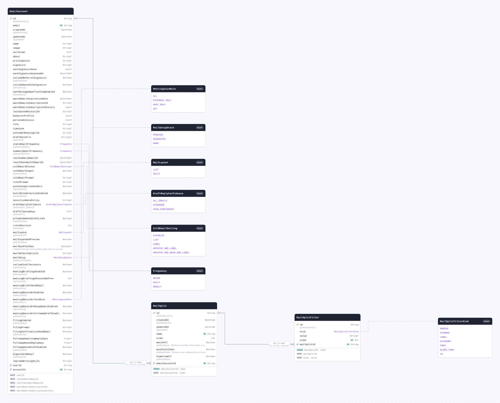

| Field            | Type       | Constraints                                       | Default      | Description                                                                                                                                         |
| ---------------- | ---------- | ------------------------------------------------- | ------------ | --------------------------------------------------------------------------------------------------------------------------------------------------- |
| `id`             | `String`   | PK NOT NULL                                       | `cuid(1)`    |                                                                                                                                                     |
| `createdAt`      | `DateTime` | NOT NULL                                          | `now()`      |                                                                                                                                                     |
| `updatedAt`      | `DateTime` | NOT NULL                                          | `@updatedAt` |                                                                                                                                                     |
| `name`           | `String`   | NOT NULL                                          |              |                                                                                                                                                     |
| `order`          | `Int`      | NOT NULL                                          |              |                                                                                                                                                     |
| `matchAll`       | `Boolean`  | NOT NULL                                          | `true`       | Whether every filter must match, or any one of them ("Show mail matching all/any of these conditions"). A split with no filters is the plain inbox. |
| `bundleInInbox`  | `Boolean`  | NOT NULL                                          | `false`      | Shown as one collapsed row in the inbox when the account bundles its inbox.                                                                         |
| `hideFromAll`    | `Boolean`  | NOT NULL                                          | `false`      |                                                                                                                                                     |
| `emailAccountId` | `String`   | NOT NULL → [EmailAccount.id](#model-EmailAccount) |              |                                                                                                                                                     |

#### Indexes

- `@@index([emailAccountId, order])`
- `@@unique([emailAccountId, name])`

#### References

- `emailAccountId` → [EmailAccount.id](#model-EmailAccount) (many-to-one, on delete Cascade)

#### Referenced by

- `id` ← [MailSplitFilter.mailSplitId](#model-MailSplitFilter) (one-to-many, on delete Cascade)

#### Definition

```sql
CREATE TABLE "MailSplit" (
    "id" TEXT NOT NULL,
    "createdAt" TIMESTAMP(3) NOT NULL DEFAULT CURRENT_TIMESTAMP,
    "updatedAt" TIMESTAMP(3) NOT NULL,
    "name" TEXT NOT NULL,
    "order" INTEGER NOT NULL,
    "matchAll" BOOLEAN NOT NULL DEFAULT true,
    "bundleInInbox" BOOLEAN NOT NULL DEFAULT false,
    "hideFromAll" BOOLEAN NOT NULL DEFAULT false,
    "emailAccountId" TEXT NOT NULL,

    CONSTRAINT "MailSplit_pkey" PRIMARY KEY ("id")
);

CREATE INDEX "MailSplit_emailAccountId_order_idx" ON "MailSplit"("emailAccountId", "order");

CREATE UNIQUE INDEX "MailSplit_emailAccountId_name_key" ON "MailSplit"("emailAccountId", "name");

ALTER TABLE "MailSplit" ADD CONSTRAINT "MailSplit_emailAccountId_fkey" FOREIGN KEY ("emailAccountId") REFERENCES "EmailAccount"("id") ON DELETE CASCADE ON UPDATE CASCADE;
```

<details>
<summary>Queries and their SQL</summary>

**findMany**: Every row

```ts
await prisma.mailSplit.findMany();
```

```sql
SELECT
  "public"."MailSplit"."id",
  "public"."MailSplit"."createdAt",
  "public"."MailSplit"."updatedAt",
  "public"."MailSplit"."name",
  "public"."MailSplit"."order",
  "public"."MailSplit"."matchAll",
  "public"."MailSplit"."bundleInInbox",
  "public"."MailSplit"."hideFromAll",
  "public"."MailSplit"."emailAccountId"
FROM
  "public"."MailSplit"
WHERE
  1 = 1
OFFSET
  $1
-- params: ["0"]
```

**count**: How many rows there are

```ts
await prisma.mailSplit.count();
```

```sql
SELECT
  COUNT(*) AS "_count$_all"
FROM
  (
    SELECT
      "public"."MailSplit"."id"
    FROM
      "public"."MailSplit"
    WHERE
      1 = 1
    OFFSET
      $1
  ) AS "sub"
-- params: ["0"]
```

**findMany**: Every row with its relations

```ts
await prisma.mailSplit.findMany({ include: { emailAccount: true, filters: true } });
```

```sql
SELECT
  "public"."MailSplit"."id",
  "public"."MailSplit"."createdAt",
  "public"."MailSplit"."updatedAt",
  "public"."MailSplit"."name",
  "public"."MailSplit"."order",
  "public"."MailSplit"."matchAll",
  "public"."MailSplit"."bundleInInbox",
  "public"."MailSplit"."hideFromAll",
  "public"."MailSplit"."emailAccountId"
FROM
  "public"."MailSplit"
WHERE
  1 = 1
OFFSET
  $1
-- params: ["0"]

SELECT
  "public"."EmailAccount"."id",
  "public"."EmailAccount"."email",
  "public"."EmailAccount"."createdAt",
  "public"."EmailAccount"."updatedAt",
  "public"."EmailAccount"."name",
  "public"."EmailAccount"."image",
  "public"."EmailAccount"."sortOrder",
  "public"."EmailAccount"."about",
  "public"."EmailAccount"."writingStyle",
  "public"."EmailAccount"."signature",
  "public"."EmailAccount"."sentSignatureScan",
  "public"."EmailAccount"."sentSignatureScannedAt",
  "public"."EmailAccount"."includeReferralSignature",
  "public"."EmailAccount"."includeSentWithSignature",
  "public"."EmailAccount"."sentMessageOpenTrackingEnabled",
  "public"."EmailAccount"."watchEmailsExpirationDate",
  "public"."EmailAccount"."watchEmailsSubscriptionId",
  "public"."EmailAccount"."watchEmailsSubscriptionHistory",
  "public"."EmailAccount"."lastSyncedHistoryId",
  "public"."EmailAccount"."behaviorProfile",
  "public"."EmailAccount"."personaAnalysis",
  "public"."EmailAccount"."role",
  "public"."EmailAccount"."timezone",
  "public"."EmailAccount"."calendarBookingLink",
  "public"."EmailAccount"."draftDocsUrls",
  "public"."EmailAccount"."statsEmailFrequency"::text,
  "public"."EmailAccount"."summaryEmailFrequency"::text,
  "public"."EmailAccount"."lastSummaryEmailAt",
  "public"."EmailAccount"."lastInboxHealthEmailAt",
  "public"."EmailAccount"."coldEmailBlocker"::text,
  "public"."EmailAccount"."coldEmailDigest",
  "public"."EmailAccount"."coldEmailPrompt",
  "public"."EmailAccount"."rulesPrompt",
  "public"."EmailAccount"."autoCategorizeSenders",
  "public"."EmailAccount"."multiRuleSelectionEnabled",
  "public"."EmailAccount"."sensitiveDataPolicy",
  "public"."EmailAccount"."draftReplyConfidence"::text,
  "public"."EmailAccount"."draftCleanupDays",
  "public"."EmailAccount"."allowHiddenAiDraftLinks",
  "public"."EmailAccount"."rulesRevision",
  "public"."EmailAccount"."mailLayout"::text,
  "public"."EmailAccount"."mailExpandedPreview",
  "public"."EmailAccount"."mailBundleInbox",
  "public"."EmailAccount"."mailDefaultSplitId",
  "public"."EmailAccount"."mailSetup"::text,
  "public"."EmailAccount"."includeInAllAccounts",
  "public"."EmailAccount"."meetingBriefingsEnabled",
  "public"."EmailAccount"."meetingBriefingsMinutesBefore",
  "public"."EmailAccount"."meetingBriefsSendEmail",
  "public"."EmailAccount"."meetingRecorderEnabled",
  "public"."EmailAccount"."meetingRecorderJoinRule"::text,
  "public"."EmailAccount"."meetingRecorderRecapEmailEnabled",
  "public"."EmailAccount"."meetingRecorderFollowUpDraftEnabled",
  "public"."EmailAccount"."filingEnabled",
  "public"."EmailAccount"."filingPrompt",
  "public"."EmailAccount"."filingConfirmationSendEmail",
  "public"."EmailAccount"."followUpAwaitingReplyDays",
  "public"."EmailAccount"."followUpNeedsReplyDays",
  "public"."EmailAccount"."followUpAutoDraftEnabled",
  "public"."EmailAccount"."digestSendEmail",
  "public"."EmailAccount"."learnedWritingStyle",
  "public"."EmailAccount"."userId",
  "public"."EmailAccount"."accountId"
FROM
  "public"."EmailAccount"
WHERE
  "public"."EmailAccount"."id" IN ($1)
OFFSET
  $2
-- params: ["<emailAccountId of the rows above>","0"]

SELECT
  "public"."MailSplitFilter"."id",
  "public"."MailSplitFilter"."kind"::text,
  "public"."MailSplitFilter"."value",
  "public"."MailSplitFilter"."order",
  "public"."MailSplitFilter"."mailSplitId"
FROM
  "public"."MailSplitFilter"
WHERE
  "public"."MailSplitFilter"."mailSplitId" IN ($1)
OFFSET
  $2
-- params: ["<id of the rows above>","0"]
```

**findUnique**: One row by what is unique to it

```ts
await prisma.mailSplit.findUnique({ where: { id: "example" } });
```

```sql
SELECT
  "public"."MailSplit"."id",
  "public"."MailSplit"."createdAt",
  "public"."MailSplit"."updatedAt",
  "public"."MailSplit"."name",
  "public"."MailSplit"."order",
  "public"."MailSplit"."matchAll",
  "public"."MailSplit"."bundleInInbox",
  "public"."MailSplit"."hideFromAll",
  "public"."MailSplit"."emailAccountId"
FROM
  "public"."MailSplit"
WHERE
  (
    "public"."MailSplit"."id" = $1
    AND 1 = 1
  )
LIMIT
  $2
OFFSET
  $3
-- params: ["example","1","0"]
```

**create**: Create a row

```ts
await prisma.mailSplit.create({ data: { name: "example", order: 1, emailAccountId: "example" } });
```

```sql
INSERT INTO
  "public"."MailSplit" (
    "id",
    "createdAt",
    "updatedAt",
    "name",
    "order",
    "matchAll",
    "bundleInInbox",
    "hideFromAll",
    "emailAccountId"
  )
VALUES
  ($1, $2, $3, $4, $5, $6, $7, $8, $9)
RETURNING
  "public"."MailSplit"."id",
  "public"."MailSplit"."createdAt",
  "public"."MailSplit"."updatedAt",
  "public"."MailSplit"."name",
  "public"."MailSplit"."order",
  "public"."MailSplit"."matchAll",
  "public"."MailSplit"."bundleInInbox",
  "public"."MailSplit"."hideFromAll",
  "public"."MailSplit"."emailAccountId"
-- params: ["<cuid(1)>","<now()>","<now()>","example","1",true,false,false,"example"]
```

**update**: Update a row

```ts
await prisma.mailSplit.update({
  where: { id: "example" },
  data: { createdAt: new Date("2026-01-01T00:00:00.000Z") },
});
```

```sql
UPDATE "public"."MailSplit"
SET
  "createdAt" = $1,
  "updatedAt" = $2
WHERE
  (
    "public"."MailSplit"."id" = $3
    AND 1 = 1
  )
RETURNING
  "public"."MailSplit"."id",
  "public"."MailSplit"."createdAt",
  "public"."MailSplit"."updatedAt",
  "public"."MailSplit"."name",
  "public"."MailSplit"."order",
  "public"."MailSplit"."matchAll",
  "public"."MailSplit"."bundleInInbox",
  "public"."MailSplit"."hideFromAll",
  "public"."MailSplit"."emailAccountId"
-- params: ["2026-01-01T00:00:00.000Z",{"prisma__type":"generatorCall","prisma__value":{"name":"now","args":[],"returnType":{"type":"DateTime"}}},"example"]
```

**delete**: Delete a row

```ts
await prisma.mailSplit.delete({ where: { id: "example" } });
```

```sql
DELETE FROM "public"."MailSplit"
WHERE
  (
    "public"."MailSplit"."id" = $1
    AND 1 = 1
  )
RETURNING
  "public"."MailSplit"."id",
  "public"."MailSplit"."createdAt",
  "public"."MailSplit"."updatedAt",
  "public"."MailSplit"."name",
  "public"."MailSplit"."order",
  "public"."MailSplit"."matchAll",
  "public"."MailSplit"."bundleInInbox",
  "public"."MailSplit"."hideFromAll",
  "public"."MailSplit"."emailAccountId"
-- params: ["example"]
```

</details>

<a id="model-MailSplitFilter"></a>

### MailSplitFilter

One condition row in the split builder. A split may hold several of the same
kind (two senders, two labels), so kind is deliberately not unique per split.

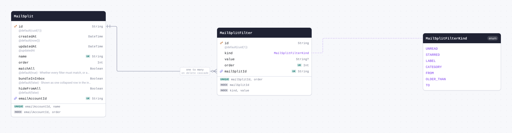

| Field         | Type                                               | Constraints                                 | Default   | Description |
| ------------- | -------------------------------------------------- | ------------------------------------------- | --------- | ----------- |
| `id`          | `String`                                           | PK NOT NULL                                 | `cuid(1)` |             |
| `kind`        | [`MailSplitFilterKind`](#enum-MailSplitFilterKind) | NOT NULL                                    |           |             |
| `value`       | `String`                                           | NULL                                        |           |             |
| `order`       | `Int`                                              | NOT NULL                                    |           |             |
| `mailSplitId` | `String`                                           | NOT NULL → [MailSplit.id](#model-MailSplit) |           |             |

#### Indexes

- `@@index([mailSplitId])`
- `@@index([kind, value])`
- `@@unique([mailSplitId, order])`

#### References

- `mailSplitId` → [MailSplit.id](#model-MailSplit) (many-to-one, on delete Cascade)

#### Definition

```sql
CREATE TABLE "MailSplitFilter" (
    "id" TEXT NOT NULL,
    "kind" "MailSplitFilterKind" NOT NULL,
    "value" TEXT,
    "order" INTEGER NOT NULL,
    "mailSplitId" TEXT NOT NULL,

    CONSTRAINT "MailSplitFilter_pkey" PRIMARY KEY ("id")
);

CREATE INDEX "MailSplitFilter_mailSplitId_idx" ON "MailSplitFilter"("mailSplitId");

CREATE INDEX "MailSplitFilter_kind_value_idx" ON "MailSplitFilter"("kind", "value");

CREATE UNIQUE INDEX "MailSplitFilter_mailSplitId_order_key" ON "MailSplitFilter"("mailSplitId", "order");

ALTER TABLE "MailSplitFilter" ADD CONSTRAINT "MailSplitFilter_mailSplitId_fkey" FOREIGN KEY ("mailSplitId") REFERENCES "MailSplit"("id") ON DELETE CASCADE ON UPDATE CASCADE;
```

<details>
<summary>Queries and their SQL</summary>

**findMany**: Every row

```ts
await prisma.mailSplitFilter.findMany();
```

```sql
SELECT
  "public"."MailSplitFilter"."id",
  "public"."MailSplitFilter"."kind"::text,
  "public"."MailSplitFilter"."value",
  "public"."MailSplitFilter"."order",
  "public"."MailSplitFilter"."mailSplitId"
FROM
  "public"."MailSplitFilter"
WHERE
  1 = 1
OFFSET
  $1
-- params: ["0"]
```

**count**: How many rows there are

```ts
await prisma.mailSplitFilter.count();
```

```sql
SELECT
  COUNT(*) AS "_count$_all"
FROM
  (
    SELECT
      "public"."MailSplitFilter"."id"
    FROM
      "public"."MailSplitFilter"
    WHERE
      1 = 1
    OFFSET
      $1
  ) AS "sub"
-- params: ["0"]
```

**findMany**: Every row with its relations

```ts
await prisma.mailSplitFilter.findMany({ include: { mailSplit: true } });
```

```sql
SELECT
  "public"."MailSplitFilter"."id",
  "public"."MailSplitFilter"."kind"::text,
  "public"."MailSplitFilter"."value",
  "public"."MailSplitFilter"."order",
  "public"."MailSplitFilter"."mailSplitId"
FROM
  "public"."MailSplitFilter"
WHERE
  1 = 1
OFFSET
  $1
-- params: ["0"]

SELECT
  "public"."MailSplit"."id",
  "public"."MailSplit"."createdAt",
  "public"."MailSplit"."updatedAt",
  "public"."MailSplit"."name",
  "public"."MailSplit"."order",
  "public"."MailSplit"."matchAll",
  "public"."MailSplit"."bundleInInbox",
  "public"."MailSplit"."hideFromAll",
  "public"."MailSplit"."emailAccountId"
FROM
  "public"."MailSplit"
WHERE
  "public"."MailSplit"."id" IN ($1)
OFFSET
  $2
-- params: ["<mailSplitId of the rows above>","0"]
```

**findUnique**: One row by what is unique to it

```ts
await prisma.mailSplitFilter.findUnique({ where: { id: "example" } });
```

```sql
SELECT
  "public"."MailSplitFilter"."id",
  "public"."MailSplitFilter"."kind"::text,
  "public"."MailSplitFilter"."value",
  "public"."MailSplitFilter"."order",
  "public"."MailSplitFilter"."mailSplitId"
FROM
  "public"."MailSplitFilter"
WHERE
  (
    "public"."MailSplitFilter"."id" = $1
    AND 1 = 1
  )
LIMIT
  $2
OFFSET
  $3
-- params: ["example","1","0"]
```

**create**: Create a row

```ts
await prisma.mailSplitFilter.create({ data: { kind: "UNREAD", order: 1, mailSplitId: "example" } });
```

```sql
INSERT INTO
  "public"."MailSplitFilter" ("id", "kind", "order", "mailSplitId")
VALUES
  (
    $1,
    CAST($2::text AS "public"."MailSplitFilterKind"),
    $3,
    $4
  )
RETURNING
  "public"."MailSplitFilter"."id",
  "public"."MailSplitFilter"."kind"::text,
  "public"."MailSplitFilter"."value",
  "public"."MailSplitFilter"."order",
  "public"."MailSplitFilter"."mailSplitId"
-- params: ["<cuid(1)>","UNREAD","1","example"]
```

**update**: Update a row

```ts
await prisma.mailSplitFilter.update({ where: { id: "example" }, data: { kind: "UNREAD" } });
```

```sql
UPDATE "public"."MailSplitFilter"
SET
  "kind" = CAST($1::text AS "public"."MailSplitFilterKind")
WHERE
  (
    "public"."MailSplitFilter"."id" = $2
    AND 1 = 1
  )
RETURNING
  "public"."MailSplitFilter"."id",
  "public"."MailSplitFilter"."kind"::text,
  "public"."MailSplitFilter"."value",
  "public"."MailSplitFilter"."order",
  "public"."MailSplitFilter"."mailSplitId"
-- params: ["UNREAD","example"]
```

**delete**: Delete a row

```ts
await prisma.mailSplitFilter.delete({ where: { id: "example" } });
```

```sql
DELETE FROM "public"."MailSplitFilter"
WHERE
  (
    "public"."MailSplitFilter"."id" = $1
    AND 1 = 1
  )
RETURNING
  "public"."MailSplitFilter"."id",
  "public"."MailSplitFilter"."kind"::text,
  "public"."MailSplitFilter"."value",
  "public"."MailSplitFilter"."order",
  "public"."MailSplitFilter"."mailSplitId"
-- params: ["example"]
```

</details>

<a id="model-Organization"></a>

### Organization

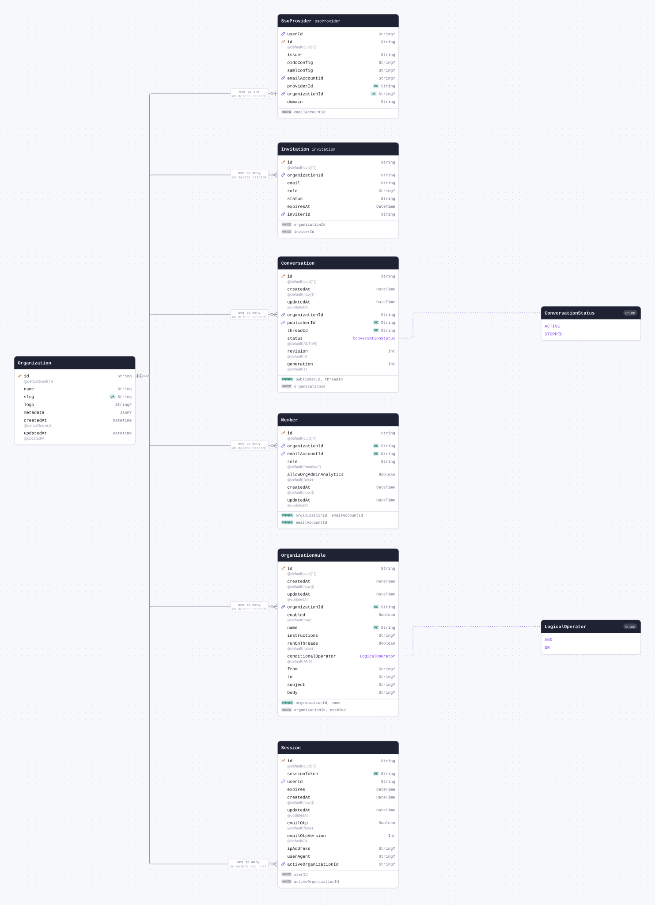

| Field       | Type       | Constraints     | Default      | Description |
| ----------- | ---------- | --------------- | ------------ | ----------- |
| `id`        | `String`   | PK NOT NULL     | `cuid(1)`    |             |
| `name`      | `String`   | NOT NULL        |              |             |
| `slug`      | `String`   | UNIQUE NOT NULL |              |             |
| `logo`      | `String`   | NULL            |              |             |
| `metadata`  | `Json`     | NULL            |              |             |
| `createdAt` | `DateTime` | NOT NULL        | `now()`      |             |
| `updatedAt` | `DateTime` | NOT NULL        | `@updatedAt` |             |

#### Referenced by

- `id` ← [Session.activeOrganizationId](#model-Session) (one-to-many, on delete SetNull)
- `id` ← [OrganizationRule.organizationId](#model-OrganizationRule) (one-to-many, on delete Cascade)
- `id` ← [Member.organizationId](#model-Member) (one-to-many, on delete Cascade)
- `id` ← [Conversation.organizationId](#model-Conversation) (one-to-many, on delete Cascade)
- `id` ← [Invitation.organizationId](#model-Invitation) (one-to-many, on delete Cascade)
- `id` ← [SsoProvider.organizationId](#model-SsoProvider) (one-to-one, on delete Cascade)

#### Definition

```sql
CREATE TABLE "Organization" (
    "id" TEXT NOT NULL,
    "name" TEXT NOT NULL,
    "slug" TEXT NOT NULL,
    "logo" TEXT,
    "metadata" JSONB,
    "createdAt" TIMESTAMP(3) NOT NULL DEFAULT CURRENT_TIMESTAMP,
    "updatedAt" TIMESTAMP(3) NOT NULL,

    CONSTRAINT "Organization_pkey" PRIMARY KEY ("id")
);

CREATE UNIQUE INDEX "Organization_slug_key" ON "Organization"("slug");
```

<details>
<summary>Queries and their SQL</summary>

**findMany**: Every row

```ts
await prisma.organization.findMany();
```

```sql
SELECT
  "public"."Organization"."id",
  "public"."Organization"."name",
  "public"."Organization"."slug",
  "public"."Organization"."logo",
  "public"."Organization"."metadata",
  "public"."Organization"."createdAt",
  "public"."Organization"."updatedAt"
FROM
  "public"."Organization"
WHERE
  1 = 1
OFFSET
  $1
-- params: ["0"]
```

**count**: How many rows there are

```ts
await prisma.organization.count();
```

```sql
SELECT
  COUNT(*) AS "_count$_all"
FROM
  (
    SELECT
      "public"."Organization"."id"
    FROM
      "public"."Organization"
    WHERE
      1 = 1
    OFFSET
      $1
  ) AS "sub"
-- params: ["0"]
```

**findMany**: Every row with its relations

```ts
await prisma.organization.findMany({
  include: {
    members: true,
    SsoProvider: true,
    sessions: true,
    invitations: true,
    rules: true,
    conversations: true,
  },
});
```

```sql
SELECT
  "public"."Organization"."id",
  "public"."Organization"."name",
  "public"."Organization"."slug",
  "public"."Organization"."logo",
  "public"."Organization"."metadata",
  "public"."Organization"."createdAt",
  "public"."Organization"."updatedAt"
FROM
  "public"."Organization"
WHERE
  1 = 1
OFFSET
  $1
-- params: ["0"]

SELECT
  "public"."Member"."id",
  "public"."Member"."organizationId",
  "public"."Member"."emailAccountId",
  "public"."Member"."role",
  "public"."Member"."allowOrgAdminAnalytics",
  "public"."Member"."createdAt",
  "public"."Member"."updatedAt"
FROM
  "public"."Member"
WHERE
  "public"."Member"."organizationId" IN ($1)
OFFSET
  $2
-- params: ["<id of the rows above>","0"]

SELECT
  "public"."ssoProvider"."id",
  "public"."ssoProvider"."userId",
  "public"."ssoProvider"."issuer",
  "public"."ssoProvider"."oidcConfig",
  "public"."ssoProvider"."samlConfig",
  "public"."ssoProvider"."emailAccountId",
  "public"."ssoProvider"."providerId",
  "public"."ssoProvider"."organizationId",
  "public"."ssoProvider"."domain"
FROM
  "public"."ssoProvider"
WHERE
  "public"."ssoProvider"."organizationId" IN ($1)
OFFSET
  $2
-- params: ["<id of the rows above>","0"]

SELECT
  "public"."Session"."id",
  "public"."Session"."sessionToken",
  "public"."Session"."userId",
  "public"."Session"."expires",
  "public"."Session"."createdAt",
  "public"."Session"."updatedAt",
  "public"."Session"."emailOtp",
  "public"."Session"."emailOtpVersion",
  "public"."Session"."ipAddress",
  "public"."Session"."userAgent",
  "public"."Session"."activeOrganizationId"
FROM
  "public"."Session"
WHERE
  "public"."Session"."activeOrganizationId" IN ($1)
OFFSET
  $2
-- params: ["<id of the rows above>","0"]

SELECT
  "public"."invitation"."id",
  "public"."invitation"."organizationId",
  "public"."invitation"."email",
  "public"."invitation"."role",
  "public"."invitation"."status",
  "public"."invitation"."expiresAt",
  "public"."invitation"."inviterId"
FROM
  "public"."invitation"
WHERE
  "public"."invitation"."organizationId" IN ($1)
OFFSET
  $2
-- params: ["<id of the rows above>","0"]

SELECT
  "public"."OrganizationRule"."id",
  "public"."OrganizationRule"."createdAt",
  "public"."OrganizationRule"."updatedAt",
  "public"."OrganizationRule"."organizationId",
  "public"."OrganizationRule"."enabled",
  "public"."OrganizationRule"."name",
  "public"."OrganizationRule"."instructions",
  "public"."OrganizationRule"."runOnThreads",
  "public"."OrganizationRule"."conditionalOperator"::text,
  "public"."OrganizationRule"."from",
  "public"."OrganizationRule"."to",
  "public"."OrganizationRule"."subject",
  "public"."OrganizationRule"."body"
FROM
  "public"."OrganizationRule"
WHERE
  "public"."OrganizationRule"."organizationId" IN ($1)
OFFSET
  $2
-- params: ["<id of the rows above>","0"]

SELECT
  "public"."Conversation"."id",
  "public"."Conversation"."createdAt",
  "public"."Conversation"."updatedAt",
  "public"."Conversation"."organizationId",
  "public"."Conversation"."publisherId",
  "public"."Conversation"."threadId",
  "public"."Conversation"."status"::text,
  "public"."Conversation"."revision",
  "public"."Conversation"."generation"
FROM
  "public"."Conversation"
WHERE
  "public"."Conversation"."organizationId" IN ($1)
OFFSET
  $2
-- params: ["<id of the rows above>","0"]
```

**findUnique**: One row by what is unique to it

```ts
await prisma.organization.findUnique({ where: { id: "example" } });
```

```sql
SELECT
  "public"."Organization"."id",
  "public"."Organization"."name",
  "public"."Organization"."slug",
  "public"."Organization"."logo",
  "public"."Organization"."metadata",
  "public"."Organization"."createdAt",
  "public"."Organization"."updatedAt"
FROM
  "public"."Organization"
WHERE
  (
    "public"."Organization"."id" = $1
    AND 1 = 1
  )
LIMIT
  $2
OFFSET
  $3
-- params: ["example","1","0"]
```

**create**: Create a row

```ts
await prisma.organization.create({ data: { name: "example", slug: "example" } });
```

```sql
INSERT INTO
  "public"."Organization" ("id", "name", "slug", "createdAt", "updatedAt")
VALUES
  ($1, $2, $3, $4, $5)
RETURNING
  "public"."Organization"."id",
  "public"."Organization"."name",
  "public"."Organization"."slug",
  "public"."Organization"."logo",
  "public"."Organization"."metadata",
  "public"."Organization"."createdAt",
  "public"."Organization"."updatedAt"
-- params: ["<cuid(1)>","example","example","<now()>","<now()>"]
```

**update**: Update a row

```ts
await prisma.organization.update({ where: { id: "example" }, data: { name: "example" } });
```

```sql
UPDATE "public"."Organization"
SET
  "name" = $1,
  "updatedAt" = $2
WHERE
  (
    "public"."Organization"."id" = $3
    AND 1 = 1
  )
RETURNING
  "public"."Organization"."id",
  "public"."Organization"."name",
  "public"."Organization"."slug",
  "public"."Organization"."logo",
  "public"."Organization"."metadata",
  "public"."Organization"."createdAt",
  "public"."Organization"."updatedAt"
-- params: ["example",{"prisma__type":"generatorCall","prisma__value":{"name":"now","args":[],"returnType":{"type":"DateTime"}}},"example"]
```

**delete**: Delete a row

```ts
await prisma.organization.delete({ where: { id: "example" } });
```

```sql
DELETE FROM "public"."Organization"
WHERE
  (
    "public"."Organization"."id" = $1
    AND 1 = 1
  )
RETURNING
  "public"."Organization"."id",
  "public"."Organization"."name",
  "public"."Organization"."slug",
  "public"."Organization"."logo",
  "public"."Organization"."metadata",
  "public"."Organization"."createdAt",
  "public"."Organization"."updatedAt"
-- params: ["example"]
```

</details>

<a id="model-OrganizationRule"></a>

### OrganizationRule

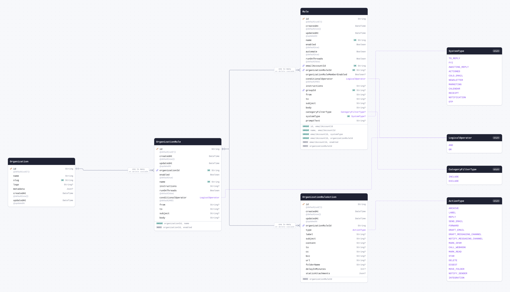

| Field                 | Type                                       | Constraints                                       | Default      | Description |
| --------------------- | ------------------------------------------ | ------------------------------------------------- | ------------ | ----------- |
| `id`                  | `String`                                   | PK NOT NULL                                       | `cuid(1)`    |             |
| `createdAt`           | `DateTime`                                 | NOT NULL                                          | `now()`      |             |
| `updatedAt`           | `DateTime`                                 | NOT NULL                                          | `@updatedAt` |             |
| `organizationId`      | `String`                                   | NOT NULL → [Organization.id](#model-Organization) |              |             |
| `enabled`             | `Boolean`                                  | NOT NULL                                          | `true`       |             |
| `name`                | `String`                                   | NOT NULL                                          |              |             |
| `instructions`        | `String`                                   | NULL                                              |              |             |
| `runOnThreads`        | `Boolean`                                  | NOT NULL                                          | `false`      |             |
| `conditionalOperator` | [`LogicalOperator`](#enum-LogicalOperator) | NOT NULL                                          | `AND`        |             |
| `from`                | `String`                                   | NULL                                              |              |             |
| `to`                  | `String`                                   | NULL                                              |              |             |
| `subject`             | `String`                                   | NULL                                              |              |             |
| `body`                | `String`                                   | NULL                                              |              |             |

#### Indexes

- `@@index([organizationId, enabled])`
- `@@unique([organizationId, name])`

#### References

- `organizationId` → [Organization.id](#model-Organization) (many-to-one, on delete Cascade)

#### Referenced by

- `id` ← [OrganizationRuleAction.organizationRuleId](#model-OrganizationRuleAction) (one-to-many, on delete Cascade)
- `id` ← [Rule.organizationRuleId](#model-Rule) (one-to-many, on delete Cascade)

#### Definition

```sql
CREATE TABLE "OrganizationRule" (
    "id" TEXT NOT NULL,
    "createdAt" TIMESTAMP(3) NOT NULL DEFAULT CURRENT_TIMESTAMP,
    "updatedAt" TIMESTAMP(3) NOT NULL,
    "organizationId" TEXT NOT NULL,
    "enabled" BOOLEAN NOT NULL DEFAULT true,
    "name" TEXT NOT NULL,
    "instructions" TEXT,
    "runOnThreads" BOOLEAN NOT NULL DEFAULT false,
    "conditionalOperator" "LogicalOperator" NOT NULL DEFAULT 'AND',
    "from" TEXT,
    "to" TEXT,
    "subject" TEXT,
    "body" TEXT,

    CONSTRAINT "OrganizationRule_pkey" PRIMARY KEY ("id")
);

CREATE INDEX "OrganizationRule_organizationId_enabled_idx" ON "OrganizationRule"("organizationId", "enabled");

CREATE UNIQUE INDEX "OrganizationRule_organizationId_name_key" ON "OrganizationRule"("organizationId", "name");

ALTER TABLE "OrganizationRule" ADD CONSTRAINT "OrganizationRule_organizationId_fkey" FOREIGN KEY ("organizationId") REFERENCES "Organization"("id") ON DELETE CASCADE ON UPDATE CASCADE;
```

<details>
<summary>Queries and their SQL</summary>

**findMany**: Every row

```ts
await prisma.organizationRule.findMany();
```

```sql
SELECT
  "public"."OrganizationRule"."id",
  "public"."OrganizationRule"."createdAt",
  "public"."OrganizationRule"."updatedAt",
  "public"."OrganizationRule"."organizationId",
  "public"."OrganizationRule"."enabled",
  "public"."OrganizationRule"."name",
  "public"."OrganizationRule"."instructions",
  "public"."OrganizationRule"."runOnThreads",
  "public"."OrganizationRule"."conditionalOperator"::text,
  "public"."OrganizationRule"."from",
  "public"."OrganizationRule"."to",
  "public"."OrganizationRule"."subject",
  "public"."OrganizationRule"."body"
FROM
  "public"."OrganizationRule"
WHERE
  1 = 1
OFFSET
  $1
-- params: ["0"]
```

**count**: How many rows there are

```ts
await prisma.organizationRule.count();
```

```sql
SELECT
  COUNT(*) AS "_count$_all"
FROM
  (
    SELECT
      "public"."OrganizationRule"."id"
    FROM
      "public"."OrganizationRule"
    WHERE
      1 = 1
    OFFSET
      $1
  ) AS "sub"
-- params: ["0"]
```

**findMany**: Every row with its relations

```ts
await prisma.organizationRule.findMany({
  include: { organization: true, actions: true, memberRules: true },
});
```

```sql
SELECT
  "public"."OrganizationRule"."id",
  "public"."OrganizationRule"."createdAt",
  "public"."OrganizationRule"."updatedAt",
  "public"."OrganizationRule"."organizationId",
  "public"."OrganizationRule"."enabled",
  "public"."OrganizationRule"."name",
  "public"."OrganizationRule"."instructions",
  "public"."OrganizationRule"."runOnThreads",
  "public"."OrganizationRule"."conditionalOperator"::text,
  "public"."OrganizationRule"."from",
  "public"."OrganizationRule"."to",
  "public"."OrganizationRule"."subject",
  "public"."OrganizationRule"."body"
FROM
  "public"."OrganizationRule"
WHERE
  1 = 1
OFFSET
  $1
-- params: ["0"]

SELECT
  "public"."Organization"."id",
  "public"."Organization"."name",
  "public"."Organization"."slug",
  "public"."Organization"."logo",
  "public"."Organization"."metadata",
  "public"."Organization"."createdAt",
  "public"."Organization"."updatedAt"
FROM
  "public"."Organization"
WHERE
  "public"."Organization"."id" IN ($1)
OFFSET
  $2
-- params: ["<organizationId of the rows above>","0"]

SELECT
  "public"."OrganizationRuleAction"."id",
  "public"."OrganizationRuleAction"."createdAt",
  "public"."OrganizationRuleAction"."updatedAt",
  "public"."OrganizationRuleAction"."organizationRuleId",
  "public"."OrganizationRuleAction"."type"::text,
  "public"."OrganizationRuleAction"."label",
  "public"."OrganizationRuleAction"."subject",
  "public"."OrganizationRuleAction"."content",
  "public"."OrganizationRuleAction"."to",
  "public"."OrganizationRuleAction"."cc",
  "public"."OrganizationRuleAction"."bcc",
  "public"."OrganizationRuleAction"."url",
  "public"."OrganizationRuleAction"."folderName",
  "public"."OrganizationRuleAction"."delayInMinutes",
  "public"."OrganizationRuleAction"."staticAttachments"
FROM
  "public"."OrganizationRuleAction"
WHERE
  "public"."OrganizationRuleAction"."organizationRuleId" IN ($1)
OFFSET
  $2
-- params: ["<id of the rows above>","0"]

SELECT
  "public"."Rule"."id",
  "public"."Rule"."createdAt",
  "public"."Rule"."updatedAt",
  "public"."Rule"."name",
  "public"."Rule"."enabled",
  "public"."Rule"."automate",
  "public"."Rule"."runOnThreads",
  "public"."Rule"."emailAccountId",
  "public"."Rule"."organizationRuleId",
  "public"."Rule"."organizationRuleMemberEnabled",
  "public"."Rule"."conditionalOperator"::text,
  "public"."Rule"."instructions",
  "public"."Rule"."groupId",
  "public"."Rule"."from",
  "public"."Rule"."to",
  "public"."Rule"."subject",
  "public"."Rule"."body",
  "public"."Rule"."categoryFilterType"::text,
  "public"."Rule"."systemType"::text,
  "public"."Rule"."promptText"
FROM
  "public"."Rule"
WHERE
  "public"."Rule"."organizationRuleId" IN ($1)
OFFSET
  $2
-- params: ["<id of the rows above>","0"]
```

**findUnique**: One row by what is unique to it

```ts
await prisma.organizationRule.findUnique({ where: { id: "example" } });
```

```sql
SELECT
  "public"."OrganizationRule"."id",
  "public"."OrganizationRule"."createdAt",
  "public"."OrganizationRule"."updatedAt",
  "public"."OrganizationRule"."organizationId",
  "public"."OrganizationRule"."enabled",
  "public"."OrganizationRule"."name",
  "public"."OrganizationRule"."instructions",
  "public"."OrganizationRule"."runOnThreads",
  "public"."OrganizationRule"."conditionalOperator"::text,
  "public"."OrganizationRule"."from",
  "public"."OrganizationRule"."to",
  "public"."OrganizationRule"."subject",
  "public"."OrganizationRule"."body"
FROM
  "public"."OrganizationRule"
WHERE
  (
    "public"."OrganizationRule"."id" = $1
    AND 1 = 1
  )
LIMIT
  $2
OFFSET
  $3
-- params: ["example","1","0"]
```

**create**: Create a row

```ts
await prisma.organizationRule.create({ data: { organizationId: "example", name: "example" } });
```

```sql
INSERT INTO
  "public"."OrganizationRule" (
    "id",
    "createdAt",
    "updatedAt",
    "organizationId",
    "enabled",
    "name",
    "runOnThreads",
    "conditionalOperator"
  )
VALUES
  (
    $1,
    $2,
    $3,
    $4,
    $5,
    $6,
    $7,
    CAST($8::text AS "public"."LogicalOperator")
  )
RETURNING
  "public"."OrganizationRule"."id",
  "public"."OrganizationRule"."createdAt",
  "public"."OrganizationRule"."updatedAt",
  "public"."OrganizationRule"."organizationId",
  "public"."OrganizationRule"."enabled",
  "public"."OrganizationRule"."name",
  "public"."OrganizationRule"."instructions",
  "public"."OrganizationRule"."runOnThreads",
  "public"."OrganizationRule"."conditionalOperator"::text,
  "public"."OrganizationRule"."from",
  "public"."OrganizationRule"."to",
  "public"."OrganizationRule"."subject",
  "public"."OrganizationRule"."body"
-- params: ["<cuid(1)>","<now()>","<now()>","example",true,"example",false,"AND"]
```

**update**: Update a row

```ts
await prisma.organizationRule.update({
  where: { id: "example" },
  data: { createdAt: new Date("2026-01-01T00:00:00.000Z") },
});
```

```sql
UPDATE "public"."OrganizationRule"
SET
  "createdAt" = $1,
  "updatedAt" = $2
WHERE
  (
    "public"."OrganizationRule"."id" = $3
    AND 1 = 1
  )
RETURNING
  "public"."OrganizationRule"."id",
  "public"."OrganizationRule"."createdAt",
  "public"."OrganizationRule"."updatedAt",
  "public"."OrganizationRule"."organizationId",
  "public"."OrganizationRule"."enabled",
  "public"."OrganizationRule"."name",
  "public"."OrganizationRule"."instructions",
  "public"."OrganizationRule"."runOnThreads",
  "public"."OrganizationRule"."conditionalOperator"::text,
  "public"."OrganizationRule"."from",
  "public"."OrganizationRule"."to",
  "public"."OrganizationRule"."subject",
  "public"."OrganizationRule"."body"
-- params: ["2026-01-01T00:00:00.000Z",{"prisma__type":"generatorCall","prisma__value":{"name":"now","args":[],"returnType":{"type":"DateTime"}}},"example"]
```

**delete**: Delete a row

```ts
await prisma.organizationRule.delete({ where: { id: "example" } });
```

```sql
DELETE FROM "public"."OrganizationRule"
WHERE
  (
    "public"."OrganizationRule"."id" = $1
    AND 1 = 1
  )
RETURNING
  "public"."OrganizationRule"."id",
  "public"."OrganizationRule"."createdAt",
  "public"."OrganizationRule"."updatedAt",
  "public"."OrganizationRule"."organizationId",
  "public"."OrganizationRule"."enabled",
  "public"."OrganizationRule"."name",
  "public"."OrganizationRule"."instructions",
  "public"."OrganizationRule"."runOnThreads",
  "public"."OrganizationRule"."conditionalOperator"::text,
  "public"."OrganizationRule"."from",
  "public"."OrganizationRule"."to",
  "public"."OrganizationRule"."subject",
  "public"."OrganizationRule"."body"
-- params: ["example"]
```

</details>

<a id="model-OrganizationRuleAction"></a>

### OrganizationRuleAction

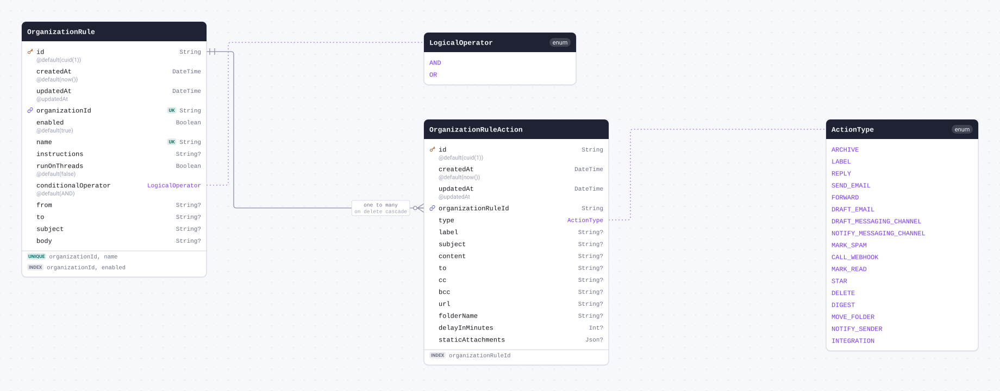

| Field                | Type                             | Constraints                                               | Default      | Description |
| -------------------- | -------------------------------- | --------------------------------------------------------- | ------------ | ----------- |
| `id`                 | `String`                         | PK NOT NULL                                               | `cuid(1)`    |             |
| `createdAt`          | `DateTime`                       | NOT NULL                                                  | `now()`      |             |
| `updatedAt`          | `DateTime`                       | NOT NULL                                                  | `@updatedAt` |             |
| `organizationRuleId` | `String`                         | NOT NULL → [OrganizationRule.id](#model-OrganizationRule) |              |             |
| `type`               | [`ActionType`](#enum-ActionType) | NOT NULL                                                  |              |             |
| `label`              | `String`                         | NULL                                                      |              |             |
| `subject`            | `String`                         | NULL                                                      |              |             |
| `content`            | `String`                         | NULL                                                      |              |             |
| `to`                 | `String`                         | NULL                                                      |              |             |
| `cc`                 | `String`                         | NULL                                                      |              |             |
| `bcc`                | `String`                         | NULL                                                      |              |             |
| `url`                | `String`                         | NULL                                                      |              |             |
| `folderName`         | `String`                         | NULL                                                      |              |             |
| `delayInMinutes`     | `Int`                            | NULL                                                      |              |             |
| `staticAttachments`  | `Json`                           | NULL                                                      |              |             |

#### Indexes

- `@@index([organizationRuleId])`

#### References

- `organizationRuleId` → [OrganizationRule.id](#model-OrganizationRule) (many-to-one, on delete Cascade)

#### Definition

```sql
CREATE TABLE "OrganizationRuleAction" (
    "id" TEXT NOT NULL,
    "createdAt" TIMESTAMP(3) NOT NULL DEFAULT CURRENT_TIMESTAMP,
    "updatedAt" TIMESTAMP(3) NOT NULL,
    "organizationRuleId" TEXT NOT NULL,
    "type" "ActionType" NOT NULL,
    "label" TEXT,
    "subject" TEXT,
    "content" TEXT,
    "to" TEXT,
    "cc" TEXT,
    "bcc" TEXT,
    "url" TEXT,
    "folderName" TEXT,
    "delayInMinutes" INTEGER,
    "staticAttachments" JSONB,

    CONSTRAINT "OrganizationRuleAction_pkey" PRIMARY KEY ("id")
);

CREATE INDEX "OrganizationRuleAction_organizationRuleId_idx" ON "OrganizationRuleAction"("organizationRuleId");

ALTER TABLE "OrganizationRuleAction" ADD CONSTRAINT "OrganizationRuleAction_organizationRuleId_fkey" FOREIGN KEY ("organizationRuleId") REFERENCES "OrganizationRule"("id") ON DELETE CASCADE ON UPDATE CASCADE;
```

<details>
<summary>Queries and their SQL</summary>

**findMany**: Every row

```ts
await prisma.organizationRuleAction.findMany();
```

```sql
SELECT
  "public"."OrganizationRuleAction"."id",
  "public"."OrganizationRuleAction"."createdAt",
  "public"."OrganizationRuleAction"."updatedAt",
  "public"."OrganizationRuleAction"."organizationRuleId",
  "public"."OrganizationRuleAction"."type"::text,
  "public"."OrganizationRuleAction"."label",
  "public"."OrganizationRuleAction"."subject",
  "public"."OrganizationRuleAction"."content",
  "public"."OrganizationRuleAction"."to",
  "public"."OrganizationRuleAction"."cc",
  "public"."OrganizationRuleAction"."bcc",
  "public"."OrganizationRuleAction"."url",
  "public"."OrganizationRuleAction"."folderName",
  "public"."OrganizationRuleAction"."delayInMinutes",
  "public"."OrganizationRuleAction"."staticAttachments"
FROM
  "public"."OrganizationRuleAction"
WHERE
  1 = 1
OFFSET
  $1
-- params: ["0"]
```

**count**: How many rows there are

```ts
await prisma.organizationRuleAction.count();
```

```sql
SELECT
  COUNT(*) AS "_count$_all"
FROM
  (
    SELECT
      "public"."OrganizationRuleAction"."id"
    FROM
      "public"."OrganizationRuleAction"
    WHERE
      1 = 1
    OFFSET
      $1
  ) AS "sub"
-- params: ["0"]
```

**findMany**: Every row with its relations

```ts
await prisma.organizationRuleAction.findMany({ include: { organizationRule: true } });
```

```sql
SELECT
  "public"."OrganizationRuleAction"."id",
  "public"."OrganizationRuleAction"."createdAt",
  "public"."OrganizationRuleAction"."updatedAt",
  "public"."OrganizationRuleAction"."organizationRuleId",
  "public"."OrganizationRuleAction"."type"::text,
  "public"."OrganizationRuleAction"."label",
  "public"."OrganizationRuleAction"."subject",
  "public"."OrganizationRuleAction"."content",
  "public"."OrganizationRuleAction"."to",
  "public"."OrganizationRuleAction"."cc",
  "public"."OrganizationRuleAction"."bcc",
  "public"."OrganizationRuleAction"."url",
  "public"."OrganizationRuleAction"."folderName",
  "public"."OrganizationRuleAction"."delayInMinutes",
  "public"."OrganizationRuleAction"."staticAttachments"
FROM
  "public"."OrganizationRuleAction"
WHERE
  1 = 1
OFFSET
  $1
-- params: ["0"]

SELECT
  "public"."OrganizationRule"."id",
  "public"."OrganizationRule"."createdAt",
  "public"."OrganizationRule"."updatedAt",
  "public"."OrganizationRule"."organizationId",
  "public"."OrganizationRule"."enabled",
  "public"."OrganizationRule"."name",
  "public"."OrganizationRule"."instructions",
  "public"."OrganizationRule"."runOnThreads",
  "public"."OrganizationRule"."conditionalOperator"::text,
  "public"."OrganizationRule"."from",
  "public"."OrganizationRule"."to",
  "public"."OrganizationRule"."subject",
  "public"."OrganizationRule"."body"
FROM
  "public"."OrganizationRule"
WHERE
  "public"."OrganizationRule"."id" IN ($1)
OFFSET
  $2
-- params: ["<organizationRuleId of the rows above>","0"]
```

**findUnique**: One row by what is unique to it

```ts
await prisma.organizationRuleAction.findUnique({ where: { id: "example" } });
```

```sql
SELECT
  "public"."OrganizationRuleAction"."id",
  "public"."OrganizationRuleAction"."createdAt",
  "public"."OrganizationRuleAction"."updatedAt",
  "public"."OrganizationRuleAction"."organizationRuleId",
  "public"."OrganizationRuleAction"."type"::text,
  "public"."OrganizationRuleAction"."label",
  "public"."OrganizationRuleAction"."subject",
  "public"."OrganizationRuleAction"."content",
  "public"."OrganizationRuleAction"."to",
  "public"."OrganizationRuleAction"."cc",
  "public"."OrganizationRuleAction"."bcc",
  "public"."OrganizationRuleAction"."url",
  "public"."OrganizationRuleAction"."folderName",
  "public"."OrganizationRuleAction"."delayInMinutes",
  "public"."OrganizationRuleAction"."staticAttachments"
FROM
  "public"."OrganizationRuleAction"
WHERE
  (
    "public"."OrganizationRuleAction"."id" = $1
    AND 1 = 1
  )
LIMIT
  $2
OFFSET
  $3
-- params: ["example","1","0"]
```

**create**: Create a row

```ts
await prisma.organizationRuleAction.create({
  data: { organizationRuleId: "example", type: "ARCHIVE" },
});
```

```sql
INSERT INTO
  "public"."OrganizationRuleAction" (
    "id",
    "createdAt",
    "updatedAt",
    "organizationRuleId",
    "type"
  )
VALUES
  (
    $1,
    $2,
    $3,
    $4,
    CAST($5::text AS "public"."ActionType")
  )
RETURNING
  "public"."OrganizationRuleAction"."id",
  "public"."OrganizationRuleAction"."createdAt",
  "public"."OrganizationRuleAction"."updatedAt",
  "public"."OrganizationRuleAction"."organizationRuleId",
  "public"."OrganizationRuleAction"."type"::text,
  "public"."OrganizationRuleAction"."label",
  "public"."OrganizationRuleAction"."subject",
  "public"."OrganizationRuleAction"."content",
  "public"."OrganizationRuleAction"."to",
  "public"."OrganizationRuleAction"."cc",
  "public"."OrganizationRuleAction"."bcc",
  "public"."OrganizationRuleAction"."url",
  "public"."OrganizationRuleAction"."folderName",
  "public"."OrganizationRuleAction"."delayInMinutes",
  "public"."OrganizationRuleAction"."staticAttachments"
-- params: ["<cuid(1)>","<now()>","<now()>","example","ARCHIVE"]
```

**update**: Update a row

```ts
await prisma.organizationRuleAction.update({
  where: { id: "example" },
  data: { createdAt: new Date("2026-01-01T00:00:00.000Z") },
});
```

```sql
UPDATE "public"."OrganizationRuleAction"
SET
  "createdAt" = $1,
  "updatedAt" = $2
WHERE
  (
    "public"."OrganizationRuleAction"."id" = $3
    AND 1 = 1
  )
RETURNING
  "public"."OrganizationRuleAction"."id",
  "public"."OrganizationRuleAction"."createdAt",
  "public"."OrganizationRuleAction"."updatedAt",
  "public"."OrganizationRuleAction"."organizationRuleId",
  "public"."OrganizationRuleAction"."type"::text,
  "public"."OrganizationRuleAction"."label",
  "public"."OrganizationRuleAction"."subject",
  "public"."OrganizationRuleAction"."content",
  "public"."OrganizationRuleAction"."to",
  "public"."OrganizationRuleAction"."cc",
  "public"."OrganizationRuleAction"."bcc",
  "public"."OrganizationRuleAction"."url",
  "public"."OrganizationRuleAction"."folderName",
  "public"."OrganizationRuleAction"."delayInMinutes",
  "public"."OrganizationRuleAction"."staticAttachments"
-- params: ["2026-01-01T00:00:00.000Z",{"prisma__type":"generatorCall","prisma__value":{"name":"now","args":[],"returnType":{"type":"DateTime"}}},"example"]
```

**delete**: Delete a row

```ts
await prisma.organizationRuleAction.delete({ where: { id: "example" } });
```

```sql
DELETE FROM "public"."OrganizationRuleAction"
WHERE
  (
    "public"."OrganizationRuleAction"."id" = $1
    AND 1 = 1
  )
RETURNING
  "public"."OrganizationRuleAction"."id",
  "public"."OrganizationRuleAction"."createdAt",
  "public"."OrganizationRuleAction"."updatedAt",
  "public"."OrganizationRuleAction"."organizationRuleId",
  "public"."OrganizationRuleAction"."type"::text,
  "public"."OrganizationRuleAction"."label",
  "public"."OrganizationRuleAction"."subject",
  "public"."OrganizationRuleAction"."content",
  "public"."OrganizationRuleAction"."to",
  "public"."OrganizationRuleAction"."cc",
  "public"."OrganizationRuleAction"."bcc",
  "public"."OrganizationRuleAction"."url",
  "public"."OrganizationRuleAction"."folderName",
  "public"."OrganizationRuleAction"."delayInMinutes",
  "public"."OrganizationRuleAction"."staticAttachments"
-- params: ["example"]
```

</details>

<a id="model-Member"></a>

### Member

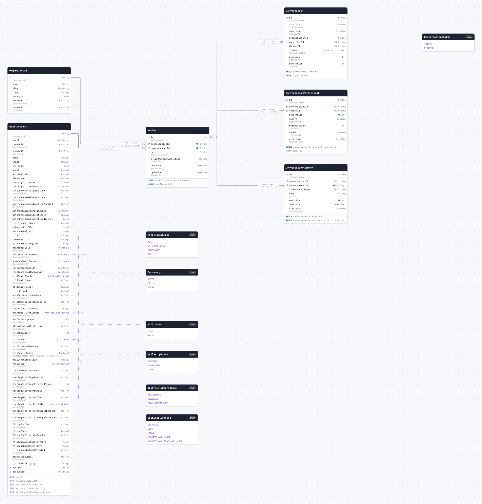

| Field                    | Type       | Constraints                                              | Default      | Description |
| ------------------------ | ---------- | -------------------------------------------------------- | ------------ | ----------- |
| `id`                     | `String`   | PK NOT NULL                                              | `cuid(1)`    |             |
| `organizationId`         | `String`   | NOT NULL → [Organization.id](#model-Organization)        |              |             |
| `emailAccountId`         | `String`   | UNIQUE NOT NULL → [EmailAccount.id](#model-EmailAccount) |              |             |
| `role`                   | `String`   | NOT NULL                                                 | `"member"`   |             |
| `allowOrgAdminAnalytics` | `Boolean`  | NOT NULL                                                 | `false`      |             |
| `createdAt`              | `DateTime` | NOT NULL                                                 | `now()`      |             |
| `updatedAt`              | `DateTime` | NOT NULL                                                 | `@updatedAt` |             |

#### Indexes

- `@@unique([organizationId, emailAccountId])`
- `@@unique([emailAccountId])`

#### References

- `organizationId` → [Organization.id](#model-Organization) (many-to-one, on delete Cascade)
- `emailAccountId` → [EmailAccount.id](#model-EmailAccount) (many-to-one, on delete Restrict)

#### Referenced by

- `id` ← [Conversation.publisherId](#model-Conversation) (one-to-many, on delete Cascade)
- `id` ← [ConversationParticipant.memberId](#model-ConversationParticipant) (one-to-many, on delete Cascade)
- `id` ← [ConversationComment.authorMemberId](#model-ConversationComment) (one-to-many, on delete SetNull)

#### Definition

```sql
CREATE TABLE "Member" (
    "id" TEXT NOT NULL,
    "organizationId" TEXT NOT NULL,
    "emailAccountId" TEXT NOT NULL,
    "role" TEXT NOT NULL DEFAULT 'member',
    "allowOrgAdminAnalytics" BOOLEAN NOT NULL DEFAULT false,
    "createdAt" TIMESTAMP(3) NOT NULL DEFAULT CURRENT_TIMESTAMP,
    "updatedAt" TIMESTAMP(3) NOT NULL,

    CONSTRAINT "Member_pkey" PRIMARY KEY ("id")
);

CREATE UNIQUE INDEX "Member_organizationId_emailAccountId_key" ON "Member"("organizationId", "emailAccountId");

CREATE UNIQUE INDEX "Member_emailAccountId_key" ON "Member"("emailAccountId");

ALTER TABLE "Member" ADD CONSTRAINT "Member_organizationId_fkey" FOREIGN KEY ("organizationId") REFERENCES "Organization"("id") ON DELETE CASCADE ON UPDATE CASCADE;

ALTER TABLE "Member" ADD CONSTRAINT "Member_emailAccountId_fkey" FOREIGN KEY ("emailAccountId") REFERENCES "EmailAccount"("id") ON DELETE RESTRICT ON UPDATE CASCADE;
```

<details>
<summary>Queries and their SQL</summary>

**findMany**: Every row

```ts
await prisma.member.findMany();
```

```sql
SELECT
  "public"."Member"."id",
  "public"."Member"."organizationId",
  "public"."Member"."emailAccountId",
  "public"."Member"."role",
  "public"."Member"."allowOrgAdminAnalytics",
  "public"."Member"."createdAt",
  "public"."Member"."updatedAt"
FROM
  "public"."Member"
WHERE
  1 = 1
OFFSET
  $1
-- params: ["0"]
```

**count**: How many rows there are

```ts
await prisma.member.count();
```

```sql
SELECT
  COUNT(*) AS "_count$_all"
FROM
  (
    SELECT
      "public"."Member"."id"
    FROM
      "public"."Member"
    WHERE
      1 = 1
    OFFSET
      $1
  ) AS "sub"
-- params: ["0"]
```

**findMany**: Every row with its relations

```ts
await prisma.member.findMany({
  include: {
    organization: true,
    emailAccount: true,
    conversations: true,
    conversationParticipants: true,
    conversationComments: true,
  },
});
```

```sql
SELECT
  "public"."Member"."id",
  "public"."Member"."organizationId",
  "public"."Member"."emailAccountId",
  "public"."Member"."role",
  "public"."Member"."allowOrgAdminAnalytics",
  "public"."Member"."createdAt",
  "public"."Member"."updatedAt"
FROM
  "public"."Member"
WHERE
  1 = 1
OFFSET
  $1
-- params: ["0"]

SELECT
  "public"."Organization"."id",
  "public"."Organization"."name",
  "public"."Organization"."slug",
  "public"."Organization"."logo",
  "public"."Organization"."metadata",
  "public"."Organization"."createdAt",
  "public"."Organization"."updatedAt"
FROM
  "public"."Organization"
WHERE
  "public"."Organization"."id" IN ($1)
OFFSET
  $2
-- params: ["<organizationId of the rows above>","0"]

SELECT
  "public"."EmailAccount"."id",
  "public"."EmailAccount"."email",
  "public"."EmailAccount"."createdAt",
  "public"."EmailAccount"."updatedAt",
  "public"."EmailAccount"."name",
  "public"."EmailAccount"."image",
  "public"."EmailAccount"."sortOrder",
  "public"."EmailAccount"."about",
  "public"."EmailAccount"."writingStyle",
  "public"."EmailAccount"."signature",
  "public"."EmailAccount"."sentSignatureScan",
  "public"."EmailAccount"."sentSignatureScannedAt",
  "public"."EmailAccount"."includeReferralSignature",
  "public"."EmailAccount"."includeSentWithSignature",
  "public"."EmailAccount"."sentMessageOpenTrackingEnabled",
  "public"."EmailAccount"."watchEmailsExpirationDate",
  "public"."EmailAccount"."watchEmailsSubscriptionId",
  "public"."EmailAccount"."watchEmailsSubscriptionHistory",
  "public"."EmailAccount"."lastSyncedHistoryId",
  "public"."EmailAccount"."behaviorProfile",
  "public"."EmailAccount"."personaAnalysis",
  "public"."EmailAccount"."role",
  "public"."EmailAccount"."timezone",
  "public"."EmailAccount"."calendarBookingLink",
  "public"."EmailAccount"."draftDocsUrls",
  "public"."EmailAccount"."statsEmailFrequency"::text,
  "public"."EmailAccount"."summaryEmailFrequency"::text,
  "public"."EmailAccount"."lastSummaryEmailAt",
  "public"."EmailAccount"."lastInboxHealthEmailAt",
  "public"."EmailAccount"."coldEmailBlocker"::text,
  "public"."EmailAccount"."coldEmailDigest",
  "public"."EmailAccount"."coldEmailPrompt",
  "public"."EmailAccount"."rulesPrompt",
  "public"."EmailAccount"."autoCategorizeSenders",
  "public"."EmailAccount"."multiRuleSelectionEnabled",
  "public"."EmailAccount"."sensitiveDataPolicy",
  "public"."EmailAccount"."draftReplyConfidence"::text,
  "public"."EmailAccount"."draftCleanupDays",
  "public"."EmailAccount"."allowHiddenAiDraftLinks",
  "public"."EmailAccount"."rulesRevision",
  "public"."EmailAccount"."mailLayout"::text,
  "public"."EmailAccount"."mailExpandedPreview",
  "public"."EmailAccount"."mailBundleInbox",
  "public"."EmailAccount"."mailDefaultSplitId",
  "public"."EmailAccount"."mailSetup"::text,
  "public"."EmailAccount"."includeInAllAccounts",
  "public"."EmailAccount"."meetingBriefingsEnabled",
  "public"."EmailAccount"."meetingBriefingsMinutesBefore",
  "public"."EmailAccount"."meetingBriefsSendEmail",
  "public"."EmailAccount"."meetingRecorderEnabled",
  "public"."EmailAccount"."meetingRecorderJoinRule"::text,
  "public"."EmailAccount"."meetingRecorderRecapEmailEnabled",
  "public"."EmailAccount"."meetingRecorderFollowUpDraftEnabled",
  "public"."EmailAccount"."filingEnabled",
  "public"."EmailAccount"."filingPrompt",
  "public"."EmailAccount"."filingConfirmationSendEmail",
  "public"."EmailAccount"."followUpAwaitingReplyDays",
  "public"."EmailAccount"."followUpNeedsReplyDays",
  "public"."EmailAccount"."followUpAutoDraftEnabled",
  "public"."EmailAccount"."digestSendEmail",
  "public"."EmailAccount"."learnedWritingStyle",
  "public"."EmailAccount"."userId",
  "public"."EmailAccount"."accountId"
FROM
  "public"."EmailAccount"
WHERE
  "public"."EmailAccount"."id" IN ($1)
OFFSET
  $2
-- params: ["<emailAccountId of the rows above>","0"]

SELECT
  "public"."Conversation"."id",
  "public"."Conversation"."createdAt",
  "public"."Conversation"."updatedAt",
  "public"."Conversation"."organizationId",
  "public"."Conversation"."publisherId",
  "public"."Conversation"."threadId",
  "public"."Conversation"."status"::text,
  "public"."Conversation"."revision",
  "public"."Conversation"."generation"
FROM
  "public"."Conversation"
WHERE
  "public"."Conversation"."publisherId" IN ($1)
OFFSET
  $2
-- params: ["<id of the rows above>","0"]

SELECT
  "public"."ConversationParticipant"."id",
  "public"."ConversationParticipant"."conversationId",
  "public"."ConversationParticipant"."memberId",
  "public"."ConversationParticipant"."generation",
  "public"."ConversationParticipant"."active",
  "public"."ConversationParticipant"."readRevision",
  "public"."ConversationParticipant"."muted",
  "public"."ConversationParticipant"."createdAt"
FROM
  "public"."ConversationParticipant"
WHERE
  "public"."ConversationParticipant"."memberId" IN ($1)
OFFSET
  $2
-- params: ["<id of the rows above>","0"]

SELECT
  "public"."ConversationComment"."id",
  "public"."ConversationComment"."conversationId",
  "public"."ConversationComment"."authorMemberId",
  "public"."ConversationComment"."clientMutationId",
  "public"."ConversationComment"."body",
  "public"."ConversationComment"."revision",
  "public"."ConversationComment"."deletedAt",
  "public"."ConversationComment"."createdAt"
FROM
  "public"."ConversationComment"
WHERE
  "public"."ConversationComment"."authorMemberId" IN ($1)
OFFSET
  $2
-- params: ["<id of the rows above>","0"]
```

**findUnique**: One row by what is unique to it

```ts
await prisma.member.findUnique({ where: { id: "example" } });
```

```sql
SELECT
  "public"."Member"."id",
  "public"."Member"."organizationId",
  "public"."Member"."emailAccountId",
  "public"."Member"."role",
  "public"."Member"."allowOrgAdminAnalytics",
  "public"."Member"."createdAt",
  "public"."Member"."updatedAt"
FROM
  "public"."Member"
WHERE
  (
    "public"."Member"."id" = $1
    AND 1 = 1
  )
LIMIT
  $2
OFFSET
  $3
-- params: ["example","1","0"]
```

**create**: Create a row

```ts
await prisma.member.create({ data: { organizationId: "example", emailAccountId: "example" } });
```

```sql
INSERT INTO
  "public"."Member" (
    "id",
    "organizationId",
    "emailAccountId",
    "role",
    "allowOrgAdminAnalytics",
    "createdAt",
    "updatedAt"
  )
VALUES
  ($1, $2, $3, $4, $5, $6, $7)
RETURNING
  "public"."Member"."id",
  "public"."Member"."organizationId",
  "public"."Member"."emailAccountId",
  "public"."Member"."role",
  "public"."Member"."allowOrgAdminAnalytics",
  "public"."Member"."createdAt",
  "public"."Member"."updatedAt"
-- params: ["<cuid(1)>","example","example","member",false,"<now()>","<now()>"]
```

**update**: Update a row

```ts
await prisma.member.update({ where: { id: "example" }, data: { role: "example" } });
```

```sql
UPDATE "public"."Member"
SET
  "role" = $1,
  "updatedAt" = $2
WHERE
  (
    "public"."Member"."id" = $3
    AND 1 = 1
  )
RETURNING
  "public"."Member"."id",
  "public"."Member"."organizationId",
  "public"."Member"."emailAccountId",
  "public"."Member"."role",
  "public"."Member"."allowOrgAdminAnalytics",
  "public"."Member"."createdAt",
  "public"."Member"."updatedAt"
-- params: ["example",{"prisma__type":"generatorCall","prisma__value":{"name":"now","args":[],"returnType":{"type":"DateTime"}}},"example"]
```

**delete**: Delete a row

```ts
await prisma.member.delete({ where: { id: "example" } });
```

```sql
DELETE FROM "public"."Member"
WHERE
  (
    "public"."Member"."id" = $1
    AND 1 = 1
  )
RETURNING
  "public"."Member"."id",
  "public"."Member"."organizationId",
  "public"."Member"."emailAccountId",
  "public"."Member"."role",
  "public"."Member"."allowOrgAdminAnalytics",
  "public"."Member"."createdAt",
  "public"."Member"."updatedAt"
-- params: ["example"]
```

</details>

<a id="model-Conversation"></a>

### Conversation

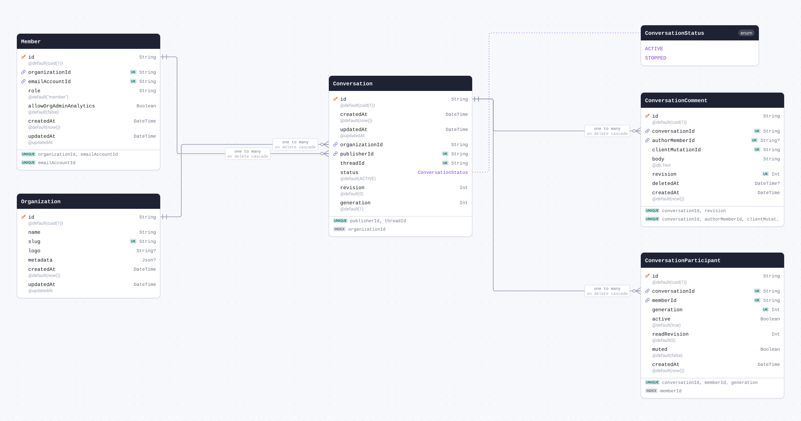

| Field            | Type                                             | Constraints                                       | Default      | Description |
| ---------------- | ------------------------------------------------ | ------------------------------------------------- | ------------ | ----------- |
| `id`             | `String`                                         | PK NOT NULL                                       | `cuid(1)`    |             |
| `createdAt`      | `DateTime`                                       | NOT NULL                                          | `now()`      |             |
| `updatedAt`      | `DateTime`                                       | NOT NULL                                          | `@updatedAt` |             |
| `organizationId` | `String`                                         | NOT NULL → [Organization.id](#model-Organization) |              |             |
| `publisherId`    | `String`                                         | NOT NULL → [Member.id](#model-Member)             |              |             |
| `threadId`       | `String`                                         | NOT NULL                                          |              |             |
| `status`         | [`ConversationStatus`](#enum-ConversationStatus) | NOT NULL                                          | `ACTIVE`     |             |
| `revision`       | `Int`                                            | NOT NULL                                          | `0`          |             |
| `generation`     | `Int`                                            | NOT NULL                                          | `1`          |             |

#### Indexes

- `@@index([organizationId])`
- `@@unique([publisherId, threadId])`

#### References

- `organizationId` → [Organization.id](#model-Organization) (many-to-one, on delete Cascade)
- `publisherId` → [Member.id](#model-Member) (many-to-one, on delete Cascade)

#### Referenced by

- `id` ← [ConversationParticipant.conversationId](#model-ConversationParticipant) (one-to-many, on delete Cascade)
- `id` ← [ConversationComment.conversationId](#model-ConversationComment) (one-to-many, on delete Cascade)

#### Definition

```sql
CREATE TABLE "Conversation" (
    "id" TEXT NOT NULL,
    "createdAt" TIMESTAMP(3) NOT NULL DEFAULT CURRENT_TIMESTAMP,
    "updatedAt" TIMESTAMP(3) NOT NULL,
    "organizationId" TEXT NOT NULL,
    "publisherId" TEXT NOT NULL,
    "threadId" TEXT NOT NULL,
    "status" "ConversationStatus" NOT NULL DEFAULT 'ACTIVE',
    "revision" INTEGER NOT NULL DEFAULT 0,
    "generation" INTEGER NOT NULL DEFAULT 1,

    CONSTRAINT "Conversation_pkey" PRIMARY KEY ("id")
);

CREATE INDEX "Conversation_organizationId_idx" ON "Conversation"("organizationId");

CREATE UNIQUE INDEX "Conversation_publisherId_threadId_key" ON "Conversation"("publisherId", "threadId");

ALTER TABLE "Conversation" ADD CONSTRAINT "Conversation_organizationId_fkey" FOREIGN KEY ("organizationId") REFERENCES "Organization"("id") ON DELETE CASCADE ON UPDATE CASCADE;

ALTER TABLE "Conversation" ADD CONSTRAINT "Conversation_publisherId_fkey" FOREIGN KEY ("publisherId") REFERENCES "Member"("id") ON DELETE CASCADE ON UPDATE CASCADE;
```

<details>
<summary>Queries and their SQL</summary>

**findMany**: Every row

```ts
await prisma.conversation.findMany();
```

```sql
SELECT
  "public"."Conversation"."id",
  "public"."Conversation"."createdAt",
  "public"."Conversation"."updatedAt",
  "public"."Conversation"."organizationId",
  "public"."Conversation"."publisherId",
  "public"."Conversation"."threadId",
  "public"."Conversation"."status"::text,
  "public"."Conversation"."revision",
  "public"."Conversation"."generation"
FROM
  "public"."Conversation"
WHERE
  1 = 1
OFFSET
  $1
-- params: ["0"]
```

**count**: How many rows there are

```ts
await prisma.conversation.count();
```

```sql
SELECT
  COUNT(*) AS "_count$_all"
FROM
  (
    SELECT
      "public"."Conversation"."id"
    FROM
      "public"."Conversation"
    WHERE
      1 = 1
    OFFSET
      $1
  ) AS "sub"
-- params: ["0"]
```

**findMany**: Every row with its relations

```ts
await prisma.conversation.findMany({
  include: { organization: true, publisher: true, participants: true, comments: true },
});
```

```sql
SELECT
  "public"."Conversation"."id",
  "public"."Conversation"."createdAt",
  "public"."Conversation"."updatedAt",
  "public"."Conversation"."organizationId",
  "public"."Conversation"."publisherId",
  "public"."Conversation"."threadId",
  "public"."Conversation"."status"::text,
  "public"."Conversation"."revision",
  "public"."Conversation"."generation"
FROM
  "public"."Conversation"
WHERE
  1 = 1
OFFSET
  $1
-- params: ["0"]

SELECT
  "public"."Organization"."id",
  "public"."Organization"."name",
  "public"."Organization"."slug",
  "public"."Organization"."logo",
  "public"."Organization"."metadata",
  "public"."Organization"."createdAt",
  "public"."Organization"."updatedAt"
FROM
  "public"."Organization"
WHERE
  "public"."Organization"."id" IN ($1)
OFFSET
  $2
-- params: ["<organizationId of the rows above>","0"]

SELECT
  "public"."Member"."id",
  "public"."Member"."organizationId",
  "public"."Member"."emailAccountId",
  "public"."Member"."role",
  "public"."Member"."allowOrgAdminAnalytics",
  "public"."Member"."createdAt",
  "public"."Member"."updatedAt"
FROM
  "public"."Member"
WHERE
  "public"."Member"."id" IN ($1)
OFFSET
  $2
-- params: ["<publisherId of the rows above>","0"]

SELECT
  "public"."ConversationParticipant"."id",
  "public"."ConversationParticipant"."conversationId",
  "public"."ConversationParticipant"."memberId",
  "public"."ConversationParticipant"."generation",
  "public"."ConversationParticipant"."active",
  "public"."ConversationParticipant"."readRevision",
  "public"."ConversationParticipant"."muted",
  "public"."ConversationParticipant"."createdAt"
FROM
  "public"."ConversationParticipant"
WHERE
  "public"."ConversationParticipant"."conversationId" IN ($1)
OFFSET
  $2
-- params: ["<id of the rows above>","0"]

SELECT
  "public"."ConversationComment"."id",
  "public"."ConversationComment"."conversationId",
  "public"."ConversationComment"."authorMemberId",
  "public"."ConversationComment"."clientMutationId",
  "public"."ConversationComment"."body",
  "public"."ConversationComment"."revision",
  "public"."ConversationComment"."deletedAt",
  "public"."ConversationComment"."createdAt"
FROM
  "public"."ConversationComment"
WHERE
  "public"."ConversationComment"."conversationId" IN ($1)
OFFSET
  $2
-- params: ["<id of the rows above>","0"]
```

**findUnique**: One row by what is unique to it

```ts
await prisma.conversation.findUnique({ where: { id: "example" } });
```

```sql
SELECT
  "public"."Conversation"."id",
  "public"."Conversation"."createdAt",
  "public"."Conversation"."updatedAt",
  "public"."Conversation"."organizationId",
  "public"."Conversation"."publisherId",
  "public"."Conversation"."threadId",
  "public"."Conversation"."status"::text,
  "public"."Conversation"."revision",
  "public"."Conversation"."generation"
FROM
  "public"."Conversation"
WHERE
  (
    "public"."Conversation"."id" = $1
    AND 1 = 1
  )
LIMIT
  $2
OFFSET
  $3
-- params: ["example","1","0"]
```

**create**: Create a row

```ts
await prisma.conversation.create({
  data: { organizationId: "example", publisherId: "example", threadId: "example" },
});
```

```sql
INSERT INTO
  "public"."Conversation" (
    "id",
    "createdAt",
    "updatedAt",
    "organizationId",
    "publisherId",
    "threadId",
    "status",
    "revision",
    "generation"
  )
VALUES
  (
    $1,
    $2,
    $3,
    $4,
    $5,
    $6,
    CAST($7::text AS "public"."ConversationStatus"),
    $8,
    $9
  )
RETURNING
  "public"."Conversation"."id",
  "public"."Conversation"."createdAt",
  "public"."Conversation"."updatedAt",
  "public"."Conversation"."organizationId",
  "public"."Conversation"."publisherId",
  "public"."Conversation"."threadId",
  "public"."Conversation"."status"::text,
  "public"."Conversation"."revision",
  "public"."Conversation"."generation"
-- params: ["<cuid(1)>","<now()>","<now()>","example","example","example","ACTIVE","0","1"]
```

**update**: Update a row

```ts
await prisma.conversation.update({
  where: { id: "example" },
  data: { createdAt: new Date("2026-01-01T00:00:00.000Z") },
});
```

```sql
UPDATE "public"."Conversation"
SET
  "createdAt" = $1,
  "updatedAt" = $2
WHERE
  (
    "public"."Conversation"."id" = $3
    AND 1 = 1
  )
RETURNING
  "public"."Conversation"."id",
  "public"."Conversation"."createdAt",
  "public"."Conversation"."updatedAt",
  "public"."Conversation"."organizationId",
  "public"."Conversation"."publisherId",
  "public"."Conversation"."threadId",
  "public"."Conversation"."status"::text,
  "public"."Conversation"."revision",
  "public"."Conversation"."generation"
-- params: ["2026-01-01T00:00:00.000Z",{"prisma__type":"generatorCall","prisma__value":{"name":"now","args":[],"returnType":{"type":"DateTime"}}},"example"]
```

**delete**: Delete a row

```ts
await prisma.conversation.delete({ where: { id: "example" } });
```

```sql
DELETE FROM "public"."Conversation"
WHERE
  (
    "public"."Conversation"."id" = $1
    AND 1 = 1
  )
RETURNING
  "public"."Conversation"."id",
  "public"."Conversation"."createdAt",
  "public"."Conversation"."updatedAt",
  "public"."Conversation"."organizationId",
  "public"."Conversation"."publisherId",
  "public"."Conversation"."threadId",
  "public"."Conversation"."status"::text,
  "public"."Conversation"."revision",
  "public"."Conversation"."generation"
-- params: ["example"]
```

</details>

<a id="model-ConversationParticipant"></a>

### ConversationParticipant

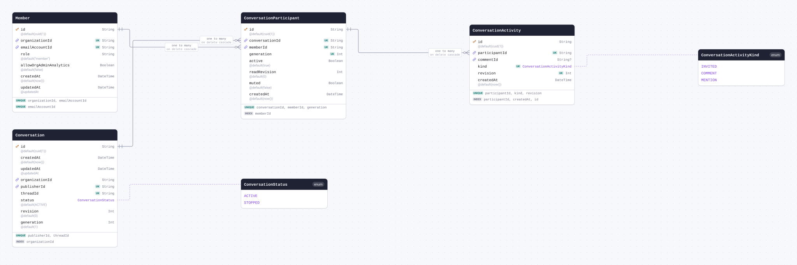

| Field            | Type       | Constraints                                       | Default   | Description |
| ---------------- | ---------- | ------------------------------------------------- | --------- | ----------- |
| `id`             | `String`   | PK NOT NULL                                       | `cuid(1)` |             |
| `conversationId` | `String`   | NOT NULL → [Conversation.id](#model-Conversation) |           |             |
| `memberId`       | `String`   | NOT NULL → [Member.id](#model-Member)             |           |             |
| `generation`     | `Int`      | NOT NULL                                          |           |             |
| `active`         | `Boolean`  | NOT NULL                                          | `true`    |             |
| `readRevision`   | `Int`      | NOT NULL                                          | `0`       |             |
| `muted`          | `Boolean`  | NOT NULL                                          | `false`   |             |
| `createdAt`      | `DateTime` | NOT NULL                                          | `now()`   |             |

#### Indexes

- `@@index([memberId])`
- `@@unique([conversationId, memberId, generation])`

#### References

- `conversationId` → [Conversation.id](#model-Conversation) (many-to-one, on delete Cascade)
- `memberId` → [Member.id](#model-Member) (many-to-one, on delete Cascade)

#### Referenced by

- `id` ← [ConversationActivity.participantId](#model-ConversationActivity) (one-to-many, on delete Cascade)

#### Definition

```sql
CREATE TABLE "ConversationParticipant" (
    "id" TEXT NOT NULL,
    "conversationId" TEXT NOT NULL,
    "memberId" TEXT NOT NULL,
    "generation" INTEGER NOT NULL,
    "active" BOOLEAN NOT NULL DEFAULT true,
    "readRevision" INTEGER NOT NULL DEFAULT 0,
    "muted" BOOLEAN NOT NULL DEFAULT false,
    "createdAt" TIMESTAMP(3) NOT NULL DEFAULT CURRENT_TIMESTAMP,

    CONSTRAINT "ConversationParticipant_pkey" PRIMARY KEY ("id")
);

CREATE INDEX "ConversationParticipant_memberId_idx" ON "ConversationParticipant"("memberId");

CREATE UNIQUE INDEX "ConversationParticipant_conversationId_memberId_generation_key" ON "ConversationParticipant"("conversationId", "memberId", "generation");

ALTER TABLE "ConversationParticipant" ADD CONSTRAINT "ConversationParticipant_conversationId_fkey" FOREIGN KEY ("conversationId") REFERENCES "Conversation"("id") ON DELETE CASCADE ON UPDATE CASCADE;

ALTER TABLE "ConversationParticipant" ADD CONSTRAINT "ConversationParticipant_memberId_fkey" FOREIGN KEY ("memberId") REFERENCES "Member"("id") ON DELETE CASCADE ON UPDATE CASCADE;
```

<details>
<summary>Queries and their SQL</summary>

**findMany**: Every row

```ts
await prisma.conversationParticipant.findMany();
```

```sql
SELECT
  "public"."ConversationParticipant"."id",
  "public"."ConversationParticipant"."conversationId",
  "public"."ConversationParticipant"."memberId",
  "public"."ConversationParticipant"."generation",
  "public"."ConversationParticipant"."active",
  "public"."ConversationParticipant"."readRevision",
  "public"."ConversationParticipant"."muted",
  "public"."ConversationParticipant"."createdAt"
FROM
  "public"."ConversationParticipant"
WHERE
  1 = 1
OFFSET
  $1
-- params: ["0"]
```

**count**: How many rows there are

```ts
await prisma.conversationParticipant.count();
```

```sql
SELECT
  COUNT(*) AS "_count$_all"
FROM
  (
    SELECT
      "public"."ConversationParticipant"."id"
    FROM
      "public"."ConversationParticipant"
    WHERE
      1 = 1
    OFFSET
      $1
  ) AS "sub"
-- params: ["0"]
```

**findMany**: Every row with its relations

```ts
await prisma.conversationParticipant.findMany({
  include: { conversation: true, member: true, activity: true },
});
```

```sql
SELECT
  "public"."ConversationParticipant"."id",
  "public"."ConversationParticipant"."conversationId",
  "public"."ConversationParticipant"."memberId",
  "public"."ConversationParticipant"."generation",
  "public"."ConversationParticipant"."active",
  "public"."ConversationParticipant"."readRevision",
  "public"."ConversationParticipant"."muted",
  "public"."ConversationParticipant"."createdAt"
FROM
  "public"."ConversationParticipant"
WHERE
  1 = 1
OFFSET
  $1
-- params: ["0"]

SELECT
  "public"."Conversation"."id",
  "public"."Conversation"."createdAt",
  "public"."Conversation"."updatedAt",
  "public"."Conversation"."organizationId",
  "public"."Conversation"."publisherId",
  "public"."Conversation"."threadId",
  "public"."Conversation"."status"::text,
  "public"."Conversation"."revision",
  "public"."Conversation"."generation"
FROM
  "public"."Conversation"
WHERE
  "public"."Conversation"."id" IN ($1)
OFFSET
  $2
-- params: ["<conversationId of the rows above>","0"]

SELECT
  "public"."Member"."id",
  "public"."Member"."organizationId",
  "public"."Member"."emailAccountId",
  "public"."Member"."role",
  "public"."Member"."allowOrgAdminAnalytics",
  "public"."Member"."createdAt",
  "public"."Member"."updatedAt"
FROM
  "public"."Member"
WHERE
  "public"."Member"."id" IN ($1)
OFFSET
  $2
-- params: ["<memberId of the rows above>","0"]

SELECT
  "public"."ConversationActivity"."id",
  "public"."ConversationActivity"."participantId",
  "public"."ConversationActivity"."commentId",
  "public"."ConversationActivity"."kind"::text,
  "public"."ConversationActivity"."revision",
  "public"."ConversationActivity"."createdAt"
FROM
  "public"."ConversationActivity"
WHERE
  "public"."ConversationActivity"."participantId" IN ($1)
OFFSET
  $2
-- params: ["<id of the rows above>","0"]
```

**findUnique**: One row by what is unique to it

```ts
await prisma.conversationParticipant.findUnique({ where: { id: "example" } });
```

```sql
SELECT
  "public"."ConversationParticipant"."id",
  "public"."ConversationParticipant"."conversationId",
  "public"."ConversationParticipant"."memberId",
  "public"."ConversationParticipant"."generation",
  "public"."ConversationParticipant"."active",
  "public"."ConversationParticipant"."readRevision",
  "public"."ConversationParticipant"."muted",
  "public"."ConversationParticipant"."createdAt"
FROM
  "public"."ConversationParticipant"
WHERE
  (
    "public"."ConversationParticipant"."id" = $1
    AND 1 = 1
  )
LIMIT
  $2
OFFSET
  $3
-- params: ["example","1","0"]
```

**create**: Create a row

```ts
await prisma.conversationParticipant.create({
  data: { conversationId: "example", memberId: "example", generation: 1 },
});
```

```sql
INSERT INTO
  "public"."ConversationParticipant" (
    "id",
    "conversationId",
    "memberId",
    "generation",
    "active",
    "readRevision",
    "muted",
    "createdAt"
  )
VALUES
  ($1, $2, $3, $4, $5, $6, $7, $8)
RETURNING
  "public"."ConversationParticipant"."id",
  "public"."ConversationParticipant"."conversationId",
  "public"."ConversationParticipant"."memberId",
  "public"."ConversationParticipant"."generation",
  "public"."ConversationParticipant"."active",
  "public"."ConversationParticipant"."readRevision",
  "public"."ConversationParticipant"."muted",
  "public"."ConversationParticipant"."createdAt"
-- params: ["<cuid(1)>","example","example","1",true,"0",false,"<now()>"]
```

**update**: Update a row

```ts
await prisma.conversationParticipant.update({ where: { id: "example" }, data: { generation: 1 } });
```

```sql
UPDATE "public"."ConversationParticipant"
SET
  "generation" = $1
WHERE
  (
    "public"."ConversationParticipant"."id" = $2
    AND 1 = 1
  )
RETURNING
  "public"."ConversationParticipant"."id",
  "public"."ConversationParticipant"."conversationId",
  "public"."ConversationParticipant"."memberId",
  "public"."ConversationParticipant"."generation",
  "public"."ConversationParticipant"."active",
  "public"."ConversationParticipant"."readRevision",
  "public"."ConversationParticipant"."muted",
  "public"."ConversationParticipant"."createdAt"
-- params: ["1","example"]
```

**delete**: Delete a row

```ts
await prisma.conversationParticipant.delete({ where: { id: "example" } });
```

```sql
DELETE FROM "public"."ConversationParticipant"
WHERE
  (
    "public"."ConversationParticipant"."id" = $1
    AND 1 = 1
  )
RETURNING
  "public"."ConversationParticipant"."id",
  "public"."ConversationParticipant"."conversationId",
  "public"."ConversationParticipant"."memberId",
  "public"."ConversationParticipant"."generation",
  "public"."ConversationParticipant"."active",
  "public"."ConversationParticipant"."readRevision",
  "public"."ConversationParticipant"."muted",
  "public"."ConversationParticipant"."createdAt"
-- params: ["example"]
```

</details>

<a id="model-ConversationComment"></a>

### ConversationComment

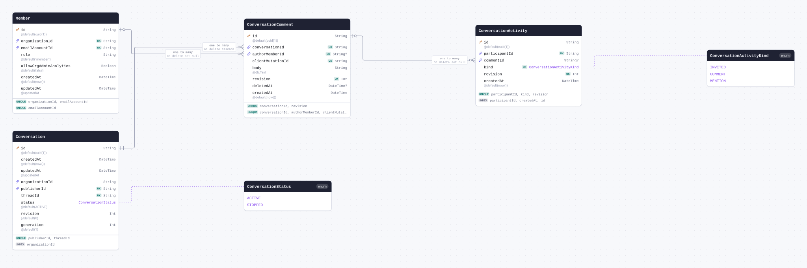

| Field              | Type                | Constraints                                       | Default   | Description |
| ------------------ | ------------------- | ------------------------------------------------- | --------- | ----------- |
| `id`               | `String`            | PK NOT NULL                                       | `cuid(1)` |             |
| `conversationId`   | `String`            | NOT NULL → [Conversation.id](#model-Conversation) |           |             |
| `authorMemberId`   | `String`            | NULL → [Member.id](#model-Member)                 |           |             |
| `clientMutationId` | `String`            | NOT NULL                                          |           |             |
| `body`             | `String` `@db.Text` | NOT NULL                                          |           |             |
| `revision`         | `Int`               | NOT NULL                                          |           |             |
| `deletedAt`        | `DateTime`          | NULL                                              |           |             |
| `createdAt`        | `DateTime`          | NOT NULL                                          | `now()`   |             |

#### Indexes

- `@@unique([conversationId, revision])`
- `@@unique([conversationId, authorMemberId, clientMutationId])`

#### References

- `conversationId` → [Conversation.id](#model-Conversation) (many-to-one, on delete Cascade)
- `authorMemberId` → [Member.id](#model-Member) (many-to-one, on delete SetNull)

#### Referenced by

- `id` ← [ConversationActivity.commentId](#model-ConversationActivity) (one-to-many, on delete SetNull)

#### Definition

```sql
CREATE TABLE "ConversationComment" (
    "id" TEXT NOT NULL,
    "conversationId" TEXT NOT NULL,
    "authorMemberId" TEXT,
    "clientMutationId" TEXT NOT NULL,
    "body" TEXT NOT NULL,
    "revision" INTEGER NOT NULL,
    "deletedAt" TIMESTAMP(3),
    "createdAt" TIMESTAMP(3) NOT NULL DEFAULT CURRENT_TIMESTAMP,

    CONSTRAINT "ConversationComment_pkey" PRIMARY KEY ("id")
);

CREATE UNIQUE INDEX "ConversationComment_conversationId_revision_key" ON "ConversationComment"("conversationId", "revision");

CREATE UNIQUE INDEX "ConversationComment_conversationId_authorMemberId_clientMut_key" ON "ConversationComment"("conversationId", "authorMemberId", "clientMutationId");

ALTER TABLE "ConversationComment" ADD CONSTRAINT "ConversationComment_conversationId_fkey" FOREIGN KEY ("conversationId") REFERENCES "Conversation"("id") ON DELETE CASCADE ON UPDATE CASCADE;

ALTER TABLE "ConversationComment" ADD CONSTRAINT "ConversationComment_authorMemberId_fkey" FOREIGN KEY ("authorMemberId") REFERENCES "Member"("id") ON DELETE SET NULL ON UPDATE CASCADE;
```

<details>
<summary>Queries and their SQL</summary>

**findMany**: Every row

```ts
await prisma.conversationComment.findMany();
```

```sql
SELECT
  "public"."ConversationComment"."id",
  "public"."ConversationComment"."conversationId",
  "public"."ConversationComment"."authorMemberId",
  "public"."ConversationComment"."clientMutationId",
  "public"."ConversationComment"."body",
  "public"."ConversationComment"."revision",
  "public"."ConversationComment"."deletedAt",
  "public"."ConversationComment"."createdAt"
FROM
  "public"."ConversationComment"
WHERE
  1 = 1
OFFSET
  $1
-- params: ["0"]
```

**count**: How many rows there are

```ts
await prisma.conversationComment.count();
```

```sql
SELECT
  COUNT(*) AS "_count$_all"
FROM
  (
    SELECT
      "public"."ConversationComment"."id"
    FROM
      "public"."ConversationComment"
    WHERE
      1 = 1
    OFFSET
      $1
  ) AS "sub"
-- params: ["0"]
```

**findMany**: Every row with its relations

```ts
await prisma.conversationComment.findMany({
  include: { conversation: true, author: true, activity: true },
});
```

```sql
SELECT
  "public"."ConversationComment"."id",
  "public"."ConversationComment"."conversationId",
  "public"."ConversationComment"."authorMemberId",
  "public"."ConversationComment"."clientMutationId",
  "public"."ConversationComment"."body",
  "public"."ConversationComment"."revision",
  "public"."ConversationComment"."deletedAt",
  "public"."ConversationComment"."createdAt"
FROM
  "public"."ConversationComment"
WHERE
  1 = 1
OFFSET
  $1
-- params: ["0"]

SELECT
  "public"."Conversation"."id",
  "public"."Conversation"."createdAt",
  "public"."Conversation"."updatedAt",
  "public"."Conversation"."organizationId",
  "public"."Conversation"."publisherId",
  "public"."Conversation"."threadId",
  "public"."Conversation"."status"::text,
  "public"."Conversation"."revision",
  "public"."Conversation"."generation"
FROM
  "public"."Conversation"
WHERE
  "public"."Conversation"."id" IN ($1)
OFFSET
  $2
-- params: ["<conversationId of the rows above>","0"]

SELECT
  "public"."Member"."id",
  "public"."Member"."organizationId",
  "public"."Member"."emailAccountId",
  "public"."Member"."role",
  "public"."Member"."allowOrgAdminAnalytics",
  "public"."Member"."createdAt",
  "public"."Member"."updatedAt"
FROM
  "public"."Member"
WHERE
  "public"."Member"."id" IN ($1)
OFFSET
  $2
-- params: ["<authorMemberId of the rows above>","0"]

SELECT
  "public"."ConversationActivity"."id",
  "public"."ConversationActivity"."participantId",
  "public"."ConversationActivity"."commentId",
  "public"."ConversationActivity"."kind"::text,
  "public"."ConversationActivity"."revision",
  "public"."ConversationActivity"."createdAt"
FROM
  "public"."ConversationActivity"
WHERE
  "public"."ConversationActivity"."commentId" IN ($1)
OFFSET
  $2
-- params: ["<id of the rows above>","0"]
```

**findUnique**: One row by what is unique to it

```ts
await prisma.conversationComment.findUnique({ where: { id: "example" } });
```

```sql
SELECT
  "public"."ConversationComment"."id",
  "public"."ConversationComment"."conversationId",
  "public"."ConversationComment"."authorMemberId",
  "public"."ConversationComment"."clientMutationId",
  "public"."ConversationComment"."body",
  "public"."ConversationComment"."revision",
  "public"."ConversationComment"."deletedAt",
  "public"."ConversationComment"."createdAt"
FROM
  "public"."ConversationComment"
WHERE
  (
    "public"."ConversationComment"."id" = $1
    AND 1 = 1
  )
LIMIT
  $2
OFFSET
  $3
-- params: ["example","1","0"]
```

**create**: Create a row

```ts
await prisma.conversationComment.create({
  data: { conversationId: "example", clientMutationId: "example", body: "example", revision: 1 },
});
```

```sql
INSERT INTO
  "public"."ConversationComment" (
    "id",
    "conversationId",
    "clientMutationId",
    "body",
    "revision",
    "createdAt"
  )
VALUES
  ($1, $2, $3, $4, $5, $6)
RETURNING
  "public"."ConversationComment"."id",
  "public"."ConversationComment"."conversationId",
  "public"."ConversationComment"."authorMemberId",
  "public"."ConversationComment"."clientMutationId",
  "public"."ConversationComment"."body",
  "public"."ConversationComment"."revision",
  "public"."ConversationComment"."deletedAt",
  "public"."ConversationComment"."createdAt"
-- params: ["<cuid(1)>","example","example","example","1","<now()>"]
```

**update**: Update a row

```ts
await prisma.conversationComment.update({
  where: { id: "example" },
  data: { clientMutationId: "example" },
});
```

```sql
UPDATE "public"."ConversationComment"
SET
  "clientMutationId" = $1
WHERE
  (
    "public"."ConversationComment"."id" = $2
    AND 1 = 1
  )
RETURNING
  "public"."ConversationComment"."id",
  "public"."ConversationComment"."conversationId",
  "public"."ConversationComment"."authorMemberId",
  "public"."ConversationComment"."clientMutationId",
  "public"."ConversationComment"."body",
  "public"."ConversationComment"."revision",
  "public"."ConversationComment"."deletedAt",
  "public"."ConversationComment"."createdAt"
-- params: ["example","example"]
```

**delete**: Delete a row

```ts
await prisma.conversationComment.delete({ where: { id: "example" } });
```

```sql
DELETE FROM "public"."ConversationComment"
WHERE
  (
    "public"."ConversationComment"."id" = $1
    AND 1 = 1
  )
RETURNING
  "public"."ConversationComment"."id",
  "public"."ConversationComment"."conversationId",
  "public"."ConversationComment"."authorMemberId",
  "public"."ConversationComment"."clientMutationId",
  "public"."ConversationComment"."body",
  "public"."ConversationComment"."revision",
  "public"."ConversationComment"."deletedAt",
  "public"."ConversationComment"."createdAt"
-- params: ["example"]
```

</details>

<a id="model-ConversationActivity"></a>

### ConversationActivity

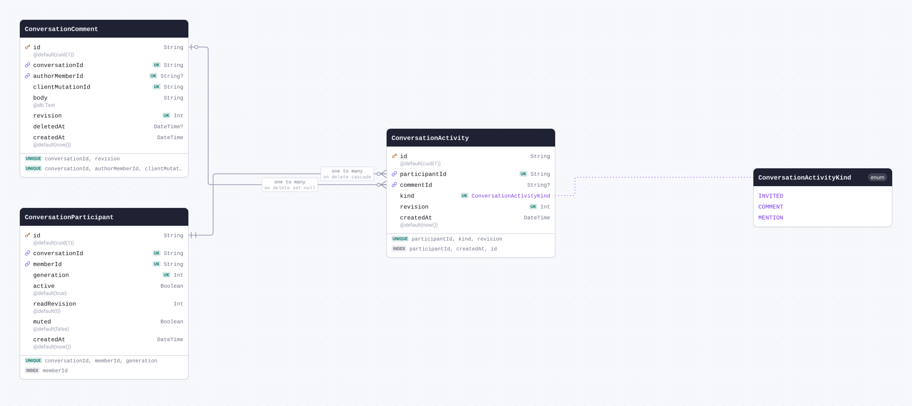

| Field           | Type                                                         | Constraints                                                             | Default   | Description |
| --------------- | ------------------------------------------------------------ | ----------------------------------------------------------------------- | --------- | ----------- |
| `id`            | `String`                                                     | PK NOT NULL                                                             | `cuid(1)` |             |
| `participantId` | `String`                                                     | NOT NULL → [ConversationParticipant.id](#model-ConversationParticipant) |           |             |
| `commentId`     | `String`                                                     | NULL → [ConversationComment.id](#model-ConversationComment)             |           |             |
| `kind`          | [`ConversationActivityKind`](#enum-ConversationActivityKind) | NOT NULL                                                                |           |             |
| `revision`      | `Int`                                                        | NOT NULL                                                                |           |             |
| `createdAt`     | `DateTime`                                                   | NOT NULL                                                                | `now()`   |             |

#### Indexes

- `@@index([participantId, createdAt, id])`
- `@@unique([participantId, kind, revision])`

#### References

- `participantId` → [ConversationParticipant.id](#model-ConversationParticipant) (many-to-one, on delete Cascade)
- `commentId` → [ConversationComment.id](#model-ConversationComment) (many-to-one, on delete SetNull)

#### Definition

```sql
CREATE TABLE "ConversationActivity" (
    "id" TEXT NOT NULL,
    "participantId" TEXT NOT NULL,
    "commentId" TEXT,
    "kind" "ConversationActivityKind" NOT NULL,
    "revision" INTEGER NOT NULL,
    "createdAt" TIMESTAMP(3) NOT NULL DEFAULT CURRENT_TIMESTAMP,

    CONSTRAINT "ConversationActivity_pkey" PRIMARY KEY ("id")
);

CREATE INDEX "ConversationActivity_participantId_createdAt_id_idx" ON "ConversationActivity"("participantId", "createdAt", "id");

CREATE UNIQUE INDEX "ConversationActivity_participantId_kind_revision_key" ON "ConversationActivity"("participantId", "kind", "revision");

ALTER TABLE "ConversationActivity" ADD CONSTRAINT "ConversationActivity_participantId_fkey" FOREIGN KEY ("participantId") REFERENCES "ConversationParticipant"("id") ON DELETE CASCADE ON UPDATE CASCADE;

ALTER TABLE "ConversationActivity" ADD CONSTRAINT "ConversationActivity_commentId_fkey" FOREIGN KEY ("commentId") REFERENCES "ConversationComment"("id") ON DELETE SET NULL ON UPDATE CASCADE;
```

<details>
<summary>Queries and their SQL</summary>

**findMany**: Every row

```ts
await prisma.conversationActivity.findMany();
```

```sql
SELECT
  "public"."ConversationActivity"."id",
  "public"."ConversationActivity"."participantId",
  "public"."ConversationActivity"."commentId",
  "public"."ConversationActivity"."kind"::text,
  "public"."ConversationActivity"."revision",
  "public"."ConversationActivity"."createdAt"
FROM
  "public"."ConversationActivity"
WHERE
  1 = 1
OFFSET
  $1
-- params: ["0"]
```

**count**: How many rows there are

```ts
await prisma.conversationActivity.count();
```

```sql
SELECT
  COUNT(*) AS "_count$_all"
FROM
  (
    SELECT
      "public"."ConversationActivity"."id"
    FROM
      "public"."ConversationActivity"
    WHERE
      1 = 1
    OFFSET
      $1
  ) AS "sub"
-- params: ["0"]
```

**findMany**: Every row with its relations

```ts
await prisma.conversationActivity.findMany({ include: { participant: true, comment: true } });
```

```sql
SELECT
  "public"."ConversationActivity"."id",
  "public"."ConversationActivity"."participantId",
  "public"."ConversationActivity"."commentId",
  "public"."ConversationActivity"."kind"::text,
  "public"."ConversationActivity"."revision",
  "public"."ConversationActivity"."createdAt"
FROM
  "public"."ConversationActivity"
WHERE
  1 = 1
OFFSET
  $1
-- params: ["0"]

SELECT
  "public"."ConversationParticipant"."id",
  "public"."ConversationParticipant"."conversationId",
  "public"."ConversationParticipant"."memberId",
  "public"."ConversationParticipant"."generation",
  "public"."ConversationParticipant"."active",
  "public"."ConversationParticipant"."readRevision",
  "public"."ConversationParticipant"."muted",
  "public"."ConversationParticipant"."createdAt"
FROM
  "public"."ConversationParticipant"
WHERE
  "public"."ConversationParticipant"."id" IN ($1)
OFFSET
  $2
-- params: ["<participantId of the rows above>","0"]

SELECT
  "public"."ConversationComment"."id",
  "public"."ConversationComment"."conversationId",
  "public"."ConversationComment"."authorMemberId",
  "public"."ConversationComment"."clientMutationId",
  "public"."ConversationComment"."body",
  "public"."ConversationComment"."revision",
  "public"."ConversationComment"."deletedAt",
  "public"."ConversationComment"."createdAt"
FROM
  "public"."ConversationComment"
WHERE
  "public"."ConversationComment"."id" IN ($1)
OFFSET
  $2
-- params: ["<commentId of the rows above>","0"]
```

**findUnique**: One row by what is unique to it

```ts
await prisma.conversationActivity.findUnique({ where: { id: "example" } });
```

```sql
SELECT
  "public"."ConversationActivity"."id",
  "public"."ConversationActivity"."participantId",
  "public"."ConversationActivity"."commentId",
  "public"."ConversationActivity"."kind"::text,
  "public"."ConversationActivity"."revision",
  "public"."ConversationActivity"."createdAt"
FROM
  "public"."ConversationActivity"
WHERE
  (
    "public"."ConversationActivity"."id" = $1
    AND 1 = 1
  )
LIMIT
  $2
OFFSET
  $3
-- params: ["example","1","0"]
```

**create**: Create a row

```ts
await prisma.conversationActivity.create({
  data: { participantId: "example", kind: "INVITED", revision: 1 },
});
```

```sql
INSERT INTO
  "public"."ConversationActivity" (
    "id",
    "participantId",
    "kind",
    "revision",
    "createdAt"
  )
VALUES
  (
    $1,
    $2,
    CAST($3::text AS "public"."ConversationActivityKind"),
    $4,
    $5
  )
RETURNING
  "public"."ConversationActivity"."id",
  "public"."ConversationActivity"."participantId",
  "public"."ConversationActivity"."commentId",
  "public"."ConversationActivity"."kind"::text,
  "public"."ConversationActivity"."revision",
  "public"."ConversationActivity"."createdAt"
-- params: ["<cuid(1)>","example","INVITED","1","<now()>"]
```

**update**: Update a row

```ts
await prisma.conversationActivity.update({ where: { id: "example" }, data: { kind: "INVITED" } });
```

```sql
UPDATE "public"."ConversationActivity"
SET
  "kind" = CAST($1::text AS "public"."ConversationActivityKind")
WHERE
  (
    "public"."ConversationActivity"."id" = $2
    AND 1 = 1
  )
RETURNING
  "public"."ConversationActivity"."id",
  "public"."ConversationActivity"."participantId",
  "public"."ConversationActivity"."commentId",
  "public"."ConversationActivity"."kind"::text,
  "public"."ConversationActivity"."revision",
  "public"."ConversationActivity"."createdAt"
-- params: ["INVITED","example"]
```

**delete**: Delete a row

```ts
await prisma.conversationActivity.delete({ where: { id: "example" } });
```

```sql
DELETE FROM "public"."ConversationActivity"
WHERE
  (
    "public"."ConversationActivity"."id" = $1
    AND 1 = 1
  )
RETURNING
  "public"."ConversationActivity"."id",
  "public"."ConversationActivity"."participantId",
  "public"."ConversationActivity"."commentId",
  "public"."ConversationActivity"."kind"::text,
  "public"."ConversationActivity"."revision",
  "public"."ConversationActivity"."createdAt"
-- params: ["example"]
```

</details>

<a id="model-Invitation"></a>

### Invitation

Table `invitation`.

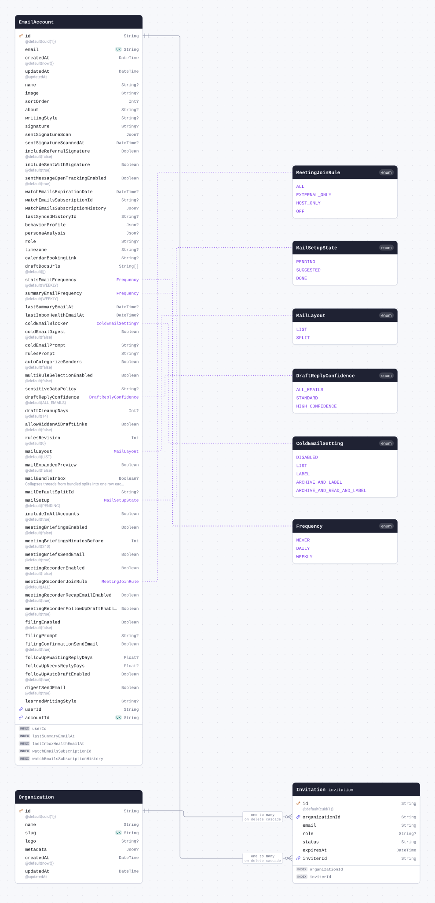

| Field            | Type       | Constraints                                       | Default   | Description |
| ---------------- | ---------- | ------------------------------------------------- | --------- | ----------- |
| `id`             | `String`   | PK NOT NULL                                       | `cuid(1)` |             |
| `organizationId` | `String`   | NOT NULL → [Organization.id](#model-Organization) |           |             |
| `email`          | `String`   | NOT NULL                                          |           |             |
| `role`           | `String`   | NULL                                              |           |             |
| `status`         | `String`   | NOT NULL                                          |           |             |
| `expiresAt`      | `DateTime` | NOT NULL                                          |           |             |
| `inviterId`      | `String`   | NOT NULL → [EmailAccount.id](#model-EmailAccount) |           |             |

#### Indexes

- `@@index([organizationId])`
- `@@index([inviterId])`

#### References

- `organizationId` → [Organization.id](#model-Organization) (many-to-one, on delete Cascade)
- `inviterId` → [EmailAccount.id](#model-EmailAccount) (many-to-one, on delete Cascade)

#### Definition

```sql
CREATE TABLE "invitation" (
    "id" TEXT NOT NULL,
    "organizationId" TEXT NOT NULL,
    "email" TEXT NOT NULL,
    "role" TEXT,
    "status" TEXT NOT NULL,
    "expiresAt" TIMESTAMP(3) NOT NULL,
    "inviterId" TEXT NOT NULL,

    CONSTRAINT "invitation_pkey" PRIMARY KEY ("id")
);

CREATE INDEX "invitation_organizationId_idx" ON "invitation"("organizationId");

CREATE INDEX "invitation_inviterId_idx" ON "invitation"("inviterId");

ALTER TABLE "invitation" ADD CONSTRAINT "invitation_organizationId_fkey" FOREIGN KEY ("organizationId") REFERENCES "Organization"("id") ON DELETE CASCADE ON UPDATE CASCADE;

ALTER TABLE "invitation" ADD CONSTRAINT "invitation_inviterId_fkey" FOREIGN KEY ("inviterId") REFERENCES "EmailAccount"("id") ON DELETE CASCADE ON UPDATE CASCADE;
```

<details>
<summary>Queries and their SQL</summary>

**findMany**: Every row

```ts
await prisma.invitation.findMany();
```

```sql
SELECT
  "public"."invitation"."id",
  "public"."invitation"."organizationId",
  "public"."invitation"."email",
  "public"."invitation"."role",
  "public"."invitation"."status",
  "public"."invitation"."expiresAt",
  "public"."invitation"."inviterId"
FROM
  "public"."invitation"
WHERE
  1 = 1
OFFSET
  $1
-- params: ["0"]
```

**count**: How many rows there are

```ts
await prisma.invitation.count();
```

```sql
SELECT
  COUNT(*) AS "_count$_all"
FROM
  (
    SELECT
      "public"."invitation"."id"
    FROM
      "public"."invitation"
    WHERE
      1 = 1
    OFFSET
      $1
  ) AS "sub"
-- params: ["0"]
```

**findMany**: Every row with its relations

```ts
await prisma.invitation.findMany({ include: { organization: true, inviter: true } });
```

```sql
SELECT
  "public"."invitation"."id",
  "public"."invitation"."organizationId",
  "public"."invitation"."email",
  "public"."invitation"."role",
  "public"."invitation"."status",
  "public"."invitation"."expiresAt",
  "public"."invitation"."inviterId"
FROM
  "public"."invitation"
WHERE
  1 = 1
OFFSET
  $1
-- params: ["0"]

SELECT
  "public"."Organization"."id",
  "public"."Organization"."name",
  "public"."Organization"."slug",
  "public"."Organization"."logo",
  "public"."Organization"."metadata",
  "public"."Organization"."createdAt",
  "public"."Organization"."updatedAt"
FROM
  "public"."Organization"
WHERE
  "public"."Organization"."id" IN ($1)
OFFSET
  $2
-- params: ["<organizationId of the rows above>","0"]

SELECT
  "public"."EmailAccount"."id",
  "public"."EmailAccount"."email",
  "public"."EmailAccount"."createdAt",
  "public"."EmailAccount"."updatedAt",
  "public"."EmailAccount"."name",
  "public"."EmailAccount"."image",
  "public"."EmailAccount"."sortOrder",
  "public"."EmailAccount"."about",
  "public"."EmailAccount"."writingStyle",
  "public"."EmailAccount"."signature",
  "public"."EmailAccount"."sentSignatureScan",
  "public"."EmailAccount"."sentSignatureScannedAt",
  "public"."EmailAccount"."includeReferralSignature",
  "public"."EmailAccount"."includeSentWithSignature",
  "public"."EmailAccount"."sentMessageOpenTrackingEnabled",
  "public"."EmailAccount"."watchEmailsExpirationDate",
  "public"."EmailAccount"."watchEmailsSubscriptionId",
  "public"."EmailAccount"."watchEmailsSubscriptionHistory",
  "public"."EmailAccount"."lastSyncedHistoryId",
  "public"."EmailAccount"."behaviorProfile",
  "public"."EmailAccount"."personaAnalysis",
  "public"."EmailAccount"."role",
  "public"."EmailAccount"."timezone",
  "public"."EmailAccount"."calendarBookingLink",
  "public"."EmailAccount"."draftDocsUrls",
  "public"."EmailAccount"."statsEmailFrequency"::text,
  "public"."EmailAccount"."summaryEmailFrequency"::text,
  "public"."EmailAccount"."lastSummaryEmailAt",
  "public"."EmailAccount"."lastInboxHealthEmailAt",
  "public"."EmailAccount"."coldEmailBlocker"::text,
  "public"."EmailAccount"."coldEmailDigest",
  "public"."EmailAccount"."coldEmailPrompt",
  "public"."EmailAccount"."rulesPrompt",
  "public"."EmailAccount"."autoCategorizeSenders",
  "public"."EmailAccount"."multiRuleSelectionEnabled",
  "public"."EmailAccount"."sensitiveDataPolicy",
  "public"."EmailAccount"."draftReplyConfidence"::text,
  "public"."EmailAccount"."draftCleanupDays",
  "public"."EmailAccount"."allowHiddenAiDraftLinks",
  "public"."EmailAccount"."rulesRevision",
  "public"."EmailAccount"."mailLayout"::text,
  "public"."EmailAccount"."mailExpandedPreview",
  "public"."EmailAccount"."mailBundleInbox",
  "public"."EmailAccount"."mailDefaultSplitId",
  "public"."EmailAccount"."mailSetup"::text,
  "public"."EmailAccount"."includeInAllAccounts",
  "public"."EmailAccount"."meetingBriefingsEnabled",
  "public"."EmailAccount"."meetingBriefingsMinutesBefore",
  "public"."EmailAccount"."meetingBriefsSendEmail",
  "public"."EmailAccount"."meetingRecorderEnabled",
  "public"."EmailAccount"."meetingRecorderJoinRule"::text,
  "public"."EmailAccount"."meetingRecorderRecapEmailEnabled",
  "public"."EmailAccount"."meetingRecorderFollowUpDraftEnabled",
  "public"."EmailAccount"."filingEnabled",
  "public"."EmailAccount"."filingPrompt",
  "public"."EmailAccount"."filingConfirmationSendEmail",
  "public"."EmailAccount"."followUpAwaitingReplyDays",
  "public"."EmailAccount"."followUpNeedsReplyDays",
  "public"."EmailAccount"."followUpAutoDraftEnabled",
  "public"."EmailAccount"."digestSendEmail",
  "public"."EmailAccount"."learnedWritingStyle",
  "public"."EmailAccount"."userId",
  "public"."EmailAccount"."accountId"
FROM
  "public"."EmailAccount"
WHERE
  "public"."EmailAccount"."id" IN ($1)
OFFSET
  $2
-- params: ["<inviterId of the rows above>","0"]
```

**findUnique**: One row by what is unique to it

```ts
await prisma.invitation.findUnique({ where: { id: "example" } });
```

```sql
SELECT
  "public"."invitation"."id",
  "public"."invitation"."organizationId",
  "public"."invitation"."email",
  "public"."invitation"."role",
  "public"."invitation"."status",
  "public"."invitation"."expiresAt",
  "public"."invitation"."inviterId"
FROM
  "public"."invitation"
WHERE
  (
    "public"."invitation"."id" = $1
    AND 1 = 1
  )
LIMIT
  $2
OFFSET
  $3
-- params: ["example","1","0"]
```

**create**: Create a row

```ts
await prisma.invitation.create({
  data: {
    organizationId: "example",
    email: "example",
    status: "example",
    expiresAt: new Date("2026-01-01T00:00:00.000Z"),
    inviterId: "example",
  },
});
```

```sql
INSERT INTO
  "public"."invitation" (
    "id",
    "organizationId",
    "email",
    "status",
    "expiresAt",
    "inviterId"
  )
VALUES
  ($1, $2, $3, $4, $5, $6)
RETURNING
  "public"."invitation"."id",
  "public"."invitation"."organizationId",
  "public"."invitation"."email",
  "public"."invitation"."role",
  "public"."invitation"."status",
  "public"."invitation"."expiresAt",
  "public"."invitation"."inviterId"
-- params: ["<cuid(1)>","example","example","example","2026-01-01T00:00:00.000Z","example"]
```

**update**: Update a row

```ts
await prisma.invitation.update({ where: { id: "example" }, data: { email: "example" } });
```

```sql
UPDATE "public"."invitation"
SET
  "email" = $1
WHERE
  (
    "public"."invitation"."id" = $2
    AND 1 = 1
  )
RETURNING
  "public"."invitation"."id",
  "public"."invitation"."organizationId",
  "public"."invitation"."email",
  "public"."invitation"."role",
  "public"."invitation"."status",
  "public"."invitation"."expiresAt",
  "public"."invitation"."inviterId"
-- params: ["example","example"]
```

**delete**: Delete a row

```ts
await prisma.invitation.delete({ where: { id: "example" } });
```

```sql
DELETE FROM "public"."invitation"
WHERE
  (
    "public"."invitation"."id" = $1
    AND 1 = 1
  )
RETURNING
  "public"."invitation"."id",
  "public"."invitation"."organizationId",
  "public"."invitation"."email",
  "public"."invitation"."role",
  "public"."invitation"."status",
  "public"."invitation"."expiresAt",
  "public"."invitation"."inviterId"
-- params: ["example"]
```

</details>

<a id="model-Verification"></a>

### Verification

Table `verification`.

| Field        | Type       | Constraints | Default              | Description |
| ------------ | ---------- | ----------- | -------------------- | ----------- |
| `id`         | `String`   | PK NOT NULL | `cuid(1)`            |             |
| `identifier` | `String`   | NOT NULL    |                      |             |
| `value`      | `String`   | NOT NULL    |                      |             |
| `expiresAt`  | `DateTime` | NOT NULL    |                      |             |
| `createdAt`  | `DateTime` | NOT NULL    | `now()`              |             |
| `updatedAt`  | `DateTime` | NOT NULL    | `now()` `@updatedAt` |             |

#### Definition

```sql
CREATE TABLE "verification" (
    "id" TEXT NOT NULL,
    "identifier" TEXT NOT NULL,
    "value" TEXT NOT NULL,
    "expiresAt" TIMESTAMP(3) NOT NULL,
    "createdAt" TIMESTAMP(3) NOT NULL DEFAULT CURRENT_TIMESTAMP,
    "updatedAt" TIMESTAMP(3) NOT NULL DEFAULT CURRENT_TIMESTAMP,

    CONSTRAINT "verification_pkey" PRIMARY KEY ("id")
);
```

<details>
<summary>Queries and their SQL</summary>

**findMany**: Every row

```ts
await prisma.verification.findMany();
```

```sql
SELECT
  "public"."verification"."id",
  "public"."verification"."identifier",
  "public"."verification"."value",
  "public"."verification"."expiresAt",
  "public"."verification"."createdAt",
  "public"."verification"."updatedAt"
FROM
  "public"."verification"
WHERE
  1 = 1
OFFSET
  $1
-- params: ["0"]
```

**count**: How many rows there are

```ts
await prisma.verification.count();
```

```sql
SELECT
  COUNT(*) AS "_count$_all"
FROM
  (
    SELECT
      "public"."verification"."id"
    FROM
      "public"."verification"
    WHERE
      1 = 1
    OFFSET
      $1
  ) AS "sub"
-- params: ["0"]
```

**findUnique**: One row by what is unique to it

```ts
await prisma.verification.findUnique({ where: { id: "example" } });
```

```sql
SELECT
  "public"."verification"."id",
  "public"."verification"."identifier",
  "public"."verification"."value",
  "public"."verification"."expiresAt",
  "public"."verification"."createdAt",
  "public"."verification"."updatedAt"
FROM
  "public"."verification"
WHERE
  (
    "public"."verification"."id" = $1
    AND 1 = 1
  )
LIMIT
  $2
OFFSET
  $3
-- params: ["example","1","0"]
```

**create**: Create a row

```ts
await prisma.verification.create({
  data: {
    identifier: "example",
    value: "example",
    expiresAt: new Date("2026-01-01T00:00:00.000Z"),
  },
});
```

```sql
INSERT INTO
  "public"."verification" (
    "id",
    "identifier",
    "value",
    "expiresAt",
    "createdAt",
    "updatedAt"
  )
VALUES
  ($1, $2, $3, $4, $5, $6)
RETURNING
  "public"."verification"."id",
  "public"."verification"."identifier",
  "public"."verification"."value",
  "public"."verification"."expiresAt",
  "public"."verification"."createdAt",
  "public"."verification"."updatedAt"
-- params: ["<cuid(1)>","example","example","2026-01-01T00:00:00.000Z","<now()>","<now()>"]
```

**update**: Update a row

```ts
await prisma.verification.update({ where: { id: "example" }, data: { identifier: "example" } });
```

```sql
UPDATE "public"."verification"
SET
  "identifier" = $1,
  "updatedAt" = $2
WHERE
  (
    "public"."verification"."id" = $3
    AND 1 = 1
  )
RETURNING
  "public"."verification"."id",
  "public"."verification"."identifier",
  "public"."verification"."value",
  "public"."verification"."expiresAt",
  "public"."verification"."createdAt",
  "public"."verification"."updatedAt"
-- params: ["example",{"prisma__type":"generatorCall","prisma__value":{"name":"now","args":[],"returnType":{"type":"DateTime"}}},"example"]
```

**delete**: Delete a row

```ts
await prisma.verification.delete({ where: { id: "example" } });
```

```sql
DELETE FROM "public"."verification"
WHERE
  (
    "public"."verification"."id" = $1
    AND 1 = 1
  )
RETURNING
  "public"."verification"."id",
  "public"."verification"."identifier",
  "public"."verification"."value",
  "public"."verification"."expiresAt",
  "public"."verification"."createdAt",
  "public"."verification"."updatedAt"
-- params: ["example"]
```

</details>

<a id="model-SsoProvider"></a>

### SsoProvider

Table `ssoProvider`.

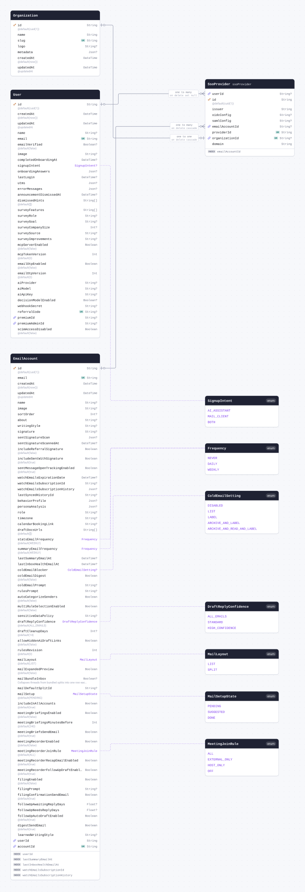

| Field            | Type     | Constraints                                          | Default   | Description |
| ---------------- | -------- | ---------------------------------------------------- | --------- | ----------- |
| `userId`         | `String` | NULL → [User.id](#model-User)                        |           |             |
| `id`             | `String` | PK NOT NULL                                          | `cuid(1)` |             |
| `issuer`         | `String` | NOT NULL                                             |           |             |
| `oidcConfig`     | `String` | NULL                                                 |           |             |
| `samlConfig`     | `String` | NULL                                                 |           |             |
| `emailAccountId` | `String` | NULL → [EmailAccount.id](#model-EmailAccount)        |           |             |
| `providerId`     | `String` | UNIQUE NOT NULL                                      |           |             |
| `organizationId` | `String` | UNIQUE NULL → [Organization.id](#model-Organization) |           |             |
| `domain`         | `String` | NOT NULL                                             |           |             |

#### Indexes

- `@@index([emailAccountId])`

#### References

- `userId` → [User.id](#model-User) (many-to-one, on delete SetNull)
- `emailAccountId` → [EmailAccount.id](#model-EmailAccount) (many-to-one, on delete Cascade)
- `organizationId` → [Organization.id](#model-Organization) (one-to-one, on delete Cascade)

#### Definition

```sql
CREATE TABLE "ssoProvider" (
    "userId" TEXT,
    "id" TEXT NOT NULL,
    "issuer" TEXT NOT NULL,
    "oidcConfig" TEXT,
    "samlConfig" TEXT,
    "emailAccountId" TEXT,
    "providerId" TEXT NOT NULL,
    "organizationId" TEXT,
    "domain" TEXT NOT NULL,

    CONSTRAINT "ssoProvider_pkey" PRIMARY KEY ("id")
);

CREATE UNIQUE INDEX "ssoProvider_providerId_key" ON "ssoProvider"("providerId");

CREATE UNIQUE INDEX "ssoProvider_organizationId_key" ON "ssoProvider"("organizationId");

CREATE INDEX "ssoProvider_emailAccountId_idx" ON "ssoProvider"("emailAccountId");

ALTER TABLE "ssoProvider" ADD CONSTRAINT "ssoProvider_userId_fkey" FOREIGN KEY ("userId") REFERENCES "User"("id") ON DELETE SET NULL ON UPDATE CASCADE;

ALTER TABLE "ssoProvider" ADD CONSTRAINT "ssoProvider_emailAccountId_fkey" FOREIGN KEY ("emailAccountId") REFERENCES "EmailAccount"("id") ON DELETE CASCADE ON UPDATE CASCADE;

ALTER TABLE "ssoProvider" ADD CONSTRAINT "ssoProvider_organizationId_fkey" FOREIGN KEY ("organizationId") REFERENCES "Organization"("id") ON DELETE CASCADE ON UPDATE CASCADE;
```

<details>
<summary>Queries and their SQL</summary>

**findMany**: Every row

```ts
await prisma.ssoProvider.findMany();
```

```sql
SELECT
  "public"."ssoProvider"."id",
  "public"."ssoProvider"."userId",
  "public"."ssoProvider"."issuer",
  "public"."ssoProvider"."oidcConfig",
  "public"."ssoProvider"."samlConfig",
  "public"."ssoProvider"."emailAccountId",
  "public"."ssoProvider"."providerId",
  "public"."ssoProvider"."organizationId",
  "public"."ssoProvider"."domain"
FROM
  "public"."ssoProvider"
WHERE
  1 = 1
OFFSET
  $1
-- params: ["0"]
```

**count**: How many rows there are

```ts
await prisma.ssoProvider.count();
```

```sql
SELECT
  COUNT(*) AS "_count$_all"
FROM
  (
    SELECT
      "public"."ssoProvider"."id"
    FROM
      "public"."ssoProvider"
    WHERE
      1 = 1
    OFFSET
      $1
  ) AS "sub"
-- params: ["0"]
```

**findMany**: Every row with its relations

```ts
await prisma.ssoProvider.findMany({
  include: { user: true, emailAccount: true, organization: true },
});
```

```sql
SELECT
  "public"."ssoProvider"."id",
  "public"."ssoProvider"."userId",
  "public"."ssoProvider"."issuer",
  "public"."ssoProvider"."oidcConfig",
  "public"."ssoProvider"."samlConfig",
  "public"."ssoProvider"."emailAccountId",
  "public"."ssoProvider"."providerId",
  "public"."ssoProvider"."organizationId",
  "public"."ssoProvider"."domain"
FROM
  "public"."ssoProvider"
WHERE
  1 = 1
OFFSET
  $1
-- params: ["0"]

SELECT
  "public"."User"."id",
  "public"."User"."createdAt",
  "public"."User"."updatedAt",
  "public"."User"."name",
  "public"."User"."email",
  "public"."User"."emailVerified",
  "public"."User"."image",
  "public"."User"."completedOnboardingAt",
  "public"."User"."signupIntent"::text,
  "public"."User"."onboardingAnswers",
  "public"."User"."lastLogin",
  "public"."User"."utms",
  "public"."User"."errorMessages",
  "public"."User"."announcementDismissedAt",
  "public"."User"."dismissedHints",
  "public"."User"."surveyFeatures",
  "public"."User"."surveyRole",
  "public"."User"."surveyGoal",
  "public"."User"."surveyCompanySize",
  "public"."User"."surveySource",
  "public"."User"."surveyImprovements",
  "public"."User"."mcpServerEnabled",
  "public"."User"."mcpTokenVersion",
  "public"."User"."emailOtpEnabled",
  "public"."User"."emailOtpVersion",
  "public"."User"."aiProvider",
  "public"."User"."aiModel",
  "public"."User"."aiApiKey",
  "public"."User"."decisionModelEnabled",
  "public"."User"."webhookSecret",
  "public"."User"."referralCode",
  "public"."User"."premiumId",
  "public"."User"."premiumAdminId",
  "public"."User"."scimAccessDisabled"
FROM
  "public"."User"
WHERE
  "public"."User"."id" IN ($1)
OFFSET
  $2
-- params: ["<userId of the rows above>","0"]

SELECT
  "public"."EmailAccount"."id",
  "public"."EmailAccount"."email",
  "public"."EmailAccount"."createdAt",
  "public"."EmailAccount"."updatedAt",
  "public"."EmailAccount"."name",
  "public"."EmailAccount"."image",
  "public"."EmailAccount"."sortOrder",
  "public"."EmailAccount"."about",
  "public"."EmailAccount"."writingStyle",
  "public"."EmailAccount"."signature",
  "public"."EmailAccount"."sentSignatureScan",
  "public"."EmailAccount"."sentSignatureScannedAt",
  "public"."EmailAccount"."includeReferralSignature",
  "public"."EmailAccount"."includeSentWithSignature",
  "public"."EmailAccount"."sentMessageOpenTrackingEnabled",
  "public"."EmailAccount"."watchEmailsExpirationDate",
  "public"."EmailAccount"."watchEmailsSubscriptionId",
  "public"."EmailAccount"."watchEmailsSubscriptionHistory",
  "public"."EmailAccount"."lastSyncedHistoryId",
  "public"."EmailAccount"."behaviorProfile",
  "public"."EmailAccount"."personaAnalysis",
  "public"."EmailAccount"."role",
  "public"."EmailAccount"."timezone",
  "public"."EmailAccount"."calendarBookingLink",
  "public"."EmailAccount"."draftDocsUrls",
  "public"."EmailAccount"."statsEmailFrequency"::text,
  "public"."EmailAccount"."summaryEmailFrequency"::text,
  "public"."EmailAccount"."lastSummaryEmailAt",
  "public"."EmailAccount"."lastInboxHealthEmailAt",
  "public"."EmailAccount"."coldEmailBlocker"::text,
  "public"."EmailAccount"."coldEmailDigest",
  "public"."EmailAccount"."coldEmailPrompt",
  "public"."EmailAccount"."rulesPrompt",
  "public"."EmailAccount"."autoCategorizeSenders",
  "public"."EmailAccount"."multiRuleSelectionEnabled",
  "public"."EmailAccount"."sensitiveDataPolicy",
  "public"."EmailAccount"."draftReplyConfidence"::text,
  "public"."EmailAccount"."draftCleanupDays",
  "public"."EmailAccount"."allowHiddenAiDraftLinks",
  "public"."EmailAccount"."rulesRevision",
  "public"."EmailAccount"."mailLayout"::text,
  "public"."EmailAccount"."mailExpandedPreview",
  "public"."EmailAccount"."mailBundleInbox",
  "public"."EmailAccount"."mailDefaultSplitId",
  "public"."EmailAccount"."mailSetup"::text,
  "public"."EmailAccount"."includeInAllAccounts",
  "public"."EmailAccount"."meetingBriefingsEnabled",
  "public"."EmailAccount"."meetingBriefingsMinutesBefore",
  "public"."EmailAccount"."meetingBriefsSendEmail",
  "public"."EmailAccount"."meetingRecorderEnabled",
  "public"."EmailAccount"."meetingRecorderJoinRule"::text,
  "public"."EmailAccount"."meetingRecorderRecapEmailEnabled",
  "public"."EmailAccount"."meetingRecorderFollowUpDraftEnabled",
  "public"."EmailAccount"."filingEnabled",
  "public"."EmailAccount"."filingPrompt",
  "public"."EmailAccount"."filingConfirmationSendEmail",
  "public"."EmailAccount"."followUpAwaitingReplyDays",
  "public"."EmailAccount"."followUpNeedsReplyDays",
  "public"."EmailAccount"."followUpAutoDraftEnabled",
  "public"."EmailAccount"."digestSendEmail",
  "public"."EmailAccount"."learnedWritingStyle",
  "public"."EmailAccount"."userId",
  "public"."EmailAccount"."accountId"
FROM
  "public"."EmailAccount"
WHERE
  "public"."EmailAccount"."id" IN ($1)
OFFSET
  $2
-- params: ["<emailAccountId of the rows above>","0"]

SELECT
  "public"."Organization"."id",
  "public"."Organization"."name",
  "public"."Organization"."slug",
  "public"."Organization"."logo",
  "public"."Organization"."metadata",
  "public"."Organization"."createdAt",
  "public"."Organization"."updatedAt"
FROM
  "public"."Organization"
WHERE
  "public"."Organization"."id" IN ($1)
OFFSET
  $2
-- params: ["<organizationId of the rows above>","0"]
```

**findUnique**: One row by what is unique to it

```ts
await prisma.ssoProvider.findUnique({ where: { id: "example" } });
```

```sql
SELECT
  "public"."ssoProvider"."id",
  "public"."ssoProvider"."userId",
  "public"."ssoProvider"."issuer",
  "public"."ssoProvider"."oidcConfig",
  "public"."ssoProvider"."samlConfig",
  "public"."ssoProvider"."emailAccountId",
  "public"."ssoProvider"."providerId",
  "public"."ssoProvider"."organizationId",
  "public"."ssoProvider"."domain"
FROM
  "public"."ssoProvider"
WHERE
  (
    "public"."ssoProvider"."id" = $1
    AND 1 = 1
  )
LIMIT
  $2
OFFSET
  $3
-- params: ["example","1","0"]
```

**create**: Create a row

```ts
await prisma.ssoProvider.create({
  data: { issuer: "example", providerId: "example", domain: "example" },
});
```

```sql
INSERT INTO
  "public"."ssoProvider" ("id", "issuer", "providerId", "domain")
VALUES
  ($1, $2, $3, $4)
RETURNING
  "public"."ssoProvider"."id",
  "public"."ssoProvider"."userId",
  "public"."ssoProvider"."issuer",
  "public"."ssoProvider"."oidcConfig",
  "public"."ssoProvider"."samlConfig",
  "public"."ssoProvider"."emailAccountId",
  "public"."ssoProvider"."providerId",
  "public"."ssoProvider"."organizationId",
  "public"."ssoProvider"."domain"
-- params: ["<cuid(1)>","example","example","example"]
```

**update**: Update a row

```ts
await prisma.ssoProvider.update({ where: { id: "example" }, data: { issuer: "example" } });
```

```sql
UPDATE "public"."ssoProvider"
SET
  "issuer" = $1
WHERE
  (
    "public"."ssoProvider"."id" = $2
    AND 1 = 1
  )
RETURNING
  "public"."ssoProvider"."id",
  "public"."ssoProvider"."userId",
  "public"."ssoProvider"."issuer",
  "public"."ssoProvider"."oidcConfig",
  "public"."ssoProvider"."samlConfig",
  "public"."ssoProvider"."emailAccountId",
  "public"."ssoProvider"."providerId",
  "public"."ssoProvider"."organizationId",
  "public"."ssoProvider"."domain"
-- params: ["example","example"]
```

**delete**: Delete a row

```ts
await prisma.ssoProvider.delete({ where: { id: "example" } });
```

```sql
DELETE FROM "public"."ssoProvider"
WHERE
  (
    "public"."ssoProvider"."id" = $1
    AND 1 = 1
  )
RETURNING
  "public"."ssoProvider"."id",
  "public"."ssoProvider"."userId",
  "public"."ssoProvider"."issuer",
  "public"."ssoProvider"."oidcConfig",
  "public"."ssoProvider"."samlConfig",
  "public"."ssoProvider"."emailAccountId",
  "public"."ssoProvider"."providerId",
  "public"."ssoProvider"."organizationId",
  "public"."ssoProvider"."domain"
-- params: ["example"]
```

</details>

<a id="model-Digest"></a>

### Digest

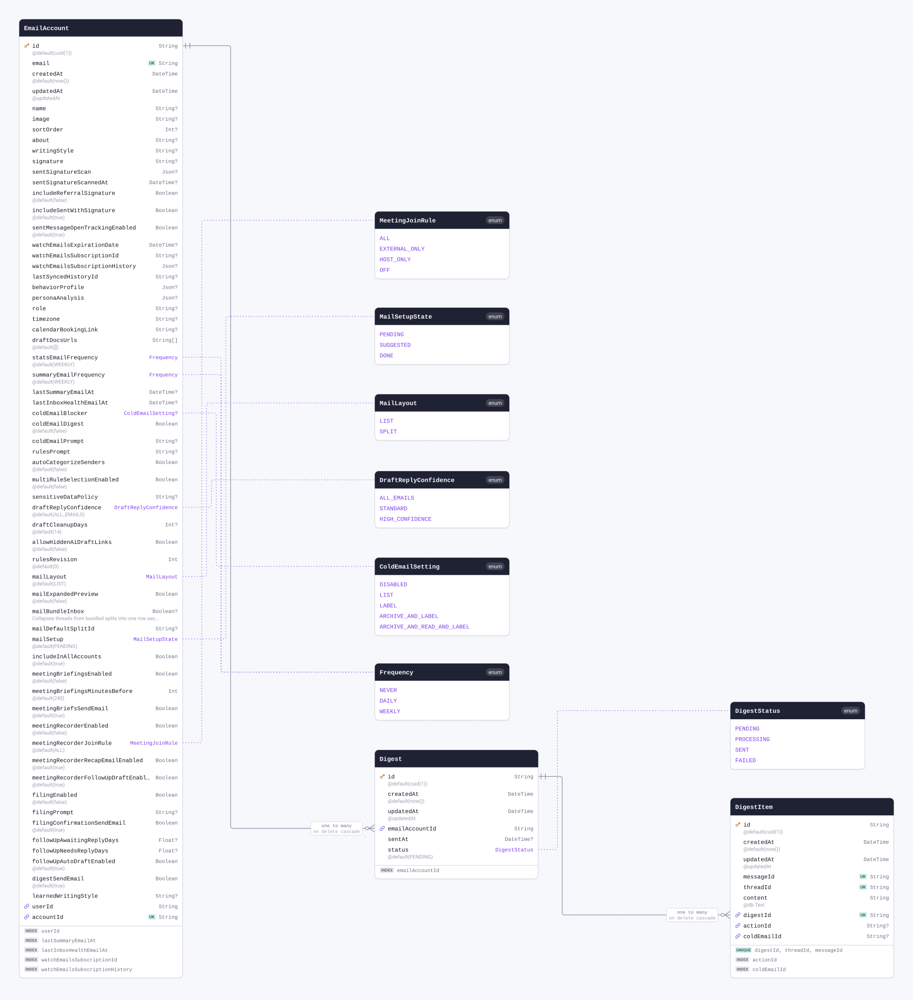

| Field            | Type                                 | Constraints                                       | Default      | Description |
| ---------------- | ------------------------------------ | ------------------------------------------------- | ------------ | ----------- |
| `id`             | `String`                             | PK NOT NULL                                       | `cuid(1)`    |             |
| `createdAt`      | `DateTime`                           | NOT NULL                                          | `now()`      |             |
| `updatedAt`      | `DateTime`                           | NOT NULL                                          | `@updatedAt` |             |
| `emailAccountId` | `String`                             | NOT NULL → [EmailAccount.id](#model-EmailAccount) |              |             |
| `sentAt`         | `DateTime`                           | NULL                                              |              |             |
| `status`         | [`DigestStatus`](#enum-DigestStatus) | NOT NULL                                          | `PENDING`    |             |

#### Indexes

- `@@index([emailAccountId])`

#### References

- `emailAccountId` → [EmailAccount.id](#model-EmailAccount) (many-to-one, on delete Cascade)

#### Referenced by

- `id` ← [DigestItem.digestId](#model-DigestItem) (one-to-many, on delete Cascade)

#### Definition

```sql
CREATE TABLE "Digest" (
    "id" TEXT NOT NULL,
    "createdAt" TIMESTAMP(3) NOT NULL DEFAULT CURRENT_TIMESTAMP,
    "updatedAt" TIMESTAMP(3) NOT NULL,
    "emailAccountId" TEXT NOT NULL,
    "sentAt" TIMESTAMP(3),
    "status" "DigestStatus" NOT NULL DEFAULT 'PENDING',

    CONSTRAINT "Digest_pkey" PRIMARY KEY ("id")
);

CREATE INDEX "Digest_emailAccountId_idx" ON "Digest"("emailAccountId");

ALTER TABLE "Digest" ADD CONSTRAINT "Digest_emailAccountId_fkey" FOREIGN KEY ("emailAccountId") REFERENCES "EmailAccount"("id") ON DELETE CASCADE ON UPDATE CASCADE;
```

<details>
<summary>Queries and their SQL</summary>

**findMany**: Every row

```ts
await prisma.digest.findMany();
```

```sql
SELECT
  "public"."Digest"."id",
  "public"."Digest"."createdAt",
  "public"."Digest"."updatedAt",
  "public"."Digest"."emailAccountId",
  "public"."Digest"."sentAt",
  "public"."Digest"."status"::text
FROM
  "public"."Digest"
WHERE
  1 = 1
OFFSET
  $1
-- params: ["0"]
```

**count**: How many rows there are

```ts
await prisma.digest.count();
```

```sql
SELECT
  COUNT(*) AS "_count$_all"
FROM
  (
    SELECT
      "public"."Digest"."id"
    FROM
      "public"."Digest"
    WHERE
      1 = 1
    OFFSET
      $1
  ) AS "sub"
-- params: ["0"]
```

**findMany**: Every row with its relations

```ts
await prisma.digest.findMany({ include: { emailAccount: true, items: true } });
```

```sql
SELECT
  "public"."Digest"."id",
  "public"."Digest"."createdAt",
  "public"."Digest"."updatedAt",
  "public"."Digest"."emailAccountId",
  "public"."Digest"."sentAt",
  "public"."Digest"."status"::text
FROM
  "public"."Digest"
WHERE
  1 = 1
OFFSET
  $1
-- params: ["0"]

SELECT
  "public"."EmailAccount"."id",
  "public"."EmailAccount"."email",
  "public"."EmailAccount"."createdAt",
  "public"."EmailAccount"."updatedAt",
  "public"."EmailAccount"."name",
  "public"."EmailAccount"."image",
  "public"."EmailAccount"."sortOrder",
  "public"."EmailAccount"."about",
  "public"."EmailAccount"."writingStyle",
  "public"."EmailAccount"."signature",
  "public"."EmailAccount"."sentSignatureScan",
  "public"."EmailAccount"."sentSignatureScannedAt",
  "public"."EmailAccount"."includeReferralSignature",
  "public"."EmailAccount"."includeSentWithSignature",
  "public"."EmailAccount"."sentMessageOpenTrackingEnabled",
  "public"."EmailAccount"."watchEmailsExpirationDate",
  "public"."EmailAccount"."watchEmailsSubscriptionId",
  "public"."EmailAccount"."watchEmailsSubscriptionHistory",
  "public"."EmailAccount"."lastSyncedHistoryId",
  "public"."EmailAccount"."behaviorProfile",
  "public"."EmailAccount"."personaAnalysis",
  "public"."EmailAccount"."role",
  "public"."EmailAccount"."timezone",
  "public"."EmailAccount"."calendarBookingLink",
  "public"."EmailAccount"."draftDocsUrls",
  "public"."EmailAccount"."statsEmailFrequency"::text,
  "public"."EmailAccount"."summaryEmailFrequency"::text,
  "public"."EmailAccount"."lastSummaryEmailAt",
  "public"."EmailAccount"."lastInboxHealthEmailAt",
  "public"."EmailAccount"."coldEmailBlocker"::text,
  "public"."EmailAccount"."coldEmailDigest",
  "public"."EmailAccount"."coldEmailPrompt",
  "public"."EmailAccount"."rulesPrompt",
  "public"."EmailAccount"."autoCategorizeSenders",
  "public"."EmailAccount"."multiRuleSelectionEnabled",
  "public"."EmailAccount"."sensitiveDataPolicy",
  "public"."EmailAccount"."draftReplyConfidence"::text,
  "public"."EmailAccount"."draftCleanupDays",
  "public"."EmailAccount"."allowHiddenAiDraftLinks",
  "public"."EmailAccount"."rulesRevision",
  "public"."EmailAccount"."mailLayout"::text,
  "public"."EmailAccount"."mailExpandedPreview",
  "public"."EmailAccount"."mailBundleInbox",
  "public"."EmailAccount"."mailDefaultSplitId",
  "public"."EmailAccount"."mailSetup"::text,
  "public"."EmailAccount"."includeInAllAccounts",
  "public"."EmailAccount"."meetingBriefingsEnabled",
  "public"."EmailAccount"."meetingBriefingsMinutesBefore",
  "public"."EmailAccount"."meetingBriefsSendEmail",
  "public"."EmailAccount"."meetingRecorderEnabled",
  "public"."EmailAccount"."meetingRecorderJoinRule"::text,
  "public"."EmailAccount"."meetingRecorderRecapEmailEnabled",
  "public"."EmailAccount"."meetingRecorderFollowUpDraftEnabled",
  "public"."EmailAccount"."filingEnabled",
  "public"."EmailAccount"."filingPrompt",
  "public"."EmailAccount"."filingConfirmationSendEmail",
  "public"."EmailAccount"."followUpAwaitingReplyDays",
  "public"."EmailAccount"."followUpNeedsReplyDays",
  "public"."EmailAccount"."followUpAutoDraftEnabled",
  "public"."EmailAccount"."digestSendEmail",
  "public"."EmailAccount"."learnedWritingStyle",
  "public"."EmailAccount"."userId",
  "public"."EmailAccount"."accountId"
FROM
  "public"."EmailAccount"
WHERE
  "public"."EmailAccount"."id" IN ($1)
OFFSET
  $2
-- params: ["<emailAccountId of the rows above>","0"]

SELECT
  "public"."DigestItem"."id",
  "public"."DigestItem"."createdAt",
  "public"."DigestItem"."updatedAt",
  "public"."DigestItem"."messageId",
  "public"."DigestItem"."threadId",
  "public"."DigestItem"."content",
  "public"."DigestItem"."digestId",
  "public"."DigestItem"."actionId",
  "public"."DigestItem"."coldEmailId"
FROM
  "public"."DigestItem"
WHERE
  "public"."DigestItem"."digestId" IN ($1)
OFFSET
  $2
-- params: ["<id of the rows above>","0"]
```

**findUnique**: One row by what is unique to it

```ts
await prisma.digest.findUnique({ where: { id: "example" } });
```

```sql
SELECT
  "public"."Digest"."id",
  "public"."Digest"."createdAt",
  "public"."Digest"."updatedAt",
  "public"."Digest"."emailAccountId",
  "public"."Digest"."sentAt",
  "public"."Digest"."status"::text
FROM
  "public"."Digest"
WHERE
  (
    "public"."Digest"."id" = $1
    AND 1 = 1
  )
LIMIT
  $2
OFFSET
  $3
-- params: ["example","1","0"]
```

**create**: Create a row

```ts
await prisma.digest.create({ data: { emailAccountId: "example" } });
```

```sql
INSERT INTO
  "public"."Digest" (
    "id",
    "createdAt",
    "updatedAt",
    "emailAccountId",
    "status"
  )
VALUES
  (
    $1,
    $2,
    $3,
    $4,
    CAST($5::text AS "public"."DigestStatus")
  )
RETURNING
  "public"."Digest"."id",
  "public"."Digest"."createdAt",
  "public"."Digest"."updatedAt",
  "public"."Digest"."emailAccountId",
  "public"."Digest"."sentAt",
  "public"."Digest"."status"::text
-- params: ["<cuid(1)>","<now()>","<now()>","example","PENDING"]
```

**update**: Update a row

```ts
await prisma.digest.update({
  where: { id: "example" },
  data: { createdAt: new Date("2026-01-01T00:00:00.000Z") },
});
```

```sql
UPDATE "public"."Digest"
SET
  "createdAt" = $1,
  "updatedAt" = $2
WHERE
  (
    "public"."Digest"."id" = $3
    AND 1 = 1
  )
RETURNING
  "public"."Digest"."id",
  "public"."Digest"."createdAt",
  "public"."Digest"."updatedAt",
  "public"."Digest"."emailAccountId",
  "public"."Digest"."sentAt",
  "public"."Digest"."status"::text
-- params: ["2026-01-01T00:00:00.000Z",{"prisma__type":"generatorCall","prisma__value":{"name":"now","args":[],"returnType":{"type":"DateTime"}}},"example"]
```

**delete**: Delete a row

```ts
await prisma.digest.delete({ where: { id: "example" } });
```

```sql
DELETE FROM "public"."Digest"
WHERE
  (
    "public"."Digest"."id" = $1
    AND 1 = 1
  )
RETURNING
  "public"."Digest"."id",
  "public"."Digest"."createdAt",
  "public"."Digest"."updatedAt",
  "public"."Digest"."emailAccountId",
  "public"."Digest"."sentAt",
  "public"."Digest"."status"::text
-- params: ["example"]
```

</details>

<a id="model-DigestItem"></a>

### DigestItem

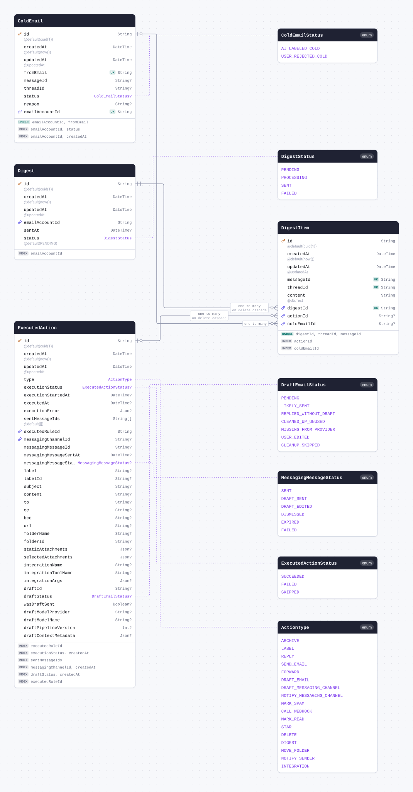

| Field         | Type                | Constraints                                       | Default      | Description |
| ------------- | ------------------- | ------------------------------------------------- | ------------ | ----------- |
| `id`          | `String`            | PK NOT NULL                                       | `cuid(1)`    |             |
| `createdAt`   | `DateTime`          | NOT NULL                                          | `now()`      |             |
| `updatedAt`   | `DateTime`          | NOT NULL                                          | `@updatedAt` |             |
| `messageId`   | `String`            | NOT NULL                                          |              |             |
| `threadId`    | `String`            | NOT NULL                                          |              |             |
| `content`     | `String` `@db.Text` | NOT NULL                                          |              |             |
| `digestId`    | `String`            | NOT NULL → [Digest.id](#model-Digest)             |              |             |
| `actionId`    | `String`            | NULL → [ExecutedAction.id](#model-ExecutedAction) |              |             |
| `coldEmailId` | `String`            | NULL → [ColdEmail.id](#model-ColdEmail)           |              |             |

#### Indexes

- `@@index([actionId])`
- `@@index([coldEmailId])`
- `@@unique([digestId, threadId, messageId])`

#### References

- `digestId` → [Digest.id](#model-Digest) (many-to-one, on delete Cascade)
- `actionId` → [ExecutedAction.id](#model-ExecutedAction) (many-to-one, on delete Cascade)
- `coldEmailId` → [ColdEmail.id](#model-ColdEmail) (many-to-one)

#### Definition

```sql
CREATE TABLE "DigestItem" (
    "id" TEXT NOT NULL,
    "createdAt" TIMESTAMP(3) NOT NULL DEFAULT CURRENT_TIMESTAMP,
    "updatedAt" TIMESTAMP(3) NOT NULL,
    "messageId" TEXT NOT NULL,
    "threadId" TEXT NOT NULL,
    "content" TEXT NOT NULL,
    "digestId" TEXT NOT NULL,
    "actionId" TEXT,
    "coldEmailId" TEXT,

    CONSTRAINT "DigestItem_pkey" PRIMARY KEY ("id")
);

CREATE INDEX "DigestItem_actionId_idx" ON "DigestItem"("actionId");

CREATE INDEX "DigestItem_coldEmailId_idx" ON "DigestItem"("coldEmailId");

CREATE UNIQUE INDEX "DigestItem_digestId_threadId_messageId_key" ON "DigestItem"("digestId", "threadId", "messageId");

ALTER TABLE "DigestItem" ADD CONSTRAINT "DigestItem_digestId_fkey" FOREIGN KEY ("digestId") REFERENCES "Digest"("id") ON DELETE CASCADE ON UPDATE CASCADE;

ALTER TABLE "DigestItem" ADD CONSTRAINT "DigestItem_actionId_fkey" FOREIGN KEY ("actionId") REFERENCES "ExecutedAction"("id") ON DELETE CASCADE ON UPDATE CASCADE;

ALTER TABLE "DigestItem" ADD CONSTRAINT "DigestItem_coldEmailId_fkey" FOREIGN KEY ("coldEmailId") REFERENCES "ColdEmail"("id") ON DELETE SET NULL ON UPDATE CASCADE;
```

<details>
<summary>Queries and their SQL</summary>

**findMany**: Every row

```ts
await prisma.digestItem.findMany();
```

```sql
SELECT
  "public"."DigestItem"."id",
  "public"."DigestItem"."createdAt",
  "public"."DigestItem"."updatedAt",
  "public"."DigestItem"."messageId",
  "public"."DigestItem"."threadId",
  "public"."DigestItem"."content",
  "public"."DigestItem"."digestId",
  "public"."DigestItem"."actionId",
  "public"."DigestItem"."coldEmailId"
FROM
  "public"."DigestItem"
WHERE
  1 = 1
OFFSET
  $1
-- params: ["0"]
```

**count**: How many rows there are

```ts
await prisma.digestItem.count();
```

```sql
SELECT
  COUNT(*) AS "_count$_all"
FROM
  (
    SELECT
      "public"."DigestItem"."id"
    FROM
      "public"."DigestItem"
    WHERE
      1 = 1
    OFFSET
      $1
  ) AS "sub"
-- params: ["0"]
```

**findMany**: Every row with its relations

```ts
await prisma.digestItem.findMany({ include: { digest: true, action: true, coldEmail: true } });
```

```sql
SELECT
  "public"."DigestItem"."id",
  "public"."DigestItem"."createdAt",
  "public"."DigestItem"."updatedAt",
  "public"."DigestItem"."messageId",
  "public"."DigestItem"."threadId",
  "public"."DigestItem"."content",
  "public"."DigestItem"."digestId",
  "public"."DigestItem"."actionId",
  "public"."DigestItem"."coldEmailId"
FROM
  "public"."DigestItem"
WHERE
  1 = 1
OFFSET
  $1
-- params: ["0"]

SELECT
  "public"."Digest"."id",
  "public"."Digest"."createdAt",
  "public"."Digest"."updatedAt",
  "public"."Digest"."emailAccountId",
  "public"."Digest"."sentAt",
  "public"."Digest"."status"::text
FROM
  "public"."Digest"
WHERE
  "public"."Digest"."id" IN ($1)
OFFSET
  $2
-- params: ["<digestId of the rows above>","0"]

SELECT
  "public"."ExecutedAction"."id",
  "public"."ExecutedAction"."createdAt",
  "public"."ExecutedAction"."updatedAt",
  "public"."ExecutedAction"."type"::text,
  "public"."ExecutedAction"."executionStatus"::text,
  "public"."ExecutedAction"."executionStartedAt",
  "public"."ExecutedAction"."executedAt",
  "public"."ExecutedAction"."executionError",
  "public"."ExecutedAction"."sentMessageIds",
  "public"."ExecutedAction"."executedRuleId",
  "public"."ExecutedAction"."messagingChannelId",
  "public"."ExecutedAction"."messagingMessageId",
  "public"."ExecutedAction"."messagingMessageSentAt",
  "public"."ExecutedAction"."messagingMessageStatus"::text,
  "public"."ExecutedAction"."label",
  "public"."ExecutedAction"."labelId",
  "public"."ExecutedAction"."subject",
  "public"."ExecutedAction"."content",
  "public"."ExecutedAction"."to",
  "public"."ExecutedAction"."cc",
  "public"."ExecutedAction"."bcc",
  "public"."ExecutedAction"."url",
  "public"."ExecutedAction"."folderName",
  "public"."ExecutedAction"."folderId",
  "public"."ExecutedAction"."staticAttachments",
  "public"."ExecutedAction"."selectedAttachments",
  "public"."ExecutedAction"."integrationName",
  "public"."ExecutedAction"."integrationToolName",
  "public"."ExecutedAction"."integrationArgs",
  "public"."ExecutedAction"."draftId",
  "public"."ExecutedAction"."draftStatus"::text,
  "public"."ExecutedAction"."wasDraftSent",
  "public"."ExecutedAction"."draftModelProvider",
  "public"."ExecutedAction"."draftModelName",
  "public"."ExecutedAction"."draftPipelineVersion",
  "public"."ExecutedAction"."draftContextMetadata"
FROM
  "public"."ExecutedAction"
WHERE
  "public"."ExecutedAction"."id" IN ($1)
OFFSET
  $2
-- params: ["<actionId of the rows above>","0"]

SELECT
  "public"."ColdEmail"."id",
  "public"."ColdEmail"."createdAt",
  "public"."ColdEmail"."updatedAt",
  "public"."ColdEmail"."fromEmail",
  "public"."ColdEmail"."messageId",
  "public"."ColdEmail"."threadId",
  "public"."ColdEmail"."status"::text,
  "public"."ColdEmail"."reason",
  "public"."ColdEmail"."emailAccountId"
FROM
  "public"."ColdEmail"
WHERE
  "public"."ColdEmail"."id" IN ($1)
OFFSET
  $2
-- params: ["<coldEmailId of the rows above>","0"]
```

**findUnique**: One row by what is unique to it

```ts
await prisma.digestItem.findUnique({ where: { id: "example" } });
```

```sql
SELECT
  "public"."DigestItem"."id",
  "public"."DigestItem"."createdAt",
  "public"."DigestItem"."updatedAt",
  "public"."DigestItem"."messageId",
  "public"."DigestItem"."threadId",
  "public"."DigestItem"."content",
  "public"."DigestItem"."digestId",
  "public"."DigestItem"."actionId",
  "public"."DigestItem"."coldEmailId"
FROM
  "public"."DigestItem"
WHERE
  (
    "public"."DigestItem"."id" = $1
    AND 1 = 1
  )
LIMIT
  $2
OFFSET
  $3
-- params: ["example","1","0"]
```

**create**: Create a row

```ts
await prisma.digestItem.create({
  data: { messageId: "example", threadId: "example", content: "example", digestId: "example" },
});
```

```sql
INSERT INTO
  "public"."DigestItem" (
    "id",
    "createdAt",
    "updatedAt",
    "messageId",
    "threadId",
    "content",
    "digestId"
  )
VALUES
  ($1, $2, $3, $4, $5, $6, $7)
RETURNING
  "public"."DigestItem"."id",
  "public"."DigestItem"."createdAt",
  "public"."DigestItem"."updatedAt",
  "public"."DigestItem"."messageId",
  "public"."DigestItem"."threadId",
  "public"."DigestItem"."content",
  "public"."DigestItem"."digestId",
  "public"."DigestItem"."actionId",
  "public"."DigestItem"."coldEmailId"
-- params: ["<cuid(1)>","<now()>","<now()>","example","example","example","example"]
```

**update**: Update a row

```ts
await prisma.digestItem.update({
  where: { id: "example" },
  data: { createdAt: new Date("2026-01-01T00:00:00.000Z") },
});
```

```sql
UPDATE "public"."DigestItem"
SET
  "createdAt" = $1,
  "updatedAt" = $2
WHERE
  (
    "public"."DigestItem"."id" = $3
    AND 1 = 1
  )
RETURNING
  "public"."DigestItem"."id",
  "public"."DigestItem"."createdAt",
  "public"."DigestItem"."updatedAt",
  "public"."DigestItem"."messageId",
  "public"."DigestItem"."threadId",
  "public"."DigestItem"."content",
  "public"."DigestItem"."digestId",
  "public"."DigestItem"."actionId",
  "public"."DigestItem"."coldEmailId"
-- params: ["2026-01-01T00:00:00.000Z",{"prisma__type":"generatorCall","prisma__value":{"name":"now","args":[],"returnType":{"type":"DateTime"}}},"example"]
```

**delete**: Delete a row

```ts
await prisma.digestItem.delete({ where: { id: "example" } });
```

```sql
DELETE FROM "public"."DigestItem"
WHERE
  (
    "public"."DigestItem"."id" = $1
    AND 1 = 1
  )
RETURNING
  "public"."DigestItem"."id",
  "public"."DigestItem"."createdAt",
  "public"."DigestItem"."updatedAt",
  "public"."DigestItem"."messageId",
  "public"."DigestItem"."threadId",
  "public"."DigestItem"."content",
  "public"."DigestItem"."digestId",
  "public"."DigestItem"."actionId",
  "public"."DigestItem"."coldEmailId"
-- params: ["example"]
```

</details>

<a id="model-Schedule"></a>

### Schedule

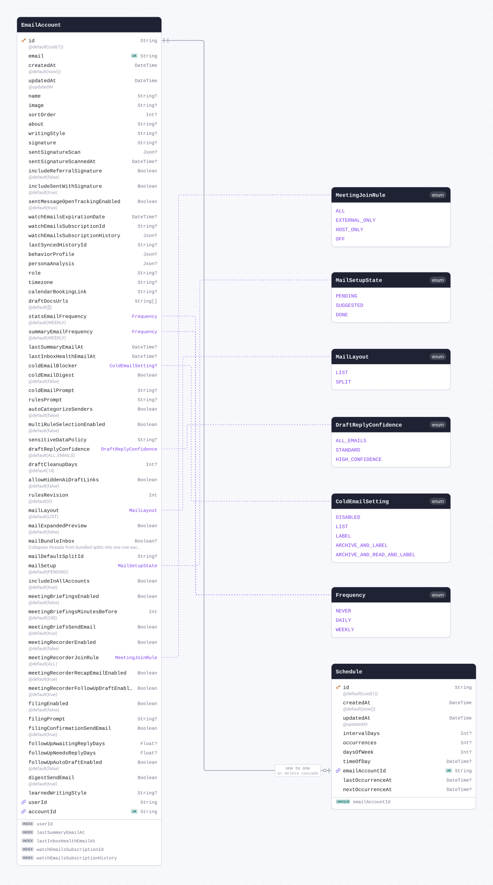

| Field              | Type       | Constraints                                              | Default      | Description |
| ------------------ | ---------- | -------------------------------------------------------- | ------------ | ----------- |
| `id`               | `String`   | PK NOT NULL                                              | `cuid(1)`    |             |
| `createdAt`        | `DateTime` | NOT NULL                                                 | `now()`      |             |
| `updatedAt`        | `DateTime` | NOT NULL                                                 | `@updatedAt` |             |
| `intervalDays`     | `Int`      | NULL                                                     |              |             |
| `occurrences`      | `Int`      | NULL                                                     |              |             |
| `daysOfWeek`       | `Int`      | NULL                                                     |              |             |
| `timeOfDay`        | `DateTime` | NULL                                                     |              |             |
| `emailAccountId`   | `String`   | UNIQUE NOT NULL → [EmailAccount.id](#model-EmailAccount) |              |             |
| `lastOccurrenceAt` | `DateTime` | NULL                                                     |              |             |
| `nextOccurrenceAt` | `DateTime` | NULL                                                     |              |             |

#### Indexes

- `@@unique([emailAccountId])`

#### References

- `emailAccountId` → [EmailAccount.id](#model-EmailAccount) (one-to-one, on delete Cascade)

#### Definition

```sql
CREATE TABLE "Schedule" (
    "id" TEXT NOT NULL,
    "createdAt" TIMESTAMP(3) NOT NULL DEFAULT CURRENT_TIMESTAMP,
    "updatedAt" TIMESTAMP(3) NOT NULL,
    "intervalDays" INTEGER,
    "occurrences" INTEGER,
    "daysOfWeek" INTEGER,
    "timeOfDay" TIMESTAMP(3),
    "emailAccountId" TEXT NOT NULL,
    "lastOccurrenceAt" TIMESTAMP(3),
    "nextOccurrenceAt" TIMESTAMP(3),

    CONSTRAINT "Schedule_pkey" PRIMARY KEY ("id")
);

CREATE UNIQUE INDEX "Schedule_emailAccountId_key" ON "Schedule"("emailAccountId");

ALTER TABLE "Schedule" ADD CONSTRAINT "Schedule_emailAccountId_fkey" FOREIGN KEY ("emailAccountId") REFERENCES "EmailAccount"("id") ON DELETE CASCADE ON UPDATE CASCADE;
```

<details>
<summary>Queries and their SQL</summary>

**findMany**: Every row

```ts
await prisma.schedule.findMany();
```

```sql
SELECT
  "public"."Schedule"."id",
  "public"."Schedule"."createdAt",
  "public"."Schedule"."updatedAt",
  "public"."Schedule"."intervalDays",
  "public"."Schedule"."occurrences",
  "public"."Schedule"."daysOfWeek",
  "public"."Schedule"."timeOfDay",
  "public"."Schedule"."emailAccountId",
  "public"."Schedule"."lastOccurrenceAt",
  "public"."Schedule"."nextOccurrenceAt"
FROM
  "public"."Schedule"
WHERE
  1 = 1
OFFSET
  $1
-- params: ["0"]
```

**count**: How many rows there are

```ts
await prisma.schedule.count();
```

```sql
SELECT
  COUNT(*) AS "_count$_all"
FROM
  (
    SELECT
      "public"."Schedule"."id"
    FROM
      "public"."Schedule"
    WHERE
      1 = 1
    OFFSET
      $1
  ) AS "sub"
-- params: ["0"]
```

**findMany**: Every row with its relations

```ts
await prisma.schedule.findMany({ include: { emailAccount: true } });
```

```sql
SELECT
  "public"."Schedule"."id",
  "public"."Schedule"."createdAt",
  "public"."Schedule"."updatedAt",
  "public"."Schedule"."intervalDays",
  "public"."Schedule"."occurrences",
  "public"."Schedule"."daysOfWeek",
  "public"."Schedule"."timeOfDay",
  "public"."Schedule"."emailAccountId",
  "public"."Schedule"."lastOccurrenceAt",
  "public"."Schedule"."nextOccurrenceAt"
FROM
  "public"."Schedule"
WHERE
  1 = 1
OFFSET
  $1
-- params: ["0"]

SELECT
  "public"."EmailAccount"."id",
  "public"."EmailAccount"."email",
  "public"."EmailAccount"."createdAt",
  "public"."EmailAccount"."updatedAt",
  "public"."EmailAccount"."name",
  "public"."EmailAccount"."image",
  "public"."EmailAccount"."sortOrder",
  "public"."EmailAccount"."about",
  "public"."EmailAccount"."writingStyle",
  "public"."EmailAccount"."signature",
  "public"."EmailAccount"."sentSignatureScan",
  "public"."EmailAccount"."sentSignatureScannedAt",
  "public"."EmailAccount"."includeReferralSignature",
  "public"."EmailAccount"."includeSentWithSignature",
  "public"."EmailAccount"."sentMessageOpenTrackingEnabled",
  "public"."EmailAccount"."watchEmailsExpirationDate",
  "public"."EmailAccount"."watchEmailsSubscriptionId",
  "public"."EmailAccount"."watchEmailsSubscriptionHistory",
  "public"."EmailAccount"."lastSyncedHistoryId",
  "public"."EmailAccount"."behaviorProfile",
  "public"."EmailAccount"."personaAnalysis",
  "public"."EmailAccount"."role",
  "public"."EmailAccount"."timezone",
  "public"."EmailAccount"."calendarBookingLink",
  "public"."EmailAccount"."draftDocsUrls",
  "public"."EmailAccount"."statsEmailFrequency"::text,
  "public"."EmailAccount"."summaryEmailFrequency"::text,
  "public"."EmailAccount"."lastSummaryEmailAt",
  "public"."EmailAccount"."lastInboxHealthEmailAt",
  "public"."EmailAccount"."coldEmailBlocker"::text,
  "public"."EmailAccount"."coldEmailDigest",
  "public"."EmailAccount"."coldEmailPrompt",
  "public"."EmailAccount"."rulesPrompt",
  "public"."EmailAccount"."autoCategorizeSenders",
  "public"."EmailAccount"."multiRuleSelectionEnabled",
  "public"."EmailAccount"."sensitiveDataPolicy",
  "public"."EmailAccount"."draftReplyConfidence"::text,
  "public"."EmailAccount"."draftCleanupDays",
  "public"."EmailAccount"."allowHiddenAiDraftLinks",
  "public"."EmailAccount"."rulesRevision",
  "public"."EmailAccount"."mailLayout"::text,
  "public"."EmailAccount"."mailExpandedPreview",
  "public"."EmailAccount"."mailBundleInbox",
  "public"."EmailAccount"."mailDefaultSplitId",
  "public"."EmailAccount"."mailSetup"::text,
  "public"."EmailAccount"."includeInAllAccounts",
  "public"."EmailAccount"."meetingBriefingsEnabled",
  "public"."EmailAccount"."meetingBriefingsMinutesBefore",
  "public"."EmailAccount"."meetingBriefsSendEmail",
  "public"."EmailAccount"."meetingRecorderEnabled",
  "public"."EmailAccount"."meetingRecorderJoinRule"::text,
  "public"."EmailAccount"."meetingRecorderRecapEmailEnabled",
  "public"."EmailAccount"."meetingRecorderFollowUpDraftEnabled",
  "public"."EmailAccount"."filingEnabled",
  "public"."EmailAccount"."filingPrompt",
  "public"."EmailAccount"."filingConfirmationSendEmail",
  "public"."EmailAccount"."followUpAwaitingReplyDays",
  "public"."EmailAccount"."followUpNeedsReplyDays",
  "public"."EmailAccount"."followUpAutoDraftEnabled",
  "public"."EmailAccount"."digestSendEmail",
  "public"."EmailAccount"."learnedWritingStyle",
  "public"."EmailAccount"."userId",
  "public"."EmailAccount"."accountId"
FROM
  "public"."EmailAccount"
WHERE
  "public"."EmailAccount"."id" IN ($1)
OFFSET
  $2
-- params: ["<emailAccountId of the rows above>","0"]
```

**findUnique**: One row by what is unique to it

```ts
await prisma.schedule.findUnique({ where: { id: "example" } });
```

```sql
SELECT
  "public"."Schedule"."id",
  "public"."Schedule"."createdAt",
  "public"."Schedule"."updatedAt",
  "public"."Schedule"."intervalDays",
  "public"."Schedule"."occurrences",
  "public"."Schedule"."daysOfWeek",
  "public"."Schedule"."timeOfDay",
  "public"."Schedule"."emailAccountId",
  "public"."Schedule"."lastOccurrenceAt",
  "public"."Schedule"."nextOccurrenceAt"
FROM
  "public"."Schedule"
WHERE
  (
    "public"."Schedule"."id" = $1
    AND 1 = 1
  )
LIMIT
  $2
OFFSET
  $3
-- params: ["example","1","0"]
```

**create**: Create a row

```ts
await prisma.schedule.create({ data: { emailAccountId: "example" } });
```

```sql
INSERT INTO
  "public"."Schedule" ("id", "createdAt", "updatedAt", "emailAccountId")
VALUES
  ($1, $2, $3, $4)
RETURNING
  "public"."Schedule"."id",
  "public"."Schedule"."createdAt",
  "public"."Schedule"."updatedAt",
  "public"."Schedule"."intervalDays",
  "public"."Schedule"."occurrences",
  "public"."Schedule"."daysOfWeek",
  "public"."Schedule"."timeOfDay",
  "public"."Schedule"."emailAccountId",
  "public"."Schedule"."lastOccurrenceAt",
  "public"."Schedule"."nextOccurrenceAt"
-- params: ["<cuid(1)>","<now()>","<now()>","example"]
```

**update**: Update a row

```ts
await prisma.schedule.update({
  where: { id: "example" },
  data: { createdAt: new Date("2026-01-01T00:00:00.000Z") },
});
```

```sql
UPDATE "public"."Schedule"
SET
  "createdAt" = $1,
  "updatedAt" = $2
WHERE
  (
    "public"."Schedule"."id" = $3
    AND 1 = 1
  )
RETURNING
  "public"."Schedule"."id",
  "public"."Schedule"."createdAt",
  "public"."Schedule"."updatedAt",
  "public"."Schedule"."intervalDays",
  "public"."Schedule"."occurrences",
  "public"."Schedule"."daysOfWeek",
  "public"."Schedule"."timeOfDay",
  "public"."Schedule"."emailAccountId",
  "public"."Schedule"."lastOccurrenceAt",
  "public"."Schedule"."nextOccurrenceAt"
-- params: ["2026-01-01T00:00:00.000Z",{"prisma__type":"generatorCall","prisma__value":{"name":"now","args":[],"returnType":{"type":"DateTime"}}},"example"]
```

**delete**: Delete a row

```ts
await prisma.schedule.delete({ where: { id: "example" } });
```

```sql
DELETE FROM "public"."Schedule"
WHERE
  (
    "public"."Schedule"."id" = $1
    AND 1 = 1
  )
RETURNING
  "public"."Schedule"."id",
  "public"."Schedule"."createdAt",
  "public"."Schedule"."updatedAt",
  "public"."Schedule"."intervalDays",
  "public"."Schedule"."occurrences",
  "public"."Schedule"."daysOfWeek",
  "public"."Schedule"."timeOfDay",
  "public"."Schedule"."emailAccountId",
  "public"."Schedule"."lastOccurrenceAt",
  "public"."Schedule"."nextOccurrenceAt"
-- params: ["example"]
```

</details>

<a id="model-Premium"></a>

### Premium

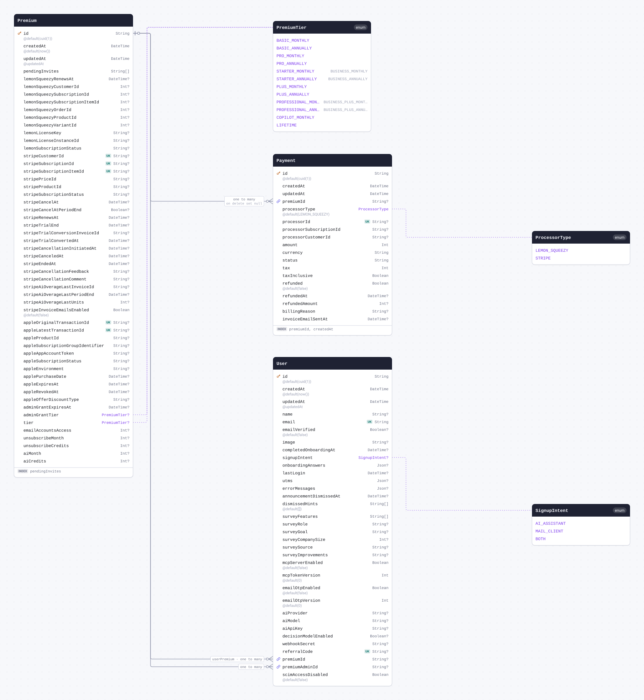

| Field                              | Type                               | Constraints | Default      | Description |
| ---------------------------------- | ---------------------------------- | ----------- | ------------ | ----------- |
| `id`                               | `String`                           | PK NOT NULL | `cuid(1)`    |             |
| `createdAt`                        | `DateTime`                         | NOT NULL    | `now()`      |             |
| `updatedAt`                        | `DateTime`                         | NOT NULL    | `@updatedAt` |             |
| `pendingInvites`                   | `String[]`                         | NOT NULL    |              |             |
| `lemonSqueezyRenewsAt`             | `DateTime`                         | NULL        |              |             |
| `lemonSqueezyCustomerId`           | `Int`                              | NULL        |              |             |
| `lemonSqueezySubscriptionId`       | `Int`                              | NULL        |              |             |
| `lemonSqueezySubscriptionItemId`   | `Int`                              | NULL        |              |             |
| `lemonSqueezyOrderId`              | `Int`                              | NULL        |              |             |
| `lemonSqueezyProductId`            | `Int`                              | NULL        |              |             |
| `lemonSqueezyVariantId`            | `Int`                              | NULL        |              |             |
| `lemonLicenseKey`                  | `String`                           | NULL        |              |             |
| `lemonLicenseInstanceId`           | `String`                           | NULL        |              |             |
| `lemonSubscriptionStatus`          | `String`                           | NULL        |              |             |
| `stripeCustomerId`                 | `String`                           | UNIQUE NULL |              |             |
| `stripeSubscriptionId`             | `String`                           | UNIQUE NULL |              |             |
| `stripeSubscriptionItemId`         | `String`                           | UNIQUE NULL |              |             |
| `stripePriceId`                    | `String`                           | NULL        |              |             |
| `stripeProductId`                  | `String`                           | NULL        |              |             |
| `stripeSubscriptionStatus`         | `String`                           | NULL        |              |             |
| `stripeCancelAt`                   | `DateTime`                         | NULL        |              |             |
| `stripeCancelAtPeriodEnd`          | `Boolean`                          | NULL        |              |             |
| `stripeRenewsAt`                   | `DateTime`                         | NULL        |              |             |
| `stripeTrialEnd`                   | `DateTime`                         | NULL        |              |             |
| `stripeTrialConversionInvoiceId`   | `String`                           | NULL        |              |             |
| `stripeTrialConvertedAt`           | `DateTime`                         | NULL        |              |             |
| `stripeCancellationInitiatedAt`    | `DateTime`                         | NULL        |              |             |
| `stripeCanceledAt`                 | `DateTime`                         | NULL        |              |             |
| `stripeEndedAt`                    | `DateTime`                         | NULL        |              |             |
| `stripeCancellationFeedback`       | `String`                           | NULL        |              |             |
| `stripeCancellationComment`        | `String`                           | NULL        |              |             |
| `stripeAiOverageLastInvoiceId`     | `String`                           | NULL        |              |             |
| `stripeAiOverageLastPeriodEnd`     | `DateTime`                         | NULL        |              |             |
| `stripeAiOverageLastUnits`         | `Int`                              | NULL        |              |             |
| `stripeInvoiceEmailsEnabled`       | `Boolean`                          | NOT NULL    | `false`      |             |
| `appleOriginalTransactionId`       | `String`                           | UNIQUE NULL |              |             |
| `appleLatestTransactionId`         | `String`                           | UNIQUE NULL |              |             |
| `appleProductId`                   | `String`                           | NULL        |              |             |
| `appleSubscriptionGroupIdentifier` | `String`                           | NULL        |              |             |
| `appleAppAccountToken`             | `String`                           | NULL        |              |             |
| `appleSubscriptionStatus`          | `String`                           | NULL        |              |             |
| `appleEnvironment`                 | `String`                           | NULL        |              |             |
| `applePurchaseDate`                | `DateTime`                         | NULL        |              |             |
| `appleExpiresAt`                   | `DateTime`                         | NULL        |              |             |
| `appleRevokedAt`                   | `DateTime`                         | NULL        |              |             |
| `appleOfferDiscountType`           | `String`                           | NULL        |              |             |
| `adminGrantExpiresAt`              | `DateTime`                         | NULL        |              |             |
| `adminGrantTier`                   | [`PremiumTier`](#enum-PremiumTier) | NULL        |              |             |
| `tier`                             | [`PremiumTier`](#enum-PremiumTier) | NULL        |              |             |
| `emailAccountsAccess`              | `Int`                              | NULL        |              |             |
| `unsubscribeMonth`                 | `Int`                              | NULL        |              |             |
| `unsubscribeCredits`               | `Int`                              | NULL        |              |             |
| `aiMonth`                          | `Int`                              | NULL        |              |             |
| `aiCredits`                        | `Int`                              | NULL        |              |             |

#### Indexes

- `@@index([pendingInvites])`

#### Referenced by

- `id` ← [User.premiumId](#model-User) (one-to-many)
- `id` ← [User.premiumAdminId](#model-User) (one-to-many)
- `id` ← [Payment.premiumId](#model-Payment) (one-to-many, on delete SetNull)

#### Definition

```sql
CREATE TABLE "Premium" (
    "id" TEXT NOT NULL,
    "createdAt" TIMESTAMP(3) NOT NULL DEFAULT CURRENT_TIMESTAMP,
    "updatedAt" TIMESTAMP(3) NOT NULL,
    "pendingInvites" TEXT[],
    "lemonSqueezyRenewsAt" TIMESTAMP(3),
    "lemonSqueezyCustomerId" INTEGER,
    "lemonSqueezySubscriptionId" INTEGER,
    "lemonSqueezySubscriptionItemId" INTEGER,
    "lemonSqueezyOrderId" INTEGER,
    "lemonSqueezyProductId" INTEGER,
    "lemonSqueezyVariantId" INTEGER,
    "lemonLicenseKey" TEXT,
    "lemonLicenseInstanceId" TEXT,
    "lemonSubscriptionStatus" TEXT,
    "stripeCustomerId" TEXT,
    "stripeSubscriptionId" TEXT,
    "stripeSubscriptionItemId" TEXT,
    "stripePriceId" TEXT,
    "stripeProductId" TEXT,
    "stripeSubscriptionStatus" TEXT,
    "stripeCancelAt" TIMESTAMP(3),
    "stripeCancelAtPeriodEnd" BOOLEAN,
    "stripeRenewsAt" TIMESTAMP(3),
    "stripeTrialEnd" TIMESTAMP(3),
    "stripeTrialConversionInvoiceId" TEXT,
    "stripeTrialConvertedAt" TIMESTAMP(3),
    "stripeCancellationInitiatedAt" TIMESTAMP(3),
    "stripeCanceledAt" TIMESTAMP(3),
    "stripeEndedAt" TIMESTAMP(3),
    "stripeCancellationFeedback" TEXT,
    "stripeCancellationComment" TEXT,
    "stripeAiOverageLastInvoiceId" TEXT,
    "stripeAiOverageLastPeriodEnd" TIMESTAMP(3),
    "stripeAiOverageLastUnits" INTEGER,
    "stripeInvoiceEmailsEnabled" BOOLEAN NOT NULL DEFAULT false,
    "appleOriginalTransactionId" TEXT,
    "appleLatestTransactionId" TEXT,
    "appleProductId" TEXT,
    "appleSubscriptionGroupIdentifier" TEXT,
    "appleAppAccountToken" TEXT,
    "appleSubscriptionStatus" TEXT,
    "appleEnvironment" TEXT,
    "applePurchaseDate" TIMESTAMP(3),
    "appleExpiresAt" TIMESTAMP(3),
    "appleRevokedAt" TIMESTAMP(3),
    "appleOfferDiscountType" TEXT,
    "adminGrantExpiresAt" TIMESTAMP(3),
    "adminGrantTier" "PremiumTier",
    "tier" "PremiumTier",
    "emailAccountsAccess" INTEGER,
    "unsubscribeMonth" INTEGER,
    "unsubscribeCredits" INTEGER,
    "aiMonth" INTEGER,
    "aiCredits" INTEGER,

    CONSTRAINT "Premium_pkey" PRIMARY KEY ("id")
);

CREATE UNIQUE INDEX "Premium_stripeCustomerId_key" ON "Premium"("stripeCustomerId");

CREATE UNIQUE INDEX "Premium_stripeSubscriptionId_key" ON "Premium"("stripeSubscriptionId");

CREATE UNIQUE INDEX "Premium_stripeSubscriptionItemId_key" ON "Premium"("stripeSubscriptionItemId");

CREATE UNIQUE INDEX "Premium_appleOriginalTransactionId_key" ON "Premium"("appleOriginalTransactionId");

CREATE UNIQUE INDEX "Premium_appleLatestTransactionId_key" ON "Premium"("appleLatestTransactionId");

CREATE INDEX "Premium_pendingInvites_idx" ON "Premium"("pendingInvites");
```

<details>
<summary>Queries and their SQL</summary>

**findMany**: Every row

```ts
await prisma.premium.findMany();
```

```sql
SELECT
  "public"."Premium"."id",
  "public"."Premium"."createdAt",
  "public"."Premium"."updatedAt",
  "public"."Premium"."pendingInvites",
  "public"."Premium"."lemonSqueezyRenewsAt",
  "public"."Premium"."lemonSqueezyCustomerId",
  "public"."Premium"."lemonSqueezySubscriptionId",
  "public"."Premium"."lemonSqueezySubscriptionItemId",
  "public"."Premium"."lemonSqueezyOrderId",
  "public"."Premium"."lemonSqueezyProductId",
  "public"."Premium"."lemonSqueezyVariantId",
  "public"."Premium"."lemonLicenseKey",
  "public"."Premium"."lemonLicenseInstanceId",
  "public"."Premium"."lemonSubscriptionStatus",
  "public"."Premium"."stripeCustomerId",
  "public"."Premium"."stripeSubscriptionId",
  "public"."Premium"."stripeSubscriptionItemId",
  "public"."Premium"."stripePriceId",
  "public"."Premium"."stripeProductId",
  "public"."Premium"."stripeSubscriptionStatus",
  "public"."Premium"."stripeCancelAt",
  "public"."Premium"."stripeCancelAtPeriodEnd",
  "public"."Premium"."stripeRenewsAt",
  "public"."Premium"."stripeTrialEnd",
  "public"."Premium"."stripeTrialConversionInvoiceId",
  "public"."Premium"."stripeTrialConvertedAt",
  "public"."Premium"."stripeCancellationInitiatedAt",
  "public"."Premium"."stripeCanceledAt",
  "public"."Premium"."stripeEndedAt",
  "public"."Premium"."stripeCancellationFeedback",
  "public"."Premium"."stripeCancellationComment",
  "public"."Premium"."stripeAiOverageLastInvoiceId",
  "public"."Premium"."stripeAiOverageLastPeriodEnd",
  "public"."Premium"."stripeAiOverageLastUnits",
  "public"."Premium"."stripeInvoiceEmailsEnabled",
  "public"."Premium"."appleOriginalTransactionId",
  "public"."Premium"."appleLatestTransactionId",
  "public"."Premium"."appleProductId",
  "public"."Premium"."appleSubscriptionGroupIdentifier",
  "public"."Premium"."appleAppAccountToken",
  "public"."Premium"."appleSubscriptionStatus",
  "public"."Premium"."appleEnvironment",
  "public"."Premium"."applePurchaseDate",
  "public"."Premium"."appleExpiresAt",
  "public"."Premium"."appleRevokedAt",
  "public"."Premium"."appleOfferDiscountType",
  "public"."Premium"."adminGrantExpiresAt",
  "public"."Premium"."adminGrantTier"::text,
  "public"."Premium"."tier"::text,
  "public"."Premium"."emailAccountsAccess",
  "public"."Premium"."unsubscribeMonth",
  "public"."Premium"."unsubscribeCredits",
  "public"."Premium"."aiMonth",
  "public"."Premium"."aiCredits"
FROM
  "public"."Premium"
WHERE
  1 = 1
OFFSET
  $1
-- params: ["0"]
```

**count**: How many rows there are

```ts
await prisma.premium.count();
```

```sql
SELECT
  COUNT(*) AS "_count$_all"
FROM
  (
    SELECT
      "public"."Premium"."id"
    FROM
      "public"."Premium"
    WHERE
      1 = 1
    OFFSET
      $1
  ) AS "sub"
-- params: ["0"]
```

**findMany**: Every row with its relations

```ts
await prisma.premium.findMany({ include: { users: true, admins: true, payments: true } });
```

```sql
SELECT
  "public"."Premium"."id",
  "public"."Premium"."createdAt",
  "public"."Premium"."updatedAt",
  "public"."Premium"."pendingInvites",
  "public"."Premium"."lemonSqueezyRenewsAt",
  "public"."Premium"."lemonSqueezyCustomerId",
  "public"."Premium"."lemonSqueezySubscriptionId",
  "public"."Premium"."lemonSqueezySubscriptionItemId",
  "public"."Premium"."lemonSqueezyOrderId",
  "public"."Premium"."lemonSqueezyProductId",
  "public"."Premium"."lemonSqueezyVariantId",
  "public"."Premium"."lemonLicenseKey",
  "public"."Premium"."lemonLicenseInstanceId",
  "public"."Premium"."lemonSubscriptionStatus",
  "public"."Premium"."stripeCustomerId",
  "public"."Premium"."stripeSubscriptionId",
  "public"."Premium"."stripeSubscriptionItemId",
  "public"."Premium"."stripePriceId",
  "public"."Premium"."stripeProductId",
  "public"."Premium"."stripeSubscriptionStatus",
  "public"."Premium"."stripeCancelAt",
  "public"."Premium"."stripeCancelAtPeriodEnd",
  "public"."Premium"."stripeRenewsAt",
  "public"."Premium"."stripeTrialEnd",
  "public"."Premium"."stripeTrialConversionInvoiceId",
  "public"."Premium"."stripeTrialConvertedAt",
  "public"."Premium"."stripeCancellationInitiatedAt",
  "public"."Premium"."stripeCanceledAt",
  "public"."Premium"."stripeEndedAt",
  "public"."Premium"."stripeCancellationFeedback",
  "public"."Premium"."stripeCancellationComment",
  "public"."Premium"."stripeAiOverageLastInvoiceId",
  "public"."Premium"."stripeAiOverageLastPeriodEnd",
  "public"."Premium"."stripeAiOverageLastUnits",
  "public"."Premium"."stripeInvoiceEmailsEnabled",
  "public"."Premium"."appleOriginalTransactionId",
  "public"."Premium"."appleLatestTransactionId",
  "public"."Premium"."appleProductId",
  "public"."Premium"."appleSubscriptionGroupIdentifier",
  "public"."Premium"."appleAppAccountToken",
  "public"."Premium"."appleSubscriptionStatus",
  "public"."Premium"."appleEnvironment",
  "public"."Premium"."applePurchaseDate",
  "public"."Premium"."appleExpiresAt",
  "public"."Premium"."appleRevokedAt",
  "public"."Premium"."appleOfferDiscountType",
  "public"."Premium"."adminGrantExpiresAt",
  "public"."Premium"."adminGrantTier"::text,
  "public"."Premium"."tier"::text,
  "public"."Premium"."emailAccountsAccess",
  "public"."Premium"."unsubscribeMonth",
  "public"."Premium"."unsubscribeCredits",
  "public"."Premium"."aiMonth",
  "public"."Premium"."aiCredits"
FROM
  "public"."Premium"
WHERE
  1 = 1
OFFSET
  $1
-- params: ["0"]

SELECT
  "public"."User"."id",
  "public"."User"."createdAt",
  "public"."User"."updatedAt",
  "public"."User"."name",
  "public"."User"."email",
  "public"."User"."emailVerified",
  "public"."User"."image",
  "public"."User"."completedOnboardingAt",
  "public"."User"."signupIntent"::text,
  "public"."User"."onboardingAnswers",
  "public"."User"."lastLogin",
  "public"."User"."utms",
  "public"."User"."errorMessages",
  "public"."User"."announcementDismissedAt",
  "public"."User"."dismissedHints",
  "public"."User"."surveyFeatures",
  "public"."User"."surveyRole",
  "public"."User"."surveyGoal",
  "public"."User"."surveyCompanySize",
  "public"."User"."surveySource",
  "public"."User"."surveyImprovements",
  "public"."User"."mcpServerEnabled",
  "public"."User"."mcpTokenVersion",
  "public"."User"."emailOtpEnabled",
  "public"."User"."emailOtpVersion",
  "public"."User"."aiProvider",
  "public"."User"."aiModel",
  "public"."User"."aiApiKey",
  "public"."User"."decisionModelEnabled",
  "public"."User"."webhookSecret",
  "public"."User"."referralCode",
  "public"."User"."premiumId",
  "public"."User"."premiumAdminId",
  "public"."User"."scimAccessDisabled"
FROM
  "public"."User"
WHERE
  "public"."User"."premiumId" IN ($1)
OFFSET
  $2
-- params: ["<id of the rows above>","0"]

SELECT
  "public"."User"."id",
  "public"."User"."createdAt",
  "public"."User"."updatedAt",
  "public"."User"."name",
  "public"."User"."email",
  "public"."User"."emailVerified",
  "public"."User"."image",
  "public"."User"."completedOnboardingAt",
  "public"."User"."signupIntent"::text,
  "public"."User"."onboardingAnswers",
  "public"."User"."lastLogin",
  "public"."User"."utms",
  "public"."User"."errorMessages",
  "public"."User"."announcementDismissedAt",
  "public"."User"."dismissedHints",
  "public"."User"."surveyFeatures",
  "public"."User"."surveyRole",
  "public"."User"."surveyGoal",
  "public"."User"."surveyCompanySize",
  "public"."User"."surveySource",
  "public"."User"."surveyImprovements",
  "public"."User"."mcpServerEnabled",
  "public"."User"."mcpTokenVersion",
  "public"."User"."emailOtpEnabled",
  "public"."User"."emailOtpVersion",
  "public"."User"."aiProvider",
  "public"."User"."aiModel",
  "public"."User"."aiApiKey",
  "public"."User"."decisionModelEnabled",
  "public"."User"."webhookSecret",
  "public"."User"."referralCode",
  "public"."User"."premiumId",
  "public"."User"."premiumAdminId",
  "public"."User"."scimAccessDisabled"
FROM
  "public"."User"
WHERE
  "public"."User"."premiumAdminId" IN ($1)
OFFSET
  $2
-- params: ["<id of the rows above>","0"]

SELECT
  "public"."Payment"."id",
  "public"."Payment"."createdAt",
  "public"."Payment"."updatedAt",
  "public"."Payment"."premiumId",
  "public"."Payment"."processorType"::text,
  "public"."Payment"."processorId",
  "public"."Payment"."processorSubscriptionId",
  "public"."Payment"."processorCustomerId",
  "public"."Payment"."amount",
  "public"."Payment"."currency",
  "public"."Payment"."status",
  "public"."Payment"."tax",
  "public"."Payment"."taxInclusive",
  "public"."Payment"."refunded",
  "public"."Payment"."refundedAt",
  "public"."Payment"."refundedAmount",
  "public"."Payment"."billingReason",
  "public"."Payment"."invoiceEmailSentAt"
FROM
  "public"."Payment"
WHERE
  "public"."Payment"."premiumId" IN ($1)
OFFSET
  $2
-- params: ["<id of the rows above>","0"]
```

**findUnique**: One row by what is unique to it

```ts
await prisma.premium.findUnique({ where: { id: "example" } });
```

```sql
SELECT
  "public"."Premium"."id",
  "public"."Premium"."createdAt",
  "public"."Premium"."updatedAt",
  "public"."Premium"."pendingInvites",
  "public"."Premium"."lemonSqueezyRenewsAt",
  "public"."Premium"."lemonSqueezyCustomerId",
  "public"."Premium"."lemonSqueezySubscriptionId",
  "public"."Premium"."lemonSqueezySubscriptionItemId",
  "public"."Premium"."lemonSqueezyOrderId",
  "public"."Premium"."lemonSqueezyProductId",
  "public"."Premium"."lemonSqueezyVariantId",
  "public"."Premium"."lemonLicenseKey",
  "public"."Premium"."lemonLicenseInstanceId",
  "public"."Premium"."lemonSubscriptionStatus",
  "public"."Premium"."stripeCustomerId",
  "public"."Premium"."stripeSubscriptionId",
  "public"."Premium"."stripeSubscriptionItemId",
  "public"."Premium"."stripePriceId",
  "public"."Premium"."stripeProductId",
  "public"."Premium"."stripeSubscriptionStatus",
  "public"."Premium"."stripeCancelAt",
  "public"."Premium"."stripeCancelAtPeriodEnd",
  "public"."Premium"."stripeRenewsAt",
  "public"."Premium"."stripeTrialEnd",
  "public"."Premium"."stripeTrialConversionInvoiceId",
  "public"."Premium"."stripeTrialConvertedAt",
  "public"."Premium"."stripeCancellationInitiatedAt",
  "public"."Premium"."stripeCanceledAt",
  "public"."Premium"."stripeEndedAt",
  "public"."Premium"."stripeCancellationFeedback",
  "public"."Premium"."stripeCancellationComment",
  "public"."Premium"."stripeAiOverageLastInvoiceId",
  "public"."Premium"."stripeAiOverageLastPeriodEnd",
  "public"."Premium"."stripeAiOverageLastUnits",
  "public"."Premium"."stripeInvoiceEmailsEnabled",
  "public"."Premium"."appleOriginalTransactionId",
  "public"."Premium"."appleLatestTransactionId",
  "public"."Premium"."appleProductId",
  "public"."Premium"."appleSubscriptionGroupIdentifier",
  "public"."Premium"."appleAppAccountToken",
  "public"."Premium"."appleSubscriptionStatus",
  "public"."Premium"."appleEnvironment",
  "public"."Premium"."applePurchaseDate",
  "public"."Premium"."appleExpiresAt",
  "public"."Premium"."appleRevokedAt",
  "public"."Premium"."appleOfferDiscountType",
  "public"."Premium"."adminGrantExpiresAt",
  "public"."Premium"."adminGrantTier"::text,
  "public"."Premium"."tier"::text,
  "public"."Premium"."emailAccountsAccess",
  "public"."Premium"."unsubscribeMonth",
  "public"."Premium"."unsubscribeCredits",
  "public"."Premium"."aiMonth",
  "public"."Premium"."aiCredits"
FROM
  "public"."Premium"
WHERE
  (
    "public"."Premium"."id" = $1
    AND 1 = 1
  )
LIMIT
  $2
OFFSET
  $3
-- params: ["example","1","0"]
```

**create**: Create a row

```ts
await prisma.premium.create({ data: { pendingInvites: ["example"] } });
```

```sql
INSERT INTO
  "public"."Premium" (
    "id",
    "createdAt",
    "updatedAt",
    "pendingInvites",
    "stripeInvoiceEmailsEnabled"
  )
VALUES
  ($1, $2, $3, $4, $5)
RETURNING
  "public"."Premium"."id",
  "public"."Premium"."createdAt",
  "public"."Premium"."updatedAt",
  "public"."Premium"."pendingInvites",
  "public"."Premium"."lemonSqueezyRenewsAt",
  "public"."Premium"."lemonSqueezyCustomerId",
  "public"."Premium"."lemonSqueezySubscriptionId",
  "public"."Premium"."lemonSqueezySubscriptionItemId",
  "public"."Premium"."lemonSqueezyOrderId",
  "public"."Premium"."lemonSqueezyProductId",
  "public"."Premium"."lemonSqueezyVariantId",
  "public"."Premium"."lemonLicenseKey",
  "public"."Premium"."lemonLicenseInstanceId",
  "public"."Premium"."lemonSubscriptionStatus",
  "public"."Premium"."stripeCustomerId",
  "public"."Premium"."stripeSubscriptionId",
  "public"."Premium"."stripeSubscriptionItemId",
  "public"."Premium"."stripePriceId",
  "public"."Premium"."stripeProductId",
  "public"."Premium"."stripeSubscriptionStatus",
  "public"."Premium"."stripeCancelAt",
  "public"."Premium"."stripeCancelAtPeriodEnd",
  "public"."Premium"."stripeRenewsAt",
  "public"."Premium"."stripeTrialEnd",
  "public"."Premium"."stripeTrialConversionInvoiceId",
  "public"."Premium"."stripeTrialConvertedAt",
  "public"."Premium"."stripeCancellationInitiatedAt",
  "public"."Premium"."stripeCanceledAt",
  "public"."Premium"."stripeEndedAt",
  "public"."Premium"."stripeCancellationFeedback",
  "public"."Premium"."stripeCancellationComment",
  "public"."Premium"."stripeAiOverageLastInvoiceId",
  "public"."Premium"."stripeAiOverageLastPeriodEnd",
  "public"."Premium"."stripeAiOverageLastUnits",
  "public"."Premium"."stripeInvoiceEmailsEnabled",
  "public"."Premium"."appleOriginalTransactionId",
  "public"."Premium"."appleLatestTransactionId",
  "public"."Premium"."appleProductId",
  "public"."Premium"."appleSubscriptionGroupIdentifier",
  "public"."Premium"."appleAppAccountToken",
  "public"."Premium"."appleSubscriptionStatus",
  "public"."Premium"."appleEnvironment",
  "public"."Premium"."applePurchaseDate",
  "public"."Premium"."appleExpiresAt",
  "public"."Premium"."appleRevokedAt",
  "public"."Premium"."appleOfferDiscountType",
  "public"."Premium"."adminGrantExpiresAt",
  "public"."Premium"."adminGrantTier"::text,
  "public"."Premium"."tier"::text,
  "public"."Premium"."emailAccountsAccess",
  "public"."Premium"."unsubscribeMonth",
  "public"."Premium"."unsubscribeCredits",
  "public"."Premium"."aiMonth",
  "public"."Premium"."aiCredits"
-- params: ["<cuid(1)>","<now()>","<now()>",["example"],false]
```

**update**: Update a row

```ts
await prisma.premium.update({
  where: { id: "example" },
  data: { createdAt: new Date("2026-01-01T00:00:00.000Z") },
});
```

```sql
UPDATE "public"."Premium"
SET
  "createdAt" = $1,
  "updatedAt" = $2
WHERE
  (
    "public"."Premium"."id" = $3
    AND 1 = 1
  )
RETURNING
  "public"."Premium"."id",
  "public"."Premium"."createdAt",
  "public"."Premium"."updatedAt",
  "public"."Premium"."pendingInvites",
  "public"."Premium"."lemonSqueezyRenewsAt",
  "public"."Premium"."lemonSqueezyCustomerId",
  "public"."Premium"."lemonSqueezySubscriptionId",
  "public"."Premium"."lemonSqueezySubscriptionItemId",
  "public"."Premium"."lemonSqueezyOrderId",
  "public"."Premium"."lemonSqueezyProductId",
  "public"."Premium"."lemonSqueezyVariantId",
  "public"."Premium"."lemonLicenseKey",
  "public"."Premium"."lemonLicenseInstanceId",
  "public"."Premium"."lemonSubscriptionStatus",
  "public"."Premium"."stripeCustomerId",
  "public"."Premium"."stripeSubscriptionId",
  "public"."Premium"."stripeSubscriptionItemId",
  "public"."Premium"."stripePriceId",
  "public"."Premium"."stripeProductId",
  "public"."Premium"."stripeSubscriptionStatus",
  "public"."Premium"."stripeCancelAt",
  "public"."Premium"."stripeCancelAtPeriodEnd",
  "public"."Premium"."stripeRenewsAt",
  "public"."Premium"."stripeTrialEnd",
  "public"."Premium"."stripeTrialConversionInvoiceId",
  "public"."Premium"."stripeTrialConvertedAt",
  "public"."Premium"."stripeCancellationInitiatedAt",
  "public"."Premium"."stripeCanceledAt",
  "public"."Premium"."stripeEndedAt",
  "public"."Premium"."stripeCancellationFeedback",
  "public"."Premium"."stripeCancellationComment",
  "public"."Premium"."stripeAiOverageLastInvoiceId",
  "public"."Premium"."stripeAiOverageLastPeriodEnd",
  "public"."Premium"."stripeAiOverageLastUnits",
  "public"."Premium"."stripeInvoiceEmailsEnabled",
  "public"."Premium"."appleOriginalTransactionId",
  "public"."Premium"."appleLatestTransactionId",
  "public"."Premium"."appleProductId",
  "public"."Premium"."appleSubscriptionGroupIdentifier",
  "public"."Premium"."appleAppAccountToken",
  "public"."Premium"."appleSubscriptionStatus",
  "public"."Premium"."appleEnvironment",
  "public"."Premium"."applePurchaseDate",
  "public"."Premium"."appleExpiresAt",
  "public"."Premium"."appleRevokedAt",
  "public"."Premium"."appleOfferDiscountType",
  "public"."Premium"."adminGrantExpiresAt",
  "public"."Premium"."adminGrantTier"::text,
  "public"."Premium"."tier"::text,
  "public"."Premium"."emailAccountsAccess",
  "public"."Premium"."unsubscribeMonth",
  "public"."Premium"."unsubscribeCredits",
  "public"."Premium"."aiMonth",
  "public"."Premium"."aiCredits"
-- params: ["2026-01-01T00:00:00.000Z",{"prisma__type":"generatorCall","prisma__value":{"name":"now","args":[],"returnType":{"type":"DateTime"}}},"example"]
```

**delete**: Delete a row

```ts
await prisma.premium.delete({ where: { id: "example" } });
```

```sql
DELETE FROM "public"."Premium"
WHERE
  (
    "public"."Premium"."id" = $1
    AND 1 = 1
  )
RETURNING
  "public"."Premium"."id",
  "public"."Premium"."createdAt",
  "public"."Premium"."updatedAt",
  "public"."Premium"."pendingInvites",
  "public"."Premium"."lemonSqueezyRenewsAt",
  "public"."Premium"."lemonSqueezyCustomerId",
  "public"."Premium"."lemonSqueezySubscriptionId",
  "public"."Premium"."lemonSqueezySubscriptionItemId",
  "public"."Premium"."lemonSqueezyOrderId",
  "public"."Premium"."lemonSqueezyProductId",
  "public"."Premium"."lemonSqueezyVariantId",
  "public"."Premium"."lemonLicenseKey",
  "public"."Premium"."lemonLicenseInstanceId",
  "public"."Premium"."lemonSubscriptionStatus",
  "public"."Premium"."stripeCustomerId",
  "public"."Premium"."stripeSubscriptionId",
  "public"."Premium"."stripeSubscriptionItemId",
  "public"."Premium"."stripePriceId",
  "public"."Premium"."stripeProductId",
  "public"."Premium"."stripeSubscriptionStatus",
  "public"."Premium"."stripeCancelAt",
  "public"."Premium"."stripeCancelAtPeriodEnd",
  "public"."Premium"."stripeRenewsAt",
  "public"."Premium"."stripeTrialEnd",
  "public"."Premium"."stripeTrialConversionInvoiceId",
  "public"."Premium"."stripeTrialConvertedAt",
  "public"."Premium"."stripeCancellationInitiatedAt",
  "public"."Premium"."stripeCanceledAt",
  "public"."Premium"."stripeEndedAt",
  "public"."Premium"."stripeCancellationFeedback",
  "public"."Premium"."stripeCancellationComment",
  "public"."Premium"."stripeAiOverageLastInvoiceId",
  "public"."Premium"."stripeAiOverageLastPeriodEnd",
  "public"."Premium"."stripeAiOverageLastUnits",
  "public"."Premium"."stripeInvoiceEmailsEnabled",
  "public"."Premium"."appleOriginalTransactionId",
  "public"."Premium"."appleLatestTransactionId",
  "public"."Premium"."appleProductId",
  "public"."Premium"."appleSubscriptionGroupIdentifier",
  "public"."Premium"."appleAppAccountToken",
  "public"."Premium"."appleSubscriptionStatus",
  "public"."Premium"."appleEnvironment",
  "public"."Premium"."applePurchaseDate",
  "public"."Premium"."appleExpiresAt",
  "public"."Premium"."appleRevokedAt",
  "public"."Premium"."appleOfferDiscountType",
  "public"."Premium"."adminGrantExpiresAt",
  "public"."Premium"."adminGrantTier"::text,
  "public"."Premium"."tier"::text,
  "public"."Premium"."emailAccountsAccess",
  "public"."Premium"."unsubscribeMonth",
  "public"."Premium"."unsubscribeCredits",
  "public"."Premium"."aiMonth",
  "public"."Premium"."aiCredits"
-- params: ["example"]
```

</details>

<a id="model-PendingPremiumGrant"></a>

### PendingPremiumGrant

| Field                 | Type                               | Constraints     | Default      | Description |
| --------------------- | ---------------------------------- | --------------- | ------------ | ----------- |
| `id`                  | `String`                           | PK NOT NULL     | `cuid(1)`    |             |
| `createdAt`           | `DateTime`                         | NOT NULL        | `now()`      |             |
| `updatedAt`           | `DateTime`                         | NOT NULL        | `@updatedAt` |             |
| `email`               | `String`                           | UNIQUE NOT NULL |              |             |
| `tier`                | [`PremiumTier`](#enum-PremiumTier) | NOT NULL        |              |             |
| `count`               | `Int`                              | NOT NULL        | `1`          |             |
| `emailAccountsAccess` | `Int`                              | NULL            |              |             |

#### Definition

```sql
CREATE TABLE "PendingPremiumGrant" (
    "id" TEXT NOT NULL,
    "createdAt" TIMESTAMP(3) NOT NULL DEFAULT CURRENT_TIMESTAMP,
    "updatedAt" TIMESTAMP(3) NOT NULL,
    "email" TEXT NOT NULL,
    "tier" "PremiumTier" NOT NULL,
    "count" INTEGER NOT NULL DEFAULT 1,
    "emailAccountsAccess" INTEGER,

    CONSTRAINT "PendingPremiumGrant_pkey" PRIMARY KEY ("id")
);

CREATE UNIQUE INDEX "PendingPremiumGrant_email_key" ON "PendingPremiumGrant"("email");
```

<details>
<summary>Queries and their SQL</summary>

**findMany**: Every row

```ts
await prisma.pendingPremiumGrant.findMany();
```

```sql
SELECT
  "public"."PendingPremiumGrant"."id",
  "public"."PendingPremiumGrant"."createdAt",
  "public"."PendingPremiumGrant"."updatedAt",
  "public"."PendingPremiumGrant"."email",
  "public"."PendingPremiumGrant"."tier"::text,
  "public"."PendingPremiumGrant"."count",
  "public"."PendingPremiumGrant"."emailAccountsAccess"
FROM
  "public"."PendingPremiumGrant"
WHERE
  1 = 1
OFFSET
  $1
-- params: ["0"]
```

**count**: How many rows there are

```ts
await prisma.pendingPremiumGrant.count();
```

```sql
SELECT
  COUNT(*) AS "_count$_all"
FROM
  (
    SELECT
      "public"."PendingPremiumGrant"."id"
    FROM
      "public"."PendingPremiumGrant"
    WHERE
      1 = 1
    OFFSET
      $1
  ) AS "sub"
-- params: ["0"]
```

**findUnique**: One row by what is unique to it

```ts
await prisma.pendingPremiumGrant.findUnique({ where: { id: "example" } });
```

```sql
SELECT
  "public"."PendingPremiumGrant"."id",
  "public"."PendingPremiumGrant"."createdAt",
  "public"."PendingPremiumGrant"."updatedAt",
  "public"."PendingPremiumGrant"."email",
  "public"."PendingPremiumGrant"."tier"::text,
  "public"."PendingPremiumGrant"."count",
  "public"."PendingPremiumGrant"."emailAccountsAccess"
FROM
  "public"."PendingPremiumGrant"
WHERE
  (
    "public"."PendingPremiumGrant"."id" = $1
    AND 1 = 1
  )
LIMIT
  $2
OFFSET
  $3
-- params: ["example","1","0"]
```

**create**: Create a row

```ts
await prisma.pendingPremiumGrant.create({ data: { email: "example", tier: "BASIC_MONTHLY" } });
```

```sql
INSERT INTO
  "public"."PendingPremiumGrant" (
    "id",
    "createdAt",
    "updatedAt",
    "email",
    "tier",
    "count"
  )
VALUES
  (
    $1,
    $2,
    $3,
    $4,
    CAST($5::text AS "public"."PremiumTier"),
    $6
  )
RETURNING
  "public"."PendingPremiumGrant"."id",
  "public"."PendingPremiumGrant"."createdAt",
  "public"."PendingPremiumGrant"."updatedAt",
  "public"."PendingPremiumGrant"."email",
  "public"."PendingPremiumGrant"."tier"::text,
  "public"."PendingPremiumGrant"."count",
  "public"."PendingPremiumGrant"."emailAccountsAccess"
-- params: ["<cuid(1)>","<now()>","<now()>","example","BASIC_MONTHLY","1"]
```

**update**: Update a row

```ts
await prisma.pendingPremiumGrant.update({
  where: { id: "example" },
  data: { createdAt: new Date("2026-01-01T00:00:00.000Z") },
});
```

```sql
UPDATE "public"."PendingPremiumGrant"
SET
  "createdAt" = $1,
  "updatedAt" = $2
WHERE
  (
    "public"."PendingPremiumGrant"."id" = $3
    AND 1 = 1
  )
RETURNING
  "public"."PendingPremiumGrant"."id",
  "public"."PendingPremiumGrant"."createdAt",
  "public"."PendingPremiumGrant"."updatedAt",
  "public"."PendingPremiumGrant"."email",
  "public"."PendingPremiumGrant"."tier"::text,
  "public"."PendingPremiumGrant"."count",
  "public"."PendingPremiumGrant"."emailAccountsAccess"
-- params: ["2026-01-01T00:00:00.000Z",{"prisma__type":"generatorCall","prisma__value":{"name":"now","args":[],"returnType":{"type":"DateTime"}}},"example"]
```

**delete**: Delete a row

```ts
await prisma.pendingPremiumGrant.delete({ where: { id: "example" } });
```

```sql
DELETE FROM "public"."PendingPremiumGrant"
WHERE
  (
    "public"."PendingPremiumGrant"."id" = $1
    AND 1 = 1
  )
RETURNING
  "public"."PendingPremiumGrant"."id",
  "public"."PendingPremiumGrant"."createdAt",
  "public"."PendingPremiumGrant"."updatedAt",
  "public"."PendingPremiumGrant"."email",
  "public"."PendingPremiumGrant"."tier"::text,
  "public"."PendingPremiumGrant"."count",
  "public"."PendingPremiumGrant"."emailAccountsAccess"
-- params: ["example"]
```

</details>

<a id="model-VerificationToken"></a>

### VerificationToken

| Field        | Type       | Constraints     | Default      | Description |
| ------------ | ---------- | --------------- | ------------ | ----------- |
| `id`         | `String`   | PK NOT NULL     | `cuid(1)`    |             |
| `createdAt`  | `DateTime` | NOT NULL        | `now()`      |             |
| `updatedAt`  | `DateTime` | NOT NULL        | `@updatedAt` |             |
| `identifier` | `String`   | NOT NULL        |              |             |
| `token`      | `String`   | UNIQUE NOT NULL |              |             |
| `expires`    | `DateTime` | NOT NULL        |              |             |

#### Indexes

- `@@unique([identifier, token])`

#### Definition

```sql
CREATE TABLE "VerificationToken" (
    "id" TEXT NOT NULL,
    "createdAt" TIMESTAMP(3) NOT NULL DEFAULT CURRENT_TIMESTAMP,
    "updatedAt" TIMESTAMP(3) NOT NULL,
    "identifier" TEXT NOT NULL,
    "token" TEXT NOT NULL,
    "expires" TIMESTAMP(3) NOT NULL,

    CONSTRAINT "VerificationToken_pkey" PRIMARY KEY ("id")
);

CREATE UNIQUE INDEX "VerificationToken_token_key" ON "VerificationToken"("token");

CREATE UNIQUE INDEX "VerificationToken_identifier_token_key" ON "VerificationToken"("identifier", "token");
```

<details>
<summary>Queries and their SQL</summary>

**findMany**: Every row

```ts
await prisma.verificationToken.findMany();
```

```sql
SELECT
  "public"."VerificationToken"."id",
  "public"."VerificationToken"."createdAt",
  "public"."VerificationToken"."updatedAt",
  "public"."VerificationToken"."identifier",
  "public"."VerificationToken"."token",
  "public"."VerificationToken"."expires"
FROM
  "public"."VerificationToken"
WHERE
  1 = 1
OFFSET
  $1
-- params: ["0"]
```

**count**: How many rows there are

```ts
await prisma.verificationToken.count();
```

```sql
SELECT
  COUNT(*) AS "_count$_all"
FROM
  (
    SELECT
      "public"."VerificationToken"."id"
    FROM
      "public"."VerificationToken"
    WHERE
      1 = 1
    OFFSET
      $1
  ) AS "sub"
-- params: ["0"]
```

**findUnique**: One row by what is unique to it

```ts
await prisma.verificationToken.findUnique({ where: { id: "example" } });
```

```sql
SELECT
  "public"."VerificationToken"."id",
  "public"."VerificationToken"."createdAt",
  "public"."VerificationToken"."updatedAt",
  "public"."VerificationToken"."identifier",
  "public"."VerificationToken"."token",
  "public"."VerificationToken"."expires"
FROM
  "public"."VerificationToken"
WHERE
  (
    "public"."VerificationToken"."id" = $1
    AND 1 = 1
  )
LIMIT
  $2
OFFSET
  $3
-- params: ["example","1","0"]
```

**create**: Create a row

```ts
await prisma.verificationToken.create({
  data: { identifier: "example", token: "example", expires: new Date("2026-01-01T00:00:00.000Z") },
});
```

```sql
INSERT INTO
  "public"."VerificationToken" (
    "id",
    "createdAt",
    "updatedAt",
    "identifier",
    "token",
    "expires"
  )
VALUES
  ($1, $2, $3, $4, $5, $6)
RETURNING
  "public"."VerificationToken"."id",
  "public"."VerificationToken"."createdAt",
  "public"."VerificationToken"."updatedAt",
  "public"."VerificationToken"."identifier",
  "public"."VerificationToken"."token",
  "public"."VerificationToken"."expires"
-- params: ["<cuid(1)>","<now()>","<now()>","example","example","2026-01-01T00:00:00.000Z"]
```

**update**: Update a row

```ts
await prisma.verificationToken.update({
  where: { id: "example" },
  data: { createdAt: new Date("2026-01-01T00:00:00.000Z") },
});
```

```sql
UPDATE "public"."VerificationToken"
SET
  "createdAt" = $1,
  "updatedAt" = $2
WHERE
  (
    "public"."VerificationToken"."id" = $3
    AND 1 = 1
  )
RETURNING
  "public"."VerificationToken"."id",
  "public"."VerificationToken"."createdAt",
  "public"."VerificationToken"."updatedAt",
  "public"."VerificationToken"."identifier",
  "public"."VerificationToken"."token",
  "public"."VerificationToken"."expires"
-- params: ["2026-01-01T00:00:00.000Z",{"prisma__type":"generatorCall","prisma__value":{"name":"now","args":[],"returnType":{"type":"DateTime"}}},"example"]
```

**delete**: Delete a row

```ts
await prisma.verificationToken.delete({ where: { id: "example" } });
```

```sql
DELETE FROM "public"."VerificationToken"
WHERE
  (
    "public"."VerificationToken"."id" = $1
    AND 1 = 1
  )
RETURNING
  "public"."VerificationToken"."id",
  "public"."VerificationToken"."createdAt",
  "public"."VerificationToken"."updatedAt",
  "public"."VerificationToken"."identifier",
  "public"."VerificationToken"."token",
  "public"."VerificationToken"."expires"
-- params: ["example"]
```

</details>

<a id="model-Label"></a>

### Label

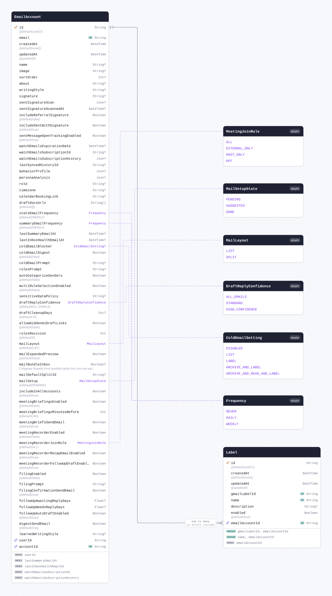

| Field            | Type       | Constraints                                       | Default      | Description |
| ---------------- | ---------- | ------------------------------------------------- | ------------ | ----------- |
| `id`             | `String`   | PK NOT NULL                                       | `cuid(1)`    |             |
| `createdAt`      | `DateTime` | NOT NULL                                          | `now()`      |             |
| `updatedAt`      | `DateTime` | NOT NULL                                          | `@updatedAt` |             |
| `gmailLabelId`   | `String`   | NOT NULL                                          |              |             |
| `name`           | `String`   | NOT NULL                                          |              |             |
| `description`    | `String`   | NULL                                              |              |             |
| `enabled`        | `Boolean`  | NOT NULL                                          | `true`       |             |
| `emailAccountId` | `String`   | NOT NULL → [EmailAccount.id](#model-EmailAccount) |              |             |

#### Indexes

- `@@index([emailAccountId])`
- `@@unique([gmailLabelId, emailAccountId])`
- `@@unique([name, emailAccountId])`

#### References

- `emailAccountId` → [EmailAccount.id](#model-EmailAccount) (many-to-one, on delete Cascade)

#### Definition

```sql
CREATE TABLE "Label" (
    "id" TEXT NOT NULL,
    "createdAt" TIMESTAMP(3) NOT NULL DEFAULT CURRENT_TIMESTAMP,
    "updatedAt" TIMESTAMP(3) NOT NULL,
    "gmailLabelId" TEXT NOT NULL,
    "name" TEXT NOT NULL,
    "description" TEXT,
    "enabled" BOOLEAN NOT NULL DEFAULT true,
    "emailAccountId" TEXT NOT NULL,

    CONSTRAINT "Label_pkey" PRIMARY KEY ("id")
);

CREATE INDEX "Label_emailAccountId_idx" ON "Label"("emailAccountId");

CREATE UNIQUE INDEX "Label_gmailLabelId_emailAccountId_key" ON "Label"("gmailLabelId", "emailAccountId");

CREATE UNIQUE INDEX "Label_name_emailAccountId_key" ON "Label"("name", "emailAccountId");

ALTER TABLE "Label" ADD CONSTRAINT "Label_emailAccountId_fkey" FOREIGN KEY ("emailAccountId") REFERENCES "EmailAccount"("id") ON DELETE CASCADE ON UPDATE CASCADE;
```

<details>
<summary>Queries and their SQL</summary>

**findMany**: Every row

```ts
await prisma.label.findMany();
```

```sql
SELECT
  "public"."Label"."id",
  "public"."Label"."createdAt",
  "public"."Label"."updatedAt",
  "public"."Label"."gmailLabelId",
  "public"."Label"."name",
  "public"."Label"."description",
  "public"."Label"."enabled",
  "public"."Label"."emailAccountId"
FROM
  "public"."Label"
WHERE
  1 = 1
OFFSET
  $1
-- params: ["0"]
```

**count**: How many rows there are

```ts
await prisma.label.count();
```

```sql
SELECT
  COUNT(*) AS "_count$_all"
FROM
  (
    SELECT
      "public"."Label"."id"
    FROM
      "public"."Label"
    WHERE
      1 = 1
    OFFSET
      $1
  ) AS "sub"
-- params: ["0"]
```

**findMany**: Every row with its relations

```ts
await prisma.label.findMany({ include: { emailAccount: true } });
```

```sql
SELECT
  "public"."Label"."id",
  "public"."Label"."createdAt",
  "public"."Label"."updatedAt",
  "public"."Label"."gmailLabelId",
  "public"."Label"."name",
  "public"."Label"."description",
  "public"."Label"."enabled",
  "public"."Label"."emailAccountId"
FROM
  "public"."Label"
WHERE
  1 = 1
OFFSET
  $1
-- params: ["0"]

SELECT
  "public"."EmailAccount"."id",
  "public"."EmailAccount"."email",
  "public"."EmailAccount"."createdAt",
  "public"."EmailAccount"."updatedAt",
  "public"."EmailAccount"."name",
  "public"."EmailAccount"."image",
  "public"."EmailAccount"."sortOrder",
  "public"."EmailAccount"."about",
  "public"."EmailAccount"."writingStyle",
  "public"."EmailAccount"."signature",
  "public"."EmailAccount"."sentSignatureScan",
  "public"."EmailAccount"."sentSignatureScannedAt",
  "public"."EmailAccount"."includeReferralSignature",
  "public"."EmailAccount"."includeSentWithSignature",
  "public"."EmailAccount"."sentMessageOpenTrackingEnabled",
  "public"."EmailAccount"."watchEmailsExpirationDate",
  "public"."EmailAccount"."watchEmailsSubscriptionId",
  "public"."EmailAccount"."watchEmailsSubscriptionHistory",
  "public"."EmailAccount"."lastSyncedHistoryId",
  "public"."EmailAccount"."behaviorProfile",
  "public"."EmailAccount"."personaAnalysis",
  "public"."EmailAccount"."role",
  "public"."EmailAccount"."timezone",
  "public"."EmailAccount"."calendarBookingLink",
  "public"."EmailAccount"."draftDocsUrls",
  "public"."EmailAccount"."statsEmailFrequency"::text,
  "public"."EmailAccount"."summaryEmailFrequency"::text,
  "public"."EmailAccount"."lastSummaryEmailAt",
  "public"."EmailAccount"."lastInboxHealthEmailAt",
  "public"."EmailAccount"."coldEmailBlocker"::text,
  "public"."EmailAccount"."coldEmailDigest",
  "public"."EmailAccount"."coldEmailPrompt",
  "public"."EmailAccount"."rulesPrompt",
  "public"."EmailAccount"."autoCategorizeSenders",
  "public"."EmailAccount"."multiRuleSelectionEnabled",
  "public"."EmailAccount"."sensitiveDataPolicy",
  "public"."EmailAccount"."draftReplyConfidence"::text,
  "public"."EmailAccount"."draftCleanupDays",
  "public"."EmailAccount"."allowHiddenAiDraftLinks",
  "public"."EmailAccount"."rulesRevision",
  "public"."EmailAccount"."mailLayout"::text,
  "public"."EmailAccount"."mailExpandedPreview",
  "public"."EmailAccount"."mailBundleInbox",
  "public"."EmailAccount"."mailDefaultSplitId",
  "public"."EmailAccount"."mailSetup"::text,
  "public"."EmailAccount"."includeInAllAccounts",
  "public"."EmailAccount"."meetingBriefingsEnabled",
  "public"."EmailAccount"."meetingBriefingsMinutesBefore",
  "public"."EmailAccount"."meetingBriefsSendEmail",
  "public"."EmailAccount"."meetingRecorderEnabled",
  "public"."EmailAccount"."meetingRecorderJoinRule"::text,
  "public"."EmailAccount"."meetingRecorderRecapEmailEnabled",
  "public"."EmailAccount"."meetingRecorderFollowUpDraftEnabled",
  "public"."EmailAccount"."filingEnabled",
  "public"."EmailAccount"."filingPrompt",
  "public"."EmailAccount"."filingConfirmationSendEmail",
  "public"."EmailAccount"."followUpAwaitingReplyDays",
  "public"."EmailAccount"."followUpNeedsReplyDays",
  "public"."EmailAccount"."followUpAutoDraftEnabled",
  "public"."EmailAccount"."digestSendEmail",
  "public"."EmailAccount"."learnedWritingStyle",
  "public"."EmailAccount"."userId",
  "public"."EmailAccount"."accountId"
FROM
  "public"."EmailAccount"
WHERE
  "public"."EmailAccount"."id" IN ($1)
OFFSET
  $2
-- params: ["<emailAccountId of the rows above>","0"]
```

**findUnique**: One row by what is unique to it

```ts
await prisma.label.findUnique({ where: { id: "example" } });
```

```sql
SELECT
  "public"."Label"."id",
  "public"."Label"."createdAt",
  "public"."Label"."updatedAt",
  "public"."Label"."gmailLabelId",
  "public"."Label"."name",
  "public"."Label"."description",
  "public"."Label"."enabled",
  "public"."Label"."emailAccountId"
FROM
  "public"."Label"
WHERE
  (
    "public"."Label"."id" = $1
    AND 1 = 1
  )
LIMIT
  $2
OFFSET
  $3
-- params: ["example","1","0"]
```

**create**: Create a row

```ts
await prisma.label.create({
  data: { gmailLabelId: "example", name: "example", emailAccountId: "example" },
});
```

```sql
INSERT INTO
  "public"."Label" (
    "id",
    "createdAt",
    "updatedAt",
    "gmailLabelId",
    "name",
    "enabled",
    "emailAccountId"
  )
VALUES
  ($1, $2, $3, $4, $5, $6, $7)
RETURNING
  "public"."Label"."id",
  "public"."Label"."createdAt",
  "public"."Label"."updatedAt",
  "public"."Label"."gmailLabelId",
  "public"."Label"."name",
  "public"."Label"."description",
  "public"."Label"."enabled",
  "public"."Label"."emailAccountId"
-- params: ["<cuid(1)>","<now()>","<now()>","example","example",true,"example"]
```

**update**: Update a row

```ts
await prisma.label.update({
  where: { id: "example" },
  data: { createdAt: new Date("2026-01-01T00:00:00.000Z") },
});
```

```sql
UPDATE "public"."Label"
SET
  "createdAt" = $1,
  "updatedAt" = $2
WHERE
  (
    "public"."Label"."id" = $3
    AND 1 = 1
  )
RETURNING
  "public"."Label"."id",
  "public"."Label"."createdAt",
  "public"."Label"."updatedAt",
  "public"."Label"."gmailLabelId",
  "public"."Label"."name",
  "public"."Label"."description",
  "public"."Label"."enabled",
  "public"."Label"."emailAccountId"
-- params: ["2026-01-01T00:00:00.000Z",{"prisma__type":"generatorCall","prisma__value":{"name":"now","args":[],"returnType":{"type":"DateTime"}}},"example"]
```

**delete**: Delete a row

```ts
await prisma.label.delete({ where: { id: "example" } });
```

```sql
DELETE FROM "public"."Label"
WHERE
  (
    "public"."Label"."id" = $1
    AND 1 = 1
  )
RETURNING
  "public"."Label"."id",
  "public"."Label"."createdAt",
  "public"."Label"."updatedAt",
  "public"."Label"."gmailLabelId",
  "public"."Label"."name",
  "public"."Label"."description",
  "public"."Label"."enabled",
  "public"."Label"."emailAccountId"
-- params: ["example"]
```

</details>

<a id="model-Rule"></a>

### Rule

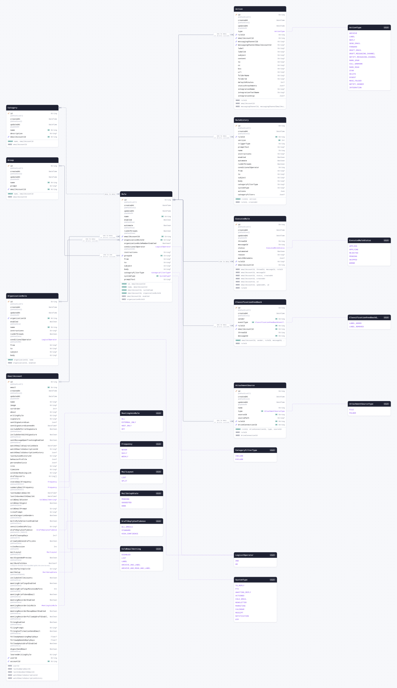

| Field                           | Type                                             | Constraints                                           | Default      | Description |
| ------------------------------- | ------------------------------------------------ | ----------------------------------------------------- | ------------ | ----------- |
| `id`                            | `String`                                         | PK NOT NULL                                           | `cuid(1)`    |             |
| `createdAt`                     | `DateTime`                                       | NOT NULL                                              | `now()`      |             |
| `updatedAt`                     | `DateTime`                                       | NOT NULL                                              | `@updatedAt` |             |
| `name`                          | `String`                                         | NOT NULL                                              |              |             |
| `enabled`                       | `Boolean`                                        | NOT NULL                                              | `true`       |             |
| `automate`                      | `Boolean`                                        | NOT NULL                                              | `true`       |             |
| `runOnThreads`                  | `Boolean`                                        | NOT NULL                                              | `false`      |             |
| `emailAccountId`                | `String`                                         | NOT NULL → [EmailAccount.id](#model-EmailAccount)     |              |             |
| `organizationRuleId`            | `String`                                         | NULL → [OrganizationRule.id](#model-OrganizationRule) |              |             |
| `organizationRuleMemberEnabled` | `Boolean`                                        | NULL                                                  |              |             |
| `conditionalOperator`           | [`LogicalOperator`](#enum-LogicalOperator)       | NOT NULL                                              | `AND`        |             |
| `instructions`                  | `String`                                         | NULL                                                  |              |             |
| `groupId`                       | `String`                                         | UNIQUE NULL → [Group.id](#model-Group)                |              |             |
| `from`                          | `String`                                         | NULL                                                  |              |             |
| `to`                            | `String`                                         | NULL                                                  |              |             |
| `subject`                       | `String`                                         | NULL                                                  |              |             |
| `body`                          | `String`                                         | NULL                                                  |              |             |
| `categoryFilterType`            | [`CategoryFilterType`](#enum-CategoryFilterType) | NULL                                                  |              |             |
| `systemType`                    | [`SystemType`](#enum-SystemType)                 | NULL                                                  |              |             |
| `promptText`                    | `String`                                         | NULL                                                  |              |             |

#### Indexes

- `@@index([emailAccountId, enabled])`
- `@@index([organizationRuleId])`
- `@@unique([id, emailAccountId])`
- `@@unique([name, emailAccountId])`
- `@@unique([emailAccountId, systemType])`
- `@@unique([emailAccountId, organizationRuleId])`

#### References

- `emailAccountId` → [EmailAccount.id](#model-EmailAccount) (many-to-one, on delete Cascade)
- `organizationRuleId` → [OrganizationRule.id](#model-OrganizationRule) (many-to-one, on delete Cascade)
- `groupId` → [Group.id](#model-Group) (one-to-one, on delete Cascade)

#### Referenced by

- `id` ← [Action.ruleId](#model-Action) (one-to-many, on delete Cascade)
- `id` ← [RuleHistory.ruleId](#model-RuleHistory) (one-to-many, on delete Cascade)
- `id` ← [ExecutedRule.ruleId](#model-ExecutedRule) (one-to-many)
- `id` ← [ClassificationFeedback.ruleId](#model-ClassificationFeedback) (one-to-many, on delete Cascade)
- `id` ← [AttachmentSource.ruleId](#model-AttachmentSource) (one-to-many, on delete Cascade)

#### Many to many

- `categoryFilters` ↔ [Category.rules](#model-Category) through `_CategoryToRule`

#### Definition

```sql
CREATE TABLE "Rule" (
    "id" TEXT NOT NULL,
    "createdAt" TIMESTAMP(3) NOT NULL DEFAULT CURRENT_TIMESTAMP,
    "updatedAt" TIMESTAMP(3) NOT NULL,
    "name" TEXT NOT NULL,
    "enabled" BOOLEAN NOT NULL DEFAULT true,
    "automate" BOOLEAN NOT NULL DEFAULT true,
    "runOnThreads" BOOLEAN NOT NULL DEFAULT false,
    "emailAccountId" TEXT NOT NULL,
    "organizationRuleId" TEXT,
    "organizationRuleMemberEnabled" BOOLEAN,
    "conditionalOperator" "LogicalOperator" NOT NULL DEFAULT 'AND',
    "instructions" TEXT,
    "groupId" TEXT,
    "from" TEXT,
    "to" TEXT,
    "subject" TEXT,
    "body" TEXT,
    "categoryFilterType" "CategoryFilterType",
    "systemType" "SystemType",
    "promptText" TEXT,

    CONSTRAINT "Rule_pkey" PRIMARY KEY ("id")
);

CREATE UNIQUE INDEX "Rule_groupId_key" ON "Rule"("groupId");

CREATE INDEX "Rule_emailAccountId_enabled_idx" ON "Rule"("emailAccountId", "enabled");

CREATE INDEX "Rule_organizationRuleId_idx" ON "Rule"("organizationRuleId");

CREATE UNIQUE INDEX "Rule_id_emailAccountId_key" ON "Rule"("id", "emailAccountId");

CREATE UNIQUE INDEX "Rule_name_emailAccountId_key" ON "Rule"("name", "emailAccountId");

CREATE UNIQUE INDEX "Rule_emailAccountId_systemType_key" ON "Rule"("emailAccountId", "systemType");

CREATE UNIQUE INDEX "Rule_emailAccountId_organizationRuleId_key" ON "Rule"("emailAccountId", "organizationRuleId");

ALTER TABLE "Rule" ADD CONSTRAINT "Rule_emailAccountId_fkey" FOREIGN KEY ("emailAccountId") REFERENCES "EmailAccount"("id") ON DELETE CASCADE ON UPDATE CASCADE;

ALTER TABLE "Rule" ADD CONSTRAINT "Rule_organizationRuleId_fkey" FOREIGN KEY ("organizationRuleId") REFERENCES "OrganizationRule"("id") ON DELETE CASCADE ON UPDATE CASCADE;

ALTER TABLE "Rule" ADD CONSTRAINT "Rule_groupId_fkey" FOREIGN KEY ("groupId") REFERENCES "Group"("id") ON DELETE CASCADE ON UPDATE CASCADE;
```

<details>
<summary>Queries and their SQL</summary>

**findMany**: Every row

```ts
await prisma.rule.findMany();
```

```sql
SELECT
  "public"."Rule"."id",
  "public"."Rule"."createdAt",
  "public"."Rule"."updatedAt",
  "public"."Rule"."name",
  "public"."Rule"."enabled",
  "public"."Rule"."automate",
  "public"."Rule"."runOnThreads",
  "public"."Rule"."emailAccountId",
  "public"."Rule"."organizationRuleId",
  "public"."Rule"."organizationRuleMemberEnabled",
  "public"."Rule"."conditionalOperator"::text,
  "public"."Rule"."instructions",
  "public"."Rule"."groupId",
  "public"."Rule"."from",
  "public"."Rule"."to",
  "public"."Rule"."subject",
  "public"."Rule"."body",
  "public"."Rule"."categoryFilterType"::text,
  "public"."Rule"."systemType"::text,
  "public"."Rule"."promptText"
FROM
  "public"."Rule"
WHERE
  1 = 1
OFFSET
  $1
-- params: ["0"]
```

**count**: How many rows there are

```ts
await prisma.rule.count();
```

```sql
SELECT
  COUNT(*) AS "_count$_all"
FROM
  (
    SELECT
      "public"."Rule"."id"
    FROM
      "public"."Rule"
    WHERE
      1 = 1
    OFFSET
      $1
  ) AS "sub"
-- params: ["0"]
```

**findMany**: Every row with its relations

```ts
await prisma.rule.findMany({
  include: {
    actions: true,
    attachmentSources: true,
    emailAccount: true,
    organizationRule: true,
    executedRules: true,
    classificationFeedback: true,
    group: true,
    categoryFilters: true,
    history: true,
  },
});
```

```sql
SELECT
  "public"."Rule"."id",
  "public"."Rule"."createdAt",
  "public"."Rule"."updatedAt",
  "public"."Rule"."name",
  "public"."Rule"."enabled",
  "public"."Rule"."automate",
  "public"."Rule"."runOnThreads",
  "public"."Rule"."emailAccountId",
  "public"."Rule"."organizationRuleId",
  "public"."Rule"."organizationRuleMemberEnabled",
  "public"."Rule"."conditionalOperator"::text,
  "public"."Rule"."instructions",
  "public"."Rule"."groupId",
  "public"."Rule"."from",
  "public"."Rule"."to",
  "public"."Rule"."subject",
  "public"."Rule"."body",
  "public"."Rule"."categoryFilterType"::text,
  "public"."Rule"."systemType"::text,
  "public"."Rule"."promptText"
FROM
  "public"."Rule"
WHERE
  1 = 1
OFFSET
  $1
-- params: ["0"]

SELECT
  "public"."Action"."id",
  "public"."Action"."createdAt",
  "public"."Action"."updatedAt",
  "public"."Action"."type"::text,
  "public"."Action"."ruleId",
  "public"."Action"."emailAccountId",
  "public"."Action"."messagingChannelId",
  "public"."Action"."messagingChannelEmailAccountId",
  "public"."Action"."label",
  "public"."Action"."labelId",
  "public"."Action"."subject",
  "public"."Action"."content",
  "public"."Action"."to",
  "public"."Action"."cc",
  "public"."Action"."bcc",
  "public"."Action"."url",
  "public"."Action"."folderName",
  "public"."Action"."folderId",
  "public"."Action"."delayInMinutes",
  "public"."Action"."staticAttachments",
  "public"."Action"."integrationName",
  "public"."Action"."integrationToolName",
  "public"."Action"."integrationArgs"
FROM
  "public"."Action"
WHERE
  (
    "public"."Action"."ruleId" IN ($1)
    AND "public"."Action"."emailAccountId" IN ($2)
  )
OFFSET
  $3
-- params: ["<id of the rows above>","<emailAccountId of the rows above>","0"]

SELECT
  "public"."AttachmentSource"."id",
  "public"."AttachmentSource"."createdAt",
  "public"."AttachmentSource"."updatedAt",
  "public"."AttachmentSource"."name",
  "public"."AttachmentSource"."type"::text,
  "public"."AttachmentSource"."sourceId",
  "public"."AttachmentSource"."sourcePath",
  "public"."AttachmentSource"."ruleId",
  "public"."AttachmentSource"."driveConnectionId"
FROM
  "public"."AttachmentSource"
WHERE
  "public"."AttachmentSource"."ruleId" IN ($1)
OFFSET
  $2
-- params: ["<id of the rows above>","0"]

SELECT
  "public"."EmailAccount"."id",
  "public"."EmailAccount"."email",
  "public"."EmailAccount"."createdAt",
  "public"."EmailAccount"."updatedAt",
  "public"."EmailAccount"."name",
  "public"."EmailAccount"."image",
  "public"."EmailAccount"."sortOrder",
  "public"."EmailAccount"."about",
  "public"."EmailAccount"."writingStyle",
  "public"."EmailAccount"."signature",
  "public"."EmailAccount"."sentSignatureScan",
  "public"."EmailAccount"."sentSignatureScannedAt",
  "public"."EmailAccount"."includeReferralSignature",
  "public"."EmailAccount"."includeSentWithSignature",
  "public"."EmailAccount"."sentMessageOpenTrackingEnabled",
  "public"."EmailAccount"."watchEmailsExpirationDate",
  "public"."EmailAccount"."watchEmailsSubscriptionId",
  "public"."EmailAccount"."watchEmailsSubscriptionHistory",
  "public"."EmailAccount"."lastSyncedHistoryId",
  "public"."EmailAccount"."behaviorProfile",
  "public"."EmailAccount"."personaAnalysis",
  "public"."EmailAccount"."role",
  "public"."EmailAccount"."timezone",
  "public"."EmailAccount"."calendarBookingLink",
  "public"."EmailAccount"."draftDocsUrls",
  "public"."EmailAccount"."statsEmailFrequency"::text,
  "public"."EmailAccount"."summaryEmailFrequency"::text,
  "public"."EmailAccount"."lastSummaryEmailAt",
  "public"."EmailAccount"."lastInboxHealthEmailAt",
  "public"."EmailAccount"."coldEmailBlocker"::text,
  "public"."EmailAccount"."coldEmailDigest",
  "public"."EmailAccount"."coldEmailPrompt",
  "public"."EmailAccount"."rulesPrompt",
  "public"."EmailAccount"."autoCategorizeSenders",
  "public"."EmailAccount"."multiRuleSelectionEnabled",
  "public"."EmailAccount"."sensitiveDataPolicy",
  "public"."EmailAccount"."draftReplyConfidence"::text,
  "public"."EmailAccount"."draftCleanupDays",
  "public"."EmailAccount"."allowHiddenAiDraftLinks",
  "public"."EmailAccount"."rulesRevision",
  "public"."EmailAccount"."mailLayout"::text,
  "public"."EmailAccount"."mailExpandedPreview",
  "public"."EmailAccount"."mailBundleInbox",
  "public"."EmailAccount"."mailDefaultSplitId",
  "public"."EmailAccount"."mailSetup"::text,
  "public"."EmailAccount"."includeInAllAccounts",
  "public"."EmailAccount"."meetingBriefingsEnabled",
  "public"."EmailAccount"."meetingBriefingsMinutesBefore",
  "public"."EmailAccount"."meetingBriefsSendEmail",
  "public"."EmailAccount"."meetingRecorderEnabled",
  "public"."EmailAccount"."meetingRecorderJoinRule"::text,
  "public"."EmailAccount"."meetingRecorderRecapEmailEnabled",
  "public"."EmailAccount"."meetingRecorderFollowUpDraftEnabled",
  "public"."EmailAccount"."filingEnabled",
  "public"."EmailAccount"."filingPrompt",
  "public"."EmailAccount"."filingConfirmationSendEmail",
  "public"."EmailAccount"."followUpAwaitingReplyDays",
  "public"."EmailAccount"."followUpNeedsReplyDays",
  "public"."EmailAccount"."followUpAutoDraftEnabled",
  "public"."EmailAccount"."digestSendEmail",
  "public"."EmailAccount"."learnedWritingStyle",
  "public"."EmailAccount"."userId",
  "public"."EmailAccount"."accountId"
FROM
  "public"."EmailAccount"
WHERE
  "public"."EmailAccount"."id" IN ($1)
OFFSET
  $2
-- params: ["<emailAccountId of the rows above>","0"]

SELECT
  "public"."OrganizationRule"."id",
  "public"."OrganizationRule"."createdAt",
  "public"."OrganizationRule"."updatedAt",
  "public"."OrganizationRule"."organizationId",
  "public"."OrganizationRule"."enabled",
  "public"."OrganizationRule"."name",
  "public"."OrganizationRule"."instructions",
  "public"."OrganizationRule"."runOnThreads",
  "public"."OrganizationRule"."conditionalOperator"::text,
  "public"."OrganizationRule"."from",
  "public"."OrganizationRule"."to",
  "public"."OrganizationRule"."subject",
  "public"."OrganizationRule"."body"
FROM
  "public"."OrganizationRule"
WHERE
  "public"."OrganizationRule"."id" IN ($1)
OFFSET
  $2
-- params: ["<organizationRuleId of the rows above>","0"]

SELECT
  "public"."ExecutedRule"."id",
  "public"."ExecutedRule"."createdAt",
  "public"."ExecutedRule"."updatedAt",
  "public"."ExecutedRule"."threadId",
  "public"."ExecutedRule"."messageId",
  "public"."ExecutedRule"."status"::text,
  "public"."ExecutedRule"."automated",
  "public"."ExecutedRule"."reason",
  "public"."ExecutedRule"."matchMetadata",
  "public"."ExecutedRule"."ruleId",
  "public"."ExecutedRule"."emailAccountId"
FROM
  "public"."ExecutedRule"
WHERE
  "public"."ExecutedRule"."ruleId" IN ($1)
OFFSET
  $2
-- params: ["<id of the rows above>","0"]

SELECT
  "public"."ClassificationFeedback"."id",
  "public"."ClassificationFeedback"."createdAt",
  "public"."ClassificationFeedback"."sender",
  "public"."ClassificationFeedback"."eventType"::text,
  "public"."ClassificationFeedback"."ruleId",
  "public"."ClassificationFeedback"."emailAccountId",
  "public"."ClassificationFeedback"."threadId",
  "public"."ClassificationFeedback"."messageId"
FROM
  "public"."ClassificationFeedback"
WHERE
  "public"."ClassificationFeedback"."ruleId" IN ($1)
OFFSET
  $2
-- params: ["<id of the rows above>","0"]

SELECT
  "public"."Group"."id",
  "public"."Group"."createdAt",
  "public"."Group"."updatedAt",
  "public"."Group"."name",
  "public"."Group"."prompt",
  "public"."Group"."emailAccountId"
FROM
  "public"."Group"
WHERE
  "public"."Group"."id" IN ($1)
OFFSET
  $2
-- params: ["<groupId of the rows above>","0"]

SELECT
  "public"."Category"."id",
  "public"."Category"."createdAt",
  "public"."Category"."updatedAt",
  "public"."Category"."name",
  "public"."Category"."description",
  "public"."Category"."emailAccountId",
  "t0"."B" AS "CategoryToRule@Rule"
FROM
  "public"."Category"
  INNER JOIN "public"."_CategoryToRule" AS "t0" ON "t0"."A" = "public"."Category"."id"
WHERE
  (
    1 = 1
    AND "t0"."B" IN ($1)
  )
OFFSET
  $2
-- params: ["<id of the rows above>","0"]

SELECT
  "public"."RuleHistory"."id",
  "public"."RuleHistory"."createdAt",
  "public"."RuleHistory"."ruleId",
  "public"."RuleHistory"."version",
  "public"."RuleHistory"."triggerType",
  "public"."RuleHistory"."promptText",
  "public"."RuleHistory"."name",
  "public"."RuleHistory"."instructions",
  "public"."RuleHistory"."enabled",
  "public"."RuleHistory"."automate",
  "public"."RuleHistory"."runOnThreads",
  "public"."RuleHistory"."conditionalOperator",
  "public"."RuleHistory"."from",
  "public"."RuleHistory"."to",
  "public"."RuleHistory"."subject",
  "public"."RuleHistory"."body",
  "public"."RuleHistory"."categoryFilterType",
  "public"."RuleHistory"."systemType",
  "public"."RuleHistory"."actions",
  "public"."RuleHistory"."categoryFilters"
FROM
  "public"."RuleHistory"
WHERE
  "public"."RuleHistory"."ruleId" IN ($1)
OFFSET
  $2
-- params: ["<id of the rows above>","0"]
```

**findUnique**: One row by what is unique to it

```ts
await prisma.rule.findUnique({ where: { id: "example" } });
```

```sql
SELECT
  "public"."Rule"."id",
  "public"."Rule"."createdAt",
  "public"."Rule"."updatedAt",
  "public"."Rule"."name",
  "public"."Rule"."enabled",
  "public"."Rule"."automate",
  "public"."Rule"."runOnThreads",
  "public"."Rule"."emailAccountId",
  "public"."Rule"."organizationRuleId",
  "public"."Rule"."organizationRuleMemberEnabled",
  "public"."Rule"."conditionalOperator"::text,
  "public"."Rule"."instructions",
  "public"."Rule"."groupId",
  "public"."Rule"."from",
  "public"."Rule"."to",
  "public"."Rule"."subject",
  "public"."Rule"."body",
  "public"."Rule"."categoryFilterType"::text,
  "public"."Rule"."systemType"::text,
  "public"."Rule"."promptText"
FROM
  "public"."Rule"
WHERE
  (
    "public"."Rule"."id" = $1
    AND 1 = 1
  )
LIMIT
  $2
OFFSET
  $3
-- params: ["example","1","0"]
```

**create**: Create a row

```ts
await prisma.rule.create({ data: { name: "example", emailAccountId: "example" } });
```

```sql
INSERT INTO
  "public"."Rule" (
    "id",
    "createdAt",
    "updatedAt",
    "name",
    "enabled",
    "automate",
    "runOnThreads",
    "emailAccountId",
    "conditionalOperator"
  )
VALUES
  (
    $1,
    $2,
    $3,
    $4,
    $5,
    $6,
    $7,
    $8,
    CAST($9::text AS "public"."LogicalOperator")
  )
RETURNING
  "public"."Rule"."id",
  "public"."Rule"."createdAt",
  "public"."Rule"."updatedAt",
  "public"."Rule"."name",
  "public"."Rule"."enabled",
  "public"."Rule"."automate",
  "public"."Rule"."runOnThreads",
  "public"."Rule"."emailAccountId",
  "public"."Rule"."organizationRuleId",
  "public"."Rule"."organizationRuleMemberEnabled",
  "public"."Rule"."conditionalOperator"::text,
  "public"."Rule"."instructions",
  "public"."Rule"."groupId",
  "public"."Rule"."from",
  "public"."Rule"."to",
  "public"."Rule"."subject",
  "public"."Rule"."body",
  "public"."Rule"."categoryFilterType"::text,
  "public"."Rule"."systemType"::text,
  "public"."Rule"."promptText"
-- params: ["<cuid(1)>","<now()>","<now()>","example",true,true,false,"example","AND"]
```

**update**: Update a row

```ts
await prisma.rule.update({
  where: { id: "example" },
  data: { createdAt: new Date("2026-01-01T00:00:00.000Z") },
});
```

```sql
UPDATE "public"."Rule"
SET
  "createdAt" = $1,
  "updatedAt" = $2
WHERE
  (
    "public"."Rule"."id" = $3
    AND 1 = 1
  )
RETURNING
  "public"."Rule"."id",
  "public"."Rule"."createdAt",
  "public"."Rule"."updatedAt",
  "public"."Rule"."name",
  "public"."Rule"."enabled",
  "public"."Rule"."automate",
  "public"."Rule"."runOnThreads",
  "public"."Rule"."emailAccountId",
  "public"."Rule"."organizationRuleId",
  "public"."Rule"."organizationRuleMemberEnabled",
  "public"."Rule"."conditionalOperator"::text,
  "public"."Rule"."instructions",
  "public"."Rule"."groupId",
  "public"."Rule"."from",
  "public"."Rule"."to",
  "public"."Rule"."subject",
  "public"."Rule"."body",
  "public"."Rule"."categoryFilterType"::text,
  "public"."Rule"."systemType"::text,
  "public"."Rule"."promptText"
-- params: ["2026-01-01T00:00:00.000Z",{"prisma__type":"generatorCall","prisma__value":{"name":"now","args":[],"returnType":{"type":"DateTime"}}},"example"]
```

**delete**: Delete a row

```ts
await prisma.rule.delete({ where: { id: "example" } });
```

```sql
DELETE FROM "public"."Rule"
WHERE
  (
    "public"."Rule"."id" = $1
    AND 1 = 1
  )
RETURNING
  "public"."Rule"."id",
  "public"."Rule"."createdAt",
  "public"."Rule"."updatedAt",
  "public"."Rule"."name",
  "public"."Rule"."enabled",
  "public"."Rule"."automate",
  "public"."Rule"."runOnThreads",
  "public"."Rule"."emailAccountId",
  "public"."Rule"."organizationRuleId",
  "public"."Rule"."organizationRuleMemberEnabled",
  "public"."Rule"."conditionalOperator"::text,
  "public"."Rule"."instructions",
  "public"."Rule"."groupId",
  "public"."Rule"."from",
  "public"."Rule"."to",
  "public"."Rule"."subject",
  "public"."Rule"."body",
  "public"."Rule"."categoryFilterType"::text,
  "public"."Rule"."systemType"::text,
  "public"."Rule"."promptText"
-- params: ["example"]
```

</details>

<a id="model-Action"></a>

### Action

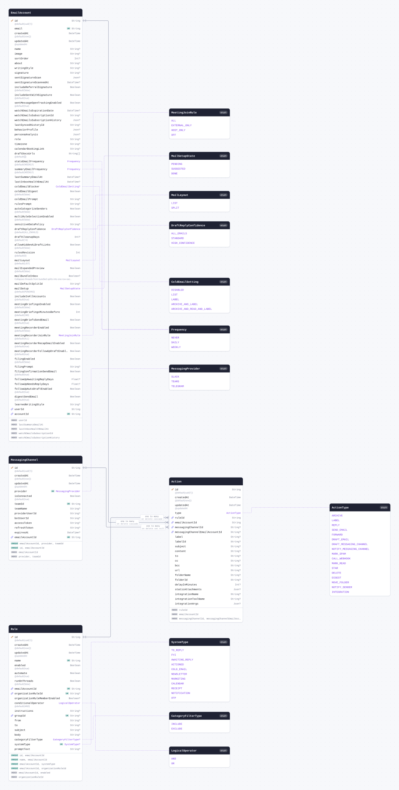

| Field                            | Type                             | Constraints                                                       | Default      | Description |
| -------------------------------- | -------------------------------- | ----------------------------------------------------------------- | ------------ | ----------- |
| `id`                             | `String`                         | PK NOT NULL                                                       | `cuid(1)`    |             |
| `createdAt`                      | `DateTime`                       | NOT NULL                                                          | `now()`      |             |
| `updatedAt`                      | `DateTime`                       | NOT NULL                                                          | `@updatedAt` |             |
| `type`                           | [`ActionType`](#enum-ActionType) | NOT NULL                                                          |              |             |
| `ruleId`                         | `String`                         | NOT NULL → [Rule.id](#model-Rule)                                 |              |             |
| `emailAccountId`                 | `String`                         | NOT NULL → [Rule.emailAccountId](#model-Rule)                     |              |             |
| `messagingChannelId`             | `String`                         | NULL → [MessagingChannel.id](#model-MessagingChannel)             |              |             |
| `messagingChannelEmailAccountId` | `String`                         | NULL → [MessagingChannel.emailAccountId](#model-MessagingChannel) |              |             |
| `label`                          | `String`                         | NULL                                                              |              |             |
| `labelId`                        | `String`                         | NULL                                                              |              |             |
| `subject`                        | `String`                         | NULL                                                              |              |             |
| `content`                        | `String`                         | NULL                                                              |              |             |
| `to`                             | `String`                         | NULL                                                              |              |             |
| `cc`                             | `String`                         | NULL                                                              |              |             |
| `bcc`                            | `String`                         | NULL                                                              |              |             |
| `url`                            | `String`                         | NULL                                                              |              |             |
| `folderName`                     | `String`                         | NULL                                                              |              |             |
| `folderId`                       | `String`                         | NULL                                                              |              |             |
| `delayInMinutes`                 | `Int`                            | NULL                                                              |              |             |
| `staticAttachments`              | `Json`                           | NULL                                                              |              |             |
| `integrationName`                | `String`                         | NULL                                                              |              |             |
| `integrationToolName`            | `String`                         | NULL                                                              |              |             |
| `integrationArgs`                | `Json`                           | NULL                                                              |              |             |

#### Indexes

- `@@index([ruleId])`
- `@@index([emailAccountId])`
- `@@index([messagingChannelId, messagingChannelEmailAccountId])`

#### References

- `ruleId` → [Rule.id](#model-Rule) (many-to-one, on delete Cascade)
- `emailAccountId` → [EmailAccount.id](#model-EmailAccount) (many-to-one, on delete Cascade)
- `messagingChannelId` → [MessagingChannel.id](#model-MessagingChannel) (many-to-one, on delete SetNull)

#### Definition

```sql
CREATE TABLE "Action" (
    "id" TEXT NOT NULL,
    "createdAt" TIMESTAMP(3) NOT NULL DEFAULT CURRENT_TIMESTAMP,
    "updatedAt" TIMESTAMP(3) NOT NULL,
    "type" "ActionType" NOT NULL,
    "ruleId" TEXT NOT NULL,
    "emailAccountId" TEXT NOT NULL,
    "messagingChannelId" TEXT,
    "messagingChannelEmailAccountId" TEXT,
    "label" TEXT,
    "labelId" TEXT,
    "subject" TEXT,
    "content" TEXT,
    "to" TEXT,
    "cc" TEXT,
    "bcc" TEXT,
    "url" TEXT,
    "folderName" TEXT,
    "folderId" TEXT,
    "delayInMinutes" INTEGER,
    "staticAttachments" JSONB,
    "integrationName" TEXT,
    "integrationToolName" TEXT,
    "integrationArgs" JSONB,

    CONSTRAINT "Action_pkey" PRIMARY KEY ("id")
);

CREATE INDEX "Action_ruleId_idx" ON "Action"("ruleId");

CREATE INDEX "Action_emailAccountId_idx" ON "Action"("emailAccountId");

CREATE INDEX "Action_messagingChannelId_messagingChannelEmailAccountId_idx" ON "Action"("messagingChannelId", "messagingChannelEmailAccountId");

ALTER TABLE "Action" ADD CONSTRAINT "Action_ruleId_emailAccountId_fkey" FOREIGN KEY ("ruleId", "emailAccountId") REFERENCES "Rule"("id", "emailAccountId") ON DELETE CASCADE ON UPDATE CASCADE;

ALTER TABLE "Action" ADD CONSTRAINT "Action_emailAccountId_fkey" FOREIGN KEY ("emailAccountId") REFERENCES "EmailAccount"("id") ON DELETE CASCADE ON UPDATE CASCADE;

ALTER TABLE "Action" ADD CONSTRAINT "Action_messagingChannelId_messagingChannelEmailAccountId_fkey" FOREIGN KEY ("messagingChannelId", "messagingChannelEmailAccountId") REFERENCES "MessagingChannel"("id", "emailAccountId") ON DELETE SET NULL ON UPDATE CASCADE;
```

<details>
<summary>Queries and their SQL</summary>

**findMany**: Every row

```ts
await prisma.action.findMany();
```

```sql
SELECT
  "public"."Action"."id",
  "public"."Action"."createdAt",
  "public"."Action"."updatedAt",
  "public"."Action"."type"::text,
  "public"."Action"."ruleId",
  "public"."Action"."emailAccountId",
  "public"."Action"."messagingChannelId",
  "public"."Action"."messagingChannelEmailAccountId",
  "public"."Action"."label",
  "public"."Action"."labelId",
  "public"."Action"."subject",
  "public"."Action"."content",
  "public"."Action"."to",
  "public"."Action"."cc",
  "public"."Action"."bcc",
  "public"."Action"."url",
  "public"."Action"."folderName",
  "public"."Action"."folderId",
  "public"."Action"."delayInMinutes",
  "public"."Action"."staticAttachments",
  "public"."Action"."integrationName",
  "public"."Action"."integrationToolName",
  "public"."Action"."integrationArgs"
FROM
  "public"."Action"
WHERE
  1 = 1
OFFSET
  $1
-- params: ["0"]
```

**count**: How many rows there are

```ts
await prisma.action.count();
```

```sql
SELECT
  COUNT(*) AS "_count$_all"
FROM
  (
    SELECT
      "public"."Action"."id"
    FROM
      "public"."Action"
    WHERE
      1 = 1
    OFFSET
      $1
  ) AS "sub"
-- params: ["0"]
```

**findMany**: Every row with its relations

```ts
await prisma.action.findMany({
  include: { rule: true, emailAccount: true, messagingChannel: true },
});
```

```sql
SELECT
  "public"."Action"."id",
  "public"."Action"."createdAt",
  "public"."Action"."updatedAt",
  "public"."Action"."type"::text,
  "public"."Action"."ruleId",
  "public"."Action"."emailAccountId",
  "public"."Action"."messagingChannelId",
  "public"."Action"."messagingChannelEmailAccountId",
  "public"."Action"."label",
  "public"."Action"."labelId",
  "public"."Action"."subject",
  "public"."Action"."content",
  "public"."Action"."to",
  "public"."Action"."cc",
  "public"."Action"."bcc",
  "public"."Action"."url",
  "public"."Action"."folderName",
  "public"."Action"."folderId",
  "public"."Action"."delayInMinutes",
  "public"."Action"."staticAttachments",
  "public"."Action"."integrationName",
  "public"."Action"."integrationToolName",
  "public"."Action"."integrationArgs"
FROM
  "public"."Action"
WHERE
  1 = 1
OFFSET
  $1
-- params: ["0"]

SELECT
  "public"."Rule"."id",
  "public"."Rule"."createdAt",
  "public"."Rule"."updatedAt",
  "public"."Rule"."name",
  "public"."Rule"."enabled",
  "public"."Rule"."automate",
  "public"."Rule"."runOnThreads",
  "public"."Rule"."emailAccountId",
  "public"."Rule"."organizationRuleId",
  "public"."Rule"."organizationRuleMemberEnabled",
  "public"."Rule"."conditionalOperator"::text,
  "public"."Rule"."instructions",
  "public"."Rule"."groupId",
  "public"."Rule"."from",
  "public"."Rule"."to",
  "public"."Rule"."subject",
  "public"."Rule"."body",
  "public"."Rule"."categoryFilterType"::text,
  "public"."Rule"."systemType"::text,
  "public"."Rule"."promptText"
FROM
  "public"."Rule"
WHERE
  (
    "public"."Rule"."id" IN ($1)
    AND "public"."Rule"."emailAccountId" IN ($2)
  )
OFFSET
  $3
-- params: ["<ruleId of the rows above>","<emailAccountId of the rows above>","0"]

SELECT
  "public"."EmailAccount"."id",
  "public"."EmailAccount"."email",
  "public"."EmailAccount"."createdAt",
  "public"."EmailAccount"."updatedAt",
  "public"."EmailAccount"."name",
  "public"."EmailAccount"."image",
  "public"."EmailAccount"."sortOrder",
  "public"."EmailAccount"."about",
  "public"."EmailAccount"."writingStyle",
  "public"."EmailAccount"."signature",
  "public"."EmailAccount"."sentSignatureScan",
  "public"."EmailAccount"."sentSignatureScannedAt",
  "public"."EmailAccount"."includeReferralSignature",
  "public"."EmailAccount"."includeSentWithSignature",
  "public"."EmailAccount"."sentMessageOpenTrackingEnabled",
  "public"."EmailAccount"."watchEmailsExpirationDate",
  "public"."EmailAccount"."watchEmailsSubscriptionId",
  "public"."EmailAccount"."watchEmailsSubscriptionHistory",
  "public"."EmailAccount"."lastSyncedHistoryId",
  "public"."EmailAccount"."behaviorProfile",
  "public"."EmailAccount"."personaAnalysis",
  "public"."EmailAccount"."role",
  "public"."EmailAccount"."timezone",
  "public"."EmailAccount"."calendarBookingLink",
  "public"."EmailAccount"."draftDocsUrls",
  "public"."EmailAccount"."statsEmailFrequency"::text,
  "public"."EmailAccount"."summaryEmailFrequency"::text,
  "public"."EmailAccount"."lastSummaryEmailAt",
  "public"."EmailAccount"."lastInboxHealthEmailAt",
  "public"."EmailAccount"."coldEmailBlocker"::text,
  "public"."EmailAccount"."coldEmailDigest",
  "public"."EmailAccount"."coldEmailPrompt",
  "public"."EmailAccount"."rulesPrompt",
  "public"."EmailAccount"."autoCategorizeSenders",
  "public"."EmailAccount"."multiRuleSelectionEnabled",
  "public"."EmailAccount"."sensitiveDataPolicy",
  "public"."EmailAccount"."draftReplyConfidence"::text,
  "public"."EmailAccount"."draftCleanupDays",
  "public"."EmailAccount"."allowHiddenAiDraftLinks",
  "public"."EmailAccount"."rulesRevision",
  "public"."EmailAccount"."mailLayout"::text,
  "public"."EmailAccount"."mailExpandedPreview",
  "public"."EmailAccount"."mailBundleInbox",
  "public"."EmailAccount"."mailDefaultSplitId",
  "public"."EmailAccount"."mailSetup"::text,
  "public"."EmailAccount"."includeInAllAccounts",
  "public"."EmailAccount"."meetingBriefingsEnabled",
  "public"."EmailAccount"."meetingBriefingsMinutesBefore",
  "public"."EmailAccount"."meetingBriefsSendEmail",
  "public"."EmailAccount"."meetingRecorderEnabled",
  "public"."EmailAccount"."meetingRecorderJoinRule"::text,
  "public"."EmailAccount"."meetingRecorderRecapEmailEnabled",
  "public"."EmailAccount"."meetingRecorderFollowUpDraftEnabled",
  "public"."EmailAccount"."filingEnabled",
  "public"."EmailAccount"."filingPrompt",
  "public"."EmailAccount"."filingConfirmationSendEmail",
  "public"."EmailAccount"."followUpAwaitingReplyDays",
  "public"."EmailAccount"."followUpNeedsReplyDays",
  "public"."EmailAccount"."followUpAutoDraftEnabled",
  "public"."EmailAccount"."digestSendEmail",
  "public"."EmailAccount"."learnedWritingStyle",
  "public"."EmailAccount"."userId",
  "public"."EmailAccount"."accountId"
FROM
  "public"."EmailAccount"
WHERE
  "public"."EmailAccount"."id" IN ($1)
OFFSET
  $2
-- params: ["<emailAccountId of the rows above>","0"]

SELECT
  "public"."MessagingChannel"."id",
  "public"."MessagingChannel"."createdAt",
  "public"."MessagingChannel"."updatedAt",
  "public"."MessagingChannel"."provider"::text,
  "public"."MessagingChannel"."isConnected",
  "public"."MessagingChannel"."teamId",
  "public"."MessagingChannel"."teamName",
  "public"."MessagingChannel"."providerUserId",
  "public"."MessagingChannel"."botUserId",
  "public"."MessagingChannel"."accessToken",
  "public"."MessagingChannel"."refreshToken",
  "public"."MessagingChannel"."expiresAt",
  "public"."MessagingChannel"."emailAccountId"
FROM
  "public"."MessagingChannel"
WHERE
  (
    "public"."MessagingChannel"."id" IN ($1)
    AND "public"."MessagingChannel"."emailAccountId" IN ($2)
  )
OFFSET
  $3
-- params: ["<messagingChannelId of the rows above>","<messagingChannelEmailAccountId of the rows above>","0"]
```

**findUnique**: One row by what is unique to it

```ts
await prisma.action.findUnique({ where: { id: "example" } });
```

```sql
SELECT
  "public"."Action"."id",
  "public"."Action"."createdAt",
  "public"."Action"."updatedAt",
  "public"."Action"."type"::text,
  "public"."Action"."ruleId",
  "public"."Action"."emailAccountId",
  "public"."Action"."messagingChannelId",
  "public"."Action"."messagingChannelEmailAccountId",
  "public"."Action"."label",
  "public"."Action"."labelId",
  "public"."Action"."subject",
  "public"."Action"."content",
  "public"."Action"."to",
  "public"."Action"."cc",
  "public"."Action"."bcc",
  "public"."Action"."url",
  "public"."Action"."folderName",
  "public"."Action"."folderId",
  "public"."Action"."delayInMinutes",
  "public"."Action"."staticAttachments",
  "public"."Action"."integrationName",
  "public"."Action"."integrationToolName",
  "public"."Action"."integrationArgs"
FROM
  "public"."Action"
WHERE
  (
    "public"."Action"."id" = $1
    AND 1 = 1
  )
LIMIT
  $2
OFFSET
  $3
-- params: ["example","1","0"]
```

**create**: Create a row

```ts
await prisma.action.create({
  data: { type: "ARCHIVE", ruleId: "example", emailAccountId: "example" },
});
```

```sql
INSERT INTO
  "public"."Action" (
    "id",
    "createdAt",
    "updatedAt",
    "type",
    "ruleId",
    "emailAccountId"
  )
VALUES
  (
    $1,
    $2,
    $3,
    CAST($4::text AS "public"."ActionType"),
    $5,
    $6
  )
RETURNING
  "public"."Action"."id",
  "public"."Action"."createdAt",
  "public"."Action"."updatedAt",
  "public"."Action"."type"::text,
  "public"."Action"."ruleId",
  "public"."Action"."emailAccountId",
  "public"."Action"."messagingChannelId",
  "public"."Action"."messagingChannelEmailAccountId",
  "public"."Action"."label",
  "public"."Action"."labelId",
  "public"."Action"."subject",
  "public"."Action"."content",
  "public"."Action"."to",
  "public"."Action"."cc",
  "public"."Action"."bcc",
  "public"."Action"."url",
  "public"."Action"."folderName",
  "public"."Action"."folderId",
  "public"."Action"."delayInMinutes",
  "public"."Action"."staticAttachments",
  "public"."Action"."integrationName",
  "public"."Action"."integrationToolName",
  "public"."Action"."integrationArgs"
-- params: ["<cuid(1)>","<now()>","<now()>","ARCHIVE","example","example"]
```

**update**: Update a row

```ts
await prisma.action.update({
  where: { id: "example" },
  data: { createdAt: new Date("2026-01-01T00:00:00.000Z") },
});
```

```sql
UPDATE "public"."Action"
SET
  "createdAt" = $1,
  "updatedAt" = $2
WHERE
  (
    "public"."Action"."id" = $3
    AND 1 = 1
  )
RETURNING
  "public"."Action"."id",
  "public"."Action"."createdAt",
  "public"."Action"."updatedAt",
  "public"."Action"."type"::text,
  "public"."Action"."ruleId",
  "public"."Action"."emailAccountId",
  "public"."Action"."messagingChannelId",
  "public"."Action"."messagingChannelEmailAccountId",
  "public"."Action"."label",
  "public"."Action"."labelId",
  "public"."Action"."subject",
  "public"."Action"."content",
  "public"."Action"."to",
  "public"."Action"."cc",
  "public"."Action"."bcc",
  "public"."Action"."url",
  "public"."Action"."folderName",
  "public"."Action"."folderId",
  "public"."Action"."delayInMinutes",
  "public"."Action"."staticAttachments",
  "public"."Action"."integrationName",
  "public"."Action"."integrationToolName",
  "public"."Action"."integrationArgs"
-- params: ["2026-01-01T00:00:00.000Z",{"prisma__type":"generatorCall","prisma__value":{"name":"now","args":[],"returnType":{"type":"DateTime"}}},"example"]
```

**delete**: Delete a row

```ts
await prisma.action.delete({ where: { id: "example" } });
```

```sql
DELETE FROM "public"."Action"
WHERE
  (
    "public"."Action"."id" = $1
    AND 1 = 1
  )
RETURNING
  "public"."Action"."id",
  "public"."Action"."createdAt",
  "public"."Action"."updatedAt",
  "public"."Action"."type"::text,
  "public"."Action"."ruleId",
  "public"."Action"."emailAccountId",
  "public"."Action"."messagingChannelId",
  "public"."Action"."messagingChannelEmailAccountId",
  "public"."Action"."label",
  "public"."Action"."labelId",
  "public"."Action"."subject",
  "public"."Action"."content",
  "public"."Action"."to",
  "public"."Action"."cc",
  "public"."Action"."bcc",
  "public"."Action"."url",
  "public"."Action"."folderName",
  "public"."Action"."folderId",
  "public"."Action"."delayInMinutes",
  "public"."Action"."staticAttachments",
  "public"."Action"."integrationName",
  "public"."Action"."integrationToolName",
  "public"."Action"."integrationArgs"
-- params: ["example"]
```

</details>

<a id="model-RuleHistory"></a>

### RuleHistory

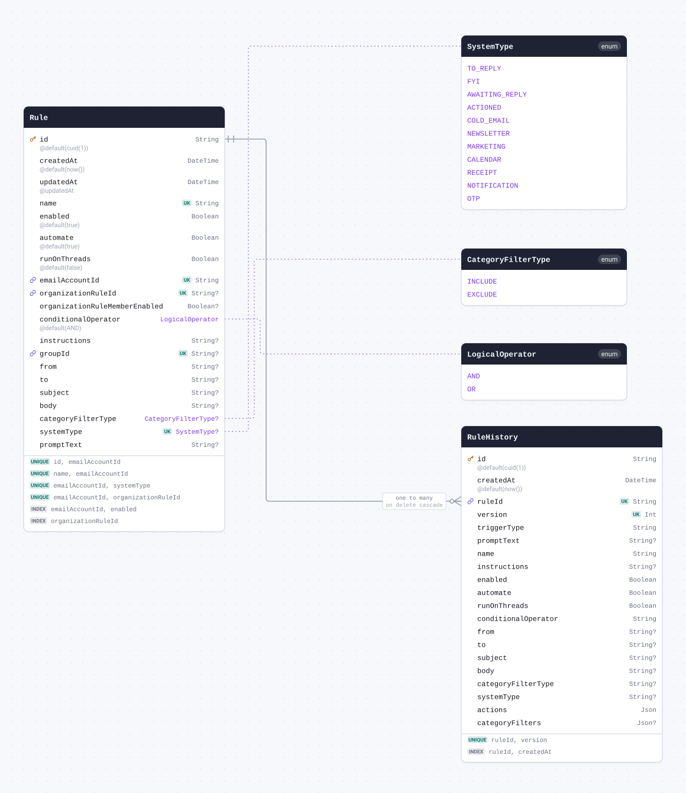

| Field                 | Type       | Constraints                       | Default   | Description |
| --------------------- | ---------- | --------------------------------- | --------- | ----------- |
| `id`                  | `String`   | PK NOT NULL                       | `cuid(1)` |             |
| `createdAt`           | `DateTime` | NOT NULL                          | `now()`   |             |
| `ruleId`              | `String`   | NOT NULL → [Rule.id](#model-Rule) |           |             |
| `version`             | `Int`      | NOT NULL                          |           |             |
| `triggerType`         | `String`   | NOT NULL                          |           |             |
| `promptText`          | `String`   | NULL                              |           |             |
| `name`                | `String`   | NOT NULL                          |           |             |
| `instructions`        | `String`   | NULL                              |           |             |
| `enabled`             | `Boolean`  | NOT NULL                          |           |             |
| `automate`            | `Boolean`  | NOT NULL                          |           |             |
| `runOnThreads`        | `Boolean`  | NOT NULL                          |           |             |
| `conditionalOperator` | `String`   | NOT NULL                          |           |             |
| `from`                | `String`   | NULL                              |           |             |
| `to`                  | `String`   | NULL                              |           |             |
| `subject`             | `String`   | NULL                              |           |             |
| `body`                | `String`   | NULL                              |           |             |
| `categoryFilterType`  | `String`   | NULL                              |           |             |
| `systemType`          | `String`   | NULL                              |           |             |
| `actions`             | `Json`     | NOT NULL                          |           |             |
| `categoryFilters`     | `Json`     | NULL                              |           |             |

#### Indexes

- `@@index([ruleId, createdAt])`
- `@@unique([ruleId, version])`

#### References

- `ruleId` → [Rule.id](#model-Rule) (many-to-one, on delete Cascade)

#### Definition

```sql
CREATE TABLE "RuleHistory" (
    "id" TEXT NOT NULL,
    "createdAt" TIMESTAMP(3) NOT NULL DEFAULT CURRENT_TIMESTAMP,
    "ruleId" TEXT NOT NULL,
    "version" INTEGER NOT NULL,
    "triggerType" TEXT NOT NULL,
    "promptText" TEXT,
    "name" TEXT NOT NULL,
    "instructions" TEXT,
    "enabled" BOOLEAN NOT NULL,
    "automate" BOOLEAN NOT NULL,
    "runOnThreads" BOOLEAN NOT NULL,
    "conditionalOperator" TEXT NOT NULL,
    "from" TEXT,
    "to" TEXT,
    "subject" TEXT,
    "body" TEXT,
    "categoryFilterType" TEXT,
    "systemType" TEXT,
    "actions" JSONB NOT NULL,
    "categoryFilters" JSONB,

    CONSTRAINT "RuleHistory_pkey" PRIMARY KEY ("id")
);

CREATE INDEX "RuleHistory_ruleId_createdAt_idx" ON "RuleHistory"("ruleId", "createdAt");

CREATE UNIQUE INDEX "RuleHistory_ruleId_version_key" ON "RuleHistory"("ruleId", "version");

ALTER TABLE "RuleHistory" ADD CONSTRAINT "RuleHistory_ruleId_fkey" FOREIGN KEY ("ruleId") REFERENCES "Rule"("id") ON DELETE CASCADE ON UPDATE CASCADE;
```

<details>
<summary>Queries and their SQL</summary>

**findMany**: Every row

```ts
await prisma.ruleHistory.findMany();
```

```sql
SELECT
  "public"."RuleHistory"."id",
  "public"."RuleHistory"."createdAt",
  "public"."RuleHistory"."ruleId",
  "public"."RuleHistory"."version",
  "public"."RuleHistory"."triggerType",
  "public"."RuleHistory"."promptText",
  "public"."RuleHistory"."name",
  "public"."RuleHistory"."instructions",
  "public"."RuleHistory"."enabled",
  "public"."RuleHistory"."automate",
  "public"."RuleHistory"."runOnThreads",
  "public"."RuleHistory"."conditionalOperator",
  "public"."RuleHistory"."from",
  "public"."RuleHistory"."to",
  "public"."RuleHistory"."subject",
  "public"."RuleHistory"."body",
  "public"."RuleHistory"."categoryFilterType",
  "public"."RuleHistory"."systemType",
  "public"."RuleHistory"."actions",
  "public"."RuleHistory"."categoryFilters"
FROM
  "public"."RuleHistory"
WHERE
  1 = 1
OFFSET
  $1
-- params: ["0"]
```

**count**: How many rows there are

```ts
await prisma.ruleHistory.count();
```

```sql
SELECT
  COUNT(*) AS "_count$_all"
FROM
  (
    SELECT
      "public"."RuleHistory"."id"
    FROM
      "public"."RuleHistory"
    WHERE
      1 = 1
    OFFSET
      $1
  ) AS "sub"
-- params: ["0"]
```

**findMany**: Every row with its relations

```ts
await prisma.ruleHistory.findMany({ include: { rule: true } });
```

```sql
SELECT
  "public"."RuleHistory"."id",
  "public"."RuleHistory"."createdAt",
  "public"."RuleHistory"."ruleId",
  "public"."RuleHistory"."version",
  "public"."RuleHistory"."triggerType",
  "public"."RuleHistory"."promptText",
  "public"."RuleHistory"."name",
  "public"."RuleHistory"."instructions",
  "public"."RuleHistory"."enabled",
  "public"."RuleHistory"."automate",
  "public"."RuleHistory"."runOnThreads",
  "public"."RuleHistory"."conditionalOperator",
  "public"."RuleHistory"."from",
  "public"."RuleHistory"."to",
  "public"."RuleHistory"."subject",
  "public"."RuleHistory"."body",
  "public"."RuleHistory"."categoryFilterType",
  "public"."RuleHistory"."systemType",
  "public"."RuleHistory"."actions",
  "public"."RuleHistory"."categoryFilters"
FROM
  "public"."RuleHistory"
WHERE
  1 = 1
OFFSET
  $1
-- params: ["0"]

SELECT
  "public"."Rule"."id",
  "public"."Rule"."createdAt",
  "public"."Rule"."updatedAt",
  "public"."Rule"."name",
  "public"."Rule"."enabled",
  "public"."Rule"."automate",
  "public"."Rule"."runOnThreads",
  "public"."Rule"."emailAccountId",
  "public"."Rule"."organizationRuleId",
  "public"."Rule"."organizationRuleMemberEnabled",
  "public"."Rule"."conditionalOperator"::text,
  "public"."Rule"."instructions",
  "public"."Rule"."groupId",
  "public"."Rule"."from",
  "public"."Rule"."to",
  "public"."Rule"."subject",
  "public"."Rule"."body",
  "public"."Rule"."categoryFilterType"::text,
  "public"."Rule"."systemType"::text,
  "public"."Rule"."promptText"
FROM
  "public"."Rule"
WHERE
  "public"."Rule"."id" IN ($1)
OFFSET
  $2
-- params: ["<ruleId of the rows above>","0"]
```

**findUnique**: One row by what is unique to it

```ts
await prisma.ruleHistory.findUnique({ where: { id: "example" } });
```

```sql
SELECT
  "public"."RuleHistory"."id",
  "public"."RuleHistory"."createdAt",
  "public"."RuleHistory"."ruleId",
  "public"."RuleHistory"."version",
  "public"."RuleHistory"."triggerType",
  "public"."RuleHistory"."promptText",
  "public"."RuleHistory"."name",
  "public"."RuleHistory"."instructions",
  "public"."RuleHistory"."enabled",
  "public"."RuleHistory"."automate",
  "public"."RuleHistory"."runOnThreads",
  "public"."RuleHistory"."conditionalOperator",
  "public"."RuleHistory"."from",
  "public"."RuleHistory"."to",
  "public"."RuleHistory"."subject",
  "public"."RuleHistory"."body",
  "public"."RuleHistory"."categoryFilterType",
  "public"."RuleHistory"."systemType",
  "public"."RuleHistory"."actions",
  "public"."RuleHistory"."categoryFilters"
FROM
  "public"."RuleHistory"
WHERE
  (
    "public"."RuleHistory"."id" = $1
    AND 1 = 1
  )
LIMIT
  $2
OFFSET
  $3
-- params: ["example","1","0"]
```

**create**: Create a row

```ts
await prisma.ruleHistory.create({
  data: {
    ruleId: "example",
    version: 1,
    triggerType: "example",
    name: "example",
    enabled: true,
    automate: true,
    runOnThreads: true,
    conditionalOperator: "example",
    actions: {},
  },
});
```

```sql
INSERT INTO
  "public"."RuleHistory" (
    "id",
    "createdAt",
    "ruleId",
    "version",
    "triggerType",
    "name",
    "enabled",
    "automate",
    "runOnThreads",
    "conditionalOperator",
    "actions"
  )
VALUES
  ($1, $2, $3, $4, $5, $6, $7, $8, $9, $10, $11)
RETURNING
  "public"."RuleHistory"."id",
  "public"."RuleHistory"."createdAt",
  "public"."RuleHistory"."ruleId",
  "public"."RuleHistory"."version",
  "public"."RuleHistory"."triggerType",
  "public"."RuleHistory"."promptText",
  "public"."RuleHistory"."name",
  "public"."RuleHistory"."instructions",
  "public"."RuleHistory"."enabled",
  "public"."RuleHistory"."automate",
  "public"."RuleHistory"."runOnThreads",
  "public"."RuleHistory"."conditionalOperator",
  "public"."RuleHistory"."from",
  "public"."RuleHistory"."to",
  "public"."RuleHistory"."subject",
  "public"."RuleHistory"."body",
  "public"."RuleHistory"."categoryFilterType",
  "public"."RuleHistory"."systemType",
  "public"."RuleHistory"."actions",
  "public"."RuleHistory"."categoryFilters"
-- params: ["<cuid(1)>","<now()>","example","1","example","example",true,true,true,"example","{}"]
```

**update**: Update a row

```ts
await prisma.ruleHistory.update({
  where: { id: "example" },
  data: { createdAt: new Date("2026-01-01T00:00:00.000Z") },
});
```

```sql
UPDATE "public"."RuleHistory"
SET
  "createdAt" = $1
WHERE
  (
    "public"."RuleHistory"."id" = $2
    AND 1 = 1
  )
RETURNING
  "public"."RuleHistory"."id",
  "public"."RuleHistory"."createdAt",
  "public"."RuleHistory"."ruleId",
  "public"."RuleHistory"."version",
  "public"."RuleHistory"."triggerType",
  "public"."RuleHistory"."promptText",
  "public"."RuleHistory"."name",
  "public"."RuleHistory"."instructions",
  "public"."RuleHistory"."enabled",
  "public"."RuleHistory"."automate",
  "public"."RuleHistory"."runOnThreads",
  "public"."RuleHistory"."conditionalOperator",
  "public"."RuleHistory"."from",
  "public"."RuleHistory"."to",
  "public"."RuleHistory"."subject",
  "public"."RuleHistory"."body",
  "public"."RuleHistory"."categoryFilterType",
  "public"."RuleHistory"."systemType",
  "public"."RuleHistory"."actions",
  "public"."RuleHistory"."categoryFilters"
-- params: ["2026-01-01T00:00:00.000Z","example"]
```

**delete**: Delete a row

```ts
await prisma.ruleHistory.delete({ where: { id: "example" } });
```

```sql
DELETE FROM "public"."RuleHistory"
WHERE
  (
    "public"."RuleHistory"."id" = $1
    AND 1 = 1
  )
RETURNING
  "public"."RuleHistory"."id",
  "public"."RuleHistory"."createdAt",
  "public"."RuleHistory"."ruleId",
  "public"."RuleHistory"."version",
  "public"."RuleHistory"."triggerType",
  "public"."RuleHistory"."promptText",
  "public"."RuleHistory"."name",
  "public"."RuleHistory"."instructions",
  "public"."RuleHistory"."enabled",
  "public"."RuleHistory"."automate",
  "public"."RuleHistory"."runOnThreads",
  "public"."RuleHistory"."conditionalOperator",
  "public"."RuleHistory"."from",
  "public"."RuleHistory"."to",
  "public"."RuleHistory"."subject",
  "public"."RuleHistory"."body",
  "public"."RuleHistory"."categoryFilterType",
  "public"."RuleHistory"."systemType",
  "public"."RuleHistory"."actions",
  "public"."RuleHistory"."categoryFilters"
-- params: ["example"]
```

</details>

<a id="model-ExecutedRule"></a>

### ExecutedRule

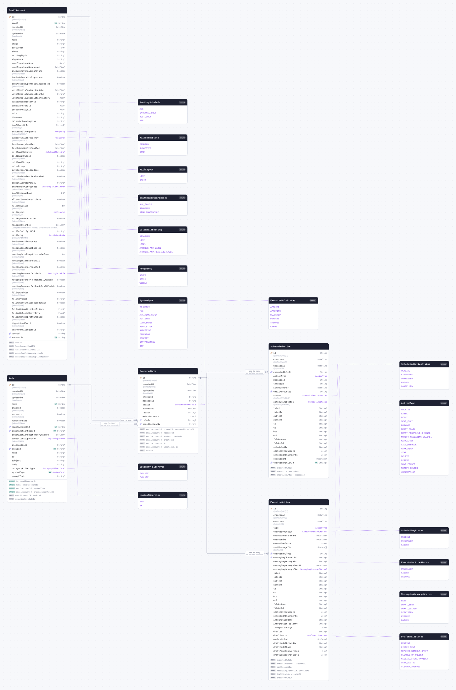

| Field            | Type                                             | Constraints                                       | Default      | Description |
| ---------------- | ------------------------------------------------ | ------------------------------------------------- | ------------ | ----------- |
| `id`             | `String`                                         | PK NOT NULL                                       | `cuid(1)`    |             |
| `createdAt`      | `DateTime`                                       | NOT NULL                                          | `now()`      |             |
| `updatedAt`      | `DateTime`                                       | NOT NULL                                          | `@updatedAt` |             |
| `threadId`       | `String`                                         | NOT NULL                                          |              |             |
| `messageId`      | `String`                                         | NOT NULL                                          |              |             |
| `status`         | [`ExecutedRuleStatus`](#enum-ExecutedRuleStatus) | NOT NULL                                          |              |             |
| `automated`      | `Boolean`                                        | NOT NULL                                          |              |             |
| `reason`         | `String`                                         | NULL                                              |              |             |
| `matchMetadata`  | `Json`                                           | NULL                                              |              |             |
| `ruleId`         | `String`                                         | NULL → [Rule.id](#model-Rule)                     |              |             |
| `emailAccountId` | `String`                                         | NOT NULL → [EmailAccount.id](#model-EmailAccount) |              |             |

#### Indexes

- `@@index([emailAccountId, threadId, messageId, ruleId])`
- `@@index([emailAccountId, messageId])`
- `@@index([emailAccountId, status, createdAt])`
- `@@index([emailAccountId, createdAt])`
- `@@index([emailAccountId, id])`
- `@@index([emailAccountId, updatedAt, id])`
- `@@index([ruleId])`

#### References

- `ruleId` → [Rule.id](#model-Rule) (many-to-one)
- `emailAccountId` → [EmailAccount.id](#model-EmailAccount) (many-to-one, on delete Cascade)

#### Referenced by

- `id` ← [ExecutedAction.executedRuleId](#model-ExecutedAction) (one-to-many, on delete Cascade)
- `id` ← [ScheduledAction.executedRuleId](#model-ScheduledAction) (one-to-many, on delete Cascade)

#### Definition

```sql
CREATE TABLE "ExecutedRule" (
    "id" TEXT NOT NULL,
    "createdAt" TIMESTAMP(3) NOT NULL DEFAULT CURRENT_TIMESTAMP,
    "updatedAt" TIMESTAMP(3) NOT NULL,
    "threadId" TEXT NOT NULL,
    "messageId" TEXT NOT NULL,
    "status" "ExecutedRuleStatus" NOT NULL,
    "automated" BOOLEAN NOT NULL,
    "reason" TEXT,
    "matchMetadata" JSONB,
    "ruleId" TEXT,
    "emailAccountId" TEXT NOT NULL,

    CONSTRAINT "ExecutedRule_pkey" PRIMARY KEY ("id")
);

CREATE INDEX "ExecutedRule_emailAccountId_threadId_messageId_ruleId_idx" ON "ExecutedRule"("emailAccountId", "threadId", "messageId", "ruleId");

CREATE INDEX "ExecutedRule_emailAccountId_messageId_idx" ON "ExecutedRule"("emailAccountId", "messageId");

CREATE INDEX "ExecutedRule_emailAccountId_status_createdAt_idx" ON "ExecutedRule"("emailAccountId", "status", "createdAt");

CREATE INDEX "ExecutedRule_emailAccountId_createdAt_idx" ON "ExecutedRule"("emailAccountId", "createdAt");

CREATE INDEX "ExecutedRule_emailAccountId_id_idx" ON "ExecutedRule"("emailAccountId", "id");

CREATE INDEX "ExecutedRule_emailAccountId_updatedAt_id_idx" ON "ExecutedRule"("emailAccountId", "updatedAt", "id");

CREATE INDEX "ExecutedRule_ruleId_idx" ON "ExecutedRule"("ruleId");

ALTER TABLE "ExecutedRule" ADD CONSTRAINT "ExecutedRule_ruleId_fkey" FOREIGN KEY ("ruleId") REFERENCES "Rule"("id") ON DELETE SET NULL ON UPDATE CASCADE;

ALTER TABLE "ExecutedRule" ADD CONSTRAINT "ExecutedRule_emailAccountId_fkey" FOREIGN KEY ("emailAccountId") REFERENCES "EmailAccount"("id") ON DELETE CASCADE ON UPDATE CASCADE;
```

<details>
<summary>Queries and their SQL</summary>

**findMany**: Every row

```ts
await prisma.executedRule.findMany();
```

```sql
SELECT
  "public"."ExecutedRule"."id",
  "public"."ExecutedRule"."createdAt",
  "public"."ExecutedRule"."updatedAt",
  "public"."ExecutedRule"."threadId",
  "public"."ExecutedRule"."messageId",
  "public"."ExecutedRule"."status"::text,
  "public"."ExecutedRule"."automated",
  "public"."ExecutedRule"."reason",
  "public"."ExecutedRule"."matchMetadata",
  "public"."ExecutedRule"."ruleId",
  "public"."ExecutedRule"."emailAccountId"
FROM
  "public"."ExecutedRule"
WHERE
  1 = 1
OFFSET
  $1
-- params: ["0"]
```

**count**: How many rows there are

```ts
await prisma.executedRule.count();
```

```sql
SELECT
  COUNT(*) AS "_count$_all"
FROM
  (
    SELECT
      "public"."ExecutedRule"."id"
    FROM
      "public"."ExecutedRule"
    WHERE
      1 = 1
    OFFSET
      $1
  ) AS "sub"
-- params: ["0"]
```

**findMany**: Every row with its relations

```ts
await prisma.executedRule.findMany({
  include: { rule: true, emailAccount: true, actionItems: true, scheduledActions: true },
});
```

```sql
SELECT
  "public"."ExecutedRule"."id",
  "public"."ExecutedRule"."createdAt",
  "public"."ExecutedRule"."updatedAt",
  "public"."ExecutedRule"."threadId",
  "public"."ExecutedRule"."messageId",
  "public"."ExecutedRule"."status"::text,
  "public"."ExecutedRule"."automated",
  "public"."ExecutedRule"."reason",
  "public"."ExecutedRule"."matchMetadata",
  "public"."ExecutedRule"."ruleId",
  "public"."ExecutedRule"."emailAccountId"
FROM
  "public"."ExecutedRule"
WHERE
  1 = 1
OFFSET
  $1
-- params: ["0"]

SELECT
  "public"."Rule"."id",
  "public"."Rule"."createdAt",
  "public"."Rule"."updatedAt",
  "public"."Rule"."name",
  "public"."Rule"."enabled",
  "public"."Rule"."automate",
  "public"."Rule"."runOnThreads",
  "public"."Rule"."emailAccountId",
  "public"."Rule"."organizationRuleId",
  "public"."Rule"."organizationRuleMemberEnabled",
  "public"."Rule"."conditionalOperator"::text,
  "public"."Rule"."instructions",
  "public"."Rule"."groupId",
  "public"."Rule"."from",
  "public"."Rule"."to",
  "public"."Rule"."subject",
  "public"."Rule"."body",
  "public"."Rule"."categoryFilterType"::text,
  "public"."Rule"."systemType"::text,
  "public"."Rule"."promptText"
FROM
  "public"."Rule"
WHERE
  "public"."Rule"."id" IN ($1)
OFFSET
  $2
-- params: ["<ruleId of the rows above>","0"]

SELECT
  "public"."EmailAccount"."id",
  "public"."EmailAccount"."email",
  "public"."EmailAccount"."createdAt",
  "public"."EmailAccount"."updatedAt",
  "public"."EmailAccount"."name",
  "public"."EmailAccount"."image",
  "public"."EmailAccount"."sortOrder",
  "public"."EmailAccount"."about",
  "public"."EmailAccount"."writingStyle",
  "public"."EmailAccount"."signature",
  "public"."EmailAccount"."sentSignatureScan",
  "public"."EmailAccount"."sentSignatureScannedAt",
  "public"."EmailAccount"."includeReferralSignature",
  "public"."EmailAccount"."includeSentWithSignature",
  "public"."EmailAccount"."sentMessageOpenTrackingEnabled",
  "public"."EmailAccount"."watchEmailsExpirationDate",
  "public"."EmailAccount"."watchEmailsSubscriptionId",
  "public"."EmailAccount"."watchEmailsSubscriptionHistory",
  "public"."EmailAccount"."lastSyncedHistoryId",
  "public"."EmailAccount"."behaviorProfile",
  "public"."EmailAccount"."personaAnalysis",
  "public"."EmailAccount"."role",
  "public"."EmailAccount"."timezone",
  "public"."EmailAccount"."calendarBookingLink",
  "public"."EmailAccount"."draftDocsUrls",
  "public"."EmailAccount"."statsEmailFrequency"::text,
  "public"."EmailAccount"."summaryEmailFrequency"::text,
  "public"."EmailAccount"."lastSummaryEmailAt",
  "public"."EmailAccount"."lastInboxHealthEmailAt",
  "public"."EmailAccount"."coldEmailBlocker"::text,
  "public"."EmailAccount"."coldEmailDigest",
  "public"."EmailAccount"."coldEmailPrompt",
  "public"."EmailAccount"."rulesPrompt",
  "public"."EmailAccount"."autoCategorizeSenders",
  "public"."EmailAccount"."multiRuleSelectionEnabled",
  "public"."EmailAccount"."sensitiveDataPolicy",
  "public"."EmailAccount"."draftReplyConfidence"::text,
  "public"."EmailAccount"."draftCleanupDays",
  "public"."EmailAccount"."allowHiddenAiDraftLinks",
  "public"."EmailAccount"."rulesRevision",
  "public"."EmailAccount"."mailLayout"::text,
  "public"."EmailAccount"."mailExpandedPreview",
  "public"."EmailAccount"."mailBundleInbox",
  "public"."EmailAccount"."mailDefaultSplitId",
  "public"."EmailAccount"."mailSetup"::text,
  "public"."EmailAccount"."includeInAllAccounts",
  "public"."EmailAccount"."meetingBriefingsEnabled",
  "public"."EmailAccount"."meetingBriefingsMinutesBefore",
  "public"."EmailAccount"."meetingBriefsSendEmail",
  "public"."EmailAccount"."meetingRecorderEnabled",
  "public"."EmailAccount"."meetingRecorderJoinRule"::text,
  "public"."EmailAccount"."meetingRecorderRecapEmailEnabled",
  "public"."EmailAccount"."meetingRecorderFollowUpDraftEnabled",
  "public"."EmailAccount"."filingEnabled",
  "public"."EmailAccount"."filingPrompt",
  "public"."EmailAccount"."filingConfirmationSendEmail",
  "public"."EmailAccount"."followUpAwaitingReplyDays",
  "public"."EmailAccount"."followUpNeedsReplyDays",
  "public"."EmailAccount"."followUpAutoDraftEnabled",
  "public"."EmailAccount"."digestSendEmail",
  "public"."EmailAccount"."learnedWritingStyle",
  "public"."EmailAccount"."userId",
  "public"."EmailAccount"."accountId"
FROM
  "public"."EmailAccount"
WHERE
  "public"."EmailAccount"."id" IN ($1)
OFFSET
  $2
-- params: ["<emailAccountId of the rows above>","0"]

SELECT
  "public"."ExecutedAction"."id",
  "public"."ExecutedAction"."createdAt",
  "public"."ExecutedAction"."updatedAt",
  "public"."ExecutedAction"."type"::text,
  "public"."ExecutedAction"."executionStatus"::text,
  "public"."ExecutedAction"."executionStartedAt",
  "public"."ExecutedAction"."executedAt",
  "public"."ExecutedAction"."executionError",
  "public"."ExecutedAction"."sentMessageIds",
  "public"."ExecutedAction"."executedRuleId",
  "public"."ExecutedAction"."messagingChannelId",
  "public"."ExecutedAction"."messagingMessageId",
  "public"."ExecutedAction"."messagingMessageSentAt",
  "public"."ExecutedAction"."messagingMessageStatus"::text,
  "public"."ExecutedAction"."label",
  "public"."ExecutedAction"."labelId",
  "public"."ExecutedAction"."subject",
  "public"."ExecutedAction"."content",
  "public"."ExecutedAction"."to",
  "public"."ExecutedAction"."cc",
  "public"."ExecutedAction"."bcc",
  "public"."ExecutedAction"."url",
  "public"."ExecutedAction"."folderName",
  "public"."ExecutedAction"."folderId",
  "public"."ExecutedAction"."staticAttachments",
  "public"."ExecutedAction"."selectedAttachments",
  "public"."ExecutedAction"."integrationName",
  "public"."ExecutedAction"."integrationToolName",
  "public"."ExecutedAction"."integrationArgs",
  "public"."ExecutedAction"."draftId",
  "public"."ExecutedAction"."draftStatus"::text,
  "public"."ExecutedAction"."wasDraftSent",
  "public"."ExecutedAction"."draftModelProvider",
  "public"."ExecutedAction"."draftModelName",
  "public"."ExecutedAction"."draftPipelineVersion",
  "public"."ExecutedAction"."draftContextMetadata"
FROM
  "public"."ExecutedAction"
WHERE
  "public"."ExecutedAction"."executedRuleId" IN ($1)
OFFSET
  $2
-- params: ["<id of the rows above>","0"]

SELECT
  "public"."ScheduledAction"."id",
  "public"."ScheduledAction"."createdAt",
  "public"."ScheduledAction"."updatedAt",
  "public"."ScheduledAction"."executedRuleId",
  "public"."ScheduledAction"."actionType"::text,
  "public"."ScheduledAction"."messageId",
  "public"."ScheduledAction"."threadId",
  "public"."ScheduledAction"."scheduledFor",
  "public"."ScheduledAction"."emailAccountId",
  "public"."ScheduledAction"."status"::text,
  "public"."ScheduledAction"."schedulingStatus"::text,
  "public"."ScheduledAction"."label",
  "public"."ScheduledAction"."labelId",
  "public"."ScheduledAction"."subject",
  "public"."ScheduledAction"."content",
  "public"."ScheduledAction"."to",
  "public"."ScheduledAction"."cc",
  "public"."ScheduledAction"."bcc",
  "public"."ScheduledAction"."url",
  "public"."ScheduledAction"."folderName",
  "public"."ScheduledAction"."folderId",
  "public"."ScheduledAction"."scheduledId",
  "public"."ScheduledAction"."staticAttachments",
  "public"."ScheduledAction"."selectedAttachments",
  "public"."ScheduledAction"."executedAt",
  "public"."ScheduledAction"."executedActionId"
FROM
  "public"."ScheduledAction"
WHERE
  "public"."ScheduledAction"."executedRuleId" IN ($1)
OFFSET
  $2
-- params: ["<id of the rows above>","0"]
```

**findUnique**: One row by what is unique to it

```ts
await prisma.executedRule.findUnique({ where: { id: "example" } });
```

```sql
SELECT
  "public"."ExecutedRule"."id",
  "public"."ExecutedRule"."createdAt",
  "public"."ExecutedRule"."updatedAt",
  "public"."ExecutedRule"."threadId",
  "public"."ExecutedRule"."messageId",
  "public"."ExecutedRule"."status"::text,
  "public"."ExecutedRule"."automated",
  "public"."ExecutedRule"."reason",
  "public"."ExecutedRule"."matchMetadata",
  "public"."ExecutedRule"."ruleId",
  "public"."ExecutedRule"."emailAccountId"
FROM
  "public"."ExecutedRule"
WHERE
  (
    "public"."ExecutedRule"."id" = $1
    AND 1 = 1
  )
LIMIT
  $2
OFFSET
  $3
-- params: ["example","1","0"]
```

**create**: Create a row

```ts
await prisma.executedRule.create({
  data: {
    threadId: "example",
    messageId: "example",
    status: "APPLIED",
    automated: true,
    emailAccountId: "example",
  },
});
```

```sql
INSERT INTO
  "public"."ExecutedRule" (
    "id",
    "createdAt",
    "updatedAt",
    "threadId",
    "messageId",
    "status",
    "automated",
    "emailAccountId"
  )
VALUES
  (
    $1,
    $2,
    $3,
    $4,
    $5,
    CAST($6::text AS "public"."ExecutedRuleStatus"),
    $7,
    $8
  )
RETURNING
  "public"."ExecutedRule"."id",
  "public"."ExecutedRule"."createdAt",
  "public"."ExecutedRule"."updatedAt",
  "public"."ExecutedRule"."threadId",
  "public"."ExecutedRule"."messageId",
  "public"."ExecutedRule"."status"::text,
  "public"."ExecutedRule"."automated",
  "public"."ExecutedRule"."reason",
  "public"."ExecutedRule"."matchMetadata",
  "public"."ExecutedRule"."ruleId",
  "public"."ExecutedRule"."emailAccountId"
-- params: ["<cuid(1)>","<now()>","<now()>","example","example","APPLIED",true,"example"]
```

**update**: Update a row

```ts
await prisma.executedRule.update({
  where: { id: "example" },
  data: { createdAt: new Date("2026-01-01T00:00:00.000Z") },
});
```

```sql
UPDATE "public"."ExecutedRule"
SET
  "createdAt" = $1,
  "updatedAt" = $2
WHERE
  (
    "public"."ExecutedRule"."id" = $3
    AND 1 = 1
  )
RETURNING
  "public"."ExecutedRule"."id",
  "public"."ExecutedRule"."createdAt",
  "public"."ExecutedRule"."updatedAt",
  "public"."ExecutedRule"."threadId",
  "public"."ExecutedRule"."messageId",
  "public"."ExecutedRule"."status"::text,
  "public"."ExecutedRule"."automated",
  "public"."ExecutedRule"."reason",
  "public"."ExecutedRule"."matchMetadata",
  "public"."ExecutedRule"."ruleId",
  "public"."ExecutedRule"."emailAccountId"
-- params: ["2026-01-01T00:00:00.000Z",{"prisma__type":"generatorCall","prisma__value":{"name":"now","args":[],"returnType":{"type":"DateTime"}}},"example"]
```

**delete**: Delete a row

```ts
await prisma.executedRule.delete({ where: { id: "example" } });
```

```sql
DELETE FROM "public"."ExecutedRule"
WHERE
  (
    "public"."ExecutedRule"."id" = $1
    AND 1 = 1
  )
RETURNING
  "public"."ExecutedRule"."id",
  "public"."ExecutedRule"."createdAt",
  "public"."ExecutedRule"."updatedAt",
  "public"."ExecutedRule"."threadId",
  "public"."ExecutedRule"."messageId",
  "public"."ExecutedRule"."status"::text,
  "public"."ExecutedRule"."automated",
  "public"."ExecutedRule"."reason",
  "public"."ExecutedRule"."matchMetadata",
  "public"."ExecutedRule"."ruleId",
  "public"."ExecutedRule"."emailAccountId"
-- params: ["example"]
```

</details>

<a id="model-ExecutedAction"></a>

### ExecutedAction

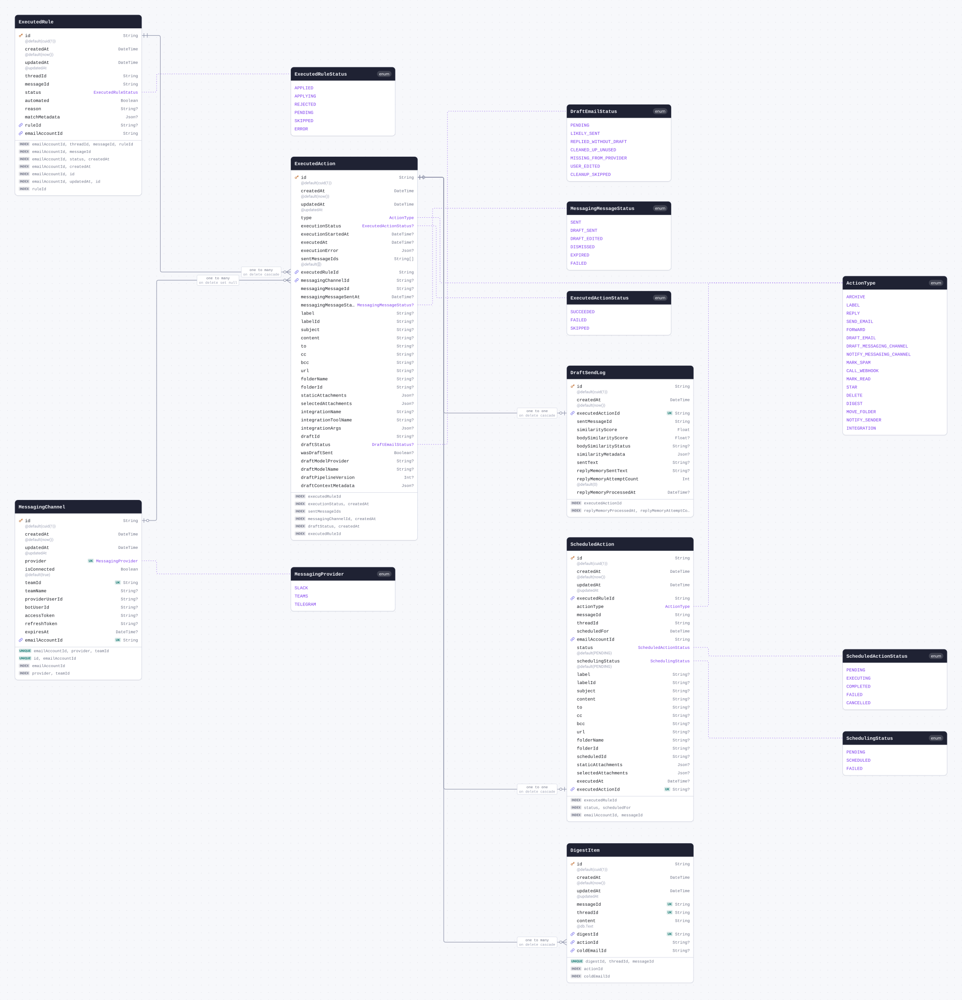

| Field                    | Type                                                     | Constraints                                           | Default      | Description |
| ------------------------ | -------------------------------------------------------- | ----------------------------------------------------- | ------------ | ----------- |
| `id`                     | `String`                                                 | PK NOT NULL                                           | `cuid(1)`    |             |
| `createdAt`              | `DateTime`                                               | NOT NULL                                              | `now()`      |             |
| `updatedAt`              | `DateTime`                                               | NOT NULL                                              | `@updatedAt` |             |
| `type`                   | [`ActionType`](#enum-ActionType)                         | NOT NULL                                              |              |             |
| `executionStatus`        | [`ExecutedActionStatus`](#enum-ExecutedActionStatus)     | NULL                                                  |              |             |
| `executionStartedAt`     | `DateTime`                                               | NULL                                                  |              |             |
| `executedAt`             | `DateTime`                                               | NULL                                                  |              |             |
| `executionError`         | `Json`                                                   | NULL                                                  |              |             |
| `sentMessageIds`         | `String[]`                                               | NOT NULL                                              | `[]`         |             |
| `executedRuleId`         | `String`                                                 | NOT NULL → [ExecutedRule.id](#model-ExecutedRule)     |              |             |
| `messagingChannelId`     | `String`                                                 | NULL → [MessagingChannel.id](#model-MessagingChannel) |              |             |
| `messagingMessageId`     | `String`                                                 | NULL                                                  |              |             |
| `messagingMessageSentAt` | `DateTime`                                               | NULL                                                  |              |             |
| `messagingMessageStatus` | [`MessagingMessageStatus`](#enum-MessagingMessageStatus) | NULL                                                  |              |             |
| `label`                  | `String`                                                 | NULL                                                  |              |             |
| `labelId`                | `String`                                                 | NULL                                                  |              |             |
| `subject`                | `String`                                                 | NULL                                                  |              |             |
| `content`                | `String`                                                 | NULL                                                  |              |             |
| `to`                     | `String`                                                 | NULL                                                  |              |             |
| `cc`                     | `String`                                                 | NULL                                                  |              |             |
| `bcc`                    | `String`                                                 | NULL                                                  |              |             |
| `url`                    | `String`                                                 | NULL                                                  |              |             |
| `folderName`             | `String`                                                 | NULL                                                  |              |             |
| `folderId`               | `String`                                                 | NULL                                                  |              |             |
| `staticAttachments`      | `Json`                                                   | NULL                                                  |              |             |
| `selectedAttachments`    | `Json`                                                   | NULL                                                  |              |             |
| `integrationName`        | `String`                                                 | NULL                                                  |              |             |
| `integrationToolName`    | `String`                                                 | NULL                                                  |              |             |
| `integrationArgs`        | `Json`                                                   | NULL                                                  |              |             |
| `draftId`                | `String`                                                 | NULL                                                  |              |             |
| `draftStatus`            | [`DraftEmailStatus`](#enum-DraftEmailStatus)             | NULL                                                  |              |             |
| `wasDraftSent`           | `Boolean`                                                | NULL                                                  |              |             |
| `draftModelProvider`     | `String`                                                 | NULL                                                  |              |             |
| `draftModelName`         | `String`                                                 | NULL                                                  |              |             |
| `draftPipelineVersion`   | `Int`                                                    | NULL                                                  |              |             |
| `draftContextMetadata`   | `Json`                                                   | NULL                                                  |              |             |

#### Indexes

- `@@index([executedRuleId])`
- `@@index([executionStatus, createdAt])`
- `@@index([sentMessageIds])`
- `@@index([messagingChannelId, createdAt])`
- `@@index([draftStatus, createdAt], map: "ExecutedAction_draftStatus_createdAt_draft_idx")`
- `@@index([executedRuleId], map: "ExecutedAction_executedRuleId_draft_idx")`

#### References

- `executedRuleId` → [ExecutedRule.id](#model-ExecutedRule) (many-to-one, on delete Cascade)
- `messagingChannelId` → [MessagingChannel.id](#model-MessagingChannel) (many-to-one, on delete SetNull)

#### Referenced by

- `id` ← [DigestItem.actionId](#model-DigestItem) (one-to-many, on delete Cascade)
- `id` ← [ScheduledAction.executedActionId](#model-ScheduledAction) (one-to-one, on delete Cascade)
- `id` ← [DraftSendLog.executedActionId](#model-DraftSendLog) (one-to-one, on delete Cascade)

#### Definition

```sql
CREATE TABLE "ExecutedAction" (
    "id" TEXT NOT NULL,
    "createdAt" TIMESTAMP(3) NOT NULL DEFAULT CURRENT_TIMESTAMP,
    "updatedAt" TIMESTAMP(3) NOT NULL,
    "type" "ActionType" NOT NULL,
    "executionStatus" "ExecutedActionStatus",
    "executionStartedAt" TIMESTAMP(3),
    "executedAt" TIMESTAMP(3),
    "executionError" JSONB,
    "sentMessageIds" TEXT[] DEFAULT ARRAY[]::TEXT[],
    "executedRuleId" TEXT NOT NULL,
    "messagingChannelId" TEXT,
    "messagingMessageId" TEXT,
    "messagingMessageSentAt" TIMESTAMP(3),
    "messagingMessageStatus" "MessagingMessageStatus",
    "label" TEXT,
    "labelId" TEXT,
    "subject" TEXT,
    "content" TEXT,
    "to" TEXT,
    "cc" TEXT,
    "bcc" TEXT,
    "url" TEXT,
    "folderName" TEXT,
    "folderId" TEXT,
    "staticAttachments" JSONB,
    "selectedAttachments" JSONB,
    "integrationName" TEXT,
    "integrationToolName" TEXT,
    "integrationArgs" JSONB,
    "draftId" TEXT,
    "draftStatus" "DraftEmailStatus",
    "wasDraftSent" BOOLEAN,
    "draftModelProvider" TEXT,
    "draftModelName" TEXT,
    "draftPipelineVersion" INTEGER,
    "draftContextMetadata" JSONB,

    CONSTRAINT "ExecutedAction_pkey" PRIMARY KEY ("id")
);

CREATE INDEX "ExecutedAction_executedRuleId_idx" ON "ExecutedAction"("executedRuleId");

CREATE INDEX "ExecutedAction_executionStatus_createdAt_idx" ON "ExecutedAction"("executionStatus", "createdAt");

CREATE INDEX "ExecutedAction_sentMessageIds_idx" ON "ExecutedAction" USING GIN ("sentMessageIds");

CREATE INDEX "ExecutedAction_messagingChannelId_createdAt_idx" ON "ExecutedAction"("messagingChannelId", "createdAt");

CREATE INDEX "ExecutedAction_draftStatus_createdAt_draft_idx" ON "ExecutedAction"("draftStatus", "createdAt") WHERE ("draftId" IS NOT NULL);

CREATE INDEX "ExecutedAction_executedRuleId_draft_idx" ON "ExecutedAction"("executedRuleId") WHERE ("draftId" IS NOT NULL);

ALTER TABLE "ExecutedAction" ADD CONSTRAINT "ExecutedAction_executedRuleId_fkey" FOREIGN KEY ("executedRuleId") REFERENCES "ExecutedRule"("id") ON DELETE CASCADE ON UPDATE CASCADE;

ALTER TABLE "ExecutedAction" ADD CONSTRAINT "ExecutedAction_messagingChannelId_fkey" FOREIGN KEY ("messagingChannelId") REFERENCES "MessagingChannel"("id") ON DELETE SET NULL ON UPDATE CASCADE;
```

<details>
<summary>Queries and their SQL</summary>

**findMany**: Every row

```ts
await prisma.executedAction.findMany();
```

```sql
SELECT
  "public"."ExecutedAction"."id",
  "public"."ExecutedAction"."createdAt",
  "public"."ExecutedAction"."updatedAt",
  "public"."ExecutedAction"."type"::text,
  "public"."ExecutedAction"."executionStatus"::text,
  "public"."ExecutedAction"."executionStartedAt",
  "public"."ExecutedAction"."executedAt",
  "public"."ExecutedAction"."executionError",
  "public"."ExecutedAction"."sentMessageIds",
  "public"."ExecutedAction"."executedRuleId",
  "public"."ExecutedAction"."messagingChannelId",
  "public"."ExecutedAction"."messagingMessageId",
  "public"."ExecutedAction"."messagingMessageSentAt",
  "public"."ExecutedAction"."messagingMessageStatus"::text,
  "public"."ExecutedAction"."label",
  "public"."ExecutedAction"."labelId",
  "public"."ExecutedAction"."subject",
  "public"."ExecutedAction"."content",
  "public"."ExecutedAction"."to",
  "public"."ExecutedAction"."cc",
  "public"."ExecutedAction"."bcc",
  "public"."ExecutedAction"."url",
  "public"."ExecutedAction"."folderName",
  "public"."ExecutedAction"."folderId",
  "public"."ExecutedAction"."staticAttachments",
  "public"."ExecutedAction"."selectedAttachments",
  "public"."ExecutedAction"."integrationName",
  "public"."ExecutedAction"."integrationToolName",
  "public"."ExecutedAction"."integrationArgs",
  "public"."ExecutedAction"."draftId",
  "public"."ExecutedAction"."draftStatus"::text,
  "public"."ExecutedAction"."wasDraftSent",
  "public"."ExecutedAction"."draftModelProvider",
  "public"."ExecutedAction"."draftModelName",
  "public"."ExecutedAction"."draftPipelineVersion",
  "public"."ExecutedAction"."draftContextMetadata"
FROM
  "public"."ExecutedAction"
WHERE
  1 = 1
OFFSET
  $1
-- params: ["0"]
```

**count**: How many rows there are

```ts
await prisma.executedAction.count();
```

```sql
SELECT
  COUNT(*) AS "_count$_all"
FROM
  (
    SELECT
      "public"."ExecutedAction"."id"
    FROM
      "public"."ExecutedAction"
    WHERE
      1 = 1
    OFFSET
      $1
  ) AS "sub"
-- params: ["0"]
```

**findMany**: Every row with its relations

```ts
await prisma.executedAction.findMany({
  include: {
    executedRule: true,
    messagingChannel: true,
    draftSendLog: true,
    digestItems: true,
    scheduledAction: true,
  },
});
```

```sql
SELECT
  "public"."ExecutedAction"."id",
  "public"."ExecutedAction"."createdAt",
  "public"."ExecutedAction"."updatedAt",
  "public"."ExecutedAction"."type"::text,
  "public"."ExecutedAction"."executionStatus"::text,
  "public"."ExecutedAction"."executionStartedAt",
  "public"."ExecutedAction"."executedAt",
  "public"."ExecutedAction"."executionError",
  "public"."ExecutedAction"."sentMessageIds",
  "public"."ExecutedAction"."executedRuleId",
  "public"."ExecutedAction"."messagingChannelId",
  "public"."ExecutedAction"."messagingMessageId",
  "public"."ExecutedAction"."messagingMessageSentAt",
  "public"."ExecutedAction"."messagingMessageStatus"::text,
  "public"."ExecutedAction"."label",
  "public"."ExecutedAction"."labelId",
  "public"."ExecutedAction"."subject",
  "public"."ExecutedAction"."content",
  "public"."ExecutedAction"."to",
  "public"."ExecutedAction"."cc",
  "public"."ExecutedAction"."bcc",
  "public"."ExecutedAction"."url",
  "public"."ExecutedAction"."folderName",
  "public"."ExecutedAction"."folderId",
  "public"."ExecutedAction"."staticAttachments",
  "public"."ExecutedAction"."selectedAttachments",
  "public"."ExecutedAction"."integrationName",
  "public"."ExecutedAction"."integrationToolName",
  "public"."ExecutedAction"."integrationArgs",
  "public"."ExecutedAction"."draftId",
  "public"."ExecutedAction"."draftStatus"::text,
  "public"."ExecutedAction"."wasDraftSent",
  "public"."ExecutedAction"."draftModelProvider",
  "public"."ExecutedAction"."draftModelName",
  "public"."ExecutedAction"."draftPipelineVersion",
  "public"."ExecutedAction"."draftContextMetadata"
FROM
  "public"."ExecutedAction"
WHERE
  1 = 1
OFFSET
  $1
-- params: ["0"]

SELECT
  "public"."ExecutedRule"."id",
  "public"."ExecutedRule"."createdAt",
  "public"."ExecutedRule"."updatedAt",
  "public"."ExecutedRule"."threadId",
  "public"."ExecutedRule"."messageId",
  "public"."ExecutedRule"."status"::text,
  "public"."ExecutedRule"."automated",
  "public"."ExecutedRule"."reason",
  "public"."ExecutedRule"."matchMetadata",
  "public"."ExecutedRule"."ruleId",
  "public"."ExecutedRule"."emailAccountId"
FROM
  "public"."ExecutedRule"
WHERE
  "public"."ExecutedRule"."id" IN ($1)
OFFSET
  $2
-- params: ["<executedRuleId of the rows above>","0"]

SELECT
  "public"."MessagingChannel"."id",
  "public"."MessagingChannel"."createdAt",
  "public"."MessagingChannel"."updatedAt",
  "public"."MessagingChannel"."provider"::text,
  "public"."MessagingChannel"."isConnected",
  "public"."MessagingChannel"."teamId",
  "public"."MessagingChannel"."teamName",
  "public"."MessagingChannel"."providerUserId",
  "public"."MessagingChannel"."botUserId",
  "public"."MessagingChannel"."accessToken",
  "public"."MessagingChannel"."refreshToken",
  "public"."MessagingChannel"."expiresAt",
  "public"."MessagingChannel"."emailAccountId"
FROM
  "public"."MessagingChannel"
WHERE
  "public"."MessagingChannel"."id" IN ($1)
OFFSET
  $2
-- params: ["<messagingChannelId of the rows above>","0"]

SELECT
  "public"."DraftSendLog"."id",
  "public"."DraftSendLog"."createdAt",
  "public"."DraftSendLog"."executedActionId",
  "public"."DraftSendLog"."sentMessageId",
  "public"."DraftSendLog"."similarityScore",
  "public"."DraftSendLog"."bodySimilarityScore",
  "public"."DraftSendLog"."bodySimilarityStatus",
  "public"."DraftSendLog"."similarityMetadata",
  "public"."DraftSendLog"."sentText",
  "public"."DraftSendLog"."replyMemorySentText",
  "public"."DraftSendLog"."replyMemoryAttemptCount",
  "public"."DraftSendLog"."replyMemoryProcessedAt"
FROM
  "public"."DraftSendLog"
WHERE
  "public"."DraftSendLog"."executedActionId" IN ($1)
OFFSET
  $2
-- params: ["<id of the rows above>","0"]

SELECT
  "public"."DigestItem"."id",
  "public"."DigestItem"."createdAt",
  "public"."DigestItem"."updatedAt",
  "public"."DigestItem"."messageId",
  "public"."DigestItem"."threadId",
  "public"."DigestItem"."content",
  "public"."DigestItem"."digestId",
  "public"."DigestItem"."actionId",
  "public"."DigestItem"."coldEmailId"
FROM
  "public"."DigestItem"
WHERE
  "public"."DigestItem"."actionId" IN ($1)
OFFSET
  $2
-- params: ["<id of the rows above>","0"]

SELECT
  "public"."ScheduledAction"."id",
  "public"."ScheduledAction"."createdAt",
  "public"."ScheduledAction"."updatedAt",
  "public"."ScheduledAction"."executedRuleId",
  "public"."ScheduledAction"."actionType"::text,
  "public"."ScheduledAction"."messageId",
  "public"."ScheduledAction"."threadId",
  "public"."ScheduledAction"."scheduledFor",
  "public"."ScheduledAction"."emailAccountId",
  "public"."ScheduledAction"."status"::text,
  "public"."ScheduledAction"."schedulingStatus"::text,
  "public"."ScheduledAction"."label",
  "public"."ScheduledAction"."labelId",
  "public"."ScheduledAction"."subject",
  "public"."ScheduledAction"."content",
  "public"."ScheduledAction"."to",
  "public"."ScheduledAction"."cc",
  "public"."ScheduledAction"."bcc",
  "public"."ScheduledAction"."url",
  "public"."ScheduledAction"."folderName",
  "public"."ScheduledAction"."folderId",
  "public"."ScheduledAction"."scheduledId",
  "public"."ScheduledAction"."staticAttachments",
  "public"."ScheduledAction"."selectedAttachments",
  "public"."ScheduledAction"."executedAt",
  "public"."ScheduledAction"."executedActionId"
FROM
  "public"."ScheduledAction"
WHERE
  "public"."ScheduledAction"."executedActionId" IN ($1)
OFFSET
  $2
-- params: ["<id of the rows above>","0"]
```

**findUnique**: One row by what is unique to it

```ts
await prisma.executedAction.findUnique({ where: { id: "example" } });
```

```sql
SELECT
  "public"."ExecutedAction"."id",
  "public"."ExecutedAction"."createdAt",
  "public"."ExecutedAction"."updatedAt",
  "public"."ExecutedAction"."type"::text,
  "public"."ExecutedAction"."executionStatus"::text,
  "public"."ExecutedAction"."executionStartedAt",
  "public"."ExecutedAction"."executedAt",
  "public"."ExecutedAction"."executionError",
  "public"."ExecutedAction"."sentMessageIds",
  "public"."ExecutedAction"."executedRuleId",
  "public"."ExecutedAction"."messagingChannelId",
  "public"."ExecutedAction"."messagingMessageId",
  "public"."ExecutedAction"."messagingMessageSentAt",
  "public"."ExecutedAction"."messagingMessageStatus"::text,
  "public"."ExecutedAction"."label",
  "public"."ExecutedAction"."labelId",
  "public"."ExecutedAction"."subject",
  "public"."ExecutedAction"."content",
  "public"."ExecutedAction"."to",
  "public"."ExecutedAction"."cc",
  "public"."ExecutedAction"."bcc",
  "public"."ExecutedAction"."url",
  "public"."ExecutedAction"."folderName",
  "public"."ExecutedAction"."folderId",
  "public"."ExecutedAction"."staticAttachments",
  "public"."ExecutedAction"."selectedAttachments",
  "public"."ExecutedAction"."integrationName",
  "public"."ExecutedAction"."integrationToolName",
  "public"."ExecutedAction"."integrationArgs",
  "public"."ExecutedAction"."draftId",
  "public"."ExecutedAction"."draftStatus"::text,
  "public"."ExecutedAction"."wasDraftSent",
  "public"."ExecutedAction"."draftModelProvider",
  "public"."ExecutedAction"."draftModelName",
  "public"."ExecutedAction"."draftPipelineVersion",
  "public"."ExecutedAction"."draftContextMetadata"
FROM
  "public"."ExecutedAction"
WHERE
  (
    "public"."ExecutedAction"."id" = $1
    AND 1 = 1
  )
LIMIT
  $2
OFFSET
  $3
-- params: ["example","1","0"]
```

**create**: Create a row

```ts
await prisma.executedAction.create({ data: { type: "ARCHIVE", executedRuleId: "example" } });
```

```sql
INSERT INTO
  "public"."ExecutedAction" (
    "id",
    "createdAt",
    "updatedAt",
    "type",
    "sentMessageIds",
    "executedRuleId"
  )
VALUES
  (
    $1,
    $2,
    $3,
    CAST($4::text AS "public"."ActionType"),
    $5,
    $6
  )
RETURNING
  "public"."ExecutedAction"."id",
  "public"."ExecutedAction"."createdAt",
  "public"."ExecutedAction"."updatedAt",
  "public"."ExecutedAction"."type"::text,
  "public"."ExecutedAction"."executionStatus"::text,
  "public"."ExecutedAction"."executionStartedAt",
  "public"."ExecutedAction"."executedAt",
  "public"."ExecutedAction"."executionError",
  "public"."ExecutedAction"."sentMessageIds",
  "public"."ExecutedAction"."executedRuleId",
  "public"."ExecutedAction"."messagingChannelId",
  "public"."ExecutedAction"."messagingMessageId",
  "public"."ExecutedAction"."messagingMessageSentAt",
  "public"."ExecutedAction"."messagingMessageStatus"::text,
  "public"."ExecutedAction"."label",
  "public"."ExecutedAction"."labelId",
  "public"."ExecutedAction"."subject",
  "public"."ExecutedAction"."content",
  "public"."ExecutedAction"."to",
  "public"."ExecutedAction"."cc",
  "public"."ExecutedAction"."bcc",
  "public"."ExecutedAction"."url",
  "public"."ExecutedAction"."folderName",
  "public"."ExecutedAction"."folderId",
  "public"."ExecutedAction"."staticAttachments",
  "public"."ExecutedAction"."selectedAttachments",
  "public"."ExecutedAction"."integrationName",
  "public"."ExecutedAction"."integrationToolName",
  "public"."ExecutedAction"."integrationArgs",
  "public"."ExecutedAction"."draftId",
  "public"."ExecutedAction"."draftStatus"::text,
  "public"."ExecutedAction"."wasDraftSent",
  "public"."ExecutedAction"."draftModelProvider",
  "public"."ExecutedAction"."draftModelName",
  "public"."ExecutedAction"."draftPipelineVersion",
  "public"."ExecutedAction"."draftContextMetadata"
-- params: ["<cuid(1)>","<now()>","<now()>","ARCHIVE",[],"example"]
```

**update**: Update a row

```ts
await prisma.executedAction.update({
  where: { id: "example" },
  data: { createdAt: new Date("2026-01-01T00:00:00.000Z") },
});
```

```sql
UPDATE "public"."ExecutedAction"
SET
  "createdAt" = $1,
  "updatedAt" = $2
WHERE
  (
    "public"."ExecutedAction"."id" = $3
    AND 1 = 1
  )
RETURNING
  "public"."ExecutedAction"."id",
  "public"."ExecutedAction"."createdAt",
  "public"."ExecutedAction"."updatedAt",
  "public"."ExecutedAction"."type"::text,
  "public"."ExecutedAction"."executionStatus"::text,
  "public"."ExecutedAction"."executionStartedAt",
  "public"."ExecutedAction"."executedAt",
  "public"."ExecutedAction"."executionError",
  "public"."ExecutedAction"."sentMessageIds",
  "public"."ExecutedAction"."executedRuleId",
  "public"."ExecutedAction"."messagingChannelId",
  "public"."ExecutedAction"."messagingMessageId",
  "public"."ExecutedAction"."messagingMessageSentAt",
  "public"."ExecutedAction"."messagingMessageStatus"::text,
  "public"."ExecutedAction"."label",
  "public"."ExecutedAction"."labelId",
  "public"."ExecutedAction"."subject",
  "public"."ExecutedAction"."content",
  "public"."ExecutedAction"."to",
  "public"."ExecutedAction"."cc",
  "public"."ExecutedAction"."bcc",
  "public"."ExecutedAction"."url",
  "public"."ExecutedAction"."folderName",
  "public"."ExecutedAction"."folderId",
  "public"."ExecutedAction"."staticAttachments",
  "public"."ExecutedAction"."selectedAttachments",
  "public"."ExecutedAction"."integrationName",
  "public"."ExecutedAction"."integrationToolName",
  "public"."ExecutedAction"."integrationArgs",
  "public"."ExecutedAction"."draftId",
  "public"."ExecutedAction"."draftStatus"::text,
  "public"."ExecutedAction"."wasDraftSent",
  "public"."ExecutedAction"."draftModelProvider",
  "public"."ExecutedAction"."draftModelName",
  "public"."ExecutedAction"."draftPipelineVersion",
  "public"."ExecutedAction"."draftContextMetadata"
-- params: ["2026-01-01T00:00:00.000Z",{"prisma__type":"generatorCall","prisma__value":{"name":"now","args":[],"returnType":{"type":"DateTime"}}},"example"]
```

**delete**: Delete a row

```ts
await prisma.executedAction.delete({ where: { id: "example" } });
```

```sql
DELETE FROM "public"."ExecutedAction"
WHERE
  (
    "public"."ExecutedAction"."id" = $1
    AND 1 = 1
  )
RETURNING
  "public"."ExecutedAction"."id",
  "public"."ExecutedAction"."createdAt",
  "public"."ExecutedAction"."updatedAt",
  "public"."ExecutedAction"."type"::text,
  "public"."ExecutedAction"."executionStatus"::text,
  "public"."ExecutedAction"."executionStartedAt",
  "public"."ExecutedAction"."executedAt",
  "public"."ExecutedAction"."executionError",
  "public"."ExecutedAction"."sentMessageIds",
  "public"."ExecutedAction"."executedRuleId",
  "public"."ExecutedAction"."messagingChannelId",
  "public"."ExecutedAction"."messagingMessageId",
  "public"."ExecutedAction"."messagingMessageSentAt",
  "public"."ExecutedAction"."messagingMessageStatus"::text,
  "public"."ExecutedAction"."label",
  "public"."ExecutedAction"."labelId",
  "public"."ExecutedAction"."subject",
  "public"."ExecutedAction"."content",
  "public"."ExecutedAction"."to",
  "public"."ExecutedAction"."cc",
  "public"."ExecutedAction"."bcc",
  "public"."ExecutedAction"."url",
  "public"."ExecutedAction"."folderName",
  "public"."ExecutedAction"."folderId",
  "public"."ExecutedAction"."staticAttachments",
  "public"."ExecutedAction"."selectedAttachments",
  "public"."ExecutedAction"."integrationName",
  "public"."ExecutedAction"."integrationToolName",
  "public"."ExecutedAction"."integrationArgs",
  "public"."ExecutedAction"."draftId",
  "public"."ExecutedAction"."draftStatus"::text,
  "public"."ExecutedAction"."wasDraftSent",
  "public"."ExecutedAction"."draftModelProvider",
  "public"."ExecutedAction"."draftModelName",
  "public"."ExecutedAction"."draftPipelineVersion",
  "public"."ExecutedAction"."draftContextMetadata"
-- params: ["example"]
```

</details>

<a id="model-ScheduledAction"></a>

### ScheduledAction

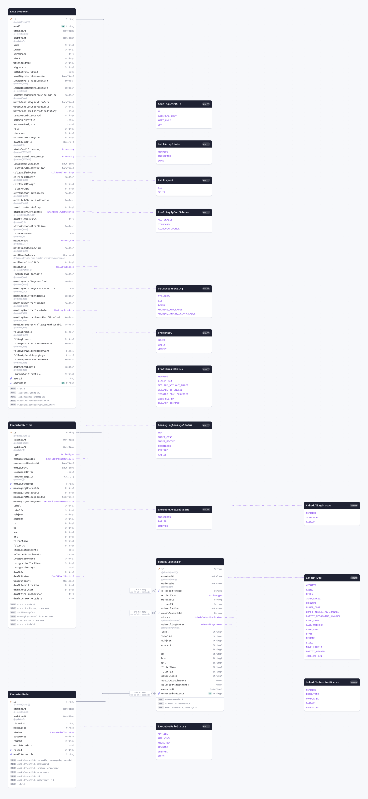

| Field                 | Type                                                   | Constraints                                              | Default      | Description |
| --------------------- | ------------------------------------------------------ | -------------------------------------------------------- | ------------ | ----------- |
| `id`                  | `String`                                               | PK NOT NULL                                              | `cuid(1)`    |             |
| `createdAt`           | `DateTime`                                             | NOT NULL                                                 | `now()`      |             |
| `updatedAt`           | `DateTime`                                             | NOT NULL                                                 | `@updatedAt` |             |
| `executedRuleId`      | `String`                                               | NOT NULL → [ExecutedRule.id](#model-ExecutedRule)        |              |             |
| `actionType`          | [`ActionType`](#enum-ActionType)                       | NOT NULL                                                 |              |             |
| `messageId`           | `String`                                               | NOT NULL                                                 |              |             |
| `threadId`            | `String`                                               | NOT NULL                                                 |              |             |
| `scheduledFor`        | `DateTime`                                             | NOT NULL                                                 |              |             |
| `emailAccountId`      | `String`                                               | NOT NULL → [EmailAccount.id](#model-EmailAccount)        |              |             |
| `status`              | [`ScheduledActionStatus`](#enum-ScheduledActionStatus) | NOT NULL                                                 | `PENDING`    |             |
| `schedulingStatus`    | [`SchedulingStatus`](#enum-SchedulingStatus)           | NOT NULL                                                 | `PENDING`    |             |
| `label`               | `String`                                               | NULL                                                     |              |             |
| `labelId`             | `String`                                               | NULL                                                     |              |             |
| `subject`             | `String`                                               | NULL                                                     |              |             |
| `content`             | `String`                                               | NULL                                                     |              |             |
| `to`                  | `String`                                               | NULL                                                     |              |             |
| `cc`                  | `String`                                               | NULL                                                     |              |             |
| `bcc`                 | `String`                                               | NULL                                                     |              |             |
| `url`                 | `String`                                               | NULL                                                     |              |             |
| `folderName`          | `String`                                               | NULL                                                     |              |             |
| `folderId`            | `String`                                               | NULL                                                     |              |             |
| `scheduledId`         | `String`                                               | NULL                                                     |              |             |
| `staticAttachments`   | `Json`                                                 | NULL                                                     |              |             |
| `selectedAttachments` | `Json`                                                 | NULL                                                     |              |             |
| `executedAt`          | `DateTime`                                             | NULL                                                     |              |             |
| `executedActionId`    | `String`                                               | UNIQUE NULL → [ExecutedAction.id](#model-ExecutedAction) |              |             |

#### Indexes

- `@@index([executedRuleId])`
- `@@index([status, scheduledFor])`
- `@@index([emailAccountId, messageId])`

#### References

- `executedRuleId` → [ExecutedRule.id](#model-ExecutedRule) (many-to-one, on delete Cascade)
- `executedActionId` → [ExecutedAction.id](#model-ExecutedAction) (one-to-one, on delete Cascade)
- `emailAccountId` → [EmailAccount.id](#model-EmailAccount) (many-to-one, on delete Cascade)

#### Definition

```sql
CREATE TABLE "ScheduledAction" (
    "id" TEXT NOT NULL,
    "createdAt" TIMESTAMP(3) NOT NULL DEFAULT CURRENT_TIMESTAMP,
    "updatedAt" TIMESTAMP(3) NOT NULL,
    "executedRuleId" TEXT NOT NULL,
    "actionType" "ActionType" NOT NULL,
    "messageId" TEXT NOT NULL,
    "threadId" TEXT NOT NULL,
    "scheduledFor" TIMESTAMP(3) NOT NULL,
    "emailAccountId" TEXT NOT NULL,
    "status" "ScheduledActionStatus" NOT NULL DEFAULT 'PENDING',
    "schedulingStatus" "SchedulingStatus" NOT NULL DEFAULT 'PENDING',
    "label" TEXT,
    "labelId" TEXT,
    "subject" TEXT,
    "content" TEXT,
    "to" TEXT,
    "cc" TEXT,
    "bcc" TEXT,
    "url" TEXT,
    "folderName" TEXT,
    "folderId" TEXT,
    "scheduledId" TEXT,
    "staticAttachments" JSONB,
    "selectedAttachments" JSONB,
    "executedAt" TIMESTAMP(3),
    "executedActionId" TEXT,

    CONSTRAINT "ScheduledAction_pkey" PRIMARY KEY ("id")
);

CREATE UNIQUE INDEX "ScheduledAction_executedActionId_key" ON "ScheduledAction"("executedActionId");

CREATE INDEX "ScheduledAction_executedRuleId_idx" ON "ScheduledAction"("executedRuleId");

CREATE INDEX "ScheduledAction_status_scheduledFor_idx" ON "ScheduledAction"("status", "scheduledFor");

CREATE INDEX "ScheduledAction_emailAccountId_messageId_idx" ON "ScheduledAction"("emailAccountId", "messageId");

ALTER TABLE "ScheduledAction" ADD CONSTRAINT "ScheduledAction_executedRuleId_fkey" FOREIGN KEY ("executedRuleId") REFERENCES "ExecutedRule"("id") ON DELETE CASCADE ON UPDATE CASCADE;

ALTER TABLE "ScheduledAction" ADD CONSTRAINT "ScheduledAction_executedActionId_fkey" FOREIGN KEY ("executedActionId") REFERENCES "ExecutedAction"("id") ON DELETE CASCADE ON UPDATE CASCADE;

ALTER TABLE "ScheduledAction" ADD CONSTRAINT "ScheduledAction_emailAccountId_fkey" FOREIGN KEY ("emailAccountId") REFERENCES "EmailAccount"("id") ON DELETE CASCADE ON UPDATE CASCADE;
```

<details>
<summary>Queries and their SQL</summary>

**findMany**: Every row

```ts
await prisma.scheduledAction.findMany();
```

```sql
SELECT
  "public"."ScheduledAction"."id",
  "public"."ScheduledAction"."createdAt",
  "public"."ScheduledAction"."updatedAt",
  "public"."ScheduledAction"."executedRuleId",
  "public"."ScheduledAction"."actionType"::text,
  "public"."ScheduledAction"."messageId",
  "public"."ScheduledAction"."threadId",
  "public"."ScheduledAction"."scheduledFor",
  "public"."ScheduledAction"."emailAccountId",
  "public"."ScheduledAction"."status"::text,
  "public"."ScheduledAction"."schedulingStatus"::text,
  "public"."ScheduledAction"."label",
  "public"."ScheduledAction"."labelId",
  "public"."ScheduledAction"."subject",
  "public"."ScheduledAction"."content",
  "public"."ScheduledAction"."to",
  "public"."ScheduledAction"."cc",
  "public"."ScheduledAction"."bcc",
  "public"."ScheduledAction"."url",
  "public"."ScheduledAction"."folderName",
  "public"."ScheduledAction"."folderId",
  "public"."ScheduledAction"."scheduledId",
  "public"."ScheduledAction"."staticAttachments",
  "public"."ScheduledAction"."selectedAttachments",
  "public"."ScheduledAction"."executedAt",
  "public"."ScheduledAction"."executedActionId"
FROM
  "public"."ScheduledAction"
WHERE
  1 = 1
OFFSET
  $1
-- params: ["0"]
```

**count**: How many rows there are

```ts
await prisma.scheduledAction.count();
```

```sql
SELECT
  COUNT(*) AS "_count$_all"
FROM
  (
    SELECT
      "public"."ScheduledAction"."id"
    FROM
      "public"."ScheduledAction"
    WHERE
      1 = 1
    OFFSET
      $1
  ) AS "sub"
-- params: ["0"]
```

**findMany**: Every row with its relations

```ts
await prisma.scheduledAction.findMany({
  include: { executedRule: true, executedAction: true, emailAccount: true },
});
```

```sql
SELECT
  "public"."ScheduledAction"."id",
  "public"."ScheduledAction"."createdAt",
  "public"."ScheduledAction"."updatedAt",
  "public"."ScheduledAction"."executedRuleId",
  "public"."ScheduledAction"."actionType"::text,
  "public"."ScheduledAction"."messageId",
  "public"."ScheduledAction"."threadId",
  "public"."ScheduledAction"."scheduledFor",
  "public"."ScheduledAction"."emailAccountId",
  "public"."ScheduledAction"."status"::text,
  "public"."ScheduledAction"."schedulingStatus"::text,
  "public"."ScheduledAction"."label",
  "public"."ScheduledAction"."labelId",
  "public"."ScheduledAction"."subject",
  "public"."ScheduledAction"."content",
  "public"."ScheduledAction"."to",
  "public"."ScheduledAction"."cc",
  "public"."ScheduledAction"."bcc",
  "public"."ScheduledAction"."url",
  "public"."ScheduledAction"."folderName",
  "public"."ScheduledAction"."folderId",
  "public"."ScheduledAction"."scheduledId",
  "public"."ScheduledAction"."staticAttachments",
  "public"."ScheduledAction"."selectedAttachments",
  "public"."ScheduledAction"."executedAt",
  "public"."ScheduledAction"."executedActionId"
FROM
  "public"."ScheduledAction"
WHERE
  1 = 1
OFFSET
  $1
-- params: ["0"]

SELECT
  "public"."ExecutedRule"."id",
  "public"."ExecutedRule"."createdAt",
  "public"."ExecutedRule"."updatedAt",
  "public"."ExecutedRule"."threadId",
  "public"."ExecutedRule"."messageId",
  "public"."ExecutedRule"."status"::text,
  "public"."ExecutedRule"."automated",
  "public"."ExecutedRule"."reason",
  "public"."ExecutedRule"."matchMetadata",
  "public"."ExecutedRule"."ruleId",
  "public"."ExecutedRule"."emailAccountId"
FROM
  "public"."ExecutedRule"
WHERE
  "public"."ExecutedRule"."id" IN ($1)
OFFSET
  $2
-- params: ["<executedRuleId of the rows above>","0"]

SELECT
  "public"."ExecutedAction"."id",
  "public"."ExecutedAction"."createdAt",
  "public"."ExecutedAction"."updatedAt",
  "public"."ExecutedAction"."type"::text,
  "public"."ExecutedAction"."executionStatus"::text,
  "public"."ExecutedAction"."executionStartedAt",
  "public"."ExecutedAction"."executedAt",
  "public"."ExecutedAction"."executionError",
  "public"."ExecutedAction"."sentMessageIds",
  "public"."ExecutedAction"."executedRuleId",
  "public"."ExecutedAction"."messagingChannelId",
  "public"."ExecutedAction"."messagingMessageId",
  "public"."ExecutedAction"."messagingMessageSentAt",
  "public"."ExecutedAction"."messagingMessageStatus"::text,
  "public"."ExecutedAction"."label",
  "public"."ExecutedAction"."labelId",
  "public"."ExecutedAction"."subject",
  "public"."ExecutedAction"."content",
  "public"."ExecutedAction"."to",
  "public"."ExecutedAction"."cc",
  "public"."ExecutedAction"."bcc",
  "public"."ExecutedAction"."url",
  "public"."ExecutedAction"."folderName",
  "public"."ExecutedAction"."folderId",
  "public"."ExecutedAction"."staticAttachments",
  "public"."ExecutedAction"."selectedAttachments",
  "public"."ExecutedAction"."integrationName",
  "public"."ExecutedAction"."integrationToolName",
  "public"."ExecutedAction"."integrationArgs",
  "public"."ExecutedAction"."draftId",
  "public"."ExecutedAction"."draftStatus"::text,
  "public"."ExecutedAction"."wasDraftSent",
  "public"."ExecutedAction"."draftModelProvider",
  "public"."ExecutedAction"."draftModelName",
  "public"."ExecutedAction"."draftPipelineVersion",
  "public"."ExecutedAction"."draftContextMetadata"
FROM
  "public"."ExecutedAction"
WHERE
  "public"."ExecutedAction"."id" IN ($1)
OFFSET
  $2
-- params: ["<executedActionId of the rows above>","0"]

SELECT
  "public"."EmailAccount"."id",
  "public"."EmailAccount"."email",
  "public"."EmailAccount"."createdAt",
  "public"."EmailAccount"."updatedAt",
  "public"."EmailAccount"."name",
  "public"."EmailAccount"."image",
  "public"."EmailAccount"."sortOrder",
  "public"."EmailAccount"."about",
  "public"."EmailAccount"."writingStyle",
  "public"."EmailAccount"."signature",
  "public"."EmailAccount"."sentSignatureScan",
  "public"."EmailAccount"."sentSignatureScannedAt",
  "public"."EmailAccount"."includeReferralSignature",
  "public"."EmailAccount"."includeSentWithSignature",
  "public"."EmailAccount"."sentMessageOpenTrackingEnabled",
  "public"."EmailAccount"."watchEmailsExpirationDate",
  "public"."EmailAccount"."watchEmailsSubscriptionId",
  "public"."EmailAccount"."watchEmailsSubscriptionHistory",
  "public"."EmailAccount"."lastSyncedHistoryId",
  "public"."EmailAccount"."behaviorProfile",
  "public"."EmailAccount"."personaAnalysis",
  "public"."EmailAccount"."role",
  "public"."EmailAccount"."timezone",
  "public"."EmailAccount"."calendarBookingLink",
  "public"."EmailAccount"."draftDocsUrls",
  "public"."EmailAccount"."statsEmailFrequency"::text,
  "public"."EmailAccount"."summaryEmailFrequency"::text,
  "public"."EmailAccount"."lastSummaryEmailAt",
  "public"."EmailAccount"."lastInboxHealthEmailAt",
  "public"."EmailAccount"."coldEmailBlocker"::text,
  "public"."EmailAccount"."coldEmailDigest",
  "public"."EmailAccount"."coldEmailPrompt",
  "public"."EmailAccount"."rulesPrompt",
  "public"."EmailAccount"."autoCategorizeSenders",
  "public"."EmailAccount"."multiRuleSelectionEnabled",
  "public"."EmailAccount"."sensitiveDataPolicy",
  "public"."EmailAccount"."draftReplyConfidence"::text,
  "public"."EmailAccount"."draftCleanupDays",
  "public"."EmailAccount"."allowHiddenAiDraftLinks",
  "public"."EmailAccount"."rulesRevision",
  "public"."EmailAccount"."mailLayout"::text,
  "public"."EmailAccount"."mailExpandedPreview",
  "public"."EmailAccount"."mailBundleInbox",
  "public"."EmailAccount"."mailDefaultSplitId",
  "public"."EmailAccount"."mailSetup"::text,
  "public"."EmailAccount"."includeInAllAccounts",
  "public"."EmailAccount"."meetingBriefingsEnabled",
  "public"."EmailAccount"."meetingBriefingsMinutesBefore",
  "public"."EmailAccount"."meetingBriefsSendEmail",
  "public"."EmailAccount"."meetingRecorderEnabled",
  "public"."EmailAccount"."meetingRecorderJoinRule"::text,
  "public"."EmailAccount"."meetingRecorderRecapEmailEnabled",
  "public"."EmailAccount"."meetingRecorderFollowUpDraftEnabled",
  "public"."EmailAccount"."filingEnabled",
  "public"."EmailAccount"."filingPrompt",
  "public"."EmailAccount"."filingConfirmationSendEmail",
  "public"."EmailAccount"."followUpAwaitingReplyDays",
  "public"."EmailAccount"."followUpNeedsReplyDays",
  "public"."EmailAccount"."followUpAutoDraftEnabled",
  "public"."EmailAccount"."digestSendEmail",
  "public"."EmailAccount"."learnedWritingStyle",
  "public"."EmailAccount"."userId",
  "public"."EmailAccount"."accountId"
FROM
  "public"."EmailAccount"
WHERE
  "public"."EmailAccount"."id" IN ($1)
OFFSET
  $2
-- params: ["<emailAccountId of the rows above>","0"]
```

**findUnique**: One row by what is unique to it

```ts
await prisma.scheduledAction.findUnique({ where: { id: "example" } });
```

```sql
SELECT
  "public"."ScheduledAction"."id",
  "public"."ScheduledAction"."createdAt",
  "public"."ScheduledAction"."updatedAt",
  "public"."ScheduledAction"."executedRuleId",
  "public"."ScheduledAction"."actionType"::text,
  "public"."ScheduledAction"."messageId",
  "public"."ScheduledAction"."threadId",
  "public"."ScheduledAction"."scheduledFor",
  "public"."ScheduledAction"."emailAccountId",
  "public"."ScheduledAction"."status"::text,
  "public"."ScheduledAction"."schedulingStatus"::text,
  "public"."ScheduledAction"."label",
  "public"."ScheduledAction"."labelId",
  "public"."ScheduledAction"."subject",
  "public"."ScheduledAction"."content",
  "public"."ScheduledAction"."to",
  "public"."ScheduledAction"."cc",
  "public"."ScheduledAction"."bcc",
  "public"."ScheduledAction"."url",
  "public"."ScheduledAction"."folderName",
  "public"."ScheduledAction"."folderId",
  "public"."ScheduledAction"."scheduledId",
  "public"."ScheduledAction"."staticAttachments",
  "public"."ScheduledAction"."selectedAttachments",
  "public"."ScheduledAction"."executedAt",
  "public"."ScheduledAction"."executedActionId"
FROM
  "public"."ScheduledAction"
WHERE
  (
    "public"."ScheduledAction"."id" = $1
    AND 1 = 1
  )
LIMIT
  $2
OFFSET
  $3
-- params: ["example","1","0"]
```

**create**: Create a row

```ts
await prisma.scheduledAction.create({
  data: {
    executedRuleId: "example",
    actionType: "ARCHIVE",
    messageId: "example",
    threadId: "example",
    scheduledFor: new Date("2026-01-01T00:00:00.000Z"),
    emailAccountId: "example",
  },
});
```

```sql
INSERT INTO
  "public"."ScheduledAction" (
    "id",
    "createdAt",
    "updatedAt",
    "executedRuleId",
    "actionType",
    "messageId",
    "threadId",
    "scheduledFor",
    "emailAccountId",
    "status",
    "schedulingStatus"
  )
VALUES
  (
    $1,
    $2,
    $3,
    $4,
    CAST($5::text AS "public"."ActionType"),
    $6,
    $7,
    $8,
    $9,
    CAST($10::text AS "public"."ScheduledActionStatus"),
    CAST($11::text AS "public"."SchedulingStatus")
  )
RETURNING
  "public"."ScheduledAction"."id",
  "public"."ScheduledAction"."createdAt",
  "public"."ScheduledAction"."updatedAt",
  "public"."ScheduledAction"."executedRuleId",
  "public"."ScheduledAction"."actionType"::text,
  "public"."ScheduledAction"."messageId",
  "public"."ScheduledAction"."threadId",
  "public"."ScheduledAction"."scheduledFor",
  "public"."ScheduledAction"."emailAccountId",
  "public"."ScheduledAction"."status"::text,
  "public"."ScheduledAction"."schedulingStatus"::text,
  "public"."ScheduledAction"."label",
  "public"."ScheduledAction"."labelId",
  "public"."ScheduledAction"."subject",
  "public"."ScheduledAction"."content",
  "public"."ScheduledAction"."to",
  "public"."ScheduledAction"."cc",
  "public"."ScheduledAction"."bcc",
  "public"."ScheduledAction"."url",
  "public"."ScheduledAction"."folderName",
  "public"."ScheduledAction"."folderId",
  "public"."ScheduledAction"."scheduledId",
  "public"."ScheduledAction"."staticAttachments",
  "public"."ScheduledAction"."selectedAttachments",
  "public"."ScheduledAction"."executedAt",
  "public"."ScheduledAction"."executedActionId"
-- params: ["<cuid(1)>","<now()>","<now()>","example","ARCHIVE","example","example","2026-01-01T00:00:00.000Z","example","PENDING","PENDING"]
```

**update**: Update a row

```ts
await prisma.scheduledAction.update({
  where: { id: "example" },
  data: { createdAt: new Date("2026-01-01T00:00:00.000Z") },
});
```

```sql
UPDATE "public"."ScheduledAction"
SET
  "createdAt" = $1,
  "updatedAt" = $2
WHERE
  (
    "public"."ScheduledAction"."id" = $3
    AND 1 = 1
  )
RETURNING
  "public"."ScheduledAction"."id",
  "public"."ScheduledAction"."createdAt",
  "public"."ScheduledAction"."updatedAt",
  "public"."ScheduledAction"."executedRuleId",
  "public"."ScheduledAction"."actionType"::text,
  "public"."ScheduledAction"."messageId",
  "public"."ScheduledAction"."threadId",
  "public"."ScheduledAction"."scheduledFor",
  "public"."ScheduledAction"."emailAccountId",
  "public"."ScheduledAction"."status"::text,
  "public"."ScheduledAction"."schedulingStatus"::text,
  "public"."ScheduledAction"."label",
  "public"."ScheduledAction"."labelId",
  "public"."ScheduledAction"."subject",
  "public"."ScheduledAction"."content",
  "public"."ScheduledAction"."to",
  "public"."ScheduledAction"."cc",
  "public"."ScheduledAction"."bcc",
  "public"."ScheduledAction"."url",
  "public"."ScheduledAction"."folderName",
  "public"."ScheduledAction"."folderId",
  "public"."ScheduledAction"."scheduledId",
  "public"."ScheduledAction"."staticAttachments",
  "public"."ScheduledAction"."selectedAttachments",
  "public"."ScheduledAction"."executedAt",
  "public"."ScheduledAction"."executedActionId"
-- params: ["2026-01-01T00:00:00.000Z",{"prisma__type":"generatorCall","prisma__value":{"name":"now","args":[],"returnType":{"type":"DateTime"}}},"example"]
```

**delete**: Delete a row

```ts
await prisma.scheduledAction.delete({ where: { id: "example" } });
```

```sql
DELETE FROM "public"."ScheduledAction"
WHERE
  (
    "public"."ScheduledAction"."id" = $1
    AND 1 = 1
  )
RETURNING
  "public"."ScheduledAction"."id",
  "public"."ScheduledAction"."createdAt",
  "public"."ScheduledAction"."updatedAt",
  "public"."ScheduledAction"."executedRuleId",
  "public"."ScheduledAction"."actionType"::text,
  "public"."ScheduledAction"."messageId",
  "public"."ScheduledAction"."threadId",
  "public"."ScheduledAction"."scheduledFor",
  "public"."ScheduledAction"."emailAccountId",
  "public"."ScheduledAction"."status"::text,
  "public"."ScheduledAction"."schedulingStatus"::text,
  "public"."ScheduledAction"."label",
  "public"."ScheduledAction"."labelId",
  "public"."ScheduledAction"."subject",
  "public"."ScheduledAction"."content",
  "public"."ScheduledAction"."to",
  "public"."ScheduledAction"."cc",
  "public"."ScheduledAction"."bcc",
  "public"."ScheduledAction"."url",
  "public"."ScheduledAction"."folderName",
  "public"."ScheduledAction"."folderId",
  "public"."ScheduledAction"."scheduledId",
  "public"."ScheduledAction"."staticAttachments",
  "public"."ScheduledAction"."selectedAttachments",
  "public"."ScheduledAction"."executedAt",
  "public"."ScheduledAction"."executedActionId"
-- params: ["example"]
```

</details>

<a id="model-SnoozedThread"></a>

### SnoozedThread

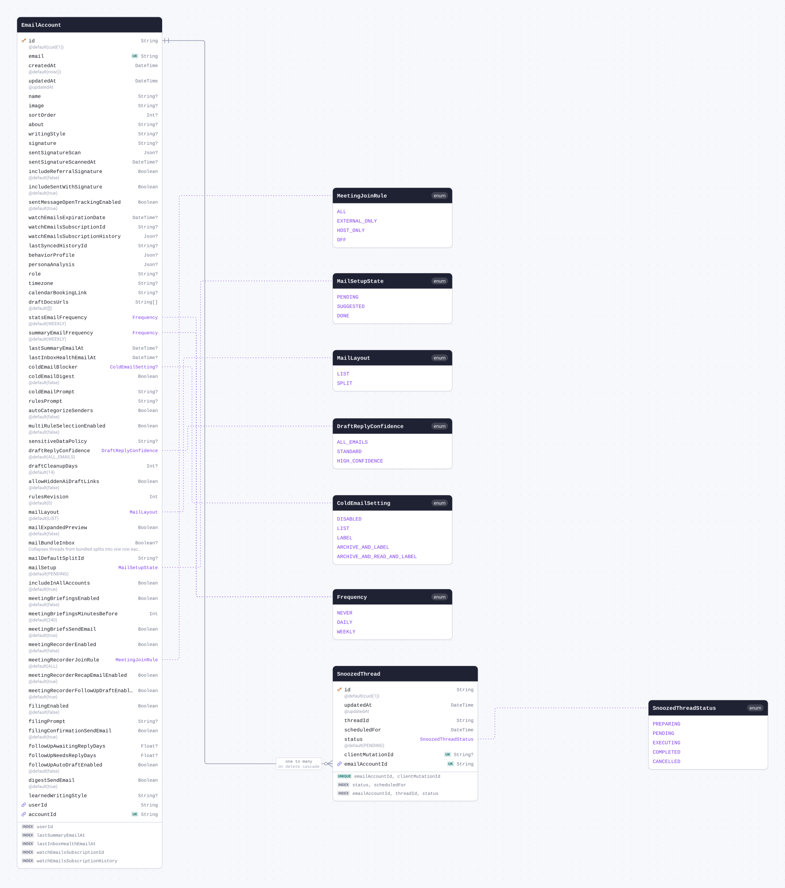

| Field              | Type                                               | Constraints                                       | Default      | Description |
| ------------------ | -------------------------------------------------- | ------------------------------------------------- | ------------ | ----------- |
| `id`               | `String`                                           | PK NOT NULL                                       | `cuid(1)`    |             |
| `updatedAt`        | `DateTime`                                         | NOT NULL                                          | `@updatedAt` |             |
| `threadId`         | `String`                                           | NOT NULL                                          |              |             |
| `scheduledFor`     | `DateTime`                                         | NOT NULL                                          |              |             |
| `status`           | [`SnoozedThreadStatus`](#enum-SnoozedThreadStatus) | NOT NULL                                          | `PENDING`    |             |
| `clientMutationId` | `String`                                           | NULL                                              |              |             |
| `emailAccountId`   | `String`                                           | NOT NULL → [EmailAccount.id](#model-EmailAccount) |              |             |

#### Indexes

- `@@index([status, scheduledFor])`
- `@@index([emailAccountId, threadId, status])`
- `@@unique([emailAccountId, clientMutationId])`

#### References

- `emailAccountId` → [EmailAccount.id](#model-EmailAccount) (many-to-one, on delete Cascade)

#### Definition

```sql
CREATE TABLE "SnoozedThread" (
    "id" TEXT NOT NULL,
    "updatedAt" TIMESTAMP(3) NOT NULL,
    "threadId" TEXT NOT NULL,
    "scheduledFor" TIMESTAMP(3) NOT NULL,
    "status" "SnoozedThreadStatus" NOT NULL DEFAULT 'PENDING',
    "clientMutationId" TEXT,
    "emailAccountId" TEXT NOT NULL,

    CONSTRAINT "SnoozedThread_pkey" PRIMARY KEY ("id")
);

CREATE INDEX "SnoozedThread_status_scheduledFor_idx" ON "SnoozedThread"("status", "scheduledFor");

CREATE INDEX "SnoozedThread_emailAccountId_threadId_status_idx" ON "SnoozedThread"("emailAccountId", "threadId", "status");

CREATE UNIQUE INDEX "SnoozedThread_emailAccountId_clientMutationId_key" ON "SnoozedThread"("emailAccountId", "clientMutationId");

ALTER TABLE "SnoozedThread" ADD CONSTRAINT "SnoozedThread_emailAccountId_fkey" FOREIGN KEY ("emailAccountId") REFERENCES "EmailAccount"("id") ON DELETE CASCADE ON UPDATE CASCADE;
```

<details>
<summary>Queries and their SQL</summary>

**findMany**: Every row

```ts
await prisma.snoozedThread.findMany();
```

```sql
SELECT
  "public"."SnoozedThread"."id",
  "public"."SnoozedThread"."updatedAt",
  "public"."SnoozedThread"."threadId",
  "public"."SnoozedThread"."scheduledFor",
  "public"."SnoozedThread"."status"::text,
  "public"."SnoozedThread"."clientMutationId",
  "public"."SnoozedThread"."emailAccountId"
FROM
  "public"."SnoozedThread"
WHERE
  1 = 1
OFFSET
  $1
-- params: ["0"]
```

**count**: How many rows there are

```ts
await prisma.snoozedThread.count();
```

```sql
SELECT
  COUNT(*) AS "_count$_all"
FROM
  (
    SELECT
      "public"."SnoozedThread"."id"
    FROM
      "public"."SnoozedThread"
    WHERE
      1 = 1
    OFFSET
      $1
  ) AS "sub"
-- params: ["0"]
```

**findMany**: Every row with its relations

```ts
await prisma.snoozedThread.findMany({ include: { emailAccount: true } });
```

```sql
SELECT
  "public"."SnoozedThread"."id",
  "public"."SnoozedThread"."updatedAt",
  "public"."SnoozedThread"."threadId",
  "public"."SnoozedThread"."scheduledFor",
  "public"."SnoozedThread"."status"::text,
  "public"."SnoozedThread"."clientMutationId",
  "public"."SnoozedThread"."emailAccountId"
FROM
  "public"."SnoozedThread"
WHERE
  1 = 1
OFFSET
  $1
-- params: ["0"]

SELECT
  "public"."EmailAccount"."id",
  "public"."EmailAccount"."email",
  "public"."EmailAccount"."createdAt",
  "public"."EmailAccount"."updatedAt",
  "public"."EmailAccount"."name",
  "public"."EmailAccount"."image",
  "public"."EmailAccount"."sortOrder",
  "public"."EmailAccount"."about",
  "public"."EmailAccount"."writingStyle",
  "public"."EmailAccount"."signature",
  "public"."EmailAccount"."sentSignatureScan",
  "public"."EmailAccount"."sentSignatureScannedAt",
  "public"."EmailAccount"."includeReferralSignature",
  "public"."EmailAccount"."includeSentWithSignature",
  "public"."EmailAccount"."sentMessageOpenTrackingEnabled",
  "public"."EmailAccount"."watchEmailsExpirationDate",
  "public"."EmailAccount"."watchEmailsSubscriptionId",
  "public"."EmailAccount"."watchEmailsSubscriptionHistory",
  "public"."EmailAccount"."lastSyncedHistoryId",
  "public"."EmailAccount"."behaviorProfile",
  "public"."EmailAccount"."personaAnalysis",
  "public"."EmailAccount"."role",
  "public"."EmailAccount"."timezone",
  "public"."EmailAccount"."calendarBookingLink",
  "public"."EmailAccount"."draftDocsUrls",
  "public"."EmailAccount"."statsEmailFrequency"::text,
  "public"."EmailAccount"."summaryEmailFrequency"::text,
  "public"."EmailAccount"."lastSummaryEmailAt",
  "public"."EmailAccount"."lastInboxHealthEmailAt",
  "public"."EmailAccount"."coldEmailBlocker"::text,
  "public"."EmailAccount"."coldEmailDigest",
  "public"."EmailAccount"."coldEmailPrompt",
  "public"."EmailAccount"."rulesPrompt",
  "public"."EmailAccount"."autoCategorizeSenders",
  "public"."EmailAccount"."multiRuleSelectionEnabled",
  "public"."EmailAccount"."sensitiveDataPolicy",
  "public"."EmailAccount"."draftReplyConfidence"::text,
  "public"."EmailAccount"."draftCleanupDays",
  "public"."EmailAccount"."allowHiddenAiDraftLinks",
  "public"."EmailAccount"."rulesRevision",
  "public"."EmailAccount"."mailLayout"::text,
  "public"."EmailAccount"."mailExpandedPreview",
  "public"."EmailAccount"."mailBundleInbox",
  "public"."EmailAccount"."mailDefaultSplitId",
  "public"."EmailAccount"."mailSetup"::text,
  "public"."EmailAccount"."includeInAllAccounts",
  "public"."EmailAccount"."meetingBriefingsEnabled",
  "public"."EmailAccount"."meetingBriefingsMinutesBefore",
  "public"."EmailAccount"."meetingBriefsSendEmail",
  "public"."EmailAccount"."meetingRecorderEnabled",
  "public"."EmailAccount"."meetingRecorderJoinRule"::text,
  "public"."EmailAccount"."meetingRecorderRecapEmailEnabled",
  "public"."EmailAccount"."meetingRecorderFollowUpDraftEnabled",
  "public"."EmailAccount"."filingEnabled",
  "public"."EmailAccount"."filingPrompt",
  "public"."EmailAccount"."filingConfirmationSendEmail",
  "public"."EmailAccount"."followUpAwaitingReplyDays",
  "public"."EmailAccount"."followUpNeedsReplyDays",
  "public"."EmailAccount"."followUpAutoDraftEnabled",
  "public"."EmailAccount"."digestSendEmail",
  "public"."EmailAccount"."learnedWritingStyle",
  "public"."EmailAccount"."userId",
  "public"."EmailAccount"."accountId"
FROM
  "public"."EmailAccount"
WHERE
  "public"."EmailAccount"."id" IN ($1)
OFFSET
  $2
-- params: ["<emailAccountId of the rows above>","0"]
```

**findUnique**: One row by what is unique to it

```ts
await prisma.snoozedThread.findUnique({ where: { id: "example" } });
```

```sql
SELECT
  "public"."SnoozedThread"."id",
  "public"."SnoozedThread"."updatedAt",
  "public"."SnoozedThread"."threadId",
  "public"."SnoozedThread"."scheduledFor",
  "public"."SnoozedThread"."status"::text,
  "public"."SnoozedThread"."clientMutationId",
  "public"."SnoozedThread"."emailAccountId"
FROM
  "public"."SnoozedThread"
WHERE
  (
    "public"."SnoozedThread"."id" = $1
    AND 1 = 1
  )
LIMIT
  $2
OFFSET
  $3
-- params: ["example","1","0"]
```

**create**: Create a row

```ts
await prisma.snoozedThread.create({
  data: {
    threadId: "example",
    scheduledFor: new Date("2026-01-01T00:00:00.000Z"),
    emailAccountId: "example",
  },
});
```

```sql
INSERT INTO
  "public"."SnoozedThread" (
    "id",
    "updatedAt",
    "threadId",
    "scheduledFor",
    "status",
    "emailAccountId"
  )
VALUES
  (
    $1,
    $2,
    $3,
    $4,
    CAST($5::text AS "public"."SnoozedThreadStatus"),
    $6
  )
RETURNING
  "public"."SnoozedThread"."id",
  "public"."SnoozedThread"."updatedAt",
  "public"."SnoozedThread"."threadId",
  "public"."SnoozedThread"."scheduledFor",
  "public"."SnoozedThread"."status"::text,
  "public"."SnoozedThread"."clientMutationId",
  "public"."SnoozedThread"."emailAccountId"
-- params: ["<cuid(1)>","<now()>","example","2026-01-01T00:00:00.000Z","PENDING","example"]
```

**update**: Update a row

```ts
await prisma.snoozedThread.update({ where: { id: "example" }, data: { threadId: "example" } });
```

```sql
UPDATE "public"."SnoozedThread"
SET
  "threadId" = $1,
  "updatedAt" = $2
WHERE
  (
    "public"."SnoozedThread"."id" = $3
    AND 1 = 1
  )
RETURNING
  "public"."SnoozedThread"."id",
  "public"."SnoozedThread"."updatedAt",
  "public"."SnoozedThread"."threadId",
  "public"."SnoozedThread"."scheduledFor",
  "public"."SnoozedThread"."status"::text,
  "public"."SnoozedThread"."clientMutationId",
  "public"."SnoozedThread"."emailAccountId"
-- params: ["example",{"prisma__type":"generatorCall","prisma__value":{"name":"now","args":[],"returnType":{"type":"DateTime"}}},"example"]
```

**delete**: Delete a row

```ts
await prisma.snoozedThread.delete({ where: { id: "example" } });
```

```sql
DELETE FROM "public"."SnoozedThread"
WHERE
  (
    "public"."SnoozedThread"."id" = $1
    AND 1 = 1
  )
RETURNING
  "public"."SnoozedThread"."id",
  "public"."SnoozedThread"."updatedAt",
  "public"."SnoozedThread"."threadId",
  "public"."SnoozedThread"."scheduledFor",
  "public"."SnoozedThread"."status"::text,
  "public"."SnoozedThread"."clientMutationId",
  "public"."SnoozedThread"."emailAccountId"
-- params: ["example"]
```

</details>

<a id="model-ScheduledEmail"></a>

### ScheduledEmail

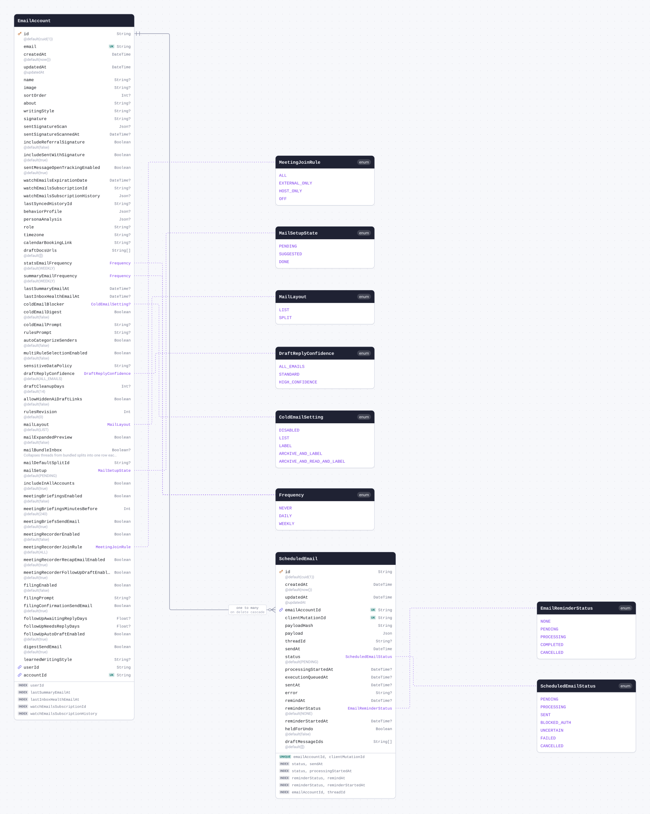

| Field                 | Type                                                 | Constraints                                       | Default      | Description |
| --------------------- | ---------------------------------------------------- | ------------------------------------------------- | ------------ | ----------- |
| `id`                  | `String`                                             | PK NOT NULL                                       | `cuid(1)`    |             |
| `createdAt`           | `DateTime`                                           | NOT NULL                                          | `now()`      |             |
| `updatedAt`           | `DateTime`                                           | NOT NULL                                          | `@updatedAt` |             |
| `emailAccountId`      | `String`                                             | NOT NULL → [EmailAccount.id](#model-EmailAccount) |              |             |
| `clientMutationId`    | `String`                                             | NOT NULL                                          |              |             |
| `payloadHash`         | `String`                                             | NOT NULL                                          |              |             |
| `payload`             | `Json`                                               | NOT NULL                                          |              |             |
| `threadId`            | `String`                                             | NULL                                              |              |             |
| `sendAt`              | `DateTime`                                           | NOT NULL                                          |              |             |
| `status`              | [`ScheduledEmailStatus`](#enum-ScheduledEmailStatus) | NOT NULL                                          | `PENDING`    |             |
| `processingStartedAt` | `DateTime`                                           | NULL                                              |              |             |
| `executionQueuedAt`   | `DateTime`                                           | NULL                                              |              |             |
| `sentAt`              | `DateTime`                                           | NULL                                              |              |             |
| `error`               | `String`                                             | NULL                                              |              |             |
| `remindAt`            | `DateTime`                                           | NULL                                              |              |             |
| `reminderStatus`      | [`EmailReminderStatus`](#enum-EmailReminderStatus)   | NOT NULL                                          | `NONE`       |             |
| `reminderStartedAt`   | `DateTime`                                           | NULL                                              |              |             |
| `heldForUndo`         | `Boolean`                                            | NOT NULL                                          | `false`      |             |
| `draftMessageIds`     | `String[]`                                           | NOT NULL                                          | `[]`         |             |

#### Indexes

- `@@index([status, sendAt])`
- `@@index([status, processingStartedAt])`
- `@@index([reminderStatus, remindAt])`
- `@@index([reminderStatus, reminderStartedAt])`
- `@@index([emailAccountId, threadId])`
- `@@unique([emailAccountId, clientMutationId])`

#### References

- `emailAccountId` → [EmailAccount.id](#model-EmailAccount) (many-to-one, on delete Cascade)

#### Definition

```sql
CREATE TABLE "ScheduledEmail" (
    "id" TEXT NOT NULL,
    "createdAt" TIMESTAMP(3) NOT NULL DEFAULT CURRENT_TIMESTAMP,
    "updatedAt" TIMESTAMP(3) NOT NULL,
    "emailAccountId" TEXT NOT NULL,
    "clientMutationId" TEXT NOT NULL,
    "payloadHash" TEXT NOT NULL,
    "payload" JSONB NOT NULL,
    "threadId" TEXT,
    "sendAt" TIMESTAMP(3) NOT NULL,
    "status" "ScheduledEmailStatus" NOT NULL DEFAULT 'PENDING',
    "processingStartedAt" TIMESTAMP(3),
    "executionQueuedAt" TIMESTAMP(3),
    "sentAt" TIMESTAMP(3),
    "error" TEXT,
    "remindAt" TIMESTAMP(3),
    "reminderStatus" "EmailReminderStatus" NOT NULL DEFAULT 'NONE',
    "reminderStartedAt" TIMESTAMP(3),
    "heldForUndo" BOOLEAN NOT NULL DEFAULT false,
    "draftMessageIds" TEXT[] DEFAULT ARRAY[]::TEXT[],

    CONSTRAINT "ScheduledEmail_pkey" PRIMARY KEY ("id")
);

CREATE INDEX "ScheduledEmail_status_sendAt_idx" ON "ScheduledEmail"("status", "sendAt");

CREATE INDEX "ScheduledEmail_status_processingStartedAt_idx" ON "ScheduledEmail"("status", "processingStartedAt");

CREATE INDEX "ScheduledEmail_reminderStatus_remindAt_idx" ON "ScheduledEmail"("reminderStatus", "remindAt");

CREATE INDEX "ScheduledEmail_reminderStatus_reminderStartedAt_idx" ON "ScheduledEmail"("reminderStatus", "reminderStartedAt");

CREATE INDEX "ScheduledEmail_emailAccountId_threadId_idx" ON "ScheduledEmail"("emailAccountId", "threadId");

CREATE UNIQUE INDEX "ScheduledEmail_emailAccountId_clientMutationId_key" ON "ScheduledEmail"("emailAccountId", "clientMutationId");

ALTER TABLE "ScheduledEmail" ADD CONSTRAINT "ScheduledEmail_emailAccountId_fkey" FOREIGN KEY ("emailAccountId") REFERENCES "EmailAccount"("id") ON DELETE CASCADE ON UPDATE CASCADE;
```

<details>
<summary>Queries and their SQL</summary>

**findMany**: Every row

```ts
await prisma.scheduledEmail.findMany();
```

```sql
SELECT
  "public"."ScheduledEmail"."id",
  "public"."ScheduledEmail"."createdAt",
  "public"."ScheduledEmail"."updatedAt",
  "public"."ScheduledEmail"."emailAccountId",
  "public"."ScheduledEmail"."clientMutationId",
  "public"."ScheduledEmail"."payloadHash",
  "public"."ScheduledEmail"."payload",
  "public"."ScheduledEmail"."threadId",
  "public"."ScheduledEmail"."sendAt",
  "public"."ScheduledEmail"."status"::text,
  "public"."ScheduledEmail"."processingStartedAt",
  "public"."ScheduledEmail"."executionQueuedAt",
  "public"."ScheduledEmail"."sentAt",
  "public"."ScheduledEmail"."error",
  "public"."ScheduledEmail"."remindAt",
  "public"."ScheduledEmail"."reminderStatus"::text,
  "public"."ScheduledEmail"."reminderStartedAt",
  "public"."ScheduledEmail"."heldForUndo",
  "public"."ScheduledEmail"."draftMessageIds"
FROM
  "public"."ScheduledEmail"
WHERE
  1 = 1
OFFSET
  $1
-- params: ["0"]
```

**count**: How many rows there are

```ts
await prisma.scheduledEmail.count();
```

```sql
SELECT
  COUNT(*) AS "_count$_all"
FROM
  (
    SELECT
      "public"."ScheduledEmail"."id"
    FROM
      "public"."ScheduledEmail"
    WHERE
      1 = 1
    OFFSET
      $1
  ) AS "sub"
-- params: ["0"]
```

**findMany**: Every row with its relations

```ts
await prisma.scheduledEmail.findMany({ include: { emailAccount: true } });
```

```sql
SELECT
  "public"."ScheduledEmail"."id",
  "public"."ScheduledEmail"."createdAt",
  "public"."ScheduledEmail"."updatedAt",
  "public"."ScheduledEmail"."emailAccountId",
  "public"."ScheduledEmail"."clientMutationId",
  "public"."ScheduledEmail"."payloadHash",
  "public"."ScheduledEmail"."payload",
  "public"."ScheduledEmail"."threadId",
  "public"."ScheduledEmail"."sendAt",
  "public"."ScheduledEmail"."status"::text,
  "public"."ScheduledEmail"."processingStartedAt",
  "public"."ScheduledEmail"."executionQueuedAt",
  "public"."ScheduledEmail"."sentAt",
  "public"."ScheduledEmail"."error",
  "public"."ScheduledEmail"."remindAt",
  "public"."ScheduledEmail"."reminderStatus"::text,
  "public"."ScheduledEmail"."reminderStartedAt",
  "public"."ScheduledEmail"."heldForUndo",
  "public"."ScheduledEmail"."draftMessageIds"
FROM
  "public"."ScheduledEmail"
WHERE
  1 = 1
OFFSET
  $1
-- params: ["0"]

SELECT
  "public"."EmailAccount"."id",
  "public"."EmailAccount"."email",
  "public"."EmailAccount"."createdAt",
  "public"."EmailAccount"."updatedAt",
  "public"."EmailAccount"."name",
  "public"."EmailAccount"."image",
  "public"."EmailAccount"."sortOrder",
  "public"."EmailAccount"."about",
  "public"."EmailAccount"."writingStyle",
  "public"."EmailAccount"."signature",
  "public"."EmailAccount"."sentSignatureScan",
  "public"."EmailAccount"."sentSignatureScannedAt",
  "public"."EmailAccount"."includeReferralSignature",
  "public"."EmailAccount"."includeSentWithSignature",
  "public"."EmailAccount"."sentMessageOpenTrackingEnabled",
  "public"."EmailAccount"."watchEmailsExpirationDate",
  "public"."EmailAccount"."watchEmailsSubscriptionId",
  "public"."EmailAccount"."watchEmailsSubscriptionHistory",
  "public"."EmailAccount"."lastSyncedHistoryId",
  "public"."EmailAccount"."behaviorProfile",
  "public"."EmailAccount"."personaAnalysis",
  "public"."EmailAccount"."role",
  "public"."EmailAccount"."timezone",
  "public"."EmailAccount"."calendarBookingLink",
  "public"."EmailAccount"."draftDocsUrls",
  "public"."EmailAccount"."statsEmailFrequency"::text,
  "public"."EmailAccount"."summaryEmailFrequency"::text,
  "public"."EmailAccount"."lastSummaryEmailAt",
  "public"."EmailAccount"."lastInboxHealthEmailAt",
  "public"."EmailAccount"."coldEmailBlocker"::text,
  "public"."EmailAccount"."coldEmailDigest",
  "public"."EmailAccount"."coldEmailPrompt",
  "public"."EmailAccount"."rulesPrompt",
  "public"."EmailAccount"."autoCategorizeSenders",
  "public"."EmailAccount"."multiRuleSelectionEnabled",
  "public"."EmailAccount"."sensitiveDataPolicy",
  "public"."EmailAccount"."draftReplyConfidence"::text,
  "public"."EmailAccount"."draftCleanupDays",
  "public"."EmailAccount"."allowHiddenAiDraftLinks",
  "public"."EmailAccount"."rulesRevision",
  "public"."EmailAccount"."mailLayout"::text,
  "public"."EmailAccount"."mailExpandedPreview",
  "public"."EmailAccount"."mailBundleInbox",
  "public"."EmailAccount"."mailDefaultSplitId",
  "public"."EmailAccount"."mailSetup"::text,
  "public"."EmailAccount"."includeInAllAccounts",
  "public"."EmailAccount"."meetingBriefingsEnabled",
  "public"."EmailAccount"."meetingBriefingsMinutesBefore",
  "public"."EmailAccount"."meetingBriefsSendEmail",
  "public"."EmailAccount"."meetingRecorderEnabled",
  "public"."EmailAccount"."meetingRecorderJoinRule"::text,
  "public"."EmailAccount"."meetingRecorderRecapEmailEnabled",
  "public"."EmailAccount"."meetingRecorderFollowUpDraftEnabled",
  "public"."EmailAccount"."filingEnabled",
  "public"."EmailAccount"."filingPrompt",
  "public"."EmailAccount"."filingConfirmationSendEmail",
  "public"."EmailAccount"."followUpAwaitingReplyDays",
  "public"."EmailAccount"."followUpNeedsReplyDays",
  "public"."EmailAccount"."followUpAutoDraftEnabled",
  "public"."EmailAccount"."digestSendEmail",
  "public"."EmailAccount"."learnedWritingStyle",
  "public"."EmailAccount"."userId",
  "public"."EmailAccount"."accountId"
FROM
  "public"."EmailAccount"
WHERE
  "public"."EmailAccount"."id" IN ($1)
OFFSET
  $2
-- params: ["<emailAccountId of the rows above>","0"]
```

**findUnique**: One row by what is unique to it

```ts
await prisma.scheduledEmail.findUnique({ where: { id: "example" } });
```

```sql
SELECT
  "public"."ScheduledEmail"."id",
  "public"."ScheduledEmail"."createdAt",
  "public"."ScheduledEmail"."updatedAt",
  "public"."ScheduledEmail"."emailAccountId",
  "public"."ScheduledEmail"."clientMutationId",
  "public"."ScheduledEmail"."payloadHash",
  "public"."ScheduledEmail"."payload",
  "public"."ScheduledEmail"."threadId",
  "public"."ScheduledEmail"."sendAt",
  "public"."ScheduledEmail"."status"::text,
  "public"."ScheduledEmail"."processingStartedAt",
  "public"."ScheduledEmail"."executionQueuedAt",
  "public"."ScheduledEmail"."sentAt",
  "public"."ScheduledEmail"."error",
  "public"."ScheduledEmail"."remindAt",
  "public"."ScheduledEmail"."reminderStatus"::text,
  "public"."ScheduledEmail"."reminderStartedAt",
  "public"."ScheduledEmail"."heldForUndo",
  "public"."ScheduledEmail"."draftMessageIds"
FROM
  "public"."ScheduledEmail"
WHERE
  (
    "public"."ScheduledEmail"."id" = $1
    AND 1 = 1
  )
LIMIT
  $2
OFFSET
  $3
-- params: ["example","1","0"]
```

**create**: Create a row

```ts
await prisma.scheduledEmail.create({
  data: {
    emailAccountId: "example",
    clientMutationId: "example",
    payloadHash: "example",
    payload: {},
    sendAt: new Date("2026-01-01T00:00:00.000Z"),
  },
});
```

```sql
INSERT INTO
  "public"."ScheduledEmail" (
    "id",
    "createdAt",
    "updatedAt",
    "emailAccountId",
    "clientMutationId",
    "payloadHash",
    "payload",
    "sendAt",
    "status",
    "reminderStatus",
    "heldForUndo",
    "draftMessageIds"
  )
VALUES
  (
    $1,
    $2,
    $3,
    $4,
    $5,
    $6,
    $7,
    $8,
    CAST($9::text AS "public"."ScheduledEmailStatus"),
    CAST($10::text AS "public"."EmailReminderStatus"),
    $11,
    $12
  )
RETURNING
  "public"."ScheduledEmail"."id",
  "public"."ScheduledEmail"."createdAt",
  "public"."ScheduledEmail"."updatedAt",
  "public"."ScheduledEmail"."emailAccountId",
  "public"."ScheduledEmail"."clientMutationId",
  "public"."ScheduledEmail"."payloadHash",
  "public"."ScheduledEmail"."payload",
  "public"."ScheduledEmail"."threadId",
  "public"."ScheduledEmail"."sendAt",
  "public"."ScheduledEmail"."status"::text,
  "public"."ScheduledEmail"."processingStartedAt",
  "public"."ScheduledEmail"."executionQueuedAt",
  "public"."ScheduledEmail"."sentAt",
  "public"."ScheduledEmail"."error",
  "public"."ScheduledEmail"."remindAt",
  "public"."ScheduledEmail"."reminderStatus"::text,
  "public"."ScheduledEmail"."reminderStartedAt",
  "public"."ScheduledEmail"."heldForUndo",
  "public"."ScheduledEmail"."draftMessageIds"
-- params: ["<cuid(1)>","<now()>","<now()>","example","example","example","{}","2026-01-01T00:00:00.000Z","PENDING","NONE",false,[]]
```

**update**: Update a row

```ts
await prisma.scheduledEmail.update({
  where: { id: "example" },
  data: { createdAt: new Date("2026-01-01T00:00:00.000Z") },
});
```

```sql
UPDATE "public"."ScheduledEmail"
SET
  "createdAt" = $1,
  "updatedAt" = $2
WHERE
  (
    "public"."ScheduledEmail"."id" = $3
    AND 1 = 1
  )
RETURNING
  "public"."ScheduledEmail"."id",
  "public"."ScheduledEmail"."createdAt",
  "public"."ScheduledEmail"."updatedAt",
  "public"."ScheduledEmail"."emailAccountId",
  "public"."ScheduledEmail"."clientMutationId",
  "public"."ScheduledEmail"."payloadHash",
  "public"."ScheduledEmail"."payload",
  "public"."ScheduledEmail"."threadId",
  "public"."ScheduledEmail"."sendAt",
  "public"."ScheduledEmail"."status"::text,
  "public"."ScheduledEmail"."processingStartedAt",
  "public"."ScheduledEmail"."executionQueuedAt",
  "public"."ScheduledEmail"."sentAt",
  "public"."ScheduledEmail"."error",
  "public"."ScheduledEmail"."remindAt",
  "public"."ScheduledEmail"."reminderStatus"::text,
  "public"."ScheduledEmail"."reminderStartedAt",
  "public"."ScheduledEmail"."heldForUndo",
  "public"."ScheduledEmail"."draftMessageIds"
-- params: ["2026-01-01T00:00:00.000Z",{"prisma__type":"generatorCall","prisma__value":{"name":"now","args":[],"returnType":{"type":"DateTime"}}},"example"]
```

**delete**: Delete a row

```ts
await prisma.scheduledEmail.delete({ where: { id: "example" } });
```

```sql
DELETE FROM "public"."ScheduledEmail"
WHERE
  (
    "public"."ScheduledEmail"."id" = $1
    AND 1 = 1
  )
RETURNING
  "public"."ScheduledEmail"."id",
  "public"."ScheduledEmail"."createdAt",
  "public"."ScheduledEmail"."updatedAt",
  "public"."ScheduledEmail"."emailAccountId",
  "public"."ScheduledEmail"."clientMutationId",
  "public"."ScheduledEmail"."payloadHash",
  "public"."ScheduledEmail"."payload",
  "public"."ScheduledEmail"."threadId",
  "public"."ScheduledEmail"."sendAt",
  "public"."ScheduledEmail"."status"::text,
  "public"."ScheduledEmail"."processingStartedAt",
  "public"."ScheduledEmail"."executionQueuedAt",
  "public"."ScheduledEmail"."sentAt",
  "public"."ScheduledEmail"."error",
  "public"."ScheduledEmail"."remindAt",
  "public"."ScheduledEmail"."reminderStatus"::text,
  "public"."ScheduledEmail"."reminderStartedAt",
  "public"."ScheduledEmail"."heldForUndo",
  "public"."ScheduledEmail"."draftMessageIds"
-- params: ["example"]
```

</details>

<a id="model-EmailSendOperation"></a>

### EmailSendOperation

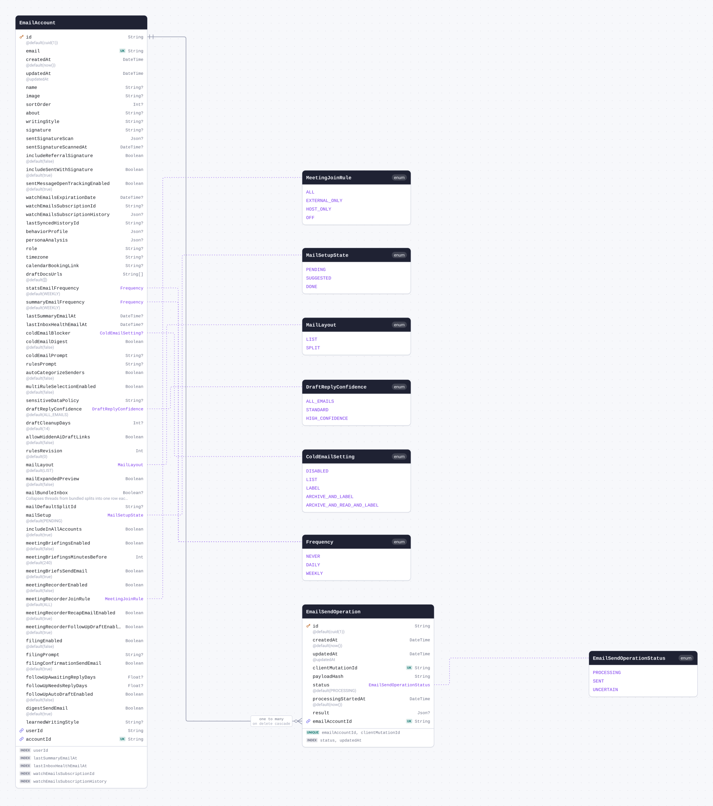

| Field                 | Type                                                         | Constraints                                       | Default      | Description |
| --------------------- | ------------------------------------------------------------ | ------------------------------------------------- | ------------ | ----------- |
| `id`                  | `String`                                                     | PK NOT NULL                                       | `cuid(1)`    |             |
| `createdAt`           | `DateTime`                                                   | NOT NULL                                          | `now()`      |             |
| `updatedAt`           | `DateTime`                                                   | NOT NULL                                          | `@updatedAt` |             |
| `clientMutationId`    | `String`                                                     | NOT NULL                                          |              |             |
| `payloadHash`         | `String`                                                     | NOT NULL                                          |              |             |
| `status`              | [`EmailSendOperationStatus`](#enum-EmailSendOperationStatus) | NOT NULL                                          | `PROCESSING` |             |
| `processingStartedAt` | `DateTime`                                                   | NOT NULL                                          | `now()`      |             |
| `result`              | `Json`                                                       | NULL                                              |              |             |
| `emailAccountId`      | `String`                                                     | NOT NULL → [EmailAccount.id](#model-EmailAccount) |              |             |

#### Indexes

- `@@index([status, updatedAt])`
- `@@unique([emailAccountId, clientMutationId])`

#### References

- `emailAccountId` → [EmailAccount.id](#model-EmailAccount) (many-to-one, on delete Cascade)

#### Definition

```sql
CREATE TABLE "EmailSendOperation" (
    "id" TEXT NOT NULL,
    "createdAt" TIMESTAMP(3) NOT NULL DEFAULT CURRENT_TIMESTAMP,
    "updatedAt" TIMESTAMP(3) NOT NULL,
    "clientMutationId" TEXT NOT NULL,
    "payloadHash" TEXT NOT NULL,
    "status" "EmailSendOperationStatus" NOT NULL DEFAULT 'PROCESSING',
    "processingStartedAt" TIMESTAMP(3) NOT NULL DEFAULT CURRENT_TIMESTAMP,
    "result" JSONB,
    "emailAccountId" TEXT NOT NULL,

    CONSTRAINT "EmailSendOperation_pkey" PRIMARY KEY ("id")
);

CREATE INDEX "EmailSendOperation_status_updatedAt_idx" ON "EmailSendOperation"("status", "updatedAt");

CREATE UNIQUE INDEX "EmailSendOperation_emailAccountId_clientMutationId_key" ON "EmailSendOperation"("emailAccountId", "clientMutationId");

ALTER TABLE "EmailSendOperation" ADD CONSTRAINT "EmailSendOperation_emailAccountId_fkey" FOREIGN KEY ("emailAccountId") REFERENCES "EmailAccount"("id") ON DELETE CASCADE ON UPDATE CASCADE;
```

<details>
<summary>Queries and their SQL</summary>

**findMany**: Every row

```ts
await prisma.emailSendOperation.findMany();
```

```sql
SELECT
  "public"."EmailSendOperation"."id",
  "public"."EmailSendOperation"."createdAt",
  "public"."EmailSendOperation"."updatedAt",
  "public"."EmailSendOperation"."clientMutationId",
  "public"."EmailSendOperation"."payloadHash",
  "public"."EmailSendOperation"."status"::text,
  "public"."EmailSendOperation"."processingStartedAt",
  "public"."EmailSendOperation"."result",
  "public"."EmailSendOperation"."emailAccountId"
FROM
  "public"."EmailSendOperation"
WHERE
  1 = 1
OFFSET
  $1
-- params: ["0"]
```

**count**: How many rows there are

```ts
await prisma.emailSendOperation.count();
```

```sql
SELECT
  COUNT(*) AS "_count$_all"
FROM
  (
    SELECT
      "public"."EmailSendOperation"."id"
    FROM
      "public"."EmailSendOperation"
    WHERE
      1 = 1
    OFFSET
      $1
  ) AS "sub"
-- params: ["0"]
```

**findMany**: Every row with its relations

```ts
await prisma.emailSendOperation.findMany({ include: { emailAccount: true } });
```

```sql
SELECT
  "public"."EmailSendOperation"."id",
  "public"."EmailSendOperation"."createdAt",
  "public"."EmailSendOperation"."updatedAt",
  "public"."EmailSendOperation"."clientMutationId",
  "public"."EmailSendOperation"."payloadHash",
  "public"."EmailSendOperation"."status"::text,
  "public"."EmailSendOperation"."processingStartedAt",
  "public"."EmailSendOperation"."result",
  "public"."EmailSendOperation"."emailAccountId"
FROM
  "public"."EmailSendOperation"
WHERE
  1 = 1
OFFSET
  $1
-- params: ["0"]

SELECT
  "public"."EmailAccount"."id",
  "public"."EmailAccount"."email",
  "public"."EmailAccount"."createdAt",
  "public"."EmailAccount"."updatedAt",
  "public"."EmailAccount"."name",
  "public"."EmailAccount"."image",
  "public"."EmailAccount"."sortOrder",
  "public"."EmailAccount"."about",
  "public"."EmailAccount"."writingStyle",
  "public"."EmailAccount"."signature",
  "public"."EmailAccount"."sentSignatureScan",
  "public"."EmailAccount"."sentSignatureScannedAt",
  "public"."EmailAccount"."includeReferralSignature",
  "public"."EmailAccount"."includeSentWithSignature",
  "public"."EmailAccount"."sentMessageOpenTrackingEnabled",
  "public"."EmailAccount"."watchEmailsExpirationDate",
  "public"."EmailAccount"."watchEmailsSubscriptionId",
  "public"."EmailAccount"."watchEmailsSubscriptionHistory",
  "public"."EmailAccount"."lastSyncedHistoryId",
  "public"."EmailAccount"."behaviorProfile",
  "public"."EmailAccount"."personaAnalysis",
  "public"."EmailAccount"."role",
  "public"."EmailAccount"."timezone",
  "public"."EmailAccount"."calendarBookingLink",
  "public"."EmailAccount"."draftDocsUrls",
  "public"."EmailAccount"."statsEmailFrequency"::text,
  "public"."EmailAccount"."summaryEmailFrequency"::text,
  "public"."EmailAccount"."lastSummaryEmailAt",
  "public"."EmailAccount"."lastInboxHealthEmailAt",
  "public"."EmailAccount"."coldEmailBlocker"::text,
  "public"."EmailAccount"."coldEmailDigest",
  "public"."EmailAccount"."coldEmailPrompt",
  "public"."EmailAccount"."rulesPrompt",
  "public"."EmailAccount"."autoCategorizeSenders",
  "public"."EmailAccount"."multiRuleSelectionEnabled",
  "public"."EmailAccount"."sensitiveDataPolicy",
  "public"."EmailAccount"."draftReplyConfidence"::text,
  "public"."EmailAccount"."draftCleanupDays",
  "public"."EmailAccount"."allowHiddenAiDraftLinks",
  "public"."EmailAccount"."rulesRevision",
  "public"."EmailAccount"."mailLayout"::text,
  "public"."EmailAccount"."mailExpandedPreview",
  "public"."EmailAccount"."mailBundleInbox",
  "public"."EmailAccount"."mailDefaultSplitId",
  "public"."EmailAccount"."mailSetup"::text,
  "public"."EmailAccount"."includeInAllAccounts",
  "public"."EmailAccount"."meetingBriefingsEnabled",
  "public"."EmailAccount"."meetingBriefingsMinutesBefore",
  "public"."EmailAccount"."meetingBriefsSendEmail",
  "public"."EmailAccount"."meetingRecorderEnabled",
  "public"."EmailAccount"."meetingRecorderJoinRule"::text,
  "public"."EmailAccount"."meetingRecorderRecapEmailEnabled",
  "public"."EmailAccount"."meetingRecorderFollowUpDraftEnabled",
  "public"."EmailAccount"."filingEnabled",
  "public"."EmailAccount"."filingPrompt",
  "public"."EmailAccount"."filingConfirmationSendEmail",
  "public"."EmailAccount"."followUpAwaitingReplyDays",
  "public"."EmailAccount"."followUpNeedsReplyDays",
  "public"."EmailAccount"."followUpAutoDraftEnabled",
  "public"."EmailAccount"."digestSendEmail",
  "public"."EmailAccount"."learnedWritingStyle",
  "public"."EmailAccount"."userId",
  "public"."EmailAccount"."accountId"
FROM
  "public"."EmailAccount"
WHERE
  "public"."EmailAccount"."id" IN ($1)
OFFSET
  $2
-- params: ["<emailAccountId of the rows above>","0"]
```

**findUnique**: One row by what is unique to it

```ts
await prisma.emailSendOperation.findUnique({ where: { id: "example" } });
```

```sql
SELECT
  "public"."EmailSendOperation"."id",
  "public"."EmailSendOperation"."createdAt",
  "public"."EmailSendOperation"."updatedAt",
  "public"."EmailSendOperation"."clientMutationId",
  "public"."EmailSendOperation"."payloadHash",
  "public"."EmailSendOperation"."status"::text,
  "public"."EmailSendOperation"."processingStartedAt",
  "public"."EmailSendOperation"."result",
  "public"."EmailSendOperation"."emailAccountId"
FROM
  "public"."EmailSendOperation"
WHERE
  (
    "public"."EmailSendOperation"."id" = $1
    AND 1 = 1
  )
LIMIT
  $2
OFFSET
  $3
-- params: ["example","1","0"]
```

**create**: Create a row

```ts
await prisma.emailSendOperation.create({
  data: { clientMutationId: "example", payloadHash: "example", emailAccountId: "example" },
});
```

```sql
INSERT INTO
  "public"."EmailSendOperation" (
    "id",
    "createdAt",
    "updatedAt",
    "clientMutationId",
    "payloadHash",
    "status",
    "processingStartedAt",
    "emailAccountId"
  )
VALUES
  (
    $1,
    $2,
    $3,
    $4,
    $5,
    CAST($6::text AS "public"."EmailSendOperationStatus"),
    $7,
    $8
  )
RETURNING
  "public"."EmailSendOperation"."id",
  "public"."EmailSendOperation"."createdAt",
  "public"."EmailSendOperation"."updatedAt",
  "public"."EmailSendOperation"."clientMutationId",
  "public"."EmailSendOperation"."payloadHash",
  "public"."EmailSendOperation"."status"::text,
  "public"."EmailSendOperation"."processingStartedAt",
  "public"."EmailSendOperation"."result",
  "public"."EmailSendOperation"."emailAccountId"
-- params: ["<cuid(1)>","<now()>","<now()>","example","example","PROCESSING","<now()>","example"]
```

**update**: Update a row

```ts
await prisma.emailSendOperation.update({
  where: { id: "example" },
  data: { createdAt: new Date("2026-01-01T00:00:00.000Z") },
});
```

```sql
UPDATE "public"."EmailSendOperation"
SET
  "createdAt" = $1,
  "updatedAt" = $2
WHERE
  (
    "public"."EmailSendOperation"."id" = $3
    AND 1 = 1
  )
RETURNING
  "public"."EmailSendOperation"."id",
  "public"."EmailSendOperation"."createdAt",
  "public"."EmailSendOperation"."updatedAt",
  "public"."EmailSendOperation"."clientMutationId",
  "public"."EmailSendOperation"."payloadHash",
  "public"."EmailSendOperation"."status"::text,
  "public"."EmailSendOperation"."processingStartedAt",
  "public"."EmailSendOperation"."result",
  "public"."EmailSendOperation"."emailAccountId"
-- params: ["2026-01-01T00:00:00.000Z",{"prisma__type":"generatorCall","prisma__value":{"name":"now","args":[],"returnType":{"type":"DateTime"}}},"example"]
```

**delete**: Delete a row

```ts
await prisma.emailSendOperation.delete({ where: { id: "example" } });
```

```sql
DELETE FROM "public"."EmailSendOperation"
WHERE
  (
    "public"."EmailSendOperation"."id" = $1
    AND 1 = 1
  )
RETURNING
  "public"."EmailSendOperation"."id",
  "public"."EmailSendOperation"."createdAt",
  "public"."EmailSendOperation"."updatedAt",
  "public"."EmailSendOperation"."clientMutationId",
  "public"."EmailSendOperation"."payloadHash",
  "public"."EmailSendOperation"."status"::text,
  "public"."EmailSendOperation"."processingStartedAt",
  "public"."EmailSendOperation"."result",
  "public"."EmailSendOperation"."emailAccountId"
-- params: ["example"]
```

</details>

<a id="model-SentMessageOpen"></a>

### SentMessageOpen

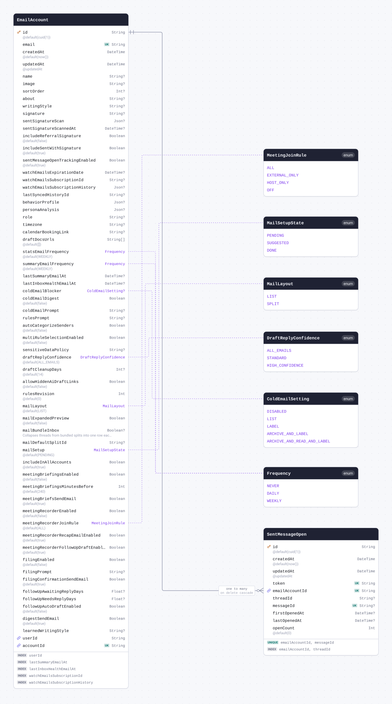

| Field            | Type       | Constraints                                       | Default      | Description |
| ---------------- | ---------- | ------------------------------------------------- | ------------ | ----------- |
| `id`             | `String`   | PK NOT NULL                                       | `cuid(1)`    |             |
| `createdAt`      | `DateTime` | NOT NULL                                          | `now()`      |             |
| `updatedAt`      | `DateTime` | NOT NULL                                          | `@updatedAt` |             |
| `token`          | `String`   | UNIQUE NOT NULL                                   |              |             |
| `emailAccountId` | `String`   | NOT NULL → [EmailAccount.id](#model-EmailAccount) |              |             |
| `threadId`       | `String`   | NULL                                              |              |             |
| `messageId`      | `String`   | NULL                                              |              |             |
| `firstOpenedAt`  | `DateTime` | NULL                                              |              |             |
| `lastOpenedAt`   | `DateTime` | NULL                                              |              |             |
| `openCount`      | `Int`      | NOT NULL                                          | `0`          |             |

#### Indexes

- `@@index([emailAccountId, threadId])`
- `@@unique([emailAccountId, messageId])`

#### References

- `emailAccountId` → [EmailAccount.id](#model-EmailAccount) (many-to-one, on delete Cascade)

#### Definition

```sql
CREATE TABLE "SentMessageOpen" (
    "id" TEXT NOT NULL,
    "createdAt" TIMESTAMP(3) NOT NULL DEFAULT CURRENT_TIMESTAMP,
    "updatedAt" TIMESTAMP(3) NOT NULL,
    "token" TEXT NOT NULL,
    "emailAccountId" TEXT NOT NULL,
    "threadId" TEXT,
    "messageId" TEXT,
    "firstOpenedAt" TIMESTAMP(3),
    "lastOpenedAt" TIMESTAMP(3),
    "openCount" INTEGER NOT NULL DEFAULT 0,

    CONSTRAINT "SentMessageOpen_pkey" PRIMARY KEY ("id")
);

CREATE UNIQUE INDEX "SentMessageOpen_token_key" ON "SentMessageOpen"("token");

CREATE INDEX "SentMessageOpen_emailAccountId_threadId_idx" ON "SentMessageOpen"("emailAccountId", "threadId");

CREATE UNIQUE INDEX "SentMessageOpen_emailAccountId_messageId_key" ON "SentMessageOpen"("emailAccountId", "messageId");

ALTER TABLE "SentMessageOpen" ADD CONSTRAINT "SentMessageOpen_emailAccountId_fkey" FOREIGN KEY ("emailAccountId") REFERENCES "EmailAccount"("id") ON DELETE CASCADE ON UPDATE CASCADE;
```

<details>
<summary>Queries and their SQL</summary>

**findMany**: Every row

```ts
await prisma.sentMessageOpen.findMany();
```

```sql
SELECT
  "public"."SentMessageOpen"."id",
  "public"."SentMessageOpen"."createdAt",
  "public"."SentMessageOpen"."updatedAt",
  "public"."SentMessageOpen"."token",
  "public"."SentMessageOpen"."emailAccountId",
  "public"."SentMessageOpen"."threadId",
  "public"."SentMessageOpen"."messageId",
  "public"."SentMessageOpen"."firstOpenedAt",
  "public"."SentMessageOpen"."lastOpenedAt",
  "public"."SentMessageOpen"."openCount"
FROM
  "public"."SentMessageOpen"
WHERE
  1 = 1
OFFSET
  $1
-- params: ["0"]
```

**count**: How many rows there are

```ts
await prisma.sentMessageOpen.count();
```

```sql
SELECT
  COUNT(*) AS "_count$_all"
FROM
  (
    SELECT
      "public"."SentMessageOpen"."id"
    FROM
      "public"."SentMessageOpen"
    WHERE
      1 = 1
    OFFSET
      $1
  ) AS "sub"
-- params: ["0"]
```

**findMany**: Every row with its relations

```ts
await prisma.sentMessageOpen.findMany({ include: { emailAccount: true } });
```

```sql
SELECT
  "public"."SentMessageOpen"."id",
  "public"."SentMessageOpen"."createdAt",
  "public"."SentMessageOpen"."updatedAt",
  "public"."SentMessageOpen"."token",
  "public"."SentMessageOpen"."emailAccountId",
  "public"."SentMessageOpen"."threadId",
  "public"."SentMessageOpen"."messageId",
  "public"."SentMessageOpen"."firstOpenedAt",
  "public"."SentMessageOpen"."lastOpenedAt",
  "public"."SentMessageOpen"."openCount"
FROM
  "public"."SentMessageOpen"
WHERE
  1 = 1
OFFSET
  $1
-- params: ["0"]

SELECT
  "public"."EmailAccount"."id",
  "public"."EmailAccount"."email",
  "public"."EmailAccount"."createdAt",
  "public"."EmailAccount"."updatedAt",
  "public"."EmailAccount"."name",
  "public"."EmailAccount"."image",
  "public"."EmailAccount"."sortOrder",
  "public"."EmailAccount"."about",
  "public"."EmailAccount"."writingStyle",
  "public"."EmailAccount"."signature",
  "public"."EmailAccount"."sentSignatureScan",
  "public"."EmailAccount"."sentSignatureScannedAt",
  "public"."EmailAccount"."includeReferralSignature",
  "public"."EmailAccount"."includeSentWithSignature",
  "public"."EmailAccount"."sentMessageOpenTrackingEnabled",
  "public"."EmailAccount"."watchEmailsExpirationDate",
  "public"."EmailAccount"."watchEmailsSubscriptionId",
  "public"."EmailAccount"."watchEmailsSubscriptionHistory",
  "public"."EmailAccount"."lastSyncedHistoryId",
  "public"."EmailAccount"."behaviorProfile",
  "public"."EmailAccount"."personaAnalysis",
  "public"."EmailAccount"."role",
  "public"."EmailAccount"."timezone",
  "public"."EmailAccount"."calendarBookingLink",
  "public"."EmailAccount"."draftDocsUrls",
  "public"."EmailAccount"."statsEmailFrequency"::text,
  "public"."EmailAccount"."summaryEmailFrequency"::text,
  "public"."EmailAccount"."lastSummaryEmailAt",
  "public"."EmailAccount"."lastInboxHealthEmailAt",
  "public"."EmailAccount"."coldEmailBlocker"::text,
  "public"."EmailAccount"."coldEmailDigest",
  "public"."EmailAccount"."coldEmailPrompt",
  "public"."EmailAccount"."rulesPrompt",
  "public"."EmailAccount"."autoCategorizeSenders",
  "public"."EmailAccount"."multiRuleSelectionEnabled",
  "public"."EmailAccount"."sensitiveDataPolicy",
  "public"."EmailAccount"."draftReplyConfidence"::text,
  "public"."EmailAccount"."draftCleanupDays",
  "public"."EmailAccount"."allowHiddenAiDraftLinks",
  "public"."EmailAccount"."rulesRevision",
  "public"."EmailAccount"."mailLayout"::text,
  "public"."EmailAccount"."mailExpandedPreview",
  "public"."EmailAccount"."mailBundleInbox",
  "public"."EmailAccount"."mailDefaultSplitId",
  "public"."EmailAccount"."mailSetup"::text,
  "public"."EmailAccount"."includeInAllAccounts",
  "public"."EmailAccount"."meetingBriefingsEnabled",
  "public"."EmailAccount"."meetingBriefingsMinutesBefore",
  "public"."EmailAccount"."meetingBriefsSendEmail",
  "public"."EmailAccount"."meetingRecorderEnabled",
  "public"."EmailAccount"."meetingRecorderJoinRule"::text,
  "public"."EmailAccount"."meetingRecorderRecapEmailEnabled",
  "public"."EmailAccount"."meetingRecorderFollowUpDraftEnabled",
  "public"."EmailAccount"."filingEnabled",
  "public"."EmailAccount"."filingPrompt",
  "public"."EmailAccount"."filingConfirmationSendEmail",
  "public"."EmailAccount"."followUpAwaitingReplyDays",
  "public"."EmailAccount"."followUpNeedsReplyDays",
  "public"."EmailAccount"."followUpAutoDraftEnabled",
  "public"."EmailAccount"."digestSendEmail",
  "public"."EmailAccount"."learnedWritingStyle",
  "public"."EmailAccount"."userId",
  "public"."EmailAccount"."accountId"
FROM
  "public"."EmailAccount"
WHERE
  "public"."EmailAccount"."id" IN ($1)
OFFSET
  $2
-- params: ["<emailAccountId of the rows above>","0"]
```

**findUnique**: One row by what is unique to it

```ts
await prisma.sentMessageOpen.findUnique({ where: { id: "example" } });
```

```sql
SELECT
  "public"."SentMessageOpen"."id",
  "public"."SentMessageOpen"."createdAt",
  "public"."SentMessageOpen"."updatedAt",
  "public"."SentMessageOpen"."token",
  "public"."SentMessageOpen"."emailAccountId",
  "public"."SentMessageOpen"."threadId",
  "public"."SentMessageOpen"."messageId",
  "public"."SentMessageOpen"."firstOpenedAt",
  "public"."SentMessageOpen"."lastOpenedAt",
  "public"."SentMessageOpen"."openCount"
FROM
  "public"."SentMessageOpen"
WHERE
  (
    "public"."SentMessageOpen"."id" = $1
    AND 1 = 1
  )
LIMIT
  $2
OFFSET
  $3
-- params: ["example","1","0"]
```

**create**: Create a row

```ts
await prisma.sentMessageOpen.create({ data: { token: "example", emailAccountId: "example" } });
```

```sql
INSERT INTO
  "public"."SentMessageOpen" (
    "id",
    "createdAt",
    "updatedAt",
    "token",
    "emailAccountId",
    "openCount"
  )
VALUES
  ($1, $2, $3, $4, $5, $6)
RETURNING
  "public"."SentMessageOpen"."id",
  "public"."SentMessageOpen"."createdAt",
  "public"."SentMessageOpen"."updatedAt",
  "public"."SentMessageOpen"."token",
  "public"."SentMessageOpen"."emailAccountId",
  "public"."SentMessageOpen"."threadId",
  "public"."SentMessageOpen"."messageId",
  "public"."SentMessageOpen"."firstOpenedAt",
  "public"."SentMessageOpen"."lastOpenedAt",
  "public"."SentMessageOpen"."openCount"
-- params: ["<cuid(1)>","<now()>","<now()>","example","example","0"]
```

**update**: Update a row

```ts
await prisma.sentMessageOpen.update({
  where: { id: "example" },
  data: { createdAt: new Date("2026-01-01T00:00:00.000Z") },
});
```

```sql
UPDATE "public"."SentMessageOpen"
SET
  "createdAt" = $1,
  "updatedAt" = $2
WHERE
  (
    "public"."SentMessageOpen"."id" = $3
    AND 1 = 1
  )
RETURNING
  "public"."SentMessageOpen"."id",
  "public"."SentMessageOpen"."createdAt",
  "public"."SentMessageOpen"."updatedAt",
  "public"."SentMessageOpen"."token",
  "public"."SentMessageOpen"."emailAccountId",
  "public"."SentMessageOpen"."threadId",
  "public"."SentMessageOpen"."messageId",
  "public"."SentMessageOpen"."firstOpenedAt",
  "public"."SentMessageOpen"."lastOpenedAt",
  "public"."SentMessageOpen"."openCount"
-- params: ["2026-01-01T00:00:00.000Z",{"prisma__type":"generatorCall","prisma__value":{"name":"now","args":[],"returnType":{"type":"DateTime"}}},"example"]
```

**delete**: Delete a row

```ts
await prisma.sentMessageOpen.delete({ where: { id: "example" } });
```

```sql
DELETE FROM "public"."SentMessageOpen"
WHERE
  (
    "public"."SentMessageOpen"."id" = $1
    AND 1 = 1
  )
RETURNING
  "public"."SentMessageOpen"."id",
  "public"."SentMessageOpen"."createdAt",
  "public"."SentMessageOpen"."updatedAt",
  "public"."SentMessageOpen"."token",
  "public"."SentMessageOpen"."emailAccountId",
  "public"."SentMessageOpen"."threadId",
  "public"."SentMessageOpen"."messageId",
  "public"."SentMessageOpen"."firstOpenedAt",
  "public"."SentMessageOpen"."lastOpenedAt",
  "public"."SentMessageOpen"."openCount"
-- params: ["example"]
```

</details>

<a id="model-Group"></a>

### Group

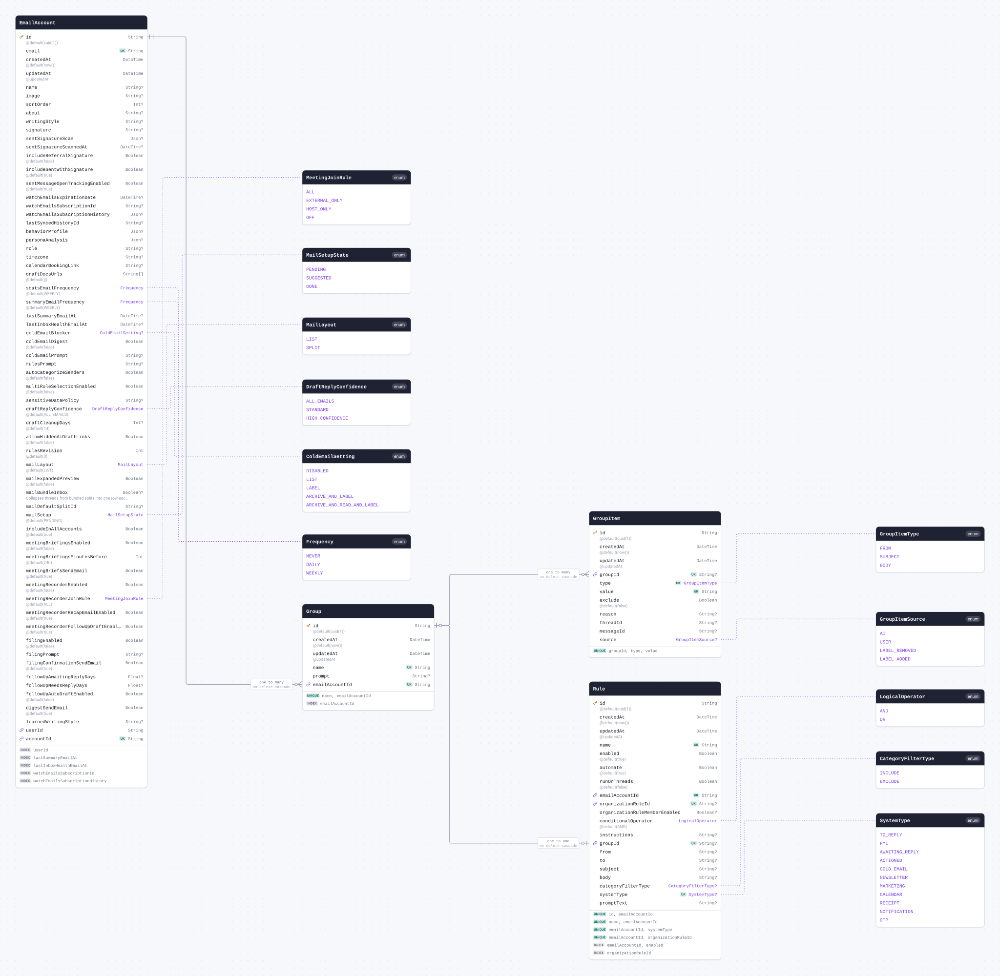

| Field            | Type       | Constraints                                       | Default      | Description |
| ---------------- | ---------- | ------------------------------------------------- | ------------ | ----------- |
| `id`             | `String`   | PK NOT NULL                                       | `cuid(1)`    |             |
| `createdAt`      | `DateTime` | NOT NULL                                          | `now()`      |             |
| `updatedAt`      | `DateTime` | NOT NULL                                          | `@updatedAt` |             |
| `name`           | `String`   | NOT NULL                                          |              |             |
| `prompt`         | `String`   | NULL                                              |              |             |
| `emailAccountId` | `String`   | NOT NULL → [EmailAccount.id](#model-EmailAccount) |              |             |

#### Indexes

- `@@index([emailAccountId])`
- `@@unique([name, emailAccountId])`

#### References

- `emailAccountId` → [EmailAccount.id](#model-EmailAccount) (many-to-one, on delete Cascade)

#### Referenced by

- `id` ← [Rule.groupId](#model-Rule) (one-to-one, on delete Cascade)
- `id` ← [GroupItem.groupId](#model-GroupItem) (one-to-many, on delete Cascade)

#### Definition

```sql
CREATE TABLE "Group" (
    "id" TEXT NOT NULL,
    "createdAt" TIMESTAMP(3) NOT NULL DEFAULT CURRENT_TIMESTAMP,
    "updatedAt" TIMESTAMP(3) NOT NULL,
    "name" TEXT NOT NULL,
    "prompt" TEXT,
    "emailAccountId" TEXT NOT NULL,

    CONSTRAINT "Group_pkey" PRIMARY KEY ("id")
);

CREATE INDEX "Group_emailAccountId_idx" ON "Group"("emailAccountId");

CREATE UNIQUE INDEX "Group_name_emailAccountId_key" ON "Group"("name", "emailAccountId");

ALTER TABLE "Group" ADD CONSTRAINT "Group_emailAccountId_fkey" FOREIGN KEY ("emailAccountId") REFERENCES "EmailAccount"("id") ON DELETE CASCADE ON UPDATE CASCADE;
```

<details>
<summary>Queries and their SQL</summary>

**findMany**: Every row

```ts
await prisma.group.findMany();
```

```sql
SELECT
  "public"."Group"."id",
  "public"."Group"."createdAt",
  "public"."Group"."updatedAt",
  "public"."Group"."name",
  "public"."Group"."prompt",
  "public"."Group"."emailAccountId"
FROM
  "public"."Group"
WHERE
  1 = 1
OFFSET
  $1
-- params: ["0"]
```

**count**: How many rows there are

```ts
await prisma.group.count();
```

```sql
SELECT
  COUNT(*) AS "_count$_all"
FROM
  (
    SELECT
      "public"."Group"."id"
    FROM
      "public"."Group"
    WHERE
      1 = 1
    OFFSET
      $1
  ) AS "sub"
-- params: ["0"]
```

**findMany**: Every row with its relations

```ts
await prisma.group.findMany({ include: { items: true, rule: true, emailAccount: true } });
```

```sql
SELECT
  "public"."Group"."id",
  "public"."Group"."createdAt",
  "public"."Group"."updatedAt",
  "public"."Group"."name",
  "public"."Group"."prompt",
  "public"."Group"."emailAccountId"
FROM
  "public"."Group"
WHERE
  1 = 1
OFFSET
  $1
-- params: ["0"]

SELECT
  "public"."GroupItem"."id",
  "public"."GroupItem"."createdAt",
  "public"."GroupItem"."updatedAt",
  "public"."GroupItem"."groupId",
  "public"."GroupItem"."type"::text,
  "public"."GroupItem"."value",
  "public"."GroupItem"."exclude",
  "public"."GroupItem"."reason",
  "public"."GroupItem"."threadId",
  "public"."GroupItem"."messageId",
  "public"."GroupItem"."source"::text
FROM
  "public"."GroupItem"
WHERE
  "public"."GroupItem"."groupId" IN ($1)
OFFSET
  $2
-- params: ["<id of the rows above>","0"]

SELECT
  "public"."Rule"."id",
  "public"."Rule"."createdAt",
  "public"."Rule"."updatedAt",
  "public"."Rule"."name",
  "public"."Rule"."enabled",
  "public"."Rule"."automate",
  "public"."Rule"."runOnThreads",
  "public"."Rule"."emailAccountId",
  "public"."Rule"."organizationRuleId",
  "public"."Rule"."organizationRuleMemberEnabled",
  "public"."Rule"."conditionalOperator"::text,
  "public"."Rule"."instructions",
  "public"."Rule"."groupId",
  "public"."Rule"."from",
  "public"."Rule"."to",
  "public"."Rule"."subject",
  "public"."Rule"."body",
  "public"."Rule"."categoryFilterType"::text,
  "public"."Rule"."systemType"::text,
  "public"."Rule"."promptText"
FROM
  "public"."Rule"
WHERE
  "public"."Rule"."groupId" IN ($1)
OFFSET
  $2
-- params: ["<id of the rows above>","0"]

SELECT
  "public"."EmailAccount"."id",
  "public"."EmailAccount"."email",
  "public"."EmailAccount"."createdAt",
  "public"."EmailAccount"."updatedAt",
  "public"."EmailAccount"."name",
  "public"."EmailAccount"."image",
  "public"."EmailAccount"."sortOrder",
  "public"."EmailAccount"."about",
  "public"."EmailAccount"."writingStyle",
  "public"."EmailAccount"."signature",
  "public"."EmailAccount"."sentSignatureScan",
  "public"."EmailAccount"."sentSignatureScannedAt",
  "public"."EmailAccount"."includeReferralSignature",
  "public"."EmailAccount"."includeSentWithSignature",
  "public"."EmailAccount"."sentMessageOpenTrackingEnabled",
  "public"."EmailAccount"."watchEmailsExpirationDate",
  "public"."EmailAccount"."watchEmailsSubscriptionId",
  "public"."EmailAccount"."watchEmailsSubscriptionHistory",
  "public"."EmailAccount"."lastSyncedHistoryId",
  "public"."EmailAccount"."behaviorProfile",
  "public"."EmailAccount"."personaAnalysis",
  "public"."EmailAccount"."role",
  "public"."EmailAccount"."timezone",
  "public"."EmailAccount"."calendarBookingLink",
  "public"."EmailAccount"."draftDocsUrls",
  "public"."EmailAccount"."statsEmailFrequency"::text,
  "public"."EmailAccount"."summaryEmailFrequency"::text,
  "public"."EmailAccount"."lastSummaryEmailAt",
  "public"."EmailAccount"."lastInboxHealthEmailAt",
  "public"."EmailAccount"."coldEmailBlocker"::text,
  "public"."EmailAccount"."coldEmailDigest",
  "public"."EmailAccount"."coldEmailPrompt",
  "public"."EmailAccount"."rulesPrompt",
  "public"."EmailAccount"."autoCategorizeSenders",
  "public"."EmailAccount"."multiRuleSelectionEnabled",
  "public"."EmailAccount"."sensitiveDataPolicy",
  "public"."EmailAccount"."draftReplyConfidence"::text,
  "public"."EmailAccount"."draftCleanupDays",
  "public"."EmailAccount"."allowHiddenAiDraftLinks",
  "public"."EmailAccount"."rulesRevision",
  "public"."EmailAccount"."mailLayout"::text,
  "public"."EmailAccount"."mailExpandedPreview",
  "public"."EmailAccount"."mailBundleInbox",
  "public"."EmailAccount"."mailDefaultSplitId",
  "public"."EmailAccount"."mailSetup"::text,
  "public"."EmailAccount"."includeInAllAccounts",
  "public"."EmailAccount"."meetingBriefingsEnabled",
  "public"."EmailAccount"."meetingBriefingsMinutesBefore",
  "public"."EmailAccount"."meetingBriefsSendEmail",
  "public"."EmailAccount"."meetingRecorderEnabled",
  "public"."EmailAccount"."meetingRecorderJoinRule"::text,
  "public"."EmailAccount"."meetingRecorderRecapEmailEnabled",
  "public"."EmailAccount"."meetingRecorderFollowUpDraftEnabled",
  "public"."EmailAccount"."filingEnabled",
  "public"."EmailAccount"."filingPrompt",
  "public"."EmailAccount"."filingConfirmationSendEmail",
  "public"."EmailAccount"."followUpAwaitingReplyDays",
  "public"."EmailAccount"."followUpNeedsReplyDays",
  "public"."EmailAccount"."followUpAutoDraftEnabled",
  "public"."EmailAccount"."digestSendEmail",
  "public"."EmailAccount"."learnedWritingStyle",
  "public"."EmailAccount"."userId",
  "public"."EmailAccount"."accountId"
FROM
  "public"."EmailAccount"
WHERE
  "public"."EmailAccount"."id" IN ($1)
OFFSET
  $2
-- params: ["<emailAccountId of the rows above>","0"]
```

**findUnique**: One row by what is unique to it

```ts
await prisma.group.findUnique({ where: { id: "example" } });
```

```sql
SELECT
  "public"."Group"."id",
  "public"."Group"."createdAt",
  "public"."Group"."updatedAt",
  "public"."Group"."name",
  "public"."Group"."prompt",
  "public"."Group"."emailAccountId"
FROM
  "public"."Group"
WHERE
  (
    "public"."Group"."id" = $1
    AND 1 = 1
  )
LIMIT
  $2
OFFSET
  $3
-- params: ["example","1","0"]
```

**create**: Create a row

```ts
await prisma.group.create({ data: { name: "example", emailAccountId: "example" } });
```

```sql
INSERT INTO
  "public"."Group" (
    "id",
    "createdAt",
    "updatedAt",
    "name",
    "emailAccountId"
  )
VALUES
  ($1, $2, $3, $4, $5)
RETURNING
  "public"."Group"."id",
  "public"."Group"."createdAt",
  "public"."Group"."updatedAt",
  "public"."Group"."name",
  "public"."Group"."prompt",
  "public"."Group"."emailAccountId"
-- params: ["<cuid(1)>","<now()>","<now()>","example","example"]
```

**update**: Update a row

```ts
await prisma.group.update({
  where: { id: "example" },
  data: { createdAt: new Date("2026-01-01T00:00:00.000Z") },
});
```

```sql
UPDATE "public"."Group"
SET
  "createdAt" = $1,
  "updatedAt" = $2
WHERE
  (
    "public"."Group"."id" = $3
    AND 1 = 1
  )
RETURNING
  "public"."Group"."id",
  "public"."Group"."createdAt",
  "public"."Group"."updatedAt",
  "public"."Group"."name",
  "public"."Group"."prompt",
  "public"."Group"."emailAccountId"
-- params: ["2026-01-01T00:00:00.000Z",{"prisma__type":"generatorCall","prisma__value":{"name":"now","args":[],"returnType":{"type":"DateTime"}}},"example"]
```

**delete**: Delete a row

```ts
await prisma.group.delete({ where: { id: "example" } });
```

```sql
DELETE FROM "public"."Group"
WHERE
  (
    "public"."Group"."id" = $1
    AND 1 = 1
  )
RETURNING
  "public"."Group"."id",
  "public"."Group"."createdAt",
  "public"."Group"."updatedAt",
  "public"."Group"."name",
  "public"."Group"."prompt",
  "public"."Group"."emailAccountId"
-- params: ["example"]
```

</details>

<a id="model-GroupItem"></a>

### GroupItem

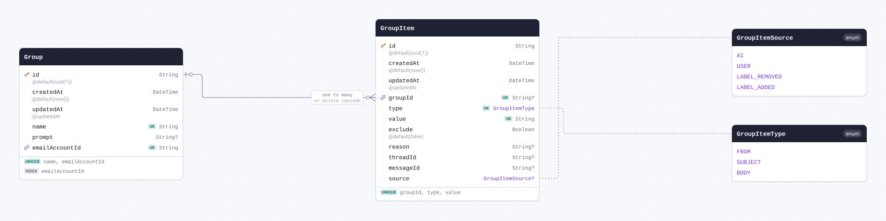

| Field       | Type                                       | Constraints                     | Default      | Description |
| ----------- | ------------------------------------------ | ------------------------------- | ------------ | ----------- |
| `id`        | `String`                                   | PK NOT NULL                     | `cuid(1)`    |             |
| `createdAt` | `DateTime`                                 | NOT NULL                        | `now()`      |             |
| `updatedAt` | `DateTime`                                 | NOT NULL                        | `@updatedAt` |             |
| `groupId`   | `String`                                   | NULL → [Group.id](#model-Group) |              |             |
| `type`      | [`GroupItemType`](#enum-GroupItemType)     | NOT NULL                        |              |             |
| `value`     | `String`                                   | NOT NULL                        |              |             |
| `exclude`   | `Boolean`                                  | NOT NULL                        | `false`      |             |
| `reason`    | `String`                                   | NULL                            |              |             |
| `threadId`  | `String`                                   | NULL                            |              |             |
| `messageId` | `String`                                   | NULL                            |              |             |
| `source`    | [`GroupItemSource`](#enum-GroupItemSource) | NULL                            |              |             |

#### Indexes

- `@@unique([groupId, type, value])`

#### References

- `groupId` → [Group.id](#model-Group) (many-to-one, on delete Cascade)

#### Definition

```sql
CREATE TABLE "GroupItem" (
    "id" TEXT NOT NULL,
    "createdAt" TIMESTAMP(3) NOT NULL DEFAULT CURRENT_TIMESTAMP,
    "updatedAt" TIMESTAMP(3) NOT NULL,
    "groupId" TEXT,
    "type" "GroupItemType" NOT NULL,
    "value" TEXT NOT NULL,
    "exclude" BOOLEAN NOT NULL DEFAULT false,
    "reason" TEXT,
    "threadId" TEXT,
    "messageId" TEXT,
    "source" "GroupItemSource",

    CONSTRAINT "GroupItem_pkey" PRIMARY KEY ("id")
);

CREATE UNIQUE INDEX "GroupItem_groupId_type_value_key" ON "GroupItem"("groupId", "type", "value");

ALTER TABLE "GroupItem" ADD CONSTRAINT "GroupItem_groupId_fkey" FOREIGN KEY ("groupId") REFERENCES "Group"("id") ON DELETE CASCADE ON UPDATE CASCADE;
```

<details>
<summary>Queries and their SQL</summary>

**findMany**: Every row

```ts
await prisma.groupItem.findMany();
```

```sql
SELECT
  "public"."GroupItem"."id",
  "public"."GroupItem"."createdAt",
  "public"."GroupItem"."updatedAt",
  "public"."GroupItem"."groupId",
  "public"."GroupItem"."type"::text,
  "public"."GroupItem"."value",
  "public"."GroupItem"."exclude",
  "public"."GroupItem"."reason",
  "public"."GroupItem"."threadId",
  "public"."GroupItem"."messageId",
  "public"."GroupItem"."source"::text
FROM
  "public"."GroupItem"
WHERE
  1 = 1
OFFSET
  $1
-- params: ["0"]
```

**count**: How many rows there are

```ts
await prisma.groupItem.count();
```

```sql
SELECT
  COUNT(*) AS "_count$_all"
FROM
  (
    SELECT
      "public"."GroupItem"."id"
    FROM
      "public"."GroupItem"
    WHERE
      1 = 1
    OFFSET
      $1
  ) AS "sub"
-- params: ["0"]
```

**findMany**: Every row with its relations

```ts
await prisma.groupItem.findMany({ include: { group: true } });
```

```sql
SELECT
  "public"."GroupItem"."id",
  "public"."GroupItem"."createdAt",
  "public"."GroupItem"."updatedAt",
  "public"."GroupItem"."groupId",
  "public"."GroupItem"."type"::text,
  "public"."GroupItem"."value",
  "public"."GroupItem"."exclude",
  "public"."GroupItem"."reason",
  "public"."GroupItem"."threadId",
  "public"."GroupItem"."messageId",
  "public"."GroupItem"."source"::text
FROM
  "public"."GroupItem"
WHERE
  1 = 1
OFFSET
  $1
-- params: ["0"]

SELECT
  "public"."Group"."id",
  "public"."Group"."createdAt",
  "public"."Group"."updatedAt",
  "public"."Group"."name",
  "public"."Group"."prompt",
  "public"."Group"."emailAccountId"
FROM
  "public"."Group"
WHERE
  "public"."Group"."id" IN ($1)
OFFSET
  $2
-- params: ["<groupId of the rows above>","0"]
```

**findUnique**: One row by what is unique to it

```ts
await prisma.groupItem.findUnique({ where: { id: "example" } });
```

```sql
SELECT
  "public"."GroupItem"."id",
  "public"."GroupItem"."createdAt",
  "public"."GroupItem"."updatedAt",
  "public"."GroupItem"."groupId",
  "public"."GroupItem"."type"::text,
  "public"."GroupItem"."value",
  "public"."GroupItem"."exclude",
  "public"."GroupItem"."reason",
  "public"."GroupItem"."threadId",
  "public"."GroupItem"."messageId",
  "public"."GroupItem"."source"::text
FROM
  "public"."GroupItem"
WHERE
  (
    "public"."GroupItem"."id" = $1
    AND 1 = 1
  )
LIMIT
  $2
OFFSET
  $3
-- params: ["example","1","0"]
```

**create**: Create a row

```ts
await prisma.groupItem.create({ data: { type: "FROM", value: "example" } });
```

```sql
INSERT INTO
  "public"."GroupItem" (
    "id",
    "createdAt",
    "updatedAt",
    "type",
    "value",
    "exclude"
  )
VALUES
  (
    $1,
    $2,
    $3,
    CAST($4::text AS "public"."GroupItemType"),
    $5,
    $6
  )
RETURNING
  "public"."GroupItem"."id",
  "public"."GroupItem"."createdAt",
  "public"."GroupItem"."updatedAt",
  "public"."GroupItem"."groupId",
  "public"."GroupItem"."type"::text,
  "public"."GroupItem"."value",
  "public"."GroupItem"."exclude",
  "public"."GroupItem"."reason",
  "public"."GroupItem"."threadId",
  "public"."GroupItem"."messageId",
  "public"."GroupItem"."source"::text
-- params: ["<cuid(1)>","<now()>","<now()>","FROM","example",false]
```

**update**: Update a row

```ts
await prisma.groupItem.update({
  where: { id: "example" },
  data: { createdAt: new Date("2026-01-01T00:00:00.000Z") },
});
```

```sql
UPDATE "public"."GroupItem"
SET
  "createdAt" = $1,
  "updatedAt" = $2
WHERE
  (
    "public"."GroupItem"."id" = $3
    AND 1 = 1
  )
RETURNING
  "public"."GroupItem"."id",
  "public"."GroupItem"."createdAt",
  "public"."GroupItem"."updatedAt",
  "public"."GroupItem"."groupId",
  "public"."GroupItem"."type"::text,
  "public"."GroupItem"."value",
  "public"."GroupItem"."exclude",
  "public"."GroupItem"."reason",
  "public"."GroupItem"."threadId",
  "public"."GroupItem"."messageId",
  "public"."GroupItem"."source"::text
-- params: ["2026-01-01T00:00:00.000Z",{"prisma__type":"generatorCall","prisma__value":{"name":"now","args":[],"returnType":{"type":"DateTime"}}},"example"]
```

**delete**: Delete a row

```ts
await prisma.groupItem.delete({ where: { id: "example" } });
```

```sql
DELETE FROM "public"."GroupItem"
WHERE
  (
    "public"."GroupItem"."id" = $1
    AND 1 = 1
  )
RETURNING
  "public"."GroupItem"."id",
  "public"."GroupItem"."createdAt",
  "public"."GroupItem"."updatedAt",
  "public"."GroupItem"."groupId",
  "public"."GroupItem"."type"::text,
  "public"."GroupItem"."value",
  "public"."GroupItem"."exclude",
  "public"."GroupItem"."reason",
  "public"."GroupItem"."threadId",
  "public"."GroupItem"."messageId",
  "public"."GroupItem"."source"::text
-- params: ["example"]
```

</details>

<a id="model-ClassificationFeedback"></a>

### ClassificationFeedback

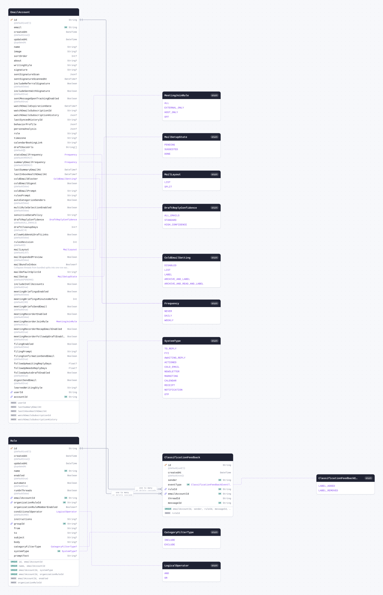

| Field            | Type                                                                       | Constraints                                       | Default   | Description |
| ---------------- | -------------------------------------------------------------------------- | ------------------------------------------------- | --------- | ----------- |
| `id`             | `String`                                                                   | PK NOT NULL                                       | `cuid(1)` |             |
| `createdAt`      | `DateTime`                                                                 | NOT NULL                                          | `now()`   |             |
| `sender`         | `String`                                                                   | NOT NULL                                          |           |             |
| `eventType`      | [`ClassificationFeedbackEventType`](#enum-ClassificationFeedbackEventType) | NOT NULL                                          |           |             |
| `ruleId`         | `String`                                                                   | NOT NULL → [Rule.id](#model-Rule)                 |           |             |
| `emailAccountId` | `String`                                                                   | NOT NULL → [EmailAccount.id](#model-EmailAccount) |           |             |
| `threadId`       | `String`                                                                   | NOT NULL                                          |           |             |
| `messageId`      | `String`                                                                   | NOT NULL                                          |           |             |

#### Indexes

- `@@index([ruleId])`
- `@@unique([emailAccountId, sender, ruleId, messageId, eventType])`

#### References

- `ruleId` → [Rule.id](#model-Rule) (many-to-one, on delete Cascade)
- `emailAccountId` → [EmailAccount.id](#model-EmailAccount) (many-to-one, on delete Cascade)

#### Definition

```sql
CREATE TABLE "ClassificationFeedback" (
    "id" TEXT NOT NULL,
    "createdAt" TIMESTAMP(3) NOT NULL DEFAULT CURRENT_TIMESTAMP,
    "sender" TEXT NOT NULL,
    "eventType" "ClassificationFeedbackEventType" NOT NULL,
    "ruleId" TEXT NOT NULL,
    "emailAccountId" TEXT NOT NULL,
    "threadId" TEXT NOT NULL,
    "messageId" TEXT NOT NULL,

    CONSTRAINT "ClassificationFeedback_pkey" PRIMARY KEY ("id")
);

CREATE INDEX "ClassificationFeedback_ruleId_idx" ON "ClassificationFeedback"("ruleId");

CREATE UNIQUE INDEX "ClassificationFeedback_emailAccountId_sender_ruleId_message_key" ON "ClassificationFeedback"("emailAccountId", "sender", "ruleId", "messageId", "eventType");

ALTER TABLE "ClassificationFeedback" ADD CONSTRAINT "ClassificationFeedback_ruleId_fkey" FOREIGN KEY ("ruleId") REFERENCES "Rule"("id") ON DELETE CASCADE ON UPDATE CASCADE;

ALTER TABLE "ClassificationFeedback" ADD CONSTRAINT "ClassificationFeedback_emailAccountId_fkey" FOREIGN KEY ("emailAccountId") REFERENCES "EmailAccount"("id") ON DELETE CASCADE ON UPDATE CASCADE;
```

<details>
<summary>Queries and their SQL</summary>

**findMany**: Every row

```ts
await prisma.classificationFeedback.findMany();
```

```sql
SELECT
  "public"."ClassificationFeedback"."id",
  "public"."ClassificationFeedback"."createdAt",
  "public"."ClassificationFeedback"."sender",
  "public"."ClassificationFeedback"."eventType"::text,
  "public"."ClassificationFeedback"."ruleId",
  "public"."ClassificationFeedback"."emailAccountId",
  "public"."ClassificationFeedback"."threadId",
  "public"."ClassificationFeedback"."messageId"
FROM
  "public"."ClassificationFeedback"
WHERE
  1 = 1
OFFSET
  $1
-- params: ["0"]
```

**count**: How many rows there are

```ts
await prisma.classificationFeedback.count();
```

```sql
SELECT
  COUNT(*) AS "_count$_all"
FROM
  (
    SELECT
      "public"."ClassificationFeedback"."id"
    FROM
      "public"."ClassificationFeedback"
    WHERE
      1 = 1
    OFFSET
      $1
  ) AS "sub"
-- params: ["0"]
```

**findMany**: Every row with its relations

```ts
await prisma.classificationFeedback.findMany({ include: { rule: true, emailAccount: true } });
```

```sql
SELECT
  "public"."ClassificationFeedback"."id",
  "public"."ClassificationFeedback"."createdAt",
  "public"."ClassificationFeedback"."sender",
  "public"."ClassificationFeedback"."eventType"::text,
  "public"."ClassificationFeedback"."ruleId",
  "public"."ClassificationFeedback"."emailAccountId",
  "public"."ClassificationFeedback"."threadId",
  "public"."ClassificationFeedback"."messageId"
FROM
  "public"."ClassificationFeedback"
WHERE
  1 = 1
OFFSET
  $1
-- params: ["0"]

SELECT
  "public"."Rule"."id",
  "public"."Rule"."createdAt",
  "public"."Rule"."updatedAt",
  "public"."Rule"."name",
  "public"."Rule"."enabled",
  "public"."Rule"."automate",
  "public"."Rule"."runOnThreads",
  "public"."Rule"."emailAccountId",
  "public"."Rule"."organizationRuleId",
  "public"."Rule"."organizationRuleMemberEnabled",
  "public"."Rule"."conditionalOperator"::text,
  "public"."Rule"."instructions",
  "public"."Rule"."groupId",
  "public"."Rule"."from",
  "public"."Rule"."to",
  "public"."Rule"."subject",
  "public"."Rule"."body",
  "public"."Rule"."categoryFilterType"::text,
  "public"."Rule"."systemType"::text,
  "public"."Rule"."promptText"
FROM
  "public"."Rule"
WHERE
  "public"."Rule"."id" IN ($1)
OFFSET
  $2
-- params: ["<ruleId of the rows above>","0"]

SELECT
  "public"."EmailAccount"."id",
  "public"."EmailAccount"."email",
  "public"."EmailAccount"."createdAt",
  "public"."EmailAccount"."updatedAt",
  "public"."EmailAccount"."name",
  "public"."EmailAccount"."image",
  "public"."EmailAccount"."sortOrder",
  "public"."EmailAccount"."about",
  "public"."EmailAccount"."writingStyle",
  "public"."EmailAccount"."signature",
  "public"."EmailAccount"."sentSignatureScan",
  "public"."EmailAccount"."sentSignatureScannedAt",
  "public"."EmailAccount"."includeReferralSignature",
  "public"."EmailAccount"."includeSentWithSignature",
  "public"."EmailAccount"."sentMessageOpenTrackingEnabled",
  "public"."EmailAccount"."watchEmailsExpirationDate",
  "public"."EmailAccount"."watchEmailsSubscriptionId",
  "public"."EmailAccount"."watchEmailsSubscriptionHistory",
  "public"."EmailAccount"."lastSyncedHistoryId",
  "public"."EmailAccount"."behaviorProfile",
  "public"."EmailAccount"."personaAnalysis",
  "public"."EmailAccount"."role",
  "public"."EmailAccount"."timezone",
  "public"."EmailAccount"."calendarBookingLink",
  "public"."EmailAccount"."draftDocsUrls",
  "public"."EmailAccount"."statsEmailFrequency"::text,
  "public"."EmailAccount"."summaryEmailFrequency"::text,
  "public"."EmailAccount"."lastSummaryEmailAt",
  "public"."EmailAccount"."lastInboxHealthEmailAt",
  "public"."EmailAccount"."coldEmailBlocker"::text,
  "public"."EmailAccount"."coldEmailDigest",
  "public"."EmailAccount"."coldEmailPrompt",
  "public"."EmailAccount"."rulesPrompt",
  "public"."EmailAccount"."autoCategorizeSenders",
  "public"."EmailAccount"."multiRuleSelectionEnabled",
  "public"."EmailAccount"."sensitiveDataPolicy",
  "public"."EmailAccount"."draftReplyConfidence"::text,
  "public"."EmailAccount"."draftCleanupDays",
  "public"."EmailAccount"."allowHiddenAiDraftLinks",
  "public"."EmailAccount"."rulesRevision",
  "public"."EmailAccount"."mailLayout"::text,
  "public"."EmailAccount"."mailExpandedPreview",
  "public"."EmailAccount"."mailBundleInbox",
  "public"."EmailAccount"."mailDefaultSplitId",
  "public"."EmailAccount"."mailSetup"::text,
  "public"."EmailAccount"."includeInAllAccounts",
  "public"."EmailAccount"."meetingBriefingsEnabled",
  "public"."EmailAccount"."meetingBriefingsMinutesBefore",
  "public"."EmailAccount"."meetingBriefsSendEmail",
  "public"."EmailAccount"."meetingRecorderEnabled",
  "public"."EmailAccount"."meetingRecorderJoinRule"::text,
  "public"."EmailAccount"."meetingRecorderRecapEmailEnabled",
  "public"."EmailAccount"."meetingRecorderFollowUpDraftEnabled",
  "public"."EmailAccount"."filingEnabled",
  "public"."EmailAccount"."filingPrompt",
  "public"."EmailAccount"."filingConfirmationSendEmail",
  "public"."EmailAccount"."followUpAwaitingReplyDays",
  "public"."EmailAccount"."followUpNeedsReplyDays",
  "public"."EmailAccount"."followUpAutoDraftEnabled",
  "public"."EmailAccount"."digestSendEmail",
  "public"."EmailAccount"."learnedWritingStyle",
  "public"."EmailAccount"."userId",
  "public"."EmailAccount"."accountId"
FROM
  "public"."EmailAccount"
WHERE
  "public"."EmailAccount"."id" IN ($1)
OFFSET
  $2
-- params: ["<emailAccountId of the rows above>","0"]
```

**findUnique**: One row by what is unique to it

```ts
await prisma.classificationFeedback.findUnique({ where: { id: "example" } });
```

```sql
SELECT
  "public"."ClassificationFeedback"."id",
  "public"."ClassificationFeedback"."createdAt",
  "public"."ClassificationFeedback"."sender",
  "public"."ClassificationFeedback"."eventType"::text,
  "public"."ClassificationFeedback"."ruleId",
  "public"."ClassificationFeedback"."emailAccountId",
  "public"."ClassificationFeedback"."threadId",
  "public"."ClassificationFeedback"."messageId"
FROM
  "public"."ClassificationFeedback"
WHERE
  (
    "public"."ClassificationFeedback"."id" = $1
    AND 1 = 1
  )
LIMIT
  $2
OFFSET
  $3
-- params: ["example","1","0"]
```

**create**: Create a row

```ts
await prisma.classificationFeedback.create({
  data: {
    sender: "example",
    eventType: "LABEL_ADDED",
    ruleId: "example",
    emailAccountId: "example",
    threadId: "example",
    messageId: "example",
  },
});
```

```sql
INSERT INTO
  "public"."ClassificationFeedback" (
    "id",
    "createdAt",
    "sender",
    "eventType",
    "ruleId",
    "emailAccountId",
    "threadId",
    "messageId"
  )
VALUES
  (
    $1,
    $2,
    $3,
    CAST(
      $4::text AS "public"."ClassificationFeedbackEventType"
    ),
    $5,
    $6,
    $7,
    $8
  )
RETURNING
  "public"."ClassificationFeedback"."id",
  "public"."ClassificationFeedback"."createdAt",
  "public"."ClassificationFeedback"."sender",
  "public"."ClassificationFeedback"."eventType"::text,
  "public"."ClassificationFeedback"."ruleId",
  "public"."ClassificationFeedback"."emailAccountId",
  "public"."ClassificationFeedback"."threadId",
  "public"."ClassificationFeedback"."messageId"
-- params: ["<cuid(1)>","<now()>","example","LABEL_ADDED","example","example","example","example"]
```

**update**: Update a row

```ts
await prisma.classificationFeedback.update({
  where: { id: "example" },
  data: { createdAt: new Date("2026-01-01T00:00:00.000Z") },
});
```

```sql
UPDATE "public"."ClassificationFeedback"
SET
  "createdAt" = $1
WHERE
  (
    "public"."ClassificationFeedback"."id" = $2
    AND 1 = 1
  )
RETURNING
  "public"."ClassificationFeedback"."id",
  "public"."ClassificationFeedback"."createdAt",
  "public"."ClassificationFeedback"."sender",
  "public"."ClassificationFeedback"."eventType"::text,
  "public"."ClassificationFeedback"."ruleId",
  "public"."ClassificationFeedback"."emailAccountId",
  "public"."ClassificationFeedback"."threadId",
  "public"."ClassificationFeedback"."messageId"
-- params: ["2026-01-01T00:00:00.000Z","example"]
```

**delete**: Delete a row

```ts
await prisma.classificationFeedback.delete({ where: { id: "example" } });
```

```sql
DELETE FROM "public"."ClassificationFeedback"
WHERE
  (
    "public"."ClassificationFeedback"."id" = $1
    AND 1 = 1
  )
RETURNING
  "public"."ClassificationFeedback"."id",
  "public"."ClassificationFeedback"."createdAt",
  "public"."ClassificationFeedback"."sender",
  "public"."ClassificationFeedback"."eventType"::text,
  "public"."ClassificationFeedback"."ruleId",
  "public"."ClassificationFeedback"."emailAccountId",
  "public"."ClassificationFeedback"."threadId",
  "public"."ClassificationFeedback"."messageId"
-- params: ["example"]
```

</details>

<a id="model-Category"></a>

### Category

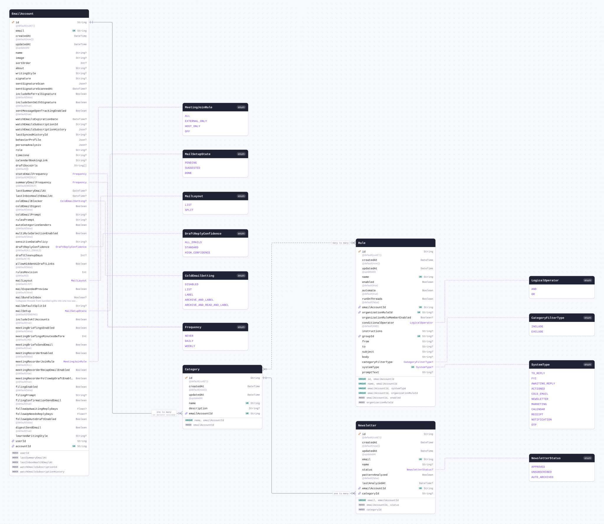

| Field            | Type       | Constraints                                       | Default      | Description |
| ---------------- | ---------- | ------------------------------------------------- | ------------ | ----------- |
| `id`             | `String`   | PK NOT NULL                                       | `cuid(1)`    |             |
| `createdAt`      | `DateTime` | NOT NULL                                          | `now()`      |             |
| `updatedAt`      | `DateTime` | NOT NULL                                          | `@updatedAt` |             |
| `name`           | `String`   | NOT NULL                                          |              |             |
| `description`    | `String`   | NULL                                              |              |             |
| `emailAccountId` | `String`   | NOT NULL → [EmailAccount.id](#model-EmailAccount) |              |             |

#### Indexes

- `@@index([emailAccountId])`
- `@@unique([name, emailAccountId])`

#### References

- `emailAccountId` → [EmailAccount.id](#model-EmailAccount) (many-to-one, on delete Cascade)

#### Referenced by

- `id` ← [Newsletter.categoryId](#model-Newsletter) (one-to-many)

#### Many to many

- `rules` ↔ [Rule.categoryFilters](#model-Rule) through `_CategoryToRule`

#### Definition

```sql
CREATE TABLE "Category" (
    "id" TEXT NOT NULL,
    "createdAt" TIMESTAMP(3) NOT NULL DEFAULT CURRENT_TIMESTAMP,
    "updatedAt" TIMESTAMP(3) NOT NULL,
    "name" TEXT NOT NULL,
    "description" TEXT,
    "emailAccountId" TEXT NOT NULL,

    CONSTRAINT "Category_pkey" PRIMARY KEY ("id")
);

CREATE INDEX "Category_emailAccountId_idx" ON "Category"("emailAccountId");

CREATE UNIQUE INDEX "Category_name_emailAccountId_key" ON "Category"("name", "emailAccountId");

ALTER TABLE "Category" ADD CONSTRAINT "Category_emailAccountId_fkey" FOREIGN KEY ("emailAccountId") REFERENCES "EmailAccount"("id") ON DELETE CASCADE ON UPDATE CASCADE;
```

<details>
<summary>Queries and their SQL</summary>

**findMany**: Every row

```ts
await prisma.category.findMany();
```

```sql
SELECT
  "public"."Category"."id",
  "public"."Category"."createdAt",
  "public"."Category"."updatedAt",
  "public"."Category"."name",
  "public"."Category"."description",
  "public"."Category"."emailAccountId"
FROM
  "public"."Category"
WHERE
  1 = 1
OFFSET
  $1
-- params: ["0"]
```

**count**: How many rows there are

```ts
await prisma.category.count();
```

```sql
SELECT
  COUNT(*) AS "_count$_all"
FROM
  (
    SELECT
      "public"."Category"."id"
    FROM
      "public"."Category"
    WHERE
      1 = 1
    OFFSET
      $1
  ) AS "sub"
-- params: ["0"]
```

**findMany**: Every row with its relations

```ts
await prisma.category.findMany({
  include: { emailAccount: true, emailSenders: true, rules: true },
});
```

```sql
SELECT
  "public"."Category"."id",
  "public"."Category"."createdAt",
  "public"."Category"."updatedAt",
  "public"."Category"."name",
  "public"."Category"."description",
  "public"."Category"."emailAccountId"
FROM
  "public"."Category"
WHERE
  1 = 1
OFFSET
  $1
-- params: ["0"]

SELECT
  "public"."EmailAccount"."id",
  "public"."EmailAccount"."email",
  "public"."EmailAccount"."createdAt",
  "public"."EmailAccount"."updatedAt",
  "public"."EmailAccount"."name",
  "public"."EmailAccount"."image",
  "public"."EmailAccount"."sortOrder",
  "public"."EmailAccount"."about",
  "public"."EmailAccount"."writingStyle",
  "public"."EmailAccount"."signature",
  "public"."EmailAccount"."sentSignatureScan",
  "public"."EmailAccount"."sentSignatureScannedAt",
  "public"."EmailAccount"."includeReferralSignature",
  "public"."EmailAccount"."includeSentWithSignature",
  "public"."EmailAccount"."sentMessageOpenTrackingEnabled",
  "public"."EmailAccount"."watchEmailsExpirationDate",
  "public"."EmailAccount"."watchEmailsSubscriptionId",
  "public"."EmailAccount"."watchEmailsSubscriptionHistory",
  "public"."EmailAccount"."lastSyncedHistoryId",
  "public"."EmailAccount"."behaviorProfile",
  "public"."EmailAccount"."personaAnalysis",
  "public"."EmailAccount"."role",
  "public"."EmailAccount"."timezone",
  "public"."EmailAccount"."calendarBookingLink",
  "public"."EmailAccount"."draftDocsUrls",
  "public"."EmailAccount"."statsEmailFrequency"::text,
  "public"."EmailAccount"."summaryEmailFrequency"::text,
  "public"."EmailAccount"."lastSummaryEmailAt",
  "public"."EmailAccount"."lastInboxHealthEmailAt",
  "public"."EmailAccount"."coldEmailBlocker"::text,
  "public"."EmailAccount"."coldEmailDigest",
  "public"."EmailAccount"."coldEmailPrompt",
  "public"."EmailAccount"."rulesPrompt",
  "public"."EmailAccount"."autoCategorizeSenders",
  "public"."EmailAccount"."multiRuleSelectionEnabled",
  "public"."EmailAccount"."sensitiveDataPolicy",
  "public"."EmailAccount"."draftReplyConfidence"::text,
  "public"."EmailAccount"."draftCleanupDays",
  "public"."EmailAccount"."allowHiddenAiDraftLinks",
  "public"."EmailAccount"."rulesRevision",
  "public"."EmailAccount"."mailLayout"::text,
  "public"."EmailAccount"."mailExpandedPreview",
  "public"."EmailAccount"."mailBundleInbox",
  "public"."EmailAccount"."mailDefaultSplitId",
  "public"."EmailAccount"."mailSetup"::text,
  "public"."EmailAccount"."includeInAllAccounts",
  "public"."EmailAccount"."meetingBriefingsEnabled",
  "public"."EmailAccount"."meetingBriefingsMinutesBefore",
  "public"."EmailAccount"."meetingBriefsSendEmail",
  "public"."EmailAccount"."meetingRecorderEnabled",
  "public"."EmailAccount"."meetingRecorderJoinRule"::text,
  "public"."EmailAccount"."meetingRecorderRecapEmailEnabled",
  "public"."EmailAccount"."meetingRecorderFollowUpDraftEnabled",
  "public"."EmailAccount"."filingEnabled",
  "public"."EmailAccount"."filingPrompt",
  "public"."EmailAccount"."filingConfirmationSendEmail",
  "public"."EmailAccount"."followUpAwaitingReplyDays",
  "public"."EmailAccount"."followUpNeedsReplyDays",
  "public"."EmailAccount"."followUpAutoDraftEnabled",
  "public"."EmailAccount"."digestSendEmail",
  "public"."EmailAccount"."learnedWritingStyle",
  "public"."EmailAccount"."userId",
  "public"."EmailAccount"."accountId"
FROM
  "public"."EmailAccount"
WHERE
  "public"."EmailAccount"."id" IN ($1)
OFFSET
  $2
-- params: ["<emailAccountId of the rows above>","0"]

SELECT
  "public"."Newsletter"."id",
  "public"."Newsletter"."createdAt",
  "public"."Newsletter"."updatedAt",
  "public"."Newsletter"."email",
  "public"."Newsletter"."name",
  "public"."Newsletter"."status"::text,
  "public"."Newsletter"."patternAnalyzed",
  "public"."Newsletter"."lastAnalyzedAt",
  "public"."Newsletter"."emailAccountId",
  "public"."Newsletter"."categoryId"
FROM
  "public"."Newsletter"
WHERE
  "public"."Newsletter"."categoryId" IN ($1)
OFFSET
  $2
-- params: ["<id of the rows above>","0"]

SELECT
  "public"."Rule"."id",
  "public"."Rule"."createdAt",
  "public"."Rule"."updatedAt",
  "public"."Rule"."name",
  "public"."Rule"."enabled",
  "public"."Rule"."automate",
  "public"."Rule"."runOnThreads",
  "public"."Rule"."emailAccountId",
  "public"."Rule"."organizationRuleId",
  "public"."Rule"."organizationRuleMemberEnabled",
  "public"."Rule"."conditionalOperator"::text,
  "public"."Rule"."instructions",
  "public"."Rule"."groupId",
  "public"."Rule"."from",
  "public"."Rule"."to",
  "public"."Rule"."subject",
  "public"."Rule"."body",
  "public"."Rule"."categoryFilterType"::text,
  "public"."Rule"."systemType"::text,
  "public"."Rule"."promptText",
  "t0"."A" AS "CategoryToRule@Category"
FROM
  "public"."Rule"
  INNER JOIN "public"."_CategoryToRule" AS "t0" ON "t0"."B" = "public"."Rule"."id"
WHERE
  (
    1 = 1
    AND "t0"."A" IN ($1)
  )
OFFSET
  $2
-- params: ["<id of the rows above>","0"]
```

**findUnique**: One row by what is unique to it

```ts
await prisma.category.findUnique({ where: { id: "example" } });
```

```sql
SELECT
  "public"."Category"."id",
  "public"."Category"."createdAt",
  "public"."Category"."updatedAt",
  "public"."Category"."name",
  "public"."Category"."description",
  "public"."Category"."emailAccountId"
FROM
  "public"."Category"
WHERE
  (
    "public"."Category"."id" = $1
    AND 1 = 1
  )
LIMIT
  $2
OFFSET
  $3
-- params: ["example","1","0"]
```

**create**: Create a row

```ts
await prisma.category.create({ data: { name: "example", emailAccountId: "example" } });
```

```sql
INSERT INTO
  "public"."Category" (
    "id",
    "createdAt",
    "updatedAt",
    "name",
    "emailAccountId"
  )
VALUES
  ($1, $2, $3, $4, $5)
RETURNING
  "public"."Category"."id",
  "public"."Category"."createdAt",
  "public"."Category"."updatedAt",
  "public"."Category"."name",
  "public"."Category"."description",
  "public"."Category"."emailAccountId"
-- params: ["<cuid(1)>","<now()>","<now()>","example","example"]
```

**update**: Update a row

```ts
await prisma.category.update({
  where: { id: "example" },
  data: { createdAt: new Date("2026-01-01T00:00:00.000Z") },
});
```

```sql
UPDATE "public"."Category"
SET
  "createdAt" = $1,
  "updatedAt" = $2
WHERE
  (
    "public"."Category"."id" = $3
    AND 1 = 1
  )
RETURNING
  "public"."Category"."id",
  "public"."Category"."createdAt",
  "public"."Category"."updatedAt",
  "public"."Category"."name",
  "public"."Category"."description",
  "public"."Category"."emailAccountId"
-- params: ["2026-01-01T00:00:00.000Z",{"prisma__type":"generatorCall","prisma__value":{"name":"now","args":[],"returnType":{"type":"DateTime"}}},"example"]
```

**delete**: Delete a row

```ts
await prisma.category.delete({ where: { id: "example" } });
```

```sql
DELETE FROM "public"."Category"
WHERE
  (
    "public"."Category"."id" = $1
    AND 1 = 1
  )
RETURNING
  "public"."Category"."id",
  "public"."Category"."createdAt",
  "public"."Category"."updatedAt",
  "public"."Category"."name",
  "public"."Category"."description",
  "public"."Category"."emailAccountId"
-- params: ["example"]
```

</details>

<a id="model-Newsletter"></a>

### Newsletter

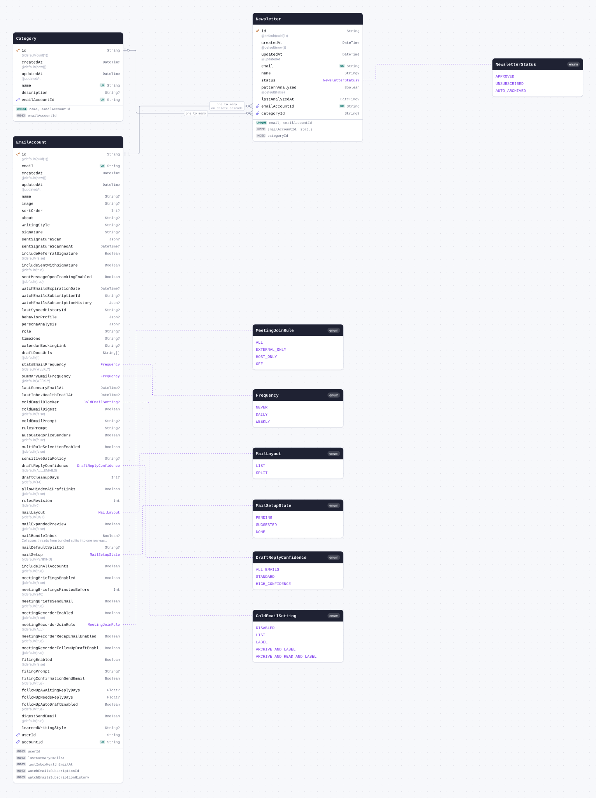

| Field             | Type                                         | Constraints                                       | Default      | Description |
| ----------------- | -------------------------------------------- | ------------------------------------------------- | ------------ | ----------- |
| `id`              | `String`                                     | PK NOT NULL                                       | `cuid(1)`    |             |
| `createdAt`       | `DateTime`                                   | NOT NULL                                          | `now()`      |             |
| `updatedAt`       | `DateTime`                                   | NOT NULL                                          | `@updatedAt` |             |
| `email`           | `String`                                     | NOT NULL                                          |              |             |
| `name`            | `String`                                     | NULL                                              |              |             |
| `status`          | [`NewsletterStatus`](#enum-NewsletterStatus) | NULL                                              |              |             |
| `patternAnalyzed` | `Boolean`                                    | NOT NULL                                          | `false`      |             |
| `lastAnalyzedAt`  | `DateTime`                                   | NULL                                              |              |             |
| `emailAccountId`  | `String`                                     | NOT NULL → [EmailAccount.id](#model-EmailAccount) |              |             |
| `categoryId`      | `String`                                     | NULL → [Category.id](#model-Category)             |              |             |

#### Indexes

- `@@index([emailAccountId, status])`
- `@@index([categoryId])`
- `@@unique([email, emailAccountId])`

#### References

- `emailAccountId` → [EmailAccount.id](#model-EmailAccount) (many-to-one, on delete Cascade)
- `categoryId` → [Category.id](#model-Category) (many-to-one)

#### Definition

```sql
CREATE TABLE "Newsletter" (
    "id" TEXT NOT NULL,
    "createdAt" TIMESTAMP(3) NOT NULL DEFAULT CURRENT_TIMESTAMP,
    "updatedAt" TIMESTAMP(3) NOT NULL,
    "email" TEXT NOT NULL,
    "name" TEXT,
    "status" "NewsletterStatus",
    "patternAnalyzed" BOOLEAN NOT NULL DEFAULT false,
    "lastAnalyzedAt" TIMESTAMP(3),
    "emailAccountId" TEXT NOT NULL,
    "categoryId" TEXT,

    CONSTRAINT "Newsletter_pkey" PRIMARY KEY ("id")
);

CREATE INDEX "Newsletter_emailAccountId_status_idx" ON "Newsletter"("emailAccountId", "status");

CREATE INDEX "Newsletter_categoryId_idx" ON "Newsletter"("categoryId");

CREATE UNIQUE INDEX "Newsletter_email_emailAccountId_key" ON "Newsletter"("email", "emailAccountId");

ALTER TABLE "Newsletter" ADD CONSTRAINT "Newsletter_emailAccountId_fkey" FOREIGN KEY ("emailAccountId") REFERENCES "EmailAccount"("id") ON DELETE CASCADE ON UPDATE CASCADE;

ALTER TABLE "Newsletter" ADD CONSTRAINT "Newsletter_categoryId_fkey" FOREIGN KEY ("categoryId") REFERENCES "Category"("id") ON DELETE SET NULL ON UPDATE CASCADE;
```

<details>
<summary>Queries and their SQL</summary>

**findMany**: Every row

```ts
await prisma.newsletter.findMany();
```

```sql
SELECT
  "public"."Newsletter"."id",
  "public"."Newsletter"."createdAt",
  "public"."Newsletter"."updatedAt",
  "public"."Newsletter"."email",
  "public"."Newsletter"."name",
  "public"."Newsletter"."status"::text,
  "public"."Newsletter"."patternAnalyzed",
  "public"."Newsletter"."lastAnalyzedAt",
  "public"."Newsletter"."emailAccountId",
  "public"."Newsletter"."categoryId"
FROM
  "public"."Newsletter"
WHERE
  1 = 1
OFFSET
  $1
-- params: ["0"]
```

**count**: How many rows there are

```ts
await prisma.newsletter.count();
```

```sql
SELECT
  COUNT(*) AS "_count$_all"
FROM
  (
    SELECT
      "public"."Newsletter"."id"
    FROM
      "public"."Newsletter"
    WHERE
      1 = 1
    OFFSET
      $1
  ) AS "sub"
-- params: ["0"]
```

**findMany**: Every row with its relations

```ts
await prisma.newsletter.findMany({ include: { emailAccount: true, category: true } });
```

```sql
SELECT
  "public"."Newsletter"."id",
  "public"."Newsletter"."createdAt",
  "public"."Newsletter"."updatedAt",
  "public"."Newsletter"."email",
  "public"."Newsletter"."name",
  "public"."Newsletter"."status"::text,
  "public"."Newsletter"."patternAnalyzed",
  "public"."Newsletter"."lastAnalyzedAt",
  "public"."Newsletter"."emailAccountId",
  "public"."Newsletter"."categoryId"
FROM
  "public"."Newsletter"
WHERE
  1 = 1
OFFSET
  $1
-- params: ["0"]

SELECT
  "public"."EmailAccount"."id",
  "public"."EmailAccount"."email",
  "public"."EmailAccount"."createdAt",
  "public"."EmailAccount"."updatedAt",
  "public"."EmailAccount"."name",
  "public"."EmailAccount"."image",
  "public"."EmailAccount"."sortOrder",
  "public"."EmailAccount"."about",
  "public"."EmailAccount"."writingStyle",
  "public"."EmailAccount"."signature",
  "public"."EmailAccount"."sentSignatureScan",
  "public"."EmailAccount"."sentSignatureScannedAt",
  "public"."EmailAccount"."includeReferralSignature",
  "public"."EmailAccount"."includeSentWithSignature",
  "public"."EmailAccount"."sentMessageOpenTrackingEnabled",
  "public"."EmailAccount"."watchEmailsExpirationDate",
  "public"."EmailAccount"."watchEmailsSubscriptionId",
  "public"."EmailAccount"."watchEmailsSubscriptionHistory",
  "public"."EmailAccount"."lastSyncedHistoryId",
  "public"."EmailAccount"."behaviorProfile",
  "public"."EmailAccount"."personaAnalysis",
  "public"."EmailAccount"."role",
  "public"."EmailAccount"."timezone",
  "public"."EmailAccount"."calendarBookingLink",
  "public"."EmailAccount"."draftDocsUrls",
  "public"."EmailAccount"."statsEmailFrequency"::text,
  "public"."EmailAccount"."summaryEmailFrequency"::text,
  "public"."EmailAccount"."lastSummaryEmailAt",
  "public"."EmailAccount"."lastInboxHealthEmailAt",
  "public"."EmailAccount"."coldEmailBlocker"::text,
  "public"."EmailAccount"."coldEmailDigest",
  "public"."EmailAccount"."coldEmailPrompt",
  "public"."EmailAccount"."rulesPrompt",
  "public"."EmailAccount"."autoCategorizeSenders",
  "public"."EmailAccount"."multiRuleSelectionEnabled",
  "public"."EmailAccount"."sensitiveDataPolicy",
  "public"."EmailAccount"."draftReplyConfidence"::text,
  "public"."EmailAccount"."draftCleanupDays",
  "public"."EmailAccount"."allowHiddenAiDraftLinks",
  "public"."EmailAccount"."rulesRevision",
  "public"."EmailAccount"."mailLayout"::text,
  "public"."EmailAccount"."mailExpandedPreview",
  "public"."EmailAccount"."mailBundleInbox",
  "public"."EmailAccount"."mailDefaultSplitId",
  "public"."EmailAccount"."mailSetup"::text,
  "public"."EmailAccount"."includeInAllAccounts",
  "public"."EmailAccount"."meetingBriefingsEnabled",
  "public"."EmailAccount"."meetingBriefingsMinutesBefore",
  "public"."EmailAccount"."meetingBriefsSendEmail",
  "public"."EmailAccount"."meetingRecorderEnabled",
  "public"."EmailAccount"."meetingRecorderJoinRule"::text,
  "public"."EmailAccount"."meetingRecorderRecapEmailEnabled",
  "public"."EmailAccount"."meetingRecorderFollowUpDraftEnabled",
  "public"."EmailAccount"."filingEnabled",
  "public"."EmailAccount"."filingPrompt",
  "public"."EmailAccount"."filingConfirmationSendEmail",
  "public"."EmailAccount"."followUpAwaitingReplyDays",
  "public"."EmailAccount"."followUpNeedsReplyDays",
  "public"."EmailAccount"."followUpAutoDraftEnabled",
  "public"."EmailAccount"."digestSendEmail",
  "public"."EmailAccount"."learnedWritingStyle",
  "public"."EmailAccount"."userId",
  "public"."EmailAccount"."accountId"
FROM
  "public"."EmailAccount"
WHERE
  "public"."EmailAccount"."id" IN ($1)
OFFSET
  $2
-- params: ["<emailAccountId of the rows above>","0"]

SELECT
  "public"."Category"."id",
  "public"."Category"."createdAt",
  "public"."Category"."updatedAt",
  "public"."Category"."name",
  "public"."Category"."description",
  "public"."Category"."emailAccountId"
FROM
  "public"."Category"
WHERE
  "public"."Category"."id" IN ($1)
OFFSET
  $2
-- params: ["<categoryId of the rows above>","0"]
```

**findUnique**: One row by what is unique to it

```ts
await prisma.newsletter.findUnique({ where: { id: "example" } });
```

```sql
SELECT
  "public"."Newsletter"."id",
  "public"."Newsletter"."createdAt",
  "public"."Newsletter"."updatedAt",
  "public"."Newsletter"."email",
  "public"."Newsletter"."name",
  "public"."Newsletter"."status"::text,
  "public"."Newsletter"."patternAnalyzed",
  "public"."Newsletter"."lastAnalyzedAt",
  "public"."Newsletter"."emailAccountId",
  "public"."Newsletter"."categoryId"
FROM
  "public"."Newsletter"
WHERE
  (
    "public"."Newsletter"."id" = $1
    AND 1 = 1
  )
LIMIT
  $2
OFFSET
  $3
-- params: ["example","1","0"]
```

**create**: Create a row

```ts
await prisma.newsletter.create({ data: { email: "example", emailAccountId: "example" } });
```

```sql
INSERT INTO
  "public"."Newsletter" (
    "id",
    "createdAt",
    "updatedAt",
    "email",
    "patternAnalyzed",
    "emailAccountId"
  )
VALUES
  ($1, $2, $3, $4, $5, $6)
RETURNING
  "public"."Newsletter"."id",
  "public"."Newsletter"."createdAt",
  "public"."Newsletter"."updatedAt",
  "public"."Newsletter"."email",
  "public"."Newsletter"."name",
  "public"."Newsletter"."status"::text,
  "public"."Newsletter"."patternAnalyzed",
  "public"."Newsletter"."lastAnalyzedAt",
  "public"."Newsletter"."emailAccountId",
  "public"."Newsletter"."categoryId"
-- params: ["<cuid(1)>","<now()>","<now()>","example",false,"example"]
```

**update**: Update a row

```ts
await prisma.newsletter.update({
  where: { id: "example" },
  data: { createdAt: new Date("2026-01-01T00:00:00.000Z") },
});
```

```sql
UPDATE "public"."Newsletter"
SET
  "createdAt" = $1,
  "updatedAt" = $2
WHERE
  (
    "public"."Newsletter"."id" = $3
    AND 1 = 1
  )
RETURNING
  "public"."Newsletter"."id",
  "public"."Newsletter"."createdAt",
  "public"."Newsletter"."updatedAt",
  "public"."Newsletter"."email",
  "public"."Newsletter"."name",
  "public"."Newsletter"."status"::text,
  "public"."Newsletter"."patternAnalyzed",
  "public"."Newsletter"."lastAnalyzedAt",
  "public"."Newsletter"."emailAccountId",
  "public"."Newsletter"."categoryId"
-- params: ["2026-01-01T00:00:00.000Z",{"prisma__type":"generatorCall","prisma__value":{"name":"now","args":[],"returnType":{"type":"DateTime"}}},"example"]
```

**delete**: Delete a row

```ts
await prisma.newsletter.delete({ where: { id: "example" } });
```

```sql
DELETE FROM "public"."Newsletter"
WHERE
  (
    "public"."Newsletter"."id" = $1
    AND 1 = 1
  )
RETURNING
  "public"."Newsletter"."id",
  "public"."Newsletter"."createdAt",
  "public"."Newsletter"."updatedAt",
  "public"."Newsletter"."email",
  "public"."Newsletter"."name",
  "public"."Newsletter"."status"::text,
  "public"."Newsletter"."patternAnalyzed",
  "public"."Newsletter"."lastAnalyzedAt",
  "public"."Newsletter"."emailAccountId",
  "public"."Newsletter"."categoryId"
-- params: ["example"]
```

</details>

<a id="model-ColdEmail"></a>

### ColdEmail

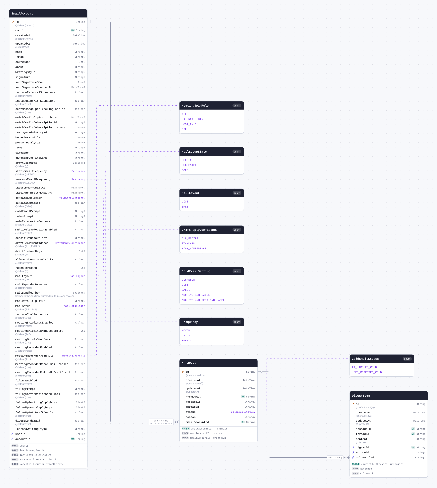

| Field            | Type                                       | Constraints                                       | Default      | Description |
| ---------------- | ------------------------------------------ | ------------------------------------------------- | ------------ | ----------- |
| `id`             | `String`                                   | PK NOT NULL                                       | `cuid(1)`    |             |
| `createdAt`      | `DateTime`                                 | NOT NULL                                          | `now()`      |             |
| `updatedAt`      | `DateTime`                                 | NOT NULL                                          | `@updatedAt` |             |
| `fromEmail`      | `String`                                   | NOT NULL                                          |              |             |
| `messageId`      | `String`                                   | NULL                                              |              |             |
| `threadId`       | `String`                                   | NULL                                              |              |             |
| `status`         | [`ColdEmailStatus`](#enum-ColdEmailStatus) | NULL                                              |              |             |
| `reason`         | `String`                                   | NULL                                              |              |             |
| `emailAccountId` | `String`                                   | NOT NULL → [EmailAccount.id](#model-EmailAccount) |              |             |

#### Indexes

- `@@index([emailAccountId, status])`
- `@@index([emailAccountId, createdAt])`
- `@@unique([emailAccountId, fromEmail])`

#### References

- `emailAccountId` → [EmailAccount.id](#model-EmailAccount) (many-to-one, on delete Cascade)

#### Referenced by

- `id` ← [DigestItem.coldEmailId](#model-DigestItem) (one-to-many)

#### Definition

```sql
CREATE TABLE "ColdEmail" (
    "id" TEXT NOT NULL,
    "createdAt" TIMESTAMP(3) NOT NULL DEFAULT CURRENT_TIMESTAMP,
    "updatedAt" TIMESTAMP(3) NOT NULL,
    "fromEmail" TEXT NOT NULL,
    "messageId" TEXT,
    "threadId" TEXT,
    "status" "ColdEmailStatus",
    "reason" TEXT,
    "emailAccountId" TEXT NOT NULL,

    CONSTRAINT "ColdEmail_pkey" PRIMARY KEY ("id")
);

CREATE INDEX "ColdEmail_emailAccountId_status_idx" ON "ColdEmail"("emailAccountId", "status");

CREATE INDEX "ColdEmail_emailAccountId_createdAt_idx" ON "ColdEmail"("emailAccountId", "createdAt");

CREATE UNIQUE INDEX "ColdEmail_emailAccountId_fromEmail_key" ON "ColdEmail"("emailAccountId", "fromEmail");

ALTER TABLE "ColdEmail" ADD CONSTRAINT "ColdEmail_emailAccountId_fkey" FOREIGN KEY ("emailAccountId") REFERENCES "EmailAccount"("id") ON DELETE CASCADE ON UPDATE CASCADE;
```

<details>
<summary>Queries and their SQL</summary>

**findMany**: Every row

```ts
await prisma.coldEmail.findMany();
```

```sql
SELECT
  "public"."ColdEmail"."id",
  "public"."ColdEmail"."createdAt",
  "public"."ColdEmail"."updatedAt",
  "public"."ColdEmail"."fromEmail",
  "public"."ColdEmail"."messageId",
  "public"."ColdEmail"."threadId",
  "public"."ColdEmail"."status"::text,
  "public"."ColdEmail"."reason",
  "public"."ColdEmail"."emailAccountId"
FROM
  "public"."ColdEmail"
WHERE
  1 = 1
OFFSET
  $1
-- params: ["0"]
```

**count**: How many rows there are

```ts
await prisma.coldEmail.count();
```

```sql
SELECT
  COUNT(*) AS "_count$_all"
FROM
  (
    SELECT
      "public"."ColdEmail"."id"
    FROM
      "public"."ColdEmail"
    WHERE
      1 = 1
    OFFSET
      $1
  ) AS "sub"
-- params: ["0"]
```

**findMany**: Every row with its relations

```ts
await prisma.coldEmail.findMany({ include: { emailAccount: true, digestItems: true } });
```

```sql
SELECT
  "public"."ColdEmail"."id",
  "public"."ColdEmail"."createdAt",
  "public"."ColdEmail"."updatedAt",
  "public"."ColdEmail"."fromEmail",
  "public"."ColdEmail"."messageId",
  "public"."ColdEmail"."threadId",
  "public"."ColdEmail"."status"::text,
  "public"."ColdEmail"."reason",
  "public"."ColdEmail"."emailAccountId"
FROM
  "public"."ColdEmail"
WHERE
  1 = 1
OFFSET
  $1
-- params: ["0"]

SELECT
  "public"."EmailAccount"."id",
  "public"."EmailAccount"."email",
  "public"."EmailAccount"."createdAt",
  "public"."EmailAccount"."updatedAt",
  "public"."EmailAccount"."name",
  "public"."EmailAccount"."image",
  "public"."EmailAccount"."sortOrder",
  "public"."EmailAccount"."about",
  "public"."EmailAccount"."writingStyle",
  "public"."EmailAccount"."signature",
  "public"."EmailAccount"."sentSignatureScan",
  "public"."EmailAccount"."sentSignatureScannedAt",
  "public"."EmailAccount"."includeReferralSignature",
  "public"."EmailAccount"."includeSentWithSignature",
  "public"."EmailAccount"."sentMessageOpenTrackingEnabled",
  "public"."EmailAccount"."watchEmailsExpirationDate",
  "public"."EmailAccount"."watchEmailsSubscriptionId",
  "public"."EmailAccount"."watchEmailsSubscriptionHistory",
  "public"."EmailAccount"."lastSyncedHistoryId",
  "public"."EmailAccount"."behaviorProfile",
  "public"."EmailAccount"."personaAnalysis",
  "public"."EmailAccount"."role",
  "public"."EmailAccount"."timezone",
  "public"."EmailAccount"."calendarBookingLink",
  "public"."EmailAccount"."draftDocsUrls",
  "public"."EmailAccount"."statsEmailFrequency"::text,
  "public"."EmailAccount"."summaryEmailFrequency"::text,
  "public"."EmailAccount"."lastSummaryEmailAt",
  "public"."EmailAccount"."lastInboxHealthEmailAt",
  "public"."EmailAccount"."coldEmailBlocker"::text,
  "public"."EmailAccount"."coldEmailDigest",
  "public"."EmailAccount"."coldEmailPrompt",
  "public"."EmailAccount"."rulesPrompt",
  "public"."EmailAccount"."autoCategorizeSenders",
  "public"."EmailAccount"."multiRuleSelectionEnabled",
  "public"."EmailAccount"."sensitiveDataPolicy",
  "public"."EmailAccount"."draftReplyConfidence"::text,
  "public"."EmailAccount"."draftCleanupDays",
  "public"."EmailAccount"."allowHiddenAiDraftLinks",
  "public"."EmailAccount"."rulesRevision",
  "public"."EmailAccount"."mailLayout"::text,
  "public"."EmailAccount"."mailExpandedPreview",
  "public"."EmailAccount"."mailBundleInbox",
  "public"."EmailAccount"."mailDefaultSplitId",
  "public"."EmailAccount"."mailSetup"::text,
  "public"."EmailAccount"."includeInAllAccounts",
  "public"."EmailAccount"."meetingBriefingsEnabled",
  "public"."EmailAccount"."meetingBriefingsMinutesBefore",
  "public"."EmailAccount"."meetingBriefsSendEmail",
  "public"."EmailAccount"."meetingRecorderEnabled",
  "public"."EmailAccount"."meetingRecorderJoinRule"::text,
  "public"."EmailAccount"."meetingRecorderRecapEmailEnabled",
  "public"."EmailAccount"."meetingRecorderFollowUpDraftEnabled",
  "public"."EmailAccount"."filingEnabled",
  "public"."EmailAccount"."filingPrompt",
  "public"."EmailAccount"."filingConfirmationSendEmail",
  "public"."EmailAccount"."followUpAwaitingReplyDays",
  "public"."EmailAccount"."followUpNeedsReplyDays",
  "public"."EmailAccount"."followUpAutoDraftEnabled",
  "public"."EmailAccount"."digestSendEmail",
  "public"."EmailAccount"."learnedWritingStyle",
  "public"."EmailAccount"."userId",
  "public"."EmailAccount"."accountId"
FROM
  "public"."EmailAccount"
WHERE
  "public"."EmailAccount"."id" IN ($1)
OFFSET
  $2
-- params: ["<emailAccountId of the rows above>","0"]

SELECT
  "public"."DigestItem"."id",
  "public"."DigestItem"."createdAt",
  "public"."DigestItem"."updatedAt",
  "public"."DigestItem"."messageId",
  "public"."DigestItem"."threadId",
  "public"."DigestItem"."content",
  "public"."DigestItem"."digestId",
  "public"."DigestItem"."actionId",
  "public"."DigestItem"."coldEmailId"
FROM
  "public"."DigestItem"
WHERE
  "public"."DigestItem"."coldEmailId" IN ($1)
OFFSET
  $2
-- params: ["<id of the rows above>","0"]
```

**findUnique**: One row by what is unique to it

```ts
await prisma.coldEmail.findUnique({ where: { id: "example" } });
```

```sql
SELECT
  "public"."ColdEmail"."id",
  "public"."ColdEmail"."createdAt",
  "public"."ColdEmail"."updatedAt",
  "public"."ColdEmail"."fromEmail",
  "public"."ColdEmail"."messageId",
  "public"."ColdEmail"."threadId",
  "public"."ColdEmail"."status"::text,
  "public"."ColdEmail"."reason",
  "public"."ColdEmail"."emailAccountId"
FROM
  "public"."ColdEmail"
WHERE
  (
    "public"."ColdEmail"."id" = $1
    AND 1 = 1
  )
LIMIT
  $2
OFFSET
  $3
-- params: ["example","1","0"]
```

**create**: Create a row

```ts
await prisma.coldEmail.create({ data: { fromEmail: "example", emailAccountId: "example" } });
```

```sql
INSERT INTO
  "public"."ColdEmail" (
    "id",
    "createdAt",
    "updatedAt",
    "fromEmail",
    "emailAccountId"
  )
VALUES
  ($1, $2, $3, $4, $5)
RETURNING
  "public"."ColdEmail"."id",
  "public"."ColdEmail"."createdAt",
  "public"."ColdEmail"."updatedAt",
  "public"."ColdEmail"."fromEmail",
  "public"."ColdEmail"."messageId",
  "public"."ColdEmail"."threadId",
  "public"."ColdEmail"."status"::text,
  "public"."ColdEmail"."reason",
  "public"."ColdEmail"."emailAccountId"
-- params: ["<cuid(1)>","<now()>","<now()>","example","example"]
```

**update**: Update a row

```ts
await prisma.coldEmail.update({
  where: { id: "example" },
  data: { createdAt: new Date("2026-01-01T00:00:00.000Z") },
});
```

```sql
UPDATE "public"."ColdEmail"
SET
  "createdAt" = $1,
  "updatedAt" = $2
WHERE
  (
    "public"."ColdEmail"."id" = $3
    AND 1 = 1
  )
RETURNING
  "public"."ColdEmail"."id",
  "public"."ColdEmail"."createdAt",
  "public"."ColdEmail"."updatedAt",
  "public"."ColdEmail"."fromEmail",
  "public"."ColdEmail"."messageId",
  "public"."ColdEmail"."threadId",
  "public"."ColdEmail"."status"::text,
  "public"."ColdEmail"."reason",
  "public"."ColdEmail"."emailAccountId"
-- params: ["2026-01-01T00:00:00.000Z",{"prisma__type":"generatorCall","prisma__value":{"name":"now","args":[],"returnType":{"type":"DateTime"}}},"example"]
```

**delete**: Delete a row

```ts
await prisma.coldEmail.delete({ where: { id: "example" } });
```

```sql
DELETE FROM "public"."ColdEmail"
WHERE
  (
    "public"."ColdEmail"."id" = $1
    AND 1 = 1
  )
RETURNING
  "public"."ColdEmail"."id",
  "public"."ColdEmail"."createdAt",
  "public"."ColdEmail"."updatedAt",
  "public"."ColdEmail"."fromEmail",
  "public"."ColdEmail"."messageId",
  "public"."ColdEmail"."threadId",
  "public"."ColdEmail"."status"::text,
  "public"."ColdEmail"."reason",
  "public"."ColdEmail"."emailAccountId"
-- params: ["example"]
```

</details>

<a id="model-EmailMessage"></a>

### EmailMessage

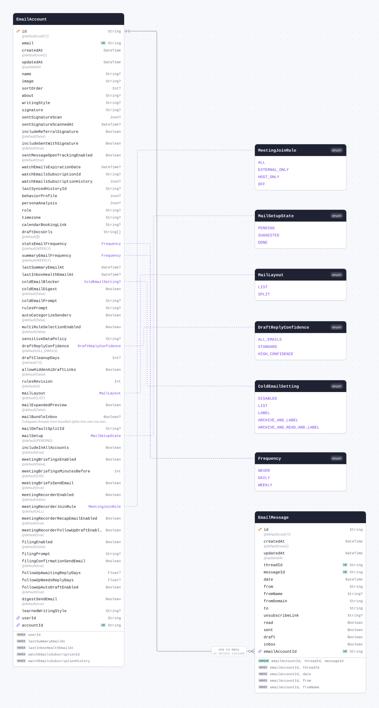

| Field             | Type       | Constraints                                       | Default      | Description |
| ----------------- | ---------- | ------------------------------------------------- | ------------ | ----------- |
| `id`              | `String`   | PK NOT NULL                                       | `cuid(1)`    |             |
| `createdAt`       | `DateTime` | NOT NULL                                          | `now()`      |             |
| `updatedAt`       | `DateTime` | NOT NULL                                          | `@updatedAt` |             |
| `threadId`        | `String`   | NOT NULL                                          |              |             |
| `messageId`       | `String`   | NOT NULL                                          |              |             |
| `date`            | `DateTime` | NOT NULL                                          |              |             |
| `from`            | `String`   | NOT NULL                                          |              |             |
| `fromName`        | `String`   | NULL                                              |              |             |
| `fromDomain`      | `String`   | NOT NULL                                          |              |             |
| `to`              | `String`   | NOT NULL                                          |              |             |
| `unsubscribeLink` | `String`   | NULL                                              |              |             |
| `read`            | `Boolean`  | NOT NULL                                          |              |             |
| `sent`            | `Boolean`  | NOT NULL                                          |              |             |
| `draft`           | `Boolean`  | NOT NULL                                          |              |             |
| `inbox`           | `Boolean`  | NOT NULL                                          |              |             |
| `emailAccountId`  | `String`   | NOT NULL → [EmailAccount.id](#model-EmailAccount) |              |             |

#### Indexes

- `@@index([emailAccountId, threadId])`
- `@@index([emailAccountId, date])`
- `@@index([emailAccountId, from])`
- `@@index([emailAccountId, fromName])`
- `@@unique([emailAccountId, threadId, messageId])`

#### References

- `emailAccountId` → [EmailAccount.id](#model-EmailAccount) (many-to-one, on delete Cascade)

#### Definition

```sql
CREATE TABLE "EmailMessage" (
    "id" TEXT NOT NULL,
    "createdAt" TIMESTAMP(3) NOT NULL DEFAULT CURRENT_TIMESTAMP,
    "updatedAt" TIMESTAMP(3) NOT NULL,
    "threadId" TEXT NOT NULL,
    "messageId" TEXT NOT NULL,
    "date" TIMESTAMP(3) NOT NULL,
    "from" TEXT NOT NULL,
    "fromName" TEXT,
    "fromDomain" TEXT NOT NULL,
    "to" TEXT NOT NULL,
    "unsubscribeLink" TEXT,
    "read" BOOLEAN NOT NULL,
    "sent" BOOLEAN NOT NULL,
    "draft" BOOLEAN NOT NULL,
    "inbox" BOOLEAN NOT NULL,
    "emailAccountId" TEXT NOT NULL,

    CONSTRAINT "EmailMessage_pkey" PRIMARY KEY ("id")
);

CREATE INDEX "EmailMessage_emailAccountId_threadId_idx" ON "EmailMessage"("emailAccountId", "threadId");

CREATE INDEX "EmailMessage_emailAccountId_date_idx" ON "EmailMessage"("emailAccountId", "date");

CREATE INDEX "EmailMessage_emailAccountId_from_idx" ON "EmailMessage"("emailAccountId", "from");

CREATE INDEX "EmailMessage_emailAccountId_fromName_idx" ON "EmailMessage"("emailAccountId", "fromName");

CREATE UNIQUE INDEX "EmailMessage_emailAccountId_threadId_messageId_key" ON "EmailMessage"("emailAccountId", "threadId", "messageId");

ALTER TABLE "EmailMessage" ADD CONSTRAINT "EmailMessage_emailAccountId_fkey" FOREIGN KEY ("emailAccountId") REFERENCES "EmailAccount"("id") ON DELETE CASCADE ON UPDATE CASCADE;
```

<details>
<summary>Queries and their SQL</summary>

**findMany**: Every row

```ts
await prisma.emailMessage.findMany();
```

```sql
SELECT
  "public"."EmailMessage"."id",
  "public"."EmailMessage"."createdAt",
  "public"."EmailMessage"."updatedAt",
  "public"."EmailMessage"."threadId",
  "public"."EmailMessage"."messageId",
  "public"."EmailMessage"."date",
  "public"."EmailMessage"."from",
  "public"."EmailMessage"."fromName",
  "public"."EmailMessage"."fromDomain",
  "public"."EmailMessage"."to",
  "public"."EmailMessage"."unsubscribeLink",
  "public"."EmailMessage"."read",
  "public"."EmailMessage"."sent",
  "public"."EmailMessage"."draft",
  "public"."EmailMessage"."inbox",
  "public"."EmailMessage"."emailAccountId"
FROM
  "public"."EmailMessage"
WHERE
  1 = 1
OFFSET
  $1
-- params: ["0"]
```

**count**: How many rows there are

```ts
await prisma.emailMessage.count();
```

```sql
SELECT
  COUNT(*) AS "_count$_all"
FROM
  (
    SELECT
      "public"."EmailMessage"."id"
    FROM
      "public"."EmailMessage"
    WHERE
      1 = 1
    OFFSET
      $1
  ) AS "sub"
-- params: ["0"]
```

**findMany**: Every row with its relations

```ts
await prisma.emailMessage.findMany({ include: { emailAccount: true } });
```

```sql
SELECT
  "public"."EmailMessage"."id",
  "public"."EmailMessage"."createdAt",
  "public"."EmailMessage"."updatedAt",
  "public"."EmailMessage"."threadId",
  "public"."EmailMessage"."messageId",
  "public"."EmailMessage"."date",
  "public"."EmailMessage"."from",
  "public"."EmailMessage"."fromName",
  "public"."EmailMessage"."fromDomain",
  "public"."EmailMessage"."to",
  "public"."EmailMessage"."unsubscribeLink",
  "public"."EmailMessage"."read",
  "public"."EmailMessage"."sent",
  "public"."EmailMessage"."draft",
  "public"."EmailMessage"."inbox",
  "public"."EmailMessage"."emailAccountId"
FROM
  "public"."EmailMessage"
WHERE
  1 = 1
OFFSET
  $1
-- params: ["0"]

SELECT
  "public"."EmailAccount"."id",
  "public"."EmailAccount"."email",
  "public"."EmailAccount"."createdAt",
  "public"."EmailAccount"."updatedAt",
  "public"."EmailAccount"."name",
  "public"."EmailAccount"."image",
  "public"."EmailAccount"."sortOrder",
  "public"."EmailAccount"."about",
  "public"."EmailAccount"."writingStyle",
  "public"."EmailAccount"."signature",
  "public"."EmailAccount"."sentSignatureScan",
  "public"."EmailAccount"."sentSignatureScannedAt",
  "public"."EmailAccount"."includeReferralSignature",
  "public"."EmailAccount"."includeSentWithSignature",
  "public"."EmailAccount"."sentMessageOpenTrackingEnabled",
  "public"."EmailAccount"."watchEmailsExpirationDate",
  "public"."EmailAccount"."watchEmailsSubscriptionId",
  "public"."EmailAccount"."watchEmailsSubscriptionHistory",
  "public"."EmailAccount"."lastSyncedHistoryId",
  "public"."EmailAccount"."behaviorProfile",
  "public"."EmailAccount"."personaAnalysis",
  "public"."EmailAccount"."role",
  "public"."EmailAccount"."timezone",
  "public"."EmailAccount"."calendarBookingLink",
  "public"."EmailAccount"."draftDocsUrls",
  "public"."EmailAccount"."statsEmailFrequency"::text,
  "public"."EmailAccount"."summaryEmailFrequency"::text,
  "public"."EmailAccount"."lastSummaryEmailAt",
  "public"."EmailAccount"."lastInboxHealthEmailAt",
  "public"."EmailAccount"."coldEmailBlocker"::text,
  "public"."EmailAccount"."coldEmailDigest",
  "public"."EmailAccount"."coldEmailPrompt",
  "public"."EmailAccount"."rulesPrompt",
  "public"."EmailAccount"."autoCategorizeSenders",
  "public"."EmailAccount"."multiRuleSelectionEnabled",
  "public"."EmailAccount"."sensitiveDataPolicy",
  "public"."EmailAccount"."draftReplyConfidence"::text,
  "public"."EmailAccount"."draftCleanupDays",
  "public"."EmailAccount"."allowHiddenAiDraftLinks",
  "public"."EmailAccount"."rulesRevision",
  "public"."EmailAccount"."mailLayout"::text,
  "public"."EmailAccount"."mailExpandedPreview",
  "public"."EmailAccount"."mailBundleInbox",
  "public"."EmailAccount"."mailDefaultSplitId",
  "public"."EmailAccount"."mailSetup"::text,
  "public"."EmailAccount"."includeInAllAccounts",
  "public"."EmailAccount"."meetingBriefingsEnabled",
  "public"."EmailAccount"."meetingBriefingsMinutesBefore",
  "public"."EmailAccount"."meetingBriefsSendEmail",
  "public"."EmailAccount"."meetingRecorderEnabled",
  "public"."EmailAccount"."meetingRecorderJoinRule"::text,
  "public"."EmailAccount"."meetingRecorderRecapEmailEnabled",
  "public"."EmailAccount"."meetingRecorderFollowUpDraftEnabled",
  "public"."EmailAccount"."filingEnabled",
  "public"."EmailAccount"."filingPrompt",
  "public"."EmailAccount"."filingConfirmationSendEmail",
  "public"."EmailAccount"."followUpAwaitingReplyDays",
  "public"."EmailAccount"."followUpNeedsReplyDays",
  "public"."EmailAccount"."followUpAutoDraftEnabled",
  "public"."EmailAccount"."digestSendEmail",
  "public"."EmailAccount"."learnedWritingStyle",
  "public"."EmailAccount"."userId",
  "public"."EmailAccount"."accountId"
FROM
  "public"."EmailAccount"
WHERE
  "public"."EmailAccount"."id" IN ($1)
OFFSET
  $2
-- params: ["<emailAccountId of the rows above>","0"]
```

**findUnique**: One row by what is unique to it

```ts
await prisma.emailMessage.findUnique({ where: { id: "example" } });
```

```sql
SELECT
  "public"."EmailMessage"."id",
  "public"."EmailMessage"."createdAt",
  "public"."EmailMessage"."updatedAt",
  "public"."EmailMessage"."threadId",
  "public"."EmailMessage"."messageId",
  "public"."EmailMessage"."date",
  "public"."EmailMessage"."from",
  "public"."EmailMessage"."fromName",
  "public"."EmailMessage"."fromDomain",
  "public"."EmailMessage"."to",
  "public"."EmailMessage"."unsubscribeLink",
  "public"."EmailMessage"."read",
  "public"."EmailMessage"."sent",
  "public"."EmailMessage"."draft",
  "public"."EmailMessage"."inbox",
  "public"."EmailMessage"."emailAccountId"
FROM
  "public"."EmailMessage"
WHERE
  (
    "public"."EmailMessage"."id" = $1
    AND 1 = 1
  )
LIMIT
  $2
OFFSET
  $3
-- params: ["example","1","0"]
```

**create**: Create a row

```ts
await prisma.emailMessage.create({
  data: {
    threadId: "example",
    messageId: "example",
    date: new Date("2026-01-01T00:00:00.000Z"),
    from: "example",
    fromDomain: "example",
    to: "example",
    read: true,
    sent: true,
    draft: true,
    inbox: true,
    emailAccountId: "example",
  },
});
```

```sql
INSERT INTO
  "public"."EmailMessage" (
    "id",
    "createdAt",
    "updatedAt",
    "threadId",
    "messageId",
    "date",
    "from",
    "fromDomain",
    "to",
    "read",
    "sent",
    "draft",
    "inbox",
    "emailAccountId"
  )
VALUES
  (
    $1,
    $2,
    $3,
    $4,
    $5,
    $6,
    $7,
    $8,
    $9,
    $10,
    $11,
    $12,
    $13,
    $14
  )
RETURNING
  "public"."EmailMessage"."id",
  "public"."EmailMessage"."createdAt",
  "public"."EmailMessage"."updatedAt",
  "public"."EmailMessage"."threadId",
  "public"."EmailMessage"."messageId",
  "public"."EmailMessage"."date",
  "public"."EmailMessage"."from",
  "public"."EmailMessage"."fromName",
  "public"."EmailMessage"."fromDomain",
  "public"."EmailMessage"."to",
  "public"."EmailMessage"."unsubscribeLink",
  "public"."EmailMessage"."read",
  "public"."EmailMessage"."sent",
  "public"."EmailMessage"."draft",
  "public"."EmailMessage"."inbox",
  "public"."EmailMessage"."emailAccountId"
-- params: ["<cuid(1)>","<now()>","<now()>","example","example","2026-01-01T00:00:00.000Z","example","example","example",true,true,true,true,"example"]
```

**update**: Update a row

```ts
await prisma.emailMessage.update({
  where: { id: "example" },
  data: { createdAt: new Date("2026-01-01T00:00:00.000Z") },
});
```

```sql
UPDATE "public"."EmailMessage"
SET
  "createdAt" = $1,
  "updatedAt" = $2
WHERE
  (
    "public"."EmailMessage"."id" = $3
    AND 1 = 1
  )
RETURNING
  "public"."EmailMessage"."id",
  "public"."EmailMessage"."createdAt",
  "public"."EmailMessage"."updatedAt",
  "public"."EmailMessage"."threadId",
  "public"."EmailMessage"."messageId",
  "public"."EmailMessage"."date",
  "public"."EmailMessage"."from",
  "public"."EmailMessage"."fromName",
  "public"."EmailMessage"."fromDomain",
  "public"."EmailMessage"."to",
  "public"."EmailMessage"."unsubscribeLink",
  "public"."EmailMessage"."read",
  "public"."EmailMessage"."sent",
  "public"."EmailMessage"."draft",
  "public"."EmailMessage"."inbox",
  "public"."EmailMessage"."emailAccountId"
-- params: ["2026-01-01T00:00:00.000Z",{"prisma__type":"generatorCall","prisma__value":{"name":"now","args":[],"returnType":{"type":"DateTime"}}},"example"]
```

**delete**: Delete a row

```ts
await prisma.emailMessage.delete({ where: { id: "example" } });
```

```sql
DELETE FROM "public"."EmailMessage"
WHERE
  (
    "public"."EmailMessage"."id" = $1
    AND 1 = 1
  )
RETURNING
  "public"."EmailMessage"."id",
  "public"."EmailMessage"."createdAt",
  "public"."EmailMessage"."updatedAt",
  "public"."EmailMessage"."threadId",
  "public"."EmailMessage"."messageId",
  "public"."EmailMessage"."date",
  "public"."EmailMessage"."from",
  "public"."EmailMessage"."fromName",
  "public"."EmailMessage"."fromDomain",
  "public"."EmailMessage"."to",
  "public"."EmailMessage"."unsubscribeLink",
  "public"."EmailMessage"."read",
  "public"."EmailMessage"."sent",
  "public"."EmailMessage"."draft",
  "public"."EmailMessage"."inbox",
  "public"."EmailMessage"."emailAccountId"
-- params: ["example"]
```

</details>

<a id="model-ResponseTime"></a>

### ResponseTime

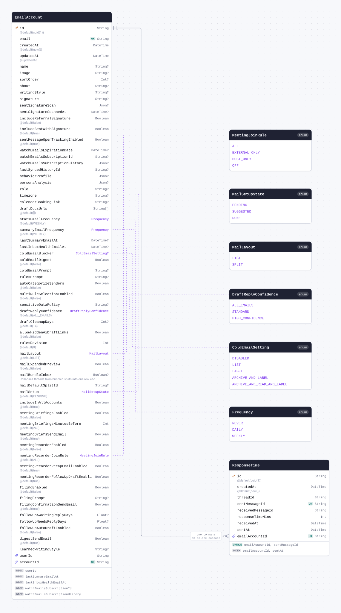

| Field               | Type       | Constraints                                       | Default   | Description |
| ------------------- | ---------- | ------------------------------------------------- | --------- | ----------- |
| `id`                | `String`   | PK NOT NULL                                       | `cuid(1)` |             |
| `createdAt`         | `DateTime` | NOT NULL                                          | `now()`   |             |
| `threadId`          | `String`   | NOT NULL                                          |           |             |
| `sentMessageId`     | `String`   | NOT NULL                                          |           |             |
| `receivedMessageId` | `String`   | NOT NULL                                          |           |             |
| `responseTimeMins`  | `Int`      | NOT NULL                                          |           |             |
| `receivedAt`        | `DateTime` | NOT NULL                                          |           |             |
| `sentAt`            | `DateTime` | NOT NULL                                          |           |             |
| `emailAccountId`    | `String`   | NOT NULL → [EmailAccount.id](#model-EmailAccount) |           |             |

#### Indexes

- `@@index([emailAccountId, sentAt])`
- `@@unique([emailAccountId, sentMessageId])`

#### References

- `emailAccountId` → [EmailAccount.id](#model-EmailAccount) (many-to-one, on delete Cascade)

#### Definition

```sql
CREATE TABLE "ResponseTime" (
    "id" TEXT NOT NULL,
    "createdAt" TIMESTAMP(3) NOT NULL DEFAULT CURRENT_TIMESTAMP,
    "threadId" TEXT NOT NULL,
    "sentMessageId" TEXT NOT NULL,
    "receivedMessageId" TEXT NOT NULL,
    "responseTimeMins" INTEGER NOT NULL,
    "receivedAt" TIMESTAMP(3) NOT NULL,
    "sentAt" TIMESTAMP(3) NOT NULL,
    "emailAccountId" TEXT NOT NULL,

    CONSTRAINT "ResponseTime_pkey" PRIMARY KEY ("id")
);

CREATE INDEX "ResponseTime_emailAccountId_sentAt_idx" ON "ResponseTime"("emailAccountId", "sentAt");

CREATE UNIQUE INDEX "ResponseTime_emailAccountId_sentMessageId_key" ON "ResponseTime"("emailAccountId", "sentMessageId");

ALTER TABLE "ResponseTime" ADD CONSTRAINT "ResponseTime_emailAccountId_fkey" FOREIGN KEY ("emailAccountId") REFERENCES "EmailAccount"("id") ON DELETE CASCADE ON UPDATE CASCADE;
```

<details>
<summary>Queries and their SQL</summary>

**findMany**: Every row

```ts
await prisma.responseTime.findMany();
```

```sql
SELECT
  "public"."ResponseTime"."id",
  "public"."ResponseTime"."createdAt",
  "public"."ResponseTime"."threadId",
  "public"."ResponseTime"."sentMessageId",
  "public"."ResponseTime"."receivedMessageId",
  "public"."ResponseTime"."responseTimeMins",
  "public"."ResponseTime"."receivedAt",
  "public"."ResponseTime"."sentAt",
  "public"."ResponseTime"."emailAccountId"
FROM
  "public"."ResponseTime"
WHERE
  1 = 1
OFFSET
  $1
-- params: ["0"]
```

**count**: How many rows there are

```ts
await prisma.responseTime.count();
```

```sql
SELECT
  COUNT(*) AS "_count$_all"
FROM
  (
    SELECT
      "public"."ResponseTime"."id"
    FROM
      "public"."ResponseTime"
    WHERE
      1 = 1
    OFFSET
      $1
  ) AS "sub"
-- params: ["0"]
```

**findMany**: Every row with its relations

```ts
await prisma.responseTime.findMany({ include: { emailAccount: true } });
```

```sql
SELECT
  "public"."ResponseTime"."id",
  "public"."ResponseTime"."createdAt",
  "public"."ResponseTime"."threadId",
  "public"."ResponseTime"."sentMessageId",
  "public"."ResponseTime"."receivedMessageId",
  "public"."ResponseTime"."responseTimeMins",
  "public"."ResponseTime"."receivedAt",
  "public"."ResponseTime"."sentAt",
  "public"."ResponseTime"."emailAccountId"
FROM
  "public"."ResponseTime"
WHERE
  1 = 1
OFFSET
  $1
-- params: ["0"]

SELECT
  "public"."EmailAccount"."id",
  "public"."EmailAccount"."email",
  "public"."EmailAccount"."createdAt",
  "public"."EmailAccount"."updatedAt",
  "public"."EmailAccount"."name",
  "public"."EmailAccount"."image",
  "public"."EmailAccount"."sortOrder",
  "public"."EmailAccount"."about",
  "public"."EmailAccount"."writingStyle",
  "public"."EmailAccount"."signature",
  "public"."EmailAccount"."sentSignatureScan",
  "public"."EmailAccount"."sentSignatureScannedAt",
  "public"."EmailAccount"."includeReferralSignature",
  "public"."EmailAccount"."includeSentWithSignature",
  "public"."EmailAccount"."sentMessageOpenTrackingEnabled",
  "public"."EmailAccount"."watchEmailsExpirationDate",
  "public"."EmailAccount"."watchEmailsSubscriptionId",
  "public"."EmailAccount"."watchEmailsSubscriptionHistory",
  "public"."EmailAccount"."lastSyncedHistoryId",
  "public"."EmailAccount"."behaviorProfile",
  "public"."EmailAccount"."personaAnalysis",
  "public"."EmailAccount"."role",
  "public"."EmailAccount"."timezone",
  "public"."EmailAccount"."calendarBookingLink",
  "public"."EmailAccount"."draftDocsUrls",
  "public"."EmailAccount"."statsEmailFrequency"::text,
  "public"."EmailAccount"."summaryEmailFrequency"::text,
  "public"."EmailAccount"."lastSummaryEmailAt",
  "public"."EmailAccount"."lastInboxHealthEmailAt",
  "public"."EmailAccount"."coldEmailBlocker"::text,
  "public"."EmailAccount"."coldEmailDigest",
  "public"."EmailAccount"."coldEmailPrompt",
  "public"."EmailAccount"."rulesPrompt",
  "public"."EmailAccount"."autoCategorizeSenders",
  "public"."EmailAccount"."multiRuleSelectionEnabled",
  "public"."EmailAccount"."sensitiveDataPolicy",
  "public"."EmailAccount"."draftReplyConfidence"::text,
  "public"."EmailAccount"."draftCleanupDays",
  "public"."EmailAccount"."allowHiddenAiDraftLinks",
  "public"."EmailAccount"."rulesRevision",
  "public"."EmailAccount"."mailLayout"::text,
  "public"."EmailAccount"."mailExpandedPreview",
  "public"."EmailAccount"."mailBundleInbox",
  "public"."EmailAccount"."mailDefaultSplitId",
  "public"."EmailAccount"."mailSetup"::text,
  "public"."EmailAccount"."includeInAllAccounts",
  "public"."EmailAccount"."meetingBriefingsEnabled",
  "public"."EmailAccount"."meetingBriefingsMinutesBefore",
  "public"."EmailAccount"."meetingBriefsSendEmail",
  "public"."EmailAccount"."meetingRecorderEnabled",
  "public"."EmailAccount"."meetingRecorderJoinRule"::text,
  "public"."EmailAccount"."meetingRecorderRecapEmailEnabled",
  "public"."EmailAccount"."meetingRecorderFollowUpDraftEnabled",
  "public"."EmailAccount"."filingEnabled",
  "public"."EmailAccount"."filingPrompt",
  "public"."EmailAccount"."filingConfirmationSendEmail",
  "public"."EmailAccount"."followUpAwaitingReplyDays",
  "public"."EmailAccount"."followUpNeedsReplyDays",
  "public"."EmailAccount"."followUpAutoDraftEnabled",
  "public"."EmailAccount"."digestSendEmail",
  "public"."EmailAccount"."learnedWritingStyle",
  "public"."EmailAccount"."userId",
  "public"."EmailAccount"."accountId"
FROM
  "public"."EmailAccount"
WHERE
  "public"."EmailAccount"."id" IN ($1)
OFFSET
  $2
-- params: ["<emailAccountId of the rows above>","0"]
```

**findUnique**: One row by what is unique to it

```ts
await prisma.responseTime.findUnique({ where: { id: "example" } });
```

```sql
SELECT
  "public"."ResponseTime"."id",
  "public"."ResponseTime"."createdAt",
  "public"."ResponseTime"."threadId",
  "public"."ResponseTime"."sentMessageId",
  "public"."ResponseTime"."receivedMessageId",
  "public"."ResponseTime"."responseTimeMins",
  "public"."ResponseTime"."receivedAt",
  "public"."ResponseTime"."sentAt",
  "public"."ResponseTime"."emailAccountId"
FROM
  "public"."ResponseTime"
WHERE
  (
    "public"."ResponseTime"."id" = $1
    AND 1 = 1
  )
LIMIT
  $2
OFFSET
  $3
-- params: ["example","1","0"]
```

**create**: Create a row

```ts
await prisma.responseTime.create({
  data: {
    threadId: "example",
    sentMessageId: "example",
    receivedMessageId: "example",
    responseTimeMins: 1,
    receivedAt: new Date("2026-01-01T00:00:00.000Z"),
    sentAt: new Date("2026-01-01T00:00:00.000Z"),
    emailAccountId: "example",
  },
});
```

```sql
INSERT INTO
  "public"."ResponseTime" (
    "id",
    "createdAt",
    "threadId",
    "sentMessageId",
    "receivedMessageId",
    "responseTimeMins",
    "receivedAt",
    "sentAt",
    "emailAccountId"
  )
VALUES
  ($1, $2, $3, $4, $5, $6, $7, $8, $9)
RETURNING
  "public"."ResponseTime"."id",
  "public"."ResponseTime"."createdAt",
  "public"."ResponseTime"."threadId",
  "public"."ResponseTime"."sentMessageId",
  "public"."ResponseTime"."receivedMessageId",
  "public"."ResponseTime"."responseTimeMins",
  "public"."ResponseTime"."receivedAt",
  "public"."ResponseTime"."sentAt",
  "public"."ResponseTime"."emailAccountId"
-- params: ["<cuid(1)>","<now()>","example","example","example","1","2026-01-01T00:00:00.000Z","2026-01-01T00:00:00.000Z","example"]
```

**update**: Update a row

```ts
await prisma.responseTime.update({
  where: { id: "example" },
  data: { createdAt: new Date("2026-01-01T00:00:00.000Z") },
});
```

```sql
UPDATE "public"."ResponseTime"
SET
  "createdAt" = $1
WHERE
  (
    "public"."ResponseTime"."id" = $2
    AND 1 = 1
  )
RETURNING
  "public"."ResponseTime"."id",
  "public"."ResponseTime"."createdAt",
  "public"."ResponseTime"."threadId",
  "public"."ResponseTime"."sentMessageId",
  "public"."ResponseTime"."receivedMessageId",
  "public"."ResponseTime"."responseTimeMins",
  "public"."ResponseTime"."receivedAt",
  "public"."ResponseTime"."sentAt",
  "public"."ResponseTime"."emailAccountId"
-- params: ["2026-01-01T00:00:00.000Z","example"]
```

**delete**: Delete a row

```ts
await prisma.responseTime.delete({ where: { id: "example" } });
```

```sql
DELETE FROM "public"."ResponseTime"
WHERE
  (
    "public"."ResponseTime"."id" = $1
    AND 1 = 1
  )
RETURNING
  "public"."ResponseTime"."id",
  "public"."ResponseTime"."createdAt",
  "public"."ResponseTime"."threadId",
  "public"."ResponseTime"."sentMessageId",
  "public"."ResponseTime"."receivedMessageId",
  "public"."ResponseTime"."responseTimeMins",
  "public"."ResponseTime"."receivedAt",
  "public"."ResponseTime"."sentAt",
  "public"."ResponseTime"."emailAccountId"
-- params: ["example"]
```

</details>

<a id="model-ThreadTracker"></a>

### ThreadTracker

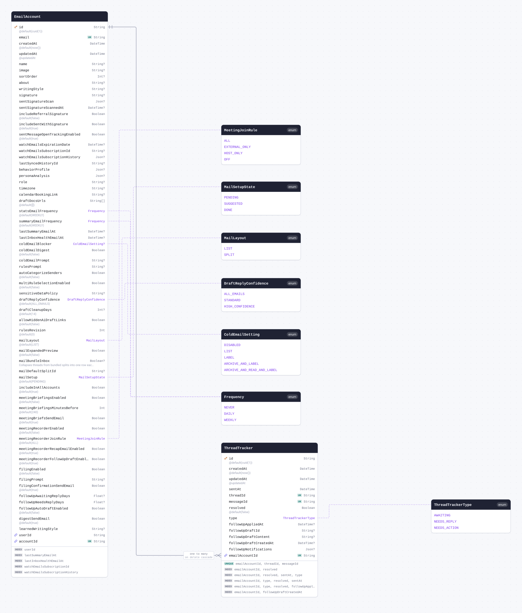

| Field                    | Type                                           | Constraints                                       | Default      | Description |
| ------------------------ | ---------------------------------------------- | ------------------------------------------------- | ------------ | ----------- |
| `id`                     | `String`                                       | PK NOT NULL                                       | `cuid(1)`    |             |
| `createdAt`              | `DateTime`                                     | NOT NULL                                          | `now()`      |             |
| `updatedAt`              | `DateTime`                                     | NOT NULL                                          | `@updatedAt` |             |
| `sentAt`                 | `DateTime`                                     | NOT NULL                                          |              |             |
| `threadId`               | `String`                                       | NOT NULL                                          |              |             |
| `messageId`              | `String`                                       | NOT NULL                                          |              |             |
| `resolved`               | `Boolean`                                      | NOT NULL                                          | `false`      |             |
| `type`                   | [`ThreadTrackerType`](#enum-ThreadTrackerType) | NOT NULL                                          |              |             |
| `followUpAppliedAt`      | `DateTime`                                     | NULL                                              |              |             |
| `followUpDraftId`        | `String`                                       | NULL                                              |              |             |
| `followUpDraftContent`   | `String`                                       | NULL                                              |              |             |
| `followUpDraftCreatedAt` | `DateTime`                                     | NULL                                              |              |             |
| `followUpNotifications`  | `Json`                                         | NULL                                              |              |             |
| `emailAccountId`         | `String`                                       | NOT NULL → [EmailAccount.id](#model-EmailAccount) |              |             |

#### Indexes

- `@@index([emailAccountId, resolved])`
- `@@index([emailAccountId, resolved, sentAt, type])`
- `@@index([emailAccountId, type, resolved, sentAt])`
- `@@index([emailAccountId, type, resolved, followUpAppliedAt, sentAt])`
- `@@index([emailAccountId, followUpDraftCreatedAt], map: "ThreadTracker_followUpDraft_cleanup_idx")`
- `@@unique([emailAccountId, threadId, messageId])`

#### References

- `emailAccountId` → [EmailAccount.id](#model-EmailAccount) (many-to-one, on delete Cascade)

#### Definition

```sql
CREATE TABLE "ThreadTracker" (
    "id" TEXT NOT NULL,
    "createdAt" TIMESTAMP(3) NOT NULL DEFAULT CURRENT_TIMESTAMP,
    "updatedAt" TIMESTAMP(3) NOT NULL,
    "sentAt" TIMESTAMP(3) NOT NULL,
    "threadId" TEXT NOT NULL,
    "messageId" TEXT NOT NULL,
    "resolved" BOOLEAN NOT NULL DEFAULT false,
    "type" "ThreadTrackerType" NOT NULL,
    "followUpAppliedAt" TIMESTAMP(3),
    "followUpDraftId" TEXT,
    "followUpDraftContent" TEXT,
    "followUpDraftCreatedAt" TIMESTAMP(3),
    "followUpNotifications" JSONB,
    "emailAccountId" TEXT NOT NULL,

    CONSTRAINT "ThreadTracker_pkey" PRIMARY KEY ("id")
);

CREATE INDEX "ThreadTracker_emailAccountId_resolved_idx" ON "ThreadTracker"("emailAccountId", "resolved");

CREATE INDEX "ThreadTracker_emailAccountId_resolved_sentAt_type_idx" ON "ThreadTracker"("emailAccountId", "resolved", "sentAt", "type");

CREATE INDEX "ThreadTracker_emailAccountId_type_resolved_sentAt_idx" ON "ThreadTracker"("emailAccountId", "type", "resolved", "sentAt");

CREATE INDEX "ThreadTracker_emailAccountId_type_resolved_followUpAppliedA_idx" ON "ThreadTracker"("emailAccountId", "type", "resolved", "followUpAppliedAt", "sentAt");

CREATE INDEX "ThreadTracker_followUpDraft_cleanup_idx" ON "ThreadTracker"("emailAccountId", "followUpDraftCreatedAt") WHERE ("followUpDraftContent" IS NOT NULL);

CREATE UNIQUE INDEX "ThreadTracker_emailAccountId_threadId_messageId_key" ON "ThreadTracker"("emailAccountId", "threadId", "messageId");

ALTER TABLE "ThreadTracker" ADD CONSTRAINT "ThreadTracker_emailAccountId_fkey" FOREIGN KEY ("emailAccountId") REFERENCES "EmailAccount"("id") ON DELETE CASCADE ON UPDATE CASCADE;
```

<details>
<summary>Queries and their SQL</summary>

**findMany**: Every row

```ts
await prisma.threadTracker.findMany();
```

```sql
SELECT
  "public"."ThreadTracker"."id",
  "public"."ThreadTracker"."createdAt",
  "public"."ThreadTracker"."updatedAt",
  "public"."ThreadTracker"."sentAt",
  "public"."ThreadTracker"."threadId",
  "public"."ThreadTracker"."messageId",
  "public"."ThreadTracker"."resolved",
  "public"."ThreadTracker"."type"::text,
  "public"."ThreadTracker"."followUpAppliedAt",
  "public"."ThreadTracker"."followUpDraftId",
  "public"."ThreadTracker"."followUpDraftContent",
  "public"."ThreadTracker"."followUpDraftCreatedAt",
  "public"."ThreadTracker"."followUpNotifications",
  "public"."ThreadTracker"."emailAccountId"
FROM
  "public"."ThreadTracker"
WHERE
  1 = 1
OFFSET
  $1
-- params: ["0"]
```

**count**: How many rows there are

```ts
await prisma.threadTracker.count();
```

```sql
SELECT
  COUNT(*) AS "_count$_all"
FROM
  (
    SELECT
      "public"."ThreadTracker"."id"
    FROM
      "public"."ThreadTracker"
    WHERE
      1 = 1
    OFFSET
      $1
  ) AS "sub"
-- params: ["0"]
```

**findMany**: Every row with its relations

```ts
await prisma.threadTracker.findMany({ include: { emailAccount: true } });
```

```sql
SELECT
  "public"."ThreadTracker"."id",
  "public"."ThreadTracker"."createdAt",
  "public"."ThreadTracker"."updatedAt",
  "public"."ThreadTracker"."sentAt",
  "public"."ThreadTracker"."threadId",
  "public"."ThreadTracker"."messageId",
  "public"."ThreadTracker"."resolved",
  "public"."ThreadTracker"."type"::text,
  "public"."ThreadTracker"."followUpAppliedAt",
  "public"."ThreadTracker"."followUpDraftId",
  "public"."ThreadTracker"."followUpDraftContent",
  "public"."ThreadTracker"."followUpDraftCreatedAt",
  "public"."ThreadTracker"."followUpNotifications",
  "public"."ThreadTracker"."emailAccountId"
FROM
  "public"."ThreadTracker"
WHERE
  1 = 1
OFFSET
  $1
-- params: ["0"]

SELECT
  "public"."EmailAccount"."id",
  "public"."EmailAccount"."email",
  "public"."EmailAccount"."createdAt",
  "public"."EmailAccount"."updatedAt",
  "public"."EmailAccount"."name",
  "public"."EmailAccount"."image",
  "public"."EmailAccount"."sortOrder",
  "public"."EmailAccount"."about",
  "public"."EmailAccount"."writingStyle",
  "public"."EmailAccount"."signature",
  "public"."EmailAccount"."sentSignatureScan",
  "public"."EmailAccount"."sentSignatureScannedAt",
  "public"."EmailAccount"."includeReferralSignature",
  "public"."EmailAccount"."includeSentWithSignature",
  "public"."EmailAccount"."sentMessageOpenTrackingEnabled",
  "public"."EmailAccount"."watchEmailsExpirationDate",
  "public"."EmailAccount"."watchEmailsSubscriptionId",
  "public"."EmailAccount"."watchEmailsSubscriptionHistory",
  "public"."EmailAccount"."lastSyncedHistoryId",
  "public"."EmailAccount"."behaviorProfile",
  "public"."EmailAccount"."personaAnalysis",
  "public"."EmailAccount"."role",
  "public"."EmailAccount"."timezone",
  "public"."EmailAccount"."calendarBookingLink",
  "public"."EmailAccount"."draftDocsUrls",
  "public"."EmailAccount"."statsEmailFrequency"::text,
  "public"."EmailAccount"."summaryEmailFrequency"::text,
  "public"."EmailAccount"."lastSummaryEmailAt",
  "public"."EmailAccount"."lastInboxHealthEmailAt",
  "public"."EmailAccount"."coldEmailBlocker"::text,
  "public"."EmailAccount"."coldEmailDigest",
  "public"."EmailAccount"."coldEmailPrompt",
  "public"."EmailAccount"."rulesPrompt",
  "public"."EmailAccount"."autoCategorizeSenders",
  "public"."EmailAccount"."multiRuleSelectionEnabled",
  "public"."EmailAccount"."sensitiveDataPolicy",
  "public"."EmailAccount"."draftReplyConfidence"::text,
  "public"."EmailAccount"."draftCleanupDays",
  "public"."EmailAccount"."allowHiddenAiDraftLinks",
  "public"."EmailAccount"."rulesRevision",
  "public"."EmailAccount"."mailLayout"::text,
  "public"."EmailAccount"."mailExpandedPreview",
  "public"."EmailAccount"."mailBundleInbox",
  "public"."EmailAccount"."mailDefaultSplitId",
  "public"."EmailAccount"."mailSetup"::text,
  "public"."EmailAccount"."includeInAllAccounts",
  "public"."EmailAccount"."meetingBriefingsEnabled",
  "public"."EmailAccount"."meetingBriefingsMinutesBefore",
  "public"."EmailAccount"."meetingBriefsSendEmail",
  "public"."EmailAccount"."meetingRecorderEnabled",
  "public"."EmailAccount"."meetingRecorderJoinRule"::text,
  "public"."EmailAccount"."meetingRecorderRecapEmailEnabled",
  "public"."EmailAccount"."meetingRecorderFollowUpDraftEnabled",
  "public"."EmailAccount"."filingEnabled",
  "public"."EmailAccount"."filingPrompt",
  "public"."EmailAccount"."filingConfirmationSendEmail",
  "public"."EmailAccount"."followUpAwaitingReplyDays",
  "public"."EmailAccount"."followUpNeedsReplyDays",
  "public"."EmailAccount"."followUpAutoDraftEnabled",
  "public"."EmailAccount"."digestSendEmail",
  "public"."EmailAccount"."learnedWritingStyle",
  "public"."EmailAccount"."userId",
  "public"."EmailAccount"."accountId"
FROM
  "public"."EmailAccount"
WHERE
  "public"."EmailAccount"."id" IN ($1)
OFFSET
  $2
-- params: ["<emailAccountId of the rows above>","0"]
```

**findUnique**: One row by what is unique to it

```ts
await prisma.threadTracker.findUnique({ where: { id: "example" } });
```

```sql
SELECT
  "public"."ThreadTracker"."id",
  "public"."ThreadTracker"."createdAt",
  "public"."ThreadTracker"."updatedAt",
  "public"."ThreadTracker"."sentAt",
  "public"."ThreadTracker"."threadId",
  "public"."ThreadTracker"."messageId",
  "public"."ThreadTracker"."resolved",
  "public"."ThreadTracker"."type"::text,
  "public"."ThreadTracker"."followUpAppliedAt",
  "public"."ThreadTracker"."followUpDraftId",
  "public"."ThreadTracker"."followUpDraftContent",
  "public"."ThreadTracker"."followUpDraftCreatedAt",
  "public"."ThreadTracker"."followUpNotifications",
  "public"."ThreadTracker"."emailAccountId"
FROM
  "public"."ThreadTracker"
WHERE
  (
    "public"."ThreadTracker"."id" = $1
    AND 1 = 1
  )
LIMIT
  $2
OFFSET
  $3
-- params: ["example","1","0"]
```

**create**: Create a row

```ts
await prisma.threadTracker.create({
  data: {
    sentAt: new Date("2026-01-01T00:00:00.000Z"),
    threadId: "example",
    messageId: "example",
    type: "AWAITING",
    emailAccountId: "example",
  },
});
```

```sql
INSERT INTO
  "public"."ThreadTracker" (
    "id",
    "createdAt",
    "updatedAt",
    "sentAt",
    "threadId",
    "messageId",
    "resolved",
    "type",
    "emailAccountId"
  )
VALUES
  (
    $1,
    $2,
    $3,
    $4,
    $5,
    $6,
    $7,
    CAST($8::text AS "public"."ThreadTrackerType"),
    $9
  )
RETURNING
  "public"."ThreadTracker"."id",
  "public"."ThreadTracker"."createdAt",
  "public"."ThreadTracker"."updatedAt",
  "public"."ThreadTracker"."sentAt",
  "public"."ThreadTracker"."threadId",
  "public"."ThreadTracker"."messageId",
  "public"."ThreadTracker"."resolved",
  "public"."ThreadTracker"."type"::text,
  "public"."ThreadTracker"."followUpAppliedAt",
  "public"."ThreadTracker"."followUpDraftId",
  "public"."ThreadTracker"."followUpDraftContent",
  "public"."ThreadTracker"."followUpDraftCreatedAt",
  "public"."ThreadTracker"."followUpNotifications",
  "public"."ThreadTracker"."emailAccountId"
-- params: ["<cuid(1)>","<now()>","<now()>","2026-01-01T00:00:00.000Z","example","example",false,"AWAITING","example"]
```

**update**: Update a row

```ts
await prisma.threadTracker.update({
  where: { id: "example" },
  data: { createdAt: new Date("2026-01-01T00:00:00.000Z") },
});
```

```sql
UPDATE "public"."ThreadTracker"
SET
  "createdAt" = $1,
  "updatedAt" = $2
WHERE
  (
    "public"."ThreadTracker"."id" = $3
    AND 1 = 1
  )
RETURNING
  "public"."ThreadTracker"."id",
  "public"."ThreadTracker"."createdAt",
  "public"."ThreadTracker"."updatedAt",
  "public"."ThreadTracker"."sentAt",
  "public"."ThreadTracker"."threadId",
  "public"."ThreadTracker"."messageId",
  "public"."ThreadTracker"."resolved",
  "public"."ThreadTracker"."type"::text,
  "public"."ThreadTracker"."followUpAppliedAt",
  "public"."ThreadTracker"."followUpDraftId",
  "public"."ThreadTracker"."followUpDraftContent",
  "public"."ThreadTracker"."followUpDraftCreatedAt",
  "public"."ThreadTracker"."followUpNotifications",
  "public"."ThreadTracker"."emailAccountId"
-- params: ["2026-01-01T00:00:00.000Z",{"prisma__type":"generatorCall","prisma__value":{"name":"now","args":[],"returnType":{"type":"DateTime"}}},"example"]
```

**delete**: Delete a row

```ts
await prisma.threadTracker.delete({ where: { id: "example" } });
```

```sql
DELETE FROM "public"."ThreadTracker"
WHERE
  (
    "public"."ThreadTracker"."id" = $1
    AND 1 = 1
  )
RETURNING
  "public"."ThreadTracker"."id",
  "public"."ThreadTracker"."createdAt",
  "public"."ThreadTracker"."updatedAt",
  "public"."ThreadTracker"."sentAt",
  "public"."ThreadTracker"."threadId",
  "public"."ThreadTracker"."messageId",
  "public"."ThreadTracker"."resolved",
  "public"."ThreadTracker"."type"::text,
  "public"."ThreadTracker"."followUpAppliedAt",
  "public"."ThreadTracker"."followUpDraftId",
  "public"."ThreadTracker"."followUpDraftContent",
  "public"."ThreadTracker"."followUpDraftCreatedAt",
  "public"."ThreadTracker"."followUpNotifications",
  "public"."ThreadTracker"."emailAccountId"
-- params: ["example"]
```

</details>

<a id="model-CleanupJob"></a>

### CleanupJob

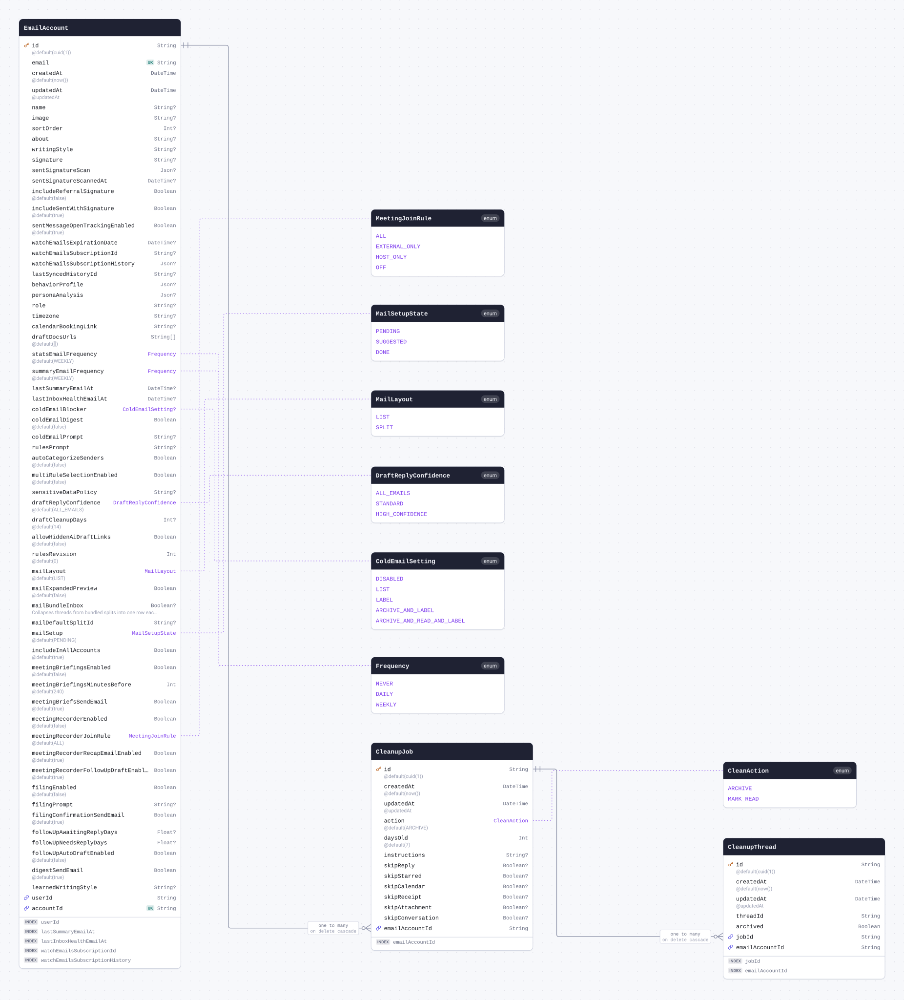

| Field              | Type                               | Constraints                                       | Default      | Description |
| ------------------ | ---------------------------------- | ------------------------------------------------- | ------------ | ----------- |
| `id`               | `String`                           | PK NOT NULL                                       | `cuid(1)`    |             |
| `createdAt`        | `DateTime`                         | NOT NULL                                          | `now()`      |             |
| `updatedAt`        | `DateTime`                         | NOT NULL                                          | `@updatedAt` |             |
| `action`           | [`CleanAction`](#enum-CleanAction) | NOT NULL                                          | `ARCHIVE`    |             |
| `daysOld`          | `Int`                              | NOT NULL                                          | `7`          |             |
| `instructions`     | `String`                           | NULL                                              |              |             |
| `skipReply`        | `Boolean`                          | NULL                                              |              |             |
| `skipStarred`      | `Boolean`                          | NULL                                              |              |             |
| `skipCalendar`     | `Boolean`                          | NULL                                              |              |             |
| `skipReceipt`      | `Boolean`                          | NULL                                              |              |             |
| `skipAttachment`   | `Boolean`                          | NULL                                              |              |             |
| `skipConversation` | `Boolean`                          | NULL                                              |              |             |
| `emailAccountId`   | `String`                           | NOT NULL → [EmailAccount.id](#model-EmailAccount) |              |             |

#### Indexes

- `@@index([emailAccountId])`

#### References

- `emailAccountId` → [EmailAccount.id](#model-EmailAccount) (many-to-one, on delete Cascade)

#### Referenced by

- `id` ← [CleanupThread.jobId](#model-CleanupThread) (one-to-many, on delete Cascade)

#### Definition

```sql
CREATE TABLE "CleanupJob" (
    "id" TEXT NOT NULL,
    "createdAt" TIMESTAMP(3) NOT NULL DEFAULT CURRENT_TIMESTAMP,
    "updatedAt" TIMESTAMP(3) NOT NULL,
    "action" "CleanAction" NOT NULL DEFAULT 'ARCHIVE',
    "daysOld" INTEGER NOT NULL DEFAULT 7,
    "instructions" TEXT,
    "skipReply" BOOLEAN,
    "skipStarred" BOOLEAN,
    "skipCalendar" BOOLEAN,
    "skipReceipt" BOOLEAN,
    "skipAttachment" BOOLEAN,
    "skipConversation" BOOLEAN,
    "emailAccountId" TEXT NOT NULL,

    CONSTRAINT "CleanupJob_pkey" PRIMARY KEY ("id")
);

CREATE INDEX "CleanupJob_emailAccountId_idx" ON "CleanupJob"("emailAccountId");

ALTER TABLE "CleanupJob" ADD CONSTRAINT "CleanupJob_emailAccountId_fkey" FOREIGN KEY ("emailAccountId") REFERENCES "EmailAccount"("id") ON DELETE CASCADE ON UPDATE CASCADE;
```

<details>
<summary>Queries and their SQL</summary>

**findMany**: Every row

```ts
await prisma.cleanupJob.findMany();
```

```sql
SELECT
  "public"."CleanupJob"."id",
  "public"."CleanupJob"."createdAt",
  "public"."CleanupJob"."updatedAt",
  "public"."CleanupJob"."action"::text,
  "public"."CleanupJob"."daysOld",
  "public"."CleanupJob"."instructions",
  "public"."CleanupJob"."skipReply",
  "public"."CleanupJob"."skipStarred",
  "public"."CleanupJob"."skipCalendar",
  "public"."CleanupJob"."skipReceipt",
  "public"."CleanupJob"."skipAttachment",
  "public"."CleanupJob"."skipConversation",
  "public"."CleanupJob"."emailAccountId"
FROM
  "public"."CleanupJob"
WHERE
  1 = 1
OFFSET
  $1
-- params: ["0"]
```

**count**: How many rows there are

```ts
await prisma.cleanupJob.count();
```

```sql
SELECT
  COUNT(*) AS "_count$_all"
FROM
  (
    SELECT
      "public"."CleanupJob"."id"
    FROM
      "public"."CleanupJob"
    WHERE
      1 = 1
    OFFSET
      $1
  ) AS "sub"
-- params: ["0"]
```

**findMany**: Every row with its relations

```ts
await prisma.cleanupJob.findMany({ include: { emailAccount: true, threads: true } });
```

```sql
SELECT
  "public"."CleanupJob"."id",
  "public"."CleanupJob"."createdAt",
  "public"."CleanupJob"."updatedAt",
  "public"."CleanupJob"."action"::text,
  "public"."CleanupJob"."daysOld",
  "public"."CleanupJob"."instructions",
  "public"."CleanupJob"."skipReply",
  "public"."CleanupJob"."skipStarred",
  "public"."CleanupJob"."skipCalendar",
  "public"."CleanupJob"."skipReceipt",
  "public"."CleanupJob"."skipAttachment",
  "public"."CleanupJob"."skipConversation",
  "public"."CleanupJob"."emailAccountId"
FROM
  "public"."CleanupJob"
WHERE
  1 = 1
OFFSET
  $1
-- params: ["0"]

SELECT
  "public"."EmailAccount"."id",
  "public"."EmailAccount"."email",
  "public"."EmailAccount"."createdAt",
  "public"."EmailAccount"."updatedAt",
  "public"."EmailAccount"."name",
  "public"."EmailAccount"."image",
  "public"."EmailAccount"."sortOrder",
  "public"."EmailAccount"."about",
  "public"."EmailAccount"."writingStyle",
  "public"."EmailAccount"."signature",
  "public"."EmailAccount"."sentSignatureScan",
  "public"."EmailAccount"."sentSignatureScannedAt",
  "public"."EmailAccount"."includeReferralSignature",
  "public"."EmailAccount"."includeSentWithSignature",
  "public"."EmailAccount"."sentMessageOpenTrackingEnabled",
  "public"."EmailAccount"."watchEmailsExpirationDate",
  "public"."EmailAccount"."watchEmailsSubscriptionId",
  "public"."EmailAccount"."watchEmailsSubscriptionHistory",
  "public"."EmailAccount"."lastSyncedHistoryId",
  "public"."EmailAccount"."behaviorProfile",
  "public"."EmailAccount"."personaAnalysis",
  "public"."EmailAccount"."role",
  "public"."EmailAccount"."timezone",
  "public"."EmailAccount"."calendarBookingLink",
  "public"."EmailAccount"."draftDocsUrls",
  "public"."EmailAccount"."statsEmailFrequency"::text,
  "public"."EmailAccount"."summaryEmailFrequency"::text,
  "public"."EmailAccount"."lastSummaryEmailAt",
  "public"."EmailAccount"."lastInboxHealthEmailAt",
  "public"."EmailAccount"."coldEmailBlocker"::text,
  "public"."EmailAccount"."coldEmailDigest",
  "public"."EmailAccount"."coldEmailPrompt",
  "public"."EmailAccount"."rulesPrompt",
  "public"."EmailAccount"."autoCategorizeSenders",
  "public"."EmailAccount"."multiRuleSelectionEnabled",
  "public"."EmailAccount"."sensitiveDataPolicy",
  "public"."EmailAccount"."draftReplyConfidence"::text,
  "public"."EmailAccount"."draftCleanupDays",
  "public"."EmailAccount"."allowHiddenAiDraftLinks",
  "public"."EmailAccount"."rulesRevision",
  "public"."EmailAccount"."mailLayout"::text,
  "public"."EmailAccount"."mailExpandedPreview",
  "public"."EmailAccount"."mailBundleInbox",
  "public"."EmailAccount"."mailDefaultSplitId",
  "public"."EmailAccount"."mailSetup"::text,
  "public"."EmailAccount"."includeInAllAccounts",
  "public"."EmailAccount"."meetingBriefingsEnabled",
  "public"."EmailAccount"."meetingBriefingsMinutesBefore",
  "public"."EmailAccount"."meetingBriefsSendEmail",
  "public"."EmailAccount"."meetingRecorderEnabled",
  "public"."EmailAccount"."meetingRecorderJoinRule"::text,
  "public"."EmailAccount"."meetingRecorderRecapEmailEnabled",
  "public"."EmailAccount"."meetingRecorderFollowUpDraftEnabled",
  "public"."EmailAccount"."filingEnabled",
  "public"."EmailAccount"."filingPrompt",
  "public"."EmailAccount"."filingConfirmationSendEmail",
  "public"."EmailAccount"."followUpAwaitingReplyDays",
  "public"."EmailAccount"."followUpNeedsReplyDays",
  "public"."EmailAccount"."followUpAutoDraftEnabled",
  "public"."EmailAccount"."digestSendEmail",
  "public"."EmailAccount"."learnedWritingStyle",
  "public"."EmailAccount"."userId",
  "public"."EmailAccount"."accountId"
FROM
  "public"."EmailAccount"
WHERE
  "public"."EmailAccount"."id" IN ($1)
OFFSET
  $2
-- params: ["<emailAccountId of the rows above>","0"]

SELECT
  "public"."CleanupThread"."id",
  "public"."CleanupThread"."createdAt",
  "public"."CleanupThread"."updatedAt",
  "public"."CleanupThread"."threadId",
  "public"."CleanupThread"."archived",
  "public"."CleanupThread"."jobId",
  "public"."CleanupThread"."emailAccountId"
FROM
  "public"."CleanupThread"
WHERE
  "public"."CleanupThread"."jobId" IN ($1)
OFFSET
  $2
-- params: ["<id of the rows above>","0"]
```

**findUnique**: One row by what is unique to it

```ts
await prisma.cleanupJob.findUnique({ where: { id: "example" } });
```

```sql
SELECT
  "public"."CleanupJob"."id",
  "public"."CleanupJob"."createdAt",
  "public"."CleanupJob"."updatedAt",
  "public"."CleanupJob"."action"::text,
  "public"."CleanupJob"."daysOld",
  "public"."CleanupJob"."instructions",
  "public"."CleanupJob"."skipReply",
  "public"."CleanupJob"."skipStarred",
  "public"."CleanupJob"."skipCalendar",
  "public"."CleanupJob"."skipReceipt",
  "public"."CleanupJob"."skipAttachment",
  "public"."CleanupJob"."skipConversation",
  "public"."CleanupJob"."emailAccountId"
FROM
  "public"."CleanupJob"
WHERE
  (
    "public"."CleanupJob"."id" = $1
    AND 1 = 1
  )
LIMIT
  $2
OFFSET
  $3
-- params: ["example","1","0"]
```

**create**: Create a row

```ts
await prisma.cleanupJob.create({ data: { emailAccountId: "example" } });
```

```sql
INSERT INTO
  "public"."CleanupJob" (
    "id",
    "createdAt",
    "updatedAt",
    "action",
    "daysOld",
    "emailAccountId"
  )
VALUES
  (
    $1,
    $2,
    $3,
    CAST($4::text AS "public"."CleanAction"),
    $5,
    $6
  )
RETURNING
  "public"."CleanupJob"."id",
  "public"."CleanupJob"."createdAt",
  "public"."CleanupJob"."updatedAt",
  "public"."CleanupJob"."action"::text,
  "public"."CleanupJob"."daysOld",
  "public"."CleanupJob"."instructions",
  "public"."CleanupJob"."skipReply",
  "public"."CleanupJob"."skipStarred",
  "public"."CleanupJob"."skipCalendar",
  "public"."CleanupJob"."skipReceipt",
  "public"."CleanupJob"."skipAttachment",
  "public"."CleanupJob"."skipConversation",
  "public"."CleanupJob"."emailAccountId"
-- params: ["<cuid(1)>","<now()>","<now()>","ARCHIVE","7","example"]
```

**update**: Update a row

```ts
await prisma.cleanupJob.update({
  where: { id: "example" },
  data: { createdAt: new Date("2026-01-01T00:00:00.000Z") },
});
```

```sql
UPDATE "public"."CleanupJob"
SET
  "createdAt" = $1,
  "updatedAt" = $2
WHERE
  (
    "public"."CleanupJob"."id" = $3
    AND 1 = 1
  )
RETURNING
  "public"."CleanupJob"."id",
  "public"."CleanupJob"."createdAt",
  "public"."CleanupJob"."updatedAt",
  "public"."CleanupJob"."action"::text,
  "public"."CleanupJob"."daysOld",
  "public"."CleanupJob"."instructions",
  "public"."CleanupJob"."skipReply",
  "public"."CleanupJob"."skipStarred",
  "public"."CleanupJob"."skipCalendar",
  "public"."CleanupJob"."skipReceipt",
  "public"."CleanupJob"."skipAttachment",
  "public"."CleanupJob"."skipConversation",
  "public"."CleanupJob"."emailAccountId"
-- params: ["2026-01-01T00:00:00.000Z",{"prisma__type":"generatorCall","prisma__value":{"name":"now","args":[],"returnType":{"type":"DateTime"}}},"example"]
```

**delete**: Delete a row

```ts
await prisma.cleanupJob.delete({ where: { id: "example" } });
```

```sql
DELETE FROM "public"."CleanupJob"
WHERE
  (
    "public"."CleanupJob"."id" = $1
    AND 1 = 1
  )
RETURNING
  "public"."CleanupJob"."id",
  "public"."CleanupJob"."createdAt",
  "public"."CleanupJob"."updatedAt",
  "public"."CleanupJob"."action"::text,
  "public"."CleanupJob"."daysOld",
  "public"."CleanupJob"."instructions",
  "public"."CleanupJob"."skipReply",
  "public"."CleanupJob"."skipStarred",
  "public"."CleanupJob"."skipCalendar",
  "public"."CleanupJob"."skipReceipt",
  "public"."CleanupJob"."skipAttachment",
  "public"."CleanupJob"."skipConversation",
  "public"."CleanupJob"."emailAccountId"
-- params: ["example"]
```

</details>

<a id="model-CleanupThread"></a>

### CleanupThread

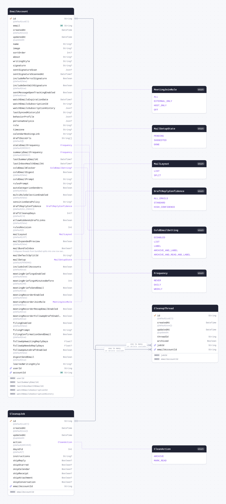

| Field            | Type       | Constraints                                       | Default      | Description |
| ---------------- | ---------- | ------------------------------------------------- | ------------ | ----------- |
| `id`             | `String`   | PK NOT NULL                                       | `cuid(1)`    |             |
| `createdAt`      | `DateTime` | NOT NULL                                          | `now()`      |             |
| `updatedAt`      | `DateTime` | NOT NULL                                          | `@updatedAt` |             |
| `threadId`       | `String`   | NOT NULL                                          |              |             |
| `archived`       | `Boolean`  | NOT NULL                                          |              |             |
| `jobId`          | `String`   | NOT NULL → [CleanupJob.id](#model-CleanupJob)     |              |             |
| `emailAccountId` | `String`   | NOT NULL → [EmailAccount.id](#model-EmailAccount) |              |             |

#### Indexes

- `@@index([jobId])`
- `@@index([emailAccountId])`

#### References

- `jobId` → [CleanupJob.id](#model-CleanupJob) (many-to-one, on delete Cascade)
- `emailAccountId` → [EmailAccount.id](#model-EmailAccount) (many-to-one, on delete Cascade)

#### Definition

```sql
CREATE TABLE "CleanupThread" (
    "id" TEXT NOT NULL,
    "createdAt" TIMESTAMP(3) NOT NULL DEFAULT CURRENT_TIMESTAMP,
    "updatedAt" TIMESTAMP(3) NOT NULL,
    "threadId" TEXT NOT NULL,
    "archived" BOOLEAN NOT NULL,
    "jobId" TEXT NOT NULL,
    "emailAccountId" TEXT NOT NULL,

    CONSTRAINT "CleanupThread_pkey" PRIMARY KEY ("id")
);

CREATE INDEX "CleanupThread_jobId_idx" ON "CleanupThread"("jobId");

CREATE INDEX "CleanupThread_emailAccountId_idx" ON "CleanupThread"("emailAccountId");

ALTER TABLE "CleanupThread" ADD CONSTRAINT "CleanupThread_jobId_fkey" FOREIGN KEY ("jobId") REFERENCES "CleanupJob"("id") ON DELETE CASCADE ON UPDATE CASCADE;

ALTER TABLE "CleanupThread" ADD CONSTRAINT "CleanupThread_emailAccountId_fkey" FOREIGN KEY ("emailAccountId") REFERENCES "EmailAccount"("id") ON DELETE CASCADE ON UPDATE CASCADE;
```

<details>
<summary>Queries and their SQL</summary>

**findMany**: Every row

```ts
await prisma.cleanupThread.findMany();
```

```sql
SELECT
  "public"."CleanupThread"."id",
  "public"."CleanupThread"."createdAt",
  "public"."CleanupThread"."updatedAt",
  "public"."CleanupThread"."threadId",
  "public"."CleanupThread"."archived",
  "public"."CleanupThread"."jobId",
  "public"."CleanupThread"."emailAccountId"
FROM
  "public"."CleanupThread"
WHERE
  1 = 1
OFFSET
  $1
-- params: ["0"]
```

**count**: How many rows there are

```ts
await prisma.cleanupThread.count();
```

```sql
SELECT
  COUNT(*) AS "_count$_all"
FROM
  (
    SELECT
      "public"."CleanupThread"."id"
    FROM
      "public"."CleanupThread"
    WHERE
      1 = 1
    OFFSET
      $1
  ) AS "sub"
-- params: ["0"]
```

**findMany**: Every row with its relations

```ts
await prisma.cleanupThread.findMany({ include: { job: true, emailAccount: true } });
```

```sql
SELECT
  "public"."CleanupThread"."id",
  "public"."CleanupThread"."createdAt",
  "public"."CleanupThread"."updatedAt",
  "public"."CleanupThread"."threadId",
  "public"."CleanupThread"."archived",
  "public"."CleanupThread"."jobId",
  "public"."CleanupThread"."emailAccountId"
FROM
  "public"."CleanupThread"
WHERE
  1 = 1
OFFSET
  $1
-- params: ["0"]

SELECT
  "public"."CleanupJob"."id",
  "public"."CleanupJob"."createdAt",
  "public"."CleanupJob"."updatedAt",
  "public"."CleanupJob"."action"::text,
  "public"."CleanupJob"."daysOld",
  "public"."CleanupJob"."instructions",
  "public"."CleanupJob"."skipReply",
  "public"."CleanupJob"."skipStarred",
  "public"."CleanupJob"."skipCalendar",
  "public"."CleanupJob"."skipReceipt",
  "public"."CleanupJob"."skipAttachment",
  "public"."CleanupJob"."skipConversation",
  "public"."CleanupJob"."emailAccountId"
FROM
  "public"."CleanupJob"
WHERE
  "public"."CleanupJob"."id" IN ($1)
OFFSET
  $2
-- params: ["<jobId of the rows above>","0"]

SELECT
  "public"."EmailAccount"."id",
  "public"."EmailAccount"."email",
  "public"."EmailAccount"."createdAt",
  "public"."EmailAccount"."updatedAt",
  "public"."EmailAccount"."name",
  "public"."EmailAccount"."image",
  "public"."EmailAccount"."sortOrder",
  "public"."EmailAccount"."about",
  "public"."EmailAccount"."writingStyle",
  "public"."EmailAccount"."signature",
  "public"."EmailAccount"."sentSignatureScan",
  "public"."EmailAccount"."sentSignatureScannedAt",
  "public"."EmailAccount"."includeReferralSignature",
  "public"."EmailAccount"."includeSentWithSignature",
  "public"."EmailAccount"."sentMessageOpenTrackingEnabled",
  "public"."EmailAccount"."watchEmailsExpirationDate",
  "public"."EmailAccount"."watchEmailsSubscriptionId",
  "public"."EmailAccount"."watchEmailsSubscriptionHistory",
  "public"."EmailAccount"."lastSyncedHistoryId",
  "public"."EmailAccount"."behaviorProfile",
  "public"."EmailAccount"."personaAnalysis",
  "public"."EmailAccount"."role",
  "public"."EmailAccount"."timezone",
  "public"."EmailAccount"."calendarBookingLink",
  "public"."EmailAccount"."draftDocsUrls",
  "public"."EmailAccount"."statsEmailFrequency"::text,
  "public"."EmailAccount"."summaryEmailFrequency"::text,
  "public"."EmailAccount"."lastSummaryEmailAt",
  "public"."EmailAccount"."lastInboxHealthEmailAt",
  "public"."EmailAccount"."coldEmailBlocker"::text,
  "public"."EmailAccount"."coldEmailDigest",
  "public"."EmailAccount"."coldEmailPrompt",
  "public"."EmailAccount"."rulesPrompt",
  "public"."EmailAccount"."autoCategorizeSenders",
  "public"."EmailAccount"."multiRuleSelectionEnabled",
  "public"."EmailAccount"."sensitiveDataPolicy",
  "public"."EmailAccount"."draftReplyConfidence"::text,
  "public"."EmailAccount"."draftCleanupDays",
  "public"."EmailAccount"."allowHiddenAiDraftLinks",
  "public"."EmailAccount"."rulesRevision",
  "public"."EmailAccount"."mailLayout"::text,
  "public"."EmailAccount"."mailExpandedPreview",
  "public"."EmailAccount"."mailBundleInbox",
  "public"."EmailAccount"."mailDefaultSplitId",
  "public"."EmailAccount"."mailSetup"::text,
  "public"."EmailAccount"."includeInAllAccounts",
  "public"."EmailAccount"."meetingBriefingsEnabled",
  "public"."EmailAccount"."meetingBriefingsMinutesBefore",
  "public"."EmailAccount"."meetingBriefsSendEmail",
  "public"."EmailAccount"."meetingRecorderEnabled",
  "public"."EmailAccount"."meetingRecorderJoinRule"::text,
  "public"."EmailAccount"."meetingRecorderRecapEmailEnabled",
  "public"."EmailAccount"."meetingRecorderFollowUpDraftEnabled",
  "public"."EmailAccount"."filingEnabled",
  "public"."EmailAccount"."filingPrompt",
  "public"."EmailAccount"."filingConfirmationSendEmail",
  "public"."EmailAccount"."followUpAwaitingReplyDays",
  "public"."EmailAccount"."followUpNeedsReplyDays",
  "public"."EmailAccount"."followUpAutoDraftEnabled",
  "public"."EmailAccount"."digestSendEmail",
  "public"."EmailAccount"."learnedWritingStyle",
  "public"."EmailAccount"."userId",
  "public"."EmailAccount"."accountId"
FROM
  "public"."EmailAccount"
WHERE
  "public"."EmailAccount"."id" IN ($1)
OFFSET
  $2
-- params: ["<emailAccountId of the rows above>","0"]
```

**findUnique**: One row by what is unique to it

```ts
await prisma.cleanupThread.findUnique({ where: { id: "example" } });
```

```sql
SELECT
  "public"."CleanupThread"."id",
  "public"."CleanupThread"."createdAt",
  "public"."CleanupThread"."updatedAt",
  "public"."CleanupThread"."threadId",
  "public"."CleanupThread"."archived",
  "public"."CleanupThread"."jobId",
  "public"."CleanupThread"."emailAccountId"
FROM
  "public"."CleanupThread"
WHERE
  (
    "public"."CleanupThread"."id" = $1
    AND 1 = 1
  )
LIMIT
  $2
OFFSET
  $3
-- params: ["example","1","0"]
```

**create**: Create a row

```ts
await prisma.cleanupThread.create({
  data: { threadId: "example", archived: true, jobId: "example", emailAccountId: "example" },
});
```

```sql
INSERT INTO
  "public"."CleanupThread" (
    "id",
    "createdAt",
    "updatedAt",
    "threadId",
    "archived",
    "jobId",
    "emailAccountId"
  )
VALUES
  ($1, $2, $3, $4, $5, $6, $7)
RETURNING
  "public"."CleanupThread"."id",
  "public"."CleanupThread"."createdAt",
  "public"."CleanupThread"."updatedAt",
  "public"."CleanupThread"."threadId",
  "public"."CleanupThread"."archived",
  "public"."CleanupThread"."jobId",
  "public"."CleanupThread"."emailAccountId"
-- params: ["<cuid(1)>","<now()>","<now()>","example",true,"example","example"]
```

**update**: Update a row

```ts
await prisma.cleanupThread.update({
  where: { id: "example" },
  data: { createdAt: new Date("2026-01-01T00:00:00.000Z") },
});
```

```sql
UPDATE "public"."CleanupThread"
SET
  "createdAt" = $1,
  "updatedAt" = $2
WHERE
  (
    "public"."CleanupThread"."id" = $3
    AND 1 = 1
  )
RETURNING
  "public"."CleanupThread"."id",
  "public"."CleanupThread"."createdAt",
  "public"."CleanupThread"."updatedAt",
  "public"."CleanupThread"."threadId",
  "public"."CleanupThread"."archived",
  "public"."CleanupThread"."jobId",
  "public"."CleanupThread"."emailAccountId"
-- params: ["2026-01-01T00:00:00.000Z",{"prisma__type":"generatorCall","prisma__value":{"name":"now","args":[],"returnType":{"type":"DateTime"}}},"example"]
```

**delete**: Delete a row

```ts
await prisma.cleanupThread.delete({ where: { id: "example" } });
```

```sql
DELETE FROM "public"."CleanupThread"
WHERE
  (
    "public"."CleanupThread"."id" = $1
    AND 1 = 1
  )
RETURNING
  "public"."CleanupThread"."id",
  "public"."CleanupThread"."createdAt",
  "public"."CleanupThread"."updatedAt",
  "public"."CleanupThread"."threadId",
  "public"."CleanupThread"."archived",
  "public"."CleanupThread"."jobId",
  "public"."CleanupThread"."emailAccountId"
-- params: ["example"]
```

</details>

<a id="model-BulkInboxActionJob"></a>

### BulkInboxActionJob

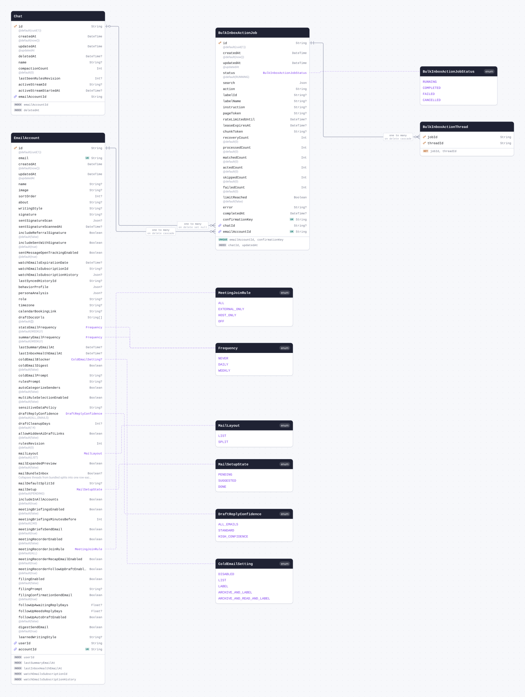

| Field              | Type                                                         | Constraints                                       | Default      | Description |
| ------------------ | ------------------------------------------------------------ | ------------------------------------------------- | ------------ | ----------- |
| `id`               | `String`                                                     | PK NOT NULL                                       | `cuid(1)`    |             |
| `createdAt`        | `DateTime`                                                   | NOT NULL                                          | `now()`      |             |
| `updatedAt`        | `DateTime`                                                   | NOT NULL                                          | `@updatedAt` |             |
| `status`           | [`BulkInboxActionJobStatus`](#enum-BulkInboxActionJobStatus) | NOT NULL                                          | `RUNNING`    |             |
| `search`           | `Json`                                                       | NOT NULL                                          |              |             |
| `action`           | `String`                                                     | NOT NULL                                          |              |             |
| `labelId`          | `String`                                                     | NULL                                              |              |             |
| `labelName`        | `String`                                                     | NULL                                              |              |             |
| `instruction`      | `String`                                                     | NULL                                              |              |             |
| `pageToken`        | `String`                                                     | NULL                                              |              |             |
| `rateLimitedUntil` | `DateTime`                                                   | NULL                                              |              |             |
| `leaseExpiresAt`   | `DateTime`                                                   | NULL                                              |              |             |
| `chunkToken`       | `String`                                                     | NULL                                              |              |             |
| `recoveryCount`    | `Int`                                                        | NOT NULL                                          | `0`          |             |
| `processedCount`   | `Int`                                                        | NOT NULL                                          | `0`          |             |
| `matchedCount`     | `Int`                                                        | NOT NULL                                          | `0`          |             |
| `actedCount`       | `Int`                                                        | NOT NULL                                          | `0`          |             |
| `skippedCount`     | `Int`                                                        | NOT NULL                                          | `0`          |             |
| `failedCount`      | `Int`                                                        | NOT NULL                                          | `0`          |             |
| `limitReached`     | `Boolean`                                                    | NOT NULL                                          | `false`      |             |
| `error`            | `String`                                                     | NULL                                              |              |             |
| `completedAt`      | `DateTime`                                                   | NULL                                              |              |             |
| `confirmationKey`  | `String`                                                     | NOT NULL                                          |              |             |
| `chatId`           | `String`                                                     | NULL → [Chat.id](#model-Chat)                     |              |             |
| `emailAccountId`   | `String`                                                     | NOT NULL → [EmailAccount.id](#model-EmailAccount) |              |             |

#### Indexes

- `@@index([chatId, updatedAt])`
- `@@unique([emailAccountId, confirmationKey])`

#### References

- `chatId` → [Chat.id](#model-Chat) (many-to-one, on delete SetNull)
- `emailAccountId` → [EmailAccount.id](#model-EmailAccount) (many-to-one, on delete Cascade)

#### Referenced by

- `id` ← [BulkInboxActionThread.jobId](#model-BulkInboxActionThread) (one-to-many, on delete Cascade)

#### Definition

```sql
CREATE TABLE "BulkInboxActionJob" (
    "id" TEXT NOT NULL,
    "createdAt" TIMESTAMP(3) NOT NULL DEFAULT CURRENT_TIMESTAMP,
    "updatedAt" TIMESTAMP(3) NOT NULL,
    "status" "BulkInboxActionJobStatus" NOT NULL DEFAULT 'RUNNING',
    "search" JSONB NOT NULL,
    "action" TEXT NOT NULL,
    "labelId" TEXT,
    "labelName" TEXT,
    "instruction" TEXT,
    "pageToken" TEXT,
    "rateLimitedUntil" TIMESTAMP(3),
    "leaseExpiresAt" TIMESTAMP(3),
    "chunkToken" TEXT,
    "recoveryCount" INTEGER NOT NULL DEFAULT 0,
    "processedCount" INTEGER NOT NULL DEFAULT 0,
    "matchedCount" INTEGER NOT NULL DEFAULT 0,
    "actedCount" INTEGER NOT NULL DEFAULT 0,
    "skippedCount" INTEGER NOT NULL DEFAULT 0,
    "failedCount" INTEGER NOT NULL DEFAULT 0,
    "limitReached" BOOLEAN NOT NULL DEFAULT false,
    "error" TEXT,
    "completedAt" TIMESTAMP(3),
    "confirmationKey" TEXT NOT NULL,
    "chatId" TEXT,
    "emailAccountId" TEXT NOT NULL,

    CONSTRAINT "BulkInboxActionJob_pkey" PRIMARY KEY ("id")
);

CREATE INDEX "BulkInboxActionJob_chatId_updatedAt_idx" ON "BulkInboxActionJob"("chatId", "updatedAt");

CREATE UNIQUE INDEX "BulkInboxActionJob_emailAccountId_confirmationKey_key" ON "BulkInboxActionJob"("emailAccountId", "confirmationKey");

ALTER TABLE "BulkInboxActionJob" ADD CONSTRAINT "BulkInboxActionJob_chatId_fkey" FOREIGN KEY ("chatId") REFERENCES "Chat"("id") ON DELETE SET NULL ON UPDATE CASCADE;

ALTER TABLE "BulkInboxActionJob" ADD CONSTRAINT "BulkInboxActionJob_emailAccountId_fkey" FOREIGN KEY ("emailAccountId") REFERENCES "EmailAccount"("id") ON DELETE CASCADE ON UPDATE CASCADE;
```

<details>
<summary>Queries and their SQL</summary>

**findMany**: Every row

```ts
await prisma.bulkInboxActionJob.findMany();
```

```sql
SELECT
  "public"."BulkInboxActionJob"."id",
  "public"."BulkInboxActionJob"."createdAt",
  "public"."BulkInboxActionJob"."updatedAt",
  "public"."BulkInboxActionJob"."status"::text,
  "public"."BulkInboxActionJob"."search",
  "public"."BulkInboxActionJob"."action",
  "public"."BulkInboxActionJob"."labelId",
  "public"."BulkInboxActionJob"."labelName",
  "public"."BulkInboxActionJob"."instruction",
  "public"."BulkInboxActionJob"."pageToken",
  "public"."BulkInboxActionJob"."rateLimitedUntil",
  "public"."BulkInboxActionJob"."leaseExpiresAt",
  "public"."BulkInboxActionJob"."chunkToken",
  "public"."BulkInboxActionJob"."recoveryCount",
  "public"."BulkInboxActionJob"."processedCount",
  "public"."BulkInboxActionJob"."matchedCount",
  "public"."BulkInboxActionJob"."actedCount",
  "public"."BulkInboxActionJob"."skippedCount",
  "public"."BulkInboxActionJob"."failedCount",
  "public"."BulkInboxActionJob"."limitReached",
  "public"."BulkInboxActionJob"."error",
  "public"."BulkInboxActionJob"."completedAt",
  "public"."BulkInboxActionJob"."confirmationKey",
  "public"."BulkInboxActionJob"."chatId",
  "public"."BulkInboxActionJob"."emailAccountId"
FROM
  "public"."BulkInboxActionJob"
WHERE
  1 = 1
OFFSET
  $1
-- params: ["0"]
```

**count**: How many rows there are

```ts
await prisma.bulkInboxActionJob.count();
```

```sql
SELECT
  COUNT(*) AS "_count$_all"
FROM
  (
    SELECT
      "public"."BulkInboxActionJob"."id"
    FROM
      "public"."BulkInboxActionJob"
    WHERE
      1 = 1
    OFFSET
      $1
  ) AS "sub"
-- params: ["0"]
```

**findMany**: Every row with its relations

```ts
await prisma.bulkInboxActionJob.findMany({
  include: { chat: true, handledThreads: true, emailAccount: true },
});
```

```sql
SELECT
  "public"."BulkInboxActionJob"."id",
  "public"."BulkInboxActionJob"."createdAt",
  "public"."BulkInboxActionJob"."updatedAt",
  "public"."BulkInboxActionJob"."status"::text,
  "public"."BulkInboxActionJob"."search",
  "public"."BulkInboxActionJob"."action",
  "public"."BulkInboxActionJob"."labelId",
  "public"."BulkInboxActionJob"."labelName",
  "public"."BulkInboxActionJob"."instruction",
  "public"."BulkInboxActionJob"."pageToken",
  "public"."BulkInboxActionJob"."rateLimitedUntil",
  "public"."BulkInboxActionJob"."leaseExpiresAt",
  "public"."BulkInboxActionJob"."chunkToken",
  "public"."BulkInboxActionJob"."recoveryCount",
  "public"."BulkInboxActionJob"."processedCount",
  "public"."BulkInboxActionJob"."matchedCount",
  "public"."BulkInboxActionJob"."actedCount",
  "public"."BulkInboxActionJob"."skippedCount",
  "public"."BulkInboxActionJob"."failedCount",
  "public"."BulkInboxActionJob"."limitReached",
  "public"."BulkInboxActionJob"."error",
  "public"."BulkInboxActionJob"."completedAt",
  "public"."BulkInboxActionJob"."confirmationKey",
  "public"."BulkInboxActionJob"."chatId",
  "public"."BulkInboxActionJob"."emailAccountId"
FROM
  "public"."BulkInboxActionJob"
WHERE
  1 = 1
OFFSET
  $1
-- params: ["0"]

SELECT
  "public"."Chat"."id",
  "public"."Chat"."createdAt",
  "public"."Chat"."updatedAt",
  "public"."Chat"."deletedAt",
  "public"."Chat"."name",
  "public"."Chat"."compactionCount",
  "public"."Chat"."lastSeenRulesRevision",
  "public"."Chat"."activeStreamId",
  "public"."Chat"."activeStreamStartedAt",
  "public"."Chat"."emailAccountId"
FROM
  "public"."Chat"
WHERE
  "public"."Chat"."id" IN ($1)
OFFSET
  $2
-- params: ["<chatId of the rows above>","0"]

SELECT
  "public"."BulkInboxActionThread"."jobId",
  "public"."BulkInboxActionThread"."threadId"
FROM
  "public"."BulkInboxActionThread"
WHERE
  "public"."BulkInboxActionThread"."jobId" IN ($1)
OFFSET
  $2
-- params: ["<id of the rows above>","0"]

SELECT
  "public"."EmailAccount"."id",
  "public"."EmailAccount"."email",
  "public"."EmailAccount"."createdAt",
  "public"."EmailAccount"."updatedAt",
  "public"."EmailAccount"."name",
  "public"."EmailAccount"."image",
  "public"."EmailAccount"."sortOrder",
  "public"."EmailAccount"."about",
  "public"."EmailAccount"."writingStyle",
  "public"."EmailAccount"."signature",
  "public"."EmailAccount"."sentSignatureScan",
  "public"."EmailAccount"."sentSignatureScannedAt",
  "public"."EmailAccount"."includeReferralSignature",
  "public"."EmailAccount"."includeSentWithSignature",
  "public"."EmailAccount"."sentMessageOpenTrackingEnabled",
  "public"."EmailAccount"."watchEmailsExpirationDate",
  "public"."EmailAccount"."watchEmailsSubscriptionId",
  "public"."EmailAccount"."watchEmailsSubscriptionHistory",
  "public"."EmailAccount"."lastSyncedHistoryId",
  "public"."EmailAccount"."behaviorProfile",
  "public"."EmailAccount"."personaAnalysis",
  "public"."EmailAccount"."role",
  "public"."EmailAccount"."timezone",
  "public"."EmailAccount"."calendarBookingLink",
  "public"."EmailAccount"."draftDocsUrls",
  "public"."EmailAccount"."statsEmailFrequency"::text,
  "public"."EmailAccount"."summaryEmailFrequency"::text,
  "public"."EmailAccount"."lastSummaryEmailAt",
  "public"."EmailAccount"."lastInboxHealthEmailAt",
  "public"."EmailAccount"."coldEmailBlocker"::text,
  "public"."EmailAccount"."coldEmailDigest",
  "public"."EmailAccount"."coldEmailPrompt",
  "public"."EmailAccount"."rulesPrompt",
  "public"."EmailAccount"."autoCategorizeSenders",
  "public"."EmailAccount"."multiRuleSelectionEnabled",
  "public"."EmailAccount"."sensitiveDataPolicy",
  "public"."EmailAccount"."draftReplyConfidence"::text,
  "public"."EmailAccount"."draftCleanupDays",
  "public"."EmailAccount"."allowHiddenAiDraftLinks",
  "public"."EmailAccount"."rulesRevision",
  "public"."EmailAccount"."mailLayout"::text,
  "public"."EmailAccount"."mailExpandedPreview",
  "public"."EmailAccount"."mailBundleInbox",
  "public"."EmailAccount"."mailDefaultSplitId",
  "public"."EmailAccount"."mailSetup"::text,
  "public"."EmailAccount"."includeInAllAccounts",
  "public"."EmailAccount"."meetingBriefingsEnabled",
  "public"."EmailAccount"."meetingBriefingsMinutesBefore",
  "public"."EmailAccount"."meetingBriefsSendEmail",
  "public"."EmailAccount"."meetingRecorderEnabled",
  "public"."EmailAccount"."meetingRecorderJoinRule"::text,
  "public"."EmailAccount"."meetingRecorderRecapEmailEnabled",
  "public"."EmailAccount"."meetingRecorderFollowUpDraftEnabled",
  "public"."EmailAccount"."filingEnabled",
  "public"."EmailAccount"."filingPrompt",
  "public"."EmailAccount"."filingConfirmationSendEmail",
  "public"."EmailAccount"."followUpAwaitingReplyDays",
  "public"."EmailAccount"."followUpNeedsReplyDays",
  "public"."EmailAccount"."followUpAutoDraftEnabled",
  "public"."EmailAccount"."digestSendEmail",
  "public"."EmailAccount"."learnedWritingStyle",
  "public"."EmailAccount"."userId",
  "public"."EmailAccount"."accountId"
FROM
  "public"."EmailAccount"
WHERE
  "public"."EmailAccount"."id" IN ($1)
OFFSET
  $2
-- params: ["<emailAccountId of the rows above>","0"]
```

**findUnique**: One row by what is unique to it

```ts
await prisma.bulkInboxActionJob.findUnique({ where: { id: "example" } });
```

```sql
SELECT
  "public"."BulkInboxActionJob"."id",
  "public"."BulkInboxActionJob"."createdAt",
  "public"."BulkInboxActionJob"."updatedAt",
  "public"."BulkInboxActionJob"."status"::text,
  "public"."BulkInboxActionJob"."search",
  "public"."BulkInboxActionJob"."action",
  "public"."BulkInboxActionJob"."labelId",
  "public"."BulkInboxActionJob"."labelName",
  "public"."BulkInboxActionJob"."instruction",
  "public"."BulkInboxActionJob"."pageToken",
  "public"."BulkInboxActionJob"."rateLimitedUntil",
  "public"."BulkInboxActionJob"."leaseExpiresAt",
  "public"."BulkInboxActionJob"."chunkToken",
  "public"."BulkInboxActionJob"."recoveryCount",
  "public"."BulkInboxActionJob"."processedCount",
  "public"."BulkInboxActionJob"."matchedCount",
  "public"."BulkInboxActionJob"."actedCount",
  "public"."BulkInboxActionJob"."skippedCount",
  "public"."BulkInboxActionJob"."failedCount",
  "public"."BulkInboxActionJob"."limitReached",
  "public"."BulkInboxActionJob"."error",
  "public"."BulkInboxActionJob"."completedAt",
  "public"."BulkInboxActionJob"."confirmationKey",
  "public"."BulkInboxActionJob"."chatId",
  "public"."BulkInboxActionJob"."emailAccountId"
FROM
  "public"."BulkInboxActionJob"
WHERE
  (
    "public"."BulkInboxActionJob"."id" = $1
    AND 1 = 1
  )
LIMIT
  $2
OFFSET
  $3
-- params: ["example","1","0"]
```

**create**: Create a row

```ts
await prisma.bulkInboxActionJob.create({
  data: { search: {}, action: "example", confirmationKey: "example", emailAccountId: "example" },
});
```

```sql
INSERT INTO
  "public"."BulkInboxActionJob" (
    "id",
    "createdAt",
    "updatedAt",
    "status",
    "search",
    "action",
    "recoveryCount",
    "processedCount",
    "matchedCount",
    "actedCount",
    "skippedCount",
    "failedCount",
    "limitReached",
    "confirmationKey",
    "emailAccountId"
  )
VALUES
  (
    $1,
    $2,
    $3,
    CAST($4::text AS "public"."BulkInboxActionJobStatus"),
    $5,
    $6,
    $7,
    $8,
    $9,
    $10,
    $11,
    $12,
    $13,
    $14,
    $15
  )
RETURNING
  "public"."BulkInboxActionJob"."id",
  "public"."BulkInboxActionJob"."createdAt",
  "public"."BulkInboxActionJob"."updatedAt",
  "public"."BulkInboxActionJob"."status"::text,
  "public"."BulkInboxActionJob"."search",
  "public"."BulkInboxActionJob"."action",
  "public"."BulkInboxActionJob"."labelId",
  "public"."BulkInboxActionJob"."labelName",
  "public"."BulkInboxActionJob"."instruction",
  "public"."BulkInboxActionJob"."pageToken",
  "public"."BulkInboxActionJob"."rateLimitedUntil",
  "public"."BulkInboxActionJob"."leaseExpiresAt",
  "public"."BulkInboxActionJob"."chunkToken",
  "public"."BulkInboxActionJob"."recoveryCount",
  "public"."BulkInboxActionJob"."processedCount",
  "public"."BulkInboxActionJob"."matchedCount",
  "public"."BulkInboxActionJob"."actedCount",
  "public"."BulkInboxActionJob"."skippedCount",
  "public"."BulkInboxActionJob"."failedCount",
  "public"."BulkInboxActionJob"."limitReached",
  "public"."BulkInboxActionJob"."error",
  "public"."BulkInboxActionJob"."completedAt",
  "public"."BulkInboxActionJob"."confirmationKey",
  "public"."BulkInboxActionJob"."chatId",
  "public"."BulkInboxActionJob"."emailAccountId"
-- params: ["<cuid(1)>","<now()>","<now()>","RUNNING","{}","example","0","0","0","0","0","0",false,"example","example"]
```

**update**: Update a row

```ts
await prisma.bulkInboxActionJob.update({
  where: { id: "example" },
  data: { createdAt: new Date("2026-01-01T00:00:00.000Z") },
});
```

```sql
UPDATE "public"."BulkInboxActionJob"
SET
  "createdAt" = $1,
  "updatedAt" = $2
WHERE
  (
    "public"."BulkInboxActionJob"."id" = $3
    AND 1 = 1
  )
RETURNING
  "public"."BulkInboxActionJob"."id",
  "public"."BulkInboxActionJob"."createdAt",
  "public"."BulkInboxActionJob"."updatedAt",
  "public"."BulkInboxActionJob"."status"::text,
  "public"."BulkInboxActionJob"."search",
  "public"."BulkInboxActionJob"."action",
  "public"."BulkInboxActionJob"."labelId",
  "public"."BulkInboxActionJob"."labelName",
  "public"."BulkInboxActionJob"."instruction",
  "public"."BulkInboxActionJob"."pageToken",
  "public"."BulkInboxActionJob"."rateLimitedUntil",
  "public"."BulkInboxActionJob"."leaseExpiresAt",
  "public"."BulkInboxActionJob"."chunkToken",
  "public"."BulkInboxActionJob"."recoveryCount",
  "public"."BulkInboxActionJob"."processedCount",
  "public"."BulkInboxActionJob"."matchedCount",
  "public"."BulkInboxActionJob"."actedCount",
  "public"."BulkInboxActionJob"."skippedCount",
  "public"."BulkInboxActionJob"."failedCount",
  "public"."BulkInboxActionJob"."limitReached",
  "public"."BulkInboxActionJob"."error",
  "public"."BulkInboxActionJob"."completedAt",
  "public"."BulkInboxActionJob"."confirmationKey",
  "public"."BulkInboxActionJob"."chatId",
  "public"."BulkInboxActionJob"."emailAccountId"
-- params: ["2026-01-01T00:00:00.000Z",{"prisma__type":"generatorCall","prisma__value":{"name":"now","args":[],"returnType":{"type":"DateTime"}}},"example"]
```

**delete**: Delete a row

```ts
await prisma.bulkInboxActionJob.delete({ where: { id: "example" } });
```

```sql
DELETE FROM "public"."BulkInboxActionJob"
WHERE
  (
    "public"."BulkInboxActionJob"."id" = $1
    AND 1 = 1
  )
RETURNING
  "public"."BulkInboxActionJob"."id",
  "public"."BulkInboxActionJob"."createdAt",
  "public"."BulkInboxActionJob"."updatedAt",
  "public"."BulkInboxActionJob"."status"::text,
  "public"."BulkInboxActionJob"."search",
  "public"."BulkInboxActionJob"."action",
  "public"."BulkInboxActionJob"."labelId",
  "public"."BulkInboxActionJob"."labelName",
  "public"."BulkInboxActionJob"."instruction",
  "public"."BulkInboxActionJob"."pageToken",
  "public"."BulkInboxActionJob"."rateLimitedUntil",
  "public"."BulkInboxActionJob"."leaseExpiresAt",
  "public"."BulkInboxActionJob"."chunkToken",
  "public"."BulkInboxActionJob"."recoveryCount",
  "public"."BulkInboxActionJob"."processedCount",
  "public"."BulkInboxActionJob"."matchedCount",
  "public"."BulkInboxActionJob"."actedCount",
  "public"."BulkInboxActionJob"."skippedCount",
  "public"."BulkInboxActionJob"."failedCount",
  "public"."BulkInboxActionJob"."limitReached",
  "public"."BulkInboxActionJob"."error",
  "public"."BulkInboxActionJob"."completedAt",
  "public"."BulkInboxActionJob"."confirmationKey",
  "public"."BulkInboxActionJob"."chatId",
  "public"."BulkInboxActionJob"."emailAccountId"
-- params: ["example"]
```

</details>

<a id="model-BulkInboxActionThread"></a>

### BulkInboxActionThread

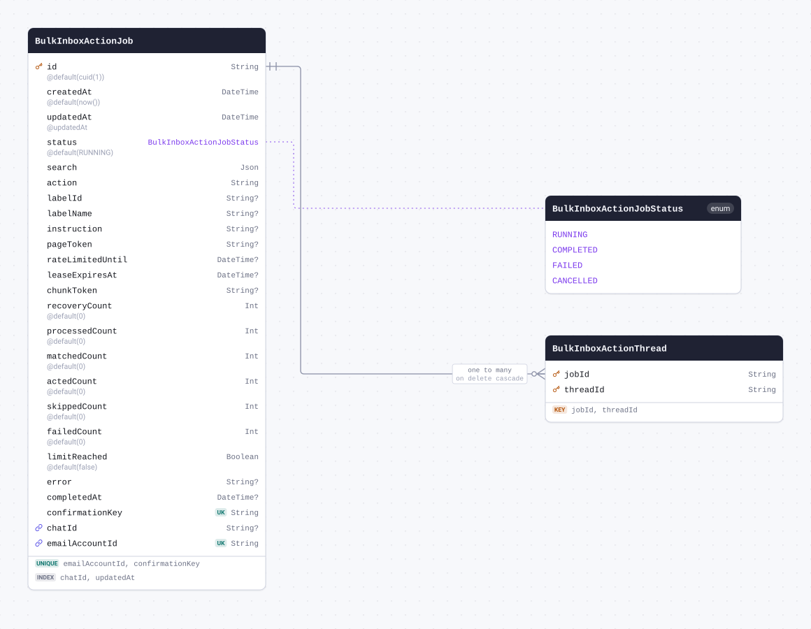

| Field      | Type     | Constraints                                                      | Default | Description |
| ---------- | -------- | ---------------------------------------------------------------- | ------- | ----------- |
| `jobId`    | `String` | PK NOT NULL → [BulkInboxActionJob.id](#model-BulkInboxActionJob) |         |             |
| `threadId` | `String` | PK NOT NULL                                                      |         |             |

#### Indexes

- `@@id([jobId, threadId])`

#### References

- `jobId` → [BulkInboxActionJob.id](#model-BulkInboxActionJob) (many-to-one, on delete Cascade)

#### Definition

```sql
CREATE TABLE "BulkInboxActionThread" (
    "jobId" TEXT NOT NULL,
    "threadId" TEXT NOT NULL,

    CONSTRAINT "BulkInboxActionThread_pkey" PRIMARY KEY ("jobId","threadId")
);

ALTER TABLE "BulkInboxActionThread" ADD CONSTRAINT "BulkInboxActionThread_jobId_fkey" FOREIGN KEY ("jobId") REFERENCES "BulkInboxActionJob"("id") ON DELETE CASCADE ON UPDATE CASCADE;
```

<details>
<summary>Queries and their SQL</summary>

**findMany**: Every row

```ts
await prisma.bulkInboxActionThread.findMany();
```

```sql
SELECT
  "public"."BulkInboxActionThread"."jobId",
  "public"."BulkInboxActionThread"."threadId"
FROM
  "public"."BulkInboxActionThread"
WHERE
  1 = 1
OFFSET
  $1
-- params: ["0"]
```

**count**: How many rows there are

```ts
await prisma.bulkInboxActionThread.count();
```

```sql
SELECT
  COUNT(*) AS "_count$_all"
FROM
  (
    SELECT
      "public"."BulkInboxActionThread"."jobId",
      "public"."BulkInboxActionThread"."threadId"
    FROM
      "public"."BulkInboxActionThread"
    WHERE
      1 = 1
    OFFSET
      $1
  ) AS "sub"
-- params: ["0"]
```

**findMany**: Every row with its relations

```ts
await prisma.bulkInboxActionThread.findMany({ include: { job: true } });
```

```sql
SELECT
  "public"."BulkInboxActionThread"."jobId",
  "public"."BulkInboxActionThread"."threadId"
FROM
  "public"."BulkInboxActionThread"
WHERE
  1 = 1
OFFSET
  $1
-- params: ["0"]

SELECT
  "public"."BulkInboxActionJob"."id",
  "public"."BulkInboxActionJob"."createdAt",
  "public"."BulkInboxActionJob"."updatedAt",
  "public"."BulkInboxActionJob"."status"::text,
  "public"."BulkInboxActionJob"."search",
  "public"."BulkInboxActionJob"."action",
  "public"."BulkInboxActionJob"."labelId",
  "public"."BulkInboxActionJob"."labelName",
  "public"."BulkInboxActionJob"."instruction",
  "public"."BulkInboxActionJob"."pageToken",
  "public"."BulkInboxActionJob"."rateLimitedUntil",
  "public"."BulkInboxActionJob"."leaseExpiresAt",
  "public"."BulkInboxActionJob"."chunkToken",
  "public"."BulkInboxActionJob"."recoveryCount",
  "public"."BulkInboxActionJob"."processedCount",
  "public"."BulkInboxActionJob"."matchedCount",
  "public"."BulkInboxActionJob"."actedCount",
  "public"."BulkInboxActionJob"."skippedCount",
  "public"."BulkInboxActionJob"."failedCount",
  "public"."BulkInboxActionJob"."limitReached",
  "public"."BulkInboxActionJob"."error",
  "public"."BulkInboxActionJob"."completedAt",
  "public"."BulkInboxActionJob"."confirmationKey",
  "public"."BulkInboxActionJob"."chatId",
  "public"."BulkInboxActionJob"."emailAccountId"
FROM
  "public"."BulkInboxActionJob"
WHERE
  "public"."BulkInboxActionJob"."id" IN ($1)
OFFSET
  $2
-- params: ["<jobId of the rows above>","0"]
```

**findUnique**: One row by what is unique to it

```ts
await prisma.bulkInboxActionThread.findUnique({
  where: { jobId_threadId: { jobId: "example", threadId: "example" } },
});
```

```sql
SELECT
  "public"."BulkInboxActionThread"."jobId",
  "public"."BulkInboxActionThread"."threadId"
FROM
  "public"."BulkInboxActionThread"
WHERE
  (
    (
      "public"."BulkInboxActionThread"."jobId" = $1
      AND "public"."BulkInboxActionThread"."threadId" = $2
    )
    AND 1 = 1
  )
LIMIT
  $3
OFFSET
  $4
-- params: ["example","example","1","0"]
```

**create**: Create a row

```ts
await prisma.bulkInboxActionThread.create({ data: { jobId: "example", threadId: "example" } });
```

```sql
INSERT INTO
  "public"."BulkInboxActionThread" ("jobId", "threadId")
VALUES
  ($1, $2)
RETURNING
  "public"."BulkInboxActionThread"."jobId",
  "public"."BulkInboxActionThread"."threadId"
-- params: ["example","example"]
```

**delete**: Delete a row

```ts
await prisma.bulkInboxActionThread.delete({
  where: { jobId_threadId: { jobId: "example", threadId: "example" } },
});
```

```sql
DELETE FROM "public"."BulkInboxActionThread"
WHERE
  (
    (
      "public"."BulkInboxActionThread"."jobId" = $1
      AND "public"."BulkInboxActionThread"."threadId" = $2
    )
    AND 1 = 1
  )
RETURNING
  "public"."BulkInboxActionThread"."jobId",
  "public"."BulkInboxActionThread"."threadId"
-- params: ["example","example"]
```

</details>

<a id="model-Knowledge"></a>

### Knowledge


| Field            | Type       | Constraints                                       | Default      | Description |
| ---------------- | ---------- | ------------------------------------------------- | ------------ | ----------- |
| `id`             | `String`   | PK NOT NULL                                       | `cuid(1)`    |             |
| `createdAt`      | `DateTime` | NOT NULL                                          | `now()`      |             |
| `updatedAt`      | `DateTime` | NOT NULL                                          | `@updatedAt` |             |
| `title`          | `String`   | NOT NULL                                          |              |             |
| `content`        | `String`   | NOT NULL                                          |              |             |
| `emailAccountId` | `String`   | NOT NULL → [EmailAccount.id](#model-EmailAccount) |              |             |

#### Indexes

- `@@unique([emailAccountId, title])`

#### References

- `emailAccountId` → [EmailAccount.id](#model-EmailAccount) (many-to-one, on delete Cascade)

#### Definition

```sql
CREATE TABLE "Knowledge" (
    "id" TEXT NOT NULL,
    "createdAt" TIMESTAMP(3) NOT NULL DEFAULT CURRENT_TIMESTAMP,
    "updatedAt" TIMESTAMP(3) NOT NULL,
    "title" TEXT NOT NULL,
    "content" TEXT NOT NULL,
    "emailAccountId" TEXT NOT NULL,

    CONSTRAINT "Knowledge_pkey" PRIMARY KEY ("id")
);

CREATE UNIQUE INDEX "Knowledge_emailAccountId_title_key" ON "Knowledge"("emailAccountId", "title");

ALTER TABLE "Knowledge" ADD CONSTRAINT "Knowledge_emailAccountId_fkey" FOREIGN KEY ("emailAccountId") REFERENCES "EmailAccount"("id") ON DELETE CASCADE ON UPDATE CASCADE;
```

<details>
<summary>Queries and their SQL</summary>

**findMany**: Every row

```ts
await prisma.knowledge.findMany();
```

```sql
SELECT
  "public"."Knowledge"."id",
  "public"."Knowledge"."createdAt",
  "public"."Knowledge"."updatedAt",
  "public"."Knowledge"."title",
  "public"."Knowledge"."content",
  "public"."Knowledge"."emailAccountId"
FROM
  "public"."Knowledge"
WHERE
  1 = 1
OFFSET
  $1
-- params: ["0"]
```

**count**: How many rows there are

```ts
await prisma.knowledge.count();
```

```sql
SELECT
  COUNT(*) AS "_count$_all"
FROM
  (
    SELECT
      "public"."Knowledge"."id"
    FROM
      "public"."Knowledge"
    WHERE
      1 = 1
    OFFSET
      $1
  ) AS "sub"
-- params: ["0"]
```

**findMany**: Every row with its relations

```ts
await prisma.knowledge.findMany({ include: { emailAccount: true } });
```

```sql
SELECT
  "public"."Knowledge"."id",
  "public"."Knowledge"."createdAt",
  "public"."Knowledge"."updatedAt",
  "public"."Knowledge"."title",
  "public"."Knowledge"."content",
  "public"."Knowledge"."emailAccountId"
FROM
  "public"."Knowledge"
WHERE
  1 = 1
OFFSET
  $1
-- params: ["0"]

SELECT
  "public"."EmailAccount"."id",
  "public"."EmailAccount"."email",
  "public"."EmailAccount"."createdAt",
  "public"."EmailAccount"."updatedAt",
  "public"."EmailAccount"."name",
  "public"."EmailAccount"."image",
  "public"."EmailAccount"."sortOrder",
  "public"."EmailAccount"."about",
  "public"."EmailAccount"."writingStyle",
  "public"."EmailAccount"."signature",
  "public"."EmailAccount"."sentSignatureScan",
  "public"."EmailAccount"."sentSignatureScannedAt",
  "public"."EmailAccount"."includeReferralSignature",
  "public"."EmailAccount"."includeSentWithSignature",
  "public"."EmailAccount"."sentMessageOpenTrackingEnabled",
  "public"."EmailAccount"."watchEmailsExpirationDate",
  "public"."EmailAccount"."watchEmailsSubscriptionId",
  "public"."EmailAccount"."watchEmailsSubscriptionHistory",
  "public"."EmailAccount"."lastSyncedHistoryId",
  "public"."EmailAccount"."behaviorProfile",
  "public"."EmailAccount"."personaAnalysis",
  "public"."EmailAccount"."role",
  "public"."EmailAccount"."timezone",
  "public"."EmailAccount"."calendarBookingLink",
  "public"."EmailAccount"."draftDocsUrls",
  "public"."EmailAccount"."statsEmailFrequency"::text,
  "public"."EmailAccount"."summaryEmailFrequency"::text,
  "public"."EmailAccount"."lastSummaryEmailAt",
  "public"."EmailAccount"."lastInboxHealthEmailAt",
  "public"."EmailAccount"."coldEmailBlocker"::text,
  "public"."EmailAccount"."coldEmailDigest",
  "public"."EmailAccount"."coldEmailPrompt",
  "public"."EmailAccount"."rulesPrompt",
  "public"."EmailAccount"."autoCategorizeSenders",
  "public"."EmailAccount"."multiRuleSelectionEnabled",
  "public"."EmailAccount"."sensitiveDataPolicy",
  "public"."EmailAccount"."draftReplyConfidence"::text,
  "public"."EmailAccount"."draftCleanupDays",
  "public"."EmailAccount"."allowHiddenAiDraftLinks",
  "public"."EmailAccount"."rulesRevision",
  "public"."EmailAccount"."mailLayout"::text,
  "public"."EmailAccount"."mailExpandedPreview",
  "public"."EmailAccount"."mailBundleInbox",
  "public"."EmailAccount"."mailDefaultSplitId",
  "public"."EmailAccount"."mailSetup"::text,
  "public"."EmailAccount"."includeInAllAccounts",
  "public"."EmailAccount"."meetingBriefingsEnabled",
  "public"."EmailAccount"."meetingBriefingsMinutesBefore",
  "public"."EmailAccount"."meetingBriefsSendEmail",
  "public"."EmailAccount"."meetingRecorderEnabled",
  "public"."EmailAccount"."meetingRecorderJoinRule"::text,
  "public"."EmailAccount"."meetingRecorderRecapEmailEnabled",
  "public"."EmailAccount"."meetingRecorderFollowUpDraftEnabled",
  "public"."EmailAccount"."filingEnabled",
  "public"."EmailAccount"."filingPrompt",
  "public"."EmailAccount"."filingConfirmationSendEmail",
  "public"."EmailAccount"."followUpAwaitingReplyDays",
  "public"."EmailAccount"."followUpNeedsReplyDays",
  "public"."EmailAccount"."followUpAutoDraftEnabled",
  "public"."EmailAccount"."digestSendEmail",
  "public"."EmailAccount"."learnedWritingStyle",
  "public"."EmailAccount"."userId",
  "public"."EmailAccount"."accountId"
FROM
  "public"."EmailAccount"
WHERE
  "public"."EmailAccount"."id" IN ($1)
OFFSET
  $2
-- params: ["<emailAccountId of the rows above>","0"]
```

**findUnique**: One row by what is unique to it

```ts
await prisma.knowledge.findUnique({ where: { id: "example" } });
```

```sql
SELECT
  "public"."Knowledge"."id",
  "public"."Knowledge"."createdAt",
  "public"."Knowledge"."updatedAt",
  "public"."Knowledge"."title",
  "public"."Knowledge"."content",
  "public"."Knowledge"."emailAccountId"
FROM
  "public"."Knowledge"
WHERE
  (
    "public"."Knowledge"."id" = $1
    AND 1 = 1
  )
LIMIT
  $2
OFFSET
  $3
-- params: ["example","1","0"]
```

**create**: Create a row

```ts
await prisma.knowledge.create({
  data: { title: "example", content: "example", emailAccountId: "example" },
});
```

```sql
INSERT INTO
  "public"."Knowledge" (
    "id",
    "createdAt",
    "updatedAt",
    "title",
    "content",
    "emailAccountId"
  )
VALUES
  ($1, $2, $3, $4, $5, $6)
RETURNING
  "public"."Knowledge"."id",
  "public"."Knowledge"."createdAt",
  "public"."Knowledge"."updatedAt",
  "public"."Knowledge"."title",
  "public"."Knowledge"."content",
  "public"."Knowledge"."emailAccountId"
-- params: ["<cuid(1)>","<now()>","<now()>","example","example","example"]
```

**update**: Update a row

```ts
await prisma.knowledge.update({
  where: { id: "example" },
  data: { createdAt: new Date("2026-01-01T00:00:00.000Z") },
});
```

```sql
UPDATE "public"."Knowledge"
SET
  "createdAt" = $1,
  "updatedAt" = $2
WHERE
  (
    "public"."Knowledge"."id" = $3
    AND 1 = 1
  )
RETURNING
  "public"."Knowledge"."id",
  "public"."Knowledge"."createdAt",
  "public"."Knowledge"."updatedAt",
  "public"."Knowledge"."title",
  "public"."Knowledge"."content",
  "public"."Knowledge"."emailAccountId"
-- params: ["2026-01-01T00:00:00.000Z",{"prisma__type":"generatorCall","prisma__value":{"name":"now","args":[],"returnType":{"type":"DateTime"}}},"example"]
```

**delete**: Delete a row

```ts
await prisma.knowledge.delete({ where: { id: "example" } });
```

```sql
DELETE FROM "public"."Knowledge"
WHERE
  (
    "public"."Knowledge"."id" = $1
    AND 1 = 1
  )
RETURNING
  "public"."Knowledge"."id",
  "public"."Knowledge"."createdAt",
  "public"."Knowledge"."updatedAt",
  "public"."Knowledge"."title",
  "public"."Knowledge"."content",
  "public"."Knowledge"."emailAccountId"
-- params: ["example"]
```

</details>

<a id="model-Snippet"></a>

### Snippet


| Field            | Type       | Constraints                                       | Default      | Description |
| ---------------- | ---------- | ------------------------------------------------- | ------------ | ----------- |
| `id`             | `String`   | PK NOT NULL                                       | `cuid(1)`    |             |
| `createdAt`      | `DateTime` | NOT NULL                                          | `now()`      |             |
| `updatedAt`      | `DateTime` | NOT NULL                                          | `@updatedAt` |             |
| `shortcut`       | `String`   | NOT NULL                                          |              |             |
| `content`        | `String`   | NOT NULL                                          |              |             |
| `emailAccountId` | `String`   | NOT NULL → [EmailAccount.id](#model-EmailAccount) |              |             |

#### Indexes

- `@@index([emailAccountId])`
- `@@unique([emailAccountId, shortcut])`

#### References

- `emailAccountId` → [EmailAccount.id](#model-EmailAccount) (many-to-one, on delete Cascade)

#### Definition

```sql
CREATE TABLE "Snippet" (
    "id" TEXT NOT NULL,
    "createdAt" TIMESTAMP(3) NOT NULL DEFAULT CURRENT_TIMESTAMP,
    "updatedAt" TIMESTAMP(3) NOT NULL,
    "shortcut" TEXT NOT NULL,
    "content" TEXT NOT NULL,
    "emailAccountId" TEXT NOT NULL,

    CONSTRAINT "Snippet_pkey" PRIMARY KEY ("id")
);

CREATE INDEX "Snippet_emailAccountId_idx" ON "Snippet"("emailAccountId");

CREATE UNIQUE INDEX "Snippet_emailAccountId_shortcut_key" ON "Snippet"("emailAccountId", "shortcut");

ALTER TABLE "Snippet" ADD CONSTRAINT "Snippet_emailAccountId_fkey" FOREIGN KEY ("emailAccountId") REFERENCES "EmailAccount"("id") ON DELETE CASCADE ON UPDATE CASCADE;
```

<details>
<summary>Queries and their SQL</summary>

**findMany**: Every row

```ts
await prisma.snippet.findMany();
```

```sql
SELECT
  "public"."Snippet"."id",
  "public"."Snippet"."createdAt",
  "public"."Snippet"."updatedAt",
  "public"."Snippet"."shortcut",
  "public"."Snippet"."content",
  "public"."Snippet"."emailAccountId"
FROM
  "public"."Snippet"
WHERE
  1 = 1
OFFSET
  $1
-- params: ["0"]
```

**count**: How many rows there are

```ts
await prisma.snippet.count();
```

```sql
SELECT
  COUNT(*) AS "_count$_all"
FROM
  (
    SELECT
      "public"."Snippet"."id"
    FROM
      "public"."Snippet"
    WHERE
      1 = 1
    OFFSET
      $1
  ) AS "sub"
-- params: ["0"]
```

**findMany**: Every row with its relations

```ts
await prisma.snippet.findMany({ include: { emailAccount: true } });
```

```sql
SELECT
  "public"."Snippet"."id",
  "public"."Snippet"."createdAt",
  "public"."Snippet"."updatedAt",
  "public"."Snippet"."shortcut",
  "public"."Snippet"."content",
  "public"."Snippet"."emailAccountId"
FROM
  "public"."Snippet"
WHERE
  1 = 1
OFFSET
  $1
-- params: ["0"]

SELECT
  "public"."EmailAccount"."id",
  "public"."EmailAccount"."email",
  "public"."EmailAccount"."createdAt",
  "public"."EmailAccount"."updatedAt",
  "public"."EmailAccount"."name",
  "public"."EmailAccount"."image",
  "public"."EmailAccount"."sortOrder",
  "public"."EmailAccount"."about",
  "public"."EmailAccount"."writingStyle",
  "public"."EmailAccount"."signature",
  "public"."EmailAccount"."sentSignatureScan",
  "public"."EmailAccount"."sentSignatureScannedAt",
  "public"."EmailAccount"."includeReferralSignature",
  "public"."EmailAccount"."includeSentWithSignature",
  "public"."EmailAccount"."sentMessageOpenTrackingEnabled",
  "public"."EmailAccount"."watchEmailsExpirationDate",
  "public"."EmailAccount"."watchEmailsSubscriptionId",
  "public"."EmailAccount"."watchEmailsSubscriptionHistory",
  "public"."EmailAccount"."lastSyncedHistoryId",
  "public"."EmailAccount"."behaviorProfile",
  "public"."EmailAccount"."personaAnalysis",
  "public"."EmailAccount"."role",
  "public"."EmailAccount"."timezone",
  "public"."EmailAccount"."calendarBookingLink",
  "public"."EmailAccount"."draftDocsUrls",
  "public"."EmailAccount"."statsEmailFrequency"::text,
  "public"."EmailAccount"."summaryEmailFrequency"::text,
  "public"."EmailAccount"."lastSummaryEmailAt",
  "public"."EmailAccount"."lastInboxHealthEmailAt",
  "public"."EmailAccount"."coldEmailBlocker"::text,
  "public"."EmailAccount"."coldEmailDigest",
  "public"."EmailAccount"."coldEmailPrompt",
  "public"."EmailAccount"."rulesPrompt",
  "public"."EmailAccount"."autoCategorizeSenders",
  "public"."EmailAccount"."multiRuleSelectionEnabled",
  "public"."EmailAccount"."sensitiveDataPolicy",
  "public"."EmailAccount"."draftReplyConfidence"::text,
  "public"."EmailAccount"."draftCleanupDays",
  "public"."EmailAccount"."allowHiddenAiDraftLinks",
  "public"."EmailAccount"."rulesRevision",
  "public"."EmailAccount"."mailLayout"::text,
  "public"."EmailAccount"."mailExpandedPreview",
  "public"."EmailAccount"."mailBundleInbox",
  "public"."EmailAccount"."mailDefaultSplitId",
  "public"."EmailAccount"."mailSetup"::text,
  "public"."EmailAccount"."includeInAllAccounts",
  "public"."EmailAccount"."meetingBriefingsEnabled",
  "public"."EmailAccount"."meetingBriefingsMinutesBefore",
  "public"."EmailAccount"."meetingBriefsSendEmail",
  "public"."EmailAccount"."meetingRecorderEnabled",
  "public"."EmailAccount"."meetingRecorderJoinRule"::text,
  "public"."EmailAccount"."meetingRecorderRecapEmailEnabled",
  "public"."EmailAccount"."meetingRecorderFollowUpDraftEnabled",
  "public"."EmailAccount"."filingEnabled",
  "public"."EmailAccount"."filingPrompt",
  "public"."EmailAccount"."filingConfirmationSendEmail",
  "public"."EmailAccount"."followUpAwaitingReplyDays",
  "public"."EmailAccount"."followUpNeedsReplyDays",
  "public"."EmailAccount"."followUpAutoDraftEnabled",
  "public"."EmailAccount"."digestSendEmail",
  "public"."EmailAccount"."learnedWritingStyle",
  "public"."EmailAccount"."userId",
  "public"."EmailAccount"."accountId"
FROM
  "public"."EmailAccount"
WHERE
  "public"."EmailAccount"."id" IN ($1)
OFFSET
  $2
-- params: ["<emailAccountId of the rows above>","0"]
```

**findUnique**: One row by what is unique to it

```ts
await prisma.snippet.findUnique({ where: { id: "example" } });
```

```sql
SELECT
  "public"."Snippet"."id",
  "public"."Snippet"."createdAt",
  "public"."Snippet"."updatedAt",
  "public"."Snippet"."shortcut",
  "public"."Snippet"."content",
  "public"."Snippet"."emailAccountId"
FROM
  "public"."Snippet"
WHERE
  (
    "public"."Snippet"."id" = $1
    AND 1 = 1
  )
LIMIT
  $2
OFFSET
  $3
-- params: ["example","1","0"]
```

**create**: Create a row

```ts
await prisma.snippet.create({
  data: { shortcut: "example", content: "example", emailAccountId: "example" },
});
```

```sql
INSERT INTO
  "public"."Snippet" (
    "id",
    "createdAt",
    "updatedAt",
    "shortcut",
    "content",
    "emailAccountId"
  )
VALUES
  ($1, $2, $3, $4, $5, $6)
RETURNING
  "public"."Snippet"."id",
  "public"."Snippet"."createdAt",
  "public"."Snippet"."updatedAt",
  "public"."Snippet"."shortcut",
  "public"."Snippet"."content",
  "public"."Snippet"."emailAccountId"
-- params: ["<cuid(1)>","<now()>","<now()>","example","example","example"]
```

**update**: Update a row

```ts
await prisma.snippet.update({
  where: { id: "example" },
  data: { createdAt: new Date("2026-01-01T00:00:00.000Z") },
});
```

```sql
UPDATE "public"."Snippet"
SET
  "createdAt" = $1,
  "updatedAt" = $2
WHERE
  (
    "public"."Snippet"."id" = $3
    AND 1 = 1
  )
RETURNING
  "public"."Snippet"."id",
  "public"."Snippet"."createdAt",
  "public"."Snippet"."updatedAt",
  "public"."Snippet"."shortcut",
  "public"."Snippet"."content",
  "public"."Snippet"."emailAccountId"
-- params: ["2026-01-01T00:00:00.000Z",{"prisma__type":"generatorCall","prisma__value":{"name":"now","args":[],"returnType":{"type":"DateTime"}}},"example"]
```

**delete**: Delete a row

```ts
await prisma.snippet.delete({ where: { id: "example" } });
```

```sql
DELETE FROM "public"."Snippet"
WHERE
  (
    "public"."Snippet"."id" = $1
    AND 1 = 1
  )
RETURNING
  "public"."Snippet"."id",
  "public"."Snippet"."createdAt",
  "public"."Snippet"."updatedAt",
  "public"."Snippet"."shortcut",
  "public"."Snippet"."content",
  "public"."Snippet"."emailAccountId"
-- params: ["example"]
```

</details>

<a id="model-EmailSignature"></a>

### EmailSignature

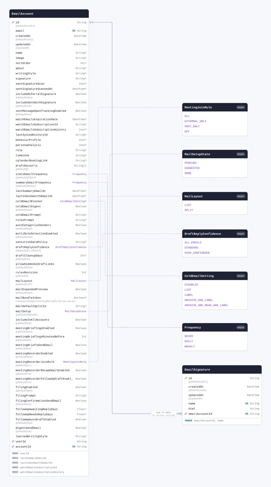

| Field            | Type       | Constraints                                       | Default      | Description |
| ---------------- | ---------- | ------------------------------------------------- | ------------ | ----------- |
| `id`             | `String`   | PK NOT NULL                                       | `cuid(1)`    |             |
| `createdAt`      | `DateTime` | NOT NULL                                          | `now()`      |             |
| `updatedAt`      | `DateTime` | NOT NULL                                          | `@updatedAt` |             |
| `name`           | `String`   | NOT NULL                                          |              |             |
| `html`           | `String`   | NOT NULL                                          |              |             |
| `emailAccountId` | `String`   | NOT NULL → [EmailAccount.id](#model-EmailAccount) |              |             |

#### Indexes

- `@@unique([emailAccountId, name])`

#### References

- `emailAccountId` → [EmailAccount.id](#model-EmailAccount) (many-to-one, on delete Cascade)

#### Definition

```sql
CREATE TABLE "EmailSignature" (
    "id" TEXT NOT NULL,
    "createdAt" TIMESTAMP(3) NOT NULL DEFAULT CURRENT_TIMESTAMP,
    "updatedAt" TIMESTAMP(3) NOT NULL,
    "name" TEXT NOT NULL,
    "html" TEXT NOT NULL,
    "emailAccountId" TEXT NOT NULL,

    CONSTRAINT "EmailSignature_pkey" PRIMARY KEY ("id")
);

CREATE UNIQUE INDEX "EmailSignature_emailAccountId_name_key" ON "EmailSignature"("emailAccountId", "name");

ALTER TABLE "EmailSignature" ADD CONSTRAINT "EmailSignature_emailAccountId_fkey" FOREIGN KEY ("emailAccountId") REFERENCES "EmailAccount"("id") ON DELETE CASCADE ON UPDATE CASCADE;
```

<details>
<summary>Queries and their SQL</summary>

**findMany**: Every row

```ts
await prisma.emailSignature.findMany();
```

```sql
SELECT
  "public"."EmailSignature"."id",
  "public"."EmailSignature"."createdAt",
  "public"."EmailSignature"."updatedAt",
  "public"."EmailSignature"."name",
  "public"."EmailSignature"."html",
  "public"."EmailSignature"."emailAccountId"
FROM
  "public"."EmailSignature"
WHERE
  1 = 1
OFFSET
  $1
-- params: ["0"]
```

**count**: How many rows there are

```ts
await prisma.emailSignature.count();
```

```sql
SELECT
  COUNT(*) AS "_count$_all"
FROM
  (
    SELECT
      "public"."EmailSignature"."id"
    FROM
      "public"."EmailSignature"
    WHERE
      1 = 1
    OFFSET
      $1
  ) AS "sub"
-- params: ["0"]
```

**findMany**: Every row with its relations

```ts
await prisma.emailSignature.findMany({ include: { emailAccount: true } });
```

```sql
SELECT
  "public"."EmailSignature"."id",
  "public"."EmailSignature"."createdAt",
  "public"."EmailSignature"."updatedAt",
  "public"."EmailSignature"."name",
  "public"."EmailSignature"."html",
  "public"."EmailSignature"."emailAccountId"
FROM
  "public"."EmailSignature"
WHERE
  1 = 1
OFFSET
  $1
-- params: ["0"]

SELECT
  "public"."EmailAccount"."id",
  "public"."EmailAccount"."email",
  "public"."EmailAccount"."createdAt",
  "public"."EmailAccount"."updatedAt",
  "public"."EmailAccount"."name",
  "public"."EmailAccount"."image",
  "public"."EmailAccount"."sortOrder",
  "public"."EmailAccount"."about",
  "public"."EmailAccount"."writingStyle",
  "public"."EmailAccount"."signature",
  "public"."EmailAccount"."sentSignatureScan",
  "public"."EmailAccount"."sentSignatureScannedAt",
  "public"."EmailAccount"."includeReferralSignature",
  "public"."EmailAccount"."includeSentWithSignature",
  "public"."EmailAccount"."sentMessageOpenTrackingEnabled",
  "public"."EmailAccount"."watchEmailsExpirationDate",
  "public"."EmailAccount"."watchEmailsSubscriptionId",
  "public"."EmailAccount"."watchEmailsSubscriptionHistory",
  "public"."EmailAccount"."lastSyncedHistoryId",
  "public"."EmailAccount"."behaviorProfile",
  "public"."EmailAccount"."personaAnalysis",
  "public"."EmailAccount"."role",
  "public"."EmailAccount"."timezone",
  "public"."EmailAccount"."calendarBookingLink",
  "public"."EmailAccount"."draftDocsUrls",
  "public"."EmailAccount"."statsEmailFrequency"::text,
  "public"."EmailAccount"."summaryEmailFrequency"::text,
  "public"."EmailAccount"."lastSummaryEmailAt",
  "public"."EmailAccount"."lastInboxHealthEmailAt",
  "public"."EmailAccount"."coldEmailBlocker"::text,
  "public"."EmailAccount"."coldEmailDigest",
  "public"."EmailAccount"."coldEmailPrompt",
  "public"."EmailAccount"."rulesPrompt",
  "public"."EmailAccount"."autoCategorizeSenders",
  "public"."EmailAccount"."multiRuleSelectionEnabled",
  "public"."EmailAccount"."sensitiveDataPolicy",
  "public"."EmailAccount"."draftReplyConfidence"::text,
  "public"."EmailAccount"."draftCleanupDays",
  "public"."EmailAccount"."allowHiddenAiDraftLinks",
  "public"."EmailAccount"."rulesRevision",
  "public"."EmailAccount"."mailLayout"::text,
  "public"."EmailAccount"."mailExpandedPreview",
  "public"."EmailAccount"."mailBundleInbox",
  "public"."EmailAccount"."mailDefaultSplitId",
  "public"."EmailAccount"."mailSetup"::text,
  "public"."EmailAccount"."includeInAllAccounts",
  "public"."EmailAccount"."meetingBriefingsEnabled",
  "public"."EmailAccount"."meetingBriefingsMinutesBefore",
  "public"."EmailAccount"."meetingBriefsSendEmail",
  "public"."EmailAccount"."meetingRecorderEnabled",
  "public"."EmailAccount"."meetingRecorderJoinRule"::text,
  "public"."EmailAccount"."meetingRecorderRecapEmailEnabled",
  "public"."EmailAccount"."meetingRecorderFollowUpDraftEnabled",
  "public"."EmailAccount"."filingEnabled",
  "public"."EmailAccount"."filingPrompt",
  "public"."EmailAccount"."filingConfirmationSendEmail",
  "public"."EmailAccount"."followUpAwaitingReplyDays",
  "public"."EmailAccount"."followUpNeedsReplyDays",
  "public"."EmailAccount"."followUpAutoDraftEnabled",
  "public"."EmailAccount"."digestSendEmail",
  "public"."EmailAccount"."learnedWritingStyle",
  "public"."EmailAccount"."userId",
  "public"."EmailAccount"."accountId"
FROM
  "public"."EmailAccount"
WHERE
  "public"."EmailAccount"."id" IN ($1)
OFFSET
  $2
-- params: ["<emailAccountId of the rows above>","0"]
```

**findUnique**: One row by what is unique to it

```ts
await prisma.emailSignature.findUnique({ where: { id: "example" } });
```

```sql
SELECT
  "public"."EmailSignature"."id",
  "public"."EmailSignature"."createdAt",
  "public"."EmailSignature"."updatedAt",
  "public"."EmailSignature"."name",
  "public"."EmailSignature"."html",
  "public"."EmailSignature"."emailAccountId"
FROM
  "public"."EmailSignature"
WHERE
  (
    "public"."EmailSignature"."id" = $1
    AND 1 = 1
  )
LIMIT
  $2
OFFSET
  $3
-- params: ["example","1","0"]
```

**create**: Create a row

```ts
await prisma.emailSignature.create({
  data: { name: "example", html: "example", emailAccountId: "example" },
});
```

```sql
INSERT INTO
  "public"."EmailSignature" (
    "id",
    "createdAt",
    "updatedAt",
    "name",
    "html",
    "emailAccountId"
  )
VALUES
  ($1, $2, $3, $4, $5, $6)
RETURNING
  "public"."EmailSignature"."id",
  "public"."EmailSignature"."createdAt",
  "public"."EmailSignature"."updatedAt",
  "public"."EmailSignature"."name",
  "public"."EmailSignature"."html",
  "public"."EmailSignature"."emailAccountId"
-- params: ["<cuid(1)>","<now()>","<now()>","example","example","example"]
```

**update**: Update a row

```ts
await prisma.emailSignature.update({
  where: { id: "example" },
  data: { createdAt: new Date("2026-01-01T00:00:00.000Z") },
});
```

```sql
UPDATE "public"."EmailSignature"
SET
  "createdAt" = $1,
  "updatedAt" = $2
WHERE
  (
    "public"."EmailSignature"."id" = $3
    AND 1 = 1
  )
RETURNING
  "public"."EmailSignature"."id",
  "public"."EmailSignature"."createdAt",
  "public"."EmailSignature"."updatedAt",
  "public"."EmailSignature"."name",
  "public"."EmailSignature"."html",
  "public"."EmailSignature"."emailAccountId"
-- params: ["2026-01-01T00:00:00.000Z",{"prisma__type":"generatorCall","prisma__value":{"name":"now","args":[],"returnType":{"type":"DateTime"}}},"example"]
```

**delete**: Delete a row

```ts
await prisma.emailSignature.delete({ where: { id: "example" } });
```

```sql
DELETE FROM "public"."EmailSignature"
WHERE
  (
    "public"."EmailSignature"."id" = $1
    AND 1 = 1
  )
RETURNING
  "public"."EmailSignature"."id",
  "public"."EmailSignature"."createdAt",
  "public"."EmailSignature"."updatedAt",
  "public"."EmailSignature"."name",
  "public"."EmailSignature"."html",
  "public"."EmailSignature"."emailAccountId"
-- params: ["example"]
```

</details>

<a id="model-ReplyMemory"></a>

### ReplyMemory

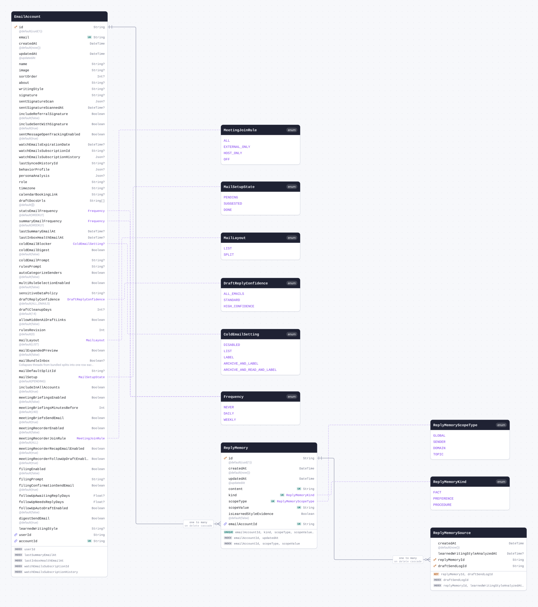

| Field                    | Type                                                 | Constraints                                       | Default      | Description |
| ------------------------ | ---------------------------------------------------- | ------------------------------------------------- | ------------ | ----------- |
| `id`                     | `String`                                             | PK NOT NULL                                       | `cuid(1)`    |             |
| `createdAt`              | `DateTime`                                           | NOT NULL                                          | `now()`      |             |
| `updatedAt`              | `DateTime`                                           | NOT NULL                                          | `@updatedAt` |             |
| `content`                | `String`                                             | NOT NULL                                          |              |             |
| `kind`                   | [`ReplyMemoryKind`](#enum-ReplyMemoryKind)           | NOT NULL                                          |              |             |
| `scopeType`              | [`ReplyMemoryScopeType`](#enum-ReplyMemoryScopeType) | NOT NULL                                          |              |             |
| `scopeValue`             | `String`                                             | NOT NULL                                          |              |             |
| `isLearnedStyleEvidence` | `Boolean`                                            | NOT NULL                                          | `false`      |             |
| `emailAccountId`         | `String`                                             | NOT NULL → [EmailAccount.id](#model-EmailAccount) |              |             |

#### Indexes

- `@@index([emailAccountId, updatedAt])`
- `@@index([emailAccountId, scopeType, scopeValue])`
- `@@unique([emailAccountId, kind, scopeType, scopeValue, content])`

#### References

- `emailAccountId` → [EmailAccount.id](#model-EmailAccount) (many-to-one, on delete Cascade)

#### Referenced by

- `id` ← [ReplyMemorySource.replyMemoryId](#model-ReplyMemorySource) (one-to-many, on delete Cascade)

#### Definition

```sql
CREATE TABLE "ReplyMemory" (
    "id" TEXT NOT NULL,
    "createdAt" TIMESTAMP(3) NOT NULL DEFAULT CURRENT_TIMESTAMP,
    "updatedAt" TIMESTAMP(3) NOT NULL,
    "content" TEXT NOT NULL,
    "kind" "ReplyMemoryKind" NOT NULL,
    "scopeType" "ReplyMemoryScopeType" NOT NULL,
    "scopeValue" TEXT NOT NULL,
    "isLearnedStyleEvidence" BOOLEAN NOT NULL DEFAULT false,
    "emailAccountId" TEXT NOT NULL,

    CONSTRAINT "ReplyMemory_pkey" PRIMARY KEY ("id")
);

CREATE INDEX "ReplyMemory_emailAccountId_updatedAt_idx" ON "ReplyMemory"("emailAccountId", "updatedAt");

CREATE INDEX "ReplyMemory_emailAccountId_scopeType_scopeValue_idx" ON "ReplyMemory"("emailAccountId", "scopeType", "scopeValue");

CREATE UNIQUE INDEX "ReplyMemory_emailAccountId_kind_scopeType_scopeValue_conten_key" ON "ReplyMemory"("emailAccountId", "kind", "scopeType", "scopeValue", "content");

ALTER TABLE "ReplyMemory" ADD CONSTRAINT "ReplyMemory_emailAccountId_fkey" FOREIGN KEY ("emailAccountId") REFERENCES "EmailAccount"("id") ON DELETE CASCADE ON UPDATE CASCADE;
```

<details>
<summary>Queries and their SQL</summary>

**findMany**: Every row

```ts
await prisma.replyMemory.findMany();
```

```sql
SELECT
  "public"."ReplyMemory"."id",
  "public"."ReplyMemory"."createdAt",
  "public"."ReplyMemory"."updatedAt",
  "public"."ReplyMemory"."content",
  "public"."ReplyMemory"."kind"::text,
  "public"."ReplyMemory"."scopeType"::text,
  "public"."ReplyMemory"."scopeValue",
  "public"."ReplyMemory"."isLearnedStyleEvidence",
  "public"."ReplyMemory"."emailAccountId"
FROM
  "public"."ReplyMemory"
WHERE
  1 = 1
OFFSET
  $1
-- params: ["0"]
```

**count**: How many rows there are

```ts
await prisma.replyMemory.count();
```

```sql
SELECT
  COUNT(*) AS "_count$_all"
FROM
  (
    SELECT
      "public"."ReplyMemory"."id"
    FROM
      "public"."ReplyMemory"
    WHERE
      1 = 1
    OFFSET
      $1
  ) AS "sub"
-- params: ["0"]
```

**findMany**: Every row with its relations

```ts
await prisma.replyMemory.findMany({ include: { emailAccount: true, sources: true } });
```

```sql
SELECT
  "public"."ReplyMemory"."id",
  "public"."ReplyMemory"."createdAt",
  "public"."ReplyMemory"."updatedAt",
  "public"."ReplyMemory"."content",
  "public"."ReplyMemory"."kind"::text,
  "public"."ReplyMemory"."scopeType"::text,
  "public"."ReplyMemory"."scopeValue",
  "public"."ReplyMemory"."isLearnedStyleEvidence",
  "public"."ReplyMemory"."emailAccountId"
FROM
  "public"."ReplyMemory"
WHERE
  1 = 1
OFFSET
  $1
-- params: ["0"]

SELECT
  "public"."EmailAccount"."id",
  "public"."EmailAccount"."email",
  "public"."EmailAccount"."createdAt",
  "public"."EmailAccount"."updatedAt",
  "public"."EmailAccount"."name",
  "public"."EmailAccount"."image",
  "public"."EmailAccount"."sortOrder",
  "public"."EmailAccount"."about",
  "public"."EmailAccount"."writingStyle",
  "public"."EmailAccount"."signature",
  "public"."EmailAccount"."sentSignatureScan",
  "public"."EmailAccount"."sentSignatureScannedAt",
  "public"."EmailAccount"."includeReferralSignature",
  "public"."EmailAccount"."includeSentWithSignature",
  "public"."EmailAccount"."sentMessageOpenTrackingEnabled",
  "public"."EmailAccount"."watchEmailsExpirationDate",
  "public"."EmailAccount"."watchEmailsSubscriptionId",
  "public"."EmailAccount"."watchEmailsSubscriptionHistory",
  "public"."EmailAccount"."lastSyncedHistoryId",
  "public"."EmailAccount"."behaviorProfile",
  "public"."EmailAccount"."personaAnalysis",
  "public"."EmailAccount"."role",
  "public"."EmailAccount"."timezone",
  "public"."EmailAccount"."calendarBookingLink",
  "public"."EmailAccount"."draftDocsUrls",
  "public"."EmailAccount"."statsEmailFrequency"::text,
  "public"."EmailAccount"."summaryEmailFrequency"::text,
  "public"."EmailAccount"."lastSummaryEmailAt",
  "public"."EmailAccount"."lastInboxHealthEmailAt",
  "public"."EmailAccount"."coldEmailBlocker"::text,
  "public"."EmailAccount"."coldEmailDigest",
  "public"."EmailAccount"."coldEmailPrompt",
  "public"."EmailAccount"."rulesPrompt",
  "public"."EmailAccount"."autoCategorizeSenders",
  "public"."EmailAccount"."multiRuleSelectionEnabled",
  "public"."EmailAccount"."sensitiveDataPolicy",
  "public"."EmailAccount"."draftReplyConfidence"::text,
  "public"."EmailAccount"."draftCleanupDays",
  "public"."EmailAccount"."allowHiddenAiDraftLinks",
  "public"."EmailAccount"."rulesRevision",
  "public"."EmailAccount"."mailLayout"::text,
  "public"."EmailAccount"."mailExpandedPreview",
  "public"."EmailAccount"."mailBundleInbox",
  "public"."EmailAccount"."mailDefaultSplitId",
  "public"."EmailAccount"."mailSetup"::text,
  "public"."EmailAccount"."includeInAllAccounts",
  "public"."EmailAccount"."meetingBriefingsEnabled",
  "public"."EmailAccount"."meetingBriefingsMinutesBefore",
  "public"."EmailAccount"."meetingBriefsSendEmail",
  "public"."EmailAccount"."meetingRecorderEnabled",
  "public"."EmailAccount"."meetingRecorderJoinRule"::text,
  "public"."EmailAccount"."meetingRecorderRecapEmailEnabled",
  "public"."EmailAccount"."meetingRecorderFollowUpDraftEnabled",
  "public"."EmailAccount"."filingEnabled",
  "public"."EmailAccount"."filingPrompt",
  "public"."EmailAccount"."filingConfirmationSendEmail",
  "public"."EmailAccount"."followUpAwaitingReplyDays",
  "public"."EmailAccount"."followUpNeedsReplyDays",
  "public"."EmailAccount"."followUpAutoDraftEnabled",
  "public"."EmailAccount"."digestSendEmail",
  "public"."EmailAccount"."learnedWritingStyle",
  "public"."EmailAccount"."userId",
  "public"."EmailAccount"."accountId"
FROM
  "public"."EmailAccount"
WHERE
  "public"."EmailAccount"."id" IN ($1)
OFFSET
  $2
-- params: ["<emailAccountId of the rows above>","0"]

SELECT
  "public"."ReplyMemorySource"."replyMemoryId",
  "public"."ReplyMemorySource"."draftSendLogId",
  "public"."ReplyMemorySource"."createdAt",
  "public"."ReplyMemorySource"."learnedWritingStyleAnalyzedAt"
FROM
  "public"."ReplyMemorySource"
WHERE
  "public"."ReplyMemorySource"."replyMemoryId" IN ($1)
OFFSET
  $2
-- params: ["<id of the rows above>","0"]
```

**findUnique**: One row by what is unique to it

```ts
await prisma.replyMemory.findUnique({ where: { id: "example" } });
```

```sql
SELECT
  "public"."ReplyMemory"."id",
  "public"."ReplyMemory"."createdAt",
  "public"."ReplyMemory"."updatedAt",
  "public"."ReplyMemory"."content",
  "public"."ReplyMemory"."kind"::text,
  "public"."ReplyMemory"."scopeType"::text,
  "public"."ReplyMemory"."scopeValue",
  "public"."ReplyMemory"."isLearnedStyleEvidence",
  "public"."ReplyMemory"."emailAccountId"
FROM
  "public"."ReplyMemory"
WHERE
  (
    "public"."ReplyMemory"."id" = $1
    AND 1 = 1
  )
LIMIT
  $2
OFFSET
  $3
-- params: ["example","1","0"]
```

**create**: Create a row

```ts
await prisma.replyMemory.create({
  data: {
    content: "example",
    kind: "FACT",
    scopeType: "GLOBAL",
    scopeValue: "example",
    emailAccountId: "example",
  },
});
```

```sql
INSERT INTO
  "public"."ReplyMemory" (
    "id",
    "createdAt",
    "updatedAt",
    "content",
    "kind",
    "scopeType",
    "scopeValue",
    "isLearnedStyleEvidence",
    "emailAccountId"
  )
VALUES
  (
    $1,
    $2,
    $3,
    $4,
    CAST($5::text AS "public"."ReplyMemoryKind"),
    CAST($6::text AS "public"."ReplyMemoryScopeType"),
    $7,
    $8,
    $9
  )
RETURNING
  "public"."ReplyMemory"."id",
  "public"."ReplyMemory"."createdAt",
  "public"."ReplyMemory"."updatedAt",
  "public"."ReplyMemory"."content",
  "public"."ReplyMemory"."kind"::text,
  "public"."ReplyMemory"."scopeType"::text,
  "public"."ReplyMemory"."scopeValue",
  "public"."ReplyMemory"."isLearnedStyleEvidence",
  "public"."ReplyMemory"."emailAccountId"
-- params: ["<cuid(1)>","<now()>","<now()>","example","FACT","GLOBAL","example",false,"example"]
```

**update**: Update a row

```ts
await prisma.replyMemory.update({
  where: { id: "example" },
  data: { createdAt: new Date("2026-01-01T00:00:00.000Z") },
});
```

```sql
UPDATE "public"."ReplyMemory"
SET
  "createdAt" = $1,
  "updatedAt" = $2
WHERE
  (
    "public"."ReplyMemory"."id" = $3
    AND 1 = 1
  )
RETURNING
  "public"."ReplyMemory"."id",
  "public"."ReplyMemory"."createdAt",
  "public"."ReplyMemory"."updatedAt",
  "public"."ReplyMemory"."content",
  "public"."ReplyMemory"."kind"::text,
  "public"."ReplyMemory"."scopeType"::text,
  "public"."ReplyMemory"."scopeValue",
  "public"."ReplyMemory"."isLearnedStyleEvidence",
  "public"."ReplyMemory"."emailAccountId"
-- params: ["2026-01-01T00:00:00.000Z",{"prisma__type":"generatorCall","prisma__value":{"name":"now","args":[],"returnType":{"type":"DateTime"}}},"example"]
```

**delete**: Delete a row

```ts
await prisma.replyMemory.delete({ where: { id: "example" } });
```

```sql
DELETE FROM "public"."ReplyMemory"
WHERE
  (
    "public"."ReplyMemory"."id" = $1
    AND 1 = 1
  )
RETURNING
  "public"."ReplyMemory"."id",
  "public"."ReplyMemory"."createdAt",
  "public"."ReplyMemory"."updatedAt",
  "public"."ReplyMemory"."content",
  "public"."ReplyMemory"."kind"::text,
  "public"."ReplyMemory"."scopeType"::text,
  "public"."ReplyMemory"."scopeValue",
  "public"."ReplyMemory"."isLearnedStyleEvidence",
  "public"."ReplyMemory"."emailAccountId"
-- params: ["example"]
```

</details>

<a id="model-ReplyMemorySource"></a>

### ReplyMemorySource

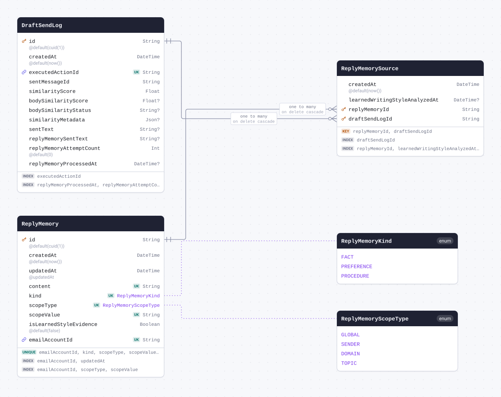

| Field                           | Type       | Constraints                                          | Default | Description |
| ------------------------------- | ---------- | ---------------------------------------------------- | ------- | ----------- |
| `createdAt`                     | `DateTime` | NOT NULL                                             | `now()` |             |
| `learnedWritingStyleAnalyzedAt` | `DateTime` | NULL                                                 |         |             |
| `replyMemoryId`                 | `String`   | PK NOT NULL → [ReplyMemory.id](#model-ReplyMemory)   |         |             |
| `draftSendLogId`                | `String`   | PK NOT NULL → [DraftSendLog.id](#model-DraftSendLog) |         |             |

#### Indexes

- `@@id([replyMemoryId, draftSendLogId])`
- `@@index([draftSendLogId])`
- `@@index([replyMemoryId, learnedWritingStyleAnalyzedAt, createdAt])`

#### References

- `replyMemoryId` → [ReplyMemory.id](#model-ReplyMemory) (many-to-one, on delete Cascade)
- `draftSendLogId` → [DraftSendLog.id](#model-DraftSendLog) (many-to-one, on delete Cascade)

#### Definition

```sql
CREATE TABLE "ReplyMemorySource" (
    "createdAt" TIMESTAMP(3) NOT NULL DEFAULT CURRENT_TIMESTAMP,
    "learnedWritingStyleAnalyzedAt" TIMESTAMP(3),
    "replyMemoryId" TEXT NOT NULL,
    "draftSendLogId" TEXT NOT NULL,

    CONSTRAINT "ReplyMemorySource_pkey" PRIMARY KEY ("replyMemoryId","draftSendLogId")
);

CREATE INDEX "ReplyMemorySource_draftSendLogId_idx" ON "ReplyMemorySource"("draftSendLogId");

CREATE INDEX "ReplyMemorySource_replyMemoryId_learnedWritingStyleAnalyzed_idx" ON "ReplyMemorySource"("replyMemoryId", "learnedWritingStyleAnalyzedAt", "createdAt");

ALTER TABLE "ReplyMemorySource" ADD CONSTRAINT "ReplyMemorySource_replyMemoryId_fkey" FOREIGN KEY ("replyMemoryId") REFERENCES "ReplyMemory"("id") ON DELETE CASCADE ON UPDATE CASCADE;

ALTER TABLE "ReplyMemorySource" ADD CONSTRAINT "ReplyMemorySource_draftSendLogId_fkey" FOREIGN KEY ("draftSendLogId") REFERENCES "DraftSendLog"("id") ON DELETE CASCADE ON UPDATE CASCADE;
```

<details>
<summary>Queries and their SQL</summary>

**findMany**: Every row

```ts
await prisma.replyMemorySource.findMany();
```

```sql
SELECT
  "public"."ReplyMemorySource"."replyMemoryId",
  "public"."ReplyMemorySource"."draftSendLogId",
  "public"."ReplyMemorySource"."createdAt",
  "public"."ReplyMemorySource"."learnedWritingStyleAnalyzedAt"
FROM
  "public"."ReplyMemorySource"
WHERE
  1 = 1
OFFSET
  $1
-- params: ["0"]
```

**count**: How many rows there are

```ts
await prisma.replyMemorySource.count();
```

```sql
SELECT
  COUNT(*) AS "_count$_all"
FROM
  (
    SELECT
      "public"."ReplyMemorySource"."replyMemoryId",
      "public"."ReplyMemorySource"."draftSendLogId"
    FROM
      "public"."ReplyMemorySource"
    WHERE
      1 = 1
    OFFSET
      $1
  ) AS "sub"
-- params: ["0"]
```

**findMany**: Every row with its relations

```ts
await prisma.replyMemorySource.findMany({ include: { replyMemory: true, draftSendLog: true } });
```

```sql
SELECT
  "public"."ReplyMemorySource"."replyMemoryId",
  "public"."ReplyMemorySource"."draftSendLogId",
  "public"."ReplyMemorySource"."createdAt",
  "public"."ReplyMemorySource"."learnedWritingStyleAnalyzedAt"
FROM
  "public"."ReplyMemorySource"
WHERE
  1 = 1
OFFSET
  $1
-- params: ["0"]

SELECT
  "public"."ReplyMemory"."id",
  "public"."ReplyMemory"."createdAt",
  "public"."ReplyMemory"."updatedAt",
  "public"."ReplyMemory"."content",
  "public"."ReplyMemory"."kind"::text,
  "public"."ReplyMemory"."scopeType"::text,
  "public"."ReplyMemory"."scopeValue",
  "public"."ReplyMemory"."isLearnedStyleEvidence",
  "public"."ReplyMemory"."emailAccountId"
FROM
  "public"."ReplyMemory"
WHERE
  "public"."ReplyMemory"."id" IN ($1)
OFFSET
  $2
-- params: ["<replyMemoryId of the rows above>","0"]

SELECT
  "public"."DraftSendLog"."id",
  "public"."DraftSendLog"."createdAt",
  "public"."DraftSendLog"."executedActionId",
  "public"."DraftSendLog"."sentMessageId",
  "public"."DraftSendLog"."similarityScore",
  "public"."DraftSendLog"."bodySimilarityScore",
  "public"."DraftSendLog"."bodySimilarityStatus",
  "public"."DraftSendLog"."similarityMetadata",
  "public"."DraftSendLog"."sentText",
  "public"."DraftSendLog"."replyMemorySentText",
  "public"."DraftSendLog"."replyMemoryAttemptCount",
  "public"."DraftSendLog"."replyMemoryProcessedAt"
FROM
  "public"."DraftSendLog"
WHERE
  "public"."DraftSendLog"."id" IN ($1)
OFFSET
  $2
-- params: ["<draftSendLogId of the rows above>","0"]
```

**findUnique**: One row by what is unique to it

```ts
await prisma.replyMemorySource.findUnique({
  where: { replyMemoryId_draftSendLogId: { replyMemoryId: "example", draftSendLogId: "example" } },
});
```

```sql
SELECT
  "public"."ReplyMemorySource"."replyMemoryId",
  "public"."ReplyMemorySource"."draftSendLogId",
  "public"."ReplyMemorySource"."createdAt",
  "public"."ReplyMemorySource"."learnedWritingStyleAnalyzedAt"
FROM
  "public"."ReplyMemorySource"
WHERE
  (
    (
      "public"."ReplyMemorySource"."replyMemoryId" = $1
      AND "public"."ReplyMemorySource"."draftSendLogId" = $2
    )
    AND 1 = 1
  )
LIMIT
  $3
OFFSET
  $4
-- params: ["example","example","1","0"]
```

**create**: Create a row

```ts
await prisma.replyMemorySource.create({
  data: { replyMemoryId: "example", draftSendLogId: "example" },
});
```

```sql
INSERT INTO
  "public"."ReplyMemorySource" ("createdAt", "replyMemoryId", "draftSendLogId")
VALUES
  ($1, $2, $3)
RETURNING
  "public"."ReplyMemorySource"."replyMemoryId",
  "public"."ReplyMemorySource"."draftSendLogId",
  "public"."ReplyMemorySource"."createdAt",
  "public"."ReplyMemorySource"."learnedWritingStyleAnalyzedAt"
-- params: ["<now()>","example","example"]
```

**update**: Update a row

```ts
await prisma.replyMemorySource.update({
  where: { replyMemoryId_draftSendLogId: { replyMemoryId: "example", draftSendLogId: "example" } },
  data: { createdAt: new Date("2026-01-01T00:00:00.000Z") },
});
```

```sql
UPDATE "public"."ReplyMemorySource"
SET
  "createdAt" = $1
WHERE
  (
    (
      "public"."ReplyMemorySource"."replyMemoryId" = $2
      AND "public"."ReplyMemorySource"."draftSendLogId" = $3
    )
    AND 1 = 1
  )
RETURNING
  "public"."ReplyMemorySource"."replyMemoryId",
  "public"."ReplyMemorySource"."draftSendLogId",
  "public"."ReplyMemorySource"."createdAt",
  "public"."ReplyMemorySource"."learnedWritingStyleAnalyzedAt"
-- params: ["2026-01-01T00:00:00.000Z","example","example"]
```

**delete**: Delete a row

```ts
await prisma.replyMemorySource.delete({
  where: { replyMemoryId_draftSendLogId: { replyMemoryId: "example", draftSendLogId: "example" } },
});
```

```sql
DELETE FROM "public"."ReplyMemorySource"
WHERE
  (
    (
      "public"."ReplyMemorySource"."replyMemoryId" = $1
      AND "public"."ReplyMemorySource"."draftSendLogId" = $2
    )
    AND 1 = 1
  )
RETURNING
  "public"."ReplyMemorySource"."replyMemoryId",
  "public"."ReplyMemorySource"."draftSendLogId",
  "public"."ReplyMemorySource"."createdAt",
  "public"."ReplyMemorySource"."learnedWritingStyleAnalyzedAt"
-- params: ["example","example"]
```

</details>

<a id="model-ApiKey"></a>

### ApiKey

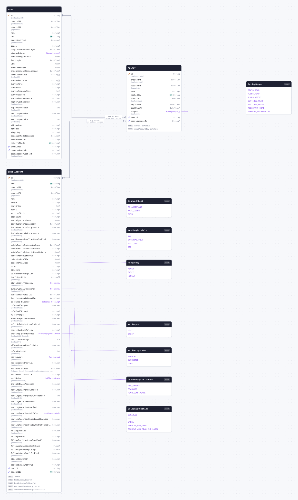

| Field            | Type                                 | Constraints                                   | Default      | Description |
| ---------------- | ------------------------------------ | --------------------------------------------- | ------------ | ----------- |
| `id`             | `String`                             | PK NOT NULL                                   | `cuid(1)`    |             |
| `createdAt`      | `DateTime`                           | NOT NULL                                      | `now()`      |             |
| `updatedAt`      | `DateTime`                           | NOT NULL                                      | `@updatedAt` |             |
| `name`           | `String`                             | NULL                                          |              |             |
| `hashedKey`      | `String`                             | UNIQUE NOT NULL                               |              |             |
| `isActive`       | `Boolean`                            | NOT NULL                                      | `true`       |             |
| `expiresAt`      | `DateTime`                           | NULL                                          |              |             |
| `lastUsedAt`     | `DateTime`                           | NULL                                          |              |             |
| `scopes`         | [`ApiKeyScope[]`](#enum-ApiKeyScope) | NOT NULL                                      | `[]`         |             |
| `userId`         | `String`                             | NOT NULL → [User.id](#model-User)             |              |             |
| `emailAccountId` | `String`                             | NULL → [EmailAccount.id](#model-EmailAccount) |              |             |

#### Indexes

- `@@index([userId, isActive])`
- `@@index([emailAccountId, isActive])`

#### References

- `userId` → [User.id](#model-User) (many-to-one, on delete Cascade)
- `emailAccountId` → [EmailAccount.id](#model-EmailAccount) (many-to-one, on delete Cascade)

#### Definition

```sql
CREATE TABLE "ApiKey" (
    "id" TEXT NOT NULL,
    "createdAt" TIMESTAMP(3) NOT NULL DEFAULT CURRENT_TIMESTAMP,
    "updatedAt" TIMESTAMP(3) NOT NULL,
    "name" TEXT,
    "hashedKey" TEXT NOT NULL,
    "isActive" BOOLEAN NOT NULL DEFAULT true,
    "expiresAt" TIMESTAMP(3),
    "lastUsedAt" TIMESTAMP(3),
    "scopes" "ApiKeyScope"[] DEFAULT ARRAY[]::"ApiKeyScope"[],
    "userId" TEXT NOT NULL,
    "emailAccountId" TEXT,

    CONSTRAINT "ApiKey_pkey" PRIMARY KEY ("id")
);

CREATE UNIQUE INDEX "ApiKey_hashedKey_key" ON "ApiKey"("hashedKey");

CREATE INDEX "ApiKey_userId_isActive_idx" ON "ApiKey"("userId", "isActive");

CREATE INDEX "ApiKey_emailAccountId_isActive_idx" ON "ApiKey"("emailAccountId", "isActive");

ALTER TABLE "ApiKey" ADD CONSTRAINT "ApiKey_userId_fkey" FOREIGN KEY ("userId") REFERENCES "User"("id") ON DELETE CASCADE ON UPDATE CASCADE;

ALTER TABLE "ApiKey" ADD CONSTRAINT "ApiKey_emailAccountId_fkey" FOREIGN KEY ("emailAccountId") REFERENCES "EmailAccount"("id") ON DELETE CASCADE ON UPDATE CASCADE;
```

<details>
<summary>Queries and their SQL</summary>

**findMany**: Every row

```ts
await prisma.apiKey.findMany();
```

```sql
SELECT
  "public"."ApiKey"."id",
  "public"."ApiKey"."createdAt",
  "public"."ApiKey"."updatedAt",
  "public"."ApiKey"."name",
  "public"."ApiKey"."hashedKey",
  "public"."ApiKey"."isActive",
  "public"."ApiKey"."expiresAt",
  "public"."ApiKey"."lastUsedAt",
  "public"."ApiKey"."scopes"::text[],
  "public"."ApiKey"."userId",
  "public"."ApiKey"."emailAccountId"
FROM
  "public"."ApiKey"
WHERE
  1 = 1
OFFSET
  $1
-- params: ["0"]
```

**count**: How many rows there are

```ts
await prisma.apiKey.count();
```

```sql
SELECT
  COUNT(*) AS "_count$_all"
FROM
  (
    SELECT
      "public"."ApiKey"."id"
    FROM
      "public"."ApiKey"
    WHERE
      1 = 1
    OFFSET
      $1
  ) AS "sub"
-- params: ["0"]
```

**findMany**: Every row with its relations

```ts
await prisma.apiKey.findMany({ include: { user: true, emailAccount: true } });
```

```sql
SELECT
  "public"."ApiKey"."id",
  "public"."ApiKey"."createdAt",
  "public"."ApiKey"."updatedAt",
  "public"."ApiKey"."name",
  "public"."ApiKey"."hashedKey",
  "public"."ApiKey"."isActive",
  "public"."ApiKey"."expiresAt",
  "public"."ApiKey"."lastUsedAt",
  "public"."ApiKey"."scopes"::text[],
  "public"."ApiKey"."userId",
  "public"."ApiKey"."emailAccountId"
FROM
  "public"."ApiKey"
WHERE
  1 = 1
OFFSET
  $1
-- params: ["0"]

SELECT
  "public"."User"."id",
  "public"."User"."createdAt",
  "public"."User"."updatedAt",
  "public"."User"."name",
  "public"."User"."email",
  "public"."User"."emailVerified",
  "public"."User"."image",
  "public"."User"."completedOnboardingAt",
  "public"."User"."signupIntent"::text,
  "public"."User"."onboardingAnswers",
  "public"."User"."lastLogin",
  "public"."User"."utms",
  "public"."User"."errorMessages",
  "public"."User"."announcementDismissedAt",
  "public"."User"."dismissedHints",
  "public"."User"."surveyFeatures",
  "public"."User"."surveyRole",
  "public"."User"."surveyGoal",
  "public"."User"."surveyCompanySize",
  "public"."User"."surveySource",
  "public"."User"."surveyImprovements",
  "public"."User"."mcpServerEnabled",
  "public"."User"."mcpTokenVersion",
  "public"."User"."emailOtpEnabled",
  "public"."User"."emailOtpVersion",
  "public"."User"."aiProvider",
  "public"."User"."aiModel",
  "public"."User"."aiApiKey",
  "public"."User"."decisionModelEnabled",
  "public"."User"."webhookSecret",
  "public"."User"."referralCode",
  "public"."User"."premiumId",
  "public"."User"."premiumAdminId",
  "public"."User"."scimAccessDisabled"
FROM
  "public"."User"
WHERE
  "public"."User"."id" IN ($1)
OFFSET
  $2
-- params: ["<userId of the rows above>","0"]

SELECT
  "public"."EmailAccount"."id",
  "public"."EmailAccount"."email",
  "public"."EmailAccount"."createdAt",
  "public"."EmailAccount"."updatedAt",
  "public"."EmailAccount"."name",
  "public"."EmailAccount"."image",
  "public"."EmailAccount"."sortOrder",
  "public"."EmailAccount"."about",
  "public"."EmailAccount"."writingStyle",
  "public"."EmailAccount"."signature",
  "public"."EmailAccount"."sentSignatureScan",
  "public"."EmailAccount"."sentSignatureScannedAt",
  "public"."EmailAccount"."includeReferralSignature",
  "public"."EmailAccount"."includeSentWithSignature",
  "public"."EmailAccount"."sentMessageOpenTrackingEnabled",
  "public"."EmailAccount"."watchEmailsExpirationDate",
  "public"."EmailAccount"."watchEmailsSubscriptionId",
  "public"."EmailAccount"."watchEmailsSubscriptionHistory",
  "public"."EmailAccount"."lastSyncedHistoryId",
  "public"."EmailAccount"."behaviorProfile",
  "public"."EmailAccount"."personaAnalysis",
  "public"."EmailAccount"."role",
  "public"."EmailAccount"."timezone",
  "public"."EmailAccount"."calendarBookingLink",
  "public"."EmailAccount"."draftDocsUrls",
  "public"."EmailAccount"."statsEmailFrequency"::text,
  "public"."EmailAccount"."summaryEmailFrequency"::text,
  "public"."EmailAccount"."lastSummaryEmailAt",
  "public"."EmailAccount"."lastInboxHealthEmailAt",
  "public"."EmailAccount"."coldEmailBlocker"::text,
  "public"."EmailAccount"."coldEmailDigest",
  "public"."EmailAccount"."coldEmailPrompt",
  "public"."EmailAccount"."rulesPrompt",
  "public"."EmailAccount"."autoCategorizeSenders",
  "public"."EmailAccount"."multiRuleSelectionEnabled",
  "public"."EmailAccount"."sensitiveDataPolicy",
  "public"."EmailAccount"."draftReplyConfidence"::text,
  "public"."EmailAccount"."draftCleanupDays",
  "public"."EmailAccount"."allowHiddenAiDraftLinks",
  "public"."EmailAccount"."rulesRevision",
  "public"."EmailAccount"."mailLayout"::text,
  "public"."EmailAccount"."mailExpandedPreview",
  "public"."EmailAccount"."mailBundleInbox",
  "public"."EmailAccount"."mailDefaultSplitId",
  "public"."EmailAccount"."mailSetup"::text,
  "public"."EmailAccount"."includeInAllAccounts",
  "public"."EmailAccount"."meetingBriefingsEnabled",
  "public"."EmailAccount"."meetingBriefingsMinutesBefore",
  "public"."EmailAccount"."meetingBriefsSendEmail",
  "public"."EmailAccount"."meetingRecorderEnabled",
  "public"."EmailAccount"."meetingRecorderJoinRule"::text,
  "public"."EmailAccount"."meetingRecorderRecapEmailEnabled",
  "public"."EmailAccount"."meetingRecorderFollowUpDraftEnabled",
  "public"."EmailAccount"."filingEnabled",
  "public"."EmailAccount"."filingPrompt",
  "public"."EmailAccount"."filingConfirmationSendEmail",
  "public"."EmailAccount"."followUpAwaitingReplyDays",
  "public"."EmailAccount"."followUpNeedsReplyDays",
  "public"."EmailAccount"."followUpAutoDraftEnabled",
  "public"."EmailAccount"."digestSendEmail",
  "public"."EmailAccount"."learnedWritingStyle",
  "public"."EmailAccount"."userId",
  "public"."EmailAccount"."accountId"
FROM
  "public"."EmailAccount"
WHERE
  "public"."EmailAccount"."id" IN ($1)
OFFSET
  $2
-- params: ["<emailAccountId of the rows above>","0"]
```

**findUnique**: One row by what is unique to it

```ts
await prisma.apiKey.findUnique({ where: { id: "example" } });
```

```sql
SELECT
  "public"."ApiKey"."id",
  "public"."ApiKey"."createdAt",
  "public"."ApiKey"."updatedAt",
  "public"."ApiKey"."name",
  "public"."ApiKey"."hashedKey",
  "public"."ApiKey"."isActive",
  "public"."ApiKey"."expiresAt",
  "public"."ApiKey"."lastUsedAt",
  "public"."ApiKey"."scopes"::text[],
  "public"."ApiKey"."userId",
  "public"."ApiKey"."emailAccountId"
FROM
  "public"."ApiKey"
WHERE
  (
    "public"."ApiKey"."id" = $1
    AND 1 = 1
  )
LIMIT
  $2
OFFSET
  $3
-- params: ["example","1","0"]
```

**create**: Create a row

```ts
await prisma.apiKey.create({ data: { hashedKey: "example", userId: "example" } });
```

```sql
INSERT INTO
  "public"."ApiKey" (
    "id",
    "createdAt",
    "updatedAt",
    "hashedKey",
    "isActive",
    "scopes",
    "userId"
  )
VALUES
  (
    $1,
    $2,
    $3,
    $4,
    $5,
    CAST($6::text[] AS "public"."ApiKeyScope" []),
    $7
  )
RETURNING
  "public"."ApiKey"."id",
  "public"."ApiKey"."createdAt",
  "public"."ApiKey"."updatedAt",
  "public"."ApiKey"."name",
  "public"."ApiKey"."hashedKey",
  "public"."ApiKey"."isActive",
  "public"."ApiKey"."expiresAt",
  "public"."ApiKey"."lastUsedAt",
  "public"."ApiKey"."scopes"::text[],
  "public"."ApiKey"."userId",
  "public"."ApiKey"."emailAccountId"
-- params: ["<cuid(1)>","<now()>","<now()>","example",true,[],"example"]
```

**update**: Update a row

```ts
await prisma.apiKey.update({
  where: { id: "example" },
  data: { createdAt: new Date("2026-01-01T00:00:00.000Z") },
});
```

```sql
UPDATE "public"."ApiKey"
SET
  "createdAt" = $1,
  "updatedAt" = $2
WHERE
  (
    "public"."ApiKey"."id" = $3
    AND 1 = 1
  )
RETURNING
  "public"."ApiKey"."id",
  "public"."ApiKey"."createdAt",
  "public"."ApiKey"."updatedAt",
  "public"."ApiKey"."name",
  "public"."ApiKey"."hashedKey",
  "public"."ApiKey"."isActive",
  "public"."ApiKey"."expiresAt",
  "public"."ApiKey"."lastUsedAt",
  "public"."ApiKey"."scopes"::text[],
  "public"."ApiKey"."userId",
  "public"."ApiKey"."emailAccountId"
-- params: ["2026-01-01T00:00:00.000Z",{"prisma__type":"generatorCall","prisma__value":{"name":"now","args":[],"returnType":{"type":"DateTime"}}},"example"]
```

**delete**: Delete a row

```ts
await prisma.apiKey.delete({ where: { id: "example" } });
```

```sql
DELETE FROM "public"."ApiKey"
WHERE
  (
    "public"."ApiKey"."id" = $1
    AND 1 = 1
  )
RETURNING
  "public"."ApiKey"."id",
  "public"."ApiKey"."createdAt",
  "public"."ApiKey"."updatedAt",
  "public"."ApiKey"."name",
  "public"."ApiKey"."hashedKey",
  "public"."ApiKey"."isActive",
  "public"."ApiKey"."expiresAt",
  "public"."ApiKey"."lastUsedAt",
  "public"."ApiKey"."scopes"::text[],
  "public"."ApiKey"."userId",
  "public"."ApiKey"."emailAccountId"
-- params: ["example"]
```

</details>

<a id="model-EmailToken"></a>

### EmailToken


| Field            | Type       | Constraints                                       | Default   | Description |
| ---------------- | ---------- | ------------------------------------------------- | --------- | ----------- |
| `id`             | `String`   | PK NOT NULL                                       | `cuid(1)` |             |
| `createdAt`      | `DateTime` | NOT NULL                                          | `now()`   |             |
| `token`          | `String`   | UNIQUE NOT NULL                                   |           |             |
| `expiresAt`      | `DateTime` | NOT NULL                                          |           |             |
| `emailAccountId` | `String`   | NOT NULL → [EmailAccount.id](#model-EmailAccount) |           |             |

#### Indexes

- `@@index([emailAccountId])`

#### References

- `emailAccountId` → [EmailAccount.id](#model-EmailAccount) (many-to-one, on delete Cascade)

#### Definition

```sql
CREATE TABLE "EmailToken" (
    "id" TEXT NOT NULL,
    "createdAt" TIMESTAMP(3) NOT NULL DEFAULT CURRENT_TIMESTAMP,
    "token" TEXT NOT NULL,
    "expiresAt" TIMESTAMP(3) NOT NULL,
    "emailAccountId" TEXT NOT NULL,

    CONSTRAINT "EmailToken_pkey" PRIMARY KEY ("id")
);

CREATE UNIQUE INDEX "EmailToken_token_key" ON "EmailToken"("token");

CREATE INDEX "EmailToken_emailAccountId_idx" ON "EmailToken"("emailAccountId");

ALTER TABLE "EmailToken" ADD CONSTRAINT "EmailToken_emailAccountId_fkey" FOREIGN KEY ("emailAccountId") REFERENCES "EmailAccount"("id") ON DELETE CASCADE ON UPDATE CASCADE;
```

<details>
<summary>Queries and their SQL</summary>

**findMany**: Every row

```ts
await prisma.emailToken.findMany();
```

```sql
SELECT
  "public"."EmailToken"."id",
  "public"."EmailToken"."createdAt",
  "public"."EmailToken"."token",
  "public"."EmailToken"."expiresAt",
  "public"."EmailToken"."emailAccountId"
FROM
  "public"."EmailToken"
WHERE
  1 = 1
OFFSET
  $1
-- params: ["0"]
```

**count**: How many rows there are

```ts
await prisma.emailToken.count();
```

```sql
SELECT
  COUNT(*) AS "_count$_all"
FROM
  (
    SELECT
      "public"."EmailToken"."id"
    FROM
      "public"."EmailToken"
    WHERE
      1 = 1
    OFFSET
      $1
  ) AS "sub"
-- params: ["0"]
```

**findMany**: Every row with its relations

```ts
await prisma.emailToken.findMany({ include: { emailAccount: true } });
```

```sql
SELECT
  "public"."EmailToken"."id",
  "public"."EmailToken"."createdAt",
  "public"."EmailToken"."token",
  "public"."EmailToken"."expiresAt",
  "public"."EmailToken"."emailAccountId"
FROM
  "public"."EmailToken"
WHERE
  1 = 1
OFFSET
  $1
-- params: ["0"]

SELECT
  "public"."EmailAccount"."id",
  "public"."EmailAccount"."email",
  "public"."EmailAccount"."createdAt",
  "public"."EmailAccount"."updatedAt",
  "public"."EmailAccount"."name",
  "public"."EmailAccount"."image",
  "public"."EmailAccount"."sortOrder",
  "public"."EmailAccount"."about",
  "public"."EmailAccount"."writingStyle",
  "public"."EmailAccount"."signature",
  "public"."EmailAccount"."sentSignatureScan",
  "public"."EmailAccount"."sentSignatureScannedAt",
  "public"."EmailAccount"."includeReferralSignature",
  "public"."EmailAccount"."includeSentWithSignature",
  "public"."EmailAccount"."sentMessageOpenTrackingEnabled",
  "public"."EmailAccount"."watchEmailsExpirationDate",
  "public"."EmailAccount"."watchEmailsSubscriptionId",
  "public"."EmailAccount"."watchEmailsSubscriptionHistory",
  "public"."EmailAccount"."lastSyncedHistoryId",
  "public"."EmailAccount"."behaviorProfile",
  "public"."EmailAccount"."personaAnalysis",
  "public"."EmailAccount"."role",
  "public"."EmailAccount"."timezone",
  "public"."EmailAccount"."calendarBookingLink",
  "public"."EmailAccount"."draftDocsUrls",
  "public"."EmailAccount"."statsEmailFrequency"::text,
  "public"."EmailAccount"."summaryEmailFrequency"::text,
  "public"."EmailAccount"."lastSummaryEmailAt",
  "public"."EmailAccount"."lastInboxHealthEmailAt",
  "public"."EmailAccount"."coldEmailBlocker"::text,
  "public"."EmailAccount"."coldEmailDigest",
  "public"."EmailAccount"."coldEmailPrompt",
  "public"."EmailAccount"."rulesPrompt",
  "public"."EmailAccount"."autoCategorizeSenders",
  "public"."EmailAccount"."multiRuleSelectionEnabled",
  "public"."EmailAccount"."sensitiveDataPolicy",
  "public"."EmailAccount"."draftReplyConfidence"::text,
  "public"."EmailAccount"."draftCleanupDays",
  "public"."EmailAccount"."allowHiddenAiDraftLinks",
  "public"."EmailAccount"."rulesRevision",
  "public"."EmailAccount"."mailLayout"::text,
  "public"."EmailAccount"."mailExpandedPreview",
  "public"."EmailAccount"."mailBundleInbox",
  "public"."EmailAccount"."mailDefaultSplitId",
  "public"."EmailAccount"."mailSetup"::text,
  "public"."EmailAccount"."includeInAllAccounts",
  "public"."EmailAccount"."meetingBriefingsEnabled",
  "public"."EmailAccount"."meetingBriefingsMinutesBefore",
  "public"."EmailAccount"."meetingBriefsSendEmail",
  "public"."EmailAccount"."meetingRecorderEnabled",
  "public"."EmailAccount"."meetingRecorderJoinRule"::text,
  "public"."EmailAccount"."meetingRecorderRecapEmailEnabled",
  "public"."EmailAccount"."meetingRecorderFollowUpDraftEnabled",
  "public"."EmailAccount"."filingEnabled",
  "public"."EmailAccount"."filingPrompt",
  "public"."EmailAccount"."filingConfirmationSendEmail",
  "public"."EmailAccount"."followUpAwaitingReplyDays",
  "public"."EmailAccount"."followUpNeedsReplyDays",
  "public"."EmailAccount"."followUpAutoDraftEnabled",
  "public"."EmailAccount"."digestSendEmail",
  "public"."EmailAccount"."learnedWritingStyle",
  "public"."EmailAccount"."userId",
  "public"."EmailAccount"."accountId"
FROM
  "public"."EmailAccount"
WHERE
  "public"."EmailAccount"."id" IN ($1)
OFFSET
  $2
-- params: ["<emailAccountId of the rows above>","0"]
```

**findUnique**: One row by what is unique to it

```ts
await prisma.emailToken.findUnique({ where: { id: "example" } });
```

```sql
SELECT
  "public"."EmailToken"."id",
  "public"."EmailToken"."createdAt",
  "public"."EmailToken"."token",
  "public"."EmailToken"."expiresAt",
  "public"."EmailToken"."emailAccountId"
FROM
  "public"."EmailToken"
WHERE
  (
    "public"."EmailToken"."id" = $1
    AND 1 = 1
  )
LIMIT
  $2
OFFSET
  $3
-- params: ["example","1","0"]
```

**create**: Create a row

```ts
await prisma.emailToken.create({
  data: {
    token: "example",
    expiresAt: new Date("2026-01-01T00:00:00.000Z"),
    emailAccountId: "example",
  },
});
```

```sql
INSERT INTO
  "public"."EmailToken" (
    "id",
    "createdAt",
    "token",
    "expiresAt",
    "emailAccountId"
  )
VALUES
  ($1, $2, $3, $4, $5)
RETURNING
  "public"."EmailToken"."id",
  "public"."EmailToken"."createdAt",
  "public"."EmailToken"."token",
  "public"."EmailToken"."expiresAt",
  "public"."EmailToken"."emailAccountId"
-- params: ["<cuid(1)>","<now()>","example","2026-01-01T00:00:00.000Z","example"]
```

**update**: Update a row

```ts
await prisma.emailToken.update({
  where: { id: "example" },
  data: { createdAt: new Date("2026-01-01T00:00:00.000Z") },
});
```

```sql
UPDATE "public"."EmailToken"
SET
  "createdAt" = $1
WHERE
  (
    "public"."EmailToken"."id" = $2
    AND 1 = 1
  )
RETURNING
  "public"."EmailToken"."id",
  "public"."EmailToken"."createdAt",
  "public"."EmailToken"."token",
  "public"."EmailToken"."expiresAt",
  "public"."EmailToken"."emailAccountId"
-- params: ["2026-01-01T00:00:00.000Z","example"]
```

**delete**: Delete a row

```ts
await prisma.emailToken.delete({ where: { id: "example" } });
```

```sql
DELETE FROM "public"."EmailToken"
WHERE
  (
    "public"."EmailToken"."id" = $1
    AND 1 = 1
  )
RETURNING
  "public"."EmailToken"."id",
  "public"."EmailToken"."createdAt",
  "public"."EmailToken"."token",
  "public"."EmailToken"."expiresAt",
  "public"."EmailToken"."emailAccountId"
-- params: ["example"]
```

</details>

<a id="model-Payment"></a>

### Payment

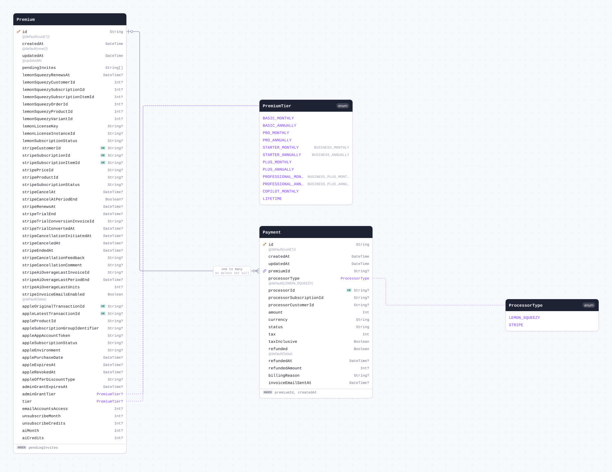

| Field                     | Type                                   | Constraints                         | Default         | Description |
| ------------------------- | -------------------------------------- | ----------------------------------- | --------------- | ----------- |
| `id`                      | `String`                               | PK NOT NULL                         | `cuid(1)`       |             |
| `createdAt`               | `DateTime`                             | NOT NULL                            |                 |             |
| `updatedAt`               | `DateTime`                             | NOT NULL                            |                 |             |
| `premiumId`               | `String`                               | NULL → [Premium.id](#model-Premium) |                 |             |
| `processorType`           | [`ProcessorType`](#enum-ProcessorType) | NOT NULL                            | `LEMON_SQUEEZY` |             |
| `processorId`             | `String`                               | UNIQUE NULL                         |                 |             |
| `processorSubscriptionId` | `String`                               | NULL                                |                 |             |
| `processorCustomerId`     | `String`                               | NULL                                |                 |             |
| `amount`                  | `Int`                                  | NOT NULL                            |                 |             |
| `currency`                | `String`                               | NOT NULL                            |                 |             |
| `status`                  | `String`                               | NOT NULL                            |                 |             |
| `tax`                     | `Int`                                  | NOT NULL                            |                 |             |
| `taxInclusive`            | `Boolean`                              | NOT NULL                            |                 |             |
| `refunded`                | `Boolean`                              | NOT NULL                            | `false`         |             |
| `refundedAt`              | `DateTime`                             | NULL                                |                 |             |
| `refundedAmount`          | `Int`                                  | NULL                                |                 |             |
| `billingReason`           | `String`                               | NULL                                |                 |             |
| `invoiceEmailSentAt`      | `DateTime`                             | NULL                                |                 |             |

#### Indexes

- `@@index([premiumId, createdAt])`

#### References

- `premiumId` → [Premium.id](#model-Premium) (many-to-one, on delete SetNull)

#### Definition

```sql
CREATE TABLE "Payment" (
    "id" TEXT NOT NULL,
    "createdAt" TIMESTAMP(3) NOT NULL,
    "updatedAt" TIMESTAMP(3) NOT NULL,
    "premiumId" TEXT,
    "processorType" "ProcessorType" NOT NULL DEFAULT 'LEMON_SQUEEZY',
    "processorId" TEXT,
    "processorSubscriptionId" TEXT,
    "processorCustomerId" TEXT,
    "amount" INTEGER NOT NULL,
    "currency" TEXT NOT NULL,
    "status" TEXT NOT NULL,
    "tax" INTEGER NOT NULL,
    "taxInclusive" BOOLEAN NOT NULL,
    "refunded" BOOLEAN NOT NULL DEFAULT false,
    "refundedAt" TIMESTAMP(3),
    "refundedAmount" INTEGER,
    "billingReason" TEXT,
    "invoiceEmailSentAt" TIMESTAMP(3),

    CONSTRAINT "Payment_pkey" PRIMARY KEY ("id")
);

CREATE UNIQUE INDEX "Payment_processorId_key" ON "Payment"("processorId");

CREATE INDEX "Payment_premiumId_createdAt_idx" ON "Payment"("premiumId", "createdAt");

ALTER TABLE "Payment" ADD CONSTRAINT "Payment_premiumId_fkey" FOREIGN KEY ("premiumId") REFERENCES "Premium"("id") ON DELETE SET NULL ON UPDATE CASCADE;
```

<details>
<summary>Queries and their SQL</summary>

**findMany**: Every row

```ts
await prisma.payment.findMany();
```

```sql
SELECT
  "public"."Payment"."id",
  "public"."Payment"."createdAt",
  "public"."Payment"."updatedAt",
  "public"."Payment"."premiumId",
  "public"."Payment"."processorType"::text,
  "public"."Payment"."processorId",
  "public"."Payment"."processorSubscriptionId",
  "public"."Payment"."processorCustomerId",
  "public"."Payment"."amount",
  "public"."Payment"."currency",
  "public"."Payment"."status",
  "public"."Payment"."tax",
  "public"."Payment"."taxInclusive",
  "public"."Payment"."refunded",
  "public"."Payment"."refundedAt",
  "public"."Payment"."refundedAmount",
  "public"."Payment"."billingReason",
  "public"."Payment"."invoiceEmailSentAt"
FROM
  "public"."Payment"
WHERE
  1 = 1
OFFSET
  $1
-- params: ["0"]
```

**count**: How many rows there are

```ts
await prisma.payment.count();
```

```sql
SELECT
  COUNT(*) AS "_count$_all"
FROM
  (
    SELECT
      "public"."Payment"."id"
    FROM
      "public"."Payment"
    WHERE
      1 = 1
    OFFSET
      $1
  ) AS "sub"
-- params: ["0"]
```

**findMany**: Every row with its relations

```ts
await prisma.payment.findMany({ include: { premium: true } });
```

```sql
SELECT
  "public"."Payment"."id",
  "public"."Payment"."createdAt",
  "public"."Payment"."updatedAt",
  "public"."Payment"."premiumId",
  "public"."Payment"."processorType"::text,
  "public"."Payment"."processorId",
  "public"."Payment"."processorSubscriptionId",
  "public"."Payment"."processorCustomerId",
  "public"."Payment"."amount",
  "public"."Payment"."currency",
  "public"."Payment"."status",
  "public"."Payment"."tax",
  "public"."Payment"."taxInclusive",
  "public"."Payment"."refunded",
  "public"."Payment"."refundedAt",
  "public"."Payment"."refundedAmount",
  "public"."Payment"."billingReason",
  "public"."Payment"."invoiceEmailSentAt"
FROM
  "public"."Payment"
WHERE
  1 = 1
OFFSET
  $1
-- params: ["0"]

SELECT
  "public"."Premium"."id",
  "public"."Premium"."createdAt",
  "public"."Premium"."updatedAt",
  "public"."Premium"."pendingInvites",
  "public"."Premium"."lemonSqueezyRenewsAt",
  "public"."Premium"."lemonSqueezyCustomerId",
  "public"."Premium"."lemonSqueezySubscriptionId",
  "public"."Premium"."lemonSqueezySubscriptionItemId",
  "public"."Premium"."lemonSqueezyOrderId",
  "public"."Premium"."lemonSqueezyProductId",
  "public"."Premium"."lemonSqueezyVariantId",
  "public"."Premium"."lemonLicenseKey",
  "public"."Premium"."lemonLicenseInstanceId",
  "public"."Premium"."lemonSubscriptionStatus",
  "public"."Premium"."stripeCustomerId",
  "public"."Premium"."stripeSubscriptionId",
  "public"."Premium"."stripeSubscriptionItemId",
  "public"."Premium"."stripePriceId",
  "public"."Premium"."stripeProductId",
  "public"."Premium"."stripeSubscriptionStatus",
  "public"."Premium"."stripeCancelAt",
  "public"."Premium"."stripeCancelAtPeriodEnd",
  "public"."Premium"."stripeRenewsAt",
  "public"."Premium"."stripeTrialEnd",
  "public"."Premium"."stripeTrialConversionInvoiceId",
  "public"."Premium"."stripeTrialConvertedAt",
  "public"."Premium"."stripeCancellationInitiatedAt",
  "public"."Premium"."stripeCanceledAt",
  "public"."Premium"."stripeEndedAt",
  "public"."Premium"."stripeCancellationFeedback",
  "public"."Premium"."stripeCancellationComment",
  "public"."Premium"."stripeAiOverageLastInvoiceId",
  "public"."Premium"."stripeAiOverageLastPeriodEnd",
  "public"."Premium"."stripeAiOverageLastUnits",
  "public"."Premium"."stripeInvoiceEmailsEnabled",
  "public"."Premium"."appleOriginalTransactionId",
  "public"."Premium"."appleLatestTransactionId",
  "public"."Premium"."appleProductId",
  "public"."Premium"."appleSubscriptionGroupIdentifier",
  "public"."Premium"."appleAppAccountToken",
  "public"."Premium"."appleSubscriptionStatus",
  "public"."Premium"."appleEnvironment",
  "public"."Premium"."applePurchaseDate",
  "public"."Premium"."appleExpiresAt",
  "public"."Premium"."appleRevokedAt",
  "public"."Premium"."appleOfferDiscountType",
  "public"."Premium"."adminGrantExpiresAt",
  "public"."Premium"."adminGrantTier"::text,
  "public"."Premium"."tier"::text,
  "public"."Premium"."emailAccountsAccess",
  "public"."Premium"."unsubscribeMonth",
  "public"."Premium"."unsubscribeCredits",
  "public"."Premium"."aiMonth",
  "public"."Premium"."aiCredits"
FROM
  "public"."Premium"
WHERE
  "public"."Premium"."id" IN ($1)
OFFSET
  $2
-- params: ["<premiumId of the rows above>","0"]
```

**findUnique**: One row by what is unique to it

```ts
await prisma.payment.findUnique({ where: { id: "example" } });
```

```sql
SELECT
  "public"."Payment"."id",
  "public"."Payment"."createdAt",
  "public"."Payment"."updatedAt",
  "public"."Payment"."premiumId",
  "public"."Payment"."processorType"::text,
  "public"."Payment"."processorId",
  "public"."Payment"."processorSubscriptionId",
  "public"."Payment"."processorCustomerId",
  "public"."Payment"."amount",
  "public"."Payment"."currency",
  "public"."Payment"."status",
  "public"."Payment"."tax",
  "public"."Payment"."taxInclusive",
  "public"."Payment"."refunded",
  "public"."Payment"."refundedAt",
  "public"."Payment"."refundedAmount",
  "public"."Payment"."billingReason",
  "public"."Payment"."invoiceEmailSentAt"
FROM
  "public"."Payment"
WHERE
  (
    "public"."Payment"."id" = $1
    AND 1 = 1
  )
LIMIT
  $2
OFFSET
  $3
-- params: ["example","1","0"]
```

**create**: Create a row

```ts
await prisma.payment.create({
  data: {
    createdAt: new Date("2026-01-01T00:00:00.000Z"),
    updatedAt: new Date("2026-01-01T00:00:00.000Z"),
    amount: 1,
    currency: "example",
    status: "example",
    tax: 1,
    taxInclusive: true,
  },
});
```

```sql
INSERT INTO
  "public"."Payment" (
    "id",
    "createdAt",
    "updatedAt",
    "processorType",
    "amount",
    "currency",
    "status",
    "tax",
    "taxInclusive",
    "refunded"
  )
VALUES
  (
    $1,
    $2,
    $3,
    CAST($4::text AS "public"."ProcessorType"),
    $5,
    $6,
    $7,
    $8,
    $9,
    $10
  )
RETURNING
  "public"."Payment"."id",
  "public"."Payment"."createdAt",
  "public"."Payment"."updatedAt",
  "public"."Payment"."premiumId",
  "public"."Payment"."processorType"::text,
  "public"."Payment"."processorId",
  "public"."Payment"."processorSubscriptionId",
  "public"."Payment"."processorCustomerId",
  "public"."Payment"."amount",
  "public"."Payment"."currency",
  "public"."Payment"."status",
  "public"."Payment"."tax",
  "public"."Payment"."taxInclusive",
  "public"."Payment"."refunded",
  "public"."Payment"."refundedAt",
  "public"."Payment"."refundedAmount",
  "public"."Payment"."billingReason",
  "public"."Payment"."invoiceEmailSentAt"
-- params: ["<cuid(1)>","2026-01-01T00:00:00.000Z","2026-01-01T00:00:00.000Z","LEMON_SQUEEZY","1","example","example","1",true,false]
```

**update**: Update a row

```ts
await prisma.payment.update({
  where: { id: "example" },
  data: { createdAt: new Date("2026-01-01T00:00:00.000Z") },
});
```

```sql
UPDATE "public"."Payment"
SET
  "createdAt" = $1
WHERE
  (
    "public"."Payment"."id" = $2
    AND 1 = 1
  )
RETURNING
  "public"."Payment"."id",
  "public"."Payment"."createdAt",
  "public"."Payment"."updatedAt",
  "public"."Payment"."premiumId",
  "public"."Payment"."processorType"::text,
  "public"."Payment"."processorId",
  "public"."Payment"."processorSubscriptionId",
  "public"."Payment"."processorCustomerId",
  "public"."Payment"."amount",
  "public"."Payment"."currency",
  "public"."Payment"."status",
  "public"."Payment"."tax",
  "public"."Payment"."taxInclusive",
  "public"."Payment"."refunded",
  "public"."Payment"."refundedAt",
  "public"."Payment"."refundedAmount",
  "public"."Payment"."billingReason",
  "public"."Payment"."invoiceEmailSentAt"
-- params: ["2026-01-01T00:00:00.000Z","example"]
```

**delete**: Delete a row

```ts
await prisma.payment.delete({ where: { id: "example" } });
```

```sql
DELETE FROM "public"."Payment"
WHERE
  (
    "public"."Payment"."id" = $1
    AND 1 = 1
  )
RETURNING
  "public"."Payment"."id",
  "public"."Payment"."createdAt",
  "public"."Payment"."updatedAt",
  "public"."Payment"."premiumId",
  "public"."Payment"."processorType"::text,
  "public"."Payment"."processorId",
  "public"."Payment"."processorSubscriptionId",
  "public"."Payment"."processorCustomerId",
  "public"."Payment"."amount",
  "public"."Payment"."currency",
  "public"."Payment"."status",
  "public"."Payment"."tax",
  "public"."Payment"."taxInclusive",
  "public"."Payment"."refunded",
  "public"."Payment"."refundedAt",
  "public"."Payment"."refundedAmount",
  "public"."Payment"."billingReason",
  "public"."Payment"."invoiceEmailSentAt"
-- params: ["example"]
```

</details>

<a id="model-DraftSendLog"></a>

### DraftSendLog


| Field                     | Type       | Constraints                                                  | Default   | Description |
| ------------------------- | ---------- | ------------------------------------------------------------ | --------- | ----------- |
| `id`                      | `String`   | PK NOT NULL                                                  | `cuid(1)` |             |
| `createdAt`               | `DateTime` | NOT NULL                                                     | `now()`   |             |
| `executedActionId`        | `String`   | UNIQUE NOT NULL → [ExecutedAction.id](#model-ExecutedAction) |           |             |
| `sentMessageId`           | `String`   | NOT NULL                                                     |           |             |
| `similarityScore`         | `Float`    | NOT NULL                                                     |           |             |
| `bodySimilarityScore`     | `Float`    | NULL                                                         |           |             |
| `bodySimilarityStatus`    | `String`   | NULL                                                         |           |             |
| `similarityMetadata`      | `Json`     | NULL                                                         |           |             |
| `sentText`                | `String`   | NULL                                                         |           |             |
| `replyMemorySentText`     | `String`   | NULL                                                         |           |             |
| `replyMemoryAttemptCount` | `Int`      | NOT NULL                                                     | `0`       |             |
| `replyMemoryProcessedAt`  | `DateTime` | NULL                                                         |           |             |

#### Indexes

- `@@index([executedActionId])`
- `@@index([replyMemoryProcessedAt, replyMemoryAttemptCount, createdAt])`

#### References

- `executedActionId` → [ExecutedAction.id](#model-ExecutedAction) (one-to-one, on delete Cascade)

#### Referenced by

- `id` ← [ReplyMemorySource.draftSendLogId](#model-ReplyMemorySource) (one-to-many, on delete Cascade)

#### Definition

```sql
CREATE TABLE "DraftSendLog" (
    "id" TEXT NOT NULL,
    "createdAt" TIMESTAMP(3) NOT NULL DEFAULT CURRENT_TIMESTAMP,
    "executedActionId" TEXT NOT NULL,
    "sentMessageId" TEXT NOT NULL,
    "similarityScore" DOUBLE PRECISION NOT NULL,
    "bodySimilarityScore" DOUBLE PRECISION,
    "bodySimilarityStatus" TEXT,
    "similarityMetadata" JSONB,
    "sentText" TEXT,
    "replyMemorySentText" TEXT,
    "replyMemoryAttemptCount" INTEGER NOT NULL DEFAULT 0,
    "replyMemoryProcessedAt" TIMESTAMP(3),

    CONSTRAINT "DraftSendLog_pkey" PRIMARY KEY ("id")
);

CREATE UNIQUE INDEX "DraftSendLog_executedActionId_key" ON "DraftSendLog"("executedActionId");

CREATE INDEX "DraftSendLog_executedActionId_idx" ON "DraftSendLog"("executedActionId");

CREATE INDEX "DraftSendLog_replyMemoryProcessedAt_replyMemoryAttemptCount_idx" ON "DraftSendLog"("replyMemoryProcessedAt", "replyMemoryAttemptCount", "createdAt");

ALTER TABLE "DraftSendLog" ADD CONSTRAINT "DraftSendLog_executedActionId_fkey" FOREIGN KEY ("executedActionId") REFERENCES "ExecutedAction"("id") ON DELETE CASCADE ON UPDATE CASCADE;
```

<details>
<summary>Queries and their SQL</summary>

**findMany**: Every row

```ts
await prisma.draftSendLog.findMany();
```

```sql
SELECT
  "public"."DraftSendLog"."id",
  "public"."DraftSendLog"."createdAt",
  "public"."DraftSendLog"."executedActionId",
  "public"."DraftSendLog"."sentMessageId",
  "public"."DraftSendLog"."similarityScore",
  "public"."DraftSendLog"."bodySimilarityScore",
  "public"."DraftSendLog"."bodySimilarityStatus",
  "public"."DraftSendLog"."similarityMetadata",
  "public"."DraftSendLog"."sentText",
  "public"."DraftSendLog"."replyMemorySentText",
  "public"."DraftSendLog"."replyMemoryAttemptCount",
  "public"."DraftSendLog"."replyMemoryProcessedAt"
FROM
  "public"."DraftSendLog"
WHERE
  1 = 1
OFFSET
  $1
-- params: ["0"]
```

**count**: How many rows there are

```ts
await prisma.draftSendLog.count();
```

```sql
SELECT
  COUNT(*) AS "_count$_all"
FROM
  (
    SELECT
      "public"."DraftSendLog"."id"
    FROM
      "public"."DraftSendLog"
    WHERE
      1 = 1
    OFFSET
      $1
  ) AS "sub"
-- params: ["0"]
```

**findMany**: Every row with its relations

```ts
await prisma.draftSendLog.findMany({ include: { executedAction: true, replyMemorySources: true } });
```

```sql
SELECT
  "public"."DraftSendLog"."id",
  "public"."DraftSendLog"."createdAt",
  "public"."DraftSendLog"."executedActionId",
  "public"."DraftSendLog"."sentMessageId",
  "public"."DraftSendLog"."similarityScore",
  "public"."DraftSendLog"."bodySimilarityScore",
  "public"."DraftSendLog"."bodySimilarityStatus",
  "public"."DraftSendLog"."similarityMetadata",
  "public"."DraftSendLog"."sentText",
  "public"."DraftSendLog"."replyMemorySentText",
  "public"."DraftSendLog"."replyMemoryAttemptCount",
  "public"."DraftSendLog"."replyMemoryProcessedAt"
FROM
  "public"."DraftSendLog"
WHERE
  1 = 1
OFFSET
  $1
-- params: ["0"]

SELECT
  "public"."ExecutedAction"."id",
  "public"."ExecutedAction"."createdAt",
  "public"."ExecutedAction"."updatedAt",
  "public"."ExecutedAction"."type"::text,
  "public"."ExecutedAction"."executionStatus"::text,
  "public"."ExecutedAction"."executionStartedAt",
  "public"."ExecutedAction"."executedAt",
  "public"."ExecutedAction"."executionError",
  "public"."ExecutedAction"."sentMessageIds",
  "public"."ExecutedAction"."executedRuleId",
  "public"."ExecutedAction"."messagingChannelId",
  "public"."ExecutedAction"."messagingMessageId",
  "public"."ExecutedAction"."messagingMessageSentAt",
  "public"."ExecutedAction"."messagingMessageStatus"::text,
  "public"."ExecutedAction"."label",
  "public"."ExecutedAction"."labelId",
  "public"."ExecutedAction"."subject",
  "public"."ExecutedAction"."content",
  "public"."ExecutedAction"."to",
  "public"."ExecutedAction"."cc",
  "public"."ExecutedAction"."bcc",
  "public"."ExecutedAction"."url",
  "public"."ExecutedAction"."folderName",
  "public"."ExecutedAction"."folderId",
  "public"."ExecutedAction"."staticAttachments",
  "public"."ExecutedAction"."selectedAttachments",
  "public"."ExecutedAction"."integrationName",
  "public"."ExecutedAction"."integrationToolName",
  "public"."ExecutedAction"."integrationArgs",
  "public"."ExecutedAction"."draftId",
  "public"."ExecutedAction"."draftStatus"::text,
  "public"."ExecutedAction"."wasDraftSent",
  "public"."ExecutedAction"."draftModelProvider",
  "public"."ExecutedAction"."draftModelName",
  "public"."ExecutedAction"."draftPipelineVersion",
  "public"."ExecutedAction"."draftContextMetadata"
FROM
  "public"."ExecutedAction"
WHERE
  "public"."ExecutedAction"."id" IN ($1)
OFFSET
  $2
-- params: ["<executedActionId of the rows above>","0"]

SELECT
  "public"."ReplyMemorySource"."replyMemoryId",
  "public"."ReplyMemorySource"."draftSendLogId",
  "public"."ReplyMemorySource"."createdAt",
  "public"."ReplyMemorySource"."learnedWritingStyleAnalyzedAt"
FROM
  "public"."ReplyMemorySource"
WHERE
  "public"."ReplyMemorySource"."draftSendLogId" IN ($1)
OFFSET
  $2
-- params: ["<id of the rows above>","0"]
```

**findUnique**: One row by what is unique to it

```ts
await prisma.draftSendLog.findUnique({ where: { id: "example" } });
```

```sql
SELECT
  "public"."DraftSendLog"."id",
  "public"."DraftSendLog"."createdAt",
  "public"."DraftSendLog"."executedActionId",
  "public"."DraftSendLog"."sentMessageId",
  "public"."DraftSendLog"."similarityScore",
  "public"."DraftSendLog"."bodySimilarityScore",
  "public"."DraftSendLog"."bodySimilarityStatus",
  "public"."DraftSendLog"."similarityMetadata",
  "public"."DraftSendLog"."sentText",
  "public"."DraftSendLog"."replyMemorySentText",
  "public"."DraftSendLog"."replyMemoryAttemptCount",
  "public"."DraftSendLog"."replyMemoryProcessedAt"
FROM
  "public"."DraftSendLog"
WHERE
  (
    "public"."DraftSendLog"."id" = $1
    AND 1 = 1
  )
LIMIT
  $2
OFFSET
  $3
-- params: ["example","1","0"]
```

**create**: Create a row

```ts
await prisma.draftSendLog.create({
  data: { executedActionId: "example", sentMessageId: "example", similarityScore: 1.5 },
});
```

```sql
INSERT INTO
  "public"."DraftSendLog" (
    "id",
    "createdAt",
    "executedActionId",
    "sentMessageId",
    "similarityScore",
    "replyMemoryAttemptCount"
  )
VALUES
  ($1, $2, $3, $4, $5, $6)
RETURNING
  "public"."DraftSendLog"."id",
  "public"."DraftSendLog"."createdAt",
  "public"."DraftSendLog"."executedActionId",
  "public"."DraftSendLog"."sentMessageId",
  "public"."DraftSendLog"."similarityScore",
  "public"."DraftSendLog"."bodySimilarityScore",
  "public"."DraftSendLog"."bodySimilarityStatus",
  "public"."DraftSendLog"."similarityMetadata",
  "public"."DraftSendLog"."sentText",
  "public"."DraftSendLog"."replyMemorySentText",
  "public"."DraftSendLog"."replyMemoryAttemptCount",
  "public"."DraftSendLog"."replyMemoryProcessedAt"
-- params: ["<cuid(1)>","<now()>","example","example","1.5","0"]
```

**update**: Update a row

```ts
await prisma.draftSendLog.update({
  where: { id: "example" },
  data: { createdAt: new Date("2026-01-01T00:00:00.000Z") },
});
```

```sql
UPDATE "public"."DraftSendLog"
SET
  "createdAt" = $1
WHERE
  (
    "public"."DraftSendLog"."id" = $2
    AND 1 = 1
  )
RETURNING
  "public"."DraftSendLog"."id",
  "public"."DraftSendLog"."createdAt",
  "public"."DraftSendLog"."executedActionId",
  "public"."DraftSendLog"."sentMessageId",
  "public"."DraftSendLog"."similarityScore",
  "public"."DraftSendLog"."bodySimilarityScore",
  "public"."DraftSendLog"."bodySimilarityStatus",
  "public"."DraftSendLog"."similarityMetadata",
  "public"."DraftSendLog"."sentText",
  "public"."DraftSendLog"."replyMemorySentText",
  "public"."DraftSendLog"."replyMemoryAttemptCount",
  "public"."DraftSendLog"."replyMemoryProcessedAt"
-- params: ["2026-01-01T00:00:00.000Z","example"]
```

**delete**: Delete a row

```ts
await prisma.draftSendLog.delete({ where: { id: "example" } });
```

```sql
DELETE FROM "public"."DraftSendLog"
WHERE
  (
    "public"."DraftSendLog"."id" = $1
    AND 1 = 1
  )
RETURNING
  "public"."DraftSendLog"."id",
  "public"."DraftSendLog"."createdAt",
  "public"."DraftSendLog"."executedActionId",
  "public"."DraftSendLog"."sentMessageId",
  "public"."DraftSendLog"."similarityScore",
  "public"."DraftSendLog"."bodySimilarityScore",
  "public"."DraftSendLog"."bodySimilarityStatus",
  "public"."DraftSendLog"."similarityMetadata",
  "public"."DraftSendLog"."sentText",
  "public"."DraftSendLog"."replyMemorySentText",
  "public"."DraftSendLog"."replyMemoryAttemptCount",
  "public"."DraftSendLog"."replyMemoryProcessedAt"
-- params: ["example"]
```

</details>

<a id="model-Chat"></a>

### Chat


| Field                   | Type       | Constraints                                       | Default      | Description |
| ----------------------- | ---------- | ------------------------------------------------- | ------------ | ----------- |
| `id`                    | `String`   | PK NOT NULL                                       | `cuid(1)`    |             |
| `createdAt`             | `DateTime` | NOT NULL                                          | `now()`      |             |
| `updatedAt`             | `DateTime` | NOT NULL                                          | `@updatedAt` |             |
| `deletedAt`             | `DateTime` | NULL                                              |              |             |
| `name`                  | `String`   | NULL                                              |              |             |
| `compactionCount`       | `Int`      | NOT NULL                                          | `0`          |             |
| `lastSeenRulesRevision` | `Int`      | NULL                                              |              |             |
| `activeStreamId`        | `String`   | NULL                                              |              |             |
| `activeStreamStartedAt` | `DateTime` | NULL                                              |              |             |
| `emailAccountId`        | `String`   | NOT NULL → [EmailAccount.id](#model-EmailAccount) |              |             |

#### Indexes

- `@@index([emailAccountId])`
- `@@index([deletedAt])`

#### References

- `emailAccountId` → [EmailAccount.id](#model-EmailAccount) (many-to-one, on delete Cascade)

#### Referenced by

- `id` ← [BulkInboxActionJob.chatId](#model-BulkInboxActionJob) (one-to-many, on delete SetNull)
- `id` ← [ChatMessage.chatId](#model-ChatMessage) (one-to-many, on delete Cascade)
- `id` ← [ChatCompaction.chatId](#model-ChatCompaction) (one-to-many, on delete Cascade)
- `id` ← [ChatActionTotal.chatId](#model-ChatActionTotal) (one-to-many, on delete Cascade)
- `id` ← [ChatMemory.chatId](#model-ChatMemory) (one-to-many, on delete SetNull)

#### Definition

```sql
CREATE TABLE "Chat" (
    "id" TEXT NOT NULL,
    "createdAt" TIMESTAMP(3) NOT NULL DEFAULT CURRENT_TIMESTAMP,
    "updatedAt" TIMESTAMP(3) NOT NULL,
    "deletedAt" TIMESTAMP(3),
    "name" TEXT,
    "compactionCount" INTEGER NOT NULL DEFAULT 0,
    "lastSeenRulesRevision" INTEGER,
    "activeStreamId" TEXT,
    "activeStreamStartedAt" TIMESTAMP(3),
    "emailAccountId" TEXT NOT NULL,

    CONSTRAINT "Chat_pkey" PRIMARY KEY ("id")
);

CREATE INDEX "Chat_emailAccountId_idx" ON "Chat"("emailAccountId");

CREATE INDEX "Chat_deletedAt_idx" ON "Chat"("deletedAt");

ALTER TABLE "Chat" ADD CONSTRAINT "Chat_emailAccountId_fkey" FOREIGN KEY ("emailAccountId") REFERENCES "EmailAccount"("id") ON DELETE CASCADE ON UPDATE CASCADE;
```

<details>
<summary>Queries and their SQL</summary>

**findMany**: Every row

```ts
await prisma.chat.findMany();
```

```sql
SELECT
  "public"."Chat"."id",
  "public"."Chat"."createdAt",
  "public"."Chat"."updatedAt",
  "public"."Chat"."deletedAt",
  "public"."Chat"."name",
  "public"."Chat"."compactionCount",
  "public"."Chat"."lastSeenRulesRevision",
  "public"."Chat"."activeStreamId",
  "public"."Chat"."activeStreamStartedAt",
  "public"."Chat"."emailAccountId"
FROM
  "public"."Chat"
WHERE
  1 = 1
OFFSET
  $1
-- params: ["0"]
```

**count**: How many rows there are

```ts
await prisma.chat.count();
```

```sql
SELECT
  COUNT(*) AS "_count$_all"
FROM
  (
    SELECT
      "public"."Chat"."id"
    FROM
      "public"."Chat"
    WHERE
      1 = 1
    OFFSET
      $1
  ) AS "sub"
-- params: ["0"]
```

**findMany**: Every row with its relations

```ts
await prisma.chat.findMany({
  include: {
    messages: true,
    compactions: true,
    memories: true,
    actionTotals: true,
    bulkInboxActionJobs: true,
    emailAccount: true,
  },
});
```

```sql
SELECT
  "public"."Chat"."id",
  "public"."Chat"."createdAt",
  "public"."Chat"."updatedAt",
  "public"."Chat"."deletedAt",
  "public"."Chat"."name",
  "public"."Chat"."compactionCount",
  "public"."Chat"."lastSeenRulesRevision",
  "public"."Chat"."activeStreamId",
  "public"."Chat"."activeStreamStartedAt",
  "public"."Chat"."emailAccountId"
FROM
  "public"."Chat"
WHERE
  1 = 1
OFFSET
  $1
-- params: ["0"]

SELECT
  "public"."ChatMessage"."id",
  "public"."ChatMessage"."createdAt",
  "public"."ChatMessage"."updatedAt",
  "public"."ChatMessage"."role",
  "public"."ChatMessage"."parts",
  "public"."ChatMessage"."metadata",
  "public"."ChatMessage"."chatId"
FROM
  "public"."ChatMessage"
WHERE
  "public"."ChatMessage"."chatId" IN ($1)
OFFSET
  $2
-- params: ["<id of the rows above>","0"]

SELECT
  "public"."ChatCompaction"."id",
  "public"."ChatCompaction"."createdAt",
  "public"."ChatCompaction"."summary",
  "public"."ChatCompaction"."messageCount",
  "public"."ChatCompaction"."compactedBeforeCreatedAt",
  "public"."ChatCompaction"."chatId"
FROM
  "public"."ChatCompaction"
WHERE
  "public"."ChatCompaction"."chatId" IN ($1)
OFFSET
  $2
-- params: ["<id of the rows above>","0"]

SELECT
  "public"."ChatMemory"."id",
  "public"."ChatMemory"."createdAt",
  "public"."ChatMemory"."updatedAt",
  "public"."ChatMemory"."content",
  "public"."ChatMemory"."chatId",
  "public"."ChatMemory"."emailAccountId"
FROM
  "public"."ChatMemory"
WHERE
  "public"."ChatMemory"."chatId" IN ($1)
OFFSET
  $2
-- params: ["<id of the rows above>","0"]

SELECT
  "public"."ChatActionTotal"."id",
  "public"."ChatActionTotal"."createdAt",
  "public"."ChatActionTotal"."updatedAt",
  "public"."ChatActionTotal"."action",
  "public"."ChatActionTotal"."count",
  "public"."ChatActionTotal"."chatId"
FROM
  "public"."ChatActionTotal"
WHERE
  "public"."ChatActionTotal"."chatId" IN ($1)
OFFSET
  $2
-- params: ["<id of the rows above>","0"]

SELECT
  "public"."BulkInboxActionJob"."id",
  "public"."BulkInboxActionJob"."createdAt",
  "public"."BulkInboxActionJob"."updatedAt",
  "public"."BulkInboxActionJob"."status"::text,
  "public"."BulkInboxActionJob"."search",
  "public"."BulkInboxActionJob"."action",
  "public"."BulkInboxActionJob"."labelId",
  "public"."BulkInboxActionJob"."labelName",
  "public"."BulkInboxActionJob"."instruction",
  "public"."BulkInboxActionJob"."pageToken",
  "public"."BulkInboxActionJob"."rateLimitedUntil",
  "public"."BulkInboxActionJob"."leaseExpiresAt",
  "public"."BulkInboxActionJob"."chunkToken",
  "public"."BulkInboxActionJob"."recoveryCount",
  "public"."BulkInboxActionJob"."processedCount",
  "public"."BulkInboxActionJob"."matchedCount",
  "public"."BulkInboxActionJob"."actedCount",
  "public"."BulkInboxActionJob"."skippedCount",
  "public"."BulkInboxActionJob"."failedCount",
  "public"."BulkInboxActionJob"."limitReached",
  "public"."BulkInboxActionJob"."error",
  "public"."BulkInboxActionJob"."completedAt",
  "public"."BulkInboxActionJob"."confirmationKey",
  "public"."BulkInboxActionJob"."chatId",
  "public"."BulkInboxActionJob"."emailAccountId"
FROM
  "public"."BulkInboxActionJob"
WHERE
  "public"."BulkInboxActionJob"."chatId" IN ($1)
OFFSET
  $2
-- params: ["<id of the rows above>","0"]

SELECT
  "public"."EmailAccount"."id",
  "public"."EmailAccount"."email",
  "public"."EmailAccount"."createdAt",
  "public"."EmailAccount"."updatedAt",
  "public"."EmailAccount"."name",
  "public"."EmailAccount"."image",
  "public"."EmailAccount"."sortOrder",
  "public"."EmailAccount"."about",
  "public"."EmailAccount"."writingStyle",
  "public"."EmailAccount"."signature",
  "public"."EmailAccount"."sentSignatureScan",
  "public"."EmailAccount"."sentSignatureScannedAt",
  "public"."EmailAccount"."includeReferralSignature",
  "public"."EmailAccount"."includeSentWithSignature",
  "public"."EmailAccount"."sentMessageOpenTrackingEnabled",
  "public"."EmailAccount"."watchEmailsExpirationDate",
  "public"."EmailAccount"."watchEmailsSubscriptionId",
  "public"."EmailAccount"."watchEmailsSubscriptionHistory",
  "public"."EmailAccount"."lastSyncedHistoryId",
  "public"."EmailAccount"."behaviorProfile",
  "public"."EmailAccount"."personaAnalysis",
  "public"."EmailAccount"."role",
  "public"."EmailAccount"."timezone",
  "public"."EmailAccount"."calendarBookingLink",
  "public"."EmailAccount"."draftDocsUrls",
  "public"."EmailAccount"."statsEmailFrequency"::text,
  "public"."EmailAccount"."summaryEmailFrequency"::text,
  "public"."EmailAccount"."lastSummaryEmailAt",
  "public"."EmailAccount"."lastInboxHealthEmailAt",
  "public"."EmailAccount"."coldEmailBlocker"::text,
  "public"."EmailAccount"."coldEmailDigest",
  "public"."EmailAccount"."coldEmailPrompt",
  "public"."EmailAccount"."rulesPrompt",
  "public"."EmailAccount"."autoCategorizeSenders",
  "public"."EmailAccount"."multiRuleSelectionEnabled",
  "public"."EmailAccount"."sensitiveDataPolicy",
  "public"."EmailAccount"."draftReplyConfidence"::text,
  "public"."EmailAccount"."draftCleanupDays",
  "public"."EmailAccount"."allowHiddenAiDraftLinks",
  "public"."EmailAccount"."rulesRevision",
  "public"."EmailAccount"."mailLayout"::text,
  "public"."EmailAccount"."mailExpandedPreview",
  "public"."EmailAccount"."mailBundleInbox",
  "public"."EmailAccount"."mailDefaultSplitId",
  "public"."EmailAccount"."mailSetup"::text,
  "public"."EmailAccount"."includeInAllAccounts",
  "public"."EmailAccount"."meetingBriefingsEnabled",
  "public"."EmailAccount"."meetingBriefingsMinutesBefore",
  "public"."EmailAccount"."meetingBriefsSendEmail",
  "public"."EmailAccount"."meetingRecorderEnabled",
  "public"."EmailAccount"."meetingRecorderJoinRule"::text,
  "public"."EmailAccount"."meetingRecorderRecapEmailEnabled",
  "public"."EmailAccount"."meetingRecorderFollowUpDraftEnabled",
  "public"."EmailAccount"."filingEnabled",
  "public"."EmailAccount"."filingPrompt",
  "public"."EmailAccount"."filingConfirmationSendEmail",
  "public"."EmailAccount"."followUpAwaitingReplyDays",
  "public"."EmailAccount"."followUpNeedsReplyDays",
  "public"."EmailAccount"."followUpAutoDraftEnabled",
  "public"."EmailAccount"."digestSendEmail",
  "public"."EmailAccount"."learnedWritingStyle",
  "public"."EmailAccount"."userId",
  "public"."EmailAccount"."accountId"
FROM
  "public"."EmailAccount"
WHERE
  "public"."EmailAccount"."id" IN ($1)
OFFSET
  $2
-- params: ["<emailAccountId of the rows above>","0"]
```

**findUnique**: One row by what is unique to it

```ts
await prisma.chat.findUnique({ where: { id: "example" } });
```

```sql
SELECT
  "public"."Chat"."id",
  "public"."Chat"."createdAt",
  "public"."Chat"."updatedAt",
  "public"."Chat"."deletedAt",
  "public"."Chat"."name",
  "public"."Chat"."compactionCount",
  "public"."Chat"."lastSeenRulesRevision",
  "public"."Chat"."activeStreamId",
  "public"."Chat"."activeStreamStartedAt",
  "public"."Chat"."emailAccountId"
FROM
  "public"."Chat"
WHERE
  (
    "public"."Chat"."id" = $1
    AND 1 = 1
  )
LIMIT
  $2
OFFSET
  $3
-- params: ["example","1","0"]
```

**create**: Create a row

```ts
await prisma.chat.create({ data: { emailAccountId: "example" } });
```

```sql
INSERT INTO
  "public"."Chat" (
    "id",
    "createdAt",
    "updatedAt",
    "compactionCount",
    "emailAccountId"
  )
VALUES
  ($1, $2, $3, $4, $5)
RETURNING
  "public"."Chat"."id",
  "public"."Chat"."createdAt",
  "public"."Chat"."updatedAt",
  "public"."Chat"."deletedAt",
  "public"."Chat"."name",
  "public"."Chat"."compactionCount",
  "public"."Chat"."lastSeenRulesRevision",
  "public"."Chat"."activeStreamId",
  "public"."Chat"."activeStreamStartedAt",
  "public"."Chat"."emailAccountId"
-- params: ["<cuid(1)>","<now()>","<now()>","0","example"]
```

**update**: Update a row

```ts
await prisma.chat.update({
  where: { id: "example" },
  data: { createdAt: new Date("2026-01-01T00:00:00.000Z") },
});
```

```sql
UPDATE "public"."Chat"
SET
  "createdAt" = $1,
  "updatedAt" = $2
WHERE
  (
    "public"."Chat"."id" = $3
    AND 1 = 1
  )
RETURNING
  "public"."Chat"."id",
  "public"."Chat"."createdAt",
  "public"."Chat"."updatedAt",
  "public"."Chat"."deletedAt",
  "public"."Chat"."name",
  "public"."Chat"."compactionCount",
  "public"."Chat"."lastSeenRulesRevision",
  "public"."Chat"."activeStreamId",
  "public"."Chat"."activeStreamStartedAt",
  "public"."Chat"."emailAccountId"
-- params: ["2026-01-01T00:00:00.000Z",{"prisma__type":"generatorCall","prisma__value":{"name":"now","args":[],"returnType":{"type":"DateTime"}}},"example"]
```

**delete**: Delete a row

```ts
await prisma.chat.delete({ where: { id: "example" } });
```

```sql
DELETE FROM "public"."Chat"
WHERE
  (
    "public"."Chat"."id" = $1
    AND 1 = 1
  )
RETURNING
  "public"."Chat"."id",
  "public"."Chat"."createdAt",
  "public"."Chat"."updatedAt",
  "public"."Chat"."deletedAt",
  "public"."Chat"."name",
  "public"."Chat"."compactionCount",
  "public"."Chat"."lastSeenRulesRevision",
  "public"."Chat"."activeStreamId",
  "public"."Chat"."activeStreamStartedAt",
  "public"."Chat"."emailAccountId"
-- params: ["example"]
```

</details>

<a id="model-ChatMessage"></a>

### ChatMessage


| Field       | Type       | Constraints                       | Default      | Description |
| ----------- | ---------- | --------------------------------- | ------------ | ----------- |
| `id`        | `String`   | PK NOT NULL                       | `cuid(1)`    |             |
| `createdAt` | `DateTime` | NOT NULL                          | `now()`      |             |
| `updatedAt` | `DateTime` | NOT NULL                          | `@updatedAt` |             |
| `role`      | `String`   | NOT NULL                          |              |             |
| `parts`     | `Json`     | NOT NULL                          |              |             |
| `metadata`  | `Json`     | NULL                              |              |             |
| `chatId`    | `String`   | NOT NULL → [Chat.id](#model-Chat) |              |             |

#### Indexes

- `@@index([chatId])`

#### References

- `chatId` → [Chat.id](#model-Chat) (many-to-one, on delete Cascade)

#### Definition

```sql
CREATE TABLE "ChatMessage" (
    "id" TEXT NOT NULL,
    "createdAt" TIMESTAMP(3) NOT NULL DEFAULT CURRENT_TIMESTAMP,
    "updatedAt" TIMESTAMP(3) NOT NULL,
    "role" TEXT NOT NULL,
    "parts" JSONB NOT NULL,
    "metadata" JSONB,
    "chatId" TEXT NOT NULL,

    CONSTRAINT "ChatMessage_pkey" PRIMARY KEY ("id")
);

CREATE INDEX "ChatMessage_chatId_idx" ON "ChatMessage"("chatId");

ALTER TABLE "ChatMessage" ADD CONSTRAINT "ChatMessage_chatId_fkey" FOREIGN KEY ("chatId") REFERENCES "Chat"("id") ON DELETE CASCADE ON UPDATE CASCADE;
```

<details>
<summary>Queries and their SQL</summary>

**findMany**: Every row

```ts
await prisma.chatMessage.findMany();
```

```sql
SELECT
  "public"."ChatMessage"."id",
  "public"."ChatMessage"."createdAt",
  "public"."ChatMessage"."updatedAt",
  "public"."ChatMessage"."role",
  "public"."ChatMessage"."parts",
  "public"."ChatMessage"."metadata",
  "public"."ChatMessage"."chatId"
FROM
  "public"."ChatMessage"
WHERE
  1 = 1
OFFSET
  $1
-- params: ["0"]
```

**count**: How many rows there are

```ts
await prisma.chatMessage.count();
```

```sql
SELECT
  COUNT(*) AS "_count$_all"
FROM
  (
    SELECT
      "public"."ChatMessage"."id"
    FROM
      "public"."ChatMessage"
    WHERE
      1 = 1
    OFFSET
      $1
  ) AS "sub"
-- params: ["0"]
```

**findMany**: Every row with its relations

```ts
await prisma.chatMessage.findMany({ include: { chat: true } });
```

```sql
SELECT
  "public"."ChatMessage"."id",
  "public"."ChatMessage"."createdAt",
  "public"."ChatMessage"."updatedAt",
  "public"."ChatMessage"."role",
  "public"."ChatMessage"."parts",
  "public"."ChatMessage"."metadata",
  "public"."ChatMessage"."chatId"
FROM
  "public"."ChatMessage"
WHERE
  1 = 1
OFFSET
  $1
-- params: ["0"]

SELECT
  "public"."Chat"."id",
  "public"."Chat"."createdAt",
  "public"."Chat"."updatedAt",
  "public"."Chat"."deletedAt",
  "public"."Chat"."name",
  "public"."Chat"."compactionCount",
  "public"."Chat"."lastSeenRulesRevision",
  "public"."Chat"."activeStreamId",
  "public"."Chat"."activeStreamStartedAt",
  "public"."Chat"."emailAccountId"
FROM
  "public"."Chat"
WHERE
  "public"."Chat"."id" IN ($1)
OFFSET
  $2
-- params: ["<chatId of the rows above>","0"]
```

**findUnique**: One row by what is unique to it

```ts
await prisma.chatMessage.findUnique({ where: { id: "example" } });
```

```sql
SELECT
  "public"."ChatMessage"."id",
  "public"."ChatMessage"."createdAt",
  "public"."ChatMessage"."updatedAt",
  "public"."ChatMessage"."role",
  "public"."ChatMessage"."parts",
  "public"."ChatMessage"."metadata",
  "public"."ChatMessage"."chatId"
FROM
  "public"."ChatMessage"
WHERE
  (
    "public"."ChatMessage"."id" = $1
    AND 1 = 1
  )
LIMIT
  $2
OFFSET
  $3
-- params: ["example","1","0"]
```

**create**: Create a row

```ts
await prisma.chatMessage.create({ data: { role: "example", parts: {}, chatId: "example" } });
```

```sql
INSERT INTO
  "public"."ChatMessage" (
    "id",
    "createdAt",
    "updatedAt",
    "role",
    "parts",
    "chatId"
  )
VALUES
  ($1, $2, $3, $4, $5, $6)
RETURNING
  "public"."ChatMessage"."id",
  "public"."ChatMessage"."createdAt",
  "public"."ChatMessage"."updatedAt",
  "public"."ChatMessage"."role",
  "public"."ChatMessage"."parts",
  "public"."ChatMessage"."metadata",
  "public"."ChatMessage"."chatId"
-- params: ["<cuid(1)>","<now()>","<now()>","example","{}","example"]
```

**update**: Update a row

```ts
await prisma.chatMessage.update({
  where: { id: "example" },
  data: { createdAt: new Date("2026-01-01T00:00:00.000Z") },
});
```

```sql
UPDATE "public"."ChatMessage"
SET
  "createdAt" = $1,
  "updatedAt" = $2
WHERE
  (
    "public"."ChatMessage"."id" = $3
    AND 1 = 1
  )
RETURNING
  "public"."ChatMessage"."id",
  "public"."ChatMessage"."createdAt",
  "public"."ChatMessage"."updatedAt",
  "public"."ChatMessage"."role",
  "public"."ChatMessage"."parts",
  "public"."ChatMessage"."metadata",
  "public"."ChatMessage"."chatId"
-- params: ["2026-01-01T00:00:00.000Z",{"prisma__type":"generatorCall","prisma__value":{"name":"now","args":[],"returnType":{"type":"DateTime"}}},"example"]
```

**delete**: Delete a row

```ts
await prisma.chatMessage.delete({ where: { id: "example" } });
```

```sql
DELETE FROM "public"."ChatMessage"
WHERE
  (
    "public"."ChatMessage"."id" = $1
    AND 1 = 1
  )
RETURNING
  "public"."ChatMessage"."id",
  "public"."ChatMessage"."createdAt",
  "public"."ChatMessage"."updatedAt",
  "public"."ChatMessage"."role",
  "public"."ChatMessage"."parts",
  "public"."ChatMessage"."metadata",
  "public"."ChatMessage"."chatId"
-- params: ["example"]
```

</details>

<a id="model-ChatCompaction"></a>

### ChatCompaction


| Field                      | Type                | Constraints                       | Default   | Description |
| -------------------------- | ------------------- | --------------------------------- | --------- | ----------- |
| `id`                       | `String`            | PK NOT NULL                       | `cuid(1)` |             |
| `createdAt`                | `DateTime`          | NOT NULL                          | `now()`   |             |
| `summary`                  | `String` `@db.Text` | NOT NULL                          |           |             |
| `messageCount`             | `Int`               | NOT NULL                          |           |             |
| `compactedBeforeCreatedAt` | `DateTime`          | NOT NULL                          |           |             |
| `chatId`                   | `String`            | NOT NULL → [Chat.id](#model-Chat) |           |             |

#### Indexes

- `@@index([chatId])`

#### References

- `chatId` → [Chat.id](#model-Chat) (many-to-one, on delete Cascade)

#### Definition

```sql
CREATE TABLE "ChatCompaction" (
    "id" TEXT NOT NULL,
    "createdAt" TIMESTAMP(3) NOT NULL DEFAULT CURRENT_TIMESTAMP,
    "summary" TEXT NOT NULL,
    "messageCount" INTEGER NOT NULL,
    "compactedBeforeCreatedAt" TIMESTAMP(3) NOT NULL,
    "chatId" TEXT NOT NULL,

    CONSTRAINT "ChatCompaction_pkey" PRIMARY KEY ("id")
);

CREATE INDEX "ChatCompaction_chatId_idx" ON "ChatCompaction"("chatId");

ALTER TABLE "ChatCompaction" ADD CONSTRAINT "ChatCompaction_chatId_fkey" FOREIGN KEY ("chatId") REFERENCES "Chat"("id") ON DELETE CASCADE ON UPDATE CASCADE;
```

<details>
<summary>Queries and their SQL</summary>

**findMany**: Every row

```ts
await prisma.chatCompaction.findMany();
```

```sql
SELECT
  "public"."ChatCompaction"."id",
  "public"."ChatCompaction"."createdAt",
  "public"."ChatCompaction"."summary",
  "public"."ChatCompaction"."messageCount",
  "public"."ChatCompaction"."compactedBeforeCreatedAt",
  "public"."ChatCompaction"."chatId"
FROM
  "public"."ChatCompaction"
WHERE
  1 = 1
OFFSET
  $1
-- params: ["0"]
```

**count**: How many rows there are

```ts
await prisma.chatCompaction.count();
```

```sql
SELECT
  COUNT(*) AS "_count$_all"
FROM
  (
    SELECT
      "public"."ChatCompaction"."id"
    FROM
      "public"."ChatCompaction"
    WHERE
      1 = 1
    OFFSET
      $1
  ) AS "sub"
-- params: ["0"]
```

**findMany**: Every row with its relations

```ts
await prisma.chatCompaction.findMany({ include: { chat: true } });
```

```sql
SELECT
  "public"."ChatCompaction"."id",
  "public"."ChatCompaction"."createdAt",
  "public"."ChatCompaction"."summary",
  "public"."ChatCompaction"."messageCount",
  "public"."ChatCompaction"."compactedBeforeCreatedAt",
  "public"."ChatCompaction"."chatId"
FROM
  "public"."ChatCompaction"
WHERE
  1 = 1
OFFSET
  $1
-- params: ["0"]

SELECT
  "public"."Chat"."id",
  "public"."Chat"."createdAt",
  "public"."Chat"."updatedAt",
  "public"."Chat"."deletedAt",
  "public"."Chat"."name",
  "public"."Chat"."compactionCount",
  "public"."Chat"."lastSeenRulesRevision",
  "public"."Chat"."activeStreamId",
  "public"."Chat"."activeStreamStartedAt",
  "public"."Chat"."emailAccountId"
FROM
  "public"."Chat"
WHERE
  "public"."Chat"."id" IN ($1)
OFFSET
  $2
-- params: ["<chatId of the rows above>","0"]
```

**findUnique**: One row by what is unique to it

```ts
await prisma.chatCompaction.findUnique({ where: { id: "example" } });
```

```sql
SELECT
  "public"."ChatCompaction"."id",
  "public"."ChatCompaction"."createdAt",
  "public"."ChatCompaction"."summary",
  "public"."ChatCompaction"."messageCount",
  "public"."ChatCompaction"."compactedBeforeCreatedAt",
  "public"."ChatCompaction"."chatId"
FROM
  "public"."ChatCompaction"
WHERE
  (
    "public"."ChatCompaction"."id" = $1
    AND 1 = 1
  )
LIMIT
  $2
OFFSET
  $3
-- params: ["example","1","0"]
```

**create**: Create a row

```ts
await prisma.chatCompaction.create({
  data: {
    summary: "example",
    messageCount: 1,
    compactedBeforeCreatedAt: new Date("2026-01-01T00:00:00.000Z"),
    chatId: "example",
  },
});
```

```sql
INSERT INTO
  "public"."ChatCompaction" (
    "id",
    "createdAt",
    "summary",
    "messageCount",
    "compactedBeforeCreatedAt",
    "chatId"
  )
VALUES
  ($1, $2, $3, $4, $5, $6)
RETURNING
  "public"."ChatCompaction"."id",
  "public"."ChatCompaction"."createdAt",
  "public"."ChatCompaction"."summary",
  "public"."ChatCompaction"."messageCount",
  "public"."ChatCompaction"."compactedBeforeCreatedAt",
  "public"."ChatCompaction"."chatId"
-- params: ["<cuid(1)>","<now()>","example","1","2026-01-01T00:00:00.000Z","example"]
```

**update**: Update a row

```ts
await prisma.chatCompaction.update({
  where: { id: "example" },
  data: { createdAt: new Date("2026-01-01T00:00:00.000Z") },
});
```

```sql
UPDATE "public"."ChatCompaction"
SET
  "createdAt" = $1
WHERE
  (
    "public"."ChatCompaction"."id" = $2
    AND 1 = 1
  )
RETURNING
  "public"."ChatCompaction"."id",
  "public"."ChatCompaction"."createdAt",
  "public"."ChatCompaction"."summary",
  "public"."ChatCompaction"."messageCount",
  "public"."ChatCompaction"."compactedBeforeCreatedAt",
  "public"."ChatCompaction"."chatId"
-- params: ["2026-01-01T00:00:00.000Z","example"]
```

**delete**: Delete a row

```ts
await prisma.chatCompaction.delete({ where: { id: "example" } });
```

```sql
DELETE FROM "public"."ChatCompaction"
WHERE
  (
    "public"."ChatCompaction"."id" = $1
    AND 1 = 1
  )
RETURNING
  "public"."ChatCompaction"."id",
  "public"."ChatCompaction"."createdAt",
  "public"."ChatCompaction"."summary",
  "public"."ChatCompaction"."messageCount",
  "public"."ChatCompaction"."compactedBeforeCreatedAt",
  "public"."ChatCompaction"."chatId"
-- params: ["example"]
```

</details>

<a id="model-ChatActionTotal"></a>

### ChatActionTotal


| Field       | Type       | Constraints                       | Default      | Description |
| ----------- | ---------- | --------------------------------- | ------------ | ----------- |
| `id`        | `String`   | PK NOT NULL                       | `cuid(1)`    |             |
| `createdAt` | `DateTime` | NOT NULL                          | `now()`      |             |
| `updatedAt` | `DateTime` | NOT NULL                          | `@updatedAt` |             |
| `action`    | `String`   | NOT NULL                          |              |             |
| `count`     | `Int`      | NOT NULL                          | `0`          |             |
| `chatId`    | `String`   | NOT NULL → [Chat.id](#model-Chat) |              |             |

#### Indexes

- `@@unique([chatId, action])`

#### References

- `chatId` → [Chat.id](#model-Chat) (many-to-one, on delete Cascade)

#### Definition

```sql
CREATE TABLE "ChatActionTotal" (
    "id" TEXT NOT NULL,
    "createdAt" TIMESTAMP(3) NOT NULL DEFAULT CURRENT_TIMESTAMP,
    "updatedAt" TIMESTAMP(3) NOT NULL,
    "action" TEXT NOT NULL,
    "count" INTEGER NOT NULL DEFAULT 0,
    "chatId" TEXT NOT NULL,

    CONSTRAINT "ChatActionTotal_pkey" PRIMARY KEY ("id")
);

CREATE UNIQUE INDEX "ChatActionTotal_chatId_action_key" ON "ChatActionTotal"("chatId", "action");

ALTER TABLE "ChatActionTotal" ADD CONSTRAINT "ChatActionTotal_chatId_fkey" FOREIGN KEY ("chatId") REFERENCES "Chat"("id") ON DELETE CASCADE ON UPDATE CASCADE;
```

<details>
<summary>Queries and their SQL</summary>

**findMany**: Every row

```ts
await prisma.chatActionTotal.findMany();
```

```sql
SELECT
  "public"."ChatActionTotal"."id",
  "public"."ChatActionTotal"."createdAt",
  "public"."ChatActionTotal"."updatedAt",
  "public"."ChatActionTotal"."action",
  "public"."ChatActionTotal"."count",
  "public"."ChatActionTotal"."chatId"
FROM
  "public"."ChatActionTotal"
WHERE
  1 = 1
OFFSET
  $1
-- params: ["0"]
```

**count**: How many rows there are

```ts
await prisma.chatActionTotal.count();
```

```sql
SELECT
  COUNT(*) AS "_count$_all"
FROM
  (
    SELECT
      "public"."ChatActionTotal"."id"
    FROM
      "public"."ChatActionTotal"
    WHERE
      1 = 1
    OFFSET
      $1
  ) AS "sub"
-- params: ["0"]
```

**findMany**: Every row with its relations

```ts
await prisma.chatActionTotal.findMany({ include: { chat: true } });
```

```sql
SELECT
  "public"."ChatActionTotal"."id",
  "public"."ChatActionTotal"."createdAt",
  "public"."ChatActionTotal"."updatedAt",
  "public"."ChatActionTotal"."action",
  "public"."ChatActionTotal"."count",
  "public"."ChatActionTotal"."chatId"
FROM
  "public"."ChatActionTotal"
WHERE
  1 = 1
OFFSET
  $1
-- params: ["0"]

SELECT
  "public"."Chat"."id",
  "public"."Chat"."createdAt",
  "public"."Chat"."updatedAt",
  "public"."Chat"."deletedAt",
  "public"."Chat"."name",
  "public"."Chat"."compactionCount",
  "public"."Chat"."lastSeenRulesRevision",
  "public"."Chat"."activeStreamId",
  "public"."Chat"."activeStreamStartedAt",
  "public"."Chat"."emailAccountId"
FROM
  "public"."Chat"
WHERE
  "public"."Chat"."id" IN ($1)
OFFSET
  $2
-- params: ["<chatId of the rows above>","0"]
```

**findUnique**: One row by what is unique to it

```ts
await prisma.chatActionTotal.findUnique({ where: { id: "example" } });
```

```sql
SELECT
  "public"."ChatActionTotal"."id",
  "public"."ChatActionTotal"."createdAt",
  "public"."ChatActionTotal"."updatedAt",
  "public"."ChatActionTotal"."action",
  "public"."ChatActionTotal"."count",
  "public"."ChatActionTotal"."chatId"
FROM
  "public"."ChatActionTotal"
WHERE
  (
    "public"."ChatActionTotal"."id" = $1
    AND 1 = 1
  )
LIMIT
  $2
OFFSET
  $3
-- params: ["example","1","0"]
```

**create**: Create a row

```ts
await prisma.chatActionTotal.create({ data: { action: "example", chatId: "example" } });
```

```sql
INSERT INTO
  "public"."ChatActionTotal" (
    "id",
    "createdAt",
    "updatedAt",
    "action",
    "count",
    "chatId"
  )
VALUES
  ($1, $2, $3, $4, $5, $6)
RETURNING
  "public"."ChatActionTotal"."id",
  "public"."ChatActionTotal"."createdAt",
  "public"."ChatActionTotal"."updatedAt",
  "public"."ChatActionTotal"."action",
  "public"."ChatActionTotal"."count",
  "public"."ChatActionTotal"."chatId"
-- params: ["<cuid(1)>","<now()>","<now()>","example","0","example"]
```

**update**: Update a row

```ts
await prisma.chatActionTotal.update({
  where: { id: "example" },
  data: { createdAt: new Date("2026-01-01T00:00:00.000Z") },
});
```

```sql
UPDATE "public"."ChatActionTotal"
SET
  "createdAt" = $1,
  "updatedAt" = $2
WHERE
  (
    "public"."ChatActionTotal"."id" = $3
    AND 1 = 1
  )
RETURNING
  "public"."ChatActionTotal"."id",
  "public"."ChatActionTotal"."createdAt",
  "public"."ChatActionTotal"."updatedAt",
  "public"."ChatActionTotal"."action",
  "public"."ChatActionTotal"."count",
  "public"."ChatActionTotal"."chatId"
-- params: ["2026-01-01T00:00:00.000Z",{"prisma__type":"generatorCall","prisma__value":{"name":"now","args":[],"returnType":{"type":"DateTime"}}},"example"]
```

**delete**: Delete a row

```ts
await prisma.chatActionTotal.delete({ where: { id: "example" } });
```

```sql
DELETE FROM "public"."ChatActionTotal"
WHERE
  (
    "public"."ChatActionTotal"."id" = $1
    AND 1 = 1
  )
RETURNING
  "public"."ChatActionTotal"."id",
  "public"."ChatActionTotal"."createdAt",
  "public"."ChatActionTotal"."updatedAt",
  "public"."ChatActionTotal"."action",
  "public"."ChatActionTotal"."count",
  "public"."ChatActionTotal"."chatId"
-- params: ["example"]
```

</details>

<a id="model-ChatMemory"></a>

### ChatMemory


| Field            | Type       | Constraints                                       | Default      | Description |
| ---------------- | ---------- | ------------------------------------------------- | ------------ | ----------- |
| `id`             | `String`   | PK NOT NULL                                       | `cuid(1)`    |             |
| `createdAt`      | `DateTime` | NOT NULL                                          | `now()`      |             |
| `updatedAt`      | `DateTime` | NOT NULL                                          | `@updatedAt` |             |
| `content`        | `String`   | NOT NULL                                          |              |             |
| `chatId`         | `String`   | NULL → [Chat.id](#model-Chat)                     |              |             |
| `emailAccountId` | `String`   | NOT NULL → [EmailAccount.id](#model-EmailAccount) |              |             |

#### Indexes

- `@@index([emailAccountId])`

#### References

- `chatId` → [Chat.id](#model-Chat) (many-to-one, on delete SetNull)
- `emailAccountId` → [EmailAccount.id](#model-EmailAccount) (many-to-one, on delete Cascade)

#### Definition

```sql
CREATE TABLE "ChatMemory" (
    "id" TEXT NOT NULL,
    "createdAt" TIMESTAMP(3) NOT NULL DEFAULT CURRENT_TIMESTAMP,
    "updatedAt" TIMESTAMP(3) NOT NULL,
    "content" TEXT NOT NULL,
    "chatId" TEXT,
    "emailAccountId" TEXT NOT NULL,

    CONSTRAINT "ChatMemory_pkey" PRIMARY KEY ("id")
);

CREATE INDEX "ChatMemory_emailAccountId_idx" ON "ChatMemory"("emailAccountId");

ALTER TABLE "ChatMemory" ADD CONSTRAINT "ChatMemory_chatId_fkey" FOREIGN KEY ("chatId") REFERENCES "Chat"("id") ON DELETE SET NULL ON UPDATE CASCADE;

ALTER TABLE "ChatMemory" ADD CONSTRAINT "ChatMemory_emailAccountId_fkey" FOREIGN KEY ("emailAccountId") REFERENCES "EmailAccount"("id") ON DELETE CASCADE ON UPDATE CASCADE;
```

<details>
<summary>Queries and their SQL</summary>

**findMany**: Every row

```ts
await prisma.chatMemory.findMany();
```

```sql
SELECT
  "public"."ChatMemory"."id",
  "public"."ChatMemory"."createdAt",
  "public"."ChatMemory"."updatedAt",
  "public"."ChatMemory"."content",
  "public"."ChatMemory"."chatId",
  "public"."ChatMemory"."emailAccountId"
FROM
  "public"."ChatMemory"
WHERE
  1 = 1
OFFSET
  $1
-- params: ["0"]
```

**count**: How many rows there are

```ts
await prisma.chatMemory.count();
```

```sql
SELECT
  COUNT(*) AS "_count$_all"
FROM
  (
    SELECT
      "public"."ChatMemory"."id"
    FROM
      "public"."ChatMemory"
    WHERE
      1 = 1
    OFFSET
      $1
  ) AS "sub"
-- params: ["0"]
```

**findMany**: Every row with its relations

```ts
await prisma.chatMemory.findMany({ include: { chat: true, emailAccount: true } });
```

```sql
SELECT
  "public"."ChatMemory"."id",
  "public"."ChatMemory"."createdAt",
  "public"."ChatMemory"."updatedAt",
  "public"."ChatMemory"."content",
  "public"."ChatMemory"."chatId",
  "public"."ChatMemory"."emailAccountId"
FROM
  "public"."ChatMemory"
WHERE
  1 = 1
OFFSET
  $1
-- params: ["0"]

SELECT
  "public"."Chat"."id",
  "public"."Chat"."createdAt",
  "public"."Chat"."updatedAt",
  "public"."Chat"."deletedAt",
  "public"."Chat"."name",
  "public"."Chat"."compactionCount",
  "public"."Chat"."lastSeenRulesRevision",
  "public"."Chat"."activeStreamId",
  "public"."Chat"."activeStreamStartedAt",
  "public"."Chat"."emailAccountId"
FROM
  "public"."Chat"
WHERE
  "public"."Chat"."id" IN ($1)
OFFSET
  $2
-- params: ["<chatId of the rows above>","0"]

SELECT
  "public"."EmailAccount"."id",
  "public"."EmailAccount"."email",
  "public"."EmailAccount"."createdAt",
  "public"."EmailAccount"."updatedAt",
  "public"."EmailAccount"."name",
  "public"."EmailAccount"."image",
  "public"."EmailAccount"."sortOrder",
  "public"."EmailAccount"."about",
  "public"."EmailAccount"."writingStyle",
  "public"."EmailAccount"."signature",
  "public"."EmailAccount"."sentSignatureScan",
  "public"."EmailAccount"."sentSignatureScannedAt",
  "public"."EmailAccount"."includeReferralSignature",
  "public"."EmailAccount"."includeSentWithSignature",
  "public"."EmailAccount"."sentMessageOpenTrackingEnabled",
  "public"."EmailAccount"."watchEmailsExpirationDate",
  "public"."EmailAccount"."watchEmailsSubscriptionId",
  "public"."EmailAccount"."watchEmailsSubscriptionHistory",
  "public"."EmailAccount"."lastSyncedHistoryId",
  "public"."EmailAccount"."behaviorProfile",
  "public"."EmailAccount"."personaAnalysis",
  "public"."EmailAccount"."role",
  "public"."EmailAccount"."timezone",
  "public"."EmailAccount"."calendarBookingLink",
  "public"."EmailAccount"."draftDocsUrls",
  "public"."EmailAccount"."statsEmailFrequency"::text,
  "public"."EmailAccount"."summaryEmailFrequency"::text,
  "public"."EmailAccount"."lastSummaryEmailAt",
  "public"."EmailAccount"."lastInboxHealthEmailAt",
  "public"."EmailAccount"."coldEmailBlocker"::text,
  "public"."EmailAccount"."coldEmailDigest",
  "public"."EmailAccount"."coldEmailPrompt",
  "public"."EmailAccount"."rulesPrompt",
  "public"."EmailAccount"."autoCategorizeSenders",
  "public"."EmailAccount"."multiRuleSelectionEnabled",
  "public"."EmailAccount"."sensitiveDataPolicy",
  "public"."EmailAccount"."draftReplyConfidence"::text,
  "public"."EmailAccount"."draftCleanupDays",
  "public"."EmailAccount"."allowHiddenAiDraftLinks",
  "public"."EmailAccount"."rulesRevision",
  "public"."EmailAccount"."mailLayout"::text,
  "public"."EmailAccount"."mailExpandedPreview",
  "public"."EmailAccount"."mailBundleInbox",
  "public"."EmailAccount"."mailDefaultSplitId",
  "public"."EmailAccount"."mailSetup"::text,
  "public"."EmailAccount"."includeInAllAccounts",
  "public"."EmailAccount"."meetingBriefingsEnabled",
  "public"."EmailAccount"."meetingBriefingsMinutesBefore",
  "public"."EmailAccount"."meetingBriefsSendEmail",
  "public"."EmailAccount"."meetingRecorderEnabled",
  "public"."EmailAccount"."meetingRecorderJoinRule"::text,
  "public"."EmailAccount"."meetingRecorderRecapEmailEnabled",
  "public"."EmailAccount"."meetingRecorderFollowUpDraftEnabled",
  "public"."EmailAccount"."filingEnabled",
  "public"."EmailAccount"."filingPrompt",
  "public"."EmailAccount"."filingConfirmationSendEmail",
  "public"."EmailAccount"."followUpAwaitingReplyDays",
  "public"."EmailAccount"."followUpNeedsReplyDays",
  "public"."EmailAccount"."followUpAutoDraftEnabled",
  "public"."EmailAccount"."digestSendEmail",
  "public"."EmailAccount"."learnedWritingStyle",
  "public"."EmailAccount"."userId",
  "public"."EmailAccount"."accountId"
FROM
  "public"."EmailAccount"
WHERE
  "public"."EmailAccount"."id" IN ($1)
OFFSET
  $2
-- params: ["<emailAccountId of the rows above>","0"]
```

**findUnique**: One row by what is unique to it

```ts
await prisma.chatMemory.findUnique({ where: { id: "example" } });
```

```sql
SELECT
  "public"."ChatMemory"."id",
  "public"."ChatMemory"."createdAt",
  "public"."ChatMemory"."updatedAt",
  "public"."ChatMemory"."content",
  "public"."ChatMemory"."chatId",
  "public"."ChatMemory"."emailAccountId"
FROM
  "public"."ChatMemory"
WHERE
  (
    "public"."ChatMemory"."id" = $1
    AND 1 = 1
  )
LIMIT
  $2
OFFSET
  $3
-- params: ["example","1","0"]
```

**create**: Create a row

```ts
await prisma.chatMemory.create({ data: { content: "example", emailAccountId: "example" } });
```

```sql
INSERT INTO
  "public"."ChatMemory" (
    "id",
    "createdAt",
    "updatedAt",
    "content",
    "emailAccountId"
  )
VALUES
  ($1, $2, $3, $4, $5)
RETURNING
  "public"."ChatMemory"."id",
  "public"."ChatMemory"."createdAt",
  "public"."ChatMemory"."updatedAt",
  "public"."ChatMemory"."content",
  "public"."ChatMemory"."chatId",
  "public"."ChatMemory"."emailAccountId"
-- params: ["<cuid(1)>","<now()>","<now()>","example","example"]
```

**update**: Update a row

```ts
await prisma.chatMemory.update({
  where: { id: "example" },
  data: { createdAt: new Date("2026-01-01T00:00:00.000Z") },
});
```

```sql
UPDATE "public"."ChatMemory"
SET
  "createdAt" = $1,
  "updatedAt" = $2
WHERE
  (
    "public"."ChatMemory"."id" = $3
    AND 1 = 1
  )
RETURNING
  "public"."ChatMemory"."id",
  "public"."ChatMemory"."createdAt",
  "public"."ChatMemory"."updatedAt",
  "public"."ChatMemory"."content",
  "public"."ChatMemory"."chatId",
  "public"."ChatMemory"."emailAccountId"
-- params: ["2026-01-01T00:00:00.000Z",{"prisma__type":"generatorCall","prisma__value":{"name":"now","args":[],"returnType":{"type":"DateTime"}}},"example"]
```

**delete**: Delete a row

```ts
await prisma.chatMemory.delete({ where: { id: "example" } });
```

```sql
DELETE FROM "public"."ChatMemory"
WHERE
  (
    "public"."ChatMemory"."id" = $1
    AND 1 = 1
  )
RETURNING
  "public"."ChatMemory"."id",
  "public"."ChatMemory"."createdAt",
  "public"."ChatMemory"."updatedAt",
  "public"."ChatMemory"."content",
  "public"."ChatMemory"."chatId",
  "public"."ChatMemory"."emailAccountId"
-- params: ["example"]
```

</details>

<a id="model-CalendarConnection"></a>

### CalendarConnection


| Field            | Type       | Constraints                                       | Default      | Description |
| ---------------- | ---------- | ------------------------------------------------- | ------------ | ----------- |
| `id`             | `String`   | PK NOT NULL                                       | `cuid(1)`    |             |
| `createdAt`      | `DateTime` | NOT NULL                                          | `now()`      |             |
| `updatedAt`      | `DateTime` | NOT NULL                                          | `@updatedAt` |             |
| `provider`       | `String`   | NOT NULL                                          |              |             |
| `email`          | `String`   | NOT NULL                                          |              |             |
| `accessToken`    | `String`   | NULL                                              |              |             |
| `refreshToken`   | `String`   | NULL                                              |              |             |
| `expiresAt`      | `DateTime` | NULL                                              |              |             |
| `isConnected`    | `Boolean`  | NOT NULL                                          | `true`       |             |
| `emailAccountId` | `String`   | NOT NULL → [EmailAccount.id](#model-EmailAccount) |              |             |

#### Indexes

- `@@unique([emailAccountId, provider, email])`

#### References

- `emailAccountId` → [EmailAccount.id](#model-EmailAccount) (many-to-one, on delete Cascade)

#### Referenced by

- `id` ← [Calendar.connectionId](#model-Calendar) (one-to-many, on delete Cascade)

#### Definition

```sql
CREATE TABLE "CalendarConnection" (
    "id" TEXT NOT NULL,
    "createdAt" TIMESTAMP(3) NOT NULL DEFAULT CURRENT_TIMESTAMP,
    "updatedAt" TIMESTAMP(3) NOT NULL,
    "provider" TEXT NOT NULL,
    "email" TEXT NOT NULL,
    "accessToken" TEXT,
    "refreshToken" TEXT,
    "expiresAt" TIMESTAMP(3),
    "isConnected" BOOLEAN NOT NULL DEFAULT true,
    "emailAccountId" TEXT NOT NULL,

    CONSTRAINT "CalendarConnection_pkey" PRIMARY KEY ("id")
);

CREATE UNIQUE INDEX "CalendarConnection_emailAccountId_provider_email_key" ON "CalendarConnection"("emailAccountId", "provider", "email");

ALTER TABLE "CalendarConnection" ADD CONSTRAINT "CalendarConnection_emailAccountId_fkey" FOREIGN KEY ("emailAccountId") REFERENCES "EmailAccount"("id") ON DELETE CASCADE ON UPDATE CASCADE;
```

<details>
<summary>Queries and their SQL</summary>

**findMany**: Every row

```ts
await prisma.calendarConnection.findMany();
```

```sql
SELECT
  "public"."CalendarConnection"."id",
  "public"."CalendarConnection"."createdAt",
  "public"."CalendarConnection"."updatedAt",
  "public"."CalendarConnection"."provider",
  "public"."CalendarConnection"."email",
  "public"."CalendarConnection"."accessToken",
  "public"."CalendarConnection"."refreshToken",
  "public"."CalendarConnection"."expiresAt",
  "public"."CalendarConnection"."isConnected",
  "public"."CalendarConnection"."emailAccountId"
FROM
  "public"."CalendarConnection"
WHERE
  1 = 1
OFFSET
  $1
-- params: ["0"]
```

**count**: How many rows there are

```ts
await prisma.calendarConnection.count();
```

```sql
SELECT
  COUNT(*) AS "_count$_all"
FROM
  (
    SELECT
      "public"."CalendarConnection"."id"
    FROM
      "public"."CalendarConnection"
    WHERE
      1 = 1
    OFFSET
      $1
  ) AS "sub"
-- params: ["0"]
```

**findMany**: Every row with its relations

```ts
await prisma.calendarConnection.findMany({ include: { emailAccount: true, calendars: true } });
```

```sql
SELECT
  "public"."CalendarConnection"."id",
  "public"."CalendarConnection"."createdAt",
  "public"."CalendarConnection"."updatedAt",
  "public"."CalendarConnection"."provider",
  "public"."CalendarConnection"."email",
  "public"."CalendarConnection"."accessToken",
  "public"."CalendarConnection"."refreshToken",
  "public"."CalendarConnection"."expiresAt",
  "public"."CalendarConnection"."isConnected",
  "public"."CalendarConnection"."emailAccountId"
FROM
  "public"."CalendarConnection"
WHERE
  1 = 1
OFFSET
  $1
-- params: ["0"]

SELECT
  "public"."EmailAccount"."id",
  "public"."EmailAccount"."email",
  "public"."EmailAccount"."createdAt",
  "public"."EmailAccount"."updatedAt",
  "public"."EmailAccount"."name",
  "public"."EmailAccount"."image",
  "public"."EmailAccount"."sortOrder",
  "public"."EmailAccount"."about",
  "public"."EmailAccount"."writingStyle",
  "public"."EmailAccount"."signature",
  "public"."EmailAccount"."sentSignatureScan",
  "public"."EmailAccount"."sentSignatureScannedAt",
  "public"."EmailAccount"."includeReferralSignature",
  "public"."EmailAccount"."includeSentWithSignature",
  "public"."EmailAccount"."sentMessageOpenTrackingEnabled",
  "public"."EmailAccount"."watchEmailsExpirationDate",
  "public"."EmailAccount"."watchEmailsSubscriptionId",
  "public"."EmailAccount"."watchEmailsSubscriptionHistory",
  "public"."EmailAccount"."lastSyncedHistoryId",
  "public"."EmailAccount"."behaviorProfile",
  "public"."EmailAccount"."personaAnalysis",
  "public"."EmailAccount"."role",
  "public"."EmailAccount"."timezone",
  "public"."EmailAccount"."calendarBookingLink",
  "public"."EmailAccount"."draftDocsUrls",
  "public"."EmailAccount"."statsEmailFrequency"::text,
  "public"."EmailAccount"."summaryEmailFrequency"::text,
  "public"."EmailAccount"."lastSummaryEmailAt",
  "public"."EmailAccount"."lastInboxHealthEmailAt",
  "public"."EmailAccount"."coldEmailBlocker"::text,
  "public"."EmailAccount"."coldEmailDigest",
  "public"."EmailAccount"."coldEmailPrompt",
  "public"."EmailAccount"."rulesPrompt",
  "public"."EmailAccount"."autoCategorizeSenders",
  "public"."EmailAccount"."multiRuleSelectionEnabled",
  "public"."EmailAccount"."sensitiveDataPolicy",
  "public"."EmailAccount"."draftReplyConfidence"::text,
  "public"."EmailAccount"."draftCleanupDays",
  "public"."EmailAccount"."allowHiddenAiDraftLinks",
  "public"."EmailAccount"."rulesRevision",
  "public"."EmailAccount"."mailLayout"::text,
  "public"."EmailAccount"."mailExpandedPreview",
  "public"."EmailAccount"."mailBundleInbox",
  "public"."EmailAccount"."mailDefaultSplitId",
  "public"."EmailAccount"."mailSetup"::text,
  "public"."EmailAccount"."includeInAllAccounts",
  "public"."EmailAccount"."meetingBriefingsEnabled",
  "public"."EmailAccount"."meetingBriefingsMinutesBefore",
  "public"."EmailAccount"."meetingBriefsSendEmail",
  "public"."EmailAccount"."meetingRecorderEnabled",
  "public"."EmailAccount"."meetingRecorderJoinRule"::text,
  "public"."EmailAccount"."meetingRecorderRecapEmailEnabled",
  "public"."EmailAccount"."meetingRecorderFollowUpDraftEnabled",
  "public"."EmailAccount"."filingEnabled",
  "public"."EmailAccount"."filingPrompt",
  "public"."EmailAccount"."filingConfirmationSendEmail",
  "public"."EmailAccount"."followUpAwaitingReplyDays",
  "public"."EmailAccount"."followUpNeedsReplyDays",
  "public"."EmailAccount"."followUpAutoDraftEnabled",
  "public"."EmailAccount"."digestSendEmail",
  "public"."EmailAccount"."learnedWritingStyle",
  "public"."EmailAccount"."userId",
  "public"."EmailAccount"."accountId"
FROM
  "public"."EmailAccount"
WHERE
  "public"."EmailAccount"."id" IN ($1)
OFFSET
  $2
-- params: ["<emailAccountId of the rows above>","0"]

SELECT
  "public"."Calendar"."id",
  "public"."Calendar"."createdAt",
  "public"."Calendar"."updatedAt",
  "public"."Calendar"."calendarId",
  "public"."Calendar"."name",
  "public"."Calendar"."description",
  "public"."Calendar"."primary",
  "public"."Calendar"."isEnabled",
  "public"."Calendar"."timezone",
  "public"."Calendar"."connectionId"
FROM
  "public"."Calendar"
WHERE
  "public"."Calendar"."connectionId" IN ($1)
OFFSET
  $2
-- params: ["<id of the rows above>","0"]
```

**findUnique**: One row by what is unique to it

```ts
await prisma.calendarConnection.findUnique({ where: { id: "example" } });
```

```sql
SELECT
  "public"."CalendarConnection"."id",
  "public"."CalendarConnection"."createdAt",
  "public"."CalendarConnection"."updatedAt",
  "public"."CalendarConnection"."provider",
  "public"."CalendarConnection"."email",
  "public"."CalendarConnection"."accessToken",
  "public"."CalendarConnection"."refreshToken",
  "public"."CalendarConnection"."expiresAt",
  "public"."CalendarConnection"."isConnected",
  "public"."CalendarConnection"."emailAccountId"
FROM
  "public"."CalendarConnection"
WHERE
  (
    "public"."CalendarConnection"."id" = $1
    AND 1 = 1
  )
LIMIT
  $2
OFFSET
  $3
-- params: ["example","1","0"]
```

**create**: Create a row

```ts
await prisma.calendarConnection.create({
  data: { provider: "example", email: "example", emailAccountId: "example" },
});
```

```sql
INSERT INTO
  "public"."CalendarConnection" (
    "id",
    "createdAt",
    "updatedAt",
    "provider",
    "email",
    "isConnected",
    "emailAccountId"
  )
VALUES
  ($1, $2, $3, $4, $5, $6, $7)
RETURNING
  "public"."CalendarConnection"."id",
  "public"."CalendarConnection"."createdAt",
  "public"."CalendarConnection"."updatedAt",
  "public"."CalendarConnection"."provider",
  "public"."CalendarConnection"."email",
  "public"."CalendarConnection"."accessToken",
  "public"."CalendarConnection"."refreshToken",
  "public"."CalendarConnection"."expiresAt",
  "public"."CalendarConnection"."isConnected",
  "public"."CalendarConnection"."emailAccountId"
-- params: ["<cuid(1)>","<now()>","<now()>","example","example",true,"example"]
```

**update**: Update a row

```ts
await prisma.calendarConnection.update({
  where: { id: "example" },
  data: { createdAt: new Date("2026-01-01T00:00:00.000Z") },
});
```

```sql
UPDATE "public"."CalendarConnection"
SET
  "createdAt" = $1,
  "updatedAt" = $2
WHERE
  (
    "public"."CalendarConnection"."id" = $3
    AND 1 = 1
  )
RETURNING
  "public"."CalendarConnection"."id",
  "public"."CalendarConnection"."createdAt",
  "public"."CalendarConnection"."updatedAt",
  "public"."CalendarConnection"."provider",
  "public"."CalendarConnection"."email",
  "public"."CalendarConnection"."accessToken",
  "public"."CalendarConnection"."refreshToken",
  "public"."CalendarConnection"."expiresAt",
  "public"."CalendarConnection"."isConnected",
  "public"."CalendarConnection"."emailAccountId"
-- params: ["2026-01-01T00:00:00.000Z",{"prisma__type":"generatorCall","prisma__value":{"name":"now","args":[],"returnType":{"type":"DateTime"}}},"example"]
```

**delete**: Delete a row

```ts
await prisma.calendarConnection.delete({ where: { id: "example" } });
```

```sql
DELETE FROM "public"."CalendarConnection"
WHERE
  (
    "public"."CalendarConnection"."id" = $1
    AND 1 = 1
  )
RETURNING
  "public"."CalendarConnection"."id",
  "public"."CalendarConnection"."createdAt",
  "public"."CalendarConnection"."updatedAt",
  "public"."CalendarConnection"."provider",
  "public"."CalendarConnection"."email",
  "public"."CalendarConnection"."accessToken",
  "public"."CalendarConnection"."refreshToken",
  "public"."CalendarConnection"."expiresAt",
  "public"."CalendarConnection"."isConnected",
  "public"."CalendarConnection"."emailAccountId"
-- params: ["example"]
```

</details>

<a id="model-Calendar"></a>

### Calendar


| Field          | Type       | Constraints                                                   | Default      | Description |
| -------------- | ---------- | ------------------------------------------------------------- | ------------ | ----------- |
| `id`           | `String`   | PK NOT NULL                                                   | `cuid(1)`    |             |
| `createdAt`    | `DateTime` | NOT NULL                                                      | `now()`      |             |
| `updatedAt`    | `DateTime` | NOT NULL                                                      | `@updatedAt` |             |
| `calendarId`   | `String`   | NOT NULL                                                      |              |             |
| `name`         | `String`   | NOT NULL                                                      |              |             |
| `description`  | `String`   | NULL                                                          |              |             |
| `primary`      | `Boolean`  | NOT NULL                                                      | `false`      |             |
| `isEnabled`    | `Boolean`  | NOT NULL                                                      | `true`       |             |
| `timezone`     | `String`   | NULL                                                          |              |             |
| `connectionId` | `String`   | NOT NULL → [CalendarConnection.id](#model-CalendarConnection) |              |             |

#### Indexes

- `@@unique([connectionId, calendarId])`

#### References

- `connectionId` → [CalendarConnection.id](#model-CalendarConnection) (many-to-one, on delete Cascade)

#### Referenced by

- `id` ← [BookingLink.destinationCalendarId](#model-BookingLink) (one-to-many, on delete SetNull)

#### Definition

```sql
CREATE TABLE "Calendar" (
    "id" TEXT NOT NULL,
    "createdAt" TIMESTAMP(3) NOT NULL DEFAULT CURRENT_TIMESTAMP,
    "updatedAt" TIMESTAMP(3) NOT NULL,
    "calendarId" TEXT NOT NULL,
    "name" TEXT NOT NULL,
    "description" TEXT,
    "primary" BOOLEAN NOT NULL DEFAULT false,
    "isEnabled" BOOLEAN NOT NULL DEFAULT true,
    "timezone" TEXT,
    "connectionId" TEXT NOT NULL,

    CONSTRAINT "Calendar_pkey" PRIMARY KEY ("id")
);

CREATE UNIQUE INDEX "Calendar_connectionId_calendarId_key" ON "Calendar"("connectionId", "calendarId");

ALTER TABLE "Calendar" ADD CONSTRAINT "Calendar_connectionId_fkey" FOREIGN KEY ("connectionId") REFERENCES "CalendarConnection"("id") ON DELETE CASCADE ON UPDATE CASCADE;
```

<details>
<summary>Queries and their SQL</summary>

**findMany**: Every row

```ts
await prisma.calendar.findMany();
```

```sql
SELECT
  "public"."Calendar"."id",
  "public"."Calendar"."createdAt",
  "public"."Calendar"."updatedAt",
  "public"."Calendar"."calendarId",
  "public"."Calendar"."name",
  "public"."Calendar"."description",
  "public"."Calendar"."primary",
  "public"."Calendar"."isEnabled",
  "public"."Calendar"."timezone",
  "public"."Calendar"."connectionId"
FROM
  "public"."Calendar"
WHERE
  1 = 1
OFFSET
  $1
-- params: ["0"]
```

**count**: How many rows there are

```ts
await prisma.calendar.count();
```

```sql
SELECT
  COUNT(*) AS "_count$_all"
FROM
  (
    SELECT
      "public"."Calendar"."id"
    FROM
      "public"."Calendar"
    WHERE
      1 = 1
    OFFSET
      $1
  ) AS "sub"
-- params: ["0"]
```

**findMany**: Every row with its relations

```ts
await prisma.calendar.findMany({ include: { connection: true, bookingLinks: true } });
```

```sql
SELECT
  "public"."Calendar"."id",
  "public"."Calendar"."createdAt",
  "public"."Calendar"."updatedAt",
  "public"."Calendar"."calendarId",
  "public"."Calendar"."name",
  "public"."Calendar"."description",
  "public"."Calendar"."primary",
  "public"."Calendar"."isEnabled",
  "public"."Calendar"."timezone",
  "public"."Calendar"."connectionId"
FROM
  "public"."Calendar"
WHERE
  1 = 1
OFFSET
  $1
-- params: ["0"]

SELECT
  "public"."CalendarConnection"."id",
  "public"."CalendarConnection"."createdAt",
  "public"."CalendarConnection"."updatedAt",
  "public"."CalendarConnection"."provider",
  "public"."CalendarConnection"."email",
  "public"."CalendarConnection"."accessToken",
  "public"."CalendarConnection"."refreshToken",
  "public"."CalendarConnection"."expiresAt",
  "public"."CalendarConnection"."isConnected",
  "public"."CalendarConnection"."emailAccountId"
FROM
  "public"."CalendarConnection"
WHERE
  "public"."CalendarConnection"."id" IN ($1)
OFFSET
  $2
-- params: ["<connectionId of the rows above>","0"]

SELECT
  "public"."BookingLink"."id",
  "public"."BookingLink"."createdAt",
  "public"."BookingLink"."updatedAt",
  "public"."BookingLink"."slug",
  "public"."BookingLink"."title",
  "public"."BookingLink"."description",
  "public"."BookingLink"."isActive",
  "public"."BookingLink"."durationMinutes",
  "public"."BookingLink"."slotIntervalMinutes",
  "public"."BookingLink"."locationType"::text,
  "public"."BookingLink"."locationValue",
  "public"."BookingLink"."minimumNoticeMinutes",
  "public"."BookingLink"."maxDaysAhead",
  "public"."BookingLink"."emailAccountId",
  "public"."BookingLink"."destinationCalendarId",
  "public"."BookingLink"."availabilityScheduleId"
FROM
  "public"."BookingLink"
WHERE
  "public"."BookingLink"."destinationCalendarId" IN ($1)
OFFSET
  $2
-- params: ["<id of the rows above>","0"]
```

**findUnique**: One row by what is unique to it

```ts
await prisma.calendar.findUnique({ where: { id: "example" } });
```

```sql
SELECT
  "public"."Calendar"."id",
  "public"."Calendar"."createdAt",
  "public"."Calendar"."updatedAt",
  "public"."Calendar"."calendarId",
  "public"."Calendar"."name",
  "public"."Calendar"."description",
  "public"."Calendar"."primary",
  "public"."Calendar"."isEnabled",
  "public"."Calendar"."timezone",
  "public"."Calendar"."connectionId"
FROM
  "public"."Calendar"
WHERE
  (
    "public"."Calendar"."id" = $1
    AND 1 = 1
  )
LIMIT
  $2
OFFSET
  $3
-- params: ["example","1","0"]
```

**create**: Create a row

```ts
await prisma.calendar.create({
  data: { calendarId: "example", name: "example", connectionId: "example" },
});
```

```sql
INSERT INTO
  "public"."Calendar" (
    "id",
    "createdAt",
    "updatedAt",
    "calendarId",
    "name",
    "primary",
    "isEnabled",
    "connectionId"
  )
VALUES
  ($1, $2, $3, $4, $5, $6, $7, $8)
RETURNING
  "public"."Calendar"."id",
  "public"."Calendar"."createdAt",
  "public"."Calendar"."updatedAt",
  "public"."Calendar"."calendarId",
  "public"."Calendar"."name",
  "public"."Calendar"."description",
  "public"."Calendar"."primary",
  "public"."Calendar"."isEnabled",
  "public"."Calendar"."timezone",
  "public"."Calendar"."connectionId"
-- params: ["<cuid(1)>","<now()>","<now()>","example","example",false,true,"example"]
```

**update**: Update a row

```ts
await prisma.calendar.update({
  where: { id: "example" },
  data: { createdAt: new Date("2026-01-01T00:00:00.000Z") },
});
```

```sql
UPDATE "public"."Calendar"
SET
  "createdAt" = $1,
  "updatedAt" = $2
WHERE
  (
    "public"."Calendar"."id" = $3
    AND 1 = 1
  )
RETURNING
  "public"."Calendar"."id",
  "public"."Calendar"."createdAt",
  "public"."Calendar"."updatedAt",
  "public"."Calendar"."calendarId",
  "public"."Calendar"."name",
  "public"."Calendar"."description",
  "public"."Calendar"."primary",
  "public"."Calendar"."isEnabled",
  "public"."Calendar"."timezone",
  "public"."Calendar"."connectionId"
-- params: ["2026-01-01T00:00:00.000Z",{"prisma__type":"generatorCall","prisma__value":{"name":"now","args":[],"returnType":{"type":"DateTime"}}},"example"]
```

**delete**: Delete a row

```ts
await prisma.calendar.delete({ where: { id: "example" } });
```

```sql
DELETE FROM "public"."Calendar"
WHERE
  (
    "public"."Calendar"."id" = $1
    AND 1 = 1
  )
RETURNING
  "public"."Calendar"."id",
  "public"."Calendar"."createdAt",
  "public"."Calendar"."updatedAt",
  "public"."Calendar"."calendarId",
  "public"."Calendar"."name",
  "public"."Calendar"."description",
  "public"."Calendar"."primary",
  "public"."Calendar"."isEnabled",
  "public"."Calendar"."timezone",
  "public"."Calendar"."connectionId"
-- params: ["example"]
```

</details>

<a id="model-BookingLink"></a>

### BookingLink


| Field                    | Type                                                       | Constraints                                                       | Default      | Description |
| ------------------------ | ---------------------------------------------------------- | ----------------------------------------------------------------- | ------------ | ----------- |
| `id`                     | `String`                                                   | PK NOT NULL                                                       | `cuid(1)`    |             |
| `createdAt`              | `DateTime`                                                 | NOT NULL                                                          | `now()`      |             |
| `updatedAt`              | `DateTime`                                                 | NOT NULL                                                          | `@updatedAt` |             |
| `slug`                   | `String`                                                   | UNIQUE NOT NULL                                                   |              |             |
| `title`                  | `String`                                                   | NOT NULL                                                          |              |             |
| `description`            | `String`                                                   | NULL                                                              |              |             |
| `isActive`               | `Boolean`                                                  | NOT NULL                                                          | `true`       |             |
| `durationMinutes`        | `Int`                                                      | NOT NULL                                                          |              |             |
| `slotIntervalMinutes`    | `Int`                                                      | NOT NULL                                                          |              |             |
| `locationType`           | [`BookingLinkLocationType`](#enum-BookingLinkLocationType) | NOT NULL                                                          | `CUSTOM`     |             |
| `locationValue`          | `String`                                                   | NULL                                                              |              |             |
| `minimumNoticeMinutes`   | `Int`                                                      | NOT NULL                                                          | `120`        |             |
| `maxDaysAhead`           | `Int`                                                      | NOT NULL                                                          | `90`         |             |
| `emailAccountId`         | `String`                                                   | UNIQUE NOT NULL → [EmailAccount.id](#model-EmailAccount)          |              |             |
| `destinationCalendarId`  | `String`                                                   | NULL → [Calendar.id](#model-Calendar)                             |              |             |
| `availabilityScheduleId` | `String`                                                   | NOT NULL → [AvailabilitySchedule.id](#model-AvailabilitySchedule) |              |             |

#### Indexes

- `@@index([destinationCalendarId])`
- `@@index([availabilityScheduleId])`

#### References

- `emailAccountId` → [EmailAccount.id](#model-EmailAccount) (many-to-one, on delete Cascade)
- `destinationCalendarId` → [Calendar.id](#model-Calendar) (many-to-one, on delete SetNull)
- `availabilityScheduleId` → [AvailabilitySchedule.id](#model-AvailabilitySchedule) (many-to-one, on delete NoAction)

#### Referenced by

- `id` ← [Booking.bookingLinkId](#model-Booking) (one-to-many, on delete Cascade)

#### Definition

```sql
CREATE TABLE "BookingLink" (
    "id" TEXT NOT NULL,
    "createdAt" TIMESTAMP(3) NOT NULL DEFAULT CURRENT_TIMESTAMP,
    "updatedAt" TIMESTAMP(3) NOT NULL,
    "slug" TEXT NOT NULL,
    "title" TEXT NOT NULL,
    "description" TEXT,
    "isActive" BOOLEAN NOT NULL DEFAULT true,
    "durationMinutes" INTEGER NOT NULL,
    "slotIntervalMinutes" INTEGER NOT NULL,
    "locationType" "BookingLinkLocationType" NOT NULL DEFAULT 'CUSTOM',
    "locationValue" TEXT,
    "minimumNoticeMinutes" INTEGER NOT NULL DEFAULT 120,
    "maxDaysAhead" INTEGER NOT NULL DEFAULT 90,
    "emailAccountId" TEXT NOT NULL,
    "destinationCalendarId" TEXT,
    "availabilityScheduleId" TEXT NOT NULL,

    CONSTRAINT "BookingLink_pkey" PRIMARY KEY ("id")
);

CREATE UNIQUE INDEX "BookingLink_slug_key" ON "BookingLink"("slug");

CREATE UNIQUE INDEX "BookingLink_emailAccountId_key" ON "BookingLink"("emailAccountId");

CREATE INDEX "BookingLink_destinationCalendarId_idx" ON "BookingLink"("destinationCalendarId");

CREATE INDEX "BookingLink_availabilityScheduleId_idx" ON "BookingLink"("availabilityScheduleId");

ALTER TABLE "BookingLink" ADD CONSTRAINT "BookingLink_emailAccountId_fkey" FOREIGN KEY ("emailAccountId") REFERENCES "EmailAccount"("id") ON DELETE CASCADE ON UPDATE CASCADE;

ALTER TABLE "BookingLink" ADD CONSTRAINT "BookingLink_destinationCalendarId_fkey" FOREIGN KEY ("destinationCalendarId") REFERENCES "Calendar"("id") ON DELETE SET NULL ON UPDATE CASCADE;

ALTER TABLE "BookingLink" ADD CONSTRAINT "BookingLink_availabilityScheduleId_emailAccountId_fkey" FOREIGN KEY ("availabilityScheduleId", "emailAccountId") REFERENCES "AvailabilitySchedule"("id", "emailAccountId") ON DELETE NO ACTION ON UPDATE CASCADE;
```

<details>
<summary>Queries and their SQL</summary>

**findMany**: Every row

```ts
await prisma.bookingLink.findMany();
```

```sql
SELECT
  "public"."BookingLink"."id",
  "public"."BookingLink"."createdAt",
  "public"."BookingLink"."updatedAt",
  "public"."BookingLink"."slug",
  "public"."BookingLink"."title",
  "public"."BookingLink"."description",
  "public"."BookingLink"."isActive",
  "public"."BookingLink"."durationMinutes",
  "public"."BookingLink"."slotIntervalMinutes",
  "public"."BookingLink"."locationType"::text,
  "public"."BookingLink"."locationValue",
  "public"."BookingLink"."minimumNoticeMinutes",
  "public"."BookingLink"."maxDaysAhead",
  "public"."BookingLink"."emailAccountId",
  "public"."BookingLink"."destinationCalendarId",
  "public"."BookingLink"."availabilityScheduleId"
FROM
  "public"."BookingLink"
WHERE
  1 = 1
OFFSET
  $1
-- params: ["0"]
```

**count**: How many rows there are

```ts
await prisma.bookingLink.count();
```

```sql
SELECT
  COUNT(*) AS "_count$_all"
FROM
  (
    SELECT
      "public"."BookingLink"."id"
    FROM
      "public"."BookingLink"
    WHERE
      1 = 1
    OFFSET
      $1
  ) AS "sub"
-- params: ["0"]
```

**findMany**: Every row with its relations

```ts
await prisma.bookingLink.findMany({
  include: {
    emailAccount: true,
    destinationCalendar: true,
    availabilitySchedule: true,
    bookings: true,
  },
});
```

```sql
SELECT
  "public"."BookingLink"."id",
  "public"."BookingLink"."createdAt",
  "public"."BookingLink"."updatedAt",
  "public"."BookingLink"."slug",
  "public"."BookingLink"."title",
  "public"."BookingLink"."description",
  "public"."BookingLink"."isActive",
  "public"."BookingLink"."durationMinutes",
  "public"."BookingLink"."slotIntervalMinutes",
  "public"."BookingLink"."locationType"::text,
  "public"."BookingLink"."locationValue",
  "public"."BookingLink"."minimumNoticeMinutes",
  "public"."BookingLink"."maxDaysAhead",
  "public"."BookingLink"."emailAccountId",
  "public"."BookingLink"."destinationCalendarId",
  "public"."BookingLink"."availabilityScheduleId"
FROM
  "public"."BookingLink"
WHERE
  1 = 1
OFFSET
  $1
-- params: ["0"]

SELECT
  "public"."EmailAccount"."id",
  "public"."EmailAccount"."email",
  "public"."EmailAccount"."createdAt",
  "public"."EmailAccount"."updatedAt",
  "public"."EmailAccount"."name",
  "public"."EmailAccount"."image",
  "public"."EmailAccount"."sortOrder",
  "public"."EmailAccount"."about",
  "public"."EmailAccount"."writingStyle",
  "public"."EmailAccount"."signature",
  "public"."EmailAccount"."sentSignatureScan",
  "public"."EmailAccount"."sentSignatureScannedAt",
  "public"."EmailAccount"."includeReferralSignature",
  "public"."EmailAccount"."includeSentWithSignature",
  "public"."EmailAccount"."sentMessageOpenTrackingEnabled",
  "public"."EmailAccount"."watchEmailsExpirationDate",
  "public"."EmailAccount"."watchEmailsSubscriptionId",
  "public"."EmailAccount"."watchEmailsSubscriptionHistory",
  "public"."EmailAccount"."lastSyncedHistoryId",
  "public"."EmailAccount"."behaviorProfile",
  "public"."EmailAccount"."personaAnalysis",
  "public"."EmailAccount"."role",
  "public"."EmailAccount"."timezone",
  "public"."EmailAccount"."calendarBookingLink",
  "public"."EmailAccount"."draftDocsUrls",
  "public"."EmailAccount"."statsEmailFrequency"::text,
  "public"."EmailAccount"."summaryEmailFrequency"::text,
  "public"."EmailAccount"."lastSummaryEmailAt",
  "public"."EmailAccount"."lastInboxHealthEmailAt",
  "public"."EmailAccount"."coldEmailBlocker"::text,
  "public"."EmailAccount"."coldEmailDigest",
  "public"."EmailAccount"."coldEmailPrompt",
  "public"."EmailAccount"."rulesPrompt",
  "public"."EmailAccount"."autoCategorizeSenders",
  "public"."EmailAccount"."multiRuleSelectionEnabled",
  "public"."EmailAccount"."sensitiveDataPolicy",
  "public"."EmailAccount"."draftReplyConfidence"::text,
  "public"."EmailAccount"."draftCleanupDays",
  "public"."EmailAccount"."allowHiddenAiDraftLinks",
  "public"."EmailAccount"."rulesRevision",
  "public"."EmailAccount"."mailLayout"::text,
  "public"."EmailAccount"."mailExpandedPreview",
  "public"."EmailAccount"."mailBundleInbox",
  "public"."EmailAccount"."mailDefaultSplitId",
  "public"."EmailAccount"."mailSetup"::text,
  "public"."EmailAccount"."includeInAllAccounts",
  "public"."EmailAccount"."meetingBriefingsEnabled",
  "public"."EmailAccount"."meetingBriefingsMinutesBefore",
  "public"."EmailAccount"."meetingBriefsSendEmail",
  "public"."EmailAccount"."meetingRecorderEnabled",
  "public"."EmailAccount"."meetingRecorderJoinRule"::text,
  "public"."EmailAccount"."meetingRecorderRecapEmailEnabled",
  "public"."EmailAccount"."meetingRecorderFollowUpDraftEnabled",
  "public"."EmailAccount"."filingEnabled",
  "public"."EmailAccount"."filingPrompt",
  "public"."EmailAccount"."filingConfirmationSendEmail",
  "public"."EmailAccount"."followUpAwaitingReplyDays",
  "public"."EmailAccount"."followUpNeedsReplyDays",
  "public"."EmailAccount"."followUpAutoDraftEnabled",
  "public"."EmailAccount"."digestSendEmail",
  "public"."EmailAccount"."learnedWritingStyle",
  "public"."EmailAccount"."userId",
  "public"."EmailAccount"."accountId"
FROM
  "public"."EmailAccount"
WHERE
  "public"."EmailAccount"."id" IN ($1)
OFFSET
  $2
-- params: ["<emailAccountId of the rows above>","0"]

SELECT
  "public"."Calendar"."id",
  "public"."Calendar"."createdAt",
  "public"."Calendar"."updatedAt",
  "public"."Calendar"."calendarId",
  "public"."Calendar"."name",
  "public"."Calendar"."description",
  "public"."Calendar"."primary",
  "public"."Calendar"."isEnabled",
  "public"."Calendar"."timezone",
  "public"."Calendar"."connectionId"
FROM
  "public"."Calendar"
WHERE
  "public"."Calendar"."id" IN ($1)
OFFSET
  $2
-- params: ["<destinationCalendarId of the rows above>","0"]

SELECT
  "public"."AvailabilitySchedule"."id",
  "public"."AvailabilitySchedule"."createdAt",
  "public"."AvailabilitySchedule"."updatedAt",
  "public"."AvailabilitySchedule"."name",
  "public"."AvailabilitySchedule"."isDefault",
  "public"."AvailabilitySchedule"."timezone",
  "public"."AvailabilitySchedule"."emailAccountId"
FROM
  "public"."AvailabilitySchedule"
WHERE
  (
    "public"."AvailabilitySchedule"."id" IN ($1)
    AND "public"."AvailabilitySchedule"."emailAccountId" IN ($2)
  )
OFFSET
  $3
-- params: ["<availabilityScheduleId of the rows above>","<emailAccountId of the rows above>","0"]

SELECT
  "public"."Booking"."id",
  "public"."Booking"."createdAt",
  "public"."Booking"."updatedAt",
  "public"."Booking"."guestName",
  "public"."Booking"."guestEmail",
  "public"."Booking"."guestNote",
  "public"."Booking"."startTime",
  "public"."Booking"."endTime",
  "public"."Booking"."status"::text,
  "public"."Booking"."provider",
  "public"."Booking"."providerConnectionId",
  "public"."Booking"."providerCalendarId",
  "public"."Booking"."providerEventId",
  "public"."Booking"."videoConferenceLink",
  "public"."Booking"."cancelTokenHash",
  "public"."Booking"."cancellationReason",
  "public"."Booking"."idempotencyToken",
  "public"."Booking"."bookingLinkId",
  "public"."Booking"."emailAccountId"
FROM
  "public"."Booking"
WHERE
  "public"."Booking"."bookingLinkId" IN ($1)
OFFSET
  $2
-- params: ["<id of the rows above>","0"]
```

**findUnique**: One row by what is unique to it

```ts
await prisma.bookingLink.findUnique({ where: { id: "example" } });
```

```sql
SELECT
  "public"."BookingLink"."id",
  "public"."BookingLink"."createdAt",
  "public"."BookingLink"."updatedAt",
  "public"."BookingLink"."slug",
  "public"."BookingLink"."title",
  "public"."BookingLink"."description",
  "public"."BookingLink"."isActive",
  "public"."BookingLink"."durationMinutes",
  "public"."BookingLink"."slotIntervalMinutes",
  "public"."BookingLink"."locationType"::text,
  "public"."BookingLink"."locationValue",
  "public"."BookingLink"."minimumNoticeMinutes",
  "public"."BookingLink"."maxDaysAhead",
  "public"."BookingLink"."emailAccountId",
  "public"."BookingLink"."destinationCalendarId",
  "public"."BookingLink"."availabilityScheduleId"
FROM
  "public"."BookingLink"
WHERE
  (
    "public"."BookingLink"."id" = $1
    AND 1 = 1
  )
LIMIT
  $2
OFFSET
  $3
-- params: ["example","1","0"]
```

**create**: Create a row

```ts
await prisma.bookingLink.create({
  data: {
    slug: "example",
    title: "example",
    durationMinutes: 1,
    slotIntervalMinutes: 1,
    emailAccountId: "example",
    availabilityScheduleId: "example",
  },
});
```

```sql
INSERT INTO
  "public"."BookingLink" (
    "id",
    "createdAt",
    "updatedAt",
    "slug",
    "title",
    "isActive",
    "durationMinutes",
    "slotIntervalMinutes",
    "locationType",
    "minimumNoticeMinutes",
    "maxDaysAhead",
    "emailAccountId",
    "availabilityScheduleId"
  )
VALUES
  (
    $1,
    $2,
    $3,
    $4,
    $5,
    $6,
    $7,
    $8,
    CAST($9::text AS "public"."BookingLinkLocationType"),
    $10,
    $11,
    $12,
    $13
  )
RETURNING
  "public"."BookingLink"."id",
  "public"."BookingLink"."createdAt",
  "public"."BookingLink"."updatedAt",
  "public"."BookingLink"."slug",
  "public"."BookingLink"."title",
  "public"."BookingLink"."description",
  "public"."BookingLink"."isActive",
  "public"."BookingLink"."durationMinutes",
  "public"."BookingLink"."slotIntervalMinutes",
  "public"."BookingLink"."locationType"::text,
  "public"."BookingLink"."locationValue",
  "public"."BookingLink"."minimumNoticeMinutes",
  "public"."BookingLink"."maxDaysAhead",
  "public"."BookingLink"."emailAccountId",
  "public"."BookingLink"."destinationCalendarId",
  "public"."BookingLink"."availabilityScheduleId"
-- params: ["<cuid(1)>","<now()>","<now()>","example","example",true,"1","1","CUSTOM","120","90","example","example"]
```

**update**: Update a row

```ts
await prisma.bookingLink.update({
  where: { id: "example" },
  data: { createdAt: new Date("2026-01-01T00:00:00.000Z") },
});
```

```sql
UPDATE "public"."BookingLink"
SET
  "createdAt" = $1,
  "updatedAt" = $2
WHERE
  (
    "public"."BookingLink"."id" = $3
    AND 1 = 1
  )
RETURNING
  "public"."BookingLink"."id",
  "public"."BookingLink"."createdAt",
  "public"."BookingLink"."updatedAt",
  "public"."BookingLink"."slug",
  "public"."BookingLink"."title",
  "public"."BookingLink"."description",
  "public"."BookingLink"."isActive",
  "public"."BookingLink"."durationMinutes",
  "public"."BookingLink"."slotIntervalMinutes",
  "public"."BookingLink"."locationType"::text,
  "public"."BookingLink"."locationValue",
  "public"."BookingLink"."minimumNoticeMinutes",
  "public"."BookingLink"."maxDaysAhead",
  "public"."BookingLink"."emailAccountId",
  "public"."BookingLink"."destinationCalendarId",
  "public"."BookingLink"."availabilityScheduleId"
-- params: ["2026-01-01T00:00:00.000Z",{"prisma__type":"generatorCall","prisma__value":{"name":"now","args":[],"returnType":{"type":"DateTime"}}},"example"]
```

**delete**: Delete a row

```ts
await prisma.bookingLink.delete({ where: { id: "example" } });
```

```sql
DELETE FROM "public"."BookingLink"
WHERE
  (
    "public"."BookingLink"."id" = $1
    AND 1 = 1
  )
RETURNING
  "public"."BookingLink"."id",
  "public"."BookingLink"."createdAt",
  "public"."BookingLink"."updatedAt",
  "public"."BookingLink"."slug",
  "public"."BookingLink"."title",
  "public"."BookingLink"."description",
  "public"."BookingLink"."isActive",
  "public"."BookingLink"."durationMinutes",
  "public"."BookingLink"."slotIntervalMinutes",
  "public"."BookingLink"."locationType"::text,
  "public"."BookingLink"."locationValue",
  "public"."BookingLink"."minimumNoticeMinutes",
  "public"."BookingLink"."maxDaysAhead",
  "public"."BookingLink"."emailAccountId",
  "public"."BookingLink"."destinationCalendarId",
  "public"."BookingLink"."availabilityScheduleId"
-- params: ["example"]
```

</details>

<a id="model-AvailabilitySchedule"></a>

### AvailabilitySchedule


| Field            | Type       | Constraints                                       | Default      | Description |
| ---------------- | ---------- | ------------------------------------------------- | ------------ | ----------- |
| `id`             | `String`   | PK NOT NULL                                       | `cuid(1)`    |             |
| `createdAt`      | `DateTime` | NOT NULL                                          | `now()`      |             |
| `updatedAt`      | `DateTime` | NOT NULL                                          | `@updatedAt` |             |
| `name`           | `String`   | NOT NULL                                          |              |             |
| `isDefault`      | `Boolean`  | NOT NULL                                          | `false`      |             |
| `timezone`       | `String`   | NOT NULL                                          | `"UTC"`      |             |
| `emailAccountId` | `String`   | NOT NULL → [EmailAccount.id](#model-EmailAccount) |              |             |

#### Indexes

- `@@index([emailAccountId])`
- `@@index([emailAccountId, isDefault])`
- `@@unique([id, emailAccountId])`

#### References

- `emailAccountId` → [EmailAccount.id](#model-EmailAccount) (many-to-one, on delete Cascade)

#### Referenced by

- `id` ← [BookingLink.availabilityScheduleId](#model-BookingLink) (one-to-many, on delete NoAction)
- `id` ← [AvailabilityWindow.availabilityScheduleId](#model-AvailabilityWindow) (one-to-many, on delete Cascade)

#### Definition

```sql
CREATE TABLE "AvailabilitySchedule" (
    "id" TEXT NOT NULL,
    "createdAt" TIMESTAMP(3) NOT NULL DEFAULT CURRENT_TIMESTAMP,
    "updatedAt" TIMESTAMP(3) NOT NULL,
    "name" TEXT NOT NULL,
    "isDefault" BOOLEAN NOT NULL DEFAULT false,
    "timezone" TEXT NOT NULL DEFAULT 'UTC',
    "emailAccountId" TEXT NOT NULL,

    CONSTRAINT "AvailabilitySchedule_pkey" PRIMARY KEY ("id")
);

CREATE INDEX "AvailabilitySchedule_emailAccountId_idx" ON "AvailabilitySchedule"("emailAccountId");

CREATE INDEX "AvailabilitySchedule_emailAccountId_isDefault_idx" ON "AvailabilitySchedule"("emailAccountId", "isDefault");

CREATE UNIQUE INDEX "AvailabilitySchedule_id_emailAccountId_key" ON "AvailabilitySchedule"("id", "emailAccountId");

ALTER TABLE "AvailabilitySchedule" ADD CONSTRAINT "AvailabilitySchedule_emailAccountId_fkey" FOREIGN KEY ("emailAccountId") REFERENCES "EmailAccount"("id") ON DELETE CASCADE ON UPDATE CASCADE;
```

<details>
<summary>Queries and their SQL</summary>

**findMany**: Every row

```ts
await prisma.availabilitySchedule.findMany();
```

```sql
SELECT
  "public"."AvailabilitySchedule"."id",
  "public"."AvailabilitySchedule"."createdAt",
  "public"."AvailabilitySchedule"."updatedAt",
  "public"."AvailabilitySchedule"."name",
  "public"."AvailabilitySchedule"."isDefault",
  "public"."AvailabilitySchedule"."timezone",
  "public"."AvailabilitySchedule"."emailAccountId"
FROM
  "public"."AvailabilitySchedule"
WHERE
  1 = 1
OFFSET
  $1
-- params: ["0"]
```

**count**: How many rows there are

```ts
await prisma.availabilitySchedule.count();
```

```sql
SELECT
  COUNT(*) AS "_count$_all"
FROM
  (
    SELECT
      "public"."AvailabilitySchedule"."id"
    FROM
      "public"."AvailabilitySchedule"
    WHERE
      1 = 1
    OFFSET
      $1
  ) AS "sub"
-- params: ["0"]
```

**findMany**: Every row with its relations

```ts
await prisma.availabilitySchedule.findMany({
  include: { emailAccount: true, windows: true, bookingLinks: true },
});
```

```sql
SELECT
  "public"."AvailabilitySchedule"."id",
  "public"."AvailabilitySchedule"."createdAt",
  "public"."AvailabilitySchedule"."updatedAt",
  "public"."AvailabilitySchedule"."name",
  "public"."AvailabilitySchedule"."isDefault",
  "public"."AvailabilitySchedule"."timezone",
  "public"."AvailabilitySchedule"."emailAccountId"
FROM
  "public"."AvailabilitySchedule"
WHERE
  1 = 1
OFFSET
  $1
-- params: ["0"]

SELECT
  "public"."EmailAccount"."id",
  "public"."EmailAccount"."email",
  "public"."EmailAccount"."createdAt",
  "public"."EmailAccount"."updatedAt",
  "public"."EmailAccount"."name",
  "public"."EmailAccount"."image",
  "public"."EmailAccount"."sortOrder",
  "public"."EmailAccount"."about",
  "public"."EmailAccount"."writingStyle",
  "public"."EmailAccount"."signature",
  "public"."EmailAccount"."sentSignatureScan",
  "public"."EmailAccount"."sentSignatureScannedAt",
  "public"."EmailAccount"."includeReferralSignature",
  "public"."EmailAccount"."includeSentWithSignature",
  "public"."EmailAccount"."sentMessageOpenTrackingEnabled",
  "public"."EmailAccount"."watchEmailsExpirationDate",
  "public"."EmailAccount"."watchEmailsSubscriptionId",
  "public"."EmailAccount"."watchEmailsSubscriptionHistory",
  "public"."EmailAccount"."lastSyncedHistoryId",
  "public"."EmailAccount"."behaviorProfile",
  "public"."EmailAccount"."personaAnalysis",
  "public"."EmailAccount"."role",
  "public"."EmailAccount"."timezone",
  "public"."EmailAccount"."calendarBookingLink",
  "public"."EmailAccount"."draftDocsUrls",
  "public"."EmailAccount"."statsEmailFrequency"::text,
  "public"."EmailAccount"."summaryEmailFrequency"::text,
  "public"."EmailAccount"."lastSummaryEmailAt",
  "public"."EmailAccount"."lastInboxHealthEmailAt",
  "public"."EmailAccount"."coldEmailBlocker"::text,
  "public"."EmailAccount"."coldEmailDigest",
  "public"."EmailAccount"."coldEmailPrompt",
  "public"."EmailAccount"."rulesPrompt",
  "public"."EmailAccount"."autoCategorizeSenders",
  "public"."EmailAccount"."multiRuleSelectionEnabled",
  "public"."EmailAccount"."sensitiveDataPolicy",
  "public"."EmailAccount"."draftReplyConfidence"::text,
  "public"."EmailAccount"."draftCleanupDays",
  "public"."EmailAccount"."allowHiddenAiDraftLinks",
  "public"."EmailAccount"."rulesRevision",
  "public"."EmailAccount"."mailLayout"::text,
  "public"."EmailAccount"."mailExpandedPreview",
  "public"."EmailAccount"."mailBundleInbox",
  "public"."EmailAccount"."mailDefaultSplitId",
  "public"."EmailAccount"."mailSetup"::text,
  "public"."EmailAccount"."includeInAllAccounts",
  "public"."EmailAccount"."meetingBriefingsEnabled",
  "public"."EmailAccount"."meetingBriefingsMinutesBefore",
  "public"."EmailAccount"."meetingBriefsSendEmail",
  "public"."EmailAccount"."meetingRecorderEnabled",
  "public"."EmailAccount"."meetingRecorderJoinRule"::text,
  "public"."EmailAccount"."meetingRecorderRecapEmailEnabled",
  "public"."EmailAccount"."meetingRecorderFollowUpDraftEnabled",
  "public"."EmailAccount"."filingEnabled",
  "public"."EmailAccount"."filingPrompt",
  "public"."EmailAccount"."filingConfirmationSendEmail",
  "public"."EmailAccount"."followUpAwaitingReplyDays",
  "public"."EmailAccount"."followUpNeedsReplyDays",
  "public"."EmailAccount"."followUpAutoDraftEnabled",
  "public"."EmailAccount"."digestSendEmail",
  "public"."EmailAccount"."learnedWritingStyle",
  "public"."EmailAccount"."userId",
  "public"."EmailAccount"."accountId"
FROM
  "public"."EmailAccount"
WHERE
  "public"."EmailAccount"."id" IN ($1)
OFFSET
  $2
-- params: ["<emailAccountId of the rows above>","0"]

SELECT
  "public"."AvailabilityWindow"."id",
  "public"."AvailabilityWindow"."createdAt",
  "public"."AvailabilityWindow"."updatedAt",
  "public"."AvailabilityWindow"."weekday",
  "public"."AvailabilityWindow"."startMinutes",
  "public"."AvailabilityWindow"."endMinutes",
  "public"."AvailabilityWindow"."availabilityScheduleId"
FROM
  "public"."AvailabilityWindow"
WHERE
  "public"."AvailabilityWindow"."availabilityScheduleId" IN ($1)
OFFSET
  $2
-- params: ["<id of the rows above>","0"]

SELECT
  "public"."BookingLink"."id",
  "public"."BookingLink"."createdAt",
  "public"."BookingLink"."updatedAt",
  "public"."BookingLink"."slug",
  "public"."BookingLink"."title",
  "public"."BookingLink"."description",
  "public"."BookingLink"."isActive",
  "public"."BookingLink"."durationMinutes",
  "public"."BookingLink"."slotIntervalMinutes",
  "public"."BookingLink"."locationType"::text,
  "public"."BookingLink"."locationValue",
  "public"."BookingLink"."minimumNoticeMinutes",
  "public"."BookingLink"."maxDaysAhead",
  "public"."BookingLink"."emailAccountId",
  "public"."BookingLink"."destinationCalendarId",
  "public"."BookingLink"."availabilityScheduleId"
FROM
  "public"."BookingLink"
WHERE
  (
    "public"."BookingLink"."emailAccountId" IN ($1)
    AND "public"."BookingLink"."availabilityScheduleId" IN ($2)
  )
OFFSET
  $3
-- params: ["<emailAccountId of the rows above>","<id of the rows above>","0"]
```

**findUnique**: One row by what is unique to it

```ts
await prisma.availabilitySchedule.findUnique({ where: { id: "example" } });
```

```sql
SELECT
  "public"."AvailabilitySchedule"."id",
  "public"."AvailabilitySchedule"."createdAt",
  "public"."AvailabilitySchedule"."updatedAt",
  "public"."AvailabilitySchedule"."name",
  "public"."AvailabilitySchedule"."isDefault",
  "public"."AvailabilitySchedule"."timezone",
  "public"."AvailabilitySchedule"."emailAccountId"
FROM
  "public"."AvailabilitySchedule"
WHERE
  (
    "public"."AvailabilitySchedule"."id" = $1
    AND 1 = 1
  )
LIMIT
  $2
OFFSET
  $3
-- params: ["example","1","0"]
```

**create**: Create a row

```ts
await prisma.availabilitySchedule.create({ data: { name: "example", emailAccountId: "example" } });
```

```sql
INSERT INTO
  "public"."AvailabilitySchedule" (
    "id",
    "createdAt",
    "updatedAt",
    "name",
    "isDefault",
    "timezone",
    "emailAccountId"
  )
VALUES
  ($1, $2, $3, $4, $5, $6, $7)
RETURNING
  "public"."AvailabilitySchedule"."id",
  "public"."AvailabilitySchedule"."createdAt",
  "public"."AvailabilitySchedule"."updatedAt",
  "public"."AvailabilitySchedule"."name",
  "public"."AvailabilitySchedule"."isDefault",
  "public"."AvailabilitySchedule"."timezone",
  "public"."AvailabilitySchedule"."emailAccountId"
-- params: ["<cuid(1)>","<now()>","<now()>","example",false,"UTC","example"]
```

**update**: Update a row

```ts
await prisma.availabilitySchedule.update({
  where: { id: "example" },
  data: { createdAt: new Date("2026-01-01T00:00:00.000Z") },
});
```

```sql
UPDATE "public"."AvailabilitySchedule"
SET
  "createdAt" = $1,
  "updatedAt" = $2
WHERE
  (
    "public"."AvailabilitySchedule"."id" = $3
    AND 1 = 1
  )
RETURNING
  "public"."AvailabilitySchedule"."id",
  "public"."AvailabilitySchedule"."createdAt",
  "public"."AvailabilitySchedule"."updatedAt",
  "public"."AvailabilitySchedule"."name",
  "public"."AvailabilitySchedule"."isDefault",
  "public"."AvailabilitySchedule"."timezone",
  "public"."AvailabilitySchedule"."emailAccountId"
-- params: ["2026-01-01T00:00:00.000Z",{"prisma__type":"generatorCall","prisma__value":{"name":"now","args":[],"returnType":{"type":"DateTime"}}},"example"]
```

**delete**: Delete a row

```ts
await prisma.availabilitySchedule.delete({ where: { id: "example" } });
```

```sql
DELETE FROM "public"."AvailabilitySchedule"
WHERE
  (
    "public"."AvailabilitySchedule"."id" = $1
    AND 1 = 1
  )
RETURNING
  "public"."AvailabilitySchedule"."id",
  "public"."AvailabilitySchedule"."createdAt",
  "public"."AvailabilitySchedule"."updatedAt",
  "public"."AvailabilitySchedule"."name",
  "public"."AvailabilitySchedule"."isDefault",
  "public"."AvailabilitySchedule"."timezone",
  "public"."AvailabilitySchedule"."emailAccountId"
-- params: ["example"]
```

</details>

<a id="model-AvailabilityWindow"></a>

### AvailabilityWindow


| Field                    | Type       | Constraints                                                       | Default      | Description |
| ------------------------ | ---------- | ----------------------------------------------------------------- | ------------ | ----------- |
| `id`                     | `String`   | PK NOT NULL                                                       | `cuid(1)`    |             |
| `createdAt`              | `DateTime` | NOT NULL                                                          | `now()`      |             |
| `updatedAt`              | `DateTime` | NOT NULL                                                          | `@updatedAt` |             |
| `weekday`                | `Int`      | NOT NULL                                                          |              |             |
| `startMinutes`           | `Int`      | NOT NULL                                                          |              |             |
| `endMinutes`             | `Int`      | NOT NULL                                                          |              |             |
| `availabilityScheduleId` | `String`   | NOT NULL → [AvailabilitySchedule.id](#model-AvailabilitySchedule) |              |             |

#### Indexes

- `@@index([availabilityScheduleId])`

#### References

- `availabilityScheduleId` → [AvailabilitySchedule.id](#model-AvailabilitySchedule) (many-to-one, on delete Cascade)

#### Definition

```sql
CREATE TABLE "AvailabilityWindow" (
    "id" TEXT NOT NULL,
    "createdAt" TIMESTAMP(3) NOT NULL DEFAULT CURRENT_TIMESTAMP,
    "updatedAt" TIMESTAMP(3) NOT NULL,
    "weekday" INTEGER NOT NULL,
    "startMinutes" INTEGER NOT NULL,
    "endMinutes" INTEGER NOT NULL,
    "availabilityScheduleId" TEXT NOT NULL,

    CONSTRAINT "AvailabilityWindow_pkey" PRIMARY KEY ("id")
);

CREATE INDEX "AvailabilityWindow_availabilityScheduleId_idx" ON "AvailabilityWindow"("availabilityScheduleId");

ALTER TABLE "AvailabilityWindow" ADD CONSTRAINT "AvailabilityWindow_availabilityScheduleId_fkey" FOREIGN KEY ("availabilityScheduleId") REFERENCES "AvailabilitySchedule"("id") ON DELETE CASCADE ON UPDATE CASCADE;
```

<details>
<summary>Queries and their SQL</summary>

**findMany**: Every row

```ts
await prisma.availabilityWindow.findMany();
```

```sql
SELECT
  "public"."AvailabilityWindow"."id",
  "public"."AvailabilityWindow"."createdAt",
  "public"."AvailabilityWindow"."updatedAt",
  "public"."AvailabilityWindow"."weekday",
  "public"."AvailabilityWindow"."startMinutes",
  "public"."AvailabilityWindow"."endMinutes",
  "public"."AvailabilityWindow"."availabilityScheduleId"
FROM
  "public"."AvailabilityWindow"
WHERE
  1 = 1
OFFSET
  $1
-- params: ["0"]
```

**count**: How many rows there are

```ts
await prisma.availabilityWindow.count();
```

```sql
SELECT
  COUNT(*) AS "_count$_all"
FROM
  (
    SELECT
      "public"."AvailabilityWindow"."id"
    FROM
      "public"."AvailabilityWindow"
    WHERE
      1 = 1
    OFFSET
      $1
  ) AS "sub"
-- params: ["0"]
```

**findMany**: Every row with its relations

```ts
await prisma.availabilityWindow.findMany({ include: { availabilitySchedule: true } });
```

```sql
SELECT
  "public"."AvailabilityWindow"."id",
  "public"."AvailabilityWindow"."createdAt",
  "public"."AvailabilityWindow"."updatedAt",
  "public"."AvailabilityWindow"."weekday",
  "public"."AvailabilityWindow"."startMinutes",
  "public"."AvailabilityWindow"."endMinutes",
  "public"."AvailabilityWindow"."availabilityScheduleId"
FROM
  "public"."AvailabilityWindow"
WHERE
  1 = 1
OFFSET
  $1
-- params: ["0"]

SELECT
  "public"."AvailabilitySchedule"."id",
  "public"."AvailabilitySchedule"."createdAt",
  "public"."AvailabilitySchedule"."updatedAt",
  "public"."AvailabilitySchedule"."name",
  "public"."AvailabilitySchedule"."isDefault",
  "public"."AvailabilitySchedule"."timezone",
  "public"."AvailabilitySchedule"."emailAccountId"
FROM
  "public"."AvailabilitySchedule"
WHERE
  "public"."AvailabilitySchedule"."id" IN ($1)
OFFSET
  $2
-- params: ["<availabilityScheduleId of the rows above>","0"]
```

**findUnique**: One row by what is unique to it

```ts
await prisma.availabilityWindow.findUnique({ where: { id: "example" } });
```

```sql
SELECT
  "public"."AvailabilityWindow"."id",
  "public"."AvailabilityWindow"."createdAt",
  "public"."AvailabilityWindow"."updatedAt",
  "public"."AvailabilityWindow"."weekday",
  "public"."AvailabilityWindow"."startMinutes",
  "public"."AvailabilityWindow"."endMinutes",
  "public"."AvailabilityWindow"."availabilityScheduleId"
FROM
  "public"."AvailabilityWindow"
WHERE
  (
    "public"."AvailabilityWindow"."id" = $1
    AND 1 = 1
  )
LIMIT
  $2
OFFSET
  $3
-- params: ["example","1","0"]
```

**create**: Create a row

```ts
await prisma.availabilityWindow.create({
  data: { weekday: 1, startMinutes: 1, endMinutes: 1, availabilityScheduleId: "example" },
});
```

```sql
INSERT INTO
  "public"."AvailabilityWindow" (
    "id",
    "createdAt",
    "updatedAt",
    "weekday",
    "startMinutes",
    "endMinutes",
    "availabilityScheduleId"
  )
VALUES
  ($1, $2, $3, $4, $5, $6, $7)
RETURNING
  "public"."AvailabilityWindow"."id",
  "public"."AvailabilityWindow"."createdAt",
  "public"."AvailabilityWindow"."updatedAt",
  "public"."AvailabilityWindow"."weekday",
  "public"."AvailabilityWindow"."startMinutes",
  "public"."AvailabilityWindow"."endMinutes",
  "public"."AvailabilityWindow"."availabilityScheduleId"
-- params: ["<cuid(1)>","<now()>","<now()>","1","1","1","example"]
```

**update**: Update a row

```ts
await prisma.availabilityWindow.update({
  where: { id: "example" },
  data: { createdAt: new Date("2026-01-01T00:00:00.000Z") },
});
```

```sql
UPDATE "public"."AvailabilityWindow"
SET
  "createdAt" = $1,
  "updatedAt" = $2
WHERE
  (
    "public"."AvailabilityWindow"."id" = $3
    AND 1 = 1
  )
RETURNING
  "public"."AvailabilityWindow"."id",
  "public"."AvailabilityWindow"."createdAt",
  "public"."AvailabilityWindow"."updatedAt",
  "public"."AvailabilityWindow"."weekday",
  "public"."AvailabilityWindow"."startMinutes",
  "public"."AvailabilityWindow"."endMinutes",
  "public"."AvailabilityWindow"."availabilityScheduleId"
-- params: ["2026-01-01T00:00:00.000Z",{"prisma__type":"generatorCall","prisma__value":{"name":"now","args":[],"returnType":{"type":"DateTime"}}},"example"]
```

**delete**: Delete a row

```ts
await prisma.availabilityWindow.delete({ where: { id: "example" } });
```

```sql
DELETE FROM "public"."AvailabilityWindow"
WHERE
  (
    "public"."AvailabilityWindow"."id" = $1
    AND 1 = 1
  )
RETURNING
  "public"."AvailabilityWindow"."id",
  "public"."AvailabilityWindow"."createdAt",
  "public"."AvailabilityWindow"."updatedAt",
  "public"."AvailabilityWindow"."weekday",
  "public"."AvailabilityWindow"."startMinutes",
  "public"."AvailabilityWindow"."endMinutes",
  "public"."AvailabilityWindow"."availabilityScheduleId"
-- params: ["example"]
```

</details>

<a id="model-Booking"></a>

### Booking


| Field                  | Type                                   | Constraints                                       | Default                  | Description |
| ---------------------- | -------------------------------------- | ------------------------------------------------- | ------------------------ | ----------- |
| `id`                   | `String`                               | PK NOT NULL                                       | `cuid(1)`                |             |
| `createdAt`            | `DateTime`                             | NOT NULL                                          | `now()`                  |             |
| `updatedAt`            | `DateTime`                             | NOT NULL                                          | `@updatedAt`             |             |
| `guestName`            | `String`                               | NOT NULL                                          |                          |             |
| `guestEmail`           | `String`                               | NOT NULL                                          |                          |             |
| `guestNote`            | `String`                               | NULL                                              |                          |             |
| `startTime`            | `DateTime`                             | NOT NULL                                          |                          |             |
| `endTime`              | `DateTime`                             | NOT NULL                                          |                          |             |
| `status`               | [`BookingStatus`](#enum-BookingStatus) | NOT NULL                                          | `PENDING_PROVIDER_EVENT` |             |
| `provider`             | `String`                               | NULL                                              |                          |             |
| `providerConnectionId` | `String`                               | NULL                                              |                          |             |
| `providerCalendarId`   | `String`                               | NULL                                              |                          |             |
| `providerEventId`      | `String`                               | NULL                                              |                          |             |
| `videoConferenceLink`  | `String`                               | NULL                                              |                          |             |
| `cancelTokenHash`      | `String`                               | NOT NULL                                          |                          |             |
| `cancellationReason`   | `String`                               | NULL                                              |                          |             |
| `idempotencyToken`     | `String`                               | NULL                                              |                          |             |
| `bookingLinkId`        | `String`                               | NOT NULL → [BookingLink.id](#model-BookingLink)   |                          |             |
| `emailAccountId`       | `String`                               | NOT NULL → [EmailAccount.id](#model-EmailAccount) |                          |             |

#### Indexes

- `@@index([bookingLinkId, startTime, endTime])`
- `@@index([emailAccountId])`
- `@@unique([bookingLinkId, idempotencyToken])`

#### References

- `bookingLinkId` → [BookingLink.id](#model-BookingLink) (many-to-one, on delete Cascade)
- `emailAccountId` → [EmailAccount.id](#model-EmailAccount) (many-to-one, on delete Cascade)

#### Definition

```sql
CREATE TABLE "Booking" (
    "id" TEXT NOT NULL,
    "createdAt" TIMESTAMP(3) NOT NULL DEFAULT CURRENT_TIMESTAMP,
    "updatedAt" TIMESTAMP(3) NOT NULL,
    "guestName" TEXT NOT NULL,
    "guestEmail" TEXT NOT NULL,
    "guestNote" TEXT,
    "startTime" TIMESTAMP(3) NOT NULL,
    "endTime" TIMESTAMP(3) NOT NULL,
    "status" "BookingStatus" NOT NULL DEFAULT 'PENDING_PROVIDER_EVENT',
    "provider" TEXT,
    "providerConnectionId" TEXT,
    "providerCalendarId" TEXT,
    "providerEventId" TEXT,
    "videoConferenceLink" TEXT,
    "cancelTokenHash" TEXT NOT NULL,
    "cancellationReason" TEXT,
    "idempotencyToken" TEXT,
    "bookingLinkId" TEXT NOT NULL,
    "emailAccountId" TEXT NOT NULL,

    CONSTRAINT "Booking_pkey" PRIMARY KEY ("id")
);

CREATE INDEX "Booking_bookingLinkId_startTime_endTime_idx" ON "Booking"("bookingLinkId", "startTime", "endTime");

CREATE INDEX "Booking_emailAccountId_idx" ON "Booking"("emailAccountId");

CREATE UNIQUE INDEX "Booking_bookingLinkId_idempotencyToken_key" ON "Booking"("bookingLinkId", "idempotencyToken");

ALTER TABLE "Booking" ADD CONSTRAINT "Booking_bookingLinkId_fkey" FOREIGN KEY ("bookingLinkId") REFERENCES "BookingLink"("id") ON DELETE CASCADE ON UPDATE CASCADE;

ALTER TABLE "Booking" ADD CONSTRAINT "Booking_emailAccountId_fkey" FOREIGN KEY ("emailAccountId") REFERENCES "EmailAccount"("id") ON DELETE CASCADE ON UPDATE CASCADE;
```

<details>
<summary>Queries and their SQL</summary>

**findMany**: Every row

```ts
await prisma.booking.findMany();
```

```sql
SELECT
  "public"."Booking"."id",
  "public"."Booking"."createdAt",
  "public"."Booking"."updatedAt",
  "public"."Booking"."guestName",
  "public"."Booking"."guestEmail",
  "public"."Booking"."guestNote",
  "public"."Booking"."startTime",
  "public"."Booking"."endTime",
  "public"."Booking"."status"::text,
  "public"."Booking"."provider",
  "public"."Booking"."providerConnectionId",
  "public"."Booking"."providerCalendarId",
  "public"."Booking"."providerEventId",
  "public"."Booking"."videoConferenceLink",
  "public"."Booking"."cancelTokenHash",
  "public"."Booking"."cancellationReason",
  "public"."Booking"."idempotencyToken",
  "public"."Booking"."bookingLinkId",
  "public"."Booking"."emailAccountId"
FROM
  "public"."Booking"
WHERE
  1 = 1
OFFSET
  $1
-- params: ["0"]
```

**count**: How many rows there are

```ts
await prisma.booking.count();
```

```sql
SELECT
  COUNT(*) AS "_count$_all"
FROM
  (
    SELECT
      "public"."Booking"."id"
    FROM
      "public"."Booking"
    WHERE
      1 = 1
    OFFSET
      $1
  ) AS "sub"
-- params: ["0"]
```

**findMany**: Every row with its relations

```ts
await prisma.booking.findMany({ include: { bookingLink: true, emailAccount: true } });
```

```sql
SELECT
  "public"."Booking"."id",
  "public"."Booking"."createdAt",
  "public"."Booking"."updatedAt",
  "public"."Booking"."guestName",
  "public"."Booking"."guestEmail",
  "public"."Booking"."guestNote",
  "public"."Booking"."startTime",
  "public"."Booking"."endTime",
  "public"."Booking"."status"::text,
  "public"."Booking"."provider",
  "public"."Booking"."providerConnectionId",
  "public"."Booking"."providerCalendarId",
  "public"."Booking"."providerEventId",
  "public"."Booking"."videoConferenceLink",
  "public"."Booking"."cancelTokenHash",
  "public"."Booking"."cancellationReason",
  "public"."Booking"."idempotencyToken",
  "public"."Booking"."bookingLinkId",
  "public"."Booking"."emailAccountId"
FROM
  "public"."Booking"
WHERE
  1 = 1
OFFSET
  $1
-- params: ["0"]

SELECT
  "public"."BookingLink"."id",
  "public"."BookingLink"."createdAt",
  "public"."BookingLink"."updatedAt",
  "public"."BookingLink"."slug",
  "public"."BookingLink"."title",
  "public"."BookingLink"."description",
  "public"."BookingLink"."isActive",
  "public"."BookingLink"."durationMinutes",
  "public"."BookingLink"."slotIntervalMinutes",
  "public"."BookingLink"."locationType"::text,
  "public"."BookingLink"."locationValue",
  "public"."BookingLink"."minimumNoticeMinutes",
  "public"."BookingLink"."maxDaysAhead",
  "public"."BookingLink"."emailAccountId",
  "public"."BookingLink"."destinationCalendarId",
  "public"."BookingLink"."availabilityScheduleId"
FROM
  "public"."BookingLink"
WHERE
  "public"."BookingLink"."id" IN ($1)
OFFSET
  $2
-- params: ["<bookingLinkId of the rows above>","0"]

SELECT
  "public"."EmailAccount"."id",
  "public"."EmailAccount"."email",
  "public"."EmailAccount"."createdAt",
  "public"."EmailAccount"."updatedAt",
  "public"."EmailAccount"."name",
  "public"."EmailAccount"."image",
  "public"."EmailAccount"."sortOrder",
  "public"."EmailAccount"."about",
  "public"."EmailAccount"."writingStyle",
  "public"."EmailAccount"."signature",
  "public"."EmailAccount"."sentSignatureScan",
  "public"."EmailAccount"."sentSignatureScannedAt",
  "public"."EmailAccount"."includeReferralSignature",
  "public"."EmailAccount"."includeSentWithSignature",
  "public"."EmailAccount"."sentMessageOpenTrackingEnabled",
  "public"."EmailAccount"."watchEmailsExpirationDate",
  "public"."EmailAccount"."watchEmailsSubscriptionId",
  "public"."EmailAccount"."watchEmailsSubscriptionHistory",
  "public"."EmailAccount"."lastSyncedHistoryId",
  "public"."EmailAccount"."behaviorProfile",
  "public"."EmailAccount"."personaAnalysis",
  "public"."EmailAccount"."role",
  "public"."EmailAccount"."timezone",
  "public"."EmailAccount"."calendarBookingLink",
  "public"."EmailAccount"."draftDocsUrls",
  "public"."EmailAccount"."statsEmailFrequency"::text,
  "public"."EmailAccount"."summaryEmailFrequency"::text,
  "public"."EmailAccount"."lastSummaryEmailAt",
  "public"."EmailAccount"."lastInboxHealthEmailAt",
  "public"."EmailAccount"."coldEmailBlocker"::text,
  "public"."EmailAccount"."coldEmailDigest",
  "public"."EmailAccount"."coldEmailPrompt",
  "public"."EmailAccount"."rulesPrompt",
  "public"."EmailAccount"."autoCategorizeSenders",
  "public"."EmailAccount"."multiRuleSelectionEnabled",
  "public"."EmailAccount"."sensitiveDataPolicy",
  "public"."EmailAccount"."draftReplyConfidence"::text,
  "public"."EmailAccount"."draftCleanupDays",
  "public"."EmailAccount"."allowHiddenAiDraftLinks",
  "public"."EmailAccount"."rulesRevision",
  "public"."EmailAccount"."mailLayout"::text,
  "public"."EmailAccount"."mailExpandedPreview",
  "public"."EmailAccount"."mailBundleInbox",
  "public"."EmailAccount"."mailDefaultSplitId",
  "public"."EmailAccount"."mailSetup"::text,
  "public"."EmailAccount"."includeInAllAccounts",
  "public"."EmailAccount"."meetingBriefingsEnabled",
  "public"."EmailAccount"."meetingBriefingsMinutesBefore",
  "public"."EmailAccount"."meetingBriefsSendEmail",
  "public"."EmailAccount"."meetingRecorderEnabled",
  "public"."EmailAccount"."meetingRecorderJoinRule"::text,
  "public"."EmailAccount"."meetingRecorderRecapEmailEnabled",
  "public"."EmailAccount"."meetingRecorderFollowUpDraftEnabled",
  "public"."EmailAccount"."filingEnabled",
  "public"."EmailAccount"."filingPrompt",
  "public"."EmailAccount"."filingConfirmationSendEmail",
  "public"."EmailAccount"."followUpAwaitingReplyDays",
  "public"."EmailAccount"."followUpNeedsReplyDays",
  "public"."EmailAccount"."followUpAutoDraftEnabled",
  "public"."EmailAccount"."digestSendEmail",
  "public"."EmailAccount"."learnedWritingStyle",
  "public"."EmailAccount"."userId",
  "public"."EmailAccount"."accountId"
FROM
  "public"."EmailAccount"
WHERE
  "public"."EmailAccount"."id" IN ($1)
OFFSET
  $2
-- params: ["<emailAccountId of the rows above>","0"]
```

**findUnique**: One row by what is unique to it

```ts
await prisma.booking.findUnique({ where: { id: "example" } });
```

```sql
SELECT
  "public"."Booking"."id",
  "public"."Booking"."createdAt",
  "public"."Booking"."updatedAt",
  "public"."Booking"."guestName",
  "public"."Booking"."guestEmail",
  "public"."Booking"."guestNote",
  "public"."Booking"."startTime",
  "public"."Booking"."endTime",
  "public"."Booking"."status"::text,
  "public"."Booking"."provider",
  "public"."Booking"."providerConnectionId",
  "public"."Booking"."providerCalendarId",
  "public"."Booking"."providerEventId",
  "public"."Booking"."videoConferenceLink",
  "public"."Booking"."cancelTokenHash",
  "public"."Booking"."cancellationReason",
  "public"."Booking"."idempotencyToken",
  "public"."Booking"."bookingLinkId",
  "public"."Booking"."emailAccountId"
FROM
  "public"."Booking"
WHERE
  (
    "public"."Booking"."id" = $1
    AND 1 = 1
  )
LIMIT
  $2
OFFSET
  $3
-- params: ["example","1","0"]
```

**create**: Create a row

```ts
await prisma.booking.create({
  data: {
    guestName: "example",
    guestEmail: "example",
    startTime: new Date("2026-01-01T00:00:00.000Z"),
    endTime: new Date("2026-01-01T00:00:00.000Z"),
    cancelTokenHash: "example",
    bookingLinkId: "example",
    emailAccountId: "example",
  },
});
```

```sql
INSERT INTO
  "public"."Booking" (
    "id",
    "createdAt",
    "updatedAt",
    "guestName",
    "guestEmail",
    "startTime",
    "endTime",
    "status",
    "cancelTokenHash",
    "bookingLinkId",
    "emailAccountId"
  )
VALUES
  (
    $1,
    $2,
    $3,
    $4,
    $5,
    $6,
    $7,
    CAST($8::text AS "public"."BookingStatus"),
    $9,
    $10,
    $11
  )
RETURNING
  "public"."Booking"."id",
  "public"."Booking"."createdAt",
  "public"."Booking"."updatedAt",
  "public"."Booking"."guestName",
  "public"."Booking"."guestEmail",
  "public"."Booking"."guestNote",
  "public"."Booking"."startTime",
  "public"."Booking"."endTime",
  "public"."Booking"."status"::text,
  "public"."Booking"."provider",
  "public"."Booking"."providerConnectionId",
  "public"."Booking"."providerCalendarId",
  "public"."Booking"."providerEventId",
  "public"."Booking"."videoConferenceLink",
  "public"."Booking"."cancelTokenHash",
  "public"."Booking"."cancellationReason",
  "public"."Booking"."idempotencyToken",
  "public"."Booking"."bookingLinkId",
  "public"."Booking"."emailAccountId"
-- params: ["<cuid(1)>","<now()>","<now()>","example","example","2026-01-01T00:00:00.000Z","2026-01-01T00:00:00.000Z","PENDING_PROVIDER_EVENT","example","example","example"]
```

**update**: Update a row

```ts
await prisma.booking.update({
  where: { id: "example" },
  data: { createdAt: new Date("2026-01-01T00:00:00.000Z") },
});
```

```sql
UPDATE "public"."Booking"
SET
  "createdAt" = $1,
  "updatedAt" = $2
WHERE
  (
    "public"."Booking"."id" = $3
    AND 1 = 1
  )
RETURNING
  "public"."Booking"."id",
  "public"."Booking"."createdAt",
  "public"."Booking"."updatedAt",
  "public"."Booking"."guestName",
  "public"."Booking"."guestEmail",
  "public"."Booking"."guestNote",
  "public"."Booking"."startTime",
  "public"."Booking"."endTime",
  "public"."Booking"."status"::text,
  "public"."Booking"."provider",
  "public"."Booking"."providerConnectionId",
  "public"."Booking"."providerCalendarId",
  "public"."Booking"."providerEventId",
  "public"."Booking"."videoConferenceLink",
  "public"."Booking"."cancelTokenHash",
  "public"."Booking"."cancellationReason",
  "public"."Booking"."idempotencyToken",
  "public"."Booking"."bookingLinkId",
  "public"."Booking"."emailAccountId"
-- params: ["2026-01-01T00:00:00.000Z",{"prisma__type":"generatorCall","prisma__value":{"name":"now","args":[],"returnType":{"type":"DateTime"}}},"example"]
```

**delete**: Delete a row

```ts
await prisma.booking.delete({ where: { id: "example" } });
```

```sql
DELETE FROM "public"."Booking"
WHERE
  (
    "public"."Booking"."id" = $1
    AND 1 = 1
  )
RETURNING
  "public"."Booking"."id",
  "public"."Booking"."createdAt",
  "public"."Booking"."updatedAt",
  "public"."Booking"."guestName",
  "public"."Booking"."guestEmail",
  "public"."Booking"."guestNote",
  "public"."Booking"."startTime",
  "public"."Booking"."endTime",
  "public"."Booking"."status"::text,
  "public"."Booking"."provider",
  "public"."Booking"."providerConnectionId",
  "public"."Booking"."providerCalendarId",
  "public"."Booking"."providerEventId",
  "public"."Booking"."videoConferenceLink",
  "public"."Booking"."cancelTokenHash",
  "public"."Booking"."cancellationReason",
  "public"."Booking"."idempotencyToken",
  "public"."Booking"."bookingLinkId",
  "public"."Booking"."emailAccountId"
-- params: ["example"]
```

</details>

<a id="model-MeetingBriefing"></a>

### MeetingBriefing


| Field             | Type                                                   | Constraints                                       | Default   | Description |
| ----------------- | ------------------------------------------------------ | ------------------------------------------------- | --------- | ----------- |
| `id`              | `String`                                               | PK NOT NULL                                       | `cuid(1)` |             |
| `createdAt`       | `DateTime`                                             | NOT NULL                                          | `now()`   |             |
| `calendarEventId` | `String`                                               | NOT NULL                                          |           |             |
| `eventTitle`      | `String`                                               | NOT NULL                                          |           |             |
| `eventStartTime`  | `DateTime`                                             | NOT NULL                                          |           |             |
| `guestCount`      | `Int`                                                  | NOT NULL                                          |           |             |
| `status`          | [`MeetingBriefingStatus`](#enum-MeetingBriefingStatus) | NOT NULL                                          |           |             |
| `emailAccountId`  | `String`                                               | NOT NULL → [EmailAccount.id](#model-EmailAccount) |           |             |

#### Indexes

- `@@index([emailAccountId])`
- `@@unique([emailAccountId, calendarEventId])`

#### References

- `emailAccountId` → [EmailAccount.id](#model-EmailAccount) (many-to-one, on delete Cascade)

#### Definition

```sql
CREATE TABLE "MeetingBriefing" (
    "id" TEXT NOT NULL,
    "createdAt" TIMESTAMP(3) NOT NULL DEFAULT CURRENT_TIMESTAMP,
    "calendarEventId" TEXT NOT NULL,
    "eventTitle" TEXT NOT NULL,
    "eventStartTime" TIMESTAMP(3) NOT NULL,
    "guestCount" INTEGER NOT NULL,
    "status" "MeetingBriefingStatus" NOT NULL,
    "emailAccountId" TEXT NOT NULL,

    CONSTRAINT "MeetingBriefing_pkey" PRIMARY KEY ("id")
);

CREATE INDEX "MeetingBriefing_emailAccountId_idx" ON "MeetingBriefing"("emailAccountId");

CREATE UNIQUE INDEX "MeetingBriefing_emailAccountId_calendarEventId_key" ON "MeetingBriefing"("emailAccountId", "calendarEventId");

ALTER TABLE "MeetingBriefing" ADD CONSTRAINT "MeetingBriefing_emailAccountId_fkey" FOREIGN KEY ("emailAccountId") REFERENCES "EmailAccount"("id") ON DELETE CASCADE ON UPDATE CASCADE;
```

<details>
<summary>Queries and their SQL</summary>

**findMany**: Every row

```ts
await prisma.meetingBriefing.findMany();
```

```sql
SELECT
  "public"."MeetingBriefing"."id",
  "public"."MeetingBriefing"."createdAt",
  "public"."MeetingBriefing"."calendarEventId",
  "public"."MeetingBriefing"."eventTitle",
  "public"."MeetingBriefing"."eventStartTime",
  "public"."MeetingBriefing"."guestCount",
  "public"."MeetingBriefing"."status"::text,
  "public"."MeetingBriefing"."emailAccountId"
FROM
  "public"."MeetingBriefing"
WHERE
  1 = 1
OFFSET
  $1
-- params: ["0"]
```

**count**: How many rows there are

```ts
await prisma.meetingBriefing.count();
```

```sql
SELECT
  COUNT(*) AS "_count$_all"
FROM
  (
    SELECT
      "public"."MeetingBriefing"."id"
    FROM
      "public"."MeetingBriefing"
    WHERE
      1 = 1
    OFFSET
      $1
  ) AS "sub"
-- params: ["0"]
```

**findMany**: Every row with its relations

```ts
await prisma.meetingBriefing.findMany({ include: { emailAccount: true } });
```

```sql
SELECT
  "public"."MeetingBriefing"."id",
  "public"."MeetingBriefing"."createdAt",
  "public"."MeetingBriefing"."calendarEventId",
  "public"."MeetingBriefing"."eventTitle",
  "public"."MeetingBriefing"."eventStartTime",
  "public"."MeetingBriefing"."guestCount",
  "public"."MeetingBriefing"."status"::text,
  "public"."MeetingBriefing"."emailAccountId"
FROM
  "public"."MeetingBriefing"
WHERE
  1 = 1
OFFSET
  $1
-- params: ["0"]

SELECT
  "public"."EmailAccount"."id",
  "public"."EmailAccount"."email",
  "public"."EmailAccount"."createdAt",
  "public"."EmailAccount"."updatedAt",
  "public"."EmailAccount"."name",
  "public"."EmailAccount"."image",
  "public"."EmailAccount"."sortOrder",
  "public"."EmailAccount"."about",
  "public"."EmailAccount"."writingStyle",
  "public"."EmailAccount"."signature",
  "public"."EmailAccount"."sentSignatureScan",
  "public"."EmailAccount"."sentSignatureScannedAt",
  "public"."EmailAccount"."includeReferralSignature",
  "public"."EmailAccount"."includeSentWithSignature",
  "public"."EmailAccount"."sentMessageOpenTrackingEnabled",
  "public"."EmailAccount"."watchEmailsExpirationDate",
  "public"."EmailAccount"."watchEmailsSubscriptionId",
  "public"."EmailAccount"."watchEmailsSubscriptionHistory",
  "public"."EmailAccount"."lastSyncedHistoryId",
  "public"."EmailAccount"."behaviorProfile",
  "public"."EmailAccount"."personaAnalysis",
  "public"."EmailAccount"."role",
  "public"."EmailAccount"."timezone",
  "public"."EmailAccount"."calendarBookingLink",
  "public"."EmailAccount"."draftDocsUrls",
  "public"."EmailAccount"."statsEmailFrequency"::text,
  "public"."EmailAccount"."summaryEmailFrequency"::text,
  "public"."EmailAccount"."lastSummaryEmailAt",
  "public"."EmailAccount"."lastInboxHealthEmailAt",
  "public"."EmailAccount"."coldEmailBlocker"::text,
  "public"."EmailAccount"."coldEmailDigest",
  "public"."EmailAccount"."coldEmailPrompt",
  "public"."EmailAccount"."rulesPrompt",
  "public"."EmailAccount"."autoCategorizeSenders",
  "public"."EmailAccount"."multiRuleSelectionEnabled",
  "public"."EmailAccount"."sensitiveDataPolicy",
  "public"."EmailAccount"."draftReplyConfidence"::text,
  "public"."EmailAccount"."draftCleanupDays",
  "public"."EmailAccount"."allowHiddenAiDraftLinks",
  "public"."EmailAccount"."rulesRevision",
  "public"."EmailAccount"."mailLayout"::text,
  "public"."EmailAccount"."mailExpandedPreview",
  "public"."EmailAccount"."mailBundleInbox",
  "public"."EmailAccount"."mailDefaultSplitId",
  "public"."EmailAccount"."mailSetup"::text,
  "public"."EmailAccount"."includeInAllAccounts",
  "public"."EmailAccount"."meetingBriefingsEnabled",
  "public"."EmailAccount"."meetingBriefingsMinutesBefore",
  "public"."EmailAccount"."meetingBriefsSendEmail",
  "public"."EmailAccount"."meetingRecorderEnabled",
  "public"."EmailAccount"."meetingRecorderJoinRule"::text,
  "public"."EmailAccount"."meetingRecorderRecapEmailEnabled",
  "public"."EmailAccount"."meetingRecorderFollowUpDraftEnabled",
  "public"."EmailAccount"."filingEnabled",
  "public"."EmailAccount"."filingPrompt",
  "public"."EmailAccount"."filingConfirmationSendEmail",
  "public"."EmailAccount"."followUpAwaitingReplyDays",
  "public"."EmailAccount"."followUpNeedsReplyDays",
  "public"."EmailAccount"."followUpAutoDraftEnabled",
  "public"."EmailAccount"."digestSendEmail",
  "public"."EmailAccount"."learnedWritingStyle",
  "public"."EmailAccount"."userId",
  "public"."EmailAccount"."accountId"
FROM
  "public"."EmailAccount"
WHERE
  "public"."EmailAccount"."id" IN ($1)
OFFSET
  $2
-- params: ["<emailAccountId of the rows above>","0"]
```

**findUnique**: One row by what is unique to it

```ts
await prisma.meetingBriefing.findUnique({ where: { id: "example" } });
```

```sql
SELECT
  "public"."MeetingBriefing"."id",
  "public"."MeetingBriefing"."createdAt",
  "public"."MeetingBriefing"."calendarEventId",
  "public"."MeetingBriefing"."eventTitle",
  "public"."MeetingBriefing"."eventStartTime",
  "public"."MeetingBriefing"."guestCount",
  "public"."MeetingBriefing"."status"::text,
  "public"."MeetingBriefing"."emailAccountId"
FROM
  "public"."MeetingBriefing"
WHERE
  (
    "public"."MeetingBriefing"."id" = $1
    AND 1 = 1
  )
LIMIT
  $2
OFFSET
  $3
-- params: ["example","1","0"]
```

**create**: Create a row

```ts
await prisma.meetingBriefing.create({
  data: {
    calendarEventId: "example",
    eventTitle: "example",
    eventStartTime: new Date("2026-01-01T00:00:00.000Z"),
    guestCount: 1,
    status: "PENDING",
    emailAccountId: "example",
  },
});
```

```sql
INSERT INTO
  "public"."MeetingBriefing" (
    "id",
    "createdAt",
    "calendarEventId",
    "eventTitle",
    "eventStartTime",
    "guestCount",
    "status",
    "emailAccountId"
  )
VALUES
  (
    $1,
    $2,
    $3,
    $4,
    $5,
    $6,
    CAST($7::text AS "public"."MeetingBriefingStatus"),
    $8
  )
RETURNING
  "public"."MeetingBriefing"."id",
  "public"."MeetingBriefing"."createdAt",
  "public"."MeetingBriefing"."calendarEventId",
  "public"."MeetingBriefing"."eventTitle",
  "public"."MeetingBriefing"."eventStartTime",
  "public"."MeetingBriefing"."guestCount",
  "public"."MeetingBriefing"."status"::text,
  "public"."MeetingBriefing"."emailAccountId"
-- params: ["<cuid(1)>","<now()>","example","example","2026-01-01T00:00:00.000Z","1","PENDING","example"]
```

**update**: Update a row

```ts
await prisma.meetingBriefing.update({
  where: { id: "example" },
  data: { createdAt: new Date("2026-01-01T00:00:00.000Z") },
});
```

```sql
UPDATE "public"."MeetingBriefing"
SET
  "createdAt" = $1
WHERE
  (
    "public"."MeetingBriefing"."id" = $2
    AND 1 = 1
  )
RETURNING
  "public"."MeetingBriefing"."id",
  "public"."MeetingBriefing"."createdAt",
  "public"."MeetingBriefing"."calendarEventId",
  "public"."MeetingBriefing"."eventTitle",
  "public"."MeetingBriefing"."eventStartTime",
  "public"."MeetingBriefing"."guestCount",
  "public"."MeetingBriefing"."status"::text,
  "public"."MeetingBriefing"."emailAccountId"
-- params: ["2026-01-01T00:00:00.000Z","example"]
```

**delete**: Delete a row

```ts
await prisma.meetingBriefing.delete({ where: { id: "example" } });
```

```sql
DELETE FROM "public"."MeetingBriefing"
WHERE
  (
    "public"."MeetingBriefing"."id" = $1
    AND 1 = 1
  )
RETURNING
  "public"."MeetingBriefing"."id",
  "public"."MeetingBriefing"."createdAt",
  "public"."MeetingBriefing"."calendarEventId",
  "public"."MeetingBriefing"."eventTitle",
  "public"."MeetingBriefing"."eventStartTime",
  "public"."MeetingBriefing"."guestCount",
  "public"."MeetingBriefing"."status"::text,
  "public"."MeetingBriefing"."emailAccountId"
-- params: ["example"]
```

</details>

<a id="model-ContactResearch"></a>

### ContactResearch

| Field               | Type       | Constraints | Default   | Description |
| ------------------- | ---------- | ----------- | --------- | ----------- |
| `id`                | `String`   | PK NOT NULL | `cuid(1)` |             |
| `createdAt`         | `DateTime` | NOT NULL    | `now()`   |             |
| `email`             | `String`   | NOT NULL    |           |             |
| `researchStartedAt` | `DateTime` | NOT NULL    |           |             |
| `found`             | `Boolean`  | NOT NULL    |           |             |
| `role`              | `String`   | NULL        |           |             |
| `confidence`        | `String`   | NULL        |           |             |
| `company`           | `Json`     | NULL        |           |             |
| `sources`           | `String[]` | NOT NULL    | `[]`      |             |

#### Indexes

- `@@index([email, researchStartedAt, createdAt, id], map: "ContactResearch_latest_idx")`

#### Definition

```sql
CREATE TABLE "ContactResearch" (
    "id" TEXT NOT NULL,
    "createdAt" TIMESTAMP(3) NOT NULL DEFAULT CURRENT_TIMESTAMP,
    "email" TEXT NOT NULL,
    "researchStartedAt" TIMESTAMP(3) NOT NULL,
    "found" BOOLEAN NOT NULL,
    "role" TEXT,
    "confidence" TEXT,
    "company" JSONB,
    "sources" TEXT[] DEFAULT ARRAY[]::TEXT[],

    CONSTRAINT "ContactResearch_pkey" PRIMARY KEY ("id")
);

CREATE INDEX "ContactResearch_latest_idx" ON "ContactResearch"("email", "researchStartedAt" DESC, "createdAt" DESC, "id" DESC);
```

<details>
<summary>Queries and their SQL</summary>

**findMany**: Every row

```ts
await prisma.contactResearch.findMany();
```

```sql
SELECT
  "public"."ContactResearch"."id",
  "public"."ContactResearch"."createdAt",
  "public"."ContactResearch"."email",
  "public"."ContactResearch"."researchStartedAt",
  "public"."ContactResearch"."found",
  "public"."ContactResearch"."role",
  "public"."ContactResearch"."confidence",
  "public"."ContactResearch"."company",
  "public"."ContactResearch"."sources"
FROM
  "public"."ContactResearch"
WHERE
  1 = 1
OFFSET
  $1
-- params: ["0"]
```

**count**: How many rows there are

```ts
await prisma.contactResearch.count();
```

```sql
SELECT
  COUNT(*) AS "_count$_all"
FROM
  (
    SELECT
      "public"."ContactResearch"."id"
    FROM
      "public"."ContactResearch"
    WHERE
      1 = 1
    OFFSET
      $1
  ) AS "sub"
-- params: ["0"]
```

**findUnique**: One row by what is unique to it

```ts
await prisma.contactResearch.findUnique({ where: { id: "example" } });
```

```sql
SELECT
  "public"."ContactResearch"."id",
  "public"."ContactResearch"."createdAt",
  "public"."ContactResearch"."email",
  "public"."ContactResearch"."researchStartedAt",
  "public"."ContactResearch"."found",
  "public"."ContactResearch"."role",
  "public"."ContactResearch"."confidence",
  "public"."ContactResearch"."company",
  "public"."ContactResearch"."sources"
FROM
  "public"."ContactResearch"
WHERE
  (
    "public"."ContactResearch"."id" = $1
    AND 1 = 1
  )
LIMIT
  $2
OFFSET
  $3
-- params: ["example","1","0"]
```

**create**: Create a row

```ts
await prisma.contactResearch.create({
  data: { email: "example", researchStartedAt: new Date("2026-01-01T00:00:00.000Z"), found: true },
});
```

```sql
INSERT INTO
  "public"."ContactResearch" (
    "id",
    "createdAt",
    "email",
    "researchStartedAt",
    "found",
    "sources"
  )
VALUES
  ($1, $2, $3, $4, $5, $6)
RETURNING
  "public"."ContactResearch"."id",
  "public"."ContactResearch"."createdAt",
  "public"."ContactResearch"."email",
  "public"."ContactResearch"."researchStartedAt",
  "public"."ContactResearch"."found",
  "public"."ContactResearch"."role",
  "public"."ContactResearch"."confidence",
  "public"."ContactResearch"."company",
  "public"."ContactResearch"."sources"
-- params: ["<cuid(1)>","<now()>","example","2026-01-01T00:00:00.000Z",true,[]]
```

**update**: Update a row

```ts
await prisma.contactResearch.update({
  where: { id: "example" },
  data: { createdAt: new Date("2026-01-01T00:00:00.000Z") },
});
```

```sql
UPDATE "public"."ContactResearch"
SET
  "createdAt" = $1
WHERE
  (
    "public"."ContactResearch"."id" = $2
    AND 1 = 1
  )
RETURNING
  "public"."ContactResearch"."id",
  "public"."ContactResearch"."createdAt",
  "public"."ContactResearch"."email",
  "public"."ContactResearch"."researchStartedAt",
  "public"."ContactResearch"."found",
  "public"."ContactResearch"."role",
  "public"."ContactResearch"."confidence",
  "public"."ContactResearch"."company",
  "public"."ContactResearch"."sources"
-- params: ["2026-01-01T00:00:00.000Z","example"]
```

**delete**: Delete a row

```ts
await prisma.contactResearch.delete({ where: { id: "example" } });
```

```sql
DELETE FROM "public"."ContactResearch"
WHERE
  (
    "public"."ContactResearch"."id" = $1
    AND 1 = 1
  )
RETURNING
  "public"."ContactResearch"."id",
  "public"."ContactResearch"."createdAt",
  "public"."ContactResearch"."email",
  "public"."ContactResearch"."researchStartedAt",
  "public"."ContactResearch"."found",
  "public"."ContactResearch"."role",
  "public"."ContactResearch"."confidence",
  "public"."ContactResearch"."company",
  "public"."ContactResearch"."sources"
-- params: ["example"]
```

</details>

<a id="model-MeetingRecording"></a>

### MeetingRecording


| Field                   | Type                                                     | Constraints                                       | Default      | Description |
| ----------------------- | -------------------------------------------------------- | ------------------------------------------------- | ------------ | ----------- |
| `id`                    | `String`                                                 | PK NOT NULL                                       | `cuid(1)`    |             |
| `createdAt`             | `DateTime`                                               | NOT NULL                                          | `now()`      |             |
| `updatedAt`             | `DateTime`                                               | NOT NULL                                          | `@updatedAt` |             |
| `botProvider`           | `String`                                                 | NOT NULL                                          | `"recall"`   |             |
| `externalBotId`         | `String`                                                 | NULL                                              |              |             |
| `botName`               | `String`                                                 | NULL                                              |              |             |
| `externalRecordingId`   | `String`                                                 | NULL                                              |              |             |
| `transcriptRequestedAt` | `DateTime`                                               | NULL                                              |              |             |
| `externalTranscriptId`  | `String`                                                 | NULL                                              |              |             |
| `meetingUrl`            | `String`                                                 | NOT NULL                                          |              |             |
| `normalizedMeetingUrl`  | `String`                                                 | NOT NULL                                          |              |             |
| `activeKey`             | `String`                                                 | NULL                                              |              |             |
| `meetingStartTime`      | `DateTime`                                               | NOT NULL                                          |              |             |
| `status`                | [`MeetingRecordingStatus`](#enum-MeetingRecordingStatus) | NOT NULL                                          | `PENDING`    |             |
| `failureReason`         | `String`                                                 | NULL                                              |              |             |
| `transcript`            | `Json`                                                   | NULL                                              |              |             |
| `transcriptFetchedAt`   | `DateTime`                                               | NULL                                              |              |             |
| `mediaDeletedAt`        | `DateTime`                                               | NULL                                              |              |             |
| `emailAccountId`        | `String`                                                 | NOT NULL → [EmailAccount.id](#model-EmailAccount) |              |             |

#### Indexes

- `@@index([normalizedMeetingUrl, meetingStartTime])`
- `@@index([status, meetingStartTime])`
- `@@index([status, mediaDeletedAt])`
- `@@index([emailAccountId])`
- `@@unique([botProvider, externalBotId])`
- `@@unique([activeKey, meetingStartTime])`

#### References

- `emailAccountId` → [EmailAccount.id](#model-EmailAccount) (many-to-one, on delete Cascade)

#### Referenced by

- `id` ← [Meeting.recordingId](#model-Meeting) (one-to-many, on delete SetNull)

#### Definition

```sql
CREATE TABLE "MeetingRecording" (
    "id" TEXT NOT NULL,
    "createdAt" TIMESTAMP(3) NOT NULL DEFAULT CURRENT_TIMESTAMP,
    "updatedAt" TIMESTAMP(3) NOT NULL,
    "botProvider" TEXT NOT NULL DEFAULT 'recall',
    "externalBotId" TEXT,
    "botName" TEXT,
    "externalRecordingId" TEXT,
    "transcriptRequestedAt" TIMESTAMP(3),
    "externalTranscriptId" TEXT,
    "meetingUrl" TEXT NOT NULL,
    "normalizedMeetingUrl" TEXT NOT NULL,
    "activeKey" TEXT,
    "meetingStartTime" TIMESTAMP(3) NOT NULL,
    "status" "MeetingRecordingStatus" NOT NULL DEFAULT 'PENDING',
    "failureReason" TEXT,
    "transcript" JSONB,
    "transcriptFetchedAt" TIMESTAMP(3),
    "mediaDeletedAt" TIMESTAMP(3),
    "emailAccountId" TEXT NOT NULL,

    CONSTRAINT "MeetingRecording_pkey" PRIMARY KEY ("id")
);

CREATE INDEX "MeetingRecording_normalizedMeetingUrl_meetingStartTime_idx" ON "MeetingRecording"("normalizedMeetingUrl", "meetingStartTime");

CREATE INDEX "MeetingRecording_status_meetingStartTime_idx" ON "MeetingRecording"("status", "meetingStartTime");

CREATE INDEX "MeetingRecording_status_mediaDeletedAt_idx" ON "MeetingRecording"("status", "mediaDeletedAt");

CREATE INDEX "MeetingRecording_emailAccountId_idx" ON "MeetingRecording"("emailAccountId");

CREATE UNIQUE INDEX "MeetingRecording_botProvider_externalBotId_key" ON "MeetingRecording"("botProvider", "externalBotId");

CREATE UNIQUE INDEX "MeetingRecording_activeKey_meetingStartTime_key" ON "MeetingRecording"("activeKey", "meetingStartTime");

ALTER TABLE "MeetingRecording" ADD CONSTRAINT "MeetingRecording_emailAccountId_fkey" FOREIGN KEY ("emailAccountId") REFERENCES "EmailAccount"("id") ON DELETE CASCADE ON UPDATE CASCADE;
```

<details>
<summary>Queries and their SQL</summary>

**findMany**: Every row

```ts
await prisma.meetingRecording.findMany();
```

```sql
SELECT
  "public"."MeetingRecording"."id",
  "public"."MeetingRecording"."createdAt",
  "public"."MeetingRecording"."updatedAt",
  "public"."MeetingRecording"."botProvider",
  "public"."MeetingRecording"."externalBotId",
  "public"."MeetingRecording"."botName",
  "public"."MeetingRecording"."externalRecordingId",
  "public"."MeetingRecording"."transcriptRequestedAt",
  "public"."MeetingRecording"."externalTranscriptId",
  "public"."MeetingRecording"."meetingUrl",
  "public"."MeetingRecording"."normalizedMeetingUrl",
  "public"."MeetingRecording"."activeKey",
  "public"."MeetingRecording"."meetingStartTime",
  "public"."MeetingRecording"."status"::text,
  "public"."MeetingRecording"."failureReason",
  "public"."MeetingRecording"."transcript",
  "public"."MeetingRecording"."transcriptFetchedAt",
  "public"."MeetingRecording"."mediaDeletedAt",
  "public"."MeetingRecording"."emailAccountId"
FROM
  "public"."MeetingRecording"
WHERE
  1 = 1
OFFSET
  $1
-- params: ["0"]
```

**count**: How many rows there are

```ts
await prisma.meetingRecording.count();
```

```sql
SELECT
  COUNT(*) AS "_count$_all"
FROM
  (
    SELECT
      "public"."MeetingRecording"."id"
    FROM
      "public"."MeetingRecording"
    WHERE
      1 = 1
    OFFSET
      $1
  ) AS "sub"
-- params: ["0"]
```

**findMany**: Every row with its relations

```ts
await prisma.meetingRecording.findMany({ include: { emailAccount: true, meetings: true } });
```

```sql
SELECT
  "public"."MeetingRecording"."id",
  "public"."MeetingRecording"."createdAt",
  "public"."MeetingRecording"."updatedAt",
  "public"."MeetingRecording"."botProvider",
  "public"."MeetingRecording"."externalBotId",
  "public"."MeetingRecording"."botName",
  "public"."MeetingRecording"."externalRecordingId",
  "public"."MeetingRecording"."transcriptRequestedAt",
  "public"."MeetingRecording"."externalTranscriptId",
  "public"."MeetingRecording"."meetingUrl",
  "public"."MeetingRecording"."normalizedMeetingUrl",
  "public"."MeetingRecording"."activeKey",
  "public"."MeetingRecording"."meetingStartTime",
  "public"."MeetingRecording"."status"::text,
  "public"."MeetingRecording"."failureReason",
  "public"."MeetingRecording"."transcript",
  "public"."MeetingRecording"."transcriptFetchedAt",
  "public"."MeetingRecording"."mediaDeletedAt",
  "public"."MeetingRecording"."emailAccountId"
FROM
  "public"."MeetingRecording"
WHERE
  1 = 1
OFFSET
  $1
-- params: ["0"]

SELECT
  "public"."EmailAccount"."id",
  "public"."EmailAccount"."email",
  "public"."EmailAccount"."createdAt",
  "public"."EmailAccount"."updatedAt",
  "public"."EmailAccount"."name",
  "public"."EmailAccount"."image",
  "public"."EmailAccount"."sortOrder",
  "public"."EmailAccount"."about",
  "public"."EmailAccount"."writingStyle",
  "public"."EmailAccount"."signature",
  "public"."EmailAccount"."sentSignatureScan",
  "public"."EmailAccount"."sentSignatureScannedAt",
  "public"."EmailAccount"."includeReferralSignature",
  "public"."EmailAccount"."includeSentWithSignature",
  "public"."EmailAccount"."sentMessageOpenTrackingEnabled",
  "public"."EmailAccount"."watchEmailsExpirationDate",
  "public"."EmailAccount"."watchEmailsSubscriptionId",
  "public"."EmailAccount"."watchEmailsSubscriptionHistory",
  "public"."EmailAccount"."lastSyncedHistoryId",
  "public"."EmailAccount"."behaviorProfile",
  "public"."EmailAccount"."personaAnalysis",
  "public"."EmailAccount"."role",
  "public"."EmailAccount"."timezone",
  "public"."EmailAccount"."calendarBookingLink",
  "public"."EmailAccount"."draftDocsUrls",
  "public"."EmailAccount"."statsEmailFrequency"::text,
  "public"."EmailAccount"."summaryEmailFrequency"::text,
  "public"."EmailAccount"."lastSummaryEmailAt",
  "public"."EmailAccount"."lastInboxHealthEmailAt",
  "public"."EmailAccount"."coldEmailBlocker"::text,
  "public"."EmailAccount"."coldEmailDigest",
  "public"."EmailAccount"."coldEmailPrompt",
  "public"."EmailAccount"."rulesPrompt",
  "public"."EmailAccount"."autoCategorizeSenders",
  "public"."EmailAccount"."multiRuleSelectionEnabled",
  "public"."EmailAccount"."sensitiveDataPolicy",
  "public"."EmailAccount"."draftReplyConfidence"::text,
  "public"."EmailAccount"."draftCleanupDays",
  "public"."EmailAccount"."allowHiddenAiDraftLinks",
  "public"."EmailAccount"."rulesRevision",
  "public"."EmailAccount"."mailLayout"::text,
  "public"."EmailAccount"."mailExpandedPreview",
  "public"."EmailAccount"."mailBundleInbox",
  "public"."EmailAccount"."mailDefaultSplitId",
  "public"."EmailAccount"."mailSetup"::text,
  "public"."EmailAccount"."includeInAllAccounts",
  "public"."EmailAccount"."meetingBriefingsEnabled",
  "public"."EmailAccount"."meetingBriefingsMinutesBefore",
  "public"."EmailAccount"."meetingBriefsSendEmail",
  "public"."EmailAccount"."meetingRecorderEnabled",
  "public"."EmailAccount"."meetingRecorderJoinRule"::text,
  "public"."EmailAccount"."meetingRecorderRecapEmailEnabled",
  "public"."EmailAccount"."meetingRecorderFollowUpDraftEnabled",
  "public"."EmailAccount"."filingEnabled",
  "public"."EmailAccount"."filingPrompt",
  "public"."EmailAccount"."filingConfirmationSendEmail",
  "public"."EmailAccount"."followUpAwaitingReplyDays",
  "public"."EmailAccount"."followUpNeedsReplyDays",
  "public"."EmailAccount"."followUpAutoDraftEnabled",
  "public"."EmailAccount"."digestSendEmail",
  "public"."EmailAccount"."learnedWritingStyle",
  "public"."EmailAccount"."userId",
  "public"."EmailAccount"."accountId"
FROM
  "public"."EmailAccount"
WHERE
  "public"."EmailAccount"."id" IN ($1)
OFFSET
  $2
-- params: ["<emailAccountId of the rows above>","0"]

SELECT
  "public"."Meeting"."id",
  "public"."Meeting"."createdAt",
  "public"."Meeting"."updatedAt",
  "public"."Meeting"."calendarEventId",
  "public"."Meeting"."eventTitle",
  "public"."Meeting"."startTime",
  "public"."Meeting"."endTime",
  "public"."Meeting"."attendees",
  "public"."Meeting"."organizerEmail",
  "public"."Meeting"."joinOverride",
  "public"."Meeting"."processingStatus"::text,
  "public"."Meeting"."processingAttempts",
  "public"."Meeting"."summary",
  "public"."Meeting"."followUpDraftStartedAt",
  "public"."Meeting"."followUpDraftId",
  "public"."Meeting"."recapSentAt",
  "public"."Meeting"."recordingId",
  "public"."Meeting"."emailAccountId"
FROM
  "public"."Meeting"
WHERE
  "public"."Meeting"."recordingId" IN ($1)
OFFSET
  $2
-- params: ["<id of the rows above>","0"]
```

**findUnique**: One row by what is unique to it

```ts
await prisma.meetingRecording.findUnique({ where: { id: "example" } });
```

```sql
SELECT
  "public"."MeetingRecording"."id",
  "public"."MeetingRecording"."createdAt",
  "public"."MeetingRecording"."updatedAt",
  "public"."MeetingRecording"."botProvider",
  "public"."MeetingRecording"."externalBotId",
  "public"."MeetingRecording"."botName",
  "public"."MeetingRecording"."externalRecordingId",
  "public"."MeetingRecording"."transcriptRequestedAt",
  "public"."MeetingRecording"."externalTranscriptId",
  "public"."MeetingRecording"."meetingUrl",
  "public"."MeetingRecording"."normalizedMeetingUrl",
  "public"."MeetingRecording"."activeKey",
  "public"."MeetingRecording"."meetingStartTime",
  "public"."MeetingRecording"."status"::text,
  "public"."MeetingRecording"."failureReason",
  "public"."MeetingRecording"."transcript",
  "public"."MeetingRecording"."transcriptFetchedAt",
  "public"."MeetingRecording"."mediaDeletedAt",
  "public"."MeetingRecording"."emailAccountId"
FROM
  "public"."MeetingRecording"
WHERE
  (
    "public"."MeetingRecording"."id" = $1
    AND 1 = 1
  )
LIMIT
  $2
OFFSET
  $3
-- params: ["example","1","0"]
```

**create**: Create a row

```ts
await prisma.meetingRecording.create({
  data: {
    meetingUrl: "example",
    normalizedMeetingUrl: "example",
    meetingStartTime: new Date("2026-01-01T00:00:00.000Z"),
    emailAccountId: "example",
  },
});
```

```sql
INSERT INTO
  "public"."MeetingRecording" (
    "id",
    "createdAt",
    "updatedAt",
    "botProvider",
    "meetingUrl",
    "normalizedMeetingUrl",
    "meetingStartTime",
    "status",
    "emailAccountId"
  )
VALUES
  (
    $1,
    $2,
    $3,
    $4,
    $5,
    $6,
    $7,
    CAST($8::text AS "public"."MeetingRecordingStatus"),
    $9
  )
RETURNING
  "public"."MeetingRecording"."id",
  "public"."MeetingRecording"."createdAt",
  "public"."MeetingRecording"."updatedAt",
  "public"."MeetingRecording"."botProvider",
  "public"."MeetingRecording"."externalBotId",
  "public"."MeetingRecording"."botName",
  "public"."MeetingRecording"."externalRecordingId",
  "public"."MeetingRecording"."transcriptRequestedAt",
  "public"."MeetingRecording"."externalTranscriptId",
  "public"."MeetingRecording"."meetingUrl",
  "public"."MeetingRecording"."normalizedMeetingUrl",
  "public"."MeetingRecording"."activeKey",
  "public"."MeetingRecording"."meetingStartTime",
  "public"."MeetingRecording"."status"::text,
  "public"."MeetingRecording"."failureReason",
  "public"."MeetingRecording"."transcript",
  "public"."MeetingRecording"."transcriptFetchedAt",
  "public"."MeetingRecording"."mediaDeletedAt",
  "public"."MeetingRecording"."emailAccountId"
-- params: ["<cuid(1)>","<now()>","<now()>","recall","example","example","2026-01-01T00:00:00.000Z","PENDING","example"]
```

**update**: Update a row

```ts
await prisma.meetingRecording.update({
  where: { id: "example" },
  data: { createdAt: new Date("2026-01-01T00:00:00.000Z") },
});
```

```sql
UPDATE "public"."MeetingRecording"
SET
  "createdAt" = $1,
  "updatedAt" = $2
WHERE
  (
    "public"."MeetingRecording"."id" = $3
    AND 1 = 1
  )
RETURNING
  "public"."MeetingRecording"."id",
  "public"."MeetingRecording"."createdAt",
  "public"."MeetingRecording"."updatedAt",
  "public"."MeetingRecording"."botProvider",
  "public"."MeetingRecording"."externalBotId",
  "public"."MeetingRecording"."botName",
  "public"."MeetingRecording"."externalRecordingId",
  "public"."MeetingRecording"."transcriptRequestedAt",
  "public"."MeetingRecording"."externalTranscriptId",
  "public"."MeetingRecording"."meetingUrl",
  "public"."MeetingRecording"."normalizedMeetingUrl",
  "public"."MeetingRecording"."activeKey",
  "public"."MeetingRecording"."meetingStartTime",
  "public"."MeetingRecording"."status"::text,
  "public"."MeetingRecording"."failureReason",
  "public"."MeetingRecording"."transcript",
  "public"."MeetingRecording"."transcriptFetchedAt",
  "public"."MeetingRecording"."mediaDeletedAt",
  "public"."MeetingRecording"."emailAccountId"
-- params: ["2026-01-01T00:00:00.000Z",{"prisma__type":"generatorCall","prisma__value":{"name":"now","args":[],"returnType":{"type":"DateTime"}}},"example"]
```

**delete**: Delete a row

```ts
await prisma.meetingRecording.delete({ where: { id: "example" } });
```

```sql
DELETE FROM "public"."MeetingRecording"
WHERE
  (
    "public"."MeetingRecording"."id" = $1
    AND 1 = 1
  )
RETURNING
  "public"."MeetingRecording"."id",
  "public"."MeetingRecording"."createdAt",
  "public"."MeetingRecording"."updatedAt",
  "public"."MeetingRecording"."botProvider",
  "public"."MeetingRecording"."externalBotId",
  "public"."MeetingRecording"."botName",
  "public"."MeetingRecording"."externalRecordingId",
  "public"."MeetingRecording"."transcriptRequestedAt",
  "public"."MeetingRecording"."externalTranscriptId",
  "public"."MeetingRecording"."meetingUrl",
  "public"."MeetingRecording"."normalizedMeetingUrl",
  "public"."MeetingRecording"."activeKey",
  "public"."MeetingRecording"."meetingStartTime",
  "public"."MeetingRecording"."status"::text,
  "public"."MeetingRecording"."failureReason",
  "public"."MeetingRecording"."transcript",
  "public"."MeetingRecording"."transcriptFetchedAt",
  "public"."MeetingRecording"."mediaDeletedAt",
  "public"."MeetingRecording"."emailAccountId"
-- params: ["example"]
```

</details>

<a id="model-Meeting"></a>

### Meeting


| Field                    | Type                                                       | Constraints                                           | Default      | Description |
| ------------------------ | ---------------------------------------------------------- | ----------------------------------------------------- | ------------ | ----------- |
| `id`                     | `String`                                                   | PK NOT NULL                                           | `cuid(1)`    |             |
| `createdAt`              | `DateTime`                                                 | NOT NULL                                              | `now()`      |             |
| `updatedAt`              | `DateTime`                                                 | NOT NULL                                              | `@updatedAt` |             |
| `calendarEventId`        | `String`                                                   | NOT NULL                                              |              |             |
| `eventTitle`             | `String`                                                   | NOT NULL                                              |              |             |
| `startTime`              | `DateTime`                                                 | NOT NULL                                              |              |             |
| `endTime`                | `DateTime`                                                 | NOT NULL                                              |              |             |
| `attendees`              | `Json`                                                     | NOT NULL                                              |              |             |
| `organizerEmail`         | `String`                                                   | NULL                                                  |              |             |
| `joinOverride`           | `Boolean`                                                  | NULL                                                  |              |             |
| `processingStatus`       | [`MeetingProcessingStatus`](#enum-MeetingProcessingStatus) | NOT NULL                                              | `PENDING`    |             |
| `processingAttempts`     | `Int`                                                      | NOT NULL                                              | `0`          |             |
| `summary`                | `Json`                                                     | NULL                                                  |              |             |
| `followUpDraftStartedAt` | `DateTime`                                                 | NULL                                                  |              |             |
| `followUpDraftId`        | `String`                                                   | NULL                                                  |              |             |
| `recapSentAt`            | `DateTime`                                                 | NULL                                                  |              |             |
| `recordingId`            | `String`                                                   | NULL → [MeetingRecording.id](#model-MeetingRecording) |              |             |
| `emailAccountId`         | `String`                                                   | NOT NULL → [EmailAccount.id](#model-EmailAccount)     |              |             |

#### Indexes

- `@@index([emailAccountId, startTime])`
- `@@index([recordingId])`
- `@@index([processingStatus, updatedAt])`
- `@@unique([emailAccountId, calendarEventId])`
- `@@unique([emailAccountId, recordingId])`

#### References

- `recordingId` → [MeetingRecording.id](#model-MeetingRecording) (many-to-one, on delete SetNull)
- `emailAccountId` → [EmailAccount.id](#model-EmailAccount) (many-to-one, on delete Cascade)

#### Definition

```sql
CREATE TABLE "Meeting" (
    "id" TEXT NOT NULL,
    "createdAt" TIMESTAMP(3) NOT NULL DEFAULT CURRENT_TIMESTAMP,
    "updatedAt" TIMESTAMP(3) NOT NULL,
    "calendarEventId" TEXT NOT NULL,
    "eventTitle" TEXT NOT NULL,
    "startTime" TIMESTAMP(3) NOT NULL,
    "endTime" TIMESTAMP(3) NOT NULL,
    "attendees" JSONB NOT NULL,
    "organizerEmail" TEXT,
    "joinOverride" BOOLEAN,
    "processingStatus" "MeetingProcessingStatus" NOT NULL DEFAULT 'PENDING',
    "processingAttempts" INTEGER NOT NULL DEFAULT 0,
    "summary" JSONB,
    "followUpDraftStartedAt" TIMESTAMP(3),
    "followUpDraftId" TEXT,
    "recapSentAt" TIMESTAMP(3),
    "recordingId" TEXT,
    "emailAccountId" TEXT NOT NULL,

    CONSTRAINT "Meeting_pkey" PRIMARY KEY ("id")
);

CREATE INDEX "Meeting_emailAccountId_startTime_idx" ON "Meeting"("emailAccountId", "startTime");

CREATE INDEX "Meeting_recordingId_idx" ON "Meeting"("recordingId");

CREATE INDEX "Meeting_processingStatus_updatedAt_idx" ON "Meeting"("processingStatus", "updatedAt");

CREATE UNIQUE INDEX "Meeting_emailAccountId_calendarEventId_key" ON "Meeting"("emailAccountId", "calendarEventId");

CREATE UNIQUE INDEX "Meeting_emailAccountId_recordingId_key" ON "Meeting"("emailAccountId", "recordingId");

ALTER TABLE "Meeting" ADD CONSTRAINT "Meeting_recordingId_fkey" FOREIGN KEY ("recordingId") REFERENCES "MeetingRecording"("id") ON DELETE SET NULL ON UPDATE CASCADE;

ALTER TABLE "Meeting" ADD CONSTRAINT "Meeting_emailAccountId_fkey" FOREIGN KEY ("emailAccountId") REFERENCES "EmailAccount"("id") ON DELETE CASCADE ON UPDATE CASCADE;
```

<details>
<summary>Queries and their SQL</summary>

**findMany**: Every row

```ts
await prisma.meeting.findMany();
```

```sql
SELECT
  "public"."Meeting"."id",
  "public"."Meeting"."createdAt",
  "public"."Meeting"."updatedAt",
  "public"."Meeting"."calendarEventId",
  "public"."Meeting"."eventTitle",
  "public"."Meeting"."startTime",
  "public"."Meeting"."endTime",
  "public"."Meeting"."attendees",
  "public"."Meeting"."organizerEmail",
  "public"."Meeting"."joinOverride",
  "public"."Meeting"."processingStatus"::text,
  "public"."Meeting"."processingAttempts",
  "public"."Meeting"."summary",
  "public"."Meeting"."followUpDraftStartedAt",
  "public"."Meeting"."followUpDraftId",
  "public"."Meeting"."recapSentAt",
  "public"."Meeting"."recordingId",
  "public"."Meeting"."emailAccountId"
FROM
  "public"."Meeting"
WHERE
  1 = 1
OFFSET
  $1
-- params: ["0"]
```

**count**: How many rows there are

```ts
await prisma.meeting.count();
```

```sql
SELECT
  COUNT(*) AS "_count$_all"
FROM
  (
    SELECT
      "public"."Meeting"."id"
    FROM
      "public"."Meeting"
    WHERE
      1 = 1
    OFFSET
      $1
  ) AS "sub"
-- params: ["0"]
```

**findMany**: Every row with its relations

```ts
await prisma.meeting.findMany({ include: { recording: true, emailAccount: true } });
```

```sql
SELECT
  "public"."Meeting"."id",
  "public"."Meeting"."createdAt",
  "public"."Meeting"."updatedAt",
  "public"."Meeting"."calendarEventId",
  "public"."Meeting"."eventTitle",
  "public"."Meeting"."startTime",
  "public"."Meeting"."endTime",
  "public"."Meeting"."attendees",
  "public"."Meeting"."organizerEmail",
  "public"."Meeting"."joinOverride",
  "public"."Meeting"."processingStatus"::text,
  "public"."Meeting"."processingAttempts",
  "public"."Meeting"."summary",
  "public"."Meeting"."followUpDraftStartedAt",
  "public"."Meeting"."followUpDraftId",
  "public"."Meeting"."recapSentAt",
  "public"."Meeting"."recordingId",
  "public"."Meeting"."emailAccountId"
FROM
  "public"."Meeting"
WHERE
  1 = 1
OFFSET
  $1
-- params: ["0"]

SELECT
  "public"."MeetingRecording"."id",
  "public"."MeetingRecording"."createdAt",
  "public"."MeetingRecording"."updatedAt",
  "public"."MeetingRecording"."botProvider",
  "public"."MeetingRecording"."externalBotId",
  "public"."MeetingRecording"."botName",
  "public"."MeetingRecording"."externalRecordingId",
  "public"."MeetingRecording"."transcriptRequestedAt",
  "public"."MeetingRecording"."externalTranscriptId",
  "public"."MeetingRecording"."meetingUrl",
  "public"."MeetingRecording"."normalizedMeetingUrl",
  "public"."MeetingRecording"."activeKey",
  "public"."MeetingRecording"."meetingStartTime",
  "public"."MeetingRecording"."status"::text,
  "public"."MeetingRecording"."failureReason",
  "public"."MeetingRecording"."transcript",
  "public"."MeetingRecording"."transcriptFetchedAt",
  "public"."MeetingRecording"."mediaDeletedAt",
  "public"."MeetingRecording"."emailAccountId"
FROM
  "public"."MeetingRecording"
WHERE
  "public"."MeetingRecording"."id" IN ($1)
OFFSET
  $2
-- params: ["<recordingId of the rows above>","0"]

SELECT
  "public"."EmailAccount"."id",
  "public"."EmailAccount"."email",
  "public"."EmailAccount"."createdAt",
  "public"."EmailAccount"."updatedAt",
  "public"."EmailAccount"."name",
  "public"."EmailAccount"."image",
  "public"."EmailAccount"."sortOrder",
  "public"."EmailAccount"."about",
  "public"."EmailAccount"."writingStyle",
  "public"."EmailAccount"."signature",
  "public"."EmailAccount"."sentSignatureScan",
  "public"."EmailAccount"."sentSignatureScannedAt",
  "public"."EmailAccount"."includeReferralSignature",
  "public"."EmailAccount"."includeSentWithSignature",
  "public"."EmailAccount"."sentMessageOpenTrackingEnabled",
  "public"."EmailAccount"."watchEmailsExpirationDate",
  "public"."EmailAccount"."watchEmailsSubscriptionId",
  "public"."EmailAccount"."watchEmailsSubscriptionHistory",
  "public"."EmailAccount"."lastSyncedHistoryId",
  "public"."EmailAccount"."behaviorProfile",
  "public"."EmailAccount"."personaAnalysis",
  "public"."EmailAccount"."role",
  "public"."EmailAccount"."timezone",
  "public"."EmailAccount"."calendarBookingLink",
  "public"."EmailAccount"."draftDocsUrls",
  "public"."EmailAccount"."statsEmailFrequency"::text,
  "public"."EmailAccount"."summaryEmailFrequency"::text,
  "public"."EmailAccount"."lastSummaryEmailAt",
  "public"."EmailAccount"."lastInboxHealthEmailAt",
  "public"."EmailAccount"."coldEmailBlocker"::text,
  "public"."EmailAccount"."coldEmailDigest",
  "public"."EmailAccount"."coldEmailPrompt",
  "public"."EmailAccount"."rulesPrompt",
  "public"."EmailAccount"."autoCategorizeSenders",
  "public"."EmailAccount"."multiRuleSelectionEnabled",
  "public"."EmailAccount"."sensitiveDataPolicy",
  "public"."EmailAccount"."draftReplyConfidence"::text,
  "public"."EmailAccount"."draftCleanupDays",
  "public"."EmailAccount"."allowHiddenAiDraftLinks",
  "public"."EmailAccount"."rulesRevision",
  "public"."EmailAccount"."mailLayout"::text,
  "public"."EmailAccount"."mailExpandedPreview",
  "public"."EmailAccount"."mailBundleInbox",
  "public"."EmailAccount"."mailDefaultSplitId",
  "public"."EmailAccount"."mailSetup"::text,
  "public"."EmailAccount"."includeInAllAccounts",
  "public"."EmailAccount"."meetingBriefingsEnabled",
  "public"."EmailAccount"."meetingBriefingsMinutesBefore",
  "public"."EmailAccount"."meetingBriefsSendEmail",
  "public"."EmailAccount"."meetingRecorderEnabled",
  "public"."EmailAccount"."meetingRecorderJoinRule"::text,
  "public"."EmailAccount"."meetingRecorderRecapEmailEnabled",
  "public"."EmailAccount"."meetingRecorderFollowUpDraftEnabled",
  "public"."EmailAccount"."filingEnabled",
  "public"."EmailAccount"."filingPrompt",
  "public"."EmailAccount"."filingConfirmationSendEmail",
  "public"."EmailAccount"."followUpAwaitingReplyDays",
  "public"."EmailAccount"."followUpNeedsReplyDays",
  "public"."EmailAccount"."followUpAutoDraftEnabled",
  "public"."EmailAccount"."digestSendEmail",
  "public"."EmailAccount"."learnedWritingStyle",
  "public"."EmailAccount"."userId",
  "public"."EmailAccount"."accountId"
FROM
  "public"."EmailAccount"
WHERE
  "public"."EmailAccount"."id" IN ($1)
OFFSET
  $2
-- params: ["<emailAccountId of the rows above>","0"]
```

**findUnique**: One row by what is unique to it

```ts
await prisma.meeting.findUnique({ where: { id: "example" } });
```

```sql
SELECT
  "public"."Meeting"."id",
  "public"."Meeting"."createdAt",
  "public"."Meeting"."updatedAt",
  "public"."Meeting"."calendarEventId",
  "public"."Meeting"."eventTitle",
  "public"."Meeting"."startTime",
  "public"."Meeting"."endTime",
  "public"."Meeting"."attendees",
  "public"."Meeting"."organizerEmail",
  "public"."Meeting"."joinOverride",
  "public"."Meeting"."processingStatus"::text,
  "public"."Meeting"."processingAttempts",
  "public"."Meeting"."summary",
  "public"."Meeting"."followUpDraftStartedAt",
  "public"."Meeting"."followUpDraftId",
  "public"."Meeting"."recapSentAt",
  "public"."Meeting"."recordingId",
  "public"."Meeting"."emailAccountId"
FROM
  "public"."Meeting"
WHERE
  (
    "public"."Meeting"."id" = $1
    AND 1 = 1
  )
LIMIT
  $2
OFFSET
  $3
-- params: ["example","1","0"]
```

**create**: Create a row

```ts
await prisma.meeting.create({
  data: {
    calendarEventId: "example",
    eventTitle: "example",
    startTime: new Date("2026-01-01T00:00:00.000Z"),
    endTime: new Date("2026-01-01T00:00:00.000Z"),
    attendees: {},
    emailAccountId: "example",
  },
});
```

```sql
INSERT INTO
  "public"."Meeting" (
    "id",
    "createdAt",
    "updatedAt",
    "calendarEventId",
    "eventTitle",
    "startTime",
    "endTime",
    "attendees",
    "processingStatus",
    "processingAttempts",
    "emailAccountId"
  )
VALUES
  (
    $1,
    $2,
    $3,
    $4,
    $5,
    $6,
    $7,
    $8,
    CAST($9::text AS "public"."MeetingProcessingStatus"),
    $10,
    $11
  )
RETURNING
  "public"."Meeting"."id",
  "public"."Meeting"."createdAt",
  "public"."Meeting"."updatedAt",
  "public"."Meeting"."calendarEventId",
  "public"."Meeting"."eventTitle",
  "public"."Meeting"."startTime",
  "public"."Meeting"."endTime",
  "public"."Meeting"."attendees",
  "public"."Meeting"."organizerEmail",
  "public"."Meeting"."joinOverride",
  "public"."Meeting"."processingStatus"::text,
  "public"."Meeting"."processingAttempts",
  "public"."Meeting"."summary",
  "public"."Meeting"."followUpDraftStartedAt",
  "public"."Meeting"."followUpDraftId",
  "public"."Meeting"."recapSentAt",
  "public"."Meeting"."recordingId",
  "public"."Meeting"."emailAccountId"
-- params: ["<cuid(1)>","<now()>","<now()>","example","example","2026-01-01T00:00:00.000Z","2026-01-01T00:00:00.000Z","{}","PENDING","0","example"]
```

**update**: Update a row

```ts
await prisma.meeting.update({
  where: { id: "example" },
  data: { createdAt: new Date("2026-01-01T00:00:00.000Z") },
});
```

```sql
UPDATE "public"."Meeting"
SET
  "createdAt" = $1,
  "updatedAt" = $2
WHERE
  (
    "public"."Meeting"."id" = $3
    AND 1 = 1
  )
RETURNING
  "public"."Meeting"."id",
  "public"."Meeting"."createdAt",
  "public"."Meeting"."updatedAt",
  "public"."Meeting"."calendarEventId",
  "public"."Meeting"."eventTitle",
  "public"."Meeting"."startTime",
  "public"."Meeting"."endTime",
  "public"."Meeting"."attendees",
  "public"."Meeting"."organizerEmail",
  "public"."Meeting"."joinOverride",
  "public"."Meeting"."processingStatus"::text,
  "public"."Meeting"."processingAttempts",
  "public"."Meeting"."summary",
  "public"."Meeting"."followUpDraftStartedAt",
  "public"."Meeting"."followUpDraftId",
  "public"."Meeting"."recapSentAt",
  "public"."Meeting"."recordingId",
  "public"."Meeting"."emailAccountId"
-- params: ["2026-01-01T00:00:00.000Z",{"prisma__type":"generatorCall","prisma__value":{"name":"now","args":[],"returnType":{"type":"DateTime"}}},"example"]
```

**delete**: Delete a row

```ts
await prisma.meeting.delete({ where: { id: "example" } });
```

```sql
DELETE FROM "public"."Meeting"
WHERE
  (
    "public"."Meeting"."id" = $1
    AND 1 = 1
  )
RETURNING
  "public"."Meeting"."id",
  "public"."Meeting"."createdAt",
  "public"."Meeting"."updatedAt",
  "public"."Meeting"."calendarEventId",
  "public"."Meeting"."eventTitle",
  "public"."Meeting"."startTime",
  "public"."Meeting"."endTime",
  "public"."Meeting"."attendees",
  "public"."Meeting"."organizerEmail",
  "public"."Meeting"."joinOverride",
  "public"."Meeting"."processingStatus"::text,
  "public"."Meeting"."processingAttempts",
  "public"."Meeting"."summary",
  "public"."Meeting"."followUpDraftStartedAt",
  "public"."Meeting"."followUpDraftId",
  "public"."Meeting"."recapSentAt",
  "public"."Meeting"."recordingId",
  "public"."Meeting"."emailAccountId"
-- params: ["example"]
```

</details>

<a id="model-MessagingChannel"></a>

### MessagingChannel


| Field            | Type                                           | Constraints                                       | Default      | Description |
| ---------------- | ---------------------------------------------- | ------------------------------------------------- | ------------ | ----------- |
| `id`             | `String`                                       | PK NOT NULL                                       | `cuid(1)`    |             |
| `createdAt`      | `DateTime`                                     | NOT NULL                                          | `now()`      |             |
| `updatedAt`      | `DateTime`                                     | NOT NULL                                          | `@updatedAt` |             |
| `provider`       | [`MessagingProvider`](#enum-MessagingProvider) | NOT NULL                                          |              |             |
| `isConnected`    | `Boolean`                                      | NOT NULL                                          | `true`       |             |
| `teamId`         | `String`                                       | NOT NULL                                          |              |             |
| `teamName`       | `String`                                       | NULL                                              |              |             |
| `providerUserId` | `String`                                       | NULL                                              |              |             |
| `botUserId`      | `String`                                       | NULL                                              |              |             |
| `accessToken`    | `String`                                       | NULL                                              |              |             |
| `refreshToken`   | `String`                                       | NULL                                              |              |             |
| `expiresAt`      | `DateTime`                                     | NULL                                              |              |             |
| `emailAccountId` | `String`                                       | NOT NULL → [EmailAccount.id](#model-EmailAccount) |              |             |

#### Indexes

- `@@index([emailAccountId])`
- `@@index([provider, teamId])`
- `@@unique([emailAccountId, provider, teamId])`
- `@@unique([id, emailAccountId])`

#### References

- `emailAccountId` → [EmailAccount.id](#model-EmailAccount) (many-to-one, on delete Cascade)

#### Referenced by

- `id` ← [Action.messagingChannelId](#model-Action) (one-to-many, on delete SetNull)
- `id` ← [ExecutedAction.messagingChannelId](#model-ExecutedAction) (one-to-many, on delete SetNull)
- `id` ← [MessagingRoute.messagingChannelId](#model-MessagingRoute) (one-to-many, on delete Cascade)
- `id` ← [AutomationJob.messagingChannelId](#model-AutomationJob) (one-to-many, on delete Cascade)

#### Definition

```sql
CREATE TABLE "MessagingChannel" (
    "id" TEXT NOT NULL,
    "createdAt" TIMESTAMP(3) NOT NULL DEFAULT CURRENT_TIMESTAMP,
    "updatedAt" TIMESTAMP(3) NOT NULL,
    "provider" "MessagingProvider" NOT NULL,
    "isConnected" BOOLEAN NOT NULL DEFAULT true,
    "teamId" TEXT NOT NULL,
    "teamName" TEXT,
    "providerUserId" TEXT,
    "botUserId" TEXT,
    "accessToken" TEXT,
    "refreshToken" TEXT,
    "expiresAt" TIMESTAMP(3),
    "emailAccountId" TEXT NOT NULL,

    CONSTRAINT "MessagingChannel_pkey" PRIMARY KEY ("id")
);

CREATE INDEX "MessagingChannel_emailAccountId_idx" ON "MessagingChannel"("emailAccountId");

CREATE INDEX "MessagingChannel_provider_teamId_idx" ON "MessagingChannel"("provider", "teamId");

CREATE UNIQUE INDEX "MessagingChannel_emailAccountId_provider_teamId_key" ON "MessagingChannel"("emailAccountId", "provider", "teamId");

CREATE UNIQUE INDEX "MessagingChannel_id_emailAccountId_key" ON "MessagingChannel"("id", "emailAccountId");

ALTER TABLE "MessagingChannel" ADD CONSTRAINT "MessagingChannel_emailAccountId_fkey" FOREIGN KEY ("emailAccountId") REFERENCES "EmailAccount"("id") ON DELETE CASCADE ON UPDATE CASCADE;
```

<details>
<summary>Queries and their SQL</summary>

**findMany**: Every row

```ts
await prisma.messagingChannel.findMany();
```

```sql
SELECT
  "public"."MessagingChannel"."id",
  "public"."MessagingChannel"."createdAt",
  "public"."MessagingChannel"."updatedAt",
  "public"."MessagingChannel"."provider"::text,
  "public"."MessagingChannel"."isConnected",
  "public"."MessagingChannel"."teamId",
  "public"."MessagingChannel"."teamName",
  "public"."MessagingChannel"."providerUserId",
  "public"."MessagingChannel"."botUserId",
  "public"."MessagingChannel"."accessToken",
  "public"."MessagingChannel"."refreshToken",
  "public"."MessagingChannel"."expiresAt",
  "public"."MessagingChannel"."emailAccountId"
FROM
  "public"."MessagingChannel"
WHERE
  1 = 1
OFFSET
  $1
-- params: ["0"]
```

**count**: How many rows there are

```ts
await prisma.messagingChannel.count();
```

```sql
SELECT
  COUNT(*) AS "_count$_all"
FROM
  (
    SELECT
      "public"."MessagingChannel"."id"
    FROM
      "public"."MessagingChannel"
    WHERE
      1 = 1
    OFFSET
      $1
  ) AS "sub"
-- params: ["0"]
```

**findMany**: Every row with its relations

```ts
await prisma.messagingChannel.findMany({
  include: {
    emailAccount: true,
    routes: true,
    automationJobs: true,
    actions: true,
    executedActions: true,
  },
});
```

```sql
SELECT
  "public"."MessagingChannel"."id",
  "public"."MessagingChannel"."createdAt",
  "public"."MessagingChannel"."updatedAt",
  "public"."MessagingChannel"."provider"::text,
  "public"."MessagingChannel"."isConnected",
  "public"."MessagingChannel"."teamId",
  "public"."MessagingChannel"."teamName",
  "public"."MessagingChannel"."providerUserId",
  "public"."MessagingChannel"."botUserId",
  "public"."MessagingChannel"."accessToken",
  "public"."MessagingChannel"."refreshToken",
  "public"."MessagingChannel"."expiresAt",
  "public"."MessagingChannel"."emailAccountId"
FROM
  "public"."MessagingChannel"
WHERE
  1 = 1
OFFSET
  $1
-- params: ["0"]

SELECT
  "public"."EmailAccount"."id",
  "public"."EmailAccount"."email",
  "public"."EmailAccount"."createdAt",
  "public"."EmailAccount"."updatedAt",
  "public"."EmailAccount"."name",
  "public"."EmailAccount"."image",
  "public"."EmailAccount"."sortOrder",
  "public"."EmailAccount"."about",
  "public"."EmailAccount"."writingStyle",
  "public"."EmailAccount"."signature",
  "public"."EmailAccount"."sentSignatureScan",
  "public"."EmailAccount"."sentSignatureScannedAt",
  "public"."EmailAccount"."includeReferralSignature",
  "public"."EmailAccount"."includeSentWithSignature",
  "public"."EmailAccount"."sentMessageOpenTrackingEnabled",
  "public"."EmailAccount"."watchEmailsExpirationDate",
  "public"."EmailAccount"."watchEmailsSubscriptionId",
  "public"."EmailAccount"."watchEmailsSubscriptionHistory",
  "public"."EmailAccount"."lastSyncedHistoryId",
  "public"."EmailAccount"."behaviorProfile",
  "public"."EmailAccount"."personaAnalysis",
  "public"."EmailAccount"."role",
  "public"."EmailAccount"."timezone",
  "public"."EmailAccount"."calendarBookingLink",
  "public"."EmailAccount"."draftDocsUrls",
  "public"."EmailAccount"."statsEmailFrequency"::text,
  "public"."EmailAccount"."summaryEmailFrequency"::text,
  "public"."EmailAccount"."lastSummaryEmailAt",
  "public"."EmailAccount"."lastInboxHealthEmailAt",
  "public"."EmailAccount"."coldEmailBlocker"::text,
  "public"."EmailAccount"."coldEmailDigest",
  "public"."EmailAccount"."coldEmailPrompt",
  "public"."EmailAccount"."rulesPrompt",
  "public"."EmailAccount"."autoCategorizeSenders",
  "public"."EmailAccount"."multiRuleSelectionEnabled",
  "public"."EmailAccount"."sensitiveDataPolicy",
  "public"."EmailAccount"."draftReplyConfidence"::text,
  "public"."EmailAccount"."draftCleanupDays",
  "public"."EmailAccount"."allowHiddenAiDraftLinks",
  "public"."EmailAccount"."rulesRevision",
  "public"."EmailAccount"."mailLayout"::text,
  "public"."EmailAccount"."mailExpandedPreview",
  "public"."EmailAccount"."mailBundleInbox",
  "public"."EmailAccount"."mailDefaultSplitId",
  "public"."EmailAccount"."mailSetup"::text,
  "public"."EmailAccount"."includeInAllAccounts",
  "public"."EmailAccount"."meetingBriefingsEnabled",
  "public"."EmailAccount"."meetingBriefingsMinutesBefore",
  "public"."EmailAccount"."meetingBriefsSendEmail",
  "public"."EmailAccount"."meetingRecorderEnabled",
  "public"."EmailAccount"."meetingRecorderJoinRule"::text,
  "public"."EmailAccount"."meetingRecorderRecapEmailEnabled",
  "public"."EmailAccount"."meetingRecorderFollowUpDraftEnabled",
  "public"."EmailAccount"."filingEnabled",
  "public"."EmailAccount"."filingPrompt",
  "public"."EmailAccount"."filingConfirmationSendEmail",
  "public"."EmailAccount"."followUpAwaitingReplyDays",
  "public"."EmailAccount"."followUpNeedsReplyDays",
  "public"."EmailAccount"."followUpAutoDraftEnabled",
  "public"."EmailAccount"."digestSendEmail",
  "public"."EmailAccount"."learnedWritingStyle",
  "public"."EmailAccount"."userId",
  "public"."EmailAccount"."accountId"
FROM
  "public"."EmailAccount"
WHERE
  "public"."EmailAccount"."id" IN ($1)
OFFSET
  $2
-- params: ["<emailAccountId of the rows above>","0"]

SELECT
  "public"."MessagingRoute"."id",
  "public"."MessagingRoute"."createdAt",
  "public"."MessagingRoute"."updatedAt",
  "public"."MessagingRoute"."purpose"::text,
  "public"."MessagingRoute"."targetType"::text,
  "public"."MessagingRoute"."targetId",
  "public"."MessagingRoute"."messagingChannelId"
FROM
  "public"."MessagingRoute"
WHERE
  "public"."MessagingRoute"."messagingChannelId" IN ($1)
OFFSET
  $2
-- params: ["<id of the rows above>","0"]

SELECT
  "public"."AutomationJob"."id",
  "public"."AutomationJob"."createdAt",
  "public"."AutomationJob"."updatedAt",
  "public"."AutomationJob"."name",
  "public"."AutomationJob"."enabled",
  "public"."AutomationJob"."prompt",
  "public"."AutomationJob"."cronExpression",
  "public"."AutomationJob"."nextRunAt",
  "public"."AutomationJob"."messagingChannelId",
  "public"."AutomationJob"."emailAccountId"
FROM
  "public"."AutomationJob"
WHERE
  (
    "public"."AutomationJob"."messagingChannelId" IN ($1)
    AND "public"."AutomationJob"."emailAccountId" IN ($2)
  )
OFFSET
  $3
-- params: ["<id of the rows above>","<emailAccountId of the rows above>","0"]

SELECT
  "public"."Action"."id",
  "public"."Action"."createdAt",
  "public"."Action"."updatedAt",
  "public"."Action"."type"::text,
  "public"."Action"."ruleId",
  "public"."Action"."emailAccountId",
  "public"."Action"."messagingChannelId",
  "public"."Action"."messagingChannelEmailAccountId",
  "public"."Action"."label",
  "public"."Action"."labelId",
  "public"."Action"."subject",
  "public"."Action"."content",
  "public"."Action"."to",
  "public"."Action"."cc",
  "public"."Action"."bcc",
  "public"."Action"."url",
  "public"."Action"."folderName",
  "public"."Action"."folderId",
  "public"."Action"."delayInMinutes",
  "public"."Action"."staticAttachments",
  "public"."Action"."integrationName",
  "public"."Action"."integrationToolName",
  "public"."Action"."integrationArgs"
FROM
  "public"."Action"
WHERE
  (
    "public"."Action"."messagingChannelId" IN ($1)
    AND "public"."Action"."messagingChannelEmailAccountId" IN ($2)
  )
OFFSET
  $3
-- params: ["<id of the rows above>","<emailAccountId of the rows above>","0"]

SELECT
  "public"."ExecutedAction"."id",
  "public"."ExecutedAction"."createdAt",
  "public"."ExecutedAction"."updatedAt",
  "public"."ExecutedAction"."type"::text,
  "public"."ExecutedAction"."executionStatus"::text,
  "public"."ExecutedAction"."executionStartedAt",
  "public"."ExecutedAction"."executedAt",
  "public"."ExecutedAction"."executionError",
  "public"."ExecutedAction"."sentMessageIds",
  "public"."ExecutedAction"."executedRuleId",
  "public"."ExecutedAction"."messagingChannelId",
  "public"."ExecutedAction"."messagingMessageId",
  "public"."ExecutedAction"."messagingMessageSentAt",
  "public"."ExecutedAction"."messagingMessageStatus"::text,
  "public"."ExecutedAction"."label",
  "public"."ExecutedAction"."labelId",
  "public"."ExecutedAction"."subject",
  "public"."ExecutedAction"."content",
  "public"."ExecutedAction"."to",
  "public"."ExecutedAction"."cc",
  "public"."ExecutedAction"."bcc",
  "public"."ExecutedAction"."url",
  "public"."ExecutedAction"."folderName",
  "public"."ExecutedAction"."folderId",
  "public"."ExecutedAction"."staticAttachments",
  "public"."ExecutedAction"."selectedAttachments",
  "public"."ExecutedAction"."integrationName",
  "public"."ExecutedAction"."integrationToolName",
  "public"."ExecutedAction"."integrationArgs",
  "public"."ExecutedAction"."draftId",
  "public"."ExecutedAction"."draftStatus"::text,
  "public"."ExecutedAction"."wasDraftSent",
  "public"."ExecutedAction"."draftModelProvider",
  "public"."ExecutedAction"."draftModelName",
  "public"."ExecutedAction"."draftPipelineVersion",
  "public"."ExecutedAction"."draftContextMetadata"
FROM
  "public"."ExecutedAction"
WHERE
  "public"."ExecutedAction"."messagingChannelId" IN ($1)
OFFSET
  $2
-- params: ["<id of the rows above>","0"]
```

**findUnique**: One row by what is unique to it

```ts
await prisma.messagingChannel.findUnique({ where: { id: "example" } });
```

```sql
SELECT
  "public"."MessagingChannel"."id",
  "public"."MessagingChannel"."createdAt",
  "public"."MessagingChannel"."updatedAt",
  "public"."MessagingChannel"."provider"::text,
  "public"."MessagingChannel"."isConnected",
  "public"."MessagingChannel"."teamId",
  "public"."MessagingChannel"."teamName",
  "public"."MessagingChannel"."providerUserId",
  "public"."MessagingChannel"."botUserId",
  "public"."MessagingChannel"."accessToken",
  "public"."MessagingChannel"."refreshToken",
  "public"."MessagingChannel"."expiresAt",
  "public"."MessagingChannel"."emailAccountId"
FROM
  "public"."MessagingChannel"
WHERE
  (
    "public"."MessagingChannel"."id" = $1
    AND 1 = 1
  )
LIMIT
  $2
OFFSET
  $3
-- params: ["example","1","0"]
```

**create**: Create a row

```ts
await prisma.messagingChannel.create({
  data: { provider: "SLACK", teamId: "example", emailAccountId: "example" },
});
```

```sql
INSERT INTO
  "public"."MessagingChannel" (
    "id",
    "createdAt",
    "updatedAt",
    "provider",
    "isConnected",
    "teamId",
    "emailAccountId"
  )
VALUES
  (
    $1,
    $2,
    $3,
    CAST($4::text AS "public"."MessagingProvider"),
    $5,
    $6,
    $7
  )
RETURNING
  "public"."MessagingChannel"."id",
  "public"."MessagingChannel"."createdAt",
  "public"."MessagingChannel"."updatedAt",
  "public"."MessagingChannel"."provider"::text,
  "public"."MessagingChannel"."isConnected",
  "public"."MessagingChannel"."teamId",
  "public"."MessagingChannel"."teamName",
  "public"."MessagingChannel"."providerUserId",
  "public"."MessagingChannel"."botUserId",
  "public"."MessagingChannel"."accessToken",
  "public"."MessagingChannel"."refreshToken",
  "public"."MessagingChannel"."expiresAt",
  "public"."MessagingChannel"."emailAccountId"
-- params: ["<cuid(1)>","<now()>","<now()>","SLACK",true,"example","example"]
```

**update**: Update a row

```ts
await prisma.messagingChannel.update({
  where: { id: "example" },
  data: { createdAt: new Date("2026-01-01T00:00:00.000Z") },
});
```

```sql
UPDATE "public"."MessagingChannel"
SET
  "createdAt" = $1,
  "updatedAt" = $2
WHERE
  (
    "public"."MessagingChannel"."id" = $3
    AND 1 = 1
  )
RETURNING
  "public"."MessagingChannel"."id",
  "public"."MessagingChannel"."createdAt",
  "public"."MessagingChannel"."updatedAt",
  "public"."MessagingChannel"."provider"::text,
  "public"."MessagingChannel"."isConnected",
  "public"."MessagingChannel"."teamId",
  "public"."MessagingChannel"."teamName",
  "public"."MessagingChannel"."providerUserId",
  "public"."MessagingChannel"."botUserId",
  "public"."MessagingChannel"."accessToken",
  "public"."MessagingChannel"."refreshToken",
  "public"."MessagingChannel"."expiresAt",
  "public"."MessagingChannel"."emailAccountId"
-- params: ["2026-01-01T00:00:00.000Z",{"prisma__type":"generatorCall","prisma__value":{"name":"now","args":[],"returnType":{"type":"DateTime"}}},"example"]
```

**delete**: Delete a row

```ts
await prisma.messagingChannel.delete({ where: { id: "example" } });
```

```sql
DELETE FROM "public"."MessagingChannel"
WHERE
  (
    "public"."MessagingChannel"."id" = $1
    AND 1 = 1
  )
RETURNING
  "public"."MessagingChannel"."id",
  "public"."MessagingChannel"."createdAt",
  "public"."MessagingChannel"."updatedAt",
  "public"."MessagingChannel"."provider"::text,
  "public"."MessagingChannel"."isConnected",
  "public"."MessagingChannel"."teamId",
  "public"."MessagingChannel"."teamName",
  "public"."MessagingChannel"."providerUserId",
  "public"."MessagingChannel"."botUserId",
  "public"."MessagingChannel"."accessToken",
  "public"."MessagingChannel"."refreshToken",
  "public"."MessagingChannel"."expiresAt",
  "public"."MessagingChannel"."emailAccountId"
-- params: ["example"]
```

</details>

<a id="model-MessagingRoute"></a>

### MessagingRoute


| Field                | Type                                                         | Constraints                                               | Default      | Description |
| -------------------- | ------------------------------------------------------------ | --------------------------------------------------------- | ------------ | ----------- |
| `id`                 | `String`                                                     | PK NOT NULL                                               | `cuid(1)`    |             |
| `createdAt`          | `DateTime`                                                   | NOT NULL                                                  | `now()`      |             |
| `updatedAt`          | `DateTime`                                                   | NOT NULL                                                  | `@updatedAt` |             |
| `purpose`            | [`MessagingRoutePurpose`](#enum-MessagingRoutePurpose)       | NOT NULL                                                  |              |             |
| `targetType`         | [`MessagingRouteTargetType`](#enum-MessagingRouteTargetType) | NOT NULL                                                  |              |             |
| `targetId`           | `String`                                                     | NOT NULL                                                  |              |             |
| `messagingChannelId` | `String`                                                     | NOT NULL → [MessagingChannel.id](#model-MessagingChannel) |              |             |

#### Indexes

- `@@unique([messagingChannelId, purpose])`

#### References

- `messagingChannelId` → [MessagingChannel.id](#model-MessagingChannel) (many-to-one, on delete Cascade)

#### Definition

```sql
CREATE TABLE "MessagingRoute" (
    "id" TEXT NOT NULL,
    "createdAt" TIMESTAMP(3) NOT NULL DEFAULT CURRENT_TIMESTAMP,
    "updatedAt" TIMESTAMP(3) NOT NULL,
    "purpose" "MessagingRoutePurpose" NOT NULL,
    "targetType" "MessagingRouteTargetType" NOT NULL,
    "targetId" TEXT NOT NULL,
    "messagingChannelId" TEXT NOT NULL,

    CONSTRAINT "MessagingRoute_pkey" PRIMARY KEY ("id")
);

CREATE UNIQUE INDEX "MessagingRoute_messagingChannelId_purpose_key" ON "MessagingRoute"("messagingChannelId", "purpose");

ALTER TABLE "MessagingRoute" ADD CONSTRAINT "MessagingRoute_messagingChannelId_fkey" FOREIGN KEY ("messagingChannelId") REFERENCES "MessagingChannel"("id") ON DELETE CASCADE ON UPDATE CASCADE;
```

<details>
<summary>Queries and their SQL</summary>

**findMany**: Every row

```ts
await prisma.messagingRoute.findMany();
```

```sql
SELECT
  "public"."MessagingRoute"."id",
  "public"."MessagingRoute"."createdAt",
  "public"."MessagingRoute"."updatedAt",
  "public"."MessagingRoute"."purpose"::text,
  "public"."MessagingRoute"."targetType"::text,
  "public"."MessagingRoute"."targetId",
  "public"."MessagingRoute"."messagingChannelId"
FROM
  "public"."MessagingRoute"
WHERE
  1 = 1
OFFSET
  $1
-- params: ["0"]
```

**count**: How many rows there are

```ts
await prisma.messagingRoute.count();
```

```sql
SELECT
  COUNT(*) AS "_count$_all"
FROM
  (
    SELECT
      "public"."MessagingRoute"."id"
    FROM
      "public"."MessagingRoute"
    WHERE
      1 = 1
    OFFSET
      $1
  ) AS "sub"
-- params: ["0"]
```

**findMany**: Every row with its relations

```ts
await prisma.messagingRoute.findMany({ include: { messagingChannel: true } });
```

```sql
SELECT
  "public"."MessagingRoute"."id",
  "public"."MessagingRoute"."createdAt",
  "public"."MessagingRoute"."updatedAt",
  "public"."MessagingRoute"."purpose"::text,
  "public"."MessagingRoute"."targetType"::text,
  "public"."MessagingRoute"."targetId",
  "public"."MessagingRoute"."messagingChannelId"
FROM
  "public"."MessagingRoute"
WHERE
  1 = 1
OFFSET
  $1
-- params: ["0"]

SELECT
  "public"."MessagingChannel"."id",
  "public"."MessagingChannel"."createdAt",
  "public"."MessagingChannel"."updatedAt",
  "public"."MessagingChannel"."provider"::text,
  "public"."MessagingChannel"."isConnected",
  "public"."MessagingChannel"."teamId",
  "public"."MessagingChannel"."teamName",
  "public"."MessagingChannel"."providerUserId",
  "public"."MessagingChannel"."botUserId",
  "public"."MessagingChannel"."accessToken",
  "public"."MessagingChannel"."refreshToken",
  "public"."MessagingChannel"."expiresAt",
  "public"."MessagingChannel"."emailAccountId"
FROM
  "public"."MessagingChannel"
WHERE
  "public"."MessagingChannel"."id" IN ($1)
OFFSET
  $2
-- params: ["<messagingChannelId of the rows above>","0"]
```

**findUnique**: One row by what is unique to it

```ts
await prisma.messagingRoute.findUnique({ where: { id: "example" } });
```

```sql
SELECT
  "public"."MessagingRoute"."id",
  "public"."MessagingRoute"."createdAt",
  "public"."MessagingRoute"."updatedAt",
  "public"."MessagingRoute"."purpose"::text,
  "public"."MessagingRoute"."targetType"::text,
  "public"."MessagingRoute"."targetId",
  "public"."MessagingRoute"."messagingChannelId"
FROM
  "public"."MessagingRoute"
WHERE
  (
    "public"."MessagingRoute"."id" = $1
    AND 1 = 1
  )
LIMIT
  $2
OFFSET
  $3
-- params: ["example","1","0"]
```

**create**: Create a row

```ts
await prisma.messagingRoute.create({
  data: {
    purpose: "RULE_NOTIFICATIONS",
    targetType: "CHANNEL",
    targetId: "example",
    messagingChannelId: "example",
  },
});
```

```sql
INSERT INTO
  "public"."MessagingRoute" (
    "id",
    "createdAt",
    "updatedAt",
    "purpose",
    "targetType",
    "targetId",
    "messagingChannelId"
  )
VALUES
  (
    $1,
    $2,
    $3,
    CAST($4::text AS "public"."MessagingRoutePurpose"),
    CAST($5::text AS "public"."MessagingRouteTargetType"),
    $6,
    $7
  )
RETURNING
  "public"."MessagingRoute"."id",
  "public"."MessagingRoute"."createdAt",
  "public"."MessagingRoute"."updatedAt",
  "public"."MessagingRoute"."purpose"::text,
  "public"."MessagingRoute"."targetType"::text,
  "public"."MessagingRoute"."targetId",
  "public"."MessagingRoute"."messagingChannelId"
-- params: ["<cuid(1)>","<now()>","<now()>","RULE_NOTIFICATIONS","CHANNEL","example","example"]
```

**update**: Update a row

```ts
await prisma.messagingRoute.update({
  where: { id: "example" },
  data: { createdAt: new Date("2026-01-01T00:00:00.000Z") },
});
```

```sql
UPDATE "public"."MessagingRoute"
SET
  "createdAt" = $1,
  "updatedAt" = $2
WHERE
  (
    "public"."MessagingRoute"."id" = $3
    AND 1 = 1
  )
RETURNING
  "public"."MessagingRoute"."id",
  "public"."MessagingRoute"."createdAt",
  "public"."MessagingRoute"."updatedAt",
  "public"."MessagingRoute"."purpose"::text,
  "public"."MessagingRoute"."targetType"::text,
  "public"."MessagingRoute"."targetId",
  "public"."MessagingRoute"."messagingChannelId"
-- params: ["2026-01-01T00:00:00.000Z",{"prisma__type":"generatorCall","prisma__value":{"name":"now","args":[],"returnType":{"type":"DateTime"}}},"example"]
```

**delete**: Delete a row

```ts
await prisma.messagingRoute.delete({ where: { id: "example" } });
```

```sql
DELETE FROM "public"."MessagingRoute"
WHERE
  (
    "public"."MessagingRoute"."id" = $1
    AND 1 = 1
  )
RETURNING
  "public"."MessagingRoute"."id",
  "public"."MessagingRoute"."createdAt",
  "public"."MessagingRoute"."updatedAt",
  "public"."MessagingRoute"."purpose"::text,
  "public"."MessagingRoute"."targetType"::text,
  "public"."MessagingRoute"."targetId",
  "public"."MessagingRoute"."messagingChannelId"
-- params: ["example"]
```

</details>

<a id="model-AutomationJob"></a>

### AutomationJob


| Field                | Type                | Constraints                                                                  | Default      | Description |
| -------------------- | ------------------- | ---------------------------------------------------------------------------- | ------------ | ----------- |
| `id`                 | `String`            | PK NOT NULL                                                                  | `cuid(1)`    |             |
| `createdAt`          | `DateTime`          | NOT NULL                                                                     | `now()`      |             |
| `updatedAt`          | `DateTime`          | NOT NULL                                                                     | `@updatedAt` |             |
| `name`               | `String`            | NOT NULL                                                                     |              |             |
| `enabled`            | `Boolean`           | NOT NULL                                                                     | `true`       |             |
| `prompt`             | `String` `@db.Text` | NULL                                                                         |              |             |
| `cronExpression`     | `String`            | NOT NULL                                                                     |              |             |
| `nextRunAt`          | `DateTime`          | NOT NULL                                                                     |              |             |
| `messagingChannelId` | `String`            | NOT NULL → [MessagingChannel.id](#model-MessagingChannel)                    |              |             |
| `emailAccountId`     | `String`            | UNIQUE NOT NULL → [MessagingChannel.emailAccountId](#model-MessagingChannel) |              |             |

#### Indexes

- `@@index([emailAccountId, enabled, nextRunAt])`
- `@@index([enabled, nextRunAt])`
- `@@index([messagingChannelId, emailAccountId])`
- `@@unique([emailAccountId])`

#### References

- `messagingChannelId` → [MessagingChannel.id](#model-MessagingChannel) (many-to-one, on delete Cascade)

#### Referenced by

- `id` ← [AutomationJobRun.automationJobId](#model-AutomationJobRun) (one-to-many, on delete Cascade)

#### Definition

```sql
CREATE TABLE "AutomationJob" (
    "id" TEXT NOT NULL,
    "createdAt" TIMESTAMP(3) NOT NULL DEFAULT CURRENT_TIMESTAMP,
    "updatedAt" TIMESTAMP(3) NOT NULL,
    "name" TEXT NOT NULL,
    "enabled" BOOLEAN NOT NULL DEFAULT true,
    "prompt" TEXT,
    "cronExpression" TEXT NOT NULL,
    "nextRunAt" TIMESTAMP(3) NOT NULL,
    "messagingChannelId" TEXT NOT NULL,
    "emailAccountId" TEXT NOT NULL,

    CONSTRAINT "AutomationJob_pkey" PRIMARY KEY ("id")
);

CREATE INDEX "AutomationJob_emailAccountId_enabled_nextRunAt_idx" ON "AutomationJob"("emailAccountId", "enabled", "nextRunAt");

CREATE INDEX "AutomationJob_enabled_nextRunAt_idx" ON "AutomationJob"("enabled", "nextRunAt");

CREATE INDEX "AutomationJob_messagingChannelId_emailAccountId_idx" ON "AutomationJob"("messagingChannelId", "emailAccountId");

CREATE UNIQUE INDEX "AutomationJob_emailAccountId_key" ON "AutomationJob"("emailAccountId");

ALTER TABLE "AutomationJob" ADD CONSTRAINT "AutomationJob_messagingChannelId_emailAccountId_fkey" FOREIGN KEY ("messagingChannelId", "emailAccountId") REFERENCES "MessagingChannel"("id", "emailAccountId") ON DELETE CASCADE ON UPDATE CASCADE;
```

<details>
<summary>Queries and their SQL</summary>

**findMany**: Every row

```ts
await prisma.automationJob.findMany();
```

```sql
SELECT
  "public"."AutomationJob"."id",
  "public"."AutomationJob"."createdAt",
  "public"."AutomationJob"."updatedAt",
  "public"."AutomationJob"."name",
  "public"."AutomationJob"."enabled",
  "public"."AutomationJob"."prompt",
  "public"."AutomationJob"."cronExpression",
  "public"."AutomationJob"."nextRunAt",
  "public"."AutomationJob"."messagingChannelId",
  "public"."AutomationJob"."emailAccountId"
FROM
  "public"."AutomationJob"
WHERE
  1 = 1
OFFSET
  $1
-- params: ["0"]
```

**count**: How many rows there are

```ts
await prisma.automationJob.count();
```

```sql
SELECT
  COUNT(*) AS "_count$_all"
FROM
  (
    SELECT
      "public"."AutomationJob"."id"
    FROM
      "public"."AutomationJob"
    WHERE
      1 = 1
    OFFSET
      $1
  ) AS "sub"
-- params: ["0"]
```

**findMany**: Every row with its relations

```ts
await prisma.automationJob.findMany({ include: { messagingChannel: true, runs: true } });
```

```sql
SELECT
  "public"."AutomationJob"."id",
  "public"."AutomationJob"."createdAt",
  "public"."AutomationJob"."updatedAt",
  "public"."AutomationJob"."name",
  "public"."AutomationJob"."enabled",
  "public"."AutomationJob"."prompt",
  "public"."AutomationJob"."cronExpression",
  "public"."AutomationJob"."nextRunAt",
  "public"."AutomationJob"."messagingChannelId",
  "public"."AutomationJob"."emailAccountId"
FROM
  "public"."AutomationJob"
WHERE
  1 = 1
OFFSET
  $1
-- params: ["0"]

SELECT
  "public"."MessagingChannel"."id",
  "public"."MessagingChannel"."createdAt",
  "public"."MessagingChannel"."updatedAt",
  "public"."MessagingChannel"."provider"::text,
  "public"."MessagingChannel"."isConnected",
  "public"."MessagingChannel"."teamId",
  "public"."MessagingChannel"."teamName",
  "public"."MessagingChannel"."providerUserId",
  "public"."MessagingChannel"."botUserId",
  "public"."MessagingChannel"."accessToken",
  "public"."MessagingChannel"."refreshToken",
  "public"."MessagingChannel"."expiresAt",
  "public"."MessagingChannel"."emailAccountId"
FROM
  "public"."MessagingChannel"
WHERE
  (
    "public"."MessagingChannel"."id" IN ($1)
    AND "public"."MessagingChannel"."emailAccountId" IN ($2)
  )
OFFSET
  $3
-- params: ["<messagingChannelId of the rows above>","<emailAccountId of the rows above>","0"]

SELECT
  "public"."AutomationJobRun"."id",
  "public"."AutomationJobRun"."createdAt",
  "public"."AutomationJobRun"."status"::text,
  "public"."AutomationJobRun"."scheduledFor",
  "public"."AutomationJobRun"."processedAt",
  "public"."AutomationJobRun"."outboundMessage",
  "public"."AutomationJobRun"."providerMessageId",
  "public"."AutomationJobRun"."error",
  "public"."AutomationJobRun"."automationJobId"
FROM
  "public"."AutomationJobRun"
WHERE
  "public"."AutomationJobRun"."automationJobId" IN ($1)
OFFSET
  $2
-- params: ["<id of the rows above>","0"]
```

**findUnique**: One row by what is unique to it

```ts
await prisma.automationJob.findUnique({ where: { id: "example" } });
```

```sql
SELECT
  "public"."AutomationJob"."id",
  "public"."AutomationJob"."createdAt",
  "public"."AutomationJob"."updatedAt",
  "public"."AutomationJob"."name",
  "public"."AutomationJob"."enabled",
  "public"."AutomationJob"."prompt",
  "public"."AutomationJob"."cronExpression",
  "public"."AutomationJob"."nextRunAt",
  "public"."AutomationJob"."messagingChannelId",
  "public"."AutomationJob"."emailAccountId"
FROM
  "public"."AutomationJob"
WHERE
  (
    "public"."AutomationJob"."id" = $1
    AND 1 = 1
  )
LIMIT
  $2
OFFSET
  $3
-- params: ["example","1","0"]
```

**create**: Create a row

```ts
await prisma.automationJob.create({
  data: {
    name: "example",
    cronExpression: "example",
    nextRunAt: new Date("2026-01-01T00:00:00.000Z"),
    messagingChannelId: "example",
    emailAccountId: "example",
  },
});
```

```sql
INSERT INTO
  "public"."AutomationJob" (
    "id",
    "createdAt",
    "updatedAt",
    "name",
    "enabled",
    "cronExpression",
    "nextRunAt",
    "messagingChannelId",
    "emailAccountId"
  )
VALUES
  ($1, $2, $3, $4, $5, $6, $7, $8, $9)
RETURNING
  "public"."AutomationJob"."id",
  "public"."AutomationJob"."createdAt",
  "public"."AutomationJob"."updatedAt",
  "public"."AutomationJob"."name",
  "public"."AutomationJob"."enabled",
  "public"."AutomationJob"."prompt",
  "public"."AutomationJob"."cronExpression",
  "public"."AutomationJob"."nextRunAt",
  "public"."AutomationJob"."messagingChannelId",
  "public"."AutomationJob"."emailAccountId"
-- params: ["<cuid(1)>","<now()>","<now()>","example",true,"example","2026-01-01T00:00:00.000Z","example","example"]
```

**update**: Update a row

```ts
await prisma.automationJob.update({
  where: { id: "example" },
  data: { createdAt: new Date("2026-01-01T00:00:00.000Z") },
});
```

```sql
UPDATE "public"."AutomationJob"
SET
  "createdAt" = $1,
  "updatedAt" = $2
WHERE
  (
    "public"."AutomationJob"."id" = $3
    AND 1 = 1
  )
RETURNING
  "public"."AutomationJob"."id",
  "public"."AutomationJob"."createdAt",
  "public"."AutomationJob"."updatedAt",
  "public"."AutomationJob"."name",
  "public"."AutomationJob"."enabled",
  "public"."AutomationJob"."prompt",
  "public"."AutomationJob"."cronExpression",
  "public"."AutomationJob"."nextRunAt",
  "public"."AutomationJob"."messagingChannelId",
  "public"."AutomationJob"."emailAccountId"
-- params: ["2026-01-01T00:00:00.000Z",{"prisma__type":"generatorCall","prisma__value":{"name":"now","args":[],"returnType":{"type":"DateTime"}}},"example"]
```

**delete**: Delete a row

```ts
await prisma.automationJob.delete({ where: { id: "example" } });
```

```sql
DELETE FROM "public"."AutomationJob"
WHERE
  (
    "public"."AutomationJob"."id" = $1
    AND 1 = 1
  )
RETURNING
  "public"."AutomationJob"."id",
  "public"."AutomationJob"."createdAt",
  "public"."AutomationJob"."updatedAt",
  "public"."AutomationJob"."name",
  "public"."AutomationJob"."enabled",
  "public"."AutomationJob"."prompt",
  "public"."AutomationJob"."cronExpression",
  "public"."AutomationJob"."nextRunAt",
  "public"."AutomationJob"."messagingChannelId",
  "public"."AutomationJob"."emailAccountId"
-- params: ["example"]
```

</details>

<a id="model-AutomationJobRun"></a>

### AutomationJobRun


| Field               | Type                                                     | Constraints                                         | Default   | Description |
| ------------------- | -------------------------------------------------------- | --------------------------------------------------- | --------- | ----------- |
| `id`                | `String`                                                 | PK NOT NULL                                         | `cuid(1)` |             |
| `createdAt`         | `DateTime`                                               | NOT NULL                                            | `now()`   |             |
| `status`            | [`AutomationJobRunStatus`](#enum-AutomationJobRunStatus) | NOT NULL                                            | `PENDING` |             |
| `scheduledFor`      | `DateTime`                                               | NOT NULL                                            |           |             |
| `processedAt`       | `DateTime`                                               | NULL                                                |           |             |
| `outboundMessage`   | `String` `@db.Text`                                      | NULL                                                |           |             |
| `providerMessageId` | `String`                                                 | NULL                                                |           |             |
| `error`             | `String` `@db.Text`                                      | NULL                                                |           |             |
| `automationJobId`   | `String`                                                 | NOT NULL → [AutomationJob.id](#model-AutomationJob) |           |             |

#### Indexes

- `@@index([automationJobId, createdAt])`
- `@@index([status, createdAt])`
- `@@unique([automationJobId, scheduledFor])`

#### References

- `automationJobId` → [AutomationJob.id](#model-AutomationJob) (many-to-one, on delete Cascade)

#### Definition

```sql
CREATE TABLE "AutomationJobRun" (
    "id" TEXT NOT NULL,
    "createdAt" TIMESTAMP(3) NOT NULL DEFAULT CURRENT_TIMESTAMP,
    "status" "AutomationJobRunStatus" NOT NULL DEFAULT 'PENDING',
    "scheduledFor" TIMESTAMP(3) NOT NULL,
    "processedAt" TIMESTAMP(3),
    "outboundMessage" TEXT,
    "providerMessageId" TEXT,
    "error" TEXT,
    "automationJobId" TEXT NOT NULL,

    CONSTRAINT "AutomationJobRun_pkey" PRIMARY KEY ("id")
);

CREATE INDEX "AutomationJobRun_automationJobId_createdAt_idx" ON "AutomationJobRun"("automationJobId", "createdAt");

CREATE INDEX "AutomationJobRun_status_createdAt_idx" ON "AutomationJobRun"("status", "createdAt");

CREATE UNIQUE INDEX "AutomationJobRun_automationJobId_scheduledFor_key" ON "AutomationJobRun"("automationJobId", "scheduledFor");

ALTER TABLE "AutomationJobRun" ADD CONSTRAINT "AutomationJobRun_automationJobId_fkey" FOREIGN KEY ("automationJobId") REFERENCES "AutomationJob"("id") ON DELETE CASCADE ON UPDATE CASCADE;
```

<details>
<summary>Queries and their SQL</summary>

**findMany**: Every row

```ts
await prisma.automationJobRun.findMany();
```

```sql
SELECT
  "public"."AutomationJobRun"."id",
  "public"."AutomationJobRun"."createdAt",
  "public"."AutomationJobRun"."status"::text,
  "public"."AutomationJobRun"."scheduledFor",
  "public"."AutomationJobRun"."processedAt",
  "public"."AutomationJobRun"."outboundMessage",
  "public"."AutomationJobRun"."providerMessageId",
  "public"."AutomationJobRun"."error",
  "public"."AutomationJobRun"."automationJobId"
FROM
  "public"."AutomationJobRun"
WHERE
  1 = 1
OFFSET
  $1
-- params: ["0"]
```

**count**: How many rows there are

```ts
await prisma.automationJobRun.count();
```

```sql
SELECT
  COUNT(*) AS "_count$_all"
FROM
  (
    SELECT
      "public"."AutomationJobRun"."id"
    FROM
      "public"."AutomationJobRun"
    WHERE
      1 = 1
    OFFSET
      $1
  ) AS "sub"
-- params: ["0"]
```

**findMany**: Every row with its relations

```ts
await prisma.automationJobRun.findMany({ include: { automationJob: true } });
```

```sql
SELECT
  "public"."AutomationJobRun"."id",
  "public"."AutomationJobRun"."createdAt",
  "public"."AutomationJobRun"."status"::text,
  "public"."AutomationJobRun"."scheduledFor",
  "public"."AutomationJobRun"."processedAt",
  "public"."AutomationJobRun"."outboundMessage",
  "public"."AutomationJobRun"."providerMessageId",
  "public"."AutomationJobRun"."error",
  "public"."AutomationJobRun"."automationJobId"
FROM
  "public"."AutomationJobRun"
WHERE
  1 = 1
OFFSET
  $1
-- params: ["0"]

SELECT
  "public"."AutomationJob"."id",
  "public"."AutomationJob"."createdAt",
  "public"."AutomationJob"."updatedAt",
  "public"."AutomationJob"."name",
  "public"."AutomationJob"."enabled",
  "public"."AutomationJob"."prompt",
  "public"."AutomationJob"."cronExpression",
  "public"."AutomationJob"."nextRunAt",
  "public"."AutomationJob"."messagingChannelId",
  "public"."AutomationJob"."emailAccountId"
FROM
  "public"."AutomationJob"
WHERE
  "public"."AutomationJob"."id" IN ($1)
OFFSET
  $2
-- params: ["<automationJobId of the rows above>","0"]
```

**findUnique**: One row by what is unique to it

```ts
await prisma.automationJobRun.findUnique({ where: { id: "example" } });
```

```sql
SELECT
  "public"."AutomationJobRun"."id",
  "public"."AutomationJobRun"."createdAt",
  "public"."AutomationJobRun"."status"::text,
  "public"."AutomationJobRun"."scheduledFor",
  "public"."AutomationJobRun"."processedAt",
  "public"."AutomationJobRun"."outboundMessage",
  "public"."AutomationJobRun"."providerMessageId",
  "public"."AutomationJobRun"."error",
  "public"."AutomationJobRun"."automationJobId"
FROM
  "public"."AutomationJobRun"
WHERE
  (
    "public"."AutomationJobRun"."id" = $1
    AND 1 = 1
  )
LIMIT
  $2
OFFSET
  $3
-- params: ["example","1","0"]
```

**create**: Create a row

```ts
await prisma.automationJobRun.create({
  data: { scheduledFor: new Date("2026-01-01T00:00:00.000Z"), automationJobId: "example" },
});
```

```sql
INSERT INTO
  "public"."AutomationJobRun" (
    "id",
    "createdAt",
    "status",
    "scheduledFor",
    "automationJobId"
  )
VALUES
  (
    $1,
    $2,
    CAST($3::text AS "public"."AutomationJobRunStatus"),
    $4,
    $5
  )
RETURNING
  "public"."AutomationJobRun"."id",
  "public"."AutomationJobRun"."createdAt",
  "public"."AutomationJobRun"."status"::text,
  "public"."AutomationJobRun"."scheduledFor",
  "public"."AutomationJobRun"."processedAt",
  "public"."AutomationJobRun"."outboundMessage",
  "public"."AutomationJobRun"."providerMessageId",
  "public"."AutomationJobRun"."error",
  "public"."AutomationJobRun"."automationJobId"
-- params: ["<cuid(1)>","<now()>","PENDING","2026-01-01T00:00:00.000Z","example"]
```

**update**: Update a row

```ts
await prisma.automationJobRun.update({
  where: { id: "example" },
  data: { createdAt: new Date("2026-01-01T00:00:00.000Z") },
});
```

```sql
UPDATE "public"."AutomationJobRun"
SET
  "createdAt" = $1
WHERE
  (
    "public"."AutomationJobRun"."id" = $2
    AND 1 = 1
  )
RETURNING
  "public"."AutomationJobRun"."id",
  "public"."AutomationJobRun"."createdAt",
  "public"."AutomationJobRun"."status"::text,
  "public"."AutomationJobRun"."scheduledFor",
  "public"."AutomationJobRun"."processedAt",
  "public"."AutomationJobRun"."outboundMessage",
  "public"."AutomationJobRun"."providerMessageId",
  "public"."AutomationJobRun"."error",
  "public"."AutomationJobRun"."automationJobId"
-- params: ["2026-01-01T00:00:00.000Z","example"]
```

**delete**: Delete a row

```ts
await prisma.automationJobRun.delete({ where: { id: "example" } });
```

```sql
DELETE FROM "public"."AutomationJobRun"
WHERE
  (
    "public"."AutomationJobRun"."id" = $1
    AND 1 = 1
  )
RETURNING
  "public"."AutomationJobRun"."id",
  "public"."AutomationJobRun"."createdAt",
  "public"."AutomationJobRun"."status"::text,
  "public"."AutomationJobRun"."scheduledFor",
  "public"."AutomationJobRun"."processedAt",
  "public"."AutomationJobRun"."outboundMessage",
  "public"."AutomationJobRun"."providerMessageId",
  "public"."AutomationJobRun"."error",
  "public"."AutomationJobRun"."automationJobId"
-- params: ["example"]
```

</details>

<a id="model-DriveConnection"></a>

### DriveConnection


| Field            | Type       | Constraints                                       | Default      | Description |
| ---------------- | ---------- | ------------------------------------------------- | ------------ | ----------- |
| `id`             | `String`   | PK NOT NULL                                       | `cuid(1)`    |             |
| `createdAt`      | `DateTime` | NOT NULL                                          | `now()`      |             |
| `updatedAt`      | `DateTime` | NOT NULL                                          | `@updatedAt` |             |
| `provider`       | `String`   | NOT NULL                                          |              |             |
| `email`          | `String`   | NOT NULL                                          |              |             |
| `accessToken`    | `String`   | NULL                                              |              |             |
| `refreshToken`   | `String`   | NULL                                              |              |             |
| `expiresAt`      | `DateTime` | NULL                                              |              |             |
| `isConnected`    | `Boolean`  | NOT NULL                                          | `true`       |             |
| `emailAccountId` | `String`   | NOT NULL → [EmailAccount.id](#model-EmailAccount) |              |             |

#### Indexes

- `@@index([emailAccountId])`
- `@@unique([emailAccountId, provider])`

#### References

- `emailAccountId` → [EmailAccount.id](#model-EmailAccount) (many-to-one, on delete Cascade)

#### Referenced by

- `id` ← [FilingFolder.driveConnectionId](#model-FilingFolder) (one-to-many, on delete Cascade)
- `id` ← [DocumentFiling.driveConnectionId](#model-DocumentFiling) (one-to-many, on delete Cascade)
- `id` ← [AttachmentSource.driveConnectionId](#model-AttachmentSource) (one-to-many, on delete Cascade)

#### Definition

```sql
CREATE TABLE "DriveConnection" (
    "id" TEXT NOT NULL,
    "createdAt" TIMESTAMP(3) NOT NULL DEFAULT CURRENT_TIMESTAMP,
    "updatedAt" TIMESTAMP(3) NOT NULL,
    "provider" TEXT NOT NULL,
    "email" TEXT NOT NULL,
    "accessToken" TEXT,
    "refreshToken" TEXT,
    "expiresAt" TIMESTAMP(3),
    "isConnected" BOOLEAN NOT NULL DEFAULT true,
    "emailAccountId" TEXT NOT NULL,

    CONSTRAINT "DriveConnection_pkey" PRIMARY KEY ("id")
);

CREATE INDEX "DriveConnection_emailAccountId_idx" ON "DriveConnection"("emailAccountId");

CREATE UNIQUE INDEX "DriveConnection_emailAccountId_provider_key" ON "DriveConnection"("emailAccountId", "provider");

ALTER TABLE "DriveConnection" ADD CONSTRAINT "DriveConnection_emailAccountId_fkey" FOREIGN KEY ("emailAccountId") REFERENCES "EmailAccount"("id") ON DELETE CASCADE ON UPDATE CASCADE;
```

<details>
<summary>Queries and their SQL</summary>

**findMany**: Every row

```ts
await prisma.driveConnection.findMany();
```

```sql
SELECT
  "public"."DriveConnection"."id",
  "public"."DriveConnection"."createdAt",
  "public"."DriveConnection"."updatedAt",
  "public"."DriveConnection"."provider",
  "public"."DriveConnection"."email",
  "public"."DriveConnection"."accessToken",
  "public"."DriveConnection"."refreshToken",
  "public"."DriveConnection"."expiresAt",
  "public"."DriveConnection"."isConnected",
  "public"."DriveConnection"."emailAccountId"
FROM
  "public"."DriveConnection"
WHERE
  1 = 1
OFFSET
  $1
-- params: ["0"]
```

**count**: How many rows there are

```ts
await prisma.driveConnection.count();
```

```sql
SELECT
  COUNT(*) AS "_count$_all"
FROM
  (
    SELECT
      "public"."DriveConnection"."id"
    FROM
      "public"."DriveConnection"
    WHERE
      1 = 1
    OFFSET
      $1
  ) AS "sub"
-- params: ["0"]
```

**findMany**: Every row with its relations

```ts
await prisma.driveConnection.findMany({
  include: {
    emailAccount: true,
    documentFilings: true,
    filingFolders: true,
    attachmentSources: true,
  },
});
```

```sql
SELECT
  "public"."DriveConnection"."id",
  "public"."DriveConnection"."createdAt",
  "public"."DriveConnection"."updatedAt",
  "public"."DriveConnection"."provider",
  "public"."DriveConnection"."email",
  "public"."DriveConnection"."accessToken",
  "public"."DriveConnection"."refreshToken",
  "public"."DriveConnection"."expiresAt",
  "public"."DriveConnection"."isConnected",
  "public"."DriveConnection"."emailAccountId"
FROM
  "public"."DriveConnection"
WHERE
  1 = 1
OFFSET
  $1
-- params: ["0"]

SELECT
  "public"."EmailAccount"."id",
  "public"."EmailAccount"."email",
  "public"."EmailAccount"."createdAt",
  "public"."EmailAccount"."updatedAt",
  "public"."EmailAccount"."name",
  "public"."EmailAccount"."image",
  "public"."EmailAccount"."sortOrder",
  "public"."EmailAccount"."about",
  "public"."EmailAccount"."writingStyle",
  "public"."EmailAccount"."signature",
  "public"."EmailAccount"."sentSignatureScan",
  "public"."EmailAccount"."sentSignatureScannedAt",
  "public"."EmailAccount"."includeReferralSignature",
  "public"."EmailAccount"."includeSentWithSignature",
  "public"."EmailAccount"."sentMessageOpenTrackingEnabled",
  "public"."EmailAccount"."watchEmailsExpirationDate",
  "public"."EmailAccount"."watchEmailsSubscriptionId",
  "public"."EmailAccount"."watchEmailsSubscriptionHistory",
  "public"."EmailAccount"."lastSyncedHistoryId",
  "public"."EmailAccount"."behaviorProfile",
  "public"."EmailAccount"."personaAnalysis",
  "public"."EmailAccount"."role",
  "public"."EmailAccount"."timezone",
  "public"."EmailAccount"."calendarBookingLink",
  "public"."EmailAccount"."draftDocsUrls",
  "public"."EmailAccount"."statsEmailFrequency"::text,
  "public"."EmailAccount"."summaryEmailFrequency"::text,
  "public"."EmailAccount"."lastSummaryEmailAt",
  "public"."EmailAccount"."lastInboxHealthEmailAt",
  "public"."EmailAccount"."coldEmailBlocker"::text,
  "public"."EmailAccount"."coldEmailDigest",
  "public"."EmailAccount"."coldEmailPrompt",
  "public"."EmailAccount"."rulesPrompt",
  "public"."EmailAccount"."autoCategorizeSenders",
  "public"."EmailAccount"."multiRuleSelectionEnabled",
  "public"."EmailAccount"."sensitiveDataPolicy",
  "public"."EmailAccount"."draftReplyConfidence"::text,
  "public"."EmailAccount"."draftCleanupDays",
  "public"."EmailAccount"."allowHiddenAiDraftLinks",
  "public"."EmailAccount"."rulesRevision",
  "public"."EmailAccount"."mailLayout"::text,
  "public"."EmailAccount"."mailExpandedPreview",
  "public"."EmailAccount"."mailBundleInbox",
  "public"."EmailAccount"."mailDefaultSplitId",
  "public"."EmailAccount"."mailSetup"::text,
  "public"."EmailAccount"."includeInAllAccounts",
  "public"."EmailAccount"."meetingBriefingsEnabled",
  "public"."EmailAccount"."meetingBriefingsMinutesBefore",
  "public"."EmailAccount"."meetingBriefsSendEmail",
  "public"."EmailAccount"."meetingRecorderEnabled",
  "public"."EmailAccount"."meetingRecorderJoinRule"::text,
  "public"."EmailAccount"."meetingRecorderRecapEmailEnabled",
  "public"."EmailAccount"."meetingRecorderFollowUpDraftEnabled",
  "public"."EmailAccount"."filingEnabled",
  "public"."EmailAccount"."filingPrompt",
  "public"."EmailAccount"."filingConfirmationSendEmail",
  "public"."EmailAccount"."followUpAwaitingReplyDays",
  "public"."EmailAccount"."followUpNeedsReplyDays",
  "public"."EmailAccount"."followUpAutoDraftEnabled",
  "public"."EmailAccount"."digestSendEmail",
  "public"."EmailAccount"."learnedWritingStyle",
  "public"."EmailAccount"."userId",
  "public"."EmailAccount"."accountId"
FROM
  "public"."EmailAccount"
WHERE
  "public"."EmailAccount"."id" IN ($1)
OFFSET
  $2
-- params: ["<emailAccountId of the rows above>","0"]

SELECT
  "public"."DocumentFiling"."id",
  "public"."DocumentFiling"."createdAt",
  "public"."DocumentFiling"."updatedAt",
  "public"."DocumentFiling"."messageId",
  "public"."DocumentFiling"."attachmentId",
  "public"."DocumentFiling"."filename",
  "public"."DocumentFiling"."folderId",
  "public"."DocumentFiling"."folderPath",
  "public"."DocumentFiling"."fileId",
  "public"."DocumentFiling"."reasoning",
  "public"."DocumentFiling"."confidence",
  "public"."DocumentFiling"."status"::text,
  "public"."DocumentFiling"."wasAsked",
  "public"."DocumentFiling"."wasCorrected",
  "public"."DocumentFiling"."originalPath",
  "public"."DocumentFiling"."correctedAt",
  "public"."DocumentFiling"."feedbackPositive",
  "public"."DocumentFiling"."feedbackAt",
  "public"."DocumentFiling"."notificationMessageId",
  "public"."DocumentFiling"."notificationSentAt",
  "public"."DocumentFiling"."notificationBatchId",
  "public"."DocumentFiling"."driveConnectionId",
  "public"."DocumentFiling"."emailAccountId"
FROM
  "public"."DocumentFiling"
WHERE
  "public"."DocumentFiling"."driveConnectionId" IN ($1)
OFFSET
  $2
-- params: ["<id of the rows above>","0"]

SELECT
  "public"."FilingFolder"."id",
  "public"."FilingFolder"."createdAt",
  "public"."FilingFolder"."updatedAt",
  "public"."FilingFolder"."folderId",
  "public"."FilingFolder"."folderName",
  "public"."FilingFolder"."folderPath",
  "public"."FilingFolder"."driveConnectionId",
  "public"."FilingFolder"."emailAccountId"
FROM
  "public"."FilingFolder"
WHERE
  "public"."FilingFolder"."driveConnectionId" IN ($1)
OFFSET
  $2
-- params: ["<id of the rows above>","0"]

SELECT
  "public"."AttachmentSource"."id",
  "public"."AttachmentSource"."createdAt",
  "public"."AttachmentSource"."updatedAt",
  "public"."AttachmentSource"."name",
  "public"."AttachmentSource"."type"::text,
  "public"."AttachmentSource"."sourceId",
  "public"."AttachmentSource"."sourcePath",
  "public"."AttachmentSource"."ruleId",
  "public"."AttachmentSource"."driveConnectionId"
FROM
  "public"."AttachmentSource"
WHERE
  "public"."AttachmentSource"."driveConnectionId" IN ($1)
OFFSET
  $2
-- params: ["<id of the rows above>","0"]
```

**findUnique**: One row by what is unique to it

```ts
await prisma.driveConnection.findUnique({ where: { id: "example" } });
```

```sql
SELECT
  "public"."DriveConnection"."id",
  "public"."DriveConnection"."createdAt",
  "public"."DriveConnection"."updatedAt",
  "public"."DriveConnection"."provider",
  "public"."DriveConnection"."email",
  "public"."DriveConnection"."accessToken",
  "public"."DriveConnection"."refreshToken",
  "public"."DriveConnection"."expiresAt",
  "public"."DriveConnection"."isConnected",
  "public"."DriveConnection"."emailAccountId"
FROM
  "public"."DriveConnection"
WHERE
  (
    "public"."DriveConnection"."id" = $1
    AND 1 = 1
  )
LIMIT
  $2
OFFSET
  $3
-- params: ["example","1","0"]
```

**create**: Create a row

```ts
await prisma.driveConnection.create({
  data: { provider: "example", email: "example", emailAccountId: "example" },
});
```

```sql
INSERT INTO
  "public"."DriveConnection" (
    "id",
    "createdAt",
    "updatedAt",
    "provider",
    "email",
    "isConnected",
    "emailAccountId"
  )
VALUES
  ($1, $2, $3, $4, $5, $6, $7)
RETURNING
  "public"."DriveConnection"."id",
  "public"."DriveConnection"."createdAt",
  "public"."DriveConnection"."updatedAt",
  "public"."DriveConnection"."provider",
  "public"."DriveConnection"."email",
  "public"."DriveConnection"."accessToken",
  "public"."DriveConnection"."refreshToken",
  "public"."DriveConnection"."expiresAt",
  "public"."DriveConnection"."isConnected",
  "public"."DriveConnection"."emailAccountId"
-- params: ["<cuid(1)>","<now()>","<now()>","example","example",true,"example"]
```

**update**: Update a row

```ts
await prisma.driveConnection.update({
  where: { id: "example" },
  data: { createdAt: new Date("2026-01-01T00:00:00.000Z") },
});
```

```sql
UPDATE "public"."DriveConnection"
SET
  "createdAt" = $1,
  "updatedAt" = $2
WHERE
  (
    "public"."DriveConnection"."id" = $3
    AND 1 = 1
  )
RETURNING
  "public"."DriveConnection"."id",
  "public"."DriveConnection"."createdAt",
  "public"."DriveConnection"."updatedAt",
  "public"."DriveConnection"."provider",
  "public"."DriveConnection"."email",
  "public"."DriveConnection"."accessToken",
  "public"."DriveConnection"."refreshToken",
  "public"."DriveConnection"."expiresAt",
  "public"."DriveConnection"."isConnected",
  "public"."DriveConnection"."emailAccountId"
-- params: ["2026-01-01T00:00:00.000Z",{"prisma__type":"generatorCall","prisma__value":{"name":"now","args":[],"returnType":{"type":"DateTime"}}},"example"]
```

**delete**: Delete a row

```ts
await prisma.driveConnection.delete({ where: { id: "example" } });
```

```sql
DELETE FROM "public"."DriveConnection"
WHERE
  (
    "public"."DriveConnection"."id" = $1
    AND 1 = 1
  )
RETURNING
  "public"."DriveConnection"."id",
  "public"."DriveConnection"."createdAt",
  "public"."DriveConnection"."updatedAt",
  "public"."DriveConnection"."provider",
  "public"."DriveConnection"."email",
  "public"."DriveConnection"."accessToken",
  "public"."DriveConnection"."refreshToken",
  "public"."DriveConnection"."expiresAt",
  "public"."DriveConnection"."isConnected",
  "public"."DriveConnection"."emailAccountId"
-- params: ["example"]
```

</details>

<a id="model-FilingFolder"></a>

### FilingFolder


| Field               | Type       | Constraints                                             | Default      | Description |
| ------------------- | ---------- | ------------------------------------------------------- | ------------ | ----------- |
| `id`                | `String`   | PK NOT NULL                                             | `cuid(1)`    |             |
| `createdAt`         | `DateTime` | NOT NULL                                                | `now()`      |             |
| `updatedAt`         | `DateTime` | NOT NULL                                                | `@updatedAt` |             |
| `folderId`          | `String`   | NOT NULL                                                |              |             |
| `folderName`        | `String`   | NOT NULL                                                |              |             |
| `folderPath`        | `String`   | NOT NULL                                                |              |             |
| `driveConnectionId` | `String`   | NOT NULL → [DriveConnection.id](#model-DriveConnection) |              |             |
| `emailAccountId`    | `String`   | NOT NULL → [EmailAccount.id](#model-EmailAccount)       |              |             |

#### Indexes

- `@@index([driveConnectionId])`
- `@@unique([emailAccountId, folderId])`

#### References

- `driveConnectionId` → [DriveConnection.id](#model-DriveConnection) (many-to-one, on delete Cascade)
- `emailAccountId` → [EmailAccount.id](#model-EmailAccount) (many-to-one, on delete Cascade)

#### Definition

```sql
CREATE TABLE "FilingFolder" (
    "id" TEXT NOT NULL,
    "createdAt" TIMESTAMP(3) NOT NULL DEFAULT CURRENT_TIMESTAMP,
    "updatedAt" TIMESTAMP(3) NOT NULL,
    "folderId" TEXT NOT NULL,
    "folderName" TEXT NOT NULL,
    "folderPath" TEXT NOT NULL,
    "driveConnectionId" TEXT NOT NULL,
    "emailAccountId" TEXT NOT NULL,

    CONSTRAINT "FilingFolder_pkey" PRIMARY KEY ("id")
);

CREATE INDEX "FilingFolder_driveConnectionId_idx" ON "FilingFolder"("driveConnectionId");

CREATE UNIQUE INDEX "FilingFolder_emailAccountId_folderId_key" ON "FilingFolder"("emailAccountId", "folderId");

ALTER TABLE "FilingFolder" ADD CONSTRAINT "FilingFolder_driveConnectionId_fkey" FOREIGN KEY ("driveConnectionId") REFERENCES "DriveConnection"("id") ON DELETE CASCADE ON UPDATE CASCADE;

ALTER TABLE "FilingFolder" ADD CONSTRAINT "FilingFolder_emailAccountId_fkey" FOREIGN KEY ("emailAccountId") REFERENCES "EmailAccount"("id") ON DELETE CASCADE ON UPDATE CASCADE;
```

<details>
<summary>Queries and their SQL</summary>

**findMany**: Every row

```ts
await prisma.filingFolder.findMany();
```

```sql
SELECT
  "public"."FilingFolder"."id",
  "public"."FilingFolder"."createdAt",
  "public"."FilingFolder"."updatedAt",
  "public"."FilingFolder"."folderId",
  "public"."FilingFolder"."folderName",
  "public"."FilingFolder"."folderPath",
  "public"."FilingFolder"."driveConnectionId",
  "public"."FilingFolder"."emailAccountId"
FROM
  "public"."FilingFolder"
WHERE
  1 = 1
OFFSET
  $1
-- params: ["0"]
```

**count**: How many rows there are

```ts
await prisma.filingFolder.count();
```

```sql
SELECT
  COUNT(*) AS "_count$_all"
FROM
  (
    SELECT
      "public"."FilingFolder"."id"
    FROM
      "public"."FilingFolder"
    WHERE
      1 = 1
    OFFSET
      $1
  ) AS "sub"
-- params: ["0"]
```

**findMany**: Every row with its relations

```ts
await prisma.filingFolder.findMany({ include: { driveConnection: true, emailAccount: true } });
```

```sql
SELECT
  "public"."FilingFolder"."id",
  "public"."FilingFolder"."createdAt",
  "public"."FilingFolder"."updatedAt",
  "public"."FilingFolder"."folderId",
  "public"."FilingFolder"."folderName",
  "public"."FilingFolder"."folderPath",
  "public"."FilingFolder"."driveConnectionId",
  "public"."FilingFolder"."emailAccountId"
FROM
  "public"."FilingFolder"
WHERE
  1 = 1
OFFSET
  $1
-- params: ["0"]

SELECT
  "public"."DriveConnection"."id",
  "public"."DriveConnection"."createdAt",
  "public"."DriveConnection"."updatedAt",
  "public"."DriveConnection"."provider",
  "public"."DriveConnection"."email",
  "public"."DriveConnection"."accessToken",
  "public"."DriveConnection"."refreshToken",
  "public"."DriveConnection"."expiresAt",
  "public"."DriveConnection"."isConnected",
  "public"."DriveConnection"."emailAccountId"
FROM
  "public"."DriveConnection"
WHERE
  "public"."DriveConnection"."id" IN ($1)
OFFSET
  $2
-- params: ["<driveConnectionId of the rows above>","0"]

SELECT
  "public"."EmailAccount"."id",
  "public"."EmailAccount"."email",
  "public"."EmailAccount"."createdAt",
  "public"."EmailAccount"."updatedAt",
  "public"."EmailAccount"."name",
  "public"."EmailAccount"."image",
  "public"."EmailAccount"."sortOrder",
  "public"."EmailAccount"."about",
  "public"."EmailAccount"."writingStyle",
  "public"."EmailAccount"."signature",
  "public"."EmailAccount"."sentSignatureScan",
  "public"."EmailAccount"."sentSignatureScannedAt",
  "public"."EmailAccount"."includeReferralSignature",
  "public"."EmailAccount"."includeSentWithSignature",
  "public"."EmailAccount"."sentMessageOpenTrackingEnabled",
  "public"."EmailAccount"."watchEmailsExpirationDate",
  "public"."EmailAccount"."watchEmailsSubscriptionId",
  "public"."EmailAccount"."watchEmailsSubscriptionHistory",
  "public"."EmailAccount"."lastSyncedHistoryId",
  "public"."EmailAccount"."behaviorProfile",
  "public"."EmailAccount"."personaAnalysis",
  "public"."EmailAccount"."role",
  "public"."EmailAccount"."timezone",
  "public"."EmailAccount"."calendarBookingLink",
  "public"."EmailAccount"."draftDocsUrls",
  "public"."EmailAccount"."statsEmailFrequency"::text,
  "public"."EmailAccount"."summaryEmailFrequency"::text,
  "public"."EmailAccount"."lastSummaryEmailAt",
  "public"."EmailAccount"."lastInboxHealthEmailAt",
  "public"."EmailAccount"."coldEmailBlocker"::text,
  "public"."EmailAccount"."coldEmailDigest",
  "public"."EmailAccount"."coldEmailPrompt",
  "public"."EmailAccount"."rulesPrompt",
  "public"."EmailAccount"."autoCategorizeSenders",
  "public"."EmailAccount"."multiRuleSelectionEnabled",
  "public"."EmailAccount"."sensitiveDataPolicy",
  "public"."EmailAccount"."draftReplyConfidence"::text,
  "public"."EmailAccount"."draftCleanupDays",
  "public"."EmailAccount"."allowHiddenAiDraftLinks",
  "public"."EmailAccount"."rulesRevision",
  "public"."EmailAccount"."mailLayout"::text,
  "public"."EmailAccount"."mailExpandedPreview",
  "public"."EmailAccount"."mailBundleInbox",
  "public"."EmailAccount"."mailDefaultSplitId",
  "public"."EmailAccount"."mailSetup"::text,
  "public"."EmailAccount"."includeInAllAccounts",
  "public"."EmailAccount"."meetingBriefingsEnabled",
  "public"."EmailAccount"."meetingBriefingsMinutesBefore",
  "public"."EmailAccount"."meetingBriefsSendEmail",
  "public"."EmailAccount"."meetingRecorderEnabled",
  "public"."EmailAccount"."meetingRecorderJoinRule"::text,
  "public"."EmailAccount"."meetingRecorderRecapEmailEnabled",
  "public"."EmailAccount"."meetingRecorderFollowUpDraftEnabled",
  "public"."EmailAccount"."filingEnabled",
  "public"."EmailAccount"."filingPrompt",
  "public"."EmailAccount"."filingConfirmationSendEmail",
  "public"."EmailAccount"."followUpAwaitingReplyDays",
  "public"."EmailAccount"."followUpNeedsReplyDays",
  "public"."EmailAccount"."followUpAutoDraftEnabled",
  "public"."EmailAccount"."digestSendEmail",
  "public"."EmailAccount"."learnedWritingStyle",
  "public"."EmailAccount"."userId",
  "public"."EmailAccount"."accountId"
FROM
  "public"."EmailAccount"
WHERE
  "public"."EmailAccount"."id" IN ($1)
OFFSET
  $2
-- params: ["<emailAccountId of the rows above>","0"]
```

**findUnique**: One row by what is unique to it

```ts
await prisma.filingFolder.findUnique({ where: { id: "example" } });
```

```sql
SELECT
  "public"."FilingFolder"."id",
  "public"."FilingFolder"."createdAt",
  "public"."FilingFolder"."updatedAt",
  "public"."FilingFolder"."folderId",
  "public"."FilingFolder"."folderName",
  "public"."FilingFolder"."folderPath",
  "public"."FilingFolder"."driveConnectionId",
  "public"."FilingFolder"."emailAccountId"
FROM
  "public"."FilingFolder"
WHERE
  (
    "public"."FilingFolder"."id" = $1
    AND 1 = 1
  )
LIMIT
  $2
OFFSET
  $3
-- params: ["example","1","0"]
```

**create**: Create a row

```ts
await prisma.filingFolder.create({
  data: {
    folderId: "example",
    folderName: "example",
    folderPath: "example",
    driveConnectionId: "example",
    emailAccountId: "example",
  },
});
```

```sql
INSERT INTO
  "public"."FilingFolder" (
    "id",
    "createdAt",
    "updatedAt",
    "folderId",
    "folderName",
    "folderPath",
    "driveConnectionId",
    "emailAccountId"
  )
VALUES
  ($1, $2, $3, $4, $5, $6, $7, $8)
RETURNING
  "public"."FilingFolder"."id",
  "public"."FilingFolder"."createdAt",
  "public"."FilingFolder"."updatedAt",
  "public"."FilingFolder"."folderId",
  "public"."FilingFolder"."folderName",
  "public"."FilingFolder"."folderPath",
  "public"."FilingFolder"."driveConnectionId",
  "public"."FilingFolder"."emailAccountId"
-- params: ["<cuid(1)>","<now()>","<now()>","example","example","example","example","example"]
```

**update**: Update a row

```ts
await prisma.filingFolder.update({
  where: { id: "example" },
  data: { createdAt: new Date("2026-01-01T00:00:00.000Z") },
});
```

```sql
UPDATE "public"."FilingFolder"
SET
  "createdAt" = $1,
  "updatedAt" = $2
WHERE
  (
    "public"."FilingFolder"."id" = $3
    AND 1 = 1
  )
RETURNING
  "public"."FilingFolder"."id",
  "public"."FilingFolder"."createdAt",
  "public"."FilingFolder"."updatedAt",
  "public"."FilingFolder"."folderId",
  "public"."FilingFolder"."folderName",
  "public"."FilingFolder"."folderPath",
  "public"."FilingFolder"."driveConnectionId",
  "public"."FilingFolder"."emailAccountId"
-- params: ["2026-01-01T00:00:00.000Z",{"prisma__type":"generatorCall","prisma__value":{"name":"now","args":[],"returnType":{"type":"DateTime"}}},"example"]
```

**delete**: Delete a row

```ts
await prisma.filingFolder.delete({ where: { id: "example" } });
```

```sql
DELETE FROM "public"."FilingFolder"
WHERE
  (
    "public"."FilingFolder"."id" = $1
    AND 1 = 1
  )
RETURNING
  "public"."FilingFolder"."id",
  "public"."FilingFolder"."createdAt",
  "public"."FilingFolder"."updatedAt",
  "public"."FilingFolder"."folderId",
  "public"."FilingFolder"."folderName",
  "public"."FilingFolder"."folderPath",
  "public"."FilingFolder"."driveConnectionId",
  "public"."FilingFolder"."emailAccountId"
-- params: ["example"]
```

</details>

<a id="model-DocumentFiling"></a>

### DocumentFiling


| Field                   | Type                                                 | Constraints                                             | Default      | Description |
| ----------------------- | ---------------------------------------------------- | ------------------------------------------------------- | ------------ | ----------- |
| `id`                    | `String`                                             | PK NOT NULL                                             | `cuid(1)`    |             |
| `createdAt`             | `DateTime`                                           | NOT NULL                                                | `now()`      |             |
| `updatedAt`             | `DateTime`                                           | NOT NULL                                                | `@updatedAt` |             |
| `messageId`             | `String`                                             | NOT NULL                                                |              |             |
| `attachmentId`          | `String`                                             | NOT NULL                                                |              |             |
| `filename`              | `String`                                             | NOT NULL                                                |              |             |
| `folderId`              | `String`                                             | NULL                                                    |              |             |
| `folderPath`            | `String`                                             | NOT NULL                                                |              |             |
| `fileId`                | `String`                                             | NULL                                                    |              |             |
| `reasoning`             | `String`                                             | NULL                                                    |              |             |
| `confidence`            | `Float`                                              | NULL                                                    |              |             |
| `status`                | [`DocumentFilingStatus`](#enum-DocumentFilingStatus) | NOT NULL                                                | `FILED`      |             |
| `wasAsked`              | `Boolean`                                            | NOT NULL                                                | `false`      |             |
| `wasCorrected`          | `Boolean`                                            | NOT NULL                                                | `false`      |             |
| `originalPath`          | `String`                                             | NULL                                                    |              |             |
| `correctedAt`           | `DateTime`                                           | NULL                                                    |              |             |
| `feedbackPositive`      | `Boolean`                                            | NULL                                                    |              |             |
| `feedbackAt`            | `DateTime`                                           | NULL                                                    |              |             |
| `notificationMessageId` | `String`                                             | UNIQUE NULL                                             |              |             |
| `notificationSentAt`    | `DateTime`                                           | NULL                                                    |              |             |
| `notificationBatchId`   | `String`                                             | NULL                                                    |              |             |
| `driveConnectionId`     | `String`                                             | NOT NULL → [DriveConnection.id](#model-DriveConnection) |              |             |
| `emailAccountId`        | `String`                                             | NOT NULL → [EmailAccount.id](#model-EmailAccount)       |              |             |

#### Indexes

- `@@index([emailAccountId, status])`
- `@@index([emailAccountId, notificationBatchId])`
- `@@index([driveConnectionId])`
- `@@index([messageId])`
- `@@unique([emailAccountId, messageId, attachmentId])`

#### References

- `driveConnectionId` → [DriveConnection.id](#model-DriveConnection) (many-to-one, on delete Cascade)
- `emailAccountId` → [EmailAccount.id](#model-EmailAccount) (many-to-one, on delete Cascade)

#### Definition

```sql
CREATE TABLE "DocumentFiling" (
    "id" TEXT NOT NULL,
    "createdAt" TIMESTAMP(3) NOT NULL DEFAULT CURRENT_TIMESTAMP,
    "updatedAt" TIMESTAMP(3) NOT NULL,
    "messageId" TEXT NOT NULL,
    "attachmentId" TEXT NOT NULL,
    "filename" TEXT NOT NULL,
    "folderId" TEXT,
    "folderPath" TEXT NOT NULL,
    "fileId" TEXT,
    "reasoning" TEXT,
    "confidence" DOUBLE PRECISION,
    "status" "DocumentFilingStatus" NOT NULL DEFAULT 'FILED',
    "wasAsked" BOOLEAN NOT NULL DEFAULT false,
    "wasCorrected" BOOLEAN NOT NULL DEFAULT false,
    "originalPath" TEXT,
    "correctedAt" TIMESTAMP(3),
    "feedbackPositive" BOOLEAN,
    "feedbackAt" TIMESTAMP(3),
    "notificationMessageId" TEXT,
    "notificationSentAt" TIMESTAMP(3),
    "notificationBatchId" TEXT,
    "driveConnectionId" TEXT NOT NULL,
    "emailAccountId" TEXT NOT NULL,

    CONSTRAINT "DocumentFiling_pkey" PRIMARY KEY ("id")
);

CREATE UNIQUE INDEX "DocumentFiling_notificationMessageId_key" ON "DocumentFiling"("notificationMessageId");

CREATE INDEX "DocumentFiling_emailAccountId_status_idx" ON "DocumentFiling"("emailAccountId", "status");

CREATE INDEX "DocumentFiling_emailAccountId_notificationBatchId_idx" ON "DocumentFiling"("emailAccountId", "notificationBatchId");

CREATE INDEX "DocumentFiling_driveConnectionId_idx" ON "DocumentFiling"("driveConnectionId");

CREATE INDEX "DocumentFiling_messageId_idx" ON "DocumentFiling"("messageId");

CREATE UNIQUE INDEX "DocumentFiling_emailAccountId_messageId_attachmentId_key" ON "DocumentFiling"("emailAccountId", "messageId", "attachmentId");

ALTER TABLE "DocumentFiling" ADD CONSTRAINT "DocumentFiling_driveConnectionId_fkey" FOREIGN KEY ("driveConnectionId") REFERENCES "DriveConnection"("id") ON DELETE CASCADE ON UPDATE CASCADE;

ALTER TABLE "DocumentFiling" ADD CONSTRAINT "DocumentFiling_emailAccountId_fkey" FOREIGN KEY ("emailAccountId") REFERENCES "EmailAccount"("id") ON DELETE CASCADE ON UPDATE CASCADE;
```

<details>
<summary>Queries and their SQL</summary>

**findMany**: Every row

```ts
await prisma.documentFiling.findMany();
```

```sql
SELECT
  "public"."DocumentFiling"."id",
  "public"."DocumentFiling"."createdAt",
  "public"."DocumentFiling"."updatedAt",
  "public"."DocumentFiling"."messageId",
  "public"."DocumentFiling"."attachmentId",
  "public"."DocumentFiling"."filename",
  "public"."DocumentFiling"."folderId",
  "public"."DocumentFiling"."folderPath",
  "public"."DocumentFiling"."fileId",
  "public"."DocumentFiling"."reasoning",
  "public"."DocumentFiling"."confidence",
  "public"."DocumentFiling"."status"::text,
  "public"."DocumentFiling"."wasAsked",
  "public"."DocumentFiling"."wasCorrected",
  "public"."DocumentFiling"."originalPath",
  "public"."DocumentFiling"."correctedAt",
  "public"."DocumentFiling"."feedbackPositive",
  "public"."DocumentFiling"."feedbackAt",
  "public"."DocumentFiling"."notificationMessageId",
  "public"."DocumentFiling"."notificationSentAt",
  "public"."DocumentFiling"."notificationBatchId",
  "public"."DocumentFiling"."driveConnectionId",
  "public"."DocumentFiling"."emailAccountId"
FROM
  "public"."DocumentFiling"
WHERE
  1 = 1
OFFSET
  $1
-- params: ["0"]
```

**count**: How many rows there are

```ts
await prisma.documentFiling.count();
```

```sql
SELECT
  COUNT(*) AS "_count$_all"
FROM
  (
    SELECT
      "public"."DocumentFiling"."id"
    FROM
      "public"."DocumentFiling"
    WHERE
      1 = 1
    OFFSET
      $1
  ) AS "sub"
-- params: ["0"]
```

**findMany**: Every row with its relations

```ts
await prisma.documentFiling.findMany({ include: { driveConnection: true, emailAccount: true } });
```

```sql
SELECT
  "public"."DocumentFiling"."id",
  "public"."DocumentFiling"."createdAt",
  "public"."DocumentFiling"."updatedAt",
  "public"."DocumentFiling"."messageId",
  "public"."DocumentFiling"."attachmentId",
  "public"."DocumentFiling"."filename",
  "public"."DocumentFiling"."folderId",
  "public"."DocumentFiling"."folderPath",
  "public"."DocumentFiling"."fileId",
  "public"."DocumentFiling"."reasoning",
  "public"."DocumentFiling"."confidence",
  "public"."DocumentFiling"."status"::text,
  "public"."DocumentFiling"."wasAsked",
  "public"."DocumentFiling"."wasCorrected",
  "public"."DocumentFiling"."originalPath",
  "public"."DocumentFiling"."correctedAt",
  "public"."DocumentFiling"."feedbackPositive",
  "public"."DocumentFiling"."feedbackAt",
  "public"."DocumentFiling"."notificationMessageId",
  "public"."DocumentFiling"."notificationSentAt",
  "public"."DocumentFiling"."notificationBatchId",
  "public"."DocumentFiling"."driveConnectionId",
  "public"."DocumentFiling"."emailAccountId"
FROM
  "public"."DocumentFiling"
WHERE
  1 = 1
OFFSET
  $1
-- params: ["0"]

SELECT
  "public"."DriveConnection"."id",
  "public"."DriveConnection"."createdAt",
  "public"."DriveConnection"."updatedAt",
  "public"."DriveConnection"."provider",
  "public"."DriveConnection"."email",
  "public"."DriveConnection"."accessToken",
  "public"."DriveConnection"."refreshToken",
  "public"."DriveConnection"."expiresAt",
  "public"."DriveConnection"."isConnected",
  "public"."DriveConnection"."emailAccountId"
FROM
  "public"."DriveConnection"
WHERE
  "public"."DriveConnection"."id" IN ($1)
OFFSET
  $2
-- params: ["<driveConnectionId of the rows above>","0"]

SELECT
  "public"."EmailAccount"."id",
  "public"."EmailAccount"."email",
  "public"."EmailAccount"."createdAt",
  "public"."EmailAccount"."updatedAt",
  "public"."EmailAccount"."name",
  "public"."EmailAccount"."image",
  "public"."EmailAccount"."sortOrder",
  "public"."EmailAccount"."about",
  "public"."EmailAccount"."writingStyle",
  "public"."EmailAccount"."signature",
  "public"."EmailAccount"."sentSignatureScan",
  "public"."EmailAccount"."sentSignatureScannedAt",
  "public"."EmailAccount"."includeReferralSignature",
  "public"."EmailAccount"."includeSentWithSignature",
  "public"."EmailAccount"."sentMessageOpenTrackingEnabled",
  "public"."EmailAccount"."watchEmailsExpirationDate",
  "public"."EmailAccount"."watchEmailsSubscriptionId",
  "public"."EmailAccount"."watchEmailsSubscriptionHistory",
  "public"."EmailAccount"."lastSyncedHistoryId",
  "public"."EmailAccount"."behaviorProfile",
  "public"."EmailAccount"."personaAnalysis",
  "public"."EmailAccount"."role",
  "public"."EmailAccount"."timezone",
  "public"."EmailAccount"."calendarBookingLink",
  "public"."EmailAccount"."draftDocsUrls",
  "public"."EmailAccount"."statsEmailFrequency"::text,
  "public"."EmailAccount"."summaryEmailFrequency"::text,
  "public"."EmailAccount"."lastSummaryEmailAt",
  "public"."EmailAccount"."lastInboxHealthEmailAt",
  "public"."EmailAccount"."coldEmailBlocker"::text,
  "public"."EmailAccount"."coldEmailDigest",
  "public"."EmailAccount"."coldEmailPrompt",
  "public"."EmailAccount"."rulesPrompt",
  "public"."EmailAccount"."autoCategorizeSenders",
  "public"."EmailAccount"."multiRuleSelectionEnabled",
  "public"."EmailAccount"."sensitiveDataPolicy",
  "public"."EmailAccount"."draftReplyConfidence"::text,
  "public"."EmailAccount"."draftCleanupDays",
  "public"."EmailAccount"."allowHiddenAiDraftLinks",
  "public"."EmailAccount"."rulesRevision",
  "public"."EmailAccount"."mailLayout"::text,
  "public"."EmailAccount"."mailExpandedPreview",
  "public"."EmailAccount"."mailBundleInbox",
  "public"."EmailAccount"."mailDefaultSplitId",
  "public"."EmailAccount"."mailSetup"::text,
  "public"."EmailAccount"."includeInAllAccounts",
  "public"."EmailAccount"."meetingBriefingsEnabled",
  "public"."EmailAccount"."meetingBriefingsMinutesBefore",
  "public"."EmailAccount"."meetingBriefsSendEmail",
  "public"."EmailAccount"."meetingRecorderEnabled",
  "public"."EmailAccount"."meetingRecorderJoinRule"::text,
  "public"."EmailAccount"."meetingRecorderRecapEmailEnabled",
  "public"."EmailAccount"."meetingRecorderFollowUpDraftEnabled",
  "public"."EmailAccount"."filingEnabled",
  "public"."EmailAccount"."filingPrompt",
  "public"."EmailAccount"."filingConfirmationSendEmail",
  "public"."EmailAccount"."followUpAwaitingReplyDays",
  "public"."EmailAccount"."followUpNeedsReplyDays",
  "public"."EmailAccount"."followUpAutoDraftEnabled",
  "public"."EmailAccount"."digestSendEmail",
  "public"."EmailAccount"."learnedWritingStyle",
  "public"."EmailAccount"."userId",
  "public"."EmailAccount"."accountId"
FROM
  "public"."EmailAccount"
WHERE
  "public"."EmailAccount"."id" IN ($1)
OFFSET
  $2
-- params: ["<emailAccountId of the rows above>","0"]
```

**findUnique**: One row by what is unique to it

```ts
await prisma.documentFiling.findUnique({ where: { id: "example" } });
```

```sql
SELECT
  "public"."DocumentFiling"."id",
  "public"."DocumentFiling"."createdAt",
  "public"."DocumentFiling"."updatedAt",
  "public"."DocumentFiling"."messageId",
  "public"."DocumentFiling"."attachmentId",
  "public"."DocumentFiling"."filename",
  "public"."DocumentFiling"."folderId",
  "public"."DocumentFiling"."folderPath",
  "public"."DocumentFiling"."fileId",
  "public"."DocumentFiling"."reasoning",
  "public"."DocumentFiling"."confidence",
  "public"."DocumentFiling"."status"::text,
  "public"."DocumentFiling"."wasAsked",
  "public"."DocumentFiling"."wasCorrected",
  "public"."DocumentFiling"."originalPath",
  "public"."DocumentFiling"."correctedAt",
  "public"."DocumentFiling"."feedbackPositive",
  "public"."DocumentFiling"."feedbackAt",
  "public"."DocumentFiling"."notificationMessageId",
  "public"."DocumentFiling"."notificationSentAt",
  "public"."DocumentFiling"."notificationBatchId",
  "public"."DocumentFiling"."driveConnectionId",
  "public"."DocumentFiling"."emailAccountId"
FROM
  "public"."DocumentFiling"
WHERE
  (
    "public"."DocumentFiling"."id" = $1
    AND 1 = 1
  )
LIMIT
  $2
OFFSET
  $3
-- params: ["example","1","0"]
```

**create**: Create a row

```ts
await prisma.documentFiling.create({
  data: {
    messageId: "example",
    attachmentId: "example",
    filename: "example",
    folderPath: "example",
    driveConnectionId: "example",
    emailAccountId: "example",
  },
});
```

```sql
INSERT INTO
  "public"."DocumentFiling" (
    "id",
    "createdAt",
    "updatedAt",
    "messageId",
    "attachmentId",
    "filename",
    "folderPath",
    "status",
    "wasAsked",
    "wasCorrected",
    "driveConnectionId",
    "emailAccountId"
  )
VALUES
  (
    $1,
    $2,
    $3,
    $4,
    $5,
    $6,
    $7,
    CAST($8::text AS "public"."DocumentFilingStatus"),
    $9,
    $10,
    $11,
    $12
  )
RETURNING
  "public"."DocumentFiling"."id",
  "public"."DocumentFiling"."createdAt",
  "public"."DocumentFiling"."updatedAt",
  "public"."DocumentFiling"."messageId",
  "public"."DocumentFiling"."attachmentId",
  "public"."DocumentFiling"."filename",
  "public"."DocumentFiling"."folderId",
  "public"."DocumentFiling"."folderPath",
  "public"."DocumentFiling"."fileId",
  "public"."DocumentFiling"."reasoning",
  "public"."DocumentFiling"."confidence",
  "public"."DocumentFiling"."status"::text,
  "public"."DocumentFiling"."wasAsked",
  "public"."DocumentFiling"."wasCorrected",
  "public"."DocumentFiling"."originalPath",
  "public"."DocumentFiling"."correctedAt",
  "public"."DocumentFiling"."feedbackPositive",
  "public"."DocumentFiling"."feedbackAt",
  "public"."DocumentFiling"."notificationMessageId",
  "public"."DocumentFiling"."notificationSentAt",
  "public"."DocumentFiling"."notificationBatchId",
  "public"."DocumentFiling"."driveConnectionId",
  "public"."DocumentFiling"."emailAccountId"
-- params: ["<cuid(1)>","<now()>","<now()>","example","example","example","example","FILED",false,false,"example","example"]
```

**update**: Update a row

```ts
await prisma.documentFiling.update({
  where: { id: "example" },
  data: { createdAt: new Date("2026-01-01T00:00:00.000Z") },
});
```

```sql
UPDATE "public"."DocumentFiling"
SET
  "createdAt" = $1,
  "updatedAt" = $2
WHERE
  (
    "public"."DocumentFiling"."id" = $3
    AND 1 = 1
  )
RETURNING
  "public"."DocumentFiling"."id",
  "public"."DocumentFiling"."createdAt",
  "public"."DocumentFiling"."updatedAt",
  "public"."DocumentFiling"."messageId",
  "public"."DocumentFiling"."attachmentId",
  "public"."DocumentFiling"."filename",
  "public"."DocumentFiling"."folderId",
  "public"."DocumentFiling"."folderPath",
  "public"."DocumentFiling"."fileId",
  "public"."DocumentFiling"."reasoning",
  "public"."DocumentFiling"."confidence",
  "public"."DocumentFiling"."status"::text,
  "public"."DocumentFiling"."wasAsked",
  "public"."DocumentFiling"."wasCorrected",
  "public"."DocumentFiling"."originalPath",
  "public"."DocumentFiling"."correctedAt",
  "public"."DocumentFiling"."feedbackPositive",
  "public"."DocumentFiling"."feedbackAt",
  "public"."DocumentFiling"."notificationMessageId",
  "public"."DocumentFiling"."notificationSentAt",
  "public"."DocumentFiling"."notificationBatchId",
  "public"."DocumentFiling"."driveConnectionId",
  "public"."DocumentFiling"."emailAccountId"
-- params: ["2026-01-01T00:00:00.000Z",{"prisma__type":"generatorCall","prisma__value":{"name":"now","args":[],"returnType":{"type":"DateTime"}}},"example"]
```

**delete**: Delete a row

```ts
await prisma.documentFiling.delete({ where: { id: "example" } });
```

```sql
DELETE FROM "public"."DocumentFiling"
WHERE
  (
    "public"."DocumentFiling"."id" = $1
    AND 1 = 1
  )
RETURNING
  "public"."DocumentFiling"."id",
  "public"."DocumentFiling"."createdAt",
  "public"."DocumentFiling"."updatedAt",
  "public"."DocumentFiling"."messageId",
  "public"."DocumentFiling"."attachmentId",
  "public"."DocumentFiling"."filename",
  "public"."DocumentFiling"."folderId",
  "public"."DocumentFiling"."folderPath",
  "public"."DocumentFiling"."fileId",
  "public"."DocumentFiling"."reasoning",
  "public"."DocumentFiling"."confidence",
  "public"."DocumentFiling"."status"::text,
  "public"."DocumentFiling"."wasAsked",
  "public"."DocumentFiling"."wasCorrected",
  "public"."DocumentFiling"."originalPath",
  "public"."DocumentFiling"."correctedAt",
  "public"."DocumentFiling"."feedbackPositive",
  "public"."DocumentFiling"."feedbackAt",
  "public"."DocumentFiling"."notificationMessageId",
  "public"."DocumentFiling"."notificationSentAt",
  "public"."DocumentFiling"."notificationBatchId",
  "public"."DocumentFiling"."driveConnectionId",
  "public"."DocumentFiling"."emailAccountId"
-- params: ["example"]
```

</details>

<a id="model-AttachmentSource"></a>

### AttachmentSource


| Field               | Type                                                 | Constraints                                             | Default      | Description |
| ------------------- | ---------------------------------------------------- | ------------------------------------------------------- | ------------ | ----------- |
| `id`                | `String`                                             | PK NOT NULL                                             | `cuid(1)`    |             |
| `createdAt`         | `DateTime`                                           | NOT NULL                                                | `now()`      |             |
| `updatedAt`         | `DateTime`                                           | NOT NULL                                                | `@updatedAt` |             |
| `name`              | `String`                                             | NOT NULL                                                |              |             |
| `type`              | [`AttachmentSourceType`](#enum-AttachmentSourceType) | NOT NULL                                                |              |             |
| `sourceId`          | `String`                                             | NOT NULL                                                |              |             |
| `sourcePath`        | `String`                                             | NULL                                                    |              |             |
| `ruleId`            | `String`                                             | NOT NULL → [Rule.id](#model-Rule)                       |              |             |
| `driveConnectionId` | `String`                                             | NOT NULL → [DriveConnection.id](#model-DriveConnection) |              |             |

#### Indexes

- `@@index([ruleId])`
- `@@index([driveConnectionId])`
- `@@unique([ruleId, driveConnectionId, type, sourceId])`

#### References

- `ruleId` → [Rule.id](#model-Rule) (many-to-one, on delete Cascade)
- `driveConnectionId` → [DriveConnection.id](#model-DriveConnection) (many-to-one, on delete Cascade)

#### Referenced by

- `id` ← [AttachmentDocument.attachmentSourceId](#model-AttachmentDocument) (one-to-many, on delete Cascade)

#### Definition

```sql
CREATE TABLE "AttachmentSource" (
    "id" TEXT NOT NULL,
    "createdAt" TIMESTAMP(3) NOT NULL DEFAULT CURRENT_TIMESTAMP,
    "updatedAt" TIMESTAMP(3) NOT NULL,
    "name" TEXT NOT NULL,
    "type" "AttachmentSourceType" NOT NULL,
    "sourceId" TEXT NOT NULL,
    "sourcePath" TEXT,
    "ruleId" TEXT NOT NULL,
    "driveConnectionId" TEXT NOT NULL,

    CONSTRAINT "AttachmentSource_pkey" PRIMARY KEY ("id")
);

CREATE INDEX "AttachmentSource_ruleId_idx" ON "AttachmentSource"("ruleId");

CREATE INDEX "AttachmentSource_driveConnectionId_idx" ON "AttachmentSource"("driveConnectionId");

CREATE UNIQUE INDEX "AttachmentSource_ruleId_driveConnectionId_type_sourceId_key" ON "AttachmentSource"("ruleId", "driveConnectionId", "type", "sourceId");

ALTER TABLE "AttachmentSource" ADD CONSTRAINT "AttachmentSource_ruleId_fkey" FOREIGN KEY ("ruleId") REFERENCES "Rule"("id") ON DELETE CASCADE ON UPDATE CASCADE;

ALTER TABLE "AttachmentSource" ADD CONSTRAINT "AttachmentSource_driveConnectionId_fkey" FOREIGN KEY ("driveConnectionId") REFERENCES "DriveConnection"("id") ON DELETE CASCADE ON UPDATE CASCADE;
```

<details>
<summary>Queries and their SQL</summary>

**findMany**: Every row

```ts
await prisma.attachmentSource.findMany();
```

```sql
SELECT
  "public"."AttachmentSource"."id",
  "public"."AttachmentSource"."createdAt",
  "public"."AttachmentSource"."updatedAt",
  "public"."AttachmentSource"."name",
  "public"."AttachmentSource"."type"::text,
  "public"."AttachmentSource"."sourceId",
  "public"."AttachmentSource"."sourcePath",
  "public"."AttachmentSource"."ruleId",
  "public"."AttachmentSource"."driveConnectionId"
FROM
  "public"."AttachmentSource"
WHERE
  1 = 1
OFFSET
  $1
-- params: ["0"]
```

**count**: How many rows there are

```ts
await prisma.attachmentSource.count();
```

```sql
SELECT
  COUNT(*) AS "_count$_all"
FROM
  (
    SELECT
      "public"."AttachmentSource"."id"
    FROM
      "public"."AttachmentSource"
    WHERE
      1 = 1
    OFFSET
      $1
  ) AS "sub"
-- params: ["0"]
```

**findMany**: Every row with its relations

```ts
await prisma.attachmentSource.findMany({
  include: { rule: true, driveConnection: true, documents: true },
});
```

```sql
SELECT
  "public"."AttachmentSource"."id",
  "public"."AttachmentSource"."createdAt",
  "public"."AttachmentSource"."updatedAt",
  "public"."AttachmentSource"."name",
  "public"."AttachmentSource"."type"::text,
  "public"."AttachmentSource"."sourceId",
  "public"."AttachmentSource"."sourcePath",
  "public"."AttachmentSource"."ruleId",
  "public"."AttachmentSource"."driveConnectionId"
FROM
  "public"."AttachmentSource"
WHERE
  1 = 1
OFFSET
  $1
-- params: ["0"]

SELECT
  "public"."Rule"."id",
  "public"."Rule"."createdAt",
  "public"."Rule"."updatedAt",
  "public"."Rule"."name",
  "public"."Rule"."enabled",
  "public"."Rule"."automate",
  "public"."Rule"."runOnThreads",
  "public"."Rule"."emailAccountId",
  "public"."Rule"."organizationRuleId",
  "public"."Rule"."organizationRuleMemberEnabled",
  "public"."Rule"."conditionalOperator"::text,
  "public"."Rule"."instructions",
  "public"."Rule"."groupId",
  "public"."Rule"."from",
  "public"."Rule"."to",
  "public"."Rule"."subject",
  "public"."Rule"."body",
  "public"."Rule"."categoryFilterType"::text,
  "public"."Rule"."systemType"::text,
  "public"."Rule"."promptText"
FROM
  "public"."Rule"
WHERE
  "public"."Rule"."id" IN ($1)
OFFSET
  $2
-- params: ["<ruleId of the rows above>","0"]

SELECT
  "public"."DriveConnection"."id",
  "public"."DriveConnection"."createdAt",
  "public"."DriveConnection"."updatedAt",
  "public"."DriveConnection"."provider",
  "public"."DriveConnection"."email",
  "public"."DriveConnection"."accessToken",
  "public"."DriveConnection"."refreshToken",
  "public"."DriveConnection"."expiresAt",
  "public"."DriveConnection"."isConnected",
  "public"."DriveConnection"."emailAccountId"
FROM
  "public"."DriveConnection"
WHERE
  "public"."DriveConnection"."id" IN ($1)
OFFSET
  $2
-- params: ["<driveConnectionId of the rows above>","0"]

SELECT
  "public"."AttachmentDocument"."id",
  "public"."AttachmentDocument"."createdAt",
  "public"."AttachmentDocument"."updatedAt",
  "public"."AttachmentDocument"."attachmentSourceId",
  "public"."AttachmentDocument"."fileId",
  "public"."AttachmentDocument"."name",
  "public"."AttachmentDocument"."mimeType",
  "public"."AttachmentDocument"."modifiedAt",
  "public"."AttachmentDocument"."summary",
  "public"."AttachmentDocument"."content",
  "public"."AttachmentDocument"."metadata",
  "public"."AttachmentDocument"."indexedAt",
  "public"."AttachmentDocument"."error"
FROM
  "public"."AttachmentDocument"
WHERE
  "public"."AttachmentDocument"."attachmentSourceId" IN ($1)
OFFSET
  $2
-- params: ["<id of the rows above>","0"]
```

**findUnique**: One row by what is unique to it

```ts
await prisma.attachmentSource.findUnique({ where: { id: "example" } });
```

```sql
SELECT
  "public"."AttachmentSource"."id",
  "public"."AttachmentSource"."createdAt",
  "public"."AttachmentSource"."updatedAt",
  "public"."AttachmentSource"."name",
  "public"."AttachmentSource"."type"::text,
  "public"."AttachmentSource"."sourceId",
  "public"."AttachmentSource"."sourcePath",
  "public"."AttachmentSource"."ruleId",
  "public"."AttachmentSource"."driveConnectionId"
FROM
  "public"."AttachmentSource"
WHERE
  (
    "public"."AttachmentSource"."id" = $1
    AND 1 = 1
  )
LIMIT
  $2
OFFSET
  $3
-- params: ["example","1","0"]
```

**create**: Create a row

```ts
await prisma.attachmentSource.create({
  data: {
    name: "example",
    type: "FILE",
    sourceId: "example",
    ruleId: "example",
    driveConnectionId: "example",
  },
});
```

```sql
INSERT INTO
  "public"."AttachmentSource" (
    "id",
    "createdAt",
    "updatedAt",
    "name",
    "type",
    "sourceId",
    "ruleId",
    "driveConnectionId"
  )
VALUES
  (
    $1,
    $2,
    $3,
    $4,
    CAST($5::text AS "public"."AttachmentSourceType"),
    $6,
    $7,
    $8
  )
RETURNING
  "public"."AttachmentSource"."id",
  "public"."AttachmentSource"."createdAt",
  "public"."AttachmentSource"."updatedAt",
  "public"."AttachmentSource"."name",
  "public"."AttachmentSource"."type"::text,
  "public"."AttachmentSource"."sourceId",
  "public"."AttachmentSource"."sourcePath",
  "public"."AttachmentSource"."ruleId",
  "public"."AttachmentSource"."driveConnectionId"
-- params: ["<cuid(1)>","<now()>","<now()>","example","FILE","example","example","example"]
```

**update**: Update a row

```ts
await prisma.attachmentSource.update({
  where: { id: "example" },
  data: { createdAt: new Date("2026-01-01T00:00:00.000Z") },
});
```

```sql
UPDATE "public"."AttachmentSource"
SET
  "createdAt" = $1,
  "updatedAt" = $2
WHERE
  (
    "public"."AttachmentSource"."id" = $3
    AND 1 = 1
  )
RETURNING
  "public"."AttachmentSource"."id",
  "public"."AttachmentSource"."createdAt",
  "public"."AttachmentSource"."updatedAt",
  "public"."AttachmentSource"."name",
  "public"."AttachmentSource"."type"::text,
  "public"."AttachmentSource"."sourceId",
  "public"."AttachmentSource"."sourcePath",
  "public"."AttachmentSource"."ruleId",
  "public"."AttachmentSource"."driveConnectionId"
-- params: ["2026-01-01T00:00:00.000Z",{"prisma__type":"generatorCall","prisma__value":{"name":"now","args":[],"returnType":{"type":"DateTime"}}},"example"]
```

**delete**: Delete a row

```ts
await prisma.attachmentSource.delete({ where: { id: "example" } });
```

```sql
DELETE FROM "public"."AttachmentSource"
WHERE
  (
    "public"."AttachmentSource"."id" = $1
    AND 1 = 1
  )
RETURNING
  "public"."AttachmentSource"."id",
  "public"."AttachmentSource"."createdAt",
  "public"."AttachmentSource"."updatedAt",
  "public"."AttachmentSource"."name",
  "public"."AttachmentSource"."type"::text,
  "public"."AttachmentSource"."sourceId",
  "public"."AttachmentSource"."sourcePath",
  "public"."AttachmentSource"."ruleId",
  "public"."AttachmentSource"."driveConnectionId"
-- params: ["example"]
```

</details>

<a id="model-AttachmentDocument"></a>

### AttachmentDocument


| Field                | Type                | Constraints                                               | Default      | Description |
| -------------------- | ------------------- | --------------------------------------------------------- | ------------ | ----------- |
| `id`                 | `String`            | PK NOT NULL                                               | `cuid(1)`    |             |
| `createdAt`          | `DateTime`          | NOT NULL                                                  | `now()`      |             |
| `updatedAt`          | `DateTime`          | NOT NULL                                                  | `@updatedAt` |             |
| `attachmentSourceId` | `String`            | NOT NULL → [AttachmentSource.id](#model-AttachmentSource) |              |             |
| `fileId`             | `String`            | NOT NULL                                                  |              |             |
| `name`               | `String`            | NOT NULL                                                  |              |             |
| `mimeType`           | `String`            | NOT NULL                                                  |              |             |
| `modifiedAt`         | `DateTime`          | NULL                                                      |              |             |
| `summary`            | `String` `@db.Text` | NULL                                                      |              |             |
| `content`            | `String` `@db.Text` | NULL                                                      |              |             |
| `metadata`           | `Json`              | NULL                                                      |              |             |
| `indexedAt`          | `DateTime`          | NULL                                                      |              |             |
| `error`              | `String` `@db.Text` | NULL                                                      |              |             |

#### Indexes

- `@@index([attachmentSourceId, modifiedAt])`
- `@@unique([attachmentSourceId, fileId])`

#### References

- `attachmentSourceId` → [AttachmentSource.id](#model-AttachmentSource) (many-to-one, on delete Cascade)

#### Definition

```sql
CREATE TABLE "AttachmentDocument" (
    "id" TEXT NOT NULL,
    "createdAt" TIMESTAMP(3) NOT NULL DEFAULT CURRENT_TIMESTAMP,
    "updatedAt" TIMESTAMP(3) NOT NULL,
    "attachmentSourceId" TEXT NOT NULL,
    "fileId" TEXT NOT NULL,
    "name" TEXT NOT NULL,
    "mimeType" TEXT NOT NULL,
    "modifiedAt" TIMESTAMP(3),
    "summary" TEXT,
    "content" TEXT,
    "metadata" JSONB,
    "indexedAt" TIMESTAMP(3),
    "error" TEXT,

    CONSTRAINT "AttachmentDocument_pkey" PRIMARY KEY ("id")
);

CREATE INDEX "AttachmentDocument_attachmentSourceId_modifiedAt_idx" ON "AttachmentDocument"("attachmentSourceId", "modifiedAt");

CREATE UNIQUE INDEX "AttachmentDocument_attachmentSourceId_fileId_key" ON "AttachmentDocument"("attachmentSourceId", "fileId");

ALTER TABLE "AttachmentDocument" ADD CONSTRAINT "AttachmentDocument_attachmentSourceId_fkey" FOREIGN KEY ("attachmentSourceId") REFERENCES "AttachmentSource"("id") ON DELETE CASCADE ON UPDATE CASCADE;
```

<details>
<summary>Queries and their SQL</summary>

**findMany**: Every row

```ts
await prisma.attachmentDocument.findMany();
```

```sql
SELECT
  "public"."AttachmentDocument"."id",
  "public"."AttachmentDocument"."createdAt",
  "public"."AttachmentDocument"."updatedAt",
  "public"."AttachmentDocument"."attachmentSourceId",
  "public"."AttachmentDocument"."fileId",
  "public"."AttachmentDocument"."name",
  "public"."AttachmentDocument"."mimeType",
  "public"."AttachmentDocument"."modifiedAt",
  "public"."AttachmentDocument"."summary",
  "public"."AttachmentDocument"."content",
  "public"."AttachmentDocument"."metadata",
  "public"."AttachmentDocument"."indexedAt",
  "public"."AttachmentDocument"."error"
FROM
  "public"."AttachmentDocument"
WHERE
  1 = 1
OFFSET
  $1
-- params: ["0"]
```

**count**: How many rows there are

```ts
await prisma.attachmentDocument.count();
```

```sql
SELECT
  COUNT(*) AS "_count$_all"
FROM
  (
    SELECT
      "public"."AttachmentDocument"."id"
    FROM
      "public"."AttachmentDocument"
    WHERE
      1 = 1
    OFFSET
      $1
  ) AS "sub"
-- params: ["0"]
```

**findMany**: Every row with its relations

```ts
await prisma.attachmentDocument.findMany({ include: { attachmentSource: true } });
```

```sql
SELECT
  "public"."AttachmentDocument"."id",
  "public"."AttachmentDocument"."createdAt",
  "public"."AttachmentDocument"."updatedAt",
  "public"."AttachmentDocument"."attachmentSourceId",
  "public"."AttachmentDocument"."fileId",
  "public"."AttachmentDocument"."name",
  "public"."AttachmentDocument"."mimeType",
  "public"."AttachmentDocument"."modifiedAt",
  "public"."AttachmentDocument"."summary",
  "public"."AttachmentDocument"."content",
  "public"."AttachmentDocument"."metadata",
  "public"."AttachmentDocument"."indexedAt",
  "public"."AttachmentDocument"."error"
FROM
  "public"."AttachmentDocument"
WHERE
  1 = 1
OFFSET
  $1
-- params: ["0"]

SELECT
  "public"."AttachmentSource"."id",
  "public"."AttachmentSource"."createdAt",
  "public"."AttachmentSource"."updatedAt",
  "public"."AttachmentSource"."name",
  "public"."AttachmentSource"."type"::text,
  "public"."AttachmentSource"."sourceId",
  "public"."AttachmentSource"."sourcePath",
  "public"."AttachmentSource"."ruleId",
  "public"."AttachmentSource"."driveConnectionId"
FROM
  "public"."AttachmentSource"
WHERE
  "public"."AttachmentSource"."id" IN ($1)
OFFSET
  $2
-- params: ["<attachmentSourceId of the rows above>","0"]
```

**findUnique**: One row by what is unique to it

```ts
await prisma.attachmentDocument.findUnique({ where: { id: "example" } });
```

```sql
SELECT
  "public"."AttachmentDocument"."id",
  "public"."AttachmentDocument"."createdAt",
  "public"."AttachmentDocument"."updatedAt",
  "public"."AttachmentDocument"."attachmentSourceId",
  "public"."AttachmentDocument"."fileId",
  "public"."AttachmentDocument"."name",
  "public"."AttachmentDocument"."mimeType",
  "public"."AttachmentDocument"."modifiedAt",
  "public"."AttachmentDocument"."summary",
  "public"."AttachmentDocument"."content",
  "public"."AttachmentDocument"."metadata",
  "public"."AttachmentDocument"."indexedAt",
  "public"."AttachmentDocument"."error"
FROM
  "public"."AttachmentDocument"
WHERE
  (
    "public"."AttachmentDocument"."id" = $1
    AND 1 = 1
  )
LIMIT
  $2
OFFSET
  $3
-- params: ["example","1","0"]
```

**create**: Create a row

```ts
await prisma.attachmentDocument.create({
  data: { attachmentSourceId: "example", fileId: "example", name: "example", mimeType: "example" },
});
```

```sql
INSERT INTO
  "public"."AttachmentDocument" (
    "id",
    "createdAt",
    "updatedAt",
    "attachmentSourceId",
    "fileId",
    "name",
    "mimeType"
  )
VALUES
  ($1, $2, $3, $4, $5, $6, $7)
RETURNING
  "public"."AttachmentDocument"."id",
  "public"."AttachmentDocument"."createdAt",
  "public"."AttachmentDocument"."updatedAt",
  "public"."AttachmentDocument"."attachmentSourceId",
  "public"."AttachmentDocument"."fileId",
  "public"."AttachmentDocument"."name",
  "public"."AttachmentDocument"."mimeType",
  "public"."AttachmentDocument"."modifiedAt",
  "public"."AttachmentDocument"."summary",
  "public"."AttachmentDocument"."content",
  "public"."AttachmentDocument"."metadata",
  "public"."AttachmentDocument"."indexedAt",
  "public"."AttachmentDocument"."error"
-- params: ["<cuid(1)>","<now()>","<now()>","example","example","example","example"]
```

**update**: Update a row

```ts
await prisma.attachmentDocument.update({
  where: { id: "example" },
  data: { createdAt: new Date("2026-01-01T00:00:00.000Z") },
});
```

```sql
UPDATE "public"."AttachmentDocument"
SET
  "createdAt" = $1,
  "updatedAt" = $2
WHERE
  (
    "public"."AttachmentDocument"."id" = $3
    AND 1 = 1
  )
RETURNING
  "public"."AttachmentDocument"."id",
  "public"."AttachmentDocument"."createdAt",
  "public"."AttachmentDocument"."updatedAt",
  "public"."AttachmentDocument"."attachmentSourceId",
  "public"."AttachmentDocument"."fileId",
  "public"."AttachmentDocument"."name",
  "public"."AttachmentDocument"."mimeType",
  "public"."AttachmentDocument"."modifiedAt",
  "public"."AttachmentDocument"."summary",
  "public"."AttachmentDocument"."content",
  "public"."AttachmentDocument"."metadata",
  "public"."AttachmentDocument"."indexedAt",
  "public"."AttachmentDocument"."error"
-- params: ["2026-01-01T00:00:00.000Z",{"prisma__type":"generatorCall","prisma__value":{"name":"now","args":[],"returnType":{"type":"DateTime"}}},"example"]
```

**delete**: Delete a row

```ts
await prisma.attachmentDocument.delete({ where: { id: "example" } });
```

```sql
DELETE FROM "public"."AttachmentDocument"
WHERE
  (
    "public"."AttachmentDocument"."id" = $1
    AND 1 = 1
  )
RETURNING
  "public"."AttachmentDocument"."id",
  "public"."AttachmentDocument"."createdAt",
  "public"."AttachmentDocument"."updatedAt",
  "public"."AttachmentDocument"."attachmentSourceId",
  "public"."AttachmentDocument"."fileId",
  "public"."AttachmentDocument"."name",
  "public"."AttachmentDocument"."mimeType",
  "public"."AttachmentDocument"."modifiedAt",
  "public"."AttachmentDocument"."summary",
  "public"."AttachmentDocument"."content",
  "public"."AttachmentDocument"."metadata",
  "public"."AttachmentDocument"."indexedAt",
  "public"."AttachmentDocument"."error"
-- params: ["example"]
```

</details>

<a id="model-Referral"></a>

### Referral


| Field                        | Type                                     | Constraints                              | Default      | Description |
| ---------------------------- | ---------------------------------------- | ---------------------------------------- | ------------ | ----------- |
| `id`                         | `String`                                 | PK NOT NULL                              | `cuid(1)`    |             |
| `createdAt`                  | `DateTime`                               | NOT NULL                                 | `now()`      |             |
| `updatedAt`                  | `DateTime`                               | NOT NULL                                 | `@updatedAt` |             |
| `referrerUserId`             | `String`                                 | NOT NULL → [User.id](#model-User)        |              |             |
| `referredUserId`             | `String`                                 | UNIQUE NOT NULL → [User.id](#model-User) |              |             |
| `referralCodeUsed`           | `String`                                 | NOT NULL                                 |              |             |
| `status`                     | [`ReferralStatus`](#enum-ReferralStatus) | NOT NULL                                 | `PENDING`    |             |
| `rewardGrantedAt`            | `DateTime`                               | NULL                                     |              |             |
| `stripeBalanceTransactionId` | `String`                                 | NULL                                     |              |             |
| `rewardAmount`               | `Int`                                    | NULL                                     |              |             |

#### Indexes

- `@@index([referrerUserId])`
- `@@index([status])`

#### References

- `referrerUserId` → [User.id](#model-User) (many-to-one, on delete Cascade)
- `referredUserId` → [User.id](#model-User) (one-to-one, on delete Cascade)

#### Definition

```sql
CREATE TABLE "Referral" (
    "id" TEXT NOT NULL,
    "createdAt" TIMESTAMP(3) NOT NULL DEFAULT CURRENT_TIMESTAMP,
    "updatedAt" TIMESTAMP(3) NOT NULL,
    "referrerUserId" TEXT NOT NULL,
    "referredUserId" TEXT NOT NULL,
    "referralCodeUsed" TEXT NOT NULL,
    "status" "ReferralStatus" NOT NULL DEFAULT 'PENDING',
    "rewardGrantedAt" TIMESTAMP(3),
    "stripeBalanceTransactionId" TEXT,
    "rewardAmount" INTEGER,

    CONSTRAINT "Referral_pkey" PRIMARY KEY ("id")
);

CREATE UNIQUE INDEX "Referral_referredUserId_key" ON "Referral"("referredUserId");

CREATE INDEX "Referral_referrerUserId_idx" ON "Referral"("referrerUserId");

CREATE INDEX "Referral_status_idx" ON "Referral"("status");

ALTER TABLE "Referral" ADD CONSTRAINT "Referral_referrerUserId_fkey" FOREIGN KEY ("referrerUserId") REFERENCES "User"("id") ON DELETE CASCADE ON UPDATE CASCADE;

ALTER TABLE "Referral" ADD CONSTRAINT "Referral_referredUserId_fkey" FOREIGN KEY ("referredUserId") REFERENCES "User"("id") ON DELETE CASCADE ON UPDATE CASCADE;
```

<details>
<summary>Queries and their SQL</summary>

**findMany**: Every row

```ts
await prisma.referral.findMany();
```

```sql
SELECT
  "public"."Referral"."id",
  "public"."Referral"."createdAt",
  "public"."Referral"."updatedAt",
  "public"."Referral"."referrerUserId",
  "public"."Referral"."referredUserId",
  "public"."Referral"."referralCodeUsed",
  "public"."Referral"."status"::text,
  "public"."Referral"."rewardGrantedAt",
  "public"."Referral"."stripeBalanceTransactionId",
  "public"."Referral"."rewardAmount"
FROM
  "public"."Referral"
WHERE
  1 = 1
OFFSET
  $1
-- params: ["0"]
```

**count**: How many rows there are

```ts
await prisma.referral.count();
```

```sql
SELECT
  COUNT(*) AS "_count$_all"
FROM
  (
    SELECT
      "public"."Referral"."id"
    FROM
      "public"."Referral"
    WHERE
      1 = 1
    OFFSET
      $1
  ) AS "sub"
-- params: ["0"]
```

**findMany**: Every row with its relations

```ts
await prisma.referral.findMany({ include: { referrerUser: true, referredUser: true } });
```

```sql
SELECT
  "public"."Referral"."id",
  "public"."Referral"."createdAt",
  "public"."Referral"."updatedAt",
  "public"."Referral"."referrerUserId",
  "public"."Referral"."referredUserId",
  "public"."Referral"."referralCodeUsed",
  "public"."Referral"."status"::text,
  "public"."Referral"."rewardGrantedAt",
  "public"."Referral"."stripeBalanceTransactionId",
  "public"."Referral"."rewardAmount"
FROM
  "public"."Referral"
WHERE
  1 = 1
OFFSET
  $1
-- params: ["0"]

SELECT
  "public"."User"."id",
  "public"."User"."createdAt",
  "public"."User"."updatedAt",
  "public"."User"."name",
  "public"."User"."email",
  "public"."User"."emailVerified",
  "public"."User"."image",
  "public"."User"."completedOnboardingAt",
  "public"."User"."signupIntent"::text,
  "public"."User"."onboardingAnswers",
  "public"."User"."lastLogin",
  "public"."User"."utms",
  "public"."User"."errorMessages",
  "public"."User"."announcementDismissedAt",
  "public"."User"."dismissedHints",
  "public"."User"."surveyFeatures",
  "public"."User"."surveyRole",
  "public"."User"."surveyGoal",
  "public"."User"."surveyCompanySize",
  "public"."User"."surveySource",
  "public"."User"."surveyImprovements",
  "public"."User"."mcpServerEnabled",
  "public"."User"."mcpTokenVersion",
  "public"."User"."emailOtpEnabled",
  "public"."User"."emailOtpVersion",
  "public"."User"."aiProvider",
  "public"."User"."aiModel",
  "public"."User"."aiApiKey",
  "public"."User"."decisionModelEnabled",
  "public"."User"."webhookSecret",
  "public"."User"."referralCode",
  "public"."User"."premiumId",
  "public"."User"."premiumAdminId",
  "public"."User"."scimAccessDisabled"
FROM
  "public"."User"
WHERE
  "public"."User"."id" IN ($1)
OFFSET
  $2
-- params: ["<referrerUserId of the rows above>","0"]

SELECT
  "public"."User"."id",
  "public"."User"."createdAt",
  "public"."User"."updatedAt",
  "public"."User"."name",
  "public"."User"."email",
  "public"."User"."emailVerified",
  "public"."User"."image",
  "public"."User"."completedOnboardingAt",
  "public"."User"."signupIntent"::text,
  "public"."User"."onboardingAnswers",
  "public"."User"."lastLogin",
  "public"."User"."utms",
  "public"."User"."errorMessages",
  "public"."User"."announcementDismissedAt",
  "public"."User"."dismissedHints",
  "public"."User"."surveyFeatures",
  "public"."User"."surveyRole",
  "public"."User"."surveyGoal",
  "public"."User"."surveyCompanySize",
  "public"."User"."surveySource",
  "public"."User"."surveyImprovements",
  "public"."User"."mcpServerEnabled",
  "public"."User"."mcpTokenVersion",
  "public"."User"."emailOtpEnabled",
  "public"."User"."emailOtpVersion",
  "public"."User"."aiProvider",
  "public"."User"."aiModel",
  "public"."User"."aiApiKey",
  "public"."User"."decisionModelEnabled",
  "public"."User"."webhookSecret",
  "public"."User"."referralCode",
  "public"."User"."premiumId",
  "public"."User"."premiumAdminId",
  "public"."User"."scimAccessDisabled"
FROM
  "public"."User"
WHERE
  "public"."User"."id" IN ($1)
OFFSET
  $2
-- params: ["<referredUserId of the rows above>","0"]
```

**findUnique**: One row by what is unique to it

```ts
await prisma.referral.findUnique({ where: { id: "example" } });
```

```sql
SELECT
  "public"."Referral"."id",
  "public"."Referral"."createdAt",
  "public"."Referral"."updatedAt",
  "public"."Referral"."referrerUserId",
  "public"."Referral"."referredUserId",
  "public"."Referral"."referralCodeUsed",
  "public"."Referral"."status"::text,
  "public"."Referral"."rewardGrantedAt",
  "public"."Referral"."stripeBalanceTransactionId",
  "public"."Referral"."rewardAmount"
FROM
  "public"."Referral"
WHERE
  (
    "public"."Referral"."id" = $1
    AND 1 = 1
  )
LIMIT
  $2
OFFSET
  $3
-- params: ["example","1","0"]
```

**create**: Create a row

```ts
await prisma.referral.create({
  data: { referrerUserId: "example", referredUserId: "example", referralCodeUsed: "example" },
});
```

```sql
INSERT INTO
  "public"."Referral" (
    "id",
    "createdAt",
    "updatedAt",
    "referrerUserId",
    "referredUserId",
    "referralCodeUsed",
    "status"
  )
VALUES
  (
    $1,
    $2,
    $3,
    $4,
    $5,
    $6,
    CAST($7::text AS "public"."ReferralStatus")
  )
RETURNING
  "public"."Referral"."id",
  "public"."Referral"."createdAt",
  "public"."Referral"."updatedAt",
  "public"."Referral"."referrerUserId",
  "public"."Referral"."referredUserId",
  "public"."Referral"."referralCodeUsed",
  "public"."Referral"."status"::text,
  "public"."Referral"."rewardGrantedAt",
  "public"."Referral"."stripeBalanceTransactionId",
  "public"."Referral"."rewardAmount"
-- params: ["<cuid(1)>","<now()>","<now()>","example","example","example","PENDING"]
```

**update**: Update a row

```ts
await prisma.referral.update({
  where: { id: "example" },
  data: { createdAt: new Date("2026-01-01T00:00:00.000Z") },
});
```

```sql
UPDATE "public"."Referral"
SET
  "createdAt" = $1,
  "updatedAt" = $2
WHERE
  (
    "public"."Referral"."id" = $3
    AND 1 = 1
  )
RETURNING
  "public"."Referral"."id",
  "public"."Referral"."createdAt",
  "public"."Referral"."updatedAt",
  "public"."Referral"."referrerUserId",
  "public"."Referral"."referredUserId",
  "public"."Referral"."referralCodeUsed",
  "public"."Referral"."status"::text,
  "public"."Referral"."rewardGrantedAt",
  "public"."Referral"."stripeBalanceTransactionId",
  "public"."Referral"."rewardAmount"
-- params: ["2026-01-01T00:00:00.000Z",{"prisma__type":"generatorCall","prisma__value":{"name":"now","args":[],"returnType":{"type":"DateTime"}}},"example"]
```

**delete**: Delete a row

```ts
await prisma.referral.delete({ where: { id: "example" } });
```

```sql
DELETE FROM "public"."Referral"
WHERE
  (
    "public"."Referral"."id" = $1
    AND 1 = 1
  )
RETURNING
  "public"."Referral"."id",
  "public"."Referral"."createdAt",
  "public"."Referral"."updatedAt",
  "public"."Referral"."referrerUserId",
  "public"."Referral"."referredUserId",
  "public"."Referral"."referralCodeUsed",
  "public"."Referral"."status"::text,
  "public"."Referral"."rewardGrantedAt",
  "public"."Referral"."stripeBalanceTransactionId",
  "public"."Referral"."rewardAmount"
-- params: ["example"]
```

</details>

<a id="model-McpIntegration"></a>

### McpIntegration


| Field                        | Type                               | Constraints                                   | Default      | Description |
| ---------------------------- | ---------------------------------- | --------------------------------------------- | ------------ | ----------- |
| `id`                         | `String`                           | PK NOT NULL                                   | `cuid(1)`    |             |
| `createdAt`                  | `DateTime`                         | NOT NULL                                      | `now()`      |             |
| `updatedAt`                  | `DateTime`                         | NOT NULL                                      | `@updatedAt` |             |
| `name`                       | `String`                           | UNIQUE NOT NULL                               |              |             |
| `registeredServerUrl`        | `String`                           | NULL                                          |              |             |
| `registeredAuthorizationUrl` | `String`                           | NULL                                          |              |             |
| `registeredTokenUrl`         | `String`                           | NULL                                          |              |             |
| `oauthClientId`              | `String`                           | NULL                                          |              |             |
| `oauthClientSecret`          | `String`                           | NULL                                          |              |             |
| `displayName`                | `String`                           | NULL                                          |              |             |
| `serverUrl`                  | `String`                           | NULL                                          |              |             |
| `authType`                   | [`McpAuthType`](#enum-McpAuthType) | NULL                                          |              |             |
| `emailAccountId`             | `String`                           | NULL → [EmailAccount.id](#model-EmailAccount) |              |             |

#### Indexes

- `@@index([emailAccountId])`

#### References

- `emailAccountId` → [EmailAccount.id](#model-EmailAccount) (many-to-one, on delete Cascade)

#### Referenced by

- `id` ← [McpConnection.integrationId](#model-McpConnection) (one-to-many, on delete Cascade)

#### Definition

```sql
CREATE TABLE "McpIntegration" (
    "id" TEXT NOT NULL,
    "createdAt" TIMESTAMP(3) NOT NULL DEFAULT CURRENT_TIMESTAMP,
    "updatedAt" TIMESTAMP(3) NOT NULL,
    "name" TEXT NOT NULL,
    "registeredServerUrl" TEXT,
    "registeredAuthorizationUrl" TEXT,
    "registeredTokenUrl" TEXT,
    "oauthClientId" TEXT,
    "oauthClientSecret" TEXT,
    "displayName" TEXT,
    "serverUrl" TEXT,
    "authType" "McpAuthType",
    "emailAccountId" TEXT,

    CONSTRAINT "McpIntegration_pkey" PRIMARY KEY ("id")
);

CREATE UNIQUE INDEX "McpIntegration_name_key" ON "McpIntegration"("name");

CREATE INDEX "McpIntegration_emailAccountId_idx" ON "McpIntegration"("emailAccountId");

ALTER TABLE "McpIntegration" ADD CONSTRAINT "McpIntegration_emailAccountId_fkey" FOREIGN KEY ("emailAccountId") REFERENCES "EmailAccount"("id") ON DELETE CASCADE ON UPDATE CASCADE;
```

<details>
<summary>Queries and their SQL</summary>

**findMany**: Every row

```ts
await prisma.mcpIntegration.findMany();
```

```sql
SELECT
  "public"."McpIntegration"."id",
  "public"."McpIntegration"."createdAt",
  "public"."McpIntegration"."updatedAt",
  "public"."McpIntegration"."name",
  "public"."McpIntegration"."registeredServerUrl",
  "public"."McpIntegration"."registeredAuthorizationUrl",
  "public"."McpIntegration"."registeredTokenUrl",
  "public"."McpIntegration"."oauthClientId",
  "public"."McpIntegration"."oauthClientSecret",
  "public"."McpIntegration"."displayName",
  "public"."McpIntegration"."serverUrl",
  "public"."McpIntegration"."authType"::text,
  "public"."McpIntegration"."emailAccountId"
FROM
  "public"."McpIntegration"
WHERE
  1 = 1
OFFSET
  $1
-- params: ["0"]
```

**count**: How many rows there are

```ts
await prisma.mcpIntegration.count();
```

```sql
SELECT
  COUNT(*) AS "_count$_all"
FROM
  (
    SELECT
      "public"."McpIntegration"."id"
    FROM
      "public"."McpIntegration"
    WHERE
      1 = 1
    OFFSET
      $1
  ) AS "sub"
-- params: ["0"]
```

**findMany**: Every row with its relations

```ts
await prisma.mcpIntegration.findMany({ include: { emailAccount: true, connections: true } });
```

```sql
SELECT
  "public"."McpIntegration"."id",
  "public"."McpIntegration"."createdAt",
  "public"."McpIntegration"."updatedAt",
  "public"."McpIntegration"."name",
  "public"."McpIntegration"."registeredServerUrl",
  "public"."McpIntegration"."registeredAuthorizationUrl",
  "public"."McpIntegration"."registeredTokenUrl",
  "public"."McpIntegration"."oauthClientId",
  "public"."McpIntegration"."oauthClientSecret",
  "public"."McpIntegration"."displayName",
  "public"."McpIntegration"."serverUrl",
  "public"."McpIntegration"."authType"::text,
  "public"."McpIntegration"."emailAccountId"
FROM
  "public"."McpIntegration"
WHERE
  1 = 1
OFFSET
  $1
-- params: ["0"]

SELECT
  "public"."EmailAccount"."id",
  "public"."EmailAccount"."email",
  "public"."EmailAccount"."createdAt",
  "public"."EmailAccount"."updatedAt",
  "public"."EmailAccount"."name",
  "public"."EmailAccount"."image",
  "public"."EmailAccount"."sortOrder",
  "public"."EmailAccount"."about",
  "public"."EmailAccount"."writingStyle",
  "public"."EmailAccount"."signature",
  "public"."EmailAccount"."sentSignatureScan",
  "public"."EmailAccount"."sentSignatureScannedAt",
  "public"."EmailAccount"."includeReferralSignature",
  "public"."EmailAccount"."includeSentWithSignature",
  "public"."EmailAccount"."sentMessageOpenTrackingEnabled",
  "public"."EmailAccount"."watchEmailsExpirationDate",
  "public"."EmailAccount"."watchEmailsSubscriptionId",
  "public"."EmailAccount"."watchEmailsSubscriptionHistory",
  "public"."EmailAccount"."lastSyncedHistoryId",
  "public"."EmailAccount"."behaviorProfile",
  "public"."EmailAccount"."personaAnalysis",
  "public"."EmailAccount"."role",
  "public"."EmailAccount"."timezone",
  "public"."EmailAccount"."calendarBookingLink",
  "public"."EmailAccount"."draftDocsUrls",
  "public"."EmailAccount"."statsEmailFrequency"::text,
  "public"."EmailAccount"."summaryEmailFrequency"::text,
  "public"."EmailAccount"."lastSummaryEmailAt",
  "public"."EmailAccount"."lastInboxHealthEmailAt",
  "public"."EmailAccount"."coldEmailBlocker"::text,
  "public"."EmailAccount"."coldEmailDigest",
  "public"."EmailAccount"."coldEmailPrompt",
  "public"."EmailAccount"."rulesPrompt",
  "public"."EmailAccount"."autoCategorizeSenders",
  "public"."EmailAccount"."multiRuleSelectionEnabled",
  "public"."EmailAccount"."sensitiveDataPolicy",
  "public"."EmailAccount"."draftReplyConfidence"::text,
  "public"."EmailAccount"."draftCleanupDays",
  "public"."EmailAccount"."allowHiddenAiDraftLinks",
  "public"."EmailAccount"."rulesRevision",
  "public"."EmailAccount"."mailLayout"::text,
  "public"."EmailAccount"."mailExpandedPreview",
  "public"."EmailAccount"."mailBundleInbox",
  "public"."EmailAccount"."mailDefaultSplitId",
  "public"."EmailAccount"."mailSetup"::text,
  "public"."EmailAccount"."includeInAllAccounts",
  "public"."EmailAccount"."meetingBriefingsEnabled",
  "public"."EmailAccount"."meetingBriefingsMinutesBefore",
  "public"."EmailAccount"."meetingBriefsSendEmail",
  "public"."EmailAccount"."meetingRecorderEnabled",
  "public"."EmailAccount"."meetingRecorderJoinRule"::text,
  "public"."EmailAccount"."meetingRecorderRecapEmailEnabled",
  "public"."EmailAccount"."meetingRecorderFollowUpDraftEnabled",
  "public"."EmailAccount"."filingEnabled",
  "public"."EmailAccount"."filingPrompt",
  "public"."EmailAccount"."filingConfirmationSendEmail",
  "public"."EmailAccount"."followUpAwaitingReplyDays",
  "public"."EmailAccount"."followUpNeedsReplyDays",
  "public"."EmailAccount"."followUpAutoDraftEnabled",
  "public"."EmailAccount"."digestSendEmail",
  "public"."EmailAccount"."learnedWritingStyle",
  "public"."EmailAccount"."userId",
  "public"."EmailAccount"."accountId"
FROM
  "public"."EmailAccount"
WHERE
  "public"."EmailAccount"."id" IN ($1)
OFFSET
  $2
-- params: ["<emailAccountId of the rows above>","0"]

SELECT
  "public"."McpConnection"."id",
  "public"."McpConnection"."createdAt",
  "public"."McpConnection"."updatedAt",
  "public"."McpConnection"."name",
  "public"."McpConnection"."isActive",
  "public"."McpConnection"."accessToken",
  "public"."McpConnection"."refreshToken",
  "public"."McpConnection"."apiKey",
  "public"."McpConnection"."expiresAt",
  "public"."McpConnection"."integrationId",
  "public"."McpConnection"."emailAccountId"
FROM
  "public"."McpConnection"
WHERE
  "public"."McpConnection"."integrationId" IN ($1)
OFFSET
  $2
-- params: ["<id of the rows above>","0"]
```

**findUnique**: One row by what is unique to it

```ts
await prisma.mcpIntegration.findUnique({ where: { id: "example" } });
```

```sql
SELECT
  "public"."McpIntegration"."id",
  "public"."McpIntegration"."createdAt",
  "public"."McpIntegration"."updatedAt",
  "public"."McpIntegration"."name",
  "public"."McpIntegration"."registeredServerUrl",
  "public"."McpIntegration"."registeredAuthorizationUrl",
  "public"."McpIntegration"."registeredTokenUrl",
  "public"."McpIntegration"."oauthClientId",
  "public"."McpIntegration"."oauthClientSecret",
  "public"."McpIntegration"."displayName",
  "public"."McpIntegration"."serverUrl",
  "public"."McpIntegration"."authType"::text,
  "public"."McpIntegration"."emailAccountId"
FROM
  "public"."McpIntegration"
WHERE
  (
    "public"."McpIntegration"."id" = $1
    AND 1 = 1
  )
LIMIT
  $2
OFFSET
  $3
-- params: ["example","1","0"]
```

**create**: Create a row

```ts
await prisma.mcpIntegration.create({ data: { name: "example" } });
```

```sql
INSERT INTO
  "public"."McpIntegration" ("id", "createdAt", "updatedAt", "name")
VALUES
  ($1, $2, $3, $4)
RETURNING
  "public"."McpIntegration"."id",
  "public"."McpIntegration"."createdAt",
  "public"."McpIntegration"."updatedAt",
  "public"."McpIntegration"."name",
  "public"."McpIntegration"."registeredServerUrl",
  "public"."McpIntegration"."registeredAuthorizationUrl",
  "public"."McpIntegration"."registeredTokenUrl",
  "public"."McpIntegration"."oauthClientId",
  "public"."McpIntegration"."oauthClientSecret",
  "public"."McpIntegration"."displayName",
  "public"."McpIntegration"."serverUrl",
  "public"."McpIntegration"."authType"::text,
  "public"."McpIntegration"."emailAccountId"
-- params: ["<cuid(1)>","<now()>","<now()>","example"]
```

**update**: Update a row

```ts
await prisma.mcpIntegration.update({
  where: { id: "example" },
  data: { createdAt: new Date("2026-01-01T00:00:00.000Z") },
});
```

```sql
UPDATE "public"."McpIntegration"
SET
  "createdAt" = $1,
  "updatedAt" = $2
WHERE
  (
    "public"."McpIntegration"."id" = $3
    AND 1 = 1
  )
RETURNING
  "public"."McpIntegration"."id",
  "public"."McpIntegration"."createdAt",
  "public"."McpIntegration"."updatedAt",
  "public"."McpIntegration"."name",
  "public"."McpIntegration"."registeredServerUrl",
  "public"."McpIntegration"."registeredAuthorizationUrl",
  "public"."McpIntegration"."registeredTokenUrl",
  "public"."McpIntegration"."oauthClientId",
  "public"."McpIntegration"."oauthClientSecret",
  "public"."McpIntegration"."displayName",
  "public"."McpIntegration"."serverUrl",
  "public"."McpIntegration"."authType"::text,
  "public"."McpIntegration"."emailAccountId"
-- params: ["2026-01-01T00:00:00.000Z",{"prisma__type":"generatorCall","prisma__value":{"name":"now","args":[],"returnType":{"type":"DateTime"}}},"example"]
```

**delete**: Delete a row

```ts
await prisma.mcpIntegration.delete({ where: { id: "example" } });
```

```sql
DELETE FROM "public"."McpIntegration"
WHERE
  (
    "public"."McpIntegration"."id" = $1
    AND 1 = 1
  )
RETURNING
  "public"."McpIntegration"."id",
  "public"."McpIntegration"."createdAt",
  "public"."McpIntegration"."updatedAt",
  "public"."McpIntegration"."name",
  "public"."McpIntegration"."registeredServerUrl",
  "public"."McpIntegration"."registeredAuthorizationUrl",
  "public"."McpIntegration"."registeredTokenUrl",
  "public"."McpIntegration"."oauthClientId",
  "public"."McpIntegration"."oauthClientSecret",
  "public"."McpIntegration"."displayName",
  "public"."McpIntegration"."serverUrl",
  "public"."McpIntegration"."authType"::text,
  "public"."McpIntegration"."emailAccountId"
-- params: ["example"]
```

</details>

<a id="model-McpConnection"></a>

### McpConnection


| Field            | Type       | Constraints                                           | Default      | Description |
| ---------------- | ---------- | ----------------------------------------------------- | ------------ | ----------- |
| `id`             | `String`   | PK NOT NULL                                           | `cuid(1)`    |             |
| `createdAt`      | `DateTime` | NOT NULL                                              | `now()`      |             |
| `updatedAt`      | `DateTime` | NOT NULL                                              | `@updatedAt` |             |
| `name`           | `String`   | NOT NULL                                              |              |             |
| `isActive`       | `Boolean`  | NOT NULL                                              | `true`       |             |
| `accessToken`    | `String`   | NULL                                                  |              |             |
| `refreshToken`   | `String`   | NULL                                                  |              |             |
| `apiKey`         | `String`   | NULL                                                  |              |             |
| `expiresAt`      | `DateTime` | NULL                                                  |              |             |
| `integrationId`  | `String`   | NOT NULL → [McpIntegration.id](#model-McpIntegration) |              |             |
| `emailAccountId` | `String`   | NULL → [EmailAccount.id](#model-EmailAccount)         |              |             |

#### Indexes

- `@@unique([emailAccountId, integrationId])`

#### References

- `integrationId` → [McpIntegration.id](#model-McpIntegration) (many-to-one, on delete Cascade)
- `emailAccountId` → [EmailAccount.id](#model-EmailAccount) (many-to-one, on delete Cascade)

#### Referenced by

- `id` ← [McpTool.connectionId](#model-McpTool) (one-to-many, on delete Cascade)

#### Definition

```sql
CREATE TABLE "McpConnection" (
    "id" TEXT NOT NULL,
    "createdAt" TIMESTAMP(3) NOT NULL DEFAULT CURRENT_TIMESTAMP,
    "updatedAt" TIMESTAMP(3) NOT NULL,
    "name" TEXT NOT NULL,
    "isActive" BOOLEAN NOT NULL DEFAULT true,
    "accessToken" TEXT,
    "refreshToken" TEXT,
    "apiKey" TEXT,
    "expiresAt" TIMESTAMP(3),
    "integrationId" TEXT NOT NULL,
    "emailAccountId" TEXT,

    CONSTRAINT "McpConnection_pkey" PRIMARY KEY ("id")
);

CREATE UNIQUE INDEX "McpConnection_emailAccountId_integrationId_key" ON "McpConnection"("emailAccountId", "integrationId");

ALTER TABLE "McpConnection" ADD CONSTRAINT "McpConnection_integrationId_fkey" FOREIGN KEY ("integrationId") REFERENCES "McpIntegration"("id") ON DELETE CASCADE ON UPDATE CASCADE;

ALTER TABLE "McpConnection" ADD CONSTRAINT "McpConnection_emailAccountId_fkey" FOREIGN KEY ("emailAccountId") REFERENCES "EmailAccount"("id") ON DELETE CASCADE ON UPDATE CASCADE;
```

<details>
<summary>Queries and their SQL</summary>

**findMany**: Every row

```ts
await prisma.mcpConnection.findMany();
```

```sql
SELECT
  "public"."McpConnection"."id",
  "public"."McpConnection"."createdAt",
  "public"."McpConnection"."updatedAt",
  "public"."McpConnection"."name",
  "public"."McpConnection"."isActive",
  "public"."McpConnection"."accessToken",
  "public"."McpConnection"."refreshToken",
  "public"."McpConnection"."apiKey",
  "public"."McpConnection"."expiresAt",
  "public"."McpConnection"."integrationId",
  "public"."McpConnection"."emailAccountId"
FROM
  "public"."McpConnection"
WHERE
  1 = 1
OFFSET
  $1
-- params: ["0"]
```

**count**: How many rows there are

```ts
await prisma.mcpConnection.count();
```

```sql
SELECT
  COUNT(*) AS "_count$_all"
FROM
  (
    SELECT
      "public"."McpConnection"."id"
    FROM
      "public"."McpConnection"
    WHERE
      1 = 1
    OFFSET
      $1
  ) AS "sub"
-- params: ["0"]
```

**findMany**: Every row with its relations

```ts
await prisma.mcpConnection.findMany({
  include: { integration: true, emailAccount: true, tools: true },
});
```

```sql
SELECT
  "public"."McpConnection"."id",
  "public"."McpConnection"."createdAt",
  "public"."McpConnection"."updatedAt",
  "public"."McpConnection"."name",
  "public"."McpConnection"."isActive",
  "public"."McpConnection"."accessToken",
  "public"."McpConnection"."refreshToken",
  "public"."McpConnection"."apiKey",
  "public"."McpConnection"."expiresAt",
  "public"."McpConnection"."integrationId",
  "public"."McpConnection"."emailAccountId"
FROM
  "public"."McpConnection"
WHERE
  1 = 1
OFFSET
  $1
-- params: ["0"]

SELECT
  "public"."McpIntegration"."id",
  "public"."McpIntegration"."createdAt",
  "public"."McpIntegration"."updatedAt",
  "public"."McpIntegration"."name",
  "public"."McpIntegration"."registeredServerUrl",
  "public"."McpIntegration"."registeredAuthorizationUrl",
  "public"."McpIntegration"."registeredTokenUrl",
  "public"."McpIntegration"."oauthClientId",
  "public"."McpIntegration"."oauthClientSecret",
  "public"."McpIntegration"."displayName",
  "public"."McpIntegration"."serverUrl",
  "public"."McpIntegration"."authType"::text,
  "public"."McpIntegration"."emailAccountId"
FROM
  "public"."McpIntegration"
WHERE
  "public"."McpIntegration"."id" IN ($1)
OFFSET
  $2
-- params: ["<integrationId of the rows above>","0"]

SELECT
  "public"."EmailAccount"."id",
  "public"."EmailAccount"."email",
  "public"."EmailAccount"."createdAt",
  "public"."EmailAccount"."updatedAt",
  "public"."EmailAccount"."name",
  "public"."EmailAccount"."image",
  "public"."EmailAccount"."sortOrder",
  "public"."EmailAccount"."about",
  "public"."EmailAccount"."writingStyle",
  "public"."EmailAccount"."signature",
  "public"."EmailAccount"."sentSignatureScan",
  "public"."EmailAccount"."sentSignatureScannedAt",
  "public"."EmailAccount"."includeReferralSignature",
  "public"."EmailAccount"."includeSentWithSignature",
  "public"."EmailAccount"."sentMessageOpenTrackingEnabled",
  "public"."EmailAccount"."watchEmailsExpirationDate",
  "public"."EmailAccount"."watchEmailsSubscriptionId",
  "public"."EmailAccount"."watchEmailsSubscriptionHistory",
  "public"."EmailAccount"."lastSyncedHistoryId",
  "public"."EmailAccount"."behaviorProfile",
  "public"."EmailAccount"."personaAnalysis",
  "public"."EmailAccount"."role",
  "public"."EmailAccount"."timezone",
  "public"."EmailAccount"."calendarBookingLink",
  "public"."EmailAccount"."draftDocsUrls",
  "public"."EmailAccount"."statsEmailFrequency"::text,
  "public"."EmailAccount"."summaryEmailFrequency"::text,
  "public"."EmailAccount"."lastSummaryEmailAt",
  "public"."EmailAccount"."lastInboxHealthEmailAt",
  "public"."EmailAccount"."coldEmailBlocker"::text,
  "public"."EmailAccount"."coldEmailDigest",
  "public"."EmailAccount"."coldEmailPrompt",
  "public"."EmailAccount"."rulesPrompt",
  "public"."EmailAccount"."autoCategorizeSenders",
  "public"."EmailAccount"."multiRuleSelectionEnabled",
  "public"."EmailAccount"."sensitiveDataPolicy",
  "public"."EmailAccount"."draftReplyConfidence"::text,
  "public"."EmailAccount"."draftCleanupDays",
  "public"."EmailAccount"."allowHiddenAiDraftLinks",
  "public"."EmailAccount"."rulesRevision",
  "public"."EmailAccount"."mailLayout"::text,
  "public"."EmailAccount"."mailExpandedPreview",
  "public"."EmailAccount"."mailBundleInbox",
  "public"."EmailAccount"."mailDefaultSplitId",
  "public"."EmailAccount"."mailSetup"::text,
  "public"."EmailAccount"."includeInAllAccounts",
  "public"."EmailAccount"."meetingBriefingsEnabled",
  "public"."EmailAccount"."meetingBriefingsMinutesBefore",
  "public"."EmailAccount"."meetingBriefsSendEmail",
  "public"."EmailAccount"."meetingRecorderEnabled",
  "public"."EmailAccount"."meetingRecorderJoinRule"::text,
  "public"."EmailAccount"."meetingRecorderRecapEmailEnabled",
  "public"."EmailAccount"."meetingRecorderFollowUpDraftEnabled",
  "public"."EmailAccount"."filingEnabled",
  "public"."EmailAccount"."filingPrompt",
  "public"."EmailAccount"."filingConfirmationSendEmail",
  "public"."EmailAccount"."followUpAwaitingReplyDays",
  "public"."EmailAccount"."followUpNeedsReplyDays",
  "public"."EmailAccount"."followUpAutoDraftEnabled",
  "public"."EmailAccount"."digestSendEmail",
  "public"."EmailAccount"."learnedWritingStyle",
  "public"."EmailAccount"."userId",
  "public"."EmailAccount"."accountId"
FROM
  "public"."EmailAccount"
WHERE
  "public"."EmailAccount"."id" IN ($1)
OFFSET
  $2
-- params: ["<emailAccountId of the rows above>","0"]

SELECT
  "public"."McpTool"."id",
  "public"."McpTool"."createdAt",
  "public"."McpTool"."updatedAt",
  "public"."McpTool"."name",
  "public"."McpTool"."description",
  "public"."McpTool"."schema",
  "public"."McpTool"."isEnabled",
  "public"."McpTool"."isWrite",
  "public"."McpTool"."connectionId"
FROM
  "public"."McpTool"
WHERE
  "public"."McpTool"."connectionId" IN ($1)
OFFSET
  $2
-- params: ["<id of the rows above>","0"]
```

**findUnique**: One row by what is unique to it

```ts
await prisma.mcpConnection.findUnique({ where: { id: "example" } });
```

```sql
SELECT
  "public"."McpConnection"."id",
  "public"."McpConnection"."createdAt",
  "public"."McpConnection"."updatedAt",
  "public"."McpConnection"."name",
  "public"."McpConnection"."isActive",
  "public"."McpConnection"."accessToken",
  "public"."McpConnection"."refreshToken",
  "public"."McpConnection"."apiKey",
  "public"."McpConnection"."expiresAt",
  "public"."McpConnection"."integrationId",
  "public"."McpConnection"."emailAccountId"
FROM
  "public"."McpConnection"
WHERE
  (
    "public"."McpConnection"."id" = $1
    AND 1 = 1
  )
LIMIT
  $2
OFFSET
  $3
-- params: ["example","1","0"]
```

**create**: Create a row

```ts
await prisma.mcpConnection.create({ data: { name: "example", integrationId: "example" } });
```

```sql
INSERT INTO
  "public"."McpConnection" (
    "id",
    "createdAt",
    "updatedAt",
    "name",
    "isActive",
    "integrationId"
  )
VALUES
  ($1, $2, $3, $4, $5, $6)
RETURNING
  "public"."McpConnection"."id",
  "public"."McpConnection"."createdAt",
  "public"."McpConnection"."updatedAt",
  "public"."McpConnection"."name",
  "public"."McpConnection"."isActive",
  "public"."McpConnection"."accessToken",
  "public"."McpConnection"."refreshToken",
  "public"."McpConnection"."apiKey",
  "public"."McpConnection"."expiresAt",
  "public"."McpConnection"."integrationId",
  "public"."McpConnection"."emailAccountId"
-- params: ["<cuid(1)>","<now()>","<now()>","example",true,"example"]
```

**update**: Update a row

```ts
await prisma.mcpConnection.update({
  where: { id: "example" },
  data: { createdAt: new Date("2026-01-01T00:00:00.000Z") },
});
```

```sql
UPDATE "public"."McpConnection"
SET
  "createdAt" = $1,
  "updatedAt" = $2
WHERE
  (
    "public"."McpConnection"."id" = $3
    AND 1 = 1
  )
RETURNING
  "public"."McpConnection"."id",
  "public"."McpConnection"."createdAt",
  "public"."McpConnection"."updatedAt",
  "public"."McpConnection"."name",
  "public"."McpConnection"."isActive",
  "public"."McpConnection"."accessToken",
  "public"."McpConnection"."refreshToken",
  "public"."McpConnection"."apiKey",
  "public"."McpConnection"."expiresAt",
  "public"."McpConnection"."integrationId",
  "public"."McpConnection"."emailAccountId"
-- params: ["2026-01-01T00:00:00.000Z",{"prisma__type":"generatorCall","prisma__value":{"name":"now","args":[],"returnType":{"type":"DateTime"}}},"example"]
```

**delete**: Delete a row

```ts
await prisma.mcpConnection.delete({ where: { id: "example" } });
```

```sql
DELETE FROM "public"."McpConnection"
WHERE
  (
    "public"."McpConnection"."id" = $1
    AND 1 = 1
  )
RETURNING
  "public"."McpConnection"."id",
  "public"."McpConnection"."createdAt",
  "public"."McpConnection"."updatedAt",
  "public"."McpConnection"."name",
  "public"."McpConnection"."isActive",
  "public"."McpConnection"."accessToken",
  "public"."McpConnection"."refreshToken",
  "public"."McpConnection"."apiKey",
  "public"."McpConnection"."expiresAt",
  "public"."McpConnection"."integrationId",
  "public"."McpConnection"."emailAccountId"
-- params: ["example"]
```

</details>

<a id="model-McpTool"></a>

### McpTool


| Field          | Type       | Constraints                                         | Default      | Description |
| -------------- | ---------- | --------------------------------------------------- | ------------ | ----------- |
| `id`           | `String`   | PK NOT NULL                                         | `cuid(1)`    |             |
| `createdAt`    | `DateTime` | NOT NULL                                            | `now()`      |             |
| `updatedAt`    | `DateTime` | NOT NULL                                            | `@updatedAt` |             |
| `name`         | `String`   | NOT NULL                                            |              |             |
| `description`  | `String`   | NULL                                                |              |             |
| `schema`       | `Json`     | NULL                                                |              |             |
| `isEnabled`    | `Boolean`  | NOT NULL                                            | `true`       |             |
| `isWrite`      | `Boolean`  | NOT NULL                                            | `false`      |             |
| `connectionId` | `String`   | NOT NULL → [McpConnection.id](#model-McpConnection) |              |             |

#### Indexes

- `@@unique([connectionId, name])`

#### References

- `connectionId` → [McpConnection.id](#model-McpConnection) (many-to-one, on delete Cascade)

#### Definition

```sql
CREATE TABLE "McpTool" (
    "id" TEXT NOT NULL,
    "createdAt" TIMESTAMP(3) NOT NULL DEFAULT CURRENT_TIMESTAMP,
    "updatedAt" TIMESTAMP(3) NOT NULL,
    "name" TEXT NOT NULL,
    "description" TEXT,
    "schema" JSONB,
    "isEnabled" BOOLEAN NOT NULL DEFAULT true,
    "isWrite" BOOLEAN NOT NULL DEFAULT false,
    "connectionId" TEXT NOT NULL,

    CONSTRAINT "McpTool_pkey" PRIMARY KEY ("id")
);

CREATE UNIQUE INDEX "McpTool_connectionId_name_key" ON "McpTool"("connectionId", "name");

ALTER TABLE "McpTool" ADD CONSTRAINT "McpTool_connectionId_fkey" FOREIGN KEY ("connectionId") REFERENCES "McpConnection"("id") ON DELETE CASCADE ON UPDATE CASCADE;
```

<details>
<summary>Queries and their SQL</summary>

**findMany**: Every row

```ts
await prisma.mcpTool.findMany();
```

```sql
SELECT
  "public"."McpTool"."id",
  "public"."McpTool"."createdAt",
  "public"."McpTool"."updatedAt",
  "public"."McpTool"."name",
  "public"."McpTool"."description",
  "public"."McpTool"."schema",
  "public"."McpTool"."isEnabled",
  "public"."McpTool"."isWrite",
  "public"."McpTool"."connectionId"
FROM
  "public"."McpTool"
WHERE
  1 = 1
OFFSET
  $1
-- params: ["0"]
```

**count**: How many rows there are

```ts
await prisma.mcpTool.count();
```

```sql
SELECT
  COUNT(*) AS "_count$_all"
FROM
  (
    SELECT
      "public"."McpTool"."id"
    FROM
      "public"."McpTool"
    WHERE
      1 = 1
    OFFSET
      $1
  ) AS "sub"
-- params: ["0"]
```

**findMany**: Every row with its relations

```ts
await prisma.mcpTool.findMany({ include: { connection: true } });
```

```sql
SELECT
  "public"."McpTool"."id",
  "public"."McpTool"."createdAt",
  "public"."McpTool"."updatedAt",
  "public"."McpTool"."name",
  "public"."McpTool"."description",
  "public"."McpTool"."schema",
  "public"."McpTool"."isEnabled",
  "public"."McpTool"."isWrite",
  "public"."McpTool"."connectionId"
FROM
  "public"."McpTool"
WHERE
  1 = 1
OFFSET
  $1
-- params: ["0"]

SELECT
  "public"."McpConnection"."id",
  "public"."McpConnection"."createdAt",
  "public"."McpConnection"."updatedAt",
  "public"."McpConnection"."name",
  "public"."McpConnection"."isActive",
  "public"."McpConnection"."accessToken",
  "public"."McpConnection"."refreshToken",
  "public"."McpConnection"."apiKey",
  "public"."McpConnection"."expiresAt",
  "public"."McpConnection"."integrationId",
  "public"."McpConnection"."emailAccountId"
FROM
  "public"."McpConnection"
WHERE
  "public"."McpConnection"."id" IN ($1)
OFFSET
  $2
-- params: ["<connectionId of the rows above>","0"]
```

**findUnique**: One row by what is unique to it

```ts
await prisma.mcpTool.findUnique({ where: { id: "example" } });
```

```sql
SELECT
  "public"."McpTool"."id",
  "public"."McpTool"."createdAt",
  "public"."McpTool"."updatedAt",
  "public"."McpTool"."name",
  "public"."McpTool"."description",
  "public"."McpTool"."schema",
  "public"."McpTool"."isEnabled",
  "public"."McpTool"."isWrite",
  "public"."McpTool"."connectionId"
FROM
  "public"."McpTool"
WHERE
  (
    "public"."McpTool"."id" = $1
    AND 1 = 1
  )
LIMIT
  $2
OFFSET
  $3
-- params: ["example","1","0"]
```

**create**: Create a row

```ts
await prisma.mcpTool.create({ data: { name: "example", connectionId: "example" } });
```

```sql
INSERT INTO
  "public"."McpTool" (
    "id",
    "createdAt",
    "updatedAt",
    "name",
    "isEnabled",
    "isWrite",
    "connectionId"
  )
VALUES
  ($1, $2, $3, $4, $5, $6, $7)
RETURNING
  "public"."McpTool"."id",
  "public"."McpTool"."createdAt",
  "public"."McpTool"."updatedAt",
  "public"."McpTool"."name",
  "public"."McpTool"."description",
  "public"."McpTool"."schema",
  "public"."McpTool"."isEnabled",
  "public"."McpTool"."isWrite",
  "public"."McpTool"."connectionId"
-- params: ["<cuid(1)>","<now()>","<now()>","example",true,false,"example"]
```

**update**: Update a row

```ts
await prisma.mcpTool.update({
  where: { id: "example" },
  data: { createdAt: new Date("2026-01-01T00:00:00.000Z") },
});
```

```sql
UPDATE "public"."McpTool"
SET
  "createdAt" = $1,
  "updatedAt" = $2
WHERE
  (
    "public"."McpTool"."id" = $3
    AND 1 = 1
  )
RETURNING
  "public"."McpTool"."id",
  "public"."McpTool"."createdAt",
  "public"."McpTool"."updatedAt",
  "public"."McpTool"."name",
  "public"."McpTool"."description",
  "public"."McpTool"."schema",
  "public"."McpTool"."isEnabled",
  "public"."McpTool"."isWrite",
  "public"."McpTool"."connectionId"
-- params: ["2026-01-01T00:00:00.000Z",{"prisma__type":"generatorCall","prisma__value":{"name":"now","args":[],"returnType":{"type":"DateTime"}}},"example"]
```

**delete**: Delete a row

```ts
await prisma.mcpTool.delete({ where: { id: "example" } });
```

```sql
DELETE FROM "public"."McpTool"
WHERE
  (
    "public"."McpTool"."id" = $1
    AND 1 = 1
  )
RETURNING
  "public"."McpTool"."id",
  "public"."McpTool"."createdAt",
  "public"."McpTool"."updatedAt",
  "public"."McpTool"."name",
  "public"."McpTool"."description",
  "public"."McpTool"."schema",
  "public"."McpTool"."isEnabled",
  "public"."McpTool"."isWrite",
  "public"."McpTool"."connectionId"
-- params: ["example"]
```

</details>

<a id="model-MobilePushToken"></a>

### MobilePushToken


| Field        | Type                                               | Constraints                       | Default      | Description |
| ------------ | -------------------------------------------------- | --------------------------------- | ------------ | ----------- |
| `id`         | `String`                                           | PK NOT NULL                       | `cuid(1)`    |             |
| `createdAt`  | `DateTime`                                         | NOT NULL                          | `now()`      |             |
| `updatedAt`  | `DateTime`                                         | NOT NULL                          | `@updatedAt` |             |
| `token`      | `String`                                           | UNIQUE NOT NULL                   |              |             |
| `platform`   | [`MobilePushPlatform`](#enum-MobilePushPlatform)   | NOT NULL                          |              |             |
| `tokenType`  | [`MobilePushTokenType`](#enum-MobilePushTokenType) | NOT NULL                          | `EXPO`       |             |
| `appVersion` | `String`                                           | NULL                              |              |             |
| `userId`     | `String`                                           | NOT NULL → [User.id](#model-User) |              |             |

#### Indexes

- `@@index([userId])`

#### References

- `userId` → [User.id](#model-User) (many-to-one, on delete Cascade)

#### Referenced by

- `id` ← [MobilePushDelivery.mobilePushTokenId](#model-MobilePushDelivery) (one-to-many, on delete Cascade)

#### Definition

```sql
CREATE TABLE "MobilePushToken" (
    "id" TEXT NOT NULL,
    "createdAt" TIMESTAMP(3) NOT NULL DEFAULT CURRENT_TIMESTAMP,
    "updatedAt" TIMESTAMP(3) NOT NULL,
    "token" TEXT NOT NULL,
    "platform" "MobilePushPlatform" NOT NULL,
    "tokenType" "MobilePushTokenType" NOT NULL DEFAULT 'expo',
    "appVersion" TEXT,
    "userId" TEXT NOT NULL,

    CONSTRAINT "MobilePushToken_pkey" PRIMARY KEY ("id")
);

CREATE UNIQUE INDEX "MobilePushToken_token_key" ON "MobilePushToken"("token");

CREATE INDEX "MobilePushToken_userId_idx" ON "MobilePushToken"("userId");

ALTER TABLE "MobilePushToken" ADD CONSTRAINT "MobilePushToken_userId_fkey" FOREIGN KEY ("userId") REFERENCES "User"("id") ON DELETE CASCADE ON UPDATE CASCADE;
```

<details>
<summary>Queries and their SQL</summary>

**findMany**: Every row

```ts
await prisma.mobilePushToken.findMany();
```

```sql
SELECT
  "public"."MobilePushToken"."id",
  "public"."MobilePushToken"."createdAt",
  "public"."MobilePushToken"."updatedAt",
  "public"."MobilePushToken"."token",
  "public"."MobilePushToken"."platform"::text,
  "public"."MobilePushToken"."tokenType"::text,
  "public"."MobilePushToken"."appVersion",
  "public"."MobilePushToken"."userId"
FROM
  "public"."MobilePushToken"
WHERE
  1 = 1
OFFSET
  $1
-- params: ["0"]
```

**count**: How many rows there are

```ts
await prisma.mobilePushToken.count();
```

```sql
SELECT
  COUNT(*) AS "_count$_all"
FROM
  (
    SELECT
      "public"."MobilePushToken"."id"
    FROM
      "public"."MobilePushToken"
    WHERE
      1 = 1
    OFFSET
      $1
  ) AS "sub"
-- params: ["0"]
```

**findMany**: Every row with its relations

```ts
await prisma.mobilePushToken.findMany({ include: { user: true, mobilePushDeliveries: true } });
```

```sql
SELECT
  "public"."MobilePushToken"."id",
  "public"."MobilePushToken"."createdAt",
  "public"."MobilePushToken"."updatedAt",
  "public"."MobilePushToken"."token",
  "public"."MobilePushToken"."platform"::text,
  "public"."MobilePushToken"."tokenType"::text,
  "public"."MobilePushToken"."appVersion",
  "public"."MobilePushToken"."userId"
FROM
  "public"."MobilePushToken"
WHERE
  1 = 1
OFFSET
  $1
-- params: ["0"]

SELECT
  "public"."User"."id",
  "public"."User"."createdAt",
  "public"."User"."updatedAt",
  "public"."User"."name",
  "public"."User"."email",
  "public"."User"."emailVerified",
  "public"."User"."image",
  "public"."User"."completedOnboardingAt",
  "public"."User"."signupIntent"::text,
  "public"."User"."onboardingAnswers",
  "public"."User"."lastLogin",
  "public"."User"."utms",
  "public"."User"."errorMessages",
  "public"."User"."announcementDismissedAt",
  "public"."User"."dismissedHints",
  "public"."User"."surveyFeatures",
  "public"."User"."surveyRole",
  "public"."User"."surveyGoal",
  "public"."User"."surveyCompanySize",
  "public"."User"."surveySource",
  "public"."User"."surveyImprovements",
  "public"."User"."mcpServerEnabled",
  "public"."User"."mcpTokenVersion",
  "public"."User"."emailOtpEnabled",
  "public"."User"."emailOtpVersion",
  "public"."User"."aiProvider",
  "public"."User"."aiModel",
  "public"."User"."aiApiKey",
  "public"."User"."decisionModelEnabled",
  "public"."User"."webhookSecret",
  "public"."User"."referralCode",
  "public"."User"."premiumId",
  "public"."User"."premiumAdminId",
  "public"."User"."scimAccessDisabled"
FROM
  "public"."User"
WHERE
  "public"."User"."id" IN ($1)
OFFSET
  $2
-- params: ["<userId of the rows above>","0"]

SELECT
  "public"."MobilePushDelivery"."id",
  "public"."MobilePushDelivery"."createdAt",
  "public"."MobilePushDelivery"."deduplicationKey",
  "public"."MobilePushDelivery"."mobilePushTokenId"
FROM
  "public"."MobilePushDelivery"
WHERE
  "public"."MobilePushDelivery"."mobilePushTokenId" IN ($1)
OFFSET
  $2
-- params: ["<id of the rows above>","0"]
```

**findUnique**: One row by what is unique to it

```ts
await prisma.mobilePushToken.findUnique({ where: { id: "example" } });
```

```sql
SELECT
  "public"."MobilePushToken"."id",
  "public"."MobilePushToken"."createdAt",
  "public"."MobilePushToken"."updatedAt",
  "public"."MobilePushToken"."token",
  "public"."MobilePushToken"."platform"::text,
  "public"."MobilePushToken"."tokenType"::text,
  "public"."MobilePushToken"."appVersion",
  "public"."MobilePushToken"."userId"
FROM
  "public"."MobilePushToken"
WHERE
  (
    "public"."MobilePushToken"."id" = $1
    AND 1 = 1
  )
LIMIT
  $2
OFFSET
  $3
-- params: ["example","1","0"]
```

**create**: Create a row

```ts
await prisma.mobilePushToken.create({
  data: { token: "example", platform: "ANDROID", userId: "example" },
});
```

```sql
INSERT INTO
  "public"."MobilePushToken" (
    "id",
    "createdAt",
    "updatedAt",
    "token",
    "platform",
    "tokenType",
    "userId"
  )
VALUES
  (
    $1,
    $2,
    $3,
    $4,
    CAST($5::text AS "public"."MobilePushPlatform"),
    CAST($6::text AS "public"."MobilePushTokenType"),
    $7
  )
RETURNING
  "public"."MobilePushToken"."id",
  "public"."MobilePushToken"."createdAt",
  "public"."MobilePushToken"."updatedAt",
  "public"."MobilePushToken"."token",
  "public"."MobilePushToken"."platform"::text,
  "public"."MobilePushToken"."tokenType"::text,
  "public"."MobilePushToken"."appVersion",
  "public"."MobilePushToken"."userId"
-- params: ["<cuid(1)>","<now()>","<now()>","example","android","expo","example"]
```

**update**: Update a row

```ts
await prisma.mobilePushToken.update({
  where: { id: "example" },
  data: { createdAt: new Date("2026-01-01T00:00:00.000Z") },
});
```

```sql
UPDATE "public"."MobilePushToken"
SET
  "createdAt" = $1,
  "updatedAt" = $2
WHERE
  (
    "public"."MobilePushToken"."id" = $3
    AND 1 = 1
  )
RETURNING
  "public"."MobilePushToken"."id",
  "public"."MobilePushToken"."createdAt",
  "public"."MobilePushToken"."updatedAt",
  "public"."MobilePushToken"."token",
  "public"."MobilePushToken"."platform"::text,
  "public"."MobilePushToken"."tokenType"::text,
  "public"."MobilePushToken"."appVersion",
  "public"."MobilePushToken"."userId"
-- params: ["2026-01-01T00:00:00.000Z",{"prisma__type":"generatorCall","prisma__value":{"name":"now","args":[],"returnType":{"type":"DateTime"}}},"example"]
```

**delete**: Delete a row

```ts
await prisma.mobilePushToken.delete({ where: { id: "example" } });
```

```sql
DELETE FROM "public"."MobilePushToken"
WHERE
  (
    "public"."MobilePushToken"."id" = $1
    AND 1 = 1
  )
RETURNING
  "public"."MobilePushToken"."id",
  "public"."MobilePushToken"."createdAt",
  "public"."MobilePushToken"."updatedAt",
  "public"."MobilePushToken"."token",
  "public"."MobilePushToken"."platform"::text,
  "public"."MobilePushToken"."tokenType"::text,
  "public"."MobilePushToken"."appVersion",
  "public"."MobilePushToken"."userId"
-- params: ["example"]
```

</details>

<a id="model-MobilePushDelivery"></a>

### MobilePushDelivery


| Field               | Type       | Constraints                                             | Default   | Description |
| ------------------- | ---------- | ------------------------------------------------------- | --------- | ----------- |
| `id`                | `String`   | PK NOT NULL                                             | `cuid(1)` |             |
| `createdAt`         | `DateTime` | NOT NULL                                                | `now()`   |             |
| `deduplicationKey`  | `String`   | NOT NULL                                                |           |             |
| `mobilePushTokenId` | `String`   | NOT NULL → [MobilePushToken.id](#model-MobilePushToken) |           |             |

#### Indexes

- `@@index([createdAt])`
- `@@index([mobilePushTokenId])`
- `@@unique([deduplicationKey, mobilePushTokenId], map: "MobilePushDelivery_key_token_key")`

#### References

- `mobilePushTokenId` → [MobilePushToken.id](#model-MobilePushToken) (many-to-one, on delete Cascade)

#### Definition

```sql
CREATE TABLE "MobilePushDelivery" (
    "id" TEXT NOT NULL,
    "createdAt" TIMESTAMP(3) NOT NULL DEFAULT CURRENT_TIMESTAMP,
    "deduplicationKey" TEXT NOT NULL,
    "mobilePushTokenId" TEXT NOT NULL,

    CONSTRAINT "MobilePushDelivery_pkey" PRIMARY KEY ("id")
);

CREATE INDEX "MobilePushDelivery_createdAt_idx" ON "MobilePushDelivery"("createdAt");

CREATE INDEX "MobilePushDelivery_mobilePushTokenId_idx" ON "MobilePushDelivery"("mobilePushTokenId");

CREATE UNIQUE INDEX "MobilePushDelivery_key_token_key" ON "MobilePushDelivery"("deduplicationKey", "mobilePushTokenId");

ALTER TABLE "MobilePushDelivery" ADD CONSTRAINT "MobilePushDelivery_mobilePushTokenId_fkey" FOREIGN KEY ("mobilePushTokenId") REFERENCES "MobilePushToken"("id") ON DELETE CASCADE ON UPDATE CASCADE;
```

<details>
<summary>Queries and their SQL</summary>

**findMany**: Every row

```ts
await prisma.mobilePushDelivery.findMany();
```

```sql
SELECT
  "public"."MobilePushDelivery"."id",
  "public"."MobilePushDelivery"."createdAt",
  "public"."MobilePushDelivery"."deduplicationKey",
  "public"."MobilePushDelivery"."mobilePushTokenId"
FROM
  "public"."MobilePushDelivery"
WHERE
  1 = 1
OFFSET
  $1
-- params: ["0"]
```

**count**: How many rows there are

```ts
await prisma.mobilePushDelivery.count();
```

```sql
SELECT
  COUNT(*) AS "_count$_all"
FROM
  (
    SELECT
      "public"."MobilePushDelivery"."id"
    FROM
      "public"."MobilePushDelivery"
    WHERE
      1 = 1
    OFFSET
      $1
  ) AS "sub"
-- params: ["0"]
```

**findMany**: Every row with its relations

```ts
await prisma.mobilePushDelivery.findMany({ include: { mobilePushToken: true } });
```

```sql
SELECT
  "public"."MobilePushDelivery"."id",
  "public"."MobilePushDelivery"."createdAt",
  "public"."MobilePushDelivery"."deduplicationKey",
  "public"."MobilePushDelivery"."mobilePushTokenId"
FROM
  "public"."MobilePushDelivery"
WHERE
  1 = 1
OFFSET
  $1
-- params: ["0"]

SELECT
  "public"."MobilePushToken"."id",
  "public"."MobilePushToken"."createdAt",
  "public"."MobilePushToken"."updatedAt",
  "public"."MobilePushToken"."token",
  "public"."MobilePushToken"."platform"::text,
  "public"."MobilePushToken"."tokenType"::text,
  "public"."MobilePushToken"."appVersion",
  "public"."MobilePushToken"."userId"
FROM
  "public"."MobilePushToken"
WHERE
  "public"."MobilePushToken"."id" IN ($1)
OFFSET
  $2
-- params: ["<mobilePushTokenId of the rows above>","0"]
```

**findUnique**: One row by what is unique to it

```ts
await prisma.mobilePushDelivery.findUnique({ where: { id: "example" } });
```

```sql
SELECT
  "public"."MobilePushDelivery"."id",
  "public"."MobilePushDelivery"."createdAt",
  "public"."MobilePushDelivery"."deduplicationKey",
  "public"."MobilePushDelivery"."mobilePushTokenId"
FROM
  "public"."MobilePushDelivery"
WHERE
  (
    "public"."MobilePushDelivery"."id" = $1
    AND 1 = 1
  )
LIMIT
  $2
OFFSET
  $3
-- params: ["example","1","0"]
```

**create**: Create a row

```ts
await prisma.mobilePushDelivery.create({
  data: { deduplicationKey: "example", mobilePushTokenId: "example" },
});
```

```sql
INSERT INTO
  "public"."MobilePushDelivery" (
    "id",
    "createdAt",
    "deduplicationKey",
    "mobilePushTokenId"
  )
VALUES
  ($1, $2, $3, $4)
RETURNING
  "public"."MobilePushDelivery"."id",
  "public"."MobilePushDelivery"."createdAt",
  "public"."MobilePushDelivery"."deduplicationKey",
  "public"."MobilePushDelivery"."mobilePushTokenId"
-- params: ["<cuid(1)>","<now()>","example","example"]
```

**update**: Update a row

```ts
await prisma.mobilePushDelivery.update({
  where: { id: "example" },
  data: { createdAt: new Date("2026-01-01T00:00:00.000Z") },
});
```

```sql
UPDATE "public"."MobilePushDelivery"
SET
  "createdAt" = $1
WHERE
  (
    "public"."MobilePushDelivery"."id" = $2
    AND 1 = 1
  )
RETURNING
  "public"."MobilePushDelivery"."id",
  "public"."MobilePushDelivery"."createdAt",
  "public"."MobilePushDelivery"."deduplicationKey",
  "public"."MobilePushDelivery"."mobilePushTokenId"
-- params: ["2026-01-01T00:00:00.000Z","example"]
```

**delete**: Delete a row

```ts
await prisma.mobilePushDelivery.delete({ where: { id: "example" } });
```

```sql
DELETE FROM "public"."MobilePushDelivery"
WHERE
  (
    "public"."MobilePushDelivery"."id" = $1
    AND 1 = 1
  )
RETURNING
  "public"."MobilePushDelivery"."id",
  "public"."MobilePushDelivery"."createdAt",
  "public"."MobilePushDelivery"."deduplicationKey",
  "public"."MobilePushDelivery"."mobilePushTokenId"
-- params: ["example"]
```

</details>

<a id="model-OauthClient"></a>

### OauthClient


| Field                              | Type       | Constraints                   | Default   | Description |
| ---------------------------------- | ---------- | ----------------------------- | --------- | ----------- |
| `id`                               | `String`   | PK NOT NULL                   | `cuid(1)` |             |
| `clientId`                         | `String`   | UNIQUE NOT NULL               |           |             |
| `clientSecret`                     | `String`   | NULL                          |           |             |
| `clientDiscoveryId`                | `String`   | NULL                          |           |             |
| `disabled`                         | `Boolean`  | NULL                          | `false`   |             |
| `skipConsent`                      | `Boolean`  | NULL                          |           |             |
| `enableEndSession`                 | `Boolean`  | NULL                          |           |             |
| `subjectType`                      | `String`   | NULL                          |           |             |
| `scopes`                           | `String[]` | NOT NULL                      |           |             |
| `clientCredentialsScopes`          | `String[]` | NOT NULL                      | `[]`      |             |
| `userId`                           | `String`   | NULL → [User.id](#model-User) |           |             |
| `createdAt`                        | `DateTime` | NULL                          |           |             |
| `updatedAt`                        | `DateTime` | NULL                          |           |             |
| `name`                             | `String`   | NULL                          |           |             |
| `uri`                              | `String`   | NULL                          |           |             |
| `icon`                             | `String`   | NULL                          |           |             |
| `contacts`                         | `String[]` | NOT NULL                      |           |             |
| `tos`                              | `String`   | NULL                          |           |             |
| `policy`                           | `String`   | NULL                          |           |             |
| `softwareId`                       | `String`   | NULL                          |           |             |
| `softwareVersion`                  | `String`   | NULL                          |           |             |
| `softwareStatement`                | `String`   | NULL                          |           |             |
| `redirectUris`                     | `String[]` | NOT NULL                      |           |             |
| `postLogoutRedirectUris`           | `String[]` | NOT NULL                      |           |             |
| `backchannelLogoutUri`             | `String`   | NULL                          |           |             |
| `backchannelLogoutSessionRequired` | `Boolean`  | NULL                          |           |             |
| `tokenEndpointAuthMethod`          | `String`   | NULL                          |           |             |
| `applicationType`                  | `String`   | NULL                          |           |             |
| `jwks`                             | `String`   | NULL                          |           |             |
| `jwksUri`                          | `String`   | NULL                          |           |             |
| `grantTypes`                       | `String[]` | NOT NULL                      |           |             |
| `responseTypes`                    | `String[]` | NOT NULL                      |           |             |
| `requirePKCE`                      | `Boolean`  | NULL                          |           |             |
| `dpopBoundAccessTokens`            | `Boolean`  | NULL                          | `false`   |             |
| `referenceId`                      | `String`   | NULL                          |           |             |
| `metadata`                         | `Json`     | NULL                          |           |             |

#### Indexes

- `@@index([userId])`
- `@@unique([clientId])`

#### References

- `userId` → [User.id](#model-User) (many-to-one, on delete Cascade)

#### Referenced by

- `clientId` ← [OauthRefreshToken.clientId](#model-OauthRefreshToken) (one-to-many, on delete Cascade)
- `clientId` ← [OauthAccessToken.clientId](#model-OauthAccessToken) (one-to-many, on delete Cascade)
- `clientId` ← [OauthConsent.clientId](#model-OauthConsent) (one-to-many, on delete Cascade)
- `clientId` ← [OauthClientResource.clientId](#model-OauthClientResource) (one-to-many, on delete Cascade)

#### Definition

```sql
CREATE TABLE "OauthClient" (
    "id" TEXT NOT NULL,
    "clientId" TEXT NOT NULL,
    "clientSecret" TEXT,
    "clientDiscoveryId" TEXT,
    "disabled" BOOLEAN DEFAULT false,
    "skipConsent" BOOLEAN,
    "enableEndSession" BOOLEAN,
    "subjectType" TEXT,
    "scopes" TEXT[],
    "clientCredentialsScopes" TEXT[] DEFAULT ARRAY[]::TEXT[],
    "userId" TEXT,
    "createdAt" TIMESTAMP(3),
    "updatedAt" TIMESTAMP(3),
    "name" TEXT,
    "uri" TEXT,
    "icon" TEXT,
    "contacts" TEXT[],
    "tos" TEXT,
    "policy" TEXT,
    "softwareId" TEXT,
    "softwareVersion" TEXT,
    "softwareStatement" TEXT,
    "redirectUris" TEXT[],
    "postLogoutRedirectUris" TEXT[],
    "backchannelLogoutUri" TEXT,
    "backchannelLogoutSessionRequired" BOOLEAN,
    "tokenEndpointAuthMethod" TEXT,
    "applicationType" TEXT,
    "jwks" TEXT,
    "jwksUri" TEXT,
    "grantTypes" TEXT[],
    "responseTypes" TEXT[],
    "requirePKCE" BOOLEAN,
    "dpopBoundAccessTokens" BOOLEAN DEFAULT false,
    "referenceId" TEXT,
    "metadata" JSONB,

    CONSTRAINT "OauthClient_pkey" PRIMARY KEY ("id")
);

CREATE INDEX "OauthClient_userId_idx" ON "OauthClient"("userId");

CREATE UNIQUE INDEX "OauthClient_clientId_key" ON "OauthClient"("clientId");

ALTER TABLE "OauthClient" ADD CONSTRAINT "OauthClient_userId_fkey" FOREIGN KEY ("userId") REFERENCES "User"("id") ON DELETE CASCADE ON UPDATE CASCADE;
```

<details>
<summary>Queries and their SQL</summary>

**findMany**: Every row

```ts
await prisma.oauthClient.findMany();
```

```sql
SELECT
  "public"."OauthClient"."id",
  "public"."OauthClient"."clientId",
  "public"."OauthClient"."clientSecret",
  "public"."OauthClient"."clientDiscoveryId",
  "public"."OauthClient"."disabled",
  "public"."OauthClient"."skipConsent",
  "public"."OauthClient"."enableEndSession",
  "public"."OauthClient"."subjectType",
  "public"."OauthClient"."scopes",
  "public"."OauthClient"."clientCredentialsScopes",
  "public"."OauthClient"."userId",
  "public"."OauthClient"."createdAt",
  "public"."OauthClient"."updatedAt",
  "public"."OauthClient"."name",
  "public"."OauthClient"."uri",
  "public"."OauthClient"."icon",
  "public"."OauthClient"."contacts",
  "public"."OauthClient"."tos",
  "public"."OauthClient"."policy",
  "public"."OauthClient"."softwareId",
  "public"."OauthClient"."softwareVersion",
  "public"."OauthClient"."softwareStatement",
  "public"."OauthClient"."redirectUris",
  "public"."OauthClient"."postLogoutRedirectUris",
  "public"."OauthClient"."backchannelLogoutUri",
  "public"."OauthClient"."backchannelLogoutSessionRequired",
  "public"."OauthClient"."tokenEndpointAuthMethod",
  "public"."OauthClient"."applicationType",
  "public"."OauthClient"."jwks",
  "public"."OauthClient"."jwksUri",
  "public"."OauthClient"."grantTypes",
  "public"."OauthClient"."responseTypes",
  "public"."OauthClient"."requirePKCE",
  "public"."OauthClient"."dpopBoundAccessTokens",
  "public"."OauthClient"."referenceId",
  "public"."OauthClient"."metadata"
FROM
  "public"."OauthClient"
WHERE
  1 = 1
OFFSET
  $1
-- params: ["0"]
```

**count**: How many rows there are

```ts
await prisma.oauthClient.count();
```

```sql
SELECT
  COUNT(*) AS "_count$_all"
FROM
  (
    SELECT
      "public"."OauthClient"."id"
    FROM
      "public"."OauthClient"
    WHERE
      1 = 1
    OFFSET
      $1
  ) AS "sub"
-- params: ["0"]
```

**findMany**: Every row with its relations

```ts
await prisma.oauthClient.findMany({
  include: {
    user: true,
    oauthClientResources: true,
    oauthrefreshtokens: true,
    oauthaccesstokens: true,
    oauthconsents: true,
  },
});
```

```sql
SELECT
  "public"."OauthClient"."id",
  "public"."OauthClient"."clientId",
  "public"."OauthClient"."clientSecret",
  "public"."OauthClient"."clientDiscoveryId",
  "public"."OauthClient"."disabled",
  "public"."OauthClient"."skipConsent",
  "public"."OauthClient"."enableEndSession",
  "public"."OauthClient"."subjectType",
  "public"."OauthClient"."scopes",
  "public"."OauthClient"."clientCredentialsScopes",
  "public"."OauthClient"."userId",
  "public"."OauthClient"."createdAt",
  "public"."OauthClient"."updatedAt",
  "public"."OauthClient"."name",
  "public"."OauthClient"."uri",
  "public"."OauthClient"."icon",
  "public"."OauthClient"."contacts",
  "public"."OauthClient"."tos",
  "public"."OauthClient"."policy",
  "public"."OauthClient"."softwareId",
  "public"."OauthClient"."softwareVersion",
  "public"."OauthClient"."softwareStatement",
  "public"."OauthClient"."redirectUris",
  "public"."OauthClient"."postLogoutRedirectUris",
  "public"."OauthClient"."backchannelLogoutUri",
  "public"."OauthClient"."backchannelLogoutSessionRequired",
  "public"."OauthClient"."tokenEndpointAuthMethod",
  "public"."OauthClient"."applicationType",
  "public"."OauthClient"."jwks",
  "public"."OauthClient"."jwksUri",
  "public"."OauthClient"."grantTypes",
  "public"."OauthClient"."responseTypes",
  "public"."OauthClient"."requirePKCE",
  "public"."OauthClient"."dpopBoundAccessTokens",
  "public"."OauthClient"."referenceId",
  "public"."OauthClient"."metadata"
FROM
  "public"."OauthClient"
WHERE
  1 = 1
OFFSET
  $1
-- params: ["0"]

SELECT
  "public"."User"."id",
  "public"."User"."createdAt",
  "public"."User"."updatedAt",
  "public"."User"."name",
  "public"."User"."email",
  "public"."User"."emailVerified",
  "public"."User"."image",
  "public"."User"."completedOnboardingAt",
  "public"."User"."signupIntent"::text,
  "public"."User"."onboardingAnswers",
  "public"."User"."lastLogin",
  "public"."User"."utms",
  "public"."User"."errorMessages",
  "public"."User"."announcementDismissedAt",
  "public"."User"."dismissedHints",
  "public"."User"."surveyFeatures",
  "public"."User"."surveyRole",
  "public"."User"."surveyGoal",
  "public"."User"."surveyCompanySize",
  "public"."User"."surveySource",
  "public"."User"."surveyImprovements",
  "public"."User"."mcpServerEnabled",
  "public"."User"."mcpTokenVersion",
  "public"."User"."emailOtpEnabled",
  "public"."User"."emailOtpVersion",
  "public"."User"."aiProvider",
  "public"."User"."aiModel",
  "public"."User"."aiApiKey",
  "public"."User"."decisionModelEnabled",
  "public"."User"."webhookSecret",
  "public"."User"."referralCode",
  "public"."User"."premiumId",
  "public"."User"."premiumAdminId",
  "public"."User"."scimAccessDisabled"
FROM
  "public"."User"
WHERE
  "public"."User"."id" IN ($1)
OFFSET
  $2
-- params: ["<userId of the rows above>","0"]

SELECT
  "public"."OauthClientResource"."id",
  "public"."OauthClientResource"."clientId",
  "public"."OauthClientResource"."resourceId",
  "public"."OauthClientResource"."metadata",
  "public"."OauthClientResource"."createdAt"
FROM
  "public"."OauthClientResource"
WHERE
  "public"."OauthClientResource"."clientId" IN ($1)
OFFSET
  $2
-- params: ["<clientId of the rows above>","0"]

SELECT
  "public"."OauthRefreshToken"."id",
  "public"."OauthRefreshToken"."token",
  "public"."OauthRefreshToken"."clientId",
  "public"."OauthRefreshToken"."sessionId",
  "public"."OauthRefreshToken"."userId",
  "public"."OauthRefreshToken"."referenceId",
  "public"."OauthRefreshToken"."authorizationCodeId",
  "public"."OauthRefreshToken"."resources",
  "public"."OauthRefreshToken"."requestedUserInfoClaims",
  "public"."OauthRefreshToken"."expiresAt",
  "public"."OauthRefreshToken"."createdAt",
  "public"."OauthRefreshToken"."revoked",
  "public"."OauthRefreshToken"."rotatedAt",
  "public"."OauthRefreshToken"."rotationReplayResponse",
  "public"."OauthRefreshToken"."rotationReplayExpiresAt",
  "public"."OauthRefreshToken"."authTime",
  "public"."OauthRefreshToken"."confirmation",
  "public"."OauthRefreshToken"."scopes"
FROM
  "public"."OauthRefreshToken"
WHERE
  "public"."OauthRefreshToken"."clientId" IN ($1)
OFFSET
  $2
-- params: ["<clientId of the rows above>","0"]

SELECT
  "public"."OauthAccessToken"."id",
  "public"."OauthAccessToken"."token",
  "public"."OauthAccessToken"."clientId",
  "public"."OauthAccessToken"."sessionId",
  "public"."OauthAccessToken"."userId",
  "public"."OauthAccessToken"."referenceId",
  "public"."OauthAccessToken"."authorizationCodeId",
  "public"."OauthAccessToken"."resources",
  "public"."OauthAccessToken"."requestedUserInfoClaims",
  "public"."OauthAccessToken"."refreshId",
  "public"."OauthAccessToken"."expiresAt",
  "public"."OauthAccessToken"."createdAt",
  "public"."OauthAccessToken"."revoked",
  "public"."OauthAccessToken"."confirmation",
  "public"."OauthAccessToken"."scopes"
FROM
  "public"."OauthAccessToken"
WHERE
  "public"."OauthAccessToken"."clientId" IN ($1)
OFFSET
  $2
-- params: ["<clientId of the rows above>","0"]

SELECT
  "public"."OauthConsent"."id",
  "public"."OauthConsent"."clientId",
  "public"."OauthConsent"."userId",
  "public"."OauthConsent"."referenceId",
  "public"."OauthConsent"."resources",
  "public"."OauthConsent"."requestedUserInfoClaims",
  "public"."OauthConsent"."scopes",
  "public"."OauthConsent"."createdAt",
  "public"."OauthConsent"."updatedAt"
FROM
  "public"."OauthConsent"
WHERE
  "public"."OauthConsent"."clientId" IN ($1)
OFFSET
  $2
-- params: ["<clientId of the rows above>","0"]
```

**findUnique**: One row by what is unique to it

```ts
await prisma.oauthClient.findUnique({ where: { id: "example" } });
```

```sql
SELECT
  "public"."OauthClient"."id",
  "public"."OauthClient"."clientId",
  "public"."OauthClient"."clientSecret",
  "public"."OauthClient"."clientDiscoveryId",
  "public"."OauthClient"."disabled",
  "public"."OauthClient"."skipConsent",
  "public"."OauthClient"."enableEndSession",
  "public"."OauthClient"."subjectType",
  "public"."OauthClient"."scopes",
  "public"."OauthClient"."clientCredentialsScopes",
  "public"."OauthClient"."userId",
  "public"."OauthClient"."createdAt",
  "public"."OauthClient"."updatedAt",
  "public"."OauthClient"."name",
  "public"."OauthClient"."uri",
  "public"."OauthClient"."icon",
  "public"."OauthClient"."contacts",
  "public"."OauthClient"."tos",
  "public"."OauthClient"."policy",
  "public"."OauthClient"."softwareId",
  "public"."OauthClient"."softwareVersion",
  "public"."OauthClient"."softwareStatement",
  "public"."OauthClient"."redirectUris",
  "public"."OauthClient"."postLogoutRedirectUris",
  "public"."OauthClient"."backchannelLogoutUri",
  "public"."OauthClient"."backchannelLogoutSessionRequired",
  "public"."OauthClient"."tokenEndpointAuthMethod",
  "public"."OauthClient"."applicationType",
  "public"."OauthClient"."jwks",
  "public"."OauthClient"."jwksUri",
  "public"."OauthClient"."grantTypes",
  "public"."OauthClient"."responseTypes",
  "public"."OauthClient"."requirePKCE",
  "public"."OauthClient"."dpopBoundAccessTokens",
  "public"."OauthClient"."referenceId",
  "public"."OauthClient"."metadata"
FROM
  "public"."OauthClient"
WHERE
  (
    "public"."OauthClient"."id" = $1
    AND 1 = 1
  )
LIMIT
  $2
OFFSET
  $3
-- params: ["example","1","0"]
```

**create**: Create a row

```ts
await prisma.oauthClient.create({
  data: {
    clientId: "example",
    scopes: ["example"],
    contacts: ["example"],
    redirectUris: ["example"],
    postLogoutRedirectUris: ["example"],
    grantTypes: ["example"],
    responseTypes: ["example"],
  },
});
```

```sql
INSERT INTO
  "public"."OauthClient" (
    "id",
    "clientId",
    "disabled",
    "scopes",
    "clientCredentialsScopes",
    "contacts",
    "redirectUris",
    "postLogoutRedirectUris",
    "grantTypes",
    "responseTypes",
    "dpopBoundAccessTokens"
  )
VALUES
  ($1, $2, $3, $4, $5, $6, $7, $8, $9, $10, $11)
RETURNING
  "public"."OauthClient"."id",
  "public"."OauthClient"."clientId",
  "public"."OauthClient"."clientSecret",
  "public"."OauthClient"."clientDiscoveryId",
  "public"."OauthClient"."disabled",
  "public"."OauthClient"."skipConsent",
  "public"."OauthClient"."enableEndSession",
  "public"."OauthClient"."subjectType",
  "public"."OauthClient"."scopes",
  "public"."OauthClient"."clientCredentialsScopes",
  "public"."OauthClient"."userId",
  "public"."OauthClient"."createdAt",
  "public"."OauthClient"."updatedAt",
  "public"."OauthClient"."name",
  "public"."OauthClient"."uri",
  "public"."OauthClient"."icon",
  "public"."OauthClient"."contacts",
  "public"."OauthClient"."tos",
  "public"."OauthClient"."policy",
  "public"."OauthClient"."softwareId",
  "public"."OauthClient"."softwareVersion",
  "public"."OauthClient"."softwareStatement",
  "public"."OauthClient"."redirectUris",
  "public"."OauthClient"."postLogoutRedirectUris",
  "public"."OauthClient"."backchannelLogoutUri",
  "public"."OauthClient"."backchannelLogoutSessionRequired",
  "public"."OauthClient"."tokenEndpointAuthMethod",
  "public"."OauthClient"."applicationType",
  "public"."OauthClient"."jwks",
  "public"."OauthClient"."jwksUri",
  "public"."OauthClient"."grantTypes",
  "public"."OauthClient"."responseTypes",
  "public"."OauthClient"."requirePKCE",
  "public"."OauthClient"."dpopBoundAccessTokens",
  "public"."OauthClient"."referenceId",
  "public"."OauthClient"."metadata"
-- params: ["<cuid(1)>","example",false,["example"],[],["example"],["example"],["example"],["example"],["example"],false]
```

**update**: Update a row

```ts
await prisma.oauthClient.update({ where: { id: "example" }, data: { clientId: "example" } });
```

```sql
UPDATE "public"."OauthClient"
SET
  "clientId" = $1
WHERE
  (
    "public"."OauthClient"."id" = $2
    AND 1 = 1
  )
RETURNING
  "public"."OauthClient"."id",
  "public"."OauthClient"."clientId",
  "public"."OauthClient"."clientSecret",
  "public"."OauthClient"."clientDiscoveryId",
  "public"."OauthClient"."disabled",
  "public"."OauthClient"."skipConsent",
  "public"."OauthClient"."enableEndSession",
  "public"."OauthClient"."subjectType",
  "public"."OauthClient"."scopes",
  "public"."OauthClient"."clientCredentialsScopes",
  "public"."OauthClient"."userId",
  "public"."OauthClient"."createdAt",
  "public"."OauthClient"."updatedAt",
  "public"."OauthClient"."name",
  "public"."OauthClient"."uri",
  "public"."OauthClient"."icon",
  "public"."OauthClient"."contacts",
  "public"."OauthClient"."tos",
  "public"."OauthClient"."policy",
  "public"."OauthClient"."softwareId",
  "public"."OauthClient"."softwareVersion",
  "public"."OauthClient"."softwareStatement",
  "public"."OauthClient"."redirectUris",
  "public"."OauthClient"."postLogoutRedirectUris",
  "public"."OauthClient"."backchannelLogoutUri",
  "public"."OauthClient"."backchannelLogoutSessionRequired",
  "public"."OauthClient"."tokenEndpointAuthMethod",
  "public"."OauthClient"."applicationType",
  "public"."OauthClient"."jwks",
  "public"."OauthClient"."jwksUri",
  "public"."OauthClient"."grantTypes",
  "public"."OauthClient"."responseTypes",
  "public"."OauthClient"."requirePKCE",
  "public"."OauthClient"."dpopBoundAccessTokens",
  "public"."OauthClient"."referenceId",
  "public"."OauthClient"."metadata"
-- params: ["example","example"]
```

**delete**: Delete a row

```ts
await prisma.oauthClient.delete({ where: { id: "example" } });
```

```sql
DELETE FROM "public"."OauthClient"
WHERE
  (
    "public"."OauthClient"."id" = $1
    AND 1 = 1
  )
RETURNING
  "public"."OauthClient"."id",
  "public"."OauthClient"."clientId",
  "public"."OauthClient"."clientSecret",
  "public"."OauthClient"."clientDiscoveryId",
  "public"."OauthClient"."disabled",
  "public"."OauthClient"."skipConsent",
  "public"."OauthClient"."enableEndSession",
  "public"."OauthClient"."subjectType",
  "public"."OauthClient"."scopes",
  "public"."OauthClient"."clientCredentialsScopes",
  "public"."OauthClient"."userId",
  "public"."OauthClient"."createdAt",
  "public"."OauthClient"."updatedAt",
  "public"."OauthClient"."name",
  "public"."OauthClient"."uri",
  "public"."OauthClient"."icon",
  "public"."OauthClient"."contacts",
  "public"."OauthClient"."tos",
  "public"."OauthClient"."policy",
  "public"."OauthClient"."softwareId",
  "public"."OauthClient"."softwareVersion",
  "public"."OauthClient"."softwareStatement",
  "public"."OauthClient"."redirectUris",
  "public"."OauthClient"."postLogoutRedirectUris",
  "public"."OauthClient"."backchannelLogoutUri",
  "public"."OauthClient"."backchannelLogoutSessionRequired",
  "public"."OauthClient"."tokenEndpointAuthMethod",
  "public"."OauthClient"."applicationType",
  "public"."OauthClient"."jwks",
  "public"."OauthClient"."jwksUri",
  "public"."OauthClient"."grantTypes",
  "public"."OauthClient"."responseTypes",
  "public"."OauthClient"."requirePKCE",
  "public"."OauthClient"."dpopBoundAccessTokens",
  "public"."OauthClient"."referenceId",
  "public"."OauthClient"."metadata"
-- params: ["example"]
```

</details>

<a id="model-OauthRefreshToken"></a>

### OauthRefreshToken


| Field                     | Type       | Constraints                                           | Default   | Description |
| ------------------------- | ---------- | ----------------------------------------------------- | --------- | ----------- |
| `id`                      | `String`   | PK NOT NULL                                           | `cuid(1)` |             |
| `token`                   | `String`   | UNIQUE NOT NULL                                       |           |             |
| `clientId`                | `String`   | NOT NULL → [OauthClient.clientId](#model-OauthClient) |           |             |
| `sessionId`               | `String`   | NULL → [Session.id](#model-Session)                   |           |             |
| `userId`                  | `String`   | NOT NULL → [User.id](#model-User)                     |           |             |
| `referenceId`             | `String`   | NULL                                                  |           |             |
| `authorizationCodeId`     | `String`   | NULL                                                  |           |             |
| `resources`               | `String[]` | NOT NULL                                              |           |             |
| `requestedUserInfoClaims` | `String[]` | NOT NULL                                              |           |             |
| `expiresAt`               | `DateTime` | NOT NULL                                              |           |             |
| `createdAt`               | `DateTime` | NOT NULL                                              |           |             |
| `revoked`                 | `DateTime` | NULL                                                  |           |             |
| `rotatedAt`               | `DateTime` | NULL                                                  |           |             |
| `rotationReplayResponse`  | `String`   | NULL                                                  |           |             |
| `rotationReplayExpiresAt` | `DateTime` | NULL                                                  |           |             |
| `authTime`                | `DateTime` | NULL                                                  |           |             |
| `confirmation`            | `Json`     | NULL                                                  |           |             |
| `scopes`                  | `String[]` | NOT NULL                                              |           |             |

#### Indexes

- `@@index([clientId])`
- `@@index([sessionId])`
- `@@index([userId])`
- `@@index([authorizationCodeId])`
- `@@unique([token])`

#### References

- `clientId` → [OauthClient.clientId](#model-OauthClient) (many-to-one, on delete Cascade)
- `sessionId` → [Session.id](#model-Session) (many-to-one, on delete SetNull)
- `userId` → [User.id](#model-User) (many-to-one, on delete Cascade)

#### Referenced by

- `id` ← [OauthAccessToken.refreshId](#model-OauthAccessToken) (one-to-many, on delete Cascade)

#### Definition

```sql
CREATE TABLE "OauthRefreshToken" (
    "id" TEXT NOT NULL,
    "token" TEXT NOT NULL,
    "clientId" TEXT NOT NULL,
    "sessionId" TEXT,
    "userId" TEXT NOT NULL,
    "referenceId" TEXT,
    "authorizationCodeId" TEXT,
    "resources" TEXT[],
    "requestedUserInfoClaims" TEXT[],
    "expiresAt" TIMESTAMP(3) NOT NULL,
    "createdAt" TIMESTAMP(3) NOT NULL,
    "revoked" TIMESTAMP(3),
    "rotatedAt" TIMESTAMP(3),
    "rotationReplayResponse" TEXT,
    "rotationReplayExpiresAt" TIMESTAMP(3),
    "authTime" TIMESTAMP(3),
    "confirmation" JSONB,
    "scopes" TEXT[],

    CONSTRAINT "OauthRefreshToken_pkey" PRIMARY KEY ("id")
);

CREATE INDEX "OauthRefreshToken_clientId_idx" ON "OauthRefreshToken"("clientId");

CREATE INDEX "OauthRefreshToken_sessionId_idx" ON "OauthRefreshToken"("sessionId");

CREATE INDEX "OauthRefreshToken_userId_idx" ON "OauthRefreshToken"("userId");

CREATE INDEX "OauthRefreshToken_authorizationCodeId_idx" ON "OauthRefreshToken"("authorizationCodeId");

CREATE UNIQUE INDEX "OauthRefreshToken_token_key" ON "OauthRefreshToken"("token");

ALTER TABLE "OauthRefreshToken" ADD CONSTRAINT "OauthRefreshToken_clientId_fkey" FOREIGN KEY ("clientId") REFERENCES "OauthClient"("clientId") ON DELETE CASCADE ON UPDATE CASCADE;

ALTER TABLE "OauthRefreshToken" ADD CONSTRAINT "OauthRefreshToken_sessionId_fkey" FOREIGN KEY ("sessionId") REFERENCES "Session"("id") ON DELETE SET NULL ON UPDATE CASCADE;

ALTER TABLE "OauthRefreshToken" ADD CONSTRAINT "OauthRefreshToken_userId_fkey" FOREIGN KEY ("userId") REFERENCES "User"("id") ON DELETE CASCADE ON UPDATE CASCADE;
```

<details>
<summary>Queries and their SQL</summary>

**findMany**: Every row

```ts
await prisma.oauthRefreshToken.findMany();
```

```sql
SELECT
  "public"."OauthRefreshToken"."id",
  "public"."OauthRefreshToken"."token",
  "public"."OauthRefreshToken"."clientId",
  "public"."OauthRefreshToken"."sessionId",
  "public"."OauthRefreshToken"."userId",
  "public"."OauthRefreshToken"."referenceId",
  "public"."OauthRefreshToken"."authorizationCodeId",
  "public"."OauthRefreshToken"."resources",
  "public"."OauthRefreshToken"."requestedUserInfoClaims",
  "public"."OauthRefreshToken"."expiresAt",
  "public"."OauthRefreshToken"."createdAt",
  "public"."OauthRefreshToken"."revoked",
  "public"."OauthRefreshToken"."rotatedAt",
  "public"."OauthRefreshToken"."rotationReplayResponse",
  "public"."OauthRefreshToken"."rotationReplayExpiresAt",
  "public"."OauthRefreshToken"."authTime",
  "public"."OauthRefreshToken"."confirmation",
  "public"."OauthRefreshToken"."scopes"
FROM
  "public"."OauthRefreshToken"
WHERE
  1 = 1
OFFSET
  $1
-- params: ["0"]
```

**count**: How many rows there are

```ts
await prisma.oauthRefreshToken.count();
```

```sql
SELECT
  COUNT(*) AS "_count$_all"
FROM
  (
    SELECT
      "public"."OauthRefreshToken"."id"
    FROM
      "public"."OauthRefreshToken"
    WHERE
      1 = 1
    OFFSET
      $1
  ) AS "sub"
-- params: ["0"]
```

**findMany**: Every row with its relations

```ts
await prisma.oauthRefreshToken.findMany({
  include: { client: true, session: true, user: true, oauthaccesstokens: true },
});
```

```sql
SELECT
  "public"."OauthRefreshToken"."id",
  "public"."OauthRefreshToken"."token",
  "public"."OauthRefreshToken"."clientId",
  "public"."OauthRefreshToken"."sessionId",
  "public"."OauthRefreshToken"."userId",
  "public"."OauthRefreshToken"."referenceId",
  "public"."OauthRefreshToken"."authorizationCodeId",
  "public"."OauthRefreshToken"."resources",
  "public"."OauthRefreshToken"."requestedUserInfoClaims",
  "public"."OauthRefreshToken"."expiresAt",
  "public"."OauthRefreshToken"."createdAt",
  "public"."OauthRefreshToken"."revoked",
  "public"."OauthRefreshToken"."rotatedAt",
  "public"."OauthRefreshToken"."rotationReplayResponse",
  "public"."OauthRefreshToken"."rotationReplayExpiresAt",
  "public"."OauthRefreshToken"."authTime",
  "public"."OauthRefreshToken"."confirmation",
  "public"."OauthRefreshToken"."scopes"
FROM
  "public"."OauthRefreshToken"
WHERE
  1 = 1
OFFSET
  $1
-- params: ["0"]

SELECT
  "public"."OauthClient"."id",
  "public"."OauthClient"."clientId",
  "public"."OauthClient"."clientSecret",
  "public"."OauthClient"."clientDiscoveryId",
  "public"."OauthClient"."disabled",
  "public"."OauthClient"."skipConsent",
  "public"."OauthClient"."enableEndSession",
  "public"."OauthClient"."subjectType",
  "public"."OauthClient"."scopes",
  "public"."OauthClient"."clientCredentialsScopes",
  "public"."OauthClient"."userId",
  "public"."OauthClient"."createdAt",
  "public"."OauthClient"."updatedAt",
  "public"."OauthClient"."name",
  "public"."OauthClient"."uri",
  "public"."OauthClient"."icon",
  "public"."OauthClient"."contacts",
  "public"."OauthClient"."tos",
  "public"."OauthClient"."policy",
  "public"."OauthClient"."softwareId",
  "public"."OauthClient"."softwareVersion",
  "public"."OauthClient"."softwareStatement",
  "public"."OauthClient"."redirectUris",
  "public"."OauthClient"."postLogoutRedirectUris",
  "public"."OauthClient"."backchannelLogoutUri",
  "public"."OauthClient"."backchannelLogoutSessionRequired",
  "public"."OauthClient"."tokenEndpointAuthMethod",
  "public"."OauthClient"."applicationType",
  "public"."OauthClient"."jwks",
  "public"."OauthClient"."jwksUri",
  "public"."OauthClient"."grantTypes",
  "public"."OauthClient"."responseTypes",
  "public"."OauthClient"."requirePKCE",
  "public"."OauthClient"."dpopBoundAccessTokens",
  "public"."OauthClient"."referenceId",
  "public"."OauthClient"."metadata"
FROM
  "public"."OauthClient"
WHERE
  "public"."OauthClient"."clientId" IN ($1)
OFFSET
  $2
-- params: ["<clientId of the rows above>","0"]

SELECT
  "public"."Session"."id",
  "public"."Session"."sessionToken",
  "public"."Session"."userId",
  "public"."Session"."expires",
  "public"."Session"."createdAt",
  "public"."Session"."updatedAt",
  "public"."Session"."emailOtp",
  "public"."Session"."emailOtpVersion",
  "public"."Session"."ipAddress",
  "public"."Session"."userAgent",
  "public"."Session"."activeOrganizationId"
FROM
  "public"."Session"
WHERE
  "public"."Session"."id" IN ($1)
OFFSET
  $2
-- params: ["<sessionId of the rows above>","0"]

SELECT
  "public"."User"."id",
  "public"."User"."createdAt",
  "public"."User"."updatedAt",
  "public"."User"."name",
  "public"."User"."email",
  "public"."User"."emailVerified",
  "public"."User"."image",
  "public"."User"."completedOnboardingAt",
  "public"."User"."signupIntent"::text,
  "public"."User"."onboardingAnswers",
  "public"."User"."lastLogin",
  "public"."User"."utms",
  "public"."User"."errorMessages",
  "public"."User"."announcementDismissedAt",
  "public"."User"."dismissedHints",
  "public"."User"."surveyFeatures",
  "public"."User"."surveyRole",
  "public"."User"."surveyGoal",
  "public"."User"."surveyCompanySize",
  "public"."User"."surveySource",
  "public"."User"."surveyImprovements",
  "public"."User"."mcpServerEnabled",
  "public"."User"."mcpTokenVersion",
  "public"."User"."emailOtpEnabled",
  "public"."User"."emailOtpVersion",
  "public"."User"."aiProvider",
  "public"."User"."aiModel",
  "public"."User"."aiApiKey",
  "public"."User"."decisionModelEnabled",
  "public"."User"."webhookSecret",
  "public"."User"."referralCode",
  "public"."User"."premiumId",
  "public"."User"."premiumAdminId",
  "public"."User"."scimAccessDisabled"
FROM
  "public"."User"
WHERE
  "public"."User"."id" IN ($1)
OFFSET
  $2
-- params: ["<userId of the rows above>","0"]

SELECT
  "public"."OauthAccessToken"."id",
  "public"."OauthAccessToken"."token",
  "public"."OauthAccessToken"."clientId",
  "public"."OauthAccessToken"."sessionId",
  "public"."OauthAccessToken"."userId",
  "public"."OauthAccessToken"."referenceId",
  "public"."OauthAccessToken"."authorizationCodeId",
  "public"."OauthAccessToken"."resources",
  "public"."OauthAccessToken"."requestedUserInfoClaims",
  "public"."OauthAccessToken"."refreshId",
  "public"."OauthAccessToken"."expiresAt",
  "public"."OauthAccessToken"."createdAt",
  "public"."OauthAccessToken"."revoked",
  "public"."OauthAccessToken"."confirmation",
  "public"."OauthAccessToken"."scopes"
FROM
  "public"."OauthAccessToken"
WHERE
  "public"."OauthAccessToken"."refreshId" IN ($1)
OFFSET
  $2
-- params: ["<id of the rows above>","0"]
```

**findUnique**: One row by what is unique to it

```ts
await prisma.oauthRefreshToken.findUnique({ where: { id: "example" } });
```

```sql
SELECT
  "public"."OauthRefreshToken"."id",
  "public"."OauthRefreshToken"."token",
  "public"."OauthRefreshToken"."clientId",
  "public"."OauthRefreshToken"."sessionId",
  "public"."OauthRefreshToken"."userId",
  "public"."OauthRefreshToken"."referenceId",
  "public"."OauthRefreshToken"."authorizationCodeId",
  "public"."OauthRefreshToken"."resources",
  "public"."OauthRefreshToken"."requestedUserInfoClaims",
  "public"."OauthRefreshToken"."expiresAt",
  "public"."OauthRefreshToken"."createdAt",
  "public"."OauthRefreshToken"."revoked",
  "public"."OauthRefreshToken"."rotatedAt",
  "public"."OauthRefreshToken"."rotationReplayResponse",
  "public"."OauthRefreshToken"."rotationReplayExpiresAt",
  "public"."OauthRefreshToken"."authTime",
  "public"."OauthRefreshToken"."confirmation",
  "public"."OauthRefreshToken"."scopes"
FROM
  "public"."OauthRefreshToken"
WHERE
  (
    "public"."OauthRefreshToken"."id" = $1
    AND 1 = 1
  )
LIMIT
  $2
OFFSET
  $3
-- params: ["example","1","0"]
```

**create**: Create a row

```ts
await prisma.oauthRefreshToken.create({
  data: {
    token: "example",
    clientId: "example",
    userId: "example",
    resources: ["example"],
    requestedUserInfoClaims: ["example"],
    expiresAt: new Date("2026-01-01T00:00:00.000Z"),
    createdAt: new Date("2026-01-01T00:00:00.000Z"),
    scopes: ["example"],
  },
});
```

```sql
INSERT INTO
  "public"."OauthRefreshToken" (
    "id",
    "token",
    "clientId",
    "userId",
    "resources",
    "requestedUserInfoClaims",
    "expiresAt",
    "createdAt",
    "scopes"
  )
VALUES
  ($1, $2, $3, $4, $5, $6, $7, $8, $9)
RETURNING
  "public"."OauthRefreshToken"."id",
  "public"."OauthRefreshToken"."token",
  "public"."OauthRefreshToken"."clientId",
  "public"."OauthRefreshToken"."sessionId",
  "public"."OauthRefreshToken"."userId",
  "public"."OauthRefreshToken"."referenceId",
  "public"."OauthRefreshToken"."authorizationCodeId",
  "public"."OauthRefreshToken"."resources",
  "public"."OauthRefreshToken"."requestedUserInfoClaims",
  "public"."OauthRefreshToken"."expiresAt",
  "public"."OauthRefreshToken"."createdAt",
  "public"."OauthRefreshToken"."revoked",
  "public"."OauthRefreshToken"."rotatedAt",
  "public"."OauthRefreshToken"."rotationReplayResponse",
  "public"."OauthRefreshToken"."rotationReplayExpiresAt",
  "public"."OauthRefreshToken"."authTime",
  "public"."OauthRefreshToken"."confirmation",
  "public"."OauthRefreshToken"."scopes"
-- params: ["<cuid(1)>","example","example","example",["example"],["example"],"2026-01-01T00:00:00.000Z","2026-01-01T00:00:00.000Z",["example"]]
```

**update**: Update a row

```ts
await prisma.oauthRefreshToken.update({ where: { id: "example" }, data: { token: "example" } });
```

```sql
UPDATE "public"."OauthRefreshToken"
SET
  "token" = $1
WHERE
  (
    "public"."OauthRefreshToken"."id" = $2
    AND 1 = 1
  )
RETURNING
  "public"."OauthRefreshToken"."id",
  "public"."OauthRefreshToken"."token",
  "public"."OauthRefreshToken"."clientId",
  "public"."OauthRefreshToken"."sessionId",
  "public"."OauthRefreshToken"."userId",
  "public"."OauthRefreshToken"."referenceId",
  "public"."OauthRefreshToken"."authorizationCodeId",
  "public"."OauthRefreshToken"."resources",
  "public"."OauthRefreshToken"."requestedUserInfoClaims",
  "public"."OauthRefreshToken"."expiresAt",
  "public"."OauthRefreshToken"."createdAt",
  "public"."OauthRefreshToken"."revoked",
  "public"."OauthRefreshToken"."rotatedAt",
  "public"."OauthRefreshToken"."rotationReplayResponse",
  "public"."OauthRefreshToken"."rotationReplayExpiresAt",
  "public"."OauthRefreshToken"."authTime",
  "public"."OauthRefreshToken"."confirmation",
  "public"."OauthRefreshToken"."scopes"
-- params: ["example","example"]
```

**delete**: Delete a row

```ts
await prisma.oauthRefreshToken.delete({ where: { id: "example" } });
```

```sql
DELETE FROM "public"."OauthRefreshToken"
WHERE
  (
    "public"."OauthRefreshToken"."id" = $1
    AND 1 = 1
  )
RETURNING
  "public"."OauthRefreshToken"."id",
  "public"."OauthRefreshToken"."token",
  "public"."OauthRefreshToken"."clientId",
  "public"."OauthRefreshToken"."sessionId",
  "public"."OauthRefreshToken"."userId",
  "public"."OauthRefreshToken"."referenceId",
  "public"."OauthRefreshToken"."authorizationCodeId",
  "public"."OauthRefreshToken"."resources",
  "public"."OauthRefreshToken"."requestedUserInfoClaims",
  "public"."OauthRefreshToken"."expiresAt",
  "public"."OauthRefreshToken"."createdAt",
  "public"."OauthRefreshToken"."revoked",
  "public"."OauthRefreshToken"."rotatedAt",
  "public"."OauthRefreshToken"."rotationReplayResponse",
  "public"."OauthRefreshToken"."rotationReplayExpiresAt",
  "public"."OauthRefreshToken"."authTime",
  "public"."OauthRefreshToken"."confirmation",
  "public"."OauthRefreshToken"."scopes"
-- params: ["example"]
```

</details>

<a id="model-OauthAccessToken"></a>

### OauthAccessToken


| Field                     | Type       | Constraints                                             | Default   | Description |
| ------------------------- | ---------- | ------------------------------------------------------- | --------- | ----------- |
| `id`                      | `String`   | PK NOT NULL                                             | `cuid(1)` |             |
| `token`                   | `String`   | UNIQUE NOT NULL                                         |           |             |
| `clientId`                | `String`   | NOT NULL → [OauthClient.clientId](#model-OauthClient)   |           |             |
| `sessionId`               | `String`   | NULL → [Session.id](#model-Session)                     |           |             |
| `userId`                  | `String`   | NULL → [User.id](#model-User)                           |           |             |
| `referenceId`             | `String`   | NULL                                                    |           |             |
| `authorizationCodeId`     | `String`   | NULL                                                    |           |             |
| `resources`               | `String[]` | NOT NULL                                                |           |             |
| `requestedUserInfoClaims` | `String[]` | NOT NULL                                                |           |             |
| `refreshId`               | `String`   | NULL → [OauthRefreshToken.id](#model-OauthRefreshToken) |           |             |
| `expiresAt`               | `DateTime` | NOT NULL                                                |           |             |
| `createdAt`               | `DateTime` | NOT NULL                                                |           |             |
| `revoked`                 | `DateTime` | NULL                                                    |           |             |
| `confirmation`            | `Json`     | NULL                                                    |           |             |
| `scopes`                  | `String[]` | NOT NULL                                                |           |             |

#### Indexes

- `@@index([clientId])`
- `@@index([sessionId])`
- `@@index([userId])`
- `@@index([authorizationCodeId])`
- `@@index([refreshId])`
- `@@unique([token])`

#### References

- `clientId` → [OauthClient.clientId](#model-OauthClient) (many-to-one, on delete Cascade)
- `sessionId` → [Session.id](#model-Session) (many-to-one, on delete SetNull)
- `userId` → [User.id](#model-User) (many-to-one, on delete Cascade)
- `refreshId` → [OauthRefreshToken.id](#model-OauthRefreshToken) (many-to-one, on delete Cascade)

#### Definition

```sql
CREATE TABLE "OauthAccessToken" (
    "id" TEXT NOT NULL,
    "token" TEXT NOT NULL,
    "clientId" TEXT NOT NULL,
    "sessionId" TEXT,
    "userId" TEXT,
    "referenceId" TEXT,
    "authorizationCodeId" TEXT,
    "resources" TEXT[],
    "requestedUserInfoClaims" TEXT[],
    "refreshId" TEXT,
    "expiresAt" TIMESTAMP(3) NOT NULL,
    "createdAt" TIMESTAMP(3) NOT NULL,
    "revoked" TIMESTAMP(3),
    "confirmation" JSONB,
    "scopes" TEXT[],

    CONSTRAINT "OauthAccessToken_pkey" PRIMARY KEY ("id")
);

CREATE INDEX "OauthAccessToken_clientId_idx" ON "OauthAccessToken"("clientId");

CREATE INDEX "OauthAccessToken_sessionId_idx" ON "OauthAccessToken"("sessionId");

CREATE INDEX "OauthAccessToken_userId_idx" ON "OauthAccessToken"("userId");

CREATE INDEX "OauthAccessToken_authorizationCodeId_idx" ON "OauthAccessToken"("authorizationCodeId");

CREATE INDEX "OauthAccessToken_refreshId_idx" ON "OauthAccessToken"("refreshId");

CREATE UNIQUE INDEX "OauthAccessToken_token_key" ON "OauthAccessToken"("token");

ALTER TABLE "OauthAccessToken" ADD CONSTRAINT "OauthAccessToken_clientId_fkey" FOREIGN KEY ("clientId") REFERENCES "OauthClient"("clientId") ON DELETE CASCADE ON UPDATE CASCADE;

ALTER TABLE "OauthAccessToken" ADD CONSTRAINT "OauthAccessToken_sessionId_fkey" FOREIGN KEY ("sessionId") REFERENCES "Session"("id") ON DELETE SET NULL ON UPDATE CASCADE;

ALTER TABLE "OauthAccessToken" ADD CONSTRAINT "OauthAccessToken_userId_fkey" FOREIGN KEY ("userId") REFERENCES "User"("id") ON DELETE CASCADE ON UPDATE CASCADE;

ALTER TABLE "OauthAccessToken" ADD CONSTRAINT "OauthAccessToken_refreshId_fkey" FOREIGN KEY ("refreshId") REFERENCES "OauthRefreshToken"("id") ON DELETE CASCADE ON UPDATE CASCADE;
```

<details>
<summary>Queries and their SQL</summary>

**findMany**: Every row

```ts
await prisma.oauthAccessToken.findMany();
```

```sql
SELECT
  "public"."OauthAccessToken"."id",
  "public"."OauthAccessToken"."token",
  "public"."OauthAccessToken"."clientId",
  "public"."OauthAccessToken"."sessionId",
  "public"."OauthAccessToken"."userId",
  "public"."OauthAccessToken"."referenceId",
  "public"."OauthAccessToken"."authorizationCodeId",
  "public"."OauthAccessToken"."resources",
  "public"."OauthAccessToken"."requestedUserInfoClaims",
  "public"."OauthAccessToken"."refreshId",
  "public"."OauthAccessToken"."expiresAt",
  "public"."OauthAccessToken"."createdAt",
  "public"."OauthAccessToken"."revoked",
  "public"."OauthAccessToken"."confirmation",
  "public"."OauthAccessToken"."scopes"
FROM
  "public"."OauthAccessToken"
WHERE
  1 = 1
OFFSET
  $1
-- params: ["0"]
```

**count**: How many rows there are

```ts
await prisma.oauthAccessToken.count();
```

```sql
SELECT
  COUNT(*) AS "_count$_all"
FROM
  (
    SELECT
      "public"."OauthAccessToken"."id"
    FROM
      "public"."OauthAccessToken"
    WHERE
      1 = 1
    OFFSET
      $1
  ) AS "sub"
-- params: ["0"]
```

**findMany**: Every row with its relations

```ts
await prisma.oauthAccessToken.findMany({
  include: { client: true, session: true, user: true, refresh: true },
});
```

```sql
SELECT
  "public"."OauthAccessToken"."id",
  "public"."OauthAccessToken"."token",
  "public"."OauthAccessToken"."clientId",
  "public"."OauthAccessToken"."sessionId",
  "public"."OauthAccessToken"."userId",
  "public"."OauthAccessToken"."referenceId",
  "public"."OauthAccessToken"."authorizationCodeId",
  "public"."OauthAccessToken"."resources",
  "public"."OauthAccessToken"."requestedUserInfoClaims",
  "public"."OauthAccessToken"."refreshId",
  "public"."OauthAccessToken"."expiresAt",
  "public"."OauthAccessToken"."createdAt",
  "public"."OauthAccessToken"."revoked",
  "public"."OauthAccessToken"."confirmation",
  "public"."OauthAccessToken"."scopes"
FROM
  "public"."OauthAccessToken"
WHERE
  1 = 1
OFFSET
  $1
-- params: ["0"]

SELECT
  "public"."OauthClient"."id",
  "public"."OauthClient"."clientId",
  "public"."OauthClient"."clientSecret",
  "public"."OauthClient"."clientDiscoveryId",
  "public"."OauthClient"."disabled",
  "public"."OauthClient"."skipConsent",
  "public"."OauthClient"."enableEndSession",
  "public"."OauthClient"."subjectType",
  "public"."OauthClient"."scopes",
  "public"."OauthClient"."clientCredentialsScopes",
  "public"."OauthClient"."userId",
  "public"."OauthClient"."createdAt",
  "public"."OauthClient"."updatedAt",
  "public"."OauthClient"."name",
  "public"."OauthClient"."uri",
  "public"."OauthClient"."icon",
  "public"."OauthClient"."contacts",
  "public"."OauthClient"."tos",
  "public"."OauthClient"."policy",
  "public"."OauthClient"."softwareId",
  "public"."OauthClient"."softwareVersion",
  "public"."OauthClient"."softwareStatement",
  "public"."OauthClient"."redirectUris",
  "public"."OauthClient"."postLogoutRedirectUris",
  "public"."OauthClient"."backchannelLogoutUri",
  "public"."OauthClient"."backchannelLogoutSessionRequired",
  "public"."OauthClient"."tokenEndpointAuthMethod",
  "public"."OauthClient"."applicationType",
  "public"."OauthClient"."jwks",
  "public"."OauthClient"."jwksUri",
  "public"."OauthClient"."grantTypes",
  "public"."OauthClient"."responseTypes",
  "public"."OauthClient"."requirePKCE",
  "public"."OauthClient"."dpopBoundAccessTokens",
  "public"."OauthClient"."referenceId",
  "public"."OauthClient"."metadata"
FROM
  "public"."OauthClient"
WHERE
  "public"."OauthClient"."clientId" IN ($1)
OFFSET
  $2
-- params: ["<clientId of the rows above>","0"]

SELECT
  "public"."Session"."id",
  "public"."Session"."sessionToken",
  "public"."Session"."userId",
  "public"."Session"."expires",
  "public"."Session"."createdAt",
  "public"."Session"."updatedAt",
  "public"."Session"."emailOtp",
  "public"."Session"."emailOtpVersion",
  "public"."Session"."ipAddress",
  "public"."Session"."userAgent",
  "public"."Session"."activeOrganizationId"
FROM
  "public"."Session"
WHERE
  "public"."Session"."id" IN ($1)
OFFSET
  $2
-- params: ["<sessionId of the rows above>","0"]

SELECT
  "public"."User"."id",
  "public"."User"."createdAt",
  "public"."User"."updatedAt",
  "public"."User"."name",
  "public"."User"."email",
  "public"."User"."emailVerified",
  "public"."User"."image",
  "public"."User"."completedOnboardingAt",
  "public"."User"."signupIntent"::text,
  "public"."User"."onboardingAnswers",
  "public"."User"."lastLogin",
  "public"."User"."utms",
  "public"."User"."errorMessages",
  "public"."User"."announcementDismissedAt",
  "public"."User"."dismissedHints",
  "public"."User"."surveyFeatures",
  "public"."User"."surveyRole",
  "public"."User"."surveyGoal",
  "public"."User"."surveyCompanySize",
  "public"."User"."surveySource",
  "public"."User"."surveyImprovements",
  "public"."User"."mcpServerEnabled",
  "public"."User"."mcpTokenVersion",
  "public"."User"."emailOtpEnabled",
  "public"."User"."emailOtpVersion",
  "public"."User"."aiProvider",
  "public"."User"."aiModel",
  "public"."User"."aiApiKey",
  "public"."User"."decisionModelEnabled",
  "public"."User"."webhookSecret",
  "public"."User"."referralCode",
  "public"."User"."premiumId",
  "public"."User"."premiumAdminId",
  "public"."User"."scimAccessDisabled"
FROM
  "public"."User"
WHERE
  "public"."User"."id" IN ($1)
OFFSET
  $2
-- params: ["<userId of the rows above>","0"]

SELECT
  "public"."OauthRefreshToken"."id",
  "public"."OauthRefreshToken"."token",
  "public"."OauthRefreshToken"."clientId",
  "public"."OauthRefreshToken"."sessionId",
  "public"."OauthRefreshToken"."userId",
  "public"."OauthRefreshToken"."referenceId",
  "public"."OauthRefreshToken"."authorizationCodeId",
  "public"."OauthRefreshToken"."resources",
  "public"."OauthRefreshToken"."requestedUserInfoClaims",
  "public"."OauthRefreshToken"."expiresAt",
  "public"."OauthRefreshToken"."createdAt",
  "public"."OauthRefreshToken"."revoked",
  "public"."OauthRefreshToken"."rotatedAt",
  "public"."OauthRefreshToken"."rotationReplayResponse",
  "public"."OauthRefreshToken"."rotationReplayExpiresAt",
  "public"."OauthRefreshToken"."authTime",
  "public"."OauthRefreshToken"."confirmation",
  "public"."OauthRefreshToken"."scopes"
FROM
  "public"."OauthRefreshToken"
WHERE
  "public"."OauthRefreshToken"."id" IN ($1)
OFFSET
  $2
-- params: ["<refreshId of the rows above>","0"]
```

**findUnique**: One row by what is unique to it

```ts
await prisma.oauthAccessToken.findUnique({ where: { id: "example" } });
```

```sql
SELECT
  "public"."OauthAccessToken"."id",
  "public"."OauthAccessToken"."token",
  "public"."OauthAccessToken"."clientId",
  "public"."OauthAccessToken"."sessionId",
  "public"."OauthAccessToken"."userId",
  "public"."OauthAccessToken"."referenceId",
  "public"."OauthAccessToken"."authorizationCodeId",
  "public"."OauthAccessToken"."resources",
  "public"."OauthAccessToken"."requestedUserInfoClaims",
  "public"."OauthAccessToken"."refreshId",
  "public"."OauthAccessToken"."expiresAt",
  "public"."OauthAccessToken"."createdAt",
  "public"."OauthAccessToken"."revoked",
  "public"."OauthAccessToken"."confirmation",
  "public"."OauthAccessToken"."scopes"
FROM
  "public"."OauthAccessToken"
WHERE
  (
    "public"."OauthAccessToken"."id" = $1
    AND 1 = 1
  )
LIMIT
  $2
OFFSET
  $3
-- params: ["example","1","0"]
```

**create**: Create a row

```ts
await prisma.oauthAccessToken.create({
  data: {
    token: "example",
    clientId: "example",
    resources: ["example"],
    requestedUserInfoClaims: ["example"],
    expiresAt: new Date("2026-01-01T00:00:00.000Z"),
    createdAt: new Date("2026-01-01T00:00:00.000Z"),
    scopes: ["example"],
  },
});
```

```sql
INSERT INTO
  "public"."OauthAccessToken" (
    "id",
    "token",
    "clientId",
    "resources",
    "requestedUserInfoClaims",
    "expiresAt",
    "createdAt",
    "scopes"
  )
VALUES
  ($1, $2, $3, $4, $5, $6, $7, $8)
RETURNING
  "public"."OauthAccessToken"."id",
  "public"."OauthAccessToken"."token",
  "public"."OauthAccessToken"."clientId",
  "public"."OauthAccessToken"."sessionId",
  "public"."OauthAccessToken"."userId",
  "public"."OauthAccessToken"."referenceId",
  "public"."OauthAccessToken"."authorizationCodeId",
  "public"."OauthAccessToken"."resources",
  "public"."OauthAccessToken"."requestedUserInfoClaims",
  "public"."OauthAccessToken"."refreshId",
  "public"."OauthAccessToken"."expiresAt",
  "public"."OauthAccessToken"."createdAt",
  "public"."OauthAccessToken"."revoked",
  "public"."OauthAccessToken"."confirmation",
  "public"."OauthAccessToken"."scopes"
-- params: ["<cuid(1)>","example","example",["example"],["example"],"2026-01-01T00:00:00.000Z","2026-01-01T00:00:00.000Z",["example"]]
```

**update**: Update a row

```ts
await prisma.oauthAccessToken.update({ where: { id: "example" }, data: { token: "example" } });
```

```sql
UPDATE "public"."OauthAccessToken"
SET
  "token" = $1
WHERE
  (
    "public"."OauthAccessToken"."id" = $2
    AND 1 = 1
  )
RETURNING
  "public"."OauthAccessToken"."id",
  "public"."OauthAccessToken"."token",
  "public"."OauthAccessToken"."clientId",
  "public"."OauthAccessToken"."sessionId",
  "public"."OauthAccessToken"."userId",
  "public"."OauthAccessToken"."referenceId",
  "public"."OauthAccessToken"."authorizationCodeId",
  "public"."OauthAccessToken"."resources",
  "public"."OauthAccessToken"."requestedUserInfoClaims",
  "public"."OauthAccessToken"."refreshId",
  "public"."OauthAccessToken"."expiresAt",
  "public"."OauthAccessToken"."createdAt",
  "public"."OauthAccessToken"."revoked",
  "public"."OauthAccessToken"."confirmation",
  "public"."OauthAccessToken"."scopes"
-- params: ["example","example"]
```

**delete**: Delete a row

```ts
await prisma.oauthAccessToken.delete({ where: { id: "example" } });
```

```sql
DELETE FROM "public"."OauthAccessToken"
WHERE
  (
    "public"."OauthAccessToken"."id" = $1
    AND 1 = 1
  )
RETURNING
  "public"."OauthAccessToken"."id",
  "public"."OauthAccessToken"."token",
  "public"."OauthAccessToken"."clientId",
  "public"."OauthAccessToken"."sessionId",
  "public"."OauthAccessToken"."userId",
  "public"."OauthAccessToken"."referenceId",
  "public"."OauthAccessToken"."authorizationCodeId",
  "public"."OauthAccessToken"."resources",
  "public"."OauthAccessToken"."requestedUserInfoClaims",
  "public"."OauthAccessToken"."refreshId",
  "public"."OauthAccessToken"."expiresAt",
  "public"."OauthAccessToken"."createdAt",
  "public"."OauthAccessToken"."revoked",
  "public"."OauthAccessToken"."confirmation",
  "public"."OauthAccessToken"."scopes"
-- params: ["example"]
```

</details>

<a id="model-OauthConsent"></a>

### OauthConsent


| Field                     | Type       | Constraints                                           | Default   | Description |
| ------------------------- | ---------- | ----------------------------------------------------- | --------- | ----------- |
| `id`                      | `String`   | PK NOT NULL                                           | `cuid(1)` |             |
| `clientId`                | `String`   | NOT NULL → [OauthClient.clientId](#model-OauthClient) |           |             |
| `userId`                  | `String`   | NULL → [User.id](#model-User)                         |           |             |
| `referenceId`             | `String`   | NULL                                                  |           |             |
| `resources`               | `String[]` | NOT NULL                                              |           |             |
| `requestedUserInfoClaims` | `String[]` | NOT NULL                                              |           |             |
| `scopes`                  | `String[]` | NOT NULL                                              |           |             |
| `createdAt`               | `DateTime` | NOT NULL                                              |           |             |
| `updatedAt`               | `DateTime` | NOT NULL                                              |           |             |

#### Indexes

- `@@index([userId])`
- `@@unique([clientId, userId])`

#### References

- `clientId` → [OauthClient.clientId](#model-OauthClient) (many-to-one, on delete Cascade)
- `userId` → [User.id](#model-User) (many-to-one, on delete Cascade)

#### Definition

```sql
CREATE TABLE "OauthConsent" (
    "id" TEXT NOT NULL,
    "clientId" TEXT NOT NULL,
    "userId" TEXT,
    "referenceId" TEXT,
    "resources" TEXT[],
    "requestedUserInfoClaims" TEXT[],
    "scopes" TEXT[],
    "createdAt" TIMESTAMP(3) NOT NULL,
    "updatedAt" TIMESTAMP(3) NOT NULL,

    CONSTRAINT "OauthConsent_pkey" PRIMARY KEY ("id")
);

CREATE INDEX "OauthConsent_userId_idx" ON "OauthConsent"("userId");

CREATE UNIQUE INDEX "OauthConsent_clientId_userId_key" ON "OauthConsent"("clientId", "userId");

ALTER TABLE "OauthConsent" ADD CONSTRAINT "OauthConsent_clientId_fkey" FOREIGN KEY ("clientId") REFERENCES "OauthClient"("clientId") ON DELETE CASCADE ON UPDATE CASCADE;

ALTER TABLE "OauthConsent" ADD CONSTRAINT "OauthConsent_userId_fkey" FOREIGN KEY ("userId") REFERENCES "User"("id") ON DELETE CASCADE ON UPDATE CASCADE;
```

<details>
<summary>Queries and their SQL</summary>

**findMany**: Every row

```ts
await prisma.oauthConsent.findMany();
```

```sql
SELECT
  "public"."OauthConsent"."id",
  "public"."OauthConsent"."clientId",
  "public"."OauthConsent"."userId",
  "public"."OauthConsent"."referenceId",
  "public"."OauthConsent"."resources",
  "public"."OauthConsent"."requestedUserInfoClaims",
  "public"."OauthConsent"."scopes",
  "public"."OauthConsent"."createdAt",
  "public"."OauthConsent"."updatedAt"
FROM
  "public"."OauthConsent"
WHERE
  1 = 1
OFFSET
  $1
-- params: ["0"]
```

**count**: How many rows there are

```ts
await prisma.oauthConsent.count();
```

```sql
SELECT
  COUNT(*) AS "_count$_all"
FROM
  (
    SELECT
      "public"."OauthConsent"."id"
    FROM
      "public"."OauthConsent"
    WHERE
      1 = 1
    OFFSET
      $1
  ) AS "sub"
-- params: ["0"]
```

**findMany**: Every row with its relations

```ts
await prisma.oauthConsent.findMany({ include: { client: true, user: true } });
```

```sql
SELECT
  "public"."OauthConsent"."id",
  "public"."OauthConsent"."clientId",
  "public"."OauthConsent"."userId",
  "public"."OauthConsent"."referenceId",
  "public"."OauthConsent"."resources",
  "public"."OauthConsent"."requestedUserInfoClaims",
  "public"."OauthConsent"."scopes",
  "public"."OauthConsent"."createdAt",
  "public"."OauthConsent"."updatedAt"
FROM
  "public"."OauthConsent"
WHERE
  1 = 1
OFFSET
  $1
-- params: ["0"]

SELECT
  "public"."OauthClient"."id",
  "public"."OauthClient"."clientId",
  "public"."OauthClient"."clientSecret",
  "public"."OauthClient"."clientDiscoveryId",
  "public"."OauthClient"."disabled",
  "public"."OauthClient"."skipConsent",
  "public"."OauthClient"."enableEndSession",
  "public"."OauthClient"."subjectType",
  "public"."OauthClient"."scopes",
  "public"."OauthClient"."clientCredentialsScopes",
  "public"."OauthClient"."userId",
  "public"."OauthClient"."createdAt",
  "public"."OauthClient"."updatedAt",
  "public"."OauthClient"."name",
  "public"."OauthClient"."uri",
  "public"."OauthClient"."icon",
  "public"."OauthClient"."contacts",
  "public"."OauthClient"."tos",
  "public"."OauthClient"."policy",
  "public"."OauthClient"."softwareId",
  "public"."OauthClient"."softwareVersion",
  "public"."OauthClient"."softwareStatement",
  "public"."OauthClient"."redirectUris",
  "public"."OauthClient"."postLogoutRedirectUris",
  "public"."OauthClient"."backchannelLogoutUri",
  "public"."OauthClient"."backchannelLogoutSessionRequired",
  "public"."OauthClient"."tokenEndpointAuthMethod",
  "public"."OauthClient"."applicationType",
  "public"."OauthClient"."jwks",
  "public"."OauthClient"."jwksUri",
  "public"."OauthClient"."grantTypes",
  "public"."OauthClient"."responseTypes",
  "public"."OauthClient"."requirePKCE",
  "public"."OauthClient"."dpopBoundAccessTokens",
  "public"."OauthClient"."referenceId",
  "public"."OauthClient"."metadata"
FROM
  "public"."OauthClient"
WHERE
  "public"."OauthClient"."clientId" IN ($1)
OFFSET
  $2
-- params: ["<clientId of the rows above>","0"]

SELECT
  "public"."User"."id",
  "public"."User"."createdAt",
  "public"."User"."updatedAt",
  "public"."User"."name",
  "public"."User"."email",
  "public"."User"."emailVerified",
  "public"."User"."image",
  "public"."User"."completedOnboardingAt",
  "public"."User"."signupIntent"::text,
  "public"."User"."onboardingAnswers",
  "public"."User"."lastLogin",
  "public"."User"."utms",
  "public"."User"."errorMessages",
  "public"."User"."announcementDismissedAt",
  "public"."User"."dismissedHints",
  "public"."User"."surveyFeatures",
  "public"."User"."surveyRole",
  "public"."User"."surveyGoal",
  "public"."User"."surveyCompanySize",
  "public"."User"."surveySource",
  "public"."User"."surveyImprovements",
  "public"."User"."mcpServerEnabled",
  "public"."User"."mcpTokenVersion",
  "public"."User"."emailOtpEnabled",
  "public"."User"."emailOtpVersion",
  "public"."User"."aiProvider",
  "public"."User"."aiModel",
  "public"."User"."aiApiKey",
  "public"."User"."decisionModelEnabled",
  "public"."User"."webhookSecret",
  "public"."User"."referralCode",
  "public"."User"."premiumId",
  "public"."User"."premiumAdminId",
  "public"."User"."scimAccessDisabled"
FROM
  "public"."User"
WHERE
  "public"."User"."id" IN ($1)
OFFSET
  $2
-- params: ["<userId of the rows above>","0"]
```

**findUnique**: One row by what is unique to it

```ts
await prisma.oauthConsent.findUnique({ where: { id: "example" } });
```

```sql
SELECT
  "public"."OauthConsent"."id",
  "public"."OauthConsent"."clientId",
  "public"."OauthConsent"."userId",
  "public"."OauthConsent"."referenceId",
  "public"."OauthConsent"."resources",
  "public"."OauthConsent"."requestedUserInfoClaims",
  "public"."OauthConsent"."scopes",
  "public"."OauthConsent"."createdAt",
  "public"."OauthConsent"."updatedAt"
FROM
  "public"."OauthConsent"
WHERE
  (
    "public"."OauthConsent"."id" = $1
    AND 1 = 1
  )
LIMIT
  $2
OFFSET
  $3
-- params: ["example","1","0"]
```

**create**: Create a row

```ts
await prisma.oauthConsent.create({
  data: {
    clientId: "example",
    resources: ["example"],
    requestedUserInfoClaims: ["example"],
    scopes: ["example"],
    createdAt: new Date("2026-01-01T00:00:00.000Z"),
    updatedAt: new Date("2026-01-01T00:00:00.000Z"),
  },
});
```

```sql
INSERT INTO
  "public"."OauthConsent" (
    "id",
    "clientId",
    "resources",
    "requestedUserInfoClaims",
    "scopes",
    "createdAt",
    "updatedAt"
  )
VALUES
  ($1, $2, $3, $4, $5, $6, $7)
RETURNING
  "public"."OauthConsent"."id",
  "public"."OauthConsent"."clientId",
  "public"."OauthConsent"."userId",
  "public"."OauthConsent"."referenceId",
  "public"."OauthConsent"."resources",
  "public"."OauthConsent"."requestedUserInfoClaims",
  "public"."OauthConsent"."scopes",
  "public"."OauthConsent"."createdAt",
  "public"."OauthConsent"."updatedAt"
-- params: ["<cuid(1)>","example",["example"],["example"],["example"],"2026-01-01T00:00:00.000Z","2026-01-01T00:00:00.000Z"]
```

**update**: Update a row

```ts
await prisma.oauthConsent.update({ where: { id: "example" }, data: { referenceId: "example" } });
```

```sql
UPDATE "public"."OauthConsent"
SET
  "referenceId" = $1
WHERE
  (
    "public"."OauthConsent"."id" = $2
    AND 1 = 1
  )
RETURNING
  "public"."OauthConsent"."id",
  "public"."OauthConsent"."clientId",
  "public"."OauthConsent"."userId",
  "public"."OauthConsent"."referenceId",
  "public"."OauthConsent"."resources",
  "public"."OauthConsent"."requestedUserInfoClaims",
  "public"."OauthConsent"."scopes",
  "public"."OauthConsent"."createdAt",
  "public"."OauthConsent"."updatedAt"
-- params: ["example","example"]
```

**delete**: Delete a row

```ts
await prisma.oauthConsent.delete({ where: { id: "example" } });
```

```sql
DELETE FROM "public"."OauthConsent"
WHERE
  (
    "public"."OauthConsent"."id" = $1
    AND 1 = 1
  )
RETURNING
  "public"."OauthConsent"."id",
  "public"."OauthConsent"."clientId",
  "public"."OauthConsent"."userId",
  "public"."OauthConsent"."referenceId",
  "public"."OauthConsent"."resources",
  "public"."OauthConsent"."requestedUserInfoClaims",
  "public"."OauthConsent"."scopes",
  "public"."OauthConsent"."createdAt",
  "public"."OauthConsent"."updatedAt"
-- params: ["example"]
```

</details>

<a id="model-Jwks"></a>

### Jwks

| Field        | Type       | Constraints | Default   | Description |
| ------------ | ---------- | ----------- | --------- | ----------- |
| `id`         | `String`   | PK NOT NULL | `cuid(1)` |             |
| `publicKey`  | `String`   | NOT NULL    |           |             |
| `privateKey` | `String`   | NOT NULL    |           |             |
| `createdAt`  | `DateTime` | NOT NULL    |           |             |
| `expiresAt`  | `DateTime` | NULL        |           |             |
| `alg`        | `String`   | NULL        |           |             |
| `crv`        | `String`   | NULL        |           |             |

#### Definition

```sql
CREATE TABLE "Jwks" (
    "id" TEXT NOT NULL,
    "publicKey" TEXT NOT NULL,
    "privateKey" TEXT NOT NULL,
    "createdAt" TIMESTAMP(3) NOT NULL,
    "expiresAt" TIMESTAMP(3),
    "alg" TEXT,
    "crv" TEXT,

    CONSTRAINT "Jwks_pkey" PRIMARY KEY ("id")
);
```

<details>
<summary>Queries and their SQL</summary>

**findMany**: Every row

```ts
await prisma.jwks.findMany();
```

```sql
SELECT
  "public"."Jwks"."id",
  "public"."Jwks"."publicKey",
  "public"."Jwks"."privateKey",
  "public"."Jwks"."createdAt",
  "public"."Jwks"."expiresAt",
  "public"."Jwks"."alg",
  "public"."Jwks"."crv"
FROM
  "public"."Jwks"
WHERE
  1 = 1
OFFSET
  $1
-- params: ["0"]
```

**count**: How many rows there are

```ts
await prisma.jwks.count();
```

```sql
SELECT
  COUNT(*) AS "_count$_all"
FROM
  (
    SELECT
      "public"."Jwks"."id"
    FROM
      "public"."Jwks"
    WHERE
      1 = 1
    OFFSET
      $1
  ) AS "sub"
-- params: ["0"]
```

**findUnique**: One row by what is unique to it

```ts
await prisma.jwks.findUnique({ where: { id: "example" } });
```

```sql
SELECT
  "public"."Jwks"."id",
  "public"."Jwks"."publicKey",
  "public"."Jwks"."privateKey",
  "public"."Jwks"."createdAt",
  "public"."Jwks"."expiresAt",
  "public"."Jwks"."alg",
  "public"."Jwks"."crv"
FROM
  "public"."Jwks"
WHERE
  (
    "public"."Jwks"."id" = $1
    AND 1 = 1
  )
LIMIT
  $2
OFFSET
  $3
-- params: ["example","1","0"]
```

**create**: Create a row

```ts
await prisma.jwks.create({
  data: {
    publicKey: "example",
    privateKey: "example",
    createdAt: new Date("2026-01-01T00:00:00.000Z"),
  },
});
```

```sql
INSERT INTO
  "public"."Jwks" ("id", "publicKey", "privateKey", "createdAt")
VALUES
  ($1, $2, $3, $4)
RETURNING
  "public"."Jwks"."id",
  "public"."Jwks"."publicKey",
  "public"."Jwks"."privateKey",
  "public"."Jwks"."createdAt",
  "public"."Jwks"."expiresAt",
  "public"."Jwks"."alg",
  "public"."Jwks"."crv"
-- params: ["<cuid(1)>","example","example","2026-01-01T00:00:00.000Z"]
```

**update**: Update a row

```ts
await prisma.jwks.update({ where: { id: "example" }, data: { publicKey: "example" } });
```

```sql
UPDATE "public"."Jwks"
SET
  "publicKey" = $1
WHERE
  (
    "public"."Jwks"."id" = $2
    AND 1 = 1
  )
RETURNING
  "public"."Jwks"."id",
  "public"."Jwks"."publicKey",
  "public"."Jwks"."privateKey",
  "public"."Jwks"."createdAt",
  "public"."Jwks"."expiresAt",
  "public"."Jwks"."alg",
  "public"."Jwks"."crv"
-- params: ["example","example"]
```

**delete**: Delete a row

```ts
await prisma.jwks.delete({ where: { id: "example" } });
```

```sql
DELETE FROM "public"."Jwks"
WHERE
  (
    "public"."Jwks"."id" = $1
    AND 1 = 1
  )
RETURNING
  "public"."Jwks"."id",
  "public"."Jwks"."publicKey",
  "public"."Jwks"."privateKey",
  "public"."Jwks"."createdAt",
  "public"."Jwks"."expiresAt",
  "public"."Jwks"."alg",
  "public"."Jwks"."crv"
-- params: ["example"]
```

</details>

<a id="model-OauthResource"></a>

### OauthResource


| Field                           | Type       | Constraints     | Default   | Description |
| ------------------------------- | ---------- | --------------- | --------- | ----------- |
| `id`                            | `String`   | PK NOT NULL     | `cuid(1)` |             |
| `identifier`                    | `String`   | UNIQUE NOT NULL |           |             |
| `name`                          | `String`   | NOT NULL        |           |             |
| `accessTokenTtl`                | `Int`      | NULL            |           |             |
| `refreshTokenTtl`               | `Int`      | NULL            |           |             |
| `signingAlgorithm`              | `String`   | NULL            |           |             |
| `signingKeyId`                  | `String`   | NULL            |           |             |
| `allowedScopes`                 | `String[]` | NOT NULL        |           |             |
| `customClaims`                  | `Json`     | NULL            |           |             |
| `dpopBoundAccessTokensRequired` | `Boolean`  | NULL            | `false`   |             |
| `disabled`                      | `Boolean`  | NULL            | `false`   |             |
| `createdAt`                     | `DateTime` | NULL            |           |             |
| `updatedAt`                     | `DateTime` | NULL            |           |             |
| `policyVersion`                 | `Int`      | NULL            | `1`       |             |
| `metadata`                      | `Json`     | NULL            |           |             |

#### Indexes

- `@@unique([identifier])`

#### Referenced by

- `identifier` ← [OauthClientResource.resourceId](#model-OauthClientResource) (one-to-many, on delete Cascade)

#### Definition

```sql
CREATE TABLE "OauthResource" (
    "id" TEXT NOT NULL,
    "identifier" TEXT NOT NULL,
    "name" TEXT NOT NULL,
    "accessTokenTtl" INTEGER,
    "refreshTokenTtl" INTEGER,
    "signingAlgorithm" TEXT,
    "signingKeyId" TEXT,
    "allowedScopes" TEXT[],
    "customClaims" JSONB,
    "dpopBoundAccessTokensRequired" BOOLEAN DEFAULT false,
    "disabled" BOOLEAN DEFAULT false,
    "createdAt" TIMESTAMP(3),
    "updatedAt" TIMESTAMP(3),
    "policyVersion" INTEGER DEFAULT 1,
    "metadata" JSONB,

    CONSTRAINT "OauthResource_pkey" PRIMARY KEY ("id")
);

CREATE UNIQUE INDEX "OauthResource_identifier_key" ON "OauthResource"("identifier");
```

<details>
<summary>Queries and their SQL</summary>

**findMany**: Every row

```ts
await prisma.oauthResource.findMany();
```

```sql
SELECT
  "public"."OauthResource"."id",
  "public"."OauthResource"."identifier",
  "public"."OauthResource"."name",
  "public"."OauthResource"."accessTokenTtl",
  "public"."OauthResource"."refreshTokenTtl",
  "public"."OauthResource"."signingAlgorithm",
  "public"."OauthResource"."signingKeyId",
  "public"."OauthResource"."allowedScopes",
  "public"."OauthResource"."customClaims",
  "public"."OauthResource"."dpopBoundAccessTokensRequired",
  "public"."OauthResource"."disabled",
  "public"."OauthResource"."createdAt",
  "public"."OauthResource"."updatedAt",
  "public"."OauthResource"."policyVersion",
  "public"."OauthResource"."metadata"
FROM
  "public"."OauthResource"
WHERE
  1 = 1
OFFSET
  $1
-- params: ["0"]
```

**count**: How many rows there are

```ts
await prisma.oauthResource.count();
```

```sql
SELECT
  COUNT(*) AS "_count$_all"
FROM
  (
    SELECT
      "public"."OauthResource"."id"
    FROM
      "public"."OauthResource"
    WHERE
      1 = 1
    OFFSET
      $1
  ) AS "sub"
-- params: ["0"]
```

**findMany**: Every row with its relations

```ts
await prisma.oauthResource.findMany({ include: { oauthClientResources: true } });
```

```sql
SELECT
  "public"."OauthResource"."id",
  "public"."OauthResource"."identifier",
  "public"."OauthResource"."name",
  "public"."OauthResource"."accessTokenTtl",
  "public"."OauthResource"."refreshTokenTtl",
  "public"."OauthResource"."signingAlgorithm",
  "public"."OauthResource"."signingKeyId",
  "public"."OauthResource"."allowedScopes",
  "public"."OauthResource"."customClaims",
  "public"."OauthResource"."dpopBoundAccessTokensRequired",
  "public"."OauthResource"."disabled",
  "public"."OauthResource"."createdAt",
  "public"."OauthResource"."updatedAt",
  "public"."OauthResource"."policyVersion",
  "public"."OauthResource"."metadata"
FROM
  "public"."OauthResource"
WHERE
  1 = 1
OFFSET
  $1
-- params: ["0"]

SELECT
  "public"."OauthClientResource"."id",
  "public"."OauthClientResource"."clientId",
  "public"."OauthClientResource"."resourceId",
  "public"."OauthClientResource"."metadata",
  "public"."OauthClientResource"."createdAt"
FROM
  "public"."OauthClientResource"
WHERE
  "public"."OauthClientResource"."resourceId" IN ($1)
OFFSET
  $2
-- params: ["<identifier of the rows above>","0"]
```

**findUnique**: One row by what is unique to it

```ts
await prisma.oauthResource.findUnique({ where: { id: "example" } });
```

```sql
SELECT
  "public"."OauthResource"."id",
  "public"."OauthResource"."identifier",
  "public"."OauthResource"."name",
  "public"."OauthResource"."accessTokenTtl",
  "public"."OauthResource"."refreshTokenTtl",
  "public"."OauthResource"."signingAlgorithm",
  "public"."OauthResource"."signingKeyId",
  "public"."OauthResource"."allowedScopes",
  "public"."OauthResource"."customClaims",
  "public"."OauthResource"."dpopBoundAccessTokensRequired",
  "public"."OauthResource"."disabled",
  "public"."OauthResource"."createdAt",
  "public"."OauthResource"."updatedAt",
  "public"."OauthResource"."policyVersion",
  "public"."OauthResource"."metadata"
FROM
  "public"."OauthResource"
WHERE
  (
    "public"."OauthResource"."id" = $1
    AND 1 = 1
  )
LIMIT
  $2
OFFSET
  $3
-- params: ["example","1","0"]
```

**create**: Create a row

```ts
await prisma.oauthResource.create({
  data: { identifier: "example", name: "example", allowedScopes: ["example"] },
});
```

```sql
INSERT INTO
  "public"."OauthResource" (
    "id",
    "identifier",
    "name",
    "allowedScopes",
    "dpopBoundAccessTokensRequired",
    "disabled",
    "policyVersion"
  )
VALUES
  ($1, $2, $3, $4, $5, $6, $7)
RETURNING
  "public"."OauthResource"."id",
  "public"."OauthResource"."identifier",
  "public"."OauthResource"."name",
  "public"."OauthResource"."accessTokenTtl",
  "public"."OauthResource"."refreshTokenTtl",
  "public"."OauthResource"."signingAlgorithm",
  "public"."OauthResource"."signingKeyId",
  "public"."OauthResource"."allowedScopes",
  "public"."OauthResource"."customClaims",
  "public"."OauthResource"."dpopBoundAccessTokensRequired",
  "public"."OauthResource"."disabled",
  "public"."OauthResource"."createdAt",
  "public"."OauthResource"."updatedAt",
  "public"."OauthResource"."policyVersion",
  "public"."OauthResource"."metadata"
-- params: ["<cuid(1)>","example","example",["example"],false,false,"1"]
```

**update**: Update a row

```ts
await prisma.oauthResource.update({ where: { id: "example" }, data: { identifier: "example" } });
```

```sql
UPDATE "public"."OauthResource"
SET
  "identifier" = $1
WHERE
  (
    "public"."OauthResource"."id" = $2
    AND 1 = 1
  )
RETURNING
  "public"."OauthResource"."id",
  "public"."OauthResource"."identifier",
  "public"."OauthResource"."name",
  "public"."OauthResource"."accessTokenTtl",
  "public"."OauthResource"."refreshTokenTtl",
  "public"."OauthResource"."signingAlgorithm",
  "public"."OauthResource"."signingKeyId",
  "public"."OauthResource"."allowedScopes",
  "public"."OauthResource"."customClaims",
  "public"."OauthResource"."dpopBoundAccessTokensRequired",
  "public"."OauthResource"."disabled",
  "public"."OauthResource"."createdAt",
  "public"."OauthResource"."updatedAt",
  "public"."OauthResource"."policyVersion",
  "public"."OauthResource"."metadata"
-- params: ["example","example"]
```

**delete**: Delete a row

```ts
await prisma.oauthResource.delete({ where: { id: "example" } });
```

```sql
DELETE FROM "public"."OauthResource"
WHERE
  (
    "public"."OauthResource"."id" = $1
    AND 1 = 1
  )
RETURNING
  "public"."OauthResource"."id",
  "public"."OauthResource"."identifier",
  "public"."OauthResource"."name",
  "public"."OauthResource"."accessTokenTtl",
  "public"."OauthResource"."refreshTokenTtl",
  "public"."OauthResource"."signingAlgorithm",
  "public"."OauthResource"."signingKeyId",
  "public"."OauthResource"."allowedScopes",
  "public"."OauthResource"."customClaims",
  "public"."OauthResource"."dpopBoundAccessTokensRequired",
  "public"."OauthResource"."disabled",
  "public"."OauthResource"."createdAt",
  "public"."OauthResource"."updatedAt",
  "public"."OauthResource"."policyVersion",
  "public"."OauthResource"."metadata"
-- params: ["example"]
```

</details>

<a id="model-OauthClientResource"></a>

### OauthClientResource


| Field        | Type       | Constraints                                                 | Default   | Description |
| ------------ | ---------- | ----------------------------------------------------------- | --------- | ----------- |
| `id`         | `String`   | PK NOT NULL                                                 | `cuid(1)` |             |
| `clientId`   | `String`   | NOT NULL → [OauthClient.clientId](#model-OauthClient)       |           |             |
| `resourceId` | `String`   | NOT NULL → [OauthResource.identifier](#model-OauthResource) |           |             |
| `metadata`   | `Json`     | NULL                                                        |           |             |
| `createdAt`  | `DateTime` | NULL                                                        |           |             |

#### Indexes

- `@@index([clientId])`
- `@@index([resourceId])`
- `@@unique([clientId, resourceId], map: "oauthClientResource_clientId_resourceId_uidx")`

#### References

- `clientId` → [OauthClient.clientId](#model-OauthClient) (many-to-one, on delete Cascade)
- `resourceId` → [OauthResource.identifier](#model-OauthResource) (many-to-one, on delete Cascade)

#### Definition

```sql
CREATE TABLE "OauthClientResource" (
    "id" TEXT NOT NULL,
    "clientId" TEXT NOT NULL,
    "resourceId" TEXT NOT NULL,
    "metadata" JSONB,
    "createdAt" TIMESTAMP(3),

    CONSTRAINT "OauthClientResource_pkey" PRIMARY KEY ("id")
);

CREATE INDEX "OauthClientResource_clientId_idx" ON "OauthClientResource"("clientId");

CREATE INDEX "OauthClientResource_resourceId_idx" ON "OauthClientResource"("resourceId");

CREATE UNIQUE INDEX "oauthClientResource_clientId_resourceId_uidx" ON "OauthClientResource"("clientId", "resourceId");

ALTER TABLE "OauthClientResource" ADD CONSTRAINT "OauthClientResource_clientId_fkey" FOREIGN KEY ("clientId") REFERENCES "OauthClient"("clientId") ON DELETE CASCADE ON UPDATE CASCADE;

ALTER TABLE "OauthClientResource" ADD CONSTRAINT "OauthClientResource_resourceId_fkey" FOREIGN KEY ("resourceId") REFERENCES "OauthResource"("identifier") ON DELETE CASCADE ON UPDATE CASCADE;
```

<details>
<summary>Queries and their SQL</summary>

**findMany**: Every row

```ts
await prisma.oauthClientResource.findMany();
```

```sql
SELECT
  "public"."OauthClientResource"."id",
  "public"."OauthClientResource"."clientId",
  "public"."OauthClientResource"."resourceId",
  "public"."OauthClientResource"."metadata",
  "public"."OauthClientResource"."createdAt"
FROM
  "public"."OauthClientResource"
WHERE
  1 = 1
OFFSET
  $1
-- params: ["0"]
```

**count**: How many rows there are

```ts
await prisma.oauthClientResource.count();
```

```sql
SELECT
  COUNT(*) AS "_count$_all"
FROM
  (
    SELECT
      "public"."OauthClientResource"."id"
    FROM
      "public"."OauthClientResource"
    WHERE
      1 = 1
    OFFSET
      $1
  ) AS "sub"
-- params: ["0"]
```

**findMany**: Every row with its relations

```ts
await prisma.oauthClientResource.findMany({ include: { client: true, oauthResource: true } });
```

```sql
SELECT
  "public"."OauthClientResource"."id",
  "public"."OauthClientResource"."clientId",
  "public"."OauthClientResource"."resourceId",
  "public"."OauthClientResource"."metadata",
  "public"."OauthClientResource"."createdAt"
FROM
  "public"."OauthClientResource"
WHERE
  1 = 1
OFFSET
  $1
-- params: ["0"]

SELECT
  "public"."OauthClient"."id",
  "public"."OauthClient"."clientId",
  "public"."OauthClient"."clientSecret",
  "public"."OauthClient"."clientDiscoveryId",
  "public"."OauthClient"."disabled",
  "public"."OauthClient"."skipConsent",
  "public"."OauthClient"."enableEndSession",
  "public"."OauthClient"."subjectType",
  "public"."OauthClient"."scopes",
  "public"."OauthClient"."clientCredentialsScopes",
  "public"."OauthClient"."userId",
  "public"."OauthClient"."createdAt",
  "public"."OauthClient"."updatedAt",
  "public"."OauthClient"."name",
  "public"."OauthClient"."uri",
  "public"."OauthClient"."icon",
  "public"."OauthClient"."contacts",
  "public"."OauthClient"."tos",
  "public"."OauthClient"."policy",
  "public"."OauthClient"."softwareId",
  "public"."OauthClient"."softwareVersion",
  "public"."OauthClient"."softwareStatement",
  "public"."OauthClient"."redirectUris",
  "public"."OauthClient"."postLogoutRedirectUris",
  "public"."OauthClient"."backchannelLogoutUri",
  "public"."OauthClient"."backchannelLogoutSessionRequired",
  "public"."OauthClient"."tokenEndpointAuthMethod",
  "public"."OauthClient"."applicationType",
  "public"."OauthClient"."jwks",
  "public"."OauthClient"."jwksUri",
  "public"."OauthClient"."grantTypes",
  "public"."OauthClient"."responseTypes",
  "public"."OauthClient"."requirePKCE",
  "public"."OauthClient"."dpopBoundAccessTokens",
  "public"."OauthClient"."referenceId",
  "public"."OauthClient"."metadata"
FROM
  "public"."OauthClient"
WHERE
  "public"."OauthClient"."clientId" IN ($1)
OFFSET
  $2
-- params: ["<clientId of the rows above>","0"]

SELECT
  "public"."OauthResource"."id",
  "public"."OauthResource"."identifier",
  "public"."OauthResource"."name",
  "public"."OauthResource"."accessTokenTtl",
  "public"."OauthResource"."refreshTokenTtl",
  "public"."OauthResource"."signingAlgorithm",
  "public"."OauthResource"."signingKeyId",
  "public"."OauthResource"."allowedScopes",
  "public"."OauthResource"."customClaims",
  "public"."OauthResource"."dpopBoundAccessTokensRequired",
  "public"."OauthResource"."disabled",
  "public"."OauthResource"."createdAt",
  "public"."OauthResource"."updatedAt",
  "public"."OauthResource"."policyVersion",
  "public"."OauthResource"."metadata"
FROM
  "public"."OauthResource"
WHERE
  "public"."OauthResource"."identifier" IN ($1)
OFFSET
  $2
-- params: ["<resourceId of the rows above>","0"]
```

**findUnique**: One row by what is unique to it

```ts
await prisma.oauthClientResource.findUnique({ where: { id: "example" } });
```

```sql
SELECT
  "public"."OauthClientResource"."id",
  "public"."OauthClientResource"."clientId",
  "public"."OauthClientResource"."resourceId",
  "public"."OauthClientResource"."metadata",
  "public"."OauthClientResource"."createdAt"
FROM
  "public"."OauthClientResource"
WHERE
  (
    "public"."OauthClientResource"."id" = $1
    AND 1 = 1
  )
LIMIT
  $2
OFFSET
  $3
-- params: ["example","1","0"]
```

**create**: Create a row

```ts
await prisma.oauthClientResource.create({ data: { clientId: "example", resourceId: "example" } });
```

```sql
INSERT INTO
  "public"."OauthClientResource" ("id", "clientId", "resourceId")
VALUES
  ($1, $2, $3)
RETURNING
  "public"."OauthClientResource"."id",
  "public"."OauthClientResource"."clientId",
  "public"."OauthClientResource"."resourceId",
  "public"."OauthClientResource"."metadata",
  "public"."OauthClientResource"."createdAt"
-- params: ["<cuid(1)>","example","example"]
```

**update**: Update a row

```ts
await prisma.oauthClientResource.update({ where: { id: "example" }, data: { metadata: {} } });
```

```sql
UPDATE "public"."OauthClientResource"
SET
  "metadata" = $1
WHERE
  (
    "public"."OauthClientResource"."id" = $2
    AND 1 = 1
  )
RETURNING
  "public"."OauthClientResource"."id",
  "public"."OauthClientResource"."clientId",
  "public"."OauthClientResource"."resourceId",
  "public"."OauthClientResource"."metadata",
  "public"."OauthClientResource"."createdAt"
-- params: ["{}","example"]
```

**delete**: Delete a row

```ts
await prisma.oauthClientResource.delete({ where: { id: "example" } });
```

```sql
DELETE FROM "public"."OauthClientResource"
WHERE
  (
    "public"."OauthClientResource"."id" = $1
    AND 1 = 1
  )
RETURNING
  "public"."OauthClientResource"."id",
  "public"."OauthClientResource"."clientId",
  "public"."OauthClientResource"."resourceId",
  "public"."OauthClientResource"."metadata",
  "public"."OauthClientResource"."createdAt"
-- params: ["example"]
```

</details>

<a id="model-OauthClientAssertion"></a>

### OauthClientAssertion

| Field       | Type       | Constraints | Default   | Description |
| ----------- | ---------- | ----------- | --------- | ----------- |
| `id`        | `String`   | PK NOT NULL | `cuid(1)` |             |
| `expiresAt` | `DateTime` | NOT NULL    |           |             |

#### Definition

```sql
CREATE TABLE "OauthClientAssertion" (
    "id" TEXT NOT NULL,
    "expiresAt" TIMESTAMP(3) NOT NULL,

    CONSTRAINT "OauthClientAssertion_pkey" PRIMARY KEY ("id")
);
```

<details>
<summary>Queries and their SQL</summary>

**findMany**: Every row

```ts
await prisma.oauthClientAssertion.findMany();
```

```sql
SELECT
  "public"."OauthClientAssertion"."id",
  "public"."OauthClientAssertion"."expiresAt"
FROM
  "public"."OauthClientAssertion"
WHERE
  1 = 1
OFFSET
  $1
-- params: ["0"]
```

**count**: How many rows there are

```ts
await prisma.oauthClientAssertion.count();
```

```sql
SELECT
  COUNT(*) AS "_count$_all"
FROM
  (
    SELECT
      "public"."OauthClientAssertion"."id"
    FROM
      "public"."OauthClientAssertion"
    WHERE
      1 = 1
    OFFSET
      $1
  ) AS "sub"
-- params: ["0"]
```

**findUnique**: One row by what is unique to it

```ts
await prisma.oauthClientAssertion.findUnique({ where: { id: "example" } });
```

```sql
SELECT
  "public"."OauthClientAssertion"."id",
  "public"."OauthClientAssertion"."expiresAt"
FROM
  "public"."OauthClientAssertion"
WHERE
  (
    "public"."OauthClientAssertion"."id" = $1
    AND 1 = 1
  )
LIMIT
  $2
OFFSET
  $3
-- params: ["example","1","0"]
```

**create**: Create a row

```ts
await prisma.oauthClientAssertion.create({
  data: { expiresAt: new Date("2026-01-01T00:00:00.000Z") },
});
```

```sql
INSERT INTO
  "public"."OauthClientAssertion" ("id", "expiresAt")
VALUES
  ($1, $2)
RETURNING
  "public"."OauthClientAssertion"."id",
  "public"."OauthClientAssertion"."expiresAt"
-- params: ["<cuid(1)>","2026-01-01T00:00:00.000Z"]
```

**update**: Update a row

```ts
await prisma.oauthClientAssertion.update({
  where: { id: "example" },
  data: { expiresAt: new Date("2026-01-01T00:00:00.000Z") },
});
```

```sql
UPDATE "public"."OauthClientAssertion"
SET
  "expiresAt" = $1
WHERE
  (
    "public"."OauthClientAssertion"."id" = $2
    AND 1 = 1
  )
RETURNING
  "public"."OauthClientAssertion"."id",
  "public"."OauthClientAssertion"."expiresAt"
-- params: ["2026-01-01T00:00:00.000Z","example"]
```

**delete**: Delete a row

```ts
await prisma.oauthClientAssertion.delete({ where: { id: "example" } });
```

```sql
DELETE FROM "public"."OauthClientAssertion"
WHERE
  (
    "public"."OauthClientAssertion"."id" = $1
    AND 1 = 1
  )
RETURNING
  "public"."OauthClientAssertion"."id",
  "public"."OauthClientAssertion"."expiresAt"
-- params: ["example"]
```

</details>

<a id="model-ScimManagedConnection"></a>

### ScimManagedConnection

Table `scimManagedConnection`.


| Field                   | Type       | Constraints     | Default   | Description |
| ----------------------- | ---------- | --------------- | --------- | ----------- |
| `id`                    | `String`   | PK NOT NULL     | `cuid(1)` |             |
| `creationRequestId`     | `String`   | UNIQUE NOT NULL |           |             |
| `connectionId`          | `String`   | UNIQUE NOT NULL |           |             |
| `provisioningDomainId`  | `String`   | NOT NULL        |           |             |
| `status`                | `String`   | NOT NULL        |           |             |
| `revision`              | `Int`      | NOT NULL        |           |             |
| `createdAt`             | `DateTime` | NOT NULL        |           |             |
| `createdBy`             | `String`   | NOT NULL        |           |             |
| `decommissionStartedAt` | `DateTime` | NULL            |           |             |
| `decommissionStartedBy` | `String`   | NULL            |           |             |
| `decommissionedAt`      | `DateTime` | NULL            |           |             |
| `decommissionedBy`      | `String`   | NULL            |           |             |

#### Indexes

- `@@index([provisioningDomainId])`
- `@@unique([creationRequestId])`
- `@@unique([connectionId])`

#### Referenced by

- `id` ← [ScimManagedCredential.connectionRecordId](#model-ScimManagedCredential) (one-to-many, on delete Cascade)
- `id` ← [ScimManagedConnectionEvent.connectionRecordId](#model-ScimManagedConnectionEvent) (one-to-many, on delete Cascade)

#### Definition

```sql
CREATE TABLE "scimManagedConnection" (
    "id" TEXT NOT NULL,
    "creationRequestId" TEXT NOT NULL,
    "connectionId" TEXT NOT NULL,
    "provisioningDomainId" TEXT NOT NULL,
    "status" TEXT NOT NULL,
    "revision" INTEGER NOT NULL,
    "createdAt" TIMESTAMP(3) NOT NULL,
    "createdBy" TEXT NOT NULL,
    "decommissionStartedAt" TIMESTAMP(3),
    "decommissionStartedBy" TEXT,
    "decommissionedAt" TIMESTAMP(3),
    "decommissionedBy" TEXT,

    CONSTRAINT "scimManagedConnection_pkey" PRIMARY KEY ("id")
);

CREATE INDEX "scimManagedConnection_provisioningDomainId_idx" ON "scimManagedConnection"("provisioningDomainId");

CREATE UNIQUE INDEX "scimManagedConnection_creationRequestId_key" ON "scimManagedConnection"("creationRequestId");

CREATE UNIQUE INDEX "scimManagedConnection_connectionId_key" ON "scimManagedConnection"("connectionId");
```

<details>
<summary>Queries and their SQL</summary>

**findMany**: Every row

```ts
await prisma.scimManagedConnection.findMany();
```

```sql
SELECT
  "public"."scimManagedConnection"."id",
  "public"."scimManagedConnection"."creationRequestId",
  "public"."scimManagedConnection"."connectionId",
  "public"."scimManagedConnection"."provisioningDomainId",
  "public"."scimManagedConnection"."status",
  "public"."scimManagedConnection"."revision",
  "public"."scimManagedConnection"."createdAt",
  "public"."scimManagedConnection"."createdBy",
  "public"."scimManagedConnection"."decommissionStartedAt",
  "public"."scimManagedConnection"."decommissionStartedBy",
  "public"."scimManagedConnection"."decommissionedAt",
  "public"."scimManagedConnection"."decommissionedBy"
FROM
  "public"."scimManagedConnection"
WHERE
  1 = 1
OFFSET
  $1
-- params: ["0"]
```

**count**: How many rows there are

```ts
await prisma.scimManagedConnection.count();
```

```sql
SELECT
  COUNT(*) AS "_count$_all"
FROM
  (
    SELECT
      "public"."scimManagedConnection"."id"
    FROM
      "public"."scimManagedConnection"
    WHERE
      1 = 1
    OFFSET
      $1
  ) AS "sub"
-- params: ["0"]
```

**findMany**: Every row with its relations

```ts
await prisma.scimManagedConnection.findMany({
  include: { scimmanagedcredentials: true, scimmanagedconnectionevents: true },
});
```

```sql
SELECT
  "public"."scimManagedConnection"."id",
  "public"."scimManagedConnection"."creationRequestId",
  "public"."scimManagedConnection"."connectionId",
  "public"."scimManagedConnection"."provisioningDomainId",
  "public"."scimManagedConnection"."status",
  "public"."scimManagedConnection"."revision",
  "public"."scimManagedConnection"."createdAt",
  "public"."scimManagedConnection"."createdBy",
  "public"."scimManagedConnection"."decommissionStartedAt",
  "public"."scimManagedConnection"."decommissionStartedBy",
  "public"."scimManagedConnection"."decommissionedAt",
  "public"."scimManagedConnection"."decommissionedBy"
FROM
  "public"."scimManagedConnection"
WHERE
  1 = 1
OFFSET
  $1
-- params: ["0"]

SELECT
  "public"."scimManagedCredential"."id",
  "public"."scimManagedCredential"."connectionRecordId",
  "public"."scimManagedCredential"."credentialId",
  "public"."scimManagedCredential"."tokenDigest",
  "public"."scimManagedCredential"."hashVersion",
  "public"."scimManagedCredential"."activeSlotKey",
  "public"."scimManagedCredential"."status",
  "public"."scimManagedCredential"."serializedScopes",
  "public"."scimManagedCredential"."expiresAt",
  "public"."scimManagedCredential"."createdAt",
  "public"."scimManagedCredential"."createdBy",
  "public"."scimManagedCredential"."lastUsedAt",
  "public"."scimManagedCredential"."revokedAt",
  "public"."scimManagedCredential"."revokedBy",
  "public"."scimManagedCredential"."decommissionedAt"
FROM
  "public"."scimManagedCredential"
WHERE
  "public"."scimManagedCredential"."connectionRecordId" IN ($1)
OFFSET
  $2
-- params: ["<id of the rows above>","0"]

SELECT
  "public"."scimManagedConnectionEvent"."id",
  "public"."scimManagedConnectionEvent"."connectionRecordId",
  "public"."scimManagedConnectionEvent"."eventKey",
  "public"."scimManagedConnectionEvent"."sequence",
  "public"."scimManagedConnectionEvent"."type",
  "public"."scimManagedConnectionEvent"."actorId",
  "public"."scimManagedConnectionEvent"."credentialId",
  "public"."scimManagedConnectionEvent"."createdAt"
FROM
  "public"."scimManagedConnectionEvent"
WHERE
  "public"."scimManagedConnectionEvent"."connectionRecordId" IN ($1)
OFFSET
  $2
-- params: ["<id of the rows above>","0"]
```

**findUnique**: One row by what is unique to it

```ts
await prisma.scimManagedConnection.findUnique({ where: { id: "example" } });
```

```sql
SELECT
  "public"."scimManagedConnection"."id",
  "public"."scimManagedConnection"."creationRequestId",
  "public"."scimManagedConnection"."connectionId",
  "public"."scimManagedConnection"."provisioningDomainId",
  "public"."scimManagedConnection"."status",
  "public"."scimManagedConnection"."revision",
  "public"."scimManagedConnection"."createdAt",
  "public"."scimManagedConnection"."createdBy",
  "public"."scimManagedConnection"."decommissionStartedAt",
  "public"."scimManagedConnection"."decommissionStartedBy",
  "public"."scimManagedConnection"."decommissionedAt",
  "public"."scimManagedConnection"."decommissionedBy"
FROM
  "public"."scimManagedConnection"
WHERE
  (
    "public"."scimManagedConnection"."id" = $1
    AND 1 = 1
  )
LIMIT
  $2
OFFSET
  $3
-- params: ["example","1","0"]
```

**create**: Create a row

```ts
await prisma.scimManagedConnection.create({
  data: {
    creationRequestId: "example",
    connectionId: "example",
    provisioningDomainId: "example",
    status: "example",
    revision: 1,
    createdAt: new Date("2026-01-01T00:00:00.000Z"),
    createdBy: "example",
  },
});
```

```sql
INSERT INTO
  "public"."scimManagedConnection" (
    "id",
    "creationRequestId",
    "connectionId",
    "provisioningDomainId",
    "status",
    "revision",
    "createdAt",
    "createdBy"
  )
VALUES
  ($1, $2, $3, $4, $5, $6, $7, $8)
RETURNING
  "public"."scimManagedConnection"."id",
  "public"."scimManagedConnection"."creationRequestId",
  "public"."scimManagedConnection"."connectionId",
  "public"."scimManagedConnection"."provisioningDomainId",
  "public"."scimManagedConnection"."status",
  "public"."scimManagedConnection"."revision",
  "public"."scimManagedConnection"."createdAt",
  "public"."scimManagedConnection"."createdBy",
  "public"."scimManagedConnection"."decommissionStartedAt",
  "public"."scimManagedConnection"."decommissionStartedBy",
  "public"."scimManagedConnection"."decommissionedAt",
  "public"."scimManagedConnection"."decommissionedBy"
-- params: ["<cuid(1)>","example","example","example","example","1","2026-01-01T00:00:00.000Z","example"]
```

**update**: Update a row

```ts
await prisma.scimManagedConnection.update({
  where: { id: "example" },
  data: { creationRequestId: "example" },
});
```

```sql
UPDATE "public"."scimManagedConnection"
SET
  "creationRequestId" = $1
WHERE
  (
    "public"."scimManagedConnection"."id" = $2
    AND 1 = 1
  )
RETURNING
  "public"."scimManagedConnection"."id",
  "public"."scimManagedConnection"."creationRequestId",
  "public"."scimManagedConnection"."connectionId",
  "public"."scimManagedConnection"."provisioningDomainId",
  "public"."scimManagedConnection"."status",
  "public"."scimManagedConnection"."revision",
  "public"."scimManagedConnection"."createdAt",
  "public"."scimManagedConnection"."createdBy",
  "public"."scimManagedConnection"."decommissionStartedAt",
  "public"."scimManagedConnection"."decommissionStartedBy",
  "public"."scimManagedConnection"."decommissionedAt",
  "public"."scimManagedConnection"."decommissionedBy"
-- params: ["example","example"]
```

**delete**: Delete a row

```ts
await prisma.scimManagedConnection.delete({ where: { id: "example" } });
```

```sql
DELETE FROM "public"."scimManagedConnection"
WHERE
  (
    "public"."scimManagedConnection"."id" = $1
    AND 1 = 1
  )
RETURNING
  "public"."scimManagedConnection"."id",
  "public"."scimManagedConnection"."creationRequestId",
  "public"."scimManagedConnection"."connectionId",
  "public"."scimManagedConnection"."provisioningDomainId",
  "public"."scimManagedConnection"."status",
  "public"."scimManagedConnection"."revision",
  "public"."scimManagedConnection"."createdAt",
  "public"."scimManagedConnection"."createdBy",
  "public"."scimManagedConnection"."decommissionStartedAt",
  "public"."scimManagedConnection"."decommissionStartedBy",
  "public"."scimManagedConnection"."decommissionedAt",
  "public"."scimManagedConnection"."decommissionedBy"
-- params: ["example"]
```

</details>

<a id="model-ScimManagedCredential"></a>

### ScimManagedCredential

Table `scimManagedCredential`.


| Field                | Type       | Constraints                                                         | Default   | Description |
| -------------------- | ---------- | ------------------------------------------------------------------- | --------- | ----------- |
| `id`                 | `String`   | PK NOT NULL                                                         | `cuid(1)` |             |
| `connectionRecordId` | `String`   | NOT NULL → [ScimManagedConnection.id](#model-ScimManagedConnection) |           |             |
| `credentialId`       | `String`   | UNIQUE NOT NULL                                                     |           |             |
| `tokenDigest`        | `String`   | NOT NULL                                                            |           |             |
| `hashVersion`        | `String`   | NOT NULL                                                            |           |             |
| `activeSlotKey`      | `String`   | UNIQUE NOT NULL                                                     |           |             |
| `status`             | `String`   | NOT NULL                                                            |           |             |
| `serializedScopes`   | `String`   | NOT NULL                                                            |           |             |
| `expiresAt`          | `DateTime` | NOT NULL                                                            |           |             |
| `createdAt`          | `DateTime` | NOT NULL                                                            |           |             |
| `createdBy`          | `String`   | NOT NULL                                                            |           |             |
| `lastUsedAt`         | `DateTime` | NULL                                                                |           |             |
| `revokedAt`          | `DateTime` | NULL                                                                |           |             |
| `revokedBy`          | `String`   | NULL                                                                |           |             |
| `decommissionedAt`   | `DateTime` | NULL                                                                |           |             |

#### Indexes

- `@@index([connectionRecordId])`
- `@@unique([credentialId])`
- `@@unique([activeSlotKey])`

#### References

- `connectionRecordId` → [ScimManagedConnection.id](#model-ScimManagedConnection) (many-to-one, on delete Cascade)

#### Definition

```sql
CREATE TABLE "scimManagedCredential" (
    "id" TEXT NOT NULL,
    "connectionRecordId" TEXT NOT NULL,
    "credentialId" TEXT NOT NULL,
    "tokenDigest" TEXT NOT NULL,
    "hashVersion" TEXT NOT NULL,
    "activeSlotKey" TEXT NOT NULL,
    "status" TEXT NOT NULL,
    "serializedScopes" TEXT NOT NULL,
    "expiresAt" TIMESTAMP(3) NOT NULL,
    "createdAt" TIMESTAMP(3) NOT NULL,
    "createdBy" TEXT NOT NULL,
    "lastUsedAt" TIMESTAMP(3),
    "revokedAt" TIMESTAMP(3),
    "revokedBy" TEXT,
    "decommissionedAt" TIMESTAMP(3),

    CONSTRAINT "scimManagedCredential_pkey" PRIMARY KEY ("id")
);

CREATE INDEX "scimManagedCredential_connectionRecordId_idx" ON "scimManagedCredential"("connectionRecordId");

CREATE UNIQUE INDEX "scimManagedCredential_credentialId_key" ON "scimManagedCredential"("credentialId");

CREATE UNIQUE INDEX "scimManagedCredential_activeSlotKey_key" ON "scimManagedCredential"("activeSlotKey");

ALTER TABLE "scimManagedCredential" ADD CONSTRAINT "scimManagedCredential_connectionRecordId_fkey" FOREIGN KEY ("connectionRecordId") REFERENCES "scimManagedConnection"("id") ON DELETE CASCADE ON UPDATE CASCADE;
```

<details>
<summary>Queries and their SQL</summary>

**findMany**: Every row

```ts
await prisma.scimManagedCredential.findMany();
```

```sql
SELECT
  "public"."scimManagedCredential"."id",
  "public"."scimManagedCredential"."connectionRecordId",
  "public"."scimManagedCredential"."credentialId",
  "public"."scimManagedCredential"."tokenDigest",
  "public"."scimManagedCredential"."hashVersion",
  "public"."scimManagedCredential"."activeSlotKey",
  "public"."scimManagedCredential"."status",
  "public"."scimManagedCredential"."serializedScopes",
  "public"."scimManagedCredential"."expiresAt",
  "public"."scimManagedCredential"."createdAt",
  "public"."scimManagedCredential"."createdBy",
  "public"."scimManagedCredential"."lastUsedAt",
  "public"."scimManagedCredential"."revokedAt",
  "public"."scimManagedCredential"."revokedBy",
  "public"."scimManagedCredential"."decommissionedAt"
FROM
  "public"."scimManagedCredential"
WHERE
  1 = 1
OFFSET
  $1
-- params: ["0"]
```

**count**: How many rows there are

```ts
await prisma.scimManagedCredential.count();
```

```sql
SELECT
  COUNT(*) AS "_count$_all"
FROM
  (
    SELECT
      "public"."scimManagedCredential"."id"
    FROM
      "public"."scimManagedCredential"
    WHERE
      1 = 1
    OFFSET
      $1
  ) AS "sub"
-- params: ["0"]
```

**findMany**: Every row with its relations

```ts
await prisma.scimManagedCredential.findMany({ include: { scimmanagedconnection: true } });
```

```sql
SELECT
  "public"."scimManagedCredential"."id",
  "public"."scimManagedCredential"."connectionRecordId",
  "public"."scimManagedCredential"."credentialId",
  "public"."scimManagedCredential"."tokenDigest",
  "public"."scimManagedCredential"."hashVersion",
  "public"."scimManagedCredential"."activeSlotKey",
  "public"."scimManagedCredential"."status",
  "public"."scimManagedCredential"."serializedScopes",
  "public"."scimManagedCredential"."expiresAt",
  "public"."scimManagedCredential"."createdAt",
  "public"."scimManagedCredential"."createdBy",
  "public"."scimManagedCredential"."lastUsedAt",
  "public"."scimManagedCredential"."revokedAt",
  "public"."scimManagedCredential"."revokedBy",
  "public"."scimManagedCredential"."decommissionedAt"
FROM
  "public"."scimManagedCredential"
WHERE
  1 = 1
OFFSET
  $1
-- params: ["0"]

SELECT
  "public"."scimManagedConnection"."id",
  "public"."scimManagedConnection"."creationRequestId",
  "public"."scimManagedConnection"."connectionId",
  "public"."scimManagedConnection"."provisioningDomainId",
  "public"."scimManagedConnection"."status",
  "public"."scimManagedConnection"."revision",
  "public"."scimManagedConnection"."createdAt",
  "public"."scimManagedConnection"."createdBy",
  "public"."scimManagedConnection"."decommissionStartedAt",
  "public"."scimManagedConnection"."decommissionStartedBy",
  "public"."scimManagedConnection"."decommissionedAt",
  "public"."scimManagedConnection"."decommissionedBy"
FROM
  "public"."scimManagedConnection"
WHERE
  "public"."scimManagedConnection"."id" IN ($1)
OFFSET
  $2
-- params: ["<connectionRecordId of the rows above>","0"]
```

**findUnique**: One row by what is unique to it

```ts
await prisma.scimManagedCredential.findUnique({ where: { id: "example" } });
```

```sql
SELECT
  "public"."scimManagedCredential"."id",
  "public"."scimManagedCredential"."connectionRecordId",
  "public"."scimManagedCredential"."credentialId",
  "public"."scimManagedCredential"."tokenDigest",
  "public"."scimManagedCredential"."hashVersion",
  "public"."scimManagedCredential"."activeSlotKey",
  "public"."scimManagedCredential"."status",
  "public"."scimManagedCredential"."serializedScopes",
  "public"."scimManagedCredential"."expiresAt",
  "public"."scimManagedCredential"."createdAt",
  "public"."scimManagedCredential"."createdBy",
  "public"."scimManagedCredential"."lastUsedAt",
  "public"."scimManagedCredential"."revokedAt",
  "public"."scimManagedCredential"."revokedBy",
  "public"."scimManagedCredential"."decommissionedAt"
FROM
  "public"."scimManagedCredential"
WHERE
  (
    "public"."scimManagedCredential"."id" = $1
    AND 1 = 1
  )
LIMIT
  $2
OFFSET
  $3
-- params: ["example","1","0"]
```

**create**: Create a row

```ts
await prisma.scimManagedCredential.create({
  data: {
    connectionRecordId: "example",
    credentialId: "example",
    tokenDigest: "example",
    hashVersion: "example",
    activeSlotKey: "example",
    status: "example",
    serializedScopes: "example",
    expiresAt: new Date("2026-01-01T00:00:00.000Z"),
    createdAt: new Date("2026-01-01T00:00:00.000Z"),
    createdBy: "example",
  },
});
```

```sql
INSERT INTO
  "public"."scimManagedCredential" (
    "id",
    "connectionRecordId",
    "credentialId",
    "tokenDigest",
    "hashVersion",
    "activeSlotKey",
    "status",
    "serializedScopes",
    "expiresAt",
    "createdAt",
    "createdBy"
  )
VALUES
  ($1, $2, $3, $4, $5, $6, $7, $8, $9, $10, $11)
RETURNING
  "public"."scimManagedCredential"."id",
  "public"."scimManagedCredential"."connectionRecordId",
  "public"."scimManagedCredential"."credentialId",
  "public"."scimManagedCredential"."tokenDigest",
  "public"."scimManagedCredential"."hashVersion",
  "public"."scimManagedCredential"."activeSlotKey",
  "public"."scimManagedCredential"."status",
  "public"."scimManagedCredential"."serializedScopes",
  "public"."scimManagedCredential"."expiresAt",
  "public"."scimManagedCredential"."createdAt",
  "public"."scimManagedCredential"."createdBy",
  "public"."scimManagedCredential"."lastUsedAt",
  "public"."scimManagedCredential"."revokedAt",
  "public"."scimManagedCredential"."revokedBy",
  "public"."scimManagedCredential"."decommissionedAt"
-- params: ["<cuid(1)>","example","example","example","example","example","example","example","2026-01-01T00:00:00.000Z","2026-01-01T00:00:00.000Z","example"]
```

**update**: Update a row

```ts
await prisma.scimManagedCredential.update({
  where: { id: "example" },
  data: { credentialId: "example" },
});
```

```sql
UPDATE "public"."scimManagedCredential"
SET
  "credentialId" = $1
WHERE
  (
    "public"."scimManagedCredential"."id" = $2
    AND 1 = 1
  )
RETURNING
  "public"."scimManagedCredential"."id",
  "public"."scimManagedCredential"."connectionRecordId",
  "public"."scimManagedCredential"."credentialId",
  "public"."scimManagedCredential"."tokenDigest",
  "public"."scimManagedCredential"."hashVersion",
  "public"."scimManagedCredential"."activeSlotKey",
  "public"."scimManagedCredential"."status",
  "public"."scimManagedCredential"."serializedScopes",
  "public"."scimManagedCredential"."expiresAt",
  "public"."scimManagedCredential"."createdAt",
  "public"."scimManagedCredential"."createdBy",
  "public"."scimManagedCredential"."lastUsedAt",
  "public"."scimManagedCredential"."revokedAt",
  "public"."scimManagedCredential"."revokedBy",
  "public"."scimManagedCredential"."decommissionedAt"
-- params: ["example","example"]
```

**delete**: Delete a row

```ts
await prisma.scimManagedCredential.delete({ where: { id: "example" } });
```

```sql
DELETE FROM "public"."scimManagedCredential"
WHERE
  (
    "public"."scimManagedCredential"."id" = $1
    AND 1 = 1
  )
RETURNING
  "public"."scimManagedCredential"."id",
  "public"."scimManagedCredential"."connectionRecordId",
  "public"."scimManagedCredential"."credentialId",
  "public"."scimManagedCredential"."tokenDigest",
  "public"."scimManagedCredential"."hashVersion",
  "public"."scimManagedCredential"."activeSlotKey",
  "public"."scimManagedCredential"."status",
  "public"."scimManagedCredential"."serializedScopes",
  "public"."scimManagedCredential"."expiresAt",
  "public"."scimManagedCredential"."createdAt",
  "public"."scimManagedCredential"."createdBy",
  "public"."scimManagedCredential"."lastUsedAt",
  "public"."scimManagedCredential"."revokedAt",
  "public"."scimManagedCredential"."revokedBy",
  "public"."scimManagedCredential"."decommissionedAt"
-- params: ["example"]
```

</details>

<a id="model-ScimManagedConnectionEvent"></a>

### ScimManagedConnectionEvent

Table `scimManagedConnectionEvent`.


| Field                | Type       | Constraints                                                         | Default   | Description |
| -------------------- | ---------- | ------------------------------------------------------------------- | --------- | ----------- |
| `id`                 | `String`   | PK NOT NULL                                                         | `cuid(1)` |             |
| `connectionRecordId` | `String`   | NOT NULL → [ScimManagedConnection.id](#model-ScimManagedConnection) |           |             |
| `eventKey`           | `String`   | UNIQUE NOT NULL                                                     |           |             |
| `sequence`           | `Int`      | NOT NULL                                                            |           |             |
| `type`               | `String`   | NOT NULL                                                            |           |             |
| `actorId`            | `String`   | NOT NULL                                                            |           |             |
| `credentialId`       | `String`   | NULL                                                                |           |             |
| `createdAt`          | `DateTime` | NOT NULL                                                            |           |             |

#### Indexes

- `@@index([connectionRecordId])`
- `@@unique([eventKey])`

#### References

- `connectionRecordId` → [ScimManagedConnection.id](#model-ScimManagedConnection) (many-to-one, on delete Cascade)

#### Definition

```sql
CREATE TABLE "scimManagedConnectionEvent" (
    "id" TEXT NOT NULL,
    "connectionRecordId" TEXT NOT NULL,
    "eventKey" TEXT NOT NULL,
    "sequence" INTEGER NOT NULL,
    "type" TEXT NOT NULL,
    "actorId" TEXT NOT NULL,
    "credentialId" TEXT,
    "createdAt" TIMESTAMP(3) NOT NULL,

    CONSTRAINT "scimManagedConnectionEvent_pkey" PRIMARY KEY ("id")
);

CREATE INDEX "scimManagedConnectionEvent_connectionRecordId_idx" ON "scimManagedConnectionEvent"("connectionRecordId");

CREATE UNIQUE INDEX "scimManagedConnectionEvent_eventKey_key" ON "scimManagedConnectionEvent"("eventKey");

ALTER TABLE "scimManagedConnectionEvent" ADD CONSTRAINT "scimManagedConnectionEvent_connectionRecordId_fkey" FOREIGN KEY ("connectionRecordId") REFERENCES "scimManagedConnection"("id") ON DELETE CASCADE ON UPDATE CASCADE;
```

<details>
<summary>Queries and their SQL</summary>

**findMany**: Every row

```ts
await prisma.scimManagedConnectionEvent.findMany();
```

```sql
SELECT
  "public"."scimManagedConnectionEvent"."id",
  "public"."scimManagedConnectionEvent"."connectionRecordId",
  "public"."scimManagedConnectionEvent"."eventKey",
  "public"."scimManagedConnectionEvent"."sequence",
  "public"."scimManagedConnectionEvent"."type",
  "public"."scimManagedConnectionEvent"."actorId",
  "public"."scimManagedConnectionEvent"."credentialId",
  "public"."scimManagedConnectionEvent"."createdAt"
FROM
  "public"."scimManagedConnectionEvent"
WHERE
  1 = 1
OFFSET
  $1
-- params: ["0"]
```

**count**: How many rows there are

```ts
await prisma.scimManagedConnectionEvent.count();
```

```sql
SELECT
  COUNT(*) AS "_count$_all"
FROM
  (
    SELECT
      "public"."scimManagedConnectionEvent"."id"
    FROM
      "public"."scimManagedConnectionEvent"
    WHERE
      1 = 1
    OFFSET
      $1
  ) AS "sub"
-- params: ["0"]
```

**findMany**: Every row with its relations

```ts
await prisma.scimManagedConnectionEvent.findMany({ include: { scimmanagedconnection: true } });
```

```sql
SELECT
  "public"."scimManagedConnectionEvent"."id",
  "public"."scimManagedConnectionEvent"."connectionRecordId",
  "public"."scimManagedConnectionEvent"."eventKey",
  "public"."scimManagedConnectionEvent"."sequence",
  "public"."scimManagedConnectionEvent"."type",
  "public"."scimManagedConnectionEvent"."actorId",
  "public"."scimManagedConnectionEvent"."credentialId",
  "public"."scimManagedConnectionEvent"."createdAt"
FROM
  "public"."scimManagedConnectionEvent"
WHERE
  1 = 1
OFFSET
  $1
-- params: ["0"]

SELECT
  "public"."scimManagedConnection"."id",
  "public"."scimManagedConnection"."creationRequestId",
  "public"."scimManagedConnection"."connectionId",
  "public"."scimManagedConnection"."provisioningDomainId",
  "public"."scimManagedConnection"."status",
  "public"."scimManagedConnection"."revision",
  "public"."scimManagedConnection"."createdAt",
  "public"."scimManagedConnection"."createdBy",
  "public"."scimManagedConnection"."decommissionStartedAt",
  "public"."scimManagedConnection"."decommissionStartedBy",
  "public"."scimManagedConnection"."decommissionedAt",
  "public"."scimManagedConnection"."decommissionedBy"
FROM
  "public"."scimManagedConnection"
WHERE
  "public"."scimManagedConnection"."id" IN ($1)
OFFSET
  $2
-- params: ["<connectionRecordId of the rows above>","0"]
```

**findUnique**: One row by what is unique to it

```ts
await prisma.scimManagedConnectionEvent.findUnique({ where: { id: "example" } });
```

```sql
SELECT
  "public"."scimManagedConnectionEvent"."id",
  "public"."scimManagedConnectionEvent"."connectionRecordId",
  "public"."scimManagedConnectionEvent"."eventKey",
  "public"."scimManagedConnectionEvent"."sequence",
  "public"."scimManagedConnectionEvent"."type",
  "public"."scimManagedConnectionEvent"."actorId",
  "public"."scimManagedConnectionEvent"."credentialId",
  "public"."scimManagedConnectionEvent"."createdAt"
FROM
  "public"."scimManagedConnectionEvent"
WHERE
  (
    "public"."scimManagedConnectionEvent"."id" = $1
    AND 1 = 1
  )
LIMIT
  $2
OFFSET
  $3
-- params: ["example","1","0"]
```

**create**: Create a row

```ts
await prisma.scimManagedConnectionEvent.create({
  data: {
    connectionRecordId: "example",
    eventKey: "example",
    sequence: 1,
    type: "example",
    actorId: "example",
    createdAt: new Date("2026-01-01T00:00:00.000Z"),
  },
});
```

```sql
INSERT INTO
  "public"."scimManagedConnectionEvent" (
    "id",
    "connectionRecordId",
    "eventKey",
    "sequence",
    "type",
    "actorId",
    "createdAt"
  )
VALUES
  ($1, $2, $3, $4, $5, $6, $7)
RETURNING
  "public"."scimManagedConnectionEvent"."id",
  "public"."scimManagedConnectionEvent"."connectionRecordId",
  "public"."scimManagedConnectionEvent"."eventKey",
  "public"."scimManagedConnectionEvent"."sequence",
  "public"."scimManagedConnectionEvent"."type",
  "public"."scimManagedConnectionEvent"."actorId",
  "public"."scimManagedConnectionEvent"."credentialId",
  "public"."scimManagedConnectionEvent"."createdAt"
-- params: ["<cuid(1)>","example","example","1","example","example","2026-01-01T00:00:00.000Z"]
```

**update**: Update a row

```ts
await prisma.scimManagedConnectionEvent.update({
  where: { id: "example" },
  data: { eventKey: "example" },
});
```

```sql
UPDATE "public"."scimManagedConnectionEvent"
SET
  "eventKey" = $1
WHERE
  (
    "public"."scimManagedConnectionEvent"."id" = $2
    AND 1 = 1
  )
RETURNING
  "public"."scimManagedConnectionEvent"."id",
  "public"."scimManagedConnectionEvent"."connectionRecordId",
  "public"."scimManagedConnectionEvent"."eventKey",
  "public"."scimManagedConnectionEvent"."sequence",
  "public"."scimManagedConnectionEvent"."type",
  "public"."scimManagedConnectionEvent"."actorId",
  "public"."scimManagedConnectionEvent"."credentialId",
  "public"."scimManagedConnectionEvent"."createdAt"
-- params: ["example","example"]
```

**delete**: Delete a row

```ts
await prisma.scimManagedConnectionEvent.delete({ where: { id: "example" } });
```

```sql
DELETE FROM "public"."scimManagedConnectionEvent"
WHERE
  (
    "public"."scimManagedConnectionEvent"."id" = $1
    AND 1 = 1
  )
RETURNING
  "public"."scimManagedConnectionEvent"."id",
  "public"."scimManagedConnectionEvent"."connectionRecordId",
  "public"."scimManagedConnectionEvent"."eventKey",
  "public"."scimManagedConnectionEvent"."sequence",
  "public"."scimManagedConnectionEvent"."type",
  "public"."scimManagedConnectionEvent"."actorId",
  "public"."scimManagedConnectionEvent"."credentialId",
  "public"."scimManagedConnectionEvent"."createdAt"
-- params: ["example"]
```

</details>

<a id="model-ScimConnectionBinding"></a>

### ScimConnectionBinding

Table `scimConnectionBinding`.

| Field                             | Type       | Constraints     | Default    | Description |
| --------------------------------- | ---------- | --------------- | ---------- | ----------- |
| `id`                              | `String`   | PK NOT NULL     | `cuid(1)`  |             |
| `connectionId`                    | `String`   | NOT NULL        |            |             |
| `connectionKey`                   | `String`   | UNIQUE NOT NULL |            |             |
| `provisioningDomainId`            | `String`   | NOT NULL        |            |             |
| `createdAt`                       | `DateTime` | NOT NULL        |            |             |
| `decommissionedAt`                | `DateTime` | NULL            |            |             |
| `decommissionStatus`              | `String`   | NOT NULL        | `"active"` |             |
| `decommissionCursorUserId`        | `String`   | NULL            |            |             |
| `decommissionReconciledUserCount` | `Int`      | NOT NULL        | `0`        |             |
| `decommissionBatchCount`          | `Int`      | NOT NULL        | `0`        |             |
| `decommissionRevision`            | `Int`      | NOT NULL        | `0`        |             |
| `decommissionCompletedAt`         | `DateTime` | NULL            |            |             |
| `decommissionLeaseId`             | `String`   | NULL            |            |             |
| `decommissionLeaseExpiresAt`      | `DateTime` | NULL            |            |             |

#### Indexes

- `@@index([connectionId])`
- `@@unique([connectionKey])`

#### Definition

```sql
CREATE TABLE "scimConnectionBinding" (
    "id" TEXT NOT NULL,
    "connectionId" TEXT NOT NULL,
    "connectionKey" TEXT NOT NULL,
    "provisioningDomainId" TEXT NOT NULL,
    "createdAt" TIMESTAMP(3) NOT NULL,
    "decommissionedAt" TIMESTAMP(3),
    "decommissionStatus" TEXT NOT NULL DEFAULT 'active',
    "decommissionCursorUserId" TEXT,
    "decommissionReconciledUserCount" INTEGER NOT NULL DEFAULT 0,
    "decommissionBatchCount" INTEGER NOT NULL DEFAULT 0,
    "decommissionRevision" INTEGER NOT NULL DEFAULT 0,
    "decommissionCompletedAt" TIMESTAMP(3),
    "decommissionLeaseId" TEXT,
    "decommissionLeaseExpiresAt" TIMESTAMP(3),

    CONSTRAINT "scimConnectionBinding_pkey" PRIMARY KEY ("id")
);

CREATE INDEX "scimConnectionBinding_connectionId_idx" ON "scimConnectionBinding"("connectionId");

CREATE UNIQUE INDEX "scimConnectionBinding_connectionKey_key" ON "scimConnectionBinding"("connectionKey");
```

<details>
<summary>Queries and their SQL</summary>

**findMany**: Every row

```ts
await prisma.scimConnectionBinding.findMany();
```

```sql
SELECT
  "public"."scimConnectionBinding"."id",
  "public"."scimConnectionBinding"."connectionId",
  "public"."scimConnectionBinding"."connectionKey",
  "public"."scimConnectionBinding"."provisioningDomainId",
  "public"."scimConnectionBinding"."createdAt",
  "public"."scimConnectionBinding"."decommissionedAt",
  "public"."scimConnectionBinding"."decommissionStatus",
  "public"."scimConnectionBinding"."decommissionCursorUserId",
  "public"."scimConnectionBinding"."decommissionReconciledUserCount",
  "public"."scimConnectionBinding"."decommissionBatchCount",
  "public"."scimConnectionBinding"."decommissionRevision",
  "public"."scimConnectionBinding"."decommissionCompletedAt",
  "public"."scimConnectionBinding"."decommissionLeaseId",
  "public"."scimConnectionBinding"."decommissionLeaseExpiresAt"
FROM
  "public"."scimConnectionBinding"
WHERE
  1 = 1
OFFSET
  $1
-- params: ["0"]
```

**count**: How many rows there are

```ts
await prisma.scimConnectionBinding.count();
```

```sql
SELECT
  COUNT(*) AS "_count$_all"
FROM
  (
    SELECT
      "public"."scimConnectionBinding"."id"
    FROM
      "public"."scimConnectionBinding"
    WHERE
      1 = 1
    OFFSET
      $1
  ) AS "sub"
-- params: ["0"]
```

**findUnique**: One row by what is unique to it

```ts
await prisma.scimConnectionBinding.findUnique({ where: { id: "example" } });
```

```sql
SELECT
  "public"."scimConnectionBinding"."id",
  "public"."scimConnectionBinding"."connectionId",
  "public"."scimConnectionBinding"."connectionKey",
  "public"."scimConnectionBinding"."provisioningDomainId",
  "public"."scimConnectionBinding"."createdAt",
  "public"."scimConnectionBinding"."decommissionedAt",
  "public"."scimConnectionBinding"."decommissionStatus",
  "public"."scimConnectionBinding"."decommissionCursorUserId",
  "public"."scimConnectionBinding"."decommissionReconciledUserCount",
  "public"."scimConnectionBinding"."decommissionBatchCount",
  "public"."scimConnectionBinding"."decommissionRevision",
  "public"."scimConnectionBinding"."decommissionCompletedAt",
  "public"."scimConnectionBinding"."decommissionLeaseId",
  "public"."scimConnectionBinding"."decommissionLeaseExpiresAt"
FROM
  "public"."scimConnectionBinding"
WHERE
  (
    "public"."scimConnectionBinding"."id" = $1
    AND 1 = 1
  )
LIMIT
  $2
OFFSET
  $3
-- params: ["example","1","0"]
```

**create**: Create a row

```ts
await prisma.scimConnectionBinding.create({
  data: {
    connectionId: "example",
    connectionKey: "example",
    provisioningDomainId: "example",
    createdAt: new Date("2026-01-01T00:00:00.000Z"),
  },
});
```

```sql
INSERT INTO
  "public"."scimConnectionBinding" (
    "id",
    "connectionId",
    "connectionKey",
    "provisioningDomainId",
    "createdAt",
    "decommissionStatus",
    "decommissionReconciledUserCount",
    "decommissionBatchCount",
    "decommissionRevision"
  )
VALUES
  ($1, $2, $3, $4, $5, $6, $7, $8, $9)
RETURNING
  "public"."scimConnectionBinding"."id",
  "public"."scimConnectionBinding"."connectionId",
  "public"."scimConnectionBinding"."connectionKey",
  "public"."scimConnectionBinding"."provisioningDomainId",
  "public"."scimConnectionBinding"."createdAt",
  "public"."scimConnectionBinding"."decommissionedAt",
  "public"."scimConnectionBinding"."decommissionStatus",
  "public"."scimConnectionBinding"."decommissionCursorUserId",
  "public"."scimConnectionBinding"."decommissionReconciledUserCount",
  "public"."scimConnectionBinding"."decommissionBatchCount",
  "public"."scimConnectionBinding"."decommissionRevision",
  "public"."scimConnectionBinding"."decommissionCompletedAt",
  "public"."scimConnectionBinding"."decommissionLeaseId",
  "public"."scimConnectionBinding"."decommissionLeaseExpiresAt"
-- params: ["<cuid(1)>","example","example","example","2026-01-01T00:00:00.000Z","active","0","0","0"]
```

**update**: Update a row

```ts
await prisma.scimConnectionBinding.update({
  where: { id: "example" },
  data: { connectionId: "example" },
});
```

```sql
UPDATE "public"."scimConnectionBinding"
SET
  "connectionId" = $1
WHERE
  (
    "public"."scimConnectionBinding"."id" = $2
    AND 1 = 1
  )
RETURNING
  "public"."scimConnectionBinding"."id",
  "public"."scimConnectionBinding"."connectionId",
  "public"."scimConnectionBinding"."connectionKey",
  "public"."scimConnectionBinding"."provisioningDomainId",
  "public"."scimConnectionBinding"."createdAt",
  "public"."scimConnectionBinding"."decommissionedAt",
  "public"."scimConnectionBinding"."decommissionStatus",
  "public"."scimConnectionBinding"."decommissionCursorUserId",
  "public"."scimConnectionBinding"."decommissionReconciledUserCount",
  "public"."scimConnectionBinding"."decommissionBatchCount",
  "public"."scimConnectionBinding"."decommissionRevision",
  "public"."scimConnectionBinding"."decommissionCompletedAt",
  "public"."scimConnectionBinding"."decommissionLeaseId",
  "public"."scimConnectionBinding"."decommissionLeaseExpiresAt"
-- params: ["example","example"]
```

**delete**: Delete a row

```ts
await prisma.scimConnectionBinding.delete({ where: { id: "example" } });
```

```sql
DELETE FROM "public"."scimConnectionBinding"
WHERE
  (
    "public"."scimConnectionBinding"."id" = $1
    AND 1 = 1
  )
RETURNING
  "public"."scimConnectionBinding"."id",
  "public"."scimConnectionBinding"."connectionId",
  "public"."scimConnectionBinding"."connectionKey",
  "public"."scimConnectionBinding"."provisioningDomainId",
  "public"."scimConnectionBinding"."createdAt",
  "public"."scimConnectionBinding"."decommissionedAt",
  "public"."scimConnectionBinding"."decommissionStatus",
  "public"."scimConnectionBinding"."decommissionCursorUserId",
  "public"."scimConnectionBinding"."decommissionReconciledUserCount",
  "public"."scimConnectionBinding"."decommissionBatchCount",
  "public"."scimConnectionBinding"."decommissionRevision",
  "public"."scimConnectionBinding"."decommissionCompletedAt",
  "public"."scimConnectionBinding"."decommissionLeaseId",
  "public"."scimConnectionBinding"."decommissionLeaseExpiresAt"
-- params: ["example"]
```

</details>

<a id="model-ScimIdentityTombstone"></a>

### ScimIdentityTombstone

Table `scimIdentityTombstone`.


| Field                  | Type       | Constraints                       | Default   | Description |
| ---------------------- | ---------- | --------------------------------- | --------- | ----------- |
| `id`                   | `String`   | PK NOT NULL                       | `cuid(1)` |             |
| `connectionId`         | `String`   | NOT NULL                          |           |             |
| `provisioningDomainId` | `String`   | NOT NULL                          |           |             |
| `externalId`           | `String`   | NOT NULL                          |           |             |
| `externalIdKey`        | `String`   | UNIQUE NOT NULL                   |           |             |
| `userId`               | `String`   | NOT NULL → [User.id](#model-User) |           |             |
| `profile`              | `String`   | NOT NULL                          |           |             |
| `deletedAt`            | `DateTime` | NOT NULL                          |           |             |

#### Indexes

- `@@index([connectionId])`
- `@@index([provisioningDomainId])`
- `@@index([userId])`
- `@@unique([externalIdKey])`

#### References

- `userId` → [User.id](#model-User) (many-to-one, on delete Cascade)

#### Definition

```sql
CREATE TABLE "scimIdentityTombstone" (
    "id" TEXT NOT NULL,
    "connectionId" TEXT NOT NULL,
    "provisioningDomainId" TEXT NOT NULL,
    "externalId" TEXT NOT NULL,
    "externalIdKey" TEXT NOT NULL,
    "userId" TEXT NOT NULL,
    "profile" TEXT NOT NULL,
    "deletedAt" TIMESTAMP(3) NOT NULL,

    CONSTRAINT "scimIdentityTombstone_pkey" PRIMARY KEY ("id")
);

CREATE INDEX "scimIdentityTombstone_connectionId_idx" ON "scimIdentityTombstone"("connectionId");

CREATE INDEX "scimIdentityTombstone_provisioningDomainId_idx" ON "scimIdentityTombstone"("provisioningDomainId");

CREATE INDEX "scimIdentityTombstone_userId_idx" ON "scimIdentityTombstone"("userId");

CREATE UNIQUE INDEX "scimIdentityTombstone_externalIdKey_key" ON "scimIdentityTombstone"("externalIdKey");

ALTER TABLE "scimIdentityTombstone" ADD CONSTRAINT "scimIdentityTombstone_userId_fkey" FOREIGN KEY ("userId") REFERENCES "User"("id") ON DELETE CASCADE ON UPDATE CASCADE;
```

<details>
<summary>Queries and their SQL</summary>

**findMany**: Every row

```ts
await prisma.scimIdentityTombstone.findMany();
```

```sql
SELECT
  "public"."scimIdentityTombstone"."id",
  "public"."scimIdentityTombstone"."connectionId",
  "public"."scimIdentityTombstone"."provisioningDomainId",
  "public"."scimIdentityTombstone"."externalId",
  "public"."scimIdentityTombstone"."externalIdKey",
  "public"."scimIdentityTombstone"."userId",
  "public"."scimIdentityTombstone"."profile",
  "public"."scimIdentityTombstone"."deletedAt"
FROM
  "public"."scimIdentityTombstone"
WHERE
  1 = 1
OFFSET
  $1
-- params: ["0"]
```

**count**: How many rows there are

```ts
await prisma.scimIdentityTombstone.count();
```

```sql
SELECT
  COUNT(*) AS "_count$_all"
FROM
  (
    SELECT
      "public"."scimIdentityTombstone"."id"
    FROM
      "public"."scimIdentityTombstone"
    WHERE
      1 = 1
    OFFSET
      $1
  ) AS "sub"
-- params: ["0"]
```

**findMany**: Every row with its relations

```ts
await prisma.scimIdentityTombstone.findMany({ include: { user: true } });
```

```sql
SELECT
  "public"."scimIdentityTombstone"."id",
  "public"."scimIdentityTombstone"."connectionId",
  "public"."scimIdentityTombstone"."provisioningDomainId",
  "public"."scimIdentityTombstone"."externalId",
  "public"."scimIdentityTombstone"."externalIdKey",
  "public"."scimIdentityTombstone"."userId",
  "public"."scimIdentityTombstone"."profile",
  "public"."scimIdentityTombstone"."deletedAt"
FROM
  "public"."scimIdentityTombstone"
WHERE
  1 = 1
OFFSET
  $1
-- params: ["0"]

SELECT
  "public"."User"."id",
  "public"."User"."createdAt",
  "public"."User"."updatedAt",
  "public"."User"."name",
  "public"."User"."email",
  "public"."User"."emailVerified",
  "public"."User"."image",
  "public"."User"."completedOnboardingAt",
  "public"."User"."signupIntent"::text,
  "public"."User"."onboardingAnswers",
  "public"."User"."lastLogin",
  "public"."User"."utms",
  "public"."User"."errorMessages",
  "public"."User"."announcementDismissedAt",
  "public"."User"."dismissedHints",
  "public"."User"."surveyFeatures",
  "public"."User"."surveyRole",
  "public"."User"."surveyGoal",
  "public"."User"."surveyCompanySize",
  "public"."User"."surveySource",
  "public"."User"."surveyImprovements",
  "public"."User"."mcpServerEnabled",
  "public"."User"."mcpTokenVersion",
  "public"."User"."emailOtpEnabled",
  "public"."User"."emailOtpVersion",
  "public"."User"."aiProvider",
  "public"."User"."aiModel",
  "public"."User"."aiApiKey",
  "public"."User"."decisionModelEnabled",
  "public"."User"."webhookSecret",
  "public"."User"."referralCode",
  "public"."User"."premiumId",
  "public"."User"."premiumAdminId",
  "public"."User"."scimAccessDisabled"
FROM
  "public"."User"
WHERE
  "public"."User"."id" IN ($1)
OFFSET
  $2
-- params: ["<userId of the rows above>","0"]
```

**findUnique**: One row by what is unique to it

```ts
await prisma.scimIdentityTombstone.findUnique({ where: { id: "example" } });
```

```sql
SELECT
  "public"."scimIdentityTombstone"."id",
  "public"."scimIdentityTombstone"."connectionId",
  "public"."scimIdentityTombstone"."provisioningDomainId",
  "public"."scimIdentityTombstone"."externalId",
  "public"."scimIdentityTombstone"."externalIdKey",
  "public"."scimIdentityTombstone"."userId",
  "public"."scimIdentityTombstone"."profile",
  "public"."scimIdentityTombstone"."deletedAt"
FROM
  "public"."scimIdentityTombstone"
WHERE
  (
    "public"."scimIdentityTombstone"."id" = $1
    AND 1 = 1
  )
LIMIT
  $2
OFFSET
  $3
-- params: ["example","1","0"]
```

**create**: Create a row

```ts
await prisma.scimIdentityTombstone.create({
  data: {
    connectionId: "example",
    provisioningDomainId: "example",
    externalId: "example",
    externalIdKey: "example",
    userId: "example",
    profile: "example",
    deletedAt: new Date("2026-01-01T00:00:00.000Z"),
  },
});
```

```sql
INSERT INTO
  "public"."scimIdentityTombstone" (
    "id",
    "connectionId",
    "provisioningDomainId",
    "externalId",
    "externalIdKey",
    "userId",
    "profile",
    "deletedAt"
  )
VALUES
  ($1, $2, $3, $4, $5, $6, $7, $8)
RETURNING
  "public"."scimIdentityTombstone"."id",
  "public"."scimIdentityTombstone"."connectionId",
  "public"."scimIdentityTombstone"."provisioningDomainId",
  "public"."scimIdentityTombstone"."externalId",
  "public"."scimIdentityTombstone"."externalIdKey",
  "public"."scimIdentityTombstone"."userId",
  "public"."scimIdentityTombstone"."profile",
  "public"."scimIdentityTombstone"."deletedAt"
-- params: ["<cuid(1)>","example","example","example","example","example","example","2026-01-01T00:00:00.000Z"]
```

**update**: Update a row

```ts
await prisma.scimIdentityTombstone.update({
  where: { id: "example" },
  data: { connectionId: "example" },
});
```

```sql
UPDATE "public"."scimIdentityTombstone"
SET
  "connectionId" = $1
WHERE
  (
    "public"."scimIdentityTombstone"."id" = $2
    AND 1 = 1
  )
RETURNING
  "public"."scimIdentityTombstone"."id",
  "public"."scimIdentityTombstone"."connectionId",
  "public"."scimIdentityTombstone"."provisioningDomainId",
  "public"."scimIdentityTombstone"."externalId",
  "public"."scimIdentityTombstone"."externalIdKey",
  "public"."scimIdentityTombstone"."userId",
  "public"."scimIdentityTombstone"."profile",
  "public"."scimIdentityTombstone"."deletedAt"
-- params: ["example","example"]
```

**delete**: Delete a row

```ts
await prisma.scimIdentityTombstone.delete({ where: { id: "example" } });
```

```sql
DELETE FROM "public"."scimIdentityTombstone"
WHERE
  (
    "public"."scimIdentityTombstone"."id" = $1
    AND 1 = 1
  )
RETURNING
  "public"."scimIdentityTombstone"."id",
  "public"."scimIdentityTombstone"."connectionId",
  "public"."scimIdentityTombstone"."provisioningDomainId",
  "public"."scimIdentityTombstone"."externalId",
  "public"."scimIdentityTombstone"."externalIdKey",
  "public"."scimIdentityTombstone"."userId",
  "public"."scimIdentityTombstone"."profile",
  "public"."scimIdentityTombstone"."deletedAt"
-- params: ["example"]
```

</details>

<a id="model-ScimSubject"></a>

### ScimSubject

Table `scimSubject`.


| Field             | Type       | Constraints                              | Default   | Description |
| ----------------- | ---------- | ---------------------------------------- | --------- | ----------- |
| `id`              | `String`   | PK NOT NULL                              | `cuid(1)` |             |
| `userId`          | `String`   | UNIQUE NOT NULL → [User.id](#model-User) |           |             |
| `profileSourceId` | `String`   | NULL                                     |           |             |
| `revision`        | `Int`      | NOT NULL                                 |           |             |
| `createdAt`       | `DateTime` | NOT NULL                                 |           |             |
| `updatedAt`       | `DateTime` | NOT NULL                                 |           |             |

#### Indexes

- `@@index([profileSourceId])`
- `@@unique([userId])`

#### References

- `userId` → [User.id](#model-User) (one-to-one, on delete Cascade)

#### Definition

```sql
CREATE TABLE "scimSubject" (
    "id" TEXT NOT NULL,
    "userId" TEXT NOT NULL,
    "profileSourceId" TEXT,
    "revision" INTEGER NOT NULL,
    "createdAt" TIMESTAMP(3) NOT NULL,
    "updatedAt" TIMESTAMP(3) NOT NULL,

    CONSTRAINT "scimSubject_pkey" PRIMARY KEY ("id")
);

CREATE INDEX "scimSubject_profileSourceId_idx" ON "scimSubject"("profileSourceId");

CREATE UNIQUE INDEX "scimSubject_userId_key" ON "scimSubject"("userId");

ALTER TABLE "scimSubject" ADD CONSTRAINT "scimSubject_userId_fkey" FOREIGN KEY ("userId") REFERENCES "User"("id") ON DELETE CASCADE ON UPDATE CASCADE;
```

<details>
<summary>Queries and their SQL</summary>

**findMany**: Every row

```ts
await prisma.scimSubject.findMany();
```

```sql
SELECT
  "public"."scimSubject"."id",
  "public"."scimSubject"."userId",
  "public"."scimSubject"."profileSourceId",
  "public"."scimSubject"."revision",
  "public"."scimSubject"."createdAt",
  "public"."scimSubject"."updatedAt"
FROM
  "public"."scimSubject"
WHERE
  1 = 1
OFFSET
  $1
-- params: ["0"]
```

**count**: How many rows there are

```ts
await prisma.scimSubject.count();
```

```sql
SELECT
  COUNT(*) AS "_count$_all"
FROM
  (
    SELECT
      "public"."scimSubject"."id"
    FROM
      "public"."scimSubject"
    WHERE
      1 = 1
    OFFSET
      $1
  ) AS "sub"
-- params: ["0"]
```

**findMany**: Every row with its relations

```ts
await prisma.scimSubject.findMany({ include: { user: true } });
```

```sql
SELECT
  "public"."scimSubject"."id",
  "public"."scimSubject"."userId",
  "public"."scimSubject"."profileSourceId",
  "public"."scimSubject"."revision",
  "public"."scimSubject"."createdAt",
  "public"."scimSubject"."updatedAt"
FROM
  "public"."scimSubject"
WHERE
  1 = 1
OFFSET
  $1
-- params: ["0"]

SELECT
  "public"."User"."id",
  "public"."User"."createdAt",
  "public"."User"."updatedAt",
  "public"."User"."name",
  "public"."User"."email",
  "public"."User"."emailVerified",
  "public"."User"."image",
  "public"."User"."completedOnboardingAt",
  "public"."User"."signupIntent"::text,
  "public"."User"."onboardingAnswers",
  "public"."User"."lastLogin",
  "public"."User"."utms",
  "public"."User"."errorMessages",
  "public"."User"."announcementDismissedAt",
  "public"."User"."dismissedHints",
  "public"."User"."surveyFeatures",
  "public"."User"."surveyRole",
  "public"."User"."surveyGoal",
  "public"."User"."surveyCompanySize",
  "public"."User"."surveySource",
  "public"."User"."surveyImprovements",
  "public"."User"."mcpServerEnabled",
  "public"."User"."mcpTokenVersion",
  "public"."User"."emailOtpEnabled",
  "public"."User"."emailOtpVersion",
  "public"."User"."aiProvider",
  "public"."User"."aiModel",
  "public"."User"."aiApiKey",
  "public"."User"."decisionModelEnabled",
  "public"."User"."webhookSecret",
  "public"."User"."referralCode",
  "public"."User"."premiumId",
  "public"."User"."premiumAdminId",
  "public"."User"."scimAccessDisabled"
FROM
  "public"."User"
WHERE
  "public"."User"."id" IN ($1)
OFFSET
  $2
-- params: ["<userId of the rows above>","0"]
```

**findUnique**: One row by what is unique to it

```ts
await prisma.scimSubject.findUnique({ where: { id: "example" } });
```

```sql
SELECT
  "public"."scimSubject"."id",
  "public"."scimSubject"."userId",
  "public"."scimSubject"."profileSourceId",
  "public"."scimSubject"."revision",
  "public"."scimSubject"."createdAt",
  "public"."scimSubject"."updatedAt"
FROM
  "public"."scimSubject"
WHERE
  (
    "public"."scimSubject"."id" = $1
    AND 1 = 1
  )
LIMIT
  $2
OFFSET
  $3
-- params: ["example","1","0"]
```

**create**: Create a row

```ts
await prisma.scimSubject.create({
  data: {
    userId: "example",
    revision: 1,
    createdAt: new Date("2026-01-01T00:00:00.000Z"),
    updatedAt: new Date("2026-01-01T00:00:00.000Z"),
  },
});
```

```sql
INSERT INTO
  "public"."scimSubject" (
    "id",
    "userId",
    "revision",
    "createdAt",
    "updatedAt"
  )
VALUES
  ($1, $2, $3, $4, $5)
RETURNING
  "public"."scimSubject"."id",
  "public"."scimSubject"."userId",
  "public"."scimSubject"."profileSourceId",
  "public"."scimSubject"."revision",
  "public"."scimSubject"."createdAt",
  "public"."scimSubject"."updatedAt"
-- params: ["<cuid(1)>","example","1","2026-01-01T00:00:00.000Z","2026-01-01T00:00:00.000Z"]
```

**update**: Update a row

```ts
await prisma.scimSubject.update({ where: { id: "example" }, data: { profileSourceId: "example" } });
```

```sql
UPDATE "public"."scimSubject"
SET
  "profileSourceId" = $1
WHERE
  (
    "public"."scimSubject"."id" = $2
    AND 1 = 1
  )
RETURNING
  "public"."scimSubject"."id",
  "public"."scimSubject"."userId",
  "public"."scimSubject"."profileSourceId",
  "public"."scimSubject"."revision",
  "public"."scimSubject"."createdAt",
  "public"."scimSubject"."updatedAt"
-- params: ["example","example"]
```

**delete**: Delete a row

```ts
await prisma.scimSubject.delete({ where: { id: "example" } });
```

```sql
DELETE FROM "public"."scimSubject"
WHERE
  (
    "public"."scimSubject"."id" = $1
    AND 1 = 1
  )
RETURNING
  "public"."scimSubject"."id",
  "public"."scimSubject"."userId",
  "public"."scimSubject"."profileSourceId",
  "public"."scimSubject"."revision",
  "public"."scimSubject"."createdAt",
  "public"."scimSubject"."updatedAt"
-- params: ["example"]
```

</details>

<a id="model-ScimUser"></a>

### ScimUser

Table `scimUser`.


| Field                  | Type       | Constraints                       | Default   | Description |
| ---------------------- | ---------- | --------------------------------- | --------- | ----------- |
| `id`                   | `String`   | PK NOT NULL                       | `cuid(1)` |             |
| `connectionId`         | `String`   | NOT NULL                          |           |             |
| `provisioningDomainId` | `String`   | NOT NULL                          |           |             |
| `userId`               | `String`   | NOT NULL → [User.id](#model-User) |           |             |
| `connectionUserKey`    | `String`   | UNIQUE NOT NULL                   |           |             |
| `userName`             | `String`   | NOT NULL                          |           |             |
| `userNameKey`          | `String`   | UNIQUE NOT NULL                   |           |             |
| `primaryEmail`         | `String`   | NOT NULL                          |           |             |
| `workEmailValueIndex`  | `String`   | NOT NULL                          |           |             |
| `emailValueIndex`      | `String`   | NOT NULL                          |           |             |
| `displayName`          | `String`   | NOT NULL                          |           |             |
| `formattedName`        | `String`   | NOT NULL                          |           |             |
| `givenName`            | `String`   | NULL                              |           |             |
| `familyName`           | `String`   | NULL                              |           |             |
| `serializedEmails`     | `String`   | NOT NULL                          |           |             |
| `serializedAttributes` | `String`   | NULL                              |           |             |
| `externalId`           | `String`   | NULL                              |           |             |
| `externalIdKey`        | `String`   | UNIQUE NULL                       |           |             |
| `active`               | `Boolean`  | NOT NULL                          |           |             |
| `orderKey`             | `String`   | UNIQUE NOT NULL                   |           |             |
| `createdAt`            | `DateTime` | NOT NULL                          |           |             |
| `updatedAt`            | `DateTime` | NOT NULL                          |           |             |

#### Indexes

- `@@index([connectionId])`
- `@@index([provisioningDomainId])`
- `@@index([userId])`
- `@@unique([connectionUserKey])`
- `@@unique([userNameKey])`
- `@@unique([externalIdKey])`
- `@@unique([orderKey])`

#### References

- `userId` → [User.id](#model-User) (many-to-one, on delete Cascade)

#### Referenced by

- `id` ← [ScimProjectionGrant.scimUserId](#model-ScimProjectionGrant) (one-to-many, on delete Cascade)
- `id` ← [ScimGroupMember.scimUserId](#model-ScimGroupMember) (one-to-many, on delete Cascade)

#### Definition

```sql
CREATE TABLE "scimUser" (
    "id" TEXT NOT NULL,
    "connectionId" TEXT NOT NULL,
    "provisioningDomainId" TEXT NOT NULL,
    "userId" TEXT NOT NULL,
    "connectionUserKey" TEXT NOT NULL,
    "userName" TEXT NOT NULL,
    "userNameKey" TEXT NOT NULL,
    "primaryEmail" TEXT NOT NULL,
    "workEmailValueIndex" TEXT NOT NULL,
    "emailValueIndex" TEXT NOT NULL,
    "displayName" TEXT NOT NULL,
    "formattedName" TEXT NOT NULL,
    "givenName" TEXT,
    "familyName" TEXT,
    "serializedEmails" TEXT NOT NULL,
    "serializedAttributes" TEXT,
    "externalId" TEXT,
    "externalIdKey" TEXT,
    "active" BOOLEAN NOT NULL,
    "orderKey" TEXT NOT NULL,
    "createdAt" TIMESTAMP(3) NOT NULL,
    "updatedAt" TIMESTAMP(3) NOT NULL,

    CONSTRAINT "scimUser_pkey" PRIMARY KEY ("id")
);

CREATE INDEX "scimUser_connectionId_idx" ON "scimUser"("connectionId");

CREATE INDEX "scimUser_provisioningDomainId_idx" ON "scimUser"("provisioningDomainId");

CREATE INDEX "scimUser_userId_idx" ON "scimUser"("userId");

CREATE UNIQUE INDEX "scimUser_connectionUserKey_key" ON "scimUser"("connectionUserKey");

CREATE UNIQUE INDEX "scimUser_userNameKey_key" ON "scimUser"("userNameKey");

CREATE UNIQUE INDEX "scimUser_externalIdKey_key" ON "scimUser"("externalIdKey");

CREATE UNIQUE INDEX "scimUser_orderKey_key" ON "scimUser"("orderKey");

ALTER TABLE "scimUser" ADD CONSTRAINT "scimUser_userId_fkey" FOREIGN KEY ("userId") REFERENCES "User"("id") ON DELETE CASCADE ON UPDATE CASCADE;
```

<details>
<summary>Queries and their SQL</summary>

**findMany**: Every row

```ts
await prisma.scimUser.findMany();
```

```sql
SELECT
  "public"."scimUser"."id",
  "public"."scimUser"."connectionId",
  "public"."scimUser"."provisioningDomainId",
  "public"."scimUser"."userId",
  "public"."scimUser"."connectionUserKey",
  "public"."scimUser"."userName",
  "public"."scimUser"."userNameKey",
  "public"."scimUser"."primaryEmail",
  "public"."scimUser"."workEmailValueIndex",
  "public"."scimUser"."emailValueIndex",
  "public"."scimUser"."displayName",
  "public"."scimUser"."formattedName",
  "public"."scimUser"."givenName",
  "public"."scimUser"."familyName",
  "public"."scimUser"."serializedEmails",
  "public"."scimUser"."serializedAttributes",
  "public"."scimUser"."externalId",
  "public"."scimUser"."externalIdKey",
  "public"."scimUser"."active",
  "public"."scimUser"."orderKey",
  "public"."scimUser"."createdAt",
  "public"."scimUser"."updatedAt"
FROM
  "public"."scimUser"
WHERE
  1 = 1
OFFSET
  $1
-- params: ["0"]
```

**count**: How many rows there are

```ts
await prisma.scimUser.count();
```

```sql
SELECT
  COUNT(*) AS "_count$_all"
FROM
  (
    SELECT
      "public"."scimUser"."id"
    FROM
      "public"."scimUser"
    WHERE
      1 = 1
    OFFSET
      $1
  ) AS "sub"
-- params: ["0"]
```

**findMany**: Every row with its relations

```ts
await prisma.scimUser.findMany({
  include: { user: true, scimProjectionGrants: true, scimGroupMembers: true },
});
```

```sql
SELECT
  "public"."scimUser"."id",
  "public"."scimUser"."connectionId",
  "public"."scimUser"."provisioningDomainId",
  "public"."scimUser"."userId",
  "public"."scimUser"."connectionUserKey",
  "public"."scimUser"."userName",
  "public"."scimUser"."userNameKey",
  "public"."scimUser"."primaryEmail",
  "public"."scimUser"."workEmailValueIndex",
  "public"."scimUser"."emailValueIndex",
  "public"."scimUser"."displayName",
  "public"."scimUser"."formattedName",
  "public"."scimUser"."givenName",
  "public"."scimUser"."familyName",
  "public"."scimUser"."serializedEmails",
  "public"."scimUser"."serializedAttributes",
  "public"."scimUser"."externalId",
  "public"."scimUser"."externalIdKey",
  "public"."scimUser"."active",
  "public"."scimUser"."orderKey",
  "public"."scimUser"."createdAt",
  "public"."scimUser"."updatedAt"
FROM
  "public"."scimUser"
WHERE
  1 = 1
OFFSET
  $1
-- params: ["0"]

SELECT
  "public"."User"."id",
  "public"."User"."createdAt",
  "public"."User"."updatedAt",
  "public"."User"."name",
  "public"."User"."email",
  "public"."User"."emailVerified",
  "public"."User"."image",
  "public"."User"."completedOnboardingAt",
  "public"."User"."signupIntent"::text,
  "public"."User"."onboardingAnswers",
  "public"."User"."lastLogin",
  "public"."User"."utms",
  "public"."User"."errorMessages",
  "public"."User"."announcementDismissedAt",
  "public"."User"."dismissedHints",
  "public"."User"."surveyFeatures",
  "public"."User"."surveyRole",
  "public"."User"."surveyGoal",
  "public"."User"."surveyCompanySize",
  "public"."User"."surveySource",
  "public"."User"."surveyImprovements",
  "public"."User"."mcpServerEnabled",
  "public"."User"."mcpTokenVersion",
  "public"."User"."emailOtpEnabled",
  "public"."User"."emailOtpVersion",
  "public"."User"."aiProvider",
  "public"."User"."aiModel",
  "public"."User"."aiApiKey",
  "public"."User"."decisionModelEnabled",
  "public"."User"."webhookSecret",
  "public"."User"."referralCode",
  "public"."User"."premiumId",
  "public"."User"."premiumAdminId",
  "public"."User"."scimAccessDisabled"
FROM
  "public"."User"
WHERE
  "public"."User"."id" IN ($1)
OFFSET
  $2
-- params: ["<userId of the rows above>","0"]

SELECT
  "public"."scimProjectionGrant"."id",
  "public"."scimProjectionGrant"."connectionId",
  "public"."scimProjectionGrant"."provisioningDomainId",
  "public"."scimProjectionGrant"."scimUserId",
  "public"."scimProjectionGrant"."userId",
  "public"."scimProjectionGrant"."sourceKind",
  "public"."scimProjectionGrant"."sourceId",
  "public"."scimProjectionGrant"."sourceValue",
  "public"."scimProjectionGrant"."role",
  "public"."scimProjectionGrant"."grantKey",
  "public"."scimProjectionGrant"."createdAt",
  "public"."scimProjectionGrant"."updatedAt"
FROM
  "public"."scimProjectionGrant"
WHERE
  "public"."scimProjectionGrant"."scimUserId" IN ($1)
OFFSET
  $2
-- params: ["<id of the rows above>","0"]

SELECT
  "public"."scimGroupMember"."id",
  "public"."scimGroupMember"."connectionId",
  "public"."scimGroupMember"."groupId",
  "public"."scimGroupMember"."scimUserId",
  "public"."scimGroupMember"."membershipKey",
  "public"."scimGroupMember"."createdAt"
FROM
  "public"."scimGroupMember"
WHERE
  "public"."scimGroupMember"."scimUserId" IN ($1)
OFFSET
  $2
-- params: ["<id of the rows above>","0"]
```

**findUnique**: One row by what is unique to it

```ts
await prisma.scimUser.findUnique({ where: { id: "example" } });
```

```sql
SELECT
  "public"."scimUser"."id",
  "public"."scimUser"."connectionId",
  "public"."scimUser"."provisioningDomainId",
  "public"."scimUser"."userId",
  "public"."scimUser"."connectionUserKey",
  "public"."scimUser"."userName",
  "public"."scimUser"."userNameKey",
  "public"."scimUser"."primaryEmail",
  "public"."scimUser"."workEmailValueIndex",
  "public"."scimUser"."emailValueIndex",
  "public"."scimUser"."displayName",
  "public"."scimUser"."formattedName",
  "public"."scimUser"."givenName",
  "public"."scimUser"."familyName",
  "public"."scimUser"."serializedEmails",
  "public"."scimUser"."serializedAttributes",
  "public"."scimUser"."externalId",
  "public"."scimUser"."externalIdKey",
  "public"."scimUser"."active",
  "public"."scimUser"."orderKey",
  "public"."scimUser"."createdAt",
  "public"."scimUser"."updatedAt"
FROM
  "public"."scimUser"
WHERE
  (
    "public"."scimUser"."id" = $1
    AND 1 = 1
  )
LIMIT
  $2
OFFSET
  $3
-- params: ["example","1","0"]
```

**create**: Create a row

```ts
await prisma.scimUser.create({
  data: {
    connectionId: "example",
    provisioningDomainId: "example",
    userId: "example",
    connectionUserKey: "example",
    userName: "example",
    userNameKey: "example",
    primaryEmail: "example",
    workEmailValueIndex: "example",
    emailValueIndex: "example",
    displayName: "example",
    formattedName: "example",
    serializedEmails: "example",
    active: true,
    orderKey: "example",
    createdAt: new Date("2026-01-01T00:00:00.000Z"),
    updatedAt: new Date("2026-01-01T00:00:00.000Z"),
  },
});
```

```sql
INSERT INTO
  "public"."scimUser" (
    "id",
    "connectionId",
    "provisioningDomainId",
    "userId",
    "connectionUserKey",
    "userName",
    "userNameKey",
    "primaryEmail",
    "workEmailValueIndex",
    "emailValueIndex",
    "displayName",
    "formattedName",
    "serializedEmails",
    "active",
    "orderKey",
    "createdAt",
    "updatedAt"
  )
VALUES
  (
    $1,
    $2,
    $3,
    $4,
    $5,
    $6,
    $7,
    $8,
    $9,
    $10,
    $11,
    $12,
    $13,
    $14,
    $15,
    $16,
    $17
  )
RETURNING
  "public"."scimUser"."id",
  "public"."scimUser"."connectionId",
  "public"."scimUser"."provisioningDomainId",
  "public"."scimUser"."userId",
  "public"."scimUser"."connectionUserKey",
  "public"."scimUser"."userName",
  "public"."scimUser"."userNameKey",
  "public"."scimUser"."primaryEmail",
  "public"."scimUser"."workEmailValueIndex",
  "public"."scimUser"."emailValueIndex",
  "public"."scimUser"."displayName",
  "public"."scimUser"."formattedName",
  "public"."scimUser"."givenName",
  "public"."scimUser"."familyName",
  "public"."scimUser"."serializedEmails",
  "public"."scimUser"."serializedAttributes",
  "public"."scimUser"."externalId",
  "public"."scimUser"."externalIdKey",
  "public"."scimUser"."active",
  "public"."scimUser"."orderKey",
  "public"."scimUser"."createdAt",
  "public"."scimUser"."updatedAt"
-- params: ["<cuid(1)>","example","example","example","example","example","example","example","example","example","example","example","example",true,"example","2026-01-01T00:00:00.000Z","2026-01-01T00:00:00.000Z"]
```

**update**: Update a row

```ts
await prisma.scimUser.update({ where: { id: "example" }, data: { connectionId: "example" } });
```

```sql
UPDATE "public"."scimUser"
SET
  "connectionId" = $1
WHERE
  (
    "public"."scimUser"."id" = $2
    AND 1 = 1
  )
RETURNING
  "public"."scimUser"."id",
  "public"."scimUser"."connectionId",
  "public"."scimUser"."provisioningDomainId",
  "public"."scimUser"."userId",
  "public"."scimUser"."connectionUserKey",
  "public"."scimUser"."userName",
  "public"."scimUser"."userNameKey",
  "public"."scimUser"."primaryEmail",
  "public"."scimUser"."workEmailValueIndex",
  "public"."scimUser"."emailValueIndex",
  "public"."scimUser"."displayName",
  "public"."scimUser"."formattedName",
  "public"."scimUser"."givenName",
  "public"."scimUser"."familyName",
  "public"."scimUser"."serializedEmails",
  "public"."scimUser"."serializedAttributes",
  "public"."scimUser"."externalId",
  "public"."scimUser"."externalIdKey",
  "public"."scimUser"."active",
  "public"."scimUser"."orderKey",
  "public"."scimUser"."createdAt",
  "public"."scimUser"."updatedAt"
-- params: ["example","example"]
```

**delete**: Delete a row

```ts
await prisma.scimUser.delete({ where: { id: "example" } });
```

```sql
DELETE FROM "public"."scimUser"
WHERE
  (
    "public"."scimUser"."id" = $1
    AND 1 = 1
  )
RETURNING
  "public"."scimUser"."id",
  "public"."scimUser"."connectionId",
  "public"."scimUser"."provisioningDomainId",
  "public"."scimUser"."userId",
  "public"."scimUser"."connectionUserKey",
  "public"."scimUser"."userName",
  "public"."scimUser"."userNameKey",
  "public"."scimUser"."primaryEmail",
  "public"."scimUser"."workEmailValueIndex",
  "public"."scimUser"."emailValueIndex",
  "public"."scimUser"."displayName",
  "public"."scimUser"."formattedName",
  "public"."scimUser"."givenName",
  "public"."scimUser"."familyName",
  "public"."scimUser"."serializedEmails",
  "public"."scimUser"."serializedAttributes",
  "public"."scimUser"."externalId",
  "public"."scimUser"."externalIdKey",
  "public"."scimUser"."active",
  "public"."scimUser"."orderKey",
  "public"."scimUser"."createdAt",
  "public"."scimUser"."updatedAt"
-- params: ["example"]
```

</details>

<a id="model-ScimProjectionGrant"></a>

### ScimProjectionGrant

Table `scimProjectionGrant`.


| Field                  | Type       | Constraints                               | Default   | Description |
| ---------------------- | ---------- | ----------------------------------------- | --------- | ----------- |
| `id`                   | `String`   | PK NOT NULL                               | `cuid(1)` |             |
| `connectionId`         | `String`   | NOT NULL                                  |           |             |
| `provisioningDomainId` | `String`   | NOT NULL                                  |           |             |
| `scimUserId`           | `String`   | NOT NULL → [ScimUser.id](#model-ScimUser) |           |             |
| `userId`               | `String`   | NOT NULL → [User.id](#model-User)         |           |             |
| `sourceKind`           | `String`   | NOT NULL                                  |           |             |
| `sourceId`             | `String`   | NOT NULL                                  |           |             |
| `sourceValue`          | `String`   | NULL                                      |           |             |
| `role`                 | `String`   | NOT NULL                                  |           |             |
| `grantKey`             | `String`   | UNIQUE NOT NULL                           |           |             |
| `createdAt`            | `DateTime` | NOT NULL                                  |           |             |
| `updatedAt`            | `DateTime` | NOT NULL                                  |           |             |

#### Indexes

- `@@index([connectionId])`
- `@@index([provisioningDomainId])`
- `@@index([scimUserId])`
- `@@index([userId])`
- `@@unique([grantKey])`

#### References

- `scimUserId` → [ScimUser.id](#model-ScimUser) (many-to-one, on delete Cascade)
- `userId` → [User.id](#model-User) (many-to-one, on delete Cascade)

#### Definition

```sql
CREATE TABLE "scimProjectionGrant" (
    "id" TEXT NOT NULL,
    "connectionId" TEXT NOT NULL,
    "provisioningDomainId" TEXT NOT NULL,
    "scimUserId" TEXT NOT NULL,
    "userId" TEXT NOT NULL,
    "sourceKind" TEXT NOT NULL,
    "sourceId" TEXT NOT NULL,
    "sourceValue" TEXT,
    "role" TEXT NOT NULL,
    "grantKey" TEXT NOT NULL,
    "createdAt" TIMESTAMP(3) NOT NULL,
    "updatedAt" TIMESTAMP(3) NOT NULL,

    CONSTRAINT "scimProjectionGrant_pkey" PRIMARY KEY ("id")
);

CREATE INDEX "scimProjectionGrant_connectionId_idx" ON "scimProjectionGrant"("connectionId");

CREATE INDEX "scimProjectionGrant_provisioningDomainId_idx" ON "scimProjectionGrant"("provisioningDomainId");

CREATE INDEX "scimProjectionGrant_scimUserId_idx" ON "scimProjectionGrant"("scimUserId");

CREATE INDEX "scimProjectionGrant_userId_idx" ON "scimProjectionGrant"("userId");

CREATE UNIQUE INDEX "scimProjectionGrant_grantKey_key" ON "scimProjectionGrant"("grantKey");

ALTER TABLE "scimProjectionGrant" ADD CONSTRAINT "scimProjectionGrant_scimUserId_fkey" FOREIGN KEY ("scimUserId") REFERENCES "scimUser"("id") ON DELETE CASCADE ON UPDATE CASCADE;

ALTER TABLE "scimProjectionGrant" ADD CONSTRAINT "scimProjectionGrant_userId_fkey" FOREIGN KEY ("userId") REFERENCES "User"("id") ON DELETE CASCADE ON UPDATE CASCADE;
```

<details>
<summary>Queries and their SQL</summary>

**findMany**: Every row

```ts
await prisma.scimProjectionGrant.findMany();
```

```sql
SELECT
  "public"."scimProjectionGrant"."id",
  "public"."scimProjectionGrant"."connectionId",
  "public"."scimProjectionGrant"."provisioningDomainId",
  "public"."scimProjectionGrant"."scimUserId",
  "public"."scimProjectionGrant"."userId",
  "public"."scimProjectionGrant"."sourceKind",
  "public"."scimProjectionGrant"."sourceId",
  "public"."scimProjectionGrant"."sourceValue",
  "public"."scimProjectionGrant"."role",
  "public"."scimProjectionGrant"."grantKey",
  "public"."scimProjectionGrant"."createdAt",
  "public"."scimProjectionGrant"."updatedAt"
FROM
  "public"."scimProjectionGrant"
WHERE
  1 = 1
OFFSET
  $1
-- params: ["0"]
```

**count**: How many rows there are

```ts
await prisma.scimProjectionGrant.count();
```

```sql
SELECT
  COUNT(*) AS "_count$_all"
FROM
  (
    SELECT
      "public"."scimProjectionGrant"."id"
    FROM
      "public"."scimProjectionGrant"
    WHERE
      1 = 1
    OFFSET
      $1
  ) AS "sub"
-- params: ["0"]
```

**findMany**: Every row with its relations

```ts
await prisma.scimProjectionGrant.findMany({ include: { scimUser: true, user: true } });
```

```sql
SELECT
  "public"."scimProjectionGrant"."id",
  "public"."scimProjectionGrant"."connectionId",
  "public"."scimProjectionGrant"."provisioningDomainId",
  "public"."scimProjectionGrant"."scimUserId",
  "public"."scimProjectionGrant"."userId",
  "public"."scimProjectionGrant"."sourceKind",
  "public"."scimProjectionGrant"."sourceId",
  "public"."scimProjectionGrant"."sourceValue",
  "public"."scimProjectionGrant"."role",
  "public"."scimProjectionGrant"."grantKey",
  "public"."scimProjectionGrant"."createdAt",
  "public"."scimProjectionGrant"."updatedAt"
FROM
  "public"."scimProjectionGrant"
WHERE
  1 = 1
OFFSET
  $1
-- params: ["0"]

SELECT
  "public"."scimUser"."id",
  "public"."scimUser"."connectionId",
  "public"."scimUser"."provisioningDomainId",
  "public"."scimUser"."userId",
  "public"."scimUser"."connectionUserKey",
  "public"."scimUser"."userName",
  "public"."scimUser"."userNameKey",
  "public"."scimUser"."primaryEmail",
  "public"."scimUser"."workEmailValueIndex",
  "public"."scimUser"."emailValueIndex",
  "public"."scimUser"."displayName",
  "public"."scimUser"."formattedName",
  "public"."scimUser"."givenName",
  "public"."scimUser"."familyName",
  "public"."scimUser"."serializedEmails",
  "public"."scimUser"."serializedAttributes",
  "public"."scimUser"."externalId",
  "public"."scimUser"."externalIdKey",
  "public"."scimUser"."active",
  "public"."scimUser"."orderKey",
  "public"."scimUser"."createdAt",
  "public"."scimUser"."updatedAt"
FROM
  "public"."scimUser"
WHERE
  "public"."scimUser"."id" IN ($1)
OFFSET
  $2
-- params: ["<scimUserId of the rows above>","0"]

SELECT
  "public"."User"."id",
  "public"."User"."createdAt",
  "public"."User"."updatedAt",
  "public"."User"."name",
  "public"."User"."email",
  "public"."User"."emailVerified",
  "public"."User"."image",
  "public"."User"."completedOnboardingAt",
  "public"."User"."signupIntent"::text,
  "public"."User"."onboardingAnswers",
  "public"."User"."lastLogin",
  "public"."User"."utms",
  "public"."User"."errorMessages",
  "public"."User"."announcementDismissedAt",
  "public"."User"."dismissedHints",
  "public"."User"."surveyFeatures",
  "public"."User"."surveyRole",
  "public"."User"."surveyGoal",
  "public"."User"."surveyCompanySize",
  "public"."User"."surveySource",
  "public"."User"."surveyImprovements",
  "public"."User"."mcpServerEnabled",
  "public"."User"."mcpTokenVersion",
  "public"."User"."emailOtpEnabled",
  "public"."User"."emailOtpVersion",
  "public"."User"."aiProvider",
  "public"."User"."aiModel",
  "public"."User"."aiApiKey",
  "public"."User"."decisionModelEnabled",
  "public"."User"."webhookSecret",
  "public"."User"."referralCode",
  "public"."User"."premiumId",
  "public"."User"."premiumAdminId",
  "public"."User"."scimAccessDisabled"
FROM
  "public"."User"
WHERE
  "public"."User"."id" IN ($1)
OFFSET
  $2
-- params: ["<userId of the rows above>","0"]
```

**findUnique**: One row by what is unique to it

```ts
await prisma.scimProjectionGrant.findUnique({ where: { id: "example" } });
```

```sql
SELECT
  "public"."scimProjectionGrant"."id",
  "public"."scimProjectionGrant"."connectionId",
  "public"."scimProjectionGrant"."provisioningDomainId",
  "public"."scimProjectionGrant"."scimUserId",
  "public"."scimProjectionGrant"."userId",
  "public"."scimProjectionGrant"."sourceKind",
  "public"."scimProjectionGrant"."sourceId",
  "public"."scimProjectionGrant"."sourceValue",
  "public"."scimProjectionGrant"."role",
  "public"."scimProjectionGrant"."grantKey",
  "public"."scimProjectionGrant"."createdAt",
  "public"."scimProjectionGrant"."updatedAt"
FROM
  "public"."scimProjectionGrant"
WHERE
  (
    "public"."scimProjectionGrant"."id" = $1
    AND 1 = 1
  )
LIMIT
  $2
OFFSET
  $3
-- params: ["example","1","0"]
```

**create**: Create a row

```ts
await prisma.scimProjectionGrant.create({
  data: {
    connectionId: "example",
    provisioningDomainId: "example",
    scimUserId: "example",
    userId: "example",
    sourceKind: "example",
    sourceId: "example",
    role: "example",
    grantKey: "example",
    createdAt: new Date("2026-01-01T00:00:00.000Z"),
    updatedAt: new Date("2026-01-01T00:00:00.000Z"),
  },
});
```

```sql
INSERT INTO
  "public"."scimProjectionGrant" (
    "id",
    "connectionId",
    "provisioningDomainId",
    "scimUserId",
    "userId",
    "sourceKind",
    "sourceId",
    "role",
    "grantKey",
    "createdAt",
    "updatedAt"
  )
VALUES
  ($1, $2, $3, $4, $5, $6, $7, $8, $9, $10, $11)
RETURNING
  "public"."scimProjectionGrant"."id",
  "public"."scimProjectionGrant"."connectionId",
  "public"."scimProjectionGrant"."provisioningDomainId",
  "public"."scimProjectionGrant"."scimUserId",
  "public"."scimProjectionGrant"."userId",
  "public"."scimProjectionGrant"."sourceKind",
  "public"."scimProjectionGrant"."sourceId",
  "public"."scimProjectionGrant"."sourceValue",
  "public"."scimProjectionGrant"."role",
  "public"."scimProjectionGrant"."grantKey",
  "public"."scimProjectionGrant"."createdAt",
  "public"."scimProjectionGrant"."updatedAt"
-- params: ["<cuid(1)>","example","example","example","example","example","example","example","example","2026-01-01T00:00:00.000Z","2026-01-01T00:00:00.000Z"]
```

**update**: Update a row

```ts
await prisma.scimProjectionGrant.update({
  where: { id: "example" },
  data: { connectionId: "example" },
});
```

```sql
UPDATE "public"."scimProjectionGrant"
SET
  "connectionId" = $1
WHERE
  (
    "public"."scimProjectionGrant"."id" = $2
    AND 1 = 1
  )
RETURNING
  "public"."scimProjectionGrant"."id",
  "public"."scimProjectionGrant"."connectionId",
  "public"."scimProjectionGrant"."provisioningDomainId",
  "public"."scimProjectionGrant"."scimUserId",
  "public"."scimProjectionGrant"."userId",
  "public"."scimProjectionGrant"."sourceKind",
  "public"."scimProjectionGrant"."sourceId",
  "public"."scimProjectionGrant"."sourceValue",
  "public"."scimProjectionGrant"."role",
  "public"."scimProjectionGrant"."grantKey",
  "public"."scimProjectionGrant"."createdAt",
  "public"."scimProjectionGrant"."updatedAt"
-- params: ["example","example"]
```

**delete**: Delete a row

```ts
await prisma.scimProjectionGrant.delete({ where: { id: "example" } });
```

```sql
DELETE FROM "public"."scimProjectionGrant"
WHERE
  (
    "public"."scimProjectionGrant"."id" = $1
    AND 1 = 1
  )
RETURNING
  "public"."scimProjectionGrant"."id",
  "public"."scimProjectionGrant"."connectionId",
  "public"."scimProjectionGrant"."provisioningDomainId",
  "public"."scimProjectionGrant"."scimUserId",
  "public"."scimProjectionGrant"."userId",
  "public"."scimProjectionGrant"."sourceKind",
  "public"."scimProjectionGrant"."sourceId",
  "public"."scimProjectionGrant"."sourceValue",
  "public"."scimProjectionGrant"."role",
  "public"."scimProjectionGrant"."grantKey",
  "public"."scimProjectionGrant"."createdAt",
  "public"."scimProjectionGrant"."updatedAt"
-- params: ["example"]
```

</details>

<a id="model-ScimGroup"></a>

### ScimGroup

Table `scimGroup`.


| Field                  | Type       | Constraints     | Default   | Description |
| ---------------------- | ---------- | --------------- | --------- | ----------- |
| `id`                   | `String`   | PK NOT NULL     | `cuid(1)` |             |
| `connectionId`         | `String`   | NOT NULL        |           |             |
| `provisioningDomainId` | `String`   | NOT NULL        |           |             |
| `revision`             | `Int`      | NOT NULL        | `0`       |             |
| `displayName`          | `String`   | NOT NULL        |           |             |
| `displayNameKey`       | `String`   | UNIQUE NOT NULL |           |             |
| `externalId`           | `String`   | NULL            |           |             |
| `externalIdKey`        | `String`   | UNIQUE NULL     |           |             |
| `orderKey`             | `String`   | UNIQUE NOT NULL |           |             |
| `createdAt`            | `DateTime` | NOT NULL        |           |             |
| `updatedAt`            | `DateTime` | NOT NULL        |           |             |

#### Indexes

- `@@index([connectionId])`
- `@@index([provisioningDomainId])`
- `@@unique([displayNameKey])`
- `@@unique([externalIdKey])`
- `@@unique([orderKey])`

#### Referenced by

- `id` ← [ScimGroupMember.groupId](#model-ScimGroupMember) (one-to-many, on delete Cascade)

#### Definition

```sql
CREATE TABLE "scimGroup" (
    "id" TEXT NOT NULL,
    "connectionId" TEXT NOT NULL,
    "provisioningDomainId" TEXT NOT NULL,
    "revision" INTEGER NOT NULL DEFAULT 0,
    "displayName" TEXT NOT NULL,
    "displayNameKey" TEXT NOT NULL,
    "externalId" TEXT,
    "externalIdKey" TEXT,
    "orderKey" TEXT NOT NULL,
    "createdAt" TIMESTAMP(3) NOT NULL,
    "updatedAt" TIMESTAMP(3) NOT NULL,

    CONSTRAINT "scimGroup_pkey" PRIMARY KEY ("id")
);

CREATE INDEX "scimGroup_connectionId_idx" ON "scimGroup"("connectionId");

CREATE INDEX "scimGroup_provisioningDomainId_idx" ON "scimGroup"("provisioningDomainId");

CREATE UNIQUE INDEX "scimGroup_displayNameKey_key" ON "scimGroup"("displayNameKey");

CREATE UNIQUE INDEX "scimGroup_externalIdKey_key" ON "scimGroup"("externalIdKey");

CREATE UNIQUE INDEX "scimGroup_orderKey_key" ON "scimGroup"("orderKey");
```

<details>
<summary>Queries and their SQL</summary>

**findMany**: Every row

```ts
await prisma.scimGroup.findMany();
```

```sql
SELECT
  "public"."scimGroup"."id",
  "public"."scimGroup"."connectionId",
  "public"."scimGroup"."provisioningDomainId",
  "public"."scimGroup"."revision",
  "public"."scimGroup"."displayName",
  "public"."scimGroup"."displayNameKey",
  "public"."scimGroup"."externalId",
  "public"."scimGroup"."externalIdKey",
  "public"."scimGroup"."orderKey",
  "public"."scimGroup"."createdAt",
  "public"."scimGroup"."updatedAt"
FROM
  "public"."scimGroup"
WHERE
  1 = 1
OFFSET
  $1
-- params: ["0"]
```

**count**: How many rows there are

```ts
await prisma.scimGroup.count();
```

```sql
SELECT
  COUNT(*) AS "_count$_all"
FROM
  (
    SELECT
      "public"."scimGroup"."id"
    FROM
      "public"."scimGroup"
    WHERE
      1 = 1
    OFFSET
      $1
  ) AS "sub"
-- params: ["0"]
```

**findMany**: Every row with its relations

```ts
await prisma.scimGroup.findMany({ include: { scimGroupMembers: true } });
```

```sql
SELECT
  "public"."scimGroup"."id",
  "public"."scimGroup"."connectionId",
  "public"."scimGroup"."provisioningDomainId",
  "public"."scimGroup"."revision",
  "public"."scimGroup"."displayName",
  "public"."scimGroup"."displayNameKey",
  "public"."scimGroup"."externalId",
  "public"."scimGroup"."externalIdKey",
  "public"."scimGroup"."orderKey",
  "public"."scimGroup"."createdAt",
  "public"."scimGroup"."updatedAt"
FROM
  "public"."scimGroup"
WHERE
  1 = 1
OFFSET
  $1
-- params: ["0"]

SELECT
  "public"."scimGroupMember"."id",
  "public"."scimGroupMember"."connectionId",
  "public"."scimGroupMember"."groupId",
  "public"."scimGroupMember"."scimUserId",
  "public"."scimGroupMember"."membershipKey",
  "public"."scimGroupMember"."createdAt"
FROM
  "public"."scimGroupMember"
WHERE
  "public"."scimGroupMember"."groupId" IN ($1)
OFFSET
  $2
-- params: ["<id of the rows above>","0"]
```

**findUnique**: One row by what is unique to it

```ts
await prisma.scimGroup.findUnique({ where: { id: "example" } });
```

```sql
SELECT
  "public"."scimGroup"."id",
  "public"."scimGroup"."connectionId",
  "public"."scimGroup"."provisioningDomainId",
  "public"."scimGroup"."revision",
  "public"."scimGroup"."displayName",
  "public"."scimGroup"."displayNameKey",
  "public"."scimGroup"."externalId",
  "public"."scimGroup"."externalIdKey",
  "public"."scimGroup"."orderKey",
  "public"."scimGroup"."createdAt",
  "public"."scimGroup"."updatedAt"
FROM
  "public"."scimGroup"
WHERE
  (
    "public"."scimGroup"."id" = $1
    AND 1 = 1
  )
LIMIT
  $2
OFFSET
  $3
-- params: ["example","1","0"]
```

**create**: Create a row

```ts
await prisma.scimGroup.create({
  data: {
    connectionId: "example",
    provisioningDomainId: "example",
    displayName: "example",
    displayNameKey: "example",
    orderKey: "example",
    createdAt: new Date("2026-01-01T00:00:00.000Z"),
    updatedAt: new Date("2026-01-01T00:00:00.000Z"),
  },
});
```

```sql
INSERT INTO
  "public"."scimGroup" (
    "id",
    "connectionId",
    "provisioningDomainId",
    "revision",
    "displayName",
    "displayNameKey",
    "orderKey",
    "createdAt",
    "updatedAt"
  )
VALUES
  ($1, $2, $3, $4, $5, $6, $7, $8, $9)
RETURNING
  "public"."scimGroup"."id",
  "public"."scimGroup"."connectionId",
  "public"."scimGroup"."provisioningDomainId",
  "public"."scimGroup"."revision",
  "public"."scimGroup"."displayName",
  "public"."scimGroup"."displayNameKey",
  "public"."scimGroup"."externalId",
  "public"."scimGroup"."externalIdKey",
  "public"."scimGroup"."orderKey",
  "public"."scimGroup"."createdAt",
  "public"."scimGroup"."updatedAt"
-- params: ["<cuid(1)>","example","example","0","example","example","example","2026-01-01T00:00:00.000Z","2026-01-01T00:00:00.000Z"]
```

**update**: Update a row

```ts
await prisma.scimGroup.update({ where: { id: "example" }, data: { connectionId: "example" } });
```

```sql
UPDATE "public"."scimGroup"
SET
  "connectionId" = $1
WHERE
  (
    "public"."scimGroup"."id" = $2
    AND 1 = 1
  )
RETURNING
  "public"."scimGroup"."id",
  "public"."scimGroup"."connectionId",
  "public"."scimGroup"."provisioningDomainId",
  "public"."scimGroup"."revision",
  "public"."scimGroup"."displayName",
  "public"."scimGroup"."displayNameKey",
  "public"."scimGroup"."externalId",
  "public"."scimGroup"."externalIdKey",
  "public"."scimGroup"."orderKey",
  "public"."scimGroup"."createdAt",
  "public"."scimGroup"."updatedAt"
-- params: ["example","example"]
```

**delete**: Delete a row

```ts
await prisma.scimGroup.delete({ where: { id: "example" } });
```

```sql
DELETE FROM "public"."scimGroup"
WHERE
  (
    "public"."scimGroup"."id" = $1
    AND 1 = 1
  )
RETURNING
  "public"."scimGroup"."id",
  "public"."scimGroup"."connectionId",
  "public"."scimGroup"."provisioningDomainId",
  "public"."scimGroup"."revision",
  "public"."scimGroup"."displayName",
  "public"."scimGroup"."displayNameKey",
  "public"."scimGroup"."externalId",
  "public"."scimGroup"."externalIdKey",
  "public"."scimGroup"."orderKey",
  "public"."scimGroup"."createdAt",
  "public"."scimGroup"."updatedAt"
-- params: ["example"]
```

</details>

<a id="model-ScimGroupMember"></a>

### ScimGroupMember

Table `scimGroupMember`.


| Field           | Type       | Constraints                                 | Default   | Description |
| --------------- | ---------- | ------------------------------------------- | --------- | ----------- |
| `id`            | `String`   | PK NOT NULL                                 | `cuid(1)` |             |
| `connectionId`  | `String`   | NOT NULL                                    |           |             |
| `groupId`       | `String`   | NOT NULL → [ScimGroup.id](#model-ScimGroup) |           |             |
| `scimUserId`    | `String`   | NOT NULL → [ScimUser.id](#model-ScimUser)   |           |             |
| `membershipKey` | `String`   | UNIQUE NOT NULL                             |           |             |
| `createdAt`     | `DateTime` | NOT NULL                                    |           |             |

#### Indexes

- `@@index([connectionId])`
- `@@index([groupId])`
- `@@index([scimUserId])`
- `@@unique([membershipKey])`

#### References

- `groupId` → [ScimGroup.id](#model-ScimGroup) (many-to-one, on delete Cascade)
- `scimUserId` → [ScimUser.id](#model-ScimUser) (many-to-one, on delete Cascade)

#### Definition

```sql
CREATE TABLE "scimGroupMember" (
    "id" TEXT NOT NULL,
    "connectionId" TEXT NOT NULL,
    "groupId" TEXT NOT NULL,
    "scimUserId" TEXT NOT NULL,
    "membershipKey" TEXT NOT NULL,
    "createdAt" TIMESTAMP(3) NOT NULL,

    CONSTRAINT "scimGroupMember_pkey" PRIMARY KEY ("id")
);

CREATE INDEX "scimGroupMember_connectionId_idx" ON "scimGroupMember"("connectionId");

CREATE INDEX "scimGroupMember_groupId_idx" ON "scimGroupMember"("groupId");

CREATE INDEX "scimGroupMember_scimUserId_idx" ON "scimGroupMember"("scimUserId");

CREATE UNIQUE INDEX "scimGroupMember_membershipKey_key" ON "scimGroupMember"("membershipKey");

ALTER TABLE "scimGroupMember" ADD CONSTRAINT "scimGroupMember_groupId_fkey" FOREIGN KEY ("groupId") REFERENCES "scimGroup"("id") ON DELETE CASCADE ON UPDATE CASCADE;

ALTER TABLE "scimGroupMember" ADD CONSTRAINT "scimGroupMember_scimUserId_fkey" FOREIGN KEY ("scimUserId") REFERENCES "scimUser"("id") ON DELETE CASCADE ON UPDATE CASCADE;
```

<details>
<summary>Queries and their SQL</summary>

**findMany**: Every row

```ts
await prisma.scimGroupMember.findMany();
```

```sql
SELECT
  "public"."scimGroupMember"."id",
  "public"."scimGroupMember"."connectionId",
  "public"."scimGroupMember"."groupId",
  "public"."scimGroupMember"."scimUserId",
  "public"."scimGroupMember"."membershipKey",
  "public"."scimGroupMember"."createdAt"
FROM
  "public"."scimGroupMember"
WHERE
  1 = 1
OFFSET
  $1
-- params: ["0"]
```

**count**: How many rows there are

```ts
await prisma.scimGroupMember.count();
```

```sql
SELECT
  COUNT(*) AS "_count$_all"
FROM
  (
    SELECT
      "public"."scimGroupMember"."id"
    FROM
      "public"."scimGroupMember"
    WHERE
      1 = 1
    OFFSET
      $1
  ) AS "sub"
-- params: ["0"]
```

**findMany**: Every row with its relations

```ts
await prisma.scimGroupMember.findMany({ include: { scimGroup: true, scimUser: true } });
```

```sql
SELECT
  "public"."scimGroupMember"."id",
  "public"."scimGroupMember"."connectionId",
  "public"."scimGroupMember"."groupId",
  "public"."scimGroupMember"."scimUserId",
  "public"."scimGroupMember"."membershipKey",
  "public"."scimGroupMember"."createdAt"
FROM
  "public"."scimGroupMember"
WHERE
  1 = 1
OFFSET
  $1
-- params: ["0"]

SELECT
  "public"."scimGroup"."id",
  "public"."scimGroup"."connectionId",
  "public"."scimGroup"."provisioningDomainId",
  "public"."scimGroup"."revision",
  "public"."scimGroup"."displayName",
  "public"."scimGroup"."displayNameKey",
  "public"."scimGroup"."externalId",
  "public"."scimGroup"."externalIdKey",
  "public"."scimGroup"."orderKey",
  "public"."scimGroup"."createdAt",
  "public"."scimGroup"."updatedAt"
FROM
  "public"."scimGroup"
WHERE
  "public"."scimGroup"."id" IN ($1)
OFFSET
  $2
-- params: ["<groupId of the rows above>","0"]

SELECT
  "public"."scimUser"."id",
  "public"."scimUser"."connectionId",
  "public"."scimUser"."provisioningDomainId",
  "public"."scimUser"."userId",
  "public"."scimUser"."connectionUserKey",
  "public"."scimUser"."userName",
  "public"."scimUser"."userNameKey",
  "public"."scimUser"."primaryEmail",
  "public"."scimUser"."workEmailValueIndex",
  "public"."scimUser"."emailValueIndex",
  "public"."scimUser"."displayName",
  "public"."scimUser"."formattedName",
  "public"."scimUser"."givenName",
  "public"."scimUser"."familyName",
  "public"."scimUser"."serializedEmails",
  "public"."scimUser"."serializedAttributes",
  "public"."scimUser"."externalId",
  "public"."scimUser"."externalIdKey",
  "public"."scimUser"."active",
  "public"."scimUser"."orderKey",
  "public"."scimUser"."createdAt",
  "public"."scimUser"."updatedAt"
FROM
  "public"."scimUser"
WHERE
  "public"."scimUser"."id" IN ($1)
OFFSET
  $2
-- params: ["<scimUserId of the rows above>","0"]
```

**findUnique**: One row by what is unique to it

```ts
await prisma.scimGroupMember.findUnique({ where: { id: "example" } });
```

```sql
SELECT
  "public"."scimGroupMember"."id",
  "public"."scimGroupMember"."connectionId",
  "public"."scimGroupMember"."groupId",
  "public"."scimGroupMember"."scimUserId",
  "public"."scimGroupMember"."membershipKey",
  "public"."scimGroupMember"."createdAt"
FROM
  "public"."scimGroupMember"
WHERE
  (
    "public"."scimGroupMember"."id" = $1
    AND 1 = 1
  )
LIMIT
  $2
OFFSET
  $3
-- params: ["example","1","0"]
```

**create**: Create a row

```ts
await prisma.scimGroupMember.create({
  data: {
    connectionId: "example",
    groupId: "example",
    scimUserId: "example",
    membershipKey: "example",
    createdAt: new Date("2026-01-01T00:00:00.000Z"),
  },
});
```

```sql
INSERT INTO
  "public"."scimGroupMember" (
    "id",
    "connectionId",
    "groupId",
    "scimUserId",
    "membershipKey",
    "createdAt"
  )
VALUES
  ($1, $2, $3, $4, $5, $6)
RETURNING
  "public"."scimGroupMember"."id",
  "public"."scimGroupMember"."connectionId",
  "public"."scimGroupMember"."groupId",
  "public"."scimGroupMember"."scimUserId",
  "public"."scimGroupMember"."membershipKey",
  "public"."scimGroupMember"."createdAt"
-- params: ["<cuid(1)>","example","example","example","example","2026-01-01T00:00:00.000Z"]
```

**update**: Update a row

```ts
await prisma.scimGroupMember.update({
  where: { id: "example" },
  data: { connectionId: "example" },
});
```

```sql
UPDATE "public"."scimGroupMember"
SET
  "connectionId" = $1
WHERE
  (
    "public"."scimGroupMember"."id" = $2
    AND 1 = 1
  )
RETURNING
  "public"."scimGroupMember"."id",
  "public"."scimGroupMember"."connectionId",
  "public"."scimGroupMember"."groupId",
  "public"."scimGroupMember"."scimUserId",
  "public"."scimGroupMember"."membershipKey",
  "public"."scimGroupMember"."createdAt"
-- params: ["example","example"]
```

**delete**: Delete a row

```ts
await prisma.scimGroupMember.delete({ where: { id: "example" } });
```

```sql
DELETE FROM "public"."scimGroupMember"
WHERE
  (
    "public"."scimGroupMember"."id" = $1
    AND 1 = 1
  )
RETURNING
  "public"."scimGroupMember"."id",
  "public"."scimGroupMember"."connectionId",
  "public"."scimGroupMember"."groupId",
  "public"."scimGroupMember"."scimUserId",
  "public"."scimGroupMember"."membershipKey",
  "public"."scimGroupMember"."createdAt"
-- params: ["example"]
```

</details>

<a id="model-ScimIdentityLink"></a>

### ScimIdentityLink


| Field          | Type     | Constraints                       | Default   | Description |
| -------------- | -------- | --------------------------------- | --------- | ----------- |
| `id`           | `String` | PK NOT NULL                       | `cuid(1)` |             |
| `connectionId` | `String` | NOT NULL                          |           |             |
| `externalId`   | `String` | NOT NULL                          |           |             |
| `userId`       | `String` | NOT NULL → [User.id](#model-User) |           |             |

#### Indexes

- `@@index([userId])`
- `@@unique([connectionId, externalId])`

#### References

- `userId` → [User.id](#model-User) (many-to-one, on delete Cascade)

#### Definition

```sql
CREATE TABLE "ScimIdentityLink" (
    "id" TEXT NOT NULL,
    "connectionId" TEXT NOT NULL,
    "externalId" TEXT NOT NULL,
    "userId" TEXT NOT NULL,

    CONSTRAINT "ScimIdentityLink_pkey" PRIMARY KEY ("id")
);

CREATE INDEX "ScimIdentityLink_userId_idx" ON "ScimIdentityLink"("userId");

CREATE UNIQUE INDEX "ScimIdentityLink_connectionId_externalId_key" ON "ScimIdentityLink"("connectionId", "externalId");

ALTER TABLE "ScimIdentityLink" ADD CONSTRAINT "ScimIdentityLink_userId_fkey" FOREIGN KEY ("userId") REFERENCES "User"("id") ON DELETE CASCADE ON UPDATE CASCADE;
```

<details>
<summary>Queries and their SQL</summary>

**findMany**: Every row

```ts
await prisma.scimIdentityLink.findMany();
```

```sql
SELECT
  "public"."ScimIdentityLink"."id",
  "public"."ScimIdentityLink"."connectionId",
  "public"."ScimIdentityLink"."externalId",
  "public"."ScimIdentityLink"."userId"
FROM
  "public"."ScimIdentityLink"
WHERE
  1 = 1
OFFSET
  $1
-- params: ["0"]
```

**count**: How many rows there are

```ts
await prisma.scimIdentityLink.count();
```

```sql
SELECT
  COUNT(*) AS "_count$_all"
FROM
  (
    SELECT
      "public"."ScimIdentityLink"."id"
    FROM
      "public"."ScimIdentityLink"
    WHERE
      1 = 1
    OFFSET
      $1
  ) AS "sub"
-- params: ["0"]
```

**findMany**: Every row with its relations

```ts
await prisma.scimIdentityLink.findMany({ include: { user: true } });
```

```sql
SELECT
  "public"."ScimIdentityLink"."id",
  "public"."ScimIdentityLink"."connectionId",
  "public"."ScimIdentityLink"."externalId",
  "public"."ScimIdentityLink"."userId"
FROM
  "public"."ScimIdentityLink"
WHERE
  1 = 1
OFFSET
  $1
-- params: ["0"]

SELECT
  "public"."User"."id",
  "public"."User"."createdAt",
  "public"."User"."updatedAt",
  "public"."User"."name",
  "public"."User"."email",
  "public"."User"."emailVerified",
  "public"."User"."image",
  "public"."User"."completedOnboardingAt",
  "public"."User"."signupIntent"::text,
  "public"."User"."onboardingAnswers",
  "public"."User"."lastLogin",
  "public"."User"."utms",
  "public"."User"."errorMessages",
  "public"."User"."announcementDismissedAt",
  "public"."User"."dismissedHints",
  "public"."User"."surveyFeatures",
  "public"."User"."surveyRole",
  "public"."User"."surveyGoal",
  "public"."User"."surveyCompanySize",
  "public"."User"."surveySource",
  "public"."User"."surveyImprovements",
  "public"."User"."mcpServerEnabled",
  "public"."User"."mcpTokenVersion",
  "public"."User"."emailOtpEnabled",
  "public"."User"."emailOtpVersion",
  "public"."User"."aiProvider",
  "public"."User"."aiModel",
  "public"."User"."aiApiKey",
  "public"."User"."decisionModelEnabled",
  "public"."User"."webhookSecret",
  "public"."User"."referralCode",
  "public"."User"."premiumId",
  "public"."User"."premiumAdminId",
  "public"."User"."scimAccessDisabled"
FROM
  "public"."User"
WHERE
  "public"."User"."id" IN ($1)
OFFSET
  $2
-- params: ["<userId of the rows above>","0"]
```

**findUnique**: One row by what is unique to it

```ts
await prisma.scimIdentityLink.findUnique({ where: { id: "example" } });
```

```sql
SELECT
  "public"."ScimIdentityLink"."id",
  "public"."ScimIdentityLink"."connectionId",
  "public"."ScimIdentityLink"."externalId",
  "public"."ScimIdentityLink"."userId"
FROM
  "public"."ScimIdentityLink"
WHERE
  (
    "public"."ScimIdentityLink"."id" = $1
    AND 1 = 1
  )
LIMIT
  $2
OFFSET
  $3
-- params: ["example","1","0"]
```

**create**: Create a row

```ts
await prisma.scimIdentityLink.create({
  data: { connectionId: "example", externalId: "example", userId: "example" },
});
```

```sql
INSERT INTO
  "public"."ScimIdentityLink" ("id", "connectionId", "externalId", "userId")
VALUES
  ($1, $2, $3, $4)
RETURNING
  "public"."ScimIdentityLink"."id",
  "public"."ScimIdentityLink"."connectionId",
  "public"."ScimIdentityLink"."externalId",
  "public"."ScimIdentityLink"."userId"
-- params: ["<cuid(1)>","example","example","example"]
```

**update**: Update a row

```ts
await prisma.scimIdentityLink.update({
  where: { id: "example" },
  data: { connectionId: "example" },
});
```

```sql
UPDATE "public"."ScimIdentityLink"
SET
  "connectionId" = $1
WHERE
  (
    "public"."ScimIdentityLink"."id" = $2
    AND 1 = 1
  )
RETURNING
  "public"."ScimIdentityLink"."id",
  "public"."ScimIdentityLink"."connectionId",
  "public"."ScimIdentityLink"."externalId",
  "public"."ScimIdentityLink"."userId"
-- params: ["example","example"]
```

**delete**: Delete a row

```ts
await prisma.scimIdentityLink.delete({ where: { id: "example" } });
```

```sql
DELETE FROM "public"."ScimIdentityLink"
WHERE
  (
    "public"."ScimIdentityLink"."id" = $1
    AND 1 = 1
  )
RETURNING
  "public"."ScimIdentityLink"."id",
  "public"."ScimIdentityLink"."connectionId",
  "public"."ScimIdentityLink"."externalId",
  "public"."ScimIdentityLink"."userId"
-- params: ["example"]
```

</details>

<a id="model-LoopsEmailSource"></a>

### LoopsEmailSource

| Field            | Type       | Constraints | Default      | Description |
| ---------------- | ---------- | ----------- | ------------ | ----------- |
| `id`             | `String`   | PK NOT NULL | `cuid(1)`    |             |
| `createdAt`      | `DateTime` | NOT NULL    | `now()`      |             |
| `updatedAt`      | `DateTime` | NOT NULL    | `@updatedAt` |             |
| `emailMessageId` | `String`   | UNIQUE NULL |              |             |
| `loopId`         | `String`   | NULL        |              |             |
| `loopName`       | `String`   | NULL        |              |             |
| `campaignId`     | `String`   | NULL        |              |             |
| `campaignName`   | `String`   | NULL        |              |             |
| `sourceType`     | `String`   | NULL        |              |             |
| `eventTime`      | `DateTime` | NULL        |              |             |

#### Indexes

- `@@index([loopId])`
- `@@index([campaignId])`
- `@@unique([loopId], map: "LoopsEmailSource_loopId_unversioned_key")`
- `@@unique([campaignId], map: "LoopsEmailSource_campaignId_unversioned_key")`

#### Definition

```sql
CREATE TABLE "LoopsEmailSource" (
    "id" TEXT NOT NULL,
    "createdAt" TIMESTAMP(3) NOT NULL DEFAULT CURRENT_TIMESTAMP,
    "updatedAt" TIMESTAMP(3) NOT NULL,
    "emailMessageId" TEXT,
    "loopId" TEXT,
    "loopName" TEXT,
    "campaignId" TEXT,
    "campaignName" TEXT,
    "sourceType" TEXT,
    "eventTime" TIMESTAMP(3),

    CONSTRAINT "LoopsEmailSource_pkey" PRIMARY KEY ("id")
);

CREATE UNIQUE INDEX "LoopsEmailSource_emailMessageId_key" ON "LoopsEmailSource"("emailMessageId");

CREATE INDEX "LoopsEmailSource_loopId_idx" ON "LoopsEmailSource"("loopId");

CREATE INDEX "LoopsEmailSource_campaignId_idx" ON "LoopsEmailSource"("campaignId");

CREATE UNIQUE INDEX "LoopsEmailSource_loopId_unversioned_key" ON "LoopsEmailSource"("loopId") WHERE ("emailMessageId" IS NULL AND "loopId" IS NOT NULL);

CREATE UNIQUE INDEX "LoopsEmailSource_campaignId_unversioned_key" ON "LoopsEmailSource"("campaignId") WHERE ("emailMessageId" IS NULL AND "campaignId" IS NOT NULL);
```

<details>
<summary>Queries and their SQL</summary>

**findMany**: Every row

```ts
await prisma.loopsEmailSource.findMany();
```

```sql
SELECT
  "public"."LoopsEmailSource"."id",
  "public"."LoopsEmailSource"."createdAt",
  "public"."LoopsEmailSource"."updatedAt",
  "public"."LoopsEmailSource"."emailMessageId",
  "public"."LoopsEmailSource"."loopId",
  "public"."LoopsEmailSource"."loopName",
  "public"."LoopsEmailSource"."campaignId",
  "public"."LoopsEmailSource"."campaignName",
  "public"."LoopsEmailSource"."sourceType",
  "public"."LoopsEmailSource"."eventTime"
FROM
  "public"."LoopsEmailSource"
WHERE
  1 = 1
OFFSET
  $1
-- params: ["0"]
```

**count**: How many rows there are

```ts
await prisma.loopsEmailSource.count();
```

```sql
SELECT
  COUNT(*) AS "_count$_all"
FROM
  (
    SELECT
      "public"."LoopsEmailSource"."id"
    FROM
      "public"."LoopsEmailSource"
    WHERE
      1 = 1
    OFFSET
      $1
  ) AS "sub"
-- params: ["0"]
```

**findUnique**: One row by what is unique to it

```ts
await prisma.loopsEmailSource.findUnique({ where: { id: "example" } });
```

```sql
SELECT
  "public"."LoopsEmailSource"."id",
  "public"."LoopsEmailSource"."createdAt",
  "public"."LoopsEmailSource"."updatedAt",
  "public"."LoopsEmailSource"."emailMessageId",
  "public"."LoopsEmailSource"."loopId",
  "public"."LoopsEmailSource"."loopName",
  "public"."LoopsEmailSource"."campaignId",
  "public"."LoopsEmailSource"."campaignName",
  "public"."LoopsEmailSource"."sourceType",
  "public"."LoopsEmailSource"."eventTime"
FROM
  "public"."LoopsEmailSource"
WHERE
  (
    "public"."LoopsEmailSource"."id" = $1
    AND 1 = 1
  )
LIMIT
  $2
OFFSET
  $3
-- params: ["example","1","0"]
```

**create**: Create a row

```ts
await prisma.loopsEmailSource.create({ data: {} });
```

```sql
INSERT INTO
  "public"."LoopsEmailSource" ("id", "createdAt", "updatedAt")
VALUES
  ($1, $2, $3)
RETURNING
  "public"."LoopsEmailSource"."id",
  "public"."LoopsEmailSource"."createdAt",
  "public"."LoopsEmailSource"."updatedAt",
  "public"."LoopsEmailSource"."emailMessageId",
  "public"."LoopsEmailSource"."loopId",
  "public"."LoopsEmailSource"."loopName",
  "public"."LoopsEmailSource"."campaignId",
  "public"."LoopsEmailSource"."campaignName",
  "public"."LoopsEmailSource"."sourceType",
  "public"."LoopsEmailSource"."eventTime"
-- params: ["<cuid(1)>","<now()>","<now()>"]
```

**update**: Update a row

```ts
await prisma.loopsEmailSource.update({
  where: { id: "example" },
  data: { createdAt: new Date("2026-01-01T00:00:00.000Z") },
});
```

```sql
UPDATE "public"."LoopsEmailSource"
SET
  "createdAt" = $1,
  "updatedAt" = $2
WHERE
  (
    "public"."LoopsEmailSource"."id" = $3
    AND 1 = 1
  )
RETURNING
  "public"."LoopsEmailSource"."id",
  "public"."LoopsEmailSource"."createdAt",
  "public"."LoopsEmailSource"."updatedAt",
  "public"."LoopsEmailSource"."emailMessageId",
  "public"."LoopsEmailSource"."loopId",
  "public"."LoopsEmailSource"."loopName",
  "public"."LoopsEmailSource"."campaignId",
  "public"."LoopsEmailSource"."campaignName",
  "public"."LoopsEmailSource"."sourceType",
  "public"."LoopsEmailSource"."eventTime"
-- params: ["2026-01-01T00:00:00.000Z",{"prisma__type":"generatorCall","prisma__value":{"name":"now","args":[],"returnType":{"type":"DateTime"}}},"example"]
```

**delete**: Delete a row

```ts
await prisma.loopsEmailSource.delete({ where: { id: "example" } });
```

```sql
DELETE FROM "public"."LoopsEmailSource"
WHERE
  (
    "public"."LoopsEmailSource"."id" = $1
    AND 1 = 1
  )
RETURNING
  "public"."LoopsEmailSource"."id",
  "public"."LoopsEmailSource"."createdAt",
  "public"."LoopsEmailSource"."updatedAt",
  "public"."LoopsEmailSource"."emailMessageId",
  "public"."LoopsEmailSource"."loopId",
  "public"."LoopsEmailSource"."loopName",
  "public"."LoopsEmailSource"."campaignId",
  "public"."LoopsEmailSource"."campaignName",
  "public"."LoopsEmailSource"."sourceType",
  "public"."LoopsEmailSource"."eventTime"
-- params: ["example"]
```

</details>

## Enums

<a id="enum-SignupIntent"></a>

### SignupIntent

- `AI_ASSISTANT`
- `MAIL_CLIENT`
- `BOTH`

#### Definition

```sql
CREATE TYPE "SignupIntent" AS ENUM ('AI_ASSISTANT', 'MAIL_CLIENT', 'BOTH');
```

<a id="enum-ApiKeyScope"></a>

### ApiKeyScope

- `STATS_READ`
- `RULES_READ`
- `RULES_WRITE`
- `SETTINGS_READ`
- `SETTINGS_WRITE`
- `ASSISTANT_CHAT`
- `SENDERS_UNSUBSCRIBE`

#### Definition

```sql
CREATE TYPE "ApiKeyScope" AS ENUM ('STATS_READ', 'RULES_READ', 'RULES_WRITE', 'SETTINGS_READ', 'SETTINGS_WRITE', 'ASSISTANT_CHAT', 'SENDERS_UNSUBSCRIBE');
```

<a id="enum-ScheduledEmailStatus"></a>

### ScheduledEmailStatus

- `PENDING`
- `PROCESSING`
- `SENT`
- `BLOCKED_AUTH`
- `UNCERTAIN`
- `FAILED`
- `CANCELLED`

#### Definition

```sql
CREATE TYPE "ScheduledEmailStatus" AS ENUM ('PENDING', 'PROCESSING', 'SENT', 'BLOCKED_AUTH', 'UNCERTAIN', 'FAILED', 'CANCELLED');
```

<a id="enum-EmailReminderStatus"></a>

### EmailReminderStatus

- `NONE`
- `PENDING`
- `PROCESSING`
- `COMPLETED`
- `CANCELLED`

#### Definition

```sql
CREATE TYPE "EmailReminderStatus" AS ENUM ('NONE', 'PENDING', 'PROCESSING', 'COMPLETED', 'CANCELLED');
```

<a id="enum-MeetingJoinRule"></a>

### MeetingJoinRule

- `ALL`
- `EXTERNAL_ONLY`
- `HOST_ONLY`
- `OFF`

#### Definition

```sql
CREATE TYPE "MeetingJoinRule" AS ENUM ('ALL', 'EXTERNAL_ONLY', 'HOST_ONLY', 'OFF');
```

<a id="enum-MeetingRecordingStatus"></a>

### MeetingRecordingStatus

- `PENDING`
- `SCHEDULED`
- `CANCELLING`
- `JOINING`
- `IN_WAITING_ROOM`
- `IN_CALL`
- `RECORDING`
- `CALL_ENDED`
- `DONE`
- `FAILED`
- `CANCELLED`

#### Definition

```sql
CREATE TYPE "MeetingRecordingStatus" AS ENUM ('PENDING', 'SCHEDULED', 'CANCELLING', 'JOINING', 'IN_WAITING_ROOM', 'IN_CALL', 'RECORDING', 'CALL_ENDED', 'DONE', 'FAILED', 'CANCELLED');
```

<a id="enum-MeetingProcessingStatus"></a>

### MeetingProcessingStatus

- `PENDING`
- `PROCESSING`
- `COMPLETED`
- `FAILED`

#### Definition

```sql
CREATE TYPE "MeetingProcessingStatus" AS ENUM ('PENDING', 'PROCESSING', 'COMPLETED', 'FAILED');
```

<a id="enum-McpAuthType"></a>

### McpAuthType

- `OAUTH`
- `API_TOKEN`
- `NONE`

#### Definition

```sql
CREATE TYPE "McpAuthType" AS ENUM ('OAUTH', 'API_TOKEN', 'NONE');
```

<a id="enum-MobilePushPlatform"></a>

### MobilePushPlatform

- `ANDROID` (`android`)
- `IOS` (`ios`)

#### Definition

```sql
CREATE TYPE "MobilePushPlatform" AS ENUM ('android', 'ios');
```

<a id="enum-MobilePushTokenType"></a>

### MobilePushTokenType

- `EXPO` (`expo`)
- `APNS` (`apns`)
- `FCM` (`fcm`)

#### Definition

```sql
CREATE TYPE "MobilePushTokenType" AS ENUM ('expo', 'apns', 'fcm');
```

<a id="enum-ActionType"></a>

### ActionType

- `ARCHIVE`
- `LABEL`
- `REPLY`
- `SEND_EMAIL`
- `FORWARD`
- `DRAFT_EMAIL`
- `DRAFT_MESSAGING_CHANNEL`
- `NOTIFY_MESSAGING_CHANNEL`
- `MARK_SPAM`
- `CALL_WEBHOOK`
- `MARK_READ`
- `STAR`
- `DELETE`
- `DIGEST`
- `MOVE_FOLDER`
- `NOTIFY_SENDER`
- `INTEGRATION`

#### Definition

```sql
CREATE TYPE "ActionType" AS ENUM ('ARCHIVE', 'LABEL', 'REPLY', 'SEND_EMAIL', 'FORWARD', 'DRAFT_EMAIL', 'DRAFT_MESSAGING_CHANNEL', 'NOTIFY_MESSAGING_CHANNEL', 'MARK_SPAM', 'CALL_WEBHOOK', 'MARK_READ', 'STAR', 'DELETE', 'DIGEST', 'MOVE_FOLDER', 'NOTIFY_SENDER', 'INTEGRATION');
```

<a id="enum-MessagingMessageStatus"></a>

### MessagingMessageStatus

- `SENT`
- `DRAFT_SENT`
- `DRAFT_EDITED`
- `DISMISSED`
- `EXPIRED`
- `FAILED`

#### Definition

```sql
CREATE TYPE "MessagingMessageStatus" AS ENUM ('SENT', 'DRAFT_SENT', 'DRAFT_EDITED', 'DISMISSED', 'EXPIRED', 'FAILED');
```

<a id="enum-Frequency"></a>

### Frequency

- `NEVER`
- `DAILY`
- `WEEKLY`

#### Definition

```sql
CREATE TYPE "Frequency" AS ENUM ('NEVER', 'DAILY', 'WEEKLY');
```

<a id="enum-MailLayout"></a>

### MailLayout

- `LIST`
- `SPLIT`

#### Definition

```sql
CREATE TYPE "MailLayout" AS ENUM ('LIST', 'SPLIT');
```

<a id="enum-MailSetupState"></a>

### MailSetupState

- `PENDING`
- `SUGGESTED`
- `DONE`

#### Definition

```sql
CREATE TYPE "MailSetupState" AS ENUM ('PENDING', 'SUGGESTED', 'DONE');
```

<a id="enum-MailSplitFilterKind"></a>

### MailSplitFilterKind

- `UNREAD`
- `STARRED`
- `LABEL`
- `CATEGORY`
- `FROM`
- `OLDER_THAN`
- `TO`

#### Definition

```sql
CREATE TYPE "MailSplitFilterKind" AS ENUM ('UNREAD', 'STARRED', 'LABEL', 'CATEGORY', 'FROM', 'OLDER_THAN', 'TO');
```

<a id="enum-DraftReplyConfidence"></a>

### DraftReplyConfidence

- `ALL_EMAILS`
- `STANDARD`
- `HIGH_CONFIDENCE`

#### Definition

```sql
CREATE TYPE "DraftReplyConfidence" AS ENUM ('ALL_EMAILS', 'STANDARD', 'HIGH_CONFIDENCE');
```

<a id="enum-DraftEmailStatus"></a>

### DraftEmailStatus

- `PENDING`
- `LIKELY_SENT`
- `REPLIED_WITHOUT_DRAFT`
- `CLEANED_UP_UNUSED`
- `MISSING_FROM_PROVIDER`
- `USER_EDITED`
- `CLEANUP_SKIPPED`

#### Definition

```sql
CREATE TYPE "DraftEmailStatus" AS ENUM ('PENDING', 'LIKELY_SENT', 'REPLIED_WITHOUT_DRAFT', 'CLEANED_UP_UNUSED', 'MISSING_FROM_PROVIDER', 'USER_EDITED', 'CLEANUP_SKIPPED');
```

<a id="enum-ReplyMemoryKind"></a>

### ReplyMemoryKind

- `FACT`
- `PREFERENCE`
- `PROCEDURE`

#### Definition

```sql
CREATE TYPE "ReplyMemoryKind" AS ENUM ('FACT', 'PREFERENCE', 'PROCEDURE');
```

<a id="enum-ReplyMemoryScopeType"></a>

### ReplyMemoryScopeType

- `GLOBAL`
- `SENDER`
- `DOMAIN`
- `TOPIC`

#### Definition

```sql
CREATE TYPE "ReplyMemoryScopeType" AS ENUM ('GLOBAL', 'SENDER', 'DOMAIN', 'TOPIC');
```

<a id="enum-NewsletterStatus"></a>

### NewsletterStatus

- `APPROVED`
- `UNSUBSCRIBED`
- `AUTO_ARCHIVED`

#### Definition

```sql
CREATE TYPE "NewsletterStatus" AS ENUM ('APPROVED', 'UNSUBSCRIBED', 'AUTO_ARCHIVED');
```

<a id="enum-ColdEmailStatus"></a>

### ColdEmailStatus

- `AI_LABELED_COLD`
- `USER_REJECTED_COLD`

#### Definition

```sql
CREATE TYPE "ColdEmailStatus" AS ENUM ('AI_LABELED_COLD', 'USER_REJECTED_COLD');
```

<a id="enum-DocumentFilingStatus"></a>

### DocumentFilingStatus

- `PROCESSING`
- `PENDING`
- `FILED`
- `REJECTED`
- `ERROR`
- `PREVIEW`

#### Definition

```sql
CREATE TYPE "DocumentFilingStatus" AS ENUM ('PROCESSING', 'PENDING', 'FILED', 'REJECTED', 'ERROR', 'PREVIEW');
```

<a id="enum-AttachmentSourceType"></a>

### AttachmentSourceType

- `FILE`
- `FOLDER`

#### Definition

```sql
CREATE TYPE "AttachmentSourceType" AS ENUM ('FILE', 'FOLDER');
```

<a id="enum-ColdEmailSetting"></a>

### ColdEmailSetting

- `DISABLED`
- `LIST`
- `LABEL`
- `ARCHIVE_AND_LABEL`
- `ARCHIVE_AND_READ_AND_LABEL`

#### Definition

```sql
CREATE TYPE "ColdEmailSetting" AS ENUM ('DISABLED', 'LIST', 'LABEL', 'ARCHIVE_AND_LABEL', 'ARCHIVE_AND_READ_AND_LABEL');
```

<a id="enum-PremiumTier"></a>

### PremiumTier

- `BASIC_MONTHLY`
- `BASIC_ANNUALLY`
- `PRO_MONTHLY`
- `PRO_ANNUALLY`
- `STARTER_MONTHLY` (`BUSINESS_MONTHLY`)
- `STARTER_ANNUALLY` (`BUSINESS_ANNUALLY`)
- `PLUS_MONTHLY`
- `PLUS_ANNUALLY`
- `PROFESSIONAL_MONTHLY` (`BUSINESS_PLUS_MONTHLY`)
- `PROFESSIONAL_ANNUALLY` (`BUSINESS_PLUS_ANNUALLY`)
- `COPILOT_MONTHLY`
- `LIFETIME`

#### Definition

```sql
CREATE TYPE "PremiumTier" AS ENUM ('BASIC_MONTHLY', 'BASIC_ANNUALLY', 'PRO_MONTHLY', 'PRO_ANNUALLY', 'BUSINESS_MONTHLY', 'BUSINESS_ANNUALLY', 'PLUS_MONTHLY', 'PLUS_ANNUALLY', 'BUSINESS_PLUS_MONTHLY', 'BUSINESS_PLUS_ANNUALLY', 'COPILOT_MONTHLY', 'LIFETIME');
```

<a id="enum-ExecutedRuleStatus"></a>

### ExecutedRuleStatus

- `APPLIED`
- `APPLYING`
- `REJECTED`
- `PENDING`
- `SKIPPED`
- `ERROR`

#### Definition

```sql
CREATE TYPE "ExecutedRuleStatus" AS ENUM ('APPLIED', 'APPLYING', 'REJECTED', 'PENDING', 'SKIPPED', 'ERROR');
```

<a id="enum-ExecutedActionStatus"></a>

### ExecutedActionStatus

- `SUCCEEDED`
- `FAILED`
- `SKIPPED`

#### Definition

```sql
CREATE TYPE "ExecutedActionStatus" AS ENUM ('SUCCEEDED', 'FAILED', 'SKIPPED');
```

<a id="enum-GroupItemType"></a>

### GroupItemType

- `FROM`
- `SUBJECT`
- `BODY`

#### Definition

```sql
CREATE TYPE "GroupItemType" AS ENUM ('FROM', 'SUBJECT', 'BODY');
```

<a id="enum-CategoryFilterType"></a>

### CategoryFilterType

- `INCLUDE`
- `EXCLUDE`

#### Definition

```sql
CREATE TYPE "CategoryFilterType" AS ENUM ('INCLUDE', 'EXCLUDE');
```

<a id="enum-LogicalOperator"></a>

### LogicalOperator

- `AND`
- `OR`

#### Definition

```sql
CREATE TYPE "LogicalOperator" AS ENUM ('AND', 'OR');
```

<a id="enum-ThreadTrackerType"></a>

### ThreadTrackerType

- `AWAITING`
- `NEEDS_REPLY`
- `NEEDS_ACTION`

#### Definition

```sql
CREATE TYPE "ThreadTrackerType" AS ENUM ('AWAITING', 'NEEDS_REPLY', 'NEEDS_ACTION');
```

<a id="enum-ProcessorType"></a>

### ProcessorType

- `LEMON_SQUEEZY`
- `STRIPE`

#### Definition

```sql
CREATE TYPE "ProcessorType" AS ENUM ('LEMON_SQUEEZY', 'STRIPE');
```

<a id="enum-BulkInboxActionJobStatus"></a>

### BulkInboxActionJobStatus

- `RUNNING`
- `COMPLETED`
- `FAILED`
- `CANCELLED`

#### Definition

```sql
CREATE TYPE "BulkInboxActionJobStatus" AS ENUM ('RUNNING', 'COMPLETED', 'FAILED', 'CANCELLED');
```

<a id="enum-CleanAction"></a>

### CleanAction

- `ARCHIVE`
- `MARK_READ`

#### Definition

```sql
CREATE TYPE "CleanAction" AS ENUM ('ARCHIVE', 'MARK_READ');
```

<a id="enum-SystemType"></a>

### SystemType

- `TO_REPLY`
- `FYI`
- `AWAITING_REPLY`
- `ACTIONED`
- `COLD_EMAIL`
- `NEWSLETTER`
- `MARKETING`
- `CALENDAR`
- `RECEIPT`
- `NOTIFICATION`
- `OTP`

#### Definition

```sql
CREATE TYPE "SystemType" AS ENUM ('TO_REPLY', 'FYI', 'AWAITING_REPLY', 'ACTIONED', 'COLD_EMAIL', 'NEWSLETTER', 'MARKETING', 'CALENDAR', 'RECEIPT', 'NOTIFICATION', 'OTP');
```

<a id="enum-ReferralStatus"></a>

### ReferralStatus

- `PENDING`
- `COMPLETED`

#### Definition

```sql
CREATE TYPE "ReferralStatus" AS ENUM ('PENDING', 'COMPLETED');
```

<a id="enum-DigestStatus"></a>

### DigestStatus

- `PENDING`
- `PROCESSING`
- `SENT`
- `FAILED`

#### Definition

```sql
CREATE TYPE "DigestStatus" AS ENUM ('PENDING', 'PROCESSING', 'SENT', 'FAILED');
```

<a id="enum-ScheduledActionStatus"></a>

### ScheduledActionStatus

- `PENDING`
- `EXECUTING`
- `COMPLETED`
- `FAILED`
- `CANCELLED`

#### Definition

```sql
CREATE TYPE "ScheduledActionStatus" AS ENUM ('PENDING', 'EXECUTING', 'COMPLETED', 'FAILED', 'CANCELLED');
```

<a id="enum-SnoozedThreadStatus"></a>

### SnoozedThreadStatus

- `PREPARING`
- `PENDING`
- `EXECUTING`
- `COMPLETED`
- `CANCELLED`

#### Definition

```sql
CREATE TYPE "SnoozedThreadStatus" AS ENUM ('PREPARING', 'PENDING', 'EXECUTING', 'COMPLETED', 'CANCELLED');
```

<a id="enum-EmailSendOperationStatus"></a>

### EmailSendOperationStatus

- `PROCESSING`
- `SENT`
- `UNCERTAIN`

#### Definition

```sql
CREATE TYPE "EmailSendOperationStatus" AS ENUM ('PROCESSING', 'SENT', 'UNCERTAIN');
```

<a id="enum-SchedulingStatus"></a>

### SchedulingStatus

- `PENDING`
- `SCHEDULED`
- `FAILED`

#### Definition

```sql
CREATE TYPE "SchedulingStatus" AS ENUM ('PENDING', 'SCHEDULED', 'FAILED');
```

<a id="enum-MeetingBriefingStatus"></a>

### MeetingBriefingStatus

- `PENDING`
- `SENT`
- `FAILED`
- `SKIPPED`

#### Definition

```sql
CREATE TYPE "MeetingBriefingStatus" AS ENUM ('PENDING', 'SENT', 'FAILED', 'SKIPPED');
```

<a id="enum-BookingLinkLocationType"></a>

### BookingLinkLocationType

- `IN_PERSON`
- `GOOGLE_MEET`
- `MICROSOFT_TEAMS`
- `PHONE`
- `CUSTOM`

#### Definition

```sql
CREATE TYPE "BookingLinkLocationType" AS ENUM ('IN_PERSON', 'GOOGLE_MEET', 'MICROSOFT_TEAMS', 'PHONE', 'CUSTOM');
```

<a id="enum-BookingStatus"></a>

### BookingStatus

- `PENDING_PROVIDER_EVENT`
- `CONFIRMED`
- `CANCELED`
- `FAILED`

#### Definition

```sql
CREATE TYPE "BookingStatus" AS ENUM ('PENDING_PROVIDER_EVENT', 'CONFIRMED', 'CANCELED', 'FAILED');
```

<a id="enum-GroupItemSource"></a>

### GroupItemSource

- `AI`
- `USER`
- `LABEL_REMOVED`
- `LABEL_ADDED`

#### Definition

```sql
CREATE TYPE "GroupItemSource" AS ENUM ('AI', 'USER', 'LABEL_REMOVED', 'LABEL_ADDED');
```

<a id="enum-ClassificationFeedbackEventType"></a>

### ClassificationFeedbackEventType

- `LABEL_ADDED`
- `LABEL_REMOVED`

#### Definition

```sql
CREATE TYPE "ClassificationFeedbackEventType" AS ENUM ('LABEL_ADDED', 'LABEL_REMOVED');
```

<a id="enum-MessagingProvider"></a>

### MessagingProvider

- `SLACK`
- `TEAMS`
- `TELEGRAM`

#### Definition

```sql
CREATE TYPE "MessagingProvider" AS ENUM ('SLACK', 'TEAMS', 'TELEGRAM');
```

<a id="enum-MessagingRoutePurpose"></a>

### MessagingRoutePurpose

- `RULE_NOTIFICATIONS`
- `SCHEDULED_CHECK_INS`
- `MEETING_BRIEFS`
- `DOCUMENT_FILINGS`
- `DIGESTS`
- `FOLLOW_UPS`

#### Definition

```sql
CREATE TYPE "MessagingRoutePurpose" AS ENUM ('RULE_NOTIFICATIONS', 'SCHEDULED_CHECK_INS', 'MEETING_BRIEFS', 'DOCUMENT_FILINGS', 'DIGESTS', 'FOLLOW_UPS');
```

<a id="enum-MessagingRouteTargetType"></a>

### MessagingRouteTargetType

- `CHANNEL`
- `DIRECT_MESSAGE`

#### Definition

```sql
CREATE TYPE "MessagingRouteTargetType" AS ENUM ('CHANNEL', 'DIRECT_MESSAGE');
```

<a id="enum-AutomationJobRunStatus"></a>

### AutomationJobRunStatus

- `PENDING`
- `RUNNING`
- `SENT`
- `SKIPPED`
- `FAILED`

#### Definition

```sql
CREATE TYPE "AutomationJobRunStatus" AS ENUM ('PENDING', 'RUNNING', 'SENT', 'SKIPPED', 'FAILED');
```

<a id="enum-ConversationStatus"></a>

### ConversationStatus

- `ACTIVE`
- `STOPPED`

#### Definition

```sql
CREATE TYPE "ConversationStatus" AS ENUM ('ACTIVE', 'STOPPED');
```

<a id="enum-ConversationActivityKind"></a>

### ConversationActivityKind

- `INVITED`
- `COMMENT`
- `MENTION`

#### Definition

```sql
CREATE TYPE "ConversationActivityKind" AS ENUM ('INVITED', 'COMMENT', 'MENTION');
```
