# Schema docs

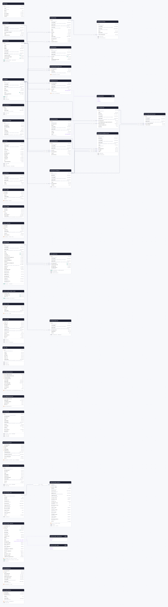

<details>
<summary>The whole schema as SQL</summary>

```sql
CREATE SCHEMA IF NOT EXISTS "public";

CREATE TYPE "WorkspaceRole" AS ENUM ('owner', 'editor', 'analyst');

CREATE TYPE "reverse_sync_mode" AS ENUM ('upsert', 'mirror');

CREATE TYPE "reverse_sync_extraction" AS ENUM ('cursor', 'full');

CREATE TABLE "EmailLog" (
    "id" TEXT NOT NULL,
    "time" TIMESTAMP(3) NOT NULL DEFAULT CURRENT_TIMESTAMP,
    "email" JSONB NOT NULL,
    "error" TEXT,
    "previewUrl" TEXT,
    "messageId" TEXT,
    "status" TEXT NOT NULL,

    CONSTRAINT "EmailLog_pkey" PRIMARY KEY ("id")
);

CREATE TABLE "UserPreferences" (
    "id" TEXT NOT NULL,
    "createdAt" TIMESTAMP(3) NOT NULL DEFAULT CURRENT_TIMESTAMP,
    "updatedAt" TIMESTAMP(3) NOT NULL DEFAULT CURRENT_TIMESTAMP,
    "userId" TEXT NOT NULL,
    "workspaceId" TEXT,
    "scope" TEXT,
    "preferences" JSONB NOT NULL,

    CONSTRAINT "UserPreferences_pkey" PRIMARY KEY ("id")
);

CREATE TABLE "UserProfile" (
    "id" TEXT NOT NULL,
    "name" TEXT NOT NULL,
    "email" TEXT NOT NULL,
    "admin" BOOLEAN DEFAULT false,
    "createdAt" TIMESTAMP(3) NOT NULL DEFAULT CURRENT_TIMESTAMP,
    "updatedAt" TIMESTAMP(3) NOT NULL DEFAULT CURRENT_TIMESTAMP,
    "loginProvider" TEXT NOT NULL,
    "externalUsername" TEXT,
    "externalId" TEXT NOT NULL,

    CONSTRAINT "UserProfile_pkey" PRIMARY KEY ("id")
);

CREATE TABLE "UserPassword" (
    "id" TEXT NOT NULL,
    "createdAt" TIMESTAMP(3) NOT NULL DEFAULT CURRENT_TIMESTAMP,
    "updatedAt" TIMESTAMP(3) NOT NULL DEFAULT CURRENT_TIMESTAMP,
    "userId" TEXT NOT NULL,
    "hash" TEXT NOT NULL,
    "changeAtNextLogin" BOOLEAN NOT NULL DEFAULT false,

    CONSTRAINT "UserPassword_pkey" PRIMARY KEY ("id")
);

CREATE TABLE "Workspace" (
    "id" TEXT NOT NULL,
    "createdAt" TIMESTAMP(3) NOT NULL DEFAULT CURRENT_TIMESTAMP,
    "updatedAt" TIMESTAMP(3) NOT NULL DEFAULT CURRENT_TIMESTAMP,
    "name" TEXT NOT NULL,
    "deleted" BOOLEAN NOT NULL DEFAULT false,
    "slug" TEXT,
    "featuresEnabled" TEXT[] DEFAULT ARRAY[]::TEXT[],

    CONSTRAINT "Workspace_pkey" PRIMARY KEY ("id")
);

CREATE TABLE "WorkspaceOptions" (
    "id" TEXT NOT NULL,
    "createdAt" TIMESTAMP(3) NOT NULL DEFAULT CURRENT_TIMESTAMP,
    "updatedAt" TIMESTAMP(3) NOT NULL DEFAULT CURRENT_TIMESTAMP,
    "workspaceId" TEXT NOT NULL,
    "namespace" TEXT NOT NULL,
    "value" JSONB NOT NULL,

    CONSTRAINT "WorkspaceOptions_pkey" PRIMARY KEY ("id")
);

CREATE TABLE "WorkspaceAccess" (
    "workspaceId" TEXT NOT NULL,
    "createdAt" TIMESTAMP(3) NOT NULL DEFAULT CURRENT_TIMESTAMP,
    "updatedAt" TIMESTAMP(3) NOT NULL DEFAULT CURRENT_TIMESTAMP,
    "userId" TEXT NOT NULL,
    "role" "WorkspaceRole" NOT NULL DEFAULT 'owner',

    CONSTRAINT "WorkspaceAccess_pkey" PRIMARY KEY ("userId","workspaceId")
);

CREATE TABLE "WorkspaceUserProperties" (
    "workspaceId" TEXT NOT NULL,
    "userId" TEXT NOT NULL,
    "lastUsed" TIMESTAMP(3) NOT NULL DEFAULT CURRENT_TIMESTAMP,

    CONSTRAINT "WorkspaceUserProperties_pkey" PRIMARY KEY ("workspaceId","userId")
);

CREATE TABLE "UserApiToken" (
    "id" TEXT NOT NULL,
    "createdAt" TIMESTAMP(3) NOT NULL DEFAULT CURRENT_TIMESTAMP,
    "updatedAt" TIMESTAMP(3) NOT NULL DEFAULT CURRENT_TIMESTAMP,
    "lastUsed" TIMESTAMP(3),
    "hint" TEXT NOT NULL,
    "hash" TEXT NOT NULL,
    "userId" TEXT NOT NULL,
    "type" TEXT,
    "name" TEXT,
    "expiresAt" TIMESTAMP(3),
    "workspaceId" TEXT,
    "role" TEXT,
    "oauthClientId" TEXT,

    CONSTRAINT "UserApiToken_pkey" PRIMARY KEY ("id")
);

CREATE TABLE "OAuthClient" (
    "id" TEXT NOT NULL,
    "createdAt" TIMESTAMP(3) NOT NULL DEFAULT CURRENT_TIMESTAMP,
    "updatedAt" TIMESTAMP(3) NOT NULL DEFAULT CURRENT_TIMESTAMP,
    "clientSecretHash" TEXT NOT NULL,
    "name" TEXT NOT NULL,
    "redirectUris" TEXT[],

    CONSTRAINT "OAuthClient_pkey" PRIMARY KEY ("id")
);

CREATE TABLE "kv" (
    "key" TEXT NOT NULL,
    "value" JSONB NOT NULL,
    "expires_at" TIMESTAMP(3),

    CONSTRAINT "kv_pkey" PRIMARY KEY ("key")
);

CREATE TABLE "OAuthAccessToken" (
    "id" TEXT NOT NULL,
    "createdAt" TIMESTAMP(3) NOT NULL DEFAULT CURRENT_TIMESTAMP,
    "lastUsed" TIMESTAMP(3),
    "hash" TEXT NOT NULL,
    "expiresAt" TIMESTAMP(3) NOT NULL,
    "refreshTokenId" TEXT NOT NULL,

    CONSTRAINT "OAuthAccessToken_pkey" PRIMARY KEY ("id")
);

CREATE TABLE "InvitationToken" (
    "id" TEXT NOT NULL,
    "workspaceId" TEXT NOT NULL,
    "email" TEXT NOT NULL,
    "createdAt" TIMESTAMP(3) NOT NULL DEFAULT CURRENT_TIMESTAMP,
    "updatedAt" TIMESTAMP(3) NOT NULL DEFAULT CURRENT_TIMESTAMP,
    "token" TEXT NOT NULL,
    "usedBy" TEXT,
    "role" "WorkspaceRole" NOT NULL DEFAULT 'owner',

    CONSTRAINT "InvitationToken_pkey" PRIMARY KEY ("id")
);

CREATE TABLE "ConfigurationObject" (
    "id" TEXT NOT NULL,
    "deleted" BOOLEAN DEFAULT false,
    "createdAt" TIMESTAMP(3) NOT NULL DEFAULT CURRENT_TIMESTAMP,
    "updatedAt" TIMESTAMP(3) NOT NULL DEFAULT CURRENT_TIMESTAMP,
    "type" TEXT NOT NULL,
    "workspaceId" TEXT NOT NULL,
    "config" JSONB,

    CONSTRAINT "ConfigurationObject_pkey" PRIMARY KEY ("id")
);

CREATE TABLE "ConfigurationObjectLink" (
    "id" TEXT NOT NULL,
    "deleted" BOOLEAN DEFAULT false,
    "createdAt" TIMESTAMP(3) NOT NULL DEFAULT CURRENT_TIMESTAMP,
    "updatedAt" TIMESTAMP(3) NOT NULL DEFAULT CURRENT_TIMESTAMP,
    "type" TEXT DEFAULT 'push',
    "data" JSONB,
    "workspaceId" TEXT NOT NULL,
    "fromId" TEXT NOT NULL,
    "toId" TEXT NOT NULL,

    CONSTRAINT "ConfigurationObjectLink_pkey" PRIMARY KEY ("id")
);

CREATE TABLE "ConnectorPackage" (
    "id" TEXT NOT NULL,
    "packageId" TEXT NOT NULL,
    "packageType" TEXT NOT NULL DEFAULT 'airbyte',
    "meta" JSONB,
    "logoSvg" BYTEA,
    "createdAt" TIMESTAMP(3) NOT NULL DEFAULT CURRENT_TIMESTAMP,
    "updatedAt" TIMESTAMP(3) NOT NULL DEFAULT CURRENT_TIMESTAMP,

    CONSTRAINT "ConnectorPackage_pkey" PRIMARY KEY ("id")
);

CREATE TABLE "AuditLog" (
    "id" TEXT NOT NULL,
    "timestamp" TIMESTAMP(3) NOT NULL DEFAULT CURRENT_TIMESTAMP,
    "type" TEXT NOT NULL,
    "severity" TEXT DEFAULT 'info',
    "userId" TEXT,
    "workspaceId" TEXT,
    "objectId" TEXT,
    "changes" JSONB,
    "authType" TEXT,
    "tokenId" TEXT,
    "ip" TEXT,
    "requestHeaders" JSONB,

    CONSTRAINT "AuditLog_pkey" PRIMARY KEY ("id")
);

CREATE TABLE "GlobalProps" (
    "id" TEXT NOT NULL,
    "createdAt" TIMESTAMP(3) NOT NULL DEFAULT CURRENT_TIMESTAMP,
    "updatedAt" TIMESTAMP(3) NOT NULL DEFAULT CURRENT_TIMESTAMP,
    "name" TEXT NOT NULL,
    "value" JSONB,

    CONSTRAINT "GlobalProps_pkey" PRIMARY KEY ("id")
);

CREATE TABLE "source_spec" (
    "package" TEXT NOT NULL,
    "version" TEXT NOT NULL,
    "specs" JSONB,
    "timestamp" TIMESTAMPTZ(3) NOT NULL DEFAULT CURRENT_TIMESTAMP,
    "error" TEXT,

    CONSTRAINT "source_spec_pkey" PRIMARY KEY ("package","version")
);

CREATE TABLE "source_check" (
    "package" TEXT NOT NULL,
    "version" TEXT NOT NULL,
    "key" TEXT NOT NULL,
    "status" TEXT NOT NULL,
    "description" TEXT,
    "timestamp" TIMESTAMPTZ(3) NOT NULL DEFAULT CURRENT_TIMESTAMP,

    CONSTRAINT "source_check_pkey" PRIMARY KEY ("key")
);

CREATE TABLE "source_catalog" (
    "package" TEXT NOT NULL,
    "version" TEXT NOT NULL,
    "key" TEXT NOT NULL,
    "catalog" JSONB,
    "timestamp" TIMESTAMPTZ(3) NOT NULL DEFAULT CURRENT_TIMESTAMP,
    "status" TEXT NOT NULL,
    "description" TEXT,

    CONSTRAINT "source_catalog_pkey" PRIMARY KEY ("package","version","key")
);

CREATE TABLE "reverse_sync_control" (
    "workspace_id" TEXT NOT NULL,
    "sync_id" TEXT NOT NULL,
    "run_id" TEXT NOT NULL,
    "run_order" BIGINT NOT NULL DEFAULT 0,
    "detached" BOOLEAN NOT NULL DEFAULT false,
    "revision" TEXT NOT NULL,
    "target_hash" TEXT NOT NULL,
    "phase" TEXT NOT NULL DEFAULT 'new',
    "mode" "reverse_sync_mode" NOT NULL,
    "extraction" "reverse_sync_extraction" NOT NULL,
    "artifact_head" BYTEA,
    "base_sequence" BIGINT NOT NULL DEFAULT 0,
    "next_sequence" BIGINT NOT NULL DEFAULT 0,
    "checkpoint_sequence" BIGINT NOT NULL DEFAULT 0,
    "finish_sequence" BIGINT,
    "store" BYTEA,
    "provider_state" BYTEA,
    "finish_result" BYTEA,
    "committed_generation" TEXT,

    CONSTRAINT "reverse_sync_control_pkey" PRIMARY KEY ("workspace_id","sync_id","run_id")
);

CREATE TABLE "reverse_sync_target_owner" (
    "target_hash" TEXT NOT NULL,
    "workspace_id" TEXT NOT NULL,
    "sync_id" TEXT NOT NULL,

    CONSTRAINT "reverse_sync_target_owner_pkey" PRIMARY KEY ("target_hash")
);

CREATE TABLE "source_state" (
    "sync_id" TEXT NOT NULL,
    "stream" TEXT NOT NULL,
    "state" JSONB NOT NULL,
    "timestamp" TIMESTAMPTZ(3) NOT NULL DEFAULT CURRENT_TIMESTAMP,

    CONSTRAINT "source_state_pkey" PRIMARY KEY ("sync_id","stream")
);

CREATE TABLE "source_task" (
    "sync_id" TEXT NOT NULL,
    "task_id" TEXT NOT NULL,
    "package" TEXT NOT NULL,
    "version" TEXT NOT NULL,
    "started_at" TIMESTAMPTZ(3) NOT NULL DEFAULT CURRENT_TIMESTAMP,
    "updated_at" TIMESTAMPTZ(3) NOT NULL DEFAULT CURRENT_TIMESTAMP,
    "started_by" JSONB,
    "status" TEXT NOT NULL,
    "description" TEXT,
    "metrics" JSONB,
    "error" TEXT,

    CONSTRAINT "source_task_pkey" PRIMARY KEY ("task_id")
);

CREATE TABLE "task_log" (
    "id" UUID NOT NULL,
    "level" TEXT NOT NULL,
    "logger" TEXT NOT NULL,
    "message" TEXT NOT NULL,
    "sync_id" TEXT NOT NULL,
    "task_id" TEXT NOT NULL,
    "timestamp" TIMESTAMPTZ(3) NOT NULL DEFAULT CURRENT_TIMESTAMP,

    CONSTRAINT "task_log_pkey" PRIMARY KEY ("id")
);

CREATE TABLE "ProfileBuilder" (
    "id" TEXT NOT NULL,
    "name" TEXT NOT NULL,
    "deleted" BOOLEAN DEFAULT false,
    "createdAt" TIMESTAMP(3) NOT NULL DEFAULT CURRENT_TIMESTAMP,
    "updatedAt" TIMESTAMP(3) NOT NULL DEFAULT CURRENT_TIMESTAMP,
    "workspaceId" TEXT NOT NULL,
    "intermediateStorageCredentials" JSONB NOT NULL,
    "destinationId" TEXT,
    "connectionOptions" JSONB,
    "version" INTEGER NOT NULL DEFAULT 0,

    CONSTRAINT "ProfileBuilder_pkey" PRIMARY KEY ("id")
);

CREATE TABLE "ProfileBuilderFunction" (
    "id" TEXT NOT NULL,
    "createdAt" TIMESTAMP(3) NOT NULL DEFAULT CURRENT_TIMESTAMP,
    "updatedAt" TIMESTAMP(3) NOT NULL DEFAULT CURRENT_TIMESTAMP,
    "profileBuilderId" TEXT NOT NULL,
    "functionId" TEXT NOT NULL,

    CONSTRAINT "ProfileBuilderFunction_pkey" PRIMARY KEY ("id")
);

CREATE TABLE "ProfileBuilderState" (
    "profileBuilderId" TEXT NOT NULL,
    "profileBuilderVersion" INTEGER NOT NULL,
    "instanceIndex" INTEGER NOT NULL,
    "totalInstances" INTEGER NOT NULL,
    "startedAt" TIMESTAMP(3) NOT NULL,
    "updatedAt" TIMESTAMP(3) NOT NULL,
    "lastTimestamp" TIMESTAMP(3),
    "processedUsers" INTEGER NOT NULL,
    "totalUsers" INTEGER NOT NULL,
    "errorUsers" INTEGER NOT NULL,
    "speed" DOUBLE PRECISION NOT NULL,

    CONSTRAINT "ProfileBuilderState_pkey" PRIMARY KEY ("profileBuilderId","profileBuilderVersion","totalInstances","instanceIndex")
);

CREATE TABLE "ProfileBuilderState2" (
    "profileBuilderId" TEXT NOT NULL,
    "updatedAt" TIMESTAMP(3) NOT NULL,
    "fullRebuildInfo" JSONB,
    "queuesInfo" JSONB,
    "metrics" JSONB,

    CONSTRAINT "ProfileBuilderState2_pkey" PRIMARY KEY ("profileBuilderId")
);

CREATE TABLE "StatusChange" (
    "id" BIGSERIAL NOT NULL,
    "workspaceId" TEXT NOT NULL,
    "actorId" TEXT NOT NULL,
    "type" TEXT NOT NULL,
    "tableName" TEXT NOT NULL,
    "timestamp" TIMESTAMPTZ(3) NOT NULL DEFAULT CURRENT_TIMESTAMP,
    "status" TEXT NOT NULL,
    "startedAt" TIMESTAMP(3) NOT NULL,
    "counts" INTEGER NOT NULL DEFAULT 0,
    "description" TEXT,
    "queueSize" INTEGER NOT NULL DEFAULT 0,

    CONSTRAINT "StatusChange_pkey" PRIMARY KEY ("id")
);

CREATE TABLE "NotificationState" (
    "workspaceId" TEXT NOT NULL,
    "actorId" TEXT NOT NULL,
    "type" TEXT NOT NULL,
    "tableName" TEXT NOT NULL,
    "channelId" TEXT NOT NULL,
    "flappingSince" TIMESTAMPTZ(3),
    "lastNotification" TIMESTAMPTZ(3) NOT NULL,
    "statusChangeId" BIGINT NOT NULL,
    "error" TEXT,

    CONSTRAINT "NotificationState_pkey" PRIMARY KEY ("channelId","actorId","type","tableName")
);

CREATE TABLE "Notification" (
    "id" UUID NOT NULL,
    "workspaceId" TEXT NOT NULL,
    "actorId" TEXT NOT NULL,
    "type" TEXT NOT NULL,
    "tableName" TEXT NOT NULL,
    "channelId" TEXT NOT NULL,
    "statusChangeId" BIGINT NOT NULL,
    "timestamp" TIMESTAMPTZ(3) NOT NULL DEFAULT CURRENT_TIMESTAMP,
    "status" TEXT NOT NULL,
    "error" TEXT,

    CONSTRAINT "Notification_pkey" PRIMARY KEY ("id")
);

CREATE TABLE "OidcProvider" (
    "id" TEXT NOT NULL,
    "createdAt" TIMESTAMP(3) NOT NULL DEFAULT CURRENT_TIMESTAMP,
    "updatedAt" TIMESTAMP(3) NOT NULL DEFAULT CURRENT_TIMESTAMP,
    "name" TEXT NOT NULL,
    "issuer" TEXT NOT NULL,
    "clientId" TEXT NOT NULL,
    "clientSecret" TEXT NOT NULL,
    "authorizationEndpoint" TEXT,
    "tokenEndpoint" TEXT,
    "userinfoEndpoint" TEXT,
    "jwksUri" TEXT,
    "introspectionEndpoint" TEXT,
    "scopes" TEXT[] DEFAULT ARRAY['openid', 'profile', 'email', 'offline_access']::TEXT[],
    "audience" TEXT,
    "prompt" TEXT,
    "usernameClaim" TEXT NOT NULL DEFAULT 'email',
    "emailClaim" TEXT NOT NULL DEFAULT 'email',
    "nameClaim" TEXT NOT NULL DEFAULT 'name',
    "groupClaim" TEXT NOT NULL DEFAULT 'groups',
    "enabled" BOOLEAN NOT NULL DEFAULT true,
    "autoDiscovery" BOOLEAN NOT NULL DEFAULT true,

    CONSTRAINT "OidcProvider_pkey" PRIMARY KEY ("id")
);

CREATE TABLE "OidcLoginGroup" (
    "id" TEXT NOT NULL,
    "createdAt" TIMESTAMP(3) NOT NULL DEFAULT CURRENT_TIMESTAMP,
    "updatedAt" TIMESTAMP(3) NOT NULL DEFAULT CURRENT_TIMESTAMP,
    "workspaceId" TEXT NOT NULL,
    "oidcProviderId" TEXT NOT NULL,
    "groupValue" TEXT,
    "allowAllUsers" BOOLEAN NOT NULL DEFAULT false,

    CONSTRAINT "OidcLoginGroup_pkey" PRIMARY KEY ("id")
);

CREATE TABLE "reprocessing_jobs" (
    "id" VARCHAR(64) NOT NULL,
    "config" JSONB NOT NULL,
    "status" VARCHAR(32) NOT NULL,
    "created_at" TIMESTAMPTZ(6) NOT NULL,
    "started_at" TIMESTAMPTZ(6),
    "completed_at" TIMESTAMPTZ(6),
    "k8s_job_name" VARCHAR(255),
    "total_files" INTEGER DEFAULT 0,
    "total_workers" INTEGER DEFAULT 0,
    "error" TEXT,

    CONSTRAINT "reprocessing_jobs_pkey" PRIMARY KEY ("id")
);

CREATE TABLE "reprocessing_workers" (
    "job_id" VARCHAR(64) NOT NULL,
    "worker_index" INTEGER NOT NULL,
    "status" VARCHAR(32) NOT NULL,
    "started_at" TIMESTAMPTZ(6),
    "updated_at" TIMESTAMPTZ(6) NOT NULL DEFAULT CURRENT_TIMESTAMP,
    "completed_at" TIMESTAMPTZ(6),
    "current_file" TEXT,
    "current_line" BIGINT DEFAULT 0,
    "current_ts" TEXT,
    "assigned_files" INTEGER DEFAULT 0,
    "processed_files" INTEGER DEFAULT 0,
    "total_lines" BIGINT DEFAULT 0,
    "success_count" BIGINT DEFAULT 0,
    "error_count" BIGINT DEFAULT 0,
    "skipped_count" BIGINT DEFAULT 0,
    "total_bytes" BIGINT DEFAULT 0,
    "processed_bytes" BIGINT DEFAULT 0,
    "error" TEXT,

    CONSTRAINT "reprocessing_workers_pkey" PRIMARY KEY ("job_id","worker_index")
);

CREATE TABLE "FunctionsServer" (
    "workspaceId" TEXT NOT NULL,
    "class" TEXT NOT NULL,
    "deploymentId" TEXT NOT NULL,
    "connections" TEXT[],
    "emptyConnections" TEXT[],
    "profileBuilders" TEXT[],
    "createdAt" TIMESTAMPTZ(3) NOT NULL DEFAULT CURRENT_TIMESTAMP,
    "updatedAt" TIMESTAMPTZ(3),

    CONSTRAINT "FunctionsServer_pkey" PRIMARY KEY ("workspaceId","class")
);

CREATE TABLE "RateLimitCounter" (
    "bucketKey" TEXT NOT NULL,
    "windowStart" TIMESTAMPTZ(3) NOT NULL,
    "count" INTEGER NOT NULL DEFAULT 0,
    "expiresAt" TIMESTAMPTZ(3) NOT NULL,

    CONSTRAINT "RateLimitCounter_pkey" PRIMARY KEY ("bucketKey","windowStart")
);

CREATE INDEX "UserProfile_externalId_idx" ON "UserProfile"("externalId");

CREATE UNIQUE INDEX "UserProfile_loginProvider_externalId_key" ON "UserProfile"("loginProvider", "externalId");

CREATE UNIQUE INDEX "UserPassword_userId_key" ON "UserPassword"("userId");

CREATE INDEX "Workspace_slug_idx" ON "Workspace"("slug");

CREATE INDEX "Workspace_updatedAt_idx" ON "Workspace"("updatedAt" DESC);

CREATE UNIQUE INDEX "Workspace_slug_key" ON "Workspace"("slug");

CREATE INDEX "WorkspaceOptions_workspaceId_namespace_idx" ON "WorkspaceOptions"("workspaceId", "namespace");

CREATE INDEX "kv_expires_at_idx" ON "kv"("expires_at");

CREATE INDEX "kv_key_pattern_idx" ON "kv"("key" text_pattern_ops);

CREATE INDEX "OAuthAccessToken_expiresAt_idx" ON "OAuthAccessToken"("expiresAt");

CREATE INDEX "OAuthAccessToken_refreshTokenId_idx" ON "OAuthAccessToken"("refreshTokenId");

CREATE INDEX "ConfigurationObject_updatedAt_idx" ON "ConfigurationObject"("updatedAt" DESC);

CREATE INDEX "ConfigurationObjectLink_updatedAt_idx" ON "ConfigurationObjectLink"("updatedAt" DESC);

CREATE INDEX "ConfigurationObjectLink_workspaceId_idx" ON "ConfigurationObjectLink"("workspaceId");

CREATE INDEX "AuditLog_timestamp_idx" ON "AuditLog"("timestamp");

CREATE INDEX "AuditLog_type_idx" ON "AuditLog"("type");

CREATE INDEX "AuditLog_workspaceId_timestamp_idx" ON "AuditLog"("workspaceId", "timestamp");

CREATE INDEX "reverse_sync_control_sync_id_idx" ON "reverse_sync_control"("sync_id");

CREATE UNIQUE INDEX "reverse_sync_control_workspace_id_sync_id_run_order_key" ON "reverse_sync_control"("workspace_id", "sync_id", "run_order");

CREATE UNIQUE INDEX "reverse_sync_target_owner_workspace_id_sync_id_key" ON "reverse_sync_target_owner"("workspace_id", "sync_id");

CREATE INDEX "source_task_sync_id_idx" ON "source_task"("sync_id");

CREATE INDEX "source_task_started_at_idx" ON "source_task"("started_at");

CREATE INDEX "source_task_sync_id_started_at_idx" ON "source_task"("sync_id", "started_at" DESC);

CREATE INDEX "task_log_sync_id_idx" ON "task_log"("sync_id");

CREATE INDEX "task_log_task_id_idx" ON "task_log"("task_id");

CREATE INDEX "task_log_timestamp_idx" ON "task_log"("timestamp");

CREATE INDEX "StatusChange_actorId_type_tableName_idx" ON "StatusChange"("actorId", "type", "tableName");

CREATE INDEX "StatusChange_timestamp_idx" ON "StatusChange"("timestamp");

CREATE INDEX "StatusChange_startedAt_idx" ON "StatusChange"("startedAt");

CREATE INDEX "Notification_actorId_type_tableName_idx" ON "Notification"("actorId", "type", "tableName");

CREATE INDEX "Notification_timestamp_idx" ON "Notification"("timestamp");

CREATE UNIQUE INDEX "OidcProvider_issuer_clientId_key" ON "OidcProvider"("issuer", "clientId");

CREATE INDEX "OidcLoginGroup_workspaceId_idx" ON "OidcLoginGroup"("workspaceId");

CREATE INDEX "OidcLoginGroup_oidcProviderId_idx" ON "OidcLoginGroup"("oidcProviderId");

CREATE UNIQUE INDEX "OidcLoginGroup_workspaceId_oidcProviderId_key" ON "OidcLoginGroup"("workspaceId", "oidcProviderId");

CREATE INDEX "reprocessing_jobs_created_at_idx" ON "reprocessing_jobs"("created_at" DESC);

CREATE INDEX "reprocessing_workers_job_id_idx" ON "reprocessing_workers"("job_id");

CREATE INDEX "reprocessing_workers_status_idx" ON "reprocessing_workers"("job_id", "status");

CREATE INDEX "RateLimitCounter_expiresAt_idx" ON "RateLimitCounter"("expiresAt");

ALTER TABLE "UserPreferences" ADD CONSTRAINT "UserPreferences_userId_fkey" FOREIGN KEY ("userId") REFERENCES "UserProfile"("id") ON DELETE RESTRICT ON UPDATE CASCADE;

ALTER TABLE "UserPreferences" ADD CONSTRAINT "UserPreferences_workspaceId_fkey" FOREIGN KEY ("workspaceId") REFERENCES "Workspace"("id") ON DELETE SET NULL ON UPDATE CASCADE;

ALTER TABLE "UserPassword" ADD CONSTRAINT "UserPassword_userId_fkey" FOREIGN KEY ("userId") REFERENCES "UserProfile"("id") ON DELETE RESTRICT ON UPDATE CASCADE;

ALTER TABLE "WorkspaceOptions" ADD CONSTRAINT "WorkspaceOptions_workspaceId_fkey" FOREIGN KEY ("workspaceId") REFERENCES "Workspace"("id") ON DELETE RESTRICT ON UPDATE CASCADE;

ALTER TABLE "WorkspaceAccess" ADD CONSTRAINT "WorkspaceAccess_workspaceId_fkey" FOREIGN KEY ("workspaceId") REFERENCES "Workspace"("id") ON DELETE RESTRICT ON UPDATE CASCADE;

ALTER TABLE "WorkspaceAccess" ADD CONSTRAINT "WorkspaceAccess_userId_fkey" FOREIGN KEY ("userId") REFERENCES "UserProfile"("id") ON DELETE RESTRICT ON UPDATE CASCADE;

ALTER TABLE "WorkspaceUserProperties" ADD CONSTRAINT "WorkspaceUserProperties_workspaceId_fkey" FOREIGN KEY ("workspaceId") REFERENCES "Workspace"("id") ON DELETE RESTRICT ON UPDATE CASCADE;

ALTER TABLE "WorkspaceUserProperties" ADD CONSTRAINT "WorkspaceUserProperties_userId_fkey" FOREIGN KEY ("userId") REFERENCES "UserProfile"("id") ON DELETE RESTRICT ON UPDATE CASCADE;

ALTER TABLE "UserApiToken" ADD CONSTRAINT "UserApiToken_userId_fkey" FOREIGN KEY ("userId") REFERENCES "UserProfile"("id") ON DELETE RESTRICT ON UPDATE CASCADE;

ALTER TABLE "UserApiToken" ADD CONSTRAINT "UserApiToken_oauthClientId_fkey" FOREIGN KEY ("oauthClientId") REFERENCES "OAuthClient"("id") ON DELETE SET NULL ON UPDATE CASCADE;

ALTER TABLE "OAuthAccessToken" ADD CONSTRAINT "OAuthAccessToken_refreshTokenId_fkey" FOREIGN KEY ("refreshTokenId") REFERENCES "UserApiToken"("id") ON DELETE RESTRICT ON UPDATE CASCADE;

ALTER TABLE "ConfigurationObject" ADD CONSTRAINT "ConfigurationObject_workspaceId_fkey" FOREIGN KEY ("workspaceId") REFERENCES "Workspace"("id") ON DELETE RESTRICT ON UPDATE CASCADE;

ALTER TABLE "ConfigurationObjectLink" ADD CONSTRAINT "ConfigurationObjectLink_workspaceId_fkey" FOREIGN KEY ("workspaceId") REFERENCES "Workspace"("id") ON DELETE RESTRICT ON UPDATE CASCADE;

ALTER TABLE "ConfigurationObjectLink" ADD CONSTRAINT "ConfigurationObjectLink_fromId_fkey" FOREIGN KEY ("fromId") REFERENCES "ConfigurationObject"("id") ON DELETE RESTRICT ON UPDATE CASCADE;

ALTER TABLE "ConfigurationObjectLink" ADD CONSTRAINT "ConfigurationObjectLink_toId_fkey" FOREIGN KEY ("toId") REFERENCES "ConfigurationObject"("id") ON DELETE RESTRICT ON UPDATE CASCADE;

ALTER TABLE "ProfileBuilder" ADD CONSTRAINT "ProfileBuilder_workspaceId_fkey" FOREIGN KEY ("workspaceId") REFERENCES "Workspace"("id") ON DELETE RESTRICT ON UPDATE CASCADE;

ALTER TABLE "ProfileBuilder" ADD CONSTRAINT "ProfileBuilder_destinationId_fkey" FOREIGN KEY ("destinationId") REFERENCES "ConfigurationObject"("id") ON DELETE SET NULL ON UPDATE CASCADE;

ALTER TABLE "ProfileBuilderFunction" ADD CONSTRAINT "ProfileBuilderFunction_profileBuilderId_fkey" FOREIGN KEY ("profileBuilderId") REFERENCES "ProfileBuilder"("id") ON DELETE RESTRICT ON UPDATE CASCADE;

ALTER TABLE "ProfileBuilderFunction" ADD CONSTRAINT "ProfileBuilderFunction_functionId_fkey" FOREIGN KEY ("functionId") REFERENCES "ConfigurationObject"("id") ON DELETE RESTRICT ON UPDATE CASCADE;

ALTER TABLE "OidcLoginGroup" ADD CONSTRAINT "OidcLoginGroup_workspaceId_fkey" FOREIGN KEY ("workspaceId") REFERENCES "Workspace"("id") ON DELETE RESTRICT ON UPDATE CASCADE;

ALTER TABLE "OidcLoginGroup" ADD CONSTRAINT "OidcLoginGroup_oidcProviderId_fkey" FOREIGN KEY ("oidcProviderId") REFERENCES "OidcProvider"("id") ON DELETE RESTRICT ON UPDATE CASCADE;

ALTER TABLE "reprocessing_workers" ADD CONSTRAINT "reprocessing_workers_job_id_fkey" FOREIGN KEY ("job_id") REFERENCES "reprocessing_jobs"("id") ON DELETE CASCADE ON UPDATE NO ACTION;
```

</details>

## Contents

| Model                                                         | Table                       | Description |
| ------------------------------------------------------------- | --------------------------- | ----------- |
| [EmailLog](#model-EmailLog)                                   | `EmailLog`                  |             |
| [UserPreferences](#model-UserPreferences)                     | `UserPreferences`           |             |
| [UserProfile](#model-UserProfile)                             | `UserProfile`               |             |
| [UserPassword](#model-UserPassword)                           | `UserPassword`              |             |
| [Workspace](#model-Workspace)                                 | `Workspace`                 |             |
| [WorkspaceOptions](#model-WorkspaceOptions)                   | `WorkspaceOptions`          |             |
| [WorkspaceAccess](#model-WorkspaceAccess)                     | `WorkspaceAccess`           |             |
| [WorkspaceUserProperties](#model-WorkspaceUserProperties)     | `WorkspaceUserProperties`   |             |
| [UserApiToken](#model-UserApiToken)                           | `UserApiToken`              |             |
| [OAuthClient](#model-OAuthClient)                             | `OAuthClient`               |             |
| [KvStoreEntry](#model-KvStoreEntry)                           | `kv`                        |             |
| [OAuthAccessToken](#model-OAuthAccessToken)                   | `OAuthAccessToken`          |             |
| [InvitationToken](#model-InvitationToken)                     | `InvitationToken`           |             |
| [ConfigurationObject](#model-ConfigurationObject)             | `ConfigurationObject`       |             |
| [ConfigurationObjectLink](#model-ConfigurationObjectLink)     | `ConfigurationObjectLink`   |             |
| [ConnectorPackage](#model-ConnectorPackage)                   | `ConnectorPackage`          |             |
| [AuditLog](#model-AuditLog)                                   | `AuditLog`                  |             |
| [GlobalProps](#model-GlobalProps)                             | `GlobalProps`               |             |
| [source_spec](#model-source_spec)                             | `source_spec`               |             |
| [source_check](#model-source_check)                           | `source_check`              |             |
| [source_catalog](#model-source_catalog)                       | `source_catalog`            |             |
| [reverse_sync_control](#model-reverse_sync_control)           | `reverse_sync_control`      |             |
| [reverse_sync_target_owner](#model-reverse_sync_target_owner) | `reverse_sync_target_owner` |             |
| [source_state](#model-source_state)                           | `source_state`              |             |
| [source_task](#model-source_task)                             | `source_task`               |             |
| [task_log](#model-task_log)                                   | `task_log`                  |             |
| [ProfileBuilder](#model-ProfileBuilder)                       | `ProfileBuilder`            |             |
| [ProfileBuilderFunction](#model-ProfileBuilderFunction)       | `ProfileBuilderFunction`    |             |
| [ProfileBuilderState](#model-ProfileBuilderState)             | `ProfileBuilderState`       |             |
| [ProfileBuilderState2](#model-ProfileBuilderState2)           | `ProfileBuilderState2`      |             |
| [StatusChange](#model-StatusChange)                           | `StatusChange`              |             |
| [NotificationState](#model-NotificationState)                 | `NotificationState`         |             |
| [Notification](#model-Notification)                           | `Notification`              |             |
| [OidcProvider](#model-OidcProvider)                           | `OidcProvider`              |             |
| [OidcLoginGroup](#model-OidcLoginGroup)                       | `OidcLoginGroup`            |             |
| [reprocessing_jobs](#model-reprocessing_jobs)                 | `reprocessing_jobs`         |             |
| [reprocessing_workers](#model-reprocessing_workers)           | `reprocessing_workers`      |             |
| [FunctionsServer](#model-FunctionsServer)                     | `FunctionsServer`           |             |
| [RateLimitCounter](#model-RateLimitCounter)                   | `RateLimitCounter`          |             |

| Enum                                                     | Name in the database      | Description |
| -------------------------------------------------------- | ------------------------- | ----------- |
| [WorkspaceRole](#enum-WorkspaceRole)                     | `WorkspaceRole`           |             |
| [reverse_sync_mode](#enum-reverse_sync_mode)             | `reverse_sync_mode`       |             |
| [reverse_sync_extraction](#enum-reverse_sync_extraction) | `reverse_sync_extraction` |             |

## Models

<a id="model-EmailLog"></a>

### EmailLog

| Field        | Type       | Constraints | Default   | Description |
| ------------ | ---------- | ----------- | --------- | ----------- |
| `id`         | `String`   | PK NOT NULL | `cuid(1)` |             |
| `time`       | `DateTime` | NOT NULL    | `now()`   |             |
| `email`      | `Json`     | NOT NULL    |           |             |
| `error`      | `String`   | NULL        |           |             |
| `previewUrl` | `String`   | NULL        |           |             |
| `messageId`  | `String`   | NULL        |           |             |
| `status`     | `String`   | NOT NULL    |           |             |

#### Definition

```sql
CREATE TABLE "EmailLog" (
    "id" TEXT NOT NULL,
    "time" TIMESTAMP(3) NOT NULL DEFAULT CURRENT_TIMESTAMP,
    "email" JSONB NOT NULL,
    "error" TEXT,
    "previewUrl" TEXT,
    "messageId" TEXT,
    "status" TEXT NOT NULL,

    CONSTRAINT "EmailLog_pkey" PRIMARY KEY ("id")
);
```

<details>
<summary>Queries and their SQL</summary>

**findMany**: Every row

```ts
await prisma.emailLog.findMany();
```

```sql
SELECT
  "public"."EmailLog"."id",
  "public"."EmailLog"."time",
  "public"."EmailLog"."email",
  "public"."EmailLog"."error",
  "public"."EmailLog"."previewUrl",
  "public"."EmailLog"."messageId",
  "public"."EmailLog"."status"
FROM
  "public"."EmailLog"
WHERE
  1 = 1
OFFSET
  $1
-- params: ["0"]
```

**count**: How many rows there are

```ts
await prisma.emailLog.count();
```

```sql
SELECT
  COUNT(*) AS "_count$_all"
FROM
  (
    SELECT
      "public"."EmailLog"."id"
    FROM
      "public"."EmailLog"
    WHERE
      1 = 1
    OFFSET
      $1
  ) AS "sub"
-- params: ["0"]
```

**findUnique**: One row by what is unique to it

```ts
await prisma.emailLog.findUnique({ where: { id: "example" } });
```

```sql
SELECT
  "public"."EmailLog"."id",
  "public"."EmailLog"."time",
  "public"."EmailLog"."email",
  "public"."EmailLog"."error",
  "public"."EmailLog"."previewUrl",
  "public"."EmailLog"."messageId",
  "public"."EmailLog"."status"
FROM
  "public"."EmailLog"
WHERE
  (
    "public"."EmailLog"."id" = $1
    AND 1 = 1
  )
LIMIT
  $2
OFFSET
  $3
-- params: ["example","1","0"]
```

**create**: Create a row

```ts
await prisma.emailLog.create({ data: { email: {}, status: "example" } });
```

```sql
INSERT INTO
  "public"."EmailLog" ("id", "time", "email", "status")
VALUES
  ($1, $2, $3, $4)
RETURNING
  "public"."EmailLog"."id",
  "public"."EmailLog"."time",
  "public"."EmailLog"."email",
  "public"."EmailLog"."error",
  "public"."EmailLog"."previewUrl",
  "public"."EmailLog"."messageId",
  "public"."EmailLog"."status"
-- params: ["<cuid(1)>","<now()>","{}","example"]
```

**update**: Update a row

```ts
await prisma.emailLog.update({
  where: { id: "example" },
  data: { time: new Date("2026-01-01T00:00:00.000Z") },
});
```

```sql
UPDATE "public"."EmailLog"
SET
  "time" = $1
WHERE
  (
    "public"."EmailLog"."id" = $2
    AND 1 = 1
  )
RETURNING
  "public"."EmailLog"."id",
  "public"."EmailLog"."time",
  "public"."EmailLog"."email",
  "public"."EmailLog"."error",
  "public"."EmailLog"."previewUrl",
  "public"."EmailLog"."messageId",
  "public"."EmailLog"."status"
-- params: ["2026-01-01T00:00:00.000Z","example"]
```

**delete**: Delete a row

```ts
await prisma.emailLog.delete({ where: { id: "example" } });
```

```sql
DELETE FROM "public"."EmailLog"
WHERE
  (
    "public"."EmailLog"."id" = $1
    AND 1 = 1
  )
RETURNING
  "public"."EmailLog"."id",
  "public"."EmailLog"."time",
  "public"."EmailLog"."email",
  "public"."EmailLog"."error",
  "public"."EmailLog"."previewUrl",
  "public"."EmailLog"."messageId",
  "public"."EmailLog"."status"
-- params: ["example"]
```

</details>

<a id="model-UserPreferences"></a>

### UserPreferences

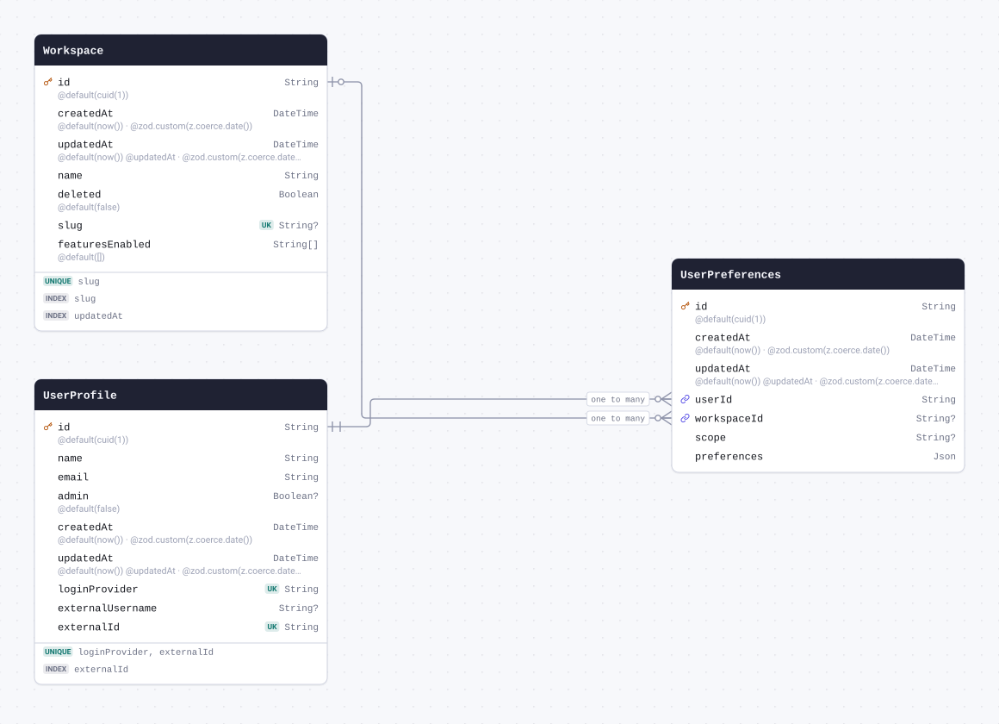

| Field         | Type       | Constraints                                     | Default              | Description                  |
| ------------- | ---------- | ----------------------------------------------- | -------------------- | ---------------------------- |
| `id`          | `String`   | PK NOT NULL                                     | `cuid(1)`            |                              |
| `createdAt`   | `DateTime` | NOT NULL                                        | `now()`              | @zod.custom(z.coerce.date()) |
| `updatedAt`   | `DateTime` | NOT NULL                                        | `now()` `@updatedAt` | @zod.custom(z.coerce.date()) |
| `userId`      | `String`   | NOT NULL → [UserProfile.id](#model-UserProfile) |                      |                              |
| `workspaceId` | `String`   | NULL → [Workspace.id](#model-Workspace)         |                      |                              |
| `scope`       | `String`   | NULL                                            |                      |                              |
| `preferences` | `Json`     | NOT NULL                                        |                      |                              |

#### References

- `userId` → [UserProfile.id](#model-UserProfile) (many-to-one)
- `workspaceId` → [Workspace.id](#model-Workspace) (many-to-one)

#### Definition

```sql
CREATE TABLE "UserPreferences" (
    "id" TEXT NOT NULL,
    "createdAt" TIMESTAMP(3) NOT NULL DEFAULT CURRENT_TIMESTAMP,
    "updatedAt" TIMESTAMP(3) NOT NULL DEFAULT CURRENT_TIMESTAMP,
    "userId" TEXT NOT NULL,
    "workspaceId" TEXT,
    "scope" TEXT,
    "preferences" JSONB NOT NULL,

    CONSTRAINT "UserPreferences_pkey" PRIMARY KEY ("id")
);

ALTER TABLE "UserPreferences" ADD CONSTRAINT "UserPreferences_userId_fkey" FOREIGN KEY ("userId") REFERENCES "UserProfile"("id") ON DELETE RESTRICT ON UPDATE CASCADE;

ALTER TABLE "UserPreferences" ADD CONSTRAINT "UserPreferences_workspaceId_fkey" FOREIGN KEY ("workspaceId") REFERENCES "Workspace"("id") ON DELETE SET NULL ON UPDATE CASCADE;
```

<details>
<summary>Queries and their SQL</summary>

**findMany**: Every row

```ts
await prisma.userPreferences.findMany();
```

```sql
SELECT
  "public"."UserPreferences"."id",
  "public"."UserPreferences"."createdAt",
  "public"."UserPreferences"."updatedAt",
  "public"."UserPreferences"."userId",
  "public"."UserPreferences"."workspaceId",
  "public"."UserPreferences"."scope",
  "public"."UserPreferences"."preferences"
FROM
  "public"."UserPreferences"
WHERE
  1 = 1
OFFSET
  $1
-- params: ["0"]
```

**count**: How many rows there are

```ts
await prisma.userPreferences.count();
```

```sql
SELECT
  COUNT(*) AS "_count$_all"
FROM
  (
    SELECT
      "public"."UserPreferences"."id"
    FROM
      "public"."UserPreferences"
    WHERE
      1 = 1
    OFFSET
      $1
  ) AS "sub"
-- params: ["0"]
```

**findMany**: Every row with its relations

```ts
await prisma.userPreferences.findMany({ include: { user: true, workspace: true } });
```

```sql
SELECT
  "public"."UserPreferences"."id",
  "public"."UserPreferences"."createdAt",
  "public"."UserPreferences"."updatedAt",
  "public"."UserPreferences"."userId",
  "public"."UserPreferences"."workspaceId",
  "public"."UserPreferences"."scope",
  "public"."UserPreferences"."preferences"
FROM
  "public"."UserPreferences"
WHERE
  1 = 1
OFFSET
  $1
-- params: ["0"]

SELECT
  "public"."UserProfile"."id",
  "public"."UserProfile"."name",
  "public"."UserProfile"."email",
  "public"."UserProfile"."admin",
  "public"."UserProfile"."createdAt",
  "public"."UserProfile"."updatedAt",
  "public"."UserProfile"."loginProvider",
  "public"."UserProfile"."externalUsername",
  "public"."UserProfile"."externalId"
FROM
  "public"."UserProfile"
WHERE
  "public"."UserProfile"."id" IN ($1)
OFFSET
  $2
-- params: ["<userId of the rows above>","0"]

SELECT
  "public"."Workspace"."id",
  "public"."Workspace"."createdAt",
  "public"."Workspace"."updatedAt",
  "public"."Workspace"."name",
  "public"."Workspace"."deleted",
  "public"."Workspace"."slug",
  "public"."Workspace"."featuresEnabled"
FROM
  "public"."Workspace"
WHERE
  "public"."Workspace"."id" IN ($1)
OFFSET
  $2
-- params: ["<workspaceId of the rows above>","0"]
```

**findUnique**: One row by what is unique to it

```ts
await prisma.userPreferences.findUnique({ where: { id: "example" } });
```

```sql
SELECT
  "public"."UserPreferences"."id",
  "public"."UserPreferences"."createdAt",
  "public"."UserPreferences"."updatedAt",
  "public"."UserPreferences"."userId",
  "public"."UserPreferences"."workspaceId",
  "public"."UserPreferences"."scope",
  "public"."UserPreferences"."preferences"
FROM
  "public"."UserPreferences"
WHERE
  (
    "public"."UserPreferences"."id" = $1
    AND 1 = 1
  )
LIMIT
  $2
OFFSET
  $3
-- params: ["example","1","0"]
```

**create**: Create a row

```ts
await prisma.userPreferences.create({ data: { userId: "example", preferences: {} } });
```

```sql
INSERT INTO
  "public"."UserPreferences" (
    "id",
    "createdAt",
    "updatedAt",
    "userId",
    "preferences"
  )
VALUES
  ($1, $2, $3, $4, $5)
RETURNING
  "public"."UserPreferences"."id",
  "public"."UserPreferences"."createdAt",
  "public"."UserPreferences"."updatedAt",
  "public"."UserPreferences"."userId",
  "public"."UserPreferences"."workspaceId",
  "public"."UserPreferences"."scope",
  "public"."UserPreferences"."preferences"
-- params: ["<cuid(1)>","<now()>","<now()>","example","{}"]
```

**update**: Update a row

```ts
await prisma.userPreferences.update({
  where: { id: "example" },
  data: { createdAt: new Date("2026-01-01T00:00:00.000Z") },
});
```

```sql
UPDATE "public"."UserPreferences"
SET
  "createdAt" = $1,
  "updatedAt" = $2
WHERE
  (
    "public"."UserPreferences"."id" = $3
    AND 1 = 1
  )
RETURNING
  "public"."UserPreferences"."id",
  "public"."UserPreferences"."createdAt",
  "public"."UserPreferences"."updatedAt",
  "public"."UserPreferences"."userId",
  "public"."UserPreferences"."workspaceId",
  "public"."UserPreferences"."scope",
  "public"."UserPreferences"."preferences"
-- params: ["2026-01-01T00:00:00.000Z",{"prisma__type":"generatorCall","prisma__value":{"name":"now","args":[],"returnType":{"type":"DateTime"}}},"example"]
```

**delete**: Delete a row

```ts
await prisma.userPreferences.delete({ where: { id: "example" } });
```

```sql
DELETE FROM "public"."UserPreferences"
WHERE
  (
    "public"."UserPreferences"."id" = $1
    AND 1 = 1
  )
RETURNING
  "public"."UserPreferences"."id",
  "public"."UserPreferences"."createdAt",
  "public"."UserPreferences"."updatedAt",
  "public"."UserPreferences"."userId",
  "public"."UserPreferences"."workspaceId",
  "public"."UserPreferences"."scope",
  "public"."UserPreferences"."preferences"
-- params: ["example"]
```

</details>

<a id="model-UserProfile"></a>

### UserProfile

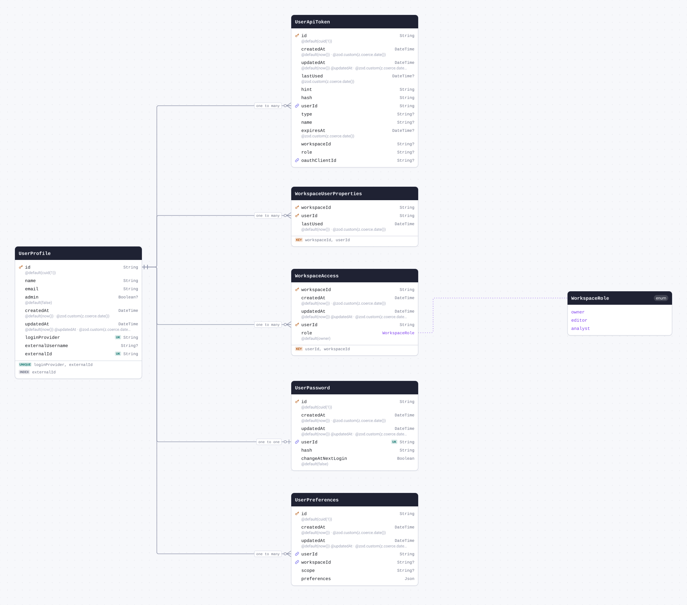

| Field              | Type       | Constraints | Default              | Description                  |
| ------------------ | ---------- | ----------- | -------------------- | ---------------------------- |
| `id`               | `String`   | PK NOT NULL | `cuid(1)`            |                              |
| `name`             | `String`   | NOT NULL    |                      |                              |
| `email`            | `String`   | NOT NULL    |                      |                              |
| `admin`            | `Boolean`  | NULL        | `false`              |                              |
| `createdAt`        | `DateTime` | NOT NULL    | `now()`              | @zod.custom(z.coerce.date()) |
| `updatedAt`        | `DateTime` | NOT NULL    | `now()` `@updatedAt` | @zod.custom(z.coerce.date()) |
| `loginProvider`    | `String`   | NOT NULL    |                      |                              |
| `externalUsername` | `String`   | NULL        |                      |                              |
| `externalId`       | `String`   | NOT NULL    |                      |                              |

#### Indexes

- `@@index([externalId])`
- `@@unique([loginProvider, externalId])`

#### Referenced by

- `id` ← [UserPreferences.userId](#model-UserPreferences) (one-to-many)
- `id` ← [UserPassword.userId](#model-UserPassword) (one-to-one)
- `id` ← [WorkspaceAccess.userId](#model-WorkspaceAccess) (one-to-many)
- `id` ← [WorkspaceUserProperties.userId](#model-WorkspaceUserProperties) (one-to-many)
- `id` ← [UserApiToken.userId](#model-UserApiToken) (one-to-many)

#### Definition

```sql
CREATE TABLE "UserProfile" (
    "id" TEXT NOT NULL,
    "name" TEXT NOT NULL,
    "email" TEXT NOT NULL,
    "admin" BOOLEAN DEFAULT false,
    "createdAt" TIMESTAMP(3) NOT NULL DEFAULT CURRENT_TIMESTAMP,
    "updatedAt" TIMESTAMP(3) NOT NULL DEFAULT CURRENT_TIMESTAMP,
    "loginProvider" TEXT NOT NULL,
    "externalUsername" TEXT,
    "externalId" TEXT NOT NULL,

    CONSTRAINT "UserProfile_pkey" PRIMARY KEY ("id")
);

CREATE INDEX "UserProfile_externalId_idx" ON "UserProfile"("externalId");

CREATE UNIQUE INDEX "UserProfile_loginProvider_externalId_key" ON "UserProfile"("loginProvider", "externalId");
```

<details>
<summary>Queries and their SQL</summary>

**findMany**: Every row

```ts
await prisma.userProfile.findMany();
```

```sql
SELECT
  "public"."UserProfile"."id",
  "public"."UserProfile"."name",
  "public"."UserProfile"."email",
  "public"."UserProfile"."admin",
  "public"."UserProfile"."createdAt",
  "public"."UserProfile"."updatedAt",
  "public"."UserProfile"."loginProvider",
  "public"."UserProfile"."externalUsername",
  "public"."UserProfile"."externalId"
FROM
  "public"."UserProfile"
WHERE
  1 = 1
OFFSET
  $1
-- params: ["0"]
```

**count**: How many rows there are

```ts
await prisma.userProfile.count();
```

```sql
SELECT
  COUNT(*) AS "_count$_all"
FROM
  (
    SELECT
      "public"."UserProfile"."id"
    FROM
      "public"."UserProfile"
    WHERE
      1 = 1
    OFFSET
      $1
  ) AS "sub"
-- params: ["0"]
```

**findMany**: Every row with its relations

```ts
await prisma.userProfile.findMany({
  include: {
    tokens: true,
    workspaceAccess: true,
    userPreferences: true,
    workspaceUserProperties: true,
    password: true,
  },
});
```

```sql
SELECT
  "public"."UserProfile"."id",
  "public"."UserProfile"."name",
  "public"."UserProfile"."email",
  "public"."UserProfile"."admin",
  "public"."UserProfile"."createdAt",
  "public"."UserProfile"."updatedAt",
  "public"."UserProfile"."loginProvider",
  "public"."UserProfile"."externalUsername",
  "public"."UserProfile"."externalId"
FROM
  "public"."UserProfile"
WHERE
  1 = 1
OFFSET
  $1
-- params: ["0"]

SELECT
  "public"."UserApiToken"."id",
  "public"."UserApiToken"."createdAt",
  "public"."UserApiToken"."updatedAt",
  "public"."UserApiToken"."lastUsed",
  "public"."UserApiToken"."hint",
  "public"."UserApiToken"."hash",
  "public"."UserApiToken"."userId",
  "public"."UserApiToken"."type",
  "public"."UserApiToken"."name",
  "public"."UserApiToken"."expiresAt",
  "public"."UserApiToken"."workspaceId",
  "public"."UserApiToken"."role",
  "public"."UserApiToken"."oauthClientId"
FROM
  "public"."UserApiToken"
WHERE
  "public"."UserApiToken"."userId" IN ($1)
OFFSET
  $2
-- params: ["<id of the rows above>","0"]

SELECT
  "public"."WorkspaceAccess"."userId",
  "public"."WorkspaceAccess"."workspaceId",
  "public"."WorkspaceAccess"."createdAt",
  "public"."WorkspaceAccess"."updatedAt",
  "public"."WorkspaceAccess"."role"::text
FROM
  "public"."WorkspaceAccess"
WHERE
  "public"."WorkspaceAccess"."userId" IN ($1)
OFFSET
  $2
-- params: ["<id of the rows above>","0"]

SELECT
  "public"."UserPreferences"."id",
  "public"."UserPreferences"."createdAt",
  "public"."UserPreferences"."updatedAt",
  "public"."UserPreferences"."userId",
  "public"."UserPreferences"."workspaceId",
  "public"."UserPreferences"."scope",
  "public"."UserPreferences"."preferences"
FROM
  "public"."UserPreferences"
WHERE
  "public"."UserPreferences"."userId" IN ($1)
OFFSET
  $2
-- params: ["<id of the rows above>","0"]

SELECT
  "public"."WorkspaceUserProperties"."workspaceId",
  "public"."WorkspaceUserProperties"."userId",
  "public"."WorkspaceUserProperties"."lastUsed"
FROM
  "public"."WorkspaceUserProperties"
WHERE
  "public"."WorkspaceUserProperties"."userId" IN ($1)
OFFSET
  $2
-- params: ["<id of the rows above>","0"]

SELECT
  "public"."UserPassword"."id",
  "public"."UserPassword"."createdAt",
  "public"."UserPassword"."updatedAt",
  "public"."UserPassword"."userId",
  "public"."UserPassword"."hash",
  "public"."UserPassword"."changeAtNextLogin"
FROM
  "public"."UserPassword"
WHERE
  "public"."UserPassword"."userId" IN ($1)
OFFSET
  $2
-- params: ["<id of the rows above>","0"]
```

**findUnique**: One row by what is unique to it

```ts
await prisma.userProfile.findUnique({ where: { id: "example" } });
```

```sql
SELECT
  "public"."UserProfile"."id",
  "public"."UserProfile"."name",
  "public"."UserProfile"."email",
  "public"."UserProfile"."admin",
  "public"."UserProfile"."createdAt",
  "public"."UserProfile"."updatedAt",
  "public"."UserProfile"."loginProvider",
  "public"."UserProfile"."externalUsername",
  "public"."UserProfile"."externalId"
FROM
  "public"."UserProfile"
WHERE
  (
    "public"."UserProfile"."id" = $1
    AND 1 = 1
  )
LIMIT
  $2
OFFSET
  $3
-- params: ["example","1","0"]
```

**create**: Create a row

```ts
await prisma.userProfile.create({
  data: { name: "example", email: "example", loginProvider: "example", externalId: "example" },
});
```

```sql
INSERT INTO
  "public"."UserProfile" (
    "id",
    "name",
    "email",
    "admin",
    "createdAt",
    "updatedAt",
    "loginProvider",
    "externalId"
  )
VALUES
  ($1, $2, $3, $4, $5, $6, $7, $8)
RETURNING
  "public"."UserProfile"."id",
  "public"."UserProfile"."name",
  "public"."UserProfile"."email",
  "public"."UserProfile"."admin",
  "public"."UserProfile"."createdAt",
  "public"."UserProfile"."updatedAt",
  "public"."UserProfile"."loginProvider",
  "public"."UserProfile"."externalUsername",
  "public"."UserProfile"."externalId"
-- params: ["<cuid(1)>","example","example",false,"<now()>","<now()>","example","example"]
```

**update**: Update a row

```ts
await prisma.userProfile.update({ where: { id: "example" }, data: { name: "example" } });
```

```sql
UPDATE "public"."UserProfile"
SET
  "name" = $1,
  "updatedAt" = $2
WHERE
  (
    "public"."UserProfile"."id" = $3
    AND 1 = 1
  )
RETURNING
  "public"."UserProfile"."id",
  "public"."UserProfile"."name",
  "public"."UserProfile"."email",
  "public"."UserProfile"."admin",
  "public"."UserProfile"."createdAt",
  "public"."UserProfile"."updatedAt",
  "public"."UserProfile"."loginProvider",
  "public"."UserProfile"."externalUsername",
  "public"."UserProfile"."externalId"
-- params: ["example",{"prisma__type":"generatorCall","prisma__value":{"name":"now","args":[],"returnType":{"type":"DateTime"}}},"example"]
```

**delete**: Delete a row

```ts
await prisma.userProfile.delete({ where: { id: "example" } });
```

```sql
DELETE FROM "public"."UserProfile"
WHERE
  (
    "public"."UserProfile"."id" = $1
    AND 1 = 1
  )
RETURNING
  "public"."UserProfile"."id",
  "public"."UserProfile"."name",
  "public"."UserProfile"."email",
  "public"."UserProfile"."admin",
  "public"."UserProfile"."createdAt",
  "public"."UserProfile"."updatedAt",
  "public"."UserProfile"."loginProvider",
  "public"."UserProfile"."externalUsername",
  "public"."UserProfile"."externalId"
-- params: ["example"]
```

</details>

<a id="model-UserPassword"></a>

### UserPassword

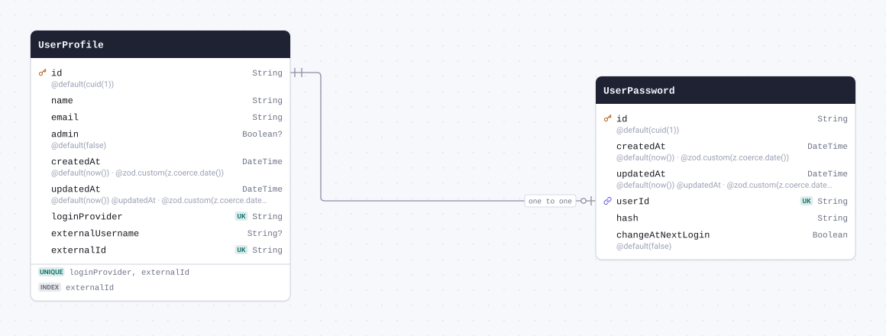

| Field               | Type       | Constraints                                            | Default              | Description                  |
| ------------------- | ---------- | ------------------------------------------------------ | -------------------- | ---------------------------- |
| `id`                | `String`   | PK NOT NULL                                            | `cuid(1)`            |                              |
| `createdAt`         | `DateTime` | NOT NULL                                               | `now()`              | @zod.custom(z.coerce.date()) |
| `updatedAt`         | `DateTime` | NOT NULL                                               | `now()` `@updatedAt` | @zod.custom(z.coerce.date()) |
| `userId`            | `String`   | UNIQUE NOT NULL → [UserProfile.id](#model-UserProfile) |                      |                              |
| `hash`              | `String`   | NOT NULL                                               |                      |                              |
| `changeAtNextLogin` | `Boolean`  | NOT NULL                                               | `false`              |                              |

#### References

- `userId` → [UserProfile.id](#model-UserProfile) (one-to-one)

#### Definition

```sql
CREATE TABLE "UserPassword" (
    "id" TEXT NOT NULL,
    "createdAt" TIMESTAMP(3) NOT NULL DEFAULT CURRENT_TIMESTAMP,
    "updatedAt" TIMESTAMP(3) NOT NULL DEFAULT CURRENT_TIMESTAMP,
    "userId" TEXT NOT NULL,
    "hash" TEXT NOT NULL,
    "changeAtNextLogin" BOOLEAN NOT NULL DEFAULT false,

    CONSTRAINT "UserPassword_pkey" PRIMARY KEY ("id")
);

CREATE UNIQUE INDEX "UserPassword_userId_key" ON "UserPassword"("userId");

ALTER TABLE "UserPassword" ADD CONSTRAINT "UserPassword_userId_fkey" FOREIGN KEY ("userId") REFERENCES "UserProfile"("id") ON DELETE RESTRICT ON UPDATE CASCADE;
```

<details>
<summary>Queries and their SQL</summary>

**findMany**: Every row

```ts
await prisma.userPassword.findMany();
```

```sql
SELECT
  "public"."UserPassword"."id",
  "public"."UserPassword"."createdAt",
  "public"."UserPassword"."updatedAt",
  "public"."UserPassword"."userId",
  "public"."UserPassword"."hash",
  "public"."UserPassword"."changeAtNextLogin"
FROM
  "public"."UserPassword"
WHERE
  1 = 1
OFFSET
  $1
-- params: ["0"]
```

**count**: How many rows there are

```ts
await prisma.userPassword.count();
```

```sql
SELECT
  COUNT(*) AS "_count$_all"
FROM
  (
    SELECT
      "public"."UserPassword"."id"
    FROM
      "public"."UserPassword"
    WHERE
      1 = 1
    OFFSET
      $1
  ) AS "sub"
-- params: ["0"]
```

**findMany**: Every row with its relations

```ts
await prisma.userPassword.findMany({ include: { user: true } });
```

```sql
SELECT
  "public"."UserPassword"."id",
  "public"."UserPassword"."createdAt",
  "public"."UserPassword"."updatedAt",
  "public"."UserPassword"."userId",
  "public"."UserPassword"."hash",
  "public"."UserPassword"."changeAtNextLogin"
FROM
  "public"."UserPassword"
WHERE
  1 = 1
OFFSET
  $1
-- params: ["0"]

SELECT
  "public"."UserProfile"."id",
  "public"."UserProfile"."name",
  "public"."UserProfile"."email",
  "public"."UserProfile"."admin",
  "public"."UserProfile"."createdAt",
  "public"."UserProfile"."updatedAt",
  "public"."UserProfile"."loginProvider",
  "public"."UserProfile"."externalUsername",
  "public"."UserProfile"."externalId"
FROM
  "public"."UserProfile"
WHERE
  "public"."UserProfile"."id" IN ($1)
OFFSET
  $2
-- params: ["<userId of the rows above>","0"]
```

**findUnique**: One row by what is unique to it

```ts
await prisma.userPassword.findUnique({ where: { id: "example" } });
```

```sql
SELECT
  "public"."UserPassword"."id",
  "public"."UserPassword"."createdAt",
  "public"."UserPassword"."updatedAt",
  "public"."UserPassword"."userId",
  "public"."UserPassword"."hash",
  "public"."UserPassword"."changeAtNextLogin"
FROM
  "public"."UserPassword"
WHERE
  (
    "public"."UserPassword"."id" = $1
    AND 1 = 1
  )
LIMIT
  $2
OFFSET
  $3
-- params: ["example","1","0"]
```

**create**: Create a row

```ts
await prisma.userPassword.create({ data: { userId: "example", hash: "example" } });
```

```sql
INSERT INTO
  "public"."UserPassword" (
    "id",
    "createdAt",
    "updatedAt",
    "userId",
    "hash",
    "changeAtNextLogin"
  )
VALUES
  ($1, $2, $3, $4, $5, $6)
RETURNING
  "public"."UserPassword"."id",
  "public"."UserPassword"."createdAt",
  "public"."UserPassword"."updatedAt",
  "public"."UserPassword"."userId",
  "public"."UserPassword"."hash",
  "public"."UserPassword"."changeAtNextLogin"
-- params: ["<cuid(1)>","<now()>","<now()>","example","example",false]
```

**update**: Update a row

```ts
await prisma.userPassword.update({
  where: { id: "example" },
  data: { createdAt: new Date("2026-01-01T00:00:00.000Z") },
});
```

```sql
UPDATE "public"."UserPassword"
SET
  "createdAt" = $1,
  "updatedAt" = $2
WHERE
  (
    "public"."UserPassword"."id" = $3
    AND 1 = 1
  )
RETURNING
  "public"."UserPassword"."id",
  "public"."UserPassword"."createdAt",
  "public"."UserPassword"."updatedAt",
  "public"."UserPassword"."userId",
  "public"."UserPassword"."hash",
  "public"."UserPassword"."changeAtNextLogin"
-- params: ["2026-01-01T00:00:00.000Z",{"prisma__type":"generatorCall","prisma__value":{"name":"now","args":[],"returnType":{"type":"DateTime"}}},"example"]
```

**delete**: Delete a row

```ts
await prisma.userPassword.delete({ where: { id: "example" } });
```

```sql
DELETE FROM "public"."UserPassword"
WHERE
  (
    "public"."UserPassword"."id" = $1
    AND 1 = 1
  )
RETURNING
  "public"."UserPassword"."id",
  "public"."UserPassword"."createdAt",
  "public"."UserPassword"."updatedAt",
  "public"."UserPassword"."userId",
  "public"."UserPassword"."hash",
  "public"."UserPassword"."changeAtNextLogin"
-- params: ["example"]
```

</details>

<a id="model-Workspace"></a>

### Workspace

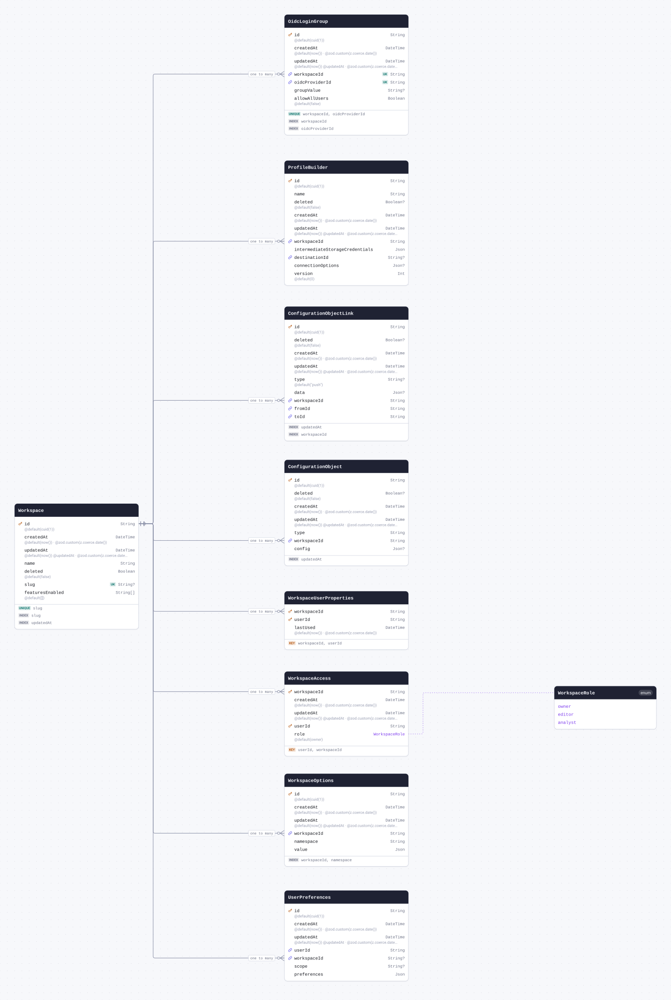

| Field             | Type       | Constraints | Default              | Description                  |
| ----------------- | ---------- | ----------- | -------------------- | ---------------------------- |
| `id`              | `String`   | PK NOT NULL | `cuid(1)`            |                              |
| `createdAt`       | `DateTime` | NOT NULL    | `now()`              | @zod.custom(z.coerce.date()) |
| `updatedAt`       | `DateTime` | NOT NULL    | `now()` `@updatedAt` | @zod.custom(z.coerce.date()) |
| `name`            | `String`   | NOT NULL    |                      |                              |
| `deleted`         | `Boolean`  | NOT NULL    | `false`              |                              |
| `slug`            | `String`   | UNIQUE NULL |                      |                              |
| `featuresEnabled` | `String[]` | NOT NULL    | `[]`                 |                              |

#### Indexes

- `@@index([slug])`
- `@@index([updatedAt])`
- `@@unique([slug])`

#### Referenced by

- `id` ← [UserPreferences.workspaceId](#model-UserPreferences) (one-to-many)
- `id` ← [WorkspaceOptions.workspaceId](#model-WorkspaceOptions) (one-to-many)
- `id` ← [WorkspaceAccess.workspaceId](#model-WorkspaceAccess) (one-to-many)
- `id` ← [WorkspaceUserProperties.workspaceId](#model-WorkspaceUserProperties) (one-to-many)
- `id` ← [ConfigurationObject.workspaceId](#model-ConfigurationObject) (one-to-many)
- `id` ← [ConfigurationObjectLink.workspaceId](#model-ConfigurationObjectLink) (one-to-many)
- `id` ← [ProfileBuilder.workspaceId](#model-ProfileBuilder) (one-to-many)
- `id` ← [OidcLoginGroup.workspaceId](#model-OidcLoginGroup) (one-to-many)

#### Definition

```sql
CREATE TABLE "Workspace" (
    "id" TEXT NOT NULL,
    "createdAt" TIMESTAMP(3) NOT NULL DEFAULT CURRENT_TIMESTAMP,
    "updatedAt" TIMESTAMP(3) NOT NULL DEFAULT CURRENT_TIMESTAMP,
    "name" TEXT NOT NULL,
    "deleted" BOOLEAN NOT NULL DEFAULT false,
    "slug" TEXT,
    "featuresEnabled" TEXT[] DEFAULT ARRAY[]::TEXT[],

    CONSTRAINT "Workspace_pkey" PRIMARY KEY ("id")
);

CREATE INDEX "Workspace_slug_idx" ON "Workspace"("slug");

CREATE INDEX "Workspace_updatedAt_idx" ON "Workspace"("updatedAt" DESC);

CREATE UNIQUE INDEX "Workspace_slug_key" ON "Workspace"("slug");
```

<details>
<summary>Queries and their SQL</summary>

**findMany**: Every row

```ts
await prisma.workspace.findMany();
```

```sql
SELECT
  "public"."Workspace"."id",
  "public"."Workspace"."createdAt",
  "public"."Workspace"."updatedAt",
  "public"."Workspace"."name",
  "public"."Workspace"."deleted",
  "public"."Workspace"."slug",
  "public"."Workspace"."featuresEnabled"
FROM
  "public"."Workspace"
WHERE
  1 = 1
OFFSET
  $1
-- params: ["0"]
```

**count**: How many rows there are

```ts
await prisma.workspace.count();
```

```sql
SELECT
  COUNT(*) AS "_count$_all"
FROM
  (
    SELECT
      "public"."Workspace"."id"
    FROM
      "public"."Workspace"
    WHERE
      1 = 1
    OFFSET
      $1
  ) AS "sub"
-- params: ["0"]
```

**findMany**: Every row with its relations

```ts
await prisma.workspace.findMany({
  include: {
    workspaceAccess: true,
    workspaceOptions: true,
    configurationObject: true,
    configurationObjectLink: true,
    preferences: true,
    workspaceUserProperties: true,
    profileBuilders: true,
    oidcLoginGroups: true,
  },
});
```

```sql
SELECT
  "public"."Workspace"."id",
  "public"."Workspace"."createdAt",
  "public"."Workspace"."updatedAt",
  "public"."Workspace"."name",
  "public"."Workspace"."deleted",
  "public"."Workspace"."slug",
  "public"."Workspace"."featuresEnabled"
FROM
  "public"."Workspace"
WHERE
  1 = 1
OFFSET
  $1
-- params: ["0"]

SELECT
  "public"."WorkspaceAccess"."userId",
  "public"."WorkspaceAccess"."workspaceId",
  "public"."WorkspaceAccess"."createdAt",
  "public"."WorkspaceAccess"."updatedAt",
  "public"."WorkspaceAccess"."role"::text
FROM
  "public"."WorkspaceAccess"
WHERE
  "public"."WorkspaceAccess"."workspaceId" IN ($1)
OFFSET
  $2
-- params: ["<id of the rows above>","0"]

SELECT
  "public"."WorkspaceOptions"."id",
  "public"."WorkspaceOptions"."createdAt",
  "public"."WorkspaceOptions"."updatedAt",
  "public"."WorkspaceOptions"."workspaceId",
  "public"."WorkspaceOptions"."namespace",
  "public"."WorkspaceOptions"."value"
FROM
  "public"."WorkspaceOptions"
WHERE
  "public"."WorkspaceOptions"."workspaceId" IN ($1)
OFFSET
  $2
-- params: ["<id of the rows above>","0"]

SELECT
  "public"."ConfigurationObject"."id",
  "public"."ConfigurationObject"."deleted",
  "public"."ConfigurationObject"."createdAt",
  "public"."ConfigurationObject"."updatedAt",
  "public"."ConfigurationObject"."type",
  "public"."ConfigurationObject"."workspaceId",
  "public"."ConfigurationObject"."config"
FROM
  "public"."ConfigurationObject"
WHERE
  "public"."ConfigurationObject"."workspaceId" IN ($1)
OFFSET
  $2
-- params: ["<id of the rows above>","0"]

SELECT
  "public"."ConfigurationObjectLink"."id",
  "public"."ConfigurationObjectLink"."deleted",
  "public"."ConfigurationObjectLink"."createdAt",
  "public"."ConfigurationObjectLink"."updatedAt",
  "public"."ConfigurationObjectLink"."type",
  "public"."ConfigurationObjectLink"."data",
  "public"."ConfigurationObjectLink"."workspaceId",
  "public"."ConfigurationObjectLink"."fromId",
  "public"."ConfigurationObjectLink"."toId"
FROM
  "public"."ConfigurationObjectLink"
WHERE
  "public"."ConfigurationObjectLink"."workspaceId" IN ($1)
OFFSET
  $2
-- params: ["<id of the rows above>","0"]

SELECT
  "public"."UserPreferences"."id",
  "public"."UserPreferences"."createdAt",
  "public"."UserPreferences"."updatedAt",
  "public"."UserPreferences"."userId",
  "public"."UserPreferences"."workspaceId",
  "public"."UserPreferences"."scope",
  "public"."UserPreferences"."preferences"
FROM
  "public"."UserPreferences"
WHERE
  "public"."UserPreferences"."workspaceId" IN ($1)
OFFSET
  $2
-- params: ["<id of the rows above>","0"]

SELECT
  "public"."WorkspaceUserProperties"."workspaceId",
  "public"."WorkspaceUserProperties"."userId",
  "public"."WorkspaceUserProperties"."lastUsed"
FROM
  "public"."WorkspaceUserProperties"
WHERE
  "public"."WorkspaceUserProperties"."workspaceId" IN ($1)
OFFSET
  $2
-- params: ["<id of the rows above>","0"]

SELECT
  "public"."ProfileBuilder"."id",
  "public"."ProfileBuilder"."name",
  "public"."ProfileBuilder"."deleted",
  "public"."ProfileBuilder"."createdAt",
  "public"."ProfileBuilder"."updatedAt",
  "public"."ProfileBuilder"."workspaceId",
  "public"."ProfileBuilder"."intermediateStorageCredentials",
  "public"."ProfileBuilder"."destinationId",
  "public"."ProfileBuilder"."connectionOptions",
  "public"."ProfileBuilder"."version"
FROM
  "public"."ProfileBuilder"
WHERE
  "public"."ProfileBuilder"."workspaceId" IN ($1)
OFFSET
  $2
-- params: ["<id of the rows above>","0"]

SELECT
  "public"."OidcLoginGroup"."id",
  "public"."OidcLoginGroup"."createdAt",
  "public"."OidcLoginGroup"."updatedAt",
  "public"."OidcLoginGroup"."workspaceId",
  "public"."OidcLoginGroup"."oidcProviderId",
  "public"."OidcLoginGroup"."groupValue",
  "public"."OidcLoginGroup"."allowAllUsers"
FROM
  "public"."OidcLoginGroup"
WHERE
  "public"."OidcLoginGroup"."workspaceId" IN ($1)
OFFSET
  $2
-- params: ["<id of the rows above>","0"]
```

**findUnique**: One row by what is unique to it

```ts
await prisma.workspace.findUnique({ where: { id: "example" } });
```

```sql
SELECT
  "public"."Workspace"."id",
  "public"."Workspace"."createdAt",
  "public"."Workspace"."updatedAt",
  "public"."Workspace"."name",
  "public"."Workspace"."deleted",
  "public"."Workspace"."slug",
  "public"."Workspace"."featuresEnabled"
FROM
  "public"."Workspace"
WHERE
  (
    "public"."Workspace"."id" = $1
    AND 1 = 1
  )
LIMIT
  $2
OFFSET
  $3
-- params: ["example","1","0"]
```

**create**: Create a row

```ts
await prisma.workspace.create({ data: { name: "example" } });
```

```sql
INSERT INTO
  "public"."Workspace" (
    "id",
    "createdAt",
    "updatedAt",
    "name",
    "deleted",
    "featuresEnabled"
  )
VALUES
  ($1, $2, $3, $4, $5, $6)
RETURNING
  "public"."Workspace"."id",
  "public"."Workspace"."createdAt",
  "public"."Workspace"."updatedAt",
  "public"."Workspace"."name",
  "public"."Workspace"."deleted",
  "public"."Workspace"."slug",
  "public"."Workspace"."featuresEnabled"
-- params: ["<cuid(1)>","<now()>","<now()>","example",false,[]]
```

**update**: Update a row

```ts
await prisma.workspace.update({
  where: { id: "example" },
  data: { createdAt: new Date("2026-01-01T00:00:00.000Z") },
});
```

```sql
UPDATE "public"."Workspace"
SET
  "createdAt" = $1,
  "updatedAt" = $2
WHERE
  (
    "public"."Workspace"."id" = $3
    AND 1 = 1
  )
RETURNING
  "public"."Workspace"."id",
  "public"."Workspace"."createdAt",
  "public"."Workspace"."updatedAt",
  "public"."Workspace"."name",
  "public"."Workspace"."deleted",
  "public"."Workspace"."slug",
  "public"."Workspace"."featuresEnabled"
-- params: ["2026-01-01T00:00:00.000Z",{"prisma__type":"generatorCall","prisma__value":{"name":"now","args":[],"returnType":{"type":"DateTime"}}},"example"]
```

**delete**: Delete a row

```ts
await prisma.workspace.delete({ where: { id: "example" } });
```

```sql
DELETE FROM "public"."Workspace"
WHERE
  (
    "public"."Workspace"."id" = $1
    AND 1 = 1
  )
RETURNING
  "public"."Workspace"."id",
  "public"."Workspace"."createdAt",
  "public"."Workspace"."updatedAt",
  "public"."Workspace"."name",
  "public"."Workspace"."deleted",
  "public"."Workspace"."slug",
  "public"."Workspace"."featuresEnabled"
-- params: ["example"]
```

</details>

<a id="model-WorkspaceOptions"></a>

### WorkspaceOptions

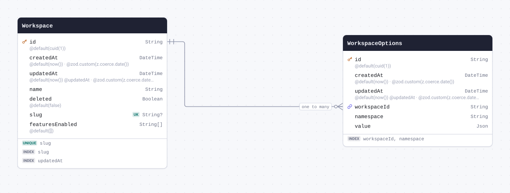

| Field         | Type       | Constraints                                 | Default              | Description                  |
| ------------- | ---------- | ------------------------------------------- | -------------------- | ---------------------------- |
| `id`          | `String`   | PK NOT NULL                                 | `cuid(1)`            |                              |
| `createdAt`   | `DateTime` | NOT NULL                                    | `now()`              | @zod.custom(z.coerce.date()) |
| `updatedAt`   | `DateTime` | NOT NULL                                    | `now()` `@updatedAt` | @zod.custom(z.coerce.date()) |
| `workspaceId` | `String`   | NOT NULL → [Workspace.id](#model-Workspace) |                      |                              |
| `namespace`   | `String`   | NOT NULL                                    |                      |                              |
| `value`       | `Json`     | NOT NULL                                    |                      |                              |

#### Indexes

- `@@index([workspaceId, namespace])`

#### References

- `workspaceId` → [Workspace.id](#model-Workspace) (many-to-one)

#### Definition

```sql
CREATE TABLE "WorkspaceOptions" (
    "id" TEXT NOT NULL,
    "createdAt" TIMESTAMP(3) NOT NULL DEFAULT CURRENT_TIMESTAMP,
    "updatedAt" TIMESTAMP(3) NOT NULL DEFAULT CURRENT_TIMESTAMP,
    "workspaceId" TEXT NOT NULL,
    "namespace" TEXT NOT NULL,
    "value" JSONB NOT NULL,

    CONSTRAINT "WorkspaceOptions_pkey" PRIMARY KEY ("id")
);

CREATE INDEX "WorkspaceOptions_workspaceId_namespace_idx" ON "WorkspaceOptions"("workspaceId", "namespace");

ALTER TABLE "WorkspaceOptions" ADD CONSTRAINT "WorkspaceOptions_workspaceId_fkey" FOREIGN KEY ("workspaceId") REFERENCES "Workspace"("id") ON DELETE RESTRICT ON UPDATE CASCADE;
```

<details>
<summary>Queries and their SQL</summary>

**findMany**: Every row

```ts
await prisma.workspaceOptions.findMany();
```

```sql
SELECT
  "public"."WorkspaceOptions"."id",
  "public"."WorkspaceOptions"."createdAt",
  "public"."WorkspaceOptions"."updatedAt",
  "public"."WorkspaceOptions"."workspaceId",
  "public"."WorkspaceOptions"."namespace",
  "public"."WorkspaceOptions"."value"
FROM
  "public"."WorkspaceOptions"
WHERE
  1 = 1
OFFSET
  $1
-- params: ["0"]
```

**count**: How many rows there are

```ts
await prisma.workspaceOptions.count();
```

```sql
SELECT
  COUNT(*) AS "_count$_all"
FROM
  (
    SELECT
      "public"."WorkspaceOptions"."id"
    FROM
      "public"."WorkspaceOptions"
    WHERE
      1 = 1
    OFFSET
      $1
  ) AS "sub"
-- params: ["0"]
```

**findMany**: Every row with its relations

```ts
await prisma.workspaceOptions.findMany({ include: { workspace: true } });
```

```sql
SELECT
  "public"."WorkspaceOptions"."id",
  "public"."WorkspaceOptions"."createdAt",
  "public"."WorkspaceOptions"."updatedAt",
  "public"."WorkspaceOptions"."workspaceId",
  "public"."WorkspaceOptions"."namespace",
  "public"."WorkspaceOptions"."value"
FROM
  "public"."WorkspaceOptions"
WHERE
  1 = 1
OFFSET
  $1
-- params: ["0"]

SELECT
  "public"."Workspace"."id",
  "public"."Workspace"."createdAt",
  "public"."Workspace"."updatedAt",
  "public"."Workspace"."name",
  "public"."Workspace"."deleted",
  "public"."Workspace"."slug",
  "public"."Workspace"."featuresEnabled"
FROM
  "public"."Workspace"
WHERE
  "public"."Workspace"."id" IN ($1)
OFFSET
  $2
-- params: ["<workspaceId of the rows above>","0"]
```

**findUnique**: One row by what is unique to it

```ts
await prisma.workspaceOptions.findUnique({ where: { id: "example" } });
```

```sql
SELECT
  "public"."WorkspaceOptions"."id",
  "public"."WorkspaceOptions"."createdAt",
  "public"."WorkspaceOptions"."updatedAt",
  "public"."WorkspaceOptions"."workspaceId",
  "public"."WorkspaceOptions"."namespace",
  "public"."WorkspaceOptions"."value"
FROM
  "public"."WorkspaceOptions"
WHERE
  (
    "public"."WorkspaceOptions"."id" = $1
    AND 1 = 1
  )
LIMIT
  $2
OFFSET
  $3
-- params: ["example","1","0"]
```

**create**: Create a row

```ts
await prisma.workspaceOptions.create({
  data: { workspaceId: "example", namespace: "example", value: {} },
});
```

```sql
INSERT INTO
  "public"."WorkspaceOptions" (
    "id",
    "createdAt",
    "updatedAt",
    "workspaceId",
    "namespace",
    "value"
  )
VALUES
  ($1, $2, $3, $4, $5, $6)
RETURNING
  "public"."WorkspaceOptions"."id",
  "public"."WorkspaceOptions"."createdAt",
  "public"."WorkspaceOptions"."updatedAt",
  "public"."WorkspaceOptions"."workspaceId",
  "public"."WorkspaceOptions"."namespace",
  "public"."WorkspaceOptions"."value"
-- params: ["<cuid(1)>","<now()>","<now()>","example","example","{}"]
```

**update**: Update a row

```ts
await prisma.workspaceOptions.update({
  where: { id: "example" },
  data: { createdAt: new Date("2026-01-01T00:00:00.000Z") },
});
```

```sql
UPDATE "public"."WorkspaceOptions"
SET
  "createdAt" = $1,
  "updatedAt" = $2
WHERE
  (
    "public"."WorkspaceOptions"."id" = $3
    AND 1 = 1
  )
RETURNING
  "public"."WorkspaceOptions"."id",
  "public"."WorkspaceOptions"."createdAt",
  "public"."WorkspaceOptions"."updatedAt",
  "public"."WorkspaceOptions"."workspaceId",
  "public"."WorkspaceOptions"."namespace",
  "public"."WorkspaceOptions"."value"
-- params: ["2026-01-01T00:00:00.000Z",{"prisma__type":"generatorCall","prisma__value":{"name":"now","args":[],"returnType":{"type":"DateTime"}}},"example"]
```

**delete**: Delete a row

```ts
await prisma.workspaceOptions.delete({ where: { id: "example" } });
```

```sql
DELETE FROM "public"."WorkspaceOptions"
WHERE
  (
    "public"."WorkspaceOptions"."id" = $1
    AND 1 = 1
  )
RETURNING
  "public"."WorkspaceOptions"."id",
  "public"."WorkspaceOptions"."createdAt",
  "public"."WorkspaceOptions"."updatedAt",
  "public"."WorkspaceOptions"."workspaceId",
  "public"."WorkspaceOptions"."namespace",
  "public"."WorkspaceOptions"."value"
-- params: ["example"]
```

</details>

<a id="model-WorkspaceAccess"></a>

### WorkspaceAccess

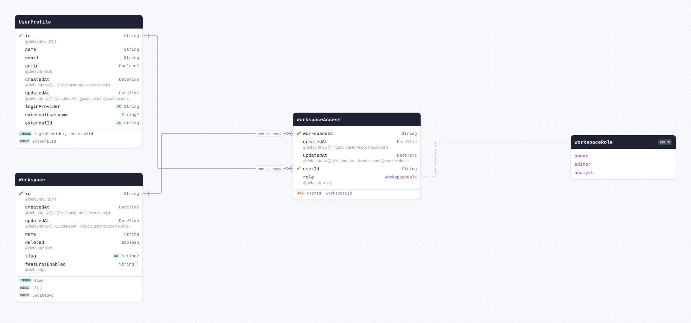

| Field         | Type                                   | Constraints                                        | Default              | Description                  |
| ------------- | -------------------------------------- | -------------------------------------------------- | -------------------- | ---------------------------- |
| `workspaceId` | `String`                               | PK NOT NULL → [Workspace.id](#model-Workspace)     |                      |                              |
| `createdAt`   | `DateTime`                             | NOT NULL                                           | `now()`              | @zod.custom(z.coerce.date()) |
| `updatedAt`   | `DateTime`                             | NOT NULL                                           | `now()` `@updatedAt` | @zod.custom(z.coerce.date()) |
| `userId`      | `String`                               | PK NOT NULL → [UserProfile.id](#model-UserProfile) |                      |                              |
| `role`        | [`WorkspaceRole`](#enum-WorkspaceRole) | NOT NULL                                           | `owner`              |                              |

#### Indexes

- `@@id([userId, workspaceId])`

#### References

- `workspaceId` → [Workspace.id](#model-Workspace) (many-to-one)
- `userId` → [UserProfile.id](#model-UserProfile) (many-to-one)

#### Definition

```sql
CREATE TABLE "WorkspaceAccess" (
    "workspaceId" TEXT NOT NULL,
    "createdAt" TIMESTAMP(3) NOT NULL DEFAULT CURRENT_TIMESTAMP,
    "updatedAt" TIMESTAMP(3) NOT NULL DEFAULT CURRENT_TIMESTAMP,
    "userId" TEXT NOT NULL,
    "role" "WorkspaceRole" NOT NULL DEFAULT 'owner',

    CONSTRAINT "WorkspaceAccess_pkey" PRIMARY KEY ("userId","workspaceId")
);

ALTER TABLE "WorkspaceAccess" ADD CONSTRAINT "WorkspaceAccess_workspaceId_fkey" FOREIGN KEY ("workspaceId") REFERENCES "Workspace"("id") ON DELETE RESTRICT ON UPDATE CASCADE;

ALTER TABLE "WorkspaceAccess" ADD CONSTRAINT "WorkspaceAccess_userId_fkey" FOREIGN KEY ("userId") REFERENCES "UserProfile"("id") ON DELETE RESTRICT ON UPDATE CASCADE;
```

<details>
<summary>Queries and their SQL</summary>

**findMany**: Every row

```ts
await prisma.workspaceAccess.findMany();
```

```sql
SELECT
  "public"."WorkspaceAccess"."userId",
  "public"."WorkspaceAccess"."workspaceId",
  "public"."WorkspaceAccess"."createdAt",
  "public"."WorkspaceAccess"."updatedAt",
  "public"."WorkspaceAccess"."role"::text
FROM
  "public"."WorkspaceAccess"
WHERE
  1 = 1
OFFSET
  $1
-- params: ["0"]
```

**count**: How many rows there are

```ts
await prisma.workspaceAccess.count();
```

```sql
SELECT
  COUNT(*) AS "_count$_all"
FROM
  (
    SELECT
      "public"."WorkspaceAccess"."userId",
      "public"."WorkspaceAccess"."workspaceId"
    FROM
      "public"."WorkspaceAccess"
    WHERE
      1 = 1
    OFFSET
      $1
  ) AS "sub"
-- params: ["0"]
```

**findMany**: Every row with its relations

```ts
await prisma.workspaceAccess.findMany({ include: { workspace: true, user: true } });
```

```sql
SELECT
  "public"."WorkspaceAccess"."userId",
  "public"."WorkspaceAccess"."workspaceId",
  "public"."WorkspaceAccess"."createdAt",
  "public"."WorkspaceAccess"."updatedAt",
  "public"."WorkspaceAccess"."role"::text
FROM
  "public"."WorkspaceAccess"
WHERE
  1 = 1
OFFSET
  $1
-- params: ["0"]

SELECT
  "public"."Workspace"."id",
  "public"."Workspace"."createdAt",
  "public"."Workspace"."updatedAt",
  "public"."Workspace"."name",
  "public"."Workspace"."deleted",
  "public"."Workspace"."slug",
  "public"."Workspace"."featuresEnabled"
FROM
  "public"."Workspace"
WHERE
  "public"."Workspace"."id" IN ($1)
OFFSET
  $2
-- params: ["<workspaceId of the rows above>","0"]

SELECT
  "public"."UserProfile"."id",
  "public"."UserProfile"."name",
  "public"."UserProfile"."email",
  "public"."UserProfile"."admin",
  "public"."UserProfile"."createdAt",
  "public"."UserProfile"."updatedAt",
  "public"."UserProfile"."loginProvider",
  "public"."UserProfile"."externalUsername",
  "public"."UserProfile"."externalId"
FROM
  "public"."UserProfile"
WHERE
  "public"."UserProfile"."id" IN ($1)
OFFSET
  $2
-- params: ["<userId of the rows above>","0"]
```

**findUnique**: One row by what is unique to it

```ts
await prisma.workspaceAccess.findUnique({
  where: { userId_workspaceId: { userId: "example", workspaceId: "example" } },
});
```

```sql
SELECT
  "public"."WorkspaceAccess"."userId",
  "public"."WorkspaceAccess"."workspaceId",
  "public"."WorkspaceAccess"."createdAt",
  "public"."WorkspaceAccess"."updatedAt",
  "public"."WorkspaceAccess"."role"::text
FROM
  "public"."WorkspaceAccess"
WHERE
  (
    (
      "public"."WorkspaceAccess"."userId" = $1
      AND "public"."WorkspaceAccess"."workspaceId" = $2
    )
    AND 1 = 1
  )
LIMIT
  $3
OFFSET
  $4
-- params: ["example","example","1","0"]
```

**create**: Create a row

```ts
await prisma.workspaceAccess.create({ data: { workspaceId: "example", userId: "example" } });
```

```sql
INSERT INTO
  "public"."WorkspaceAccess" (
    "workspaceId",
    "createdAt",
    "updatedAt",
    "userId",
    "role"
  )
VALUES
  (
    $1,
    $2,
    $3,
    $4,
    CAST($5::text AS "public"."WorkspaceRole")
  )
RETURNING
  "public"."WorkspaceAccess"."userId",
  "public"."WorkspaceAccess"."workspaceId",
  "public"."WorkspaceAccess"."createdAt",
  "public"."WorkspaceAccess"."updatedAt",
  "public"."WorkspaceAccess"."role"::text
-- params: ["example","<now()>","<now()>","example","owner"]
```

**update**: Update a row

```ts
await prisma.workspaceAccess.update({
  where: { userId_workspaceId: { userId: "example", workspaceId: "example" } },
  data: { createdAt: new Date("2026-01-01T00:00:00.000Z") },
});
```

```sql
UPDATE "public"."WorkspaceAccess"
SET
  "createdAt" = $1,
  "updatedAt" = $2
WHERE
  (
    (
      "public"."WorkspaceAccess"."userId" = $3
      AND "public"."WorkspaceAccess"."workspaceId" = $4
    )
    AND 1 = 1
  )
RETURNING
  "public"."WorkspaceAccess"."userId",
  "public"."WorkspaceAccess"."workspaceId",
  "public"."WorkspaceAccess"."createdAt",
  "public"."WorkspaceAccess"."updatedAt",
  "public"."WorkspaceAccess"."role"::text
-- params: ["2026-01-01T00:00:00.000Z",{"prisma__type":"generatorCall","prisma__value":{"name":"now","args":[],"returnType":{"type":"DateTime"}}},"example","example"]
```

**delete**: Delete a row

```ts
await prisma.workspaceAccess.delete({
  where: { userId_workspaceId: { userId: "example", workspaceId: "example" } },
});
```

```sql
DELETE FROM "public"."WorkspaceAccess"
WHERE
  (
    (
      "public"."WorkspaceAccess"."userId" = $1
      AND "public"."WorkspaceAccess"."workspaceId" = $2
    )
    AND 1 = 1
  )
RETURNING
  "public"."WorkspaceAccess"."userId",
  "public"."WorkspaceAccess"."workspaceId",
  "public"."WorkspaceAccess"."createdAt",
  "public"."WorkspaceAccess"."updatedAt",
  "public"."WorkspaceAccess"."role"::text
-- params: ["example","example"]
```

</details>

<a id="model-WorkspaceUserProperties"></a>

### WorkspaceUserProperties

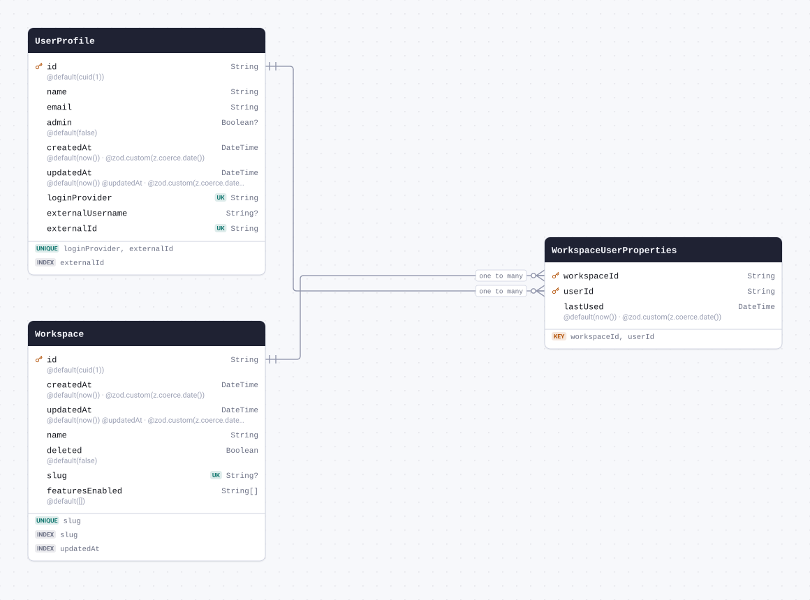

| Field         | Type       | Constraints                                        | Default | Description                  |
| ------------- | ---------- | -------------------------------------------------- | ------- | ---------------------------- |
| `workspaceId` | `String`   | PK NOT NULL → [Workspace.id](#model-Workspace)     |         |                              |
| `userId`      | `String`   | PK NOT NULL → [UserProfile.id](#model-UserProfile) |         |                              |
| `lastUsed`    | `DateTime` | NOT NULL                                           | `now()` | @zod.custom(z.coerce.date()) |

#### Indexes

- `@@id([workspaceId, userId])`

#### References

- `workspaceId` → [Workspace.id](#model-Workspace) (many-to-one)
- `userId` → [UserProfile.id](#model-UserProfile) (many-to-one)

#### Definition

```sql
CREATE TABLE "WorkspaceUserProperties" (
    "workspaceId" TEXT NOT NULL,
    "userId" TEXT NOT NULL,
    "lastUsed" TIMESTAMP(3) NOT NULL DEFAULT CURRENT_TIMESTAMP,

    CONSTRAINT "WorkspaceUserProperties_pkey" PRIMARY KEY ("workspaceId","userId")
);

ALTER TABLE "WorkspaceUserProperties" ADD CONSTRAINT "WorkspaceUserProperties_workspaceId_fkey" FOREIGN KEY ("workspaceId") REFERENCES "Workspace"("id") ON DELETE RESTRICT ON UPDATE CASCADE;

ALTER TABLE "WorkspaceUserProperties" ADD CONSTRAINT "WorkspaceUserProperties_userId_fkey" FOREIGN KEY ("userId") REFERENCES "UserProfile"("id") ON DELETE RESTRICT ON UPDATE CASCADE;
```

<details>
<summary>Queries and their SQL</summary>

**findMany**: Every row

```ts
await prisma.workspaceUserProperties.findMany();
```

```sql
SELECT
  "public"."WorkspaceUserProperties"."workspaceId",
  "public"."WorkspaceUserProperties"."userId",
  "public"."WorkspaceUserProperties"."lastUsed"
FROM
  "public"."WorkspaceUserProperties"
WHERE
  1 = 1
OFFSET
  $1
-- params: ["0"]
```

**count**: How many rows there are

```ts
await prisma.workspaceUserProperties.count();
```

```sql
SELECT
  COUNT(*) AS "_count$_all"
FROM
  (
    SELECT
      "public"."WorkspaceUserProperties"."workspaceId",
      "public"."WorkspaceUserProperties"."userId"
    FROM
      "public"."WorkspaceUserProperties"
    WHERE
      1 = 1
    OFFSET
      $1
  ) AS "sub"
-- params: ["0"]
```

**findMany**: Every row with its relations

```ts
await prisma.workspaceUserProperties.findMany({ include: { workspace: true, user: true } });
```

```sql
SELECT
  "public"."WorkspaceUserProperties"."workspaceId",
  "public"."WorkspaceUserProperties"."userId",
  "public"."WorkspaceUserProperties"."lastUsed"
FROM
  "public"."WorkspaceUserProperties"
WHERE
  1 = 1
OFFSET
  $1
-- params: ["0"]

SELECT
  "public"."Workspace"."id",
  "public"."Workspace"."createdAt",
  "public"."Workspace"."updatedAt",
  "public"."Workspace"."name",
  "public"."Workspace"."deleted",
  "public"."Workspace"."slug",
  "public"."Workspace"."featuresEnabled"
FROM
  "public"."Workspace"
WHERE
  "public"."Workspace"."id" IN ($1)
OFFSET
  $2
-- params: ["<workspaceId of the rows above>","0"]

SELECT
  "public"."UserProfile"."id",
  "public"."UserProfile"."name",
  "public"."UserProfile"."email",
  "public"."UserProfile"."admin",
  "public"."UserProfile"."createdAt",
  "public"."UserProfile"."updatedAt",
  "public"."UserProfile"."loginProvider",
  "public"."UserProfile"."externalUsername",
  "public"."UserProfile"."externalId"
FROM
  "public"."UserProfile"
WHERE
  "public"."UserProfile"."id" IN ($1)
OFFSET
  $2
-- params: ["<userId of the rows above>","0"]
```

**findUnique**: One row by what is unique to it

```ts
await prisma.workspaceUserProperties.findUnique({
  where: { workspaceId_userId: { workspaceId: "example", userId: "example" } },
});
```

```sql
SELECT
  "public"."WorkspaceUserProperties"."workspaceId",
  "public"."WorkspaceUserProperties"."userId",
  "public"."WorkspaceUserProperties"."lastUsed"
FROM
  "public"."WorkspaceUserProperties"
WHERE
  (
    (
      "public"."WorkspaceUserProperties"."workspaceId" = $1
      AND "public"."WorkspaceUserProperties"."userId" = $2
    )
    AND 1 = 1
  )
LIMIT
  $3
OFFSET
  $4
-- params: ["example","example","1","0"]
```

**create**: Create a row

```ts
await prisma.workspaceUserProperties.create({
  data: { workspaceId: "example", userId: "example" },
});
```

```sql
INSERT INTO
  "public"."WorkspaceUserProperties" ("workspaceId", "userId", "lastUsed")
VALUES
  ($1, $2, $3)
RETURNING
  "public"."WorkspaceUserProperties"."workspaceId",
  "public"."WorkspaceUserProperties"."userId",
  "public"."WorkspaceUserProperties"."lastUsed"
-- params: ["example","example","<now()>"]
```

**update**: Update a row

```ts
await prisma.workspaceUserProperties.update({
  where: { workspaceId_userId: { workspaceId: "example", userId: "example" } },
  data: { lastUsed: new Date("2026-01-01T00:00:00.000Z") },
});
```

```sql
UPDATE "public"."WorkspaceUserProperties"
SET
  "lastUsed" = $1
WHERE
  (
    (
      "public"."WorkspaceUserProperties"."workspaceId" = $2
      AND "public"."WorkspaceUserProperties"."userId" = $3
    )
    AND 1 = 1
  )
RETURNING
  "public"."WorkspaceUserProperties"."workspaceId",
  "public"."WorkspaceUserProperties"."userId",
  "public"."WorkspaceUserProperties"."lastUsed"
-- params: ["2026-01-01T00:00:00.000Z","example","example"]
```

**delete**: Delete a row

```ts
await prisma.workspaceUserProperties.delete({
  where: { workspaceId_userId: { workspaceId: "example", userId: "example" } },
});
```

```sql
DELETE FROM "public"."WorkspaceUserProperties"
WHERE
  (
    (
      "public"."WorkspaceUserProperties"."workspaceId" = $1
      AND "public"."WorkspaceUserProperties"."userId" = $2
    )
    AND 1 = 1
  )
RETURNING
  "public"."WorkspaceUserProperties"."workspaceId",
  "public"."WorkspaceUserProperties"."userId",
  "public"."WorkspaceUserProperties"."lastUsed"
-- params: ["example","example"]
```

</details>

<a id="model-UserApiToken"></a>

### UserApiToken

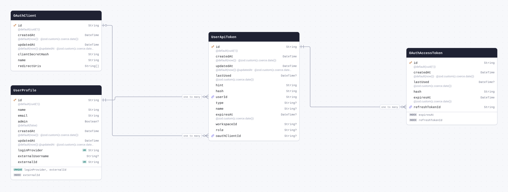

| Field           | Type       | Constraints                                     | Default              | Description                  |
| --------------- | ---------- | ----------------------------------------------- | -------------------- | ---------------------------- |
| `id`            | `String`   | PK NOT NULL                                     | `cuid(1)`            |                              |
| `createdAt`     | `DateTime` | NOT NULL                                        | `now()`              | @zod.custom(z.coerce.date()) |
| `updatedAt`     | `DateTime` | NOT NULL                                        | `now()` `@updatedAt` | @zod.custom(z.coerce.date()) |
| `lastUsed`      | `DateTime` | NULL                                            |                      | @zod.custom(z.coerce.date()) |
| `hint`          | `String`   | NOT NULL                                        |                      |                              |
| `hash`          | `String`   | NOT NULL                                        |                      |                              |
| `userId`        | `String`   | NOT NULL → [UserProfile.id](#model-UserProfile) |                      |                              |
| `type`          | `String`   | NULL                                            |                      |                              |
| `name`          | `String`   | NULL                                            |                      |                              |
| `expiresAt`     | `DateTime` | NULL                                            |                      | @zod.custom(z.coerce.date()) |
| `workspaceId`   | `String`   | NULL                                            |                      |                              |
| `role`          | `String`   | NULL                                            |                      |                              |
| `oauthClientId` | `String`   | NULL → [OAuthClient.id](#model-OAuthClient)     |                      |                              |

#### References

- `userId` → [UserProfile.id](#model-UserProfile) (many-to-one)
- `oauthClientId` → [OAuthClient.id](#model-OAuthClient) (many-to-one)

#### Referenced by

- `id` ← [OAuthAccessToken.refreshTokenId](#model-OAuthAccessToken) (one-to-many)

#### Definition

```sql
CREATE TABLE "UserApiToken" (
    "id" TEXT NOT NULL,
    "createdAt" TIMESTAMP(3) NOT NULL DEFAULT CURRENT_TIMESTAMP,
    "updatedAt" TIMESTAMP(3) NOT NULL DEFAULT CURRENT_TIMESTAMP,
    "lastUsed" TIMESTAMP(3),
    "hint" TEXT NOT NULL,
    "hash" TEXT NOT NULL,
    "userId" TEXT NOT NULL,
    "type" TEXT,
    "name" TEXT,
    "expiresAt" TIMESTAMP(3),
    "workspaceId" TEXT,
    "role" TEXT,
    "oauthClientId" TEXT,

    CONSTRAINT "UserApiToken_pkey" PRIMARY KEY ("id")
);

ALTER TABLE "UserApiToken" ADD CONSTRAINT "UserApiToken_userId_fkey" FOREIGN KEY ("userId") REFERENCES "UserProfile"("id") ON DELETE RESTRICT ON UPDATE CASCADE;

ALTER TABLE "UserApiToken" ADD CONSTRAINT "UserApiToken_oauthClientId_fkey" FOREIGN KEY ("oauthClientId") REFERENCES "OAuthClient"("id") ON DELETE SET NULL ON UPDATE CASCADE;
```

<details>
<summary>Queries and their SQL</summary>

**findMany**: Every row

```ts
await prisma.userApiToken.findMany();
```

```sql
SELECT
  "public"."UserApiToken"."id",
  "public"."UserApiToken"."createdAt",
  "public"."UserApiToken"."updatedAt",
  "public"."UserApiToken"."lastUsed",
  "public"."UserApiToken"."hint",
  "public"."UserApiToken"."hash",
  "public"."UserApiToken"."userId",
  "public"."UserApiToken"."type",
  "public"."UserApiToken"."name",
  "public"."UserApiToken"."expiresAt",
  "public"."UserApiToken"."workspaceId",
  "public"."UserApiToken"."role",
  "public"."UserApiToken"."oauthClientId"
FROM
  "public"."UserApiToken"
WHERE
  1 = 1
OFFSET
  $1
-- params: ["0"]
```

**count**: How many rows there are

```ts
await prisma.userApiToken.count();
```

```sql
SELECT
  COUNT(*) AS "_count$_all"
FROM
  (
    SELECT
      "public"."UserApiToken"."id"
    FROM
      "public"."UserApiToken"
    WHERE
      1 = 1
    OFFSET
      $1
  ) AS "sub"
-- params: ["0"]
```

**findMany**: Every row with its relations

```ts
await prisma.userApiToken.findMany({
  include: { user: true, oauthClient: true, accessTokens: true },
});
```

```sql
SELECT
  "public"."UserApiToken"."id",
  "public"."UserApiToken"."createdAt",
  "public"."UserApiToken"."updatedAt",
  "public"."UserApiToken"."lastUsed",
  "public"."UserApiToken"."hint",
  "public"."UserApiToken"."hash",
  "public"."UserApiToken"."userId",
  "public"."UserApiToken"."type",
  "public"."UserApiToken"."name",
  "public"."UserApiToken"."expiresAt",
  "public"."UserApiToken"."workspaceId",
  "public"."UserApiToken"."role",
  "public"."UserApiToken"."oauthClientId"
FROM
  "public"."UserApiToken"
WHERE
  1 = 1
OFFSET
  $1
-- params: ["0"]

SELECT
  "public"."UserProfile"."id",
  "public"."UserProfile"."name",
  "public"."UserProfile"."email",
  "public"."UserProfile"."admin",
  "public"."UserProfile"."createdAt",
  "public"."UserProfile"."updatedAt",
  "public"."UserProfile"."loginProvider",
  "public"."UserProfile"."externalUsername",
  "public"."UserProfile"."externalId"
FROM
  "public"."UserProfile"
WHERE
  "public"."UserProfile"."id" IN ($1)
OFFSET
  $2
-- params: ["<userId of the rows above>","0"]

SELECT
  "public"."OAuthClient"."id",
  "public"."OAuthClient"."createdAt",
  "public"."OAuthClient"."updatedAt",
  "public"."OAuthClient"."clientSecretHash",
  "public"."OAuthClient"."name",
  "public"."OAuthClient"."redirectUris"
FROM
  "public"."OAuthClient"
WHERE
  "public"."OAuthClient"."id" IN ($1)
OFFSET
  $2
-- params: ["<oauthClientId of the rows above>","0"]

SELECT
  "public"."OAuthAccessToken"."id",
  "public"."OAuthAccessToken"."createdAt",
  "public"."OAuthAccessToken"."lastUsed",
  "public"."OAuthAccessToken"."hash",
  "public"."OAuthAccessToken"."expiresAt",
  "public"."OAuthAccessToken"."refreshTokenId"
FROM
  "public"."OAuthAccessToken"
WHERE
  "public"."OAuthAccessToken"."refreshTokenId" IN ($1)
OFFSET
  $2
-- params: ["<id of the rows above>","0"]
```

**findUnique**: One row by what is unique to it

```ts
await prisma.userApiToken.findUnique({ where: { id: "example" } });
```

```sql
SELECT
  "public"."UserApiToken"."id",
  "public"."UserApiToken"."createdAt",
  "public"."UserApiToken"."updatedAt",
  "public"."UserApiToken"."lastUsed",
  "public"."UserApiToken"."hint",
  "public"."UserApiToken"."hash",
  "public"."UserApiToken"."userId",
  "public"."UserApiToken"."type",
  "public"."UserApiToken"."name",
  "public"."UserApiToken"."expiresAt",
  "public"."UserApiToken"."workspaceId",
  "public"."UserApiToken"."role",
  "public"."UserApiToken"."oauthClientId"
FROM
  "public"."UserApiToken"
WHERE
  (
    "public"."UserApiToken"."id" = $1
    AND 1 = 1
  )
LIMIT
  $2
OFFSET
  $3
-- params: ["example","1","0"]
```

**create**: Create a row

```ts
await prisma.userApiToken.create({ data: { hint: "example", hash: "example", userId: "example" } });
```

```sql
INSERT INTO
  "public"."UserApiToken" (
    "id",
    "createdAt",
    "updatedAt",
    "hint",
    "hash",
    "userId"
  )
VALUES
  ($1, $2, $3, $4, $5, $6)
RETURNING
  "public"."UserApiToken"."id",
  "public"."UserApiToken"."createdAt",
  "public"."UserApiToken"."updatedAt",
  "public"."UserApiToken"."lastUsed",
  "public"."UserApiToken"."hint",
  "public"."UserApiToken"."hash",
  "public"."UserApiToken"."userId",
  "public"."UserApiToken"."type",
  "public"."UserApiToken"."name",
  "public"."UserApiToken"."expiresAt",
  "public"."UserApiToken"."workspaceId",
  "public"."UserApiToken"."role",
  "public"."UserApiToken"."oauthClientId"
-- params: ["<cuid(1)>","<now()>","<now()>","example","example","example"]
```

**update**: Update a row

```ts
await prisma.userApiToken.update({
  where: { id: "example" },
  data: { createdAt: new Date("2026-01-01T00:00:00.000Z") },
});
```

```sql
UPDATE "public"."UserApiToken"
SET
  "createdAt" = $1,
  "updatedAt" = $2
WHERE
  (
    "public"."UserApiToken"."id" = $3
    AND 1 = 1
  )
RETURNING
  "public"."UserApiToken"."id",
  "public"."UserApiToken"."createdAt",
  "public"."UserApiToken"."updatedAt",
  "public"."UserApiToken"."lastUsed",
  "public"."UserApiToken"."hint",
  "public"."UserApiToken"."hash",
  "public"."UserApiToken"."userId",
  "public"."UserApiToken"."type",
  "public"."UserApiToken"."name",
  "public"."UserApiToken"."expiresAt",
  "public"."UserApiToken"."workspaceId",
  "public"."UserApiToken"."role",
  "public"."UserApiToken"."oauthClientId"
-- params: ["2026-01-01T00:00:00.000Z",{"prisma__type":"generatorCall","prisma__value":{"name":"now","args":[],"returnType":{"type":"DateTime"}}},"example"]
```

**delete**: Delete a row

```ts
await prisma.userApiToken.delete({ where: { id: "example" } });
```

```sql
DELETE FROM "public"."UserApiToken"
WHERE
  (
    "public"."UserApiToken"."id" = $1
    AND 1 = 1
  )
RETURNING
  "public"."UserApiToken"."id",
  "public"."UserApiToken"."createdAt",
  "public"."UserApiToken"."updatedAt",
  "public"."UserApiToken"."lastUsed",
  "public"."UserApiToken"."hint",
  "public"."UserApiToken"."hash",
  "public"."UserApiToken"."userId",
  "public"."UserApiToken"."type",
  "public"."UserApiToken"."name",
  "public"."UserApiToken"."expiresAt",
  "public"."UserApiToken"."workspaceId",
  "public"."UserApiToken"."role",
  "public"."UserApiToken"."oauthClientId"
-- params: ["example"]
```

</details>

<a id="model-OAuthClient"></a>

### OAuthClient

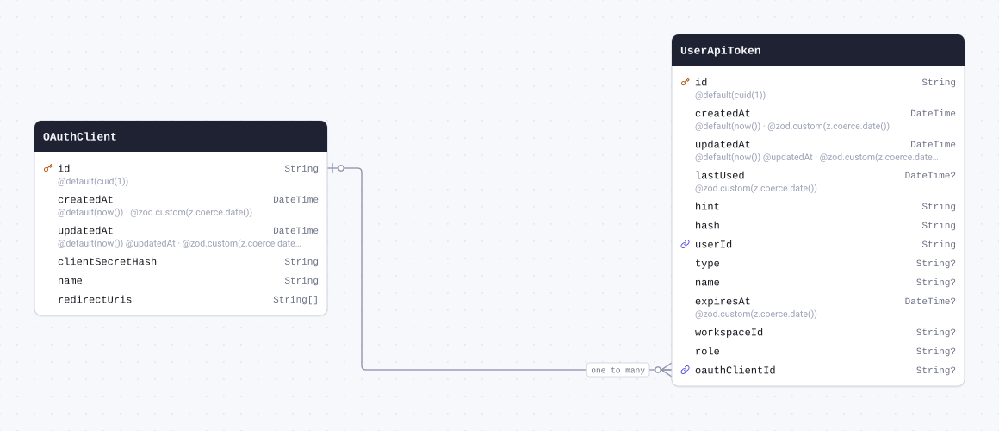

| Field              | Type       | Constraints | Default              | Description                  |
| ------------------ | ---------- | ----------- | -------------------- | ---------------------------- |
| `id`               | `String`   | PK NOT NULL | `cuid(1)`            |                              |
| `createdAt`        | `DateTime` | NOT NULL    | `now()`              | @zod.custom(z.coerce.date()) |
| `updatedAt`        | `DateTime` | NOT NULL    | `now()` `@updatedAt` | @zod.custom(z.coerce.date()) |
| `clientSecretHash` | `String`   | NOT NULL    |                      |                              |
| `name`             | `String`   | NOT NULL    |                      |                              |
| `redirectUris`     | `String[]` | NOT NULL    |                      |                              |

#### Referenced by

- `id` ← [UserApiToken.oauthClientId](#model-UserApiToken) (one-to-many)

#### Definition

```sql
CREATE TABLE "OAuthClient" (
    "id" TEXT NOT NULL,
    "createdAt" TIMESTAMP(3) NOT NULL DEFAULT CURRENT_TIMESTAMP,
    "updatedAt" TIMESTAMP(3) NOT NULL DEFAULT CURRENT_TIMESTAMP,
    "clientSecretHash" TEXT NOT NULL,
    "name" TEXT NOT NULL,
    "redirectUris" TEXT[],

    CONSTRAINT "OAuthClient_pkey" PRIMARY KEY ("id")
);
```

<details>
<summary>Queries and their SQL</summary>

**findMany**: Every row

```ts
await prisma.oAuthClient.findMany();
```

```sql
SELECT
  "public"."OAuthClient"."id",
  "public"."OAuthClient"."createdAt",
  "public"."OAuthClient"."updatedAt",
  "public"."OAuthClient"."clientSecretHash",
  "public"."OAuthClient"."name",
  "public"."OAuthClient"."redirectUris"
FROM
  "public"."OAuthClient"
WHERE
  1 = 1
OFFSET
  $1
-- params: ["0"]
```

**count**: How many rows there are

```ts
await prisma.oAuthClient.count();
```

```sql
SELECT
  COUNT(*) AS "_count$_all"
FROM
  (
    SELECT
      "public"."OAuthClient"."id"
    FROM
      "public"."OAuthClient"
    WHERE
      1 = 1
    OFFSET
      $1
  ) AS "sub"
-- params: ["0"]
```

**findMany**: Every row with its relations

```ts
await prisma.oAuthClient.findMany({ include: { tokens: true } });
```

```sql
SELECT
  "public"."OAuthClient"."id",
  "public"."OAuthClient"."createdAt",
  "public"."OAuthClient"."updatedAt",
  "public"."OAuthClient"."clientSecretHash",
  "public"."OAuthClient"."name",
  "public"."OAuthClient"."redirectUris"
FROM
  "public"."OAuthClient"
WHERE
  1 = 1
OFFSET
  $1
-- params: ["0"]

SELECT
  "public"."UserApiToken"."id",
  "public"."UserApiToken"."createdAt",
  "public"."UserApiToken"."updatedAt",
  "public"."UserApiToken"."lastUsed",
  "public"."UserApiToken"."hint",
  "public"."UserApiToken"."hash",
  "public"."UserApiToken"."userId",
  "public"."UserApiToken"."type",
  "public"."UserApiToken"."name",
  "public"."UserApiToken"."expiresAt",
  "public"."UserApiToken"."workspaceId",
  "public"."UserApiToken"."role",
  "public"."UserApiToken"."oauthClientId"
FROM
  "public"."UserApiToken"
WHERE
  "public"."UserApiToken"."oauthClientId" IN ($1)
OFFSET
  $2
-- params: ["<id of the rows above>","0"]
```

**findUnique**: One row by what is unique to it

```ts
await prisma.oAuthClient.findUnique({ where: { id: "example" } });
```

```sql
SELECT
  "public"."OAuthClient"."id",
  "public"."OAuthClient"."createdAt",
  "public"."OAuthClient"."updatedAt",
  "public"."OAuthClient"."clientSecretHash",
  "public"."OAuthClient"."name",
  "public"."OAuthClient"."redirectUris"
FROM
  "public"."OAuthClient"
WHERE
  (
    "public"."OAuthClient"."id" = $1
    AND 1 = 1
  )
LIMIT
  $2
OFFSET
  $3
-- params: ["example","1","0"]
```

**create**: Create a row

```ts
await prisma.oAuthClient.create({
  data: { clientSecretHash: "example", name: "example", redirectUris: ["example"] },
});
```

```sql
INSERT INTO
  "public"."OAuthClient" (
    "id",
    "createdAt",
    "updatedAt",
    "clientSecretHash",
    "name",
    "redirectUris"
  )
VALUES
  ($1, $2, $3, $4, $5, $6)
RETURNING
  "public"."OAuthClient"."id",
  "public"."OAuthClient"."createdAt",
  "public"."OAuthClient"."updatedAt",
  "public"."OAuthClient"."clientSecretHash",
  "public"."OAuthClient"."name",
  "public"."OAuthClient"."redirectUris"
-- params: ["<cuid(1)>","<now()>","<now()>","example","example",["example"]]
```

**update**: Update a row

```ts
await prisma.oAuthClient.update({
  where: { id: "example" },
  data: { createdAt: new Date("2026-01-01T00:00:00.000Z") },
});
```

```sql
UPDATE "public"."OAuthClient"
SET
  "createdAt" = $1,
  "updatedAt" = $2
WHERE
  (
    "public"."OAuthClient"."id" = $3
    AND 1 = 1
  )
RETURNING
  "public"."OAuthClient"."id",
  "public"."OAuthClient"."createdAt",
  "public"."OAuthClient"."updatedAt",
  "public"."OAuthClient"."clientSecretHash",
  "public"."OAuthClient"."name",
  "public"."OAuthClient"."redirectUris"
-- params: ["2026-01-01T00:00:00.000Z",{"prisma__type":"generatorCall","prisma__value":{"name":"now","args":[],"returnType":{"type":"DateTime"}}},"example"]
```

**delete**: Delete a row

```ts
await prisma.oAuthClient.delete({ where: { id: "example" } });
```

```sql
DELETE FROM "public"."OAuthClient"
WHERE
  (
    "public"."OAuthClient"."id" = $1
    AND 1 = 1
  )
RETURNING
  "public"."OAuthClient"."id",
  "public"."OAuthClient"."createdAt",
  "public"."OAuthClient"."updatedAt",
  "public"."OAuthClient"."clientSecretHash",
  "public"."OAuthClient"."name",
  "public"."OAuthClient"."redirectUris"
-- params: ["example"]
```

</details>

<a id="model-KvStoreEntry"></a>

### KvStoreEntry

Table `kv`.

| Field                      | Type       | Constraints | Default | Description                  |
| -------------------------- | ---------- | ----------- | ------- | ---------------------------- |
| `key`                      | `String`   | PK NOT NULL |         |                              |
| `value`                    | `Json`     | NOT NULL    |         |                              |
| `expiresAt` (`expires_at`) | `DateTime` | NULL        |         | @zod.custom(z.coerce.date()) |

#### Indexes

- `@@index([expiresAt])`
- `@@index([key], map: "kv_key_pattern_idx")`

#### Definition

```sql
CREATE TABLE "kv" (
    "key" TEXT NOT NULL,
    "value" JSONB NOT NULL,
    "expires_at" TIMESTAMP(3),

    CONSTRAINT "kv_pkey" PRIMARY KEY ("key")
);

CREATE INDEX "kv_expires_at_idx" ON "kv"("expires_at");

CREATE INDEX "kv_key_pattern_idx" ON "kv"("key" text_pattern_ops);
```

<details>
<summary>Queries and their SQL</summary>

**findMany**: Every row

```ts
await prisma.kvStoreEntry.findMany();
```

```sql
SELECT
  "public"."kv"."key",
  "public"."kv"."value",
  "public"."kv"."expires_at"
FROM
  "public"."kv"
WHERE
  1 = 1
OFFSET
  $1
-- params: ["0"]
```

**count**: How many rows there are

```ts
await prisma.kvStoreEntry.count();
```

```sql
SELECT
  COUNT(*) AS "_count$_all"
FROM
  (
    SELECT
      "public"."kv"."key"
    FROM
      "public"."kv"
    WHERE
      1 = 1
    OFFSET
      $1
  ) AS "sub"
-- params: ["0"]
```

**findUnique**: One row by what is unique to it

```ts
await prisma.kvStoreEntry.findUnique({ where: { key: "example" } });
```

```sql
SELECT
  "public"."kv"."key",
  "public"."kv"."value",
  "public"."kv"."expires_at"
FROM
  "public"."kv"
WHERE
  (
    "public"."kv"."key" = $1
    AND 1 = 1
  )
LIMIT
  $2
OFFSET
  $3
-- params: ["example","1","0"]
```

**create**: Create a row

```ts
await prisma.kvStoreEntry.create({ data: { key: "example", value: {} } });
```

```sql
INSERT INTO
  "public"."kv" ("key", "value")
VALUES
  ($1, $2)
RETURNING
  "public"."kv"."key",
  "public"."kv"."value",
  "public"."kv"."expires_at"
-- params: ["example","{}"]
```

**update**: Update a row

```ts
await prisma.kvStoreEntry.update({ where: { key: "example" }, data: { value: {} } });
```

```sql
UPDATE "public"."kv"
SET
  "value" = $1
WHERE
  (
    "public"."kv"."key" = $2
    AND 1 = 1
  )
RETURNING
  "public"."kv"."key",
  "public"."kv"."value",
  "public"."kv"."expires_at"
-- params: ["{}","example"]
```

**delete**: Delete a row

```ts
await prisma.kvStoreEntry.delete({ where: { key: "example" } });
```

```sql
DELETE FROM "public"."kv"
WHERE
  (
    "public"."kv"."key" = $1
    AND 1 = 1
  )
RETURNING
  "public"."kv"."key",
  "public"."kv"."value",
  "public"."kv"."expires_at"
-- params: ["example"]
```

</details>

<a id="model-OAuthAccessToken"></a>

### OAuthAccessToken

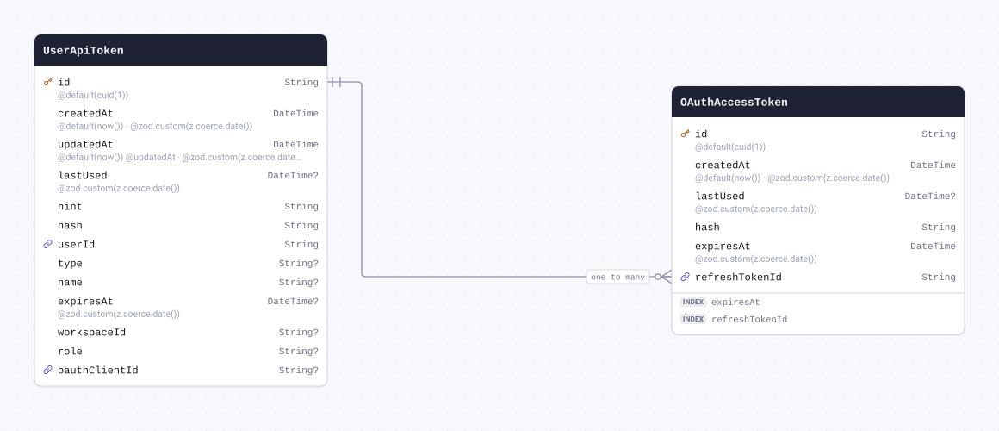

| Field            | Type       | Constraints                                       | Default   | Description                  |
| ---------------- | ---------- | ------------------------------------------------- | --------- | ---------------------------- |
| `id`             | `String`   | PK NOT NULL                                       | `cuid(1)` |                              |
| `createdAt`      | `DateTime` | NOT NULL                                          | `now()`   | @zod.custom(z.coerce.date()) |
| `lastUsed`       | `DateTime` | NULL                                              |           | @zod.custom(z.coerce.date()) |
| `hash`           | `String`   | NOT NULL                                          |           |                              |
| `expiresAt`      | `DateTime` | NOT NULL                                          |           | @zod.custom(z.coerce.date()) |
| `refreshTokenId` | `String`   | NOT NULL → [UserApiToken.id](#model-UserApiToken) |           |                              |

#### Indexes

- `@@index([expiresAt])`
- `@@index([refreshTokenId])`

#### References

- `refreshTokenId` → [UserApiToken.id](#model-UserApiToken) (many-to-one)

#### Definition

```sql
CREATE TABLE "OAuthAccessToken" (
    "id" TEXT NOT NULL,
    "createdAt" TIMESTAMP(3) NOT NULL DEFAULT CURRENT_TIMESTAMP,
    "lastUsed" TIMESTAMP(3),
    "hash" TEXT NOT NULL,
    "expiresAt" TIMESTAMP(3) NOT NULL,
    "refreshTokenId" TEXT NOT NULL,

    CONSTRAINT "OAuthAccessToken_pkey" PRIMARY KEY ("id")
);

CREATE INDEX "OAuthAccessToken_expiresAt_idx" ON "OAuthAccessToken"("expiresAt");

CREATE INDEX "OAuthAccessToken_refreshTokenId_idx" ON "OAuthAccessToken"("refreshTokenId");

ALTER TABLE "OAuthAccessToken" ADD CONSTRAINT "OAuthAccessToken_refreshTokenId_fkey" FOREIGN KEY ("refreshTokenId") REFERENCES "UserApiToken"("id") ON DELETE RESTRICT ON UPDATE CASCADE;
```

<details>
<summary>Queries and their SQL</summary>

**findMany**: Every row

```ts
await prisma.oAuthAccessToken.findMany();
```

```sql
SELECT
  "public"."OAuthAccessToken"."id",
  "public"."OAuthAccessToken"."createdAt",
  "public"."OAuthAccessToken"."lastUsed",
  "public"."OAuthAccessToken"."hash",
  "public"."OAuthAccessToken"."expiresAt",
  "public"."OAuthAccessToken"."refreshTokenId"
FROM
  "public"."OAuthAccessToken"
WHERE
  1 = 1
OFFSET
  $1
-- params: ["0"]
```

**count**: How many rows there are

```ts
await prisma.oAuthAccessToken.count();
```

```sql
SELECT
  COUNT(*) AS "_count$_all"
FROM
  (
    SELECT
      "public"."OAuthAccessToken"."id"
    FROM
      "public"."OAuthAccessToken"
    WHERE
      1 = 1
    OFFSET
      $1
  ) AS "sub"
-- params: ["0"]
```

**findMany**: Every row with its relations

```ts
await prisma.oAuthAccessToken.findMany({ include: { refreshToken: true } });
```

```sql
SELECT
  "public"."OAuthAccessToken"."id",
  "public"."OAuthAccessToken"."createdAt",
  "public"."OAuthAccessToken"."lastUsed",
  "public"."OAuthAccessToken"."hash",
  "public"."OAuthAccessToken"."expiresAt",
  "public"."OAuthAccessToken"."refreshTokenId"
FROM
  "public"."OAuthAccessToken"
WHERE
  1 = 1
OFFSET
  $1
-- params: ["0"]

SELECT
  "public"."UserApiToken"."id",
  "public"."UserApiToken"."createdAt",
  "public"."UserApiToken"."updatedAt",
  "public"."UserApiToken"."lastUsed",
  "public"."UserApiToken"."hint",
  "public"."UserApiToken"."hash",
  "public"."UserApiToken"."userId",
  "public"."UserApiToken"."type",
  "public"."UserApiToken"."name",
  "public"."UserApiToken"."expiresAt",
  "public"."UserApiToken"."workspaceId",
  "public"."UserApiToken"."role",
  "public"."UserApiToken"."oauthClientId"
FROM
  "public"."UserApiToken"
WHERE
  "public"."UserApiToken"."id" IN ($1)
OFFSET
  $2
-- params: ["<refreshTokenId of the rows above>","0"]
```

**findUnique**: One row by what is unique to it

```ts
await prisma.oAuthAccessToken.findUnique({ where: { id: "example" } });
```

```sql
SELECT
  "public"."OAuthAccessToken"."id",
  "public"."OAuthAccessToken"."createdAt",
  "public"."OAuthAccessToken"."lastUsed",
  "public"."OAuthAccessToken"."hash",
  "public"."OAuthAccessToken"."expiresAt",
  "public"."OAuthAccessToken"."refreshTokenId"
FROM
  "public"."OAuthAccessToken"
WHERE
  (
    "public"."OAuthAccessToken"."id" = $1
    AND 1 = 1
  )
LIMIT
  $2
OFFSET
  $3
-- params: ["example","1","0"]
```

**create**: Create a row

```ts
await prisma.oAuthAccessToken.create({
  data: {
    hash: "example",
    expiresAt: new Date("2026-01-01T00:00:00.000Z"),
    refreshTokenId: "example",
  },
});
```

```sql
INSERT INTO
  "public"."OAuthAccessToken" (
    "id",
    "createdAt",
    "hash",
    "expiresAt",
    "refreshTokenId"
  )
VALUES
  ($1, $2, $3, $4, $5)
RETURNING
  "public"."OAuthAccessToken"."id",
  "public"."OAuthAccessToken"."createdAt",
  "public"."OAuthAccessToken"."lastUsed",
  "public"."OAuthAccessToken"."hash",
  "public"."OAuthAccessToken"."expiresAt",
  "public"."OAuthAccessToken"."refreshTokenId"
-- params: ["<cuid(1)>","<now()>","example","2026-01-01T00:00:00.000Z","example"]
```

**update**: Update a row

```ts
await prisma.oAuthAccessToken.update({
  where: { id: "example" },
  data: { createdAt: new Date("2026-01-01T00:00:00.000Z") },
});
```

```sql
UPDATE "public"."OAuthAccessToken"
SET
  "createdAt" = $1
WHERE
  (
    "public"."OAuthAccessToken"."id" = $2
    AND 1 = 1
  )
RETURNING
  "public"."OAuthAccessToken"."id",
  "public"."OAuthAccessToken"."createdAt",
  "public"."OAuthAccessToken"."lastUsed",
  "public"."OAuthAccessToken"."hash",
  "public"."OAuthAccessToken"."expiresAt",
  "public"."OAuthAccessToken"."refreshTokenId"
-- params: ["2026-01-01T00:00:00.000Z","example"]
```

**delete**: Delete a row

```ts
await prisma.oAuthAccessToken.delete({ where: { id: "example" } });
```

```sql
DELETE FROM "public"."OAuthAccessToken"
WHERE
  (
    "public"."OAuthAccessToken"."id" = $1
    AND 1 = 1
  )
RETURNING
  "public"."OAuthAccessToken"."id",
  "public"."OAuthAccessToken"."createdAt",
  "public"."OAuthAccessToken"."lastUsed",
  "public"."OAuthAccessToken"."hash",
  "public"."OAuthAccessToken"."expiresAt",
  "public"."OAuthAccessToken"."refreshTokenId"
-- params: ["example"]
```

</details>

<a id="model-InvitationToken"></a>

### InvitationToken

| Field         | Type                                   | Constraints | Default              | Description                  |
| ------------- | -------------------------------------- | ----------- | -------------------- | ---------------------------- |
| `id`          | `String`                               | PK NOT NULL | `cuid(1)`            |                              |
| `workspaceId` | `String`                               | NOT NULL    |                      |                              |
| `email`       | `String`                               | NOT NULL    |                      |                              |
| `createdAt`   | `DateTime`                             | NOT NULL    | `now()`              | @zod.custom(z.coerce.date()) |
| `updatedAt`   | `DateTime`                             | NOT NULL    | `now()` `@updatedAt` | @zod.custom(z.coerce.date()) |
| `token`       | `String`                               | NOT NULL    |                      |                              |
| `usedBy`      | `String`                               | NULL        |                      |                              |
| `role`        | [`WorkspaceRole`](#enum-WorkspaceRole) | NOT NULL    | `owner`              |                              |

#### Definition

```sql
CREATE TABLE "InvitationToken" (
    "id" TEXT NOT NULL,
    "workspaceId" TEXT NOT NULL,
    "email" TEXT NOT NULL,
    "createdAt" TIMESTAMP(3) NOT NULL DEFAULT CURRENT_TIMESTAMP,
    "updatedAt" TIMESTAMP(3) NOT NULL DEFAULT CURRENT_TIMESTAMP,
    "token" TEXT NOT NULL,
    "usedBy" TEXT,
    "role" "WorkspaceRole" NOT NULL DEFAULT 'owner',

    CONSTRAINT "InvitationToken_pkey" PRIMARY KEY ("id")
);
```

<details>
<summary>Queries and their SQL</summary>

**findMany**: Every row

```ts
await prisma.invitationToken.findMany();
```

```sql
SELECT
  "public"."InvitationToken"."id",
  "public"."InvitationToken"."workspaceId",
  "public"."InvitationToken"."email",
  "public"."InvitationToken"."createdAt",
  "public"."InvitationToken"."updatedAt",
  "public"."InvitationToken"."token",
  "public"."InvitationToken"."usedBy",
  "public"."InvitationToken"."role"::text
FROM
  "public"."InvitationToken"
WHERE
  1 = 1
OFFSET
  $1
-- params: ["0"]
```

**count**: How many rows there are

```ts
await prisma.invitationToken.count();
```

```sql
SELECT
  COUNT(*) AS "_count$_all"
FROM
  (
    SELECT
      "public"."InvitationToken"."id"
    FROM
      "public"."InvitationToken"
    WHERE
      1 = 1
    OFFSET
      $1
  ) AS "sub"
-- params: ["0"]
```

**findUnique**: One row by what is unique to it

```ts
await prisma.invitationToken.findUnique({ where: { id: "example" } });
```

```sql
SELECT
  "public"."InvitationToken"."id",
  "public"."InvitationToken"."workspaceId",
  "public"."InvitationToken"."email",
  "public"."InvitationToken"."createdAt",
  "public"."InvitationToken"."updatedAt",
  "public"."InvitationToken"."token",
  "public"."InvitationToken"."usedBy",
  "public"."InvitationToken"."role"::text
FROM
  "public"."InvitationToken"
WHERE
  (
    "public"."InvitationToken"."id" = $1
    AND 1 = 1
  )
LIMIT
  $2
OFFSET
  $3
-- params: ["example","1","0"]
```

**create**: Create a row

```ts
await prisma.invitationToken.create({
  data: { workspaceId: "example", email: "example", token: "example" },
});
```

```sql
INSERT INTO
  "public"."InvitationToken" (
    "id",
    "workspaceId",
    "email",
    "createdAt",
    "updatedAt",
    "token",
    "role"
  )
VALUES
  (
    $1,
    $2,
    $3,
    $4,
    $5,
    $6,
    CAST($7::text AS "public"."WorkspaceRole")
  )
RETURNING
  "public"."InvitationToken"."id",
  "public"."InvitationToken"."workspaceId",
  "public"."InvitationToken"."email",
  "public"."InvitationToken"."createdAt",
  "public"."InvitationToken"."updatedAt",
  "public"."InvitationToken"."token",
  "public"."InvitationToken"."usedBy",
  "public"."InvitationToken"."role"::text
-- params: ["<cuid(1)>","example","example","<now()>","<now()>","example","owner"]
```

**update**: Update a row

```ts
await prisma.invitationToken.update({ where: { id: "example" }, data: { workspaceId: "example" } });
```

```sql
UPDATE "public"."InvitationToken"
SET
  "workspaceId" = $1,
  "updatedAt" = $2
WHERE
  (
    "public"."InvitationToken"."id" = $3
    AND 1 = 1
  )
RETURNING
  "public"."InvitationToken"."id",
  "public"."InvitationToken"."workspaceId",
  "public"."InvitationToken"."email",
  "public"."InvitationToken"."createdAt",
  "public"."InvitationToken"."updatedAt",
  "public"."InvitationToken"."token",
  "public"."InvitationToken"."usedBy",
  "public"."InvitationToken"."role"::text
-- params: ["example",{"prisma__type":"generatorCall","prisma__value":{"name":"now","args":[],"returnType":{"type":"DateTime"}}},"example"]
```

**delete**: Delete a row

```ts
await prisma.invitationToken.delete({ where: { id: "example" } });
```

```sql
DELETE FROM "public"."InvitationToken"
WHERE
  (
    "public"."InvitationToken"."id" = $1
    AND 1 = 1
  )
RETURNING
  "public"."InvitationToken"."id",
  "public"."InvitationToken"."workspaceId",
  "public"."InvitationToken"."email",
  "public"."InvitationToken"."createdAt",
  "public"."InvitationToken"."updatedAt",
  "public"."InvitationToken"."token",
  "public"."InvitationToken"."usedBy",
  "public"."InvitationToken"."role"::text
-- params: ["example"]
```

</details>

<a id="model-ConfigurationObject"></a>

### ConfigurationObject

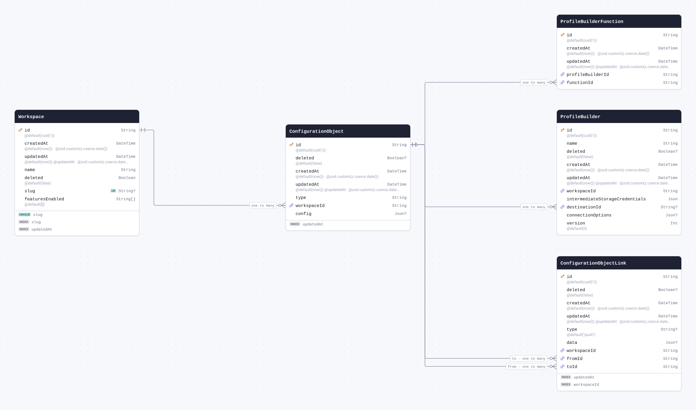

| Field         | Type       | Constraints                                 | Default              | Description                  |
| ------------- | ---------- | ------------------------------------------- | -------------------- | ---------------------------- |
| `id`          | `String`   | PK NOT NULL                                 | `cuid(1)`            |                              |
| `deleted`     | `Boolean`  | NULL                                        | `false`              |                              |
| `createdAt`   | `DateTime` | NOT NULL                                    | `now()`              | @zod.custom(z.coerce.date()) |
| `updatedAt`   | `DateTime` | NOT NULL                                    | `now()` `@updatedAt` | @zod.custom(z.coerce.date()) |
| `type`        | `String`   | NOT NULL                                    |                      |                              |
| `workspaceId` | `String`   | NOT NULL → [Workspace.id](#model-Workspace) |                      |                              |
| `config`      | `Json`     | NULL                                        |                      |                              |

#### Indexes

- `@@index([updatedAt])`

#### References

- `workspaceId` → [Workspace.id](#model-Workspace) (many-to-one)

#### Referenced by

- `id` ← [ConfigurationObjectLink.fromId](#model-ConfigurationObjectLink) (one-to-many)
- `id` ← [ConfigurationObjectLink.toId](#model-ConfigurationObjectLink) (one-to-many)
- `id` ← [ProfileBuilder.destinationId](#model-ProfileBuilder) (one-to-many)
- `id` ← [ProfileBuilderFunction.functionId](#model-ProfileBuilderFunction) (one-to-many)

#### Definition

```sql
CREATE TABLE "ConfigurationObject" (
    "id" TEXT NOT NULL,
    "deleted" BOOLEAN DEFAULT false,
    "createdAt" TIMESTAMP(3) NOT NULL DEFAULT CURRENT_TIMESTAMP,
    "updatedAt" TIMESTAMP(3) NOT NULL DEFAULT CURRENT_TIMESTAMP,
    "type" TEXT NOT NULL,
    "workspaceId" TEXT NOT NULL,
    "config" JSONB,

    CONSTRAINT "ConfigurationObject_pkey" PRIMARY KEY ("id")
);

CREATE INDEX "ConfigurationObject_updatedAt_idx" ON "ConfigurationObject"("updatedAt" DESC);

ALTER TABLE "ConfigurationObject" ADD CONSTRAINT "ConfigurationObject_workspaceId_fkey" FOREIGN KEY ("workspaceId") REFERENCES "Workspace"("id") ON DELETE RESTRICT ON UPDATE CASCADE;
```

<details>
<summary>Queries and their SQL</summary>

**findMany**: Every row

```ts
await prisma.configurationObject.findMany();
```

```sql
SELECT
  "public"."ConfigurationObject"."id",
  "public"."ConfigurationObject"."deleted",
  "public"."ConfigurationObject"."createdAt",
  "public"."ConfigurationObject"."updatedAt",
  "public"."ConfigurationObject"."type",
  "public"."ConfigurationObject"."workspaceId",
  "public"."ConfigurationObject"."config"
FROM
  "public"."ConfigurationObject"
WHERE
  1 = 1
OFFSET
  $1
-- params: ["0"]
```

**count**: How many rows there are

```ts
await prisma.configurationObject.count();
```

```sql
SELECT
  COUNT(*) AS "_count$_all"
FROM
  (
    SELECT
      "public"."ConfigurationObject"."id"
    FROM
      "public"."ConfigurationObject"
    WHERE
      1 = 1
    OFFSET
      $1
  ) AS "sub"
-- params: ["0"]
```

**findMany**: Every row with its relations

```ts
await prisma.configurationObject.findMany({
  include: {
    workspace: true,
    fromLinks: true,
    toLinks: true,
    ProfileBuilder: true,
    ProfileBuilderFunction: true,
  },
});
```

```sql
SELECT
  "public"."ConfigurationObject"."id",
  "public"."ConfigurationObject"."deleted",
  "public"."ConfigurationObject"."createdAt",
  "public"."ConfigurationObject"."updatedAt",
  "public"."ConfigurationObject"."type",
  "public"."ConfigurationObject"."workspaceId",
  "public"."ConfigurationObject"."config"
FROM
  "public"."ConfigurationObject"
WHERE
  1 = 1
OFFSET
  $1
-- params: ["0"]

SELECT
  "public"."Workspace"."id",
  "public"."Workspace"."createdAt",
  "public"."Workspace"."updatedAt",
  "public"."Workspace"."name",
  "public"."Workspace"."deleted",
  "public"."Workspace"."slug",
  "public"."Workspace"."featuresEnabled"
FROM
  "public"."Workspace"
WHERE
  "public"."Workspace"."id" IN ($1)
OFFSET
  $2
-- params: ["<workspaceId of the rows above>","0"]

SELECT
  "public"."ConfigurationObjectLink"."id",
  "public"."ConfigurationObjectLink"."deleted",
  "public"."ConfigurationObjectLink"."createdAt",
  "public"."ConfigurationObjectLink"."updatedAt",
  "public"."ConfigurationObjectLink"."type",
  "public"."ConfigurationObjectLink"."data",
  "public"."ConfigurationObjectLink"."workspaceId",
  "public"."ConfigurationObjectLink"."fromId",
  "public"."ConfigurationObjectLink"."toId"
FROM
  "public"."ConfigurationObjectLink"
WHERE
  "public"."ConfigurationObjectLink"."toId" IN ($1)
OFFSET
  $2
-- params: ["<id of the rows above>","0"]

SELECT
  "public"."ConfigurationObjectLink"."id",
  "public"."ConfigurationObjectLink"."deleted",
  "public"."ConfigurationObjectLink"."createdAt",
  "public"."ConfigurationObjectLink"."updatedAt",
  "public"."ConfigurationObjectLink"."type",
  "public"."ConfigurationObjectLink"."data",
  "public"."ConfigurationObjectLink"."workspaceId",
  "public"."ConfigurationObjectLink"."fromId",
  "public"."ConfigurationObjectLink"."toId"
FROM
  "public"."ConfigurationObjectLink"
WHERE
  "public"."ConfigurationObjectLink"."fromId" IN ($1)
OFFSET
  $2
-- params: ["<id of the rows above>","0"]

SELECT
  "public"."ProfileBuilder"."id",
  "public"."ProfileBuilder"."name",
  "public"."ProfileBuilder"."deleted",
  "public"."ProfileBuilder"."createdAt",
  "public"."ProfileBuilder"."updatedAt",
  "public"."ProfileBuilder"."workspaceId",
  "public"."ProfileBuilder"."intermediateStorageCredentials",
  "public"."ProfileBuilder"."destinationId",
  "public"."ProfileBuilder"."connectionOptions",
  "public"."ProfileBuilder"."version"
FROM
  "public"."ProfileBuilder"
WHERE
  "public"."ProfileBuilder"."destinationId" IN ($1)
OFFSET
  $2
-- params: ["<id of the rows above>","0"]

SELECT
  "public"."ProfileBuilderFunction"."id",
  "public"."ProfileBuilderFunction"."createdAt",
  "public"."ProfileBuilderFunction"."updatedAt",
  "public"."ProfileBuilderFunction"."profileBuilderId",
  "public"."ProfileBuilderFunction"."functionId"
FROM
  "public"."ProfileBuilderFunction"
WHERE
  "public"."ProfileBuilderFunction"."functionId" IN ($1)
OFFSET
  $2
-- params: ["<id of the rows above>","0"]
```

**findUnique**: One row by what is unique to it

```ts
await prisma.configurationObject.findUnique({ where: { id: "example" } });
```

```sql
SELECT
  "public"."ConfigurationObject"."id",
  "public"."ConfigurationObject"."deleted",
  "public"."ConfigurationObject"."createdAt",
  "public"."ConfigurationObject"."updatedAt",
  "public"."ConfigurationObject"."type",
  "public"."ConfigurationObject"."workspaceId",
  "public"."ConfigurationObject"."config"
FROM
  "public"."ConfigurationObject"
WHERE
  (
    "public"."ConfigurationObject"."id" = $1
    AND 1 = 1
  )
LIMIT
  $2
OFFSET
  $3
-- params: ["example","1","0"]
```

**create**: Create a row

```ts
await prisma.configurationObject.create({ data: { type: "example", workspaceId: "example" } });
```

```sql
INSERT INTO
  "public"."ConfigurationObject" (
    "id",
    "deleted",
    "createdAt",
    "updatedAt",
    "type",
    "workspaceId"
  )
VALUES
  ($1, $2, $3, $4, $5, $6)
RETURNING
  "public"."ConfigurationObject"."id",
  "public"."ConfigurationObject"."deleted",
  "public"."ConfigurationObject"."createdAt",
  "public"."ConfigurationObject"."updatedAt",
  "public"."ConfigurationObject"."type",
  "public"."ConfigurationObject"."workspaceId",
  "public"."ConfigurationObject"."config"
-- params: ["<cuid(1)>",false,"<now()>","<now()>","example","example"]
```

**update**: Update a row

```ts
await prisma.configurationObject.update({ where: { id: "example" }, data: { deleted: true } });
```

```sql
UPDATE "public"."ConfigurationObject"
SET
  "deleted" = $1,
  "updatedAt" = $2
WHERE
  (
    "public"."ConfigurationObject"."id" = $3
    AND 1 = 1
  )
RETURNING
  "public"."ConfigurationObject"."id",
  "public"."ConfigurationObject"."deleted",
  "public"."ConfigurationObject"."createdAt",
  "public"."ConfigurationObject"."updatedAt",
  "public"."ConfigurationObject"."type",
  "public"."ConfigurationObject"."workspaceId",
  "public"."ConfigurationObject"."config"
-- params: [true,{"prisma__type":"generatorCall","prisma__value":{"name":"now","args":[],"returnType":{"type":"DateTime"}}},"example"]
```

**delete**: Delete a row

```ts
await prisma.configurationObject.delete({ where: { id: "example" } });
```

```sql
DELETE FROM "public"."ConfigurationObject"
WHERE
  (
    "public"."ConfigurationObject"."id" = $1
    AND 1 = 1
  )
RETURNING
  "public"."ConfigurationObject"."id",
  "public"."ConfigurationObject"."deleted",
  "public"."ConfigurationObject"."createdAt",
  "public"."ConfigurationObject"."updatedAt",
  "public"."ConfigurationObject"."type",
  "public"."ConfigurationObject"."workspaceId",
  "public"."ConfigurationObject"."config"
-- params: ["example"]
```

</details>

<a id="model-ConfigurationObjectLink"></a>

### ConfigurationObjectLink

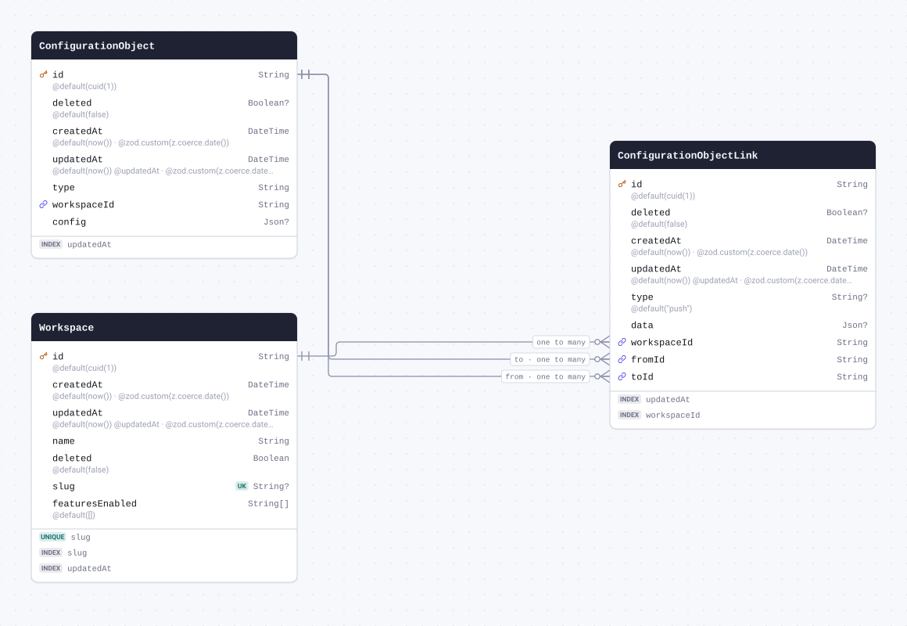

| Field         | Type       | Constraints                                                     | Default              | Description                  |
| ------------- | ---------- | --------------------------------------------------------------- | -------------------- | ---------------------------- |
| `id`          | `String`   | PK NOT NULL                                                     | `cuid(1)`            |                              |
| `deleted`     | `Boolean`  | NULL                                                            | `false`              |                              |
| `createdAt`   | `DateTime` | NOT NULL                                                        | `now()`              | @zod.custom(z.coerce.date()) |
| `updatedAt`   | `DateTime` | NOT NULL                                                        | `now()` `@updatedAt` | @zod.custom(z.coerce.date()) |
| `type`        | `String`   | NULL                                                            | `"push"`             |                              |
| `data`        | `Json`     | NULL                                                            |                      |                              |
| `workspaceId` | `String`   | NOT NULL → [Workspace.id](#model-Workspace)                     |                      |                              |
| `fromId`      | `String`   | NOT NULL → [ConfigurationObject.id](#model-ConfigurationObject) |                      |                              |
| `toId`        | `String`   | NOT NULL → [ConfigurationObject.id](#model-ConfigurationObject) |                      |                              |

#### Indexes

- `@@index([updatedAt])`
- `@@index([workspaceId])`

#### References

- `workspaceId` → [Workspace.id](#model-Workspace) (many-to-one)
- `fromId` → [ConfigurationObject.id](#model-ConfigurationObject) (many-to-one)
- `toId` → [ConfigurationObject.id](#model-ConfigurationObject) (many-to-one)

#### Definition

```sql
CREATE TABLE "ConfigurationObjectLink" (
    "id" TEXT NOT NULL,
    "deleted" BOOLEAN DEFAULT false,
    "createdAt" TIMESTAMP(3) NOT NULL DEFAULT CURRENT_TIMESTAMP,
    "updatedAt" TIMESTAMP(3) NOT NULL DEFAULT CURRENT_TIMESTAMP,
    "type" TEXT DEFAULT 'push',
    "data" JSONB,
    "workspaceId" TEXT NOT NULL,
    "fromId" TEXT NOT NULL,
    "toId" TEXT NOT NULL,

    CONSTRAINT "ConfigurationObjectLink_pkey" PRIMARY KEY ("id")
);

CREATE INDEX "ConfigurationObjectLink_updatedAt_idx" ON "ConfigurationObjectLink"("updatedAt" DESC);

CREATE INDEX "ConfigurationObjectLink_workspaceId_idx" ON "ConfigurationObjectLink"("workspaceId");

ALTER TABLE "ConfigurationObjectLink" ADD CONSTRAINT "ConfigurationObjectLink_workspaceId_fkey" FOREIGN KEY ("workspaceId") REFERENCES "Workspace"("id") ON DELETE RESTRICT ON UPDATE CASCADE;

ALTER TABLE "ConfigurationObjectLink" ADD CONSTRAINT "ConfigurationObjectLink_fromId_fkey" FOREIGN KEY ("fromId") REFERENCES "ConfigurationObject"("id") ON DELETE RESTRICT ON UPDATE CASCADE;

ALTER TABLE "ConfigurationObjectLink" ADD CONSTRAINT "ConfigurationObjectLink_toId_fkey" FOREIGN KEY ("toId") REFERENCES "ConfigurationObject"("id") ON DELETE RESTRICT ON UPDATE CASCADE;
```

<details>
<summary>Queries and their SQL</summary>

**findMany**: Every row

```ts
await prisma.configurationObjectLink.findMany();
```

```sql
SELECT
  "public"."ConfigurationObjectLink"."id",
  "public"."ConfigurationObjectLink"."deleted",
  "public"."ConfigurationObjectLink"."createdAt",
  "public"."ConfigurationObjectLink"."updatedAt",
  "public"."ConfigurationObjectLink"."type",
  "public"."ConfigurationObjectLink"."data",
  "public"."ConfigurationObjectLink"."workspaceId",
  "public"."ConfigurationObjectLink"."fromId",
  "public"."ConfigurationObjectLink"."toId"
FROM
  "public"."ConfigurationObjectLink"
WHERE
  1 = 1
OFFSET
  $1
-- params: ["0"]
```

**count**: How many rows there are

```ts
await prisma.configurationObjectLink.count();
```

```sql
SELECT
  COUNT(*) AS "_count$_all"
FROM
  (
    SELECT
      "public"."ConfigurationObjectLink"."id"
    FROM
      "public"."ConfigurationObjectLink"
    WHERE
      1 = 1
    OFFSET
      $1
  ) AS "sub"
-- params: ["0"]
```

**findMany**: Every row with its relations

```ts
await prisma.configurationObjectLink.findMany({
  include: { workspace: true, from: true, to: true },
});
```

```sql
SELECT
  "public"."ConfigurationObjectLink"."id",
  "public"."ConfigurationObjectLink"."deleted",
  "public"."ConfigurationObjectLink"."createdAt",
  "public"."ConfigurationObjectLink"."updatedAt",
  "public"."ConfigurationObjectLink"."type",
  "public"."ConfigurationObjectLink"."data",
  "public"."ConfigurationObjectLink"."workspaceId",
  "public"."ConfigurationObjectLink"."fromId",
  "public"."ConfigurationObjectLink"."toId"
FROM
  "public"."ConfigurationObjectLink"
WHERE
  1 = 1
OFFSET
  $1
-- params: ["0"]

SELECT
  "public"."Workspace"."id",
  "public"."Workspace"."createdAt",
  "public"."Workspace"."updatedAt",
  "public"."Workspace"."name",
  "public"."Workspace"."deleted",
  "public"."Workspace"."slug",
  "public"."Workspace"."featuresEnabled"
FROM
  "public"."Workspace"
WHERE
  "public"."Workspace"."id" IN ($1)
OFFSET
  $2
-- params: ["<workspaceId of the rows above>","0"]

SELECT
  "public"."ConfigurationObject"."id",
  "public"."ConfigurationObject"."deleted",
  "public"."ConfigurationObject"."createdAt",
  "public"."ConfigurationObject"."updatedAt",
  "public"."ConfigurationObject"."type",
  "public"."ConfigurationObject"."workspaceId",
  "public"."ConfigurationObject"."config"
FROM
  "public"."ConfigurationObject"
WHERE
  "public"."ConfigurationObject"."id" IN ($1)
OFFSET
  $2
-- params: ["<fromId of the rows above>","0"]

SELECT
  "public"."ConfigurationObject"."id",
  "public"."ConfigurationObject"."deleted",
  "public"."ConfigurationObject"."createdAt",
  "public"."ConfigurationObject"."updatedAt",
  "public"."ConfigurationObject"."type",
  "public"."ConfigurationObject"."workspaceId",
  "public"."ConfigurationObject"."config"
FROM
  "public"."ConfigurationObject"
WHERE
  "public"."ConfigurationObject"."id" IN ($1)
OFFSET
  $2
-- params: ["<toId of the rows above>","0"]
```

**findUnique**: One row by what is unique to it

```ts
await prisma.configurationObjectLink.findUnique({ where: { id: "example" } });
```

```sql
SELECT
  "public"."ConfigurationObjectLink"."id",
  "public"."ConfigurationObjectLink"."deleted",
  "public"."ConfigurationObjectLink"."createdAt",
  "public"."ConfigurationObjectLink"."updatedAt",
  "public"."ConfigurationObjectLink"."type",
  "public"."ConfigurationObjectLink"."data",
  "public"."ConfigurationObjectLink"."workspaceId",
  "public"."ConfigurationObjectLink"."fromId",
  "public"."ConfigurationObjectLink"."toId"
FROM
  "public"."ConfigurationObjectLink"
WHERE
  (
    "public"."ConfigurationObjectLink"."id" = $1
    AND 1 = 1
  )
LIMIT
  $2
OFFSET
  $3
-- params: ["example","1","0"]
```

**create**: Create a row

```ts
await prisma.configurationObjectLink.create({
  data: { workspaceId: "example", fromId: "example", toId: "example" },
});
```

```sql
INSERT INTO
  "public"."ConfigurationObjectLink" (
    "id",
    "deleted",
    "createdAt",
    "updatedAt",
    "type",
    "workspaceId",
    "fromId",
    "toId"
  )
VALUES
  ($1, $2, $3, $4, $5, $6, $7, $8)
RETURNING
  "public"."ConfigurationObjectLink"."id",
  "public"."ConfigurationObjectLink"."deleted",
  "public"."ConfigurationObjectLink"."createdAt",
  "public"."ConfigurationObjectLink"."updatedAt",
  "public"."ConfigurationObjectLink"."type",
  "public"."ConfigurationObjectLink"."data",
  "public"."ConfigurationObjectLink"."workspaceId",
  "public"."ConfigurationObjectLink"."fromId",
  "public"."ConfigurationObjectLink"."toId"
-- params: ["<cuid(1)>",false,"<now()>","<now()>","push","example","example","example"]
```

**update**: Update a row

```ts
await prisma.configurationObjectLink.update({ where: { id: "example" }, data: { deleted: true } });
```

```sql
UPDATE "public"."ConfigurationObjectLink"
SET
  "deleted" = $1,
  "updatedAt" = $2
WHERE
  (
    "public"."ConfigurationObjectLink"."id" = $3
    AND 1 = 1
  )
RETURNING
  "public"."ConfigurationObjectLink"."id",
  "public"."ConfigurationObjectLink"."deleted",
  "public"."ConfigurationObjectLink"."createdAt",
  "public"."ConfigurationObjectLink"."updatedAt",
  "public"."ConfigurationObjectLink"."type",
  "public"."ConfigurationObjectLink"."data",
  "public"."ConfigurationObjectLink"."workspaceId",
  "public"."ConfigurationObjectLink"."fromId",
  "public"."ConfigurationObjectLink"."toId"
-- params: [true,{"prisma__type":"generatorCall","prisma__value":{"name":"now","args":[],"returnType":{"type":"DateTime"}}},"example"]
```

**delete**: Delete a row

```ts
await prisma.configurationObjectLink.delete({ where: { id: "example" } });
```

```sql
DELETE FROM "public"."ConfigurationObjectLink"
WHERE
  (
    "public"."ConfigurationObjectLink"."id" = $1
    AND 1 = 1
  )
RETURNING
  "public"."ConfigurationObjectLink"."id",
  "public"."ConfigurationObjectLink"."deleted",
  "public"."ConfigurationObjectLink"."createdAt",
  "public"."ConfigurationObjectLink"."updatedAt",
  "public"."ConfigurationObjectLink"."type",
  "public"."ConfigurationObjectLink"."data",
  "public"."ConfigurationObjectLink"."workspaceId",
  "public"."ConfigurationObjectLink"."fromId",
  "public"."ConfigurationObjectLink"."toId"
-- params: ["example"]
```

</details>

<a id="model-ConnectorPackage"></a>

### ConnectorPackage

| Field         | Type       | Constraints | Default              | Description                  |
| ------------- | ---------- | ----------- | -------------------- | ---------------------------- |
| `id`          | `String`   | PK NOT NULL | `cuid(1)`            |                              |
| `packageId`   | `String`   | NOT NULL    |                      |                              |
| `packageType` | `String`   | NOT NULL    | `"airbyte"`          |                              |
| `meta`        | `Json`     | NULL        |                      |                              |
| `logoSvg`     | `Bytes`    | NULL        |                      |                              |
| `createdAt`   | `DateTime` | NOT NULL    | `now()`              | @zod.custom(z.coerce.date()) |
| `updatedAt`   | `DateTime` | NOT NULL    | `now()` `@updatedAt` | @zod.custom(z.coerce.date()) |

#### Definition

```sql
CREATE TABLE "ConnectorPackage" (
    "id" TEXT NOT NULL,
    "packageId" TEXT NOT NULL,
    "packageType" TEXT NOT NULL DEFAULT 'airbyte',
    "meta" JSONB,
    "logoSvg" BYTEA,
    "createdAt" TIMESTAMP(3) NOT NULL DEFAULT CURRENT_TIMESTAMP,
    "updatedAt" TIMESTAMP(3) NOT NULL DEFAULT CURRENT_TIMESTAMP,

    CONSTRAINT "ConnectorPackage_pkey" PRIMARY KEY ("id")
);
```

<details>
<summary>Queries and their SQL</summary>

**findMany**: Every row

```ts
await prisma.connectorPackage.findMany();
```

```sql
SELECT
  "public"."ConnectorPackage"."id",
  "public"."ConnectorPackage"."packageId",
  "public"."ConnectorPackage"."packageType",
  "public"."ConnectorPackage"."meta",
  "public"."ConnectorPackage"."logoSvg",
  "public"."ConnectorPackage"."createdAt",
  "public"."ConnectorPackage"."updatedAt"
FROM
  "public"."ConnectorPackage"
WHERE
  1 = 1
OFFSET
  $1
-- params: ["0"]
```

**count**: How many rows there are

```ts
await prisma.connectorPackage.count();
```

```sql
SELECT
  COUNT(*) AS "_count$_all"
FROM
  (
    SELECT
      "public"."ConnectorPackage"."id"
    FROM
      "public"."ConnectorPackage"
    WHERE
      1 = 1
    OFFSET
      $1
  ) AS "sub"
-- params: ["0"]
```

**findUnique**: One row by what is unique to it

```ts
await prisma.connectorPackage.findUnique({ where: { id: "example" } });
```

```sql
SELECT
  "public"."ConnectorPackage"."id",
  "public"."ConnectorPackage"."packageId",
  "public"."ConnectorPackage"."packageType",
  "public"."ConnectorPackage"."meta",
  "public"."ConnectorPackage"."logoSvg",
  "public"."ConnectorPackage"."createdAt",
  "public"."ConnectorPackage"."updatedAt"
FROM
  "public"."ConnectorPackage"
WHERE
  (
    "public"."ConnectorPackage"."id" = $1
    AND 1 = 1
  )
LIMIT
  $2
OFFSET
  $3
-- params: ["example","1","0"]
```

**create**: Create a row

```ts
await prisma.connectorPackage.create({ data: { packageId: "example" } });
```

```sql
INSERT INTO
  "public"."ConnectorPackage" (
    "id",
    "packageId",
    "packageType",
    "createdAt",
    "updatedAt"
  )
VALUES
  ($1, $2, $3, $4, $5)
RETURNING
  "public"."ConnectorPackage"."id",
  "public"."ConnectorPackage"."packageId",
  "public"."ConnectorPackage"."packageType",
  "public"."ConnectorPackage"."meta",
  "public"."ConnectorPackage"."logoSvg",
  "public"."ConnectorPackage"."createdAt",
  "public"."ConnectorPackage"."updatedAt"
-- params: ["<cuid(1)>","example","airbyte","<now()>","<now()>"]
```

**update**: Update a row

```ts
await prisma.connectorPackage.update({ where: { id: "example" }, data: { packageId: "example" } });
```

```sql
UPDATE "public"."ConnectorPackage"
SET
  "packageId" = $1,
  "updatedAt" = $2
WHERE
  (
    "public"."ConnectorPackage"."id" = $3
    AND 1 = 1
  )
RETURNING
  "public"."ConnectorPackage"."id",
  "public"."ConnectorPackage"."packageId",
  "public"."ConnectorPackage"."packageType",
  "public"."ConnectorPackage"."meta",
  "public"."ConnectorPackage"."logoSvg",
  "public"."ConnectorPackage"."createdAt",
  "public"."ConnectorPackage"."updatedAt"
-- params: ["example",{"prisma__type":"generatorCall","prisma__value":{"name":"now","args":[],"returnType":{"type":"DateTime"}}},"example"]
```

**delete**: Delete a row

```ts
await prisma.connectorPackage.delete({ where: { id: "example" } });
```

```sql
DELETE FROM "public"."ConnectorPackage"
WHERE
  (
    "public"."ConnectorPackage"."id" = $1
    AND 1 = 1
  )
RETURNING
  "public"."ConnectorPackage"."id",
  "public"."ConnectorPackage"."packageId",
  "public"."ConnectorPackage"."packageType",
  "public"."ConnectorPackage"."meta",
  "public"."ConnectorPackage"."logoSvg",
  "public"."ConnectorPackage"."createdAt",
  "public"."ConnectorPackage"."updatedAt"
-- params: ["example"]
```

</details>

<a id="model-AuditLog"></a>

### AuditLog

| Field            | Type       | Constraints | Default   | Description                  |
| ---------------- | ---------- | ----------- | --------- | ---------------------------- |
| `id`             | `String`   | PK NOT NULL | `cuid(1)` |                              |
| `timestamp`      | `DateTime` | NOT NULL    | `now()`   | @zod.custom(z.coerce.date()) |
| `type`           | `String`   | NOT NULL    |           |                              |
| `severity`       | `String`   | NULL        | `"info"`  |                              |
| `userId`         | `String`   | NULL        |           |                              |
| `workspaceId`    | `String`   | NULL        |           |                              |
| `objectId`       | `String`   | NULL        |           |                              |
| `changes`        | `Json`     | NULL        |           |                              |
| `authType`       | `String`   | NULL        |           |                              |
| `tokenId`        | `String`   | NULL        |           |                              |
| `ip`             | `String`   | NULL        |           |                              |
| `requestHeaders` | `Json`     | NULL        |           |                              |

#### Indexes

- `@@index([timestamp])`
- `@@index([type])`
- `@@index([workspaceId, timestamp])`

#### Definition

```sql
CREATE TABLE "AuditLog" (
    "id" TEXT NOT NULL,
    "timestamp" TIMESTAMP(3) NOT NULL DEFAULT CURRENT_TIMESTAMP,
    "type" TEXT NOT NULL,
    "severity" TEXT DEFAULT 'info',
    "userId" TEXT,
    "workspaceId" TEXT,
    "objectId" TEXT,
    "changes" JSONB,
    "authType" TEXT,
    "tokenId" TEXT,
    "ip" TEXT,
    "requestHeaders" JSONB,

    CONSTRAINT "AuditLog_pkey" PRIMARY KEY ("id")
);

CREATE INDEX "AuditLog_timestamp_idx" ON "AuditLog"("timestamp");

CREATE INDEX "AuditLog_type_idx" ON "AuditLog"("type");

CREATE INDEX "AuditLog_workspaceId_timestamp_idx" ON "AuditLog"("workspaceId", "timestamp");
```

<details>
<summary>Queries and their SQL</summary>

**findMany**: Every row

```ts
await prisma.auditLog.findMany();
```

```sql
SELECT
  "public"."AuditLog"."id",
  "public"."AuditLog"."timestamp",
  "public"."AuditLog"."type",
  "public"."AuditLog"."severity",
  "public"."AuditLog"."userId",
  "public"."AuditLog"."workspaceId",
  "public"."AuditLog"."objectId",
  "public"."AuditLog"."changes",
  "public"."AuditLog"."authType",
  "public"."AuditLog"."tokenId",
  "public"."AuditLog"."ip",
  "public"."AuditLog"."requestHeaders"
FROM
  "public"."AuditLog"
WHERE
  1 = 1
OFFSET
  $1
-- params: ["0"]
```

**count**: How many rows there are

```ts
await prisma.auditLog.count();
```

```sql
SELECT
  COUNT(*) AS "_count$_all"
FROM
  (
    SELECT
      "public"."AuditLog"."id"
    FROM
      "public"."AuditLog"
    WHERE
      1 = 1
    OFFSET
      $1
  ) AS "sub"
-- params: ["0"]
```

**findUnique**: One row by what is unique to it

```ts
await prisma.auditLog.findUnique({ where: { id: "example" } });
```

```sql
SELECT
  "public"."AuditLog"."id",
  "public"."AuditLog"."timestamp",
  "public"."AuditLog"."type",
  "public"."AuditLog"."severity",
  "public"."AuditLog"."userId",
  "public"."AuditLog"."workspaceId",
  "public"."AuditLog"."objectId",
  "public"."AuditLog"."changes",
  "public"."AuditLog"."authType",
  "public"."AuditLog"."tokenId",
  "public"."AuditLog"."ip",
  "public"."AuditLog"."requestHeaders"
FROM
  "public"."AuditLog"
WHERE
  (
    "public"."AuditLog"."id" = $1
    AND 1 = 1
  )
LIMIT
  $2
OFFSET
  $3
-- params: ["example","1","0"]
```

**create**: Create a row

```ts
await prisma.auditLog.create({ data: { type: "example" } });
```

```sql
INSERT INTO
  "public"."AuditLog" ("id", "timestamp", "type", "severity")
VALUES
  ($1, $2, $3, $4)
RETURNING
  "public"."AuditLog"."id",
  "public"."AuditLog"."timestamp",
  "public"."AuditLog"."type",
  "public"."AuditLog"."severity",
  "public"."AuditLog"."userId",
  "public"."AuditLog"."workspaceId",
  "public"."AuditLog"."objectId",
  "public"."AuditLog"."changes",
  "public"."AuditLog"."authType",
  "public"."AuditLog"."tokenId",
  "public"."AuditLog"."ip",
  "public"."AuditLog"."requestHeaders"
-- params: ["<cuid(1)>","<now()>","example","info"]
```

**update**: Update a row

```ts
await prisma.auditLog.update({
  where: { id: "example" },
  data: { timestamp: new Date("2026-01-01T00:00:00.000Z") },
});
```

```sql
UPDATE "public"."AuditLog"
SET
  "timestamp" = $1
WHERE
  (
    "public"."AuditLog"."id" = $2
    AND 1 = 1
  )
RETURNING
  "public"."AuditLog"."id",
  "public"."AuditLog"."timestamp",
  "public"."AuditLog"."type",
  "public"."AuditLog"."severity",
  "public"."AuditLog"."userId",
  "public"."AuditLog"."workspaceId",
  "public"."AuditLog"."objectId",
  "public"."AuditLog"."changes",
  "public"."AuditLog"."authType",
  "public"."AuditLog"."tokenId",
  "public"."AuditLog"."ip",
  "public"."AuditLog"."requestHeaders"
-- params: ["2026-01-01T00:00:00.000Z","example"]
```

**delete**: Delete a row

```ts
await prisma.auditLog.delete({ where: { id: "example" } });
```

```sql
DELETE FROM "public"."AuditLog"
WHERE
  (
    "public"."AuditLog"."id" = $1
    AND 1 = 1
  )
RETURNING
  "public"."AuditLog"."id",
  "public"."AuditLog"."timestamp",
  "public"."AuditLog"."type",
  "public"."AuditLog"."severity",
  "public"."AuditLog"."userId",
  "public"."AuditLog"."workspaceId",
  "public"."AuditLog"."objectId",
  "public"."AuditLog"."changes",
  "public"."AuditLog"."authType",
  "public"."AuditLog"."tokenId",
  "public"."AuditLog"."ip",
  "public"."AuditLog"."requestHeaders"
-- params: ["example"]
```

</details>

<a id="model-GlobalProps"></a>

### GlobalProps

| Field       | Type       | Constraints | Default              | Description                  |
| ----------- | ---------- | ----------- | -------------------- | ---------------------------- |
| `id`        | `String`   | PK NOT NULL | `cuid(1)`            |                              |
| `createdAt` | `DateTime` | NOT NULL    | `now()`              | @zod.custom(z.coerce.date()) |
| `updatedAt` | `DateTime` | NOT NULL    | `now()` `@updatedAt` | @zod.custom(z.coerce.date()) |
| `name`      | `String`   | NOT NULL    |                      |                              |
| `value`     | `Json`     | NULL        |                      |                              |

#### Definition

```sql
CREATE TABLE "GlobalProps" (
    "id" TEXT NOT NULL,
    "createdAt" TIMESTAMP(3) NOT NULL DEFAULT CURRENT_TIMESTAMP,
    "updatedAt" TIMESTAMP(3) NOT NULL DEFAULT CURRENT_TIMESTAMP,
    "name" TEXT NOT NULL,
    "value" JSONB,

    CONSTRAINT "GlobalProps_pkey" PRIMARY KEY ("id")
);
```

<details>
<summary>Queries and their SQL</summary>

**findMany**: Every row

```ts
await prisma.globalProps.findMany();
```

```sql
SELECT
  "public"."GlobalProps"."id",
  "public"."GlobalProps"."createdAt",
  "public"."GlobalProps"."updatedAt",
  "public"."GlobalProps"."name",
  "public"."GlobalProps"."value"
FROM
  "public"."GlobalProps"
WHERE
  1 = 1
OFFSET
  $1
-- params: ["0"]
```

**count**: How many rows there are

```ts
await prisma.globalProps.count();
```

```sql
SELECT
  COUNT(*) AS "_count$_all"
FROM
  (
    SELECT
      "public"."GlobalProps"."id"
    FROM
      "public"."GlobalProps"
    WHERE
      1 = 1
    OFFSET
      $1
  ) AS "sub"
-- params: ["0"]
```

**findUnique**: One row by what is unique to it

```ts
await prisma.globalProps.findUnique({ where: { id: "example" } });
```

```sql
SELECT
  "public"."GlobalProps"."id",
  "public"."GlobalProps"."createdAt",
  "public"."GlobalProps"."updatedAt",
  "public"."GlobalProps"."name",
  "public"."GlobalProps"."value"
FROM
  "public"."GlobalProps"
WHERE
  (
    "public"."GlobalProps"."id" = $1
    AND 1 = 1
  )
LIMIT
  $2
OFFSET
  $3
-- params: ["example","1","0"]
```

**create**: Create a row

```ts
await prisma.globalProps.create({ data: { name: "example" } });
```

```sql
INSERT INTO
  "public"."GlobalProps" ("id", "createdAt", "updatedAt", "name")
VALUES
  ($1, $2, $3, $4)
RETURNING
  "public"."GlobalProps"."id",
  "public"."GlobalProps"."createdAt",
  "public"."GlobalProps"."updatedAt",
  "public"."GlobalProps"."name",
  "public"."GlobalProps"."value"
-- params: ["<cuid(1)>","<now()>","<now()>","example"]
```

**update**: Update a row

```ts
await prisma.globalProps.update({
  where: { id: "example" },
  data: { createdAt: new Date("2026-01-01T00:00:00.000Z") },
});
```

```sql
UPDATE "public"."GlobalProps"
SET
  "createdAt" = $1,
  "updatedAt" = $2
WHERE
  (
    "public"."GlobalProps"."id" = $3
    AND 1 = 1
  )
RETURNING
  "public"."GlobalProps"."id",
  "public"."GlobalProps"."createdAt",
  "public"."GlobalProps"."updatedAt",
  "public"."GlobalProps"."name",
  "public"."GlobalProps"."value"
-- params: ["2026-01-01T00:00:00.000Z",{"prisma__type":"generatorCall","prisma__value":{"name":"now","args":[],"returnType":{"type":"DateTime"}}},"example"]
```

**delete**: Delete a row

```ts
await prisma.globalProps.delete({ where: { id: "example" } });
```

```sql
DELETE FROM "public"."GlobalProps"
WHERE
  (
    "public"."GlobalProps"."id" = $1
    AND 1 = 1
  )
RETURNING
  "public"."GlobalProps"."id",
  "public"."GlobalProps"."createdAt",
  "public"."GlobalProps"."updatedAt",
  "public"."GlobalProps"."name",
  "public"."GlobalProps"."value"
-- params: ["example"]
```

</details>

<a id="model-source_spec"></a>

### source_spec

| Field       | Type                            | Constraints | Default | Description                  |
| ----------- | ------------------------------- | ----------- | ------- | ---------------------------- |
| `package`   | `String`                        | PK NOT NULL |         |                              |
| `version`   | `String`                        | PK NOT NULL |         |                              |
| `specs`     | `Json`                          | NULL        |         |                              |
| `timestamp` | `DateTime` `@db.Timestamptz(3)` | NOT NULL    | `now()` | @zod.custom(z.coerce.date()) |
| `error`     | `String`                        | NULL        |         |                              |

#### Indexes

- `@@id([package, version])`

#### Definition

```sql
CREATE TABLE "source_spec" (
    "package" TEXT NOT NULL,
    "version" TEXT NOT NULL,
    "specs" JSONB,
    "timestamp" TIMESTAMPTZ(3) NOT NULL DEFAULT CURRENT_TIMESTAMP,
    "error" TEXT,

    CONSTRAINT "source_spec_pkey" PRIMARY KEY ("package","version")
);
```

<details>
<summary>Queries and their SQL</summary>

**findMany**: Every row

```ts
await prisma.source_spec.findMany();
```

```sql
SELECT
  "public"."source_spec"."package",
  "public"."source_spec"."version",
  "public"."source_spec"."specs",
  "public"."source_spec"."timestamp",
  "public"."source_spec"."error"
FROM
  "public"."source_spec"
WHERE
  1 = 1
OFFSET
  $1
-- params: ["0"]
```

**count**: How many rows there are

```ts
await prisma.source_spec.count();
```

```sql
SELECT
  COUNT(*) AS "_count$_all"
FROM
  (
    SELECT
      "public"."source_spec"."package",
      "public"."source_spec"."version"
    FROM
      "public"."source_spec"
    WHERE
      1 = 1
    OFFSET
      $1
  ) AS "sub"
-- params: ["0"]
```

**findUnique**: One row by what is unique to it

```ts
await prisma.source_spec.findUnique({
  where: { package_version: { package: "example", version: "example" } },
});
```

```sql
SELECT
  "public"."source_spec"."package",
  "public"."source_spec"."version",
  "public"."source_spec"."specs",
  "public"."source_spec"."timestamp",
  "public"."source_spec"."error"
FROM
  "public"."source_spec"
WHERE
  (
    (
      "public"."source_spec"."package" = $1
      AND "public"."source_spec"."version" = $2
    )
    AND 1 = 1
  )
LIMIT
  $3
OFFSET
  $4
-- params: ["example","example","1","0"]
```

**create**: Create a row

```ts
await prisma.source_spec.create({ data: { package: "example", version: "example" } });
```

```sql
INSERT INTO
  "public"."source_spec" ("package", "version", "timestamp")
VALUES
  ($1, $2, $3)
RETURNING
  "public"."source_spec"."package",
  "public"."source_spec"."version",
  "public"."source_spec"."specs",
  "public"."source_spec"."timestamp",
  "public"."source_spec"."error"
-- params: ["example","example","<now()>"]
```

**update**: Update a row

```ts
await prisma.source_spec.update({
  where: { package_version: { package: "example", version: "example" } },
  data: { specs: {} },
});
```

```sql
UPDATE "public"."source_spec"
SET
  "specs" = $1
WHERE
  (
    (
      "public"."source_spec"."package" = $2
      AND "public"."source_spec"."version" = $3
    )
    AND 1 = 1
  )
RETURNING
  "public"."source_spec"."package",
  "public"."source_spec"."version",
  "public"."source_spec"."specs",
  "public"."source_spec"."timestamp",
  "public"."source_spec"."error"
-- params: ["{}","example","example"]
```

**delete**: Delete a row

```ts
await prisma.source_spec.delete({
  where: { package_version: { package: "example", version: "example" } },
});
```

```sql
DELETE FROM "public"."source_spec"
WHERE
  (
    (
      "public"."source_spec"."package" = $1
      AND "public"."source_spec"."version" = $2
    )
    AND 1 = 1
  )
RETURNING
  "public"."source_spec"."package",
  "public"."source_spec"."version",
  "public"."source_spec"."specs",
  "public"."source_spec"."timestamp",
  "public"."source_spec"."error"
-- params: ["example","example"]
```

</details>

<a id="model-source_check"></a>

### source_check

| Field         | Type                            | Constraints | Default | Description                  |
| ------------- | ------------------------------- | ----------- | ------- | ---------------------------- |
| `package`     | `String`                        | NOT NULL    |         |                              |
| `version`     | `String`                        | NOT NULL    |         |                              |
| `key`         | `String`                        | PK NOT NULL |         |                              |
| `status`      | `String`                        | NOT NULL    |         |                              |
| `description` | `String`                        | NULL        |         |                              |
| `timestamp`   | `DateTime` `@db.Timestamptz(3)` | NOT NULL    | `now()` | @zod.custom(z.coerce.date()) |

#### Definition

```sql
CREATE TABLE "source_check" (
    "package" TEXT NOT NULL,
    "version" TEXT NOT NULL,
    "key" TEXT NOT NULL,
    "status" TEXT NOT NULL,
    "description" TEXT,
    "timestamp" TIMESTAMPTZ(3) NOT NULL DEFAULT CURRENT_TIMESTAMP,

    CONSTRAINT "source_check_pkey" PRIMARY KEY ("key")
);
```

<details>
<summary>Queries and their SQL</summary>

**findMany**: Every row

```ts
await prisma.source_check.findMany();
```

```sql
SELECT
  "public"."source_check"."key",
  "public"."source_check"."package",
  "public"."source_check"."version",
  "public"."source_check"."status",
  "public"."source_check"."description",
  "public"."source_check"."timestamp"
FROM
  "public"."source_check"
WHERE
  1 = 1
OFFSET
  $1
-- params: ["0"]
```

**count**: How many rows there are

```ts
await prisma.source_check.count();
```

```sql
SELECT
  COUNT(*) AS "_count$_all"
FROM
  (
    SELECT
      "public"."source_check"."key"
    FROM
      "public"."source_check"
    WHERE
      1 = 1
    OFFSET
      $1
  ) AS "sub"
-- params: ["0"]
```

**findUnique**: One row by what is unique to it

```ts
await prisma.source_check.findUnique({ where: { key: "example" } });
```

```sql
SELECT
  "public"."source_check"."key",
  "public"."source_check"."package",
  "public"."source_check"."version",
  "public"."source_check"."status",
  "public"."source_check"."description",
  "public"."source_check"."timestamp"
FROM
  "public"."source_check"
WHERE
  (
    "public"."source_check"."key" = $1
    AND 1 = 1
  )
LIMIT
  $2
OFFSET
  $3
-- params: ["example","1","0"]
```

**create**: Create a row

```ts
await prisma.source_check.create({
  data: { package: "example", version: "example", key: "example", status: "example" },
});
```

```sql
INSERT INTO
  "public"."source_check" (
    "package",
    "version",
    "key",
    "status",
    "timestamp"
  )
VALUES
  ($1, $2, $3, $4, $5)
RETURNING
  "public"."source_check"."key",
  "public"."source_check"."package",
  "public"."source_check"."version",
  "public"."source_check"."status",
  "public"."source_check"."description",
  "public"."source_check"."timestamp"
-- params: ["example","example","example","example","<now()>"]
```

**update**: Update a row

```ts
await prisma.source_check.update({ where: { key: "example" }, data: { package: "example" } });
```

```sql
UPDATE "public"."source_check"
SET
  "package" = $1
WHERE
  (
    "public"."source_check"."key" = $2
    AND 1 = 1
  )
RETURNING
  "public"."source_check"."key",
  "public"."source_check"."package",
  "public"."source_check"."version",
  "public"."source_check"."status",
  "public"."source_check"."description",
  "public"."source_check"."timestamp"
-- params: ["example","example"]
```

**delete**: Delete a row

```ts
await prisma.source_check.delete({ where: { key: "example" } });
```

```sql
DELETE FROM "public"."source_check"
WHERE
  (
    "public"."source_check"."key" = $1
    AND 1 = 1
  )
RETURNING
  "public"."source_check"."key",
  "public"."source_check"."package",
  "public"."source_check"."version",
  "public"."source_check"."status",
  "public"."source_check"."description",
  "public"."source_check"."timestamp"
-- params: ["example"]
```

</details>

<a id="model-source_catalog"></a>

### source_catalog

| Field         | Type                            | Constraints | Default | Description                  |
| ------------- | ------------------------------- | ----------- | ------- | ---------------------------- |
| `package`     | `String`                        | PK NOT NULL |         |                              |
| `version`     | `String`                        | PK NOT NULL |         |                              |
| `key`         | `String`                        | PK NOT NULL |         |                              |
| `catalog`     | `Json`                          | NULL        |         |                              |
| `timestamp`   | `DateTime` `@db.Timestamptz(3)` | NOT NULL    | `now()` | @zod.custom(z.coerce.date()) |
| `status`      | `String`                        | NOT NULL    |         |                              |
| `description` | `String`                        | NULL        |         |                              |

#### Indexes

- `@@id([package, version, key])`

#### Definition

```sql
CREATE TABLE "source_catalog" (
    "package" TEXT NOT NULL,
    "version" TEXT NOT NULL,
    "key" TEXT NOT NULL,
    "catalog" JSONB,
    "timestamp" TIMESTAMPTZ(3) NOT NULL DEFAULT CURRENT_TIMESTAMP,
    "status" TEXT NOT NULL,
    "description" TEXT,

    CONSTRAINT "source_catalog_pkey" PRIMARY KEY ("package","version","key")
);
```

<details>
<summary>Queries and their SQL</summary>

**findMany**: Every row

```ts
await prisma.source_catalog.findMany();
```

```sql
SELECT
  "public"."source_catalog"."package",
  "public"."source_catalog"."version",
  "public"."source_catalog"."key",
  "public"."source_catalog"."catalog",
  "public"."source_catalog"."timestamp",
  "public"."source_catalog"."status",
  "public"."source_catalog"."description"
FROM
  "public"."source_catalog"
WHERE
  1 = 1
OFFSET
  $1
-- params: ["0"]
```

**count**: How many rows there are

```ts
await prisma.source_catalog.count();
```

```sql
SELECT
  COUNT(*) AS "_count$_all"
FROM
  (
    SELECT
      "public"."source_catalog"."package",
      "public"."source_catalog"."version",
      "public"."source_catalog"."key"
    FROM
      "public"."source_catalog"
    WHERE
      1 = 1
    OFFSET
      $1
  ) AS "sub"
-- params: ["0"]
```

**findUnique**: One row by what is unique to it

```ts
await prisma.source_catalog.findUnique({
  where: { package_version_key: { package: "example", version: "example", key: "example" } },
});
```

```sql
SELECT
  "public"."source_catalog"."package",
  "public"."source_catalog"."version",
  "public"."source_catalog"."key",
  "public"."source_catalog"."catalog",
  "public"."source_catalog"."timestamp",
  "public"."source_catalog"."status",
  "public"."source_catalog"."description"
FROM
  "public"."source_catalog"
WHERE
  (
    (
      "public"."source_catalog"."package" = $1
      AND "public"."source_catalog"."version" = $2
      AND "public"."source_catalog"."key" = $3
    )
    AND 1 = 1
  )
LIMIT
  $4
OFFSET
  $5
-- params: ["example","example","example","1","0"]
```

**create**: Create a row

```ts
await prisma.source_catalog.create({
  data: { package: "example", version: "example", key: "example", status: "example" },
});
```

```sql
INSERT INTO
  "public"."source_catalog" (
    "package",
    "version",
    "key",
    "timestamp",
    "status"
  )
VALUES
  ($1, $2, $3, $4, $5)
RETURNING
  "public"."source_catalog"."package",
  "public"."source_catalog"."version",
  "public"."source_catalog"."key",
  "public"."source_catalog"."catalog",
  "public"."source_catalog"."timestamp",
  "public"."source_catalog"."status",
  "public"."source_catalog"."description"
-- params: ["example","example","example","<now()>","example"]
```

**update**: Update a row

```ts
await prisma.source_catalog.update({
  where: { package_version_key: { package: "example", version: "example", key: "example" } },
  data: { catalog: {} },
});
```

```sql
UPDATE "public"."source_catalog"
SET
  "catalog" = $1
WHERE
  (
    (
      "public"."source_catalog"."package" = $2
      AND "public"."source_catalog"."version" = $3
      AND "public"."source_catalog"."key" = $4
    )
    AND 1 = 1
  )
RETURNING
  "public"."source_catalog"."package",
  "public"."source_catalog"."version",
  "public"."source_catalog"."key",
  "public"."source_catalog"."catalog",
  "public"."source_catalog"."timestamp",
  "public"."source_catalog"."status",
  "public"."source_catalog"."description"
-- params: ["{}","example","example","example"]
```

**delete**: Delete a row

```ts
await prisma.source_catalog.delete({
  where: { package_version_key: { package: "example", version: "example", key: "example" } },
});
```

```sql
DELETE FROM "public"."source_catalog"
WHERE
  (
    (
      "public"."source_catalog"."package" = $1
      AND "public"."source_catalog"."version" = $2
      AND "public"."source_catalog"."key" = $3
    )
    AND 1 = 1
  )
RETURNING
  "public"."source_catalog"."package",
  "public"."source_catalog"."version",
  "public"."source_catalog"."key",
  "public"."source_catalog"."catalog",
  "public"."source_catalog"."timestamp",
  "public"."source_catalog"."status",
  "public"."source_catalog"."description"
-- params: ["example","example","example"]
```

</details>

<a id="model-reverse_sync_control"></a>

### reverse_sync_control

| Field                  | Type                                                       | Constraints | Default | Description |
| ---------------------- | ---------------------------------------------------------- | ----------- | ------- | ----------- |
| `workspace_id`         | `String`                                                   | PK NOT NULL |         |             |
| `sync_id`              | `String`                                                   | PK NOT NULL |         |             |
| `run_id`               | `String`                                                   | PK NOT NULL |         |             |
| `run_order`            | `BigInt`                                                   | NOT NULL    | `"0"`   |             |
| `detached`             | `Boolean`                                                  | NOT NULL    | `false` |             |
| `revision`             | `String`                                                   | NOT NULL    |         |             |
| `target_hash`          | `String`                                                   | NOT NULL    |         |             |
| `phase`                | `String`                                                   | NOT NULL    | `"new"` |             |
| `mode`                 | [`reverse_sync_mode`](#enum-reverse_sync_mode)             | NOT NULL    |         |             |
| `extraction`           | [`reverse_sync_extraction`](#enum-reverse_sync_extraction) | NOT NULL    |         |             |
| `artifact_head`        | `Bytes`                                                    | NULL        |         |             |
| `base_sequence`        | `BigInt`                                                   | NOT NULL    | `"0"`   |             |
| `next_sequence`        | `BigInt`                                                   | NOT NULL    | `"0"`   |             |
| `checkpoint_sequence`  | `BigInt`                                                   | NOT NULL    | `"0"`   |             |
| `finish_sequence`      | `BigInt`                                                   | NULL        |         |             |
| `store`                | `Bytes`                                                    | NULL        |         |             |
| `provider_state`       | `Bytes`                                                    | NULL        |         |             |
| `finish_result`        | `Bytes`                                                    | NULL        |         |             |
| `committed_generation` | `String`                                                   | NULL        |         |             |

#### Indexes

- `@@id([workspace_id, sync_id, run_id])`
- `@@index([sync_id])`
- `@@unique([workspace_id, sync_id, run_order])`

#### Definition

```sql
CREATE TABLE "reverse_sync_control" (
    "workspace_id" TEXT NOT NULL,
    "sync_id" TEXT NOT NULL,
    "run_id" TEXT NOT NULL,
    "run_order" BIGINT NOT NULL DEFAULT 0,
    "detached" BOOLEAN NOT NULL DEFAULT false,
    "revision" TEXT NOT NULL,
    "target_hash" TEXT NOT NULL,
    "phase" TEXT NOT NULL DEFAULT 'new',
    "mode" "reverse_sync_mode" NOT NULL,
    "extraction" "reverse_sync_extraction" NOT NULL,
    "artifact_head" BYTEA,
    "base_sequence" BIGINT NOT NULL DEFAULT 0,
    "next_sequence" BIGINT NOT NULL DEFAULT 0,
    "checkpoint_sequence" BIGINT NOT NULL DEFAULT 0,
    "finish_sequence" BIGINT,
    "store" BYTEA,
    "provider_state" BYTEA,
    "finish_result" BYTEA,
    "committed_generation" TEXT,

    CONSTRAINT "reverse_sync_control_pkey" PRIMARY KEY ("workspace_id","sync_id","run_id")
);

CREATE INDEX "reverse_sync_control_sync_id_idx" ON "reverse_sync_control"("sync_id");

CREATE UNIQUE INDEX "reverse_sync_control_workspace_id_sync_id_run_order_key" ON "reverse_sync_control"("workspace_id", "sync_id", "run_order");
```

<details>
<summary>Queries and their SQL</summary>

**findMany**: Every row

```ts
await prisma.reverse_sync_control.findMany();
```

```sql
SELECT
  "public"."reverse_sync_control"."workspace_id",
  "public"."reverse_sync_control"."sync_id",
  "public"."reverse_sync_control"."run_id",
  "public"."reverse_sync_control"."run_order",
  "public"."reverse_sync_control"."detached",
  "public"."reverse_sync_control"."revision",
  "public"."reverse_sync_control"."target_hash",
  "public"."reverse_sync_control"."phase",
  "public"."reverse_sync_control"."mode"::text,
  "public"."reverse_sync_control"."extraction"::text,
  "public"."reverse_sync_control"."artifact_head",
  "public"."reverse_sync_control"."base_sequence",
  "public"."reverse_sync_control"."next_sequence",
  "public"."reverse_sync_control"."checkpoint_sequence",
  "public"."reverse_sync_control"."finish_sequence",
  "public"."reverse_sync_control"."store",
  "public"."reverse_sync_control"."provider_state",
  "public"."reverse_sync_control"."finish_result",
  "public"."reverse_sync_control"."committed_generation"
FROM
  "public"."reverse_sync_control"
WHERE
  1 = 1
OFFSET
  $1
-- params: ["0"]
```

**count**: How many rows there are

```ts
await prisma.reverse_sync_control.count();
```

```sql
SELECT
  COUNT(*) AS "_count$_all"
FROM
  (
    SELECT
      "public"."reverse_sync_control"."workspace_id",
      "public"."reverse_sync_control"."sync_id",
      "public"."reverse_sync_control"."run_id"
    FROM
      "public"."reverse_sync_control"
    WHERE
      1 = 1
    OFFSET
      $1
  ) AS "sub"
-- params: ["0"]
```

**findUnique**: One row by what is unique to it

```ts
await prisma.reverse_sync_control.findUnique({
  where: {
    workspace_id_sync_id_run_id: { workspace_id: "example", sync_id: "example", run_id: "example" },
  },
});
```

```sql
SELECT
  "public"."reverse_sync_control"."workspace_id",
  "public"."reverse_sync_control"."sync_id",
  "public"."reverse_sync_control"."run_id",
  "public"."reverse_sync_control"."run_order",
  "public"."reverse_sync_control"."detached",
  "public"."reverse_sync_control"."revision",
  "public"."reverse_sync_control"."target_hash",
  "public"."reverse_sync_control"."phase",
  "public"."reverse_sync_control"."mode"::text,
  "public"."reverse_sync_control"."extraction"::text,
  "public"."reverse_sync_control"."artifact_head",
  "public"."reverse_sync_control"."base_sequence",
  "public"."reverse_sync_control"."next_sequence",
  "public"."reverse_sync_control"."checkpoint_sequence",
  "public"."reverse_sync_control"."finish_sequence",
  "public"."reverse_sync_control"."store",
  "public"."reverse_sync_control"."provider_state",
  "public"."reverse_sync_control"."finish_result",
  "public"."reverse_sync_control"."committed_generation"
FROM
  "public"."reverse_sync_control"
WHERE
  (
    (
      "public"."reverse_sync_control"."workspace_id" = $1
      AND "public"."reverse_sync_control"."sync_id" = $2
      AND "public"."reverse_sync_control"."run_id" = $3
    )
    AND 1 = 1
  )
LIMIT
  $4
OFFSET
  $5
-- params: ["example","example","example","1","0"]
```

**create**: Create a row

```ts
await prisma.reverse_sync_control.create({
  data: {
    workspace_id: "example",
    sync_id: "example",
    run_id: "example",
    revision: "example",
    target_hash: "example",
    mode: "upsert",
    extraction: "cursor",
  },
});
```

```sql
INSERT INTO
  "public"."reverse_sync_control" (
    "workspace_id",
    "sync_id",
    "run_id",
    "run_order",
    "detached",
    "revision",
    "target_hash",
    "phase",
    "mode",
    "extraction",
    "base_sequence",
    "next_sequence",
    "checkpoint_sequence"
  )
VALUES
  (
    $1,
    $2,
    $3,
    $4,
    $5,
    $6,
    $7,
    $8,
    CAST($9::text AS "public"."reverse_sync_mode"),
    CAST($10::text AS "public"."reverse_sync_extraction"),
    $11,
    $12,
    $13
  )
RETURNING
  "public"."reverse_sync_control"."workspace_id",
  "public"."reverse_sync_control"."sync_id",
  "public"."reverse_sync_control"."run_id",
  "public"."reverse_sync_control"."run_order",
  "public"."reverse_sync_control"."detached",
  "public"."reverse_sync_control"."revision",
  "public"."reverse_sync_control"."target_hash",
  "public"."reverse_sync_control"."phase",
  "public"."reverse_sync_control"."mode"::text,
  "public"."reverse_sync_control"."extraction"::text,
  "public"."reverse_sync_control"."artifact_head",
  "public"."reverse_sync_control"."base_sequence",
  "public"."reverse_sync_control"."next_sequence",
  "public"."reverse_sync_control"."checkpoint_sequence",
  "public"."reverse_sync_control"."finish_sequence",
  "public"."reverse_sync_control"."store",
  "public"."reverse_sync_control"."provider_state",
  "public"."reverse_sync_control"."finish_result",
  "public"."reverse_sync_control"."committed_generation"
-- params: ["example","example","example","0",false,"example","example","new","upsert","cursor","0","0","0"]
```

**update**: Update a row

```ts
await prisma.reverse_sync_control.update({
  where: {
    workspace_id_sync_id_run_id: { workspace_id: "example", sync_id: "example", run_id: "example" },
  },
  data: { run_order: 1n },
});
```

```sql
UPDATE "public"."reverse_sync_control"
SET
  "run_order" = $1
WHERE
  (
    (
      "public"."reverse_sync_control"."workspace_id" = $2
      AND "public"."reverse_sync_control"."sync_id" = $3
      AND "public"."reverse_sync_control"."run_id" = $4
    )
    AND 1 = 1
  )
RETURNING
  "public"."reverse_sync_control"."workspace_id",
  "public"."reverse_sync_control"."sync_id",
  "public"."reverse_sync_control"."run_id",
  "public"."reverse_sync_control"."run_order",
  "public"."reverse_sync_control"."detached",
  "public"."reverse_sync_control"."revision",
  "public"."reverse_sync_control"."target_hash",
  "public"."reverse_sync_control"."phase",
  "public"."reverse_sync_control"."mode"::text,
  "public"."reverse_sync_control"."extraction"::text,
  "public"."reverse_sync_control"."artifact_head",
  "public"."reverse_sync_control"."base_sequence",
  "public"."reverse_sync_control"."next_sequence",
  "public"."reverse_sync_control"."checkpoint_sequence",
  "public"."reverse_sync_control"."finish_sequence",
  "public"."reverse_sync_control"."store",
  "public"."reverse_sync_control"."provider_state",
  "public"."reverse_sync_control"."finish_result",
  "public"."reverse_sync_control"."committed_generation"
-- params: ["1","example","example","example"]
```

**delete**: Delete a row

```ts
await prisma.reverse_sync_control.delete({
  where: {
    workspace_id_sync_id_run_id: { workspace_id: "example", sync_id: "example", run_id: "example" },
  },
});
```

```sql
DELETE FROM "public"."reverse_sync_control"
WHERE
  (
    (
      "public"."reverse_sync_control"."workspace_id" = $1
      AND "public"."reverse_sync_control"."sync_id" = $2
      AND "public"."reverse_sync_control"."run_id" = $3
    )
    AND 1 = 1
  )
RETURNING
  "public"."reverse_sync_control"."workspace_id",
  "public"."reverse_sync_control"."sync_id",
  "public"."reverse_sync_control"."run_id",
  "public"."reverse_sync_control"."run_order",
  "public"."reverse_sync_control"."detached",
  "public"."reverse_sync_control"."revision",
  "public"."reverse_sync_control"."target_hash",
  "public"."reverse_sync_control"."phase",
  "public"."reverse_sync_control"."mode"::text,
  "public"."reverse_sync_control"."extraction"::text,
  "public"."reverse_sync_control"."artifact_head",
  "public"."reverse_sync_control"."base_sequence",
  "public"."reverse_sync_control"."next_sequence",
  "public"."reverse_sync_control"."checkpoint_sequence",
  "public"."reverse_sync_control"."finish_sequence",
  "public"."reverse_sync_control"."store",
  "public"."reverse_sync_control"."provider_state",
  "public"."reverse_sync_control"."finish_result",
  "public"."reverse_sync_control"."committed_generation"
-- params: ["example","example","example"]
```

</details>

<a id="model-reverse_sync_target_owner"></a>

### reverse_sync_target_owner

| Field          | Type     | Constraints | Default | Description |
| -------------- | -------- | ----------- | ------- | ----------- |
| `target_hash`  | `String` | PK NOT NULL |         |             |
| `workspace_id` | `String` | NOT NULL    |         |             |
| `sync_id`      | `String` | NOT NULL    |         |             |

#### Indexes

- `@@unique([workspace_id, sync_id])`

#### Definition

```sql
CREATE TABLE "reverse_sync_target_owner" (
    "target_hash" TEXT NOT NULL,
    "workspace_id" TEXT NOT NULL,
    "sync_id" TEXT NOT NULL,

    CONSTRAINT "reverse_sync_target_owner_pkey" PRIMARY KEY ("target_hash")
);

CREATE UNIQUE INDEX "reverse_sync_target_owner_workspace_id_sync_id_key" ON "reverse_sync_target_owner"("workspace_id", "sync_id");
```

<details>
<summary>Queries and their SQL</summary>

**findMany**: Every row

```ts
await prisma.reverse_sync_target_owner.findMany();
```

```sql
SELECT
  "public"."reverse_sync_target_owner"."target_hash",
  "public"."reverse_sync_target_owner"."workspace_id",
  "public"."reverse_sync_target_owner"."sync_id"
FROM
  "public"."reverse_sync_target_owner"
WHERE
  1 = 1
OFFSET
  $1
-- params: ["0"]
```

**count**: How many rows there are

```ts
await prisma.reverse_sync_target_owner.count();
```

```sql
SELECT
  COUNT(*) AS "_count$_all"
FROM
  (
    SELECT
      "public"."reverse_sync_target_owner"."target_hash"
    FROM
      "public"."reverse_sync_target_owner"
    WHERE
      1 = 1
    OFFSET
      $1
  ) AS "sub"
-- params: ["0"]
```

**findUnique**: One row by what is unique to it

```ts
await prisma.reverse_sync_target_owner.findUnique({ where: { target_hash: "example" } });
```

```sql
SELECT
  "public"."reverse_sync_target_owner"."target_hash",
  "public"."reverse_sync_target_owner"."workspace_id",
  "public"."reverse_sync_target_owner"."sync_id"
FROM
  "public"."reverse_sync_target_owner"
WHERE
  (
    "public"."reverse_sync_target_owner"."target_hash" = $1
    AND 1 = 1
  )
LIMIT
  $2
OFFSET
  $3
-- params: ["example","1","0"]
```

**create**: Create a row

```ts
await prisma.reverse_sync_target_owner.create({
  data: { target_hash: "example", workspace_id: "example", sync_id: "example" },
});
```

```sql
INSERT INTO
  "public"."reverse_sync_target_owner" ("target_hash", "workspace_id", "sync_id")
VALUES
  ($1, $2, $3)
RETURNING
  "public"."reverse_sync_target_owner"."target_hash",
  "public"."reverse_sync_target_owner"."workspace_id",
  "public"."reverse_sync_target_owner"."sync_id"
-- params: ["example","example","example"]
```

**update**: Update a row

```ts
await prisma.reverse_sync_target_owner.update({
  where: { target_hash: "example" },
  data: { workspace_id: "example" },
});
```

```sql
UPDATE "public"."reverse_sync_target_owner"
SET
  "workspace_id" = $1
WHERE
  (
    "public"."reverse_sync_target_owner"."target_hash" = $2
    AND 1 = 1
  )
RETURNING
  "public"."reverse_sync_target_owner"."target_hash",
  "public"."reverse_sync_target_owner"."workspace_id",
  "public"."reverse_sync_target_owner"."sync_id"
-- params: ["example","example"]
```

**delete**: Delete a row

```ts
await prisma.reverse_sync_target_owner.delete({ where: { target_hash: "example" } });
```

```sql
DELETE FROM "public"."reverse_sync_target_owner"
WHERE
  (
    "public"."reverse_sync_target_owner"."target_hash" = $1
    AND 1 = 1
  )
RETURNING
  "public"."reverse_sync_target_owner"."target_hash",
  "public"."reverse_sync_target_owner"."workspace_id",
  "public"."reverse_sync_target_owner"."sync_id"
-- params: ["example"]
```

</details>

<a id="model-source_state"></a>

### source_state

| Field       | Type                            | Constraints | Default | Description                  |
| ----------- | ------------------------------- | ----------- | ------- | ---------------------------- |
| `sync_id`   | `String`                        | PK NOT NULL |         |                              |
| `stream`    | `String`                        | PK NOT NULL |         |                              |
| `state`     | `Json`                          | NOT NULL    |         |                              |
| `timestamp` | `DateTime` `@db.Timestamptz(3)` | NOT NULL    | `now()` | @zod.custom(z.coerce.date()) |

#### Indexes

- `@@id([sync_id, stream])`

#### Definition

```sql
CREATE TABLE "source_state" (
    "sync_id" TEXT NOT NULL,
    "stream" TEXT NOT NULL,
    "state" JSONB NOT NULL,
    "timestamp" TIMESTAMPTZ(3) NOT NULL DEFAULT CURRENT_TIMESTAMP,

    CONSTRAINT "source_state_pkey" PRIMARY KEY ("sync_id","stream")
);
```

<details>
<summary>Queries and their SQL</summary>

**findMany**: Every row

```ts
await prisma.source_state.findMany();
```

```sql
SELECT
  "public"."source_state"."sync_id",
  "public"."source_state"."stream",
  "public"."source_state"."state",
  "public"."source_state"."timestamp"
FROM
  "public"."source_state"
WHERE
  1 = 1
OFFSET
  $1
-- params: ["0"]
```

**count**: How many rows there are

```ts
await prisma.source_state.count();
```

```sql
SELECT
  COUNT(*) AS "_count$_all"
FROM
  (
    SELECT
      "public"."source_state"."sync_id",
      "public"."source_state"."stream"
    FROM
      "public"."source_state"
    WHERE
      1 = 1
    OFFSET
      $1
  ) AS "sub"
-- params: ["0"]
```

**findUnique**: One row by what is unique to it

```ts
await prisma.source_state.findUnique({
  where: { sync_id_stream: { sync_id: "example", stream: "example" } },
});
```

```sql
SELECT
  "public"."source_state"."sync_id",
  "public"."source_state"."stream",
  "public"."source_state"."state",
  "public"."source_state"."timestamp"
FROM
  "public"."source_state"
WHERE
  (
    (
      "public"."source_state"."sync_id" = $1
      AND "public"."source_state"."stream" = $2
    )
    AND 1 = 1
  )
LIMIT
  $3
OFFSET
  $4
-- params: ["example","example","1","0"]
```

**create**: Create a row

```ts
await prisma.source_state.create({ data: { sync_id: "example", stream: "example", state: {} } });
```

```sql
INSERT INTO
  "public"."source_state" ("sync_id", "stream", "state", "timestamp")
VALUES
  ($1, $2, $3, $4)
RETURNING
  "public"."source_state"."sync_id",
  "public"."source_state"."stream",
  "public"."source_state"."state",
  "public"."source_state"."timestamp"
-- params: ["example","example","{}","<now()>"]
```

**update**: Update a row

```ts
await prisma.source_state.update({
  where: { sync_id_stream: { sync_id: "example", stream: "example" } },
  data: { state: {} },
});
```

```sql
UPDATE "public"."source_state"
SET
  "state" = $1
WHERE
  (
    (
      "public"."source_state"."sync_id" = $2
      AND "public"."source_state"."stream" = $3
    )
    AND 1 = 1
  )
RETURNING
  "public"."source_state"."sync_id",
  "public"."source_state"."stream",
  "public"."source_state"."state",
  "public"."source_state"."timestamp"
-- params: ["{}","example","example"]
```

**delete**: Delete a row

```ts
await prisma.source_state.delete({
  where: { sync_id_stream: { sync_id: "example", stream: "example" } },
});
```

```sql
DELETE FROM "public"."source_state"
WHERE
  (
    (
      "public"."source_state"."sync_id" = $1
      AND "public"."source_state"."stream" = $2
    )
    AND 1 = 1
  )
RETURNING
  "public"."source_state"."sync_id",
  "public"."source_state"."stream",
  "public"."source_state"."state",
  "public"."source_state"."timestamp"
-- params: ["example","example"]
```

</details>

<a id="model-source_task"></a>

### source_task

| Field         | Type                            | Constraints | Default | Description                  |
| ------------- | ------------------------------- | ----------- | ------- | ---------------------------- |
| `sync_id`     | `String`                        | NOT NULL    |         |                              |
| `task_id`     | `String`                        | PK NOT NULL |         |                              |
| `package`     | `String`                        | NOT NULL    |         |                              |
| `version`     | `String`                        | NOT NULL    |         |                              |
| `started_at`  | `DateTime` `@db.Timestamptz(3)` | NOT NULL    | `now()` | @zod.custom(z.coerce.date()) |
| `updated_at`  | `DateTime` `@db.Timestamptz(3)` | NOT NULL    | `now()` | @zod.custom(z.coerce.date()) |
| `started_by`  | `Json`                          | NULL        |         |                              |
| `status`      | `String`                        | NOT NULL    |         |                              |
| `description` | `String`                        | NULL        |         |                              |
| `metrics`     | `Json`                          | NULL        |         |                              |
| `error`       | `String`                        | NULL        |         |                              |

#### Indexes

- `@@index([sync_id])`
- `@@index([started_at])`
- `@@index([sync_id, started_at])`

#### Definition

```sql
CREATE TABLE "source_task" (
    "sync_id" TEXT NOT NULL,
    "task_id" TEXT NOT NULL,
    "package" TEXT NOT NULL,
    "version" TEXT NOT NULL,
    "started_at" TIMESTAMPTZ(3) NOT NULL DEFAULT CURRENT_TIMESTAMP,
    "updated_at" TIMESTAMPTZ(3) NOT NULL DEFAULT CURRENT_TIMESTAMP,
    "started_by" JSONB,
    "status" TEXT NOT NULL,
    "description" TEXT,
    "metrics" JSONB,
    "error" TEXT,

    CONSTRAINT "source_task_pkey" PRIMARY KEY ("task_id")
);

CREATE INDEX "source_task_sync_id_idx" ON "source_task"("sync_id");

CREATE INDEX "source_task_started_at_idx" ON "source_task"("started_at");

CREATE INDEX "source_task_sync_id_started_at_idx" ON "source_task"("sync_id", "started_at" DESC);
```

<details>
<summary>Queries and their SQL</summary>

**findMany**: Every row

```ts
await prisma.source_task.findMany();
```

```sql
SELECT
  "public"."source_task"."task_id",
  "public"."source_task"."sync_id",
  "public"."source_task"."package",
  "public"."source_task"."version",
  "public"."source_task"."started_at",
  "public"."source_task"."updated_at",
  "public"."source_task"."started_by",
  "public"."source_task"."status",
  "public"."source_task"."description",
  "public"."source_task"."metrics",
  "public"."source_task"."error"
FROM
  "public"."source_task"
WHERE
  1 = 1
OFFSET
  $1
-- params: ["0"]
```

**count**: How many rows there are

```ts
await prisma.source_task.count();
```

```sql
SELECT
  COUNT(*) AS "_count$_all"
FROM
  (
    SELECT
      "public"."source_task"."task_id"
    FROM
      "public"."source_task"
    WHERE
      1 = 1
    OFFSET
      $1
  ) AS "sub"
-- params: ["0"]
```

**findUnique**: One row by what is unique to it

```ts
await prisma.source_task.findUnique({ where: { task_id: "example" } });
```

```sql
SELECT
  "public"."source_task"."task_id",
  "public"."source_task"."sync_id",
  "public"."source_task"."package",
  "public"."source_task"."version",
  "public"."source_task"."started_at",
  "public"."source_task"."updated_at",
  "public"."source_task"."started_by",
  "public"."source_task"."status",
  "public"."source_task"."description",
  "public"."source_task"."metrics",
  "public"."source_task"."error"
FROM
  "public"."source_task"
WHERE
  (
    "public"."source_task"."task_id" = $1
    AND 1 = 1
  )
LIMIT
  $2
OFFSET
  $3
-- params: ["example","1","0"]
```

**create**: Create a row

```ts
await prisma.source_task.create({
  data: {
    sync_id: "example",
    task_id: "example",
    package: "example",
    version: "example",
    status: "example",
  },
});
```

```sql
INSERT INTO
  "public"."source_task" (
    "sync_id",
    "task_id",
    "package",
    "version",
    "started_at",
    "updated_at",
    "status"
  )
VALUES
  ($1, $2, $3, $4, $5, $6, $7)
RETURNING
  "public"."source_task"."task_id",
  "public"."source_task"."sync_id",
  "public"."source_task"."package",
  "public"."source_task"."version",
  "public"."source_task"."started_at",
  "public"."source_task"."updated_at",
  "public"."source_task"."started_by",
  "public"."source_task"."status",
  "public"."source_task"."description",
  "public"."source_task"."metrics",
  "public"."source_task"."error"
-- params: ["example","example","example","example","<now()>","<now()>","example"]
```

**update**: Update a row

```ts
await prisma.source_task.update({ where: { task_id: "example" }, data: { sync_id: "example" } });
```

```sql
UPDATE "public"."source_task"
SET
  "sync_id" = $1
WHERE
  (
    "public"."source_task"."task_id" = $2
    AND 1 = 1
  )
RETURNING
  "public"."source_task"."task_id",
  "public"."source_task"."sync_id",
  "public"."source_task"."package",
  "public"."source_task"."version",
  "public"."source_task"."started_at",
  "public"."source_task"."updated_at",
  "public"."source_task"."started_by",
  "public"."source_task"."status",
  "public"."source_task"."description",
  "public"."source_task"."metrics",
  "public"."source_task"."error"
-- params: ["example","example"]
```

**delete**: Delete a row

```ts
await prisma.source_task.delete({ where: { task_id: "example" } });
```

```sql
DELETE FROM "public"."source_task"
WHERE
  (
    "public"."source_task"."task_id" = $1
    AND 1 = 1
  )
RETURNING
  "public"."source_task"."task_id",
  "public"."source_task"."sync_id",
  "public"."source_task"."package",
  "public"."source_task"."version",
  "public"."source_task"."started_at",
  "public"."source_task"."updated_at",
  "public"."source_task"."started_by",
  "public"."source_task"."status",
  "public"."source_task"."description",
  "public"."source_task"."metrics",
  "public"."source_task"."error"
-- params: ["example"]
```

</details>

<a id="model-task_log"></a>

### task_log

| Field       | Type                            | Constraints | Default   | Description                  |
| ----------- | ------------------------------- | ----------- | --------- | ---------------------------- |
| `id`        | `String` `@db.Uuid`             | PK NOT NULL | `uuid(4)` |                              |
| `level`     | `String`                        | NOT NULL    |           |                              |
| `logger`    | `String`                        | NOT NULL    |           |                              |
| `message`   | `String`                        | NOT NULL    |           |                              |
| `sync_id`   | `String`                        | NOT NULL    |           |                              |
| `task_id`   | `String`                        | NOT NULL    |           |                              |
| `timestamp` | `DateTime` `@db.Timestamptz(3)` | NOT NULL    | `now()`   | @zod.custom(z.coerce.date()) |

#### Indexes

- `@@index([sync_id])`
- `@@index([task_id])`
- `@@index([timestamp])`

#### Definition

```sql
CREATE TABLE "task_log" (
    "id" UUID NOT NULL,
    "level" TEXT NOT NULL,
    "logger" TEXT NOT NULL,
    "message" TEXT NOT NULL,
    "sync_id" TEXT NOT NULL,
    "task_id" TEXT NOT NULL,
    "timestamp" TIMESTAMPTZ(3) NOT NULL DEFAULT CURRENT_TIMESTAMP,

    CONSTRAINT "task_log_pkey" PRIMARY KEY ("id")
);

CREATE INDEX "task_log_sync_id_idx" ON "task_log"("sync_id");

CREATE INDEX "task_log_task_id_idx" ON "task_log"("task_id");

CREATE INDEX "task_log_timestamp_idx" ON "task_log"("timestamp");
```

<details>
<summary>Queries and their SQL</summary>

**findMany**: Every row

```ts
await prisma.task_log.findMany();
```

```sql
SELECT
  "public"."task_log"."id",
  "public"."task_log"."level",
  "public"."task_log"."logger",
  "public"."task_log"."message",
  "public"."task_log"."sync_id",
  "public"."task_log"."task_id",
  "public"."task_log"."timestamp"
FROM
  "public"."task_log"
WHERE
  1 = 1
OFFSET
  $1
-- params: ["0"]
```

**count**: How many rows there are

```ts
await prisma.task_log.count();
```

```sql
SELECT
  COUNT(*) AS "_count$_all"
FROM
  (
    SELECT
      "public"."task_log"."id"
    FROM
      "public"."task_log"
    WHERE
      1 = 1
    OFFSET
      $1
  ) AS "sub"
-- params: ["0"]
```

**findUnique**: One row by what is unique to it

```ts
await prisma.task_log.findUnique({ where: { id: "example" } });
```

```sql
SELECT
  "public"."task_log"."id",
  "public"."task_log"."level",
  "public"."task_log"."logger",
  "public"."task_log"."message",
  "public"."task_log"."sync_id",
  "public"."task_log"."task_id",
  "public"."task_log"."timestamp"
FROM
  "public"."task_log"
WHERE
  (
    "public"."task_log"."id" = $1
    AND 1 = 1
  )
LIMIT
  $2
OFFSET
  $3
-- params: ["example","1","0"]
```

**create**: Create a row

```ts
await prisma.task_log.create({
  data: {
    level: "example",
    logger: "example",
    message: "example",
    sync_id: "example",
    task_id: "example",
  },
});
```

```sql
INSERT INTO
  "public"."task_log" (
    "id",
    "level",
    "logger",
    "message",
    "sync_id",
    "task_id",
    "timestamp"
  )
VALUES
  ($1, $2, $3, $4, $5, $6, $7)
RETURNING
  "public"."task_log"."id",
  "public"."task_log"."level",
  "public"."task_log"."logger",
  "public"."task_log"."message",
  "public"."task_log"."sync_id",
  "public"."task_log"."task_id",
  "public"."task_log"."timestamp"
-- params: ["<uuid(4)>","example","example","example","example","example","<now()>"]
```

**update**: Update a row

```ts
await prisma.task_log.update({ where: { id: "example" }, data: { level: "example" } });
```

```sql
UPDATE "public"."task_log"
SET
  "level" = $1
WHERE
  (
    "public"."task_log"."id" = $2
    AND 1 = 1
  )
RETURNING
  "public"."task_log"."id",
  "public"."task_log"."level",
  "public"."task_log"."logger",
  "public"."task_log"."message",
  "public"."task_log"."sync_id",
  "public"."task_log"."task_id",
  "public"."task_log"."timestamp"
-- params: ["example","example"]
```

**delete**: Delete a row

```ts
await prisma.task_log.delete({ where: { id: "example" } });
```

```sql
DELETE FROM "public"."task_log"
WHERE
  (
    "public"."task_log"."id" = $1
    AND 1 = 1
  )
RETURNING
  "public"."task_log"."id",
  "public"."task_log"."level",
  "public"."task_log"."logger",
  "public"."task_log"."message",
  "public"."task_log"."sync_id",
  "public"."task_log"."task_id",
  "public"."task_log"."timestamp"
-- params: ["example"]
```

</details>

<a id="model-ProfileBuilder"></a>

### ProfileBuilder

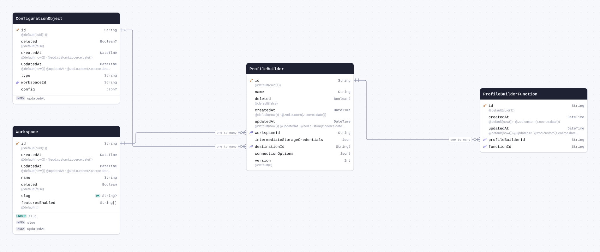

| Field                            | Type       | Constraints                                                 | Default              | Description                  |
| -------------------------------- | ---------- | ----------------------------------------------------------- | -------------------- | ---------------------------- |
| `id`                             | `String`   | PK NOT NULL                                                 | `cuid(1)`            |                              |
| `name`                           | `String`   | NOT NULL                                                    |                      |                              |
| `deleted`                        | `Boolean`  | NULL                                                        | `false`              |                              |
| `createdAt`                      | `DateTime` | NOT NULL                                                    | `now()`              | @zod.custom(z.coerce.date()) |
| `updatedAt`                      | `DateTime` | NOT NULL                                                    | `now()` `@updatedAt` | @zod.custom(z.coerce.date()) |
| `workspaceId`                    | `String`   | NOT NULL → [Workspace.id](#model-Workspace)                 |                      |                              |
| `intermediateStorageCredentials` | `Json`     | NOT NULL                                                    |                      |                              |
| `destinationId`                  | `String`   | NULL → [ConfigurationObject.id](#model-ConfigurationObject) |                      |                              |
| `connectionOptions`              | `Json`     | NULL                                                        |                      |                              |
| `version`                        | `Int`      | NOT NULL                                                    | `0`                  |                              |

#### References

- `workspaceId` → [Workspace.id](#model-Workspace) (many-to-one)
- `destinationId` → [ConfigurationObject.id](#model-ConfigurationObject) (many-to-one)

#### Referenced by

- `id` ← [ProfileBuilderFunction.profileBuilderId](#model-ProfileBuilderFunction) (one-to-many)

#### Definition

```sql
CREATE TABLE "ProfileBuilder" (
    "id" TEXT NOT NULL,
    "name" TEXT NOT NULL,
    "deleted" BOOLEAN DEFAULT false,
    "createdAt" TIMESTAMP(3) NOT NULL DEFAULT CURRENT_TIMESTAMP,
    "updatedAt" TIMESTAMP(3) NOT NULL DEFAULT CURRENT_TIMESTAMP,
    "workspaceId" TEXT NOT NULL,
    "intermediateStorageCredentials" JSONB NOT NULL,
    "destinationId" TEXT,
    "connectionOptions" JSONB,
    "version" INTEGER NOT NULL DEFAULT 0,

    CONSTRAINT "ProfileBuilder_pkey" PRIMARY KEY ("id")
);

ALTER TABLE "ProfileBuilder" ADD CONSTRAINT "ProfileBuilder_workspaceId_fkey" FOREIGN KEY ("workspaceId") REFERENCES "Workspace"("id") ON DELETE RESTRICT ON UPDATE CASCADE;

ALTER TABLE "ProfileBuilder" ADD CONSTRAINT "ProfileBuilder_destinationId_fkey" FOREIGN KEY ("destinationId") REFERENCES "ConfigurationObject"("id") ON DELETE SET NULL ON UPDATE CASCADE;
```

<details>
<summary>Queries and their SQL</summary>

**findMany**: Every row

```ts
await prisma.profileBuilder.findMany();
```

```sql
SELECT
  "public"."ProfileBuilder"."id",
  "public"."ProfileBuilder"."name",
  "public"."ProfileBuilder"."deleted",
  "public"."ProfileBuilder"."createdAt",
  "public"."ProfileBuilder"."updatedAt",
  "public"."ProfileBuilder"."workspaceId",
  "public"."ProfileBuilder"."intermediateStorageCredentials",
  "public"."ProfileBuilder"."destinationId",
  "public"."ProfileBuilder"."connectionOptions",
  "public"."ProfileBuilder"."version"
FROM
  "public"."ProfileBuilder"
WHERE
  1 = 1
OFFSET
  $1
-- params: ["0"]
```

**count**: How many rows there are

```ts
await prisma.profileBuilder.count();
```

```sql
SELECT
  COUNT(*) AS "_count$_all"
FROM
  (
    SELECT
      "public"."ProfileBuilder"."id"
    FROM
      "public"."ProfileBuilder"
    WHERE
      1 = 1
    OFFSET
      $1
  ) AS "sub"
-- params: ["0"]
```

**findMany**: Every row with its relations

```ts
await prisma.profileBuilder.findMany({
  include: { workspace: true, destination: true, functions: true },
});
```

```sql
SELECT
  "public"."ProfileBuilder"."id",
  "public"."ProfileBuilder"."name",
  "public"."ProfileBuilder"."deleted",
  "public"."ProfileBuilder"."createdAt",
  "public"."ProfileBuilder"."updatedAt",
  "public"."ProfileBuilder"."workspaceId",
  "public"."ProfileBuilder"."intermediateStorageCredentials",
  "public"."ProfileBuilder"."destinationId",
  "public"."ProfileBuilder"."connectionOptions",
  "public"."ProfileBuilder"."version"
FROM
  "public"."ProfileBuilder"
WHERE
  1 = 1
OFFSET
  $1
-- params: ["0"]

SELECT
  "public"."Workspace"."id",
  "public"."Workspace"."createdAt",
  "public"."Workspace"."updatedAt",
  "public"."Workspace"."name",
  "public"."Workspace"."deleted",
  "public"."Workspace"."slug",
  "public"."Workspace"."featuresEnabled"
FROM
  "public"."Workspace"
WHERE
  "public"."Workspace"."id" IN ($1)
OFFSET
  $2
-- params: ["<workspaceId of the rows above>","0"]

SELECT
  "public"."ConfigurationObject"."id",
  "public"."ConfigurationObject"."deleted",
  "public"."ConfigurationObject"."createdAt",
  "public"."ConfigurationObject"."updatedAt",
  "public"."ConfigurationObject"."type",
  "public"."ConfigurationObject"."workspaceId",
  "public"."ConfigurationObject"."config"
FROM
  "public"."ConfigurationObject"
WHERE
  "public"."ConfigurationObject"."id" IN ($1)
OFFSET
  $2
-- params: ["<destinationId of the rows above>","0"]

SELECT
  "public"."ProfileBuilderFunction"."id",
  "public"."ProfileBuilderFunction"."createdAt",
  "public"."ProfileBuilderFunction"."updatedAt",
  "public"."ProfileBuilderFunction"."profileBuilderId",
  "public"."ProfileBuilderFunction"."functionId"
FROM
  "public"."ProfileBuilderFunction"
WHERE
  "public"."ProfileBuilderFunction"."profileBuilderId" IN ($1)
OFFSET
  $2
-- params: ["<id of the rows above>","0"]
```

**findUnique**: One row by what is unique to it

```ts
await prisma.profileBuilder.findUnique({ where: { id: "example" } });
```

```sql
SELECT
  "public"."ProfileBuilder"."id",
  "public"."ProfileBuilder"."name",
  "public"."ProfileBuilder"."deleted",
  "public"."ProfileBuilder"."createdAt",
  "public"."ProfileBuilder"."updatedAt",
  "public"."ProfileBuilder"."workspaceId",
  "public"."ProfileBuilder"."intermediateStorageCredentials",
  "public"."ProfileBuilder"."destinationId",
  "public"."ProfileBuilder"."connectionOptions",
  "public"."ProfileBuilder"."version"
FROM
  "public"."ProfileBuilder"
WHERE
  (
    "public"."ProfileBuilder"."id" = $1
    AND 1 = 1
  )
LIMIT
  $2
OFFSET
  $3
-- params: ["example","1","0"]
```

**create**: Create a row

```ts
await prisma.profileBuilder.create({
  data: { name: "example", workspaceId: "example", intermediateStorageCredentials: {} },
});
```

```sql
INSERT INTO
  "public"."ProfileBuilder" (
    "id",
    "name",
    "deleted",
    "createdAt",
    "updatedAt",
    "workspaceId",
    "intermediateStorageCredentials",
    "version"
  )
VALUES
  ($1, $2, $3, $4, $5, $6, $7, $8)
RETURNING
  "public"."ProfileBuilder"."id",
  "public"."ProfileBuilder"."name",
  "public"."ProfileBuilder"."deleted",
  "public"."ProfileBuilder"."createdAt",
  "public"."ProfileBuilder"."updatedAt",
  "public"."ProfileBuilder"."workspaceId",
  "public"."ProfileBuilder"."intermediateStorageCredentials",
  "public"."ProfileBuilder"."destinationId",
  "public"."ProfileBuilder"."connectionOptions",
  "public"."ProfileBuilder"."version"
-- params: ["<cuid(1)>","example",false,"<now()>","<now()>","example","{}","0"]
```

**update**: Update a row

```ts
await prisma.profileBuilder.update({ where: { id: "example" }, data: { name: "example" } });
```

```sql
UPDATE "public"."ProfileBuilder"
SET
  "name" = $1,
  "updatedAt" = $2
WHERE
  (
    "public"."ProfileBuilder"."id" = $3
    AND 1 = 1
  )
RETURNING
  "public"."ProfileBuilder"."id",
  "public"."ProfileBuilder"."name",
  "public"."ProfileBuilder"."deleted",
  "public"."ProfileBuilder"."createdAt",
  "public"."ProfileBuilder"."updatedAt",
  "public"."ProfileBuilder"."workspaceId",
  "public"."ProfileBuilder"."intermediateStorageCredentials",
  "public"."ProfileBuilder"."destinationId",
  "public"."ProfileBuilder"."connectionOptions",
  "public"."ProfileBuilder"."version"
-- params: ["example",{"prisma__type":"generatorCall","prisma__value":{"name":"now","args":[],"returnType":{"type":"DateTime"}}},"example"]
```

**delete**: Delete a row

```ts
await prisma.profileBuilder.delete({ where: { id: "example" } });
```

```sql
DELETE FROM "public"."ProfileBuilder"
WHERE
  (
    "public"."ProfileBuilder"."id" = $1
    AND 1 = 1
  )
RETURNING
  "public"."ProfileBuilder"."id",
  "public"."ProfileBuilder"."name",
  "public"."ProfileBuilder"."deleted",
  "public"."ProfileBuilder"."createdAt",
  "public"."ProfileBuilder"."updatedAt",
  "public"."ProfileBuilder"."workspaceId",
  "public"."ProfileBuilder"."intermediateStorageCredentials",
  "public"."ProfileBuilder"."destinationId",
  "public"."ProfileBuilder"."connectionOptions",
  "public"."ProfileBuilder"."version"
-- params: ["example"]
```

</details>

<a id="model-ProfileBuilderFunction"></a>

### ProfileBuilderFunction

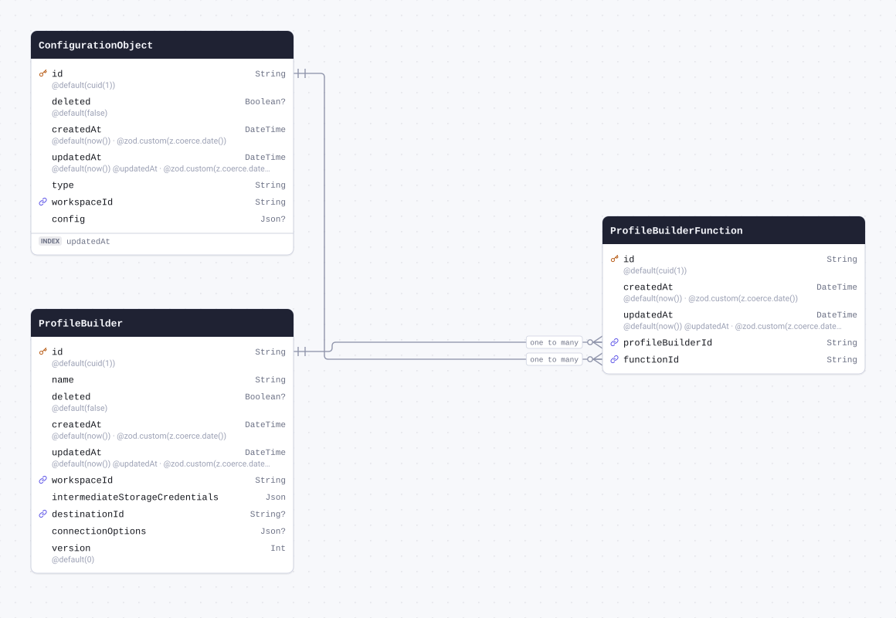

| Field              | Type       | Constraints                                                     | Default              | Description                  |
| ------------------ | ---------- | --------------------------------------------------------------- | -------------------- | ---------------------------- |
| `id`               | `String`   | PK NOT NULL                                                     | `cuid(1)`            |                              |
| `createdAt`        | `DateTime` | NOT NULL                                                        | `now()`              | @zod.custom(z.coerce.date()) |
| `updatedAt`        | `DateTime` | NOT NULL                                                        | `now()` `@updatedAt` | @zod.custom(z.coerce.date()) |
| `profileBuilderId` | `String`   | NOT NULL → [ProfileBuilder.id](#model-ProfileBuilder)           |                      |                              |
| `functionId`       | `String`   | NOT NULL → [ConfigurationObject.id](#model-ConfigurationObject) |                      |                              |

#### References

- `profileBuilderId` → [ProfileBuilder.id](#model-ProfileBuilder) (many-to-one)
- `functionId` → [ConfigurationObject.id](#model-ConfigurationObject) (many-to-one)

#### Definition

```sql
CREATE TABLE "ProfileBuilderFunction" (
    "id" TEXT NOT NULL,
    "createdAt" TIMESTAMP(3) NOT NULL DEFAULT CURRENT_TIMESTAMP,
    "updatedAt" TIMESTAMP(3) NOT NULL DEFAULT CURRENT_TIMESTAMP,
    "profileBuilderId" TEXT NOT NULL,
    "functionId" TEXT NOT NULL,

    CONSTRAINT "ProfileBuilderFunction_pkey" PRIMARY KEY ("id")
);

ALTER TABLE "ProfileBuilderFunction" ADD CONSTRAINT "ProfileBuilderFunction_profileBuilderId_fkey" FOREIGN KEY ("profileBuilderId") REFERENCES "ProfileBuilder"("id") ON DELETE RESTRICT ON UPDATE CASCADE;

ALTER TABLE "ProfileBuilderFunction" ADD CONSTRAINT "ProfileBuilderFunction_functionId_fkey" FOREIGN KEY ("functionId") REFERENCES "ConfigurationObject"("id") ON DELETE RESTRICT ON UPDATE CASCADE;
```

<details>
<summary>Queries and their SQL</summary>

**findMany**: Every row

```ts
await prisma.profileBuilderFunction.findMany();
```

```sql
SELECT
  "public"."ProfileBuilderFunction"."id",
  "public"."ProfileBuilderFunction"."createdAt",
  "public"."ProfileBuilderFunction"."updatedAt",
  "public"."ProfileBuilderFunction"."profileBuilderId",
  "public"."ProfileBuilderFunction"."functionId"
FROM
  "public"."ProfileBuilderFunction"
WHERE
  1 = 1
OFFSET
  $1
-- params: ["0"]
```

**count**: How many rows there are

```ts
await prisma.profileBuilderFunction.count();
```

```sql
SELECT
  COUNT(*) AS "_count$_all"
FROM
  (
    SELECT
      "public"."ProfileBuilderFunction"."id"
    FROM
      "public"."ProfileBuilderFunction"
    WHERE
      1 = 1
    OFFSET
      $1
  ) AS "sub"
-- params: ["0"]
```

**findMany**: Every row with its relations

```ts
await prisma.profileBuilderFunction.findMany({ include: { profileBuilder: true, function: true } });
```

```sql
SELECT
  "public"."ProfileBuilderFunction"."id",
  "public"."ProfileBuilderFunction"."createdAt",
  "public"."ProfileBuilderFunction"."updatedAt",
  "public"."ProfileBuilderFunction"."profileBuilderId",
  "public"."ProfileBuilderFunction"."functionId"
FROM
  "public"."ProfileBuilderFunction"
WHERE
  1 = 1
OFFSET
  $1
-- params: ["0"]

SELECT
  "public"."ProfileBuilder"."id",
  "public"."ProfileBuilder"."name",
  "public"."ProfileBuilder"."deleted",
  "public"."ProfileBuilder"."createdAt",
  "public"."ProfileBuilder"."updatedAt",
  "public"."ProfileBuilder"."workspaceId",
  "public"."ProfileBuilder"."intermediateStorageCredentials",
  "public"."ProfileBuilder"."destinationId",
  "public"."ProfileBuilder"."connectionOptions",
  "public"."ProfileBuilder"."version"
FROM
  "public"."ProfileBuilder"
WHERE
  "public"."ProfileBuilder"."id" IN ($1)
OFFSET
  $2
-- params: ["<profileBuilderId of the rows above>","0"]

SELECT
  "public"."ConfigurationObject"."id",
  "public"."ConfigurationObject"."deleted",
  "public"."ConfigurationObject"."createdAt",
  "public"."ConfigurationObject"."updatedAt",
  "public"."ConfigurationObject"."type",
  "public"."ConfigurationObject"."workspaceId",
  "public"."ConfigurationObject"."config"
FROM
  "public"."ConfigurationObject"
WHERE
  "public"."ConfigurationObject"."id" IN ($1)
OFFSET
  $2
-- params: ["<functionId of the rows above>","0"]
```

**findUnique**: One row by what is unique to it

```ts
await prisma.profileBuilderFunction.findUnique({ where: { id: "example" } });
```

```sql
SELECT
  "public"."ProfileBuilderFunction"."id",
  "public"."ProfileBuilderFunction"."createdAt",
  "public"."ProfileBuilderFunction"."updatedAt",
  "public"."ProfileBuilderFunction"."profileBuilderId",
  "public"."ProfileBuilderFunction"."functionId"
FROM
  "public"."ProfileBuilderFunction"
WHERE
  (
    "public"."ProfileBuilderFunction"."id" = $1
    AND 1 = 1
  )
LIMIT
  $2
OFFSET
  $3
-- params: ["example","1","0"]
```

**create**: Create a row

```ts
await prisma.profileBuilderFunction.create({
  data: { profileBuilderId: "example", functionId: "example" },
});
```

```sql
INSERT INTO
  "public"."ProfileBuilderFunction" (
    "id",
    "createdAt",
    "updatedAt",
    "profileBuilderId",
    "functionId"
  )
VALUES
  ($1, $2, $3, $4, $5)
RETURNING
  "public"."ProfileBuilderFunction"."id",
  "public"."ProfileBuilderFunction"."createdAt",
  "public"."ProfileBuilderFunction"."updatedAt",
  "public"."ProfileBuilderFunction"."profileBuilderId",
  "public"."ProfileBuilderFunction"."functionId"
-- params: ["<cuid(1)>","<now()>","<now()>","example","example"]
```

**update**: Update a row

```ts
await prisma.profileBuilderFunction.update({
  where: { id: "example" },
  data: { createdAt: new Date("2026-01-01T00:00:00.000Z") },
});
```

```sql
UPDATE "public"."ProfileBuilderFunction"
SET
  "createdAt" = $1,
  "updatedAt" = $2
WHERE
  (
    "public"."ProfileBuilderFunction"."id" = $3
    AND 1 = 1
  )
RETURNING
  "public"."ProfileBuilderFunction"."id",
  "public"."ProfileBuilderFunction"."createdAt",
  "public"."ProfileBuilderFunction"."updatedAt",
  "public"."ProfileBuilderFunction"."profileBuilderId",
  "public"."ProfileBuilderFunction"."functionId"
-- params: ["2026-01-01T00:00:00.000Z",{"prisma__type":"generatorCall","prisma__value":{"name":"now","args":[],"returnType":{"type":"DateTime"}}},"example"]
```

**delete**: Delete a row

```ts
await prisma.profileBuilderFunction.delete({ where: { id: "example" } });
```

```sql
DELETE FROM "public"."ProfileBuilderFunction"
WHERE
  (
    "public"."ProfileBuilderFunction"."id" = $1
    AND 1 = 1
  )
RETURNING
  "public"."ProfileBuilderFunction"."id",
  "public"."ProfileBuilderFunction"."createdAt",
  "public"."ProfileBuilderFunction"."updatedAt",
  "public"."ProfileBuilderFunction"."profileBuilderId",
  "public"."ProfileBuilderFunction"."functionId"
-- params: ["example"]
```

</details>

<a id="model-ProfileBuilderState"></a>

### ProfileBuilderState

| Field                   | Type       | Constraints | Default | Description |
| ----------------------- | ---------- | ----------- | ------- | ----------- |
| `profileBuilderId`      | `String`   | PK NOT NULL |         |             |
| `profileBuilderVersion` | `Int`      | PK NOT NULL |         |             |
| `instanceIndex`         | `Int`      | PK NOT NULL |         |             |
| `totalInstances`        | `Int`      | PK NOT NULL |         |             |
| `startedAt`             | `DateTime` | NOT NULL    |         |             |
| `updatedAt`             | `DateTime` | NOT NULL    |         |             |
| `lastTimestamp`         | `DateTime` | NULL        |         |             |
| `processedUsers`        | `Int`      | NOT NULL    |         |             |
| `totalUsers`            | `Int`      | NOT NULL    |         |             |
| `errorUsers`            | `Int`      | NOT NULL    |         |             |
| `speed`                 | `Float`    | NOT NULL    |         |             |

#### Indexes

- `@@id([profileBuilderId, profileBuilderVersion, totalInstances, instanceIndex])`

#### Definition

```sql
CREATE TABLE "ProfileBuilderState" (
    "profileBuilderId" TEXT NOT NULL,
    "profileBuilderVersion" INTEGER NOT NULL,
    "instanceIndex" INTEGER NOT NULL,
    "totalInstances" INTEGER NOT NULL,
    "startedAt" TIMESTAMP(3) NOT NULL,
    "updatedAt" TIMESTAMP(3) NOT NULL,
    "lastTimestamp" TIMESTAMP(3),
    "processedUsers" INTEGER NOT NULL,
    "totalUsers" INTEGER NOT NULL,
    "errorUsers" INTEGER NOT NULL,
    "speed" DOUBLE PRECISION NOT NULL,

    CONSTRAINT "ProfileBuilderState_pkey" PRIMARY KEY ("profileBuilderId","profileBuilderVersion","totalInstances","instanceIndex")
);
```

<details>
<summary>Queries and their SQL</summary>

**findMany**: Every row

```ts
await prisma.profileBuilderState.findMany();
```

```sql
SELECT
  "public"."ProfileBuilderState"."profileBuilderId",
  "public"."ProfileBuilderState"."profileBuilderVersion",
  "public"."ProfileBuilderState"."totalInstances",
  "public"."ProfileBuilderState"."instanceIndex",
  "public"."ProfileBuilderState"."startedAt",
  "public"."ProfileBuilderState"."updatedAt",
  "public"."ProfileBuilderState"."lastTimestamp",
  "public"."ProfileBuilderState"."processedUsers",
  "public"."ProfileBuilderState"."totalUsers",
  "public"."ProfileBuilderState"."errorUsers",
  "public"."ProfileBuilderState"."speed"
FROM
  "public"."ProfileBuilderState"
WHERE
  1 = 1
OFFSET
  $1
-- params: ["0"]
```

**count**: How many rows there are

```ts
await prisma.profileBuilderState.count();
```

```sql
SELECT
  COUNT(*) AS "_count$_all"
FROM
  (
    SELECT
      "public"."ProfileBuilderState"."profileBuilderId",
      "public"."ProfileBuilderState"."profileBuilderVersion",
      "public"."ProfileBuilderState"."totalInstances",
      "public"."ProfileBuilderState"."instanceIndex"
    FROM
      "public"."ProfileBuilderState"
    WHERE
      1 = 1
    OFFSET
      $1
  ) AS "sub"
-- params: ["0"]
```

**findUnique**: One row by what is unique to it

```ts
await prisma.profileBuilderState.findUnique({
  where: {
    profileBuilderId_profileBuilderVersion_totalInstances_instanceIndex: {
      profileBuilderId: "example",
      profileBuilderVersion: 1,
      totalInstances: 1,
      instanceIndex: 1,
    },
  },
});
```

```sql
SELECT
  "public"."ProfileBuilderState"."profileBuilderId",
  "public"."ProfileBuilderState"."profileBuilderVersion",
  "public"."ProfileBuilderState"."totalInstances",
  "public"."ProfileBuilderState"."instanceIndex",
  "public"."ProfileBuilderState"."startedAt",
  "public"."ProfileBuilderState"."updatedAt",
  "public"."ProfileBuilderState"."lastTimestamp",
  "public"."ProfileBuilderState"."processedUsers",
  "public"."ProfileBuilderState"."totalUsers",
  "public"."ProfileBuilderState"."errorUsers",
  "public"."ProfileBuilderState"."speed"
FROM
  "public"."ProfileBuilderState"
WHERE
  (
    (
      "public"."ProfileBuilderState"."profileBuilderId" = $1
      AND "public"."ProfileBuilderState"."profileBuilderVersion" = $2
      AND "public"."ProfileBuilderState"."totalInstances" = $3
      AND "public"."ProfileBuilderState"."instanceIndex" = $4
    )
    AND 1 = 1
  )
LIMIT
  $5
OFFSET
  $6
-- params: ["example","1","1","1","1","0"]
```

**create**: Create a row

```ts
await prisma.profileBuilderState.create({
  data: {
    profileBuilderId: "example",
    profileBuilderVersion: 1,
    instanceIndex: 1,
    totalInstances: 1,
    startedAt: new Date("2026-01-01T00:00:00.000Z"),
    updatedAt: new Date("2026-01-01T00:00:00.000Z"),
    processedUsers: 1,
    totalUsers: 1,
    errorUsers: 1,
    speed: 1.5,
  },
});
```

```sql
INSERT INTO
  "public"."ProfileBuilderState" (
    "profileBuilderId",
    "profileBuilderVersion",
    "instanceIndex",
    "totalInstances",
    "startedAt",
    "updatedAt",
    "processedUsers",
    "totalUsers",
    "errorUsers",
    "speed"
  )
VALUES
  ($1, $2, $3, $4, $5, $6, $7, $8, $9, $10)
RETURNING
  "public"."ProfileBuilderState"."profileBuilderId",
  "public"."ProfileBuilderState"."profileBuilderVersion",
  "public"."ProfileBuilderState"."totalInstances",
  "public"."ProfileBuilderState"."instanceIndex",
  "public"."ProfileBuilderState"."startedAt",
  "public"."ProfileBuilderState"."updatedAt",
  "public"."ProfileBuilderState"."lastTimestamp",
  "public"."ProfileBuilderState"."processedUsers",
  "public"."ProfileBuilderState"."totalUsers",
  "public"."ProfileBuilderState"."errorUsers",
  "public"."ProfileBuilderState"."speed"
-- params: ["example","1","1","1","2026-01-01T00:00:00.000Z","2026-01-01T00:00:00.000Z","1","1","1","1.5"]
```

**update**: Update a row

```ts
await prisma.profileBuilderState.update({
  where: {
    profileBuilderId_profileBuilderVersion_totalInstances_instanceIndex: {
      profileBuilderId: "example",
      profileBuilderVersion: 1,
      totalInstances: 1,
      instanceIndex: 1,
    },
  },
  data: { startedAt: new Date("2026-01-01T00:00:00.000Z") },
});
```

```sql
UPDATE "public"."ProfileBuilderState"
SET
  "startedAt" = $1
WHERE
  (
    (
      "public"."ProfileBuilderState"."profileBuilderId" = $2
      AND "public"."ProfileBuilderState"."profileBuilderVersion" = $3
      AND "public"."ProfileBuilderState"."totalInstances" = $4
      AND "public"."ProfileBuilderState"."instanceIndex" = $5
    )
    AND 1 = 1
  )
RETURNING
  "public"."ProfileBuilderState"."profileBuilderId",
  "public"."ProfileBuilderState"."profileBuilderVersion",
  "public"."ProfileBuilderState"."totalInstances",
  "public"."ProfileBuilderState"."instanceIndex",
  "public"."ProfileBuilderState"."startedAt",
  "public"."ProfileBuilderState"."updatedAt",
  "public"."ProfileBuilderState"."lastTimestamp",
  "public"."ProfileBuilderState"."processedUsers",
  "public"."ProfileBuilderState"."totalUsers",
  "public"."ProfileBuilderState"."errorUsers",
  "public"."ProfileBuilderState"."speed"
-- params: ["2026-01-01T00:00:00.000Z","example","1","1","1"]
```

**delete**: Delete a row

```ts
await prisma.profileBuilderState.delete({
  where: {
    profileBuilderId_profileBuilderVersion_totalInstances_instanceIndex: {
      profileBuilderId: "example",
      profileBuilderVersion: 1,
      totalInstances: 1,
      instanceIndex: 1,
    },
  },
});
```

```sql
DELETE FROM "public"."ProfileBuilderState"
WHERE
  (
    (
      "public"."ProfileBuilderState"."profileBuilderId" = $1
      AND "public"."ProfileBuilderState"."profileBuilderVersion" = $2
      AND "public"."ProfileBuilderState"."totalInstances" = $3
      AND "public"."ProfileBuilderState"."instanceIndex" = $4
    )
    AND 1 = 1
  )
RETURNING
  "public"."ProfileBuilderState"."profileBuilderId",
  "public"."ProfileBuilderState"."profileBuilderVersion",
  "public"."ProfileBuilderState"."totalInstances",
  "public"."ProfileBuilderState"."instanceIndex",
  "public"."ProfileBuilderState"."startedAt",
  "public"."ProfileBuilderState"."updatedAt",
  "public"."ProfileBuilderState"."lastTimestamp",
  "public"."ProfileBuilderState"."processedUsers",
  "public"."ProfileBuilderState"."totalUsers",
  "public"."ProfileBuilderState"."errorUsers",
  "public"."ProfileBuilderState"."speed"
-- params: ["example","1","1","1"]
```

</details>

<a id="model-ProfileBuilderState2"></a>

### ProfileBuilderState2

| Field              | Type       | Constraints | Default | Description |
| ------------------ | ---------- | ----------- | ------- | ----------- |
| `profileBuilderId` | `String`   | PK NOT NULL |         |             |
| `updatedAt`        | `DateTime` | NOT NULL    |         |             |
| `fullRebuildInfo`  | `Json`     | NULL        |         |             |
| `queuesInfo`       | `Json`     | NULL        |         |             |
| `metrics`          | `Json`     | NULL        |         |             |

#### Indexes

- `@@id([profileBuilderId])`

#### Definition

```sql
CREATE TABLE "ProfileBuilderState2" (
    "profileBuilderId" TEXT NOT NULL,
    "updatedAt" TIMESTAMP(3) NOT NULL,
    "fullRebuildInfo" JSONB,
    "queuesInfo" JSONB,
    "metrics" JSONB,

    CONSTRAINT "ProfileBuilderState2_pkey" PRIMARY KEY ("profileBuilderId")
);
```

<details>
<summary>Queries and their SQL</summary>

**findMany**: Every row

```ts
await prisma.profileBuilderState2.findMany();
```

```sql
SELECT
  "public"."ProfileBuilderState2"."profileBuilderId",
  "public"."ProfileBuilderState2"."updatedAt",
  "public"."ProfileBuilderState2"."fullRebuildInfo",
  "public"."ProfileBuilderState2"."queuesInfo",
  "public"."ProfileBuilderState2"."metrics"
FROM
  "public"."ProfileBuilderState2"
WHERE
  1 = 1
OFFSET
  $1
-- params: ["0"]
```

**count**: How many rows there are

```ts
await prisma.profileBuilderState2.count();
```

```sql
SELECT
  COUNT(*) AS "_count$_all"
FROM
  (
    SELECT
      "public"."ProfileBuilderState2"."profileBuilderId"
    FROM
      "public"."ProfileBuilderState2"
    WHERE
      1 = 1
    OFFSET
      $1
  ) AS "sub"
-- params: ["0"]
```

**findUnique**: One row by what is unique to it

```ts
await prisma.profileBuilderState2.findUnique({ where: { profileBuilderId: "example" } });
```

```sql
SELECT
  "public"."ProfileBuilderState2"."profileBuilderId",
  "public"."ProfileBuilderState2"."updatedAt",
  "public"."ProfileBuilderState2"."fullRebuildInfo",
  "public"."ProfileBuilderState2"."queuesInfo",
  "public"."ProfileBuilderState2"."metrics"
FROM
  "public"."ProfileBuilderState2"
WHERE
  (
    "public"."ProfileBuilderState2"."profileBuilderId" = $1
    AND 1 = 1
  )
LIMIT
  $2
OFFSET
  $3
-- params: ["example","1","0"]
```

**create**: Create a row

```ts
await prisma.profileBuilderState2.create({
  data: { profileBuilderId: "example", updatedAt: new Date("2026-01-01T00:00:00.000Z") },
});
```

```sql
INSERT INTO
  "public"."ProfileBuilderState2" ("profileBuilderId", "updatedAt")
VALUES
  ($1, $2)
RETURNING
  "public"."ProfileBuilderState2"."profileBuilderId",
  "public"."ProfileBuilderState2"."updatedAt",
  "public"."ProfileBuilderState2"."fullRebuildInfo",
  "public"."ProfileBuilderState2"."queuesInfo",
  "public"."ProfileBuilderState2"."metrics"
-- params: ["example","2026-01-01T00:00:00.000Z"]
```

**update**: Update a row

```ts
await prisma.profileBuilderState2.update({
  where: { profileBuilderId: "example" },
  data: { updatedAt: new Date("2026-01-01T00:00:00.000Z") },
});
```

```sql
UPDATE "public"."ProfileBuilderState2"
SET
  "updatedAt" = $1
WHERE
  (
    "public"."ProfileBuilderState2"."profileBuilderId" = $2
    AND 1 = 1
  )
RETURNING
  "public"."ProfileBuilderState2"."profileBuilderId",
  "public"."ProfileBuilderState2"."updatedAt",
  "public"."ProfileBuilderState2"."fullRebuildInfo",
  "public"."ProfileBuilderState2"."queuesInfo",
  "public"."ProfileBuilderState2"."metrics"
-- params: ["2026-01-01T00:00:00.000Z","example"]
```

**delete**: Delete a row

```ts
await prisma.profileBuilderState2.delete({ where: { profileBuilderId: "example" } });
```

```sql
DELETE FROM "public"."ProfileBuilderState2"
WHERE
  (
    "public"."ProfileBuilderState2"."profileBuilderId" = $1
    AND 1 = 1
  )
RETURNING
  "public"."ProfileBuilderState2"."profileBuilderId",
  "public"."ProfileBuilderState2"."updatedAt",
  "public"."ProfileBuilderState2"."fullRebuildInfo",
  "public"."ProfileBuilderState2"."queuesInfo",
  "public"."ProfileBuilderState2"."metrics"
-- params: ["example"]
```

</details>

<a id="model-StatusChange"></a>

### StatusChange

| Field         | Type                            | Constraints | Default           | Description                  |
| ------------- | ------------------------------- | ----------- | ----------------- | ---------------------------- |
| `id`          | `BigInt` `@db.BigInt`           | PK NOT NULL | `autoincrement()` |                              |
| `workspaceId` | `String`                        | NOT NULL    |                   |                              |
| `actorId`     | `String`                        | NOT NULL    |                   |                              |
| `type`        | `String`                        | NOT NULL    |                   |                              |
| `tableName`   | `String`                        | NOT NULL    |                   |                              |
| `timestamp`   | `DateTime` `@db.Timestamptz(3)` | NOT NULL    | `now()`           | @zod.custom(z.coerce.date()) |
| `status`      | `String`                        | NOT NULL    |                   |                              |
| `startedAt`   | `DateTime`                      | NOT NULL    |                   |                              |
| `counts`      | `Int`                           | NOT NULL    | `0`               |                              |
| `description` | `String`                        | NULL        |                   |                              |
| `queueSize`   | `Int`                           | NOT NULL    | `0`               |                              |

#### Indexes

- `@@index([actorId, type, tableName])`
- `@@index([timestamp])`
- `@@index([startedAt])`

#### Definition

```sql
CREATE TABLE "StatusChange" (
    "id" BIGSERIAL NOT NULL,
    "workspaceId" TEXT NOT NULL,
    "actorId" TEXT NOT NULL,
    "type" TEXT NOT NULL,
    "tableName" TEXT NOT NULL,
    "timestamp" TIMESTAMPTZ(3) NOT NULL DEFAULT CURRENT_TIMESTAMP,
    "status" TEXT NOT NULL,
    "startedAt" TIMESTAMP(3) NOT NULL,
    "counts" INTEGER NOT NULL DEFAULT 0,
    "description" TEXT,
    "queueSize" INTEGER NOT NULL DEFAULT 0,

    CONSTRAINT "StatusChange_pkey" PRIMARY KEY ("id")
);

CREATE INDEX "StatusChange_actorId_type_tableName_idx" ON "StatusChange"("actorId", "type", "tableName");

CREATE INDEX "StatusChange_timestamp_idx" ON "StatusChange"("timestamp");

CREATE INDEX "StatusChange_startedAt_idx" ON "StatusChange"("startedAt");
```

<details>
<summary>Queries and their SQL</summary>

**findMany**: Every row

```ts
await prisma.statusChange.findMany();
```

```sql
SELECT
  "public"."StatusChange"."id",
  "public"."StatusChange"."workspaceId",
  "public"."StatusChange"."actorId",
  "public"."StatusChange"."type",
  "public"."StatusChange"."tableName",
  "public"."StatusChange"."timestamp",
  "public"."StatusChange"."status",
  "public"."StatusChange"."startedAt",
  "public"."StatusChange"."counts",
  "public"."StatusChange"."description",
  "public"."StatusChange"."queueSize"
FROM
  "public"."StatusChange"
WHERE
  1 = 1
OFFSET
  $1
-- params: ["0"]
```

**count**: How many rows there are

```ts
await prisma.statusChange.count();
```

```sql
SELECT
  COUNT(*) AS "_count$_all"
FROM
  (
    SELECT
      "public"."StatusChange"."id"
    FROM
      "public"."StatusChange"
    WHERE
      1 = 1
    OFFSET
      $1
  ) AS "sub"
-- params: ["0"]
```

**findUnique**: One row by what is unique to it

```ts
await prisma.statusChange.findUnique({ where: { id: 1n } });
```

```sql
SELECT
  "public"."StatusChange"."id",
  "public"."StatusChange"."workspaceId",
  "public"."StatusChange"."actorId",
  "public"."StatusChange"."type",
  "public"."StatusChange"."tableName",
  "public"."StatusChange"."timestamp",
  "public"."StatusChange"."status",
  "public"."StatusChange"."startedAt",
  "public"."StatusChange"."counts",
  "public"."StatusChange"."description",
  "public"."StatusChange"."queueSize"
FROM
  "public"."StatusChange"
WHERE
  (
    "public"."StatusChange"."id" = $1
    AND 1 = 1
  )
LIMIT
  $2
OFFSET
  $3
-- params: ["1","1","0"]
```

**create**: Create a row

```ts
await prisma.statusChange.create({
  data: {
    workspaceId: "example",
    actorId: "example",
    type: "example",
    tableName: "example",
    status: "example",
    startedAt: new Date("2026-01-01T00:00:00.000Z"),
  },
});
```

```sql
INSERT INTO
  "public"."StatusChange" (
    "workspaceId",
    "actorId",
    "type",
    "tableName",
    "timestamp",
    "status",
    "startedAt",
    "counts",
    "queueSize"
  )
VALUES
  ($1, $2, $3, $4, $5, $6, $7, $8, $9)
RETURNING
  "public"."StatusChange"."id",
  "public"."StatusChange"."workspaceId",
  "public"."StatusChange"."actorId",
  "public"."StatusChange"."type",
  "public"."StatusChange"."tableName",
  "public"."StatusChange"."timestamp",
  "public"."StatusChange"."status",
  "public"."StatusChange"."startedAt",
  "public"."StatusChange"."counts",
  "public"."StatusChange"."description",
  "public"."StatusChange"."queueSize"
-- params: ["example","example","example","example","<now()>","example","2026-01-01T00:00:00.000Z","0","0"]
```

**update**: Update a row

```ts
await prisma.statusChange.update({ where: { id: 1n }, data: { workspaceId: "example" } });
```

```sql
UPDATE "public"."StatusChange"
SET
  "workspaceId" = $1
WHERE
  (
    "public"."StatusChange"."id" = $2
    AND 1 = 1
  )
RETURNING
  "public"."StatusChange"."id",
  "public"."StatusChange"."workspaceId",
  "public"."StatusChange"."actorId",
  "public"."StatusChange"."type",
  "public"."StatusChange"."tableName",
  "public"."StatusChange"."timestamp",
  "public"."StatusChange"."status",
  "public"."StatusChange"."startedAt",
  "public"."StatusChange"."counts",
  "public"."StatusChange"."description",
  "public"."StatusChange"."queueSize"
-- params: ["example","1"]
```

**delete**: Delete a row

```ts
await prisma.statusChange.delete({ where: { id: 1n } });
```

```sql
DELETE FROM "public"."StatusChange"
WHERE
  (
    "public"."StatusChange"."id" = $1
    AND 1 = 1
  )
RETURNING
  "public"."StatusChange"."id",
  "public"."StatusChange"."workspaceId",
  "public"."StatusChange"."actorId",
  "public"."StatusChange"."type",
  "public"."StatusChange"."tableName",
  "public"."StatusChange"."timestamp",
  "public"."StatusChange"."status",
  "public"."StatusChange"."startedAt",
  "public"."StatusChange"."counts",
  "public"."StatusChange"."description",
  "public"."StatusChange"."queueSize"
-- params: ["1"]
```

</details>

<a id="model-NotificationState"></a>

### NotificationState

| Field              | Type                            | Constraints | Default | Description                  |
| ------------------ | ------------------------------- | ----------- | ------- | ---------------------------- |
| `workspaceId`      | `String`                        | NOT NULL    |         |                              |
| `actorId`          | `String`                        | PK NOT NULL |         |                              |
| `type`             | `String`                        | PK NOT NULL |         |                              |
| `tableName`        | `String`                        | PK NOT NULL |         |                              |
| `channelId`        | `String`                        | PK NOT NULL |         |                              |
| `flappingSince`    | `DateTime` `@db.Timestamptz(3)` | NULL        |         | @zod.custom(z.coerce.date()) |
| `lastNotification` | `DateTime` `@db.Timestamptz(3)` | NOT NULL    |         | @zod.custom(z.coerce.date()) |
| `statusChangeId`   | `BigInt`                        | NOT NULL    |         |                              |
| `error`            | `String`                        | NULL        |         |                              |

#### Indexes

- `@@id([channelId, actorId, type, tableName])`

#### Definition

```sql
CREATE TABLE "NotificationState" (
    "workspaceId" TEXT NOT NULL,
    "actorId" TEXT NOT NULL,
    "type" TEXT NOT NULL,
    "tableName" TEXT NOT NULL,
    "channelId" TEXT NOT NULL,
    "flappingSince" TIMESTAMPTZ(3),
    "lastNotification" TIMESTAMPTZ(3) NOT NULL,
    "statusChangeId" BIGINT NOT NULL,
    "error" TEXT,

    CONSTRAINT "NotificationState_pkey" PRIMARY KEY ("channelId","actorId","type","tableName")
);
```

<details>
<summary>Queries and their SQL</summary>

**findMany**: Every row

```ts
await prisma.notificationState.findMany();
```

```sql
SELECT
  "public"."NotificationState"."channelId",
  "public"."NotificationState"."actorId",
  "public"."NotificationState"."type",
  "public"."NotificationState"."tableName",
  "public"."NotificationState"."workspaceId",
  "public"."NotificationState"."flappingSince",
  "public"."NotificationState"."lastNotification",
  "public"."NotificationState"."statusChangeId",
  "public"."NotificationState"."error"
FROM
  "public"."NotificationState"
WHERE
  1 = 1
OFFSET
  $1
-- params: ["0"]
```

**count**: How many rows there are

```ts
await prisma.notificationState.count();
```

```sql
SELECT
  COUNT(*) AS "_count$_all"
FROM
  (
    SELECT
      "public"."NotificationState"."channelId",
      "public"."NotificationState"."actorId",
      "public"."NotificationState"."type",
      "public"."NotificationState"."tableName"
    FROM
      "public"."NotificationState"
    WHERE
      1 = 1
    OFFSET
      $1
  ) AS "sub"
-- params: ["0"]
```

**findUnique**: One row by what is unique to it

```ts
await prisma.notificationState.findUnique({
  where: {
    channelId_actorId_type_tableName: {
      channelId: "example",
      actorId: "example",
      type: "example",
      tableName: "example",
    },
  },
});
```

```sql
SELECT
  "public"."NotificationState"."channelId",
  "public"."NotificationState"."actorId",
  "public"."NotificationState"."type",
  "public"."NotificationState"."tableName",
  "public"."NotificationState"."workspaceId",
  "public"."NotificationState"."flappingSince",
  "public"."NotificationState"."lastNotification",
  "public"."NotificationState"."statusChangeId",
  "public"."NotificationState"."error"
FROM
  "public"."NotificationState"
WHERE
  (
    (
      "public"."NotificationState"."channelId" = $1
      AND "public"."NotificationState"."actorId" = $2
      AND "public"."NotificationState"."type" = $3
      AND "public"."NotificationState"."tableName" = $4
    )
    AND 1 = 1
  )
LIMIT
  $5
OFFSET
  $6
-- params: ["example","example","example","example","1","0"]
```

**create**: Create a row

```ts
await prisma.notificationState.create({
  data: {
    workspaceId: "example",
    actorId: "example",
    type: "example",
    tableName: "example",
    channelId: "example",
    lastNotification: new Date("2026-01-01T00:00:00.000Z"),
    statusChangeId: 1n,
  },
});
```

```sql
INSERT INTO
  "public"."NotificationState" (
    "workspaceId",
    "actorId",
    "type",
    "tableName",
    "channelId",
    "lastNotification",
    "statusChangeId"
  )
VALUES
  ($1, $2, $3, $4, $5, $6, $7)
RETURNING
  "public"."NotificationState"."channelId",
  "public"."NotificationState"."actorId",
  "public"."NotificationState"."type",
  "public"."NotificationState"."tableName",
  "public"."NotificationState"."workspaceId",
  "public"."NotificationState"."flappingSince",
  "public"."NotificationState"."lastNotification",
  "public"."NotificationState"."statusChangeId",
  "public"."NotificationState"."error"
-- params: ["example","example","example","example","example","2026-01-01T00:00:00.000Z","1"]
```

**update**: Update a row

```ts
await prisma.notificationState.update({
  where: {
    channelId_actorId_type_tableName: {
      channelId: "example",
      actorId: "example",
      type: "example",
      tableName: "example",
    },
  },
  data: { workspaceId: "example" },
});
```

```sql
UPDATE "public"."NotificationState"
SET
  "workspaceId" = $1
WHERE
  (
    (
      "public"."NotificationState"."channelId" = $2
      AND "public"."NotificationState"."actorId" = $3
      AND "public"."NotificationState"."type" = $4
      AND "public"."NotificationState"."tableName" = $5
    )
    AND 1 = 1
  )
RETURNING
  "public"."NotificationState"."channelId",
  "public"."NotificationState"."actorId",
  "public"."NotificationState"."type",
  "public"."NotificationState"."tableName",
  "public"."NotificationState"."workspaceId",
  "public"."NotificationState"."flappingSince",
  "public"."NotificationState"."lastNotification",
  "public"."NotificationState"."statusChangeId",
  "public"."NotificationState"."error"
-- params: ["example","example","example","example","example"]
```

**delete**: Delete a row

```ts
await prisma.notificationState.delete({
  where: {
    channelId_actorId_type_tableName: {
      channelId: "example",
      actorId: "example",
      type: "example",
      tableName: "example",
    },
  },
});
```

```sql
DELETE FROM "public"."NotificationState"
WHERE
  (
    (
      "public"."NotificationState"."channelId" = $1
      AND "public"."NotificationState"."actorId" = $2
      AND "public"."NotificationState"."type" = $3
      AND "public"."NotificationState"."tableName" = $4
    )
    AND 1 = 1
  )
RETURNING
  "public"."NotificationState"."channelId",
  "public"."NotificationState"."actorId",
  "public"."NotificationState"."type",
  "public"."NotificationState"."tableName",
  "public"."NotificationState"."workspaceId",
  "public"."NotificationState"."flappingSince",
  "public"."NotificationState"."lastNotification",
  "public"."NotificationState"."statusChangeId",
  "public"."NotificationState"."error"
-- params: ["example","example","example","example"]
```

</details>

<a id="model-Notification"></a>

### Notification

| Field            | Type                            | Constraints | Default   | Description                  |
| ---------------- | ------------------------------- | ----------- | --------- | ---------------------------- |
| `id`             | `String` `@db.Uuid`             | PK NOT NULL | `uuid(4)` |                              |
| `workspaceId`    | `String`                        | NOT NULL    |           |                              |
| `actorId`        | `String`                        | NOT NULL    |           |                              |
| `type`           | `String`                        | NOT NULL    |           |                              |
| `tableName`      | `String`                        | NOT NULL    |           |                              |
| `channelId`      | `String`                        | NOT NULL    |           |                              |
| `statusChangeId` | `BigInt`                        | NOT NULL    |           |                              |
| `timestamp`      | `DateTime` `@db.Timestamptz(3)` | NOT NULL    | `now()`   | @zod.custom(z.coerce.date()) |
| `status`         | `String`                        | NOT NULL    |           |                              |
| `error`          | `String`                        | NULL        |           |                              |

#### Indexes

- `@@index([actorId, type, tableName])`
- `@@index([timestamp])`

#### Definition

```sql
CREATE TABLE "Notification" (
    "id" UUID NOT NULL,
    "workspaceId" TEXT NOT NULL,
    "actorId" TEXT NOT NULL,
    "type" TEXT NOT NULL,
    "tableName" TEXT NOT NULL,
    "channelId" TEXT NOT NULL,
    "statusChangeId" BIGINT NOT NULL,
    "timestamp" TIMESTAMPTZ(3) NOT NULL DEFAULT CURRENT_TIMESTAMP,
    "status" TEXT NOT NULL,
    "error" TEXT,

    CONSTRAINT "Notification_pkey" PRIMARY KEY ("id")
);

CREATE INDEX "Notification_actorId_type_tableName_idx" ON "Notification"("actorId", "type", "tableName");

CREATE INDEX "Notification_timestamp_idx" ON "Notification"("timestamp");
```

<details>
<summary>Queries and their SQL</summary>

**findMany**: Every row

```ts
await prisma.notification.findMany();
```

```sql
SELECT
  "public"."Notification"."id",
  "public"."Notification"."workspaceId",
  "public"."Notification"."actorId",
  "public"."Notification"."type",
  "public"."Notification"."tableName",
  "public"."Notification"."channelId",
  "public"."Notification"."statusChangeId",
  "public"."Notification"."timestamp",
  "public"."Notification"."status",
  "public"."Notification"."error"
FROM
  "public"."Notification"
WHERE
  1 = 1
OFFSET
  $1
-- params: ["0"]
```

**count**: How many rows there are

```ts
await prisma.notification.count();
```

```sql
SELECT
  COUNT(*) AS "_count$_all"
FROM
  (
    SELECT
      "public"."Notification"."id"
    FROM
      "public"."Notification"
    WHERE
      1 = 1
    OFFSET
      $1
  ) AS "sub"
-- params: ["0"]
```

**findUnique**: One row by what is unique to it

```ts
await prisma.notification.findUnique({ where: { id: "example" } });
```

```sql
SELECT
  "public"."Notification"."id",
  "public"."Notification"."workspaceId",
  "public"."Notification"."actorId",
  "public"."Notification"."type",
  "public"."Notification"."tableName",
  "public"."Notification"."channelId",
  "public"."Notification"."statusChangeId",
  "public"."Notification"."timestamp",
  "public"."Notification"."status",
  "public"."Notification"."error"
FROM
  "public"."Notification"
WHERE
  (
    "public"."Notification"."id" = $1
    AND 1 = 1
  )
LIMIT
  $2
OFFSET
  $3
-- params: ["example","1","0"]
```

**create**: Create a row

```ts
await prisma.notification.create({
  data: {
    workspaceId: "example",
    actorId: "example",
    type: "example",
    tableName: "example",
    channelId: "example",
    statusChangeId: 1n,
    status: "example",
  },
});
```

```sql
INSERT INTO
  "public"."Notification" (
    "id",
    "workspaceId",
    "actorId",
    "type",
    "tableName",
    "channelId",
    "statusChangeId",
    "timestamp",
    "status"
  )
VALUES
  ($1, $2, $3, $4, $5, $6, $7, $8, $9)
RETURNING
  "public"."Notification"."id",
  "public"."Notification"."workspaceId",
  "public"."Notification"."actorId",
  "public"."Notification"."type",
  "public"."Notification"."tableName",
  "public"."Notification"."channelId",
  "public"."Notification"."statusChangeId",
  "public"."Notification"."timestamp",
  "public"."Notification"."status",
  "public"."Notification"."error"
-- params: ["<uuid(4)>","example","example","example","example","example","1","<now()>","example"]
```

**update**: Update a row

```ts
await prisma.notification.update({ where: { id: "example" }, data: { workspaceId: "example" } });
```

```sql
UPDATE "public"."Notification"
SET
  "workspaceId" = $1
WHERE
  (
    "public"."Notification"."id" = $2
    AND 1 = 1
  )
RETURNING
  "public"."Notification"."id",
  "public"."Notification"."workspaceId",
  "public"."Notification"."actorId",
  "public"."Notification"."type",
  "public"."Notification"."tableName",
  "public"."Notification"."channelId",
  "public"."Notification"."statusChangeId",
  "public"."Notification"."timestamp",
  "public"."Notification"."status",
  "public"."Notification"."error"
-- params: ["example","example"]
```

**delete**: Delete a row

```ts
await prisma.notification.delete({ where: { id: "example" } });
```

```sql
DELETE FROM "public"."Notification"
WHERE
  (
    "public"."Notification"."id" = $1
    AND 1 = 1
  )
RETURNING
  "public"."Notification"."id",
  "public"."Notification"."workspaceId",
  "public"."Notification"."actorId",
  "public"."Notification"."type",
  "public"."Notification"."tableName",
  "public"."Notification"."channelId",
  "public"."Notification"."statusChangeId",
  "public"."Notification"."timestamp",
  "public"."Notification"."status",
  "public"."Notification"."error"
-- params: ["example"]
```

</details>

<a id="model-OidcProvider"></a>

### OidcProvider

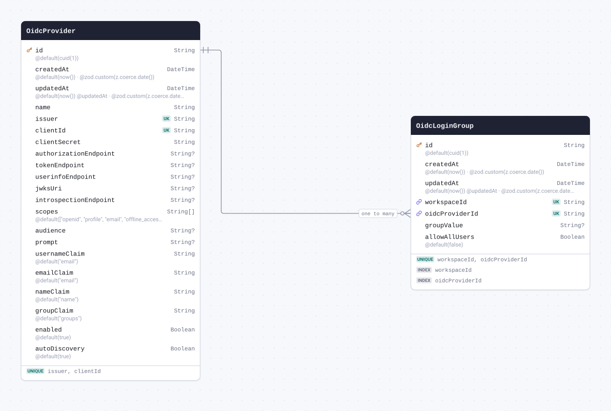

| Field                   | Type       | Constraints | Default                                            | Description                  |
| ----------------------- | ---------- | ----------- | -------------------------------------------------- | ---------------------------- |
| `id`                    | `String`   | PK NOT NULL | `cuid(1)`                                          |                              |
| `createdAt`             | `DateTime` | NOT NULL    | `now()`                                            | @zod.custom(z.coerce.date()) |
| `updatedAt`             | `DateTime` | NOT NULL    | `now()` `@updatedAt`                               | @zod.custom(z.coerce.date()) |
| `name`                  | `String`   | NOT NULL    |                                                    |                              |
| `issuer`                | `String`   | NOT NULL    |                                                    |                              |
| `clientId`              | `String`   | NOT NULL    |                                                    |                              |
| `clientSecret`          | `String`   | NOT NULL    |                                                    |                              |
| `authorizationEndpoint` | `String`   | NULL        |                                                    |                              |
| `tokenEndpoint`         | `String`   | NULL        |                                                    |                              |
| `userinfoEndpoint`      | `String`   | NULL        |                                                    |                              |
| `jwksUri`               | `String`   | NULL        |                                                    |                              |
| `introspectionEndpoint` | `String`   | NULL        |                                                    |                              |
| `scopes`                | `String[]` | NOT NULL    | `["openid", "profile", "email", "offline_access"]` |                              |
| `audience`              | `String`   | NULL        |                                                    |                              |
| `prompt`                | `String`   | NULL        |                                                    |                              |
| `usernameClaim`         | `String`   | NOT NULL    | `"email"`                                          |                              |
| `emailClaim`            | `String`   | NOT NULL    | `"email"`                                          |                              |
| `nameClaim`             | `String`   | NOT NULL    | `"name"`                                           |                              |
| `groupClaim`            | `String`   | NOT NULL    | `"groups"`                                         |                              |
| `enabled`               | `Boolean`  | NOT NULL    | `true`                                             |                              |
| `autoDiscovery`         | `Boolean`  | NOT NULL    | `true`                                             |                              |

#### Indexes

- `@@unique([issuer, clientId])`

#### Referenced by

- `id` ← [OidcLoginGroup.oidcProviderId](#model-OidcLoginGroup) (one-to-many)

#### Definition

```sql
CREATE TABLE "OidcProvider" (
    "id" TEXT NOT NULL,
    "createdAt" TIMESTAMP(3) NOT NULL DEFAULT CURRENT_TIMESTAMP,
    "updatedAt" TIMESTAMP(3) NOT NULL DEFAULT CURRENT_TIMESTAMP,
    "name" TEXT NOT NULL,
    "issuer" TEXT NOT NULL,
    "clientId" TEXT NOT NULL,
    "clientSecret" TEXT NOT NULL,
    "authorizationEndpoint" TEXT,
    "tokenEndpoint" TEXT,
    "userinfoEndpoint" TEXT,
    "jwksUri" TEXT,
    "introspectionEndpoint" TEXT,
    "scopes" TEXT[] DEFAULT ARRAY['openid', 'profile', 'email', 'offline_access']::TEXT[],
    "audience" TEXT,
    "prompt" TEXT,
    "usernameClaim" TEXT NOT NULL DEFAULT 'email',
    "emailClaim" TEXT NOT NULL DEFAULT 'email',
    "nameClaim" TEXT NOT NULL DEFAULT 'name',
    "groupClaim" TEXT NOT NULL DEFAULT 'groups',
    "enabled" BOOLEAN NOT NULL DEFAULT true,
    "autoDiscovery" BOOLEAN NOT NULL DEFAULT true,

    CONSTRAINT "OidcProvider_pkey" PRIMARY KEY ("id")
);

CREATE UNIQUE INDEX "OidcProvider_issuer_clientId_key" ON "OidcProvider"("issuer", "clientId");
```

<details>
<summary>Queries and their SQL</summary>

**findMany**: Every row

```ts
await prisma.oidcProvider.findMany();
```

```sql
SELECT
  "public"."OidcProvider"."id",
  "public"."OidcProvider"."createdAt",
  "public"."OidcProvider"."updatedAt",
  "public"."OidcProvider"."name",
  "public"."OidcProvider"."issuer",
  "public"."OidcProvider"."clientId",
  "public"."OidcProvider"."clientSecret",
  "public"."OidcProvider"."authorizationEndpoint",
  "public"."OidcProvider"."tokenEndpoint",
  "public"."OidcProvider"."userinfoEndpoint",
  "public"."OidcProvider"."jwksUri",
  "public"."OidcProvider"."introspectionEndpoint",
  "public"."OidcProvider"."scopes",
  "public"."OidcProvider"."audience",
  "public"."OidcProvider"."prompt",
  "public"."OidcProvider"."usernameClaim",
  "public"."OidcProvider"."emailClaim",
  "public"."OidcProvider"."nameClaim",
  "public"."OidcProvider"."groupClaim",
  "public"."OidcProvider"."enabled",
  "public"."OidcProvider"."autoDiscovery"
FROM
  "public"."OidcProvider"
WHERE
  1 = 1
OFFSET
  $1
-- params: ["0"]
```

**count**: How many rows there are

```ts
await prisma.oidcProvider.count();
```

```sql
SELECT
  COUNT(*) AS "_count$_all"
FROM
  (
    SELECT
      "public"."OidcProvider"."id"
    FROM
      "public"."OidcProvider"
    WHERE
      1 = 1
    OFFSET
      $1
  ) AS "sub"
-- params: ["0"]
```

**findMany**: Every row with its relations

```ts
await prisma.oidcProvider.findMany({ include: { oidcLoginGroups: true } });
```

```sql
SELECT
  "public"."OidcProvider"."id",
  "public"."OidcProvider"."createdAt",
  "public"."OidcProvider"."updatedAt",
  "public"."OidcProvider"."name",
  "public"."OidcProvider"."issuer",
  "public"."OidcProvider"."clientId",
  "public"."OidcProvider"."clientSecret",
  "public"."OidcProvider"."authorizationEndpoint",
  "public"."OidcProvider"."tokenEndpoint",
  "public"."OidcProvider"."userinfoEndpoint",
  "public"."OidcProvider"."jwksUri",
  "public"."OidcProvider"."introspectionEndpoint",
  "public"."OidcProvider"."scopes",
  "public"."OidcProvider"."audience",
  "public"."OidcProvider"."prompt",
  "public"."OidcProvider"."usernameClaim",
  "public"."OidcProvider"."emailClaim",
  "public"."OidcProvider"."nameClaim",
  "public"."OidcProvider"."groupClaim",
  "public"."OidcProvider"."enabled",
  "public"."OidcProvider"."autoDiscovery"
FROM
  "public"."OidcProvider"
WHERE
  1 = 1
OFFSET
  $1
-- params: ["0"]

SELECT
  "public"."OidcLoginGroup"."id",
  "public"."OidcLoginGroup"."createdAt",
  "public"."OidcLoginGroup"."updatedAt",
  "public"."OidcLoginGroup"."workspaceId",
  "public"."OidcLoginGroup"."oidcProviderId",
  "public"."OidcLoginGroup"."groupValue",
  "public"."OidcLoginGroup"."allowAllUsers"
FROM
  "public"."OidcLoginGroup"
WHERE
  "public"."OidcLoginGroup"."oidcProviderId" IN ($1)
OFFSET
  $2
-- params: ["<id of the rows above>","0"]
```

**findUnique**: One row by what is unique to it

```ts
await prisma.oidcProvider.findUnique({ where: { id: "example" } });
```

```sql
SELECT
  "public"."OidcProvider"."id",
  "public"."OidcProvider"."createdAt",
  "public"."OidcProvider"."updatedAt",
  "public"."OidcProvider"."name",
  "public"."OidcProvider"."issuer",
  "public"."OidcProvider"."clientId",
  "public"."OidcProvider"."clientSecret",
  "public"."OidcProvider"."authorizationEndpoint",
  "public"."OidcProvider"."tokenEndpoint",
  "public"."OidcProvider"."userinfoEndpoint",
  "public"."OidcProvider"."jwksUri",
  "public"."OidcProvider"."introspectionEndpoint",
  "public"."OidcProvider"."scopes",
  "public"."OidcProvider"."audience",
  "public"."OidcProvider"."prompt",
  "public"."OidcProvider"."usernameClaim",
  "public"."OidcProvider"."emailClaim",
  "public"."OidcProvider"."nameClaim",
  "public"."OidcProvider"."groupClaim",
  "public"."OidcProvider"."enabled",
  "public"."OidcProvider"."autoDiscovery"
FROM
  "public"."OidcProvider"
WHERE
  (
    "public"."OidcProvider"."id" = $1
    AND 1 = 1
  )
LIMIT
  $2
OFFSET
  $3
-- params: ["example","1","0"]
```

**create**: Create a row

```ts
await prisma.oidcProvider.create({
  data: { name: "example", issuer: "example", clientId: "example", clientSecret: "example" },
});
```

```sql
INSERT INTO
  "public"."OidcProvider" (
    "id",
    "createdAt",
    "updatedAt",
    "name",
    "issuer",
    "clientId",
    "clientSecret",
    "scopes",
    "usernameClaim",
    "emailClaim",
    "nameClaim",
    "groupClaim",
    "enabled",
    "autoDiscovery"
  )
VALUES
  (
    $1,
    $2,
    $3,
    $4,
    $5,
    $6,
    $7,
    $8,
    $9,
    $10,
    $11,
    $12,
    $13,
    $14
  )
RETURNING
  "public"."OidcProvider"."id",
  "public"."OidcProvider"."createdAt",
  "public"."OidcProvider"."updatedAt",
  "public"."OidcProvider"."name",
  "public"."OidcProvider"."issuer",
  "public"."OidcProvider"."clientId",
  "public"."OidcProvider"."clientSecret",
  "public"."OidcProvider"."authorizationEndpoint",
  "public"."OidcProvider"."tokenEndpoint",
  "public"."OidcProvider"."userinfoEndpoint",
  "public"."OidcProvider"."jwksUri",
  "public"."OidcProvider"."introspectionEndpoint",
  "public"."OidcProvider"."scopes",
  "public"."OidcProvider"."audience",
  "public"."OidcProvider"."prompt",
  "public"."OidcProvider"."usernameClaim",
  "public"."OidcProvider"."emailClaim",
  "public"."OidcProvider"."nameClaim",
  "public"."OidcProvider"."groupClaim",
  "public"."OidcProvider"."enabled",
  "public"."OidcProvider"."autoDiscovery"
-- params: ["<cuid(1)>","<now()>","<now()>","example","example","example","example",["openid","profile","email","offline_access"],"email","email","name","groups",true,true]
```

**update**: Update a row

```ts
await prisma.oidcProvider.update({
  where: { id: "example" },
  data: { createdAt: new Date("2026-01-01T00:00:00.000Z") },
});
```

```sql
UPDATE "public"."OidcProvider"
SET
  "createdAt" = $1,
  "updatedAt" = $2
WHERE
  (
    "public"."OidcProvider"."id" = $3
    AND 1 = 1
  )
RETURNING
  "public"."OidcProvider"."id",
  "public"."OidcProvider"."createdAt",
  "public"."OidcProvider"."updatedAt",
  "public"."OidcProvider"."name",
  "public"."OidcProvider"."issuer",
  "public"."OidcProvider"."clientId",
  "public"."OidcProvider"."clientSecret",
  "public"."OidcProvider"."authorizationEndpoint",
  "public"."OidcProvider"."tokenEndpoint",
  "public"."OidcProvider"."userinfoEndpoint",
  "public"."OidcProvider"."jwksUri",
  "public"."OidcProvider"."introspectionEndpoint",
  "public"."OidcProvider"."scopes",
  "public"."OidcProvider"."audience",
  "public"."OidcProvider"."prompt",
  "public"."OidcProvider"."usernameClaim",
  "public"."OidcProvider"."emailClaim",
  "public"."OidcProvider"."nameClaim",
  "public"."OidcProvider"."groupClaim",
  "public"."OidcProvider"."enabled",
  "public"."OidcProvider"."autoDiscovery"
-- params: ["2026-01-01T00:00:00.000Z",{"prisma__type":"generatorCall","prisma__value":{"name":"now","args":[],"returnType":{"type":"DateTime"}}},"example"]
```

**delete**: Delete a row

```ts
await prisma.oidcProvider.delete({ where: { id: "example" } });
```

```sql
DELETE FROM "public"."OidcProvider"
WHERE
  (
    "public"."OidcProvider"."id" = $1
    AND 1 = 1
  )
RETURNING
  "public"."OidcProvider"."id",
  "public"."OidcProvider"."createdAt",
  "public"."OidcProvider"."updatedAt",
  "public"."OidcProvider"."name",
  "public"."OidcProvider"."issuer",
  "public"."OidcProvider"."clientId",
  "public"."OidcProvider"."clientSecret",
  "public"."OidcProvider"."authorizationEndpoint",
  "public"."OidcProvider"."tokenEndpoint",
  "public"."OidcProvider"."userinfoEndpoint",
  "public"."OidcProvider"."jwksUri",
  "public"."OidcProvider"."introspectionEndpoint",
  "public"."OidcProvider"."scopes",
  "public"."OidcProvider"."audience",
  "public"."OidcProvider"."prompt",
  "public"."OidcProvider"."usernameClaim",
  "public"."OidcProvider"."emailClaim",
  "public"."OidcProvider"."nameClaim",
  "public"."OidcProvider"."groupClaim",
  "public"."OidcProvider"."enabled",
  "public"."OidcProvider"."autoDiscovery"
-- params: ["example"]
```

</details>

<a id="model-OidcLoginGroup"></a>

### OidcLoginGroup

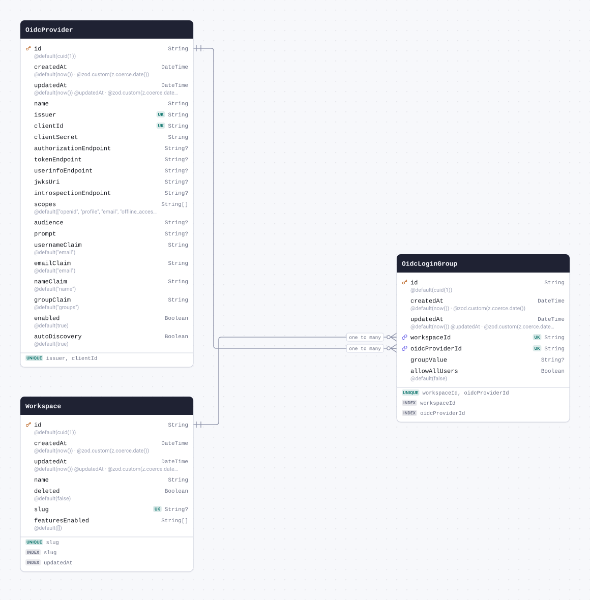

| Field            | Type       | Constraints                                       | Default              | Description                  |
| ---------------- | ---------- | ------------------------------------------------- | -------------------- | ---------------------------- |
| `id`             | `String`   | PK NOT NULL                                       | `cuid(1)`            |                              |
| `createdAt`      | `DateTime` | NOT NULL                                          | `now()`              | @zod.custom(z.coerce.date()) |
| `updatedAt`      | `DateTime` | NOT NULL                                          | `now()` `@updatedAt` | @zod.custom(z.coerce.date()) |
| `workspaceId`    | `String`   | NOT NULL → [Workspace.id](#model-Workspace)       |                      |                              |
| `oidcProviderId` | `String`   | NOT NULL → [OidcProvider.id](#model-OidcProvider) |                      |                              |
| `groupValue`     | `String`   | NULL                                              |                      |                              |
| `allowAllUsers`  | `Boolean`  | NOT NULL                                          | `false`              |                              |

#### Indexes

- `@@index([workspaceId])`
- `@@index([oidcProviderId])`
- `@@unique([workspaceId, oidcProviderId])`

#### References

- `workspaceId` → [Workspace.id](#model-Workspace) (many-to-one)
- `oidcProviderId` → [OidcProvider.id](#model-OidcProvider) (many-to-one)

#### Definition

```sql
CREATE TABLE "OidcLoginGroup" (
    "id" TEXT NOT NULL,
    "createdAt" TIMESTAMP(3) NOT NULL DEFAULT CURRENT_TIMESTAMP,
    "updatedAt" TIMESTAMP(3) NOT NULL DEFAULT CURRENT_TIMESTAMP,
    "workspaceId" TEXT NOT NULL,
    "oidcProviderId" TEXT NOT NULL,
    "groupValue" TEXT,
    "allowAllUsers" BOOLEAN NOT NULL DEFAULT false,

    CONSTRAINT "OidcLoginGroup_pkey" PRIMARY KEY ("id")
);

CREATE INDEX "OidcLoginGroup_workspaceId_idx" ON "OidcLoginGroup"("workspaceId");

CREATE INDEX "OidcLoginGroup_oidcProviderId_idx" ON "OidcLoginGroup"("oidcProviderId");

CREATE UNIQUE INDEX "OidcLoginGroup_workspaceId_oidcProviderId_key" ON "OidcLoginGroup"("workspaceId", "oidcProviderId");

ALTER TABLE "OidcLoginGroup" ADD CONSTRAINT "OidcLoginGroup_workspaceId_fkey" FOREIGN KEY ("workspaceId") REFERENCES "Workspace"("id") ON DELETE RESTRICT ON UPDATE CASCADE;

ALTER TABLE "OidcLoginGroup" ADD CONSTRAINT "OidcLoginGroup_oidcProviderId_fkey" FOREIGN KEY ("oidcProviderId") REFERENCES "OidcProvider"("id") ON DELETE RESTRICT ON UPDATE CASCADE;
```

<details>
<summary>Queries and their SQL</summary>

**findMany**: Every row

```ts
await prisma.oidcLoginGroup.findMany();
```

```sql
SELECT
  "public"."OidcLoginGroup"."id",
  "public"."OidcLoginGroup"."createdAt",
  "public"."OidcLoginGroup"."updatedAt",
  "public"."OidcLoginGroup"."workspaceId",
  "public"."OidcLoginGroup"."oidcProviderId",
  "public"."OidcLoginGroup"."groupValue",
  "public"."OidcLoginGroup"."allowAllUsers"
FROM
  "public"."OidcLoginGroup"
WHERE
  1 = 1
OFFSET
  $1
-- params: ["0"]
```

**count**: How many rows there are

```ts
await prisma.oidcLoginGroup.count();
```

```sql
SELECT
  COUNT(*) AS "_count$_all"
FROM
  (
    SELECT
      "public"."OidcLoginGroup"."id"
    FROM
      "public"."OidcLoginGroup"
    WHERE
      1 = 1
    OFFSET
      $1
  ) AS "sub"
-- params: ["0"]
```

**findMany**: Every row with its relations

```ts
await prisma.oidcLoginGroup.findMany({ include: { workspace: true, oidcProvider: true } });
```

```sql
SELECT
  "public"."OidcLoginGroup"."id",
  "public"."OidcLoginGroup"."createdAt",
  "public"."OidcLoginGroup"."updatedAt",
  "public"."OidcLoginGroup"."workspaceId",
  "public"."OidcLoginGroup"."oidcProviderId",
  "public"."OidcLoginGroup"."groupValue",
  "public"."OidcLoginGroup"."allowAllUsers"
FROM
  "public"."OidcLoginGroup"
WHERE
  1 = 1
OFFSET
  $1
-- params: ["0"]

SELECT
  "public"."Workspace"."id",
  "public"."Workspace"."createdAt",
  "public"."Workspace"."updatedAt",
  "public"."Workspace"."name",
  "public"."Workspace"."deleted",
  "public"."Workspace"."slug",
  "public"."Workspace"."featuresEnabled"
FROM
  "public"."Workspace"
WHERE
  "public"."Workspace"."id" IN ($1)
OFFSET
  $2
-- params: ["<workspaceId of the rows above>","0"]

SELECT
  "public"."OidcProvider"."id",
  "public"."OidcProvider"."createdAt",
  "public"."OidcProvider"."updatedAt",
  "public"."OidcProvider"."name",
  "public"."OidcProvider"."issuer",
  "public"."OidcProvider"."clientId",
  "public"."OidcProvider"."clientSecret",
  "public"."OidcProvider"."authorizationEndpoint",
  "public"."OidcProvider"."tokenEndpoint",
  "public"."OidcProvider"."userinfoEndpoint",
  "public"."OidcProvider"."jwksUri",
  "public"."OidcProvider"."introspectionEndpoint",
  "public"."OidcProvider"."scopes",
  "public"."OidcProvider"."audience",
  "public"."OidcProvider"."prompt",
  "public"."OidcProvider"."usernameClaim",
  "public"."OidcProvider"."emailClaim",
  "public"."OidcProvider"."nameClaim",
  "public"."OidcProvider"."groupClaim",
  "public"."OidcProvider"."enabled",
  "public"."OidcProvider"."autoDiscovery"
FROM
  "public"."OidcProvider"
WHERE
  "public"."OidcProvider"."id" IN ($1)
OFFSET
  $2
-- params: ["<oidcProviderId of the rows above>","0"]
```

**findUnique**: One row by what is unique to it

```ts
await prisma.oidcLoginGroup.findUnique({ where: { id: "example" } });
```

```sql
SELECT
  "public"."OidcLoginGroup"."id",
  "public"."OidcLoginGroup"."createdAt",
  "public"."OidcLoginGroup"."updatedAt",
  "public"."OidcLoginGroup"."workspaceId",
  "public"."OidcLoginGroup"."oidcProviderId",
  "public"."OidcLoginGroup"."groupValue",
  "public"."OidcLoginGroup"."allowAllUsers"
FROM
  "public"."OidcLoginGroup"
WHERE
  (
    "public"."OidcLoginGroup"."id" = $1
    AND 1 = 1
  )
LIMIT
  $2
OFFSET
  $3
-- params: ["example","1","0"]
```

**create**: Create a row

```ts
await prisma.oidcLoginGroup.create({ data: { workspaceId: "example", oidcProviderId: "example" } });
```

```sql
INSERT INTO
  "public"."OidcLoginGroup" (
    "id",
    "createdAt",
    "updatedAt",
    "workspaceId",
    "oidcProviderId",
    "allowAllUsers"
  )
VALUES
  ($1, $2, $3, $4, $5, $6)
RETURNING
  "public"."OidcLoginGroup"."id",
  "public"."OidcLoginGroup"."createdAt",
  "public"."OidcLoginGroup"."updatedAt",
  "public"."OidcLoginGroup"."workspaceId",
  "public"."OidcLoginGroup"."oidcProviderId",
  "public"."OidcLoginGroup"."groupValue",
  "public"."OidcLoginGroup"."allowAllUsers"
-- params: ["<cuid(1)>","<now()>","<now()>","example","example",false]
```

**update**: Update a row

```ts
await prisma.oidcLoginGroup.update({
  where: { id: "example" },
  data: { createdAt: new Date("2026-01-01T00:00:00.000Z") },
});
```

```sql
UPDATE "public"."OidcLoginGroup"
SET
  "createdAt" = $1,
  "updatedAt" = $2
WHERE
  (
    "public"."OidcLoginGroup"."id" = $3
    AND 1 = 1
  )
RETURNING
  "public"."OidcLoginGroup"."id",
  "public"."OidcLoginGroup"."createdAt",
  "public"."OidcLoginGroup"."updatedAt",
  "public"."OidcLoginGroup"."workspaceId",
  "public"."OidcLoginGroup"."oidcProviderId",
  "public"."OidcLoginGroup"."groupValue",
  "public"."OidcLoginGroup"."allowAllUsers"
-- params: ["2026-01-01T00:00:00.000Z",{"prisma__type":"generatorCall","prisma__value":{"name":"now","args":[],"returnType":{"type":"DateTime"}}},"example"]
```

**delete**: Delete a row

```ts
await prisma.oidcLoginGroup.delete({ where: { id: "example" } });
```

```sql
DELETE FROM "public"."OidcLoginGroup"
WHERE
  (
    "public"."OidcLoginGroup"."id" = $1
    AND 1 = 1
  )
RETURNING
  "public"."OidcLoginGroup"."id",
  "public"."OidcLoginGroup"."createdAt",
  "public"."OidcLoginGroup"."updatedAt",
  "public"."OidcLoginGroup"."workspaceId",
  "public"."OidcLoginGroup"."oidcProviderId",
  "public"."OidcLoginGroup"."groupValue",
  "public"."OidcLoginGroup"."allowAllUsers"
-- params: ["example"]
```

</details>

<a id="model-reprocessing_jobs"></a>

### reprocessing_jobs

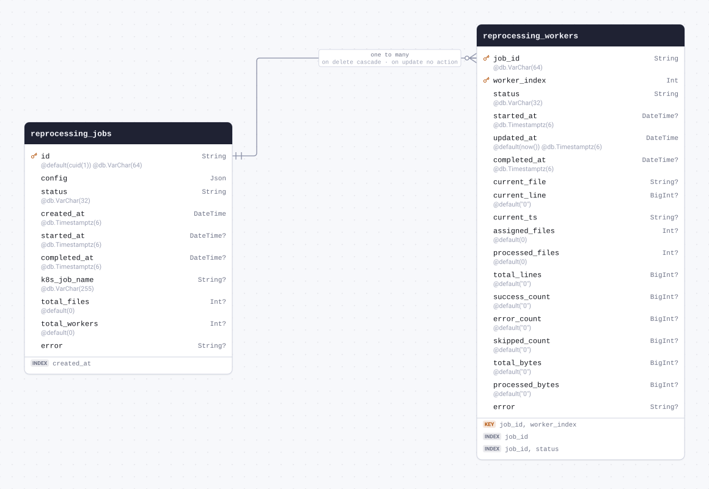

| Field           | Type                            | Constraints | Default   | Description |
| --------------- | ------------------------------- | ----------- | --------- | ----------- |
| `id`            | `String` `@db.VarChar(64)`      | PK NOT NULL | `cuid(1)` |             |
| `config`        | `Json`                          | NOT NULL    |           |             |
| `status`        | `String` `@db.VarChar(32)`      | NOT NULL    |           |             |
| `created_at`    | `DateTime` `@db.Timestamptz(6)` | NOT NULL    |           |             |
| `started_at`    | `DateTime` `@db.Timestamptz(6)` | NULL        |           |             |
| `completed_at`  | `DateTime` `@db.Timestamptz(6)` | NULL        |           |             |
| `k8s_job_name`  | `String` `@db.VarChar(255)`     | NULL        |           |             |
| `total_files`   | `Int`                           | NULL        | `0`       |             |
| `total_workers` | `Int`                           | NULL        | `0`       |             |
| `error`         | `String`                        | NULL        |           |             |

#### Indexes

- `@@index([created_at])`

#### Referenced by

- `id` ← [reprocessing_workers.job_id](#model-reprocessing_workers) (one-to-many, on delete Cascade, on update NoAction)

#### Definition

```sql
CREATE TABLE "reprocessing_jobs" (
    "id" VARCHAR(64) NOT NULL,
    "config" JSONB NOT NULL,
    "status" VARCHAR(32) NOT NULL,
    "created_at" TIMESTAMPTZ(6) NOT NULL,
    "started_at" TIMESTAMPTZ(6),
    "completed_at" TIMESTAMPTZ(6),
    "k8s_job_name" VARCHAR(255),
    "total_files" INTEGER DEFAULT 0,
    "total_workers" INTEGER DEFAULT 0,
    "error" TEXT,

    CONSTRAINT "reprocessing_jobs_pkey" PRIMARY KEY ("id")
);

CREATE INDEX "reprocessing_jobs_created_at_idx" ON "reprocessing_jobs"("created_at" DESC);
```

<details>
<summary>Queries and their SQL</summary>

**findMany**: Every row

```ts
await prisma.reprocessing_jobs.findMany();
```

```sql
SELECT
  "public"."reprocessing_jobs"."id",
  "public"."reprocessing_jobs"."config",
  "public"."reprocessing_jobs"."status",
  "public"."reprocessing_jobs"."created_at",
  "public"."reprocessing_jobs"."started_at",
  "public"."reprocessing_jobs"."completed_at",
  "public"."reprocessing_jobs"."k8s_job_name",
  "public"."reprocessing_jobs"."total_files",
  "public"."reprocessing_jobs"."total_workers",
  "public"."reprocessing_jobs"."error"
FROM
  "public"."reprocessing_jobs"
WHERE
  1 = 1
OFFSET
  $1
-- params: ["0"]
```

**count**: How many rows there are

```ts
await prisma.reprocessing_jobs.count();
```

```sql
SELECT
  COUNT(*) AS "_count$_all"
FROM
  (
    SELECT
      "public"."reprocessing_jobs"."id"
    FROM
      "public"."reprocessing_jobs"
    WHERE
      1 = 1
    OFFSET
      $1
  ) AS "sub"
-- params: ["0"]
```

**findMany**: Every row with its relations

```ts
await prisma.reprocessing_jobs.findMany({ include: { reprocessing_workers: true } });
```

```sql
SELECT
  "public"."reprocessing_jobs"."id",
  "public"."reprocessing_jobs"."config",
  "public"."reprocessing_jobs"."status",
  "public"."reprocessing_jobs"."created_at",
  "public"."reprocessing_jobs"."started_at",
  "public"."reprocessing_jobs"."completed_at",
  "public"."reprocessing_jobs"."k8s_job_name",
  "public"."reprocessing_jobs"."total_files",
  "public"."reprocessing_jobs"."total_workers",
  "public"."reprocessing_jobs"."error"
FROM
  "public"."reprocessing_jobs"
WHERE
  1 = 1
OFFSET
  $1
-- params: ["0"]

SELECT
  "public"."reprocessing_workers"."job_id",
  "public"."reprocessing_workers"."worker_index",
  "public"."reprocessing_workers"."status",
  "public"."reprocessing_workers"."started_at",
  "public"."reprocessing_workers"."updated_at",
  "public"."reprocessing_workers"."completed_at",
  "public"."reprocessing_workers"."current_file",
  "public"."reprocessing_workers"."current_line",
  "public"."reprocessing_workers"."current_ts",
  "public"."reprocessing_workers"."assigned_files",
  "public"."reprocessing_workers"."processed_files",
  "public"."reprocessing_workers"."total_lines",
  "public"."reprocessing_workers"."success_count",
  "public"."reprocessing_workers"."error_count",
  "public"."reprocessing_workers"."skipped_count",
  "public"."reprocessing_workers"."total_bytes",
  "public"."reprocessing_workers"."processed_bytes",
  "public"."reprocessing_workers"."error"
FROM
  "public"."reprocessing_workers"
WHERE
  "public"."reprocessing_workers"."job_id" IN ($1)
OFFSET
  $2
-- params: ["<id of the rows above>","0"]
```

**findUnique**: One row by what is unique to it

```ts
await prisma.reprocessing_jobs.findUnique({ where: { id: "example" } });
```

```sql
SELECT
  "public"."reprocessing_jobs"."id",
  "public"."reprocessing_jobs"."config",
  "public"."reprocessing_jobs"."status",
  "public"."reprocessing_jobs"."created_at",
  "public"."reprocessing_jobs"."started_at",
  "public"."reprocessing_jobs"."completed_at",
  "public"."reprocessing_jobs"."k8s_job_name",
  "public"."reprocessing_jobs"."total_files",
  "public"."reprocessing_jobs"."total_workers",
  "public"."reprocessing_jobs"."error"
FROM
  "public"."reprocessing_jobs"
WHERE
  (
    "public"."reprocessing_jobs"."id" = $1
    AND 1 = 1
  )
LIMIT
  $2
OFFSET
  $3
-- params: ["example","1","0"]
```

**create**: Create a row

```ts
await prisma.reprocessing_jobs.create({
  data: { config: {}, status: "example", created_at: new Date("2026-01-01T00:00:00.000Z") },
});
```

```sql
INSERT INTO
  "public"."reprocessing_jobs" (
    "id",
    "config",
    "status",
    "created_at",
    "total_files",
    "total_workers"
  )
VALUES
  ($1, $2, $3, $4, $5, $6)
RETURNING
  "public"."reprocessing_jobs"."id",
  "public"."reprocessing_jobs"."config",
  "public"."reprocessing_jobs"."status",
  "public"."reprocessing_jobs"."created_at",
  "public"."reprocessing_jobs"."started_at",
  "public"."reprocessing_jobs"."completed_at",
  "public"."reprocessing_jobs"."k8s_job_name",
  "public"."reprocessing_jobs"."total_files",
  "public"."reprocessing_jobs"."total_workers",
  "public"."reprocessing_jobs"."error"
-- params: ["<cuid(1)>","{}","example","2026-01-01T00:00:00.000Z","0","0"]
```

**update**: Update a row

```ts
await prisma.reprocessing_jobs.update({ where: { id: "example" }, data: { config: {} } });
```

```sql
UPDATE "public"."reprocessing_jobs"
SET
  "config" = $1
WHERE
  (
    "public"."reprocessing_jobs"."id" = $2
    AND 1 = 1
  )
RETURNING
  "public"."reprocessing_jobs"."id",
  "public"."reprocessing_jobs"."config",
  "public"."reprocessing_jobs"."status",
  "public"."reprocessing_jobs"."created_at",
  "public"."reprocessing_jobs"."started_at",
  "public"."reprocessing_jobs"."completed_at",
  "public"."reprocessing_jobs"."k8s_job_name",
  "public"."reprocessing_jobs"."total_files",
  "public"."reprocessing_jobs"."total_workers",
  "public"."reprocessing_jobs"."error"
-- params: ["{}","example"]
```

**delete**: Delete a row

```ts
await prisma.reprocessing_jobs.delete({ where: { id: "example" } });
```

```sql
DELETE FROM "public"."reprocessing_jobs"
WHERE
  (
    "public"."reprocessing_jobs"."id" = $1
    AND 1 = 1
  )
RETURNING
  "public"."reprocessing_jobs"."id",
  "public"."reprocessing_jobs"."config",
  "public"."reprocessing_jobs"."status",
  "public"."reprocessing_jobs"."created_at",
  "public"."reprocessing_jobs"."started_at",
  "public"."reprocessing_jobs"."completed_at",
  "public"."reprocessing_jobs"."k8s_job_name",
  "public"."reprocessing_jobs"."total_files",
  "public"."reprocessing_jobs"."total_workers",
  "public"."reprocessing_jobs"."error"
-- params: ["example"]
```

</details>

<a id="model-reprocessing_workers"></a>

### reprocessing_workers


| Field             | Type                            | Constraints                                                    | Default | Description |
| ----------------- | ------------------------------- | -------------------------------------------------------------- | ------- | ----------- |
| `job_id`          | `String` `@db.VarChar(64)`      | PK NOT NULL → [reprocessing_jobs.id](#model-reprocessing_jobs) |         |             |
| `worker_index`    | `Int`                           | PK NOT NULL                                                    |         |             |
| `status`          | `String` `@db.VarChar(32)`      | NOT NULL                                                       |         |             |
| `started_at`      | `DateTime` `@db.Timestamptz(6)` | NULL                                                           |         |             |
| `updated_at`      | `DateTime` `@db.Timestamptz(6)` | NOT NULL                                                       | `now()` |             |
| `completed_at`    | `DateTime` `@db.Timestamptz(6)` | NULL                                                           |         |             |
| `current_file`    | `String`                        | NULL                                                           |         |             |
| `current_line`    | `BigInt`                        | NULL                                                           | `"0"`   |             |
| `current_ts`      | `String`                        | NULL                                                           |         |             |
| `assigned_files`  | `Int`                           | NULL                                                           | `0`     |             |
| `processed_files` | `Int`                           | NULL                                                           | `0`     |             |
| `total_lines`     | `BigInt`                        | NULL                                                           | `"0"`   |             |
| `success_count`   | `BigInt`                        | NULL                                                           | `"0"`   |             |
| `error_count`     | `BigInt`                        | NULL                                                           | `"0"`   |             |
| `skipped_count`   | `BigInt`                        | NULL                                                           | `"0"`   |             |
| `total_bytes`     | `BigInt`                        | NULL                                                           | `"0"`   |             |
| `processed_bytes` | `BigInt`                        | NULL                                                           | `"0"`   |             |
| `error`           | `String`                        | NULL                                                           |         |             |

#### Indexes

- `@@id([job_id, worker_index])`
- `@@index([job_id])`
- `@@index([job_id, status], map: "reprocessing_workers_status_idx")`

#### References

- `job_id` → [reprocessing_jobs.id](#model-reprocessing_jobs) (many-to-one, on delete Cascade, on update NoAction)

#### Definition

```sql
CREATE TABLE "reprocessing_workers" (
    "job_id" VARCHAR(64) NOT NULL,
    "worker_index" INTEGER NOT NULL,
    "status" VARCHAR(32) NOT NULL,
    "started_at" TIMESTAMPTZ(6),
    "updated_at" TIMESTAMPTZ(6) NOT NULL DEFAULT CURRENT_TIMESTAMP,
    "completed_at" TIMESTAMPTZ(6),
    "current_file" TEXT,
    "current_line" BIGINT DEFAULT 0,
    "current_ts" TEXT,
    "assigned_files" INTEGER DEFAULT 0,
    "processed_files" INTEGER DEFAULT 0,
    "total_lines" BIGINT DEFAULT 0,
    "success_count" BIGINT DEFAULT 0,
    "error_count" BIGINT DEFAULT 0,
    "skipped_count" BIGINT DEFAULT 0,
    "total_bytes" BIGINT DEFAULT 0,
    "processed_bytes" BIGINT DEFAULT 0,
    "error" TEXT,

    CONSTRAINT "reprocessing_workers_pkey" PRIMARY KEY ("job_id","worker_index")
);

CREATE INDEX "reprocessing_workers_job_id_idx" ON "reprocessing_workers"("job_id");

CREATE INDEX "reprocessing_workers_status_idx" ON "reprocessing_workers"("job_id", "status");

ALTER TABLE "reprocessing_workers" ADD CONSTRAINT "reprocessing_workers_job_id_fkey" FOREIGN KEY ("job_id") REFERENCES "reprocessing_jobs"("id") ON DELETE CASCADE ON UPDATE NO ACTION;
```

<details>
<summary>Queries and their SQL</summary>

**findMany**: Every row

```ts
await prisma.reprocessing_workers.findMany();
```

```sql
SELECT
  "public"."reprocessing_workers"."job_id",
  "public"."reprocessing_workers"."worker_index",
  "public"."reprocessing_workers"."status",
  "public"."reprocessing_workers"."started_at",
  "public"."reprocessing_workers"."updated_at",
  "public"."reprocessing_workers"."completed_at",
  "public"."reprocessing_workers"."current_file",
  "public"."reprocessing_workers"."current_line",
  "public"."reprocessing_workers"."current_ts",
  "public"."reprocessing_workers"."assigned_files",
  "public"."reprocessing_workers"."processed_files",
  "public"."reprocessing_workers"."total_lines",
  "public"."reprocessing_workers"."success_count",
  "public"."reprocessing_workers"."error_count",
  "public"."reprocessing_workers"."skipped_count",
  "public"."reprocessing_workers"."total_bytes",
  "public"."reprocessing_workers"."processed_bytes",
  "public"."reprocessing_workers"."error"
FROM
  "public"."reprocessing_workers"
WHERE
  1 = 1
OFFSET
  $1
-- params: ["0"]
```

**count**: How many rows there are

```ts
await prisma.reprocessing_workers.count();
```

```sql
SELECT
  COUNT(*) AS "_count$_all"
FROM
  (
    SELECT
      "public"."reprocessing_workers"."job_id",
      "public"."reprocessing_workers"."worker_index"
    FROM
      "public"."reprocessing_workers"
    WHERE
      1 = 1
    OFFSET
      $1
  ) AS "sub"
-- params: ["0"]
```

**findMany**: Every row with its relations

```ts
await prisma.reprocessing_workers.findMany({ include: { job: true } });
```

```sql
SELECT
  "public"."reprocessing_workers"."job_id",
  "public"."reprocessing_workers"."worker_index",
  "public"."reprocessing_workers"."status",
  "public"."reprocessing_workers"."started_at",
  "public"."reprocessing_workers"."updated_at",
  "public"."reprocessing_workers"."completed_at",
  "public"."reprocessing_workers"."current_file",
  "public"."reprocessing_workers"."current_line",
  "public"."reprocessing_workers"."current_ts",
  "public"."reprocessing_workers"."assigned_files",
  "public"."reprocessing_workers"."processed_files",
  "public"."reprocessing_workers"."total_lines",
  "public"."reprocessing_workers"."success_count",
  "public"."reprocessing_workers"."error_count",
  "public"."reprocessing_workers"."skipped_count",
  "public"."reprocessing_workers"."total_bytes",
  "public"."reprocessing_workers"."processed_bytes",
  "public"."reprocessing_workers"."error"
FROM
  "public"."reprocessing_workers"
WHERE
  1 = 1
OFFSET
  $1
-- params: ["0"]

SELECT
  "public"."reprocessing_jobs"."id",
  "public"."reprocessing_jobs"."config",
  "public"."reprocessing_jobs"."status",
  "public"."reprocessing_jobs"."created_at",
  "public"."reprocessing_jobs"."started_at",
  "public"."reprocessing_jobs"."completed_at",
  "public"."reprocessing_jobs"."k8s_job_name",
  "public"."reprocessing_jobs"."total_files",
  "public"."reprocessing_jobs"."total_workers",
  "public"."reprocessing_jobs"."error"
FROM
  "public"."reprocessing_jobs"
WHERE
  "public"."reprocessing_jobs"."id" IN ($1)
OFFSET
  $2
-- params: ["<job_id of the rows above>","0"]
```

**findUnique**: One row by what is unique to it

```ts
await prisma.reprocessing_workers.findUnique({
  where: { job_id_worker_index: { job_id: "example", worker_index: 1 } },
});
```

```sql
SELECT
  "public"."reprocessing_workers"."job_id",
  "public"."reprocessing_workers"."worker_index",
  "public"."reprocessing_workers"."status",
  "public"."reprocessing_workers"."started_at",
  "public"."reprocessing_workers"."updated_at",
  "public"."reprocessing_workers"."completed_at",
  "public"."reprocessing_workers"."current_file",
  "public"."reprocessing_workers"."current_line",
  "public"."reprocessing_workers"."current_ts",
  "public"."reprocessing_workers"."assigned_files",
  "public"."reprocessing_workers"."processed_files",
  "public"."reprocessing_workers"."total_lines",
  "public"."reprocessing_workers"."success_count",
  "public"."reprocessing_workers"."error_count",
  "public"."reprocessing_workers"."skipped_count",
  "public"."reprocessing_workers"."total_bytes",
  "public"."reprocessing_workers"."processed_bytes",
  "public"."reprocessing_workers"."error"
FROM
  "public"."reprocessing_workers"
WHERE
  (
    (
      "public"."reprocessing_workers"."job_id" = $1
      AND "public"."reprocessing_workers"."worker_index" = $2
    )
    AND 1 = 1
  )
LIMIT
  $3
OFFSET
  $4
-- params: ["example","1","1","0"]
```

**create**: Create a row

```ts
await prisma.reprocessing_workers.create({
  data: { job_id: "example", worker_index: 1, status: "example" },
});
```

```sql
INSERT INTO
  "public"."reprocessing_workers" (
    "job_id",
    "worker_index",
    "status",
    "updated_at",
    "current_line",
    "assigned_files",
    "processed_files",
    "total_lines",
    "success_count",
    "error_count",
    "skipped_count",
    "total_bytes",
    "processed_bytes"
  )
VALUES
  (
    $1,
    $2,
    $3,
    $4,
    $5,
    $6,
    $7,
    $8,
    $9,
    $10,
    $11,
    $12,
    $13
  )
RETURNING
  "public"."reprocessing_workers"."job_id",
  "public"."reprocessing_workers"."worker_index",
  "public"."reprocessing_workers"."status",
  "public"."reprocessing_workers"."started_at",
  "public"."reprocessing_workers"."updated_at",
  "public"."reprocessing_workers"."completed_at",
  "public"."reprocessing_workers"."current_file",
  "public"."reprocessing_workers"."current_line",
  "public"."reprocessing_workers"."current_ts",
  "public"."reprocessing_workers"."assigned_files",
  "public"."reprocessing_workers"."processed_files",
  "public"."reprocessing_workers"."total_lines",
  "public"."reprocessing_workers"."success_count",
  "public"."reprocessing_workers"."error_count",
  "public"."reprocessing_workers"."skipped_count",
  "public"."reprocessing_workers"."total_bytes",
  "public"."reprocessing_workers"."processed_bytes",
  "public"."reprocessing_workers"."error"
-- params: ["example","1","example","<now()>","0","0","0","0","0","0","0","0","0"]
```

**update**: Update a row

```ts
await prisma.reprocessing_workers.update({
  where: { job_id_worker_index: { job_id: "example", worker_index: 1 } },
  data: { status: "example" },
});
```

```sql
UPDATE "public"."reprocessing_workers"
SET
  "status" = $1
WHERE
  (
    (
      "public"."reprocessing_workers"."job_id" = $2
      AND "public"."reprocessing_workers"."worker_index" = $3
    )
    AND 1 = 1
  )
RETURNING
  "public"."reprocessing_workers"."job_id",
  "public"."reprocessing_workers"."worker_index",
  "public"."reprocessing_workers"."status",
  "public"."reprocessing_workers"."started_at",
  "public"."reprocessing_workers"."updated_at",
  "public"."reprocessing_workers"."completed_at",
  "public"."reprocessing_workers"."current_file",
  "public"."reprocessing_workers"."current_line",
  "public"."reprocessing_workers"."current_ts",
  "public"."reprocessing_workers"."assigned_files",
  "public"."reprocessing_workers"."processed_files",
  "public"."reprocessing_workers"."total_lines",
  "public"."reprocessing_workers"."success_count",
  "public"."reprocessing_workers"."error_count",
  "public"."reprocessing_workers"."skipped_count",
  "public"."reprocessing_workers"."total_bytes",
  "public"."reprocessing_workers"."processed_bytes",
  "public"."reprocessing_workers"."error"
-- params: ["example","example","1"]
```

**delete**: Delete a row

```ts
await prisma.reprocessing_workers.delete({
  where: { job_id_worker_index: { job_id: "example", worker_index: 1 } },
});
```

```sql
DELETE FROM "public"."reprocessing_workers"
WHERE
  (
    (
      "public"."reprocessing_workers"."job_id" = $1
      AND "public"."reprocessing_workers"."worker_index" = $2
    )
    AND 1 = 1
  )
RETURNING
  "public"."reprocessing_workers"."job_id",
  "public"."reprocessing_workers"."worker_index",
  "public"."reprocessing_workers"."status",
  "public"."reprocessing_workers"."started_at",
  "public"."reprocessing_workers"."updated_at",
  "public"."reprocessing_workers"."completed_at",
  "public"."reprocessing_workers"."current_file",
  "public"."reprocessing_workers"."current_line",
  "public"."reprocessing_workers"."current_ts",
  "public"."reprocessing_workers"."assigned_files",
  "public"."reprocessing_workers"."processed_files",
  "public"."reprocessing_workers"."total_lines",
  "public"."reprocessing_workers"."success_count",
  "public"."reprocessing_workers"."error_count",
  "public"."reprocessing_workers"."skipped_count",
  "public"."reprocessing_workers"."total_bytes",
  "public"."reprocessing_workers"."processed_bytes",
  "public"."reprocessing_workers"."error"
-- params: ["example","1"]
```

</details>

<a id="model-FunctionsServer"></a>

### FunctionsServer

| Field              | Type                            | Constraints | Default | Description |
| ------------------ | ------------------------------- | ----------- | ------- | ----------- |
| `workspaceId`      | `String`                        | PK NOT NULL |         |             |
| `class`            | `String`                        | PK NOT NULL |         |             |
| `deploymentId`     | `String`                        | NOT NULL    |         |             |
| `connections`      | `String[]`                      | NOT NULL    |         |             |
| `emptyConnections` | `String[]`                      | NOT NULL    |         |             |
| `profileBuilders`  | `String[]`                      | NOT NULL    |         |             |
| `createdAt`        | `DateTime` `@db.Timestamptz(3)` | NOT NULL    | `now()` |             |
| `updatedAt`        | `DateTime` `@db.Timestamptz(3)` | NULL        |         |             |

#### Indexes

- `@@id([workspaceId, class])`

#### Definition

```sql
CREATE TABLE "FunctionsServer" (
    "workspaceId" TEXT NOT NULL,
    "class" TEXT NOT NULL,
    "deploymentId" TEXT NOT NULL,
    "connections" TEXT[],
    "emptyConnections" TEXT[],
    "profileBuilders" TEXT[],
    "createdAt" TIMESTAMPTZ(3) NOT NULL DEFAULT CURRENT_TIMESTAMP,
    "updatedAt" TIMESTAMPTZ(3),

    CONSTRAINT "FunctionsServer_pkey" PRIMARY KEY ("workspaceId","class")
);
```

<details>
<summary>Queries and their SQL</summary>

**findMany**: Every row

```ts
await prisma.functionsServer.findMany();
```

```sql
SELECT
  "public"."FunctionsServer"."workspaceId",
  "public"."FunctionsServer"."class",
  "public"."FunctionsServer"."deploymentId",
  "public"."FunctionsServer"."connections",
  "public"."FunctionsServer"."emptyConnections",
  "public"."FunctionsServer"."profileBuilders",
  "public"."FunctionsServer"."createdAt",
  "public"."FunctionsServer"."updatedAt"
FROM
  "public"."FunctionsServer"
WHERE
  1 = 1
OFFSET
  $1
-- params: ["0"]
```

**count**: How many rows there are

```ts
await prisma.functionsServer.count();
```

```sql
SELECT
  COUNT(*) AS "_count$_all"
FROM
  (
    SELECT
      "public"."FunctionsServer"."workspaceId",
      "public"."FunctionsServer"."class"
    FROM
      "public"."FunctionsServer"
    WHERE
      1 = 1
    OFFSET
      $1
  ) AS "sub"
-- params: ["0"]
```

**findUnique**: One row by what is unique to it

```ts
await prisma.functionsServer.findUnique({
  where: { workspaceId_class: { workspaceId: "example", class: "example" } },
});
```

```sql
SELECT
  "public"."FunctionsServer"."workspaceId",
  "public"."FunctionsServer"."class",
  "public"."FunctionsServer"."deploymentId",
  "public"."FunctionsServer"."connections",
  "public"."FunctionsServer"."emptyConnections",
  "public"."FunctionsServer"."profileBuilders",
  "public"."FunctionsServer"."createdAt",
  "public"."FunctionsServer"."updatedAt"
FROM
  "public"."FunctionsServer"
WHERE
  (
    (
      "public"."FunctionsServer"."workspaceId" = $1
      AND "public"."FunctionsServer"."class" = $2
    )
    AND 1 = 1
  )
LIMIT
  $3
OFFSET
  $4
-- params: ["example","example","1","0"]
```

**create**: Create a row

```ts
await prisma.functionsServer.create({
  data: {
    workspaceId: "example",
    class: "example",
    deploymentId: "example",
    connections: ["example"],
    emptyConnections: ["example"],
    profileBuilders: ["example"],
  },
});
```

```sql
INSERT INTO
  "public"."FunctionsServer" (
    "workspaceId",
    "class",
    "deploymentId",
    "connections",
    "emptyConnections",
    "profileBuilders",
    "createdAt"
  )
VALUES
  ($1, $2, $3, $4, $5, $6, $7)
RETURNING
  "public"."FunctionsServer"."workspaceId",
  "public"."FunctionsServer"."class",
  "public"."FunctionsServer"."deploymentId",
  "public"."FunctionsServer"."connections",
  "public"."FunctionsServer"."emptyConnections",
  "public"."FunctionsServer"."profileBuilders",
  "public"."FunctionsServer"."createdAt",
  "public"."FunctionsServer"."updatedAt"
-- params: ["example","example","example",["example"],["example"],["example"],"<now()>"]
```

**update**: Update a row

```ts
await prisma.functionsServer.update({
  where: { workspaceId_class: { workspaceId: "example", class: "example" } },
  data: { deploymentId: "example" },
});
```

```sql
UPDATE "public"."FunctionsServer"
SET
  "deploymentId" = $1
WHERE
  (
    (
      "public"."FunctionsServer"."workspaceId" = $2
      AND "public"."FunctionsServer"."class" = $3
    )
    AND 1 = 1
  )
RETURNING
  "public"."FunctionsServer"."workspaceId",
  "public"."FunctionsServer"."class",
  "public"."FunctionsServer"."deploymentId",
  "public"."FunctionsServer"."connections",
  "public"."FunctionsServer"."emptyConnections",
  "public"."FunctionsServer"."profileBuilders",
  "public"."FunctionsServer"."createdAt",
  "public"."FunctionsServer"."updatedAt"
-- params: ["example","example","example"]
```

**delete**: Delete a row

```ts
await prisma.functionsServer.delete({
  where: { workspaceId_class: { workspaceId: "example", class: "example" } },
});
```

```sql
DELETE FROM "public"."FunctionsServer"
WHERE
  (
    (
      "public"."FunctionsServer"."workspaceId" = $1
      AND "public"."FunctionsServer"."class" = $2
    )
    AND 1 = 1
  )
RETURNING
  "public"."FunctionsServer"."workspaceId",
  "public"."FunctionsServer"."class",
  "public"."FunctionsServer"."deploymentId",
  "public"."FunctionsServer"."connections",
  "public"."FunctionsServer"."emptyConnections",
  "public"."FunctionsServer"."profileBuilders",
  "public"."FunctionsServer"."createdAt",
  "public"."FunctionsServer"."updatedAt"
-- params: ["example","example"]
```

</details>

<a id="model-RateLimitCounter"></a>

### RateLimitCounter

| Field         | Type                            | Constraints | Default | Description |
| ------------- | ------------------------------- | ----------- | ------- | ----------- |
| `bucketKey`   | `String`                        | PK NOT NULL |         |             |
| `windowStart` | `DateTime` `@db.Timestamptz(3)` | PK NOT NULL |         |             |
| `count`       | `Int`                           | NOT NULL    | `0`     |             |
| `expiresAt`   | `DateTime` `@db.Timestamptz(3)` | NOT NULL    |         |             |

#### Indexes

- `@@id([bucketKey, windowStart])`
- `@@index([expiresAt])`

#### Definition

```sql
CREATE TABLE "RateLimitCounter" (
    "bucketKey" TEXT NOT NULL,
    "windowStart" TIMESTAMPTZ(3) NOT NULL,
    "count" INTEGER NOT NULL DEFAULT 0,
    "expiresAt" TIMESTAMPTZ(3) NOT NULL,

    CONSTRAINT "RateLimitCounter_pkey" PRIMARY KEY ("bucketKey","windowStart")
);

CREATE INDEX "RateLimitCounter_expiresAt_idx" ON "RateLimitCounter"("expiresAt");
```

<details>
<summary>Queries and their SQL</summary>

**findMany**: Every row

```ts
await prisma.rateLimitCounter.findMany();
```

```sql
SELECT
  "public"."RateLimitCounter"."bucketKey",
  "public"."RateLimitCounter"."windowStart",
  "public"."RateLimitCounter"."count",
  "public"."RateLimitCounter"."expiresAt"
FROM
  "public"."RateLimitCounter"
WHERE
  1 = 1
OFFSET
  $1
-- params: ["0"]
```

**count**: How many rows there are

```ts
await prisma.rateLimitCounter.count();
```

```sql
SELECT
  COUNT(*) AS "_count$_all"
FROM
  (
    SELECT
      "public"."RateLimitCounter"."bucketKey",
      "public"."RateLimitCounter"."windowStart"
    FROM
      "public"."RateLimitCounter"
    WHERE
      1 = 1
    OFFSET
      $1
  ) AS "sub"
-- params: ["0"]
```

**findUnique**: One row by what is unique to it

```ts
await prisma.rateLimitCounter.findUnique({
  where: {
    bucketKey_windowStart: {
      bucketKey: "example",
      windowStart: new Date("2026-01-01T00:00:00.000Z"),
    },
  },
});
```

```sql
SELECT
  "public"."RateLimitCounter"."bucketKey",
  "public"."RateLimitCounter"."windowStart",
  "public"."RateLimitCounter"."count",
  "public"."RateLimitCounter"."expiresAt"
FROM
  "public"."RateLimitCounter"
WHERE
  (
    (
      "public"."RateLimitCounter"."bucketKey" = $1
      AND "public"."RateLimitCounter"."windowStart" = $2
    )
    AND 1 = 1
  )
LIMIT
  $3
OFFSET
  $4
-- params: ["example","2026-01-01T00:00:00.000Z","1","0"]
```

**create**: Create a row

```ts
await prisma.rateLimitCounter.create({
  data: {
    bucketKey: "example",
    windowStart: new Date("2026-01-01T00:00:00.000Z"),
    expiresAt: new Date("2026-01-01T00:00:00.000Z"),
  },
});
```

```sql
INSERT INTO
  "public"."RateLimitCounter" ("bucketKey", "windowStart", "count", "expiresAt")
VALUES
  ($1, $2, $3, $4)
RETURNING
  "public"."RateLimitCounter"."bucketKey",
  "public"."RateLimitCounter"."windowStart",
  "public"."RateLimitCounter"."count",
  "public"."RateLimitCounter"."expiresAt"
-- params: ["example","2026-01-01T00:00:00.000Z","0","2026-01-01T00:00:00.000Z"]
```

**update**: Update a row

```ts
await prisma.rateLimitCounter.update({
  where: {
    bucketKey_windowStart: {
      bucketKey: "example",
      windowStart: new Date("2026-01-01T00:00:00.000Z"),
    },
  },
  data: { count: 1 },
});
```

```sql
UPDATE "public"."RateLimitCounter"
SET
  "count" = $1
WHERE
  (
    (
      "public"."RateLimitCounter"."bucketKey" = $2
      AND "public"."RateLimitCounter"."windowStart" = $3
    )
    AND 1 = 1
  )
RETURNING
  "public"."RateLimitCounter"."bucketKey",
  "public"."RateLimitCounter"."windowStart",
  "public"."RateLimitCounter"."count",
  "public"."RateLimitCounter"."expiresAt"
-- params: ["1","example","2026-01-01T00:00:00.000Z"]
```

**delete**: Delete a row

```ts
await prisma.rateLimitCounter.delete({
  where: {
    bucketKey_windowStart: {
      bucketKey: "example",
      windowStart: new Date("2026-01-01T00:00:00.000Z"),
    },
  },
});
```

```sql
DELETE FROM "public"."RateLimitCounter"
WHERE
  (
    (
      "public"."RateLimitCounter"."bucketKey" = $1
      AND "public"."RateLimitCounter"."windowStart" = $2
    )
    AND 1 = 1
  )
RETURNING
  "public"."RateLimitCounter"."bucketKey",
  "public"."RateLimitCounter"."windowStart",
  "public"."RateLimitCounter"."count",
  "public"."RateLimitCounter"."expiresAt"
-- params: ["example","2026-01-01T00:00:00.000Z"]
```

</details>

## Enums

<a id="enum-WorkspaceRole"></a>

### WorkspaceRole

- `owner`
- `editor`
- `analyst`

#### Definition

```sql
CREATE TYPE "WorkspaceRole" AS ENUM ('owner', 'editor', 'analyst');
```

<a id="enum-reverse_sync_mode"></a>

### reverse_sync_mode

- `upsert`
- `mirror`

#### Definition

```sql
CREATE TYPE "reverse_sync_mode" AS ENUM ('upsert', 'mirror');
```

<a id="enum-reverse_sync_extraction"></a>

### reverse_sync_extraction

- `cursor`
- `full`

#### Definition

```sql
CREATE TYPE "reverse_sync_extraction" AS ENUM ('cursor', 'full');
```
