# Schema docs

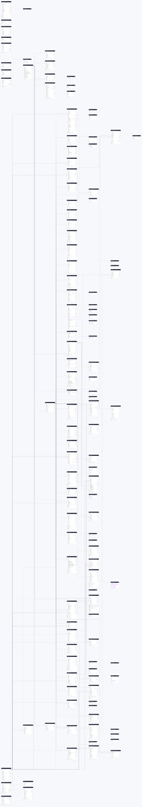

<details>
<summary>The whole schema as SQL</summary>

```sql
CREATE SCHEMA IF NOT EXISTS "public";

CREATE TYPE "ApiKeyScope" AS ENUM ('ORGANIZATION', 'PROJECT', 'USER');

CREATE TYPE "SystemRole" AS ENUM ('OWNER', 'ADMIN', 'MEMBER', 'VIEWER', 'NONE', 'LEGACY_PROJECT_API_KEY', 'LEGACY_ORGANIZATION_API_KEY', 'SCORES_INGEST', 'INGEST', 'AI_GATEWAY');

CREATE TYPE "GatewayIngestionMode" AS ENUM ('none', 'usage', 'full');

CREATE TYPE "GatewayProvider" AS ENUM ('openai', 'anthropic', 'bedrock', 'openrouter', 'xai', 'vercel', 'azure', 'google_ai_studio');

CREATE TYPE "GatewayConnectionStatus" AS ENUM ('enabled', 'disabled', 'error');

CREATE TYPE "InAppAgentConversationVisibilityScope" AS ENUM ('PERSONAL', 'PROJECT');

CREATE TYPE "Role" AS ENUM ('OWNER', 'ADMIN', 'MEMBER', 'VIEWER', 'NONE', 'AI_GATEWAY');

CREATE TYPE "ScoreConfigDataType" AS ENUM ('CATEGORICAL', 'NUMERIC', 'BOOLEAN', 'TEXT');

CREATE TYPE "AnnotationQueueStatus" AS ENUM ('PENDING', 'COMPLETED');

CREATE TYPE "AnnotationQueueObjectType" AS ENUM ('TRACE', 'OBSERVATION', 'SESSION');

CREATE TYPE "DatasetStatus" AS ENUM ('ACTIVE', 'ARCHIVED');

CREATE TYPE "CommentObjectType" AS ENUM ('TRACE', 'OBSERVATION', 'SESSION', 'PROMPT');

CREATE TYPE "NotificationChannel" AS ENUM ('EMAIL');

CREATE TYPE "NotificationType" AS ENUM ('COMMENT_MENTION');

CREATE TYPE "AuditLogRecordType" AS ENUM ('USER', 'API_KEY');

CREATE TYPE "EvalTemplateType" AS ENUM ('LLM_AS_JUDGE', 'CODE', 'DECISION_MODEL', 'FACET');

CREATE TYPE "EvalTemplateSourceCodeLanguage" AS ENUM ('PYTHON', 'TYPESCRIPT');

CREATE TYPE "EvaluatorSourceCodeLanguage" AS ENUM ('PYTHON', 'TYPESCRIPT');

CREATE TYPE "JobType" AS ENUM ('EVAL');

CREATE TYPE "JobConfigState" AS ENUM ('ACTIVE', 'INACTIVE');

CREATE TYPE "EvaluatorBlockReason" AS ENUM ('LLM_CONNECTION_AUTH_INVALID', 'LLM_CONNECTION_BILLING_EXHAUSTED', 'LLM_CONNECTION_ENDPOINT_UNREACHABLE', 'LLM_CONNECTION_MISSING', 'DEFAULT_EVAL_MODEL_MISSING', 'EVAL_MODEL_CONFIG_INVALID', 'EVAL_MODEL_UNAVAILABLE', 'PROVIDER_ACCOUNT_NOT_READY');

CREATE TYPE "JobExecutionStatus" AS ENUM ('COMPLETED', 'ERROR', 'PENDING', 'CANCELLED', 'DELAYED');

CREATE TYPE "BlobStorageIntegrationFileType" AS ENUM ('JSON', 'CSV', 'JSONL', 'PARQUET');

CREATE TYPE "BlobStorageIntegrationType" AS ENUM ('S3', 'S3_COMPATIBLE', 'AZURE_BLOB_STORAGE', 'GOOGLE_CLOUD_STORAGE');

CREATE TYPE "ExternalMediaStorageIntegrationType" AS ENUM ('S3', 'S3_COMPATIBLE');

CREATE TYPE "StorageIntegrationAuthType" AS ENUM ('ACCESS_KEYS', 'ROLE_ARN');

CREATE TYPE "BlobStorageExportMode" AS ENUM ('FULL_HISTORY', 'FROM_TODAY', 'FROM_CUSTOM_DATE');

CREATE TYPE "AnalyticsIntegrationExportSource" AS ENUM ('TRACES_OBSERVATIONS', 'TRACES_OBSERVATIONS_EVENTS', 'EVENTS');

CREATE TYPE "MediaAssociationOrigin" AS ENUM ('UNKNOWN', 'CLIENT_UPLOAD', 'INGESTION_MEDIA_EXTRACTION', 'INGESTION_FIELD_OVERFLOW');

CREATE TYPE "DashboardWidgetViews" AS ENUM ('TRACES', 'OBSERVATIONS', 'SCORES_NUMERIC', 'SCORES_CATEGORICAL', 'SCORES_BOOLEAN');

CREATE TYPE "DashboardWidgetChartType" AS ENUM ('LINE_TIME_SERIES', 'AREA_TIME_SERIES', 'BAR_TIME_SERIES', 'HORIZONTAL_BAR', 'VERTICAL_BAR', 'PIE', 'NUMBER', 'HISTOGRAM', 'PIVOT_TABLE');

CREATE TYPE "ActionType" AS ENUM ('WEBHOOK', 'SLACK', 'GITHUB_DISPATCH', 'PAGERDUTY');

CREATE TYPE "ActionExecutionStatus" AS ENUM ('COMPLETED', 'ERROR', 'PENDING', 'CANCELLED');

CREATE TYPE "MonitorThresholdOperator" AS ENUM ('GT', 'GTE', 'LT', 'LTE', 'EQ', 'NEQ');

CREATE TYPE "MonitorView" AS ENUM ('OBSERVATIONS', 'SCORES_NUMERIC', 'SCORES_CATEGORICAL', 'SCORES_BOOLEAN');

CREATE TYPE "MonitorSeverity" AS ENUM ('PAUSED', 'UNKNOWN', 'NO_DATA', 'OK', 'WARNING', 'ALERT');

CREATE TYPE "MonitorStatus" AS ENUM ('PAUSED', 'ACTIVE', 'ERROR_BAD_QUERY');

CREATE TYPE "SurveyName" AS ENUM ('org_onboarding', 'user_onboarding');

CREATE TABLE "Account" (
    "id" TEXT NOT NULL,
    "user_id" TEXT NOT NULL,
    "type" TEXT NOT NULL,
    "provider" TEXT NOT NULL,
    "providerAccountId" TEXT NOT NULL,
    "refresh_token" TEXT,
    "access_token" TEXT,
    "expires_at" INTEGER,
    "expires_in" INTEGER,
    "ext_expires_in" INTEGER,
    "token_type" TEXT,
    "scope" TEXT,
    "id_token" TEXT,
    "session_state" TEXT,
    "refresh_token_expires_in" INTEGER,
    "created_at" INTEGER,

    CONSTRAINT "Account_pkey" PRIMARY KEY ("id")
);

CREATE TABLE "Session" (
    "id" TEXT NOT NULL,
    "session_token" TEXT NOT NULL,
    "user_id" TEXT NOT NULL,
    "expires" TIMESTAMP(3) NOT NULL,

    CONSTRAINT "Session_pkey" PRIMARY KEY ("id")
);

CREATE TABLE "users" (
    "id" TEXT NOT NULL,
    "name" TEXT,
    "email" TEXT,
    "email_verified" TIMESTAMP(3),
    "password" TEXT,
    "sessions_expired_at" TIMESTAMP(3),
    "image" TEXT,
    "admin" BOOLEAN NOT NULL DEFAULT false,
    "v4_beta_enabled" BOOLEAN NOT NULL DEFAULT false,
    "support_access" JSONB,
    "created_at" TIMESTAMP(3) NOT NULL DEFAULT CURRENT_TIMESTAMP,
    "updated_at" TIMESTAMP(3) NOT NULL DEFAULT CURRENT_TIMESTAMP,
    "feature_flags" TEXT[] DEFAULT ARRAY[]::TEXT[],

    CONSTRAINT "users_pkey" PRIMARY KEY ("id")
);

CREATE TABLE "verification_tokens" (
    "identifier" TEXT NOT NULL,
    "token" TEXT NOT NULL,
    "expires" TIMESTAMP(3) NOT NULL
);

CREATE TABLE "organizations" (
    "id" TEXT NOT NULL,
    "name" TEXT NOT NULL,
    "created_at" TIMESTAMP(3) NOT NULL DEFAULT CURRENT_TIMESTAMP,
    "updated_at" TIMESTAMP(3) NOT NULL DEFAULT CURRENT_TIMESTAMP,
    "cloud_config" JSONB,
    "metadata" JSONB,
    "cloud_billing_cycle_anchor" TIMESTAMP(3) DEFAULT CURRENT_TIMESTAMP,
    "cloud_billing_cycle_updated_at" TIMESTAMP(3),
    "cloud_current_cycle_usage" INTEGER,
    "cloud_free_tier_usage_threshold_state" TEXT,
    "ai_features_enabled" BOOLEAN NOT NULL DEFAULT false,
    "ai_telemetry_enabled" BOOLEAN NOT NULL DEFAULT true,
    "access_audit_log_enabled" BOOLEAN NOT NULL DEFAULT false,
    "feature_flag_org_defaults" TEXT[] DEFAULT ARRAY[]::TEXT[],
    "sfdc_org_id" TEXT,

    CONSTRAINT "organizations_pkey" PRIMARY KEY ("id")
);

CREATE TABLE "projects" (
    "id" TEXT NOT NULL,
    "org_id" TEXT NOT NULL,
    "created_at" TIMESTAMP(3) NOT NULL DEFAULT CURRENT_TIMESTAMP,
    "updated_at" TIMESTAMP(3) NOT NULL DEFAULT CURRENT_TIMESTAMP,
    "deleted_at" TIMESTAMP(3),
    "name" TEXT NOT NULL,
    "retention_days" INTEGER,
    "has_traces" BOOLEAN NOT NULL DEFAULT false,
    "metadata" JSONB,
    "home_dashboard_id" TEXT,

    CONSTRAINT "projects_pkey" PRIMARY KEY ("id")
);

CREATE TABLE "api_keys" (
    "id" TEXT NOT NULL,
    "created_at" TIMESTAMP(3) NOT NULL DEFAULT CURRENT_TIMESTAMP,
    "note" TEXT,
    "public_key" TEXT NOT NULL,
    "hashed_secret_key" TEXT NOT NULL,
    "fast_hashed_secret_key" TEXT,
    "display_secret_key" TEXT NOT NULL,
    "last_used_at" TIMESTAMP(3),
    "expires_at" TIMESTAMP(3),
    "is_in_app_agent_key" BOOLEAN NOT NULL DEFAULT false,
    "project_id" TEXT,
    "organization_id" TEXT,
    "scope" "ApiKeyScope" NOT NULL DEFAULT 'PROJECT',
    "created_by_user_id" TEXT,
    "user_id" TEXT,
    "created_by_api_key_id" TEXT,

    CONSTRAINT "api_keys_pkey" PRIMARY KEY ("id")
);

CREATE TABLE "role_assignments" (
    "id" TEXT NOT NULL,
    "owner_id" TEXT NOT NULL,
    "project_id" TEXT,
    "org_id" TEXT NOT NULL,
    "principal_id" TEXT NOT NULL,
    "user_id" TEXT,
    "api_key_id" TEXT,
    "role_id" TEXT NOT NULL,
    "system_role" "SystemRole" NOT NULL,
    "created_at" TIMESTAMP(3) NOT NULL DEFAULT CURRENT_TIMESTAMP,
    "updated_at" TIMESTAMP(3) NOT NULL DEFAULT CURRENT_TIMESTAMP,
    "owner_org_id" TEXT,
    "owner_project_id" TEXT,
    "principal_user_id" TEXT,
    "principal_api_key_id" TEXT,

    CONSTRAINT "role_assignments_pkey" PRIMARY KEY ("id")
);

CREATE TABLE "gateway_configs" (
    "organization_id" TEXT NOT NULL,
    "default_ingestion_project_id" TEXT,
    "ingestion_mode" "GatewayIngestionMode" NOT NULL DEFAULT 'usage',
    "created_at" TIMESTAMP(3) NOT NULL DEFAULT CURRENT_TIMESTAMP,
    "updated_at" TIMESTAMP(3) NOT NULL DEFAULT CURRENT_TIMESTAMP,

    CONSTRAINT "gateway_configs_pkey" PRIMARY KEY ("organization_id")
);

CREATE TABLE "gateway_ai_connections" (
    "id" TEXT NOT NULL,
    "organization_id" TEXT NOT NULL,
    "name" TEXT NOT NULL,
    "provider" "GatewayProvider" NOT NULL,
    "encrypted_credentials" TEXT NOT NULL,
    "display_secret_key" TEXT NOT NULL,
    "created_by_id" TEXT,
    "status" "GatewayConnectionStatus" NOT NULL DEFAULT 'enabled',
    "allowed_models" JSONB,
    "custom_models" JSONB NOT NULL DEFAULT '[]',
    "config" JSONB,
    "base_url" TEXT,
    "extra_headers" TEXT,
    "extra_header_keys" TEXT[] DEFAULT ARRAY[]::TEXT[],
    "created_at" TIMESTAMP(3) NOT NULL DEFAULT CURRENT_TIMESTAMP,
    "updated_at" TIMESTAMP(3) NOT NULL DEFAULT CURRENT_TIMESTAMP,

    CONSTRAINT "gateway_ai_connections_pkey" PRIMARY KEY ("id")
);

CREATE TABLE "gateway_api_key_associations" (
    "api_key_id" TEXT NOT NULL,
    "metadata" JSONB NOT NULL DEFAULT '{}',

    CONSTRAINT "gateway_api_key_associations_pkey" PRIMARY KEY ("api_key_id")
);

CREATE TABLE "in_app_agent_conversations" (
    "id" TEXT NOT NULL,
    "project_id" TEXT NOT NULL,
    "created_by_user_id" TEXT,
    "title" TEXT,
    "renamed_by_user_at" TIMESTAMP(3),
    "visibility_scope" "InAppAgentConversationVisibilityScope" NOT NULL DEFAULT 'PERSONAL',
    "provider_session_id" TEXT,
    "always_allowed_tools" TEXT[] DEFAULT ARRAY[]::TEXT[],
    "deleted_at" TIMESTAMP(3),
    "created_at" TIMESTAMP(3) NOT NULL DEFAULT CURRENT_TIMESTAMP,
    "updated_at" TIMESTAMP(3) NOT NULL DEFAULT CURRENT_TIMESTAMP,

    CONSTRAINT "in_app_agent_conversations_pkey" PRIMARY KEY ("id","project_id")
);

CREATE TABLE "in_app_agent_events" (
    "project_id" TEXT NOT NULL,
    "conversation_id" TEXT NOT NULL,
    "run_id" TEXT NOT NULL,
    "sequence_number" INTEGER NOT NULL,
    "type" TEXT NOT NULL,
    "event" JSONB NOT NULL,
    "created_at" TIMESTAMP(3) NOT NULL DEFAULT CURRENT_TIMESTAMP,

    CONSTRAINT "in_app_agent_events_pkey" PRIMARY KEY ("project_id","conversation_id","sequence_number")
);

CREATE TABLE "in_app_agent_runs" (
    "id" TEXT NOT NULL,
    "project_id" TEXT NOT NULL,
    "conversation_id" TEXT NOT NULL,
    "triggered_by_user_id" TEXT,
    "model" TEXT,
    "mcp_api_key_id" TEXT,
    "error_code" TEXT,
    "error_message" TEXT,
    "finished_at" TIMESTAMP(3),
    "status" TEXT,
    "request" JSONB,
    "claimed_at" TIMESTAMP(3),
    "heartbeat_at" TIMESTAMP(3),
    "cancel_requested_at" TIMESTAMP(3),
    "created_at" TIMESTAMP(3) NOT NULL DEFAULT CURRENT_TIMESTAMP,
    "updated_at" TIMESTAMP(3) NOT NULL DEFAULT CURRENT_TIMESTAMP,

    CONSTRAINT "in_app_agent_runs_pkey" PRIMARY KEY ("id","project_id")
);

CREATE TABLE "in_app_agent_pending_tool_approvals" (
    "project_id" TEXT NOT NULL,
    "conversation_id" TEXT NOT NULL,
    "tool_call_id" TEXT NOT NULL,
    "approval_fingerprint" TEXT NOT NULL,
    "expires_at" TIMESTAMP(3) NOT NULL,
    "created_at" TIMESTAMP(3) NOT NULL DEFAULT CURRENT_TIMESTAMP,
    "updated_at" TIMESTAMP(3) NOT NULL DEFAULT CURRENT_TIMESTAMP,

    CONSTRAINT "in_app_agent_pending_tool_approvals_pkey" PRIMARY KEY ("project_id","conversation_id","tool_call_id")
);

CREATE TABLE "background_migrations" (
    "id" TEXT NOT NULL,
    "name" TEXT NOT NULL,
    "script" TEXT NOT NULL,
    "args" JSONB NOT NULL,
    "state" JSONB NOT NULL DEFAULT '{}',
    "finished_at" TIMESTAMP(3),
    "failed_at" TIMESTAMP(3),
    "failed_reason" TEXT,
    "worker_id" TEXT,
    "locked_at" TIMESTAMP(3),

    CONSTRAINT "background_migrations_pkey" PRIMARY KEY ("id")
);

CREATE TABLE "llm_api_keys" (
    "id" TEXT NOT NULL,
    "created_at" TIMESTAMP(3) NOT NULL DEFAULT CURRENT_TIMESTAMP,
    "updated_at" TIMESTAMP(3) NOT NULL DEFAULT CURRENT_TIMESTAMP,
    "provider" TEXT NOT NULL,
    "adapter" TEXT NOT NULL,
    "display_secret_key" TEXT NOT NULL,
    "secret_key" TEXT NOT NULL,
    "base_url" TEXT,
    "custom_models" TEXT[] DEFAULT ARRAY[]::TEXT[],
    "with_default_models" BOOLEAN NOT NULL DEFAULT true,
    "extra_headers" TEXT,
    "extra_header_keys" TEXT[] DEFAULT ARRAY[]::TEXT[],
    "config" JSONB,
    "project_id" TEXT,
    "organization_id" TEXT,

    CONSTRAINT "llm_api_keys_pkey" PRIMARY KEY ("id")
);

CREATE TABLE "organization_memberships" (
    "id" TEXT NOT NULL,
    "org_id" TEXT NOT NULL,
    "user_id" TEXT NOT NULL,
    "role" "Role" NOT NULL,
    "created_at" TIMESTAMP(3) NOT NULL DEFAULT CURRENT_TIMESTAMP,
    "updated_at" TIMESTAMP(3) NOT NULL DEFAULT CURRENT_TIMESTAMP,

    CONSTRAINT "organization_memberships_pkey" PRIMARY KEY ("id")
);

CREATE TABLE "project_memberships" (
    "org_membership_id" TEXT NOT NULL,
    "project_id" TEXT NOT NULL,
    "user_id" TEXT NOT NULL,
    "role" "Role" NOT NULL,
    "created_at" TIMESTAMP(3) NOT NULL DEFAULT CURRENT_TIMESTAMP,
    "updated_at" TIMESTAMP(3) NOT NULL DEFAULT CURRENT_TIMESTAMP,

    CONSTRAINT "project_memberships_pkey" PRIMARY KEY ("project_id","user_id")
);

CREATE TABLE "membership_invitations" (
    "id" TEXT NOT NULL,
    "email" TEXT NOT NULL,
    "org_id" TEXT NOT NULL,
    "org_role" "Role" NOT NULL,
    "project_id" TEXT,
    "project_role" "Role",
    "invited_by_user_id" TEXT,
    "created_at" TIMESTAMP(3) NOT NULL DEFAULT CURRENT_TIMESTAMP,
    "updated_at" TIMESTAMP(3) NOT NULL DEFAULT CURRENT_TIMESTAMP,

    CONSTRAINT "membership_invitations_pkey" PRIMARY KEY ("id")
);

CREATE TABLE "trace_sessions" (
    "id" TEXT NOT NULL,
    "created_at" TIMESTAMP(3) NOT NULL DEFAULT CURRENT_TIMESTAMP,
    "updated_at" TIMESTAMP(3) NOT NULL DEFAULT CURRENT_TIMESTAMP,
    "project_id" TEXT NOT NULL,
    "bookmarked" BOOLEAN NOT NULL DEFAULT false,
    "public" BOOLEAN NOT NULL DEFAULT false,
    "environment" TEXT NOT NULL DEFAULT 'default',

    CONSTRAINT "trace_sessions_pkey" PRIMARY KEY ("id","project_id")
);

CREATE TABLE "score_configs" (
    "id" TEXT NOT NULL,
    "created_at" TIMESTAMP(3) NOT NULL DEFAULT CURRENT_TIMESTAMP,
    "updated_at" TIMESTAMP(3) NOT NULL DEFAULT CURRENT_TIMESTAMP,
    "project_id" TEXT NOT NULL,
    "name" TEXT NOT NULL,
    "data_type" "ScoreConfigDataType" NOT NULL,
    "is_archived" BOOLEAN NOT NULL DEFAULT false,
    "min_value" DOUBLE PRECISION,
    "max_value" DOUBLE PRECISION,
    "categories" JSONB,
    "description" TEXT,

    CONSTRAINT "score_configs_pkey" PRIMARY KEY ("id")
);

CREATE TABLE "annotation_queues" (
    "id" TEXT NOT NULL,
    "name" TEXT NOT NULL,
    "description" TEXT,
    "score_config_ids" TEXT[] DEFAULT ARRAY[]::TEXT[],
    "project_id" TEXT NOT NULL,
    "created_at" TIMESTAMP(3) NOT NULL DEFAULT CURRENT_TIMESTAMP,
    "updated_at" TIMESTAMP(3) NOT NULL DEFAULT CURRENT_TIMESTAMP,

    CONSTRAINT "annotation_queues_pkey" PRIMARY KEY ("id")
);

CREATE TABLE "annotation_queue_items" (
    "id" TEXT NOT NULL,
    "queue_id" TEXT NOT NULL,
    "object_id" TEXT NOT NULL,
    "object_type" "AnnotationQueueObjectType" NOT NULL,
    "status" "AnnotationQueueStatus" NOT NULL DEFAULT 'PENDING',
    "locked_at" TIMESTAMP(3),
    "locked_by_user_id" TEXT,
    "annotator_user_id" TEXT,
    "completed_at" TIMESTAMP(3),
    "project_id" TEXT NOT NULL,
    "created_at" TIMESTAMP(3) NOT NULL DEFAULT CURRENT_TIMESTAMP,
    "updated_at" TIMESTAMP(3) NOT NULL DEFAULT CURRENT_TIMESTAMP,

    CONSTRAINT "annotation_queue_items_pkey" PRIMARY KEY ("id")
);

CREATE TABLE "annotation_queue_assignments" (
    "id" TEXT NOT NULL,
    "project_id" TEXT NOT NULL,
    "user_id" TEXT NOT NULL,
    "queue_id" TEXT NOT NULL,
    "created_at" TIMESTAMP(3) NOT NULL DEFAULT CURRENT_TIMESTAMP,
    "updated_at" TIMESTAMP(3) NOT NULL DEFAULT CURRENT_TIMESTAMP,

    CONSTRAINT "annotation_queue_assignments_pkey" PRIMARY KEY ("id")
);

CREATE TABLE "cron_jobs" (
    "name" TEXT NOT NULL,
    "last_run" TIMESTAMP(3),
    "job_started_at" TIMESTAMP(3),
    "state" TEXT,

    CONSTRAINT "cron_jobs_pkey" PRIMARY KEY ("name")
);

CREATE TABLE "datasets" (
    "id" TEXT NOT NULL,
    "project_id" TEXT NOT NULL,
    "name" TEXT NOT NULL,
    "description" TEXT,
    "metadata" JSONB,
    "remote_experiment_url" TEXT,
    "remote_experiment_payload" JSONB,
    "remote_experiment_enabled" BOOLEAN NOT NULL DEFAULT true,
    "remote_experiment_secret_key" TEXT,
    "remote_experiment_display_secret_key" TEXT,
    "remote_experiment_request_headers" JSONB,
    "remote_experiment_display_headers" JSONB,
    "input_schema" JSON,
    "expected_output_schema" JSON,
    "created_at" TIMESTAMP(3) NOT NULL DEFAULT CURRENT_TIMESTAMP,
    "updated_at" TIMESTAMP(3) NOT NULL DEFAULT CURRENT_TIMESTAMP,

    CONSTRAINT "datasets_pkey" PRIMARY KEY ("id","project_id")
);

CREATE TABLE "dataset_items" (
    "id" TEXT NOT NULL,
    "project_id" TEXT NOT NULL,
    "status" "DatasetStatus" DEFAULT 'ACTIVE',
    "input" JSONB,
    "expected_output" JSONB,
    "metadata" JSONB,
    "source_trace_id" TEXT,
    "source_observation_id" TEXT,
    "dataset_id" TEXT NOT NULL,
    "created_at" TIMESTAMP(3) NOT NULL DEFAULT CURRENT_TIMESTAMP,
    "updated_at" TIMESTAMP(3) NOT NULL DEFAULT CURRENT_TIMESTAMP,
    "valid_from" TIMESTAMP(3) NOT NULL DEFAULT CURRENT_TIMESTAMP,
    "valid_to" TIMESTAMP(3),
    "is_deleted" BOOLEAN NOT NULL DEFAULT false,

    CONSTRAINT "dataset_items_pkey" PRIMARY KEY ("id","project_id","valid_from")
);

CREATE TABLE "dataset_runs" (
    "id" TEXT NOT NULL,
    "project_id" TEXT NOT NULL,
    "name" TEXT NOT NULL,
    "description" TEXT,
    "metadata" JSONB,
    "dataset_id" TEXT NOT NULL,
    "created_at" TIMESTAMP(3) NOT NULL DEFAULT CURRENT_TIMESTAMP,
    "updated_at" TIMESTAMP(3) NOT NULL DEFAULT CURRENT_TIMESTAMP,

    CONSTRAINT "dataset_runs_pkey" PRIMARY KEY ("id","project_id")
);

CREATE TABLE "comments" (
    "id" TEXT NOT NULL,
    "project_id" TEXT NOT NULL,
    "object_type" "CommentObjectType" NOT NULL,
    "object_id" TEXT NOT NULL,
    "created_at" TIMESTAMP(3) NOT NULL DEFAULT CURRENT_TIMESTAMP,
    "updated_at" TIMESTAMP(3) NOT NULL DEFAULT CURRENT_TIMESTAMP,
    "content" TEXT NOT NULL,
    "author_user_id" TEXT,
    "data_field" TEXT,
    "path" TEXT[] DEFAULT ARRAY[]::TEXT[],
    "range_start" INTEGER[] DEFAULT ARRAY[]::INTEGER[],
    "range_end" INTEGER[] DEFAULT ARRAY[]::INTEGER[],

    CONSTRAINT "comments_pkey" PRIMARY KEY ("id")
);

CREATE TABLE "comment_reactions" (
    "id" TEXT NOT NULL,
    "project_id" TEXT NOT NULL,
    "comment_id" TEXT NOT NULL,
    "user_id" TEXT NOT NULL,
    "emoji" TEXT NOT NULL,
    "created_at" TIMESTAMP(3) NOT NULL DEFAULT CURRENT_TIMESTAMP,

    CONSTRAINT "comment_reactions_pkey" PRIMARY KEY ("id")
);

CREATE TABLE "notification_preferences" (
    "id" TEXT NOT NULL,
    "user_id" TEXT NOT NULL,
    "project_id" TEXT NOT NULL,
    "channel" "NotificationChannel" NOT NULL,
    "type" "NotificationType" NOT NULL,
    "enabled" BOOLEAN NOT NULL DEFAULT true,
    "created_at" TIMESTAMP(3) NOT NULL DEFAULT CURRENT_TIMESTAMP,
    "updated_at" TIMESTAMP(3) NOT NULL DEFAULT CURRENT_TIMESTAMP,

    CONSTRAINT "notification_preferences_pkey" PRIMARY KEY ("id")
);

CREATE TABLE "prompts" (
    "id" TEXT NOT NULL,
    "created_at" TIMESTAMP(3) NOT NULL DEFAULT CURRENT_TIMESTAMP,
    "updated_at" TIMESTAMP(3) NOT NULL DEFAULT CURRENT_TIMESTAMP,
    "project_id" TEXT NOT NULL,
    "created_by" TEXT NOT NULL,
    "prompt" JSONB NOT NULL,
    "name" TEXT NOT NULL,
    "version" INTEGER NOT NULL,
    "type" TEXT NOT NULL DEFAULT 'text',
    "is_active" BOOLEAN,
    "config" JSON NOT NULL DEFAULT '{}',
    "tags" TEXT[] DEFAULT ARRAY[]::TEXT[],
    "labels" TEXT[] DEFAULT ARRAY[]::TEXT[],
    "commit_message" TEXT,

    CONSTRAINT "prompts_pkey" PRIMARY KEY ("id")
);

CREATE TABLE "prompt_dependencies" (
    "id" TEXT NOT NULL,
    "created_at" TIMESTAMP(3) NOT NULL DEFAULT CURRENT_TIMESTAMP,
    "updated_at" TIMESTAMP(3) NOT NULL DEFAULT CURRENT_TIMESTAMP,
    "project_id" TEXT NOT NULL,
    "parent_id" TEXT NOT NULL,
    "child_name" TEXT NOT NULL,
    "child_label" TEXT,
    "child_version" INTEGER,

    CONSTRAINT "prompt_dependencies_pkey" PRIMARY KEY ("id")
);

CREATE TABLE "prompt_protected_labels" (
    "id" TEXT NOT NULL,
    "created_at" TIMESTAMP(3) NOT NULL DEFAULT CURRENT_TIMESTAMP,
    "updated_at" TIMESTAMP(3) NOT NULL DEFAULT CURRENT_TIMESTAMP,
    "project_id" TEXT NOT NULL,
    "label" TEXT NOT NULL,

    CONSTRAINT "prompt_protected_labels_pkey" PRIMARY KEY ("id")
);

CREATE TABLE "skills" (
    "id" TEXT NOT NULL,
    "created_at" TIMESTAMP(3) NOT NULL DEFAULT CURRENT_TIMESTAMP,
    "updated_at" TIMESTAMP(3) NOT NULL DEFAULT CURRENT_TIMESTAMP,
    "project_id" TEXT NOT NULL,
    "created_by" TEXT NOT NULL,
    "name" TEXT NOT NULL,
    "description" TEXT NOT NULL,
    "frontmatter" JSONB NOT NULL DEFAULT '{}',
    "version" INTEGER NOT NULL,
    "tags" TEXT[] DEFAULT ARRAY[]::TEXT[],
    "labels" TEXT[] DEFAULT ARRAY[]::TEXT[],
    "commit_message" TEXT,

    CONSTRAINT "skills_pkey" PRIMARY KEY ("id")
);

CREATE TABLE "skill_files" (
    "id" TEXT NOT NULL,
    "created_at" TIMESTAMP(3) NOT NULL DEFAULT CURRENT_TIMESTAMP,
    "project_id" TEXT NOT NULL,
    "skill_id" TEXT NOT NULL,
    "blob_id" TEXT NOT NULL,
    "path" TEXT NOT NULL,

    CONSTRAINT "skill_files_pkey" PRIMARY KEY ("id")
);

CREATE TABLE "skill_blobs" (
    "id" TEXT NOT NULL,
    "created_at" TIMESTAMP(3) NOT NULL DEFAULT CURRENT_TIMESTAMP,
    "project_id" TEXT NOT NULL,
    "sha_256_hash" CHAR(44) NOT NULL,
    "content_type" TEXT NOT NULL,
    "content_length" INTEGER NOT NULL,
    "content" TEXT NOT NULL,

    CONSTRAINT "skill_blobs_pkey" PRIMARY KEY ("id")
);

CREATE TABLE "models" (
    "id" TEXT NOT NULL,
    "created_at" TIMESTAMP(3) NOT NULL DEFAULT CURRENT_TIMESTAMP,
    "updated_at" TIMESTAMP(3) NOT NULL DEFAULT CURRENT_TIMESTAMP,
    "project_id" TEXT,
    "model_name" TEXT NOT NULL,
    "match_pattern" TEXT NOT NULL,
    "start_date" TIMESTAMP(3),
    "input_price" DECIMAL(65,30),
    "output_price" DECIMAL(65,30),
    "total_price" DECIMAL(65,30),
    "unit" TEXT,
    "tokenizer_id" TEXT,
    "tokenizer_config" JSONB,

    CONSTRAINT "models_pkey" PRIMARY KEY ("id")
);

CREATE TABLE "prices" (
    "id" TEXT NOT NULL,
    "created_at" TIMESTAMP(3) NOT NULL DEFAULT CURRENT_TIMESTAMP,
    "updated_at" TIMESTAMP(3) NOT NULL DEFAULT CURRENT_TIMESTAMP,
    "model_id" TEXT NOT NULL,
    "project_id" TEXT,
    "pricing_tier_id" TEXT NOT NULL,
    "usage_type" TEXT NOT NULL,
    "price" DECIMAL(65,30) NOT NULL,

    CONSTRAINT "prices_pkey" PRIMARY KEY ("id")
);

CREATE TABLE "pricing_tiers" (
    "id" TEXT NOT NULL,
    "created_at" TIMESTAMP(3) NOT NULL DEFAULT CURRENT_TIMESTAMP,
    "updated_at" TIMESTAMP(3) NOT NULL DEFAULT CURRENT_TIMESTAMP,
    "model_id" TEXT NOT NULL,
    "name" TEXT NOT NULL,
    "is_default" BOOLEAN NOT NULL DEFAULT false,
    "priority" INTEGER NOT NULL,
    "conditions" JSONB NOT NULL,

    CONSTRAINT "pricing_tiers_pkey" PRIMARY KEY ("id")
);

CREATE TABLE "audit_logs" (
    "id" TEXT NOT NULL,
    "created_at" TIMESTAMP(3) NOT NULL DEFAULT CURRENT_TIMESTAMP,
    "updated_at" TIMESTAMP(3) NOT NULL DEFAULT CURRENT_TIMESTAMP,
    "type" "AuditLogRecordType" NOT NULL DEFAULT 'USER',
    "api_key_id" TEXT,
    "user_id" TEXT,
    "org_id" TEXT NOT NULL,
    "user_org_role" TEXT,
    "project_id" TEXT,
    "user_project_role" TEXT,
    "resource_type" TEXT NOT NULL,
    "resource_id" TEXT NOT NULL,
    "action" TEXT NOT NULL,
    "before" TEXT,
    "after" TEXT,

    CONSTRAINT "audit_logs_pkey" PRIMARY KEY ("id")
);

CREATE TABLE "audit_log_staging" (
    "id" UUID NOT NULL,
    "created_at" TIMESTAMP(3) NOT NULL DEFAULT CURRENT_TIMESTAMP,
    "payload" JSONB NOT NULL,
    "failed_at" TIMESTAMP(3),
    "last_error" TEXT,

    CONSTRAINT "audit_log_staging_pkey" PRIMARY KEY ("id")
);

CREATE TABLE "eval_templates" (
    "id" TEXT NOT NULL,
    "created_at" TIMESTAMP(3) NOT NULL DEFAULT CURRENT_TIMESTAMP,
    "updated_at" TIMESTAMP(3) NOT NULL DEFAULT CURRENT_TIMESTAMP,
    "project_id" TEXT,
    "name" TEXT NOT NULL,
    "version" INTEGER NOT NULL,
    "prompt" TEXT,
    "type" "EvalTemplateType" NOT NULL DEFAULT 'LLM_AS_JUDGE',
    "partner" TEXT,
    "model" TEXT,
    "provider" TEXT,
    "model_params" JSONB,
    "vars" TEXT[] DEFAULT ARRAY[]::TEXT[],
    "output_schema" JSONB,
    "source_code" VARCHAR(262144),
    "source_code_language" "EvalTemplateSourceCodeLanguage",

    CONSTRAINT "eval_templates_pkey" PRIMARY KEY ("id")
);

CREATE TABLE "evaluators" (
    "id" TEXT NOT NULL,
    "created_at" TIMESTAMP(3) NOT NULL DEFAULT CURRENT_TIMESTAMP,
    "updated_at" TIMESTAMP(3) NOT NULL DEFAULT CURRENT_TIMESTAMP,
    "project_id" TEXT NOT NULL,
    "name" TEXT NOT NULL,
    "type" "EvalTemplateType" NOT NULL,
    "is_built_in" BOOLEAN NOT NULL DEFAULT false,
    "description" TEXT,
    "created_by_user_id" TEXT,
    "blocked_at" TIMESTAMP(3),
    "block_reason" "EvaluatorBlockReason",
    "block_message" TEXT,

    CONSTRAINT "evaluators_pkey" PRIMARY KEY ("id")
);

CREATE TABLE "evaluator_versions" (
    "id" TEXT NOT NULL,
    "created_at" TIMESTAMP(3) NOT NULL DEFAULT CURRENT_TIMESTAMP,
    "evaluator_id" TEXT NOT NULL,
    "version" INTEGER NOT NULL,
    "created_by_user_id" TEXT,
    "prompt" TEXT,
    "prompt_messages" JSONB,
    "partner" TEXT,
    "model" TEXT,
    "provider" TEXT,
    "model_params" JSONB,
    "vars" TEXT[] DEFAULT ARRAY[]::TEXT[],
    "variable_mapping" JSONB,
    "output_definition" JSONB,
    "source_code" VARCHAR(262144),
    "source_code_language" "EvaluatorSourceCodeLanguage",
    "questions" JSONB,

    CONSTRAINT "evaluator_versions_pkey" PRIMARY KEY ("id")
);

CREATE TABLE "job_configurations" (
    "id" TEXT NOT NULL,
    "created_at" TIMESTAMP(3) NOT NULL DEFAULT CURRENT_TIMESTAMP,
    "updated_at" TIMESTAMP(3) NOT NULL DEFAULT CURRENT_TIMESTAMP,
    "project_id" TEXT NOT NULL,
    "job_type" "JobType" NOT NULL,
    "status" "JobConfigState" NOT NULL DEFAULT 'ACTIVE',
    "blocked_at" TIMESTAMP(3),
    "block_reason" "EvaluatorBlockReason",
    "block_message" TEXT,
    "eval_template_id" TEXT,
    "score_name" TEXT NOT NULL,
    "filter" JSONB NOT NULL,
    "target_object" TEXT NOT NULL,
    "variable_mapping" JSONB NOT NULL,
    "sampling" DECIMAL(65,30) NOT NULL,
    "delay" INTEGER NOT NULL,
    "time_scope" TEXT[] DEFAULT ARRAY['NEW']::TEXT[],

    CONSTRAINT "job_configurations_pkey" PRIMARY KEY ("id")
);

CREATE TABLE "evaluation_rules" (
    "id" TEXT NOT NULL,
    "created_at" TIMESTAMP(3) NOT NULL DEFAULT CURRENT_TIMESTAMP,
    "updated_at" TIMESTAMP(3) NOT NULL DEFAULT CURRENT_TIMESTAMP,
    "project_id" TEXT NOT NULL,
    "created_by_user_id" TEXT,
    "name" TEXT NOT NULL,
    "status" "JobConfigState" NOT NULL DEFAULT 'ACTIVE',
    "target_object" TEXT NOT NULL,
    "filter" JSONB NOT NULL,
    "sampling" DECIMAL(65,30) NOT NULL,
    "delay" INTEGER NOT NULL,
    "idle_time" INTEGER,
    "time_scope" TEXT[] DEFAULT ARRAY['NEW']::TEXT[],

    CONSTRAINT "evaluation_rules_pkey" PRIMARY KEY ("id")
);

CREATE TABLE "tracing_readiness_settings" (
    "project_id" TEXT NOT NULL,
    "created_at" TIMESTAMP(3) NOT NULL DEFAULT CURRENT_TIMESTAMP,
    "updated_at" TIMESTAMP(3) NOT NULL DEFAULT CURRENT_TIMESTAMP,
    "created_by" TEXT,
    "updated_by" TEXT,
    "trace_idle_ms" INTEGER,

    CONSTRAINT "tracing_readiness_settings_pkey" PRIMARY KEY ("project_id")
);

CREATE TABLE "evaluation_rule_evaluator_assignments" (
    "id" TEXT NOT NULL,
    "created_at" TIMESTAMP(3) NOT NULL DEFAULT CURRENT_TIMESTAMP,
    "updated_at" TIMESTAMP(3) NOT NULL DEFAULT CURRENT_TIMESTAMP,
    "project_id" TEXT NOT NULL,
    "evaluation_rule_id" TEXT NOT NULL,
    "evaluator_id" TEXT NOT NULL,
    "variable_mapping" JSONB,

    CONSTRAINT "evaluation_rule_evaluator_assignments_pkey" PRIMARY KEY ("id")
);

CREATE TABLE "job_executions" (
    "id" TEXT NOT NULL,
    "created_at" TIMESTAMP(3) NOT NULL DEFAULT CURRENT_TIMESTAMP,
    "updated_at" TIMESTAMP(3) NOT NULL DEFAULT CURRENT_TIMESTAMP,
    "project_id" TEXT NOT NULL,
    "job_configuration_id" TEXT NOT NULL,
    "job_template_id" TEXT,
    "status" "JobExecutionStatus" NOT NULL,
    "start_time" TIMESTAMP(3),
    "end_time" TIMESTAMP(3),
    "error" TEXT,
    "job_input_trace_id" TEXT,
    "job_input_trace_timestamp" TIMESTAMP(3),
    "job_input_observation_id" TEXT,
    "job_input_dataset_item_id" TEXT,
    "job_input_dataset_item_valid_from" TIMESTAMP(3),
    "job_output_score_id" TEXT,
    "execution_trace_id" TEXT,

    CONSTRAINT "job_executions_pkey" PRIMARY KEY ("id")
);

CREATE TABLE "default_llm_models" (
    "id" TEXT NOT NULL,
    "created_at" TIMESTAMP(3) NOT NULL DEFAULT CURRENT_TIMESTAMP,
    "updated_at" TIMESTAMP(3) NOT NULL DEFAULT CURRENT_TIMESTAMP,
    "project_id" TEXT NOT NULL,
    "llm_api_key_id" TEXT NOT NULL,
    "provider" TEXT NOT NULL,
    "adapter" TEXT NOT NULL,
    "model" TEXT NOT NULL,
    "model_params" JSONB,

    CONSTRAINT "default_llm_models_pkey" PRIMARY KEY ("id")
);

CREATE TABLE "topic_configs" (
    "id" TEXT NOT NULL,
    "created_at" TIMESTAMP(3) NOT NULL DEFAULT CURRENT_TIMESTAMP,
    "updated_at" TIMESTAMP(3) NOT NULL DEFAULT CURRENT_TIMESTAMP,
    "created_by" TEXT,
    "updated_by" TEXT,
    "project_id" TEXT NOT NULL,
    "enabled" BOOLEAN NOT NULL DEFAULT false,
    "blocked_at" TIMESTAMP(3),
    "block_reason" "EvaluatorBlockReason",
    "block_message" TEXT,
    "summary_llm_api_key_id" TEXT,
    "summary_model" TEXT,
    "embedding_llm_api_key_id" TEXT,
    "embedding_model" TEXT,
    "embedding_dimensions" INTEGER NOT NULL DEFAULT 1024,
    "clustering_llm_api_key_id" TEXT,
    "clustering_model" TEXT,

    CONSTRAINT "topic_configs_pkey" PRIMARY KEY ("id")
);

CREATE TABLE "sso_configs" (
    "domain" TEXT NOT NULL,
    "created_at" TIMESTAMP(3) NOT NULL DEFAULT CURRENT_TIMESTAMP,
    "updated_at" TIMESTAMP(3) NOT NULL DEFAULT CURRENT_TIMESTAMP,
    "auth_provider" TEXT NOT NULL,
    "auth_config" JSONB,

    CONSTRAINT "sso_configs_pkey" PRIMARY KEY ("domain")
);

CREATE TABLE "verified_domains" (
    "id" TEXT NOT NULL,
    "organization_id" TEXT NOT NULL,
    "domain" TEXT NOT NULL,
    "verification_token" TEXT NOT NULL,
    "verified_at" TIMESTAMP(3),
    "created_by_user_id" TEXT,
    "created_at" TIMESTAMP(3) NOT NULL DEFAULT CURRENT_TIMESTAMP,
    "updated_at" TIMESTAMP(3) NOT NULL DEFAULT CURRENT_TIMESTAMP,

    CONSTRAINT "verified_domains_pkey" PRIMARY KEY ("id")
);

CREATE TABLE "posthog_integrations" (
    "project_id" TEXT NOT NULL,
    "encrypted_posthog_api_key" TEXT NOT NULL,
    "posthog_host_name" TEXT NOT NULL,
    "last_sync_at" TIMESTAMP(3),
    "enabled" BOOLEAN NOT NULL,
    "created_at" TIMESTAMP(3) NOT NULL DEFAULT CURRENT_TIMESTAMP,
    "export_source" "AnalyticsIntegrationExportSource" NOT NULL DEFAULT 'TRACES_OBSERVATIONS',
    "backfill" BOOLEAN NOT NULL DEFAULT true,
    "last_error" TEXT,
    "last_error_at" TIMESTAMP(3),

    CONSTRAINT "posthog_integrations_pkey" PRIMARY KEY ("project_id")
);

CREATE TABLE "mixpanel_integrations" (
    "project_id" TEXT NOT NULL,
    "encrypted_mixpanel_project_token" TEXT NOT NULL,
    "mixpanel_region" TEXT NOT NULL,
    "last_sync_at" TIMESTAMP(3),
    "enabled" BOOLEAN NOT NULL,
    "created_at" TIMESTAMP(3) NOT NULL DEFAULT CURRENT_TIMESTAMP,
    "export_source" "AnalyticsIntegrationExportSource" NOT NULL DEFAULT 'TRACES_OBSERVATIONS',
    "backfill" BOOLEAN NOT NULL DEFAULT true,

    CONSTRAINT "mixpanel_integrations_pkey" PRIMARY KEY ("project_id")
);

CREATE TABLE "blob_storage_integrations" (
    "project_id" TEXT NOT NULL,
    "type" "BlobStorageIntegrationType" NOT NULL,
    "bucket_name" TEXT NOT NULL,
    "prefix" TEXT NOT NULL,
    "auth_type" "StorageIntegrationAuthType" NOT NULL DEFAULT 'ACCESS_KEYS',
    "access_key_id" TEXT,
    "secret_access_key" TEXT,
    "role_arn" TEXT,
    "external_id" TEXT,
    "region" TEXT NOT NULL,
    "endpoint" TEXT,
    "force_path_style" BOOLEAN NOT NULL,
    "next_sync_at" TIMESTAMP(3),
    "last_sync_at" TIMESTAMP(3),
    "enabled" BOOLEAN NOT NULL,
    "export_frequency" TEXT NOT NULL,
    "file_type" "BlobStorageIntegrationFileType" NOT NULL DEFAULT 'CSV',
    "export_mode" "BlobStorageExportMode" NOT NULL DEFAULT 'FULL_HISTORY',
    "export_start_date" TIMESTAMP(3),
    "export_source" "AnalyticsIntegrationExportSource" NOT NULL DEFAULT 'TRACES_OBSERVATIONS',
    "export_field_groups" TEXT[] DEFAULT ARRAY['core', 'basic', 'time', 'io', 'metadata', 'model', 'usage', 'prompt', 'metrics', 'tools', 'trace_context']::TEXT[],
    "compressed" BOOLEAN NOT NULL DEFAULT true,
    "export_tuning" JSONB,
    "run_started_at" TIMESTAMP(3),
    "backfill" BOOLEAN NOT NULL DEFAULT true,
    "last_error" TEXT,
    "last_error_at" TIMESTAMP(3),
    "last_failure_notification_sent_at" TIMESTAMP(3),
    "created_at" TIMESTAMP(3) NOT NULL DEFAULT CURRENT_TIMESTAMP,
    "updated_at" TIMESTAMP(3) NOT NULL DEFAULT CURRENT_TIMESTAMP,

    CONSTRAINT "blob_storage_integrations_pkey" PRIMARY KEY ("project_id")
);

CREATE TABLE "external_media_storage_integrations" (
    "project_id" TEXT NOT NULL,
    "type" "ExternalMediaStorageIntegrationType" NOT NULL,
    "bucket_name" TEXT NOT NULL,
    "prefix" TEXT,
    "auth_type" "StorageIntegrationAuthType" NOT NULL DEFAULT 'ACCESS_KEYS',
    "access_key_id" TEXT,
    "secret_access_key" TEXT,
    "role_arn" TEXT,
    "external_id" TEXT,
    "region" TEXT NOT NULL,
    "endpoint" TEXT,
    "force_path_style" BOOLEAN NOT NULL,
    "created_at" TIMESTAMP(3) NOT NULL DEFAULT CURRENT_TIMESTAMP,
    "updated_at" TIMESTAMP(3) NOT NULL DEFAULT CURRENT_TIMESTAMP,

    CONSTRAINT "external_media_storage_integrations_pkey" PRIMARY KEY ("project_id")
);

CREATE TABLE "web_callout_endpoints" (
    "id" TEXT NOT NULL,
    "created_at" TIMESTAMP(3) NOT NULL DEFAULT CURRENT_TIMESTAMP,
    "updated_at" TIMESTAMP(3) NOT NULL DEFAULT CURRENT_TIMESTAMP,
    "project_id" TEXT NOT NULL,
    "name" TEXT NOT NULL DEFAULT 'Default',
    "url" TEXT NOT NULL,
    "enabled" BOOLEAN NOT NULL DEFAULT true,
    "toast_message" TEXT NOT NULL DEFAULT 'Callout sent',
    "request_headers" TEXT,
    "request_header_keys" TEXT[] DEFAULT ARRAY[]::TEXT[],

    CONSTRAINT "web_callout_endpoints_pkey" PRIMARY KEY ("id")
);

CREATE TABLE "batch_exports" (
    "id" TEXT NOT NULL,
    "created_at" TIMESTAMP(3) NOT NULL DEFAULT CURRENT_TIMESTAMP,
    "updated_at" TIMESTAMP(3) NOT NULL DEFAULT CURRENT_TIMESTAMP,
    "project_id" TEXT NOT NULL,
    "user_id" TEXT NOT NULL,
    "finished_at" TIMESTAMP(3),
    "expires_at" TIMESTAMP(3),
    "name" TEXT NOT NULL,
    "status" TEXT NOT NULL,
    "query" JSONB NOT NULL,
    "format" TEXT NOT NULL,
    "url" TEXT,
    "log" TEXT,

    CONSTRAINT "batch_exports_pkey" PRIMARY KEY ("id")
);

CREATE TABLE "batch_actions" (
    "id" TEXT NOT NULL,
    "created_at" TIMESTAMP(3) NOT NULL DEFAULT CURRENT_TIMESTAMP,
    "updated_at" TIMESTAMP(3) NOT NULL DEFAULT CURRENT_TIMESTAMP,
    "project_id" TEXT NOT NULL,
    "user_id" TEXT NOT NULL,
    "action_type" TEXT NOT NULL,
    "table_name" TEXT NOT NULL,
    "status" TEXT NOT NULL,
    "finished_at" TIMESTAMP(3),
    "query" JSONB NOT NULL,
    "config" JSONB,
    "total_count" INTEGER,
    "processed_count" INTEGER,
    "failed_count" INTEGER,
    "log" TEXT,

    CONSTRAINT "batch_actions_pkey" PRIMARY KEY ("id")
);

CREATE TABLE "media" (
    "id" TEXT NOT NULL,
    "sha_256_hash" CHAR(44) NOT NULL,
    "project_id" TEXT NOT NULL,
    "created_at" TIMESTAMP(3) NOT NULL DEFAULT CURRENT_TIMESTAMP,
    "updated_at" TIMESTAMP(3) NOT NULL DEFAULT CURRENT_TIMESTAMP,
    "uploaded_at" TIMESTAMP(3),
    "upload_http_status" INTEGER,
    "upload_http_error" TEXT,
    "bucket_path" TEXT NOT NULL,
    "bucket_name" TEXT NOT NULL,
    "content_type" TEXT NOT NULL,
    "content_length" BIGINT NOT NULL
);

CREATE TABLE "trace_media" (
    "id" TEXT NOT NULL,
    "project_id" TEXT NOT NULL,
    "created_at" TIMESTAMP(3) NOT NULL DEFAULT CURRENT_TIMESTAMP,
    "updated_at" TIMESTAMP(3) NOT NULL DEFAULT CURRENT_TIMESTAMP,
    "media_id" TEXT NOT NULL,
    "trace_id" TEXT NOT NULL,
    "field" TEXT NOT NULL,
    "origin" "MediaAssociationOrigin" NOT NULL DEFAULT 'UNKNOWN',

    CONSTRAINT "trace_media_pkey" PRIMARY KEY ("id")
);

CREATE TABLE "observation_media" (
    "id" TEXT NOT NULL,
    "project_id" TEXT NOT NULL,
    "created_at" TIMESTAMP(3) NOT NULL DEFAULT CURRENT_TIMESTAMP,
    "updated_at" TIMESTAMP(3) NOT NULL DEFAULT CURRENT_TIMESTAMP,
    "media_id" TEXT NOT NULL,
    "trace_id" TEXT NOT NULL,
    "observation_id" TEXT NOT NULL,
    "field" TEXT NOT NULL,
    "origin" "MediaAssociationOrigin" NOT NULL DEFAULT 'UNKNOWN',

    CONSTRAINT "observation_media_pkey" PRIMARY KEY ("id")
);

CREATE TABLE "dataset_item_media" (
    "id" TEXT NOT NULL,
    "project_id" TEXT NOT NULL,
    "created_at" TIMESTAMP(3) NOT NULL DEFAULT CURRENT_TIMESTAMP,
    "updated_at" TIMESTAMP(3) NOT NULL DEFAULT CURRENT_TIMESTAMP,
    "media_id" TEXT NOT NULL,
    "dataset_id" TEXT NOT NULL,
    "dataset_item_id" TEXT NOT NULL,
    "dataset_item_valid_from" TIMESTAMP(3),
    "field" TEXT NOT NULL,
    "json_path" TEXT,
    "reference_string" TEXT,

    CONSTRAINT "dataset_item_media_pkey" PRIMARY KEY ("id")
);

CREATE TABLE "billing_meter_backups" (
    "stripe_customer_id" TEXT NOT NULL,
    "meter_id" TEXT NOT NULL,
    "start_time" TIMESTAMP(3) NOT NULL,
    "end_time" TIMESTAMP(3) NOT NULL,
    "aggregated_value" INTEGER NOT NULL,
    "event_name" TEXT NOT NULL,
    "org_id" TEXT NOT NULL,
    "created_at" TIMESTAMP(3) NOT NULL DEFAULT CURRENT_TIMESTAMP,
    "updated_at" TIMESTAMP(3) NOT NULL DEFAULT CURRENT_TIMESTAMP
);

CREATE TABLE "llm_schemas" (
    "id" TEXT NOT NULL,
    "created_at" TIMESTAMP(3) NOT NULL DEFAULT CURRENT_TIMESTAMP,
    "updated_at" TIMESTAMP(3) NOT NULL DEFAULT CURRENT_TIMESTAMP,
    "project_id" TEXT NOT NULL,
    "name" TEXT NOT NULL,
    "description" TEXT NOT NULL,
    "schema" JSON NOT NULL,

    CONSTRAINT "llm_schemas_pkey" PRIMARY KEY ("id")
);

CREATE TABLE "llm_tools" (
    "id" TEXT NOT NULL,
    "created_at" TIMESTAMP(3) NOT NULL DEFAULT CURRENT_TIMESTAMP,
    "updated_at" TIMESTAMP(3) NOT NULL DEFAULT CURRENT_TIMESTAMP,
    "project_id" TEXT NOT NULL,
    "name" TEXT NOT NULL,
    "description" TEXT NOT NULL,
    "parameters" JSON NOT NULL,

    CONSTRAINT "llm_tools_pkey" PRIMARY KEY ("id")
);

CREATE TABLE "dashboards" (
    "id" TEXT NOT NULL,
    "created_at" TIMESTAMP(3) NOT NULL DEFAULT CURRENT_TIMESTAMP,
    "updated_at" TIMESTAMP(3) NOT NULL DEFAULT CURRENT_TIMESTAMP,
    "created_by" TEXT,
    "updated_by" TEXT,
    "project_id" TEXT,
    "name" TEXT NOT NULL,
    "description" TEXT NOT NULL,
    "definition" JSONB NOT NULL,
    "filters" JSONB NOT NULL DEFAULT '[]',

    CONSTRAINT "dashboards_pkey" PRIMARY KEY ("id")
);

CREATE TABLE "dashboard_widgets" (
    "id" TEXT NOT NULL,
    "created_at" TIMESTAMP(3) NOT NULL DEFAULT CURRENT_TIMESTAMP,
    "updated_at" TIMESTAMP(3) NOT NULL DEFAULT CURRENT_TIMESTAMP,
    "created_by" TEXT,
    "updated_by" TEXT,
    "project_id" TEXT,
    "name" TEXT NOT NULL,
    "description" TEXT NOT NULL,
    "view" "DashboardWidgetViews" NOT NULL,
    "dimensions" JSONB NOT NULL,
    "metrics" JSONB NOT NULL,
    "filters" JSONB NOT NULL,
    "chart_type" "DashboardWidgetChartType" NOT NULL,
    "chart_config" JSONB NOT NULL,
    "min_version" INTEGER NOT NULL DEFAULT 1,

    CONSTRAINT "dashboard_widgets_pkey" PRIMARY KEY ("id")
);

CREATE TABLE "table_view_presets" (
    "id" TEXT NOT NULL,
    "created_at" TIMESTAMP(3) NOT NULL DEFAULT CURRENT_TIMESTAMP,
    "updated_at" TIMESTAMP(3) NOT NULL DEFAULT CURRENT_TIMESTAMP,
    "project_id" TEXT NOT NULL,
    "name" TEXT NOT NULL,
    "table_name" TEXT NOT NULL,
    "created_by" TEXT,
    "updated_by" TEXT,
    "filters" JSONB NOT NULL,
    "column_order" JSONB NOT NULL,
    "column_visibility" JSONB NOT NULL,
    "search_query" TEXT,
    "order_by" JSONB,

    CONSTRAINT "table_view_presets_pkey" PRIMARY KEY ("id")
);

CREATE TABLE "default_views" (
    "id" TEXT NOT NULL,
    "created_at" TIMESTAMP(3) NOT NULL DEFAULT CURRENT_TIMESTAMP,
    "updated_at" TIMESTAMP(3) NOT NULL DEFAULT CURRENT_TIMESTAMP,
    "project_id" TEXT NOT NULL,
    "user_id" TEXT,
    "view_name" TEXT NOT NULL,
    "view_id" TEXT NOT NULL,

    CONSTRAINT "default_views_pkey" PRIMARY KEY ("id")
);

CREATE TABLE "actions" (
    "id" TEXT NOT NULL,
    "created_at" TIMESTAMP(3) NOT NULL DEFAULT CURRENT_TIMESTAMP,
    "updated_at" TIMESTAMP(3) NOT NULL DEFAULT CURRENT_TIMESTAMP,
    "project_id" TEXT NOT NULL,
    "type" "ActionType" NOT NULL,
    "config" JSONB NOT NULL,

    CONSTRAINT "actions_pkey" PRIMARY KEY ("id")
);

CREATE TABLE "triggers" (
    "id" TEXT NOT NULL,
    "created_at" TIMESTAMP(3) NOT NULL DEFAULT CURRENT_TIMESTAMP,
    "updated_at" TIMESTAMP(3) NOT NULL DEFAULT CURRENT_TIMESTAMP,
    "project_id" TEXT NOT NULL,
    "eventSource" TEXT NOT NULL,
    "eventActions" TEXT[],
    "filter" JSONB,
    "status" "JobConfigState" NOT NULL DEFAULT 'ACTIVE',

    CONSTRAINT "triggers_pkey" PRIMARY KEY ("id")
);

CREATE TABLE "automations" (
    "id" TEXT NOT NULL,
    "name" TEXT NOT NULL,
    "trigger_id" TEXT NOT NULL,
    "action_id" TEXT NOT NULL,
    "created_at" TIMESTAMP(3) NOT NULL DEFAULT CURRENT_TIMESTAMP,
    "project_id" TEXT NOT NULL,

    CONSTRAINT "automations_pkey" PRIMARY KEY ("id")
);

CREATE TABLE "automation_executions" (
    "id" TEXT NOT NULL,
    "created_at" TIMESTAMP(3) NOT NULL DEFAULT CURRENT_TIMESTAMP,
    "updated_at" TIMESTAMP(3) NOT NULL DEFAULT CURRENT_TIMESTAMP,
    "source_id" TEXT NOT NULL,
    "automation_id" TEXT NOT NULL,
    "trigger_id" TEXT NOT NULL,
    "action_id" TEXT NOT NULL,
    "project_id" TEXT NOT NULL,
    "status" "ActionExecutionStatus" NOT NULL DEFAULT 'PENDING',
    "input" JSONB NOT NULL,
    "output" JSONB,
    "started_at" TIMESTAMP(3),
    "finished_at" TIMESTAMP(3),
    "error" TEXT,

    CONSTRAINT "automation_executions_pkey" PRIMARY KEY ("id")
);

CREATE TABLE "monitors" (
    "id" TEXT NOT NULL,
    "created_at" TIMESTAMP(3) NOT NULL DEFAULT CURRENT_TIMESTAMP,
    "updated_at" TIMESTAMP(3) NOT NULL DEFAULT CURRENT_TIMESTAMP,
    "created_by" TEXT,
    "updated_by" TEXT,
    "project_id" TEXT NOT NULL,
    "view" "MonitorView" NOT NULL,
    "filters" JSONB NOT NULL,
    "metric" JSONB NOT NULL,
    "window_ms" BIGINT NOT NULL,
    "cadence_ms" BIGINT NOT NULL,
    "threshold_operator" "MonitorThresholdOperator" NOT NULL,
    "alert_threshold" DECIMAL(65,30) NOT NULL,
    "warning_threshold" DECIMAL(65,30),
    "severity" "MonitorSeverity" NOT NULL DEFAULT 'UNKNOWN',
    "severity_changed_at" TIMESTAMP(3),
    "no_data" JSONB NOT NULL,
    "renotify" JSONB NOT NULL,
    "status" "MonitorStatus" NOT NULL DEFAULT 'ACTIVE',
    "scheduler_batch_id" BIGINT NOT NULL,
    "next_run_at" TIMESTAMP(3),
    "last_published_at" TIMESTAMP(3),
    "last_claimed_at" TIMESTAMP(3),
    "last_completed_at" TIMESTAMP(3),
    "name" TEXT NOT NULL,
    "tags" TEXT[] DEFAULT ARRAY[]::TEXT[],
    "trigger_ids" TEXT[] DEFAULT ARRAY[]::TEXT[],
    "alerted_at" TIMESTAMP(3),

    CONSTRAINT "monitors_pkey" PRIMARY KEY ("id")
);

CREATE TABLE "slack_integrations" (
    "id" TEXT NOT NULL,
    "project_id" TEXT NOT NULL,
    "team_id" TEXT NOT NULL,
    "team_name" TEXT NOT NULL,
    "bot_token" TEXT NOT NULL,
    "bot_user_id" TEXT NOT NULL,
    "installer_user_id" TEXT,
    "installer_slack_user_id" TEXT,
    "created_at" TIMESTAMP(3) NOT NULL DEFAULT CURRENT_TIMESTAMP,
    "updated_at" TIMESTAMP(3) NOT NULL DEFAULT CURRENT_TIMESTAMP,

    CONSTRAINT "slack_integrations_pkey" PRIMARY KEY ("id")
);

CREATE TABLE "pending_deletions" (
    "id" TEXT NOT NULL,
    "project_id" TEXT NOT NULL,
    "object" TEXT NOT NULL,
    "object_id" TEXT NOT NULL,
    "is_deleted" BOOLEAN NOT NULL DEFAULT false,
    "created_at" TIMESTAMP(3) NOT NULL DEFAULT CURRENT_TIMESTAMP,
    "updated_at" TIMESTAMP(3) NOT NULL DEFAULT CURRENT_TIMESTAMP,

    CONSTRAINT "pending_deletions_pkey" PRIMARY KEY ("id")
);

CREATE TABLE "surveys" (
    "id" TEXT NOT NULL,
    "created_at" TIMESTAMP(3) NOT NULL DEFAULT CURRENT_TIMESTAMP,
    "survey_name" "SurveyName" NOT NULL,
    "response" JSONB NOT NULL,
    "user_id" TEXT,
    "user_email" TEXT,
    "org_id" TEXT,

    CONSTRAINT "surveys_pkey" PRIMARY KEY ("id")
);

CREATE TABLE "cloud_spend_alerts" (
    "id" TEXT NOT NULL,
    "org_id" TEXT NOT NULL,
    "title" TEXT NOT NULL,
    "threshold" DECIMAL(65,30) NOT NULL,
    "triggered_at" TIMESTAMP(3),
    "created_at" TIMESTAMP(3) NOT NULL DEFAULT CURRENT_TIMESTAMP,
    "updated_at" TIMESTAMP(3) NOT NULL DEFAULT CURRENT_TIMESTAMP,

    CONSTRAINT "cloud_spend_alerts_pkey" PRIMARY KEY ("id")
);

CREATE TABLE "topic_clustering_runs" (
    "id" TEXT NOT NULL,
    "project_id" TEXT NOT NULL,
    "facet_id" TEXT NOT NULL,
    "facet_version" INTEGER NOT NULL,
    "status" TEXT NOT NULL DEFAULT 'pending',
    "config" JSONB NOT NULL DEFAULT '{}',
    "error" TEXT,
    "created_at" TIMESTAMPTZ(3) NOT NULL DEFAULT CURRENT_TIMESTAMP,
    "started_at" TIMESTAMPTZ(3),
    "finished_at" TIMESTAMPTZ(3),
    "topic_version_ids" TEXT[] DEFAULT ARRAY[]::TEXT[],
    "rule_id" TEXT,
    "batch_action_id" TEXT,

    CONSTRAINT "topic_clustering_runs_pkey" PRIMARY KEY ("id")
);

CREATE INDEX "Account_user_id_idx" ON "Account"("user_id");

CREATE UNIQUE INDEX "Account_provider_providerAccountId_key" ON "Account"("provider", "providerAccountId");

CREATE UNIQUE INDEX "Session_session_token_key" ON "Session"("session_token");

CREATE UNIQUE INDEX "users_email_key" ON "users"("email");

CREATE UNIQUE INDEX "verification_tokens_token_key" ON "verification_tokens"("token");

CREATE UNIQUE INDEX "verification_tokens_identifier_token_key" ON "verification_tokens"("identifier", "token");

CREATE INDEX "projects_org_id_idx" ON "projects"("org_id");

CREATE UNIQUE INDEX "api_keys_id_key" ON "api_keys"("id");

CREATE UNIQUE INDEX "api_keys_public_key_key" ON "api_keys"("public_key");

CREATE UNIQUE INDEX "api_keys_hashed_secret_key_key" ON "api_keys"("hashed_secret_key");

CREATE UNIQUE INDEX "api_keys_fast_hashed_secret_key_key" ON "api_keys"("fast_hashed_secret_key");

CREATE INDEX "api_keys_organization_id_idx" ON "api_keys"("organization_id");

CREATE INDEX "api_keys_project_id_idx" ON "api_keys"("project_id");

CREATE INDEX "api_keys_created_by_api_key_id_idx" ON "api_keys"("created_by_api_key_id");

CREATE INDEX "api_keys_user_id_organization_id_idx" ON "api_keys"("user_id", "organization_id");

CREATE INDEX "api_keys_public_key_idx" ON "api_keys"("public_key");

CREATE INDEX "api_keys_hashed_secret_key_idx" ON "api_keys"("hashed_secret_key");

CREATE INDEX "api_keys_fast_hashed_secret_key_idx" ON "api_keys"("fast_hashed_secret_key");

CREATE INDEX "role_assignments_owner_org_id_idx" ON "role_assignments"("owner_org_id");

CREATE INDEX "role_assignments_owner_project_id_idx" ON "role_assignments"("owner_project_id");

CREATE INDEX "role_assignments_org_id_idx" ON "role_assignments"("org_id");

CREATE INDEX "role_assignments_project_id_idx" ON "role_assignments"("project_id");

CREATE INDEX "role_assignments_principal_id_idx" ON "role_assignments"("principal_id");

CREATE INDEX "role_assignments_user_id_idx" ON "role_assignments"("user_id");

CREATE INDEX "role_assignments_api_key_id_idx" ON "role_assignments"("api_key_id");

CREATE UNIQUE INDEX "role_assignments_user_org_role_key" ON "role_assignments"("principal_user_id", "owner_org_id", "system_role");

CREATE UNIQUE INDEX "role_assignments_user_project_role_key" ON "role_assignments"("principal_user_id", "owner_project_id", "system_role");

CREATE UNIQUE INDEX "role_assignments_api_key_org_role_key" ON "role_assignments"("principal_api_key_id", "owner_org_id", "system_role");

CREATE UNIQUE INDEX "role_assignments_api_key_project_role_key" ON "role_assignments"("principal_api_key_id", "owner_project_id", "system_role");

CREATE UNIQUE INDEX "role_assignments_owner_id_principal_id_role_id_key" ON "role_assignments"("owner_id", "principal_id", "role_id");

CREATE INDEX "gateway_ai_conn_org_created_at_id_idx" ON "gateway_ai_connections"("organization_id", "created_at", "id");

CREATE INDEX "gateway_ai_conn_org_status_created_at_id_idx" ON "gateway_ai_connections"("organization_id", "status", "created_at", "id");

CREATE UNIQUE INDEX "gateway_ai_connections_organization_id_name_key" ON "gateway_ai_connections"("organization_id", "name");

CREATE INDEX "in_app_agent_conversations_project_user_list_idx" ON "in_app_agent_conversations"("project_id", "created_by_user_id", "deleted_at", "updated_at", "id");

CREATE INDEX "in_app_agent_conversations_project_updated_at_idx" ON "in_app_agent_conversations"("project_id", "updated_at");

CREATE INDEX "in_app_agent_events_project_run_idx" ON "in_app_agent_events"("project_id", "run_id");

CREATE INDEX "in_app_agent_runs_project_conversation_created_idx" ON "in_app_agent_runs"("project_id", "conversation_id", "created_at");

CREATE INDEX "in_app_agent_pending_tool_approvals_expires_at_idx" ON "in_app_agent_pending_tool_approvals"("expires_at");

CREATE UNIQUE INDEX "background_migrations_name_key" ON "background_migrations"("name");

CREATE UNIQUE INDEX "llm_api_keys_id_key" ON "llm_api_keys"("id");

CREATE UNIQUE INDEX "llm_api_keys_project_id_provider_key" ON "llm_api_keys"("project_id", "provider");

CREATE UNIQUE INDEX "llm_api_keys_organization_id_provider_key" ON "llm_api_keys"("organization_id", "provider");

CREATE INDEX "organization_memberships_user_id_idx" ON "organization_memberships"("user_id");

CREATE UNIQUE INDEX "organization_memberships_org_id_user_id_key" ON "organization_memberships"("org_id", "user_id");

CREATE INDEX "project_memberships_user_id_idx" ON "project_memberships"("user_id");

CREATE INDEX "project_memberships_project_id_idx" ON "project_memberships"("project_id");

CREATE INDEX "project_memberships_org_membership_id_idx" ON "project_memberships"("org_membership_id");

CREATE UNIQUE INDEX "membership_invitations_id_key" ON "membership_invitations"("id");

CREATE INDEX "membership_invitations_project_id_idx" ON "membership_invitations"("project_id");

CREATE INDEX "membership_invitations_org_id_idx" ON "membership_invitations"("org_id");

CREATE INDEX "membership_invitations_email_idx" ON "membership_invitations"("email");

CREATE UNIQUE INDEX "membership_invitations_email_org_id_key" ON "membership_invitations"("email", "org_id");

CREATE INDEX "trace_sessions_project_id_created_at_idx" ON "trace_sessions"("project_id", "created_at" DESC);

CREATE INDEX "score_configs_data_type_idx" ON "score_configs"("data_type");

CREATE INDEX "score_configs_is_archived_idx" ON "score_configs"("is_archived");

CREATE INDEX "score_configs_project_id_idx" ON "score_configs"("project_id");

CREATE INDEX "score_configs_categories_idx" ON "score_configs"("categories");

CREATE INDEX "score_configs_created_at_idx" ON "score_configs"("created_at");

CREATE INDEX "score_configs_updated_at_idx" ON "score_configs"("updated_at");

CREATE UNIQUE INDEX "score_configs_id_project_id_key" ON "score_configs"("id", "project_id");

CREATE INDEX "annotation_queues_id_project_id_idx" ON "annotation_queues"("id", "project_id");

CREATE INDEX "annotation_queues_project_id_created_at_idx" ON "annotation_queues"("project_id", "created_at");

CREATE UNIQUE INDEX "annotation_queues_project_id_name_key" ON "annotation_queues"("project_id", "name");

CREATE INDEX "annotation_queue_items_project_id_queue_id_status_idx" ON "annotation_queue_items"("project_id", "queue_id", "status");

CREATE INDEX "annotation_queue_items_project_id_queue_id_created_at_id_idx" ON "annotation_queue_items"("project_id", "queue_id", "created_at", "id");

CREATE INDEX "annotation_queue_items_object_id_object_type_project_id_que_idx" ON "annotation_queue_items"("object_id", "object_type", "project_id", "queue_id");

CREATE INDEX "annotation_queue_items_annotator_user_id_idx" ON "annotation_queue_items"("annotator_user_id");

CREATE INDEX "annotation_queue_items_created_at_idx" ON "annotation_queue_items"("created_at");

CREATE UNIQUE INDEX "annotation_queue_assignments_project_id_queue_id_user_id_key" ON "annotation_queue_assignments"("project_id", "queue_id", "user_id");

CREATE INDEX "datasets_created_at_idx" ON "datasets"("created_at");

CREATE INDEX "datasets_updated_at_idx" ON "datasets"("updated_at");

CREATE UNIQUE INDEX "datasets_project_id_name_key" ON "datasets"("project_id", "name");

CREATE INDEX "dataset_items_project_id_valid_to_idx" ON "dataset_items"("project_id", "valid_to");

CREATE INDEX "dataset_items_project_id_id_valid_from_idx" ON "dataset_items"("project_id", "id", "valid_from");

CREATE INDEX "dataset_items_source_trace_id_idx" ON "dataset_items" USING HASH ("source_trace_id");

CREATE INDEX "dataset_items_source_observation_id_idx" ON "dataset_items" USING HASH ("source_observation_id");

CREATE INDEX "dataset_items_dataset_id_idx" ON "dataset_items" USING HASH ("dataset_id");

CREATE INDEX "dataset_items_created_at_idx" ON "dataset_items"("created_at");

CREATE INDEX "dataset_items_updated_at_idx" ON "dataset_items"("updated_at");

CREATE INDEX "dataset_runs_dataset_id_idx" ON "dataset_runs" USING HASH ("dataset_id");

CREATE INDEX "dataset_runs_created_at_idx" ON "dataset_runs"("created_at");

CREATE INDEX "dataset_runs_updated_at_idx" ON "dataset_runs"("updated_at");

CREATE UNIQUE INDEX "dataset_runs_dataset_id_project_id_name_key" ON "dataset_runs"("dataset_id", "project_id", "name");

CREATE INDEX "comments_project_id_object_type_object_id_idx" ON "comments"("project_id", "object_type", "object_id");

CREATE UNIQUE INDEX "comment_reactions_comment_id_user_id_emoji_key" ON "comment_reactions"("comment_id", "user_id", "emoji");

CREATE UNIQUE INDEX "notification_preferences_user_id_project_id_channel_type_key" ON "notification_preferences"("user_id", "project_id", "channel", "type");

CREATE INDEX "prompts_project_id_id_idx" ON "prompts"("project_id", "id");

CREATE INDEX "prompts_created_at_idx" ON "prompts"("created_at");

CREATE INDEX "prompts_updated_at_idx" ON "prompts"("updated_at");

CREATE INDEX "prompts_tags_idx" ON "prompts" USING GIN ("tags" array_ops);

CREATE UNIQUE INDEX "prompts_project_id_name_version_key" ON "prompts"("project_id", "name", "version");

CREATE INDEX "prompt_dependencies_project_id_parent_id" ON "prompt_dependencies"("project_id", "parent_id");

CREATE INDEX "prompt_dependencies_project_id_child_name" ON "prompt_dependencies"("project_id", "child_name");

CREATE UNIQUE INDEX "prompt_protected_labels_project_id_label_key" ON "prompt_protected_labels"("project_id", "label");

CREATE INDEX "skills_created_at_idx" ON "skills"("created_at");

CREATE INDEX "skills_updated_at_idx" ON "skills"("updated_at");

CREATE INDEX "skills_tags_idx" ON "skills" USING GIN ("tags" array_ops);

CREATE INDEX "skills_labels_idx" ON "skills" USING GIN ("labels" array_ops);

CREATE UNIQUE INDEX "skills_project_id_name_version_key" ON "skills"("project_id", "name", "version");

CREATE INDEX "skill_files_project_id_blob_id_idx" ON "skill_files"("project_id", "blob_id");

CREATE UNIQUE INDEX "skill_files_project_id_skill_id_path_key" ON "skill_files"("project_id", "skill_id", "path");

CREATE UNIQUE INDEX "skill_blobs_project_id_sha_256_hash_key" ON "skill_blobs"("project_id", "sha_256_hash");

CREATE INDEX "models_model_name_idx" ON "models"("model_name");

CREATE UNIQUE INDEX "models_project_id_model_name_start_date_unit_key" ON "models"("project_id", "model_name", "start_date", "unit");

CREATE INDEX "prices_pricing_tier_id_idx" ON "prices"("pricing_tier_id");

CREATE UNIQUE INDEX "prices_model_id_usage_type_pricing_tier_id_key" ON "prices"("model_id", "usage_type", "pricing_tier_id");

CREATE UNIQUE INDEX "pricing_tiers_model_id_priority_key" ON "pricing_tiers"("model_id", "priority");

CREATE UNIQUE INDEX "pricing_tiers_model_id_name_key" ON "pricing_tiers"("model_id", "name");

CREATE INDEX "audit_logs_project_id_idx" ON "audit_logs"("project_id");

CREATE INDEX "audit_logs_api_key_id_idx" ON "audit_logs"("api_key_id");

CREATE INDEX "audit_logs_user_id_idx" ON "audit_logs"("user_id");

CREATE INDEX "audit_logs_org_id_idx" ON "audit_logs"("org_id");

CREATE INDEX "audit_logs_created_at_idx" ON "audit_logs"("created_at");

CREATE INDEX "audit_logs_updated_at_idx" ON "audit_logs"("updated_at");

CREATE INDEX "eval_templates_project_id_id_idx" ON "eval_templates"("project_id", "id");

CREATE UNIQUE INDEX "eval_templates_project_id_name_version_key" ON "eval_templates"("project_id", "name", "version");

CREATE INDEX "evaluators_project_id_created_at_idx" ON "evaluators"("project_id", "created_at" DESC);

CREATE UNIQUE INDEX "evaluator_versions_evaluator_id_version_key" ON "evaluator_versions"("evaluator_id", "version" DESC);

CREATE INDEX "job_configurations_project_id_id_idx" ON "job_configurations"("project_id", "id");

CREATE INDEX "evaluation_rules_project_id_updated_at_idx" ON "evaluation_rules"("project_id", "updated_at" DESC);

CREATE INDEX "evaluation_rule_assignments_project_id_idx" ON "evaluation_rule_evaluator_assignments"("project_id");

CREATE INDEX "evaluation_rule_assignments_evaluator_id_idx" ON "evaluation_rule_evaluator_assignments"("evaluator_id");

CREATE UNIQUE INDEX "evaluation_rule_assignments_rule_evaluator_key" ON "evaluation_rule_evaluator_assignments"("evaluation_rule_id", "evaluator_id");

CREATE INDEX "job_executions_project_id_job_configuration_id_job_input_tr_idx" ON "job_executions"("project_id", "job_configuration_id", "job_input_trace_id");

CREATE INDEX "job_executions_project_id_job_output_score_id_idx" ON "job_executions"("project_id", "job_output_score_id");

CREATE INDEX "job_executions_job_configuration_id_idx" ON "job_executions"("job_configuration_id");

CREATE UNIQUE INDEX "default_llm_models_project_id_key" ON "default_llm_models"("project_id");

CREATE UNIQUE INDEX "topic_configs_project_id_key" ON "topic_configs"("project_id");

CREATE INDEX "topic_configs_summary_llm_api_key_id_idx" ON "topic_configs"("summary_llm_api_key_id");

CREATE INDEX "topic_configs_embedding_llm_api_key_id_idx" ON "topic_configs"("embedding_llm_api_key_id");

CREATE INDEX "topic_configs_clustering_llm_api_key_id_idx" ON "topic_configs"("clustering_llm_api_key_id");

CREATE UNIQUE INDEX "verified_domains_verification_token_key" ON "verified_domains"("verification_token");

CREATE INDEX "verified_domains_organization_id_idx" ON "verified_domains"("organization_id");

CREATE UNIQUE INDEX "verified_domains_organization_id_domain_key" ON "verified_domains"("organization_id", "domain");

CREATE INDEX "web_callout_endpoints_project_id_idx" ON "web_callout_endpoints"("project_id");

CREATE INDEX "web_callout_endpoints_project_id_enabled_idx" ON "web_callout_endpoints"("project_id", "enabled");

CREATE INDEX "batch_exports_project_id_user_id_idx" ON "batch_exports"("project_id", "user_id");

CREATE INDEX "batch_exports_status_idx" ON "batch_exports"("status");

CREATE INDEX "batch_actions_project_id_user_id_idx" ON "batch_actions"("project_id", "user_id");

CREATE INDEX "batch_actions_status_idx" ON "batch_actions"("status");

CREATE INDEX "batch_actions_project_id_action_type_idx" ON "batch_actions"("project_id", "action_type");

CREATE INDEX "media_project_id_created_at_idx" ON "media"("project_id", "created_at");

CREATE UNIQUE INDEX "media_project_id_id_key" ON "media"("project_id", "id");

CREATE UNIQUE INDEX "media_project_id_sha_256_hash_key" ON "media"("project_id", "sha_256_hash");

CREATE INDEX "trace_media_project_id_media_id_idx" ON "trace_media"("project_id", "media_id");

CREATE UNIQUE INDEX "trace_media_project_id_trace_id_media_id_field_key" ON "trace_media"("project_id", "trace_id", "media_id", "field");

CREATE INDEX "observation_media_project_id_media_id_idx" ON "observation_media"("project_id", "media_id");

CREATE UNIQUE INDEX "observation_media_project_id_trace_id_observation_id_media__key" ON "observation_media"("project_id", "trace_id", "observation_id", "media_id", "field");

CREATE INDEX "dataset_item_media_project_id_media_id_idx" ON "dataset_item_media"("project_id", "media_id");

CREATE INDEX "dataset_item_media_project_id_dataset_id_idx" ON "dataset_item_media"("project_id", "dataset_id");

CREATE UNIQUE INDEX "dataset_item_media_item_version_field_path_key" ON "dataset_item_media"("project_id", "dataset_item_id", "dataset_item_valid_from", "field", "json_path");

CREATE INDEX "billing_meter_backups_stripe_customer_id_meter_id_start_tim_idx" ON "billing_meter_backups"("stripe_customer_id", "meter_id", "start_time", "end_time");

CREATE UNIQUE INDEX "billing_meter_backups_stripe_customer_id_meter_id_start_tim_key" ON "billing_meter_backups"("stripe_customer_id", "meter_id", "start_time", "end_time");

CREATE UNIQUE INDEX "llm_schemas_project_id_name_key" ON "llm_schemas"("project_id", "name");

CREATE UNIQUE INDEX "llm_tools_project_id_name_key" ON "llm_tools"("project_id", "name");

CREATE UNIQUE INDEX "table_view_presets_project_id_table_name_name_key" ON "table_view_presets"("project_id", "table_name", "name");

CREATE INDEX "default_views_project_id_view_name_idx" ON "default_views"("project_id", "view_name");

CREATE INDEX "actions_project_id_idx" ON "actions"("project_id");

CREATE INDEX "triggers_project_id_idx" ON "triggers"("project_id");

CREATE INDEX "automations_project_id_action_id_trigger_id_idx" ON "automations"("project_id", "action_id", "trigger_id");

CREATE INDEX "automations_project_id_name_idx" ON "automations"("project_id", "name");

CREATE INDEX "automation_executions_trigger_id_idx" ON "automation_executions"("trigger_id");

CREATE INDEX "automation_executions_action_id_idx" ON "automation_executions"("action_id");

CREATE INDEX "automation_executions_project_id_idx" ON "automation_executions"("project_id");

CREATE INDEX "monitors_project_id_idx" ON "monitors"("project_id");

CREATE INDEX "monitors_scheduler_batch_id_idx" ON "monitors"("scheduler_batch_id");

CREATE INDEX "monitors_scheduler_tick_idx" ON "monitors"("next_run_at", "scheduler_batch_id");

CREATE UNIQUE INDEX "slack_integrations_project_id_key" ON "slack_integrations"("project_id");

CREATE INDEX "slack_integrations_team_id_idx" ON "slack_integrations"("team_id");

CREATE INDEX "pending_deletions_project_id_object_is_deleted_object_id_id_idx" ON "pending_deletions"("project_id", "object", "is_deleted", "object_id", "id");

CREATE INDEX "pending_deletions_object_id_object_idx" ON "pending_deletions"("object_id", "object");

CREATE INDEX "cloud_spend_alerts_org_id_idx" ON "cloud_spend_alerts"("org_id");

CREATE INDEX "topic_clustering_runs_serving_map_idx" ON "topic_clustering_runs"("project_id", "facet_id", "status", "facet_version" DESC, "created_at" DESC, "id" DESC);

CREATE INDEX "topic_clustering_runs_rule_serving_map_idx" ON "topic_clustering_runs"("project_id", "rule_id", "facet_id", "status");

CREATE INDEX "topic_clustering_runs_project_id_batch_action_id_idx" ON "topic_clustering_runs"("project_id", "batch_action_id");

ALTER TABLE "Account" ADD CONSTRAINT "Account_user_id_fkey" FOREIGN KEY ("user_id") REFERENCES "users"("id") ON DELETE CASCADE ON UPDATE CASCADE;

ALTER TABLE "Session" ADD CONSTRAINT "Session_user_id_fkey" FOREIGN KEY ("user_id") REFERENCES "users"("id") ON DELETE CASCADE ON UPDATE CASCADE;

ALTER TABLE "projects" ADD CONSTRAINT "projects_home_dashboard_id_fkey" FOREIGN KEY ("home_dashboard_id") REFERENCES "dashboards"("id") ON DELETE SET NULL ON UPDATE CASCADE;

ALTER TABLE "projects" ADD CONSTRAINT "projects_org_id_fkey" FOREIGN KEY ("org_id") REFERENCES "organizations"("id") ON DELETE CASCADE ON UPDATE CASCADE;

ALTER TABLE "api_keys" ADD CONSTRAINT "api_keys_project_id_fkey" FOREIGN KEY ("project_id") REFERENCES "projects"("id") ON DELETE CASCADE ON UPDATE CASCADE;

ALTER TABLE "api_keys" ADD CONSTRAINT "api_keys_organization_id_fkey" FOREIGN KEY ("organization_id") REFERENCES "organizations"("id") ON DELETE CASCADE ON UPDATE CASCADE;

ALTER TABLE "api_keys" ADD CONSTRAINT "api_keys_created_by_user_id_fkey" FOREIGN KEY ("created_by_user_id") REFERENCES "users"("id") ON DELETE SET NULL ON UPDATE CASCADE;

ALTER TABLE "api_keys" ADD CONSTRAINT "api_keys_user_id_fkey" FOREIGN KEY ("user_id") REFERENCES "users"("id") ON DELETE CASCADE ON UPDATE CASCADE;

ALTER TABLE "api_keys" ADD CONSTRAINT "api_keys_created_by_api_key_id_fkey" FOREIGN KEY ("created_by_api_key_id") REFERENCES "api_keys"("id") ON DELETE SET NULL ON UPDATE CASCADE;

ALTER TABLE "role_assignments" ADD CONSTRAINT "role_assignments_project_id_fkey" FOREIGN KEY ("project_id") REFERENCES "projects"("id") ON DELETE CASCADE ON UPDATE CASCADE;

ALTER TABLE "role_assignments" ADD CONSTRAINT "role_assignments_org_id_fkey" FOREIGN KEY ("org_id") REFERENCES "organizations"("id") ON DELETE CASCADE ON UPDATE CASCADE;

ALTER TABLE "role_assignments" ADD CONSTRAINT "role_assignments_user_id_fkey" FOREIGN KEY ("user_id") REFERENCES "users"("id") ON DELETE CASCADE ON UPDATE CASCADE;

ALTER TABLE "role_assignments" ADD CONSTRAINT "role_assignments_api_key_id_fkey" FOREIGN KEY ("api_key_id") REFERENCES "api_keys"("id") ON DELETE CASCADE ON UPDATE CASCADE;

ALTER TABLE "role_assignments" ADD CONSTRAINT "role_assignments_owner_org_id_fkey" FOREIGN KEY ("owner_org_id") REFERENCES "organizations"("id") ON DELETE CASCADE ON UPDATE CASCADE;

ALTER TABLE "role_assignments" ADD CONSTRAINT "role_assignments_owner_project_id_fkey" FOREIGN KEY ("owner_project_id") REFERENCES "projects"("id") ON DELETE CASCADE ON UPDATE CASCADE;

ALTER TABLE "role_assignments" ADD CONSTRAINT "role_assignments_principal_user_id_fkey" FOREIGN KEY ("principal_user_id") REFERENCES "users"("id") ON DELETE CASCADE ON UPDATE CASCADE;

ALTER TABLE "role_assignments" ADD CONSTRAINT "role_assignments_principal_api_key_id_fkey" FOREIGN KEY ("principal_api_key_id") REFERENCES "api_keys"("id") ON DELETE CASCADE ON UPDATE CASCADE;

ALTER TABLE "gateway_configs" ADD CONSTRAINT "gateway_configs_organization_id_fkey" FOREIGN KEY ("organization_id") REFERENCES "organizations"("id") ON DELETE CASCADE ON UPDATE CASCADE;

ALTER TABLE "gateway_configs" ADD CONSTRAINT "gateway_configs_default_ingestion_project_id_fkey" FOREIGN KEY ("default_ingestion_project_id") REFERENCES "projects"("id") ON DELETE SET NULL ON UPDATE CASCADE;

ALTER TABLE "gateway_ai_connections" ADD CONSTRAINT "gateway_ai_connections_organization_id_fkey" FOREIGN KEY ("organization_id") REFERENCES "organizations"("id") ON DELETE CASCADE ON UPDATE CASCADE;

ALTER TABLE "gateway_api_key_associations" ADD CONSTRAINT "gateway_api_key_associations_api_key_id_fkey" FOREIGN KEY ("api_key_id") REFERENCES "api_keys"("id") ON DELETE CASCADE ON UPDATE CASCADE;

ALTER TABLE "in_app_agent_conversations" ADD CONSTRAINT "in_app_agent_conversations_project_id_fkey" FOREIGN KEY ("project_id") REFERENCES "projects"("id") ON DELETE CASCADE ON UPDATE CASCADE;

ALTER TABLE "in_app_agent_conversations" ADD CONSTRAINT "in_app_agent_conversations_created_by_user_id_fkey" FOREIGN KEY ("created_by_user_id") REFERENCES "users"("id") ON DELETE SET NULL ON UPDATE CASCADE;

ALTER TABLE "in_app_agent_events" ADD CONSTRAINT "in_app_agent_events_project_id_fkey" FOREIGN KEY ("project_id") REFERENCES "projects"("id") ON DELETE CASCADE ON UPDATE CASCADE;

ALTER TABLE "in_app_agent_events" ADD CONSTRAINT "in_app_agent_events_conversation_id_project_id_fkey" FOREIGN KEY ("conversation_id", "project_id") REFERENCES "in_app_agent_conversations"("id", "project_id") ON DELETE CASCADE ON UPDATE CASCADE;

ALTER TABLE "in_app_agent_events" ADD CONSTRAINT "in_app_agent_events_run_id_project_id_fkey" FOREIGN KEY ("run_id", "project_id") REFERENCES "in_app_agent_runs"("id", "project_id") ON DELETE CASCADE ON UPDATE CASCADE;

ALTER TABLE "in_app_agent_runs" ADD CONSTRAINT "in_app_agent_runs_project_id_fkey" FOREIGN KEY ("project_id") REFERENCES "projects"("id") ON DELETE CASCADE ON UPDATE CASCADE;

ALTER TABLE "in_app_agent_runs" ADD CONSTRAINT "in_app_agent_runs_conversation_id_project_id_fkey" FOREIGN KEY ("conversation_id", "project_id") REFERENCES "in_app_agent_conversations"("id", "project_id") ON DELETE CASCADE ON UPDATE CASCADE;

ALTER TABLE "in_app_agent_runs" ADD CONSTRAINT "in_app_agent_runs_triggered_by_user_id_fkey" FOREIGN KEY ("triggered_by_user_id") REFERENCES "users"("id") ON DELETE SET NULL ON UPDATE CASCADE;

ALTER TABLE "in_app_agent_pending_tool_approvals" ADD CONSTRAINT "in_app_agent_pending_tool_approvals_project_id_fkey" FOREIGN KEY ("project_id") REFERENCES "projects"("id") ON DELETE CASCADE ON UPDATE CASCADE;

ALTER TABLE "in_app_agent_pending_tool_approvals" ADD CONSTRAINT "in_app_agent_pending_tool_approvals_conversation_id_projec_fkey" FOREIGN KEY ("conversation_id", "project_id") REFERENCES "in_app_agent_conversations"("id", "project_id") ON DELETE CASCADE ON UPDATE CASCADE;

ALTER TABLE "llm_api_keys" ADD CONSTRAINT "llm_api_keys_project_id_fkey" FOREIGN KEY ("project_id") REFERENCES "projects"("id") ON DELETE CASCADE ON UPDATE CASCADE;

ALTER TABLE "llm_api_keys" ADD CONSTRAINT "llm_api_keys_organization_id_fkey" FOREIGN KEY ("organization_id") REFERENCES "organizations"("id") ON DELETE CASCADE ON UPDATE CASCADE;

ALTER TABLE "organization_memberships" ADD CONSTRAINT "organization_memberships_org_id_fkey" FOREIGN KEY ("org_id") REFERENCES "organizations"("id") ON DELETE CASCADE ON UPDATE CASCADE;

ALTER TABLE "organization_memberships" ADD CONSTRAINT "organization_memberships_user_id_fkey" FOREIGN KEY ("user_id") REFERENCES "users"("id") ON DELETE CASCADE ON UPDATE CASCADE;

ALTER TABLE "project_memberships" ADD CONSTRAINT "project_memberships_org_membership_id_fkey" FOREIGN KEY ("org_membership_id") REFERENCES "organization_memberships"("id") ON DELETE CASCADE ON UPDATE CASCADE;

ALTER TABLE "project_memberships" ADD CONSTRAINT "project_memberships_project_id_fkey" FOREIGN KEY ("project_id") REFERENCES "projects"("id") ON DELETE CASCADE ON UPDATE CASCADE;

ALTER TABLE "project_memberships" ADD CONSTRAINT "project_memberships_user_id_fkey" FOREIGN KEY ("user_id") REFERENCES "users"("id") ON DELETE CASCADE ON UPDATE CASCADE;

ALTER TABLE "membership_invitations" ADD CONSTRAINT "membership_invitations_org_id_fkey" FOREIGN KEY ("org_id") REFERENCES "organizations"("id") ON DELETE CASCADE ON UPDATE CASCADE;

ALTER TABLE "membership_invitations" ADD CONSTRAINT "membership_invitations_project_id_fkey" FOREIGN KEY ("project_id") REFERENCES "projects"("id") ON DELETE SET NULL ON UPDATE CASCADE;

ALTER TABLE "membership_invitations" ADD CONSTRAINT "membership_invitations_invited_by_user_id_fkey" FOREIGN KEY ("invited_by_user_id") REFERENCES "users"("id") ON DELETE SET NULL ON UPDATE CASCADE;

ALTER TABLE "trace_sessions" ADD CONSTRAINT "trace_sessions_project_id_fkey" FOREIGN KEY ("project_id") REFERENCES "projects"("id") ON DELETE CASCADE ON UPDATE CASCADE;

ALTER TABLE "score_configs" ADD CONSTRAINT "score_configs_project_id_fkey" FOREIGN KEY ("project_id") REFERENCES "projects"("id") ON DELETE CASCADE ON UPDATE CASCADE;

ALTER TABLE "annotation_queues" ADD CONSTRAINT "annotation_queues_project_id_fkey" FOREIGN KEY ("project_id") REFERENCES "projects"("id") ON DELETE CASCADE ON UPDATE CASCADE;

ALTER TABLE "annotation_queue_items" ADD CONSTRAINT "annotation_queue_items_queue_id_fkey" FOREIGN KEY ("queue_id") REFERENCES "annotation_queues"("id") ON DELETE CASCADE ON UPDATE CASCADE;

ALTER TABLE "annotation_queue_items" ADD CONSTRAINT "annotation_queue_items_locked_by_user_id_fkey" FOREIGN KEY ("locked_by_user_id") REFERENCES "users"("id") ON DELETE SET NULL ON UPDATE CASCADE;

ALTER TABLE "annotation_queue_items" ADD CONSTRAINT "annotation_queue_items_annotator_user_id_fkey" FOREIGN KEY ("annotator_user_id") REFERENCES "users"("id") ON DELETE SET NULL ON UPDATE CASCADE;

ALTER TABLE "annotation_queue_items" ADD CONSTRAINT "annotation_queue_items_project_id_fkey" FOREIGN KEY ("project_id") REFERENCES "projects"("id") ON DELETE CASCADE ON UPDATE CASCADE;

ALTER TABLE "annotation_queue_assignments" ADD CONSTRAINT "annotation_queue_assignments_project_id_fkey" FOREIGN KEY ("project_id") REFERENCES "projects"("id") ON DELETE CASCADE ON UPDATE CASCADE;

ALTER TABLE "annotation_queue_assignments" ADD CONSTRAINT "annotation_queue_assignments_user_id_fkey" FOREIGN KEY ("user_id") REFERENCES "users"("id") ON DELETE CASCADE ON UPDATE CASCADE;

ALTER TABLE "annotation_queue_assignments" ADD CONSTRAINT "annotation_queue_assignments_queue_id_fkey" FOREIGN KEY ("queue_id") REFERENCES "annotation_queues"("id") ON DELETE CASCADE ON UPDATE CASCADE;

ALTER TABLE "datasets" ADD CONSTRAINT "datasets_project_id_fkey" FOREIGN KEY ("project_id") REFERENCES "projects"("id") ON DELETE CASCADE ON UPDATE CASCADE;

ALTER TABLE "dataset_items" ADD CONSTRAINT "dataset_items_dataset_id_project_id_fkey" FOREIGN KEY ("dataset_id", "project_id") REFERENCES "datasets"("id", "project_id") ON DELETE CASCADE ON UPDATE CASCADE;

ALTER TABLE "dataset_runs" ADD CONSTRAINT "dataset_runs_dataset_id_project_id_fkey" FOREIGN KEY ("dataset_id", "project_id") REFERENCES "datasets"("id", "project_id") ON DELETE CASCADE ON UPDATE CASCADE;

ALTER TABLE "comments" ADD CONSTRAINT "comments_project_id_fkey" FOREIGN KEY ("project_id") REFERENCES "projects"("id") ON DELETE CASCADE ON UPDATE CASCADE;

ALTER TABLE "comment_reactions" ADD CONSTRAINT "comment_reactions_project_id_fkey" FOREIGN KEY ("project_id") REFERENCES "projects"("id") ON DELETE CASCADE ON UPDATE CASCADE;

ALTER TABLE "comment_reactions" ADD CONSTRAINT "comment_reactions_comment_id_fkey" FOREIGN KEY ("comment_id") REFERENCES "comments"("id") ON DELETE CASCADE ON UPDATE CASCADE;

ALTER TABLE "comment_reactions" ADD CONSTRAINT "comment_reactions_user_id_fkey" FOREIGN KEY ("user_id") REFERENCES "users"("id") ON DELETE CASCADE ON UPDATE CASCADE;

ALTER TABLE "notification_preferences" ADD CONSTRAINT "notification_preferences_user_id_fkey" FOREIGN KEY ("user_id") REFERENCES "users"("id") ON DELETE CASCADE ON UPDATE CASCADE;

ALTER TABLE "notification_preferences" ADD CONSTRAINT "notification_preferences_project_id_fkey" FOREIGN KEY ("project_id") REFERENCES "projects"("id") ON DELETE CASCADE ON UPDATE CASCADE;

ALTER TABLE "prompts" ADD CONSTRAINT "prompts_project_id_fkey" FOREIGN KEY ("project_id") REFERENCES "projects"("id") ON DELETE CASCADE ON UPDATE CASCADE;

ALTER TABLE "prompt_dependencies" ADD CONSTRAINT "prompt_dependencies_project_id_fkey" FOREIGN KEY ("project_id") REFERENCES "projects"("id") ON DELETE CASCADE ON UPDATE CASCADE;

ALTER TABLE "prompt_dependencies" ADD CONSTRAINT "prompt_dependencies_parent_id_fkey" FOREIGN KEY ("parent_id") REFERENCES "prompts"("id") ON DELETE CASCADE ON UPDATE CASCADE;

ALTER TABLE "prompt_protected_labels" ADD CONSTRAINT "prompt_protected_labels_project_id_fkey" FOREIGN KEY ("project_id") REFERENCES "projects"("id") ON DELETE CASCADE ON UPDATE CASCADE;

ALTER TABLE "skills" ADD CONSTRAINT "skills_project_id_fkey" FOREIGN KEY ("project_id") REFERENCES "projects"("id") ON DELETE CASCADE ON UPDATE CASCADE;

ALTER TABLE "skill_files" ADD CONSTRAINT "skill_files_project_id_fkey" FOREIGN KEY ("project_id") REFERENCES "projects"("id") ON DELETE CASCADE ON UPDATE CASCADE;

ALTER TABLE "skill_files" ADD CONSTRAINT "skill_files_skill_id_fkey" FOREIGN KEY ("skill_id") REFERENCES "skills"("id") ON DELETE CASCADE ON UPDATE CASCADE;

ALTER TABLE "skill_files" ADD CONSTRAINT "skill_files_blob_id_fkey" FOREIGN KEY ("blob_id") REFERENCES "skill_blobs"("id") ON DELETE RESTRICT ON UPDATE CASCADE;

ALTER TABLE "skill_blobs" ADD CONSTRAINT "skill_blobs_project_id_fkey" FOREIGN KEY ("project_id") REFERENCES "projects"("id") ON DELETE CASCADE ON UPDATE CASCADE;

ALTER TABLE "models" ADD CONSTRAINT "models_project_id_fkey" FOREIGN KEY ("project_id") REFERENCES "projects"("id") ON DELETE CASCADE ON UPDATE CASCADE;

ALTER TABLE "prices" ADD CONSTRAINT "prices_model_id_fkey" FOREIGN KEY ("model_id") REFERENCES "models"("id") ON DELETE CASCADE ON UPDATE CASCADE;

ALTER TABLE "prices" ADD CONSTRAINT "prices_project_id_fkey" FOREIGN KEY ("project_id") REFERENCES "projects"("id") ON DELETE CASCADE ON UPDATE CASCADE;

ALTER TABLE "prices" ADD CONSTRAINT "prices_pricing_tier_id_fkey" FOREIGN KEY ("pricing_tier_id") REFERENCES "pricing_tiers"("id") ON DELETE CASCADE ON UPDATE CASCADE;

ALTER TABLE "pricing_tiers" ADD CONSTRAINT "pricing_tiers_model_id_fkey" FOREIGN KEY ("model_id") REFERENCES "models"("id") ON DELETE CASCADE ON UPDATE CASCADE;

ALTER TABLE "eval_templates" ADD CONSTRAINT "eval_templates_project_id_fkey" FOREIGN KEY ("project_id") REFERENCES "projects"("id") ON DELETE CASCADE ON UPDATE CASCADE;

ALTER TABLE "evaluators" ADD CONSTRAINT "evaluators_project_id_fkey" FOREIGN KEY ("project_id") REFERENCES "projects"("id") ON DELETE CASCADE ON UPDATE CASCADE;

ALTER TABLE "evaluators" ADD CONSTRAINT "evaluators_created_by_user_id_fkey" FOREIGN KEY ("created_by_user_id") REFERENCES "users"("id") ON DELETE SET NULL ON UPDATE CASCADE;

ALTER TABLE "evaluator_versions" ADD CONSTRAINT "evaluator_versions_evaluator_id_fkey" FOREIGN KEY ("evaluator_id") REFERENCES "evaluators"("id") ON DELETE CASCADE ON UPDATE CASCADE;

ALTER TABLE "evaluator_versions" ADD CONSTRAINT "evaluator_versions_created_by_user_id_fkey" FOREIGN KEY ("created_by_user_id") REFERENCES "users"("id") ON DELETE SET NULL ON UPDATE CASCADE;

ALTER TABLE "job_configurations" ADD CONSTRAINT "job_configurations_project_id_fkey" FOREIGN KEY ("project_id") REFERENCES "projects"("id") ON DELETE CASCADE ON UPDATE CASCADE;

ALTER TABLE "job_configurations" ADD CONSTRAINT "job_configurations_eval_template_id_fkey" FOREIGN KEY ("eval_template_id") REFERENCES "eval_templates"("id") ON DELETE SET NULL ON UPDATE CASCADE;

ALTER TABLE "evaluation_rules" ADD CONSTRAINT "evaluation_rules_project_id_fkey" FOREIGN KEY ("project_id") REFERENCES "projects"("id") ON DELETE CASCADE ON UPDATE CASCADE;

ALTER TABLE "evaluation_rules" ADD CONSTRAINT "evaluation_rules_created_by_user_id_fkey" FOREIGN KEY ("created_by_user_id") REFERENCES "users"("id") ON DELETE SET NULL ON UPDATE CASCADE;

ALTER TABLE "tracing_readiness_settings" ADD CONSTRAINT "tracing_readiness_settings_project_id_fkey" FOREIGN KEY ("project_id") REFERENCES "projects"("id") ON DELETE CASCADE ON UPDATE CASCADE;

ALTER TABLE "tracing_readiness_settings" ADD CONSTRAINT "tracing_readiness_settings_created_by_fkey" FOREIGN KEY ("created_by") REFERENCES "users"("id") ON DELETE SET NULL ON UPDATE CASCADE;

ALTER TABLE "tracing_readiness_settings" ADD CONSTRAINT "tracing_readiness_settings_updated_by_fkey" FOREIGN KEY ("updated_by") REFERENCES "users"("id") ON DELETE SET NULL ON UPDATE CASCADE;

ALTER TABLE "evaluation_rule_evaluator_assignments" ADD CONSTRAINT "evaluation_rule_evaluator_assignments_project_id_fkey" FOREIGN KEY ("project_id") REFERENCES "projects"("id") ON DELETE CASCADE ON UPDATE CASCADE;

ALTER TABLE "evaluation_rule_evaluator_assignments" ADD CONSTRAINT "evaluation_rule_evaluator_assignments_evaluation_rule_id_fkey" FOREIGN KEY ("evaluation_rule_id") REFERENCES "evaluation_rules"("id") ON DELETE CASCADE ON UPDATE CASCADE;

ALTER TABLE "evaluation_rule_evaluator_assignments" ADD CONSTRAINT "evaluation_rule_evaluator_assignments_evaluator_id_fkey" FOREIGN KEY ("evaluator_id") REFERENCES "evaluators"("id") ON DELETE CASCADE ON UPDATE CASCADE;

ALTER TABLE "job_executions" ADD CONSTRAINT "job_executions_project_id_fkey" FOREIGN KEY ("project_id") REFERENCES "projects"("id") ON DELETE CASCADE ON UPDATE CASCADE;

ALTER TABLE "default_llm_models" ADD CONSTRAINT "default_llm_models_project_id_fkey" FOREIGN KEY ("project_id") REFERENCES "projects"("id") ON DELETE CASCADE ON UPDATE CASCADE;

ALTER TABLE "default_llm_models" ADD CONSTRAINT "default_llm_models_llm_api_key_id_fkey" FOREIGN KEY ("llm_api_key_id") REFERENCES "llm_api_keys"("id") ON DELETE CASCADE ON UPDATE CASCADE;

ALTER TABLE "topic_configs" ADD CONSTRAINT "topic_configs_created_by_fkey" FOREIGN KEY ("created_by") REFERENCES "users"("id") ON DELETE SET NULL ON UPDATE CASCADE;

ALTER TABLE "topic_configs" ADD CONSTRAINT "topic_configs_updated_by_fkey" FOREIGN KEY ("updated_by") REFERENCES "users"("id") ON DELETE SET NULL ON UPDATE CASCADE;

ALTER TABLE "topic_configs" ADD CONSTRAINT "topic_configs_project_id_fkey" FOREIGN KEY ("project_id") REFERENCES "projects"("id") ON DELETE CASCADE ON UPDATE CASCADE;

ALTER TABLE "topic_configs" ADD CONSTRAINT "topic_configs_summary_llm_api_key_id_fkey" FOREIGN KEY ("summary_llm_api_key_id") REFERENCES "llm_api_keys"("id") ON DELETE SET NULL ON UPDATE CASCADE;

ALTER TABLE "topic_configs" ADD CONSTRAINT "topic_configs_embedding_llm_api_key_id_fkey" FOREIGN KEY ("embedding_llm_api_key_id") REFERENCES "llm_api_keys"("id") ON DELETE SET NULL ON UPDATE CASCADE;

ALTER TABLE "topic_configs" ADD CONSTRAINT "topic_configs_clustering_llm_api_key_id_fkey" FOREIGN KEY ("clustering_llm_api_key_id") REFERENCES "llm_api_keys"("id") ON DELETE SET NULL ON UPDATE CASCADE;

ALTER TABLE "verified_domains" ADD CONSTRAINT "verified_domains_organization_id_fkey" FOREIGN KEY ("organization_id") REFERENCES "organizations"("id") ON DELETE CASCADE ON UPDATE CASCADE;

ALTER TABLE "posthog_integrations" ADD CONSTRAINT "posthog_integrations_project_id_fkey" FOREIGN KEY ("project_id") REFERENCES "projects"("id") ON DELETE CASCADE ON UPDATE CASCADE;

ALTER TABLE "mixpanel_integrations" ADD CONSTRAINT "mixpanel_integrations_project_id_fkey" FOREIGN KEY ("project_id") REFERENCES "projects"("id") ON DELETE CASCADE ON UPDATE CASCADE;

ALTER TABLE "blob_storage_integrations" ADD CONSTRAINT "blob_storage_integrations_project_id_fkey" FOREIGN KEY ("project_id") REFERENCES "projects"("id") ON DELETE CASCADE ON UPDATE CASCADE;

ALTER TABLE "external_media_storage_integrations" ADD CONSTRAINT "external_media_storage_integrations_project_id_fkey" FOREIGN KEY ("project_id") REFERENCES "projects"("id") ON DELETE CASCADE ON UPDATE CASCADE;

ALTER TABLE "web_callout_endpoints" ADD CONSTRAINT "web_callout_endpoints_project_id_fkey" FOREIGN KEY ("project_id") REFERENCES "projects"("id") ON DELETE CASCADE ON UPDATE CASCADE;

ALTER TABLE "batch_exports" ADD CONSTRAINT "batch_exports_project_id_fkey" FOREIGN KEY ("project_id") REFERENCES "projects"("id") ON DELETE CASCADE ON UPDATE CASCADE;

ALTER TABLE "batch_actions" ADD CONSTRAINT "batch_actions_project_id_fkey" FOREIGN KEY ("project_id") REFERENCES "projects"("id") ON DELETE CASCADE ON UPDATE CASCADE;

ALTER TABLE "media" ADD CONSTRAINT "media_project_id_fkey" FOREIGN KEY ("project_id") REFERENCES "projects"("id") ON DELETE CASCADE ON UPDATE CASCADE;

ALTER TABLE "llm_schemas" ADD CONSTRAINT "llm_schemas_project_id_fkey" FOREIGN KEY ("project_id") REFERENCES "projects"("id") ON DELETE CASCADE ON UPDATE CASCADE;

ALTER TABLE "llm_tools" ADD CONSTRAINT "llm_tools_project_id_fkey" FOREIGN KEY ("project_id") REFERENCES "projects"("id") ON DELETE CASCADE ON UPDATE CASCADE;

ALTER TABLE "dashboards" ADD CONSTRAINT "dashboards_created_by_fkey" FOREIGN KEY ("created_by") REFERENCES "users"("id") ON DELETE SET NULL ON UPDATE CASCADE;

ALTER TABLE "dashboards" ADD CONSTRAINT "dashboards_updated_by_fkey" FOREIGN KEY ("updated_by") REFERENCES "users"("id") ON DELETE SET NULL ON UPDATE CASCADE;

ALTER TABLE "dashboards" ADD CONSTRAINT "dashboards_project_id_fkey" FOREIGN KEY ("project_id") REFERENCES "projects"("id") ON DELETE CASCADE ON UPDATE CASCADE;

ALTER TABLE "dashboard_widgets" ADD CONSTRAINT "dashboard_widgets_created_by_fkey" FOREIGN KEY ("created_by") REFERENCES "users"("id") ON DELETE SET NULL ON UPDATE CASCADE;

ALTER TABLE "dashboard_widgets" ADD CONSTRAINT "dashboard_widgets_updated_by_fkey" FOREIGN KEY ("updated_by") REFERENCES "users"("id") ON DELETE SET NULL ON UPDATE CASCADE;

ALTER TABLE "dashboard_widgets" ADD CONSTRAINT "dashboard_widgets_project_id_fkey" FOREIGN KEY ("project_id") REFERENCES "projects"("id") ON DELETE CASCADE ON UPDATE CASCADE;

ALTER TABLE "table_view_presets" ADD CONSTRAINT "table_view_presets_project_id_fkey" FOREIGN KEY ("project_id") REFERENCES "projects"("id") ON DELETE CASCADE ON UPDATE CASCADE;

ALTER TABLE "table_view_presets" ADD CONSTRAINT "table_view_presets_created_by_fkey" FOREIGN KEY ("created_by") REFERENCES "users"("id") ON DELETE SET NULL ON UPDATE CASCADE;

ALTER TABLE "table_view_presets" ADD CONSTRAINT "table_view_presets_updated_by_fkey" FOREIGN KEY ("updated_by") REFERENCES "users"("id") ON DELETE SET NULL ON UPDATE CASCADE;

ALTER TABLE "default_views" ADD CONSTRAINT "default_views_project_id_fkey" FOREIGN KEY ("project_id") REFERENCES "projects"("id") ON DELETE CASCADE ON UPDATE CASCADE;

ALTER TABLE "default_views" ADD CONSTRAINT "default_views_user_id_fkey" FOREIGN KEY ("user_id") REFERENCES "users"("id") ON DELETE CASCADE ON UPDATE CASCADE;

ALTER TABLE "actions" ADD CONSTRAINT "actions_project_id_fkey" FOREIGN KEY ("project_id") REFERENCES "projects"("id") ON DELETE CASCADE ON UPDATE CASCADE;

ALTER TABLE "triggers" ADD CONSTRAINT "triggers_project_id_fkey" FOREIGN KEY ("project_id") REFERENCES "projects"("id") ON DELETE CASCADE ON UPDATE CASCADE;

ALTER TABLE "automations" ADD CONSTRAINT "automations_trigger_id_fkey" FOREIGN KEY ("trigger_id") REFERENCES "triggers"("id") ON DELETE CASCADE ON UPDATE CASCADE;

ALTER TABLE "automations" ADD CONSTRAINT "automations_action_id_fkey" FOREIGN KEY ("action_id") REFERENCES "actions"("id") ON DELETE CASCADE ON UPDATE CASCADE;

ALTER TABLE "automations" ADD CONSTRAINT "automations_project_id_fkey" FOREIGN KEY ("project_id") REFERENCES "projects"("id") ON DELETE CASCADE ON UPDATE CASCADE;

ALTER TABLE "automation_executions" ADD CONSTRAINT "automation_executions_automation_id_fkey" FOREIGN KEY ("automation_id") REFERENCES "automations"("id") ON DELETE CASCADE ON UPDATE CASCADE;

ALTER TABLE "automation_executions" ADD CONSTRAINT "automation_executions_trigger_id_fkey" FOREIGN KEY ("trigger_id") REFERENCES "triggers"("id") ON DELETE CASCADE ON UPDATE CASCADE;

ALTER TABLE "automation_executions" ADD CONSTRAINT "automation_executions_action_id_fkey" FOREIGN KEY ("action_id") REFERENCES "actions"("id") ON DELETE CASCADE ON UPDATE CASCADE;

ALTER TABLE "automation_executions" ADD CONSTRAINT "automation_executions_project_id_fkey" FOREIGN KEY ("project_id") REFERENCES "projects"("id") ON DELETE CASCADE ON UPDATE CASCADE;

ALTER TABLE "monitors" ADD CONSTRAINT "monitors_created_by_fkey" FOREIGN KEY ("created_by") REFERENCES "users"("id") ON DELETE SET NULL ON UPDATE CASCADE;

ALTER TABLE "monitors" ADD CONSTRAINT "monitors_updated_by_fkey" FOREIGN KEY ("updated_by") REFERENCES "users"("id") ON DELETE SET NULL ON UPDATE CASCADE;

ALTER TABLE "monitors" ADD CONSTRAINT "monitors_project_id_fkey" FOREIGN KEY ("project_id") REFERENCES "projects"("id") ON DELETE CASCADE ON UPDATE CASCADE;

ALTER TABLE "slack_integrations" ADD CONSTRAINT "slack_integrations_project_id_fkey" FOREIGN KEY ("project_id") REFERENCES "projects"("id") ON DELETE CASCADE ON UPDATE CASCADE;

ALTER TABLE "pending_deletions" ADD CONSTRAINT "pending_deletions_project_id_fkey" FOREIGN KEY ("project_id") REFERENCES "projects"("id") ON DELETE CASCADE ON UPDATE CASCADE;

ALTER TABLE "surveys" ADD CONSTRAINT "surveys_org_id_fkey" FOREIGN KEY ("org_id") REFERENCES "organizations"("id") ON DELETE CASCADE ON UPDATE CASCADE;

ALTER TABLE "surveys" ADD CONSTRAINT "surveys_user_id_fkey" FOREIGN KEY ("user_id") REFERENCES "users"("id") ON DELETE CASCADE ON UPDATE CASCADE;

ALTER TABLE "cloud_spend_alerts" ADD CONSTRAINT "cloud_spend_alerts_org_id_fkey" FOREIGN KEY ("org_id") REFERENCES "organizations"("id") ON DELETE CASCADE ON UPDATE CASCADE;

ALTER TABLE "topic_clustering_runs" ADD CONSTRAINT "topic_clustering_runs_project_id_fkey" FOREIGN KEY ("project_id") REFERENCES "projects"("id") ON DELETE CASCADE ON UPDATE CASCADE;

ALTER TABLE "topic_clustering_runs" ADD CONSTRAINT "topic_clustering_runs_facet_id_facet_version_fkey" FOREIGN KEY ("facet_id", "facet_version") REFERENCES "evaluator_versions"("evaluator_id", "version") ON DELETE CASCADE ON UPDATE CASCADE;
```

</details>

## Contents

| Model                                                                         | Table                                   | Description |
| ----------------------------------------------------------------------------- | --------------------------------------- | ----------- |
| [Account](#model-Account)                                                     | `Account`                               |             |
| [Session](#model-Session)                                                     | `Session`                               |             |
| [User](#model-User)                                                           | `users`                                 |             |
| [VerificationToken](#model-VerificationToken)                                 | `verification_tokens`                   |             |
| [Organization](#model-Organization)                                           | `organizations`                         |             |
| [Project](#model-Project)                                                     | `projects`                              |             |
| [ApiKey](#model-ApiKey)                                                       | `api_keys`                              |             |
| [RoleAssignment](#model-RoleAssignment)                                       | `role_assignments`                      |             |
| [GatewayConfig](#model-GatewayConfig)                                         | `gateway_configs`                       |             |
| [GatewayAiConnection](#model-GatewayAiConnection)                             | `gateway_ai_connections`                |             |
| [GatewayApiKeyAssociation](#model-GatewayApiKeyAssociation)                   | `gateway_api_key_associations`          |             |
| [InAppAgentConversation](#model-InAppAgentConversation)                       | `in_app_agent_conversations`            |             |
| [InAppAgentEvent](#model-InAppAgentEvent)                                     | `in_app_agent_events`                   |             |
| [InAppAgentRun](#model-InAppAgentRun)                                         | `in_app_agent_runs`                     |             |
| [InAppAgentPendingToolApproval](#model-InAppAgentPendingToolApproval)         | `in_app_agent_pending_tool_approvals`   |             |
| [BackgroundMigration](#model-BackgroundMigration)                             | `background_migrations`                 |             |
| [LlmApiKeys](#model-LlmApiKeys)                                               | `llm_api_keys`                          |             |
| [OrganizationMembership](#model-OrganizationMembership)                       | `organization_memberships`              |             |
| [ProjectMembership](#model-ProjectMembership)                                 | `project_memberships`                   |             |
| [MembershipInvitation](#model-MembershipInvitation)                           | `membership_invitations`                |             |
| [TraceSession](#model-TraceSession)                                           | `trace_sessions`                        |             |
| [ScoreConfig](#model-ScoreConfig)                                             | `score_configs`                         |             |
| [AnnotationQueue](#model-AnnotationQueue)                                     | `annotation_queues`                     |             |
| [AnnotationQueueItem](#model-AnnotationQueueItem)                             | `annotation_queue_items`                |             |
| [AnnotationQueueAssignment](#model-AnnotationQueueAssignment)                 | `annotation_queue_assignments`          |             |
| [CronJobs](#model-CronJobs)                                                   | `cron_jobs`                             |             |
| [Dataset](#model-Dataset)                                                     | `datasets`                              |             |
| [DatasetItem](#model-DatasetItem)                                             | `dataset_items`                         |             |
| [DatasetRuns](#model-DatasetRuns)                                             | `dataset_runs`                          |             |
| [Comment](#model-Comment)                                                     | `comments`                              |             |
| [CommentReaction](#model-CommentReaction)                                     | `comment_reactions`                     |             |
| [NotificationPreference](#model-NotificationPreference)                       | `notification_preferences`              |             |
| [Prompt](#model-Prompt)                                                       | `prompts`                               |             |
| [PromptDependency](#model-PromptDependency)                                   | `prompt_dependencies`                   |             |
| [PromptProtectedLabels](#model-PromptProtectedLabels)                         | `prompt_protected_labels`               |             |
| [Skill](#model-Skill)                                                         | `skills`                                |             |
| [SkillFile](#model-SkillFile)                                                 | `skill_files`                           |             |
| [SkillBlob](#model-SkillBlob)                                                 | `skill_blobs`                           |             |
| [Model](#model-Model)                                                         | `models`                                |             |
| [Price](#model-Price)                                                         | `prices`                                |             |
| [PricingTier](#model-PricingTier)                                             | `pricing_tiers`                         |             |
| [AuditLog](#model-AuditLog)                                                   | `audit_logs`                            |             |
| [AuditLogStaging](#model-AuditLogStaging)                                     | `audit_log_staging`                     |             |
| [EvalTemplate](#model-EvalTemplate)                                           | `eval_templates`                        |             |
| [Evaluator](#model-Evaluator)                                                 | `evaluators`                            |             |
| [EvaluatorVersion](#model-EvaluatorVersion)                                   | `evaluator_versions`                    |             |
| [JobConfiguration](#model-JobConfiguration)                                   | `job_configurations`                    |             |
| [EvaluationRule](#model-EvaluationRule)                                       | `evaluation_rules`                      |             |
| [TracingReadinessSettings](#model-TracingReadinessSettings)                   | `tracing_readiness_settings`            |             |
| [EvaluationRuleEvaluatorAssignment](#model-EvaluationRuleEvaluatorAssignment) | `evaluation_rule_evaluator_assignments` |             |
| [JobExecution](#model-JobExecution)                                           | `job_executions`                        |             |
| [DefaultLlmModel](#model-DefaultLlmModel)                                     | `default_llm_models`                    |             |
| [TopicConfig](#model-TopicConfig)                                             | `topic_configs`                         |             |
| [SsoConfig](#model-SsoConfig)                                                 | `sso_configs`                           |             |
| [VerifiedDomain](#model-VerifiedDomain)                                       | `verified_domains`                      |             |
| [PosthogIntegration](#model-PosthogIntegration)                               | `posthog_integrations`                  |             |
| [MixpanelIntegration](#model-MixpanelIntegration)                             | `mixpanel_integrations`                 |             |
| [BlobStorageIntegration](#model-BlobStorageIntegration)                       | `blob_storage_integrations`             |             |
| [ExternalMediaStorageIntegration](#model-ExternalMediaStorageIntegration)     | `external_media_storage_integrations`   |             |
| [WebCalloutEndpoint](#model-WebCalloutEndpoint)                               | `web_callout_endpoints`                 |             |
| [BatchExport](#model-BatchExport)                                             | `batch_exports`                         |             |
| [BatchAction](#model-BatchAction)                                             | `batch_actions`                         |             |
| [Media](#model-Media)                                                         | `media`                                 |             |
| [TraceMedia](#model-TraceMedia)                                               | `trace_media`                           |             |
| [ObservationMedia](#model-ObservationMedia)                                   | `observation_media`                     |             |
| [DatasetItemMedia](#model-DatasetItemMedia)                                   | `dataset_item_media`                    |             |
| [BillingMeterBackup](#model-BillingMeterBackup)                               | `billing_meter_backups`                 |             |
| [LlmSchema](#model-LlmSchema)                                                 | `llm_schemas`                           |             |
| [LlmTool](#model-LlmTool)                                                     | `llm_tools`                             |             |
| [Dashboard](#model-Dashboard)                                                 | `dashboards`                            |             |
| [DashboardWidget](#model-DashboardWidget)                                     | `dashboard_widgets`                     |             |
| [TableViewPreset](#model-TableViewPreset)                                     | `table_view_presets`                    |             |
| [DefaultView](#model-DefaultView)                                             | `default_views`                         |             |
| [Action](#model-Action)                                                       | `actions`                               |             |
| [Trigger](#model-Trigger)                                                     | `triggers`                              |             |
| [Automation](#model-Automation)                                               | `automations`                           |             |
| [AutomationExecution](#model-AutomationExecution)                             | `automation_executions`                 |             |
| [Monitor](#model-Monitor)                                                     | `monitors`                              |             |
| [SlackIntegration](#model-SlackIntegration)                                   | `slack_integrations`                    |             |
| [PendingDeletion](#model-PendingDeletion)                                     | `pending_deletions`                     |             |
| [Survey](#model-Survey)                                                       | `surveys`                               |             |
| [CloudSpendAlert](#model-CloudSpendAlert)                                     | `cloud_spend_alerts`                    |             |
| [TopicClusteringRun](#model-TopicClusteringRun)                               | `topic_clustering_runs`                 |             |

| Enum                                                                                 | Name in the database                    | Description |
| ------------------------------------------------------------------------------------ | --------------------------------------- | ----------- |
| [ApiKeyScope](#enum-ApiKeyScope)                                                     | `ApiKeyScope`                           |             |
| [SystemRole](#enum-SystemRole)                                                       | `SystemRole`                            |             |
| [GatewayIngestionMode](#enum-GatewayIngestionMode)                                   | `GatewayIngestionMode`                  |             |
| [GatewayProvider](#enum-GatewayProvider)                                             | `GatewayProvider`                       |             |
| [GatewayConnectionStatus](#enum-GatewayConnectionStatus)                             | `GatewayConnectionStatus`               |             |
| [InAppAgentConversationVisibilityScope](#enum-InAppAgentConversationVisibilityScope) | `InAppAgentConversationVisibilityScope` |             |
| [Role](#enum-Role)                                                                   | `Role`                                  |             |
| [ScoreConfigDataType](#enum-ScoreConfigDataType)                                     | `ScoreConfigDataType`                   |             |
| [AnnotationQueueStatus](#enum-AnnotationQueueStatus)                                 | `AnnotationQueueStatus`                 |             |
| [AnnotationQueueObjectType](#enum-AnnotationQueueObjectType)                         | `AnnotationQueueObjectType`             |             |
| [DatasetStatus](#enum-DatasetStatus)                                                 | `DatasetStatus`                         |             |
| [CommentObjectType](#enum-CommentObjectType)                                         | `CommentObjectType`                     |             |
| [NotificationChannel](#enum-NotificationChannel)                                     | `NotificationChannel`                   |             |
| [NotificationType](#enum-NotificationType)                                           | `NotificationType`                      |             |
| [AuditLogRecordType](#enum-AuditLogRecordType)                                       | `AuditLogRecordType`                    |             |
| [EvalTemplateType](#enum-EvalTemplateType)                                           | `EvalTemplateType`                      |             |
| [EvalTemplateSourceCodeLanguage](#enum-EvalTemplateSourceCodeLanguage)               | `EvalTemplateSourceCodeLanguage`        |             |
| [EvaluatorSourceCodeLanguage](#enum-EvaluatorSourceCodeLanguage)                     | `EvaluatorSourceCodeLanguage`           |             |
| [JobType](#enum-JobType)                                                             | `JobType`                               |             |
| [JobConfigState](#enum-JobConfigState)                                               | `JobConfigState`                        |             |
| [EvaluatorBlockReason](#enum-EvaluatorBlockReason)                                   | `EvaluatorBlockReason`                  |             |
| [JobExecutionStatus](#enum-JobExecutionStatus)                                       | `JobExecutionStatus`                    |             |
| [BlobStorageIntegrationFileType](#enum-BlobStorageIntegrationFileType)               | `BlobStorageIntegrationFileType`        |             |
| [BlobStorageIntegrationType](#enum-BlobStorageIntegrationType)                       | `BlobStorageIntegrationType`            |             |
| [ExternalMediaStorageIntegrationType](#enum-ExternalMediaStorageIntegrationType)     | `ExternalMediaStorageIntegrationType`   |             |
| [StorageIntegrationAuthType](#enum-StorageIntegrationAuthType)                       | `StorageIntegrationAuthType`            |             |
| [BlobStorageExportMode](#enum-BlobStorageExportMode)                                 | `BlobStorageExportMode`                 |             |
| [AnalyticsIntegrationExportSource](#enum-AnalyticsIntegrationExportSource)           | `AnalyticsIntegrationExportSource`      |             |
| [MediaAssociationOrigin](#enum-MediaAssociationOrigin)                               | `MediaAssociationOrigin`                |             |
| [DashboardWidgetViews](#enum-DashboardWidgetViews)                                   | `DashboardWidgetViews`                  |             |
| [DashboardWidgetChartType](#enum-DashboardWidgetChartType)                           | `DashboardWidgetChartType`              |             |
| [ActionType](#enum-ActionType)                                                       | `ActionType`                            |             |
| [ActionExecutionStatus](#enum-ActionExecutionStatus)                                 | `ActionExecutionStatus`                 |             |
| [MonitorThresholdOperator](#enum-MonitorThresholdOperator)                           | `MonitorThresholdOperator`              |             |
| [MonitorView](#enum-MonitorView)                                                     | `MonitorView`                           |             |
| [MonitorSeverity](#enum-MonitorSeverity)                                             | `MonitorSeverity`                       |             |
| [MonitorStatus](#enum-MonitorStatus)                                                 | `MonitorStatus`                         |             |
| [SurveyName](#enum-SurveyName)                                                       | `SurveyName`                            |             |

## Models

<a id="model-Account"></a>

### Account

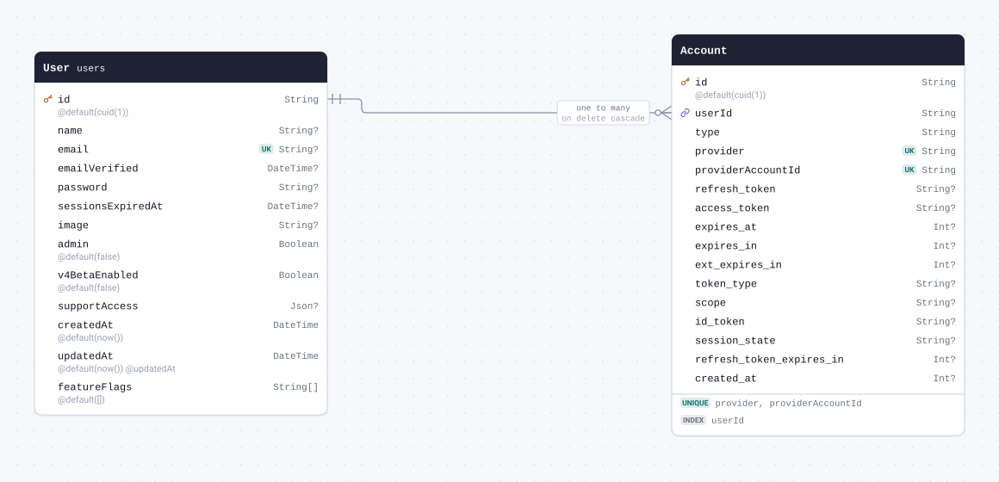

| Field                      | Type     | Constraints                       | Default   | Description |
| -------------------------- | -------- | --------------------------------- | --------- | ----------- |
| `id`                       | `String` | PK NOT NULL                       | `cuid(1)` |             |
| `userId` (`user_id`)       | `String` | NOT NULL → [User.id](#model-User) |           |             |
| `type`                     | `String` | NOT NULL                          |           |             |
| `provider`                 | `String` | NOT NULL                          |           |             |
| `providerAccountId`        | `String` | NOT NULL                          |           |             |
| `refresh_token`            | `String` | NULL                              |           |             |
| `access_token`             | `String` | NULL                              |           |             |
| `expires_at`               | `Int`    | NULL                              |           |             |
| `expires_in`               | `Int`    | NULL                              |           |             |
| `ext_expires_in`           | `Int`    | NULL                              |           |             |
| `token_type`               | `String` | NULL                              |           |             |
| `scope`                    | `String` | NULL                              |           |             |
| `id_token`                 | `String` | NULL                              |           |             |
| `session_state`            | `String` | NULL                              |           |             |
| `refresh_token_expires_in` | `Int`    | NULL                              |           |             |
| `created_at`               | `Int`    | NULL                              |           |             |

#### Indexes

- `@@index([userId])`
- `@@unique([provider, providerAccountId])`

#### References

- `userId` → [User.id](#model-User) (many-to-one, on delete Cascade)

#### Definition

```sql
CREATE TABLE "Account" (
    "id" TEXT NOT NULL,
    "user_id" TEXT NOT NULL,
    "type" TEXT NOT NULL,
    "provider" TEXT NOT NULL,
    "providerAccountId" TEXT NOT NULL,
    "refresh_token" TEXT,
    "access_token" TEXT,
    "expires_at" INTEGER,
    "expires_in" INTEGER,
    "ext_expires_in" INTEGER,
    "token_type" TEXT,
    "scope" TEXT,
    "id_token" TEXT,
    "session_state" TEXT,
    "refresh_token_expires_in" INTEGER,
    "created_at" INTEGER,

    CONSTRAINT "Account_pkey" PRIMARY KEY ("id")
);

CREATE INDEX "Account_user_id_idx" ON "Account"("user_id");

CREATE UNIQUE INDEX "Account_provider_providerAccountId_key" ON "Account"("provider", "providerAccountId");

ALTER TABLE "Account" ADD CONSTRAINT "Account_user_id_fkey" FOREIGN KEY ("user_id") REFERENCES "users"("id") ON DELETE CASCADE ON UPDATE CASCADE;
```

<details>
<summary>Queries and their SQL</summary>

**findMany**: Every row

```ts
await prisma.account.findMany();
```

```sql
SELECT
  "public"."Account"."id",
  "public"."Account"."user_id",
  "public"."Account"."type",
  "public"."Account"."provider",
  "public"."Account"."providerAccountId",
  "public"."Account"."refresh_token",
  "public"."Account"."access_token",
  "public"."Account"."expires_at",
  "public"."Account"."expires_in",
  "public"."Account"."ext_expires_in",
  "public"."Account"."token_type",
  "public"."Account"."scope",
  "public"."Account"."id_token",
  "public"."Account"."session_state",
  "public"."Account"."refresh_token_expires_in",
  "public"."Account"."created_at"
FROM
  "public"."Account"
WHERE
  1 = 1
OFFSET
  $1
-- params: ["0"]
```

**count**: How many rows there are

```ts
await prisma.account.count();
```

```sql
SELECT
  COUNT(*) AS "_count$_all"
FROM
  (
    SELECT
      "public"."Account"."id"
    FROM
      "public"."Account"
    WHERE
      1 = 1
    OFFSET
      $1
  ) AS "sub"
-- params: ["0"]
```

**findMany**: Every row with its relations

```ts
await prisma.account.findMany({ include: { user: true } });
```

```sql
SELECT
  "public"."Account"."id",
  "public"."Account"."user_id",
  "public"."Account"."type",
  "public"."Account"."provider",
  "public"."Account"."providerAccountId",
  "public"."Account"."refresh_token",
  "public"."Account"."access_token",
  "public"."Account"."expires_at",
  "public"."Account"."expires_in",
  "public"."Account"."ext_expires_in",
  "public"."Account"."token_type",
  "public"."Account"."scope",
  "public"."Account"."id_token",
  "public"."Account"."session_state",
  "public"."Account"."refresh_token_expires_in",
  "public"."Account"."created_at"
FROM
  "public"."Account"
WHERE
  1 = 1
OFFSET
  $1
-- params: ["0"]

SELECT
  "public"."users"."id",
  "public"."users"."name",
  "public"."users"."email",
  "public"."users"."email_verified",
  "public"."users"."password",
  "public"."users"."sessions_expired_at",
  "public"."users"."image",
  "public"."users"."admin",
  "public"."users"."v4_beta_enabled",
  "public"."users"."support_access",
  "public"."users"."created_at",
  "public"."users"."updated_at",
  "public"."users"."feature_flags"
FROM
  "public"."users"
WHERE
  "public"."users"."id" IN ($1)
OFFSET
  $2
-- params: ["<userId of the rows above>","0"]
```

**findUnique**: One row by what is unique to it

```ts
await prisma.account.findUnique({ where: { id: "example" } });
```

```sql
SELECT
  "public"."Account"."id",
  "public"."Account"."user_id",
  "public"."Account"."type",
  "public"."Account"."provider",
  "public"."Account"."providerAccountId",
  "public"."Account"."refresh_token",
  "public"."Account"."access_token",
  "public"."Account"."expires_at",
  "public"."Account"."expires_in",
  "public"."Account"."ext_expires_in",
  "public"."Account"."token_type",
  "public"."Account"."scope",
  "public"."Account"."id_token",
  "public"."Account"."session_state",
  "public"."Account"."refresh_token_expires_in",
  "public"."Account"."created_at"
FROM
  "public"."Account"
WHERE
  (
    "public"."Account"."id" = $1
    AND 1 = 1
  )
LIMIT
  $2
OFFSET
  $3
-- params: ["example","1","0"]
```

**create**: Create a row

```ts
await prisma.account.create({
  data: { userId: "example", type: "example", provider: "example", providerAccountId: "example" },
});
```

```sql
INSERT INTO
  "public"."Account" (
    "id",
    "user_id",
    "type",
    "provider",
    "providerAccountId"
  )
VALUES
  ($1, $2, $3, $4, $5)
RETURNING
  "public"."Account"."id",
  "public"."Account"."user_id",
  "public"."Account"."type",
  "public"."Account"."provider",
  "public"."Account"."providerAccountId",
  "public"."Account"."refresh_token",
  "public"."Account"."access_token",
  "public"."Account"."expires_at",
  "public"."Account"."expires_in",
  "public"."Account"."ext_expires_in",
  "public"."Account"."token_type",
  "public"."Account"."scope",
  "public"."Account"."id_token",
  "public"."Account"."session_state",
  "public"."Account"."refresh_token_expires_in",
  "public"."Account"."created_at"
-- params: ["<cuid(1)>","example","example","example","example"]
```

**update**: Update a row

```ts
await prisma.account.update({ where: { id: "example" }, data: { type: "example" } });
```

```sql
UPDATE "public"."Account"
SET
  "type" = $1
WHERE
  (
    "public"."Account"."id" = $2
    AND 1 = 1
  )
RETURNING
  "public"."Account"."id",
  "public"."Account"."user_id",
  "public"."Account"."type",
  "public"."Account"."provider",
  "public"."Account"."providerAccountId",
  "public"."Account"."refresh_token",
  "public"."Account"."access_token",
  "public"."Account"."expires_at",
  "public"."Account"."expires_in",
  "public"."Account"."ext_expires_in",
  "public"."Account"."token_type",
  "public"."Account"."scope",
  "public"."Account"."id_token",
  "public"."Account"."session_state",
  "public"."Account"."refresh_token_expires_in",
  "public"."Account"."created_at"
-- params: ["example","example"]
```

**delete**: Delete a row

```ts
await prisma.account.delete({ where: { id: "example" } });
```

```sql
DELETE FROM "public"."Account"
WHERE
  (
    "public"."Account"."id" = $1
    AND 1 = 1
  )
RETURNING
  "public"."Account"."id",
  "public"."Account"."user_id",
  "public"."Account"."type",
  "public"."Account"."provider",
  "public"."Account"."providerAccountId",
  "public"."Account"."refresh_token",
  "public"."Account"."access_token",
  "public"."Account"."expires_at",
  "public"."Account"."expires_in",
  "public"."Account"."ext_expires_in",
  "public"."Account"."token_type",
  "public"."Account"."scope",
  "public"."Account"."id_token",
  "public"."Account"."session_state",
  "public"."Account"."refresh_token_expires_in",
  "public"."Account"."created_at"
-- params: ["example"]
```

</details>

<a id="model-Session"></a>

### Session

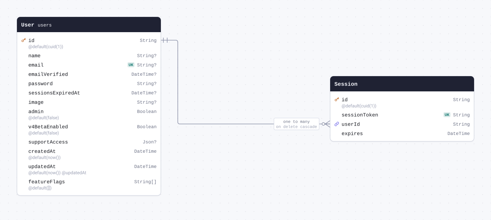

| Field                            | Type       | Constraints                       | Default   | Description |
| -------------------------------- | ---------- | --------------------------------- | --------- | ----------- |
| `id`                             | `String`   | PK NOT NULL                       | `cuid(1)` |             |
| `sessionToken` (`session_token`) | `String`   | UNIQUE NOT NULL                   |           |             |
| `userId` (`user_id`)             | `String`   | NOT NULL → [User.id](#model-User) |           |             |
| `expires`                        | `DateTime` | NOT NULL                          |           |             |

#### References

- `userId` → [User.id](#model-User) (many-to-one, on delete Cascade)

#### Definition

```sql
CREATE TABLE "Session" (
    "id" TEXT NOT NULL,
    "session_token" TEXT NOT NULL,
    "user_id" TEXT NOT NULL,
    "expires" TIMESTAMP(3) NOT NULL,

    CONSTRAINT "Session_pkey" PRIMARY KEY ("id")
);

CREATE UNIQUE INDEX "Session_session_token_key" ON "Session"("session_token");

ALTER TABLE "Session" ADD CONSTRAINT "Session_user_id_fkey" FOREIGN KEY ("user_id") REFERENCES "users"("id") ON DELETE CASCADE ON UPDATE CASCADE;
```

<details>
<summary>Queries and their SQL</summary>

**findMany**: Every row

```ts
await prisma.session.findMany();
```

```sql
SELECT
  "public"."Session"."id",
  "public"."Session"."session_token",
  "public"."Session"."user_id",
  "public"."Session"."expires"
FROM
  "public"."Session"
WHERE
  1 = 1
OFFSET
  $1
-- params: ["0"]
```

**count**: How many rows there are

```ts
await prisma.session.count();
```

```sql
SELECT
  COUNT(*) AS "_count$_all"
FROM
  (
    SELECT
      "public"."Session"."id"
    FROM
      "public"."Session"
    WHERE
      1 = 1
    OFFSET
      $1
  ) AS "sub"
-- params: ["0"]
```

**findMany**: Every row with its relations

```ts
await prisma.session.findMany({ include: { user: true } });
```

```sql
SELECT
  "public"."Session"."id",
  "public"."Session"."session_token",
  "public"."Session"."user_id",
  "public"."Session"."expires"
FROM
  "public"."Session"
WHERE
  1 = 1
OFFSET
  $1
-- params: ["0"]

SELECT
  "public"."users"."id",
  "public"."users"."name",
  "public"."users"."email",
  "public"."users"."email_verified",
  "public"."users"."password",
  "public"."users"."sessions_expired_at",
  "public"."users"."image",
  "public"."users"."admin",
  "public"."users"."v4_beta_enabled",
  "public"."users"."support_access",
  "public"."users"."created_at",
  "public"."users"."updated_at",
  "public"."users"."feature_flags"
FROM
  "public"."users"
WHERE
  "public"."users"."id" IN ($1)
OFFSET
  $2
-- params: ["<userId of the rows above>","0"]
```

**findUnique**: One row by what is unique to it

```ts
await prisma.session.findUnique({ where: { id: "example" } });
```

```sql
SELECT
  "public"."Session"."id",
  "public"."Session"."session_token",
  "public"."Session"."user_id",
  "public"."Session"."expires"
FROM
  "public"."Session"
WHERE
  (
    "public"."Session"."id" = $1
    AND 1 = 1
  )
LIMIT
  $2
OFFSET
  $3
-- params: ["example","1","0"]
```

**create**: Create a row

```ts
await prisma.session.create({
  data: {
    sessionToken: "example",
    userId: "example",
    expires: new Date("2026-01-01T00:00:00.000Z"),
  },
});
```

```sql
INSERT INTO
  "public"."Session" ("id", "session_token", "user_id", "expires")
VALUES
  ($1, $2, $3, $4)
RETURNING
  "public"."Session"."id",
  "public"."Session"."session_token",
  "public"."Session"."user_id",
  "public"."Session"."expires"
-- params: ["<cuid(1)>","example","example","2026-01-01T00:00:00.000Z"]
```

**update**: Update a row

```ts
await prisma.session.update({ where: { id: "example" }, data: { sessionToken: "example" } });
```

```sql
UPDATE "public"."Session"
SET
  "session_token" = $1
WHERE
  (
    "public"."Session"."id" = $2
    AND 1 = 1
  )
RETURNING
  "public"."Session"."id",
  "public"."Session"."session_token",
  "public"."Session"."user_id",
  "public"."Session"."expires"
-- params: ["example","example"]
```

**delete**: Delete a row

```ts
await prisma.session.delete({ where: { id: "example" } });
```

```sql
DELETE FROM "public"."Session"
WHERE
  (
    "public"."Session"."id" = $1
    AND 1 = 1
  )
RETURNING
  "public"."Session"."id",
  "public"."Session"."session_token",
  "public"."Session"."user_id",
  "public"."Session"."expires"
-- params: ["example"]
```

</details>

<a id="model-User"></a>

### User

Table `users`.

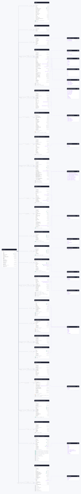

| Field                                       | Type       | Constraints | Default              | Description |
| ------------------------------------------- | ---------- | ----------- | -------------------- | ----------- |
| `id`                                        | `String`   | PK NOT NULL | `cuid(1)`            |             |
| `name`                                      | `String`   | NULL        |                      |             |
| `email`                                     | `String`   | UNIQUE NULL |                      |             |
| `emailVerified` (`email_verified`)          | `DateTime` | NULL        |                      |             |
| `password`                                  | `String`   | NULL        |                      |             |
| `sessionsExpiredAt` (`sessions_expired_at`) | `DateTime` | NULL        |                      |             |
| `image`                                     | `String`   | NULL        |                      |             |
| `admin`                                     | `Boolean`  | NOT NULL    | `false`              |             |
| `v4BetaEnabled` (`v4_beta_enabled`)         | `Boolean`  | NOT NULL    | `false`              |             |
| `supportAccess` (`support_access`)          | `Json`     | NULL        |                      |             |
| `createdAt` (`created_at`)                  | `DateTime` | NOT NULL    | `now()`              |             |
| `updatedAt` (`updated_at`)                  | `DateTime` | NOT NULL    | `now()` `@updatedAt` |             |
| `featureFlags` (`feature_flags`)            | `String[]` | NOT NULL    | `[]`                 |             |

#### Referenced by

- `id` ← [Account.userId](#model-Account) (one-to-many, on delete Cascade)
- `id` ← [Session.userId](#model-Session) (one-to-many, on delete Cascade)
- `id` ← [ApiKey.createdByUserId](#model-ApiKey) (one-to-many, on delete SetNull)
- `id` ← [ApiKey.userId](#model-ApiKey) (one-to-many, on delete Cascade)
- `id` ← [RoleAssignment.userId](#model-RoleAssignment) (one-to-many, on delete Cascade)
- `id` ← [InAppAgentConversation.createdByUserId](#model-InAppAgentConversation) (one-to-many, on delete SetNull)
- `id` ← [InAppAgentRun.triggeredByUserId](#model-InAppAgentRun) (one-to-many, on delete SetNull)
- `id` ← [OrganizationMembership.userId](#model-OrganizationMembership) (one-to-many, on delete Cascade)
- `id` ← [ProjectMembership.userId](#model-ProjectMembership) (one-to-many, on delete Cascade)
- `id` ← [MembershipInvitation.invitedByUserId](#model-MembershipInvitation) (one-to-many, on delete SetNull)
- `id` ← [AnnotationQueueItem.lockedByUserId](#model-AnnotationQueueItem) (one-to-many, on delete SetNull)
- `id` ← [AnnotationQueueItem.annotatorUserId](#model-AnnotationQueueItem) (one-to-many, on delete SetNull)
- `id` ← [AnnotationQueueAssignment.userId](#model-AnnotationQueueAssignment) (one-to-many, on delete Cascade)
- `id` ← [CommentReaction.userId](#model-CommentReaction) (one-to-many, on delete Cascade)
- `id` ← [NotificationPreference.userId](#model-NotificationPreference) (one-to-many, on delete Cascade)
- `id` ← [Evaluator.createdByUserId](#model-Evaluator) (one-to-many, on delete SetNull)
- `id` ← [EvaluatorVersion.createdByUserId](#model-EvaluatorVersion) (one-to-many, on delete SetNull)
- `id` ← [EvaluationRule.createdByUserId](#model-EvaluationRule) (one-to-many, on delete SetNull)
- `id` ← [TracingReadinessSettings.createdBy](#model-TracingReadinessSettings) (one-to-many, on delete SetNull)
- `id` ← [TracingReadinessSettings.updatedBy](#model-TracingReadinessSettings) (one-to-many, on delete SetNull)
- `id` ← [TopicConfig.createdBy](#model-TopicConfig) (one-to-many, on delete SetNull)
- `id` ← [TopicConfig.updatedBy](#model-TopicConfig) (one-to-many, on delete SetNull)
- `id` ← [Dashboard.createdBy](#model-Dashboard) (one-to-many, on delete SetNull)
- `id` ← [Dashboard.updatedBy](#model-Dashboard) (one-to-many, on delete SetNull)
- `id` ← [DashboardWidget.createdBy](#model-DashboardWidget) (one-to-many, on delete SetNull)
- `id` ← [DashboardWidget.updatedBy](#model-DashboardWidget) (one-to-many, on delete SetNull)
- `id` ← [TableViewPreset.createdBy](#model-TableViewPreset) (one-to-many, on delete SetNull)
- `id` ← [TableViewPreset.updatedBy](#model-TableViewPreset) (one-to-many, on delete SetNull)
- `id` ← [DefaultView.userId](#model-DefaultView) (one-to-many, on delete Cascade)
- `id` ← [Monitor.createdBy](#model-Monitor) (one-to-many, on delete SetNull)
- `id` ← [Monitor.updatedBy](#model-Monitor) (one-to-many, on delete SetNull)
- `id` ← [Survey.userId](#model-Survey) (one-to-many, on delete Cascade)

#### Definition

```sql
CREATE TABLE "users" (
    "id" TEXT NOT NULL,
    "name" TEXT,
    "email" TEXT,
    "email_verified" TIMESTAMP(3),
    "password" TEXT,
    "sessions_expired_at" TIMESTAMP(3),
    "image" TEXT,
    "admin" BOOLEAN NOT NULL DEFAULT false,
    "v4_beta_enabled" BOOLEAN NOT NULL DEFAULT false,
    "support_access" JSONB,
    "created_at" TIMESTAMP(3) NOT NULL DEFAULT CURRENT_TIMESTAMP,
    "updated_at" TIMESTAMP(3) NOT NULL DEFAULT CURRENT_TIMESTAMP,
    "feature_flags" TEXT[] DEFAULT ARRAY[]::TEXT[],

    CONSTRAINT "users_pkey" PRIMARY KEY ("id")
);

CREATE UNIQUE INDEX "users_email_key" ON "users"("email");
```

<details>
<summary>Queries and their SQL</summary>

**findMany**: Every row

```ts
await prisma.user.findMany();
```

```sql
SELECT
  "public"."users"."id",
  "public"."users"."name",
  "public"."users"."email",
  "public"."users"."email_verified",
  "public"."users"."password",
  "public"."users"."sessions_expired_at",
  "public"."users"."image",
  "public"."users"."admin",
  "public"."users"."v4_beta_enabled",
  "public"."users"."support_access",
  "public"."users"."created_at",
  "public"."users"."updated_at",
  "public"."users"."feature_flags"
FROM
  "public"."users"
WHERE
  1 = 1
OFFSET
  $1
-- params: ["0"]
```

**count**: How many rows there are

```ts
await prisma.user.count();
```

```sql
SELECT
  COUNT(*) AS "_count$_all"
FROM
  (
    SELECT
      "public"."users"."id"
    FROM
      "public"."users"
    WHERE
      1 = 1
    OFFSET
      $1
  ) AS "sub"
-- params: ["0"]
```

**findMany**: Every row with its relations

```ts
await prisma.user.findMany({
  include: {
    accounts: true,
    sessions: true,
    organizationMemberships: true,
    projectMemberships: true,
    invitations: true,
    annotatedLockedItem: true,
    annotatedCompletedItem: true,
    dashboardWidgetsCreated: true,
    dashboardWidgetsUpdated: true,
    dashboardCreated: true,
    dashboardUpdated: true,
    tableViewPresetCreated: true,
    tableViewPresetUpdated: true,
    monitorsCreated: true,
    monitorsUpdated: true,
    topicConfigsCreated: true,
    topicConfigsUpdated: true,
    tracingReadinessCreated: true,
    tracingReadinessUpdated: true,
    annotationQueueAssignment: true,
    surveys: true,
    commentReactions: true,
    notificationPreferences: true,
    defaultViews: true,
    inAppAgentConversations: true,
    inAppAgentRuns: true,
    apiKeysCreated: true,
    apiKeys: true,
    roleAssignments: true,
    evaluatorsCreated: true,
    evaluatorVersionsCreated: true,
    evaluationRulesCreated: true,
  },
});
```

```sql
SELECT
  "public"."users"."id",
  "public"."users"."name",
  "public"."users"."email",
  "public"."users"."email_verified",
  "public"."users"."password",
  "public"."users"."sessions_expired_at",
  "public"."users"."image",
  "public"."users"."admin",
  "public"."users"."v4_beta_enabled",
  "public"."users"."support_access",
  "public"."users"."created_at",
  "public"."users"."updated_at",
  "public"."users"."feature_flags"
FROM
  "public"."users"
WHERE
  1 = 1
OFFSET
  $1
-- params: ["0"]

SELECT
  "public"."Account"."id",
  "public"."Account"."user_id",
  "public"."Account"."type",
  "public"."Account"."provider",
  "public"."Account"."providerAccountId",
  "public"."Account"."refresh_token",
  "public"."Account"."access_token",
  "public"."Account"."expires_at",
  "public"."Account"."expires_in",
  "public"."Account"."ext_expires_in",
  "public"."Account"."token_type",
  "public"."Account"."scope",
  "public"."Account"."id_token",
  "public"."Account"."session_state",
  "public"."Account"."refresh_token_expires_in",
  "public"."Account"."created_at"
FROM
  "public"."Account"
WHERE
  "public"."Account"."user_id" IN ($1)
OFFSET
  $2
-- params: ["<id of the rows above>","0"]

SELECT
  "public"."Session"."id",
  "public"."Session"."session_token",
  "public"."Session"."user_id",
  "public"."Session"."expires"
FROM
  "public"."Session"
WHERE
  "public"."Session"."user_id" IN ($1)
OFFSET
  $2
-- params: ["<id of the rows above>","0"]

SELECT
  "public"."organization_memberships"."id",
  "public"."organization_memberships"."org_id",
  "public"."organization_memberships"."user_id",
  "public"."organization_memberships"."role"::text,
  "public"."organization_memberships"."created_at",
  "public"."organization_memberships"."updated_at"
FROM
  "public"."organization_memberships"
WHERE
  "public"."organization_memberships"."user_id" IN ($1)
OFFSET
  $2
-- params: ["<id of the rows above>","0"]

SELECT
  "public"."project_memberships"."project_id",
  "public"."project_memberships"."user_id",
  "public"."project_memberships"."org_membership_id",
  "public"."project_memberships"."role"::text,
  "public"."project_memberships"."created_at",
  "public"."project_memberships"."updated_at"
FROM
  "public"."project_memberships"
WHERE
  "public"."project_memberships"."user_id" IN ($1)
OFFSET
  $2
-- params: ["<id of the rows above>","0"]

SELECT
  "public"."membership_invitations"."id",
  "public"."membership_invitations"."email",
  "public"."membership_invitations"."org_id",
  "public"."membership_invitations"."org_role"::text,
  "public"."membership_invitations"."project_id",
  "public"."membership_invitations"."project_role"::text,
  "public"."membership_invitations"."invited_by_user_id",
  "public"."membership_invitations"."created_at",
  "public"."membership_invitations"."updated_at"
FROM
  "public"."membership_invitations"
WHERE
  "public"."membership_invitations"."invited_by_user_id" IN ($1)
OFFSET
  $2
-- params: ["<id of the rows above>","0"]

SELECT
  "public"."annotation_queue_items"."id",
  "public"."annotation_queue_items"."queue_id",
  "public"."annotation_queue_items"."object_id",
  "public"."annotation_queue_items"."object_type"::text,
  "public"."annotation_queue_items"."status"::text,
  "public"."annotation_queue_items"."locked_at",
  "public"."annotation_queue_items"."locked_by_user_id",
  "public"."annotation_queue_items"."annotator_user_id",
  "public"."annotation_queue_items"."completed_at",
  "public"."annotation_queue_items"."project_id",
  "public"."annotation_queue_items"."created_at",
  "public"."annotation_queue_items"."updated_at"
FROM
  "public"."annotation_queue_items"
WHERE
  "public"."annotation_queue_items"."locked_by_user_id" IN ($1)
OFFSET
  $2
-- params: ["<id of the rows above>","0"]

SELECT
  "public"."annotation_queue_items"."id",
  "public"."annotation_queue_items"."queue_id",
  "public"."annotation_queue_items"."object_id",
  "public"."annotation_queue_items"."object_type"::text,
  "public"."annotation_queue_items"."status"::text,
  "public"."annotation_queue_items"."locked_at",
  "public"."annotation_queue_items"."locked_by_user_id",
  "public"."annotation_queue_items"."annotator_user_id",
  "public"."annotation_queue_items"."completed_at",
  "public"."annotation_queue_items"."project_id",
  "public"."annotation_queue_items"."created_at",
  "public"."annotation_queue_items"."updated_at"
FROM
  "public"."annotation_queue_items"
WHERE
  "public"."annotation_queue_items"."annotator_user_id" IN ($1)
OFFSET
  $2
-- params: ["<id of the rows above>","0"]

SELECT
  "public"."dashboard_widgets"."id",
  "public"."dashboard_widgets"."created_at",
  "public"."dashboard_widgets"."updated_at",
  "public"."dashboard_widgets"."created_by",
  "public"."dashboard_widgets"."updated_by",
  "public"."dashboard_widgets"."project_id",
  "public"."dashboard_widgets"."name",
  "public"."dashboard_widgets"."description",
  "public"."dashboard_widgets"."view"::text,
  "public"."dashboard_widgets"."dimensions",
  "public"."dashboard_widgets"."metrics",
  "public"."dashboard_widgets"."filters",
  "public"."dashboard_widgets"."chart_type"::text,
  "public"."dashboard_widgets"."chart_config",
  "public"."dashboard_widgets"."min_version"
FROM
  "public"."dashboard_widgets"
WHERE
  "public"."dashboard_widgets"."created_by" IN ($1)
OFFSET
  $2
-- params: ["<id of the rows above>","0"]

SELECT
  "public"."dashboard_widgets"."id",
  "public"."dashboard_widgets"."created_at",
  "public"."dashboard_widgets"."updated_at",
  "public"."dashboard_widgets"."created_by",
  "public"."dashboard_widgets"."updated_by",
  "public"."dashboard_widgets"."project_id",
  "public"."dashboard_widgets"."name",
  "public"."dashboard_widgets"."description",
  "public"."dashboard_widgets"."view"::text,
  "public"."dashboard_widgets"."dimensions",
  "public"."dashboard_widgets"."metrics",
  "public"."dashboard_widgets"."filters",
  "public"."dashboard_widgets"."chart_type"::text,
  "public"."dashboard_widgets"."chart_config",
  "public"."dashboard_widgets"."min_version"
FROM
  "public"."dashboard_widgets"
WHERE
  "public"."dashboard_widgets"."updated_by" IN ($1)
OFFSET
  $2
-- params: ["<id of the rows above>","0"]

SELECT
  "public"."dashboards"."id",
  "public"."dashboards"."created_at",
  "public"."dashboards"."updated_at",
  "public"."dashboards"."created_by",
  "public"."dashboards"."updated_by",
  "public"."dashboards"."project_id",
  "public"."dashboards"."name",
  "public"."dashboards"."description",
  "public"."dashboards"."definition",
  "public"."dashboards"."filters"
FROM
  "public"."dashboards"
WHERE
  "public"."dashboards"."created_by" IN ($1)
OFFSET
  $2
-- params: ["<id of the rows above>","0"]

SELECT
  "public"."dashboards"."id",
  "public"."dashboards"."created_at",
  "public"."dashboards"."updated_at",
  "public"."dashboards"."created_by",
  "public"."dashboards"."updated_by",
  "public"."dashboards"."project_id",
  "public"."dashboards"."name",
  "public"."dashboards"."description",
  "public"."dashboards"."definition",
  "public"."dashboards"."filters"
FROM
  "public"."dashboards"
WHERE
  "public"."dashboards"."updated_by" IN ($1)
OFFSET
  $2
-- params: ["<id of the rows above>","0"]

SELECT
  "public"."table_view_presets"."id",
  "public"."table_view_presets"."created_at",
  "public"."table_view_presets"."updated_at",
  "public"."table_view_presets"."project_id",
  "public"."table_view_presets"."name",
  "public"."table_view_presets"."table_name",
  "public"."table_view_presets"."created_by",
  "public"."table_view_presets"."updated_by",
  "public"."table_view_presets"."filters",
  "public"."table_view_presets"."column_order",
  "public"."table_view_presets"."column_visibility",
  "public"."table_view_presets"."search_query",
  "public"."table_view_presets"."order_by"
FROM
  "public"."table_view_presets"
WHERE
  "public"."table_view_presets"."created_by" IN ($1)
OFFSET
  $2
-- params: ["<id of the rows above>","0"]

SELECT
  "public"."table_view_presets"."id",
  "public"."table_view_presets"."created_at",
  "public"."table_view_presets"."updated_at",
  "public"."table_view_presets"."project_id",
  "public"."table_view_presets"."name",
  "public"."table_view_presets"."table_name",
  "public"."table_view_presets"."created_by",
  "public"."table_view_presets"."updated_by",
  "public"."table_view_presets"."filters",
  "public"."table_view_presets"."column_order",
  "public"."table_view_presets"."column_visibility",
  "public"."table_view_presets"."search_query",
  "public"."table_view_presets"."order_by"
FROM
  "public"."table_view_presets"
WHERE
  "public"."table_view_presets"."updated_by" IN ($1)
OFFSET
  $2
-- params: ["<id of the rows above>","0"]

SELECT
  "public"."monitors"."id",
  "public"."monitors"."created_at",
  "public"."monitors"."updated_at",
  "public"."monitors"."created_by",
  "public"."monitors"."updated_by",
  "public"."monitors"."project_id",
  "public"."monitors"."view"::text,
  "public"."monitors"."filters",
  "public"."monitors"."metric",
  "public"."monitors"."window_ms",
  "public"."monitors"."cadence_ms",
  "public"."monitors"."threshold_operator"::text,
  "public"."monitors"."alert_threshold",
  "public"."monitors"."warning_threshold",
  "public"."monitors"."severity"::text,
  "public"."monitors"."severity_changed_at",
  "public"."monitors"."no_data",
  "public"."monitors"."renotify",
  "public"."monitors"."status"::text,
  "public"."monitors"."scheduler_batch_id",
  "public"."monitors"."next_run_at",
  "public"."monitors"."last_published_at",
  "public"."monitors"."last_claimed_at",
  "public"."monitors"."last_completed_at",
  "public"."monitors"."name",
  "public"."monitors"."tags",
  "public"."monitors"."trigger_ids",
  "public"."monitors"."alerted_at"
FROM
  "public"."monitors"
WHERE
  "public"."monitors"."created_by" IN ($1)
OFFSET
  $2
-- params: ["<id of the rows above>","0"]

SELECT
  "public"."monitors"."id",
  "public"."monitors"."created_at",
  "public"."monitors"."updated_at",
  "public"."monitors"."created_by",
  "public"."monitors"."updated_by",
  "public"."monitors"."project_id",
  "public"."monitors"."view"::text,
  "public"."monitors"."filters",
  "public"."monitors"."metric",
  "public"."monitors"."window_ms",
  "public"."monitors"."cadence_ms",
  "public"."monitors"."threshold_operator"::text,
  "public"."monitors"."alert_threshold",
  "public"."monitors"."warning_threshold",
  "public"."monitors"."severity"::text,
  "public"."monitors"."severity_changed_at",
  "public"."monitors"."no_data",
  "public"."monitors"."renotify",
  "public"."monitors"."status"::text,
  "public"."monitors"."scheduler_batch_id",
  "public"."monitors"."next_run_at",
  "public"."monitors"."last_published_at",
  "public"."monitors"."last_claimed_at",
  "public"."monitors"."last_completed_at",
  "public"."monitors"."name",
  "public"."monitors"."tags",
  "public"."monitors"."trigger_ids",
  "public"."monitors"."alerted_at"
FROM
  "public"."monitors"
WHERE
  "public"."monitors"."updated_by" IN ($1)
OFFSET
  $2
-- params: ["<id of the rows above>","0"]

SELECT
  "public"."topic_configs"."id",
  "public"."topic_configs"."created_at",
  "public"."topic_configs"."updated_at",
  "public"."topic_configs"."created_by",
  "public"."topic_configs"."updated_by",
  "public"."topic_configs"."project_id",
  "public"."topic_configs"."enabled",
  "public"."topic_configs"."blocked_at",
  "public"."topic_configs"."block_reason"::text,
  "public"."topic_configs"."block_message",
  "public"."topic_configs"."summary_llm_api_key_id",
  "public"."topic_configs"."summary_model",
  "public"."topic_configs"."embedding_llm_api_key_id",
  "public"."topic_configs"."embedding_model",
  "public"."topic_configs"."embedding_dimensions",
  "public"."topic_configs"."clustering_llm_api_key_id",
  "public"."topic_configs"."clustering_model"
FROM
  "public"."topic_configs"
WHERE
  "public"."topic_configs"."created_by" IN ($1)
OFFSET
  $2
-- params: ["<id of the rows above>","0"]

SELECT
  "public"."topic_configs"."id",
  "public"."topic_configs"."created_at",
  "public"."topic_configs"."updated_at",
  "public"."topic_configs"."created_by",
  "public"."topic_configs"."updated_by",
  "public"."topic_configs"."project_id",
  "public"."topic_configs"."enabled",
  "public"."topic_configs"."blocked_at",
  "public"."topic_configs"."block_reason"::text,
  "public"."topic_configs"."block_message",
  "public"."topic_configs"."summary_llm_api_key_id",
  "public"."topic_configs"."summary_model",
  "public"."topic_configs"."embedding_llm_api_key_id",
  "public"."topic_configs"."embedding_model",
  "public"."topic_configs"."embedding_dimensions",
  "public"."topic_configs"."clustering_llm_api_key_id",
  "public"."topic_configs"."clustering_model"
FROM
  "public"."topic_configs"
WHERE
  "public"."topic_configs"."updated_by" IN ($1)
OFFSET
  $2
-- params: ["<id of the rows above>","0"]

SELECT
  "public"."tracing_readiness_settings"."project_id",
  "public"."tracing_readiness_settings"."created_at",
  "public"."tracing_readiness_settings"."updated_at",
  "public"."tracing_readiness_settings"."created_by",
  "public"."tracing_readiness_settings"."updated_by",
  "public"."tracing_readiness_settings"."trace_idle_ms"
FROM
  "public"."tracing_readiness_settings"
WHERE
  "public"."tracing_readiness_settings"."created_by" IN ($1)
OFFSET
  $2
-- params: ["<id of the rows above>","0"]

SELECT
  "public"."tracing_readiness_settings"."project_id",
  "public"."tracing_readiness_settings"."created_at",
  "public"."tracing_readiness_settings"."updated_at",
  "public"."tracing_readiness_settings"."created_by",
  "public"."tracing_readiness_settings"."updated_by",
  "public"."tracing_readiness_settings"."trace_idle_ms"
FROM
  "public"."tracing_readiness_settings"
WHERE
  "public"."tracing_readiness_settings"."updated_by" IN ($1)
OFFSET
  $2
-- params: ["<id of the rows above>","0"]

SELECT
  "public"."annotation_queue_assignments"."id",
  "public"."annotation_queue_assignments"."project_id",
  "public"."annotation_queue_assignments"."user_id",
  "public"."annotation_queue_assignments"."queue_id",
  "public"."annotation_queue_assignments"."created_at",
  "public"."annotation_queue_assignments"."updated_at"
FROM
  "public"."annotation_queue_assignments"
WHERE
  "public"."annotation_queue_assignments"."user_id" IN ($1)
OFFSET
  $2
-- params: ["<id of the rows above>","0"]

SELECT
  "public"."surveys"."id",
  "public"."surveys"."created_at",
  "public"."surveys"."survey_name"::text,
  "public"."surveys"."response",
  "public"."surveys"."user_id",
  "public"."surveys"."user_email",
  "public"."surveys"."org_id"
FROM
  "public"."surveys"
WHERE
  "public"."surveys"."user_id" IN ($1)
OFFSET
  $2
-- params: ["<id of the rows above>","0"]

SELECT
  "public"."comment_reactions"."id",
  "public"."comment_reactions"."project_id",
  "public"."comment_reactions"."comment_id",
  "public"."comment_reactions"."user_id",
  "public"."comment_reactions"."emoji",
  "public"."comment_reactions"."created_at"
FROM
  "public"."comment_reactions"
WHERE
  "public"."comment_reactions"."user_id" IN ($1)
OFFSET
  $2
-- params: ["<id of the rows above>","0"]

SELECT
  "public"."notification_preferences"."id",
  "public"."notification_preferences"."user_id",
  "public"."notification_preferences"."project_id",
  "public"."notification_preferences"."channel"::text,
  "public"."notification_preferences"."type"::text,
  "public"."notification_preferences"."enabled",
  "public"."notification_preferences"."created_at",
  "public"."notification_preferences"."updated_at"
FROM
  "public"."notification_preferences"
WHERE
  "public"."notification_preferences"."user_id" IN ($1)
OFFSET
  $2
-- params: ["<id of the rows above>","0"]

SELECT
  "public"."default_views"."id",
  "public"."default_views"."created_at",
  "public"."default_views"."updated_at",
  "public"."default_views"."project_id",
  "public"."default_views"."user_id",
  "public"."default_views"."view_name",
  "public"."default_views"."view_id"
FROM
  "public"."default_views"
WHERE
  "public"."default_views"."user_id" IN ($1)
OFFSET
  $2
-- params: ["<id of the rows above>","0"]

SELECT
  "public"."in_app_agent_conversations"."id",
  "public"."in_app_agent_conversations"."project_id",
  "public"."in_app_agent_conversations"."created_by_user_id",
  "public"."in_app_agent_conversations"."title",
  "public"."in_app_agent_conversations"."renamed_by_user_at",
  "public"."in_app_agent_conversations"."visibility_scope"::text,
  "public"."in_app_agent_conversations"."provider_session_id",
  "public"."in_app_agent_conversations"."always_allowed_tools",
  "public"."in_app_agent_conversations"."deleted_at",
  "public"."in_app_agent_conversations"."created_at",
  "public"."in_app_agent_conversations"."updated_at"
FROM
  "public"."in_app_agent_conversations"
WHERE
  "public"."in_app_agent_conversations"."created_by_user_id" IN ($1)
OFFSET
  $2
-- params: ["<id of the rows above>","0"]

SELECT
  "public"."in_app_agent_runs"."id",
  "public"."in_app_agent_runs"."project_id",
  "public"."in_app_agent_runs"."conversation_id",
  "public"."in_app_agent_runs"."triggered_by_user_id",
  "public"."in_app_agent_runs"."model",
  "public"."in_app_agent_runs"."mcp_api_key_id",
  "public"."in_app_agent_runs"."error_code",
  "public"."in_app_agent_runs"."error_message",
  "public"."in_app_agent_runs"."finished_at",
  "public"."in_app_agent_runs"."status",
  "public"."in_app_agent_runs"."request",
  "public"."in_app_agent_runs"."claimed_at",
  "public"."in_app_agent_runs"."heartbeat_at",
  "public"."in_app_agent_runs"."cancel_requested_at",
  "public"."in_app_agent_runs"."created_at",
  "public"."in_app_agent_runs"."updated_at"
FROM
  "public"."in_app_agent_runs"
WHERE
  "public"."in_app_agent_runs"."triggered_by_user_id" IN ($1)
OFFSET
  $2
-- params: ["<id of the rows above>","0"]

SELECT
  "public"."api_keys"."id",
  "public"."api_keys"."created_at",
  "public"."api_keys"."note",
  "public"."api_keys"."public_key",
  "public"."api_keys"."hashed_secret_key",
  "public"."api_keys"."fast_hashed_secret_key",
  "public"."api_keys"."display_secret_key",
  "public"."api_keys"."last_used_at",
  "public"."api_keys"."expires_at",
  "public"."api_keys"."is_in_app_agent_key",
  "public"."api_keys"."project_id",
  "public"."api_keys"."organization_id",
  "public"."api_keys"."scope"::text,
  "public"."api_keys"."created_by_user_id",
  "public"."api_keys"."user_id",
  "public"."api_keys"."created_by_api_key_id"
FROM
  "public"."api_keys"
WHERE
  "public"."api_keys"."created_by_user_id" IN ($1)
OFFSET
  $2
-- params: ["<id of the rows above>","0"]

SELECT
  "public"."api_keys"."id",
  "public"."api_keys"."created_at",
  "public"."api_keys"."note",
  "public"."api_keys"."public_key",
  "public"."api_keys"."hashed_secret_key",
  "public"."api_keys"."fast_hashed_secret_key",
  "public"."api_keys"."display_secret_key",
  "public"."api_keys"."last_used_at",
  "public"."api_keys"."expires_at",
  "public"."api_keys"."is_in_app_agent_key",
  "public"."api_keys"."project_id",
  "public"."api_keys"."organization_id",
  "public"."api_keys"."scope"::text,
  "public"."api_keys"."created_by_user_id",
  "public"."api_keys"."user_id",
  "public"."api_keys"."created_by_api_key_id"
FROM
  "public"."api_keys"
WHERE
  "public"."api_keys"."user_id" IN ($1)
OFFSET
  $2
-- params: ["<id of the rows above>","0"]

SELECT
  "public"."role_assignments"."id",
  "public"."role_assignments"."owner_id",
  "public"."role_assignments"."project_id",
  "public"."role_assignments"."org_id",
  "public"."role_assignments"."principal_id",
  "public"."role_assignments"."user_id",
  "public"."role_assignments"."api_key_id",
  "public"."role_assignments"."role_id",
  "public"."role_assignments"."system_role"::text,
  "public"."role_assignments"."created_at",
  "public"."role_assignments"."updated_at"
FROM
  "public"."role_assignments"
WHERE
  "public"."role_assignments"."user_id" IN ($1)
OFFSET
  $2
-- params: ["<id of the rows above>","0"]

SELECT
  "public"."evaluators"."id",
  "public"."evaluators"."created_at",
  "public"."evaluators"."updated_at",
  "public"."evaluators"."project_id",
  "public"."evaluators"."name",
  "public"."evaluators"."type"::text,
  "public"."evaluators"."is_built_in",
  "public"."evaluators"."description",
  "public"."evaluators"."created_by_user_id",
  "public"."evaluators"."blocked_at",
  "public"."evaluators"."block_reason"::text,
  "public"."evaluators"."block_message"
FROM
  "public"."evaluators"
WHERE
  "public"."evaluators"."created_by_user_id" IN ($1)
OFFSET
  $2
-- params: ["<id of the rows above>","0"]

SELECT
  "public"."evaluator_versions"."id",
  "public"."evaluator_versions"."created_at",
  "public"."evaluator_versions"."evaluator_id",
  "public"."evaluator_versions"."version",
  "public"."evaluator_versions"."created_by_user_id",
  "public"."evaluator_versions"."prompt",
  "public"."evaluator_versions"."prompt_messages",
  "public"."evaluator_versions"."partner",
  "public"."evaluator_versions"."model",
  "public"."evaluator_versions"."provider",
  "public"."evaluator_versions"."model_params",
  "public"."evaluator_versions"."vars",
  "public"."evaluator_versions"."variable_mapping",
  "public"."evaluator_versions"."output_definition",
  "public"."evaluator_versions"."source_code",
  "public"."evaluator_versions"."source_code_language"::text,
  "public"."evaluator_versions"."questions"
FROM
  "public"."evaluator_versions"
WHERE
  "public"."evaluator_versions"."created_by_user_id" IN ($1)
OFFSET
  $2
-- params: ["<id of the rows above>","0"]

SELECT
  "public"."evaluation_rules"."id",
  "public"."evaluation_rules"."created_at",
  "public"."evaluation_rules"."updated_at",
  "public"."evaluation_rules"."project_id",
  "public"."evaluation_rules"."created_by_user_id",
  "public"."evaluation_rules"."name",
  "public"."evaluation_rules"."status"::text,
  "public"."evaluation_rules"."target_object",
  "public"."evaluation_rules"."filter",
  "public"."evaluation_rules"."sampling",
  "public"."evaluation_rules"."delay",
  "public"."evaluation_rules"."idle_time",
  "public"."evaluation_rules"."time_scope"
FROM
  "public"."evaluation_rules"
WHERE
  "public"."evaluation_rules"."created_by_user_id" IN ($1)
OFFSET
  $2
-- params: ["<id of the rows above>","0"]
```

**findUnique**: One row by what is unique to it

```ts
await prisma.user.findUnique({ where: { id: "example" } });
```

```sql
SELECT
  "public"."users"."id",
  "public"."users"."name",
  "public"."users"."email",
  "public"."users"."email_verified",
  "public"."users"."password",
  "public"."users"."sessions_expired_at",
  "public"."users"."image",
  "public"."users"."admin",
  "public"."users"."v4_beta_enabled",
  "public"."users"."support_access",
  "public"."users"."created_at",
  "public"."users"."updated_at",
  "public"."users"."feature_flags"
FROM
  "public"."users"
WHERE
  (
    "public"."users"."id" = $1
    AND 1 = 1
  )
LIMIT
  $2
OFFSET
  $3
-- params: ["example","1","0"]
```

**create**: Create a row

```ts
await prisma.user.create({ data: {} });
```

```sql
INSERT INTO
  "public"."users" (
    "id",
    "admin",
    "v4_beta_enabled",
    "created_at",
    "updated_at",
    "feature_flags"
  )
VALUES
  ($1, $2, $3, $4, $5, $6)
RETURNING
  "public"."users"."id",
  "public"."users"."name",
  "public"."users"."email",
  "public"."users"."email_verified",
  "public"."users"."password",
  "public"."users"."sessions_expired_at",
  "public"."users"."image",
  "public"."users"."admin",
  "public"."users"."v4_beta_enabled",
  "public"."users"."support_access",
  "public"."users"."created_at",
  "public"."users"."updated_at",
  "public"."users"."feature_flags"
-- params: ["<cuid(1)>",false,false,"<now()>","<now()>",[]]
```

**update**: Update a row

```ts
await prisma.user.update({ where: { id: "example" }, data: { name: "example" } });
```

```sql
UPDATE "public"."users"
SET
  "name" = $1,
  "updated_at" = $2
WHERE
  (
    "public"."users"."id" = $3
    AND 1 = 1
  )
RETURNING
  "public"."users"."id",
  "public"."users"."name",
  "public"."users"."email",
  "public"."users"."email_verified",
  "public"."users"."password",
  "public"."users"."sessions_expired_at",
  "public"."users"."image",
  "public"."users"."admin",
  "public"."users"."v4_beta_enabled",
  "public"."users"."support_access",
  "public"."users"."created_at",
  "public"."users"."updated_at",
  "public"."users"."feature_flags"
-- params: ["example",{"prisma__type":"generatorCall","prisma__value":{"name":"now","args":[],"returnType":{"type":"DateTime"}}},"example"]
```

**delete**: Delete a row

```ts
await prisma.user.delete({ where: { id: "example" } });
```

```sql
DELETE FROM "public"."users"
WHERE
  (
    "public"."users"."id" = $1
    AND 1 = 1
  )
RETURNING
  "public"."users"."id",
  "public"."users"."name",
  "public"."users"."email",
  "public"."users"."email_verified",
  "public"."users"."password",
  "public"."users"."sessions_expired_at",
  "public"."users"."image",
  "public"."users"."admin",
  "public"."users"."v4_beta_enabled",
  "public"."users"."support_access",
  "public"."users"."created_at",
  "public"."users"."updated_at",
  "public"."users"."feature_flags"
-- params: ["example"]
```

</details>

<a id="model-VerificationToken"></a>

### VerificationToken

Table `verification_tokens`.

| Field        | Type       | Constraints     | Default | Description |
| ------------ | ---------- | --------------- | ------- | ----------- |
| `identifier` | `String`   | NOT NULL        |         |             |
| `token`      | `String`   | UNIQUE NOT NULL |         |             |
| `expires`    | `DateTime` | NOT NULL        |         |             |

#### Indexes

- `@@unique([identifier, token])`

#### Definition

```sql
CREATE TABLE "verification_tokens" (
    "identifier" TEXT NOT NULL,
    "token" TEXT NOT NULL,
    "expires" TIMESTAMP(3) NOT NULL
);

CREATE UNIQUE INDEX "verification_tokens_token_key" ON "verification_tokens"("token");

CREATE UNIQUE INDEX "verification_tokens_identifier_token_key" ON "verification_tokens"("identifier", "token");
```

<details>
<summary>Queries and their SQL</summary>

**findMany**: Every row

```ts
await prisma.verificationToken.findMany();
```

```sql
SELECT
  "public"."verification_tokens"."token",
  "public"."verification_tokens"."identifier",
  "public"."verification_tokens"."expires"
FROM
  "public"."verification_tokens"
WHERE
  1 = 1
OFFSET
  $1
-- params: ["0"]
```

**count**: How many rows there are

```ts
await prisma.verificationToken.count();
```

```sql
SELECT
  COUNT(*) AS "_count$_all"
FROM
  (
    SELECT
      "public"."verification_tokens"."token"
    FROM
      "public"."verification_tokens"
    WHERE
      1 = 1
    OFFSET
      $1
  ) AS "sub"
-- params: ["0"]
```

**findUnique**: One row by what is unique to it

```ts
await prisma.verificationToken.findUnique({ where: { token: "example" } });
```

```sql
SELECT
  "public"."verification_tokens"."token",
  "public"."verification_tokens"."identifier",
  "public"."verification_tokens"."expires"
FROM
  "public"."verification_tokens"
WHERE
  (
    "public"."verification_tokens"."token" = $1
    AND 1 = 1
  )
LIMIT
  $2
OFFSET
  $3
-- params: ["example","1","0"]
```

**create**: Create a row

```ts
await prisma.verificationToken.create({
  data: { identifier: "example", token: "example", expires: new Date("2026-01-01T00:00:00.000Z") },
});
```

```sql
INSERT INTO
  "public"."verification_tokens" ("identifier", "token", "expires")
VALUES
  ($1, $2, $3)
RETURNING
  "public"."verification_tokens"."token",
  "public"."verification_tokens"."identifier",
  "public"."verification_tokens"."expires"
-- params: ["example","example","2026-01-01T00:00:00.000Z"]
```

**update**: Update a row

```ts
await prisma.verificationToken.update({
  where: { token: "example" },
  data: { identifier: "example" },
});
```

```sql
UPDATE "public"."verification_tokens"
SET
  "identifier" = $1
WHERE
  (
    "public"."verification_tokens"."token" = $2
    AND 1 = 1
  )
RETURNING
  "public"."verification_tokens"."token",
  "public"."verification_tokens"."identifier",
  "public"."verification_tokens"."expires"
-- params: ["example","example"]
```

**delete**: Delete a row

```ts
await prisma.verificationToken.delete({ where: { token: "example" } });
```

```sql
DELETE FROM "public"."verification_tokens"
WHERE
  (
    "public"."verification_tokens"."token" = $1
    AND 1 = 1
  )
RETURNING
  "public"."verification_tokens"."token",
  "public"."verification_tokens"."identifier",
  "public"."verification_tokens"."expires"
-- params: ["example"]
```

</details>

<a id="model-Organization"></a>

### Organization

Table `organizations`.

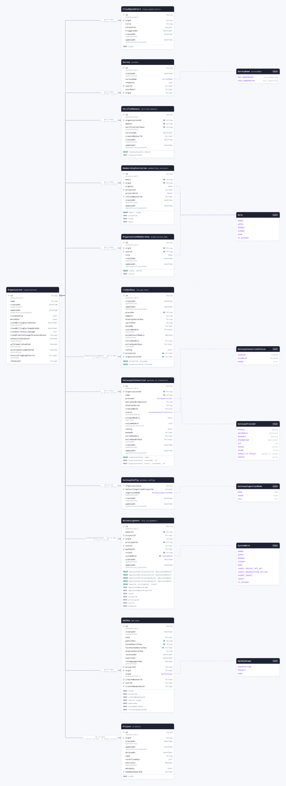

| Field                                                                        | Type       | Constraints | Default              | Description |
| ---------------------------------------------------------------------------- | ---------- | ----------- | -------------------- | ----------- |
| `id`                                                                         | `String`   | PK NOT NULL | `cuid(1)`            |             |
| `name`                                                                       | `String`   | NOT NULL    |                      |             |
| `createdAt` (`created_at`)                                                   | `DateTime` | NOT NULL    | `now()`              |             |
| `updatedAt` (`updated_at`)                                                   | `DateTime` | NOT NULL    | `now()` `@updatedAt` |             |
| `cloudConfig` (`cloud_config`)                                               | `Json`     | NULL        |                      |             |
| `metadata`                                                                   | `Json`     | NULL        |                      |             |
| `cloudBillingCycleAnchor` (`cloud_billing_cycle_anchor`)                     | `DateTime` | NULL        | `now()`              |             |
| `cloudBillingCycleUpdatedAt` (`cloud_billing_cycle_updated_at`)              | `DateTime` | NULL        |                      |             |
| `cloudCurrentCycleUsage` (`cloud_current_cycle_usage`)                       | `Int`      | NULL        |                      |             |
| `cloudFreeTierUsageThresholdState` (`cloud_free_tier_usage_threshold_state`) | `String`   | NULL        |                      |             |
| `aiFeaturesEnabled` (`ai_features_enabled`)                                  | `Boolean`  | NOT NULL    | `false`              |             |
| `aiTelemetryEnabled` (`ai_telemetry_enabled`)                                | `Boolean`  | NOT NULL    | `true`               |             |
| `accessAuditLogEnabled` (`access_audit_log_enabled`)                         | `Boolean`  | NOT NULL    | `false`              |             |
| `featureFlagOrgDefaults` (`feature_flag_org_defaults`)                       | `String[]` | NOT NULL    | `[]`                 |             |
| `sfdcOrgId` (`sfdc_org_id`)                                                  | `String`   | NULL        |                      |             |

#### Referenced by

- `id` ← [Project.orgId](#model-Project) (one-to-many, on delete Cascade, on update Cascade)
- `id` ← [ApiKey.orgId](#model-ApiKey) (one-to-many, on delete Cascade)
- `id` ← [RoleAssignment.orgId](#model-RoleAssignment) (one-to-many, on delete Cascade)
- `id` ← [GatewayConfig.organizationId](#model-GatewayConfig) (one-to-one, on delete Cascade)
- `id` ← [GatewayAiConnection.organizationId](#model-GatewayAiConnection) (one-to-many, on delete Cascade)
- `id` ← [LlmApiKeys.organizationId](#model-LlmApiKeys) (one-to-many, on delete Cascade)
- `id` ← [OrganizationMembership.orgId](#model-OrganizationMembership) (one-to-many, on delete Cascade)
- `id` ← [MembershipInvitation.orgId](#model-MembershipInvitation) (one-to-many, on delete Cascade)
- `id` ← [VerifiedDomain.organizationId](#model-VerifiedDomain) (one-to-many, on delete Cascade)
- `id` ← [Survey.orgId](#model-Survey) (one-to-many, on delete Cascade)
- `id` ← [CloudSpendAlert.orgId](#model-CloudSpendAlert) (one-to-many, on delete Cascade)

#### Definition

```sql
CREATE TABLE "organizations" (
    "id" TEXT NOT NULL,
    "name" TEXT NOT NULL,
    "created_at" TIMESTAMP(3) NOT NULL DEFAULT CURRENT_TIMESTAMP,
    "updated_at" TIMESTAMP(3) NOT NULL DEFAULT CURRENT_TIMESTAMP,
    "cloud_config" JSONB,
    "metadata" JSONB,
    "cloud_billing_cycle_anchor" TIMESTAMP(3) DEFAULT CURRENT_TIMESTAMP,
    "cloud_billing_cycle_updated_at" TIMESTAMP(3),
    "cloud_current_cycle_usage" INTEGER,
    "cloud_free_tier_usage_threshold_state" TEXT,
    "ai_features_enabled" BOOLEAN NOT NULL DEFAULT false,
    "ai_telemetry_enabled" BOOLEAN NOT NULL DEFAULT true,
    "access_audit_log_enabled" BOOLEAN NOT NULL DEFAULT false,
    "feature_flag_org_defaults" TEXT[] DEFAULT ARRAY[]::TEXT[],
    "sfdc_org_id" TEXT,

    CONSTRAINT "organizations_pkey" PRIMARY KEY ("id")
);
```

<details>
<summary>Queries and their SQL</summary>

**findMany**: Every row

```ts
await prisma.organization.findMany();
```

```sql
SELECT
  "public"."organizations"."id",
  "public"."organizations"."name",
  "public"."organizations"."created_at",
  "public"."organizations"."updated_at",
  "public"."organizations"."cloud_config",
  "public"."organizations"."metadata",
  "public"."organizations"."cloud_billing_cycle_anchor",
  "public"."organizations"."cloud_billing_cycle_updated_at",
  "public"."organizations"."cloud_current_cycle_usage",
  "public"."organizations"."cloud_free_tier_usage_threshold_state",
  "public"."organizations"."ai_features_enabled",
  "public"."organizations"."ai_telemetry_enabled",
  "public"."organizations"."access_audit_log_enabled",
  "public"."organizations"."feature_flag_org_defaults",
  "public"."organizations"."sfdc_org_id"
FROM
  "public"."organizations"
WHERE
  1 = 1
OFFSET
  $1
-- params: ["0"]
```

**count**: How many rows there are

```ts
await prisma.organization.count();
```

```sql
SELECT
  COUNT(*) AS "_count$_all"
FROM
  (
    SELECT
      "public"."organizations"."id"
    FROM
      "public"."organizations"
    WHERE
      1 = 1
    OFFSET
      $1
  ) AS "sub"
-- params: ["0"]
```

**findMany**: Every row with its relations

```ts
await prisma.organization.findMany({
  include: {
    organizationMemberships: true,
    projects: true,
    MembershipInvitation: true,
    ApiKey: true,
    surveys: true,
    cloudSpendAlerts: true,
    verifiedDomains: true,
    gatewayConfig: true,
    gatewayAiConnections: true,
    organizationLlmApiKeys: true,
    roleAssignments: true,
  },
});
```

```sql
SELECT
  "public"."organizations"."id",
  "public"."organizations"."name",
  "public"."organizations"."created_at",
  "public"."organizations"."updated_at",
  "public"."organizations"."cloud_config",
  "public"."organizations"."metadata",
  "public"."organizations"."cloud_billing_cycle_anchor",
  "public"."organizations"."cloud_billing_cycle_updated_at",
  "public"."organizations"."cloud_current_cycle_usage",
  "public"."organizations"."cloud_free_tier_usage_threshold_state",
  "public"."organizations"."ai_features_enabled",
  "public"."organizations"."ai_telemetry_enabled",
  "public"."organizations"."access_audit_log_enabled",
  "public"."organizations"."feature_flag_org_defaults",
  "public"."organizations"."sfdc_org_id"
FROM
  "public"."organizations"
WHERE
  1 = 1
OFFSET
  $1
-- params: ["0"]

SELECT
  "public"."organization_memberships"."id",
  "public"."organization_memberships"."org_id",
  "public"."organization_memberships"."user_id",
  "public"."organization_memberships"."role"::text,
  "public"."organization_memberships"."created_at",
  "public"."organization_memberships"."updated_at"
FROM
  "public"."organization_memberships"
WHERE
  "public"."organization_memberships"."org_id" IN ($1)
OFFSET
  $2
-- params: ["<id of the rows above>","0"]

SELECT
  "public"."projects"."id",
  "public"."projects"."org_id",
  "public"."projects"."created_at",
  "public"."projects"."updated_at",
  "public"."projects"."deleted_at",
  "public"."projects"."name",
  "public"."projects"."retention_days",
  "public"."projects"."has_traces",
  "public"."projects"."metadata",
  "public"."projects"."home_dashboard_id"
FROM
  "public"."projects"
WHERE
  "public"."projects"."org_id" IN ($1)
OFFSET
  $2
-- params: ["<id of the rows above>","0"]

SELECT
  "public"."membership_invitations"."id",
  "public"."membership_invitations"."email",
  "public"."membership_invitations"."org_id",
  "public"."membership_invitations"."org_role"::text,
  "public"."membership_invitations"."project_id",
  "public"."membership_invitations"."project_role"::text,
  "public"."membership_invitations"."invited_by_user_id",
  "public"."membership_invitations"."created_at",
  "public"."membership_invitations"."updated_at"
FROM
  "public"."membership_invitations"
WHERE
  "public"."membership_invitations"."org_id" IN ($1)
OFFSET
  $2
-- params: ["<id of the rows above>","0"]

SELECT
  "public"."api_keys"."id",
  "public"."api_keys"."created_at",
  "public"."api_keys"."note",
  "public"."api_keys"."public_key",
  "public"."api_keys"."hashed_secret_key",
  "public"."api_keys"."fast_hashed_secret_key",
  "public"."api_keys"."display_secret_key",
  "public"."api_keys"."last_used_at",
  "public"."api_keys"."expires_at",
  "public"."api_keys"."is_in_app_agent_key",
  "public"."api_keys"."project_id",
  "public"."api_keys"."organization_id",
  "public"."api_keys"."scope"::text,
  "public"."api_keys"."created_by_user_id",
  "public"."api_keys"."user_id",
  "public"."api_keys"."created_by_api_key_id"
FROM
  "public"."api_keys"
WHERE
  "public"."api_keys"."organization_id" IN ($1)
OFFSET
  $2
-- params: ["<id of the rows above>","0"]

SELECT
  "public"."surveys"."id",
  "public"."surveys"."created_at",
  "public"."surveys"."survey_name"::text,
  "public"."surveys"."response",
  "public"."surveys"."user_id",
  "public"."surveys"."user_email",
  "public"."surveys"."org_id"
FROM
  "public"."surveys"
WHERE
  "public"."surveys"."org_id" IN ($1)
OFFSET
  $2
-- params: ["<id of the rows above>","0"]

SELECT
  "public"."cloud_spend_alerts"."id",
  "public"."cloud_spend_alerts"."org_id",
  "public"."cloud_spend_alerts"."title",
  "public"."cloud_spend_alerts"."threshold",
  "public"."cloud_spend_alerts"."triggered_at",
  "public"."cloud_spend_alerts"."created_at",
  "public"."cloud_spend_alerts"."updated_at"
FROM
  "public"."cloud_spend_alerts"
WHERE
  "public"."cloud_spend_alerts"."org_id" IN ($1)
OFFSET
  $2
-- params: ["<id of the rows above>","0"]

SELECT
  "public"."verified_domains"."id",
  "public"."verified_domains"."organization_id",
  "public"."verified_domains"."domain",
  "public"."verified_domains"."verification_token",
  "public"."verified_domains"."verified_at",
  "public"."verified_domains"."created_by_user_id",
  "public"."verified_domains"."created_at",
  "public"."verified_domains"."updated_at"
FROM
  "public"."verified_domains"
WHERE
  "public"."verified_domains"."organization_id" IN ($1)
OFFSET
  $2
-- params: ["<id of the rows above>","0"]

SELECT
  "public"."gateway_configs"."organization_id",
  "public"."gateway_configs"."default_ingestion_project_id",
  "public"."gateway_configs"."ingestion_mode"::text,
  "public"."gateway_configs"."created_at",
  "public"."gateway_configs"."updated_at"
FROM
  "public"."gateway_configs"
WHERE
  "public"."gateway_configs"."organization_id" IN ($1)
OFFSET
  $2
-- params: ["<id of the rows above>","0"]

SELECT
  "public"."gateway_ai_connections"."id",
  "public"."gateway_ai_connections"."organization_id",
  "public"."gateway_ai_connections"."name",
  "public"."gateway_ai_connections"."provider"::text,
  "public"."gateway_ai_connections"."encrypted_credentials",
  "public"."gateway_ai_connections"."display_secret_key",
  "public"."gateway_ai_connections"."created_by_id",
  "public"."gateway_ai_connections"."status"::text,
  "public"."gateway_ai_connections"."allowed_models",
  "public"."gateway_ai_connections"."custom_models",
  "public"."gateway_ai_connections"."config",
  "public"."gateway_ai_connections"."base_url",
  "public"."gateway_ai_connections"."extra_headers",
  "public"."gateway_ai_connections"."extra_header_keys",
  "public"."gateway_ai_connections"."created_at",
  "public"."gateway_ai_connections"."updated_at"
FROM
  "public"."gateway_ai_connections"
WHERE
  "public"."gateway_ai_connections"."organization_id" IN ($1)
OFFSET
  $2
-- params: ["<id of the rows above>","0"]

SELECT
  "public"."llm_api_keys"."id",
  "public"."llm_api_keys"."created_at",
  "public"."llm_api_keys"."updated_at",
  "public"."llm_api_keys"."provider",
  "public"."llm_api_keys"."adapter",
  "public"."llm_api_keys"."display_secret_key",
  "public"."llm_api_keys"."secret_key",
  "public"."llm_api_keys"."base_url",
  "public"."llm_api_keys"."custom_models",
  "public"."llm_api_keys"."with_default_models",
  "public"."llm_api_keys"."extra_headers",
  "public"."llm_api_keys"."extra_header_keys",
  "public"."llm_api_keys"."config",
  "public"."llm_api_keys"."project_id",
  "public"."llm_api_keys"."organization_id"
FROM
  "public"."llm_api_keys"
WHERE
  "public"."llm_api_keys"."organization_id" IN ($1)
OFFSET
  $2
-- params: ["<id of the rows above>","0"]

SELECT
  "public"."role_assignments"."id",
  "public"."role_assignments"."owner_id",
  "public"."role_assignments"."project_id",
  "public"."role_assignments"."org_id",
  "public"."role_assignments"."principal_id",
  "public"."role_assignments"."user_id",
  "public"."role_assignments"."api_key_id",
  "public"."role_assignments"."role_id",
  "public"."role_assignments"."system_role"::text,
  "public"."role_assignments"."created_at",
  "public"."role_assignments"."updated_at"
FROM
  "public"."role_assignments"
WHERE
  "public"."role_assignments"."org_id" IN ($1)
OFFSET
  $2
-- params: ["<id of the rows above>","0"]
```

**findUnique**: One row by what is unique to it

```ts
await prisma.organization.findUnique({ where: { id: "example" } });
```

```sql
SELECT
  "public"."organizations"."id",
  "public"."organizations"."name",
  "public"."organizations"."created_at",
  "public"."organizations"."updated_at",
  "public"."organizations"."cloud_config",
  "public"."organizations"."metadata",
  "public"."organizations"."cloud_billing_cycle_anchor",
  "public"."organizations"."cloud_billing_cycle_updated_at",
  "public"."organizations"."cloud_current_cycle_usage",
  "public"."organizations"."cloud_free_tier_usage_threshold_state",
  "public"."organizations"."ai_features_enabled",
  "public"."organizations"."ai_telemetry_enabled",
  "public"."organizations"."access_audit_log_enabled",
  "public"."organizations"."feature_flag_org_defaults",
  "public"."organizations"."sfdc_org_id"
FROM
  "public"."organizations"
WHERE
  (
    "public"."organizations"."id" = $1
    AND 1 = 1
  )
LIMIT
  $2
OFFSET
  $3
-- params: ["example","1","0"]
```

**create**: Create a row

```ts
await prisma.organization.create({ data: { name: "example" } });
```

```sql
INSERT INTO
  "public"."organizations" (
    "id",
    "name",
    "created_at",
    "updated_at",
    "cloud_billing_cycle_anchor",
    "ai_features_enabled",
    "ai_telemetry_enabled",
    "access_audit_log_enabled",
    "feature_flag_org_defaults"
  )
VALUES
  ($1, $2, $3, $4, $5, $6, $7, $8, $9)
RETURNING
  "public"."organizations"."id",
  "public"."organizations"."name",
  "public"."organizations"."created_at",
  "public"."organizations"."updated_at",
  "public"."organizations"."cloud_config",
  "public"."organizations"."metadata",
  "public"."organizations"."cloud_billing_cycle_anchor",
  "public"."organizations"."cloud_billing_cycle_updated_at",
  "public"."organizations"."cloud_current_cycle_usage",
  "public"."organizations"."cloud_free_tier_usage_threshold_state",
  "public"."organizations"."ai_features_enabled",
  "public"."organizations"."ai_telemetry_enabled",
  "public"."organizations"."access_audit_log_enabled",
  "public"."organizations"."feature_flag_org_defaults",
  "public"."organizations"."sfdc_org_id"
-- params: ["<cuid(1)>","example","<now()>","<now()>","<now()>",false,true,false,[]]
```

**update**: Update a row

```ts
await prisma.organization.update({ where: { id: "example" }, data: { name: "example" } });
```

```sql
UPDATE "public"."organizations"
SET
  "name" = $1,
  "updated_at" = $2
WHERE
  (
    "public"."organizations"."id" = $3
    AND 1 = 1
  )
RETURNING
  "public"."organizations"."id",
  "public"."organizations"."name",
  "public"."organizations"."created_at",
  "public"."organizations"."updated_at",
  "public"."organizations"."cloud_config",
  "public"."organizations"."metadata",
  "public"."organizations"."cloud_billing_cycle_anchor",
  "public"."organizations"."cloud_billing_cycle_updated_at",
  "public"."organizations"."cloud_current_cycle_usage",
  "public"."organizations"."cloud_free_tier_usage_threshold_state",
  "public"."organizations"."ai_features_enabled",
  "public"."organizations"."ai_telemetry_enabled",
  "public"."organizations"."access_audit_log_enabled",
  "public"."organizations"."feature_flag_org_defaults",
  "public"."organizations"."sfdc_org_id"
-- params: ["example",{"prisma__type":"generatorCall","prisma__value":{"name":"now","args":[],"returnType":{"type":"DateTime"}}},"example"]
```

**delete**: Delete a row

```ts
await prisma.organization.delete({ where: { id: "example" } });
```

```sql
DELETE FROM "public"."organizations"
WHERE
  (
    "public"."organizations"."id" = $1
    AND 1 = 1
  )
RETURNING
  "public"."organizations"."id",
  "public"."organizations"."name",
  "public"."organizations"."created_at",
  "public"."organizations"."updated_at",
  "public"."organizations"."cloud_config",
  "public"."organizations"."metadata",
  "public"."organizations"."cloud_billing_cycle_anchor",
  "public"."organizations"."cloud_billing_cycle_updated_at",
  "public"."organizations"."cloud_current_cycle_usage",
  "public"."organizations"."cloud_free_tier_usage_threshold_state",
  "public"."organizations"."ai_features_enabled",
  "public"."organizations"."ai_telemetry_enabled",
  "public"."organizations"."access_audit_log_enabled",
  "public"."organizations"."feature_flag_org_defaults",
  "public"."organizations"."sfdc_org_id"
-- params: ["example"]
```

</details>

<a id="model-Project"></a>

### Project

Table `projects`.

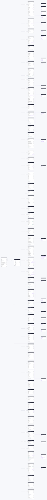

| Field                                   | Type       | Constraints                                       | Default              | Description |
| --------------------------------------- | ---------- | ------------------------------------------------- | -------------------- | ----------- |
| `id`                                    | `String`   | PK NOT NULL                                       | `cuid(1)`            |             |
| `orgId` (`org_id`)                      | `String`   | NOT NULL → [Organization.id](#model-Organization) |                      |             |
| `createdAt` (`created_at`)              | `DateTime` | NOT NULL                                          | `now()`              |             |
| `updatedAt` (`updated_at`)              | `DateTime` | NOT NULL                                          | `now()` `@updatedAt` |             |
| `deletedAt` (`deleted_at`)              | `DateTime` | NULL                                              |                      |             |
| `name`                                  | `String`   | NOT NULL                                          |                      |             |
| `retentionDays` (`retention_days`)      | `Int`      | NULL                                              |                      |             |
| `hasTraces` (`has_traces`)              | `Boolean`  | NOT NULL                                          | `false`              |             |
| `metadata`                              | `Json`     | NULL                                              |                      |             |
| `homeDashboardId` (`home_dashboard_id`) | `String`   | NULL → [Dashboard.id](#model-Dashboard)           |                      |             |

#### Indexes

- `@@index([orgId])`

#### References

- `homeDashboardId` → [Dashboard.id](#model-Dashboard) (many-to-one, on delete SetNull)
- `orgId` → [Organization.id](#model-Organization) (many-to-one, on delete Cascade, on update Cascade)

#### Referenced by

- `id` ← [ApiKey.projectId](#model-ApiKey) (one-to-many, on delete Cascade)
- `id` ← [RoleAssignment.projectId](#model-RoleAssignment) (one-to-many, on delete Cascade)
- `id` ← [GatewayConfig.defaultIngestionProjectId](#model-GatewayConfig) (one-to-many, on delete SetNull)
- `id` ← [InAppAgentConversation.projectId](#model-InAppAgentConversation) (one-to-many, on delete Cascade)
- `id` ← [InAppAgentEvent.projectId](#model-InAppAgentEvent) (one-to-many, on delete Cascade)
- `id` ← [InAppAgentRun.projectId](#model-InAppAgentRun) (one-to-many, on delete Cascade)
- `id` ← [InAppAgentPendingToolApproval.projectId](#model-InAppAgentPendingToolApproval) (one-to-many, on delete Cascade)
- `id` ← [LlmApiKeys.projectId](#model-LlmApiKeys) (one-to-many, on delete Cascade)
- `id` ← [ProjectMembership.projectId](#model-ProjectMembership) (one-to-many, on delete Cascade)
- `id` ← [MembershipInvitation.projectId](#model-MembershipInvitation) (one-to-many, on delete SetNull)
- `id` ← [TraceSession.projectId](#model-TraceSession) (one-to-many, on delete Cascade)
- `id` ← [ScoreConfig.projectId](#model-ScoreConfig) (one-to-many, on delete Cascade)
- `id` ← [AnnotationQueue.projectId](#model-AnnotationQueue) (one-to-many, on delete Cascade)
- `id` ← [AnnotationQueueItem.projectId](#model-AnnotationQueueItem) (one-to-many, on delete Cascade)
- `id` ← [AnnotationQueueAssignment.projectId](#model-AnnotationQueueAssignment) (one-to-many, on delete Cascade)
- `id` ← [Dataset.projectId](#model-Dataset) (one-to-many, on delete Cascade)
- `id` ← [Comment.projectId](#model-Comment) (one-to-many, on delete Cascade)
- `id` ← [CommentReaction.projectId](#model-CommentReaction) (one-to-many, on delete Cascade)
- `id` ← [NotificationPreference.projectId](#model-NotificationPreference) (one-to-many, on delete Cascade)
- `id` ← [Prompt.projectId](#model-Prompt) (one-to-many, on delete Cascade)
- `id` ← [PromptDependency.projectId](#model-PromptDependency) (one-to-many, on delete Cascade)
- `id` ← [PromptProtectedLabels.projectId](#model-PromptProtectedLabels) (one-to-many, on delete Cascade)
- `id` ← [Skill.projectId](#model-Skill) (one-to-many, on delete Cascade)
- `id` ← [SkillFile.projectId](#model-SkillFile) (one-to-many, on delete Cascade)
- `id` ← [SkillBlob.projectId](#model-SkillBlob) (one-to-many, on delete Cascade)
- `id` ← [Model.projectId](#model-Model) (one-to-many, on delete Cascade)
- `id` ← [Price.projectId](#model-Price) (one-to-many, on delete Cascade)
- `id` ← [EvalTemplate.projectId](#model-EvalTemplate) (one-to-many, on delete Cascade)
- `id` ← [Evaluator.projectId](#model-Evaluator) (one-to-many, on delete Cascade)
- `id` ← [JobConfiguration.projectId](#model-JobConfiguration) (one-to-many, on delete Cascade)
- `id` ← [EvaluationRule.projectId](#model-EvaluationRule) (one-to-many, on delete Cascade)
- `id` ← [TracingReadinessSettings.projectId](#model-TracingReadinessSettings) (one-to-one, on delete Cascade)
- `id` ← [EvaluationRuleEvaluatorAssignment.projectId](#model-EvaluationRuleEvaluatorAssignment) (one-to-many, on delete Cascade)
- `id` ← [JobExecution.projectId](#model-JobExecution) (one-to-many, on delete Cascade)
- `id` ← [DefaultLlmModel.projectId](#model-DefaultLlmModel) (one-to-many, on delete Cascade)
- `id` ← [TopicConfig.projectId](#model-TopicConfig) (one-to-one, on delete Cascade)
- `id` ← [PosthogIntegration.projectId](#model-PosthogIntegration) (one-to-many, on delete Cascade)
- `id` ← [MixpanelIntegration.projectId](#model-MixpanelIntegration) (one-to-many, on delete Cascade)
- `id` ← [BlobStorageIntegration.projectId](#model-BlobStorageIntegration) (one-to-many, on delete Cascade)
- `id` ← [ExternalMediaStorageIntegration.projectId](#model-ExternalMediaStorageIntegration) (one-to-one, on delete Cascade)
- `id` ← [WebCalloutEndpoint.projectId](#model-WebCalloutEndpoint) (one-to-many, on delete Cascade)
- `id` ← [BatchExport.projectId](#model-BatchExport) (one-to-many, on delete Cascade)
- `id` ← [BatchAction.projectId](#model-BatchAction) (one-to-many, on delete Cascade)
- `id` ← [Media.projectId](#model-Media) (one-to-many, on delete Cascade)
- `id` ← [LlmSchema.projectId](#model-LlmSchema) (one-to-many, on delete Cascade)
- `id` ← [LlmTool.projectId](#model-LlmTool) (one-to-many, on delete Cascade)
- `id` ← [Dashboard.projectId](#model-Dashboard) (one-to-many, on delete Cascade)
- `id` ← [DashboardWidget.projectId](#model-DashboardWidget) (one-to-many, on delete Cascade)
- `id` ← [TableViewPreset.projectId](#model-TableViewPreset) (one-to-many, on delete Cascade)
- `id` ← [DefaultView.projectId](#model-DefaultView) (one-to-many, on delete Cascade)
- `id` ← [Action.projectId](#model-Action) (one-to-many, on delete Cascade)
- `id` ← [Trigger.projectId](#model-Trigger) (one-to-many, on delete Cascade)
- `id` ← [Automation.projectId](#model-Automation) (one-to-many, on delete Cascade)
- `id` ← [AutomationExecution.projectId](#model-AutomationExecution) (one-to-many, on delete Cascade)
- `id` ← [Monitor.projectId](#model-Monitor) (one-to-many, on delete Cascade)
- `id` ← [SlackIntegration.projectId](#model-SlackIntegration) (one-to-one, on delete Cascade)
- `id` ← [PendingDeletion.projectId](#model-PendingDeletion) (one-to-many, on delete Cascade)
- `id` ← [TopicClusteringRun.projectId](#model-TopicClusteringRun) (one-to-many, on delete Cascade)

#### Definition

```sql
CREATE TABLE "projects" (
    "id" TEXT NOT NULL,
    "org_id" TEXT NOT NULL,
    "created_at" TIMESTAMP(3) NOT NULL DEFAULT CURRENT_TIMESTAMP,
    "updated_at" TIMESTAMP(3) NOT NULL DEFAULT CURRENT_TIMESTAMP,
    "deleted_at" TIMESTAMP(3),
    "name" TEXT NOT NULL,
    "retention_days" INTEGER,
    "has_traces" BOOLEAN NOT NULL DEFAULT false,
    "metadata" JSONB,
    "home_dashboard_id" TEXT,

    CONSTRAINT "projects_pkey" PRIMARY KEY ("id")
);

CREATE INDEX "projects_org_id_idx" ON "projects"("org_id");

ALTER TABLE "projects" ADD CONSTRAINT "projects_home_dashboard_id_fkey" FOREIGN KEY ("home_dashboard_id") REFERENCES "dashboards"("id") ON DELETE SET NULL ON UPDATE CASCADE;

ALTER TABLE "projects" ADD CONSTRAINT "projects_org_id_fkey" FOREIGN KEY ("org_id") REFERENCES "organizations"("id") ON DELETE CASCADE ON UPDATE CASCADE;
```

<details>
<summary>Queries and their SQL</summary>

**findMany**: Every row

```ts
await prisma.project.findMany();
```

```sql
SELECT
  "public"."projects"."id",
  "public"."projects"."org_id",
  "public"."projects"."created_at",
  "public"."projects"."updated_at",
  "public"."projects"."deleted_at",
  "public"."projects"."name",
  "public"."projects"."retention_days",
  "public"."projects"."has_traces",
  "public"."projects"."metadata",
  "public"."projects"."home_dashboard_id"
FROM
  "public"."projects"
WHERE
  1 = 1
OFFSET
  $1
-- params: ["0"]
```

**count**: How many rows there are

```ts
await prisma.project.count();
```

```sql
SELECT
  COUNT(*) AS "_count$_all"
FROM
  (
    SELECT
      "public"."projects"."id"
    FROM
      "public"."projects"
    WHERE
      1 = 1
    OFFSET
      $1
  ) AS "sub"
-- params: ["0"]
```

**findMany**: Every row with its relations

```ts
await prisma.project.findMany({
  include: {
    homeDashboard: true,
    projectMembers: true,
    organization: true,
    apiKeys: true,
    roleAssignments: true,
    dataset: true,
    invitations: true,
    sessions: true,
    Prompt: true,
    Skill: true,
    SkillFile: true,
    SkillBlob: true,
    Model: true,
    EvalTemplate: true,
    JobConfiguration: true,
    JobExecution: true,
    Evaluator: true,
    EvaluationRule: true,
    EvaluationRuleEvaluatorAssignment: true,
    tracingReadinessSettings: true,
    LlmApiKeys: true,
    PosthogIntegration: true,
    MixpanelIntegration: true,
    BlobStorageIntegration: true,
    ExternalMediaStorageIntegration: true,
    webCalloutEndpoints: true,
    scoreConfig: true,
    BatchExport: true,
    BatchAction: true,
    comment: true,
    commentReactions: true,
    annotationQueue: true,
    annotationQueueItem: true,
    Media: true,
    PromptDependency: true,
    LlmSchema: true,
    LlmTool: true,
    PromptProtectedLabels: true,
    Dashboard: true,
    DashboardWidget: true,
    TableViewPreset: true,
    actions: true,
    triggers: true,
    automationExecutions: true,
    Automation: true,
    monitors: true,
    DefaultLlmModel: true,
    TopicConfig: true,
    Price: true,
    SlackIntegration: true,
    PendingDeletion: true,
    AnnotationQueueAssignment: true,
    NotificationPreference: true,
    DefaultView: true,
    InAppAgentConversation: true,
    InAppAgentEvent: true,
    InAppAgentRun: true,
    InAppAgentPendingToolApproval: true,
    topicClusteringRuns: true,
    gatewayConfigs: true,
  },
});
```

```sql
SELECT
  "public"."projects"."id",
  "public"."projects"."org_id",
  "public"."projects"."created_at",
  "public"."projects"."updated_at",
  "public"."projects"."deleted_at",
  "public"."projects"."name",
  "public"."projects"."retention_days",
  "public"."projects"."has_traces",
  "public"."projects"."metadata",
  "public"."projects"."home_dashboard_id"
FROM
  "public"."projects"
WHERE
  1 = 1
OFFSET
  $1
-- params: ["0"]

SELECT
  "public"."dashboards"."id",
  "public"."dashboards"."created_at",
  "public"."dashboards"."updated_at",
  "public"."dashboards"."created_by",
  "public"."dashboards"."updated_by",
  "public"."dashboards"."project_id",
  "public"."dashboards"."name",
  "public"."dashboards"."description",
  "public"."dashboards"."definition",
  "public"."dashboards"."filters"
FROM
  "public"."dashboards"
WHERE
  "public"."dashboards"."id" IN ($1)
OFFSET
  $2
-- params: ["<homeDashboardId of the rows above>","0"]

SELECT
  "public"."project_memberships"."project_id",
  "public"."project_memberships"."user_id",
  "public"."project_memberships"."org_membership_id",
  "public"."project_memberships"."role"::text,
  "public"."project_memberships"."created_at",
  "public"."project_memberships"."updated_at"
FROM
  "public"."project_memberships"
WHERE
  "public"."project_memberships"."project_id" IN ($1)
OFFSET
  $2
-- params: ["<id of the rows above>","0"]

SELECT
  "public"."organizations"."id",
  "public"."organizations"."name",
  "public"."organizations"."created_at",
  "public"."organizations"."updated_at",
  "public"."organizations"."cloud_config",
  "public"."organizations"."metadata",
  "public"."organizations"."cloud_billing_cycle_anchor",
  "public"."organizations"."cloud_billing_cycle_updated_at",
  "public"."organizations"."cloud_current_cycle_usage",
  "public"."organizations"."cloud_free_tier_usage_threshold_state",
  "public"."organizations"."ai_features_enabled",
  "public"."organizations"."ai_telemetry_enabled",
  "public"."organizations"."access_audit_log_enabled",
  "public"."organizations"."feature_flag_org_defaults",
  "public"."organizations"."sfdc_org_id"
FROM
  "public"."organizations"
WHERE
  "public"."organizations"."id" IN ($1)
OFFSET
  $2
-- params: ["<orgId of the rows above>","0"]

SELECT
  "public"."api_keys"."id",
  "public"."api_keys"."created_at",
  "public"."api_keys"."note",
  "public"."api_keys"."public_key",
  "public"."api_keys"."hashed_secret_key",
  "public"."api_keys"."fast_hashed_secret_key",
  "public"."api_keys"."display_secret_key",
  "public"."api_keys"."last_used_at",
  "public"."api_keys"."expires_at",
  "public"."api_keys"."is_in_app_agent_key",
  "public"."api_keys"."project_id",
  "public"."api_keys"."organization_id",
  "public"."api_keys"."scope"::text,
  "public"."api_keys"."created_by_user_id",
  "public"."api_keys"."user_id",
  "public"."api_keys"."created_by_api_key_id"
FROM
  "public"."api_keys"
WHERE
  "public"."api_keys"."project_id" IN ($1)
OFFSET
  $2
-- params: ["<id of the rows above>","0"]

SELECT
  "public"."role_assignments"."id",
  "public"."role_assignments"."owner_id",
  "public"."role_assignments"."project_id",
  "public"."role_assignments"."org_id",
  "public"."role_assignments"."principal_id",
  "public"."role_assignments"."user_id",
  "public"."role_assignments"."api_key_id",
  "public"."role_assignments"."role_id",
  "public"."role_assignments"."system_role"::text,
  "public"."role_assignments"."created_at",
  "public"."role_assignments"."updated_at"
FROM
  "public"."role_assignments"
WHERE
  "public"."role_assignments"."project_id" IN ($1)
OFFSET
  $2
-- params: ["<id of the rows above>","0"]

SELECT
  "public"."datasets"."id",
  "public"."datasets"."project_id",
  "public"."datasets"."name",
  "public"."datasets"."description",
  "public"."datasets"."metadata",
  "public"."datasets"."remote_experiment_url",
  "public"."datasets"."remote_experiment_payload",
  "public"."datasets"."remote_experiment_enabled",
  "public"."datasets"."remote_experiment_secret_key",
  "public"."datasets"."remote_experiment_display_secret_key",
  "public"."datasets"."remote_experiment_request_headers",
  "public"."datasets"."remote_experiment_display_headers",
  "public"."datasets"."input_schema",
  "public"."datasets"."expected_output_schema",
  "public"."datasets"."created_at",
  "public"."datasets"."updated_at"
FROM
  "public"."datasets"
WHERE
  "public"."datasets"."project_id" IN ($1)
OFFSET
  $2
-- params: ["<id of the rows above>","0"]

SELECT
  "public"."membership_invitations"."id",
  "public"."membership_invitations"."email",
  "public"."membership_invitations"."org_id",
  "public"."membership_invitations"."org_role"::text,
  "public"."membership_invitations"."project_id",
  "public"."membership_invitations"."project_role"::text,
  "public"."membership_invitations"."invited_by_user_id",
  "public"."membership_invitations"."created_at",
  "public"."membership_invitations"."updated_at"
FROM
  "public"."membership_invitations"
WHERE
  "public"."membership_invitations"."project_id" IN ($1)
OFFSET
  $2
-- params: ["<id of the rows above>","0"]

SELECT
  "public"."trace_sessions"."id",
  "public"."trace_sessions"."project_id",
  "public"."trace_sessions"."created_at",
  "public"."trace_sessions"."updated_at",
  "public"."trace_sessions"."bookmarked",
  "public"."trace_sessions"."public",
  "public"."trace_sessions"."environment"
FROM
  "public"."trace_sessions"
WHERE
  "public"."trace_sessions"."project_id" IN ($1)
OFFSET
  $2
-- params: ["<id of the rows above>","0"]

SELECT
  "public"."prompts"."id",
  "public"."prompts"."created_at",
  "public"."prompts"."updated_at",
  "public"."prompts"."project_id",
  "public"."prompts"."created_by",
  "public"."prompts"."prompt",
  "public"."prompts"."name",
  "public"."prompts"."version",
  "public"."prompts"."type",
  "public"."prompts"."is_active",
  "public"."prompts"."config",
  "public"."prompts"."tags",
  "public"."prompts"."labels",
  "public"."prompts"."commit_message"
FROM
  "public"."prompts"
WHERE
  "public"."prompts"."project_id" IN ($1)
OFFSET
  $2
-- params: ["<id of the rows above>","0"]

SELECT
  "public"."skills"."id",
  "public"."skills"."created_at",
  "public"."skills"."updated_at",
  "public"."skills"."project_id",
  "public"."skills"."created_by",
  "public"."skills"."name",
  "public"."skills"."description",
  "public"."skills"."frontmatter",
  "public"."skills"."version",
  "public"."skills"."tags",
  "public"."skills"."labels",
  "public"."skills"."commit_message"
FROM
  "public"."skills"
WHERE
  "public"."skills"."project_id" IN ($1)
OFFSET
  $2
-- params: ["<id of the rows above>","0"]

SELECT
  "public"."skill_files"."id",
  "public"."skill_files"."created_at",
  "public"."skill_files"."project_id",
  "public"."skill_files"."skill_id",
  "public"."skill_files"."blob_id",
  "public"."skill_files"."path"
FROM
  "public"."skill_files"
WHERE
  "public"."skill_files"."project_id" IN ($1)
OFFSET
  $2
-- params: ["<id of the rows above>","0"]

SELECT
  "public"."skill_blobs"."id",
  "public"."skill_blobs"."created_at",
  "public"."skill_blobs"."project_id",
  "public"."skill_blobs"."sha_256_hash",
  "public"."skill_blobs"."content_type",
  "public"."skill_blobs"."content_length",
  "public"."skill_blobs"."content"
FROM
  "public"."skill_blobs"
WHERE
  "public"."skill_blobs"."project_id" IN ($1)
OFFSET
  $2
-- params: ["<id of the rows above>","0"]

SELECT
  "public"."models"."id",
  "public"."models"."created_at",
  "public"."models"."updated_at",
  "public"."models"."project_id",
  "public"."models"."model_name",
  "public"."models"."match_pattern",
  "public"."models"."start_date",
  "public"."models"."input_price",
  "public"."models"."output_price",
  "public"."models"."total_price",
  "public"."models"."unit",
  "public"."models"."tokenizer_id",
  "public"."models"."tokenizer_config"
FROM
  "public"."models"
WHERE
  "public"."models"."project_id" IN ($1)
OFFSET
  $2
-- params: ["<id of the rows above>","0"]

SELECT
  "public"."eval_templates"."id",
  "public"."eval_templates"."created_at",
  "public"."eval_templates"."updated_at",
  "public"."eval_templates"."project_id",
  "public"."eval_templates"."name",
  "public"."eval_templates"."version",
  "public"."eval_templates"."prompt",
  "public"."eval_templates"."type"::text,
  "public"."eval_templates"."partner",
  "public"."eval_templates"."model",
  "public"."eval_templates"."provider",
  "public"."eval_templates"."model_params",
  "public"."eval_templates"."vars",
  "public"."eval_templates"."output_schema",
  "public"."eval_templates"."source_code",
  "public"."eval_templates"."source_code_language"::text
FROM
  "public"."eval_templates"
WHERE
  "public"."eval_templates"."project_id" IN ($1)
OFFSET
  $2
-- params: ["<id of the rows above>","0"]

SELECT
  "public"."job_configurations"."id",
  "public"."job_configurations"."created_at",
  "public"."job_configurations"."updated_at",
  "public"."job_configurations"."project_id",
  "public"."job_configurations"."job_type"::text,
  "public"."job_configurations"."status"::text,
  "public"."job_configurations"."blocked_at",
  "public"."job_configurations"."block_reason"::text,
  "public"."job_configurations"."block_message",
  "public"."job_configurations"."eval_template_id",
  "public"."job_configurations"."score_name",
  "public"."job_configurations"."filter",
  "public"."job_configurations"."target_object",
  "public"."job_configurations"."variable_mapping",
  "public"."job_configurations"."sampling",
  "public"."job_configurations"."delay",
  "public"."job_configurations"."time_scope"
FROM
  "public"."job_configurations"
WHERE
  "public"."job_configurations"."project_id" IN ($1)
OFFSET
  $2
-- params: ["<id of the rows above>","0"]

SELECT
  "public"."job_executions"."id",
  "public"."job_executions"."created_at",
  "public"."job_executions"."updated_at",
  "public"."job_executions"."project_id",
  "public"."job_executions"."job_configuration_id",
  "public"."job_executions"."job_template_id",
  "public"."job_executions"."status"::text,
  "public"."job_executions"."start_time",
  "public"."job_executions"."end_time",
  "public"."job_executions"."error",
  "public"."job_executions"."job_input_trace_id",
  "public"."job_executions"."job_input_trace_timestamp",
  "public"."job_executions"."job_input_observation_id",
  "public"."job_executions"."job_input_dataset_item_id",
  "public"."job_executions"."job_input_dataset_item_valid_from",
  "public"."job_executions"."job_output_score_id",
  "public"."job_executions"."execution_trace_id"
FROM
  "public"."job_executions"
WHERE
  "public"."job_executions"."project_id" IN ($1)
OFFSET
  $2
-- params: ["<id of the rows above>","0"]

SELECT
  "public"."evaluators"."id",
  "public"."evaluators"."created_at",
  "public"."evaluators"."updated_at",
  "public"."evaluators"."project_id",
  "public"."evaluators"."name",
  "public"."evaluators"."type"::text,
  "public"."evaluators"."is_built_in",
  "public"."evaluators"."description",
  "public"."evaluators"."created_by_user_id",
  "public"."evaluators"."blocked_at",
  "public"."evaluators"."block_reason"::text,
  "public"."evaluators"."block_message"
FROM
  "public"."evaluators"
WHERE
  "public"."evaluators"."project_id" IN ($1)
OFFSET
  $2
-- params: ["<id of the rows above>","0"]

SELECT
  "public"."evaluation_rules"."id",
  "public"."evaluation_rules"."created_at",
  "public"."evaluation_rules"."updated_at",
  "public"."evaluation_rules"."project_id",
  "public"."evaluation_rules"."created_by_user_id",
  "public"."evaluation_rules"."name",
  "public"."evaluation_rules"."status"::text,
  "public"."evaluation_rules"."target_object",
  "public"."evaluation_rules"."filter",
  "public"."evaluation_rules"."sampling",
  "public"."evaluation_rules"."delay",
  "public"."evaluation_rules"."idle_time",
  "public"."evaluation_rules"."time_scope"
FROM
  "public"."evaluation_rules"
WHERE
  "public"."evaluation_rules"."project_id" IN ($1)
OFFSET
  $2
-- params: ["<id of the rows above>","0"]

SELECT
  "public"."evaluation_rule_evaluator_assignments"."id",
  "public"."evaluation_rule_evaluator_assignments"."created_at",
  "public"."evaluation_rule_evaluator_assignments"."updated_at",
  "public"."evaluation_rule_evaluator_assignments"."project_id",
  "public"."evaluation_rule_evaluator_assignments"."evaluation_rule_id",
  "public"."evaluation_rule_evaluator_assignments"."evaluator_id",
  "public"."evaluation_rule_evaluator_assignments"."variable_mapping"
FROM
  "public"."evaluation_rule_evaluator_assignments"
WHERE
  "public"."evaluation_rule_evaluator_assignments"."project_id" IN ($1)
OFFSET
  $2
-- params: ["<id of the rows above>","0"]

SELECT
  "public"."tracing_readiness_settings"."project_id",
  "public"."tracing_readiness_settings"."created_at",
  "public"."tracing_readiness_settings"."updated_at",
  "public"."tracing_readiness_settings"."created_by",
  "public"."tracing_readiness_settings"."updated_by",
  "public"."tracing_readiness_settings"."trace_idle_ms"
FROM
  "public"."tracing_readiness_settings"
WHERE
  "public"."tracing_readiness_settings"."project_id" IN ($1)
OFFSET
  $2
-- params: ["<id of the rows above>","0"]

SELECT
  "public"."llm_api_keys"."id",
  "public"."llm_api_keys"."created_at",
  "public"."llm_api_keys"."updated_at",
  "public"."llm_api_keys"."provider",
  "public"."llm_api_keys"."adapter",
  "public"."llm_api_keys"."display_secret_key",
  "public"."llm_api_keys"."secret_key",
  "public"."llm_api_keys"."base_url",
  "public"."llm_api_keys"."custom_models",
  "public"."llm_api_keys"."with_default_models",
  "public"."llm_api_keys"."extra_headers",
  "public"."llm_api_keys"."extra_header_keys",
  "public"."llm_api_keys"."config",
  "public"."llm_api_keys"."project_id",
  "public"."llm_api_keys"."organization_id"
FROM
  "public"."llm_api_keys"
WHERE
  "public"."llm_api_keys"."project_id" IN ($1)
OFFSET
  $2
-- params: ["<id of the rows above>","0"]

SELECT
  "public"."posthog_integrations"."project_id",
  "public"."posthog_integrations"."encrypted_posthog_api_key",
  "public"."posthog_integrations"."posthog_host_name",
  "public"."posthog_integrations"."last_sync_at",
  "public"."posthog_integrations"."enabled",
  "public"."posthog_integrations"."created_at",
  "public"."posthog_integrations"."export_source"::text,
  "public"."posthog_integrations"."backfill",
  "public"."posthog_integrations"."last_error",
  "public"."posthog_integrations"."last_error_at"
FROM
  "public"."posthog_integrations"
WHERE
  "public"."posthog_integrations"."project_id" IN ($1)
OFFSET
  $2
-- params: ["<id of the rows above>","0"]

SELECT
  "public"."mixpanel_integrations"."project_id",
  "public"."mixpanel_integrations"."encrypted_mixpanel_project_token",
  "public"."mixpanel_integrations"."mixpanel_region",
  "public"."mixpanel_integrations"."last_sync_at",
  "public"."mixpanel_integrations"."enabled",
  "public"."mixpanel_integrations"."created_at",
  "public"."mixpanel_integrations"."export_source"::text,
  "public"."mixpanel_integrations"."backfill"
FROM
  "public"."mixpanel_integrations"
WHERE
  "public"."mixpanel_integrations"."project_id" IN ($1)
OFFSET
  $2
-- params: ["<id of the rows above>","0"]

SELECT
  "public"."blob_storage_integrations"."project_id",
  "public"."blob_storage_integrations"."type"::text,
  "public"."blob_storage_integrations"."bucket_name",
  "public"."blob_storage_integrations"."prefix",
  "public"."blob_storage_integrations"."auth_type"::text,
  "public"."blob_storage_integrations"."access_key_id",
  "public"."blob_storage_integrations"."secret_access_key",
  "public"."blob_storage_integrations"."role_arn",
  "public"."blob_storage_integrations"."external_id",
  "public"."blob_storage_integrations"."region",
  "public"."blob_storage_integrations"."endpoint",
  "public"."blob_storage_integrations"."force_path_style",
  "public"."blob_storage_integrations"."next_sync_at",
  "public"."blob_storage_integrations"."last_sync_at",
  "public"."blob_storage_integrations"."enabled",
  "public"."blob_storage_integrations"."export_frequency",
  "public"."blob_storage_integrations"."file_type"::text,
  "public"."blob_storage_integrations"."export_mode"::text,
  "public"."blob_storage_integrations"."export_start_date",
  "public"."blob_storage_integrations"."export_source"::text,
  "public"."blob_storage_integrations"."export_field_groups",
  "public"."blob_storage_integrations"."compressed",
  "public"."blob_storage_integrations"."export_tuning",
  "public"."blob_storage_integrations"."run_started_at",
  "public"."blob_storage_integrations"."backfill",
  "public"."blob_storage_integrations"."last_error",
  "public"."blob_storage_integrations"."last_error_at",
  "public"."blob_storage_integrations"."last_failure_notification_sent_at",
  "public"."blob_storage_integrations"."created_at",
  "public"."blob_storage_integrations"."updated_at"
FROM
  "public"."blob_storage_integrations"
WHERE
  "public"."blob_storage_integrations"."project_id" IN ($1)
OFFSET
  $2
-- params: ["<id of the rows above>","0"]

SELECT
  "public"."external_media_storage_integrations"."project_id",
  "public"."external_media_storage_integrations"."type"::text,
  "public"."external_media_storage_integrations"."bucket_name",
  "public"."external_media_storage_integrations"."prefix",
  "public"."external_media_storage_integrations"."auth_type"::text,
  "public"."external_media_storage_integrations"."access_key_id",
  "public"."external_media_storage_integrations"."secret_access_key",
  "public"."external_media_storage_integrations"."role_arn",
  "public"."external_media_storage_integrations"."external_id",
  "public"."external_media_storage_integrations"."region",
  "public"."external_media_storage_integrations"."endpoint",
  "public"."external_media_storage_integrations"."force_path_style",
  "public"."external_media_storage_integrations"."created_at",
  "public"."external_media_storage_integrations"."updated_at"
FROM
  "public"."external_media_storage_integrations"
WHERE
  "public"."external_media_storage_integrations"."project_id" IN ($1)
OFFSET
  $2
-- params: ["<id of the rows above>","0"]

SELECT
  "public"."web_callout_endpoints"."id",
  "public"."web_callout_endpoints"."created_at",
  "public"."web_callout_endpoints"."updated_at",
  "public"."web_callout_endpoints"."project_id",
  "public"."web_callout_endpoints"."name",
  "public"."web_callout_endpoints"."url",
  "public"."web_callout_endpoints"."enabled",
  "public"."web_callout_endpoints"."toast_message",
  "public"."web_callout_endpoints"."request_headers",
  "public"."web_callout_endpoints"."request_header_keys"
FROM
  "public"."web_callout_endpoints"
WHERE
  "public"."web_callout_endpoints"."project_id" IN ($1)
OFFSET
  $2
-- params: ["<id of the rows above>","0"]

SELECT
  "public"."score_configs"."id",
  "public"."score_configs"."created_at",
  "public"."score_configs"."updated_at",
  "public"."score_configs"."project_id",
  "public"."score_configs"."name",
  "public"."score_configs"."data_type"::text,
  "public"."score_configs"."is_archived",
  "public"."score_configs"."min_value",
  "public"."score_configs"."max_value",
  "public"."score_configs"."categories",
  "public"."score_configs"."description"
FROM
  "public"."score_configs"
WHERE
  "public"."score_configs"."project_id" IN ($1)
OFFSET
  $2
-- params: ["<id of the rows above>","0"]

SELECT
  "public"."batch_exports"."id",
  "public"."batch_exports"."created_at",
  "public"."batch_exports"."updated_at",
  "public"."batch_exports"."project_id",
  "public"."batch_exports"."user_id",
  "public"."batch_exports"."finished_at",
  "public"."batch_exports"."expires_at",
  "public"."batch_exports"."name",
  "public"."batch_exports"."status",
  "public"."batch_exports"."query",
  "public"."batch_exports"."format",
  "public"."batch_exports"."url",
  "public"."batch_exports"."log"
FROM
  "public"."batch_exports"
WHERE
  "public"."batch_exports"."project_id" IN ($1)
OFFSET
  $2
-- params: ["<id of the rows above>","0"]

SELECT
  "public"."batch_actions"."id",
  "public"."batch_actions"."created_at",
  "public"."batch_actions"."updated_at",
  "public"."batch_actions"."project_id",
  "public"."batch_actions"."user_id",
  "public"."batch_actions"."action_type",
  "public"."batch_actions"."table_name",
  "public"."batch_actions"."status",
  "public"."batch_actions"."finished_at",
  "public"."batch_actions"."query",
  "public"."batch_actions"."config",
  "public"."batch_actions"."total_count",
  "public"."batch_actions"."processed_count",
  "public"."batch_actions"."failed_count",
  "public"."batch_actions"."log"
FROM
  "public"."batch_actions"
WHERE
  "public"."batch_actions"."project_id" IN ($1)
OFFSET
  $2
-- params: ["<id of the rows above>","0"]

SELECT
  "public"."comments"."id",
  "public"."comments"."project_id",
  "public"."comments"."object_type"::text,
  "public"."comments"."object_id",
  "public"."comments"."created_at",
  "public"."comments"."updated_at",
  "public"."comments"."content",
  "public"."comments"."author_user_id",
  "public"."comments"."data_field",
  "public"."comments"."path",
  "public"."comments"."range_start",
  "public"."comments"."range_end"
FROM
  "public"."comments"
WHERE
  "public"."comments"."project_id" IN ($1)
OFFSET
  $2
-- params: ["<id of the rows above>","0"]

SELECT
  "public"."comment_reactions"."id",
  "public"."comment_reactions"."project_id",
  "public"."comment_reactions"."comment_id",
  "public"."comment_reactions"."user_id",
  "public"."comment_reactions"."emoji",
  "public"."comment_reactions"."created_at"
FROM
  "public"."comment_reactions"
WHERE
  "public"."comment_reactions"."project_id" IN ($1)
OFFSET
  $2
-- params: ["<id of the rows above>","0"]

SELECT
  "public"."annotation_queues"."id",
  "public"."annotation_queues"."name",
  "public"."annotation_queues"."description",
  "public"."annotation_queues"."score_config_ids",
  "public"."annotation_queues"."project_id",
  "public"."annotation_queues"."created_at",
  "public"."annotation_queues"."updated_at"
FROM
  "public"."annotation_queues"
WHERE
  "public"."annotation_queues"."project_id" IN ($1)
OFFSET
  $2
-- params: ["<id of the rows above>","0"]

SELECT
  "public"."annotation_queue_items"."id",
  "public"."annotation_queue_items"."queue_id",
  "public"."annotation_queue_items"."object_id",
  "public"."annotation_queue_items"."object_type"::text,
  "public"."annotation_queue_items"."status"::text,
  "public"."annotation_queue_items"."locked_at",
  "public"."annotation_queue_items"."locked_by_user_id",
  "public"."annotation_queue_items"."annotator_user_id",
  "public"."annotation_queue_items"."completed_at",
  "public"."annotation_queue_items"."project_id",
  "public"."annotation_queue_items"."created_at",
  "public"."annotation_queue_items"."updated_at"
FROM
  "public"."annotation_queue_items"
WHERE
  "public"."annotation_queue_items"."project_id" IN ($1)
OFFSET
  $2
-- params: ["<id of the rows above>","0"]

SELECT
  "public"."media"."project_id",
  "public"."media"."id",
  "public"."media"."sha_256_hash",
  "public"."media"."created_at",
  "public"."media"."updated_at",
  "public"."media"."uploaded_at",
  "public"."media"."upload_http_status",
  "public"."media"."upload_http_error",
  "public"."media"."bucket_path",
  "public"."media"."bucket_name",
  "public"."media"."content_type",
  "public"."media"."content_length"
FROM
  "public"."media"
WHERE
  "public"."media"."project_id" IN ($1)
OFFSET
  $2
-- params: ["<id of the rows above>","0"]

SELECT
  "public"."prompt_dependencies"."id",
  "public"."prompt_dependencies"."created_at",
  "public"."prompt_dependencies"."updated_at",
  "public"."prompt_dependencies"."project_id",
  "public"."prompt_dependencies"."parent_id",
  "public"."prompt_dependencies"."child_name",
  "public"."prompt_dependencies"."child_label",
  "public"."prompt_dependencies"."child_version"
FROM
  "public"."prompt_dependencies"
WHERE
  "public"."prompt_dependencies"."project_id" IN ($1)
OFFSET
  $2
-- params: ["<id of the rows above>","0"]

SELECT
  "public"."llm_schemas"."id",
  "public"."llm_schemas"."created_at",
  "public"."llm_schemas"."updated_at",
  "public"."llm_schemas"."project_id",
  "public"."llm_schemas"."name",
  "public"."llm_schemas"."description",
  "public"."llm_schemas"."schema"
FROM
  "public"."llm_schemas"
WHERE
  "public"."llm_schemas"."project_id" IN ($1)
OFFSET
  $2
-- params: ["<id of the rows above>","0"]

SELECT
  "public"."llm_tools"."id",
  "public"."llm_tools"."created_at",
  "public"."llm_tools"."updated_at",
  "public"."llm_tools"."project_id",
  "public"."llm_tools"."name",
  "public"."llm_tools"."description",
  "public"."llm_tools"."parameters"
FROM
  "public"."llm_tools"
WHERE
  "public"."llm_tools"."project_id" IN ($1)
OFFSET
  $2
-- params: ["<id of the rows above>","0"]

SELECT
  "public"."prompt_protected_labels"."id",
  "public"."prompt_protected_labels"."created_at",
  "public"."prompt_protected_labels"."updated_at",
  "public"."prompt_protected_labels"."project_id",
  "public"."prompt_protected_labels"."label"
FROM
  "public"."prompt_protected_labels"
WHERE
  "public"."prompt_protected_labels"."project_id" IN ($1)
OFFSET
  $2
-- params: ["<id of the rows above>","0"]

SELECT
  "public"."dashboards"."id",
  "public"."dashboards"."created_at",
  "public"."dashboards"."updated_at",
  "public"."dashboards"."created_by",
  "public"."dashboards"."updated_by",
  "public"."dashboards"."project_id",
  "public"."dashboards"."name",
  "public"."dashboards"."description",
  "public"."dashboards"."definition",
  "public"."dashboards"."filters"
FROM
  "public"."dashboards"
WHERE
  "public"."dashboards"."project_id" IN ($1)
OFFSET
  $2
-- params: ["<id of the rows above>","0"]

SELECT
  "public"."dashboard_widgets"."id",
  "public"."dashboard_widgets"."created_at",
  "public"."dashboard_widgets"."updated_at",
  "public"."dashboard_widgets"."created_by",
  "public"."dashboard_widgets"."updated_by",
  "public"."dashboard_widgets"."project_id",
  "public"."dashboard_widgets"."name",
  "public"."dashboard_widgets"."description",
  "public"."dashboard_widgets"."view"::text,
  "public"."dashboard_widgets"."dimensions",
  "public"."dashboard_widgets"."metrics",
  "public"."dashboard_widgets"."filters",
  "public"."dashboard_widgets"."chart_type"::text,
  "public"."dashboard_widgets"."chart_config",
  "public"."dashboard_widgets"."min_version"
FROM
  "public"."dashboard_widgets"
WHERE
  "public"."dashboard_widgets"."project_id" IN ($1)
OFFSET
  $2
-- params: ["<id of the rows above>","0"]

SELECT
  "public"."table_view_presets"."id",
  "public"."table_view_presets"."created_at",
  "public"."table_view_presets"."updated_at",
  "public"."table_view_presets"."project_id",
  "public"."table_view_presets"."name",
  "public"."table_view_presets"."table_name",
  "public"."table_view_presets"."created_by",
  "public"."table_view_presets"."updated_by",
  "public"."table_view_presets"."filters",
  "public"."table_view_presets"."column_order",
  "public"."table_view_presets"."column_visibility",
  "public"."table_view_presets"."search_query",
  "public"."table_view_presets"."order_by"
FROM
  "public"."table_view_presets"
WHERE
  "public"."table_view_presets"."project_id" IN ($1)
OFFSET
  $2
-- params: ["<id of the rows above>","0"]

SELECT
  "public"."actions"."id",
  "public"."actions"."created_at",
  "public"."actions"."updated_at",
  "public"."actions"."project_id",
  "public"."actions"."type"::text,
  "public"."actions"."config"
FROM
  "public"."actions"
WHERE
  "public"."actions"."project_id" IN ($1)
OFFSET
  $2
-- params: ["<id of the rows above>","0"]

SELECT
  "public"."triggers"."id",
  "public"."triggers"."created_at",
  "public"."triggers"."updated_at",
  "public"."triggers"."project_id",
  "public"."triggers"."eventSource",
  "public"."triggers"."eventActions",
  "public"."triggers"."filter",
  "public"."triggers"."status"::text
FROM
  "public"."triggers"
WHERE
  "public"."triggers"."project_id" IN ($1)
OFFSET
  $2
-- params: ["<id of the rows above>","0"]

SELECT
  "public"."automation_executions"."id",
  "public"."automation_executions"."created_at",
  "public"."automation_executions"."updated_at",
  "public"."automation_executions"."source_id",
  "public"."automation_executions"."automation_id",
  "public"."automation_executions"."trigger_id",
  "public"."automation_executions"."action_id",
  "public"."automation_executions"."project_id",
  "public"."automation_executions"."status"::text,
  "public"."automation_executions"."input",
  "public"."automation_executions"."output",
  "public"."automation_executions"."started_at",
  "public"."automation_executions"."finished_at",
  "public"."automation_executions"."error"
FROM
  "public"."automation_executions"
WHERE
  "public"."automation_executions"."project_id" IN ($1)
OFFSET
  $2
-- params: ["<id of the rows above>","0"]

SELECT
  "public"."automations"."id",
  "public"."automations"."name",
  "public"."automations"."trigger_id",
  "public"."automations"."action_id",
  "public"."automations"."created_at",
  "public"."automations"."project_id"
FROM
  "public"."automations"
WHERE
  "public"."automations"."project_id" IN ($1)
OFFSET
  $2
-- params: ["<id of the rows above>","0"]

SELECT
  "public"."monitors"."id",
  "public"."monitors"."created_at",
  "public"."monitors"."updated_at",
  "public"."monitors"."created_by",
  "public"."monitors"."updated_by",
  "public"."monitors"."project_id",
  "public"."monitors"."view"::text,
  "public"."monitors"."filters",
  "public"."monitors"."metric",
  "public"."monitors"."window_ms",
  "public"."monitors"."cadence_ms",
  "public"."monitors"."threshold_operator"::text,
  "public"."monitors"."alert_threshold",
  "public"."monitors"."warning_threshold",
  "public"."monitors"."severity"::text,
  "public"."monitors"."severity_changed_at",
  "public"."monitors"."no_data",
  "public"."monitors"."renotify",
  "public"."monitors"."status"::text,
  "public"."monitors"."scheduler_batch_id",
  "public"."monitors"."next_run_at",
  "public"."monitors"."last_published_at",
  "public"."monitors"."last_claimed_at",
  "public"."monitors"."last_completed_at",
  "public"."monitors"."name",
  "public"."monitors"."tags",
  "public"."monitors"."trigger_ids",
  "public"."monitors"."alerted_at"
FROM
  "public"."monitors"
WHERE
  "public"."monitors"."project_id" IN ($1)
OFFSET
  $2
-- params: ["<id of the rows above>","0"]

SELECT
  "public"."default_llm_models"."id",
  "public"."default_llm_models"."created_at",
  "public"."default_llm_models"."updated_at",
  "public"."default_llm_models"."project_id",
  "public"."default_llm_models"."llm_api_key_id",
  "public"."default_llm_models"."provider",
  "public"."default_llm_models"."adapter",
  "public"."default_llm_models"."model",
  "public"."default_llm_models"."model_params"
FROM
  "public"."default_llm_models"
WHERE
  "public"."default_llm_models"."project_id" IN ($1)
OFFSET
  $2
-- params: ["<id of the rows above>","0"]

SELECT
  "public"."topic_configs"."id",
  "public"."topic_configs"."created_at",
  "public"."topic_configs"."updated_at",
  "public"."topic_configs"."created_by",
  "public"."topic_configs"."updated_by",
  "public"."topic_configs"."project_id",
  "public"."topic_configs"."enabled",
  "public"."topic_configs"."blocked_at",
  "public"."topic_configs"."block_reason"::text,
  "public"."topic_configs"."block_message",
  "public"."topic_configs"."summary_llm_api_key_id",
  "public"."topic_configs"."summary_model",
  "public"."topic_configs"."embedding_llm_api_key_id",
  "public"."topic_configs"."embedding_model",
  "public"."topic_configs"."embedding_dimensions",
  "public"."topic_configs"."clustering_llm_api_key_id",
  "public"."topic_configs"."clustering_model"
FROM
  "public"."topic_configs"
WHERE
  "public"."topic_configs"."project_id" IN ($1)
OFFSET
  $2
-- params: ["<id of the rows above>","0"]

SELECT
  "public"."prices"."id",
  "public"."prices"."created_at",
  "public"."prices"."updated_at",
  "public"."prices"."model_id",
  "public"."prices"."project_id",
  "public"."prices"."pricing_tier_id",
  "public"."prices"."usage_type",
  "public"."prices"."price"
FROM
  "public"."prices"
WHERE
  "public"."prices"."project_id" IN ($1)
OFFSET
  $2
-- params: ["<id of the rows above>","0"]

SELECT
  "public"."slack_integrations"."id",
  "public"."slack_integrations"."project_id",
  "public"."slack_integrations"."team_id",
  "public"."slack_integrations"."team_name",
  "public"."slack_integrations"."bot_token",
  "public"."slack_integrations"."bot_user_id",
  "public"."slack_integrations"."installer_user_id",
  "public"."slack_integrations"."installer_slack_user_id",
  "public"."slack_integrations"."created_at",
  "public"."slack_integrations"."updated_at"
FROM
  "public"."slack_integrations"
WHERE
  "public"."slack_integrations"."project_id" IN ($1)
OFFSET
  $2
-- params: ["<id of the rows above>","0"]

SELECT
  "public"."pending_deletions"."id",
  "public"."pending_deletions"."project_id",
  "public"."pending_deletions"."object",
  "public"."pending_deletions"."object_id",
  "public"."pending_deletions"."is_deleted",
  "public"."pending_deletions"."created_at",
  "public"."pending_deletions"."updated_at"
FROM
  "public"."pending_deletions"
WHERE
  "public"."pending_deletions"."project_id" IN ($1)
OFFSET
  $2
-- params: ["<id of the rows above>","0"]

SELECT
  "public"."annotation_queue_assignments"."id",
  "public"."annotation_queue_assignments"."project_id",
  "public"."annotation_queue_assignments"."user_id",
  "public"."annotation_queue_assignments"."queue_id",
  "public"."annotation_queue_assignments"."created_at",
  "public"."annotation_queue_assignments"."updated_at"
FROM
  "public"."annotation_queue_assignments"
WHERE
  "public"."annotation_queue_assignments"."project_id" IN ($1)
OFFSET
  $2
-- params: ["<id of the rows above>","0"]

SELECT
  "public"."notification_preferences"."id",
  "public"."notification_preferences"."user_id",
  "public"."notification_preferences"."project_id",
  "public"."notification_preferences"."channel"::text,
  "public"."notification_preferences"."type"::text,
  "public"."notification_preferences"."enabled",
  "public"."notification_preferences"."created_at",
  "public"."notification_preferences"."updated_at"
FROM
  "public"."notification_preferences"
WHERE
  "public"."notification_preferences"."project_id" IN ($1)
OFFSET
  $2
-- params: ["<id of the rows above>","0"]

SELECT
  "public"."default_views"."id",
  "public"."default_views"."created_at",
  "public"."default_views"."updated_at",
  "public"."default_views"."project_id",
  "public"."default_views"."user_id",
  "public"."default_views"."view_name",
  "public"."default_views"."view_id"
FROM
  "public"."default_views"
WHERE
  "public"."default_views"."project_id" IN ($1)
OFFSET
  $2
-- params: ["<id of the rows above>","0"]

SELECT
  "public"."in_app_agent_conversations"."id",
  "public"."in_app_agent_conversations"."project_id",
  "public"."in_app_agent_conversations"."created_by_user_id",
  "public"."in_app_agent_conversations"."title",
  "public"."in_app_agent_conversations"."renamed_by_user_at",
  "public"."in_app_agent_conversations"."visibility_scope"::text,
  "public"."in_app_agent_conversations"."provider_session_id",
  "public"."in_app_agent_conversations"."always_allowed_tools",
  "public"."in_app_agent_conversations"."deleted_at",
  "public"."in_app_agent_conversations"."created_at",
  "public"."in_app_agent_conversations"."updated_at"
FROM
  "public"."in_app_agent_conversations"
WHERE
  "public"."in_app_agent_conversations"."project_id" IN ($1)
OFFSET
  $2
-- params: ["<id of the rows above>","0"]

SELECT
  "public"."in_app_agent_events"."project_id",
  "public"."in_app_agent_events"."conversation_id",
  "public"."in_app_agent_events"."sequence_number",
  "public"."in_app_agent_events"."run_id",
  "public"."in_app_agent_events"."type",
  "public"."in_app_agent_events"."event",
  "public"."in_app_agent_events"."created_at"
FROM
  "public"."in_app_agent_events"
WHERE
  "public"."in_app_agent_events"."project_id" IN ($1)
OFFSET
  $2
-- params: ["<id of the rows above>","0"]

SELECT
  "public"."in_app_agent_runs"."id",
  "public"."in_app_agent_runs"."project_id",
  "public"."in_app_agent_runs"."conversation_id",
  "public"."in_app_agent_runs"."triggered_by_user_id",
  "public"."in_app_agent_runs"."model",
  "public"."in_app_agent_runs"."mcp_api_key_id",
  "public"."in_app_agent_runs"."error_code",
  "public"."in_app_agent_runs"."error_message",
  "public"."in_app_agent_runs"."finished_at",
  "public"."in_app_agent_runs"."status",
  "public"."in_app_agent_runs"."request",
  "public"."in_app_agent_runs"."claimed_at",
  "public"."in_app_agent_runs"."heartbeat_at",
  "public"."in_app_agent_runs"."cancel_requested_at",
  "public"."in_app_agent_runs"."created_at",
  "public"."in_app_agent_runs"."updated_at"
FROM
  "public"."in_app_agent_runs"
WHERE
  "public"."in_app_agent_runs"."project_id" IN ($1)
OFFSET
  $2
-- params: ["<id of the rows above>","0"]

SELECT
  "public"."in_app_agent_pending_tool_approvals"."project_id",
  "public"."in_app_agent_pending_tool_approvals"."conversation_id",
  "public"."in_app_agent_pending_tool_approvals"."tool_call_id",
  "public"."in_app_agent_pending_tool_approvals"."approval_fingerprint",
  "public"."in_app_agent_pending_tool_approvals"."expires_at",
  "public"."in_app_agent_pending_tool_approvals"."created_at",
  "public"."in_app_agent_pending_tool_approvals"."updated_at"
FROM
  "public"."in_app_agent_pending_tool_approvals"
WHERE
  "public"."in_app_agent_pending_tool_approvals"."project_id" IN ($1)
OFFSET
  $2
-- params: ["<id of the rows above>","0"]

SELECT
  "public"."topic_clustering_runs"."id",
  "public"."topic_clustering_runs"."project_id",
  "public"."topic_clustering_runs"."facet_id",
  "public"."topic_clustering_runs"."facet_version",
  "public"."topic_clustering_runs"."status",
  "public"."topic_clustering_runs"."config",
  "public"."topic_clustering_runs"."error",
  "public"."topic_clustering_runs"."created_at",
  "public"."topic_clustering_runs"."started_at",
  "public"."topic_clustering_runs"."finished_at",
  "public"."topic_clustering_runs"."topic_version_ids",
  "public"."topic_clustering_runs"."rule_id",
  "public"."topic_clustering_runs"."batch_action_id"
FROM
  "public"."topic_clustering_runs"
WHERE
  "public"."topic_clustering_runs"."project_id" IN ($1)
OFFSET
  $2
-- params: ["<id of the rows above>","0"]

SELECT
  "public"."gateway_configs"."organization_id",
  "public"."gateway_configs"."default_ingestion_project_id",
  "public"."gateway_configs"."ingestion_mode"::text,
  "public"."gateway_configs"."created_at",
  "public"."gateway_configs"."updated_at"
FROM
  "public"."gateway_configs"
WHERE
  "public"."gateway_configs"."default_ingestion_project_id" IN ($1)
OFFSET
  $2
-- params: ["<id of the rows above>","0"]
```

**findUnique**: One row by what is unique to it

```ts
await prisma.project.findUnique({ where: { id: "example" } });
```

```sql
SELECT
  "public"."projects"."id",
  "public"."projects"."org_id",
  "public"."projects"."created_at",
  "public"."projects"."updated_at",
  "public"."projects"."deleted_at",
  "public"."projects"."name",
  "public"."projects"."retention_days",
  "public"."projects"."has_traces",
  "public"."projects"."metadata",
  "public"."projects"."home_dashboard_id"
FROM
  "public"."projects"
WHERE
  (
    "public"."projects"."id" = $1
    AND 1 = 1
  )
LIMIT
  $2
OFFSET
  $3
-- params: ["example","1","0"]
```

**create**: Create a row

```ts
await prisma.project.create({ data: { orgId: "example", name: "example" } });
```

```sql
INSERT INTO
  "public"."projects" (
    "id",
    "org_id",
    "created_at",
    "updated_at",
    "name",
    "has_traces"
  )
VALUES
  ($1, $2, $3, $4, $5, $6)
RETURNING
  "public"."projects"."id",
  "public"."projects"."org_id",
  "public"."projects"."created_at",
  "public"."projects"."updated_at",
  "public"."projects"."deleted_at",
  "public"."projects"."name",
  "public"."projects"."retention_days",
  "public"."projects"."has_traces",
  "public"."projects"."metadata",
  "public"."projects"."home_dashboard_id"
-- params: ["<cuid(1)>","example","<now()>","<now()>","example",false]
```

**update**: Update a row

```ts
await prisma.project.update({
  where: { id: "example" },
  data: { createdAt: new Date("2026-01-01T00:00:00.000Z") },
});
```

```sql
UPDATE "public"."projects"
SET
  "created_at" = $1,
  "updated_at" = $2
WHERE
  (
    "public"."projects"."id" = $3
    AND 1 = 1
  )
RETURNING
  "public"."projects"."id",
  "public"."projects"."org_id",
  "public"."projects"."created_at",
  "public"."projects"."updated_at",
  "public"."projects"."deleted_at",
  "public"."projects"."name",
  "public"."projects"."retention_days",
  "public"."projects"."has_traces",
  "public"."projects"."metadata",
  "public"."projects"."home_dashboard_id"
-- params: ["2026-01-01T00:00:00.000Z",{"prisma__type":"generatorCall","prisma__value":{"name":"now","args":[],"returnType":{"type":"DateTime"}}},"example"]
```

**delete**: Delete a row

```ts
await prisma.project.delete({ where: { id: "example" } });
```

```sql
DELETE FROM "public"."projects"
WHERE
  (
    "public"."projects"."id" = $1
    AND 1 = 1
  )
RETURNING
  "public"."projects"."id",
  "public"."projects"."org_id",
  "public"."projects"."created_at",
  "public"."projects"."updated_at",
  "public"."projects"."deleted_at",
  "public"."projects"."name",
  "public"."projects"."retention_days",
  "public"."projects"."has_traces",
  "public"."projects"."metadata",
  "public"."projects"."home_dashboard_id"
-- params: ["example"]
```

</details>

<a id="model-ApiKey"></a>

### ApiKey

Table `api_keys`.

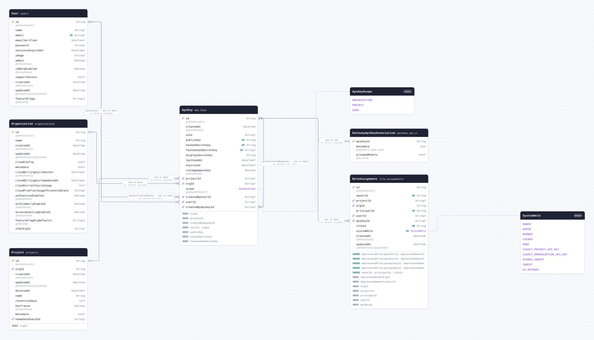

| Field                                            | Type                               | Constraints                                   | Default   | Description |
| ------------------------------------------------ | ---------------------------------- | --------------------------------------------- | --------- | ----------- |
| `id`                                             | `String`                           | PK NOT NULL                                   | `cuid(1)` |             |
| `createdAt` (`created_at`)                       | `DateTime`                         | NOT NULL                                      | `now()`   |             |
| `note`                                           | `String`                           | NULL                                          |           |             |
| `publicKey` (`public_key`)                       | `String`                           | UNIQUE NOT NULL                               |           |             |
| `hashedSecretKey` (`hashed_secret_key`)          | `String`                           | UNIQUE NOT NULL                               |           |             |
| `fastHashedSecretKey` (`fast_hashed_secret_key`) | `String`                           | UNIQUE NULL                                   |           |             |
| `displaySecretKey` (`display_secret_key`)        | `String`                           | NOT NULL                                      |           |             |
| `lastUsedAt` (`last_used_at`)                    | `DateTime`                         | NULL                                          |           |             |
| `expiresAt` (`expires_at`)                       | `DateTime`                         | NULL                                          |           |             |
| `isInAppAgentKey` (`is_in_app_agent_key`)        | `Boolean`                          | NOT NULL                                      | `false`   |             |
| `projectId` (`project_id`)                       | `String`                           | NULL → [Project.id](#model-Project)           |           |             |
| `orgId` (`organization_id`)                      | `String`                           | NULL → [Organization.id](#model-Organization) |           |             |
| `scope` (`scope`)                                | [`ApiKeyScope`](#enum-ApiKeyScope) | NOT NULL                                      | `PROJECT` |             |
| `createdByUserId` (`created_by_user_id`)         | `String`                           | NULL → [User.id](#model-User)                 |           |             |
| `userId` (`user_id`)                             | `String`                           | NULL → [User.id](#model-User)                 |           |             |
| `createdByApiKeyId` (`created_by_api_key_id`)    | `String`                           | NULL → [ApiKey.id](#model-ApiKey)             |           |             |

#### Indexes

- `@@index([orgId])`
- `@@index([projectId])`
- `@@index([createdByApiKeyId])`
- `@@index([userId, orgId])`
- `@@index([publicKey])`
- `@@index([hashedSecretKey])`
- `@@index([fastHashedSecretKey])`

#### References

- `projectId` → [Project.id](#model-Project) (many-to-one, on delete Cascade)
- `orgId` → [Organization.id](#model-Organization) (many-to-one, on delete Cascade)
- `createdByUserId` → [User.id](#model-User) (many-to-one, on delete SetNull)
- `userId` → [User.id](#model-User) (many-to-one, on delete Cascade)
- `createdByApiKeyId` → [ApiKey.id](#model-ApiKey) (many-to-one, on delete SetNull)

#### Referenced by

- `id` ← [ApiKey.createdByApiKeyId](#model-ApiKey) (one-to-many, on delete SetNull)
- `id` ← [RoleAssignment.apiKeyId](#model-RoleAssignment) (one-to-many, on delete Cascade)
- `id` ← [GatewayApiKeyAssociation.apiKeyId](#model-GatewayApiKeyAssociation) (one-to-one, on delete Cascade)

#### Definition

```sql
CREATE TABLE "api_keys" (
    "id" TEXT NOT NULL,
    "created_at" TIMESTAMP(3) NOT NULL DEFAULT CURRENT_TIMESTAMP,
    "note" TEXT,
    "public_key" TEXT NOT NULL,
    "hashed_secret_key" TEXT NOT NULL,
    "fast_hashed_secret_key" TEXT,
    "display_secret_key" TEXT NOT NULL,
    "last_used_at" TIMESTAMP(3),
    "expires_at" TIMESTAMP(3),
    "is_in_app_agent_key" BOOLEAN NOT NULL DEFAULT false,
    "project_id" TEXT,
    "organization_id" TEXT,
    "scope" "ApiKeyScope" NOT NULL DEFAULT 'PROJECT',
    "created_by_user_id" TEXT,
    "user_id" TEXT,
    "created_by_api_key_id" TEXT,

    CONSTRAINT "api_keys_pkey" PRIMARY KEY ("id")
);

CREATE UNIQUE INDEX "api_keys_id_key" ON "api_keys"("id");

CREATE UNIQUE INDEX "api_keys_public_key_key" ON "api_keys"("public_key");

CREATE UNIQUE INDEX "api_keys_hashed_secret_key_key" ON "api_keys"("hashed_secret_key");

CREATE UNIQUE INDEX "api_keys_fast_hashed_secret_key_key" ON "api_keys"("fast_hashed_secret_key");

CREATE INDEX "api_keys_organization_id_idx" ON "api_keys"("organization_id");

CREATE INDEX "api_keys_project_id_idx" ON "api_keys"("project_id");

CREATE INDEX "api_keys_created_by_api_key_id_idx" ON "api_keys"("created_by_api_key_id");

CREATE INDEX "api_keys_user_id_organization_id_idx" ON "api_keys"("user_id", "organization_id");

CREATE INDEX "api_keys_public_key_idx" ON "api_keys"("public_key");

CREATE INDEX "api_keys_hashed_secret_key_idx" ON "api_keys"("hashed_secret_key");

CREATE INDEX "api_keys_fast_hashed_secret_key_idx" ON "api_keys"("fast_hashed_secret_key");

ALTER TABLE "api_keys" ADD CONSTRAINT "api_keys_project_id_fkey" FOREIGN KEY ("project_id") REFERENCES "projects"("id") ON DELETE CASCADE ON UPDATE CASCADE;

ALTER TABLE "api_keys" ADD CONSTRAINT "api_keys_organization_id_fkey" FOREIGN KEY ("organization_id") REFERENCES "organizations"("id") ON DELETE CASCADE ON UPDATE CASCADE;

ALTER TABLE "api_keys" ADD CONSTRAINT "api_keys_created_by_user_id_fkey" FOREIGN KEY ("created_by_user_id") REFERENCES "users"("id") ON DELETE SET NULL ON UPDATE CASCADE;

ALTER TABLE "api_keys" ADD CONSTRAINT "api_keys_user_id_fkey" FOREIGN KEY ("user_id") REFERENCES "users"("id") ON DELETE CASCADE ON UPDATE CASCADE;

ALTER TABLE "api_keys" ADD CONSTRAINT "api_keys_created_by_api_key_id_fkey" FOREIGN KEY ("created_by_api_key_id") REFERENCES "api_keys"("id") ON DELETE SET NULL ON UPDATE CASCADE;
```

<details>
<summary>Queries and their SQL</summary>

**findMany**: Every row

```ts
await prisma.apiKey.findMany();
```

```sql
SELECT
  "public"."api_keys"."id",
  "public"."api_keys"."created_at",
  "public"."api_keys"."note",
  "public"."api_keys"."public_key",
  "public"."api_keys"."hashed_secret_key",
  "public"."api_keys"."fast_hashed_secret_key",
  "public"."api_keys"."display_secret_key",
  "public"."api_keys"."last_used_at",
  "public"."api_keys"."expires_at",
  "public"."api_keys"."is_in_app_agent_key",
  "public"."api_keys"."project_id",
  "public"."api_keys"."organization_id",
  "public"."api_keys"."scope"::text,
  "public"."api_keys"."created_by_user_id",
  "public"."api_keys"."user_id",
  "public"."api_keys"."created_by_api_key_id"
FROM
  "public"."api_keys"
WHERE
  1 = 1
OFFSET
  $1
-- params: ["0"]
```

**count**: How many rows there are

```ts
await prisma.apiKey.count();
```

```sql
SELECT
  COUNT(*) AS "_count$_all"
FROM
  (
    SELECT
      "public"."api_keys"."id"
    FROM
      "public"."api_keys"
    WHERE
      1 = 1
    OFFSET
      $1
  ) AS "sub"
-- params: ["0"]
```

**findMany**: Every row with its relations

```ts
await prisma.apiKey.findMany({
  include: {
    project: true,
    organization: true,
    createdByUser: true,
    user: true,
    createdByApiKey: true,
    apiKeysCreated: true,
    gatewayAssociation: true,
    roleAssignments: true,
  },
});
```

```sql
SELECT
  "public"."api_keys"."id",
  "public"."api_keys"."created_at",
  "public"."api_keys"."note",
  "public"."api_keys"."public_key",
  "public"."api_keys"."hashed_secret_key",
  "public"."api_keys"."fast_hashed_secret_key",
  "public"."api_keys"."display_secret_key",
  "public"."api_keys"."last_used_at",
  "public"."api_keys"."expires_at",
  "public"."api_keys"."is_in_app_agent_key",
  "public"."api_keys"."project_id",
  "public"."api_keys"."organization_id",
  "public"."api_keys"."scope"::text,
  "public"."api_keys"."created_by_user_id",
  "public"."api_keys"."user_id",
  "public"."api_keys"."created_by_api_key_id"
FROM
  "public"."api_keys"
WHERE
  1 = 1
OFFSET
  $1
-- params: ["0"]

SELECT
  "public"."projects"."id",
  "public"."projects"."org_id",
  "public"."projects"."created_at",
  "public"."projects"."updated_at",
  "public"."projects"."deleted_at",
  "public"."projects"."name",
  "public"."projects"."retention_days",
  "public"."projects"."has_traces",
  "public"."projects"."metadata",
  "public"."projects"."home_dashboard_id"
FROM
  "public"."projects"
WHERE
  "public"."projects"."id" IN ($1)
OFFSET
  $2
-- params: ["<projectId of the rows above>","0"]

SELECT
  "public"."organizations"."id",
  "public"."organizations"."name",
  "public"."organizations"."created_at",
  "public"."organizations"."updated_at",
  "public"."organizations"."cloud_config",
  "public"."organizations"."metadata",
  "public"."organizations"."cloud_billing_cycle_anchor",
  "public"."organizations"."cloud_billing_cycle_updated_at",
  "public"."organizations"."cloud_current_cycle_usage",
  "public"."organizations"."cloud_free_tier_usage_threshold_state",
  "public"."organizations"."ai_features_enabled",
  "public"."organizations"."ai_telemetry_enabled",
  "public"."organizations"."access_audit_log_enabled",
  "public"."organizations"."feature_flag_org_defaults",
  "public"."organizations"."sfdc_org_id"
FROM
  "public"."organizations"
WHERE
  "public"."organizations"."id" IN ($1)
OFFSET
  $2
-- params: ["<orgId of the rows above>","0"]

SELECT
  "public"."users"."id",
  "public"."users"."name",
  "public"."users"."email",
  "public"."users"."email_verified",
  "public"."users"."password",
  "public"."users"."sessions_expired_at",
  "public"."users"."image",
  "public"."users"."admin",
  "public"."users"."v4_beta_enabled",
  "public"."users"."support_access",
  "public"."users"."created_at",
  "public"."users"."updated_at",
  "public"."users"."feature_flags"
FROM
  "public"."users"
WHERE
  "public"."users"."id" IN ($1)
OFFSET
  $2
-- params: ["<createdByUserId of the rows above>","0"]

SELECT
  "public"."users"."id",
  "public"."users"."name",
  "public"."users"."email",
  "public"."users"."email_verified",
  "public"."users"."password",
  "public"."users"."sessions_expired_at",
  "public"."users"."image",
  "public"."users"."admin",
  "public"."users"."v4_beta_enabled",
  "public"."users"."support_access",
  "public"."users"."created_at",
  "public"."users"."updated_at",
  "public"."users"."feature_flags"
FROM
  "public"."users"
WHERE
  "public"."users"."id" IN ($1)
OFFSET
  $2
-- params: ["<userId of the rows above>","0"]

SELECT
  "public"."api_keys"."id",
  "public"."api_keys"."created_at",
  "public"."api_keys"."note",
  "public"."api_keys"."public_key",
  "public"."api_keys"."hashed_secret_key",
  "public"."api_keys"."fast_hashed_secret_key",
  "public"."api_keys"."display_secret_key",
  "public"."api_keys"."last_used_at",
  "public"."api_keys"."expires_at",
  "public"."api_keys"."is_in_app_agent_key",
  "public"."api_keys"."project_id",
  "public"."api_keys"."organization_id",
  "public"."api_keys"."scope"::text,
  "public"."api_keys"."created_by_user_id",
  "public"."api_keys"."user_id",
  "public"."api_keys"."created_by_api_key_id"
FROM
  "public"."api_keys"
WHERE
  "public"."api_keys"."id" IN ($1)
OFFSET
  $2
-- params: ["<createdByApiKeyId of the rows above>","0"]

SELECT
  "public"."api_keys"."id",
  "public"."api_keys"."created_at",
  "public"."api_keys"."note",
  "public"."api_keys"."public_key",
  "public"."api_keys"."hashed_secret_key",
  "public"."api_keys"."fast_hashed_secret_key",
  "public"."api_keys"."display_secret_key",
  "public"."api_keys"."last_used_at",
  "public"."api_keys"."expires_at",
  "public"."api_keys"."is_in_app_agent_key",
  "public"."api_keys"."project_id",
  "public"."api_keys"."organization_id",
  "public"."api_keys"."scope"::text,
  "public"."api_keys"."created_by_user_id",
  "public"."api_keys"."user_id",
  "public"."api_keys"."created_by_api_key_id"
FROM
  "public"."api_keys"
WHERE
  "public"."api_keys"."created_by_api_key_id" IN ($1)
OFFSET
  $2
-- params: ["<id of the rows above>","0"]

SELECT
  "public"."gateway_api_key_associations"."api_key_id",
  "public"."gateway_api_key_associations"."metadata"
FROM
  "public"."gateway_api_key_associations"
WHERE
  "public"."gateway_api_key_associations"."api_key_id" IN ($1)
OFFSET
  $2
-- params: ["<id of the rows above>","0"]

SELECT
  "public"."role_assignments"."id",
  "public"."role_assignments"."owner_id",
  "public"."role_assignments"."project_id",
  "public"."role_assignments"."org_id",
  "public"."role_assignments"."principal_id",
  "public"."role_assignments"."user_id",
  "public"."role_assignments"."api_key_id",
  "public"."role_assignments"."role_id",
  "public"."role_assignments"."system_role"::text,
  "public"."role_assignments"."created_at",
  "public"."role_assignments"."updated_at"
FROM
  "public"."role_assignments"
WHERE
  "public"."role_assignments"."api_key_id" IN ($1)
OFFSET
  $2
-- params: ["<id of the rows above>","0"]
```

**findUnique**: One row by what is unique to it

```ts
await prisma.apiKey.findUnique({ where: { id: "example" } });
```

```sql
SELECT
  "public"."api_keys"."id",
  "public"."api_keys"."created_at",
  "public"."api_keys"."note",
  "public"."api_keys"."public_key",
  "public"."api_keys"."hashed_secret_key",
  "public"."api_keys"."fast_hashed_secret_key",
  "public"."api_keys"."display_secret_key",
  "public"."api_keys"."last_used_at",
  "public"."api_keys"."expires_at",
  "public"."api_keys"."is_in_app_agent_key",
  "public"."api_keys"."project_id",
  "public"."api_keys"."organization_id",
  "public"."api_keys"."scope"::text,
  "public"."api_keys"."created_by_user_id",
  "public"."api_keys"."user_id",
  "public"."api_keys"."created_by_api_key_id"
FROM
  "public"."api_keys"
WHERE
  (
    "public"."api_keys"."id" = $1
    AND 1 = 1
  )
LIMIT
  $2
OFFSET
  $3
-- params: ["example","1","0"]
```

**create**: Create a row

```ts
await prisma.apiKey.create({
  data: { publicKey: "example", hashedSecretKey: "example", displaySecretKey: "example" },
});
```

```sql
INSERT INTO
  "public"."api_keys" (
    "id",
    "created_at",
    "public_key",
    "hashed_secret_key",
    "display_secret_key",
    "is_in_app_agent_key",
    "scope"
  )
VALUES
  (
    $1,
    $2,
    $3,
    $4,
    $5,
    $6,
    CAST($7::text AS "public"."ApiKeyScope")
  )
RETURNING
  "public"."api_keys"."id",
  "public"."api_keys"."created_at",
  "public"."api_keys"."note",
  "public"."api_keys"."public_key",
  "public"."api_keys"."hashed_secret_key",
  "public"."api_keys"."fast_hashed_secret_key",
  "public"."api_keys"."display_secret_key",
  "public"."api_keys"."last_used_at",
  "public"."api_keys"."expires_at",
  "public"."api_keys"."is_in_app_agent_key",
  "public"."api_keys"."project_id",
  "public"."api_keys"."organization_id",
  "public"."api_keys"."scope"::text,
  "public"."api_keys"."created_by_user_id",
  "public"."api_keys"."user_id",
  "public"."api_keys"."created_by_api_key_id"
-- params: ["<cuid(1)>","<now()>","example","example","example",false,"PROJECT"]
```

**update**: Update a row

```ts
await prisma.apiKey.update({
  where: { id: "example" },
  data: { createdAt: new Date("2026-01-01T00:00:00.000Z") },
});
```

```sql
UPDATE "public"."api_keys"
SET
  "created_at" = $1
WHERE
  (
    "public"."api_keys"."id" = $2
    AND 1 = 1
  )
RETURNING
  "public"."api_keys"."id",
  "public"."api_keys"."created_at",
  "public"."api_keys"."note",
  "public"."api_keys"."public_key",
  "public"."api_keys"."hashed_secret_key",
  "public"."api_keys"."fast_hashed_secret_key",
  "public"."api_keys"."display_secret_key",
  "public"."api_keys"."last_used_at",
  "public"."api_keys"."expires_at",
  "public"."api_keys"."is_in_app_agent_key",
  "public"."api_keys"."project_id",
  "public"."api_keys"."organization_id",
  "public"."api_keys"."scope"::text,
  "public"."api_keys"."created_by_user_id",
  "public"."api_keys"."user_id",
  "public"."api_keys"."created_by_api_key_id"
-- params: ["2026-01-01T00:00:00.000Z","example"]
```

**delete**: Delete a row

```ts
await prisma.apiKey.delete({ where: { id: "example" } });
```

```sql
DELETE FROM "public"."api_keys"
WHERE
  (
    "public"."api_keys"."id" = $1
    AND 1 = 1
  )
RETURNING
  "public"."api_keys"."id",
  "public"."api_keys"."created_at",
  "public"."api_keys"."note",
  "public"."api_keys"."public_key",
  "public"."api_keys"."hashed_secret_key",
  "public"."api_keys"."fast_hashed_secret_key",
  "public"."api_keys"."display_secret_key",
  "public"."api_keys"."last_used_at",
  "public"."api_keys"."expires_at",
  "public"."api_keys"."is_in_app_agent_key",
  "public"."api_keys"."project_id",
  "public"."api_keys"."organization_id",
  "public"."api_keys"."scope"::text,
  "public"."api_keys"."created_by_user_id",
  "public"."api_keys"."user_id",
  "public"."api_keys"."created_by_api_key_id"
-- params: ["example"]
```

</details>

<a id="model-RoleAssignment"></a>

### RoleAssignment

Table `role_assignments`.

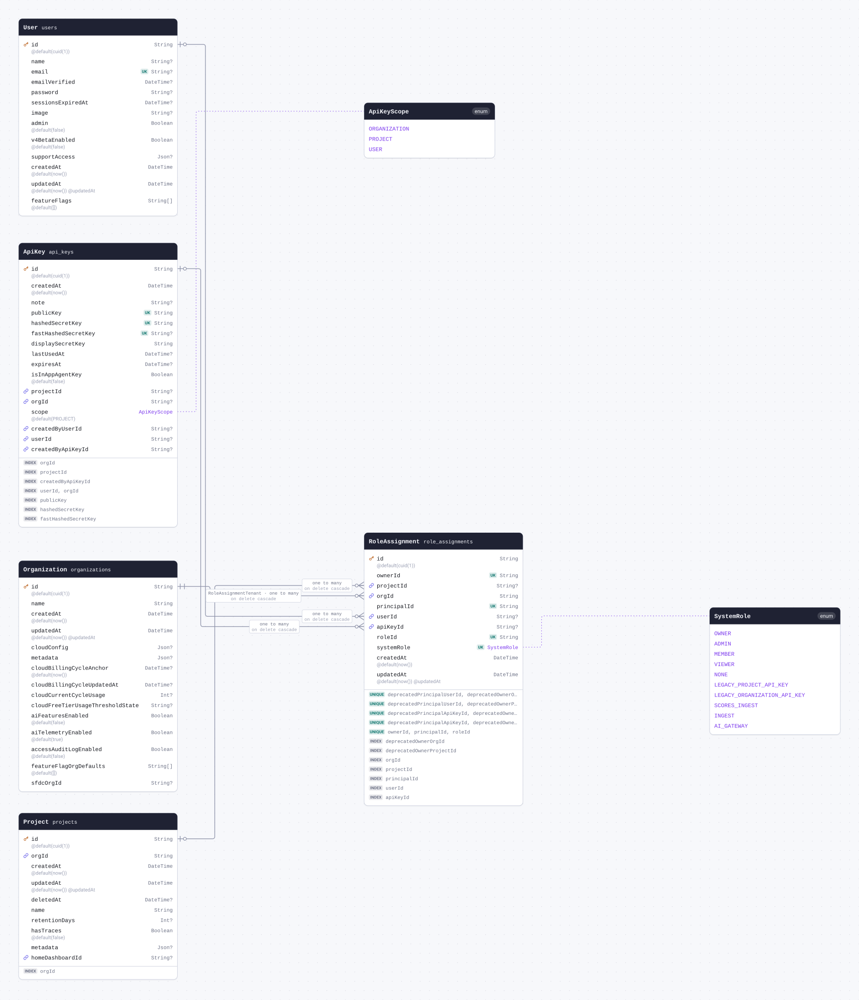

| Field                          | Type                             | Constraints                                       | Default              | Description |
| ------------------------------ | -------------------------------- | ------------------------------------------------- | -------------------- | ----------- |
| `id`                           | `String`                         | PK NOT NULL                                       | `cuid(1)`            |             |
| `ownerId` (`owner_id`)         | `String`                         | NOT NULL                                          |                      |             |
| `projectId` (`project_id`)     | `String`                         | NULL → [Project.id](#model-Project)               |                      |             |
| `orgId` (`org_id`)             | `String`                         | NOT NULL → [Organization.id](#model-Organization) |                      |             |
| `principalId` (`principal_id`) | `String`                         | NOT NULL                                          |                      |             |
| `userId` (`user_id`)           | `String`                         | NULL → [User.id](#model-User)                     |                      |             |
| `apiKeyId` (`api_key_id`)      | `String`                         | NULL → [ApiKey.id](#model-ApiKey)                 |                      |             |
| `roleId` (`role_id`)           | `String`                         | NOT NULL                                          |                      |             |
| `systemRole` (`system_role`)   | [`SystemRole`](#enum-SystemRole) | NOT NULL                                          |                      |             |
| `createdAt` (`created_at`)     | `DateTime`                       | NOT NULL                                          | `now()`              |             |
| `updatedAt` (`updated_at`)     | `DateTime`                       | NOT NULL                                          | `now()` `@updatedAt` |             |

#### Indexes

- `@@index([deprecatedOwnerOrgId], map: "role_assignments_owner_org_id_idx")`
- `@@index([deprecatedOwnerProjectId], map: "role_assignments_owner_project_id_idx")`
- `@@index([orgId])`
- `@@index([projectId])`
- `@@index([principalId])`
- `@@index([userId])`
- `@@index([apiKeyId])`
- `@@unique([deprecatedPrincipalUserId, deprecatedOwnerOrgId, systemRole], map: "role_assignments_user_org_role_key")`
- `@@unique([deprecatedPrincipalUserId, deprecatedOwnerProjectId, systemRole], map: "role_assignments_user_project_role_key")`
- `@@unique([deprecatedPrincipalApiKeyId, deprecatedOwnerOrgId, systemRole], map: "role_assignments_api_key_org_role_key")`
- `@@unique([deprecatedPrincipalApiKeyId, deprecatedOwnerProjectId, systemRole], map: "role_assignments_api_key_project_role_key")`
- `@@unique([ownerId, principalId, roleId])`

#### References

- `projectId` → [Project.id](#model-Project) (many-to-one, on delete Cascade)
- `orgId` → [Organization.id](#model-Organization) (many-to-one, on delete Cascade)
- `userId` → [User.id](#model-User) (many-to-one, on delete Cascade)
- `apiKeyId` → [ApiKey.id](#model-ApiKey) (many-to-one, on delete Cascade)

#### Definition

```sql
CREATE TABLE "role_assignments" (
    "id" TEXT NOT NULL,
    "owner_id" TEXT NOT NULL,
    "project_id" TEXT,
    "org_id" TEXT NOT NULL,
    "principal_id" TEXT NOT NULL,
    "user_id" TEXT,
    "api_key_id" TEXT,
    "role_id" TEXT NOT NULL,
    "system_role" "SystemRole" NOT NULL,
    "created_at" TIMESTAMP(3) NOT NULL DEFAULT CURRENT_TIMESTAMP,
    "updated_at" TIMESTAMP(3) NOT NULL DEFAULT CURRENT_TIMESTAMP,
    "owner_org_id" TEXT,
    "owner_project_id" TEXT,
    "principal_user_id" TEXT,
    "principal_api_key_id" TEXT,

    CONSTRAINT "role_assignments_pkey" PRIMARY KEY ("id")
);

CREATE INDEX "role_assignments_owner_org_id_idx" ON "role_assignments"("owner_org_id");

CREATE INDEX "role_assignments_owner_project_id_idx" ON "role_assignments"("owner_project_id");

CREATE INDEX "role_assignments_org_id_idx" ON "role_assignments"("org_id");

CREATE INDEX "role_assignments_project_id_idx" ON "role_assignments"("project_id");

CREATE INDEX "role_assignments_principal_id_idx" ON "role_assignments"("principal_id");

CREATE INDEX "role_assignments_user_id_idx" ON "role_assignments"("user_id");

CREATE INDEX "role_assignments_api_key_id_idx" ON "role_assignments"("api_key_id");

CREATE UNIQUE INDEX "role_assignments_user_org_role_key" ON "role_assignments"("principal_user_id", "owner_org_id", "system_role");

CREATE UNIQUE INDEX "role_assignments_user_project_role_key" ON "role_assignments"("principal_user_id", "owner_project_id", "system_role");

CREATE UNIQUE INDEX "role_assignments_api_key_org_role_key" ON "role_assignments"("principal_api_key_id", "owner_org_id", "system_role");

CREATE UNIQUE INDEX "role_assignments_api_key_project_role_key" ON "role_assignments"("principal_api_key_id", "owner_project_id", "system_role");

CREATE UNIQUE INDEX "role_assignments_owner_id_principal_id_role_id_key" ON "role_assignments"("owner_id", "principal_id", "role_id");

ALTER TABLE "role_assignments" ADD CONSTRAINT "role_assignments_project_id_fkey" FOREIGN KEY ("project_id") REFERENCES "projects"("id") ON DELETE CASCADE ON UPDATE CASCADE;

ALTER TABLE "role_assignments" ADD CONSTRAINT "role_assignments_org_id_fkey" FOREIGN KEY ("org_id") REFERENCES "organizations"("id") ON DELETE CASCADE ON UPDATE CASCADE;

ALTER TABLE "role_assignments" ADD CONSTRAINT "role_assignments_user_id_fkey" FOREIGN KEY ("user_id") REFERENCES "users"("id") ON DELETE CASCADE ON UPDATE CASCADE;

ALTER TABLE "role_assignments" ADD CONSTRAINT "role_assignments_api_key_id_fkey" FOREIGN KEY ("api_key_id") REFERENCES "api_keys"("id") ON DELETE CASCADE ON UPDATE CASCADE;

ALTER TABLE "role_assignments" ADD CONSTRAINT "role_assignments_owner_org_id_fkey" FOREIGN KEY ("owner_org_id") REFERENCES "organizations"("id") ON DELETE CASCADE ON UPDATE CASCADE;

ALTER TABLE "role_assignments" ADD CONSTRAINT "role_assignments_owner_project_id_fkey" FOREIGN KEY ("owner_project_id") REFERENCES "projects"("id") ON DELETE CASCADE ON UPDATE CASCADE;

ALTER TABLE "role_assignments" ADD CONSTRAINT "role_assignments_principal_user_id_fkey" FOREIGN KEY ("principal_user_id") REFERENCES "users"("id") ON DELETE CASCADE ON UPDATE CASCADE;

ALTER TABLE "role_assignments" ADD CONSTRAINT "role_assignments_principal_api_key_id_fkey" FOREIGN KEY ("principal_api_key_id") REFERENCES "api_keys"("id") ON DELETE CASCADE ON UPDATE CASCADE;
```

<details>
<summary>Queries and their SQL</summary>

**findMany**: Every row

```ts
await prisma.roleAssignment.findMany();
```

```sql
SELECT
  "public"."role_assignments"."id",
  "public"."role_assignments"."owner_id",
  "public"."role_assignments"."project_id",
  "public"."role_assignments"."org_id",
  "public"."role_assignments"."principal_id",
  "public"."role_assignments"."user_id",
  "public"."role_assignments"."api_key_id",
  "public"."role_assignments"."role_id",
  "public"."role_assignments"."system_role"::text,
  "public"."role_assignments"."created_at",
  "public"."role_assignments"."updated_at"
FROM
  "public"."role_assignments"
WHERE
  1 = 1
OFFSET
  $1
-- params: ["0"]
```

**count**: How many rows there are

```ts
await prisma.roleAssignment.count();
```

```sql
SELECT
  COUNT(*) AS "_count$_all"
FROM
  (
    SELECT
      "public"."role_assignments"."id"
    FROM
      "public"."role_assignments"
    WHERE
      1 = 1
    OFFSET
      $1
  ) AS "sub"
-- params: ["0"]
```

**findMany**: Every row with its relations

```ts
await prisma.roleAssignment.findMany({
  include: { project: true, organization: true, user: true, apiKey: true },
});
```

```sql
SELECT
  "public"."role_assignments"."id",
  "public"."role_assignments"."owner_id",
  "public"."role_assignments"."project_id",
  "public"."role_assignments"."org_id",
  "public"."role_assignments"."principal_id",
  "public"."role_assignments"."user_id",
  "public"."role_assignments"."api_key_id",
  "public"."role_assignments"."role_id",
  "public"."role_assignments"."system_role"::text,
  "public"."role_assignments"."created_at",
  "public"."role_assignments"."updated_at"
FROM
  "public"."role_assignments"
WHERE
  1 = 1
OFFSET
  $1
-- params: ["0"]

SELECT
  "public"."projects"."id",
  "public"."projects"."org_id",
  "public"."projects"."created_at",
  "public"."projects"."updated_at",
  "public"."projects"."deleted_at",
  "public"."projects"."name",
  "public"."projects"."retention_days",
  "public"."projects"."has_traces",
  "public"."projects"."metadata",
  "public"."projects"."home_dashboard_id"
FROM
  "public"."projects"
WHERE
  "public"."projects"."id" IN ($1)
OFFSET
  $2
-- params: ["<projectId of the rows above>","0"]

SELECT
  "public"."organizations"."id",
  "public"."organizations"."name",
  "public"."organizations"."created_at",
  "public"."organizations"."updated_at",
  "public"."organizations"."cloud_config",
  "public"."organizations"."metadata",
  "public"."organizations"."cloud_billing_cycle_anchor",
  "public"."organizations"."cloud_billing_cycle_updated_at",
  "public"."organizations"."cloud_current_cycle_usage",
  "public"."organizations"."cloud_free_tier_usage_threshold_state",
  "public"."organizations"."ai_features_enabled",
  "public"."organizations"."ai_telemetry_enabled",
  "public"."organizations"."access_audit_log_enabled",
  "public"."organizations"."feature_flag_org_defaults",
  "public"."organizations"."sfdc_org_id"
FROM
  "public"."organizations"
WHERE
  "public"."organizations"."id" IN ($1)
OFFSET
  $2
-- params: ["<orgId of the rows above>","0"]

SELECT
  "public"."users"."id",
  "public"."users"."name",
  "public"."users"."email",
  "public"."users"."email_verified",
  "public"."users"."password",
  "public"."users"."sessions_expired_at",
  "public"."users"."image",
  "public"."users"."admin",
  "public"."users"."v4_beta_enabled",
  "public"."users"."support_access",
  "public"."users"."created_at",
  "public"."users"."updated_at",
  "public"."users"."feature_flags"
FROM
  "public"."users"
WHERE
  "public"."users"."id" IN ($1)
OFFSET
  $2
-- params: ["<userId of the rows above>","0"]

SELECT
  "public"."api_keys"."id",
  "public"."api_keys"."created_at",
  "public"."api_keys"."note",
  "public"."api_keys"."public_key",
  "public"."api_keys"."hashed_secret_key",
  "public"."api_keys"."fast_hashed_secret_key",
  "public"."api_keys"."display_secret_key",
  "public"."api_keys"."last_used_at",
  "public"."api_keys"."expires_at",
  "public"."api_keys"."is_in_app_agent_key",
  "public"."api_keys"."project_id",
  "public"."api_keys"."organization_id",
  "public"."api_keys"."scope"::text,
  "public"."api_keys"."created_by_user_id",
  "public"."api_keys"."user_id",
  "public"."api_keys"."created_by_api_key_id"
FROM
  "public"."api_keys"
WHERE
  "public"."api_keys"."id" IN ($1)
OFFSET
  $2
-- params: ["<apiKeyId of the rows above>","0"]
```

**findUnique**: One row by what is unique to it

```ts
await prisma.roleAssignment.findUnique({ where: { id: "example" } });
```

```sql
SELECT
  "public"."role_assignments"."id",
  "public"."role_assignments"."owner_id",
  "public"."role_assignments"."project_id",
  "public"."role_assignments"."org_id",
  "public"."role_assignments"."principal_id",
  "public"."role_assignments"."user_id",
  "public"."role_assignments"."api_key_id",
  "public"."role_assignments"."role_id",
  "public"."role_assignments"."system_role"::text,
  "public"."role_assignments"."created_at",
  "public"."role_assignments"."updated_at"
FROM
  "public"."role_assignments"
WHERE
  (
    "public"."role_assignments"."id" = $1
    AND 1 = 1
  )
LIMIT
  $2
OFFSET
  $3
-- params: ["example","1","0"]
```

**create**: Create a row

```ts
await prisma.roleAssignment.create({
  data: {
    ownerId: "example",
    orgId: "example",
    principalId: "example",
    roleId: "example",
    systemRole: "OWNER",
  },
});
```

```sql
INSERT INTO
  "public"."role_assignments" (
    "id",
    "owner_id",
    "org_id",
    "principal_id",
    "role_id",
    "system_role",
    "created_at",
    "updated_at"
  )
VALUES
  (
    $1,
    $2,
    $3,
    $4,
    $5,
    CAST($6::text AS "public"."SystemRole"),
    $7,
    $8
  )
RETURNING
  "public"."role_assignments"."id",
  "public"."role_assignments"."owner_id",
  "public"."role_assignments"."project_id",
  "public"."role_assignments"."org_id",
  "public"."role_assignments"."principal_id",
  "public"."role_assignments"."user_id",
  "public"."role_assignments"."api_key_id",
  "public"."role_assignments"."role_id",
  "public"."role_assignments"."system_role"::text,
  "public"."role_assignments"."created_at",
  "public"."role_assignments"."updated_at"
-- params: ["<cuid(1)>","example","example","example","example","OWNER","<now()>","<now()>"]
```

**update**: Update a row

```ts
await prisma.roleAssignment.update({ where: { id: "example" }, data: { ownerId: "example" } });
```

```sql
UPDATE "public"."role_assignments"
SET
  "owner_id" = $1,
  "updated_at" = $2
WHERE
  (
    "public"."role_assignments"."id" = $3
    AND 1 = 1
  )
RETURNING
  "public"."role_assignments"."id",
  "public"."role_assignments"."owner_id",
  "public"."role_assignments"."project_id",
  "public"."role_assignments"."org_id",
  "public"."role_assignments"."principal_id",
  "public"."role_assignments"."user_id",
  "public"."role_assignments"."api_key_id",
  "public"."role_assignments"."role_id",
  "public"."role_assignments"."system_role"::text,
  "public"."role_assignments"."created_at",
  "public"."role_assignments"."updated_at"
-- params: ["example",{"prisma__type":"generatorCall","prisma__value":{"name":"now","args":[],"returnType":{"type":"DateTime"}}},"example"]
```

**delete**: Delete a row

```ts
await prisma.roleAssignment.delete({ where: { id: "example" } });
```

```sql
DELETE FROM "public"."role_assignments"
WHERE
  (
    "public"."role_assignments"."id" = $1
    AND 1 = 1
  )
RETURNING
  "public"."role_assignments"."id",
  "public"."role_assignments"."owner_id",
  "public"."role_assignments"."project_id",
  "public"."role_assignments"."org_id",
  "public"."role_assignments"."principal_id",
  "public"."role_assignments"."user_id",
  "public"."role_assignments"."api_key_id",
  "public"."role_assignments"."role_id",
  "public"."role_assignments"."system_role"::text,
  "public"."role_assignments"."created_at",
  "public"."role_assignments"."updated_at"
-- params: ["example"]
```

</details>

<a id="model-GatewayConfig"></a>

### GatewayConfig

Table `gateway_configs`.

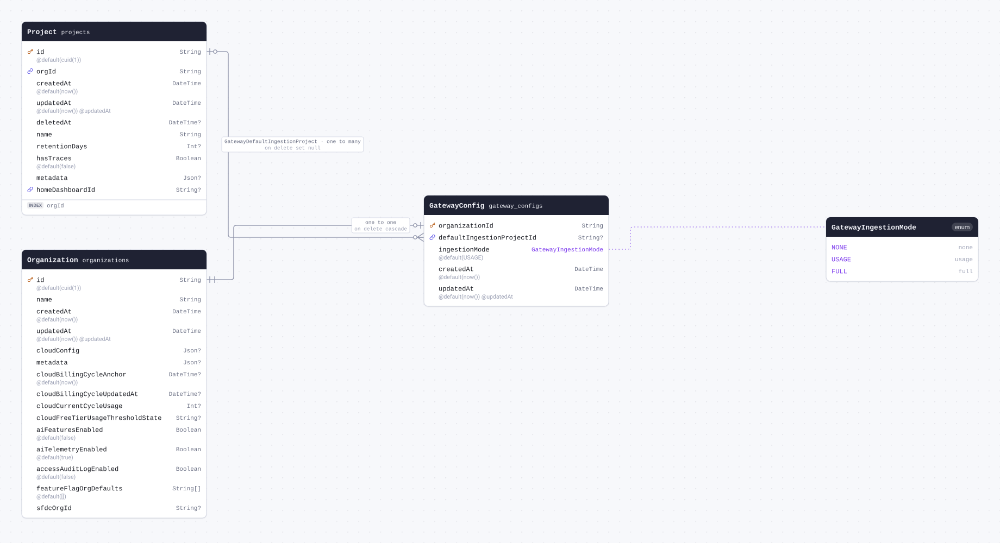

| Field                                                        | Type                                                 | Constraints                                          | Default              | Description |
| ------------------------------------------------------------ | ---------------------------------------------------- | ---------------------------------------------------- | -------------------- | ----------- |
| `organizationId` (`organization_id`)                         | `String`                                             | PK NOT NULL → [Organization.id](#model-Organization) |                      |             |
| `defaultIngestionProjectId` (`default_ingestion_project_id`) | `String`                                             | NULL → [Project.id](#model-Project)                  |                      |             |
| `ingestionMode` (`ingestion_mode`)                           | [`GatewayIngestionMode`](#enum-GatewayIngestionMode) | NOT NULL                                             | `USAGE`              |             |
| `createdAt` (`created_at`)                                   | `DateTime`                                           | NOT NULL                                             | `now()`              |             |
| `updatedAt` (`updated_at`)                                   | `DateTime`                                           | NOT NULL                                             | `now()` `@updatedAt` |             |

#### References

- `organizationId` → [Organization.id](#model-Organization) (one-to-one, on delete Cascade)
- `defaultIngestionProjectId` → [Project.id](#model-Project) (many-to-one, on delete SetNull)

#### Definition

```sql
CREATE TABLE "gateway_configs" (
    "organization_id" TEXT NOT NULL,
    "default_ingestion_project_id" TEXT,
    "ingestion_mode" "GatewayIngestionMode" NOT NULL DEFAULT 'usage',
    "created_at" TIMESTAMP(3) NOT NULL DEFAULT CURRENT_TIMESTAMP,
    "updated_at" TIMESTAMP(3) NOT NULL DEFAULT CURRENT_TIMESTAMP,

    CONSTRAINT "gateway_configs_pkey" PRIMARY KEY ("organization_id")
);

ALTER TABLE "gateway_configs" ADD CONSTRAINT "gateway_configs_organization_id_fkey" FOREIGN KEY ("organization_id") REFERENCES "organizations"("id") ON DELETE CASCADE ON UPDATE CASCADE;

ALTER TABLE "gateway_configs" ADD CONSTRAINT "gateway_configs_default_ingestion_project_id_fkey" FOREIGN KEY ("default_ingestion_project_id") REFERENCES "projects"("id") ON DELETE SET NULL ON UPDATE CASCADE;
```

<details>
<summary>Queries and their SQL</summary>

**findMany**: Every row

```ts
await prisma.gatewayConfig.findMany();
```

```sql
SELECT
  "public"."gateway_configs"."organization_id",
  "public"."gateway_configs"."default_ingestion_project_id",
  "public"."gateway_configs"."ingestion_mode"::text,
  "public"."gateway_configs"."created_at",
  "public"."gateway_configs"."updated_at"
FROM
  "public"."gateway_configs"
WHERE
  1 = 1
OFFSET
  $1
-- params: ["0"]
```

**count**: How many rows there are

```ts
await prisma.gatewayConfig.count();
```

```sql
SELECT
  COUNT(*) AS "_count$_all"
FROM
  (
    SELECT
      "public"."gateway_configs"."organization_id"
    FROM
      "public"."gateway_configs"
    WHERE
      1 = 1
    OFFSET
      $1
  ) AS "sub"
-- params: ["0"]
```

**findMany**: Every row with its relations

```ts
await prisma.gatewayConfig.findMany({
  include: { organization: true, defaultIngestionProject: true },
});
```

```sql
SELECT
  "public"."gateway_configs"."organization_id",
  "public"."gateway_configs"."default_ingestion_project_id",
  "public"."gateway_configs"."ingestion_mode"::text,
  "public"."gateway_configs"."created_at",
  "public"."gateway_configs"."updated_at"
FROM
  "public"."gateway_configs"
WHERE
  1 = 1
OFFSET
  $1
-- params: ["0"]

SELECT
  "public"."organizations"."id",
  "public"."organizations"."name",
  "public"."organizations"."created_at",
  "public"."organizations"."updated_at",
  "public"."organizations"."cloud_config",
  "public"."organizations"."metadata",
  "public"."organizations"."cloud_billing_cycle_anchor",
  "public"."organizations"."cloud_billing_cycle_updated_at",
  "public"."organizations"."cloud_current_cycle_usage",
  "public"."organizations"."cloud_free_tier_usage_threshold_state",
  "public"."organizations"."ai_features_enabled",
  "public"."organizations"."ai_telemetry_enabled",
  "public"."organizations"."access_audit_log_enabled",
  "public"."organizations"."feature_flag_org_defaults",
  "public"."organizations"."sfdc_org_id"
FROM
  "public"."organizations"
WHERE
  "public"."organizations"."id" IN ($1)
OFFSET
  $2
-- params: ["<organizationId of the rows above>","0"]

SELECT
  "public"."projects"."id",
  "public"."projects"."org_id",
  "public"."projects"."created_at",
  "public"."projects"."updated_at",
  "public"."projects"."deleted_at",
  "public"."projects"."name",
  "public"."projects"."retention_days",
  "public"."projects"."has_traces",
  "public"."projects"."metadata",
  "public"."projects"."home_dashboard_id"
FROM
  "public"."projects"
WHERE
  "public"."projects"."id" IN ($1)
OFFSET
  $2
-- params: ["<defaultIngestionProjectId of the rows above>","0"]
```

**findUnique**: One row by what is unique to it

```ts
await prisma.gatewayConfig.findUnique({ where: { organizationId: "example" } });
```

```sql
SELECT
  "public"."gateway_configs"."organization_id",
  "public"."gateway_configs"."default_ingestion_project_id",
  "public"."gateway_configs"."ingestion_mode"::text,
  "public"."gateway_configs"."created_at",
  "public"."gateway_configs"."updated_at"
FROM
  "public"."gateway_configs"
WHERE
  (
    "public"."gateway_configs"."organization_id" = $1
    AND 1 = 1
  )
LIMIT
  $2
OFFSET
  $3
-- params: ["example","1","0"]
```

**create**: Create a row

```ts
await prisma.gatewayConfig.create({ data: { organizationId: "example" } });
```

```sql
INSERT INTO
  "public"."gateway_configs" (
    "organization_id",
    "ingestion_mode",
    "created_at",
    "updated_at"
  )
VALUES
  (
    $1,
    CAST($2::text AS "public"."GatewayIngestionMode"),
    $3,
    $4
  )
RETURNING
  "public"."gateway_configs"."organization_id",
  "public"."gateway_configs"."default_ingestion_project_id",
  "public"."gateway_configs"."ingestion_mode"::text,
  "public"."gateway_configs"."created_at",
  "public"."gateway_configs"."updated_at"
-- params: ["example","usage","<now()>","<now()>"]
```

**update**: Update a row

```ts
await prisma.gatewayConfig.update({
  where: { organizationId: "example" },
  data: { ingestionMode: "NONE" },
});
```

```sql
UPDATE "public"."gateway_configs"
SET
  "ingestion_mode" = CAST($1::text AS "public"."GatewayIngestionMode"),
  "updated_at" = $2
WHERE
  (
    "public"."gateway_configs"."organization_id" = $3
    AND 1 = 1
  )
RETURNING
  "public"."gateway_configs"."organization_id",
  "public"."gateway_configs"."default_ingestion_project_id",
  "public"."gateway_configs"."ingestion_mode"::text,
  "public"."gateway_configs"."created_at",
  "public"."gateway_configs"."updated_at"
-- params: ["none",{"prisma__type":"generatorCall","prisma__value":{"name":"now","args":[],"returnType":{"type":"DateTime"}}},"example"]
```

**delete**: Delete a row

```ts
await prisma.gatewayConfig.delete({ where: { organizationId: "example" } });
```

```sql
DELETE FROM "public"."gateway_configs"
WHERE
  (
    "public"."gateway_configs"."organization_id" = $1
    AND 1 = 1
  )
RETURNING
  "public"."gateway_configs"."organization_id",
  "public"."gateway_configs"."default_ingestion_project_id",
  "public"."gateway_configs"."ingestion_mode"::text,
  "public"."gateway_configs"."created_at",
  "public"."gateway_configs"."updated_at"
-- params: ["example"]
```

</details>

<a id="model-GatewayAiConnection"></a>

### GatewayAiConnection

Table `gateway_ai_connections`.

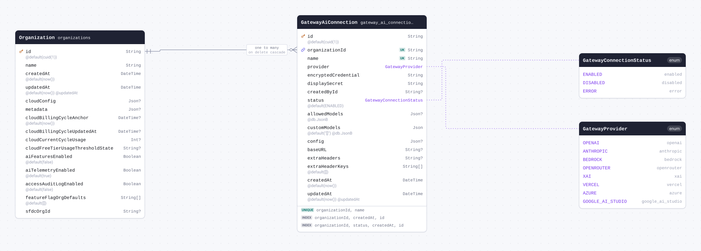

| Field                                           | Type                                                       | Constraints                                       | Default              | Description |
| ----------------------------------------------- | ---------------------------------------------------------- | ------------------------------------------------- | -------------------- | ----------- |
| `id`                                            | `String`                                                   | PK NOT NULL                                       | `cuid(1)`            |             |
| `organizationId` (`organization_id`)            | `String`                                                   | NOT NULL → [Organization.id](#model-Organization) |                      |             |
| `name`                                          | `String`                                                   | NOT NULL                                          |                      |             |
| `provider`                                      | [`GatewayProvider`](#enum-GatewayProvider)                 | NOT NULL                                          |                      |             |
| `encryptedCredential` (`encrypted_credentials`) | `String`                                                   | NOT NULL                                          |                      |             |
| `displaySecret` (`display_secret_key`)          | `String`                                                   | NOT NULL                                          |                      |             |
| `createdById` (`created_by_id`)                 | `String`                                                   | NULL                                              |                      |             |
| `status`                                        | [`GatewayConnectionStatus`](#enum-GatewayConnectionStatus) | NOT NULL                                          | `ENABLED`            |             |
| `allowedModels` (`allowed_models`)              | `Json` `@db.JsonB`                                         | NULL                                              |                      |             |
| `customModels` (`custom_models`)                | `Json` `@db.JsonB`                                         | NOT NULL                                          | `"[]"`               |             |
| `config`                                        | `Json`                                                     | NULL                                              |                      |             |
| `baseURL` (`base_url`)                          | `String`                                                   | NULL                                              |                      |             |
| `extraHeaders` (`extra_headers`)                | `String`                                                   | NULL                                              |                      |             |
| `extraHeaderKeys` (`extra_header_keys`)         | `String[]`                                                 | NOT NULL                                          | `[]`                 |             |
| `createdAt` (`created_at`)                      | `DateTime`                                                 | NOT NULL                                          | `now()`              |             |
| `updatedAt` (`updated_at`)                      | `DateTime`                                                 | NOT NULL                                          | `now()` `@updatedAt` |             |

#### Indexes

- `@@index([organizationId, createdAt, id], map: "gateway_ai_conn_org_created_at_id_idx")`
- `@@index([organizationId, status, createdAt, id], map: "gateway_ai_conn_org_status_created_at_id_idx")`
- `@@unique([organizationId, name])`

#### References

- `organizationId` → [Organization.id](#model-Organization) (many-to-one, on delete Cascade)

#### Definition

```sql
CREATE TABLE "gateway_ai_connections" (
    "id" TEXT NOT NULL,
    "organization_id" TEXT NOT NULL,
    "name" TEXT NOT NULL,
    "provider" "GatewayProvider" NOT NULL,
    "encrypted_credentials" TEXT NOT NULL,
    "display_secret_key" TEXT NOT NULL,
    "created_by_id" TEXT,
    "status" "GatewayConnectionStatus" NOT NULL DEFAULT 'enabled',
    "allowed_models" JSONB,
    "custom_models" JSONB NOT NULL DEFAULT '[]',
    "config" JSONB,
    "base_url" TEXT,
    "extra_headers" TEXT,
    "extra_header_keys" TEXT[] DEFAULT ARRAY[]::TEXT[],
    "created_at" TIMESTAMP(3) NOT NULL DEFAULT CURRENT_TIMESTAMP,
    "updated_at" TIMESTAMP(3) NOT NULL DEFAULT CURRENT_TIMESTAMP,

    CONSTRAINT "gateway_ai_connections_pkey" PRIMARY KEY ("id")
);

CREATE INDEX "gateway_ai_conn_org_created_at_id_idx" ON "gateway_ai_connections"("organization_id", "created_at", "id");

CREATE INDEX "gateway_ai_conn_org_status_created_at_id_idx" ON "gateway_ai_connections"("organization_id", "status", "created_at", "id");

CREATE UNIQUE INDEX "gateway_ai_connections_organization_id_name_key" ON "gateway_ai_connections"("organization_id", "name");

ALTER TABLE "gateway_ai_connections" ADD CONSTRAINT "gateway_ai_connections_organization_id_fkey" FOREIGN KEY ("organization_id") REFERENCES "organizations"("id") ON DELETE CASCADE ON UPDATE CASCADE;
```

<details>
<summary>Queries and their SQL</summary>

**findMany**: Every row

```ts
await prisma.gatewayAiConnection.findMany();
```

```sql
SELECT
  "public"."gateway_ai_connections"."id",
  "public"."gateway_ai_connections"."organization_id",
  "public"."gateway_ai_connections"."name",
  "public"."gateway_ai_connections"."provider"::text,
  "public"."gateway_ai_connections"."encrypted_credentials",
  "public"."gateway_ai_connections"."display_secret_key",
  "public"."gateway_ai_connections"."created_by_id",
  "public"."gateway_ai_connections"."status"::text,
  "public"."gateway_ai_connections"."allowed_models",
  "public"."gateway_ai_connections"."custom_models",
  "public"."gateway_ai_connections"."config",
  "public"."gateway_ai_connections"."base_url",
  "public"."gateway_ai_connections"."extra_headers",
  "public"."gateway_ai_connections"."extra_header_keys",
  "public"."gateway_ai_connections"."created_at",
  "public"."gateway_ai_connections"."updated_at"
FROM
  "public"."gateway_ai_connections"
WHERE
  1 = 1
OFFSET
  $1
-- params: ["0"]
```

**count**: How many rows there are

```ts
await prisma.gatewayAiConnection.count();
```

```sql
SELECT
  COUNT(*) AS "_count$_all"
FROM
  (
    SELECT
      "public"."gateway_ai_connections"."id"
    FROM
      "public"."gateway_ai_connections"
    WHERE
      1 = 1
    OFFSET
      $1
  ) AS "sub"
-- params: ["0"]
```

**findMany**: Every row with its relations

```ts
await prisma.gatewayAiConnection.findMany({ include: { organization: true } });
```

```sql
SELECT
  "public"."gateway_ai_connections"."id",
  "public"."gateway_ai_connections"."organization_id",
  "public"."gateway_ai_connections"."name",
  "public"."gateway_ai_connections"."provider"::text,
  "public"."gateway_ai_connections"."encrypted_credentials",
  "public"."gateway_ai_connections"."display_secret_key",
  "public"."gateway_ai_connections"."created_by_id",
  "public"."gateway_ai_connections"."status"::text,
  "public"."gateway_ai_connections"."allowed_models",
  "public"."gateway_ai_connections"."custom_models",
  "public"."gateway_ai_connections"."config",
  "public"."gateway_ai_connections"."base_url",
  "public"."gateway_ai_connections"."extra_headers",
  "public"."gateway_ai_connections"."extra_header_keys",
  "public"."gateway_ai_connections"."created_at",
  "public"."gateway_ai_connections"."updated_at"
FROM
  "public"."gateway_ai_connections"
WHERE
  1 = 1
OFFSET
  $1
-- params: ["0"]

SELECT
  "public"."organizations"."id",
  "public"."organizations"."name",
  "public"."organizations"."created_at",
  "public"."organizations"."updated_at",
  "public"."organizations"."cloud_config",
  "public"."organizations"."metadata",
  "public"."organizations"."cloud_billing_cycle_anchor",
  "public"."organizations"."cloud_billing_cycle_updated_at",
  "public"."organizations"."cloud_current_cycle_usage",
  "public"."organizations"."cloud_free_tier_usage_threshold_state",
  "public"."organizations"."ai_features_enabled",
  "public"."organizations"."ai_telemetry_enabled",
  "public"."organizations"."access_audit_log_enabled",
  "public"."organizations"."feature_flag_org_defaults",
  "public"."organizations"."sfdc_org_id"
FROM
  "public"."organizations"
WHERE
  "public"."organizations"."id" IN ($1)
OFFSET
  $2
-- params: ["<organizationId of the rows above>","0"]
```

**findUnique**: One row by what is unique to it

```ts
await prisma.gatewayAiConnection.findUnique({ where: { id: "example" } });
```

```sql
SELECT
  "public"."gateway_ai_connections"."id",
  "public"."gateway_ai_connections"."organization_id",
  "public"."gateway_ai_connections"."name",
  "public"."gateway_ai_connections"."provider"::text,
  "public"."gateway_ai_connections"."encrypted_credentials",
  "public"."gateway_ai_connections"."display_secret_key",
  "public"."gateway_ai_connections"."created_by_id",
  "public"."gateway_ai_connections"."status"::text,
  "public"."gateway_ai_connections"."allowed_models",
  "public"."gateway_ai_connections"."custom_models",
  "public"."gateway_ai_connections"."config",
  "public"."gateway_ai_connections"."base_url",
  "public"."gateway_ai_connections"."extra_headers",
  "public"."gateway_ai_connections"."extra_header_keys",
  "public"."gateway_ai_connections"."created_at",
  "public"."gateway_ai_connections"."updated_at"
FROM
  "public"."gateway_ai_connections"
WHERE
  (
    "public"."gateway_ai_connections"."id" = $1
    AND 1 = 1
  )
LIMIT
  $2
OFFSET
  $3
-- params: ["example","1","0"]
```

**create**: Create a row

```ts
await prisma.gatewayAiConnection.create({
  data: {
    organizationId: "example",
    name: "example",
    provider: "OPENAI",
    encryptedCredential: "example",
    displaySecret: "example",
  },
});
```

```sql
INSERT INTO
  "public"."gateway_ai_connections" (
    "id",
    "organization_id",
    "name",
    "provider",
    "encrypted_credentials",
    "display_secret_key",
    "status",
    "custom_models",
    "extra_header_keys",
    "created_at",
    "updated_at"
  )
VALUES
  (
    $1,
    $2,
    $3,
    CAST($4::text AS "public"."GatewayProvider"),
    $5,
    $6,
    CAST($7::text AS "public"."GatewayConnectionStatus"),
    $8,
    $9,
    $10,
    $11
  )
RETURNING
  "public"."gateway_ai_connections"."id",
  "public"."gateway_ai_connections"."organization_id",
  "public"."gateway_ai_connections"."name",
  "public"."gateway_ai_connections"."provider"::text,
  "public"."gateway_ai_connections"."encrypted_credentials",
  "public"."gateway_ai_connections"."display_secret_key",
  "public"."gateway_ai_connections"."created_by_id",
  "public"."gateway_ai_connections"."status"::text,
  "public"."gateway_ai_connections"."allowed_models",
  "public"."gateway_ai_connections"."custom_models",
  "public"."gateway_ai_connections"."config",
  "public"."gateway_ai_connections"."base_url",
  "public"."gateway_ai_connections"."extra_headers",
  "public"."gateway_ai_connections"."extra_header_keys",
  "public"."gateway_ai_connections"."created_at",
  "public"."gateway_ai_connections"."updated_at"
-- params: ["<cuid(1)>","example","example","openai","example","example","enabled","[]",[],"<now()>","<now()>"]
```

**update**: Update a row

```ts
await prisma.gatewayAiConnection.update({ where: { id: "example" }, data: { name: "example" } });
```

```sql
UPDATE "public"."gateway_ai_connections"
SET
  "name" = $1,
  "updated_at" = $2
WHERE
  (
    "public"."gateway_ai_connections"."id" = $3
    AND 1 = 1
  )
RETURNING
  "public"."gateway_ai_connections"."id",
  "public"."gateway_ai_connections"."organization_id",
  "public"."gateway_ai_connections"."name",
  "public"."gateway_ai_connections"."provider"::text,
  "public"."gateway_ai_connections"."encrypted_credentials",
  "public"."gateway_ai_connections"."display_secret_key",
  "public"."gateway_ai_connections"."created_by_id",
  "public"."gateway_ai_connections"."status"::text,
  "public"."gateway_ai_connections"."allowed_models",
  "public"."gateway_ai_connections"."custom_models",
  "public"."gateway_ai_connections"."config",
  "public"."gateway_ai_connections"."base_url",
  "public"."gateway_ai_connections"."extra_headers",
  "public"."gateway_ai_connections"."extra_header_keys",
  "public"."gateway_ai_connections"."created_at",
  "public"."gateway_ai_connections"."updated_at"
-- params: ["example",{"prisma__type":"generatorCall","prisma__value":{"name":"now","args":[],"returnType":{"type":"DateTime"}}},"example"]
```

**delete**: Delete a row

```ts
await prisma.gatewayAiConnection.delete({ where: { id: "example" } });
```

```sql
DELETE FROM "public"."gateway_ai_connections"
WHERE
  (
    "public"."gateway_ai_connections"."id" = $1
    AND 1 = 1
  )
RETURNING
  "public"."gateway_ai_connections"."id",
  "public"."gateway_ai_connections"."organization_id",
  "public"."gateway_ai_connections"."name",
  "public"."gateway_ai_connections"."provider"::text,
  "public"."gateway_ai_connections"."encrypted_credentials",
  "public"."gateway_ai_connections"."display_secret_key",
  "public"."gateway_ai_connections"."created_by_id",
  "public"."gateway_ai_connections"."status"::text,
  "public"."gateway_ai_connections"."allowed_models",
  "public"."gateway_ai_connections"."custom_models",
  "public"."gateway_ai_connections"."config",
  "public"."gateway_ai_connections"."base_url",
  "public"."gateway_ai_connections"."extra_headers",
  "public"."gateway_ai_connections"."extra_header_keys",
  "public"."gateway_ai_connections"."created_at",
  "public"."gateway_ai_connections"."updated_at"
-- params: ["example"]
```

</details>

<a id="model-GatewayApiKeyAssociation"></a>

### GatewayApiKeyAssociation

Table `gateway_api_key_associations`.

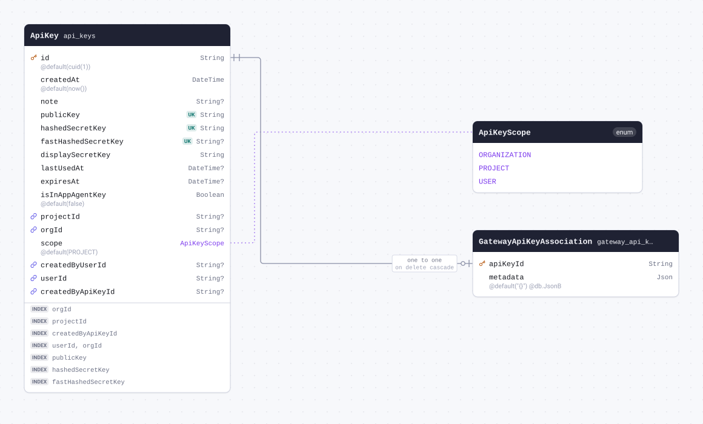

| Field                     | Type               | Constraints                              | Default | Description |
| ------------------------- | ------------------ | ---------------------------------------- | ------- | ----------- |
| `apiKeyId` (`api_key_id`) | `String`           | PK NOT NULL → [ApiKey.id](#model-ApiKey) |         |             |
| `metadata`                | `Json` `@db.JsonB` | NOT NULL                                 | `"{}"`  |             |

#### References

- `apiKeyId` → [ApiKey.id](#model-ApiKey) (one-to-one, on delete Cascade)

#### Definition

```sql
CREATE TABLE "gateway_api_key_associations" (
    "api_key_id" TEXT NOT NULL,
    "metadata" JSONB NOT NULL DEFAULT '{}',

    CONSTRAINT "gateway_api_key_associations_pkey" PRIMARY KEY ("api_key_id")
);

ALTER TABLE "gateway_api_key_associations" ADD CONSTRAINT "gateway_api_key_associations_api_key_id_fkey" FOREIGN KEY ("api_key_id") REFERENCES "api_keys"("id") ON DELETE CASCADE ON UPDATE CASCADE;
```

<details>
<summary>Queries and their SQL</summary>

**findMany**: Every row

```ts
await prisma.gatewayApiKeyAssociation.findMany();
```

```sql
SELECT
  "public"."gateway_api_key_associations"."api_key_id",
  "public"."gateway_api_key_associations"."metadata"
FROM
  "public"."gateway_api_key_associations"
WHERE
  1 = 1
OFFSET
  $1
-- params: ["0"]
```

**count**: How many rows there are

```ts
await prisma.gatewayApiKeyAssociation.count();
```

```sql
SELECT
  COUNT(*) AS "_count$_all"
FROM
  (
    SELECT
      "public"."gateway_api_key_associations"."api_key_id"
    FROM
      "public"."gateway_api_key_associations"
    WHERE
      1 = 1
    OFFSET
      $1
  ) AS "sub"
-- params: ["0"]
```

**findMany**: Every row with its relations

```ts
await prisma.gatewayApiKeyAssociation.findMany({ include: { apiKey: true } });
```

```sql
SELECT
  "public"."gateway_api_key_associations"."api_key_id",
  "public"."gateway_api_key_associations"."metadata"
FROM
  "public"."gateway_api_key_associations"
WHERE
  1 = 1
OFFSET
  $1
-- params: ["0"]

SELECT
  "public"."api_keys"."id",
  "public"."api_keys"."created_at",
  "public"."api_keys"."note",
  "public"."api_keys"."public_key",
  "public"."api_keys"."hashed_secret_key",
  "public"."api_keys"."fast_hashed_secret_key",
  "public"."api_keys"."display_secret_key",
  "public"."api_keys"."last_used_at",
  "public"."api_keys"."expires_at",
  "public"."api_keys"."is_in_app_agent_key",
  "public"."api_keys"."project_id",
  "public"."api_keys"."organization_id",
  "public"."api_keys"."scope"::text,
  "public"."api_keys"."created_by_user_id",
  "public"."api_keys"."user_id",
  "public"."api_keys"."created_by_api_key_id"
FROM
  "public"."api_keys"
WHERE
  "public"."api_keys"."id" IN ($1)
OFFSET
  $2
-- params: ["<apiKeyId of the rows above>","0"]
```

**findUnique**: One row by what is unique to it

```ts
await prisma.gatewayApiKeyAssociation.findUnique({ where: { apiKeyId: "example" } });
```

```sql
SELECT
  "public"."gateway_api_key_associations"."api_key_id",
  "public"."gateway_api_key_associations"."metadata"
FROM
  "public"."gateway_api_key_associations"
WHERE
  (
    "public"."gateway_api_key_associations"."api_key_id" = $1
    AND 1 = 1
  )
LIMIT
  $2
OFFSET
  $3
-- params: ["example","1","0"]
```

**create**: Create a row

```ts
await prisma.gatewayApiKeyAssociation.create({ data: { apiKeyId: "example" } });
```

```sql
INSERT INTO
  "public"."gateway_api_key_associations" ("api_key_id", "metadata")
VALUES
  ($1, $2)
RETURNING
  "public"."gateway_api_key_associations"."api_key_id",
  "public"."gateway_api_key_associations"."metadata"
-- params: ["example","{}"]
```

**update**: Update a row

```ts
await prisma.gatewayApiKeyAssociation.update({
  where: { apiKeyId: "example" },
  data: { metadata: {} },
});
```

```sql
UPDATE "public"."gateway_api_key_associations"
SET
  "metadata" = $1
WHERE
  (
    "public"."gateway_api_key_associations"."api_key_id" = $2
    AND 1 = 1
  )
RETURNING
  "public"."gateway_api_key_associations"."api_key_id",
  "public"."gateway_api_key_associations"."metadata"
-- params: ["{}","example"]
```

**delete**: Delete a row

```ts
await prisma.gatewayApiKeyAssociation.delete({ where: { apiKeyId: "example" } });
```

```sql
DELETE FROM "public"."gateway_api_key_associations"
WHERE
  (
    "public"."gateway_api_key_associations"."api_key_id" = $1
    AND 1 = 1
  )
RETURNING
  "public"."gateway_api_key_associations"."api_key_id",
  "public"."gateway_api_key_associations"."metadata"
-- params: ["example"]
```

</details>

<a id="model-InAppAgentConversation"></a>

### InAppAgentConversation

Table `in_app_agent_conversations`.

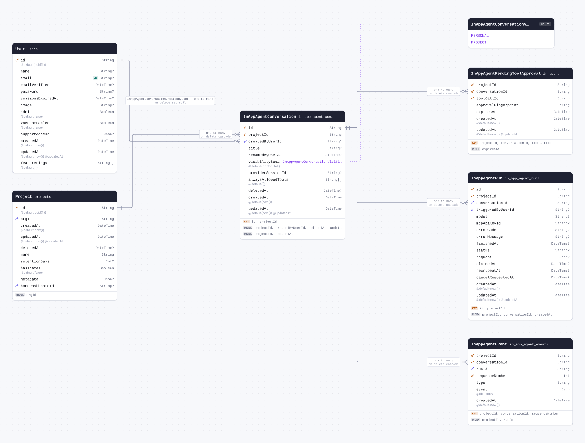

| Field                                         | Type                                                                                   | Constraints                                | Default              | Description |
| --------------------------------------------- | -------------------------------------------------------------------------------------- | ------------------------------------------ | -------------------- | ----------- |
| `id`                                          | `String`                                                                               | PK NOT NULL                                |                      |             |
| `projectId` (`project_id`)                    | `String`                                                                               | PK NOT NULL → [Project.id](#model-Project) |                      |             |
| `createdByUserId` (`created_by_user_id`)      | `String`                                                                               | NULL → [User.id](#model-User)              |                      |             |
| `title`                                       | `String`                                                                               | NULL                                       |                      |             |
| `renamedByUserAt` (`renamed_by_user_at`)      | `DateTime`                                                                             | NULL                                       |                      |             |
| `visibilityScope` (`visibility_scope`)        | [`InAppAgentConversationVisibilityScope`](#enum-InAppAgentConversationVisibilityScope) | NOT NULL                                   | `PERSONAL`           |             |
| `providerSessionId` (`provider_session_id`)   | `String`                                                                               | NULL                                       |                      |             |
| `alwaysAllowedTools` (`always_allowed_tools`) | `String[]`                                                                             | NOT NULL                                   | `[]`                 |             |
| `deletedAt` (`deleted_at`)                    | `DateTime`                                                                             | NULL                                       |                      |             |
| `createdAt` (`created_at`)                    | `DateTime`                                                                             | NOT NULL                                   | `now()`              |             |
| `updatedAt` (`updated_at`)                    | `DateTime`                                                                             | NOT NULL                                   | `now()` `@updatedAt` |             |

#### Indexes

- `@@id([id, projectId])`
- `@@index([projectId, createdByUserId, deletedAt, updatedAt, id], map: "in_app_agent_conversations_project_user_list_idx")`
- `@@index([projectId, updatedAt], map: "in_app_agent_conversations_project_updated_at_idx")`

#### References

- `projectId` → [Project.id](#model-Project) (many-to-one, on delete Cascade)
- `createdByUserId` → [User.id](#model-User) (many-to-one, on delete SetNull)

#### Referenced by

- `id` ← [InAppAgentEvent.conversationId](#model-InAppAgentEvent) (one-to-many, on delete Cascade)
- `id` ← [InAppAgentRun.conversationId](#model-InAppAgentRun) (one-to-many, on delete Cascade)
- `id` ← [InAppAgentPendingToolApproval.conversationId](#model-InAppAgentPendingToolApproval) (one-to-many, on delete Cascade)

#### Definition

```sql
CREATE TABLE "in_app_agent_conversations" (
    "id" TEXT NOT NULL,
    "project_id" TEXT NOT NULL,
    "created_by_user_id" TEXT,
    "title" TEXT,
    "renamed_by_user_at" TIMESTAMP(3),
    "visibility_scope" "InAppAgentConversationVisibilityScope" NOT NULL DEFAULT 'PERSONAL',
    "provider_session_id" TEXT,
    "always_allowed_tools" TEXT[] DEFAULT ARRAY[]::TEXT[],
    "deleted_at" TIMESTAMP(3),
    "created_at" TIMESTAMP(3) NOT NULL DEFAULT CURRENT_TIMESTAMP,
    "updated_at" TIMESTAMP(3) NOT NULL DEFAULT CURRENT_TIMESTAMP,

    CONSTRAINT "in_app_agent_conversations_pkey" PRIMARY KEY ("id","project_id")
);

CREATE INDEX "in_app_agent_conversations_project_user_list_idx" ON "in_app_agent_conversations"("project_id", "created_by_user_id", "deleted_at", "updated_at", "id");

CREATE INDEX "in_app_agent_conversations_project_updated_at_idx" ON "in_app_agent_conversations"("project_id", "updated_at");

ALTER TABLE "in_app_agent_conversations" ADD CONSTRAINT "in_app_agent_conversations_project_id_fkey" FOREIGN KEY ("project_id") REFERENCES "projects"("id") ON DELETE CASCADE ON UPDATE CASCADE;

ALTER TABLE "in_app_agent_conversations" ADD CONSTRAINT "in_app_agent_conversations_created_by_user_id_fkey" FOREIGN KEY ("created_by_user_id") REFERENCES "users"("id") ON DELETE SET NULL ON UPDATE CASCADE;
```

<details>
<summary>Queries and their SQL</summary>

**findMany**: Every row

```ts
await prisma.inAppAgentConversation.findMany();
```

```sql
SELECT
  "public"."in_app_agent_conversations"."id",
  "public"."in_app_agent_conversations"."project_id",
  "public"."in_app_agent_conversations"."created_by_user_id",
  "public"."in_app_agent_conversations"."title",
  "public"."in_app_agent_conversations"."renamed_by_user_at",
  "public"."in_app_agent_conversations"."visibility_scope"::text,
  "public"."in_app_agent_conversations"."provider_session_id",
  "public"."in_app_agent_conversations"."always_allowed_tools",
  "public"."in_app_agent_conversations"."deleted_at",
  "public"."in_app_agent_conversations"."created_at",
  "public"."in_app_agent_conversations"."updated_at"
FROM
  "public"."in_app_agent_conversations"
WHERE
  1 = 1
OFFSET
  $1
-- params: ["0"]
```

**count**: How many rows there are

```ts
await prisma.inAppAgentConversation.count();
```

```sql
SELECT
  COUNT(*) AS "_count$_all"
FROM
  (
    SELECT
      "public"."in_app_agent_conversations"."id",
      "public"."in_app_agent_conversations"."project_id"
    FROM
      "public"."in_app_agent_conversations"
    WHERE
      1 = 1
    OFFSET
      $1
  ) AS "sub"
-- params: ["0"]
```

**findMany**: Every row with its relations

```ts
await prisma.inAppAgentConversation.findMany({
  include: {
    project: true,
    createdByUser: true,
    events: true,
    runs: true,
    pendingToolApprovals: true,
  },
});
```

```sql
SELECT
  "public"."in_app_agent_conversations"."id",
  "public"."in_app_agent_conversations"."project_id",
  "public"."in_app_agent_conversations"."created_by_user_id",
  "public"."in_app_agent_conversations"."title",
  "public"."in_app_agent_conversations"."renamed_by_user_at",
  "public"."in_app_agent_conversations"."visibility_scope"::text,
  "public"."in_app_agent_conversations"."provider_session_id",
  "public"."in_app_agent_conversations"."always_allowed_tools",
  "public"."in_app_agent_conversations"."deleted_at",
  "public"."in_app_agent_conversations"."created_at",
  "public"."in_app_agent_conversations"."updated_at"
FROM
  "public"."in_app_agent_conversations"
WHERE
  1 = 1
OFFSET
  $1
-- params: ["0"]

SELECT
  "public"."projects"."id",
  "public"."projects"."org_id",
  "public"."projects"."created_at",
  "public"."projects"."updated_at",
  "public"."projects"."deleted_at",
  "public"."projects"."name",
  "public"."projects"."retention_days",
  "public"."projects"."has_traces",
  "public"."projects"."metadata",
  "public"."projects"."home_dashboard_id"
FROM
  "public"."projects"
WHERE
  "public"."projects"."id" IN ($1)
OFFSET
  $2
-- params: ["<projectId of the rows above>","0"]

SELECT
  "public"."users"."id",
  "public"."users"."name",
  "public"."users"."email",
  "public"."users"."email_verified",
  "public"."users"."password",
  "public"."users"."sessions_expired_at",
  "public"."users"."image",
  "public"."users"."admin",
  "public"."users"."v4_beta_enabled",
  "public"."users"."support_access",
  "public"."users"."created_at",
  "public"."users"."updated_at",
  "public"."users"."feature_flags"
FROM
  "public"."users"
WHERE
  "public"."users"."id" IN ($1)
OFFSET
  $2
-- params: ["<createdByUserId of the rows above>","0"]

SELECT
  "public"."in_app_agent_events"."project_id",
  "public"."in_app_agent_events"."conversation_id",
  "public"."in_app_agent_events"."sequence_number",
  "public"."in_app_agent_events"."run_id",
  "public"."in_app_agent_events"."type",
  "public"."in_app_agent_events"."event",
  "public"."in_app_agent_events"."created_at"
FROM
  "public"."in_app_agent_events"
WHERE
  (
    "public"."in_app_agent_events"."project_id" IN ($1)
    AND "public"."in_app_agent_events"."conversation_id" IN ($2)
  )
OFFSET
  $3
-- params: ["<projectId of the rows above>","<id of the rows above>","0"]

SELECT
  "public"."in_app_agent_runs"."id",
  "public"."in_app_agent_runs"."project_id",
  "public"."in_app_agent_runs"."conversation_id",
  "public"."in_app_agent_runs"."triggered_by_user_id",
  "public"."in_app_agent_runs"."model",
  "public"."in_app_agent_runs"."mcp_api_key_id",
  "public"."in_app_agent_runs"."error_code",
  "public"."in_app_agent_runs"."error_message",
  "public"."in_app_agent_runs"."finished_at",
  "public"."in_app_agent_runs"."status",
  "public"."in_app_agent_runs"."request",
  "public"."in_app_agent_runs"."claimed_at",
  "public"."in_app_agent_runs"."heartbeat_at",
  "public"."in_app_agent_runs"."cancel_requested_at",
  "public"."in_app_agent_runs"."created_at",
  "public"."in_app_agent_runs"."updated_at"
FROM
  "public"."in_app_agent_runs"
WHERE
  (
    "public"."in_app_agent_runs"."project_id" IN ($1)
    AND "public"."in_app_agent_runs"."conversation_id" IN ($2)
  )
OFFSET
  $3
-- params: ["<projectId of the rows above>","<id of the rows above>","0"]

SELECT
  "public"."in_app_agent_pending_tool_approvals"."project_id",
  "public"."in_app_agent_pending_tool_approvals"."conversation_id",
  "public"."in_app_agent_pending_tool_approvals"."tool_call_id",
  "public"."in_app_agent_pending_tool_approvals"."approval_fingerprint",
  "public"."in_app_agent_pending_tool_approvals"."expires_at",
  "public"."in_app_agent_pending_tool_approvals"."created_at",
  "public"."in_app_agent_pending_tool_approvals"."updated_at"
FROM
  "public"."in_app_agent_pending_tool_approvals"
WHERE
  (
    "public"."in_app_agent_pending_tool_approvals"."project_id" IN ($1)
    AND "public"."in_app_agent_pending_tool_approvals"."conversation_id" IN ($2)
  )
OFFSET
  $3
-- params: ["<projectId of the rows above>","<id of the rows above>","0"]
```

**findUnique**: One row by what is unique to it

```ts
await prisma.inAppAgentConversation.findUnique({
  where: { id_projectId: { id: "example", projectId: "example" } },
});
```

```sql
SELECT
  "public"."in_app_agent_conversations"."id",
  "public"."in_app_agent_conversations"."project_id",
  "public"."in_app_agent_conversations"."created_by_user_id",
  "public"."in_app_agent_conversations"."title",
  "public"."in_app_agent_conversations"."renamed_by_user_at",
  "public"."in_app_agent_conversations"."visibility_scope"::text,
  "public"."in_app_agent_conversations"."provider_session_id",
  "public"."in_app_agent_conversations"."always_allowed_tools",
  "public"."in_app_agent_conversations"."deleted_at",
  "public"."in_app_agent_conversations"."created_at",
  "public"."in_app_agent_conversations"."updated_at"
FROM
  "public"."in_app_agent_conversations"
WHERE
  (
    (
      "public"."in_app_agent_conversations"."id" = $1
      AND "public"."in_app_agent_conversations"."project_id" = $2
    )
    AND 1 = 1
  )
LIMIT
  $3
OFFSET
  $4
-- params: ["example","example","1","0"]
```

**create**: Create a row

```ts
await prisma.inAppAgentConversation.create({ data: { id: "example", projectId: "example" } });
```

```sql
INSERT INTO
  "public"."in_app_agent_conversations" (
    "id",
    "project_id",
    "visibility_scope",
    "always_allowed_tools",
    "created_at",
    "updated_at"
  )
VALUES
  (
    $1,
    $2,
    CAST(
      $3::text AS "public"."InAppAgentConversationVisibilityScope"
    ),
    $4,
    $5,
    $6
  )
RETURNING
  "public"."in_app_agent_conversations"."id",
  "public"."in_app_agent_conversations"."project_id",
  "public"."in_app_agent_conversations"."created_by_user_id",
  "public"."in_app_agent_conversations"."title",
  "public"."in_app_agent_conversations"."renamed_by_user_at",
  "public"."in_app_agent_conversations"."visibility_scope"::text,
  "public"."in_app_agent_conversations"."provider_session_id",
  "public"."in_app_agent_conversations"."always_allowed_tools",
  "public"."in_app_agent_conversations"."deleted_at",
  "public"."in_app_agent_conversations"."created_at",
  "public"."in_app_agent_conversations"."updated_at"
-- params: ["example","example","PERSONAL",[],"<now()>","<now()>"]
```

**update**: Update a row

```ts
await prisma.inAppAgentConversation.update({
  where: { id_projectId: { id: "example", projectId: "example" } },
  data: { title: "example" },
});
```

```sql
UPDATE "public"."in_app_agent_conversations"
SET
  "title" = $1,
  "updated_at" = $2
WHERE
  (
    (
      "public"."in_app_agent_conversations"."id" = $3
      AND "public"."in_app_agent_conversations"."project_id" = $4
    )
    AND 1 = 1
  )
RETURNING
  "public"."in_app_agent_conversations"."id",
  "public"."in_app_agent_conversations"."project_id",
  "public"."in_app_agent_conversations"."created_by_user_id",
  "public"."in_app_agent_conversations"."title",
  "public"."in_app_agent_conversations"."renamed_by_user_at",
  "public"."in_app_agent_conversations"."visibility_scope"::text,
  "public"."in_app_agent_conversations"."provider_session_id",
  "public"."in_app_agent_conversations"."always_allowed_tools",
  "public"."in_app_agent_conversations"."deleted_at",
  "public"."in_app_agent_conversations"."created_at",
  "public"."in_app_agent_conversations"."updated_at"
-- params: ["example",{"prisma__type":"generatorCall","prisma__value":{"name":"now","args":[],"returnType":{"type":"DateTime"}}},"example","example"]
```

**delete**: Delete a row

```ts
await prisma.inAppAgentConversation.delete({
  where: { id_projectId: { id: "example", projectId: "example" } },
});
```

```sql
DELETE FROM "public"."in_app_agent_conversations"
WHERE
  (
    (
      "public"."in_app_agent_conversations"."id" = $1
      AND "public"."in_app_agent_conversations"."project_id" = $2
    )
    AND 1 = 1
  )
RETURNING
  "public"."in_app_agent_conversations"."id",
  "public"."in_app_agent_conversations"."project_id",
  "public"."in_app_agent_conversations"."created_by_user_id",
  "public"."in_app_agent_conversations"."title",
  "public"."in_app_agent_conversations"."renamed_by_user_at",
  "public"."in_app_agent_conversations"."visibility_scope"::text,
  "public"."in_app_agent_conversations"."provider_session_id",
  "public"."in_app_agent_conversations"."always_allowed_tools",
  "public"."in_app_agent_conversations"."deleted_at",
  "public"."in_app_agent_conversations"."created_at",
  "public"."in_app_agent_conversations"."updated_at"
-- params: ["example","example"]
```

</details>

<a id="model-InAppAgentEvent"></a>

### InAppAgentEvent

Table `in_app_agent_events`.

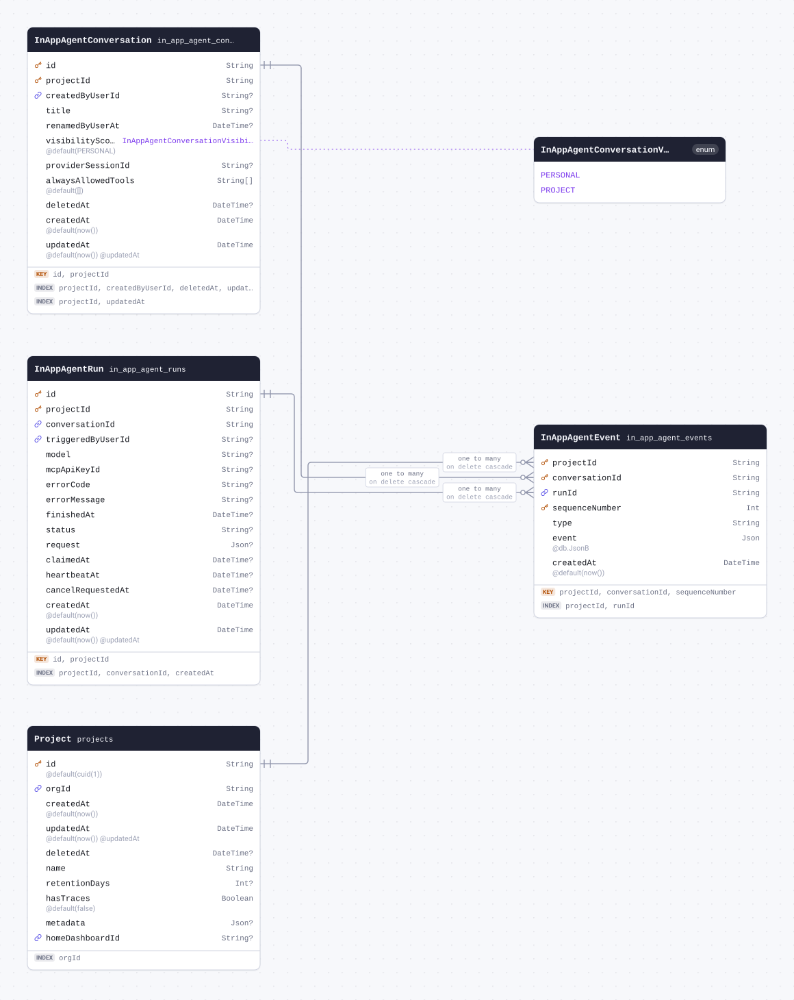

| Field                                | Type               | Constraints                                                              | Default | Description |
| ------------------------------------ | ------------------ | ------------------------------------------------------------------------ | ------- | ----------- |
| `projectId` (`project_id`)           | `String`           | PK NOT NULL → [Project.id](#model-Project)                               |         |             |
| `conversationId` (`conversation_id`) | `String`           | PK NOT NULL → [InAppAgentConversation.id](#model-InAppAgentConversation) |         |             |
| `runId` (`run_id`)                   | `String`           | NOT NULL → [InAppAgentRun.id](#model-InAppAgentRun)                      |         |             |
| `sequenceNumber` (`sequence_number`) | `Int`              | PK NOT NULL                                                              |         |             |
| `type`                               | `String`           | NOT NULL                                                                 |         |             |
| `event`                              | `Json` `@db.JsonB` | NOT NULL                                                                 |         |             |
| `createdAt` (`created_at`)           | `DateTime`         | NOT NULL                                                                 | `now()` |             |

#### Indexes

- `@@id([projectId, conversationId, sequenceNumber])`
- `@@index([projectId, runId], map: "in_app_agent_events_project_run_idx")`

#### References

- `projectId` → [Project.id](#model-Project) (many-to-one, on delete Cascade)
- `conversationId` → [InAppAgentConversation.id](#model-InAppAgentConversation) (many-to-one, on delete Cascade)
- `runId` → [InAppAgentRun.id](#model-InAppAgentRun) (many-to-one, on delete Cascade)

#### Definition

```sql
CREATE TABLE "in_app_agent_events" (
    "project_id" TEXT NOT NULL,
    "conversation_id" TEXT NOT NULL,
    "run_id" TEXT NOT NULL,
    "sequence_number" INTEGER NOT NULL,
    "type" TEXT NOT NULL,
    "event" JSONB NOT NULL,
    "created_at" TIMESTAMP(3) NOT NULL DEFAULT CURRENT_TIMESTAMP,

    CONSTRAINT "in_app_agent_events_pkey" PRIMARY KEY ("project_id","conversation_id","sequence_number")
);

CREATE INDEX "in_app_agent_events_project_run_idx" ON "in_app_agent_events"("project_id", "run_id");

ALTER TABLE "in_app_agent_events" ADD CONSTRAINT "in_app_agent_events_project_id_fkey" FOREIGN KEY ("project_id") REFERENCES "projects"("id") ON DELETE CASCADE ON UPDATE CASCADE;

ALTER TABLE "in_app_agent_events" ADD CONSTRAINT "in_app_agent_events_conversation_id_project_id_fkey" FOREIGN KEY ("conversation_id", "project_id") REFERENCES "in_app_agent_conversations"("id", "project_id") ON DELETE CASCADE ON UPDATE CASCADE;

ALTER TABLE "in_app_agent_events" ADD CONSTRAINT "in_app_agent_events_run_id_project_id_fkey" FOREIGN KEY ("run_id", "project_id") REFERENCES "in_app_agent_runs"("id", "project_id") ON DELETE CASCADE ON UPDATE CASCADE;
```

<details>
<summary>Queries and their SQL</summary>

**findMany**: Every row

```ts
await prisma.inAppAgentEvent.findMany();
```

```sql
SELECT
  "public"."in_app_agent_events"."project_id",
  "public"."in_app_agent_events"."conversation_id",
  "public"."in_app_agent_events"."sequence_number",
  "public"."in_app_agent_events"."run_id",
  "public"."in_app_agent_events"."type",
  "public"."in_app_agent_events"."event",
  "public"."in_app_agent_events"."created_at"
FROM
  "public"."in_app_agent_events"
WHERE
  1 = 1
OFFSET
  $1
-- params: ["0"]
```

**count**: How many rows there are

```ts
await prisma.inAppAgentEvent.count();
```

```sql
SELECT
  COUNT(*) AS "_count$_all"
FROM
  (
    SELECT
      "public"."in_app_agent_events"."project_id",
      "public"."in_app_agent_events"."conversation_id",
      "public"."in_app_agent_events"."sequence_number"
    FROM
      "public"."in_app_agent_events"
    WHERE
      1 = 1
    OFFSET
      $1
  ) AS "sub"
-- params: ["0"]
```

**findMany**: Every row with its relations

```ts
await prisma.inAppAgentEvent.findMany({
  include: { project: true, conversation: true, run: true },
});
```

```sql
SELECT
  "public"."in_app_agent_events"."project_id",
  "public"."in_app_agent_events"."conversation_id",
  "public"."in_app_agent_events"."sequence_number",
  "public"."in_app_agent_events"."run_id",
  "public"."in_app_agent_events"."type",
  "public"."in_app_agent_events"."event",
  "public"."in_app_agent_events"."created_at"
FROM
  "public"."in_app_agent_events"
WHERE
  1 = 1
OFFSET
  $1
-- params: ["0"]

SELECT
  "public"."projects"."id",
  "public"."projects"."org_id",
  "public"."projects"."created_at",
  "public"."projects"."updated_at",
  "public"."projects"."deleted_at",
  "public"."projects"."name",
  "public"."projects"."retention_days",
  "public"."projects"."has_traces",
  "public"."projects"."metadata",
  "public"."projects"."home_dashboard_id"
FROM
  "public"."projects"
WHERE
  "public"."projects"."id" IN ($1)
OFFSET
  $2
-- params: ["<projectId of the rows above>","0"]

SELECT
  "public"."in_app_agent_conversations"."id",
  "public"."in_app_agent_conversations"."project_id",
  "public"."in_app_agent_conversations"."created_by_user_id",
  "public"."in_app_agent_conversations"."title",
  "public"."in_app_agent_conversations"."renamed_by_user_at",
  "public"."in_app_agent_conversations"."visibility_scope"::text,
  "public"."in_app_agent_conversations"."provider_session_id",
  "public"."in_app_agent_conversations"."always_allowed_tools",
  "public"."in_app_agent_conversations"."deleted_at",
  "public"."in_app_agent_conversations"."created_at",
  "public"."in_app_agent_conversations"."updated_at"
FROM
  "public"."in_app_agent_conversations"
WHERE
  (
    "public"."in_app_agent_conversations"."id" IN ($1)
    AND "public"."in_app_agent_conversations"."project_id" IN ($2)
  )
OFFSET
  $3
-- params: ["<conversationId of the rows above>","<projectId of the rows above>","0"]

SELECT
  "public"."in_app_agent_runs"."id",
  "public"."in_app_agent_runs"."project_id",
  "public"."in_app_agent_runs"."conversation_id",
  "public"."in_app_agent_runs"."triggered_by_user_id",
  "public"."in_app_agent_runs"."model",
  "public"."in_app_agent_runs"."mcp_api_key_id",
  "public"."in_app_agent_runs"."error_code",
  "public"."in_app_agent_runs"."error_message",
  "public"."in_app_agent_runs"."finished_at",
  "public"."in_app_agent_runs"."status",
  "public"."in_app_agent_runs"."request",
  "public"."in_app_agent_runs"."claimed_at",
  "public"."in_app_agent_runs"."heartbeat_at",
  "public"."in_app_agent_runs"."cancel_requested_at",
  "public"."in_app_agent_runs"."created_at",
  "public"."in_app_agent_runs"."updated_at"
FROM
  "public"."in_app_agent_runs"
WHERE
  (
    "public"."in_app_agent_runs"."id" IN ($1)
    AND "public"."in_app_agent_runs"."project_id" IN ($2)
  )
OFFSET
  $3
-- params: ["<runId of the rows above>","<projectId of the rows above>","0"]
```

**findUnique**: One row by what is unique to it

```ts
await prisma.inAppAgentEvent.findUnique({
  where: {
    projectId_conversationId_sequenceNumber: {
      projectId: "example",
      conversationId: "example",
      sequenceNumber: 1,
    },
  },
});
```

```sql
SELECT
  "public"."in_app_agent_events"."project_id",
  "public"."in_app_agent_events"."conversation_id",
  "public"."in_app_agent_events"."sequence_number",
  "public"."in_app_agent_events"."run_id",
  "public"."in_app_agent_events"."type",
  "public"."in_app_agent_events"."event",
  "public"."in_app_agent_events"."created_at"
FROM
  "public"."in_app_agent_events"
WHERE
  (
    (
      "public"."in_app_agent_events"."project_id" = $1
      AND "public"."in_app_agent_events"."conversation_id" = $2
      AND "public"."in_app_agent_events"."sequence_number" = $3
    )
    AND 1 = 1
  )
LIMIT
  $4
OFFSET
  $5
-- params: ["example","example","1","1","0"]
```

**create**: Create a row

```ts
await prisma.inAppAgentEvent.create({
  data: {
    projectId: "example",
    conversationId: "example",
    runId: "example",
    sequenceNumber: 1,
    type: "example",
    event: {},
  },
});
```

```sql
INSERT INTO
  "public"."in_app_agent_events" (
    "project_id",
    "conversation_id",
    "run_id",
    "sequence_number",
    "type",
    "event",
    "created_at"
  )
VALUES
  ($1, $2, $3, $4, $5, $6, $7)
RETURNING
  "public"."in_app_agent_events"."project_id",
  "public"."in_app_agent_events"."conversation_id",
  "public"."in_app_agent_events"."sequence_number",
  "public"."in_app_agent_events"."run_id",
  "public"."in_app_agent_events"."type",
  "public"."in_app_agent_events"."event",
  "public"."in_app_agent_events"."created_at"
-- params: ["example","example","example","1","example","{}","<now()>"]
```

**update**: Update a row

```ts
await prisma.inAppAgentEvent.update({
  where: {
    projectId_conversationId_sequenceNumber: {
      projectId: "example",
      conversationId: "example",
      sequenceNumber: 1,
    },
  },
  data: { type: "example" },
});
```

```sql
UPDATE "public"."in_app_agent_events"
SET
  "type" = $1
WHERE
  (
    (
      "public"."in_app_agent_events"."project_id" = $2
      AND "public"."in_app_agent_events"."conversation_id" = $3
      AND "public"."in_app_agent_events"."sequence_number" = $4
    )
    AND 1 = 1
  )
RETURNING
  "public"."in_app_agent_events"."project_id",
  "public"."in_app_agent_events"."conversation_id",
  "public"."in_app_agent_events"."sequence_number",
  "public"."in_app_agent_events"."run_id",
  "public"."in_app_agent_events"."type",
  "public"."in_app_agent_events"."event",
  "public"."in_app_agent_events"."created_at"
-- params: ["example","example","example","1"]
```

**delete**: Delete a row

```ts
await prisma.inAppAgentEvent.delete({
  where: {
    projectId_conversationId_sequenceNumber: {
      projectId: "example",
      conversationId: "example",
      sequenceNumber: 1,
    },
  },
});
```

```sql
DELETE FROM "public"."in_app_agent_events"
WHERE
  (
    (
      "public"."in_app_agent_events"."project_id" = $1
      AND "public"."in_app_agent_events"."conversation_id" = $2
      AND "public"."in_app_agent_events"."sequence_number" = $3
    )
    AND 1 = 1
  )
RETURNING
  "public"."in_app_agent_events"."project_id",
  "public"."in_app_agent_events"."conversation_id",
  "public"."in_app_agent_events"."sequence_number",
  "public"."in_app_agent_events"."run_id",
  "public"."in_app_agent_events"."type",
  "public"."in_app_agent_events"."event",
  "public"."in_app_agent_events"."created_at"
-- params: ["example","example","1"]
```

</details>

<a id="model-InAppAgentRun"></a>

### InAppAgentRun

Table `in_app_agent_runs`.

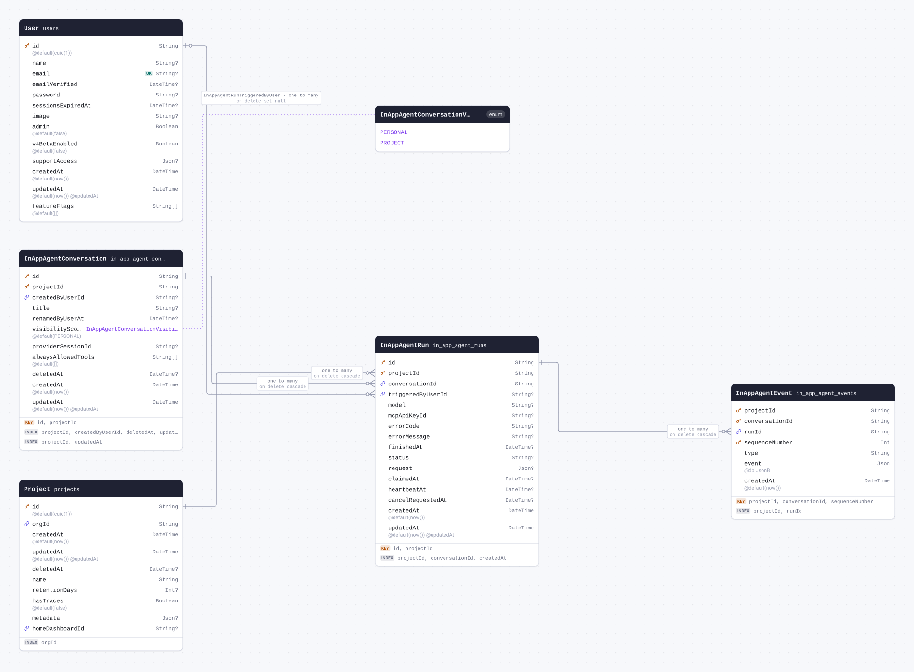

| Field                                        | Type       | Constraints                                                           | Default              | Description |
| -------------------------------------------- | ---------- | --------------------------------------------------------------------- | -------------------- | ----------- |
| `id`                                         | `String`   | PK NOT NULL                                                           |                      |             |
| `projectId` (`project_id`)                   | `String`   | PK NOT NULL → [Project.id](#model-Project)                            |                      |             |
| `conversationId` (`conversation_id`)         | `String`   | NOT NULL → [InAppAgentConversation.id](#model-InAppAgentConversation) |                      |             |
| `triggeredByUserId` (`triggered_by_user_id`) | `String`   | NULL → [User.id](#model-User)                                         |                      |             |
| `model`                                      | `String`   | NULL                                                                  |                      |             |
| `mcpApiKeyId` (`mcp_api_key_id`)             | `String`   | NULL                                                                  |                      |             |
| `errorCode` (`error_code`)                   | `String`   | NULL                                                                  |                      |             |
| `errorMessage` (`error_message`)             | `String`   | NULL                                                                  |                      |             |
| `finishedAt` (`finished_at`)                 | `DateTime` | NULL                                                                  |                      |             |
| `status`                                     | `String`   | NULL                                                                  |                      |             |
| `request`                                    | `Json`     | NULL                                                                  |                      |             |
| `claimedAt` (`claimed_at`)                   | `DateTime` | NULL                                                                  |                      |             |
| `heartbeatAt` (`heartbeat_at`)               | `DateTime` | NULL                                                                  |                      |             |
| `cancelRequestedAt` (`cancel_requested_at`)  | `DateTime` | NULL                                                                  |                      |             |
| `createdAt` (`created_at`)                   | `DateTime` | NOT NULL                                                              | `now()`              |             |
| `updatedAt` (`updated_at`)                   | `DateTime` | NOT NULL                                                              | `now()` `@updatedAt` |             |

#### Indexes

- `@@id([id, projectId])`
- `@@index([projectId, conversationId, createdAt], map: "in_app_agent_runs_project_conversation_created_idx")`

#### References

- `projectId` → [Project.id](#model-Project) (many-to-one, on delete Cascade)
- `conversationId` → [InAppAgentConversation.id](#model-InAppAgentConversation) (many-to-one, on delete Cascade)
- `triggeredByUserId` → [User.id](#model-User) (many-to-one, on delete SetNull)

#### Referenced by

- `id` ← [InAppAgentEvent.runId](#model-InAppAgentEvent) (one-to-many, on delete Cascade)

#### Definition

```sql
CREATE TABLE "in_app_agent_runs" (
    "id" TEXT NOT NULL,
    "project_id" TEXT NOT NULL,
    "conversation_id" TEXT NOT NULL,
    "triggered_by_user_id" TEXT,
    "model" TEXT,
    "mcp_api_key_id" TEXT,
    "error_code" TEXT,
    "error_message" TEXT,
    "finished_at" TIMESTAMP(3),
    "status" TEXT,
    "request" JSONB,
    "claimed_at" TIMESTAMP(3),
    "heartbeat_at" TIMESTAMP(3),
    "cancel_requested_at" TIMESTAMP(3),
    "created_at" TIMESTAMP(3) NOT NULL DEFAULT CURRENT_TIMESTAMP,
    "updated_at" TIMESTAMP(3) NOT NULL DEFAULT CURRENT_TIMESTAMP,

    CONSTRAINT "in_app_agent_runs_pkey" PRIMARY KEY ("id","project_id")
);

CREATE INDEX "in_app_agent_runs_project_conversation_created_idx" ON "in_app_agent_runs"("project_id", "conversation_id", "created_at");

ALTER TABLE "in_app_agent_runs" ADD CONSTRAINT "in_app_agent_runs_project_id_fkey" FOREIGN KEY ("project_id") REFERENCES "projects"("id") ON DELETE CASCADE ON UPDATE CASCADE;

ALTER TABLE "in_app_agent_runs" ADD CONSTRAINT "in_app_agent_runs_conversation_id_project_id_fkey" FOREIGN KEY ("conversation_id", "project_id") REFERENCES "in_app_agent_conversations"("id", "project_id") ON DELETE CASCADE ON UPDATE CASCADE;

ALTER TABLE "in_app_agent_runs" ADD CONSTRAINT "in_app_agent_runs_triggered_by_user_id_fkey" FOREIGN KEY ("triggered_by_user_id") REFERENCES "users"("id") ON DELETE SET NULL ON UPDATE CASCADE;
```

<details>
<summary>Queries and their SQL</summary>

**findMany**: Every row

```ts
await prisma.inAppAgentRun.findMany();
```

```sql
SELECT
  "public"."in_app_agent_runs"."id",
  "public"."in_app_agent_runs"."project_id",
  "public"."in_app_agent_runs"."conversation_id",
  "public"."in_app_agent_runs"."triggered_by_user_id",
  "public"."in_app_agent_runs"."model",
  "public"."in_app_agent_runs"."mcp_api_key_id",
  "public"."in_app_agent_runs"."error_code",
  "public"."in_app_agent_runs"."error_message",
  "public"."in_app_agent_runs"."finished_at",
  "public"."in_app_agent_runs"."status",
  "public"."in_app_agent_runs"."request",
  "public"."in_app_agent_runs"."claimed_at",
  "public"."in_app_agent_runs"."heartbeat_at",
  "public"."in_app_agent_runs"."cancel_requested_at",
  "public"."in_app_agent_runs"."created_at",
  "public"."in_app_agent_runs"."updated_at"
FROM
  "public"."in_app_agent_runs"
WHERE
  1 = 1
OFFSET
  $1
-- params: ["0"]
```

**count**: How many rows there are

```ts
await prisma.inAppAgentRun.count();
```

```sql
SELECT
  COUNT(*) AS "_count$_all"
FROM
  (
    SELECT
      "public"."in_app_agent_runs"."id",
      "public"."in_app_agent_runs"."project_id"
    FROM
      "public"."in_app_agent_runs"
    WHERE
      1 = 1
    OFFSET
      $1
  ) AS "sub"
-- params: ["0"]
```

**findMany**: Every row with its relations

```ts
await prisma.inAppAgentRun.findMany({
  include: { project: true, conversation: true, triggeredByUser: true, events: true },
});
```

```sql
SELECT
  "public"."in_app_agent_runs"."id",
  "public"."in_app_agent_runs"."project_id",
  "public"."in_app_agent_runs"."conversation_id",
  "public"."in_app_agent_runs"."triggered_by_user_id",
  "public"."in_app_agent_runs"."model",
  "public"."in_app_agent_runs"."mcp_api_key_id",
  "public"."in_app_agent_runs"."error_code",
  "public"."in_app_agent_runs"."error_message",
  "public"."in_app_agent_runs"."finished_at",
  "public"."in_app_agent_runs"."status",
  "public"."in_app_agent_runs"."request",
  "public"."in_app_agent_runs"."claimed_at",
  "public"."in_app_agent_runs"."heartbeat_at",
  "public"."in_app_agent_runs"."cancel_requested_at",
  "public"."in_app_agent_runs"."created_at",
  "public"."in_app_agent_runs"."updated_at"
FROM
  "public"."in_app_agent_runs"
WHERE
  1 = 1
OFFSET
  $1
-- params: ["0"]

SELECT
  "public"."projects"."id",
  "public"."projects"."org_id",
  "public"."projects"."created_at",
  "public"."projects"."updated_at",
  "public"."projects"."deleted_at",
  "public"."projects"."name",
  "public"."projects"."retention_days",
  "public"."projects"."has_traces",
  "public"."projects"."metadata",
  "public"."projects"."home_dashboard_id"
FROM
  "public"."projects"
WHERE
  "public"."projects"."id" IN ($1)
OFFSET
  $2
-- params: ["<projectId of the rows above>","0"]

SELECT
  "public"."in_app_agent_conversations"."id",
  "public"."in_app_agent_conversations"."project_id",
  "public"."in_app_agent_conversations"."created_by_user_id",
  "public"."in_app_agent_conversations"."title",
  "public"."in_app_agent_conversations"."renamed_by_user_at",
  "public"."in_app_agent_conversations"."visibility_scope"::text,
  "public"."in_app_agent_conversations"."provider_session_id",
  "public"."in_app_agent_conversations"."always_allowed_tools",
  "public"."in_app_agent_conversations"."deleted_at",
  "public"."in_app_agent_conversations"."created_at",
  "public"."in_app_agent_conversations"."updated_at"
FROM
  "public"."in_app_agent_conversations"
WHERE
  (
    "public"."in_app_agent_conversations"."id" IN ($1)
    AND "public"."in_app_agent_conversations"."project_id" IN ($2)
  )
OFFSET
  $3
-- params: ["<conversationId of the rows above>","<projectId of the rows above>","0"]

SELECT
  "public"."users"."id",
  "public"."users"."name",
  "public"."users"."email",
  "public"."users"."email_verified",
  "public"."users"."password",
  "public"."users"."sessions_expired_at",
  "public"."users"."image",
  "public"."users"."admin",
  "public"."users"."v4_beta_enabled",
  "public"."users"."support_access",
  "public"."users"."created_at",
  "public"."users"."updated_at",
  "public"."users"."feature_flags"
FROM
  "public"."users"
WHERE
  "public"."users"."id" IN ($1)
OFFSET
  $2
-- params: ["<triggeredByUserId of the rows above>","0"]

SELECT
  "public"."in_app_agent_events"."project_id",
  "public"."in_app_agent_events"."conversation_id",
  "public"."in_app_agent_events"."sequence_number",
  "public"."in_app_agent_events"."run_id",
  "public"."in_app_agent_events"."type",
  "public"."in_app_agent_events"."event",
  "public"."in_app_agent_events"."created_at"
FROM
  "public"."in_app_agent_events"
WHERE
  (
    "public"."in_app_agent_events"."project_id" IN ($1)
    AND "public"."in_app_agent_events"."run_id" IN ($2)
  )
OFFSET
  $3
-- params: ["<projectId of the rows above>","<id of the rows above>","0"]
```

**findUnique**: One row by what is unique to it

```ts
await prisma.inAppAgentRun.findUnique({
  where: { id_projectId: { id: "example", projectId: "example" } },
});
```

```sql
SELECT
  "public"."in_app_agent_runs"."id",
  "public"."in_app_agent_runs"."project_id",
  "public"."in_app_agent_runs"."conversation_id",
  "public"."in_app_agent_runs"."triggered_by_user_id",
  "public"."in_app_agent_runs"."model",
  "public"."in_app_agent_runs"."mcp_api_key_id",
  "public"."in_app_agent_runs"."error_code",
  "public"."in_app_agent_runs"."error_message",
  "public"."in_app_agent_runs"."finished_at",
  "public"."in_app_agent_runs"."status",
  "public"."in_app_agent_runs"."request",
  "public"."in_app_agent_runs"."claimed_at",
  "public"."in_app_agent_runs"."heartbeat_at",
  "public"."in_app_agent_runs"."cancel_requested_at",
  "public"."in_app_agent_runs"."created_at",
  "public"."in_app_agent_runs"."updated_at"
FROM
  "public"."in_app_agent_runs"
WHERE
  (
    (
      "public"."in_app_agent_runs"."id" = $1
      AND "public"."in_app_agent_runs"."project_id" = $2
    )
    AND 1 = 1
  )
LIMIT
  $3
OFFSET
  $4
-- params: ["example","example","1","0"]
```

**create**: Create a row

```ts
await prisma.inAppAgentRun.create({
  data: { id: "example", projectId: "example", conversationId: "example" },
});
```

```sql
INSERT INTO
  "public"."in_app_agent_runs" (
    "id",
    "project_id",
    "conversation_id",
    "created_at",
    "updated_at"
  )
VALUES
  ($1, $2, $3, $4, $5)
RETURNING
  "public"."in_app_agent_runs"."id",
  "public"."in_app_agent_runs"."project_id",
  "public"."in_app_agent_runs"."conversation_id",
  "public"."in_app_agent_runs"."triggered_by_user_id",
  "public"."in_app_agent_runs"."model",
  "public"."in_app_agent_runs"."mcp_api_key_id",
  "public"."in_app_agent_runs"."error_code",
  "public"."in_app_agent_runs"."error_message",
  "public"."in_app_agent_runs"."finished_at",
  "public"."in_app_agent_runs"."status",
  "public"."in_app_agent_runs"."request",
  "public"."in_app_agent_runs"."claimed_at",
  "public"."in_app_agent_runs"."heartbeat_at",
  "public"."in_app_agent_runs"."cancel_requested_at",
  "public"."in_app_agent_runs"."created_at",
  "public"."in_app_agent_runs"."updated_at"
-- params: ["example","example","example","<now()>","<now()>"]
```

**update**: Update a row

```ts
await prisma.inAppAgentRun.update({
  where: { id_projectId: { id: "example", projectId: "example" } },
  data: { model: "example" },
});
```

```sql
UPDATE "public"."in_app_agent_runs"
SET
  "model" = $1,
  "updated_at" = $2
WHERE
  (
    (
      "public"."in_app_agent_runs"."id" = $3
      AND "public"."in_app_agent_runs"."project_id" = $4
    )
    AND 1 = 1
  )
RETURNING
  "public"."in_app_agent_runs"."id",
  "public"."in_app_agent_runs"."project_id",
  "public"."in_app_agent_runs"."conversation_id",
  "public"."in_app_agent_runs"."triggered_by_user_id",
  "public"."in_app_agent_runs"."model",
  "public"."in_app_agent_runs"."mcp_api_key_id",
  "public"."in_app_agent_runs"."error_code",
  "public"."in_app_agent_runs"."error_message",
  "public"."in_app_agent_runs"."finished_at",
  "public"."in_app_agent_runs"."status",
  "public"."in_app_agent_runs"."request",
  "public"."in_app_agent_runs"."claimed_at",
  "public"."in_app_agent_runs"."heartbeat_at",
  "public"."in_app_agent_runs"."cancel_requested_at",
  "public"."in_app_agent_runs"."created_at",
  "public"."in_app_agent_runs"."updated_at"
-- params: ["example",{"prisma__type":"generatorCall","prisma__value":{"name":"now","args":[],"returnType":{"type":"DateTime"}}},"example","example"]
```

**delete**: Delete a row

```ts
await prisma.inAppAgentRun.delete({
  where: { id_projectId: { id: "example", projectId: "example" } },
});
```

```sql
DELETE FROM "public"."in_app_agent_runs"
WHERE
  (
    (
      "public"."in_app_agent_runs"."id" = $1
      AND "public"."in_app_agent_runs"."project_id" = $2
    )
    AND 1 = 1
  )
RETURNING
  "public"."in_app_agent_runs"."id",
  "public"."in_app_agent_runs"."project_id",
  "public"."in_app_agent_runs"."conversation_id",
  "public"."in_app_agent_runs"."triggered_by_user_id",
  "public"."in_app_agent_runs"."model",
  "public"."in_app_agent_runs"."mcp_api_key_id",
  "public"."in_app_agent_runs"."error_code",
  "public"."in_app_agent_runs"."error_message",
  "public"."in_app_agent_runs"."finished_at",
  "public"."in_app_agent_runs"."status",
  "public"."in_app_agent_runs"."request",
  "public"."in_app_agent_runs"."claimed_at",
  "public"."in_app_agent_runs"."heartbeat_at",
  "public"."in_app_agent_runs"."cancel_requested_at",
  "public"."in_app_agent_runs"."created_at",
  "public"."in_app_agent_runs"."updated_at"
-- params: ["example","example"]
```

</details>

<a id="model-InAppAgentPendingToolApproval"></a>

### InAppAgentPendingToolApproval

Table `in_app_agent_pending_tool_approvals`.

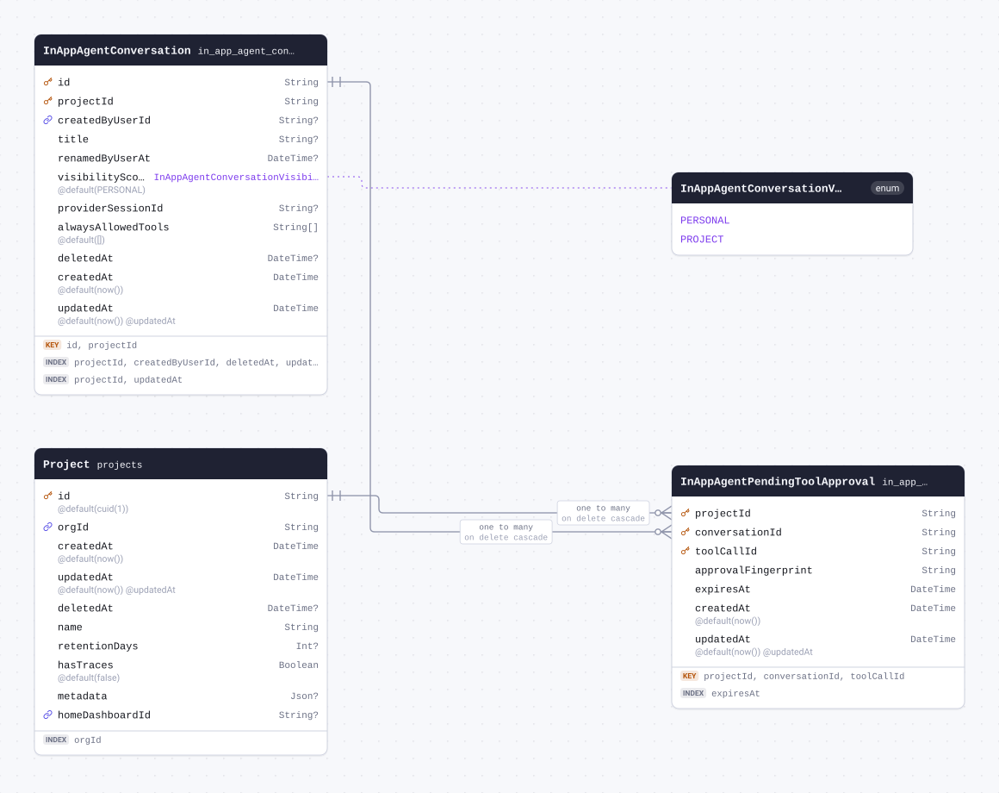

| Field                                          | Type       | Constraints                                                              | Default              | Description |
| ---------------------------------------------- | ---------- | ------------------------------------------------------------------------ | -------------------- | ----------- |
| `projectId` (`project_id`)                     | `String`   | PK NOT NULL → [Project.id](#model-Project)                               |                      |             |
| `conversationId` (`conversation_id`)           | `String`   | PK NOT NULL → [InAppAgentConversation.id](#model-InAppAgentConversation) |                      |             |
| `toolCallId` (`tool_call_id`)                  | `String`   | PK NOT NULL                                                              |                      |             |
| `approvalFingerprint` (`approval_fingerprint`) | `String`   | NOT NULL                                                                 |                      |             |
| `expiresAt` (`expires_at`)                     | `DateTime` | NOT NULL                                                                 |                      |             |
| `createdAt` (`created_at`)                     | `DateTime` | NOT NULL                                                                 | `now()`              |             |
| `updatedAt` (`updated_at`)                     | `DateTime` | NOT NULL                                                                 | `now()` `@updatedAt` |             |

#### Indexes

- `@@id([projectId, conversationId, toolCallId])`
- `@@index([expiresAt], map: "in_app_agent_pending_tool_approvals_expires_at_idx")`

#### References

- `projectId` → [Project.id](#model-Project) (many-to-one, on delete Cascade)
- `conversationId` → [InAppAgentConversation.id](#model-InAppAgentConversation) (many-to-one, on delete Cascade)

#### Definition

```sql
CREATE TABLE "in_app_agent_pending_tool_approvals" (
    "project_id" TEXT NOT NULL,
    "conversation_id" TEXT NOT NULL,
    "tool_call_id" TEXT NOT NULL,
    "approval_fingerprint" TEXT NOT NULL,
    "expires_at" TIMESTAMP(3) NOT NULL,
    "created_at" TIMESTAMP(3) NOT NULL DEFAULT CURRENT_TIMESTAMP,
    "updated_at" TIMESTAMP(3) NOT NULL DEFAULT CURRENT_TIMESTAMP,

    CONSTRAINT "in_app_agent_pending_tool_approvals_pkey" PRIMARY KEY ("project_id","conversation_id","tool_call_id")
);

CREATE INDEX "in_app_agent_pending_tool_approvals_expires_at_idx" ON "in_app_agent_pending_tool_approvals"("expires_at");

ALTER TABLE "in_app_agent_pending_tool_approvals" ADD CONSTRAINT "in_app_agent_pending_tool_approvals_project_id_fkey" FOREIGN KEY ("project_id") REFERENCES "projects"("id") ON DELETE CASCADE ON UPDATE CASCADE;

ALTER TABLE "in_app_agent_pending_tool_approvals" ADD CONSTRAINT "in_app_agent_pending_tool_approvals_conversation_id_projec_fkey" FOREIGN KEY ("conversation_id", "project_id") REFERENCES "in_app_agent_conversations"("id", "project_id") ON DELETE CASCADE ON UPDATE CASCADE;
```

<details>
<summary>Queries and their SQL</summary>

**findMany**: Every row

```ts
await prisma.inAppAgentPendingToolApproval.findMany();
```

```sql
SELECT
  "public"."in_app_agent_pending_tool_approvals"."project_id",
  "public"."in_app_agent_pending_tool_approvals"."conversation_id",
  "public"."in_app_agent_pending_tool_approvals"."tool_call_id",
  "public"."in_app_agent_pending_tool_approvals"."approval_fingerprint",
  "public"."in_app_agent_pending_tool_approvals"."expires_at",
  "public"."in_app_agent_pending_tool_approvals"."created_at",
  "public"."in_app_agent_pending_tool_approvals"."updated_at"
FROM
  "public"."in_app_agent_pending_tool_approvals"
WHERE
  1 = 1
OFFSET
  $1
-- params: ["0"]
```

**count**: How many rows there are

```ts
await prisma.inAppAgentPendingToolApproval.count();
```

```sql
SELECT
  COUNT(*) AS "_count$_all"
FROM
  (
    SELECT
      "public"."in_app_agent_pending_tool_approvals"."project_id",
      "public"."in_app_agent_pending_tool_approvals"."conversation_id",
      "public"."in_app_agent_pending_tool_approvals"."tool_call_id"
    FROM
      "public"."in_app_agent_pending_tool_approvals"
    WHERE
      1 = 1
    OFFSET
      $1
  ) AS "sub"
-- params: ["0"]
```

**findMany**: Every row with its relations

```ts
await prisma.inAppAgentPendingToolApproval.findMany({
  include: { project: true, conversation: true },
});
```

```sql
SELECT
  "public"."in_app_agent_pending_tool_approvals"."project_id",
  "public"."in_app_agent_pending_tool_approvals"."conversation_id",
  "public"."in_app_agent_pending_tool_approvals"."tool_call_id",
  "public"."in_app_agent_pending_tool_approvals"."approval_fingerprint",
  "public"."in_app_agent_pending_tool_approvals"."expires_at",
  "public"."in_app_agent_pending_tool_approvals"."created_at",
  "public"."in_app_agent_pending_tool_approvals"."updated_at"
FROM
  "public"."in_app_agent_pending_tool_approvals"
WHERE
  1 = 1
OFFSET
  $1
-- params: ["0"]

SELECT
  "public"."projects"."id",
  "public"."projects"."org_id",
  "public"."projects"."created_at",
  "public"."projects"."updated_at",
  "public"."projects"."deleted_at",
  "public"."projects"."name",
  "public"."projects"."retention_days",
  "public"."projects"."has_traces",
  "public"."projects"."metadata",
  "public"."projects"."home_dashboard_id"
FROM
  "public"."projects"
WHERE
  "public"."projects"."id" IN ($1)
OFFSET
  $2
-- params: ["<projectId of the rows above>","0"]

SELECT
  "public"."in_app_agent_conversations"."id",
  "public"."in_app_agent_conversations"."project_id",
  "public"."in_app_agent_conversations"."created_by_user_id",
  "public"."in_app_agent_conversations"."title",
  "public"."in_app_agent_conversations"."renamed_by_user_at",
  "public"."in_app_agent_conversations"."visibility_scope"::text,
  "public"."in_app_agent_conversations"."provider_session_id",
  "public"."in_app_agent_conversations"."always_allowed_tools",
  "public"."in_app_agent_conversations"."deleted_at",
  "public"."in_app_agent_conversations"."created_at",
  "public"."in_app_agent_conversations"."updated_at"
FROM
  "public"."in_app_agent_conversations"
WHERE
  (
    "public"."in_app_agent_conversations"."id" IN ($1)
    AND "public"."in_app_agent_conversations"."project_id" IN ($2)
  )
OFFSET
  $3
-- params: ["<conversationId of the rows above>","<projectId of the rows above>","0"]
```

**findUnique**: One row by what is unique to it

```ts
await prisma.inAppAgentPendingToolApproval.findUnique({
  where: {
    projectId_conversationId_toolCallId: {
      projectId: "example",
      conversationId: "example",
      toolCallId: "example",
    },
  },
});
```

```sql
SELECT
  "public"."in_app_agent_pending_tool_approvals"."project_id",
  "public"."in_app_agent_pending_tool_approvals"."conversation_id",
  "public"."in_app_agent_pending_tool_approvals"."tool_call_id",
  "public"."in_app_agent_pending_tool_approvals"."approval_fingerprint",
  "public"."in_app_agent_pending_tool_approvals"."expires_at",
  "public"."in_app_agent_pending_tool_approvals"."created_at",
  "public"."in_app_agent_pending_tool_approvals"."updated_at"
FROM
  "public"."in_app_agent_pending_tool_approvals"
WHERE
  (
    (
      "public"."in_app_agent_pending_tool_approvals"."project_id" = $1
      AND "public"."in_app_agent_pending_tool_approvals"."conversation_id" = $2
      AND "public"."in_app_agent_pending_tool_approvals"."tool_call_id" = $3
    )
    AND 1 = 1
  )
LIMIT
  $4
OFFSET
  $5
-- params: ["example","example","example","1","0"]
```

**create**: Create a row

```ts
await prisma.inAppAgentPendingToolApproval.create({
  data: {
    projectId: "example",
    conversationId: "example",
    toolCallId: "example",
    approvalFingerprint: "example",
    expiresAt: new Date("2026-01-01T00:00:00.000Z"),
  },
});
```

```sql
INSERT INTO
  "public"."in_app_agent_pending_tool_approvals" (
    "project_id",
    "conversation_id",
    "tool_call_id",
    "approval_fingerprint",
    "expires_at",
    "created_at",
    "updated_at"
  )
VALUES
  ($1, $2, $3, $4, $5, $6, $7)
RETURNING
  "public"."in_app_agent_pending_tool_approvals"."project_id",
  "public"."in_app_agent_pending_tool_approvals"."conversation_id",
  "public"."in_app_agent_pending_tool_approvals"."tool_call_id",
  "public"."in_app_agent_pending_tool_approvals"."approval_fingerprint",
  "public"."in_app_agent_pending_tool_approvals"."expires_at",
  "public"."in_app_agent_pending_tool_approvals"."created_at",
  "public"."in_app_agent_pending_tool_approvals"."updated_at"
-- params: ["example","example","example","example","2026-01-01T00:00:00.000Z","<now()>","<now()>"]
```

**update**: Update a row

```ts
await prisma.inAppAgentPendingToolApproval.update({
  where: {
    projectId_conversationId_toolCallId: {
      projectId: "example",
      conversationId: "example",
      toolCallId: "example",
    },
  },
  data: { approvalFingerprint: "example" },
});
```

```sql
UPDATE "public"."in_app_agent_pending_tool_approvals"
SET
  "approval_fingerprint" = $1,
  "updated_at" = $2
WHERE
  (
    (
      "public"."in_app_agent_pending_tool_approvals"."project_id" = $3
      AND "public"."in_app_agent_pending_tool_approvals"."conversation_id" = $4
      AND "public"."in_app_agent_pending_tool_approvals"."tool_call_id" = $5
    )
    AND 1 = 1
  )
RETURNING
  "public"."in_app_agent_pending_tool_approvals"."project_id",
  "public"."in_app_agent_pending_tool_approvals"."conversation_id",
  "public"."in_app_agent_pending_tool_approvals"."tool_call_id",
  "public"."in_app_agent_pending_tool_approvals"."approval_fingerprint",
  "public"."in_app_agent_pending_tool_approvals"."expires_at",
  "public"."in_app_agent_pending_tool_approvals"."created_at",
  "public"."in_app_agent_pending_tool_approvals"."updated_at"
-- params: ["example",{"prisma__type":"generatorCall","prisma__value":{"name":"now","args":[],"returnType":{"type":"DateTime"}}},"example","example","example"]
```

**delete**: Delete a row

```ts
await prisma.inAppAgentPendingToolApproval.delete({
  where: {
    projectId_conversationId_toolCallId: {
      projectId: "example",
      conversationId: "example",
      toolCallId: "example",
    },
  },
});
```

```sql
DELETE FROM "public"."in_app_agent_pending_tool_approvals"
WHERE
  (
    (
      "public"."in_app_agent_pending_tool_approvals"."project_id" = $1
      AND "public"."in_app_agent_pending_tool_approvals"."conversation_id" = $2
      AND "public"."in_app_agent_pending_tool_approvals"."tool_call_id" = $3
    )
    AND 1 = 1
  )
RETURNING
  "public"."in_app_agent_pending_tool_approvals"."project_id",
  "public"."in_app_agent_pending_tool_approvals"."conversation_id",
  "public"."in_app_agent_pending_tool_approvals"."tool_call_id",
  "public"."in_app_agent_pending_tool_approvals"."approval_fingerprint",
  "public"."in_app_agent_pending_tool_approvals"."expires_at",
  "public"."in_app_agent_pending_tool_approvals"."created_at",
  "public"."in_app_agent_pending_tool_approvals"."updated_at"
-- params: ["example","example","example"]
```

</details>

<a id="model-BackgroundMigration"></a>

### BackgroundMigration

Table `background_migrations`.

| Field                            | Type       | Constraints     | Default   | Description |
| -------------------------------- | ---------- | --------------- | --------- | ----------- |
| `id`                             | `String`   | PK NOT NULL     | `cuid(1)` |             |
| `name`                           | `String`   | UNIQUE NOT NULL |           |             |
| `script` (`script`)              | `String`   | NOT NULL        |           |             |
| `args` (`args`)                  | `Json`     | NOT NULL        |           |             |
| `state` (`state`)                | `Json`     | NOT NULL        | `"{}"`    |             |
| `finishedAt` (`finished_at`)     | `DateTime` | NULL            |           |             |
| `failedAt` (`failed_at`)         | `DateTime` | NULL            |           |             |
| `failedReason` (`failed_reason`) | `String`   | NULL            |           |             |
| `workerId` (`worker_id`)         | `String`   | NULL            |           |             |
| `lockedAt` (`locked_at`)         | `DateTime` | NULL            |           |             |

#### Definition

```sql
CREATE TABLE "background_migrations" (
    "id" TEXT NOT NULL,
    "name" TEXT NOT NULL,
    "script" TEXT NOT NULL,
    "args" JSONB NOT NULL,
    "state" JSONB NOT NULL DEFAULT '{}',
    "finished_at" TIMESTAMP(3),
    "failed_at" TIMESTAMP(3),
    "failed_reason" TEXT,
    "worker_id" TEXT,
    "locked_at" TIMESTAMP(3),

    CONSTRAINT "background_migrations_pkey" PRIMARY KEY ("id")
);

CREATE UNIQUE INDEX "background_migrations_name_key" ON "background_migrations"("name");
```

<details>
<summary>Queries and their SQL</summary>

**findMany**: Every row

```ts
await prisma.backgroundMigration.findMany();
```

```sql
SELECT
  "public"."background_migrations"."id",
  "public"."background_migrations"."name",
  "public"."background_migrations"."script",
  "public"."background_migrations"."args",
  "public"."background_migrations"."state",
  "public"."background_migrations"."finished_at",
  "public"."background_migrations"."failed_at",
  "public"."background_migrations"."failed_reason",
  "public"."background_migrations"."worker_id",
  "public"."background_migrations"."locked_at"
FROM
  "public"."background_migrations"
WHERE
  1 = 1
OFFSET
  $1
-- params: ["0"]
```

**count**: How many rows there are

```ts
await prisma.backgroundMigration.count();
```

```sql
SELECT
  COUNT(*) AS "_count$_all"
FROM
  (
    SELECT
      "public"."background_migrations"."id"
    FROM
      "public"."background_migrations"
    WHERE
      1 = 1
    OFFSET
      $1
  ) AS "sub"
-- params: ["0"]
```

**findUnique**: One row by what is unique to it

```ts
await prisma.backgroundMigration.findUnique({ where: { id: "example" } });
```

```sql
SELECT
  "public"."background_migrations"."id",
  "public"."background_migrations"."name",
  "public"."background_migrations"."script",
  "public"."background_migrations"."args",
  "public"."background_migrations"."state",
  "public"."background_migrations"."finished_at",
  "public"."background_migrations"."failed_at",
  "public"."background_migrations"."failed_reason",
  "public"."background_migrations"."worker_id",
  "public"."background_migrations"."locked_at"
FROM
  "public"."background_migrations"
WHERE
  (
    "public"."background_migrations"."id" = $1
    AND 1 = 1
  )
LIMIT
  $2
OFFSET
  $3
-- params: ["example","1","0"]
```

**create**: Create a row

```ts
await prisma.backgroundMigration.create({ data: { name: "example", script: "example", args: {} } });
```

```sql
INSERT INTO
  "public"."background_migrations" ("id", "name", "script", "args", "state")
VALUES
  ($1, $2, $3, $4, $5)
RETURNING
  "public"."background_migrations"."id",
  "public"."background_migrations"."name",
  "public"."background_migrations"."script",
  "public"."background_migrations"."args",
  "public"."background_migrations"."state",
  "public"."background_migrations"."finished_at",
  "public"."background_migrations"."failed_at",
  "public"."background_migrations"."failed_reason",
  "public"."background_migrations"."worker_id",
  "public"."background_migrations"."locked_at"
-- params: ["<cuid(1)>","example","example","{}","{}"]
```

**update**: Update a row

```ts
await prisma.backgroundMigration.update({ where: { id: "example" }, data: { name: "example" } });
```

```sql
UPDATE "public"."background_migrations"
SET
  "name" = $1
WHERE
  (
    "public"."background_migrations"."id" = $2
    AND 1 = 1
  )
RETURNING
  "public"."background_migrations"."id",
  "public"."background_migrations"."name",
  "public"."background_migrations"."script",
  "public"."background_migrations"."args",
  "public"."background_migrations"."state",
  "public"."background_migrations"."finished_at",
  "public"."background_migrations"."failed_at",
  "public"."background_migrations"."failed_reason",
  "public"."background_migrations"."worker_id",
  "public"."background_migrations"."locked_at"
-- params: ["example","example"]
```

**delete**: Delete a row

```ts
await prisma.backgroundMigration.delete({ where: { id: "example" } });
```

```sql
DELETE FROM "public"."background_migrations"
WHERE
  (
    "public"."background_migrations"."id" = $1
    AND 1 = 1
  )
RETURNING
  "public"."background_migrations"."id",
  "public"."background_migrations"."name",
  "public"."background_migrations"."script",
  "public"."background_migrations"."args",
  "public"."background_migrations"."state",
  "public"."background_migrations"."finished_at",
  "public"."background_migrations"."failed_at",
  "public"."background_migrations"."failed_reason",
  "public"."background_migrations"."worker_id",
  "public"."background_migrations"."locked_at"
-- params: ["example"]
```

</details>

<a id="model-LlmApiKeys"></a>

### LlmApiKeys

Table `llm_api_keys`.

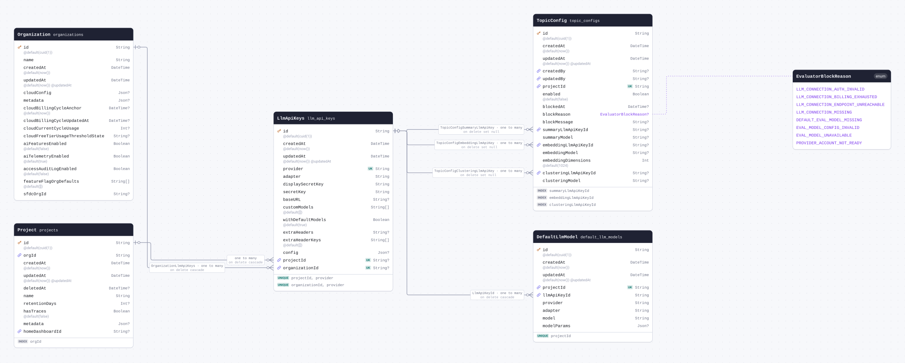

| Field                                       | Type       | Constraints                                   | Default              | Description |
| ------------------------------------------- | ---------- | --------------------------------------------- | -------------------- | ----------- |
| `id`                                        | `String`   | PK NOT NULL                                   | `cuid(1)`            |             |
| `createdAt` (`created_at`)                  | `DateTime` | NOT NULL                                      | `now()`              |             |
| `updatedAt` (`updated_at`)                  | `DateTime` | NOT NULL                                      | `now()` `@updatedAt` |             |
| `provider`                                  | `String`   | NOT NULL                                      |                      |             |
| `adapter`                                   | `String`   | NOT NULL                                      |                      |             |
| `displaySecretKey` (`display_secret_key`)   | `String`   | NOT NULL                                      |                      |             |
| `secretKey` (`secret_key`)                  | `String`   | NOT NULL                                      |                      |             |
| `baseURL` (`base_url`)                      | `String`   | NULL                                          |                      |             |
| `customModels` (`custom_models`)            | `String[]` | NOT NULL                                      | `[]`                 |             |
| `withDefaultModels` (`with_default_models`) | `Boolean`  | NOT NULL                                      | `true`               |             |
| `extraHeaders` (`extra_headers`)            | `String`   | NULL                                          |                      |             |
| `extraHeaderKeys` (`extra_header_keys`)     | `String[]` | NOT NULL                                      | `[]`                 |             |
| `config`                                    | `Json`     | NULL                                          |                      |             |
| `projectId` (`project_id`)                  | `String`   | NULL → [Project.id](#model-Project)           |                      |             |
| `organizationId` (`organization_id`)        | `String`   | NULL → [Organization.id](#model-Organization) |                      |             |

#### Indexes

- `@@unique([projectId, provider])`
- `@@unique([organizationId, provider])`

#### References

- `projectId` → [Project.id](#model-Project) (many-to-one, on delete Cascade)
- `organizationId` → [Organization.id](#model-Organization) (many-to-one, on delete Cascade)

#### Referenced by

- `id` ← [DefaultLlmModel.llmApiKeyId](#model-DefaultLlmModel) (one-to-many, on delete Cascade)
- `id` ← [TopicConfig.summaryLlmApiKeyId](#model-TopicConfig) (one-to-many, on delete SetNull)
- `id` ← [TopicConfig.embeddingLlmApiKeyId](#model-TopicConfig) (one-to-many, on delete SetNull)
- `id` ← [TopicConfig.clusteringLlmApiKeyId](#model-TopicConfig) (one-to-many, on delete SetNull)

#### Definition

```sql
CREATE TABLE "llm_api_keys" (
    "id" TEXT NOT NULL,
    "created_at" TIMESTAMP(3) NOT NULL DEFAULT CURRENT_TIMESTAMP,
    "updated_at" TIMESTAMP(3) NOT NULL DEFAULT CURRENT_TIMESTAMP,
    "provider" TEXT NOT NULL,
    "adapter" TEXT NOT NULL,
    "display_secret_key" TEXT NOT NULL,
    "secret_key" TEXT NOT NULL,
    "base_url" TEXT,
    "custom_models" TEXT[] DEFAULT ARRAY[]::TEXT[],
    "with_default_models" BOOLEAN NOT NULL DEFAULT true,
    "extra_headers" TEXT,
    "extra_header_keys" TEXT[] DEFAULT ARRAY[]::TEXT[],
    "config" JSONB,
    "project_id" TEXT,
    "organization_id" TEXT,

    CONSTRAINT "llm_api_keys_pkey" PRIMARY KEY ("id")
);

CREATE UNIQUE INDEX "llm_api_keys_id_key" ON "llm_api_keys"("id");

CREATE UNIQUE INDEX "llm_api_keys_project_id_provider_key" ON "llm_api_keys"("project_id", "provider");

CREATE UNIQUE INDEX "llm_api_keys_organization_id_provider_key" ON "llm_api_keys"("organization_id", "provider");

ALTER TABLE "llm_api_keys" ADD CONSTRAINT "llm_api_keys_project_id_fkey" FOREIGN KEY ("project_id") REFERENCES "projects"("id") ON DELETE CASCADE ON UPDATE CASCADE;

ALTER TABLE "llm_api_keys" ADD CONSTRAINT "llm_api_keys_organization_id_fkey" FOREIGN KEY ("organization_id") REFERENCES "organizations"("id") ON DELETE CASCADE ON UPDATE CASCADE;
```

<details>
<summary>Queries and their SQL</summary>

**findMany**: Every row

```ts
await prisma.llmApiKeys.findMany();
```

```sql
SELECT
  "public"."llm_api_keys"."id",
  "public"."llm_api_keys"."created_at",
  "public"."llm_api_keys"."updated_at",
  "public"."llm_api_keys"."provider",
  "public"."llm_api_keys"."adapter",
  "public"."llm_api_keys"."display_secret_key",
  "public"."llm_api_keys"."secret_key",
  "public"."llm_api_keys"."base_url",
  "public"."llm_api_keys"."custom_models",
  "public"."llm_api_keys"."with_default_models",
  "public"."llm_api_keys"."extra_headers",
  "public"."llm_api_keys"."extra_header_keys",
  "public"."llm_api_keys"."config",
  "public"."llm_api_keys"."project_id",
  "public"."llm_api_keys"."organization_id"
FROM
  "public"."llm_api_keys"
WHERE
  1 = 1
OFFSET
  $1
-- params: ["0"]
```

**count**: How many rows there are

```ts
await prisma.llmApiKeys.count();
```

```sql
SELECT
  COUNT(*) AS "_count$_all"
FROM
  (
    SELECT
      "public"."llm_api_keys"."id"
    FROM
      "public"."llm_api_keys"
    WHERE
      1 = 1
    OFFSET
      $1
  ) AS "sub"
-- params: ["0"]
```

**findMany**: Every row with its relations

```ts
await prisma.llmApiKeys.findMany({
  include: {
    project: true,
    organization: true,
    DefaultLlmModel: true,
    topicSummaryConfigs: true,
    topicEmbeddingConfigs: true,
    topicClusteringConfigs: true,
  },
});
```

```sql
SELECT
  "public"."llm_api_keys"."id",
  "public"."llm_api_keys"."created_at",
  "public"."llm_api_keys"."updated_at",
  "public"."llm_api_keys"."provider",
  "public"."llm_api_keys"."adapter",
  "public"."llm_api_keys"."display_secret_key",
  "public"."llm_api_keys"."secret_key",
  "public"."llm_api_keys"."base_url",
  "public"."llm_api_keys"."custom_models",
  "public"."llm_api_keys"."with_default_models",
  "public"."llm_api_keys"."extra_headers",
  "public"."llm_api_keys"."extra_header_keys",
  "public"."llm_api_keys"."config",
  "public"."llm_api_keys"."project_id",
  "public"."llm_api_keys"."organization_id"
FROM
  "public"."llm_api_keys"
WHERE
  1 = 1
OFFSET
  $1
-- params: ["0"]

SELECT
  "public"."projects"."id",
  "public"."projects"."org_id",
  "public"."projects"."created_at",
  "public"."projects"."updated_at",
  "public"."projects"."deleted_at",
  "public"."projects"."name",
  "public"."projects"."retention_days",
  "public"."projects"."has_traces",
  "public"."projects"."metadata",
  "public"."projects"."home_dashboard_id"
FROM
  "public"."projects"
WHERE
  "public"."projects"."id" IN ($1)
OFFSET
  $2
-- params: ["<projectId of the rows above>","0"]

SELECT
  "public"."organizations"."id",
  "public"."organizations"."name",
  "public"."organizations"."created_at",
  "public"."organizations"."updated_at",
  "public"."organizations"."cloud_config",
  "public"."organizations"."metadata",
  "public"."organizations"."cloud_billing_cycle_anchor",
  "public"."organizations"."cloud_billing_cycle_updated_at",
  "public"."organizations"."cloud_current_cycle_usage",
  "public"."organizations"."cloud_free_tier_usage_threshold_state",
  "public"."organizations"."ai_features_enabled",
  "public"."organizations"."ai_telemetry_enabled",
  "public"."organizations"."access_audit_log_enabled",
  "public"."organizations"."feature_flag_org_defaults",
  "public"."organizations"."sfdc_org_id"
FROM
  "public"."organizations"
WHERE
  "public"."organizations"."id" IN ($1)
OFFSET
  $2
-- params: ["<organizationId of the rows above>","0"]

SELECT
  "public"."default_llm_models"."id",
  "public"."default_llm_models"."created_at",
  "public"."default_llm_models"."updated_at",
  "public"."default_llm_models"."project_id",
  "public"."default_llm_models"."llm_api_key_id",
  "public"."default_llm_models"."provider",
  "public"."default_llm_models"."adapter",
  "public"."default_llm_models"."model",
  "public"."default_llm_models"."model_params"
FROM
  "public"."default_llm_models"
WHERE
  "public"."default_llm_models"."llm_api_key_id" IN ($1)
OFFSET
  $2
-- params: ["<id of the rows above>","0"]

SELECT
  "public"."topic_configs"."id",
  "public"."topic_configs"."created_at",
  "public"."topic_configs"."updated_at",
  "public"."topic_configs"."created_by",
  "public"."topic_configs"."updated_by",
  "public"."topic_configs"."project_id",
  "public"."topic_configs"."enabled",
  "public"."topic_configs"."blocked_at",
  "public"."topic_configs"."block_reason"::text,
  "public"."topic_configs"."block_message",
  "public"."topic_configs"."summary_llm_api_key_id",
  "public"."topic_configs"."summary_model",
  "public"."topic_configs"."embedding_llm_api_key_id",
  "public"."topic_configs"."embedding_model",
  "public"."topic_configs"."embedding_dimensions",
  "public"."topic_configs"."clustering_llm_api_key_id",
  "public"."topic_configs"."clustering_model"
FROM
  "public"."topic_configs"
WHERE
  "public"."topic_configs"."summary_llm_api_key_id" IN ($1)
OFFSET
  $2
-- params: ["<id of the rows above>","0"]

SELECT
  "public"."topic_configs"."id",
  "public"."topic_configs"."created_at",
  "public"."topic_configs"."updated_at",
  "public"."topic_configs"."created_by",
  "public"."topic_configs"."updated_by",
  "public"."topic_configs"."project_id",
  "public"."topic_configs"."enabled",
  "public"."topic_configs"."blocked_at",
  "public"."topic_configs"."block_reason"::text,
  "public"."topic_configs"."block_message",
  "public"."topic_configs"."summary_llm_api_key_id",
  "public"."topic_configs"."summary_model",
  "public"."topic_configs"."embedding_llm_api_key_id",
  "public"."topic_configs"."embedding_model",
  "public"."topic_configs"."embedding_dimensions",
  "public"."topic_configs"."clustering_llm_api_key_id",
  "public"."topic_configs"."clustering_model"
FROM
  "public"."topic_configs"
WHERE
  "public"."topic_configs"."embedding_llm_api_key_id" IN ($1)
OFFSET
  $2
-- params: ["<id of the rows above>","0"]

SELECT
  "public"."topic_configs"."id",
  "public"."topic_configs"."created_at",
  "public"."topic_configs"."updated_at",
  "public"."topic_configs"."created_by",
  "public"."topic_configs"."updated_by",
  "public"."topic_configs"."project_id",
  "public"."topic_configs"."enabled",
  "public"."topic_configs"."blocked_at",
  "public"."topic_configs"."block_reason"::text,
  "public"."topic_configs"."block_message",
  "public"."topic_configs"."summary_llm_api_key_id",
  "public"."topic_configs"."summary_model",
  "public"."topic_configs"."embedding_llm_api_key_id",
  "public"."topic_configs"."embedding_model",
  "public"."topic_configs"."embedding_dimensions",
  "public"."topic_configs"."clustering_llm_api_key_id",
  "public"."topic_configs"."clustering_model"
FROM
  "public"."topic_configs"
WHERE
  "public"."topic_configs"."clustering_llm_api_key_id" IN ($1)
OFFSET
  $2
-- params: ["<id of the rows above>","0"]
```

**findUnique**: One row by what is unique to it

```ts
await prisma.llmApiKeys.findUnique({ where: { id: "example" } });
```

```sql
SELECT
  "public"."llm_api_keys"."id",
  "public"."llm_api_keys"."created_at",
  "public"."llm_api_keys"."updated_at",
  "public"."llm_api_keys"."provider",
  "public"."llm_api_keys"."adapter",
  "public"."llm_api_keys"."display_secret_key",
  "public"."llm_api_keys"."secret_key",
  "public"."llm_api_keys"."base_url",
  "public"."llm_api_keys"."custom_models",
  "public"."llm_api_keys"."with_default_models",
  "public"."llm_api_keys"."extra_headers",
  "public"."llm_api_keys"."extra_header_keys",
  "public"."llm_api_keys"."config",
  "public"."llm_api_keys"."project_id",
  "public"."llm_api_keys"."organization_id"
FROM
  "public"."llm_api_keys"
WHERE
  (
    "public"."llm_api_keys"."id" = $1
    AND 1 = 1
  )
LIMIT
  $2
OFFSET
  $3
-- params: ["example","1","0"]
```

**create**: Create a row

```ts
await prisma.llmApiKeys.create({
  data: {
    provider: "example",
    adapter: "example",
    displaySecretKey: "example",
    secretKey: "example",
  },
});
```

```sql
INSERT INTO
  "public"."llm_api_keys" (
    "id",
    "created_at",
    "updated_at",
    "provider",
    "adapter",
    "display_secret_key",
    "secret_key",
    "custom_models",
    "with_default_models",
    "extra_header_keys"
  )
VALUES
  ($1, $2, $3, $4, $5, $6, $7, $8, $9, $10)
RETURNING
  "public"."llm_api_keys"."id",
  "public"."llm_api_keys"."created_at",
  "public"."llm_api_keys"."updated_at",
  "public"."llm_api_keys"."provider",
  "public"."llm_api_keys"."adapter",
  "public"."llm_api_keys"."display_secret_key",
  "public"."llm_api_keys"."secret_key",
  "public"."llm_api_keys"."base_url",
  "public"."llm_api_keys"."custom_models",
  "public"."llm_api_keys"."with_default_models",
  "public"."llm_api_keys"."extra_headers",
  "public"."llm_api_keys"."extra_header_keys",
  "public"."llm_api_keys"."config",
  "public"."llm_api_keys"."project_id",
  "public"."llm_api_keys"."organization_id"
-- params: ["<cuid(1)>","<now()>","<now()>","example","example","example","example",[],true,[]]
```

**update**: Update a row

```ts
await prisma.llmApiKeys.update({
  where: { id: "example" },
  data: { createdAt: new Date("2026-01-01T00:00:00.000Z") },
});
```

```sql
UPDATE "public"."llm_api_keys"
SET
  "created_at" = $1,
  "updated_at" = $2
WHERE
  (
    "public"."llm_api_keys"."id" = $3
    AND 1 = 1
  )
RETURNING
  "public"."llm_api_keys"."id",
  "public"."llm_api_keys"."created_at",
  "public"."llm_api_keys"."updated_at",
  "public"."llm_api_keys"."provider",
  "public"."llm_api_keys"."adapter",
  "public"."llm_api_keys"."display_secret_key",
  "public"."llm_api_keys"."secret_key",
  "public"."llm_api_keys"."base_url",
  "public"."llm_api_keys"."custom_models",
  "public"."llm_api_keys"."with_default_models",
  "public"."llm_api_keys"."extra_headers",
  "public"."llm_api_keys"."extra_header_keys",
  "public"."llm_api_keys"."config",
  "public"."llm_api_keys"."project_id",
  "public"."llm_api_keys"."organization_id"
-- params: ["2026-01-01T00:00:00.000Z",{"prisma__type":"generatorCall","prisma__value":{"name":"now","args":[],"returnType":{"type":"DateTime"}}},"example"]
```

**delete**: Delete a row

```ts
await prisma.llmApiKeys.delete({ where: { id: "example" } });
```

```sql
DELETE FROM "public"."llm_api_keys"
WHERE
  (
    "public"."llm_api_keys"."id" = $1
    AND 1 = 1
  )
RETURNING
  "public"."llm_api_keys"."id",
  "public"."llm_api_keys"."created_at",
  "public"."llm_api_keys"."updated_at",
  "public"."llm_api_keys"."provider",
  "public"."llm_api_keys"."adapter",
  "public"."llm_api_keys"."display_secret_key",
  "public"."llm_api_keys"."secret_key",
  "public"."llm_api_keys"."base_url",
  "public"."llm_api_keys"."custom_models",
  "public"."llm_api_keys"."with_default_models",
  "public"."llm_api_keys"."extra_headers",
  "public"."llm_api_keys"."extra_header_keys",
  "public"."llm_api_keys"."config",
  "public"."llm_api_keys"."project_id",
  "public"."llm_api_keys"."organization_id"
-- params: ["example"]
```

</details>

<a id="model-OrganizationMembership"></a>

### OrganizationMembership

Table `organization_memberships`.

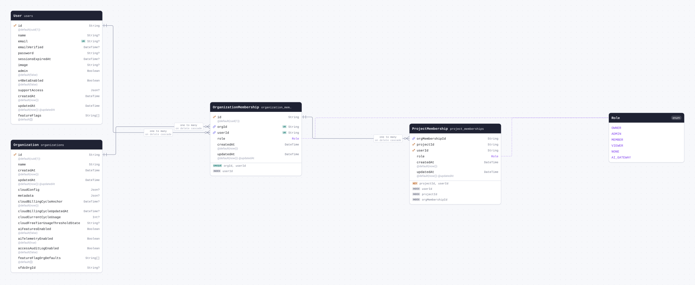

| Field                      | Type                 | Constraints                                       | Default              | Description |
| -------------------------- | -------------------- | ------------------------------------------------- | -------------------- | ----------- |
| `id`                       | `String`             | PK NOT NULL                                       | `cuid(1)`            |             |
| `orgId` (`org_id`)         | `String`             | NOT NULL → [Organization.id](#model-Organization) |                      |             |
| `userId` (`user_id`)       | `String`             | NOT NULL → [User.id](#model-User)                 |                      |             |
| `role` (`role`)            | [`Role`](#enum-Role) | NOT NULL                                          |                      |             |
| `createdAt` (`created_at`) | `DateTime`           | NOT NULL                                          | `now()`              |             |
| `updatedAt` (`updated_at`) | `DateTime`           | NOT NULL                                          | `now()` `@updatedAt` |             |

#### Indexes

- `@@index([userId])`
- `@@unique([orgId, userId])`

#### References

- `orgId` → [Organization.id](#model-Organization) (many-to-one, on delete Cascade)
- `userId` → [User.id](#model-User) (many-to-one, on delete Cascade)

#### Referenced by

- `id` ← [ProjectMembership.orgMembershipId](#model-ProjectMembership) (one-to-many, on delete Cascade)

#### Definition

```sql
CREATE TABLE "organization_memberships" (
    "id" TEXT NOT NULL,
    "org_id" TEXT NOT NULL,
    "user_id" TEXT NOT NULL,
    "role" "Role" NOT NULL,
    "created_at" TIMESTAMP(3) NOT NULL DEFAULT CURRENT_TIMESTAMP,
    "updated_at" TIMESTAMP(3) NOT NULL DEFAULT CURRENT_TIMESTAMP,

    CONSTRAINT "organization_memberships_pkey" PRIMARY KEY ("id")
);

CREATE INDEX "organization_memberships_user_id_idx" ON "organization_memberships"("user_id");

CREATE UNIQUE INDEX "organization_memberships_org_id_user_id_key" ON "organization_memberships"("org_id", "user_id");

ALTER TABLE "organization_memberships" ADD CONSTRAINT "organization_memberships_org_id_fkey" FOREIGN KEY ("org_id") REFERENCES "organizations"("id") ON DELETE CASCADE ON UPDATE CASCADE;

ALTER TABLE "organization_memberships" ADD CONSTRAINT "organization_memberships_user_id_fkey" FOREIGN KEY ("user_id") REFERENCES "users"("id") ON DELETE CASCADE ON UPDATE CASCADE;
```

<details>
<summary>Queries and their SQL</summary>

**findMany**: Every row

```ts
await prisma.organizationMembership.findMany();
```

```sql
SELECT
  "public"."organization_memberships"."id",
  "public"."organization_memberships"."org_id",
  "public"."organization_memberships"."user_id",
  "public"."organization_memberships"."role"::text,
  "public"."organization_memberships"."created_at",
  "public"."organization_memberships"."updated_at"
FROM
  "public"."organization_memberships"
WHERE
  1 = 1
OFFSET
  $1
-- params: ["0"]
```

**count**: How many rows there are

```ts
await prisma.organizationMembership.count();
```

```sql
SELECT
  COUNT(*) AS "_count$_all"
FROM
  (
    SELECT
      "public"."organization_memberships"."id"
    FROM
      "public"."organization_memberships"
    WHERE
      1 = 1
    OFFSET
      $1
  ) AS "sub"
-- params: ["0"]
```

**findMany**: Every row with its relations

```ts
await prisma.organizationMembership.findMany({
  include: { organization: true, user: true, ProjectMemberships: true },
});
```

```sql
SELECT
  "public"."organization_memberships"."id",
  "public"."organization_memberships"."org_id",
  "public"."organization_memberships"."user_id",
  "public"."organization_memberships"."role"::text,
  "public"."organization_memberships"."created_at",
  "public"."organization_memberships"."updated_at"
FROM
  "public"."organization_memberships"
WHERE
  1 = 1
OFFSET
  $1
-- params: ["0"]

SELECT
  "public"."organizations"."id",
  "public"."organizations"."name",
  "public"."organizations"."created_at",
  "public"."organizations"."updated_at",
  "public"."organizations"."cloud_config",
  "public"."organizations"."metadata",
  "public"."organizations"."cloud_billing_cycle_anchor",
  "public"."organizations"."cloud_billing_cycle_updated_at",
  "public"."organizations"."cloud_current_cycle_usage",
  "public"."organizations"."cloud_free_tier_usage_threshold_state",
  "public"."organizations"."ai_features_enabled",
  "public"."organizations"."ai_telemetry_enabled",
  "public"."organizations"."access_audit_log_enabled",
  "public"."organizations"."feature_flag_org_defaults",
  "public"."organizations"."sfdc_org_id"
FROM
  "public"."organizations"
WHERE
  "public"."organizations"."id" IN ($1)
OFFSET
  $2
-- params: ["<orgId of the rows above>","0"]

SELECT
  "public"."users"."id",
  "public"."users"."name",
  "public"."users"."email",
  "public"."users"."email_verified",
  "public"."users"."password",
  "public"."users"."sessions_expired_at",
  "public"."users"."image",
  "public"."users"."admin",
  "public"."users"."v4_beta_enabled",
  "public"."users"."support_access",
  "public"."users"."created_at",
  "public"."users"."updated_at",
  "public"."users"."feature_flags"
FROM
  "public"."users"
WHERE
  "public"."users"."id" IN ($1)
OFFSET
  $2
-- params: ["<userId of the rows above>","0"]

SELECT
  "public"."project_memberships"."project_id",
  "public"."project_memberships"."user_id",
  "public"."project_memberships"."org_membership_id",
  "public"."project_memberships"."role"::text,
  "public"."project_memberships"."created_at",
  "public"."project_memberships"."updated_at"
FROM
  "public"."project_memberships"
WHERE
  "public"."project_memberships"."org_membership_id" IN ($1)
OFFSET
  $2
-- params: ["<id of the rows above>","0"]
```

**findUnique**: One row by what is unique to it

```ts
await prisma.organizationMembership.findUnique({ where: { id: "example" } });
```

```sql
SELECT
  "public"."organization_memberships"."id",
  "public"."organization_memberships"."org_id",
  "public"."organization_memberships"."user_id",
  "public"."organization_memberships"."role"::text,
  "public"."organization_memberships"."created_at",
  "public"."organization_memberships"."updated_at"
FROM
  "public"."organization_memberships"
WHERE
  (
    "public"."organization_memberships"."id" = $1
    AND 1 = 1
  )
LIMIT
  $2
OFFSET
  $3
-- params: ["example","1","0"]
```

**create**: Create a row

```ts
await prisma.organizationMembership.create({
  data: { orgId: "example", userId: "example", role: "OWNER" },
});
```

```sql
INSERT INTO
  "public"."organization_memberships" (
    "id",
    "org_id",
    "user_id",
    "role",
    "created_at",
    "updated_at"
  )
VALUES
  (
    $1,
    $2,
    $3,
    CAST($4::text AS "public"."Role"),
    $5,
    $6
  )
RETURNING
  "public"."organization_memberships"."id",
  "public"."organization_memberships"."org_id",
  "public"."organization_memberships"."user_id",
  "public"."organization_memberships"."role"::text,
  "public"."organization_memberships"."created_at",
  "public"."organization_memberships"."updated_at"
-- params: ["<cuid(1)>","example","example","OWNER","<now()>","<now()>"]
```

**update**: Update a row

```ts
await prisma.organizationMembership.update({ where: { id: "example" }, data: { role: "OWNER" } });
```

```sql
UPDATE "public"."organization_memberships"
SET
  "role" = CAST($1::text AS "public"."Role"),
  "updated_at" = $2
WHERE
  (
    "public"."organization_memberships"."id" = $3
    AND 1 = 1
  )
RETURNING
  "public"."organization_memberships"."id",
  "public"."organization_memberships"."org_id",
  "public"."organization_memberships"."user_id",
  "public"."organization_memberships"."role"::text,
  "public"."organization_memberships"."created_at",
  "public"."organization_memberships"."updated_at"
-- params: ["OWNER",{"prisma__type":"generatorCall","prisma__value":{"name":"now","args":[],"returnType":{"type":"DateTime"}}},"example"]
```

**delete**: Delete a row

```ts
await prisma.organizationMembership.delete({ where: { id: "example" } });
```

```sql
DELETE FROM "public"."organization_memberships"
WHERE
  (
    "public"."organization_memberships"."id" = $1
    AND 1 = 1
  )
RETURNING
  "public"."organization_memberships"."id",
  "public"."organization_memberships"."org_id",
  "public"."organization_memberships"."user_id",
  "public"."organization_memberships"."role"::text,
  "public"."organization_memberships"."created_at",
  "public"."organization_memberships"."updated_at"
-- params: ["example"]
```

</details>

<a id="model-ProjectMembership"></a>

### ProjectMembership

Table `project_memberships`.

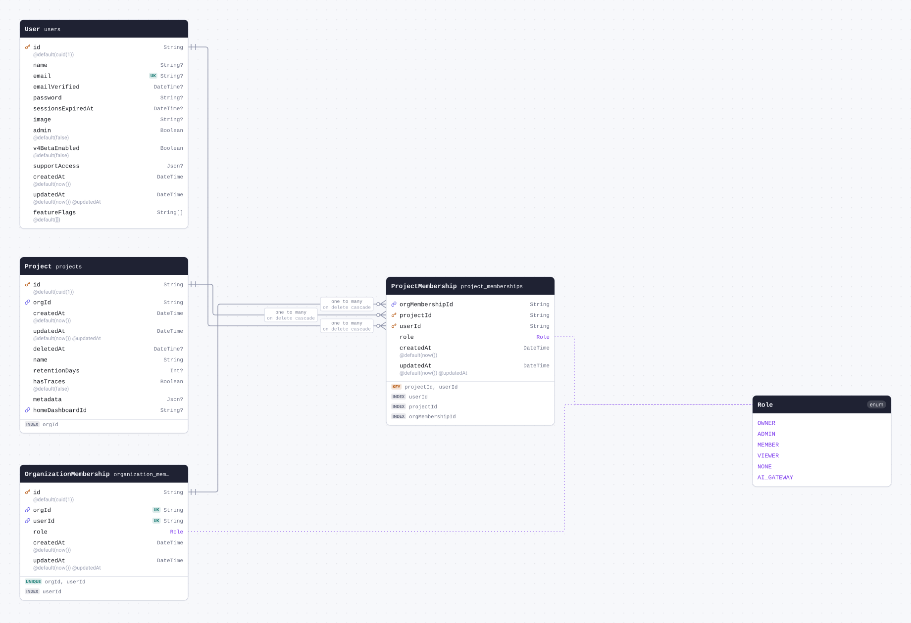

| Field                                   | Type                 | Constraints                                                           | Default              | Description |
| --------------------------------------- | -------------------- | --------------------------------------------------------------------- | -------------------- | ----------- |
| `orgMembershipId` (`org_membership_id`) | `String`             | NOT NULL → [OrganizationMembership.id](#model-OrganizationMembership) |                      |             |
| `projectId` (`project_id`)              | `String`             | PK NOT NULL → [Project.id](#model-Project)                            |                      |             |
| `userId` (`user_id`)                    | `String`             | PK NOT NULL → [User.id](#model-User)                                  |                      |             |
| `role`                                  | [`Role`](#enum-Role) | NOT NULL                                                              |                      |             |
| `createdAt` (`created_at`)              | `DateTime`           | NOT NULL                                                              | `now()`              |             |
| `updatedAt` (`updated_at`)              | `DateTime`           | NOT NULL                                                              | `now()` `@updatedAt` |             |

#### Indexes

- `@@id([projectId, userId])`
- `@@index([userId])`
- `@@index([projectId])`
- `@@index([orgMembershipId])`

#### References

- `orgMembershipId` → [OrganizationMembership.id](#model-OrganizationMembership) (many-to-one, on delete Cascade)
- `projectId` → [Project.id](#model-Project) (many-to-one, on delete Cascade)
- `userId` → [User.id](#model-User) (many-to-one, on delete Cascade)

#### Definition

```sql
CREATE TABLE "project_memberships" (
    "org_membership_id" TEXT NOT NULL,
    "project_id" TEXT NOT NULL,
    "user_id" TEXT NOT NULL,
    "role" "Role" NOT NULL,
    "created_at" TIMESTAMP(3) NOT NULL DEFAULT CURRENT_TIMESTAMP,
    "updated_at" TIMESTAMP(3) NOT NULL DEFAULT CURRENT_TIMESTAMP,

    CONSTRAINT "project_memberships_pkey" PRIMARY KEY ("project_id","user_id")
);

CREATE INDEX "project_memberships_user_id_idx" ON "project_memberships"("user_id");

CREATE INDEX "project_memberships_project_id_idx" ON "project_memberships"("project_id");

CREATE INDEX "project_memberships_org_membership_id_idx" ON "project_memberships"("org_membership_id");

ALTER TABLE "project_memberships" ADD CONSTRAINT "project_memberships_org_membership_id_fkey" FOREIGN KEY ("org_membership_id") REFERENCES "organization_memberships"("id") ON DELETE CASCADE ON UPDATE CASCADE;

ALTER TABLE "project_memberships" ADD CONSTRAINT "project_memberships_project_id_fkey" FOREIGN KEY ("project_id") REFERENCES "projects"("id") ON DELETE CASCADE ON UPDATE CASCADE;

ALTER TABLE "project_memberships" ADD CONSTRAINT "project_memberships_user_id_fkey" FOREIGN KEY ("user_id") REFERENCES "users"("id") ON DELETE CASCADE ON UPDATE CASCADE;
```

<details>
<summary>Queries and their SQL</summary>

**findMany**: Every row

```ts
await prisma.projectMembership.findMany();
```

```sql
SELECT
  "public"."project_memberships"."project_id",
  "public"."project_memberships"."user_id",
  "public"."project_memberships"."org_membership_id",
  "public"."project_memberships"."role"::text,
  "public"."project_memberships"."created_at",
  "public"."project_memberships"."updated_at"
FROM
  "public"."project_memberships"
WHERE
  1 = 1
OFFSET
  $1
-- params: ["0"]
```

**count**: How many rows there are

```ts
await prisma.projectMembership.count();
```

```sql
SELECT
  COUNT(*) AS "_count$_all"
FROM
  (
    SELECT
      "public"."project_memberships"."project_id",
      "public"."project_memberships"."user_id"
    FROM
      "public"."project_memberships"
    WHERE
      1 = 1
    OFFSET
      $1
  ) AS "sub"
-- params: ["0"]
```

**findMany**: Every row with its relations

```ts
await prisma.projectMembership.findMany({
  include: { organizationMembership: true, project: true, user: true },
});
```

```sql
SELECT
  "public"."project_memberships"."project_id",
  "public"."project_memberships"."user_id",
  "public"."project_memberships"."org_membership_id",
  "public"."project_memberships"."role"::text,
  "public"."project_memberships"."created_at",
  "public"."project_memberships"."updated_at"
FROM
  "public"."project_memberships"
WHERE
  1 = 1
OFFSET
  $1
-- params: ["0"]

SELECT
  "public"."organization_memberships"."id",
  "public"."organization_memberships"."org_id",
  "public"."organization_memberships"."user_id",
  "public"."organization_memberships"."role"::text,
  "public"."organization_memberships"."created_at",
  "public"."organization_memberships"."updated_at"
FROM
  "public"."organization_memberships"
WHERE
  "public"."organization_memberships"."id" IN ($1)
OFFSET
  $2
-- params: ["<orgMembershipId of the rows above>","0"]

SELECT
  "public"."projects"."id",
  "public"."projects"."org_id",
  "public"."projects"."created_at",
  "public"."projects"."updated_at",
  "public"."projects"."deleted_at",
  "public"."projects"."name",
  "public"."projects"."retention_days",
  "public"."projects"."has_traces",
  "public"."projects"."metadata",
  "public"."projects"."home_dashboard_id"
FROM
  "public"."projects"
WHERE
  "public"."projects"."id" IN ($1)
OFFSET
  $2
-- params: ["<projectId of the rows above>","0"]

SELECT
  "public"."users"."id",
  "public"."users"."name",
  "public"."users"."email",
  "public"."users"."email_verified",
  "public"."users"."password",
  "public"."users"."sessions_expired_at",
  "public"."users"."image",
  "public"."users"."admin",
  "public"."users"."v4_beta_enabled",
  "public"."users"."support_access",
  "public"."users"."created_at",
  "public"."users"."updated_at",
  "public"."users"."feature_flags"
FROM
  "public"."users"
WHERE
  "public"."users"."id" IN ($1)
OFFSET
  $2
-- params: ["<userId of the rows above>","0"]
```

**findUnique**: One row by what is unique to it

```ts
await prisma.projectMembership.findUnique({
  where: { projectId_userId: { projectId: "example", userId: "example" } },
});
```

```sql
SELECT
  "public"."project_memberships"."project_id",
  "public"."project_memberships"."user_id",
  "public"."project_memberships"."org_membership_id",
  "public"."project_memberships"."role"::text,
  "public"."project_memberships"."created_at",
  "public"."project_memberships"."updated_at"
FROM
  "public"."project_memberships"
WHERE
  (
    (
      "public"."project_memberships"."project_id" = $1
      AND "public"."project_memberships"."user_id" = $2
    )
    AND 1 = 1
  )
LIMIT
  $3
OFFSET
  $4
-- params: ["example","example","1","0"]
```

**create**: Create a row

```ts
await prisma.projectMembership.create({
  data: { orgMembershipId: "example", projectId: "example", userId: "example", role: "OWNER" },
});
```

```sql
INSERT INTO
  "public"."project_memberships" (
    "org_membership_id",
    "project_id",
    "user_id",
    "role",
    "created_at",
    "updated_at"
  )
VALUES
  (
    $1,
    $2,
    $3,
    CAST($4::text AS "public"."Role"),
    $5,
    $6
  )
RETURNING
  "public"."project_memberships"."project_id",
  "public"."project_memberships"."user_id",
  "public"."project_memberships"."org_membership_id",
  "public"."project_memberships"."role"::text,
  "public"."project_memberships"."created_at",
  "public"."project_memberships"."updated_at"
-- params: ["example","example","example","OWNER","<now()>","<now()>"]
```

**update**: Update a row

```ts
await prisma.projectMembership.update({
  where: { projectId_userId: { projectId: "example", userId: "example" } },
  data: { role: "OWNER" },
});
```

```sql
UPDATE "public"."project_memberships"
SET
  "role" = CAST($1::text AS "public"."Role"),
  "updated_at" = $2
WHERE
  (
    (
      "public"."project_memberships"."project_id" = $3
      AND "public"."project_memberships"."user_id" = $4
    )
    AND 1 = 1
  )
RETURNING
  "public"."project_memberships"."project_id",
  "public"."project_memberships"."user_id",
  "public"."project_memberships"."org_membership_id",
  "public"."project_memberships"."role"::text,
  "public"."project_memberships"."created_at",
  "public"."project_memberships"."updated_at"
-- params: ["OWNER",{"prisma__type":"generatorCall","prisma__value":{"name":"now","args":[],"returnType":{"type":"DateTime"}}},"example","example"]
```

**delete**: Delete a row

```ts
await prisma.projectMembership.delete({
  where: { projectId_userId: { projectId: "example", userId: "example" } },
});
```

```sql
DELETE FROM "public"."project_memberships"
WHERE
  (
    (
      "public"."project_memberships"."project_id" = $1
      AND "public"."project_memberships"."user_id" = $2
    )
    AND 1 = 1
  )
RETURNING
  "public"."project_memberships"."project_id",
  "public"."project_memberships"."user_id",
  "public"."project_memberships"."org_membership_id",
  "public"."project_memberships"."role"::text,
  "public"."project_memberships"."created_at",
  "public"."project_memberships"."updated_at"
-- params: ["example","example"]
```

</details>

<a id="model-MembershipInvitation"></a>

### MembershipInvitation

Table `membership_invitations`.

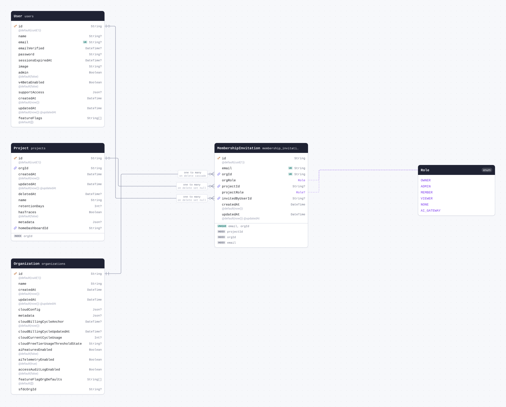

| Field                                    | Type                 | Constraints                                       | Default              | Description |
| ---------------------------------------- | -------------------- | ------------------------------------------------- | -------------------- | ----------- |
| `id`                                     | `String`             | PK NOT NULL                                       | `cuid(1)`            |             |
| `email`                                  | `String`             | NOT NULL                                          |                      |             |
| `orgId` (`org_id`)                       | `String`             | NOT NULL → [Organization.id](#model-Organization) |                      |             |
| `orgRole` (`org_role`)                   | [`Role`](#enum-Role) | NOT NULL                                          |                      |             |
| `projectId` (`project_id`)               | `String`             | NULL → [Project.id](#model-Project)               |                      |             |
| `projectRole` (`project_role`)           | [`Role`](#enum-Role) | NULL                                              |                      |             |
| `invitedByUserId` (`invited_by_user_id`) | `String`             | NULL → [User.id](#model-User)                     |                      |             |
| `createdAt` (`created_at`)               | `DateTime`           | NOT NULL                                          | `now()`              |             |
| `updatedAt` (`updated_at`)               | `DateTime`           | NOT NULL                                          | `now()` `@updatedAt` |             |

#### Indexes

- `@@index([projectId])`
- `@@index([orgId])`
- `@@index([email])`
- `@@unique([email, orgId])`

#### References

- `orgId` → [Organization.id](#model-Organization) (many-to-one, on delete Cascade)
- `projectId` → [Project.id](#model-Project) (many-to-one, on delete SetNull)
- `invitedByUserId` → [User.id](#model-User) (many-to-one, on delete SetNull)

#### Definition

```sql
CREATE TABLE "membership_invitations" (
    "id" TEXT NOT NULL,
    "email" TEXT NOT NULL,
    "org_id" TEXT NOT NULL,
    "org_role" "Role" NOT NULL,
    "project_id" TEXT,
    "project_role" "Role",
    "invited_by_user_id" TEXT,
    "created_at" TIMESTAMP(3) NOT NULL DEFAULT CURRENT_TIMESTAMP,
    "updated_at" TIMESTAMP(3) NOT NULL DEFAULT CURRENT_TIMESTAMP,

    CONSTRAINT "membership_invitations_pkey" PRIMARY KEY ("id")
);

CREATE UNIQUE INDEX "membership_invitations_id_key" ON "membership_invitations"("id");

CREATE INDEX "membership_invitations_project_id_idx" ON "membership_invitations"("project_id");

CREATE INDEX "membership_invitations_org_id_idx" ON "membership_invitations"("org_id");

CREATE INDEX "membership_invitations_email_idx" ON "membership_invitations"("email");

CREATE UNIQUE INDEX "membership_invitations_email_org_id_key" ON "membership_invitations"("email", "org_id");

ALTER TABLE "membership_invitations" ADD CONSTRAINT "membership_invitations_org_id_fkey" FOREIGN KEY ("org_id") REFERENCES "organizations"("id") ON DELETE CASCADE ON UPDATE CASCADE;

ALTER TABLE "membership_invitations" ADD CONSTRAINT "membership_invitations_project_id_fkey" FOREIGN KEY ("project_id") REFERENCES "projects"("id") ON DELETE SET NULL ON UPDATE CASCADE;

ALTER TABLE "membership_invitations" ADD CONSTRAINT "membership_invitations_invited_by_user_id_fkey" FOREIGN KEY ("invited_by_user_id") REFERENCES "users"("id") ON DELETE SET NULL ON UPDATE CASCADE;
```

<details>
<summary>Queries and their SQL</summary>

**findMany**: Every row

```ts
await prisma.membershipInvitation.findMany();
```

```sql
SELECT
  "public"."membership_invitations"."id",
  "public"."membership_invitations"."email",
  "public"."membership_invitations"."org_id",
  "public"."membership_invitations"."org_role"::text,
  "public"."membership_invitations"."project_id",
  "public"."membership_invitations"."project_role"::text,
  "public"."membership_invitations"."invited_by_user_id",
  "public"."membership_invitations"."created_at",
  "public"."membership_invitations"."updated_at"
FROM
  "public"."membership_invitations"
WHERE
  1 = 1
OFFSET
  $1
-- params: ["0"]
```

**count**: How many rows there are

```ts
await prisma.membershipInvitation.count();
```

```sql
SELECT
  COUNT(*) AS "_count$_all"
FROM
  (
    SELECT
      "public"."membership_invitations"."id"
    FROM
      "public"."membership_invitations"
    WHERE
      1 = 1
    OFFSET
      $1
  ) AS "sub"
-- params: ["0"]
```

**findMany**: Every row with its relations

```ts
await prisma.membershipInvitation.findMany({
  include: { organization: true, project: true, invitedByUser: true },
});
```

```sql
SELECT
  "public"."membership_invitations"."id",
  "public"."membership_invitations"."email",
  "public"."membership_invitations"."org_id",
  "public"."membership_invitations"."org_role"::text,
  "public"."membership_invitations"."project_id",
  "public"."membership_invitations"."project_role"::text,
  "public"."membership_invitations"."invited_by_user_id",
  "public"."membership_invitations"."created_at",
  "public"."membership_invitations"."updated_at"
FROM
  "public"."membership_invitations"
WHERE
  1 = 1
OFFSET
  $1
-- params: ["0"]

SELECT
  "public"."organizations"."id",
  "public"."organizations"."name",
  "public"."organizations"."created_at",
  "public"."organizations"."updated_at",
  "public"."organizations"."cloud_config",
  "public"."organizations"."metadata",
  "public"."organizations"."cloud_billing_cycle_anchor",
  "public"."organizations"."cloud_billing_cycle_updated_at",
  "public"."organizations"."cloud_current_cycle_usage",
  "public"."organizations"."cloud_free_tier_usage_threshold_state",
  "public"."organizations"."ai_features_enabled",
  "public"."organizations"."ai_telemetry_enabled",
  "public"."organizations"."access_audit_log_enabled",
  "public"."organizations"."feature_flag_org_defaults",
  "public"."organizations"."sfdc_org_id"
FROM
  "public"."organizations"
WHERE
  "public"."organizations"."id" IN ($1)
OFFSET
  $2
-- params: ["<orgId of the rows above>","0"]

SELECT
  "public"."projects"."id",
  "public"."projects"."org_id",
  "public"."projects"."created_at",
  "public"."projects"."updated_at",
  "public"."projects"."deleted_at",
  "public"."projects"."name",
  "public"."projects"."retention_days",
  "public"."projects"."has_traces",
  "public"."projects"."metadata",
  "public"."projects"."home_dashboard_id"
FROM
  "public"."projects"
WHERE
  "public"."projects"."id" IN ($1)
OFFSET
  $2
-- params: ["<projectId of the rows above>","0"]

SELECT
  "public"."users"."id",
  "public"."users"."name",
  "public"."users"."email",
  "public"."users"."email_verified",
  "public"."users"."password",
  "public"."users"."sessions_expired_at",
  "public"."users"."image",
  "public"."users"."admin",
  "public"."users"."v4_beta_enabled",
  "public"."users"."support_access",
  "public"."users"."created_at",
  "public"."users"."updated_at",
  "public"."users"."feature_flags"
FROM
  "public"."users"
WHERE
  "public"."users"."id" IN ($1)
OFFSET
  $2
-- params: ["<invitedByUserId of the rows above>","0"]
```

**findUnique**: One row by what is unique to it

```ts
await prisma.membershipInvitation.findUnique({ where: { id: "example" } });
```

```sql
SELECT
  "public"."membership_invitations"."id",
  "public"."membership_invitations"."email",
  "public"."membership_invitations"."org_id",
  "public"."membership_invitations"."org_role"::text,
  "public"."membership_invitations"."project_id",
  "public"."membership_invitations"."project_role"::text,
  "public"."membership_invitations"."invited_by_user_id",
  "public"."membership_invitations"."created_at",
  "public"."membership_invitations"."updated_at"
FROM
  "public"."membership_invitations"
WHERE
  (
    "public"."membership_invitations"."id" = $1
    AND 1 = 1
  )
LIMIT
  $2
OFFSET
  $3
-- params: ["example","1","0"]
```

**create**: Create a row

```ts
await prisma.membershipInvitation.create({
  data: { email: "example", orgId: "example", orgRole: "OWNER" },
});
```

```sql
INSERT INTO
  "public"."membership_invitations" (
    "id",
    "email",
    "org_id",
    "org_role",
    "created_at",
    "updated_at"
  )
VALUES
  (
    $1,
    $2,
    $3,
    CAST($4::text AS "public"."Role"),
    $5,
    $6
  )
RETURNING
  "public"."membership_invitations"."id",
  "public"."membership_invitations"."email",
  "public"."membership_invitations"."org_id",
  "public"."membership_invitations"."org_role"::text,
  "public"."membership_invitations"."project_id",
  "public"."membership_invitations"."project_role"::text,
  "public"."membership_invitations"."invited_by_user_id",
  "public"."membership_invitations"."created_at",
  "public"."membership_invitations"."updated_at"
-- params: ["<cuid(1)>","example","example","OWNER","<now()>","<now()>"]
```

**update**: Update a row

```ts
await prisma.membershipInvitation.update({ where: { id: "example" }, data: { email: "example" } });
```

```sql
UPDATE "public"."membership_invitations"
SET
  "email" = $1,
  "updated_at" = $2
WHERE
  (
    "public"."membership_invitations"."id" = $3
    AND 1 = 1
  )
RETURNING
  "public"."membership_invitations"."id",
  "public"."membership_invitations"."email",
  "public"."membership_invitations"."org_id",
  "public"."membership_invitations"."org_role"::text,
  "public"."membership_invitations"."project_id",
  "public"."membership_invitations"."project_role"::text,
  "public"."membership_invitations"."invited_by_user_id",
  "public"."membership_invitations"."created_at",
  "public"."membership_invitations"."updated_at"
-- params: ["example",{"prisma__type":"generatorCall","prisma__value":{"name":"now","args":[],"returnType":{"type":"DateTime"}}},"example"]
```

**delete**: Delete a row

```ts
await prisma.membershipInvitation.delete({ where: { id: "example" } });
```

```sql
DELETE FROM "public"."membership_invitations"
WHERE
  (
    "public"."membership_invitations"."id" = $1
    AND 1 = 1
  )
RETURNING
  "public"."membership_invitations"."id",
  "public"."membership_invitations"."email",
  "public"."membership_invitations"."org_id",
  "public"."membership_invitations"."org_role"::text,
  "public"."membership_invitations"."project_id",
  "public"."membership_invitations"."project_role"::text,
  "public"."membership_invitations"."invited_by_user_id",
  "public"."membership_invitations"."created_at",
  "public"."membership_invitations"."updated_at"
-- params: ["example"]
```

</details>

<a id="model-TraceSession"></a>

### TraceSession

Table `trace_sessions`.

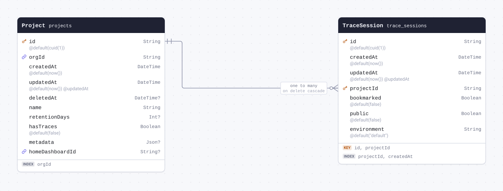

| Field                      | Type       | Constraints                                | Default              | Description |
| -------------------------- | ---------- | ------------------------------------------ | -------------------- | ----------- |
| `id`                       | `String`   | PK NOT NULL                                | `cuid(1)`            |             |
| `createdAt` (`created_at`) | `DateTime` | NOT NULL                                   | `now()`              |             |
| `updatedAt` (`updated_at`) | `DateTime` | NOT NULL                                   | `now()` `@updatedAt` |             |
| `projectId` (`project_id`) | `String`   | PK NOT NULL → [Project.id](#model-Project) |                      |             |
| `bookmarked`               | `Boolean`  | NOT NULL                                   | `false`              |             |
| `public`                   | `Boolean`  | NOT NULL                                   | `false`              |             |
| `environment`              | `String`   | NOT NULL                                   | `"default"`          |             |

#### Indexes

- `@@id([id, projectId])`
- `@@index([projectId, createdAt])`

#### References

- `projectId` → [Project.id](#model-Project) (many-to-one, on delete Cascade)

#### Definition

```sql
CREATE TABLE "trace_sessions" (
    "id" TEXT NOT NULL,
    "created_at" TIMESTAMP(3) NOT NULL DEFAULT CURRENT_TIMESTAMP,
    "updated_at" TIMESTAMP(3) NOT NULL DEFAULT CURRENT_TIMESTAMP,
    "project_id" TEXT NOT NULL,
    "bookmarked" BOOLEAN NOT NULL DEFAULT false,
    "public" BOOLEAN NOT NULL DEFAULT false,
    "environment" TEXT NOT NULL DEFAULT 'default',

    CONSTRAINT "trace_sessions_pkey" PRIMARY KEY ("id","project_id")
);

CREATE INDEX "trace_sessions_project_id_created_at_idx" ON "trace_sessions"("project_id", "created_at" DESC);

ALTER TABLE "trace_sessions" ADD CONSTRAINT "trace_sessions_project_id_fkey" FOREIGN KEY ("project_id") REFERENCES "projects"("id") ON DELETE CASCADE ON UPDATE CASCADE;
```

<details>
<summary>Queries and their SQL</summary>

**findMany**: Every row

```ts
await prisma.traceSession.findMany();
```

```sql
SELECT
  "public"."trace_sessions"."id",
  "public"."trace_sessions"."project_id",
  "public"."trace_sessions"."created_at",
  "public"."trace_sessions"."updated_at",
  "public"."trace_sessions"."bookmarked",
  "public"."trace_sessions"."public",
  "public"."trace_sessions"."environment"
FROM
  "public"."trace_sessions"
WHERE
  1 = 1
OFFSET
  $1
-- params: ["0"]
```

**count**: How many rows there are

```ts
await prisma.traceSession.count();
```

```sql
SELECT
  COUNT(*) AS "_count$_all"
FROM
  (
    SELECT
      "public"."trace_sessions"."id",
      "public"."trace_sessions"."project_id"
    FROM
      "public"."trace_sessions"
    WHERE
      1 = 1
    OFFSET
      $1
  ) AS "sub"
-- params: ["0"]
```

**findMany**: Every row with its relations

```ts
await prisma.traceSession.findMany({ include: { project: true } });
```

```sql
SELECT
  "public"."trace_sessions"."id",
  "public"."trace_sessions"."project_id",
  "public"."trace_sessions"."created_at",
  "public"."trace_sessions"."updated_at",
  "public"."trace_sessions"."bookmarked",
  "public"."trace_sessions"."public",
  "public"."trace_sessions"."environment"
FROM
  "public"."trace_sessions"
WHERE
  1 = 1
OFFSET
  $1
-- params: ["0"]

SELECT
  "public"."projects"."id",
  "public"."projects"."org_id",
  "public"."projects"."created_at",
  "public"."projects"."updated_at",
  "public"."projects"."deleted_at",
  "public"."projects"."name",
  "public"."projects"."retention_days",
  "public"."projects"."has_traces",
  "public"."projects"."metadata",
  "public"."projects"."home_dashboard_id"
FROM
  "public"."projects"
WHERE
  "public"."projects"."id" IN ($1)
OFFSET
  $2
-- params: ["<projectId of the rows above>","0"]
```

**findUnique**: One row by what is unique to it

```ts
await prisma.traceSession.findUnique({
  where: { id_projectId: { id: "example", projectId: "example" } },
});
```

```sql
SELECT
  "public"."trace_sessions"."id",
  "public"."trace_sessions"."project_id",
  "public"."trace_sessions"."created_at",
  "public"."trace_sessions"."updated_at",
  "public"."trace_sessions"."bookmarked",
  "public"."trace_sessions"."public",
  "public"."trace_sessions"."environment"
FROM
  "public"."trace_sessions"
WHERE
  (
    (
      "public"."trace_sessions"."id" = $1
      AND "public"."trace_sessions"."project_id" = $2
    )
    AND 1 = 1
  )
LIMIT
  $3
OFFSET
  $4
-- params: ["example","example","1","0"]
```

**create**: Create a row

```ts
await prisma.traceSession.create({ data: { projectId: "example" } });
```

```sql
INSERT INTO
  "public"."trace_sessions" (
    "id",
    "created_at",
    "updated_at",
    "project_id",
    "bookmarked",
    "public",
    "environment"
  )
VALUES
  ($1, $2, $3, $4, $5, $6, $7)
RETURNING
  "public"."trace_sessions"."id",
  "public"."trace_sessions"."project_id",
  "public"."trace_sessions"."created_at",
  "public"."trace_sessions"."updated_at",
  "public"."trace_sessions"."bookmarked",
  "public"."trace_sessions"."public",
  "public"."trace_sessions"."environment"
-- params: ["<cuid(1)>","<now()>","<now()>","example",false,false,"default"]
```

**update**: Update a row

```ts
await prisma.traceSession.update({
  where: { id_projectId: { id: "example", projectId: "example" } },
  data: { createdAt: new Date("2026-01-01T00:00:00.000Z") },
});
```

```sql
UPDATE "public"."trace_sessions"
SET
  "created_at" = $1,
  "updated_at" = $2
WHERE
  (
    (
      "public"."trace_sessions"."id" = $3
      AND "public"."trace_sessions"."project_id" = $4
    )
    AND 1 = 1
  )
RETURNING
  "public"."trace_sessions"."id",
  "public"."trace_sessions"."project_id",
  "public"."trace_sessions"."created_at",
  "public"."trace_sessions"."updated_at",
  "public"."trace_sessions"."bookmarked",
  "public"."trace_sessions"."public",
  "public"."trace_sessions"."environment"
-- params: ["2026-01-01T00:00:00.000Z",{"prisma__type":"generatorCall","prisma__value":{"name":"now","args":[],"returnType":{"type":"DateTime"}}},"example","example"]
```

**delete**: Delete a row

```ts
await prisma.traceSession.delete({
  where: { id_projectId: { id: "example", projectId: "example" } },
});
```

```sql
DELETE FROM "public"."trace_sessions"
WHERE
  (
    (
      "public"."trace_sessions"."id" = $1
      AND "public"."trace_sessions"."project_id" = $2
    )
    AND 1 = 1
  )
RETURNING
  "public"."trace_sessions"."id",
  "public"."trace_sessions"."project_id",
  "public"."trace_sessions"."created_at",
  "public"."trace_sessions"."updated_at",
  "public"."trace_sessions"."bookmarked",
  "public"."trace_sessions"."public",
  "public"."trace_sessions"."environment"
-- params: ["example","example"]
```

</details>

<a id="model-ScoreConfig"></a>

### ScoreConfig

Table `score_configs`.

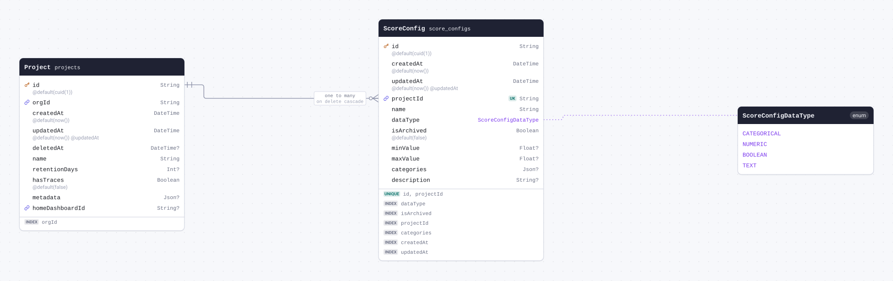

| Field                        | Type                                               | Constraints                             | Default              | Description |
| ---------------------------- | -------------------------------------------------- | --------------------------------------- | -------------------- | ----------- |
| `id`                         | `String`                                           | PK NOT NULL                             | `cuid(1)`            |             |
| `createdAt` (`created_at`)   | `DateTime`                                         | NOT NULL                                | `now()`              |             |
| `updatedAt` (`updated_at`)   | `DateTime`                                         | NOT NULL                                | `now()` `@updatedAt` |             |
| `projectId` (`project_id`)   | `String`                                           | NOT NULL → [Project.id](#model-Project) |                      |             |
| `name`                       | `String`                                           | NOT NULL                                |                      |             |
| `dataType` (`data_type`)     | [`ScoreConfigDataType`](#enum-ScoreConfigDataType) | NOT NULL                                |                      |             |
| `isArchived` (`is_archived`) | `Boolean`                                          | NOT NULL                                | `false`              |             |
| `minValue` (`min_value`)     | `Float`                                            | NULL                                    |                      |             |
| `maxValue` (`max_value`)     | `Float`                                            | NULL                                    |                      |             |
| `categories` (`categories`)  | `Json`                                             | NULL                                    |                      |             |
| `description`                | `String`                                           | NULL                                    |                      |             |

#### Indexes

- `@@index([dataType])`
- `@@index([isArchived])`
- `@@index([projectId])`
- `@@index([categories])`
- `@@index([createdAt])`
- `@@index([updatedAt])`
- `@@unique([id, projectId])`

#### References

- `projectId` → [Project.id](#model-Project) (many-to-one, on delete Cascade)

#### Definition

```sql
CREATE TABLE "score_configs" (
    "id" TEXT NOT NULL,
    "created_at" TIMESTAMP(3) NOT NULL DEFAULT CURRENT_TIMESTAMP,
    "updated_at" TIMESTAMP(3) NOT NULL DEFAULT CURRENT_TIMESTAMP,
    "project_id" TEXT NOT NULL,
    "name" TEXT NOT NULL,
    "data_type" "ScoreConfigDataType" NOT NULL,
    "is_archived" BOOLEAN NOT NULL DEFAULT false,
    "min_value" DOUBLE PRECISION,
    "max_value" DOUBLE PRECISION,
    "categories" JSONB,
    "description" TEXT,

    CONSTRAINT "score_configs_pkey" PRIMARY KEY ("id")
);

CREATE INDEX "score_configs_data_type_idx" ON "score_configs"("data_type");

CREATE INDEX "score_configs_is_archived_idx" ON "score_configs"("is_archived");

CREATE INDEX "score_configs_project_id_idx" ON "score_configs"("project_id");

CREATE INDEX "score_configs_categories_idx" ON "score_configs"("categories");

CREATE INDEX "score_configs_created_at_idx" ON "score_configs"("created_at");

CREATE INDEX "score_configs_updated_at_idx" ON "score_configs"("updated_at");

CREATE UNIQUE INDEX "score_configs_id_project_id_key" ON "score_configs"("id", "project_id");

ALTER TABLE "score_configs" ADD CONSTRAINT "score_configs_project_id_fkey" FOREIGN KEY ("project_id") REFERENCES "projects"("id") ON DELETE CASCADE ON UPDATE CASCADE;
```

<details>
<summary>Queries and their SQL</summary>

**findMany**: Every row

```ts
await prisma.scoreConfig.findMany();
```

```sql
SELECT
  "public"."score_configs"."id",
  "public"."score_configs"."created_at",
  "public"."score_configs"."updated_at",
  "public"."score_configs"."project_id",
  "public"."score_configs"."name",
  "public"."score_configs"."data_type"::text,
  "public"."score_configs"."is_archived",
  "public"."score_configs"."min_value",
  "public"."score_configs"."max_value",
  "public"."score_configs"."categories",
  "public"."score_configs"."description"
FROM
  "public"."score_configs"
WHERE
  1 = 1
OFFSET
  $1
-- params: ["0"]
```

**count**: How many rows there are

```ts
await prisma.scoreConfig.count();
```

```sql
SELECT
  COUNT(*) AS "_count$_all"
FROM
  (
    SELECT
      "public"."score_configs"."id"
    FROM
      "public"."score_configs"
    WHERE
      1 = 1
    OFFSET
      $1
  ) AS "sub"
-- params: ["0"]
```

**findMany**: Every row with its relations

```ts
await prisma.scoreConfig.findMany({ include: { project: true } });
```

```sql
SELECT
  "public"."score_configs"."id",
  "public"."score_configs"."created_at",
  "public"."score_configs"."updated_at",
  "public"."score_configs"."project_id",
  "public"."score_configs"."name",
  "public"."score_configs"."data_type"::text,
  "public"."score_configs"."is_archived",
  "public"."score_configs"."min_value",
  "public"."score_configs"."max_value",
  "public"."score_configs"."categories",
  "public"."score_configs"."description"
FROM
  "public"."score_configs"
WHERE
  1 = 1
OFFSET
  $1
-- params: ["0"]

SELECT
  "public"."projects"."id",
  "public"."projects"."org_id",
  "public"."projects"."created_at",
  "public"."projects"."updated_at",
  "public"."projects"."deleted_at",
  "public"."projects"."name",
  "public"."projects"."retention_days",
  "public"."projects"."has_traces",
  "public"."projects"."metadata",
  "public"."projects"."home_dashboard_id"
FROM
  "public"."projects"
WHERE
  "public"."projects"."id" IN ($1)
OFFSET
  $2
-- params: ["<projectId of the rows above>","0"]
```

**findUnique**: One row by what is unique to it

```ts
await prisma.scoreConfig.findUnique({ where: { id: "example" } });
```

```sql
SELECT
  "public"."score_configs"."id",
  "public"."score_configs"."created_at",
  "public"."score_configs"."updated_at",
  "public"."score_configs"."project_id",
  "public"."score_configs"."name",
  "public"."score_configs"."data_type"::text,
  "public"."score_configs"."is_archived",
  "public"."score_configs"."min_value",
  "public"."score_configs"."max_value",
  "public"."score_configs"."categories",
  "public"."score_configs"."description"
FROM
  "public"."score_configs"
WHERE
  (
    "public"."score_configs"."id" = $1
    AND 1 = 1
  )
LIMIT
  $2
OFFSET
  $3
-- params: ["example","1","0"]
```

**create**: Create a row

```ts
await prisma.scoreConfig.create({
  data: { projectId: "example", name: "example", dataType: "CATEGORICAL" },
});
```

```sql
INSERT INTO
  "public"."score_configs" (
    "id",
    "created_at",
    "updated_at",
    "project_id",
    "name",
    "data_type",
    "is_archived"
  )
VALUES
  (
    $1,
    $2,
    $3,
    $4,
    $5,
    CAST($6::text AS "public"."ScoreConfigDataType"),
    $7
  )
RETURNING
  "public"."score_configs"."id",
  "public"."score_configs"."created_at",
  "public"."score_configs"."updated_at",
  "public"."score_configs"."project_id",
  "public"."score_configs"."name",
  "public"."score_configs"."data_type"::text,
  "public"."score_configs"."is_archived",
  "public"."score_configs"."min_value",
  "public"."score_configs"."max_value",
  "public"."score_configs"."categories",
  "public"."score_configs"."description"
-- params: ["<cuid(1)>","<now()>","<now()>","example","example","CATEGORICAL",false]
```

**update**: Update a row

```ts
await prisma.scoreConfig.update({
  where: { id: "example" },
  data: { createdAt: new Date("2026-01-01T00:00:00.000Z") },
});
```

```sql
UPDATE "public"."score_configs"
SET
  "created_at" = $1,
  "updated_at" = $2
WHERE
  (
    "public"."score_configs"."id" = $3
    AND 1 = 1
  )
RETURNING
  "public"."score_configs"."id",
  "public"."score_configs"."created_at",
  "public"."score_configs"."updated_at",
  "public"."score_configs"."project_id",
  "public"."score_configs"."name",
  "public"."score_configs"."data_type"::text,
  "public"."score_configs"."is_archived",
  "public"."score_configs"."min_value",
  "public"."score_configs"."max_value",
  "public"."score_configs"."categories",
  "public"."score_configs"."description"
-- params: ["2026-01-01T00:00:00.000Z",{"prisma__type":"generatorCall","prisma__value":{"name":"now","args":[],"returnType":{"type":"DateTime"}}},"example"]
```

**delete**: Delete a row

```ts
await prisma.scoreConfig.delete({ where: { id: "example" } });
```

```sql
DELETE FROM "public"."score_configs"
WHERE
  (
    "public"."score_configs"."id" = $1
    AND 1 = 1
  )
RETURNING
  "public"."score_configs"."id",
  "public"."score_configs"."created_at",
  "public"."score_configs"."updated_at",
  "public"."score_configs"."project_id",
  "public"."score_configs"."name",
  "public"."score_configs"."data_type"::text,
  "public"."score_configs"."is_archived",
  "public"."score_configs"."min_value",
  "public"."score_configs"."max_value",
  "public"."score_configs"."categories",
  "public"."score_configs"."description"
-- params: ["example"]
```

</details>

<a id="model-AnnotationQueue"></a>

### AnnotationQueue

Table `annotation_queues`.

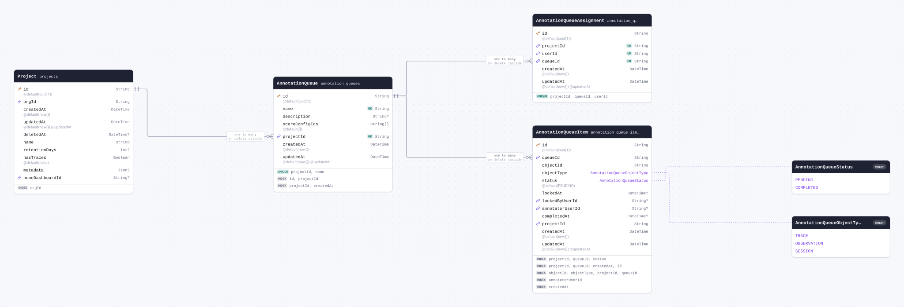

| Field                                 | Type       | Constraints                             | Default              | Description |
| ------------------------------------- | ---------- | --------------------------------------- | -------------------- | ----------- |
| `id`                                  | `String`   | PK NOT NULL                             | `cuid(1)`            |             |
| `name`                                | `String`   | NOT NULL                                |                      |             |
| `description`                         | `String`   | NULL                                    |                      |             |
| `scoreConfigIds` (`score_config_ids`) | `String[]` | NOT NULL                                | `[]`                 |             |
| `projectId` (`project_id`)            | `String`   | NOT NULL → [Project.id](#model-Project) |                      |             |
| `createdAt` (`created_at`)            | `DateTime` | NOT NULL                                | `now()`              |             |
| `updatedAt` (`updated_at`)            | `DateTime` | NOT NULL                                | `now()` `@updatedAt` |             |

#### Indexes

- `@@index([id, projectId])`
- `@@index([projectId, createdAt])`
- `@@unique([projectId, name])`

#### References

- `projectId` → [Project.id](#model-Project) (many-to-one, on delete Cascade)

#### Referenced by

- `id` ← [AnnotationQueueItem.queueId](#model-AnnotationQueueItem) (one-to-many, on delete Cascade)
- `id` ← [AnnotationQueueAssignment.queueId](#model-AnnotationQueueAssignment) (one-to-many, on delete Cascade)

#### Definition

```sql
CREATE TABLE "annotation_queues" (
    "id" TEXT NOT NULL,
    "name" TEXT NOT NULL,
    "description" TEXT,
    "score_config_ids" TEXT[] DEFAULT ARRAY[]::TEXT[],
    "project_id" TEXT NOT NULL,
    "created_at" TIMESTAMP(3) NOT NULL DEFAULT CURRENT_TIMESTAMP,
    "updated_at" TIMESTAMP(3) NOT NULL DEFAULT CURRENT_TIMESTAMP,

    CONSTRAINT "annotation_queues_pkey" PRIMARY KEY ("id")
);

CREATE INDEX "annotation_queues_id_project_id_idx" ON "annotation_queues"("id", "project_id");

CREATE INDEX "annotation_queues_project_id_created_at_idx" ON "annotation_queues"("project_id", "created_at");

CREATE UNIQUE INDEX "annotation_queues_project_id_name_key" ON "annotation_queues"("project_id", "name");

ALTER TABLE "annotation_queues" ADD CONSTRAINT "annotation_queues_project_id_fkey" FOREIGN KEY ("project_id") REFERENCES "projects"("id") ON DELETE CASCADE ON UPDATE CASCADE;
```

<details>
<summary>Queries and their SQL</summary>

**findMany**: Every row

```ts
await prisma.annotationQueue.findMany();
```

```sql
SELECT
  "public"."annotation_queues"."id",
  "public"."annotation_queues"."name",
  "public"."annotation_queues"."description",
  "public"."annotation_queues"."score_config_ids",
  "public"."annotation_queues"."project_id",
  "public"."annotation_queues"."created_at",
  "public"."annotation_queues"."updated_at"
FROM
  "public"."annotation_queues"
WHERE
  1 = 1
OFFSET
  $1
-- params: ["0"]
```

**count**: How many rows there are

```ts
await prisma.annotationQueue.count();
```

```sql
SELECT
  COUNT(*) AS "_count$_all"
FROM
  (
    SELECT
      "public"."annotation_queues"."id"
    FROM
      "public"."annotation_queues"
    WHERE
      1 = 1
    OFFSET
      $1
  ) AS "sub"
-- params: ["0"]
```

**findMany**: Every row with its relations

```ts
await prisma.annotationQueue.findMany({
  include: { project: true, annotationQueueItem: true, annotationQueueAssignment: true },
});
```

```sql
SELECT
  "public"."annotation_queues"."id",
  "public"."annotation_queues"."name",
  "public"."annotation_queues"."description",
  "public"."annotation_queues"."score_config_ids",
  "public"."annotation_queues"."project_id",
  "public"."annotation_queues"."created_at",
  "public"."annotation_queues"."updated_at"
FROM
  "public"."annotation_queues"
WHERE
  1 = 1
OFFSET
  $1
-- params: ["0"]

SELECT
  "public"."projects"."id",
  "public"."projects"."org_id",
  "public"."projects"."created_at",
  "public"."projects"."updated_at",
  "public"."projects"."deleted_at",
  "public"."projects"."name",
  "public"."projects"."retention_days",
  "public"."projects"."has_traces",
  "public"."projects"."metadata",
  "public"."projects"."home_dashboard_id"
FROM
  "public"."projects"
WHERE
  "public"."projects"."id" IN ($1)
OFFSET
  $2
-- params: ["<projectId of the rows above>","0"]

SELECT
  "public"."annotation_queue_items"."id",
  "public"."annotation_queue_items"."queue_id",
  "public"."annotation_queue_items"."object_id",
  "public"."annotation_queue_items"."object_type"::text,
  "public"."annotation_queue_items"."status"::text,
  "public"."annotation_queue_items"."locked_at",
  "public"."annotation_queue_items"."locked_by_user_id",
  "public"."annotation_queue_items"."annotator_user_id",
  "public"."annotation_queue_items"."completed_at",
  "public"."annotation_queue_items"."project_id",
  "public"."annotation_queue_items"."created_at",
  "public"."annotation_queue_items"."updated_at"
FROM
  "public"."annotation_queue_items"
WHERE
  "public"."annotation_queue_items"."queue_id" IN ($1)
OFFSET
  $2
-- params: ["<id of the rows above>","0"]

SELECT
  "public"."annotation_queue_assignments"."id",
  "public"."annotation_queue_assignments"."project_id",
  "public"."annotation_queue_assignments"."user_id",
  "public"."annotation_queue_assignments"."queue_id",
  "public"."annotation_queue_assignments"."created_at",
  "public"."annotation_queue_assignments"."updated_at"
FROM
  "public"."annotation_queue_assignments"
WHERE
  "public"."annotation_queue_assignments"."queue_id" IN ($1)
OFFSET
  $2
-- params: ["<id of the rows above>","0"]
```

**findUnique**: One row by what is unique to it

```ts
await prisma.annotationQueue.findUnique({ where: { id: "example" } });
```

```sql
SELECT
  "public"."annotation_queues"."id",
  "public"."annotation_queues"."name",
  "public"."annotation_queues"."description",
  "public"."annotation_queues"."score_config_ids",
  "public"."annotation_queues"."project_id",
  "public"."annotation_queues"."created_at",
  "public"."annotation_queues"."updated_at"
FROM
  "public"."annotation_queues"
WHERE
  (
    "public"."annotation_queues"."id" = $1
    AND 1 = 1
  )
LIMIT
  $2
OFFSET
  $3
-- params: ["example","1","0"]
```

**create**: Create a row

```ts
await prisma.annotationQueue.create({ data: { name: "example", projectId: "example" } });
```

```sql
INSERT INTO
  "public"."annotation_queues" (
    "id",
    "name",
    "score_config_ids",
    "project_id",
    "created_at",
    "updated_at"
  )
VALUES
  ($1, $2, $3, $4, $5, $6)
RETURNING
  "public"."annotation_queues"."id",
  "public"."annotation_queues"."name",
  "public"."annotation_queues"."description",
  "public"."annotation_queues"."score_config_ids",
  "public"."annotation_queues"."project_id",
  "public"."annotation_queues"."created_at",
  "public"."annotation_queues"."updated_at"
-- params: ["<cuid(1)>","example",[],"example","<now()>","<now()>"]
```

**update**: Update a row

```ts
await prisma.annotationQueue.update({ where: { id: "example" }, data: { name: "example" } });
```

```sql
UPDATE "public"."annotation_queues"
SET
  "name" = $1,
  "updated_at" = $2
WHERE
  (
    "public"."annotation_queues"."id" = $3
    AND 1 = 1
  )
RETURNING
  "public"."annotation_queues"."id",
  "public"."annotation_queues"."name",
  "public"."annotation_queues"."description",
  "public"."annotation_queues"."score_config_ids",
  "public"."annotation_queues"."project_id",
  "public"."annotation_queues"."created_at",
  "public"."annotation_queues"."updated_at"
-- params: ["example",{"prisma__type":"generatorCall","prisma__value":{"name":"now","args":[],"returnType":{"type":"DateTime"}}},"example"]
```

**delete**: Delete a row

```ts
await prisma.annotationQueue.delete({ where: { id: "example" } });
```

```sql
DELETE FROM "public"."annotation_queues"
WHERE
  (
    "public"."annotation_queues"."id" = $1
    AND 1 = 1
  )
RETURNING
  "public"."annotation_queues"."id",
  "public"."annotation_queues"."name",
  "public"."annotation_queues"."description",
  "public"."annotation_queues"."score_config_ids",
  "public"."annotation_queues"."project_id",
  "public"."annotation_queues"."created_at",
  "public"."annotation_queues"."updated_at"
-- params: ["example"]
```

</details>

<a id="model-AnnotationQueueItem"></a>

### AnnotationQueueItem

Table `annotation_queue_items`.

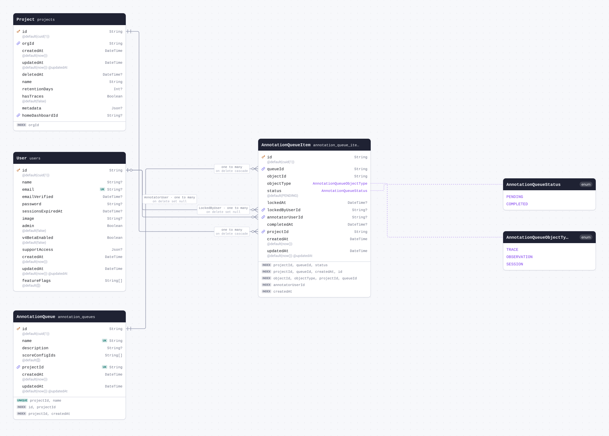

| Field                                   | Type                                                           | Constraints                                             | Default              | Description |
| --------------------------------------- | -------------------------------------------------------------- | ------------------------------------------------------- | -------------------- | ----------- |
| `id`                                    | `String`                                                       | PK NOT NULL                                             | `cuid(1)`            |             |
| `queueId` (`queue_id`)                  | `String`                                                       | NOT NULL → [AnnotationQueue.id](#model-AnnotationQueue) |                      |             |
| `objectId` (`object_id`)                | `String`                                                       | NOT NULL                                                |                      |             |
| `objectType` (`object_type`)            | [`AnnotationQueueObjectType`](#enum-AnnotationQueueObjectType) | NOT NULL                                                |                      |             |
| `status`                                | [`AnnotationQueueStatus`](#enum-AnnotationQueueStatus)         | NOT NULL                                                | `PENDING`            |             |
| `lockedAt` (`locked_at`)                | `DateTime`                                                     | NULL                                                    |                      |             |
| `lockedByUserId` (`locked_by_user_id`)  | `String`                                                       | NULL → [User.id](#model-User)                           |                      |             |
| `annotatorUserId` (`annotator_user_id`) | `String`                                                       | NULL → [User.id](#model-User)                           |                      |             |
| `completedAt` (`completed_at`)          | `DateTime`                                                     | NULL                                                    |                      |             |
| `projectId` (`project_id`)              | `String`                                                       | NOT NULL → [Project.id](#model-Project)                 |                      |             |
| `createdAt` (`created_at`)              | `DateTime`                                                     | NOT NULL                                                | `now()`              |             |
| `updatedAt` (`updated_at`)              | `DateTime`                                                     | NOT NULL                                                | `now()` `@updatedAt` |             |

#### Indexes

- `@@index([projectId, queueId, status])`
- `@@index([projectId, queueId, createdAt, id])`
- `@@index([objectId, objectType, projectId, queueId])`
- `@@index([annotatorUserId])`
- `@@index([createdAt])`

#### References

- `queueId` → [AnnotationQueue.id](#model-AnnotationQueue) (many-to-one, on delete Cascade)
- `lockedByUserId` → [User.id](#model-User) (many-to-one, on delete SetNull)
- `annotatorUserId` → [User.id](#model-User) (many-to-one, on delete SetNull)
- `projectId` → [Project.id](#model-Project) (many-to-one, on delete Cascade)

#### Definition

```sql
CREATE TABLE "annotation_queue_items" (
    "id" TEXT NOT NULL,
    "queue_id" TEXT NOT NULL,
    "object_id" TEXT NOT NULL,
    "object_type" "AnnotationQueueObjectType" NOT NULL,
    "status" "AnnotationQueueStatus" NOT NULL DEFAULT 'PENDING',
    "locked_at" TIMESTAMP(3),
    "locked_by_user_id" TEXT,
    "annotator_user_id" TEXT,
    "completed_at" TIMESTAMP(3),
    "project_id" TEXT NOT NULL,
    "created_at" TIMESTAMP(3) NOT NULL DEFAULT CURRENT_TIMESTAMP,
    "updated_at" TIMESTAMP(3) NOT NULL DEFAULT CURRENT_TIMESTAMP,

    CONSTRAINT "annotation_queue_items_pkey" PRIMARY KEY ("id")
);

CREATE INDEX "annotation_queue_items_project_id_queue_id_status_idx" ON "annotation_queue_items"("project_id", "queue_id", "status");

CREATE INDEX "annotation_queue_items_project_id_queue_id_created_at_id_idx" ON "annotation_queue_items"("project_id", "queue_id", "created_at", "id");

CREATE INDEX "annotation_queue_items_object_id_object_type_project_id_que_idx" ON "annotation_queue_items"("object_id", "object_type", "project_id", "queue_id");

CREATE INDEX "annotation_queue_items_annotator_user_id_idx" ON "annotation_queue_items"("annotator_user_id");

CREATE INDEX "annotation_queue_items_created_at_idx" ON "annotation_queue_items"("created_at");

ALTER TABLE "annotation_queue_items" ADD CONSTRAINT "annotation_queue_items_queue_id_fkey" FOREIGN KEY ("queue_id") REFERENCES "annotation_queues"("id") ON DELETE CASCADE ON UPDATE CASCADE;

ALTER TABLE "annotation_queue_items" ADD CONSTRAINT "annotation_queue_items_locked_by_user_id_fkey" FOREIGN KEY ("locked_by_user_id") REFERENCES "users"("id") ON DELETE SET NULL ON UPDATE CASCADE;

ALTER TABLE "annotation_queue_items" ADD CONSTRAINT "annotation_queue_items_annotator_user_id_fkey" FOREIGN KEY ("annotator_user_id") REFERENCES "users"("id") ON DELETE SET NULL ON UPDATE CASCADE;

ALTER TABLE "annotation_queue_items" ADD CONSTRAINT "annotation_queue_items_project_id_fkey" FOREIGN KEY ("project_id") REFERENCES "projects"("id") ON DELETE CASCADE ON UPDATE CASCADE;
```

<details>
<summary>Queries and their SQL</summary>

**findMany**: Every row

```ts
await prisma.annotationQueueItem.findMany();
```

```sql
SELECT
  "public"."annotation_queue_items"."id",
  "public"."annotation_queue_items"."queue_id",
  "public"."annotation_queue_items"."object_id",
  "public"."annotation_queue_items"."object_type"::text,
  "public"."annotation_queue_items"."status"::text,
  "public"."annotation_queue_items"."locked_at",
  "public"."annotation_queue_items"."locked_by_user_id",
  "public"."annotation_queue_items"."annotator_user_id",
  "public"."annotation_queue_items"."completed_at",
  "public"."annotation_queue_items"."project_id",
  "public"."annotation_queue_items"."created_at",
  "public"."annotation_queue_items"."updated_at"
FROM
  "public"."annotation_queue_items"
WHERE
  1 = 1
OFFSET
  $1
-- params: ["0"]
```

**count**: How many rows there are

```ts
await prisma.annotationQueueItem.count();
```

```sql
SELECT
  COUNT(*) AS "_count$_all"
FROM
  (
    SELECT
      "public"."annotation_queue_items"."id"
    FROM
      "public"."annotation_queue_items"
    WHERE
      1 = 1
    OFFSET
      $1
  ) AS "sub"
-- params: ["0"]
```

**findMany**: Every row with its relations

```ts
await prisma.annotationQueueItem.findMany({
  include: { queue: true, lockedByUser: true, annotatorUser: true, project: true },
});
```

```sql
SELECT
  "public"."annotation_queue_items"."id",
  "public"."annotation_queue_items"."queue_id",
  "public"."annotation_queue_items"."object_id",
  "public"."annotation_queue_items"."object_type"::text,
  "public"."annotation_queue_items"."status"::text,
  "public"."annotation_queue_items"."locked_at",
  "public"."annotation_queue_items"."locked_by_user_id",
  "public"."annotation_queue_items"."annotator_user_id",
  "public"."annotation_queue_items"."completed_at",
  "public"."annotation_queue_items"."project_id",
  "public"."annotation_queue_items"."created_at",
  "public"."annotation_queue_items"."updated_at"
FROM
  "public"."annotation_queue_items"
WHERE
  1 = 1
OFFSET
  $1
-- params: ["0"]

SELECT
  "public"."annotation_queues"."id",
  "public"."annotation_queues"."name",
  "public"."annotation_queues"."description",
  "public"."annotation_queues"."score_config_ids",
  "public"."annotation_queues"."project_id",
  "public"."annotation_queues"."created_at",
  "public"."annotation_queues"."updated_at"
FROM
  "public"."annotation_queues"
WHERE
  "public"."annotation_queues"."id" IN ($1)
OFFSET
  $2
-- params: ["<queueId of the rows above>","0"]

SELECT
  "public"."users"."id",
  "public"."users"."name",
  "public"."users"."email",
  "public"."users"."email_verified",
  "public"."users"."password",
  "public"."users"."sessions_expired_at",
  "public"."users"."image",
  "public"."users"."admin",
  "public"."users"."v4_beta_enabled",
  "public"."users"."support_access",
  "public"."users"."created_at",
  "public"."users"."updated_at",
  "public"."users"."feature_flags"
FROM
  "public"."users"
WHERE
  "public"."users"."id" IN ($1)
OFFSET
  $2
-- params: ["<lockedByUserId of the rows above>","0"]

SELECT
  "public"."users"."id",
  "public"."users"."name",
  "public"."users"."email",
  "public"."users"."email_verified",
  "public"."users"."password",
  "public"."users"."sessions_expired_at",
  "public"."users"."image",
  "public"."users"."admin",
  "public"."users"."v4_beta_enabled",
  "public"."users"."support_access",
  "public"."users"."created_at",
  "public"."users"."updated_at",
  "public"."users"."feature_flags"
FROM
  "public"."users"
WHERE
  "public"."users"."id" IN ($1)
OFFSET
  $2
-- params: ["<annotatorUserId of the rows above>","0"]

SELECT
  "public"."projects"."id",
  "public"."projects"."org_id",
  "public"."projects"."created_at",
  "public"."projects"."updated_at",
  "public"."projects"."deleted_at",
  "public"."projects"."name",
  "public"."projects"."retention_days",
  "public"."projects"."has_traces",
  "public"."projects"."metadata",
  "public"."projects"."home_dashboard_id"
FROM
  "public"."projects"
WHERE
  "public"."projects"."id" IN ($1)
OFFSET
  $2
-- params: ["<projectId of the rows above>","0"]
```

**findUnique**: One row by what is unique to it

```ts
await prisma.annotationQueueItem.findUnique({ where: { id: "example" } });
```

```sql
SELECT
  "public"."annotation_queue_items"."id",
  "public"."annotation_queue_items"."queue_id",
  "public"."annotation_queue_items"."object_id",
  "public"."annotation_queue_items"."object_type"::text,
  "public"."annotation_queue_items"."status"::text,
  "public"."annotation_queue_items"."locked_at",
  "public"."annotation_queue_items"."locked_by_user_id",
  "public"."annotation_queue_items"."annotator_user_id",
  "public"."annotation_queue_items"."completed_at",
  "public"."annotation_queue_items"."project_id",
  "public"."annotation_queue_items"."created_at",
  "public"."annotation_queue_items"."updated_at"
FROM
  "public"."annotation_queue_items"
WHERE
  (
    "public"."annotation_queue_items"."id" = $1
    AND 1 = 1
  )
LIMIT
  $2
OFFSET
  $3
-- params: ["example","1","0"]
```

**create**: Create a row

```ts
await prisma.annotationQueueItem.create({
  data: { queueId: "example", objectId: "example", objectType: "TRACE", projectId: "example" },
});
```

```sql
INSERT INTO
  "public"."annotation_queue_items" (
    "id",
    "queue_id",
    "object_id",
    "object_type",
    "status",
    "project_id",
    "created_at",
    "updated_at"
  )
VALUES
  (
    $1,
    $2,
    $3,
    CAST($4::text AS "public"."AnnotationQueueObjectType"),
    CAST($5::text AS "public"."AnnotationQueueStatus"),
    $6,
    $7,
    $8
  )
RETURNING
  "public"."annotation_queue_items"."id",
  "public"."annotation_queue_items"."queue_id",
  "public"."annotation_queue_items"."object_id",
  "public"."annotation_queue_items"."object_type"::text,
  "public"."annotation_queue_items"."status"::text,
  "public"."annotation_queue_items"."locked_at",
  "public"."annotation_queue_items"."locked_by_user_id",
  "public"."annotation_queue_items"."annotator_user_id",
  "public"."annotation_queue_items"."completed_at",
  "public"."annotation_queue_items"."project_id",
  "public"."annotation_queue_items"."created_at",
  "public"."annotation_queue_items"."updated_at"
-- params: ["<cuid(1)>","example","example","TRACE","PENDING","example","<now()>","<now()>"]
```

**update**: Update a row

```ts
await prisma.annotationQueueItem.update({
  where: { id: "example" },
  data: { objectId: "example" },
});
```

```sql
UPDATE "public"."annotation_queue_items"
SET
  "object_id" = $1,
  "updated_at" = $2
WHERE
  (
    "public"."annotation_queue_items"."id" = $3
    AND 1 = 1
  )
RETURNING
  "public"."annotation_queue_items"."id",
  "public"."annotation_queue_items"."queue_id",
  "public"."annotation_queue_items"."object_id",
  "public"."annotation_queue_items"."object_type"::text,
  "public"."annotation_queue_items"."status"::text,
  "public"."annotation_queue_items"."locked_at",
  "public"."annotation_queue_items"."locked_by_user_id",
  "public"."annotation_queue_items"."annotator_user_id",
  "public"."annotation_queue_items"."completed_at",
  "public"."annotation_queue_items"."project_id",
  "public"."annotation_queue_items"."created_at",
  "public"."annotation_queue_items"."updated_at"
-- params: ["example",{"prisma__type":"generatorCall","prisma__value":{"name":"now","args":[],"returnType":{"type":"DateTime"}}},"example"]
```

**delete**: Delete a row

```ts
await prisma.annotationQueueItem.delete({ where: { id: "example" } });
```

```sql
DELETE FROM "public"."annotation_queue_items"
WHERE
  (
    "public"."annotation_queue_items"."id" = $1
    AND 1 = 1
  )
RETURNING
  "public"."annotation_queue_items"."id",
  "public"."annotation_queue_items"."queue_id",
  "public"."annotation_queue_items"."object_id",
  "public"."annotation_queue_items"."object_type"::text,
  "public"."annotation_queue_items"."status"::text,
  "public"."annotation_queue_items"."locked_at",
  "public"."annotation_queue_items"."locked_by_user_id",
  "public"."annotation_queue_items"."annotator_user_id",
  "public"."annotation_queue_items"."completed_at",
  "public"."annotation_queue_items"."project_id",
  "public"."annotation_queue_items"."created_at",
  "public"."annotation_queue_items"."updated_at"
-- params: ["example"]
```

</details>

<a id="model-AnnotationQueueAssignment"></a>

### AnnotationQueueAssignment

Table `annotation_queue_assignments`.

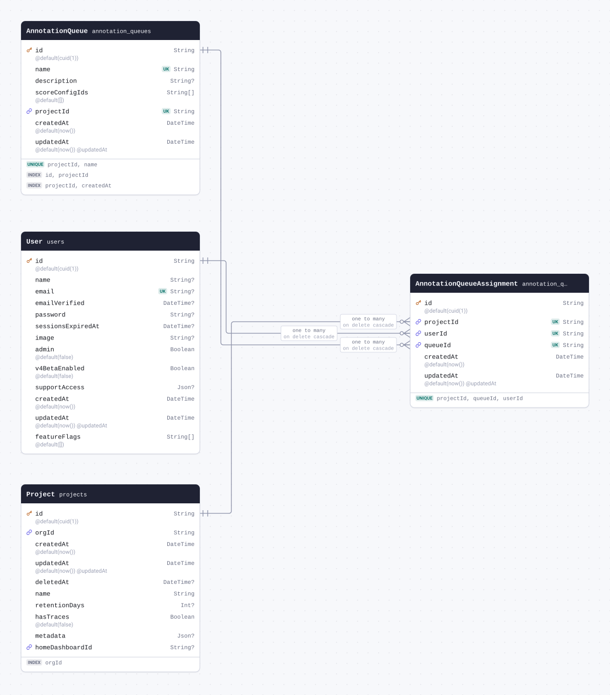

| Field                      | Type       | Constraints                                             | Default              | Description |
| -------------------------- | ---------- | ------------------------------------------------------- | -------------------- | ----------- |
| `id`                       | `String`   | PK NOT NULL                                             | `cuid(1)`            |             |
| `projectId` (`project_id`) | `String`   | NOT NULL → [Project.id](#model-Project)                 |                      |             |
| `userId` (`user_id`)       | `String`   | NOT NULL → [User.id](#model-User)                       |                      |             |
| `queueId` (`queue_id`)     | `String`   | NOT NULL → [AnnotationQueue.id](#model-AnnotationQueue) |                      |             |
| `createdAt` (`created_at`) | `DateTime` | NOT NULL                                                | `now()`              |             |
| `updatedAt` (`updated_at`) | `DateTime` | NOT NULL                                                | `now()` `@updatedAt` |             |

#### Indexes

- `@@unique([projectId, queueId, userId])`

#### References

- `projectId` → [Project.id](#model-Project) (many-to-one, on delete Cascade)
- `userId` → [User.id](#model-User) (many-to-one, on delete Cascade)
- `queueId` → [AnnotationQueue.id](#model-AnnotationQueue) (many-to-one, on delete Cascade)

#### Definition

```sql
CREATE TABLE "annotation_queue_assignments" (
    "id" TEXT NOT NULL,
    "project_id" TEXT NOT NULL,
    "user_id" TEXT NOT NULL,
    "queue_id" TEXT NOT NULL,
    "created_at" TIMESTAMP(3) NOT NULL DEFAULT CURRENT_TIMESTAMP,
    "updated_at" TIMESTAMP(3) NOT NULL DEFAULT CURRENT_TIMESTAMP,

    CONSTRAINT "annotation_queue_assignments_pkey" PRIMARY KEY ("id")
);

CREATE UNIQUE INDEX "annotation_queue_assignments_project_id_queue_id_user_id_key" ON "annotation_queue_assignments"("project_id", "queue_id", "user_id");

ALTER TABLE "annotation_queue_assignments" ADD CONSTRAINT "annotation_queue_assignments_project_id_fkey" FOREIGN KEY ("project_id") REFERENCES "projects"("id") ON DELETE CASCADE ON UPDATE CASCADE;

ALTER TABLE "annotation_queue_assignments" ADD CONSTRAINT "annotation_queue_assignments_user_id_fkey" FOREIGN KEY ("user_id") REFERENCES "users"("id") ON DELETE CASCADE ON UPDATE CASCADE;

ALTER TABLE "annotation_queue_assignments" ADD CONSTRAINT "annotation_queue_assignments_queue_id_fkey" FOREIGN KEY ("queue_id") REFERENCES "annotation_queues"("id") ON DELETE CASCADE ON UPDATE CASCADE;
```

<details>
<summary>Queries and their SQL</summary>

**findMany**: Every row

```ts
await prisma.annotationQueueAssignment.findMany();
```

```sql
SELECT
  "public"."annotation_queue_assignments"."id",
  "public"."annotation_queue_assignments"."project_id",
  "public"."annotation_queue_assignments"."user_id",
  "public"."annotation_queue_assignments"."queue_id",
  "public"."annotation_queue_assignments"."created_at",
  "public"."annotation_queue_assignments"."updated_at"
FROM
  "public"."annotation_queue_assignments"
WHERE
  1 = 1
OFFSET
  $1
-- params: ["0"]
```

**count**: How many rows there are

```ts
await prisma.annotationQueueAssignment.count();
```

```sql
SELECT
  COUNT(*) AS "_count$_all"
FROM
  (
    SELECT
      "public"."annotation_queue_assignments"."id"
    FROM
      "public"."annotation_queue_assignments"
    WHERE
      1 = 1
    OFFSET
      $1
  ) AS "sub"
-- params: ["0"]
```

**findMany**: Every row with its relations

```ts
await prisma.annotationQueueAssignment.findMany({
  include: { project: true, user: true, queue: true },
});
```

```sql
SELECT
  "public"."annotation_queue_assignments"."id",
  "public"."annotation_queue_assignments"."project_id",
  "public"."annotation_queue_assignments"."user_id",
  "public"."annotation_queue_assignments"."queue_id",
  "public"."annotation_queue_assignments"."created_at",
  "public"."annotation_queue_assignments"."updated_at"
FROM
  "public"."annotation_queue_assignments"
WHERE
  1 = 1
OFFSET
  $1
-- params: ["0"]

SELECT
  "public"."projects"."id",
  "public"."projects"."org_id",
  "public"."projects"."created_at",
  "public"."projects"."updated_at",
  "public"."projects"."deleted_at",
  "public"."projects"."name",
  "public"."projects"."retention_days",
  "public"."projects"."has_traces",
  "public"."projects"."metadata",
  "public"."projects"."home_dashboard_id"
FROM
  "public"."projects"
WHERE
  "public"."projects"."id" IN ($1)
OFFSET
  $2
-- params: ["<projectId of the rows above>","0"]

SELECT
  "public"."users"."id",
  "public"."users"."name",
  "public"."users"."email",
  "public"."users"."email_verified",
  "public"."users"."password",
  "public"."users"."sessions_expired_at",
  "public"."users"."image",
  "public"."users"."admin",
  "public"."users"."v4_beta_enabled",
  "public"."users"."support_access",
  "public"."users"."created_at",
  "public"."users"."updated_at",
  "public"."users"."feature_flags"
FROM
  "public"."users"
WHERE
  "public"."users"."id" IN ($1)
OFFSET
  $2
-- params: ["<userId of the rows above>","0"]

SELECT
  "public"."annotation_queues"."id",
  "public"."annotation_queues"."name",
  "public"."annotation_queues"."description",
  "public"."annotation_queues"."score_config_ids",
  "public"."annotation_queues"."project_id",
  "public"."annotation_queues"."created_at",
  "public"."annotation_queues"."updated_at"
FROM
  "public"."annotation_queues"
WHERE
  "public"."annotation_queues"."id" IN ($1)
OFFSET
  $2
-- params: ["<queueId of the rows above>","0"]
```

**findUnique**: One row by what is unique to it

```ts
await prisma.annotationQueueAssignment.findUnique({ where: { id: "example" } });
```

```sql
SELECT
  "public"."annotation_queue_assignments"."id",
  "public"."annotation_queue_assignments"."project_id",
  "public"."annotation_queue_assignments"."user_id",
  "public"."annotation_queue_assignments"."queue_id",
  "public"."annotation_queue_assignments"."created_at",
  "public"."annotation_queue_assignments"."updated_at"
FROM
  "public"."annotation_queue_assignments"
WHERE
  (
    "public"."annotation_queue_assignments"."id" = $1
    AND 1 = 1
  )
LIMIT
  $2
OFFSET
  $3
-- params: ["example","1","0"]
```

**create**: Create a row

```ts
await prisma.annotationQueueAssignment.create({
  data: { projectId: "example", userId: "example", queueId: "example" },
});
```

```sql
INSERT INTO
  "public"."annotation_queue_assignments" (
    "id",
    "project_id",
    "user_id",
    "queue_id",
    "created_at",
    "updated_at"
  )
VALUES
  ($1, $2, $3, $4, $5, $6)
RETURNING
  "public"."annotation_queue_assignments"."id",
  "public"."annotation_queue_assignments"."project_id",
  "public"."annotation_queue_assignments"."user_id",
  "public"."annotation_queue_assignments"."queue_id",
  "public"."annotation_queue_assignments"."created_at",
  "public"."annotation_queue_assignments"."updated_at"
-- params: ["<cuid(1)>","example","example","example","<now()>","<now()>"]
```

**update**: Update a row

```ts
await prisma.annotationQueueAssignment.update({
  where: { id: "example" },
  data: { createdAt: new Date("2026-01-01T00:00:00.000Z") },
});
```

```sql
UPDATE "public"."annotation_queue_assignments"
SET
  "created_at" = $1,
  "updated_at" = $2
WHERE
  (
    "public"."annotation_queue_assignments"."id" = $3
    AND 1 = 1
  )
RETURNING
  "public"."annotation_queue_assignments"."id",
  "public"."annotation_queue_assignments"."project_id",
  "public"."annotation_queue_assignments"."user_id",
  "public"."annotation_queue_assignments"."queue_id",
  "public"."annotation_queue_assignments"."created_at",
  "public"."annotation_queue_assignments"."updated_at"
-- params: ["2026-01-01T00:00:00.000Z",{"prisma__type":"generatorCall","prisma__value":{"name":"now","args":[],"returnType":{"type":"DateTime"}}},"example"]
```

**delete**: Delete a row

```ts
await prisma.annotationQueueAssignment.delete({ where: { id: "example" } });
```

```sql
DELETE FROM "public"."annotation_queue_assignments"
WHERE
  (
    "public"."annotation_queue_assignments"."id" = $1
    AND 1 = 1
  )
RETURNING
  "public"."annotation_queue_assignments"."id",
  "public"."annotation_queue_assignments"."project_id",
  "public"."annotation_queue_assignments"."user_id",
  "public"."annotation_queue_assignments"."queue_id",
  "public"."annotation_queue_assignments"."created_at",
  "public"."annotation_queue_assignments"."updated_at"
-- params: ["example"]
```

</details>

<a id="model-CronJobs"></a>

### CronJobs

Table `cron_jobs`.

| Field                             | Type       | Constraints | Default | Description |
| --------------------------------- | ---------- | ----------- | ------- | ----------- |
| `name`                            | `String`   | PK NOT NULL |         |             |
| `lastRun` (`last_run`)            | `DateTime` | NULL        |         |             |
| `jobStartedAt` (`job_started_at`) | `DateTime` | NULL        |         |             |
| `state`                           | `String`   | NULL        |         |             |

#### Definition

```sql
CREATE TABLE "cron_jobs" (
    "name" TEXT NOT NULL,
    "last_run" TIMESTAMP(3),
    "job_started_at" TIMESTAMP(3),
    "state" TEXT,

    CONSTRAINT "cron_jobs_pkey" PRIMARY KEY ("name")
);
```

<details>
<summary>Queries and their SQL</summary>

**findMany**: Every row

```ts
await prisma.cronJobs.findMany();
```

```sql
SELECT
  "public"."cron_jobs"."name",
  "public"."cron_jobs"."last_run",
  "public"."cron_jobs"."job_started_at",
  "public"."cron_jobs"."state"
FROM
  "public"."cron_jobs"
WHERE
  1 = 1
OFFSET
  $1
-- params: ["0"]
```

**count**: How many rows there are

```ts
await prisma.cronJobs.count();
```

```sql
SELECT
  COUNT(*) AS "_count$_all"
FROM
  (
    SELECT
      "public"."cron_jobs"."name"
    FROM
      "public"."cron_jobs"
    WHERE
      1 = 1
    OFFSET
      $1
  ) AS "sub"
-- params: ["0"]
```

**findUnique**: One row by what is unique to it

```ts
await prisma.cronJobs.findUnique({ where: { name: "example" } });
```

```sql
SELECT
  "public"."cron_jobs"."name",
  "public"."cron_jobs"."last_run",
  "public"."cron_jobs"."job_started_at",
  "public"."cron_jobs"."state"
FROM
  "public"."cron_jobs"
WHERE
  (
    "public"."cron_jobs"."name" = $1
    AND 1 = 1
  )
LIMIT
  $2
OFFSET
  $3
-- params: ["example","1","0"]
```

**create**: Create a row

```ts
await prisma.cronJobs.create({ data: { name: "example" } });
```

```sql
INSERT INTO
  "public"."cron_jobs" ("name")
VALUES
  ($1)
RETURNING
  "public"."cron_jobs"."name",
  "public"."cron_jobs"."last_run",
  "public"."cron_jobs"."job_started_at",
  "public"."cron_jobs"."state"
-- params: ["example"]
```

**update**: Update a row

```ts
await prisma.cronJobs.update({
  where: { name: "example" },
  data: { lastRun: new Date("2026-01-01T00:00:00.000Z") },
});
```

```sql
UPDATE "public"."cron_jobs"
SET
  "last_run" = $1
WHERE
  (
    "public"."cron_jobs"."name" = $2
    AND 1 = 1
  )
RETURNING
  "public"."cron_jobs"."name",
  "public"."cron_jobs"."last_run",
  "public"."cron_jobs"."job_started_at",
  "public"."cron_jobs"."state"
-- params: ["2026-01-01T00:00:00.000Z","example"]
```

**delete**: Delete a row

```ts
await prisma.cronJobs.delete({ where: { name: "example" } });
```

```sql
DELETE FROM "public"."cron_jobs"
WHERE
  (
    "public"."cron_jobs"."name" = $1
    AND 1 = 1
  )
RETURNING
  "public"."cron_jobs"."name",
  "public"."cron_jobs"."last_run",
  "public"."cron_jobs"."job_started_at",
  "public"."cron_jobs"."state"
-- params: ["example"]
```

</details>

<a id="model-Dataset"></a>

### Dataset

Table `datasets`.

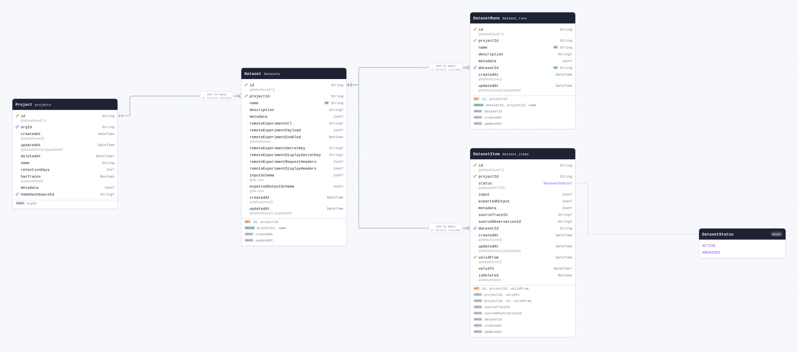

| Field                                                                       | Type              | Constraints                                | Default              | Description |
| --------------------------------------------------------------------------- | ----------------- | ------------------------------------------ | -------------------- | ----------- |
| `id`                                                                        | `String`          | PK NOT NULL                                | `cuid(1)`            |             |
| `projectId` (`project_id`)                                                  | `String`          | PK NOT NULL → [Project.id](#model-Project) |                      |             |
| `name`                                                                      | `String`          | NOT NULL                                   |                      |             |
| `description`                                                               | `String`          | NULL                                       |                      |             |
| `metadata`                                                                  | `Json`            | NULL                                       |                      |             |
| `remoteExperimentUrl` (`remote_experiment_url`)                             | `String`          | NULL                                       |                      |             |
| `remoteExperimentPayload` (`remote_experiment_payload`)                     | `Json`            | NULL                                       |                      |             |
| `remoteExperimentEnabled` (`remote_experiment_enabled`)                     | `Boolean`         | NOT NULL                                   | `true`               |             |
| `remoteExperimentSecretKey` (`remote_experiment_secret_key`)                | `String`          | NULL                                       |                      |             |
| `remoteExperimentDisplaySecretKey` (`remote_experiment_display_secret_key`) | `String`          | NULL                                       |                      |             |
| `remoteExperimentRequestHeaders` (`remote_experiment_request_headers`)      | `Json`            | NULL                                       |                      |             |
| `remoteExperimentDisplayHeaders` (`remote_experiment_display_headers`)      | `Json`            | NULL                                       |                      |             |
| `inputSchema` (`input_schema`)                                              | `Json` `@db.Json` | NULL                                       |                      |             |
| `expectedOutputSchema` (`expected_output_schema`)                           | `Json` `@db.Json` | NULL                                       |                      |             |
| `createdAt` (`created_at`)                                                  | `DateTime`        | NOT NULL                                   | `now()`              |             |
| `updatedAt` (`updated_at`)                                                  | `DateTime`        | NOT NULL                                   | `now()` `@updatedAt` |             |

#### Indexes

- `@@id([id, projectId])`
- `@@index([createdAt])`
- `@@index([updatedAt])`
- `@@unique([projectId, name])`

#### References

- `projectId` → [Project.id](#model-Project) (many-to-one, on delete Cascade)

#### Referenced by

- `id` ← [DatasetItem.datasetId](#model-DatasetItem) (one-to-many, on delete Cascade)
- `id` ← [DatasetRuns.datasetId](#model-DatasetRuns) (one-to-many, on delete Cascade)

#### Definition

```sql
CREATE TABLE "datasets" (
    "id" TEXT NOT NULL,
    "project_id" TEXT NOT NULL,
    "name" TEXT NOT NULL,
    "description" TEXT,
    "metadata" JSONB,
    "remote_experiment_url" TEXT,
    "remote_experiment_payload" JSONB,
    "remote_experiment_enabled" BOOLEAN NOT NULL DEFAULT true,
    "remote_experiment_secret_key" TEXT,
    "remote_experiment_display_secret_key" TEXT,
    "remote_experiment_request_headers" JSONB,
    "remote_experiment_display_headers" JSONB,
    "input_schema" JSON,
    "expected_output_schema" JSON,
    "created_at" TIMESTAMP(3) NOT NULL DEFAULT CURRENT_TIMESTAMP,
    "updated_at" TIMESTAMP(3) NOT NULL DEFAULT CURRENT_TIMESTAMP,

    CONSTRAINT "datasets_pkey" PRIMARY KEY ("id","project_id")
);

CREATE INDEX "datasets_created_at_idx" ON "datasets"("created_at");

CREATE INDEX "datasets_updated_at_idx" ON "datasets"("updated_at");

CREATE UNIQUE INDEX "datasets_project_id_name_key" ON "datasets"("project_id", "name");

ALTER TABLE "datasets" ADD CONSTRAINT "datasets_project_id_fkey" FOREIGN KEY ("project_id") REFERENCES "projects"("id") ON DELETE CASCADE ON UPDATE CASCADE;
```

<details>
<summary>Queries and their SQL</summary>

**findMany**: Every row

```ts
await prisma.dataset.findMany();
```

```sql
SELECT
  "public"."datasets"."id",
  "public"."datasets"."project_id",
  "public"."datasets"."name",
  "public"."datasets"."description",
  "public"."datasets"."metadata",
  "public"."datasets"."remote_experiment_url",
  "public"."datasets"."remote_experiment_payload",
  "public"."datasets"."remote_experiment_enabled",
  "public"."datasets"."remote_experiment_secret_key",
  "public"."datasets"."remote_experiment_display_secret_key",
  "public"."datasets"."remote_experiment_request_headers",
  "public"."datasets"."remote_experiment_display_headers",
  "public"."datasets"."input_schema",
  "public"."datasets"."expected_output_schema",
  "public"."datasets"."created_at",
  "public"."datasets"."updated_at"
FROM
  "public"."datasets"
WHERE
  1 = 1
OFFSET
  $1
-- params: ["0"]
```

**count**: How many rows there are

```ts
await prisma.dataset.count();
```

```sql
SELECT
  COUNT(*) AS "_count$_all"
FROM
  (
    SELECT
      "public"."datasets"."id",
      "public"."datasets"."project_id"
    FROM
      "public"."datasets"
    WHERE
      1 = 1
    OFFSET
      $1
  ) AS "sub"
-- params: ["0"]
```

**findMany**: Every row with its relations

```ts
await prisma.dataset.findMany({
  include: { project: true, datasetItems: true, datasetRuns: true },
});
```

```sql
SELECT
  "public"."datasets"."id",
  "public"."datasets"."project_id",
  "public"."datasets"."name",
  "public"."datasets"."description",
  "public"."datasets"."metadata",
  "public"."datasets"."remote_experiment_url",
  "public"."datasets"."remote_experiment_payload",
  "public"."datasets"."remote_experiment_enabled",
  "public"."datasets"."remote_experiment_secret_key",
  "public"."datasets"."remote_experiment_display_secret_key",
  "public"."datasets"."remote_experiment_request_headers",
  "public"."datasets"."remote_experiment_display_headers",
  "public"."datasets"."input_schema",
  "public"."datasets"."expected_output_schema",
  "public"."datasets"."created_at",
  "public"."datasets"."updated_at"
FROM
  "public"."datasets"
WHERE
  1 = 1
OFFSET
  $1
-- params: ["0"]

SELECT
  "public"."projects"."id",
  "public"."projects"."org_id",
  "public"."projects"."created_at",
  "public"."projects"."updated_at",
  "public"."projects"."deleted_at",
  "public"."projects"."name",
  "public"."projects"."retention_days",
  "public"."projects"."has_traces",
  "public"."projects"."metadata",
  "public"."projects"."home_dashboard_id"
FROM
  "public"."projects"
WHERE
  "public"."projects"."id" IN ($1)
OFFSET
  $2
-- params: ["<projectId of the rows above>","0"]

SELECT
  "public"."dataset_items"."id",
  "public"."dataset_items"."project_id",
  "public"."dataset_items"."valid_from",
  "public"."dataset_items"."status"::text,
  "public"."dataset_items"."input",
  "public"."dataset_items"."expected_output",
  "public"."dataset_items"."metadata",
  "public"."dataset_items"."source_trace_id",
  "public"."dataset_items"."source_observation_id",
  "public"."dataset_items"."dataset_id",
  "public"."dataset_items"."created_at",
  "public"."dataset_items"."updated_at",
  "public"."dataset_items"."valid_to",
  "public"."dataset_items"."is_deleted"
FROM
  "public"."dataset_items"
WHERE
  (
    "public"."dataset_items"."project_id" IN ($1)
    AND "public"."dataset_items"."dataset_id" IN ($2)
  )
OFFSET
  $3
-- params: ["<projectId of the rows above>","<id of the rows above>","0"]

SELECT
  "public"."dataset_runs"."id",
  "public"."dataset_runs"."project_id",
  "public"."dataset_runs"."name",
  "public"."dataset_runs"."description",
  "public"."dataset_runs"."metadata",
  "public"."dataset_runs"."dataset_id",
  "public"."dataset_runs"."created_at",
  "public"."dataset_runs"."updated_at"
FROM
  "public"."dataset_runs"
WHERE
  (
    "public"."dataset_runs"."project_id" IN ($1)
    AND "public"."dataset_runs"."dataset_id" IN ($2)
  )
OFFSET
  $3
-- params: ["<projectId of the rows above>","<id of the rows above>","0"]
```

**findUnique**: One row by what is unique to it

```ts
await prisma.dataset.findUnique({
  where: { id_projectId: { id: "example", projectId: "example" } },
});
```

```sql
SELECT
  "public"."datasets"."id",
  "public"."datasets"."project_id",
  "public"."datasets"."name",
  "public"."datasets"."description",
  "public"."datasets"."metadata",
  "public"."datasets"."remote_experiment_url",
  "public"."datasets"."remote_experiment_payload",
  "public"."datasets"."remote_experiment_enabled",
  "public"."datasets"."remote_experiment_secret_key",
  "public"."datasets"."remote_experiment_display_secret_key",
  "public"."datasets"."remote_experiment_request_headers",
  "public"."datasets"."remote_experiment_display_headers",
  "public"."datasets"."input_schema",
  "public"."datasets"."expected_output_schema",
  "public"."datasets"."created_at",
  "public"."datasets"."updated_at"
FROM
  "public"."datasets"
WHERE
  (
    (
      "public"."datasets"."id" = $1
      AND "public"."datasets"."project_id" = $2
    )
    AND 1 = 1
  )
LIMIT
  $3
OFFSET
  $4
-- params: ["example","example","1","0"]
```

**create**: Create a row

```ts
await prisma.dataset.create({ data: { projectId: "example", name: "example" } });
```

```sql
INSERT INTO
  "public"."datasets" (
    "id",
    "project_id",
    "name",
    "remote_experiment_enabled",
    "created_at",
    "updated_at"
  )
VALUES
  ($1, $2, $3, $4, $5, $6)
RETURNING
  "public"."datasets"."id",
  "public"."datasets"."project_id",
  "public"."datasets"."name",
  "public"."datasets"."description",
  "public"."datasets"."metadata",
  "public"."datasets"."remote_experiment_url",
  "public"."datasets"."remote_experiment_payload",
  "public"."datasets"."remote_experiment_enabled",
  "public"."datasets"."remote_experiment_secret_key",
  "public"."datasets"."remote_experiment_display_secret_key",
  "public"."datasets"."remote_experiment_request_headers",
  "public"."datasets"."remote_experiment_display_headers",
  "public"."datasets"."input_schema",
  "public"."datasets"."expected_output_schema",
  "public"."datasets"."created_at",
  "public"."datasets"."updated_at"
-- params: ["<cuid(1)>","example","example",true,"<now()>","<now()>"]
```

**update**: Update a row

```ts
await prisma.dataset.update({
  where: { id_projectId: { id: "example", projectId: "example" } },
  data: { name: "example" },
});
```

```sql
UPDATE "public"."datasets"
SET
  "name" = $1,
  "updated_at" = $2
WHERE
  (
    (
      "public"."datasets"."id" = $3
      AND "public"."datasets"."project_id" = $4
    )
    AND 1 = 1
  )
RETURNING
  "public"."datasets"."id",
  "public"."datasets"."project_id",
  "public"."datasets"."name",
  "public"."datasets"."description",
  "public"."datasets"."metadata",
  "public"."datasets"."remote_experiment_url",
  "public"."datasets"."remote_experiment_payload",
  "public"."datasets"."remote_experiment_enabled",
  "public"."datasets"."remote_experiment_secret_key",
  "public"."datasets"."remote_experiment_display_secret_key",
  "public"."datasets"."remote_experiment_request_headers",
  "public"."datasets"."remote_experiment_display_headers",
  "public"."datasets"."input_schema",
  "public"."datasets"."expected_output_schema",
  "public"."datasets"."created_at",
  "public"."datasets"."updated_at"
-- params: ["example",{"prisma__type":"generatorCall","prisma__value":{"name":"now","args":[],"returnType":{"type":"DateTime"}}},"example","example"]
```

**delete**: Delete a row

```ts
await prisma.dataset.delete({ where: { id_projectId: { id: "example", projectId: "example" } } });
```

```sql
DELETE FROM "public"."datasets"
WHERE
  (
    (
      "public"."datasets"."id" = $1
      AND "public"."datasets"."project_id" = $2
    )
    AND 1 = 1
  )
RETURNING
  "public"."datasets"."id",
  "public"."datasets"."project_id",
  "public"."datasets"."name",
  "public"."datasets"."description",
  "public"."datasets"."metadata",
  "public"."datasets"."remote_experiment_url",
  "public"."datasets"."remote_experiment_payload",
  "public"."datasets"."remote_experiment_enabled",
  "public"."datasets"."remote_experiment_secret_key",
  "public"."datasets"."remote_experiment_display_secret_key",
  "public"."datasets"."remote_experiment_request_headers",
  "public"."datasets"."remote_experiment_display_headers",
  "public"."datasets"."input_schema",
  "public"."datasets"."expected_output_schema",
  "public"."datasets"."created_at",
  "public"."datasets"."updated_at"
-- params: ["example","example"]
```

</details>

<a id="model-DatasetItem"></a>

### DatasetItem

Table `dataset_items`.

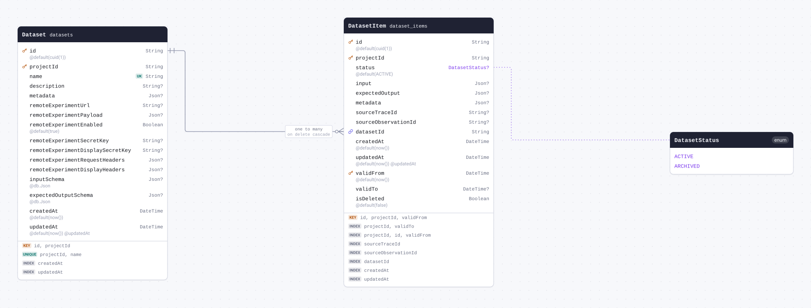

| Field                                           | Type                                   | Constraints                                       | Default              | Description |
| ----------------------------------------------- | -------------------------------------- | ------------------------------------------------- | -------------------- | ----------- |
| `id`                                            | `String`                               | PK NOT NULL                                       | `cuid(1)`            |             |
| `projectId` (`project_id`)                      | `String`                               | PK NOT NULL → [Dataset.projectId](#model-Dataset) |                      |             |
| `status`                                        | [`DatasetStatus`](#enum-DatasetStatus) | NULL                                              | `ACTIVE`             |             |
| `input`                                         | `Json`                                 | NULL                                              |                      |             |
| `expectedOutput` (`expected_output`)            | `Json`                                 | NULL                                              |                      |             |
| `metadata`                                      | `Json`                                 | NULL                                              |                      |             |
| `sourceTraceId` (`source_trace_id`)             | `String`                               | NULL                                              |                      |             |
| `sourceObservationId` (`source_observation_id`) | `String`                               | NULL                                              |                      |             |
| `datasetId` (`dataset_id`)                      | `String`                               | NOT NULL → [Dataset.id](#model-Dataset)           |                      |             |
| `createdAt` (`created_at`)                      | `DateTime`                             | NOT NULL                                          | `now()`              |             |
| `updatedAt` (`updated_at`)                      | `DateTime`                             | NOT NULL                                          | `now()` `@updatedAt` |             |
| `validFrom` (`valid_from`)                      | `DateTime`                             | PK NOT NULL                                       | `now()`              |             |
| `validTo` (`valid_to`)                          | `DateTime`                             | NULL                                              |                      |             |
| `isDeleted` (`is_deleted`)                      | `Boolean`                              | NOT NULL                                          | `false`              |             |

#### Indexes

- `@@id([id, projectId, validFrom])`
- `@@index([projectId, validTo])`
- `@@index([projectId, id, validFrom])`
- `@@index([sourceTraceId])`
- `@@index([sourceObservationId])`
- `@@index([datasetId])`
- `@@index([createdAt])`
- `@@index([updatedAt])`

#### References

- `datasetId` → [Dataset.id](#model-Dataset) (many-to-one, on delete Cascade)

#### Definition

```sql
CREATE TABLE "dataset_items" (
    "id" TEXT NOT NULL,
    "project_id" TEXT NOT NULL,
    "status" "DatasetStatus" DEFAULT 'ACTIVE',
    "input" JSONB,
    "expected_output" JSONB,
    "metadata" JSONB,
    "source_trace_id" TEXT,
    "source_observation_id" TEXT,
    "dataset_id" TEXT NOT NULL,
    "created_at" TIMESTAMP(3) NOT NULL DEFAULT CURRENT_TIMESTAMP,
    "updated_at" TIMESTAMP(3) NOT NULL DEFAULT CURRENT_TIMESTAMP,
    "valid_from" TIMESTAMP(3) NOT NULL DEFAULT CURRENT_TIMESTAMP,
    "valid_to" TIMESTAMP(3),
    "is_deleted" BOOLEAN NOT NULL DEFAULT false,

    CONSTRAINT "dataset_items_pkey" PRIMARY KEY ("id","project_id","valid_from")
);

CREATE INDEX "dataset_items_project_id_valid_to_idx" ON "dataset_items"("project_id", "valid_to");

CREATE INDEX "dataset_items_project_id_id_valid_from_idx" ON "dataset_items"("project_id", "id", "valid_from");

CREATE INDEX "dataset_items_source_trace_id_idx" ON "dataset_items" USING HASH ("source_trace_id");

CREATE INDEX "dataset_items_source_observation_id_idx" ON "dataset_items" USING HASH ("source_observation_id");

CREATE INDEX "dataset_items_dataset_id_idx" ON "dataset_items" USING HASH ("dataset_id");

CREATE INDEX "dataset_items_created_at_idx" ON "dataset_items"("created_at");

CREATE INDEX "dataset_items_updated_at_idx" ON "dataset_items"("updated_at");

ALTER TABLE "dataset_items" ADD CONSTRAINT "dataset_items_dataset_id_project_id_fkey" FOREIGN KEY ("dataset_id", "project_id") REFERENCES "datasets"("id", "project_id") ON DELETE CASCADE ON UPDATE CASCADE;
```

<details>
<summary>Queries and their SQL</summary>

**findMany**: Every row

```ts
await prisma.datasetItem.findMany();
```

```sql
SELECT
  "public"."dataset_items"."id",
  "public"."dataset_items"."project_id",
  "public"."dataset_items"."valid_from",
  "public"."dataset_items"."status"::text,
  "public"."dataset_items"."input",
  "public"."dataset_items"."expected_output",
  "public"."dataset_items"."metadata",
  "public"."dataset_items"."source_trace_id",
  "public"."dataset_items"."source_observation_id",
  "public"."dataset_items"."dataset_id",
  "public"."dataset_items"."created_at",
  "public"."dataset_items"."updated_at",
  "public"."dataset_items"."valid_to",
  "public"."dataset_items"."is_deleted"
FROM
  "public"."dataset_items"
WHERE
  1 = 1
OFFSET
  $1
-- params: ["0"]
```

**count**: How many rows there are

```ts
await prisma.datasetItem.count();
```

```sql
SELECT
  COUNT(*) AS "_count$_all"
FROM
  (
    SELECT
      "public"."dataset_items"."id",
      "public"."dataset_items"."project_id",
      "public"."dataset_items"."valid_from"
    FROM
      "public"."dataset_items"
    WHERE
      1 = 1
    OFFSET
      $1
  ) AS "sub"
-- params: ["0"]
```

**findMany**: Every row with its relations

```ts
await prisma.datasetItem.findMany({ include: { dataset: true } });
```

```sql
SELECT
  "public"."dataset_items"."id",
  "public"."dataset_items"."project_id",
  "public"."dataset_items"."valid_from",
  "public"."dataset_items"."status"::text,
  "public"."dataset_items"."input",
  "public"."dataset_items"."expected_output",
  "public"."dataset_items"."metadata",
  "public"."dataset_items"."source_trace_id",
  "public"."dataset_items"."source_observation_id",
  "public"."dataset_items"."dataset_id",
  "public"."dataset_items"."created_at",
  "public"."dataset_items"."updated_at",
  "public"."dataset_items"."valid_to",
  "public"."dataset_items"."is_deleted"
FROM
  "public"."dataset_items"
WHERE
  1 = 1
OFFSET
  $1
-- params: ["0"]

SELECT
  "public"."datasets"."id",
  "public"."datasets"."project_id",
  "public"."datasets"."name",
  "public"."datasets"."description",
  "public"."datasets"."metadata",
  "public"."datasets"."remote_experiment_url",
  "public"."datasets"."remote_experiment_payload",
  "public"."datasets"."remote_experiment_enabled",
  "public"."datasets"."remote_experiment_secret_key",
  "public"."datasets"."remote_experiment_display_secret_key",
  "public"."datasets"."remote_experiment_request_headers",
  "public"."datasets"."remote_experiment_display_headers",
  "public"."datasets"."input_schema",
  "public"."datasets"."expected_output_schema",
  "public"."datasets"."created_at",
  "public"."datasets"."updated_at"
FROM
  "public"."datasets"
WHERE
  (
    "public"."datasets"."id" IN ($1)
    AND "public"."datasets"."project_id" IN ($2)
  )
OFFSET
  $3
-- params: ["<datasetId of the rows above>","<projectId of the rows above>","0"]
```

**findUnique**: One row by what is unique to it

```ts
await prisma.datasetItem.findUnique({
  where: {
    id_projectId_validFrom: {
      id: "example",
      projectId: "example",
      validFrom: new Date("2026-01-01T00:00:00.000Z"),
    },
  },
});
```

```sql
SELECT
  "public"."dataset_items"."id",
  "public"."dataset_items"."project_id",
  "public"."dataset_items"."valid_from",
  "public"."dataset_items"."status"::text,
  "public"."dataset_items"."input",
  "public"."dataset_items"."expected_output",
  "public"."dataset_items"."metadata",
  "public"."dataset_items"."source_trace_id",
  "public"."dataset_items"."source_observation_id",
  "public"."dataset_items"."dataset_id",
  "public"."dataset_items"."created_at",
  "public"."dataset_items"."updated_at",
  "public"."dataset_items"."valid_to",
  "public"."dataset_items"."is_deleted"
FROM
  "public"."dataset_items"
WHERE
  (
    (
      "public"."dataset_items"."id" = $1
      AND "public"."dataset_items"."project_id" = $2
      AND "public"."dataset_items"."valid_from" = $3
    )
    AND 1 = 1
  )
LIMIT
  $4
OFFSET
  $5
-- params: ["example","example","2026-01-01T00:00:00.000Z","1","0"]
```

**create**: Create a row

```ts
await prisma.datasetItem.create({ data: { projectId: "example", datasetId: "example" } });
```

```sql
INSERT INTO
  "public"."dataset_items" (
    "id",
    "project_id",
    "status",
    "dataset_id",
    "created_at",
    "updated_at",
    "valid_from",
    "is_deleted"
  )
VALUES
  (
    $1,
    $2,
    CAST($3::text AS "public"."DatasetStatus"),
    $4,
    $5,
    $6,
    $7,
    $8
  )
RETURNING
  "public"."dataset_items"."id",
  "public"."dataset_items"."project_id",
  "public"."dataset_items"."valid_from",
  "public"."dataset_items"."status"::text,
  "public"."dataset_items"."input",
  "public"."dataset_items"."expected_output",
  "public"."dataset_items"."metadata",
  "public"."dataset_items"."source_trace_id",
  "public"."dataset_items"."source_observation_id",
  "public"."dataset_items"."dataset_id",
  "public"."dataset_items"."created_at",
  "public"."dataset_items"."updated_at",
  "public"."dataset_items"."valid_to",
  "public"."dataset_items"."is_deleted"
-- params: ["<cuid(1)>","example","ACTIVE","example","<now()>","<now()>","<now()>",false]
```

**update**: Update a row

```ts
await prisma.datasetItem.update({
  where: {
    id_projectId_validFrom: {
      id: "example",
      projectId: "example",
      validFrom: new Date("2026-01-01T00:00:00.000Z"),
    },
  },
  data: { status: "ACTIVE" },
});
```

```sql
UPDATE "public"."dataset_items"
SET
  "status" = CAST($1::text AS "public"."DatasetStatus"),
  "updated_at" = $2
WHERE
  (
    (
      "public"."dataset_items"."id" = $3
      AND "public"."dataset_items"."project_id" = $4
      AND "public"."dataset_items"."valid_from" = $5
    )
    AND 1 = 1
  )
RETURNING
  "public"."dataset_items"."id",
  "public"."dataset_items"."project_id",
  "public"."dataset_items"."valid_from",
  "public"."dataset_items"."status"::text,
  "public"."dataset_items"."input",
  "public"."dataset_items"."expected_output",
  "public"."dataset_items"."metadata",
  "public"."dataset_items"."source_trace_id",
  "public"."dataset_items"."source_observation_id",
  "public"."dataset_items"."dataset_id",
  "public"."dataset_items"."created_at",
  "public"."dataset_items"."updated_at",
  "public"."dataset_items"."valid_to",
  "public"."dataset_items"."is_deleted"
-- params: ["ACTIVE",{"prisma__type":"generatorCall","prisma__value":{"name":"now","args":[],"returnType":{"type":"DateTime"}}},"example","example","2026-01-01T00:00:00.000Z"]
```

**delete**: Delete a row

```ts
await prisma.datasetItem.delete({
  where: {
    id_projectId_validFrom: {
      id: "example",
      projectId: "example",
      validFrom: new Date("2026-01-01T00:00:00.000Z"),
    },
  },
});
```

```sql
DELETE FROM "public"."dataset_items"
WHERE
  (
    (
      "public"."dataset_items"."id" = $1
      AND "public"."dataset_items"."project_id" = $2
      AND "public"."dataset_items"."valid_from" = $3
    )
    AND 1 = 1
  )
RETURNING
  "public"."dataset_items"."id",
  "public"."dataset_items"."project_id",
  "public"."dataset_items"."valid_from",
  "public"."dataset_items"."status"::text,
  "public"."dataset_items"."input",
  "public"."dataset_items"."expected_output",
  "public"."dataset_items"."metadata",
  "public"."dataset_items"."source_trace_id",
  "public"."dataset_items"."source_observation_id",
  "public"."dataset_items"."dataset_id",
  "public"."dataset_items"."created_at",
  "public"."dataset_items"."updated_at",
  "public"."dataset_items"."valid_to",
  "public"."dataset_items"."is_deleted"
-- params: ["example","example","2026-01-01T00:00:00.000Z"]
```

</details>

<a id="model-DatasetRuns"></a>

### DatasetRuns

Table `dataset_runs`.

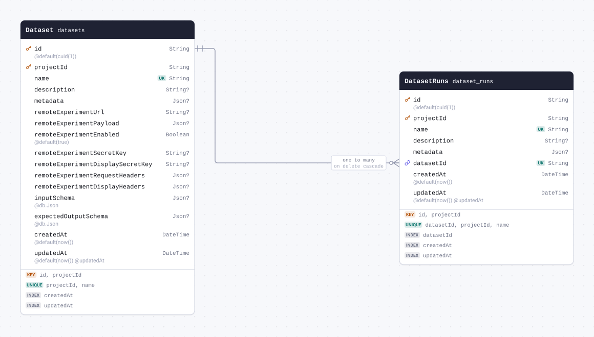

| Field                      | Type       | Constraints                                       | Default              | Description |
| -------------------------- | ---------- | ------------------------------------------------- | -------------------- | ----------- |
| `id`                       | `String`   | PK NOT NULL                                       | `cuid(1)`            |             |
| `projectId` (`project_id`) | `String`   | PK NOT NULL → [Dataset.projectId](#model-Dataset) |                      |             |
| `name`                     | `String`   | NOT NULL                                          |                      |             |
| `description`              | `String`   | NULL                                              |                      |             |
| `metadata`                 | `Json`     | NULL                                              |                      |             |
| `datasetId` (`dataset_id`) | `String`   | NOT NULL → [Dataset.id](#model-Dataset)           |                      |             |
| `createdAt` (`created_at`) | `DateTime` | NOT NULL                                          | `now()`              |             |
| `updatedAt` (`updated_at`) | `DateTime` | NOT NULL                                          | `now()` `@updatedAt` |             |

#### Indexes

- `@@id([id, projectId])`
- `@@index([datasetId])`
- `@@index([createdAt])`
- `@@index([updatedAt])`
- `@@unique([datasetId, projectId, name])`

#### References

- `datasetId` → [Dataset.id](#model-Dataset) (many-to-one, on delete Cascade)

#### Definition

```sql
CREATE TABLE "dataset_runs" (
    "id" TEXT NOT NULL,
    "project_id" TEXT NOT NULL,
    "name" TEXT NOT NULL,
    "description" TEXT,
    "metadata" JSONB,
    "dataset_id" TEXT NOT NULL,
    "created_at" TIMESTAMP(3) NOT NULL DEFAULT CURRENT_TIMESTAMP,
    "updated_at" TIMESTAMP(3) NOT NULL DEFAULT CURRENT_TIMESTAMP,

    CONSTRAINT "dataset_runs_pkey" PRIMARY KEY ("id","project_id")
);

CREATE INDEX "dataset_runs_dataset_id_idx" ON "dataset_runs" USING HASH ("dataset_id");

CREATE INDEX "dataset_runs_created_at_idx" ON "dataset_runs"("created_at");

CREATE INDEX "dataset_runs_updated_at_idx" ON "dataset_runs"("updated_at");

CREATE UNIQUE INDEX "dataset_runs_dataset_id_project_id_name_key" ON "dataset_runs"("dataset_id", "project_id", "name");

ALTER TABLE "dataset_runs" ADD CONSTRAINT "dataset_runs_dataset_id_project_id_fkey" FOREIGN KEY ("dataset_id", "project_id") REFERENCES "datasets"("id", "project_id") ON DELETE CASCADE ON UPDATE CASCADE;
```

<details>
<summary>Queries and their SQL</summary>

**findMany**: Every row

```ts
await prisma.datasetRuns.findMany();
```

```sql
SELECT
  "public"."dataset_runs"."id",
  "public"."dataset_runs"."project_id",
  "public"."dataset_runs"."name",
  "public"."dataset_runs"."description",
  "public"."dataset_runs"."metadata",
  "public"."dataset_runs"."dataset_id",
  "public"."dataset_runs"."created_at",
  "public"."dataset_runs"."updated_at"
FROM
  "public"."dataset_runs"
WHERE
  1 = 1
OFFSET
  $1
-- params: ["0"]
```

**count**: How many rows there are

```ts
await prisma.datasetRuns.count();
```

```sql
SELECT
  COUNT(*) AS "_count$_all"
FROM
  (
    SELECT
      "public"."dataset_runs"."id",
      "public"."dataset_runs"."project_id"
    FROM
      "public"."dataset_runs"
    WHERE
      1 = 1
    OFFSET
      $1
  ) AS "sub"
-- params: ["0"]
```

**findMany**: Every row with its relations

```ts
await prisma.datasetRuns.findMany({ include: { dataset: true } });
```

```sql
SELECT
  "public"."dataset_runs"."id",
  "public"."dataset_runs"."project_id",
  "public"."dataset_runs"."name",
  "public"."dataset_runs"."description",
  "public"."dataset_runs"."metadata",
  "public"."dataset_runs"."dataset_id",
  "public"."dataset_runs"."created_at",
  "public"."dataset_runs"."updated_at"
FROM
  "public"."dataset_runs"
WHERE
  1 = 1
OFFSET
  $1
-- params: ["0"]

SELECT
  "public"."datasets"."id",
  "public"."datasets"."project_id",
  "public"."datasets"."name",
  "public"."datasets"."description",
  "public"."datasets"."metadata",
  "public"."datasets"."remote_experiment_url",
  "public"."datasets"."remote_experiment_payload",
  "public"."datasets"."remote_experiment_enabled",
  "public"."datasets"."remote_experiment_secret_key",
  "public"."datasets"."remote_experiment_display_secret_key",
  "public"."datasets"."remote_experiment_request_headers",
  "public"."datasets"."remote_experiment_display_headers",
  "public"."datasets"."input_schema",
  "public"."datasets"."expected_output_schema",
  "public"."datasets"."created_at",
  "public"."datasets"."updated_at"
FROM
  "public"."datasets"
WHERE
  (
    "public"."datasets"."id" IN ($1)
    AND "public"."datasets"."project_id" IN ($2)
  )
OFFSET
  $3
-- params: ["<datasetId of the rows above>","<projectId of the rows above>","0"]
```

**findUnique**: One row by what is unique to it

```ts
await prisma.datasetRuns.findUnique({
  where: { id_projectId: { id: "example", projectId: "example" } },
});
```

```sql
SELECT
  "public"."dataset_runs"."id",
  "public"."dataset_runs"."project_id",
  "public"."dataset_runs"."name",
  "public"."dataset_runs"."description",
  "public"."dataset_runs"."metadata",
  "public"."dataset_runs"."dataset_id",
  "public"."dataset_runs"."created_at",
  "public"."dataset_runs"."updated_at"
FROM
  "public"."dataset_runs"
WHERE
  (
    (
      "public"."dataset_runs"."id" = $1
      AND "public"."dataset_runs"."project_id" = $2
    )
    AND 1 = 1
  )
LIMIT
  $3
OFFSET
  $4
-- params: ["example","example","1","0"]
```

**create**: Create a row

```ts
await prisma.datasetRuns.create({
  data: { projectId: "example", name: "example", datasetId: "example" },
});
```

```sql
INSERT INTO
  "public"."dataset_runs" (
    "id",
    "project_id",
    "name",
    "dataset_id",
    "created_at",
    "updated_at"
  )
VALUES
  ($1, $2, $3, $4, $5, $6)
RETURNING
  "public"."dataset_runs"."id",
  "public"."dataset_runs"."project_id",
  "public"."dataset_runs"."name",
  "public"."dataset_runs"."description",
  "public"."dataset_runs"."metadata",
  "public"."dataset_runs"."dataset_id",
  "public"."dataset_runs"."created_at",
  "public"."dataset_runs"."updated_at"
-- params: ["<cuid(1)>","example","example","example","<now()>","<now()>"]
```

**update**: Update a row

```ts
await prisma.datasetRuns.update({
  where: { id_projectId: { id: "example", projectId: "example" } },
  data: { name: "example" },
});
```

```sql
UPDATE "public"."dataset_runs"
SET
  "name" = $1,
  "updated_at" = $2
WHERE
  (
    (
      "public"."dataset_runs"."id" = $3
      AND "public"."dataset_runs"."project_id" = $4
    )
    AND 1 = 1
  )
RETURNING
  "public"."dataset_runs"."id",
  "public"."dataset_runs"."project_id",
  "public"."dataset_runs"."name",
  "public"."dataset_runs"."description",
  "public"."dataset_runs"."metadata",
  "public"."dataset_runs"."dataset_id",
  "public"."dataset_runs"."created_at",
  "public"."dataset_runs"."updated_at"
-- params: ["example",{"prisma__type":"generatorCall","prisma__value":{"name":"now","args":[],"returnType":{"type":"DateTime"}}},"example","example"]
```

**delete**: Delete a row

```ts
await prisma.datasetRuns.delete({
  where: { id_projectId: { id: "example", projectId: "example" } },
});
```

```sql
DELETE FROM "public"."dataset_runs"
WHERE
  (
    (
      "public"."dataset_runs"."id" = $1
      AND "public"."dataset_runs"."project_id" = $2
    )
    AND 1 = 1
  )
RETURNING
  "public"."dataset_runs"."id",
  "public"."dataset_runs"."project_id",
  "public"."dataset_runs"."name",
  "public"."dataset_runs"."description",
  "public"."dataset_runs"."metadata",
  "public"."dataset_runs"."dataset_id",
  "public"."dataset_runs"."created_at",
  "public"."dataset_runs"."updated_at"
-- params: ["example","example"]
```

</details>

<a id="model-Comment"></a>

### Comment

Table `comments`.

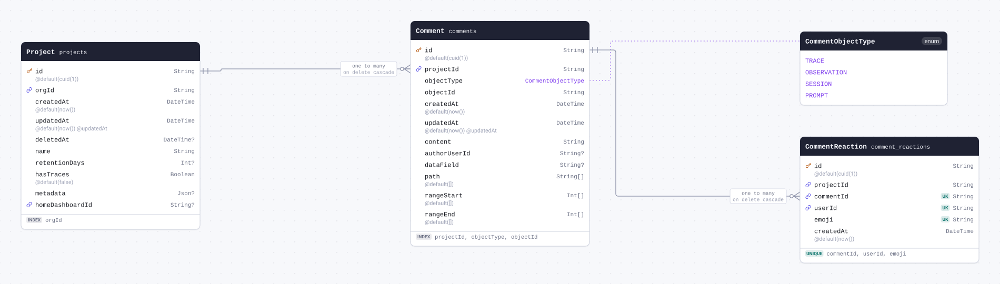

| Field                             | Type                                           | Constraints                             | Default              | Description |
| --------------------------------- | ---------------------------------------------- | --------------------------------------- | -------------------- | ----------- |
| `id`                              | `String`                                       | PK NOT NULL                             | `cuid(1)`            |             |
| `projectId` (`project_id`)        | `String`                                       | NOT NULL → [Project.id](#model-Project) |                      |             |
| `objectType` (`object_type`)      | [`CommentObjectType`](#enum-CommentObjectType) | NOT NULL                                |                      |             |
| `objectId` (`object_id`)          | `String`                                       | NOT NULL                                |                      |             |
| `createdAt` (`created_at`)        | `DateTime`                                     | NOT NULL                                | `now()`              |             |
| `updatedAt` (`updated_at`)        | `DateTime`                                     | NOT NULL                                | `now()` `@updatedAt` |             |
| `content`                         | `String`                                       | NOT NULL                                |                      |             |
| `authorUserId` (`author_user_id`) | `String`                                       | NULL                                    |                      |             |
| `dataField` (`data_field`)        | `String`                                       | NULL                                    |                      |             |
| `path` (`path`)                   | `String[]`                                     | NOT NULL                                | `[]`                 |             |
| `rangeStart` (`range_start`)      | `Int[]`                                        | NOT NULL                                | `[]`                 |             |
| `rangeEnd` (`range_end`)          | `Int[]`                                        | NOT NULL                                | `[]`                 |             |

#### Indexes

- `@@index([projectId, objectType, objectId])`

#### References

- `projectId` → [Project.id](#model-Project) (many-to-one, on delete Cascade)

#### Referenced by

- `id` ← [CommentReaction.commentId](#model-CommentReaction) (one-to-many, on delete Cascade)

#### Definition

```sql
CREATE TABLE "comments" (
    "id" TEXT NOT NULL,
    "project_id" TEXT NOT NULL,
    "object_type" "CommentObjectType" NOT NULL,
    "object_id" TEXT NOT NULL,
    "created_at" TIMESTAMP(3) NOT NULL DEFAULT CURRENT_TIMESTAMP,
    "updated_at" TIMESTAMP(3) NOT NULL DEFAULT CURRENT_TIMESTAMP,
    "content" TEXT NOT NULL,
    "author_user_id" TEXT,
    "data_field" TEXT,
    "path" TEXT[] DEFAULT ARRAY[]::TEXT[],
    "range_start" INTEGER[] DEFAULT ARRAY[]::INTEGER[],
    "range_end" INTEGER[] DEFAULT ARRAY[]::INTEGER[],

    CONSTRAINT "comments_pkey" PRIMARY KEY ("id")
);

CREATE INDEX "comments_project_id_object_type_object_id_idx" ON "comments"("project_id", "object_type", "object_id");

ALTER TABLE "comments" ADD CONSTRAINT "comments_project_id_fkey" FOREIGN KEY ("project_id") REFERENCES "projects"("id") ON DELETE CASCADE ON UPDATE CASCADE;
```

<details>
<summary>Queries and their SQL</summary>

**findMany**: Every row

```ts
await prisma.comment.findMany();
```

```sql
SELECT
  "public"."comments"."id",
  "public"."comments"."project_id",
  "public"."comments"."object_type"::text,
  "public"."comments"."object_id",
  "public"."comments"."created_at",
  "public"."comments"."updated_at",
  "public"."comments"."content",
  "public"."comments"."author_user_id",
  "public"."comments"."data_field",
  "public"."comments"."path",
  "public"."comments"."range_start",
  "public"."comments"."range_end"
FROM
  "public"."comments"
WHERE
  1 = 1
OFFSET
  $1
-- params: ["0"]
```

**count**: How many rows there are

```ts
await prisma.comment.count();
```

```sql
SELECT
  COUNT(*) AS "_count$_all"
FROM
  (
    SELECT
      "public"."comments"."id"
    FROM
      "public"."comments"
    WHERE
      1 = 1
    OFFSET
      $1
  ) AS "sub"
-- params: ["0"]
```

**findMany**: Every row with its relations

```ts
await prisma.comment.findMany({ include: { project: true, reactions: true } });
```

```sql
SELECT
  "public"."comments"."id",
  "public"."comments"."project_id",
  "public"."comments"."object_type"::text,
  "public"."comments"."object_id",
  "public"."comments"."created_at",
  "public"."comments"."updated_at",
  "public"."comments"."content",
  "public"."comments"."author_user_id",
  "public"."comments"."data_field",
  "public"."comments"."path",
  "public"."comments"."range_start",
  "public"."comments"."range_end"
FROM
  "public"."comments"
WHERE
  1 = 1
OFFSET
  $1
-- params: ["0"]

SELECT
  "public"."projects"."id",
  "public"."projects"."org_id",
  "public"."projects"."created_at",
  "public"."projects"."updated_at",
  "public"."projects"."deleted_at",
  "public"."projects"."name",
  "public"."projects"."retention_days",
  "public"."projects"."has_traces",
  "public"."projects"."metadata",
  "public"."projects"."home_dashboard_id"
FROM
  "public"."projects"
WHERE
  "public"."projects"."id" IN ($1)
OFFSET
  $2
-- params: ["<projectId of the rows above>","0"]

SELECT
  "public"."comment_reactions"."id",
  "public"."comment_reactions"."project_id",
  "public"."comment_reactions"."comment_id",
  "public"."comment_reactions"."user_id",
  "public"."comment_reactions"."emoji",
  "public"."comment_reactions"."created_at"
FROM
  "public"."comment_reactions"
WHERE
  "public"."comment_reactions"."comment_id" IN ($1)
OFFSET
  $2
-- params: ["<id of the rows above>","0"]
```

**findUnique**: One row by what is unique to it

```ts
await prisma.comment.findUnique({ where: { id: "example" } });
```

```sql
SELECT
  "public"."comments"."id",
  "public"."comments"."project_id",
  "public"."comments"."object_type"::text,
  "public"."comments"."object_id",
  "public"."comments"."created_at",
  "public"."comments"."updated_at",
  "public"."comments"."content",
  "public"."comments"."author_user_id",
  "public"."comments"."data_field",
  "public"."comments"."path",
  "public"."comments"."range_start",
  "public"."comments"."range_end"
FROM
  "public"."comments"
WHERE
  (
    "public"."comments"."id" = $1
    AND 1 = 1
  )
LIMIT
  $2
OFFSET
  $3
-- params: ["example","1","0"]
```

**create**: Create a row

```ts
await prisma.comment.create({
  data: { projectId: "example", objectType: "TRACE", objectId: "example", content: "example" },
});
```

```sql
INSERT INTO
  "public"."comments" (
    "id",
    "project_id",
    "object_type",
    "object_id",
    "created_at",
    "updated_at",
    "content",
    "path",
    "range_start",
    "range_end"
  )
VALUES
  (
    $1,
    $2,
    CAST($3::text AS "public"."CommentObjectType"),
    $4,
    $5,
    $6,
    $7,
    $8,
    $9,
    $10
  )
RETURNING
  "public"."comments"."id",
  "public"."comments"."project_id",
  "public"."comments"."object_type"::text,
  "public"."comments"."object_id",
  "public"."comments"."created_at",
  "public"."comments"."updated_at",
  "public"."comments"."content",
  "public"."comments"."author_user_id",
  "public"."comments"."data_field",
  "public"."comments"."path",
  "public"."comments"."range_start",
  "public"."comments"."range_end"
-- params: ["<cuid(1)>","example","TRACE","example","<now()>","<now()>","example",[],[],[]]
```

**update**: Update a row

```ts
await prisma.comment.update({ where: { id: "example" }, data: { objectType: "TRACE" } });
```

```sql
UPDATE "public"."comments"
SET
  "object_type" = CAST($1::text AS "public"."CommentObjectType"),
  "updated_at" = $2
WHERE
  (
    "public"."comments"."id" = $3
    AND 1 = 1
  )
RETURNING
  "public"."comments"."id",
  "public"."comments"."project_id",
  "public"."comments"."object_type"::text,
  "public"."comments"."object_id",
  "public"."comments"."created_at",
  "public"."comments"."updated_at",
  "public"."comments"."content",
  "public"."comments"."author_user_id",
  "public"."comments"."data_field",
  "public"."comments"."path",
  "public"."comments"."range_start",
  "public"."comments"."range_end"
-- params: ["TRACE",{"prisma__type":"generatorCall","prisma__value":{"name":"now","args":[],"returnType":{"type":"DateTime"}}},"example"]
```

**delete**: Delete a row

```ts
await prisma.comment.delete({ where: { id: "example" } });
```

```sql
DELETE FROM "public"."comments"
WHERE
  (
    "public"."comments"."id" = $1
    AND 1 = 1
  )
RETURNING
  "public"."comments"."id",
  "public"."comments"."project_id",
  "public"."comments"."object_type"::text,
  "public"."comments"."object_id",
  "public"."comments"."created_at",
  "public"."comments"."updated_at",
  "public"."comments"."content",
  "public"."comments"."author_user_id",
  "public"."comments"."data_field",
  "public"."comments"."path",
  "public"."comments"."range_start",
  "public"."comments"."range_end"
-- params: ["example"]
```

</details>

<a id="model-CommentReaction"></a>

### CommentReaction

Table `comment_reactions`.

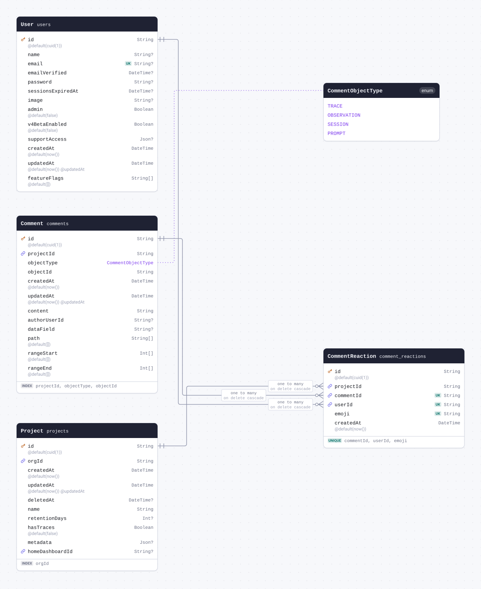

| Field                      | Type       | Constraints                             | Default   | Description |
| -------------------------- | ---------- | --------------------------------------- | --------- | ----------- |
| `id`                       | `String`   | PK NOT NULL                             | `cuid(1)` |             |
| `projectId` (`project_id`) | `String`   | NOT NULL → [Project.id](#model-Project) |           |             |
| `commentId` (`comment_id`) | `String`   | NOT NULL → [Comment.id](#model-Comment) |           |             |
| `userId` (`user_id`)       | `String`   | NOT NULL → [User.id](#model-User)       |           |             |
| `emoji`                    | `String`   | NOT NULL                                |           |             |
| `createdAt` (`created_at`) | `DateTime` | NOT NULL                                | `now()`   |             |

#### Indexes

- `@@unique([commentId, userId, emoji])`

#### References

- `projectId` → [Project.id](#model-Project) (many-to-one, on delete Cascade)
- `commentId` → [Comment.id](#model-Comment) (many-to-one, on delete Cascade)
- `userId` → [User.id](#model-User) (many-to-one, on delete Cascade)

#### Definition

```sql
CREATE TABLE "comment_reactions" (
    "id" TEXT NOT NULL,
    "project_id" TEXT NOT NULL,
    "comment_id" TEXT NOT NULL,
    "user_id" TEXT NOT NULL,
    "emoji" TEXT NOT NULL,
    "created_at" TIMESTAMP(3) NOT NULL DEFAULT CURRENT_TIMESTAMP,

    CONSTRAINT "comment_reactions_pkey" PRIMARY KEY ("id")
);

CREATE UNIQUE INDEX "comment_reactions_comment_id_user_id_emoji_key" ON "comment_reactions"("comment_id", "user_id", "emoji");

ALTER TABLE "comment_reactions" ADD CONSTRAINT "comment_reactions_project_id_fkey" FOREIGN KEY ("project_id") REFERENCES "projects"("id") ON DELETE CASCADE ON UPDATE CASCADE;

ALTER TABLE "comment_reactions" ADD CONSTRAINT "comment_reactions_comment_id_fkey" FOREIGN KEY ("comment_id") REFERENCES "comments"("id") ON DELETE CASCADE ON UPDATE CASCADE;

ALTER TABLE "comment_reactions" ADD CONSTRAINT "comment_reactions_user_id_fkey" FOREIGN KEY ("user_id") REFERENCES "users"("id") ON DELETE CASCADE ON UPDATE CASCADE;
```

<details>
<summary>Queries and their SQL</summary>

**findMany**: Every row

```ts
await prisma.commentReaction.findMany();
```

```sql
SELECT
  "public"."comment_reactions"."id",
  "public"."comment_reactions"."project_id",
  "public"."comment_reactions"."comment_id",
  "public"."comment_reactions"."user_id",
  "public"."comment_reactions"."emoji",
  "public"."comment_reactions"."created_at"
FROM
  "public"."comment_reactions"
WHERE
  1 = 1
OFFSET
  $1
-- params: ["0"]
```

**count**: How many rows there are

```ts
await prisma.commentReaction.count();
```

```sql
SELECT
  COUNT(*) AS "_count$_all"
FROM
  (
    SELECT
      "public"."comment_reactions"."id"
    FROM
      "public"."comment_reactions"
    WHERE
      1 = 1
    OFFSET
      $1
  ) AS "sub"
-- params: ["0"]
```

**findMany**: Every row with its relations

```ts
await prisma.commentReaction.findMany({ include: { project: true, comment: true, user: true } });
```

```sql
SELECT
  "public"."comment_reactions"."id",
  "public"."comment_reactions"."project_id",
  "public"."comment_reactions"."comment_id",
  "public"."comment_reactions"."user_id",
  "public"."comment_reactions"."emoji",
  "public"."comment_reactions"."created_at"
FROM
  "public"."comment_reactions"
WHERE
  1 = 1
OFFSET
  $1
-- params: ["0"]

SELECT
  "public"."projects"."id",
  "public"."projects"."org_id",
  "public"."projects"."created_at",
  "public"."projects"."updated_at",
  "public"."projects"."deleted_at",
  "public"."projects"."name",
  "public"."projects"."retention_days",
  "public"."projects"."has_traces",
  "public"."projects"."metadata",
  "public"."projects"."home_dashboard_id"
FROM
  "public"."projects"
WHERE
  "public"."projects"."id" IN ($1)
OFFSET
  $2
-- params: ["<projectId of the rows above>","0"]

SELECT
  "public"."comments"."id",
  "public"."comments"."project_id",
  "public"."comments"."object_type"::text,
  "public"."comments"."object_id",
  "public"."comments"."created_at",
  "public"."comments"."updated_at",
  "public"."comments"."content",
  "public"."comments"."author_user_id",
  "public"."comments"."data_field",
  "public"."comments"."path",
  "public"."comments"."range_start",
  "public"."comments"."range_end"
FROM
  "public"."comments"
WHERE
  "public"."comments"."id" IN ($1)
OFFSET
  $2
-- params: ["<commentId of the rows above>","0"]

SELECT
  "public"."users"."id",
  "public"."users"."name",
  "public"."users"."email",
  "public"."users"."email_verified",
  "public"."users"."password",
  "public"."users"."sessions_expired_at",
  "public"."users"."image",
  "public"."users"."admin",
  "public"."users"."v4_beta_enabled",
  "public"."users"."support_access",
  "public"."users"."created_at",
  "public"."users"."updated_at",
  "public"."users"."feature_flags"
FROM
  "public"."users"
WHERE
  "public"."users"."id" IN ($1)
OFFSET
  $2
-- params: ["<userId of the rows above>","0"]
```

**findUnique**: One row by what is unique to it

```ts
await prisma.commentReaction.findUnique({ where: { id: "example" } });
```

```sql
SELECT
  "public"."comment_reactions"."id",
  "public"."comment_reactions"."project_id",
  "public"."comment_reactions"."comment_id",
  "public"."comment_reactions"."user_id",
  "public"."comment_reactions"."emoji",
  "public"."comment_reactions"."created_at"
FROM
  "public"."comment_reactions"
WHERE
  (
    "public"."comment_reactions"."id" = $1
    AND 1 = 1
  )
LIMIT
  $2
OFFSET
  $3
-- params: ["example","1","0"]
```

**create**: Create a row

```ts
await prisma.commentReaction.create({
  data: { projectId: "example", commentId: "example", userId: "example", emoji: "example" },
});
```

```sql
INSERT INTO
  "public"."comment_reactions" (
    "id",
    "project_id",
    "comment_id",
    "user_id",
    "emoji",
    "created_at"
  )
VALUES
  ($1, $2, $3, $4, $5, $6)
RETURNING
  "public"."comment_reactions"."id",
  "public"."comment_reactions"."project_id",
  "public"."comment_reactions"."comment_id",
  "public"."comment_reactions"."user_id",
  "public"."comment_reactions"."emoji",
  "public"."comment_reactions"."created_at"
-- params: ["<cuid(1)>","example","example","example","example","<now()>"]
```

**update**: Update a row

```ts
await prisma.commentReaction.update({ where: { id: "example" }, data: { emoji: "example" } });
```

```sql
UPDATE "public"."comment_reactions"
SET
  "emoji" = $1
WHERE
  (
    "public"."comment_reactions"."id" = $2
    AND 1 = 1
  )
RETURNING
  "public"."comment_reactions"."id",
  "public"."comment_reactions"."project_id",
  "public"."comment_reactions"."comment_id",
  "public"."comment_reactions"."user_id",
  "public"."comment_reactions"."emoji",
  "public"."comment_reactions"."created_at"
-- params: ["example","example"]
```

**delete**: Delete a row

```ts
await prisma.commentReaction.delete({ where: { id: "example" } });
```

```sql
DELETE FROM "public"."comment_reactions"
WHERE
  (
    "public"."comment_reactions"."id" = $1
    AND 1 = 1
  )
RETURNING
  "public"."comment_reactions"."id",
  "public"."comment_reactions"."project_id",
  "public"."comment_reactions"."comment_id",
  "public"."comment_reactions"."user_id",
  "public"."comment_reactions"."emoji",
  "public"."comment_reactions"."created_at"
-- params: ["example"]
```

</details>

<a id="model-NotificationPreference"></a>

### NotificationPreference

Table `notification_preferences`.

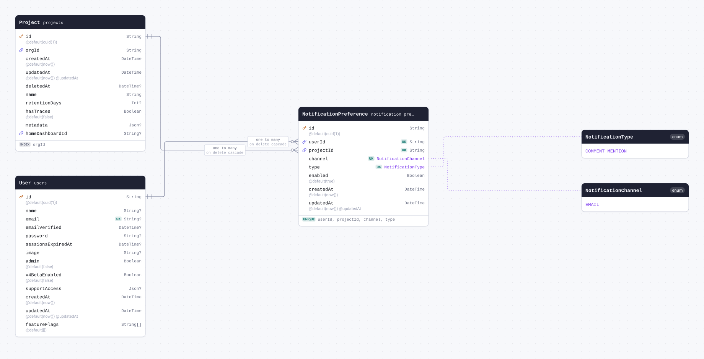

| Field                      | Type                                               | Constraints                             | Default              | Description |
| -------------------------- | -------------------------------------------------- | --------------------------------------- | -------------------- | ----------- |
| `id`                       | `String`                                           | PK NOT NULL                             | `cuid(1)`            |             |
| `userId` (`user_id`)       | `String`                                           | NOT NULL → [User.id](#model-User)       |                      |             |
| `projectId` (`project_id`) | `String`                                           | NOT NULL → [Project.id](#model-Project) |                      |             |
| `channel`                  | [`NotificationChannel`](#enum-NotificationChannel) | NOT NULL                                |                      |             |
| `type`                     | [`NotificationType`](#enum-NotificationType)       | NOT NULL                                |                      |             |
| `enabled`                  | `Boolean`                                          | NOT NULL                                | `true`               |             |
| `createdAt` (`created_at`) | `DateTime`                                         | NOT NULL                                | `now()`              |             |
| `updatedAt` (`updated_at`) | `DateTime`                                         | NOT NULL                                | `now()` `@updatedAt` |             |

#### Indexes

- `@@unique([userId, projectId, channel, type])`

#### References

- `userId` → [User.id](#model-User) (many-to-one, on delete Cascade)
- `projectId` → [Project.id](#model-Project) (many-to-one, on delete Cascade)

#### Definition

```sql
CREATE TABLE "notification_preferences" (
    "id" TEXT NOT NULL,
    "user_id" TEXT NOT NULL,
    "project_id" TEXT NOT NULL,
    "channel" "NotificationChannel" NOT NULL,
    "type" "NotificationType" NOT NULL,
    "enabled" BOOLEAN NOT NULL DEFAULT true,
    "created_at" TIMESTAMP(3) NOT NULL DEFAULT CURRENT_TIMESTAMP,
    "updated_at" TIMESTAMP(3) NOT NULL DEFAULT CURRENT_TIMESTAMP,

    CONSTRAINT "notification_preferences_pkey" PRIMARY KEY ("id")
);

CREATE UNIQUE INDEX "notification_preferences_user_id_project_id_channel_type_key" ON "notification_preferences"("user_id", "project_id", "channel", "type");

ALTER TABLE "notification_preferences" ADD CONSTRAINT "notification_preferences_user_id_fkey" FOREIGN KEY ("user_id") REFERENCES "users"("id") ON DELETE CASCADE ON UPDATE CASCADE;

ALTER TABLE "notification_preferences" ADD CONSTRAINT "notification_preferences_project_id_fkey" FOREIGN KEY ("project_id") REFERENCES "projects"("id") ON DELETE CASCADE ON UPDATE CASCADE;
```

<details>
<summary>Queries and their SQL</summary>

**findMany**: Every row

```ts
await prisma.notificationPreference.findMany();
```

```sql
SELECT
  "public"."notification_preferences"."id",
  "public"."notification_preferences"."user_id",
  "public"."notification_preferences"."project_id",
  "public"."notification_preferences"."channel"::text,
  "public"."notification_preferences"."type"::text,
  "public"."notification_preferences"."enabled",
  "public"."notification_preferences"."created_at",
  "public"."notification_preferences"."updated_at"
FROM
  "public"."notification_preferences"
WHERE
  1 = 1
OFFSET
  $1
-- params: ["0"]
```

**count**: How many rows there are

```ts
await prisma.notificationPreference.count();
```

```sql
SELECT
  COUNT(*) AS "_count$_all"
FROM
  (
    SELECT
      "public"."notification_preferences"."id"
    FROM
      "public"."notification_preferences"
    WHERE
      1 = 1
    OFFSET
      $1
  ) AS "sub"
-- params: ["0"]
```

**findMany**: Every row with its relations

```ts
await prisma.notificationPreference.findMany({ include: { user: true, project: true } });
```

```sql
SELECT
  "public"."notification_preferences"."id",
  "public"."notification_preferences"."user_id",
  "public"."notification_preferences"."project_id",
  "public"."notification_preferences"."channel"::text,
  "public"."notification_preferences"."type"::text,
  "public"."notification_preferences"."enabled",
  "public"."notification_preferences"."created_at",
  "public"."notification_preferences"."updated_at"
FROM
  "public"."notification_preferences"
WHERE
  1 = 1
OFFSET
  $1
-- params: ["0"]

SELECT
  "public"."users"."id",
  "public"."users"."name",
  "public"."users"."email",
  "public"."users"."email_verified",
  "public"."users"."password",
  "public"."users"."sessions_expired_at",
  "public"."users"."image",
  "public"."users"."admin",
  "public"."users"."v4_beta_enabled",
  "public"."users"."support_access",
  "public"."users"."created_at",
  "public"."users"."updated_at",
  "public"."users"."feature_flags"
FROM
  "public"."users"
WHERE
  "public"."users"."id" IN ($1)
OFFSET
  $2
-- params: ["<userId of the rows above>","0"]

SELECT
  "public"."projects"."id",
  "public"."projects"."org_id",
  "public"."projects"."created_at",
  "public"."projects"."updated_at",
  "public"."projects"."deleted_at",
  "public"."projects"."name",
  "public"."projects"."retention_days",
  "public"."projects"."has_traces",
  "public"."projects"."metadata",
  "public"."projects"."home_dashboard_id"
FROM
  "public"."projects"
WHERE
  "public"."projects"."id" IN ($1)
OFFSET
  $2
-- params: ["<projectId of the rows above>","0"]
```

**findUnique**: One row by what is unique to it

```ts
await prisma.notificationPreference.findUnique({ where: { id: "example" } });
```

```sql
SELECT
  "public"."notification_preferences"."id",
  "public"."notification_preferences"."user_id",
  "public"."notification_preferences"."project_id",
  "public"."notification_preferences"."channel"::text,
  "public"."notification_preferences"."type"::text,
  "public"."notification_preferences"."enabled",
  "public"."notification_preferences"."created_at",
  "public"."notification_preferences"."updated_at"
FROM
  "public"."notification_preferences"
WHERE
  (
    "public"."notification_preferences"."id" = $1
    AND 1 = 1
  )
LIMIT
  $2
OFFSET
  $3
-- params: ["example","1","0"]
```

**create**: Create a row

```ts
await prisma.notificationPreference.create({
  data: { userId: "example", projectId: "example", channel: "EMAIL", type: "COMMENT_MENTION" },
});
```

```sql
INSERT INTO
  "public"."notification_preferences" (
    "id",
    "user_id",
    "project_id",
    "channel",
    "type",
    "enabled",
    "created_at",
    "updated_at"
  )
VALUES
  (
    $1,
    $2,
    $3,
    CAST($4::text AS "public"."NotificationChannel"),
    CAST($5::text AS "public"."NotificationType"),
    $6,
    $7,
    $8
  )
RETURNING
  "public"."notification_preferences"."id",
  "public"."notification_preferences"."user_id",
  "public"."notification_preferences"."project_id",
  "public"."notification_preferences"."channel"::text,
  "public"."notification_preferences"."type"::text,
  "public"."notification_preferences"."enabled",
  "public"."notification_preferences"."created_at",
  "public"."notification_preferences"."updated_at"
-- params: ["<cuid(1)>","example","example","EMAIL","COMMENT_MENTION",true,"<now()>","<now()>"]
```

**update**: Update a row

```ts
await prisma.notificationPreference.update({
  where: { id: "example" },
  data: { channel: "EMAIL" },
});
```

```sql
UPDATE "public"."notification_preferences"
SET
  "channel" = CAST($1::text AS "public"."NotificationChannel"),
  "updated_at" = $2
WHERE
  (
    "public"."notification_preferences"."id" = $3
    AND 1 = 1
  )
RETURNING
  "public"."notification_preferences"."id",
  "public"."notification_preferences"."user_id",
  "public"."notification_preferences"."project_id",
  "public"."notification_preferences"."channel"::text,
  "public"."notification_preferences"."type"::text,
  "public"."notification_preferences"."enabled",
  "public"."notification_preferences"."created_at",
  "public"."notification_preferences"."updated_at"
-- params: ["EMAIL",{"prisma__type":"generatorCall","prisma__value":{"name":"now","args":[],"returnType":{"type":"DateTime"}}},"example"]
```

**delete**: Delete a row

```ts
await prisma.notificationPreference.delete({ where: { id: "example" } });
```

```sql
DELETE FROM "public"."notification_preferences"
WHERE
  (
    "public"."notification_preferences"."id" = $1
    AND 1 = 1
  )
RETURNING
  "public"."notification_preferences"."id",
  "public"."notification_preferences"."user_id",
  "public"."notification_preferences"."project_id",
  "public"."notification_preferences"."channel"::text,
  "public"."notification_preferences"."type"::text,
  "public"."notification_preferences"."enabled",
  "public"."notification_preferences"."created_at",
  "public"."notification_preferences"."updated_at"
-- params: ["example"]
```

</details>

<a id="model-Prompt"></a>

### Prompt

Table `prompts`.

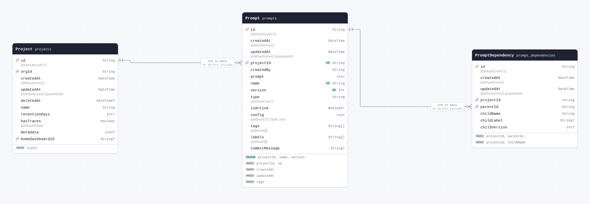

| Field                              | Type              | Constraints                             | Default              | Description |
| ---------------------------------- | ----------------- | --------------------------------------- | -------------------- | ----------- |
| `id`                               | `String`          | PK NOT NULL                             | `cuid(1)`            |             |
| `createdAt` (`created_at`)         | `DateTime`        | NOT NULL                                | `now()`              |             |
| `updatedAt` (`updated_at`)         | `DateTime`        | NOT NULL                                | `now()` `@updatedAt` |             |
| `projectId` (`project_id`)         | `String`          | NOT NULL → [Project.id](#model-Project) |                      |             |
| `createdBy` (`created_by`)         | `String`          | NOT NULL                                |                      |             |
| `prompt`                           | `Json`            | NOT NULL                                |                      |             |
| `name`                             | `String`          | NOT NULL                                |                      |             |
| `version`                          | `Int`             | NOT NULL                                |                      |             |
| `type`                             | `String`          | NOT NULL                                | `"text"`             |             |
| `isActive` (`is_active`)           | `Boolean`         | NULL                                    |                      |             |
| `config`                           | `Json` `@db.Json` | NOT NULL                                | `"{}"`               |             |
| `tags`                             | `String[]`        | NOT NULL                                | `[]`                 |             |
| `labels`                           | `String[]`        | NOT NULL                                | `[]`                 |             |
| `commitMessage` (`commit_message`) | `String`          | NULL                                    |                      |             |

#### Indexes

- `@@index([projectId, id])`
- `@@index([createdAt])`
- `@@index([updatedAt])`
- `@@index([tags])`
- `@@unique([projectId, name, version])`

#### References

- `projectId` → [Project.id](#model-Project) (many-to-one, on delete Cascade)

#### Referenced by

- `id` ← [PromptDependency.parentId](#model-PromptDependency) (one-to-many, on delete Cascade)

#### Definition

```sql
CREATE TABLE "prompts" (
    "id" TEXT NOT NULL,
    "created_at" TIMESTAMP(3) NOT NULL DEFAULT CURRENT_TIMESTAMP,
    "updated_at" TIMESTAMP(3) NOT NULL DEFAULT CURRENT_TIMESTAMP,
    "project_id" TEXT NOT NULL,
    "created_by" TEXT NOT NULL,
    "prompt" JSONB NOT NULL,
    "name" TEXT NOT NULL,
    "version" INTEGER NOT NULL,
    "type" TEXT NOT NULL DEFAULT 'text',
    "is_active" BOOLEAN,
    "config" JSON NOT NULL DEFAULT '{}',
    "tags" TEXT[] DEFAULT ARRAY[]::TEXT[],
    "labels" TEXT[] DEFAULT ARRAY[]::TEXT[],
    "commit_message" TEXT,

    CONSTRAINT "prompts_pkey" PRIMARY KEY ("id")
);

CREATE INDEX "prompts_project_id_id_idx" ON "prompts"("project_id", "id");

CREATE INDEX "prompts_created_at_idx" ON "prompts"("created_at");

CREATE INDEX "prompts_updated_at_idx" ON "prompts"("updated_at");

CREATE INDEX "prompts_tags_idx" ON "prompts" USING GIN ("tags" array_ops);

CREATE UNIQUE INDEX "prompts_project_id_name_version_key" ON "prompts"("project_id", "name", "version");

ALTER TABLE "prompts" ADD CONSTRAINT "prompts_project_id_fkey" FOREIGN KEY ("project_id") REFERENCES "projects"("id") ON DELETE CASCADE ON UPDATE CASCADE;
```

<details>
<summary>Queries and their SQL</summary>

**findMany**: Every row

```ts
await prisma.prompt.findMany();
```

```sql
SELECT
  "public"."prompts"."id",
  "public"."prompts"."created_at",
  "public"."prompts"."updated_at",
  "public"."prompts"."project_id",
  "public"."prompts"."created_by",
  "public"."prompts"."prompt",
  "public"."prompts"."name",
  "public"."prompts"."version",
  "public"."prompts"."type",
  "public"."prompts"."is_active",
  "public"."prompts"."config",
  "public"."prompts"."tags",
  "public"."prompts"."labels",
  "public"."prompts"."commit_message"
FROM
  "public"."prompts"
WHERE
  1 = 1
OFFSET
  $1
-- params: ["0"]
```

**count**: How many rows there are

```ts
await prisma.prompt.count();
```

```sql
SELECT
  COUNT(*) AS "_count$_all"
FROM
  (
    SELECT
      "public"."prompts"."id"
    FROM
      "public"."prompts"
    WHERE
      1 = 1
    OFFSET
      $1
  ) AS "sub"
-- params: ["0"]
```

**findMany**: Every row with its relations

```ts
await prisma.prompt.findMany({ include: { project: true, PromptDependency: true } });
```

```sql
SELECT
  "public"."prompts"."id",
  "public"."prompts"."created_at",
  "public"."prompts"."updated_at",
  "public"."prompts"."project_id",
  "public"."prompts"."created_by",
  "public"."prompts"."prompt",
  "public"."prompts"."name",
  "public"."prompts"."version",
  "public"."prompts"."type",
  "public"."prompts"."is_active",
  "public"."prompts"."config",
  "public"."prompts"."tags",
  "public"."prompts"."labels",
  "public"."prompts"."commit_message"
FROM
  "public"."prompts"
WHERE
  1 = 1
OFFSET
  $1
-- params: ["0"]

SELECT
  "public"."projects"."id",
  "public"."projects"."org_id",
  "public"."projects"."created_at",
  "public"."projects"."updated_at",
  "public"."projects"."deleted_at",
  "public"."projects"."name",
  "public"."projects"."retention_days",
  "public"."projects"."has_traces",
  "public"."projects"."metadata",
  "public"."projects"."home_dashboard_id"
FROM
  "public"."projects"
WHERE
  "public"."projects"."id" IN ($1)
OFFSET
  $2
-- params: ["<projectId of the rows above>","0"]

SELECT
  "public"."prompt_dependencies"."id",
  "public"."prompt_dependencies"."created_at",
  "public"."prompt_dependencies"."updated_at",
  "public"."prompt_dependencies"."project_id",
  "public"."prompt_dependencies"."parent_id",
  "public"."prompt_dependencies"."child_name",
  "public"."prompt_dependencies"."child_label",
  "public"."prompt_dependencies"."child_version"
FROM
  "public"."prompt_dependencies"
WHERE
  "public"."prompt_dependencies"."parent_id" IN ($1)
OFFSET
  $2
-- params: ["<id of the rows above>","0"]
```

**findUnique**: One row by what is unique to it

```ts
await prisma.prompt.findUnique({ where: { id: "example" } });
```

```sql
SELECT
  "public"."prompts"."id",
  "public"."prompts"."created_at",
  "public"."prompts"."updated_at",
  "public"."prompts"."project_id",
  "public"."prompts"."created_by",
  "public"."prompts"."prompt",
  "public"."prompts"."name",
  "public"."prompts"."version",
  "public"."prompts"."type",
  "public"."prompts"."is_active",
  "public"."prompts"."config",
  "public"."prompts"."tags",
  "public"."prompts"."labels",
  "public"."prompts"."commit_message"
FROM
  "public"."prompts"
WHERE
  (
    "public"."prompts"."id" = $1
    AND 1 = 1
  )
LIMIT
  $2
OFFSET
  $3
-- params: ["example","1","0"]
```

**create**: Create a row

```ts
await prisma.prompt.create({
  data: { projectId: "example", createdBy: "example", prompt: {}, name: "example", version: 1 },
});
```

```sql
INSERT INTO
  "public"."prompts" (
    "id",
    "created_at",
    "updated_at",
    "project_id",
    "created_by",
    "prompt",
    "name",
    "version",
    "type",
    "config",
    "tags",
    "labels"
  )
VALUES
  ($1, $2, $3, $4, $5, $6, $7, $8, $9, $10, $11, $12)
RETURNING
  "public"."prompts"."id",
  "public"."prompts"."created_at",
  "public"."prompts"."updated_at",
  "public"."prompts"."project_id",
  "public"."prompts"."created_by",
  "public"."prompts"."prompt",
  "public"."prompts"."name",
  "public"."prompts"."version",
  "public"."prompts"."type",
  "public"."prompts"."is_active",
  "public"."prompts"."config",
  "public"."prompts"."tags",
  "public"."prompts"."labels",
  "public"."prompts"."commit_message"
-- params: ["<cuid(1)>","<now()>","<now()>","example","example","{}","example","1","text","{}",[],[]]
```

**update**: Update a row

```ts
await prisma.prompt.update({
  where: { id: "example" },
  data: { createdAt: new Date("2026-01-01T00:00:00.000Z") },
});
```

```sql
UPDATE "public"."prompts"
SET
  "created_at" = $1,
  "updated_at" = $2
WHERE
  (
    "public"."prompts"."id" = $3
    AND 1 = 1
  )
RETURNING
  "public"."prompts"."id",
  "public"."prompts"."created_at",
  "public"."prompts"."updated_at",
  "public"."prompts"."project_id",
  "public"."prompts"."created_by",
  "public"."prompts"."prompt",
  "public"."prompts"."name",
  "public"."prompts"."version",
  "public"."prompts"."type",
  "public"."prompts"."is_active",
  "public"."prompts"."config",
  "public"."prompts"."tags",
  "public"."prompts"."labels",
  "public"."prompts"."commit_message"
-- params: ["2026-01-01T00:00:00.000Z",{"prisma__type":"generatorCall","prisma__value":{"name":"now","args":[],"returnType":{"type":"DateTime"}}},"example"]
```

**delete**: Delete a row

```ts
await prisma.prompt.delete({ where: { id: "example" } });
```

```sql
DELETE FROM "public"."prompts"
WHERE
  (
    "public"."prompts"."id" = $1
    AND 1 = 1
  )
RETURNING
  "public"."prompts"."id",
  "public"."prompts"."created_at",
  "public"."prompts"."updated_at",
  "public"."prompts"."project_id",
  "public"."prompts"."created_by",
  "public"."prompts"."prompt",
  "public"."prompts"."name",
  "public"."prompts"."version",
  "public"."prompts"."type",
  "public"."prompts"."is_active",
  "public"."prompts"."config",
  "public"."prompts"."tags",
  "public"."prompts"."labels",
  "public"."prompts"."commit_message"
-- params: ["example"]
```

</details>

<a id="model-PromptDependency"></a>

### PromptDependency

Table `prompt_dependencies`.

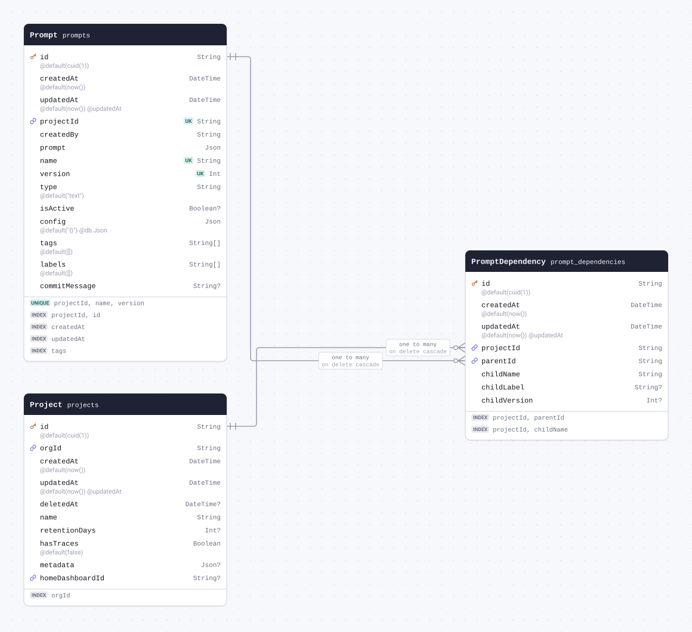

| Field                            | Type       | Constraints                             | Default              | Description |
| -------------------------------- | ---------- | --------------------------------------- | -------------------- | ----------- |
| `id`                             | `String`   | PK NOT NULL                             | `cuid(1)`            |             |
| `createdAt` (`created_at`)       | `DateTime` | NOT NULL                                | `now()`              |             |
| `updatedAt` (`updated_at`)       | `DateTime` | NOT NULL                                | `now()` `@updatedAt` |             |
| `projectId` (`project_id`)       | `String`   | NOT NULL → [Project.id](#model-Project) |                      |             |
| `parentId` (`parent_id`)         | `String`   | NOT NULL → [Prompt.id](#model-Prompt)   |                      |             |
| `childName` (`child_name`)       | `String`   | NOT NULL                                |                      |             |
| `childLabel` (`child_label`)     | `String`   | NULL                                    |                      |             |
| `childVersion` (`child_version`) | `Int`      | NULL                                    |                      |             |

#### Indexes

- `@@index([projectId, parentId], map: "prompt_dependencies_project_id_parent_id")`
- `@@index([projectId, childName], map: "prompt_dependencies_project_id_child_name")`

#### References

- `projectId` → [Project.id](#model-Project) (many-to-one, on delete Cascade)
- `parentId` → [Prompt.id](#model-Prompt) (many-to-one, on delete Cascade)

#### Definition

```sql
CREATE TABLE "prompt_dependencies" (
    "id" TEXT NOT NULL,
    "created_at" TIMESTAMP(3) NOT NULL DEFAULT CURRENT_TIMESTAMP,
    "updated_at" TIMESTAMP(3) NOT NULL DEFAULT CURRENT_TIMESTAMP,
    "project_id" TEXT NOT NULL,
    "parent_id" TEXT NOT NULL,
    "child_name" TEXT NOT NULL,
    "child_label" TEXT,
    "child_version" INTEGER,

    CONSTRAINT "prompt_dependencies_pkey" PRIMARY KEY ("id")
);

CREATE INDEX "prompt_dependencies_project_id_parent_id" ON "prompt_dependencies"("project_id", "parent_id");

CREATE INDEX "prompt_dependencies_project_id_child_name" ON "prompt_dependencies"("project_id", "child_name");

ALTER TABLE "prompt_dependencies" ADD CONSTRAINT "prompt_dependencies_project_id_fkey" FOREIGN KEY ("project_id") REFERENCES "projects"("id") ON DELETE CASCADE ON UPDATE CASCADE;

ALTER TABLE "prompt_dependencies" ADD CONSTRAINT "prompt_dependencies_parent_id_fkey" FOREIGN KEY ("parent_id") REFERENCES "prompts"("id") ON DELETE CASCADE ON UPDATE CASCADE;
```

<details>
<summary>Queries and their SQL</summary>

**findMany**: Every row

```ts
await prisma.promptDependency.findMany();
```

```sql
SELECT
  "public"."prompt_dependencies"."id",
  "public"."prompt_dependencies"."created_at",
  "public"."prompt_dependencies"."updated_at",
  "public"."prompt_dependencies"."project_id",
  "public"."prompt_dependencies"."parent_id",
  "public"."prompt_dependencies"."child_name",
  "public"."prompt_dependencies"."child_label",
  "public"."prompt_dependencies"."child_version"
FROM
  "public"."prompt_dependencies"
WHERE
  1 = 1
OFFSET
  $1
-- params: ["0"]
```

**count**: How many rows there are

```ts
await prisma.promptDependency.count();
```

```sql
SELECT
  COUNT(*) AS "_count$_all"
FROM
  (
    SELECT
      "public"."prompt_dependencies"."id"
    FROM
      "public"."prompt_dependencies"
    WHERE
      1 = 1
    OFFSET
      $1
  ) AS "sub"
-- params: ["0"]
```

**findMany**: Every row with its relations

```ts
await prisma.promptDependency.findMany({ include: { project: true, parent: true } });
```

```sql
SELECT
  "public"."prompt_dependencies"."id",
  "public"."prompt_dependencies"."created_at",
  "public"."prompt_dependencies"."updated_at",
  "public"."prompt_dependencies"."project_id",
  "public"."prompt_dependencies"."parent_id",
  "public"."prompt_dependencies"."child_name",
  "public"."prompt_dependencies"."child_label",
  "public"."prompt_dependencies"."child_version"
FROM
  "public"."prompt_dependencies"
WHERE
  1 = 1
OFFSET
  $1
-- params: ["0"]

SELECT
  "public"."projects"."id",
  "public"."projects"."org_id",
  "public"."projects"."created_at",
  "public"."projects"."updated_at",
  "public"."projects"."deleted_at",
  "public"."projects"."name",
  "public"."projects"."retention_days",
  "public"."projects"."has_traces",
  "public"."projects"."metadata",
  "public"."projects"."home_dashboard_id"
FROM
  "public"."projects"
WHERE
  "public"."projects"."id" IN ($1)
OFFSET
  $2
-- params: ["<projectId of the rows above>","0"]

SELECT
  "public"."prompts"."id",
  "public"."prompts"."created_at",
  "public"."prompts"."updated_at",
  "public"."prompts"."project_id",
  "public"."prompts"."created_by",
  "public"."prompts"."prompt",
  "public"."prompts"."name",
  "public"."prompts"."version",
  "public"."prompts"."type",
  "public"."prompts"."is_active",
  "public"."prompts"."config",
  "public"."prompts"."tags",
  "public"."prompts"."labels",
  "public"."prompts"."commit_message"
FROM
  "public"."prompts"
WHERE
  "public"."prompts"."id" IN ($1)
OFFSET
  $2
-- params: ["<parentId of the rows above>","0"]
```

**findUnique**: One row by what is unique to it

```ts
await prisma.promptDependency.findUnique({ where: { id: "example" } });
```

```sql
SELECT
  "public"."prompt_dependencies"."id",
  "public"."prompt_dependencies"."created_at",
  "public"."prompt_dependencies"."updated_at",
  "public"."prompt_dependencies"."project_id",
  "public"."prompt_dependencies"."parent_id",
  "public"."prompt_dependencies"."child_name",
  "public"."prompt_dependencies"."child_label",
  "public"."prompt_dependencies"."child_version"
FROM
  "public"."prompt_dependencies"
WHERE
  (
    "public"."prompt_dependencies"."id" = $1
    AND 1 = 1
  )
LIMIT
  $2
OFFSET
  $3
-- params: ["example","1","0"]
```

**create**: Create a row

```ts
await prisma.promptDependency.create({
  data: { projectId: "example", parentId: "example", childName: "example" },
});
```

```sql
INSERT INTO
  "public"."prompt_dependencies" (
    "id",
    "created_at",
    "updated_at",
    "project_id",
    "parent_id",
    "child_name"
  )
VALUES
  ($1, $2, $3, $4, $5, $6)
RETURNING
  "public"."prompt_dependencies"."id",
  "public"."prompt_dependencies"."created_at",
  "public"."prompt_dependencies"."updated_at",
  "public"."prompt_dependencies"."project_id",
  "public"."prompt_dependencies"."parent_id",
  "public"."prompt_dependencies"."child_name",
  "public"."prompt_dependencies"."child_label",
  "public"."prompt_dependencies"."child_version"
-- params: ["<cuid(1)>","<now()>","<now()>","example","example","example"]
```

**update**: Update a row

```ts
await prisma.promptDependency.update({
  where: { id: "example" },
  data: { createdAt: new Date("2026-01-01T00:00:00.000Z") },
});
```

```sql
UPDATE "public"."prompt_dependencies"
SET
  "created_at" = $1,
  "updated_at" = $2
WHERE
  (
    "public"."prompt_dependencies"."id" = $3
    AND 1 = 1
  )
RETURNING
  "public"."prompt_dependencies"."id",
  "public"."prompt_dependencies"."created_at",
  "public"."prompt_dependencies"."updated_at",
  "public"."prompt_dependencies"."project_id",
  "public"."prompt_dependencies"."parent_id",
  "public"."prompt_dependencies"."child_name",
  "public"."prompt_dependencies"."child_label",
  "public"."prompt_dependencies"."child_version"
-- params: ["2026-01-01T00:00:00.000Z",{"prisma__type":"generatorCall","prisma__value":{"name":"now","args":[],"returnType":{"type":"DateTime"}}},"example"]
```

**delete**: Delete a row

```ts
await prisma.promptDependency.delete({ where: { id: "example" } });
```

```sql
DELETE FROM "public"."prompt_dependencies"
WHERE
  (
    "public"."prompt_dependencies"."id" = $1
    AND 1 = 1
  )
RETURNING
  "public"."prompt_dependencies"."id",
  "public"."prompt_dependencies"."created_at",
  "public"."prompt_dependencies"."updated_at",
  "public"."prompt_dependencies"."project_id",
  "public"."prompt_dependencies"."parent_id",
  "public"."prompt_dependencies"."child_name",
  "public"."prompt_dependencies"."child_label",
  "public"."prompt_dependencies"."child_version"
-- params: ["example"]
```

</details>

<a id="model-PromptProtectedLabels"></a>

### PromptProtectedLabels

Table `prompt_protected_labels`.

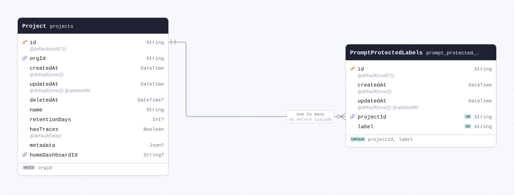

| Field                      | Type       | Constraints                             | Default              | Description |
| -------------------------- | ---------- | --------------------------------------- | -------------------- | ----------- |
| `id`                       | `String`   | PK NOT NULL                             | `cuid(1)`            |             |
| `createdAt` (`created_at`) | `DateTime` | NOT NULL                                | `now()`              |             |
| `updatedAt` (`updated_at`) | `DateTime` | NOT NULL                                | `now()` `@updatedAt` |             |
| `projectId` (`project_id`) | `String`   | NOT NULL → [Project.id](#model-Project) |                      |             |
| `label`                    | `String`   | NOT NULL                                |                      |             |

#### Indexes

- `@@unique([projectId, label])`

#### References

- `projectId` → [Project.id](#model-Project) (many-to-one, on delete Cascade)

#### Definition

```sql
CREATE TABLE "prompt_protected_labels" (
    "id" TEXT NOT NULL,
    "created_at" TIMESTAMP(3) NOT NULL DEFAULT CURRENT_TIMESTAMP,
    "updated_at" TIMESTAMP(3) NOT NULL DEFAULT CURRENT_TIMESTAMP,
    "project_id" TEXT NOT NULL,
    "label" TEXT NOT NULL,

    CONSTRAINT "prompt_protected_labels_pkey" PRIMARY KEY ("id")
);

CREATE UNIQUE INDEX "prompt_protected_labels_project_id_label_key" ON "prompt_protected_labels"("project_id", "label");

ALTER TABLE "prompt_protected_labels" ADD CONSTRAINT "prompt_protected_labels_project_id_fkey" FOREIGN KEY ("project_id") REFERENCES "projects"("id") ON DELETE CASCADE ON UPDATE CASCADE;
```

<details>
<summary>Queries and their SQL</summary>

**findMany**: Every row

```ts
await prisma.promptProtectedLabels.findMany();
```

```sql
SELECT
  "public"."prompt_protected_labels"."id",
  "public"."prompt_protected_labels"."created_at",
  "public"."prompt_protected_labels"."updated_at",
  "public"."prompt_protected_labels"."project_id",
  "public"."prompt_protected_labels"."label"
FROM
  "public"."prompt_protected_labels"
WHERE
  1 = 1
OFFSET
  $1
-- params: ["0"]
```

**count**: How many rows there are

```ts
await prisma.promptProtectedLabels.count();
```

```sql
SELECT
  COUNT(*) AS "_count$_all"
FROM
  (
    SELECT
      "public"."prompt_protected_labels"."id"
    FROM
      "public"."prompt_protected_labels"
    WHERE
      1 = 1
    OFFSET
      $1
  ) AS "sub"
-- params: ["0"]
```

**findMany**: Every row with its relations

```ts
await prisma.promptProtectedLabels.findMany({ include: { project: true } });
```

```sql
SELECT
  "public"."prompt_protected_labels"."id",
  "public"."prompt_protected_labels"."created_at",
  "public"."prompt_protected_labels"."updated_at",
  "public"."prompt_protected_labels"."project_id",
  "public"."prompt_protected_labels"."label"
FROM
  "public"."prompt_protected_labels"
WHERE
  1 = 1
OFFSET
  $1
-- params: ["0"]

SELECT
  "public"."projects"."id",
  "public"."projects"."org_id",
  "public"."projects"."created_at",
  "public"."projects"."updated_at",
  "public"."projects"."deleted_at",
  "public"."projects"."name",
  "public"."projects"."retention_days",
  "public"."projects"."has_traces",
  "public"."projects"."metadata",
  "public"."projects"."home_dashboard_id"
FROM
  "public"."projects"
WHERE
  "public"."projects"."id" IN ($1)
OFFSET
  $2
-- params: ["<projectId of the rows above>","0"]
```

**findUnique**: One row by what is unique to it

```ts
await prisma.promptProtectedLabels.findUnique({ where: { id: "example" } });
```

```sql
SELECT
  "public"."prompt_protected_labels"."id",
  "public"."prompt_protected_labels"."created_at",
  "public"."prompt_protected_labels"."updated_at",
  "public"."prompt_protected_labels"."project_id",
  "public"."prompt_protected_labels"."label"
FROM
  "public"."prompt_protected_labels"
WHERE
  (
    "public"."prompt_protected_labels"."id" = $1
    AND 1 = 1
  )
LIMIT
  $2
OFFSET
  $3
-- params: ["example","1","0"]
```

**create**: Create a row

```ts
await prisma.promptProtectedLabels.create({ data: { projectId: "example", label: "example" } });
```

```sql
INSERT INTO
  "public"."prompt_protected_labels" (
    "id",
    "created_at",
    "updated_at",
    "project_id",
    "label"
  )
VALUES
  ($1, $2, $3, $4, $5)
RETURNING
  "public"."prompt_protected_labels"."id",
  "public"."prompt_protected_labels"."created_at",
  "public"."prompt_protected_labels"."updated_at",
  "public"."prompt_protected_labels"."project_id",
  "public"."prompt_protected_labels"."label"
-- params: ["<cuid(1)>","<now()>","<now()>","example","example"]
```

**update**: Update a row

```ts
await prisma.promptProtectedLabels.update({
  where: { id: "example" },
  data: { createdAt: new Date("2026-01-01T00:00:00.000Z") },
});
```

```sql
UPDATE "public"."prompt_protected_labels"
SET
  "created_at" = $1,
  "updated_at" = $2
WHERE
  (
    "public"."prompt_protected_labels"."id" = $3
    AND 1 = 1
  )
RETURNING
  "public"."prompt_protected_labels"."id",
  "public"."prompt_protected_labels"."created_at",
  "public"."prompt_protected_labels"."updated_at",
  "public"."prompt_protected_labels"."project_id",
  "public"."prompt_protected_labels"."label"
-- params: ["2026-01-01T00:00:00.000Z",{"prisma__type":"generatorCall","prisma__value":{"name":"now","args":[],"returnType":{"type":"DateTime"}}},"example"]
```

**delete**: Delete a row

```ts
await prisma.promptProtectedLabels.delete({ where: { id: "example" } });
```

```sql
DELETE FROM "public"."prompt_protected_labels"
WHERE
  (
    "public"."prompt_protected_labels"."id" = $1
    AND 1 = 1
  )
RETURNING
  "public"."prompt_protected_labels"."id",
  "public"."prompt_protected_labels"."created_at",
  "public"."prompt_protected_labels"."updated_at",
  "public"."prompt_protected_labels"."project_id",
  "public"."prompt_protected_labels"."label"
-- params: ["example"]
```

</details>

<a id="model-Skill"></a>

### Skill

Table `skills`.

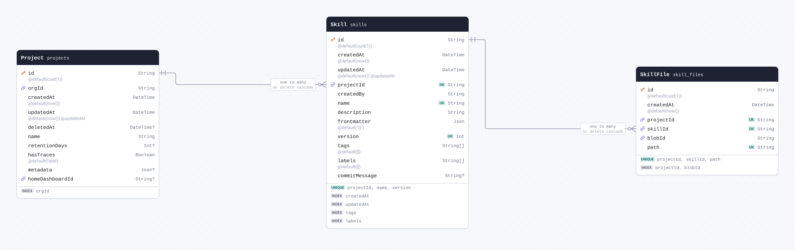

| Field                              | Type       | Constraints                             | Default              | Description |
| ---------------------------------- | ---------- | --------------------------------------- | -------------------- | ----------- |
| `id`                               | `String`   | PK NOT NULL                             | `cuid(1)`            |             |
| `createdAt` (`created_at`)         | `DateTime` | NOT NULL                                | `now()`              |             |
| `updatedAt` (`updated_at`)         | `DateTime` | NOT NULL                                | `now()` `@updatedAt` |             |
| `projectId` (`project_id`)         | `String`   | NOT NULL → [Project.id](#model-Project) |                      |             |
| `createdBy` (`created_by`)         | `String`   | NOT NULL                                |                      |             |
| `name`                             | `String`   | NOT NULL                                |                      |             |
| `description`                      | `String`   | NOT NULL                                |                      |             |
| `frontmatter`                      | `Json`     | NOT NULL                                | `"{}"`               |             |
| `version`                          | `Int`      | NOT NULL                                |                      |             |
| `tags`                             | `String[]` | NOT NULL                                | `[]`                 |             |
| `labels`                           | `String[]` | NOT NULL                                | `[]`                 |             |
| `commitMessage` (`commit_message`) | `String`   | NULL                                    |                      |             |

#### Indexes

- `@@index([createdAt])`
- `@@index([updatedAt])`
- `@@index([tags])`
- `@@index([labels])`
- `@@unique([projectId, name, version])`

#### References

- `projectId` → [Project.id](#model-Project) (many-to-one, on delete Cascade)

#### Referenced by

- `id` ← [SkillFile.skillId](#model-SkillFile) (one-to-many, on delete Cascade)

#### Definition

```sql
CREATE TABLE "skills" (
    "id" TEXT NOT NULL,
    "created_at" TIMESTAMP(3) NOT NULL DEFAULT CURRENT_TIMESTAMP,
    "updated_at" TIMESTAMP(3) NOT NULL DEFAULT CURRENT_TIMESTAMP,
    "project_id" TEXT NOT NULL,
    "created_by" TEXT NOT NULL,
    "name" TEXT NOT NULL,
    "description" TEXT NOT NULL,
    "frontmatter" JSONB NOT NULL DEFAULT '{}',
    "version" INTEGER NOT NULL,
    "tags" TEXT[] DEFAULT ARRAY[]::TEXT[],
    "labels" TEXT[] DEFAULT ARRAY[]::TEXT[],
    "commit_message" TEXT,

    CONSTRAINT "skills_pkey" PRIMARY KEY ("id")
);

CREATE INDEX "skills_created_at_idx" ON "skills"("created_at");

CREATE INDEX "skills_updated_at_idx" ON "skills"("updated_at");

CREATE INDEX "skills_tags_idx" ON "skills" USING GIN ("tags" array_ops);

CREATE INDEX "skills_labels_idx" ON "skills" USING GIN ("labels" array_ops);

CREATE UNIQUE INDEX "skills_project_id_name_version_key" ON "skills"("project_id", "name", "version");

ALTER TABLE "skills" ADD CONSTRAINT "skills_project_id_fkey" FOREIGN KEY ("project_id") REFERENCES "projects"("id") ON DELETE CASCADE ON UPDATE CASCADE;
```

<details>
<summary>Queries and their SQL</summary>

**findMany**: Every row

```ts
await prisma.skill.findMany();
```

```sql
SELECT
  "public"."skills"."id",
  "public"."skills"."created_at",
  "public"."skills"."updated_at",
  "public"."skills"."project_id",
  "public"."skills"."created_by",
  "public"."skills"."name",
  "public"."skills"."description",
  "public"."skills"."frontmatter",
  "public"."skills"."version",
  "public"."skills"."tags",
  "public"."skills"."labels",
  "public"."skills"."commit_message"
FROM
  "public"."skills"
WHERE
  1 = 1
OFFSET
  $1
-- params: ["0"]
```

**count**: How many rows there are

```ts
await prisma.skill.count();
```

```sql
SELECT
  COUNT(*) AS "_count$_all"
FROM
  (
    SELECT
      "public"."skills"."id"
    FROM
      "public"."skills"
    WHERE
      1 = 1
    OFFSET
      $1
  ) AS "sub"
-- params: ["0"]
```

**findMany**: Every row with its relations

```ts
await prisma.skill.findMany({ include: { project: true, files: true } });
```

```sql
SELECT
  "public"."skills"."id",
  "public"."skills"."created_at",
  "public"."skills"."updated_at",
  "public"."skills"."project_id",
  "public"."skills"."created_by",
  "public"."skills"."name",
  "public"."skills"."description",
  "public"."skills"."frontmatter",
  "public"."skills"."version",
  "public"."skills"."tags",
  "public"."skills"."labels",
  "public"."skills"."commit_message"
FROM
  "public"."skills"
WHERE
  1 = 1
OFFSET
  $1
-- params: ["0"]

SELECT
  "public"."projects"."id",
  "public"."projects"."org_id",
  "public"."projects"."created_at",
  "public"."projects"."updated_at",
  "public"."projects"."deleted_at",
  "public"."projects"."name",
  "public"."projects"."retention_days",
  "public"."projects"."has_traces",
  "public"."projects"."metadata",
  "public"."projects"."home_dashboard_id"
FROM
  "public"."projects"
WHERE
  "public"."projects"."id" IN ($1)
OFFSET
  $2
-- params: ["<projectId of the rows above>","0"]

SELECT
  "public"."skill_files"."id",
  "public"."skill_files"."created_at",
  "public"."skill_files"."project_id",
  "public"."skill_files"."skill_id",
  "public"."skill_files"."blob_id",
  "public"."skill_files"."path"
FROM
  "public"."skill_files"
WHERE
  "public"."skill_files"."skill_id" IN ($1)
OFFSET
  $2
-- params: ["<id of the rows above>","0"]
```

**findUnique**: One row by what is unique to it

```ts
await prisma.skill.findUnique({ where: { id: "example" } });
```

```sql
SELECT
  "public"."skills"."id",
  "public"."skills"."created_at",
  "public"."skills"."updated_at",
  "public"."skills"."project_id",
  "public"."skills"."created_by",
  "public"."skills"."name",
  "public"."skills"."description",
  "public"."skills"."frontmatter",
  "public"."skills"."version",
  "public"."skills"."tags",
  "public"."skills"."labels",
  "public"."skills"."commit_message"
FROM
  "public"."skills"
WHERE
  (
    "public"."skills"."id" = $1
    AND 1 = 1
  )
LIMIT
  $2
OFFSET
  $3
-- params: ["example","1","0"]
```

**create**: Create a row

```ts
await prisma.skill.create({
  data: {
    projectId: "example",
    createdBy: "example",
    name: "example",
    description: "example",
    version: 1,
  },
});
```

```sql
INSERT INTO
  "public"."skills" (
    "id",
    "created_at",
    "updated_at",
    "project_id",
    "created_by",
    "name",
    "description",
    "frontmatter",
    "version",
    "tags",
    "labels"
  )
VALUES
  ($1, $2, $3, $4, $5, $6, $7, $8, $9, $10, $11)
RETURNING
  "public"."skills"."id",
  "public"."skills"."created_at",
  "public"."skills"."updated_at",
  "public"."skills"."project_id",
  "public"."skills"."created_by",
  "public"."skills"."name",
  "public"."skills"."description",
  "public"."skills"."frontmatter",
  "public"."skills"."version",
  "public"."skills"."tags",
  "public"."skills"."labels",
  "public"."skills"."commit_message"
-- params: ["<cuid(1)>","<now()>","<now()>","example","example","example","example","{}","1",[],[]]
```

**update**: Update a row

```ts
await prisma.skill.update({
  where: { id: "example" },
  data: { createdAt: new Date("2026-01-01T00:00:00.000Z") },
});
```

```sql
UPDATE "public"."skills"
SET
  "created_at" = $1,
  "updated_at" = $2
WHERE
  (
    "public"."skills"."id" = $3
    AND 1 = 1
  )
RETURNING
  "public"."skills"."id",
  "public"."skills"."created_at",
  "public"."skills"."updated_at",
  "public"."skills"."project_id",
  "public"."skills"."created_by",
  "public"."skills"."name",
  "public"."skills"."description",
  "public"."skills"."frontmatter",
  "public"."skills"."version",
  "public"."skills"."tags",
  "public"."skills"."labels",
  "public"."skills"."commit_message"
-- params: ["2026-01-01T00:00:00.000Z",{"prisma__type":"generatorCall","prisma__value":{"name":"now","args":[],"returnType":{"type":"DateTime"}}},"example"]
```

**delete**: Delete a row

```ts
await prisma.skill.delete({ where: { id: "example" } });
```

```sql
DELETE FROM "public"."skills"
WHERE
  (
    "public"."skills"."id" = $1
    AND 1 = 1
  )
RETURNING
  "public"."skills"."id",
  "public"."skills"."created_at",
  "public"."skills"."updated_at",
  "public"."skills"."project_id",
  "public"."skills"."created_by",
  "public"."skills"."name",
  "public"."skills"."description",
  "public"."skills"."frontmatter",
  "public"."skills"."version",
  "public"."skills"."tags",
  "public"."skills"."labels",
  "public"."skills"."commit_message"
-- params: ["example"]
```

</details>

<a id="model-SkillFile"></a>

### SkillFile

Table `skill_files`.

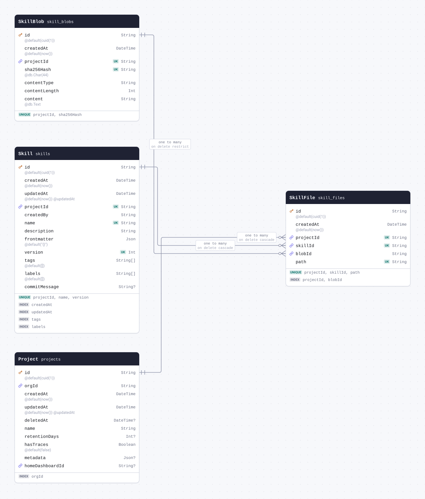

| Field                      | Type       | Constraints                                 | Default   | Description |
| -------------------------- | ---------- | ------------------------------------------- | --------- | ----------- |
| `id`                       | `String`   | PK NOT NULL                                 | `cuid(1)` |             |
| `createdAt` (`created_at`) | `DateTime` | NOT NULL                                    | `now()`   |             |
| `projectId` (`project_id`) | `String`   | NOT NULL → [Project.id](#model-Project)     |           |             |
| `skillId` (`skill_id`)     | `String`   | NOT NULL → [Skill.id](#model-Skill)         |           |             |
| `blobId` (`blob_id`)       | `String`   | NOT NULL → [SkillBlob.id](#model-SkillBlob) |           |             |
| `path`                     | `String`   | NOT NULL                                    |           |             |

#### Indexes

- `@@index([projectId, blobId])`
- `@@unique([projectId, skillId, path])`

#### References

- `projectId` → [Project.id](#model-Project) (many-to-one, on delete Cascade)
- `skillId` → [Skill.id](#model-Skill) (many-to-one, on delete Cascade)
- `blobId` → [SkillBlob.id](#model-SkillBlob) (many-to-one, on delete Restrict)

#### Definition

```sql
CREATE TABLE "skill_files" (
    "id" TEXT NOT NULL,
    "created_at" TIMESTAMP(3) NOT NULL DEFAULT CURRENT_TIMESTAMP,
    "project_id" TEXT NOT NULL,
    "skill_id" TEXT NOT NULL,
    "blob_id" TEXT NOT NULL,
    "path" TEXT NOT NULL,

    CONSTRAINT "skill_files_pkey" PRIMARY KEY ("id")
);

CREATE INDEX "skill_files_project_id_blob_id_idx" ON "skill_files"("project_id", "blob_id");

CREATE UNIQUE INDEX "skill_files_project_id_skill_id_path_key" ON "skill_files"("project_id", "skill_id", "path");

ALTER TABLE "skill_files" ADD CONSTRAINT "skill_files_project_id_fkey" FOREIGN KEY ("project_id") REFERENCES "projects"("id") ON DELETE CASCADE ON UPDATE CASCADE;

ALTER TABLE "skill_files" ADD CONSTRAINT "skill_files_skill_id_fkey" FOREIGN KEY ("skill_id") REFERENCES "skills"("id") ON DELETE CASCADE ON UPDATE CASCADE;

ALTER TABLE "skill_files" ADD CONSTRAINT "skill_files_blob_id_fkey" FOREIGN KEY ("blob_id") REFERENCES "skill_blobs"("id") ON DELETE RESTRICT ON UPDATE CASCADE;
```

<details>
<summary>Queries and their SQL</summary>

**findMany**: Every row

```ts
await prisma.skillFile.findMany();
```

```sql
SELECT
  "public"."skill_files"."id",
  "public"."skill_files"."created_at",
  "public"."skill_files"."project_id",
  "public"."skill_files"."skill_id",
  "public"."skill_files"."blob_id",
  "public"."skill_files"."path"
FROM
  "public"."skill_files"
WHERE
  1 = 1
OFFSET
  $1
-- params: ["0"]
```

**count**: How many rows there are

```ts
await prisma.skillFile.count();
```

```sql
SELECT
  COUNT(*) AS "_count$_all"
FROM
  (
    SELECT
      "public"."skill_files"."id"
    FROM
      "public"."skill_files"
    WHERE
      1 = 1
    OFFSET
      $1
  ) AS "sub"
-- params: ["0"]
```

**findMany**: Every row with its relations

```ts
await prisma.skillFile.findMany({ include: { project: true, skill: true, blob: true } });
```

```sql
SELECT
  "public"."skill_files"."id",
  "public"."skill_files"."created_at",
  "public"."skill_files"."project_id",
  "public"."skill_files"."skill_id",
  "public"."skill_files"."blob_id",
  "public"."skill_files"."path"
FROM
  "public"."skill_files"
WHERE
  1 = 1
OFFSET
  $1
-- params: ["0"]

SELECT
  "public"."projects"."id",
  "public"."projects"."org_id",
  "public"."projects"."created_at",
  "public"."projects"."updated_at",
  "public"."projects"."deleted_at",
  "public"."projects"."name",
  "public"."projects"."retention_days",
  "public"."projects"."has_traces",
  "public"."projects"."metadata",
  "public"."projects"."home_dashboard_id"
FROM
  "public"."projects"
WHERE
  "public"."projects"."id" IN ($1)
OFFSET
  $2
-- params: ["<projectId of the rows above>","0"]

SELECT
  "public"."skills"."id",
  "public"."skills"."created_at",
  "public"."skills"."updated_at",
  "public"."skills"."project_id",
  "public"."skills"."created_by",
  "public"."skills"."name",
  "public"."skills"."description",
  "public"."skills"."frontmatter",
  "public"."skills"."version",
  "public"."skills"."tags",
  "public"."skills"."labels",
  "public"."skills"."commit_message"
FROM
  "public"."skills"
WHERE
  "public"."skills"."id" IN ($1)
OFFSET
  $2
-- params: ["<skillId of the rows above>","0"]

SELECT
  "public"."skill_blobs"."id",
  "public"."skill_blobs"."created_at",
  "public"."skill_blobs"."project_id",
  "public"."skill_blobs"."sha_256_hash",
  "public"."skill_blobs"."content_type",
  "public"."skill_blobs"."content_length",
  "public"."skill_blobs"."content"
FROM
  "public"."skill_blobs"
WHERE
  "public"."skill_blobs"."id" IN ($1)
OFFSET
  $2
-- params: ["<blobId of the rows above>","0"]
```

**findUnique**: One row by what is unique to it

```ts
await prisma.skillFile.findUnique({ where: { id: "example" } });
```

```sql
SELECT
  "public"."skill_files"."id",
  "public"."skill_files"."created_at",
  "public"."skill_files"."project_id",
  "public"."skill_files"."skill_id",
  "public"."skill_files"."blob_id",
  "public"."skill_files"."path"
FROM
  "public"."skill_files"
WHERE
  (
    "public"."skill_files"."id" = $1
    AND 1 = 1
  )
LIMIT
  $2
OFFSET
  $3
-- params: ["example","1","0"]
```

**create**: Create a row

```ts
await prisma.skillFile.create({
  data: { projectId: "example", skillId: "example", blobId: "example", path: "example" },
});
```

```sql
INSERT INTO
  "public"."skill_files" (
    "id",
    "created_at",
    "project_id",
    "skill_id",
    "blob_id",
    "path"
  )
VALUES
  ($1, $2, $3, $4, $5, $6)
RETURNING
  "public"."skill_files"."id",
  "public"."skill_files"."created_at",
  "public"."skill_files"."project_id",
  "public"."skill_files"."skill_id",
  "public"."skill_files"."blob_id",
  "public"."skill_files"."path"
-- params: ["<cuid(1)>","<now()>","example","example","example","example"]
```

**update**: Update a row

```ts
await prisma.skillFile.update({
  where: { id: "example" },
  data: { createdAt: new Date("2026-01-01T00:00:00.000Z") },
});
```

```sql
UPDATE "public"."skill_files"
SET
  "created_at" = $1
WHERE
  (
    "public"."skill_files"."id" = $2
    AND 1 = 1
  )
RETURNING
  "public"."skill_files"."id",
  "public"."skill_files"."created_at",
  "public"."skill_files"."project_id",
  "public"."skill_files"."skill_id",
  "public"."skill_files"."blob_id",
  "public"."skill_files"."path"
-- params: ["2026-01-01T00:00:00.000Z","example"]
```

**delete**: Delete a row

```ts
await prisma.skillFile.delete({ where: { id: "example" } });
```

```sql
DELETE FROM "public"."skill_files"
WHERE
  (
    "public"."skill_files"."id" = $1
    AND 1 = 1
  )
RETURNING
  "public"."skill_files"."id",
  "public"."skill_files"."created_at",
  "public"."skill_files"."project_id",
  "public"."skill_files"."skill_id",
  "public"."skill_files"."blob_id",
  "public"."skill_files"."path"
-- params: ["example"]
```

</details>

<a id="model-SkillBlob"></a>

### SkillBlob

Table `skill_blobs`.

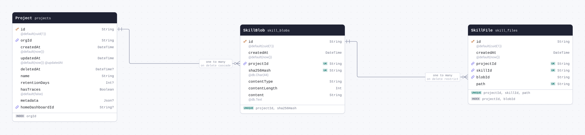

| Field                              | Type                    | Constraints                             | Default   | Description |
| ---------------------------------- | ----------------------- | --------------------------------------- | --------- | ----------- |
| `id`                               | `String`                | PK NOT NULL                             | `cuid(1)` |             |
| `createdAt` (`created_at`)         | `DateTime`              | NOT NULL                                | `now()`   |             |
| `projectId` (`project_id`)         | `String`                | NOT NULL → [Project.id](#model-Project) |           |             |
| `sha256Hash` (`sha_256_hash`)      | `String` `@db.Char(44)` | NOT NULL                                |           |             |
| `contentType` (`content_type`)     | `String`                | NOT NULL                                |           |             |
| `contentLength` (`content_length`) | `Int`                   | NOT NULL                                |           |             |
| `content`                          | `String` `@db.Text`     | NOT NULL                                |           |             |

#### Indexes

- `@@unique([projectId, sha256Hash])`

#### References

- `projectId` → [Project.id](#model-Project) (many-to-one, on delete Cascade)

#### Referenced by

- `id` ← [SkillFile.blobId](#model-SkillFile) (one-to-many, on delete Restrict)

#### Definition

```sql
CREATE TABLE "skill_blobs" (
    "id" TEXT NOT NULL,
    "created_at" TIMESTAMP(3) NOT NULL DEFAULT CURRENT_TIMESTAMP,
    "project_id" TEXT NOT NULL,
    "sha_256_hash" CHAR(44) NOT NULL,
    "content_type" TEXT NOT NULL,
    "content_length" INTEGER NOT NULL,
    "content" TEXT NOT NULL,

    CONSTRAINT "skill_blobs_pkey" PRIMARY KEY ("id")
);

CREATE UNIQUE INDEX "skill_blobs_project_id_sha_256_hash_key" ON "skill_blobs"("project_id", "sha_256_hash");

ALTER TABLE "skill_blobs" ADD CONSTRAINT "skill_blobs_project_id_fkey" FOREIGN KEY ("project_id") REFERENCES "projects"("id") ON DELETE CASCADE ON UPDATE CASCADE;
```

<details>
<summary>Queries and their SQL</summary>

**findMany**: Every row

```ts
await prisma.skillBlob.findMany();
```

```sql
SELECT
  "public"."skill_blobs"."id",
  "public"."skill_blobs"."created_at",
  "public"."skill_blobs"."project_id",
  "public"."skill_blobs"."sha_256_hash",
  "public"."skill_blobs"."content_type",
  "public"."skill_blobs"."content_length",
  "public"."skill_blobs"."content"
FROM
  "public"."skill_blobs"
WHERE
  1 = 1
OFFSET
  $1
-- params: ["0"]
```

**count**: How many rows there are

```ts
await prisma.skillBlob.count();
```

```sql
SELECT
  COUNT(*) AS "_count$_all"
FROM
  (
    SELECT
      "public"."skill_blobs"."id"
    FROM
      "public"."skill_blobs"
    WHERE
      1 = 1
    OFFSET
      $1
  ) AS "sub"
-- params: ["0"]
```

**findMany**: Every row with its relations

```ts
await prisma.skillBlob.findMany({ include: { project: true, files: true } });
```

```sql
SELECT
  "public"."skill_blobs"."id",
  "public"."skill_blobs"."created_at",
  "public"."skill_blobs"."project_id",
  "public"."skill_blobs"."sha_256_hash",
  "public"."skill_blobs"."content_type",
  "public"."skill_blobs"."content_length",
  "public"."skill_blobs"."content"
FROM
  "public"."skill_blobs"
WHERE
  1 = 1
OFFSET
  $1
-- params: ["0"]

SELECT
  "public"."projects"."id",
  "public"."projects"."org_id",
  "public"."projects"."created_at",
  "public"."projects"."updated_at",
  "public"."projects"."deleted_at",
  "public"."projects"."name",
  "public"."projects"."retention_days",
  "public"."projects"."has_traces",
  "public"."projects"."metadata",
  "public"."projects"."home_dashboard_id"
FROM
  "public"."projects"
WHERE
  "public"."projects"."id" IN ($1)
OFFSET
  $2
-- params: ["<projectId of the rows above>","0"]

SELECT
  "public"."skill_files"."id",
  "public"."skill_files"."created_at",
  "public"."skill_files"."project_id",
  "public"."skill_files"."skill_id",
  "public"."skill_files"."blob_id",
  "public"."skill_files"."path"
FROM
  "public"."skill_files"
WHERE
  "public"."skill_files"."blob_id" IN ($1)
OFFSET
  $2
-- params: ["<id of the rows above>","0"]
```

**findUnique**: One row by what is unique to it

```ts
await prisma.skillBlob.findUnique({ where: { id: "example" } });
```

```sql
SELECT
  "public"."skill_blobs"."id",
  "public"."skill_blobs"."created_at",
  "public"."skill_blobs"."project_id",
  "public"."skill_blobs"."sha_256_hash",
  "public"."skill_blobs"."content_type",
  "public"."skill_blobs"."content_length",
  "public"."skill_blobs"."content"
FROM
  "public"."skill_blobs"
WHERE
  (
    "public"."skill_blobs"."id" = $1
    AND 1 = 1
  )
LIMIT
  $2
OFFSET
  $3
-- params: ["example","1","0"]
```

**create**: Create a row

```ts
await prisma.skillBlob.create({
  data: {
    projectId: "example",
    sha256Hash: "example",
    contentType: "example",
    contentLength: 1,
    content: "example",
  },
});
```

```sql
INSERT INTO
  "public"."skill_blobs" (
    "id",
    "created_at",
    "project_id",
    "sha_256_hash",
    "content_type",
    "content_length",
    "content"
  )
VALUES
  ($1, $2, $3, $4, $5, $6, $7)
RETURNING
  "public"."skill_blobs"."id",
  "public"."skill_blobs"."created_at",
  "public"."skill_blobs"."project_id",
  "public"."skill_blobs"."sha_256_hash",
  "public"."skill_blobs"."content_type",
  "public"."skill_blobs"."content_length",
  "public"."skill_blobs"."content"
-- params: ["<cuid(1)>","<now()>","example","example","example","1","example"]
```

**update**: Update a row

```ts
await prisma.skillBlob.update({
  where: { id: "example" },
  data: { createdAt: new Date("2026-01-01T00:00:00.000Z") },
});
```

```sql
UPDATE "public"."skill_blobs"
SET
  "created_at" = $1
WHERE
  (
    "public"."skill_blobs"."id" = $2
    AND 1 = 1
  )
RETURNING
  "public"."skill_blobs"."id",
  "public"."skill_blobs"."created_at",
  "public"."skill_blobs"."project_id",
  "public"."skill_blobs"."sha_256_hash",
  "public"."skill_blobs"."content_type",
  "public"."skill_blobs"."content_length",
  "public"."skill_blobs"."content"
-- params: ["2026-01-01T00:00:00.000Z","example"]
```

**delete**: Delete a row

```ts
await prisma.skillBlob.delete({ where: { id: "example" } });
```

```sql
DELETE FROM "public"."skill_blobs"
WHERE
  (
    "public"."skill_blobs"."id" = $1
    AND 1 = 1
  )
RETURNING
  "public"."skill_blobs"."id",
  "public"."skill_blobs"."created_at",
  "public"."skill_blobs"."project_id",
  "public"."skill_blobs"."sha_256_hash",
  "public"."skill_blobs"."content_type",
  "public"."skill_blobs"."content_length",
  "public"."skill_blobs"."content"
-- params: ["example"]
```

</details>

<a id="model-Model"></a>

### Model

Table `models`.

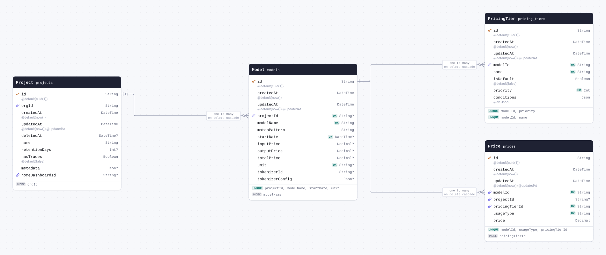

| Field                                  | Type       | Constraints                         | Default              | Description |
| -------------------------------------- | ---------- | ----------------------------------- | -------------------- | ----------- |
| `id`                                   | `String`   | PK NOT NULL                         | `cuid(1)`            |             |
| `createdAt` (`created_at`)             | `DateTime` | NOT NULL                            | `now()`              |             |
| `updatedAt` (`updated_at`)             | `DateTime` | NOT NULL                            | `now()` `@updatedAt` |             |
| `projectId` (`project_id`)             | `String`   | NULL → [Project.id](#model-Project) |                      |             |
| `modelName` (`model_name`)             | `String`   | NOT NULL                            |                      |             |
| `matchPattern` (`match_pattern`)       | `String`   | NOT NULL                            |                      |             |
| `startDate` (`start_date`)             | `DateTime` | NULL                                |                      |             |
| `inputPrice` (`input_price`)           | `Decimal`  | NULL                                |                      |             |
| `outputPrice` (`output_price`)         | `Decimal`  | NULL                                |                      |             |
| `totalPrice` (`total_price`)           | `Decimal`  | NULL                                |                      |             |
| `unit`                                 | `String`   | NULL                                |                      |             |
| `tokenizerId` (`tokenizer_id`)         | `String`   | NULL                                |                      |             |
| `tokenizerConfig` (`tokenizer_config`) | `Json`     | NULL                                |                      |             |

#### Indexes

- `@@index([modelName])`
- `@@unique([projectId, modelName, startDate, unit])`

#### References

- `projectId` → [Project.id](#model-Project) (many-to-one, on delete Cascade)

#### Referenced by

- `id` ← [Price.modelId](#model-Price) (one-to-many, on delete Cascade)
- `id` ← [PricingTier.modelId](#model-PricingTier) (one-to-many, on delete Cascade)

#### Definition

```sql
CREATE TABLE "models" (
    "id" TEXT NOT NULL,
    "created_at" TIMESTAMP(3) NOT NULL DEFAULT CURRENT_TIMESTAMP,
    "updated_at" TIMESTAMP(3) NOT NULL DEFAULT CURRENT_TIMESTAMP,
    "project_id" TEXT,
    "model_name" TEXT NOT NULL,
    "match_pattern" TEXT NOT NULL,
    "start_date" TIMESTAMP(3),
    "input_price" DECIMAL(65,30),
    "output_price" DECIMAL(65,30),
    "total_price" DECIMAL(65,30),
    "unit" TEXT,
    "tokenizer_id" TEXT,
    "tokenizer_config" JSONB,

    CONSTRAINT "models_pkey" PRIMARY KEY ("id")
);

CREATE INDEX "models_model_name_idx" ON "models"("model_name");

CREATE UNIQUE INDEX "models_project_id_model_name_start_date_unit_key" ON "models"("project_id", "model_name", "start_date", "unit");

ALTER TABLE "models" ADD CONSTRAINT "models_project_id_fkey" FOREIGN KEY ("project_id") REFERENCES "projects"("id") ON DELETE CASCADE ON UPDATE CASCADE;
```

<details>
<summary>Queries and their SQL</summary>

**findMany**: Every row

```ts
await prisma.model.findMany();
```

```sql
SELECT
  "public"."models"."id",
  "public"."models"."created_at",
  "public"."models"."updated_at",
  "public"."models"."project_id",
  "public"."models"."model_name",
  "public"."models"."match_pattern",
  "public"."models"."start_date",
  "public"."models"."input_price",
  "public"."models"."output_price",
  "public"."models"."total_price",
  "public"."models"."unit",
  "public"."models"."tokenizer_id",
  "public"."models"."tokenizer_config"
FROM
  "public"."models"
WHERE
  1 = 1
OFFSET
  $1
-- params: ["0"]
```

**count**: How many rows there are

```ts
await prisma.model.count();
```

```sql
SELECT
  COUNT(*) AS "_count$_all"
FROM
  (
    SELECT
      "public"."models"."id"
    FROM
      "public"."models"
    WHERE
      1 = 1
    OFFSET
      $1
  ) AS "sub"
-- params: ["0"]
```

**findMany**: Every row with its relations

```ts
await prisma.model.findMany({ include: { project: true, Price: true, pricingTiers: true } });
```

```sql
SELECT
  "public"."models"."id",
  "public"."models"."created_at",
  "public"."models"."updated_at",
  "public"."models"."project_id",
  "public"."models"."model_name",
  "public"."models"."match_pattern",
  "public"."models"."start_date",
  "public"."models"."input_price",
  "public"."models"."output_price",
  "public"."models"."total_price",
  "public"."models"."unit",
  "public"."models"."tokenizer_id",
  "public"."models"."tokenizer_config"
FROM
  "public"."models"
WHERE
  1 = 1
OFFSET
  $1
-- params: ["0"]

SELECT
  "public"."projects"."id",
  "public"."projects"."org_id",
  "public"."projects"."created_at",
  "public"."projects"."updated_at",
  "public"."projects"."deleted_at",
  "public"."projects"."name",
  "public"."projects"."retention_days",
  "public"."projects"."has_traces",
  "public"."projects"."metadata",
  "public"."projects"."home_dashboard_id"
FROM
  "public"."projects"
WHERE
  "public"."projects"."id" IN ($1)
OFFSET
  $2
-- params: ["<projectId of the rows above>","0"]

SELECT
  "public"."prices"."id",
  "public"."prices"."created_at",
  "public"."prices"."updated_at",
  "public"."prices"."model_id",
  "public"."prices"."project_id",
  "public"."prices"."pricing_tier_id",
  "public"."prices"."usage_type",
  "public"."prices"."price"
FROM
  "public"."prices"
WHERE
  "public"."prices"."model_id" IN ($1)
OFFSET
  $2
-- params: ["<id of the rows above>","0"]

SELECT
  "public"."pricing_tiers"."id",
  "public"."pricing_tiers"."created_at",
  "public"."pricing_tiers"."updated_at",
  "public"."pricing_tiers"."model_id",
  "public"."pricing_tiers"."name",
  "public"."pricing_tiers"."is_default",
  "public"."pricing_tiers"."priority",
  "public"."pricing_tiers"."conditions"
FROM
  "public"."pricing_tiers"
WHERE
  "public"."pricing_tiers"."model_id" IN ($1)
OFFSET
  $2
-- params: ["<id of the rows above>","0"]
```

**findUnique**: One row by what is unique to it

```ts
await prisma.model.findUnique({ where: { id: "example" } });
```

```sql
SELECT
  "public"."models"."id",
  "public"."models"."created_at",
  "public"."models"."updated_at",
  "public"."models"."project_id",
  "public"."models"."model_name",
  "public"."models"."match_pattern",
  "public"."models"."start_date",
  "public"."models"."input_price",
  "public"."models"."output_price",
  "public"."models"."total_price",
  "public"."models"."unit",
  "public"."models"."tokenizer_id",
  "public"."models"."tokenizer_config"
FROM
  "public"."models"
WHERE
  (
    "public"."models"."id" = $1
    AND 1 = 1
  )
LIMIT
  $2
OFFSET
  $3
-- params: ["example","1","0"]
```

**create**: Create a row

```ts
await prisma.model.create({ data: { modelName: "example", matchPattern: "example" } });
```

```sql
INSERT INTO
  "public"."models" (
    "id",
    "created_at",
    "updated_at",
    "model_name",
    "match_pattern"
  )
VALUES
  ($1, $2, $3, $4, $5)
RETURNING
  "public"."models"."id",
  "public"."models"."created_at",
  "public"."models"."updated_at",
  "public"."models"."project_id",
  "public"."models"."model_name",
  "public"."models"."match_pattern",
  "public"."models"."start_date",
  "public"."models"."input_price",
  "public"."models"."output_price",
  "public"."models"."total_price",
  "public"."models"."unit",
  "public"."models"."tokenizer_id",
  "public"."models"."tokenizer_config"
-- params: ["<cuid(1)>","<now()>","<now()>","example","example"]
```

**update**: Update a row

```ts
await prisma.model.update({
  where: { id: "example" },
  data: { createdAt: new Date("2026-01-01T00:00:00.000Z") },
});
```

```sql
UPDATE "public"."models"
SET
  "created_at" = $1,
  "updated_at" = $2
WHERE
  (
    "public"."models"."id" = $3
    AND 1 = 1
  )
RETURNING
  "public"."models"."id",
  "public"."models"."created_at",
  "public"."models"."updated_at",
  "public"."models"."project_id",
  "public"."models"."model_name",
  "public"."models"."match_pattern",
  "public"."models"."start_date",
  "public"."models"."input_price",
  "public"."models"."output_price",
  "public"."models"."total_price",
  "public"."models"."unit",
  "public"."models"."tokenizer_id",
  "public"."models"."tokenizer_config"
-- params: ["2026-01-01T00:00:00.000Z",{"prisma__type":"generatorCall","prisma__value":{"name":"now","args":[],"returnType":{"type":"DateTime"}}},"example"]
```

**delete**: Delete a row

```ts
await prisma.model.delete({ where: { id: "example" } });
```

```sql
DELETE FROM "public"."models"
WHERE
  (
    "public"."models"."id" = $1
    AND 1 = 1
  )
RETURNING
  "public"."models"."id",
  "public"."models"."created_at",
  "public"."models"."updated_at",
  "public"."models"."project_id",
  "public"."models"."model_name",
  "public"."models"."match_pattern",
  "public"."models"."start_date",
  "public"."models"."input_price",
  "public"."models"."output_price",
  "public"."models"."total_price",
  "public"."models"."unit",
  "public"."models"."tokenizer_id",
  "public"."models"."tokenizer_config"
-- params: ["example"]
```

</details>

<a id="model-Price"></a>

### Price

Table `prices`.

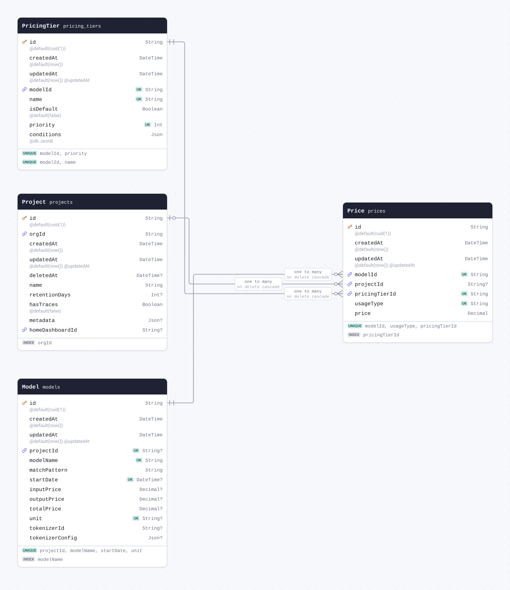

| Field                               | Type       | Constraints                                     | Default              | Description |
| ----------------------------------- | ---------- | ----------------------------------------------- | -------------------- | ----------- |
| `id`                                | `String`   | PK NOT NULL                                     | `cuid(1)`            |             |
| `createdAt` (`created_at`)          | `DateTime` | NOT NULL                                        | `now()`              |             |
| `updatedAt` (`updated_at`)          | `DateTime` | NOT NULL                                        | `now()` `@updatedAt` |             |
| `modelId` (`model_id`)              | `String`   | NOT NULL → [Model.id](#model-Model)             |                      |             |
| `projectId` (`project_id`)          | `String`   | NULL → [Project.id](#model-Project)             |                      |             |
| `pricingTierId` (`pricing_tier_id`) | `String`   | NOT NULL → [PricingTier.id](#model-PricingTier) |                      |             |
| `usageType` (`usage_type`)          | `String`   | NOT NULL                                        |                      |             |
| `price`                             | `Decimal`  | NOT NULL                                        |                      |             |

#### Indexes

- `@@index([pricingTierId])`
- `@@unique([modelId, usageType, pricingTierId])`

#### References

- `modelId` → [Model.id](#model-Model) (many-to-one, on delete Cascade)
- `projectId` → [Project.id](#model-Project) (many-to-one, on delete Cascade)
- `pricingTierId` → [PricingTier.id](#model-PricingTier) (many-to-one, on delete Cascade)

#### Definition

```sql
CREATE TABLE "prices" (
    "id" TEXT NOT NULL,
    "created_at" TIMESTAMP(3) NOT NULL DEFAULT CURRENT_TIMESTAMP,
    "updated_at" TIMESTAMP(3) NOT NULL DEFAULT CURRENT_TIMESTAMP,
    "model_id" TEXT NOT NULL,
    "project_id" TEXT,
    "pricing_tier_id" TEXT NOT NULL,
    "usage_type" TEXT NOT NULL,
    "price" DECIMAL(65,30) NOT NULL,

    CONSTRAINT "prices_pkey" PRIMARY KEY ("id")
);

CREATE INDEX "prices_pricing_tier_id_idx" ON "prices"("pricing_tier_id");

CREATE UNIQUE INDEX "prices_model_id_usage_type_pricing_tier_id_key" ON "prices"("model_id", "usage_type", "pricing_tier_id");

ALTER TABLE "prices" ADD CONSTRAINT "prices_model_id_fkey" FOREIGN KEY ("model_id") REFERENCES "models"("id") ON DELETE CASCADE ON UPDATE CASCADE;

ALTER TABLE "prices" ADD CONSTRAINT "prices_project_id_fkey" FOREIGN KEY ("project_id") REFERENCES "projects"("id") ON DELETE CASCADE ON UPDATE CASCADE;

ALTER TABLE "prices" ADD CONSTRAINT "prices_pricing_tier_id_fkey" FOREIGN KEY ("pricing_tier_id") REFERENCES "pricing_tiers"("id") ON DELETE CASCADE ON UPDATE CASCADE;
```

<details>
<summary>Queries and their SQL</summary>

**findMany**: Every row

```ts
await prisma.price.findMany();
```

```sql
SELECT
  "public"."prices"."id",
  "public"."prices"."created_at",
  "public"."prices"."updated_at",
  "public"."prices"."model_id",
  "public"."prices"."project_id",
  "public"."prices"."pricing_tier_id",
  "public"."prices"."usage_type",
  "public"."prices"."price"
FROM
  "public"."prices"
WHERE
  1 = 1
OFFSET
  $1
-- params: ["0"]
```

**count**: How many rows there are

```ts
await prisma.price.count();
```

```sql
SELECT
  COUNT(*) AS "_count$_all"
FROM
  (
    SELECT
      "public"."prices"."id"
    FROM
      "public"."prices"
    WHERE
      1 = 1
    OFFSET
      $1
  ) AS "sub"
-- params: ["0"]
```

**findMany**: Every row with its relations

```ts
await prisma.price.findMany({ include: { Model: true, project: true, pricingTier: true } });
```

```sql
SELECT
  "public"."prices"."id",
  "public"."prices"."created_at",
  "public"."prices"."updated_at",
  "public"."prices"."model_id",
  "public"."prices"."project_id",
  "public"."prices"."pricing_tier_id",
  "public"."prices"."usage_type",
  "public"."prices"."price"
FROM
  "public"."prices"
WHERE
  1 = 1
OFFSET
  $1
-- params: ["0"]

SELECT
  "public"."models"."id",
  "public"."models"."created_at",
  "public"."models"."updated_at",
  "public"."models"."project_id",
  "public"."models"."model_name",
  "public"."models"."match_pattern",
  "public"."models"."start_date",
  "public"."models"."input_price",
  "public"."models"."output_price",
  "public"."models"."total_price",
  "public"."models"."unit",
  "public"."models"."tokenizer_id",
  "public"."models"."tokenizer_config"
FROM
  "public"."models"
WHERE
  "public"."models"."id" IN ($1)
OFFSET
  $2
-- params: ["<modelId of the rows above>","0"]

SELECT
  "public"."projects"."id",
  "public"."projects"."org_id",
  "public"."projects"."created_at",
  "public"."projects"."updated_at",
  "public"."projects"."deleted_at",
  "public"."projects"."name",
  "public"."projects"."retention_days",
  "public"."projects"."has_traces",
  "public"."projects"."metadata",
  "public"."projects"."home_dashboard_id"
FROM
  "public"."projects"
WHERE
  "public"."projects"."id" IN ($1)
OFFSET
  $2
-- params: ["<projectId of the rows above>","0"]

SELECT
  "public"."pricing_tiers"."id",
  "public"."pricing_tiers"."created_at",
  "public"."pricing_tiers"."updated_at",
  "public"."pricing_tiers"."model_id",
  "public"."pricing_tiers"."name",
  "public"."pricing_tiers"."is_default",
  "public"."pricing_tiers"."priority",
  "public"."pricing_tiers"."conditions"
FROM
  "public"."pricing_tiers"
WHERE
  "public"."pricing_tiers"."id" IN ($1)
OFFSET
  $2
-- params: ["<pricingTierId of the rows above>","0"]
```

**findUnique**: One row by what is unique to it

```ts
await prisma.price.findUnique({ where: { id: "example" } });
```

```sql
SELECT
  "public"."prices"."id",
  "public"."prices"."created_at",
  "public"."prices"."updated_at",
  "public"."prices"."model_id",
  "public"."prices"."project_id",
  "public"."prices"."pricing_tier_id",
  "public"."prices"."usage_type",
  "public"."prices"."price"
FROM
  "public"."prices"
WHERE
  (
    "public"."prices"."id" = $1
    AND 1 = 1
  )
LIMIT
  $2
OFFSET
  $3
-- params: ["example","1","0"]
```

**create**: Create a row

```ts
await prisma.price.create({
  data: { modelId: "example", pricingTierId: "example", usageType: "example", price: "9.99" },
});
```

```sql
INSERT INTO
  "public"."prices" (
    "id",
    "created_at",
    "updated_at",
    "model_id",
    "pricing_tier_id",
    "usage_type",
    "price"
  )
VALUES
  ($1, $2, $3, $4, $5, $6, $7)
RETURNING
  "public"."prices"."id",
  "public"."prices"."created_at",
  "public"."prices"."updated_at",
  "public"."prices"."model_id",
  "public"."prices"."project_id",
  "public"."prices"."pricing_tier_id",
  "public"."prices"."usage_type",
  "public"."prices"."price"
-- params: ["<cuid(1)>","<now()>","<now()>","example","example","example","9.99"]
```

**update**: Update a row

```ts
await prisma.price.update({
  where: { id: "example" },
  data: { createdAt: new Date("2026-01-01T00:00:00.000Z") },
});
```

```sql
UPDATE "public"."prices"
SET
  "created_at" = $1,
  "updated_at" = $2
WHERE
  (
    "public"."prices"."id" = $3
    AND 1 = 1
  )
RETURNING
  "public"."prices"."id",
  "public"."prices"."created_at",
  "public"."prices"."updated_at",
  "public"."prices"."model_id",
  "public"."prices"."project_id",
  "public"."prices"."pricing_tier_id",
  "public"."prices"."usage_type",
  "public"."prices"."price"
-- params: ["2026-01-01T00:00:00.000Z",{"prisma__type":"generatorCall","prisma__value":{"name":"now","args":[],"returnType":{"type":"DateTime"}}},"example"]
```

**delete**: Delete a row

```ts
await prisma.price.delete({ where: { id: "example" } });
```

```sql
DELETE FROM "public"."prices"
WHERE
  (
    "public"."prices"."id" = $1
    AND 1 = 1
  )
RETURNING
  "public"."prices"."id",
  "public"."prices"."created_at",
  "public"."prices"."updated_at",
  "public"."prices"."model_id",
  "public"."prices"."project_id",
  "public"."prices"."pricing_tier_id",
  "public"."prices"."usage_type",
  "public"."prices"."price"
-- params: ["example"]
```

</details>

<a id="model-PricingTier"></a>

### PricingTier

Table `pricing_tiers`.

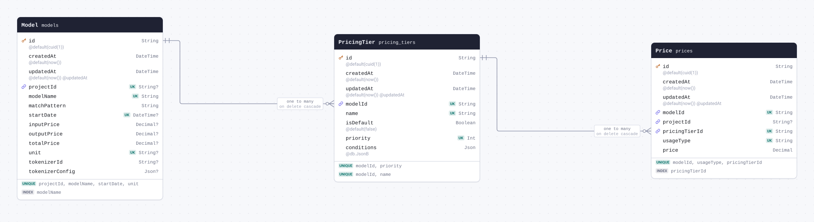

| Field                       | Type               | Constraints                         | Default              | Description |
| --------------------------- | ------------------ | ----------------------------------- | -------------------- | ----------- |
| `id`                        | `String`           | PK NOT NULL                         | `cuid(1)`            |             |
| `createdAt` (`created_at`)  | `DateTime`         | NOT NULL                            | `now()`              |             |
| `updatedAt` (`updated_at`)  | `DateTime`         | NOT NULL                            | `now()` `@updatedAt` |             |
| `modelId` (`model_id`)      | `String`           | NOT NULL → [Model.id](#model-Model) |                      |             |
| `name` (`name`)             | `String`           | NOT NULL                            |                      |             |
| `isDefault` (`is_default`)  | `Boolean`          | NOT NULL                            | `false`              |             |
| `priority` (`priority`)     | `Int`              | NOT NULL                            |                      |             |
| `conditions` (`conditions`) | `Json` `@db.JsonB` | NOT NULL                            |                      |             |

#### Indexes

- `@@unique([modelId, priority])`
- `@@unique([modelId, name])`

#### References

- `modelId` → [Model.id](#model-Model) (many-to-one, on delete Cascade)

#### Referenced by

- `id` ← [Price.pricingTierId](#model-Price) (one-to-many, on delete Cascade)

#### Definition

```sql
CREATE TABLE "pricing_tiers" (
    "id" TEXT NOT NULL,
    "created_at" TIMESTAMP(3) NOT NULL DEFAULT CURRENT_TIMESTAMP,
    "updated_at" TIMESTAMP(3) NOT NULL DEFAULT CURRENT_TIMESTAMP,
    "model_id" TEXT NOT NULL,
    "name" TEXT NOT NULL,
    "is_default" BOOLEAN NOT NULL DEFAULT false,
    "priority" INTEGER NOT NULL,
    "conditions" JSONB NOT NULL,

    CONSTRAINT "pricing_tiers_pkey" PRIMARY KEY ("id")
);

CREATE UNIQUE INDEX "pricing_tiers_model_id_priority_key" ON "pricing_tiers"("model_id", "priority");

CREATE UNIQUE INDEX "pricing_tiers_model_id_name_key" ON "pricing_tiers"("model_id", "name");

ALTER TABLE "pricing_tiers" ADD CONSTRAINT "pricing_tiers_model_id_fkey" FOREIGN KEY ("model_id") REFERENCES "models"("id") ON DELETE CASCADE ON UPDATE CASCADE;
```

<details>
<summary>Queries and their SQL</summary>

**findMany**: Every row

```ts
await prisma.pricingTier.findMany();
```

```sql
SELECT
  "public"."pricing_tiers"."id",
  "public"."pricing_tiers"."created_at",
  "public"."pricing_tiers"."updated_at",
  "public"."pricing_tiers"."model_id",
  "public"."pricing_tiers"."name",
  "public"."pricing_tiers"."is_default",
  "public"."pricing_tiers"."priority",
  "public"."pricing_tiers"."conditions"
FROM
  "public"."pricing_tiers"
WHERE
  1 = 1
OFFSET
  $1
-- params: ["0"]
```

**count**: How many rows there are

```ts
await prisma.pricingTier.count();
```

```sql
SELECT
  COUNT(*) AS "_count$_all"
FROM
  (
    SELECT
      "public"."pricing_tiers"."id"
    FROM
      "public"."pricing_tiers"
    WHERE
      1 = 1
    OFFSET
      $1
  ) AS "sub"
-- params: ["0"]
```

**findMany**: Every row with its relations

```ts
await prisma.pricingTier.findMany({ include: { model: true, prices: true } });
```

```sql
SELECT
  "public"."pricing_tiers"."id",
  "public"."pricing_tiers"."created_at",
  "public"."pricing_tiers"."updated_at",
  "public"."pricing_tiers"."model_id",
  "public"."pricing_tiers"."name",
  "public"."pricing_tiers"."is_default",
  "public"."pricing_tiers"."priority",
  "public"."pricing_tiers"."conditions"
FROM
  "public"."pricing_tiers"
WHERE
  1 = 1
OFFSET
  $1
-- params: ["0"]

SELECT
  "public"."models"."id",
  "public"."models"."created_at",
  "public"."models"."updated_at",
  "public"."models"."project_id",
  "public"."models"."model_name",
  "public"."models"."match_pattern",
  "public"."models"."start_date",
  "public"."models"."input_price",
  "public"."models"."output_price",
  "public"."models"."total_price",
  "public"."models"."unit",
  "public"."models"."tokenizer_id",
  "public"."models"."tokenizer_config"
FROM
  "public"."models"
WHERE
  "public"."models"."id" IN ($1)
OFFSET
  $2
-- params: ["<modelId of the rows above>","0"]

SELECT
  "public"."prices"."id",
  "public"."prices"."created_at",
  "public"."prices"."updated_at",
  "public"."prices"."model_id",
  "public"."prices"."project_id",
  "public"."prices"."pricing_tier_id",
  "public"."prices"."usage_type",
  "public"."prices"."price"
FROM
  "public"."prices"
WHERE
  "public"."prices"."pricing_tier_id" IN ($1)
OFFSET
  $2
-- params: ["<id of the rows above>","0"]
```

**findUnique**: One row by what is unique to it

```ts
await prisma.pricingTier.findUnique({ where: { id: "example" } });
```

```sql
SELECT
  "public"."pricing_tiers"."id",
  "public"."pricing_tiers"."created_at",
  "public"."pricing_tiers"."updated_at",
  "public"."pricing_tiers"."model_id",
  "public"."pricing_tiers"."name",
  "public"."pricing_tiers"."is_default",
  "public"."pricing_tiers"."priority",
  "public"."pricing_tiers"."conditions"
FROM
  "public"."pricing_tiers"
WHERE
  (
    "public"."pricing_tiers"."id" = $1
    AND 1 = 1
  )
LIMIT
  $2
OFFSET
  $3
-- params: ["example","1","0"]
```

**create**: Create a row

```ts
await prisma.pricingTier.create({
  data: { modelId: "example", name: "example", priority: 1, conditions: {} },
});
```

```sql
INSERT INTO
  "public"."pricing_tiers" (
    "id",
    "created_at",
    "updated_at",
    "model_id",
    "name",
    "is_default",
    "priority",
    "conditions"
  )
VALUES
  ($1, $2, $3, $4, $5, $6, $7, $8)
RETURNING
  "public"."pricing_tiers"."id",
  "public"."pricing_tiers"."created_at",
  "public"."pricing_tiers"."updated_at",
  "public"."pricing_tiers"."model_id",
  "public"."pricing_tiers"."name",
  "public"."pricing_tiers"."is_default",
  "public"."pricing_tiers"."priority",
  "public"."pricing_tiers"."conditions"
-- params: ["<cuid(1)>","<now()>","<now()>","example","example",false,"1","{}"]
```

**update**: Update a row

```ts
await prisma.pricingTier.update({
  where: { id: "example" },
  data: { createdAt: new Date("2026-01-01T00:00:00.000Z") },
});
```

```sql
UPDATE "public"."pricing_tiers"
SET
  "created_at" = $1,
  "updated_at" = $2
WHERE
  (
    "public"."pricing_tiers"."id" = $3
    AND 1 = 1
  )
RETURNING
  "public"."pricing_tiers"."id",
  "public"."pricing_tiers"."created_at",
  "public"."pricing_tiers"."updated_at",
  "public"."pricing_tiers"."model_id",
  "public"."pricing_tiers"."name",
  "public"."pricing_tiers"."is_default",
  "public"."pricing_tiers"."priority",
  "public"."pricing_tiers"."conditions"
-- params: ["2026-01-01T00:00:00.000Z",{"prisma__type":"generatorCall","prisma__value":{"name":"now","args":[],"returnType":{"type":"DateTime"}}},"example"]
```

**delete**: Delete a row

```ts
await prisma.pricingTier.delete({ where: { id: "example" } });
```

```sql
DELETE FROM "public"."pricing_tiers"
WHERE
  (
    "public"."pricing_tiers"."id" = $1
    AND 1 = 1
  )
RETURNING
  "public"."pricing_tiers"."id",
  "public"."pricing_tiers"."created_at",
  "public"."pricing_tiers"."updated_at",
  "public"."pricing_tiers"."model_id",
  "public"."pricing_tiers"."name",
  "public"."pricing_tiers"."is_default",
  "public"."pricing_tiers"."priority",
  "public"."pricing_tiers"."conditions"
-- params: ["example"]
```

</details>

<a id="model-AuditLog"></a>

### AuditLog

Table `audit_logs`.

| Field                                   | Type                                             | Constraints | Default              | Description |
| --------------------------------------- | ------------------------------------------------ | ----------- | -------------------- | ----------- |
| `id`                                    | `String`                                         | PK NOT NULL | `cuid(1)`            |             |
| `createdAt` (`created_at`)              | `DateTime`                                       | NOT NULL    | `now()`              |             |
| `updatedAt` (`updated_at`)              | `DateTime`                                       | NOT NULL    | `now()` `@updatedAt` |             |
| `type`                                  | [`AuditLogRecordType`](#enum-AuditLogRecordType) | NOT NULL    | `USER`               |             |
| `apiKeyId` (`api_key_id`)               | `String`                                         | NULL        |                      |             |
| `userId` (`user_id`)                    | `String`                                         | NULL        |                      |             |
| `orgId` (`org_id`)                      | `String`                                         | NOT NULL    |                      |             |
| `userOrgRole` (`user_org_role`)         | `String`                                         | NULL        |                      |             |
| `projectId` (`project_id`)              | `String`                                         | NULL        |                      |             |
| `userProjectRole` (`user_project_role`) | `String`                                         | NULL        |                      |             |
| `resourceType` (`resource_type`)        | `String`                                         | NOT NULL    |                      |             |
| `resourceId` (`resource_id`)            | `String`                                         | NOT NULL    |                      |             |
| `action`                                | `String`                                         | NOT NULL    |                      |             |
| `before`                                | `String`                                         | NULL        |                      |             |
| `after`                                 | `String`                                         | NULL        |                      |             |

#### Indexes

- `@@index([projectId])`
- `@@index([apiKeyId])`
- `@@index([userId])`
- `@@index([orgId])`
- `@@index([createdAt])`
- `@@index([updatedAt])`

#### Definition

```sql
CREATE TABLE "audit_logs" (
    "id" TEXT NOT NULL,
    "created_at" TIMESTAMP(3) NOT NULL DEFAULT CURRENT_TIMESTAMP,
    "updated_at" TIMESTAMP(3) NOT NULL DEFAULT CURRENT_TIMESTAMP,
    "type" "AuditLogRecordType" NOT NULL DEFAULT 'USER',
    "api_key_id" TEXT,
    "user_id" TEXT,
    "org_id" TEXT NOT NULL,
    "user_org_role" TEXT,
    "project_id" TEXT,
    "user_project_role" TEXT,
    "resource_type" TEXT NOT NULL,
    "resource_id" TEXT NOT NULL,
    "action" TEXT NOT NULL,
    "before" TEXT,
    "after" TEXT,

    CONSTRAINT "audit_logs_pkey" PRIMARY KEY ("id")
);

CREATE INDEX "audit_logs_project_id_idx" ON "audit_logs"("project_id");

CREATE INDEX "audit_logs_api_key_id_idx" ON "audit_logs"("api_key_id");

CREATE INDEX "audit_logs_user_id_idx" ON "audit_logs"("user_id");

CREATE INDEX "audit_logs_org_id_idx" ON "audit_logs"("org_id");

CREATE INDEX "audit_logs_created_at_idx" ON "audit_logs"("created_at");

CREATE INDEX "audit_logs_updated_at_idx" ON "audit_logs"("updated_at");
```

<details>
<summary>Queries and their SQL</summary>

**findMany**: Every row

```ts
await prisma.auditLog.findMany();
```

```sql
SELECT
  "public"."audit_logs"."id",
  "public"."audit_logs"."created_at",
  "public"."audit_logs"."updated_at",
  "public"."audit_logs"."type"::text,
  "public"."audit_logs"."api_key_id",
  "public"."audit_logs"."user_id",
  "public"."audit_logs"."org_id",
  "public"."audit_logs"."user_org_role",
  "public"."audit_logs"."project_id",
  "public"."audit_logs"."user_project_role",
  "public"."audit_logs"."resource_type",
  "public"."audit_logs"."resource_id",
  "public"."audit_logs"."action",
  "public"."audit_logs"."before",
  "public"."audit_logs"."after"
FROM
  "public"."audit_logs"
WHERE
  1 = 1
OFFSET
  $1
-- params: ["0"]
```

**count**: How many rows there are

```ts
await prisma.auditLog.count();
```

```sql
SELECT
  COUNT(*) AS "_count$_all"
FROM
  (
    SELECT
      "public"."audit_logs"."id"
    FROM
      "public"."audit_logs"
    WHERE
      1 = 1
    OFFSET
      $1
  ) AS "sub"
-- params: ["0"]
```

**findUnique**: One row by what is unique to it

```ts
await prisma.auditLog.findUnique({ where: { id: "example" } });
```

```sql
SELECT
  "public"."audit_logs"."id",
  "public"."audit_logs"."created_at",
  "public"."audit_logs"."updated_at",
  "public"."audit_logs"."type"::text,
  "public"."audit_logs"."api_key_id",
  "public"."audit_logs"."user_id",
  "public"."audit_logs"."org_id",
  "public"."audit_logs"."user_org_role",
  "public"."audit_logs"."project_id",
  "public"."audit_logs"."user_project_role",
  "public"."audit_logs"."resource_type",
  "public"."audit_logs"."resource_id",
  "public"."audit_logs"."action",
  "public"."audit_logs"."before",
  "public"."audit_logs"."after"
FROM
  "public"."audit_logs"
WHERE
  (
    "public"."audit_logs"."id" = $1
    AND 1 = 1
  )
LIMIT
  $2
OFFSET
  $3
-- params: ["example","1","0"]
```

**create**: Create a row

```ts
await prisma.auditLog.create({
  data: { orgId: "example", resourceType: "example", resourceId: "example", action: "example" },
});
```

```sql
INSERT INTO
  "public"."audit_logs" (
    "id",
    "created_at",
    "updated_at",
    "type",
    "org_id",
    "resource_type",
    "resource_id",
    "action"
  )
VALUES
  (
    $1,
    $2,
    $3,
    CAST($4::text AS "public"."AuditLogRecordType"),
    $5,
    $6,
    $7,
    $8
  )
RETURNING
  "public"."audit_logs"."id",
  "public"."audit_logs"."created_at",
  "public"."audit_logs"."updated_at",
  "public"."audit_logs"."type"::text,
  "public"."audit_logs"."api_key_id",
  "public"."audit_logs"."user_id",
  "public"."audit_logs"."org_id",
  "public"."audit_logs"."user_org_role",
  "public"."audit_logs"."project_id",
  "public"."audit_logs"."user_project_role",
  "public"."audit_logs"."resource_type",
  "public"."audit_logs"."resource_id",
  "public"."audit_logs"."action",
  "public"."audit_logs"."before",
  "public"."audit_logs"."after"
-- params: ["<cuid(1)>","<now()>","<now()>","USER","example","example","example","example"]
```

**update**: Update a row

```ts
await prisma.auditLog.update({
  where: { id: "example" },
  data: { createdAt: new Date("2026-01-01T00:00:00.000Z") },
});
```

```sql
UPDATE "public"."audit_logs"
SET
  "created_at" = $1,
  "updated_at" = $2
WHERE
  (
    "public"."audit_logs"."id" = $3
    AND 1 = 1
  )
RETURNING
  "public"."audit_logs"."id",
  "public"."audit_logs"."created_at",
  "public"."audit_logs"."updated_at",
  "public"."audit_logs"."type"::text,
  "public"."audit_logs"."api_key_id",
  "public"."audit_logs"."user_id",
  "public"."audit_logs"."org_id",
  "public"."audit_logs"."user_org_role",
  "public"."audit_logs"."project_id",
  "public"."audit_logs"."user_project_role",
  "public"."audit_logs"."resource_type",
  "public"."audit_logs"."resource_id",
  "public"."audit_logs"."action",
  "public"."audit_logs"."before",
  "public"."audit_logs"."after"
-- params: ["2026-01-01T00:00:00.000Z",{"prisma__type":"generatorCall","prisma__value":{"name":"now","args":[],"returnType":{"type":"DateTime"}}},"example"]
```

**delete**: Delete a row

```ts
await prisma.auditLog.delete({ where: { id: "example" } });
```

```sql
DELETE FROM "public"."audit_logs"
WHERE
  (
    "public"."audit_logs"."id" = $1
    AND 1 = 1
  )
RETURNING
  "public"."audit_logs"."id",
  "public"."audit_logs"."created_at",
  "public"."audit_logs"."updated_at",
  "public"."audit_logs"."type"::text,
  "public"."audit_logs"."api_key_id",
  "public"."audit_logs"."user_id",
  "public"."audit_logs"."org_id",
  "public"."audit_logs"."user_org_role",
  "public"."audit_logs"."project_id",
  "public"."audit_logs"."user_project_role",
  "public"."audit_logs"."resource_type",
  "public"."audit_logs"."resource_id",
  "public"."audit_logs"."action",
  "public"."audit_logs"."before",
  "public"."audit_logs"."after"
-- params: ["example"]
```

</details>

<a id="model-AuditLogStaging"></a>

### AuditLogStaging

Table `audit_log_staging`.

| Field                      | Type                | Constraints | Default | Description |
| -------------------------- | ------------------- | ----------- | ------- | ----------- |
| `id`                       | `String` `@db.Uuid` | PK NOT NULL |         |             |
| `createdAt` (`created_at`) | `DateTime`          | NOT NULL    | `now()` |             |
| `payload`                  | `Json`              | NOT NULL    |         |             |
| `failedAt` (`failed_at`)   | `DateTime`          | NULL        |         |             |
| `lastError` (`last_error`) | `String`            | NULL        |         |             |

#### Definition

```sql
CREATE TABLE "audit_log_staging" (
    "id" UUID NOT NULL,
    "created_at" TIMESTAMP(3) NOT NULL DEFAULT CURRENT_TIMESTAMP,
    "payload" JSONB NOT NULL,
    "failed_at" TIMESTAMP(3),
    "last_error" TEXT,

    CONSTRAINT "audit_log_staging_pkey" PRIMARY KEY ("id")
);
```

<details>
<summary>Queries and their SQL</summary>

**findMany**: Every row

```ts
await prisma.auditLogStaging.findMany();
```

```sql
SELECT
  "public"."audit_log_staging"."id",
  "public"."audit_log_staging"."created_at",
  "public"."audit_log_staging"."payload",
  "public"."audit_log_staging"."failed_at",
  "public"."audit_log_staging"."last_error"
FROM
  "public"."audit_log_staging"
WHERE
  1 = 1
OFFSET
  $1
-- params: ["0"]
```

**count**: How many rows there are

```ts
await prisma.auditLogStaging.count();
```

```sql
SELECT
  COUNT(*) AS "_count$_all"
FROM
  (
    SELECT
      "public"."audit_log_staging"."id"
    FROM
      "public"."audit_log_staging"
    WHERE
      1 = 1
    OFFSET
      $1
  ) AS "sub"
-- params: ["0"]
```

**findUnique**: One row by what is unique to it

```ts
await prisma.auditLogStaging.findUnique({ where: { id: "example" } });
```

```sql
SELECT
  "public"."audit_log_staging"."id",
  "public"."audit_log_staging"."created_at",
  "public"."audit_log_staging"."payload",
  "public"."audit_log_staging"."failed_at",
  "public"."audit_log_staging"."last_error"
FROM
  "public"."audit_log_staging"
WHERE
  (
    "public"."audit_log_staging"."id" = $1
    AND 1 = 1
  )
LIMIT
  $2
OFFSET
  $3
-- params: ["example","1","0"]
```

**create**: Create a row

```ts
await prisma.auditLogStaging.create({ data: { id: "example", payload: {} } });
```

```sql
INSERT INTO
  "public"."audit_log_staging" ("id", "created_at", "payload")
VALUES
  ($1, $2, $3)
RETURNING
  "public"."audit_log_staging"."id",
  "public"."audit_log_staging"."created_at",
  "public"."audit_log_staging"."payload",
  "public"."audit_log_staging"."failed_at",
  "public"."audit_log_staging"."last_error"
-- params: ["example","<now()>","{}"]
```

**update**: Update a row

```ts
await prisma.auditLogStaging.update({
  where: { id: "example" },
  data: { createdAt: new Date("2026-01-01T00:00:00.000Z") },
});
```

```sql
UPDATE "public"."audit_log_staging"
SET
  "created_at" = $1
WHERE
  (
    "public"."audit_log_staging"."id" = $2
    AND 1 = 1
  )
RETURNING
  "public"."audit_log_staging"."id",
  "public"."audit_log_staging"."created_at",
  "public"."audit_log_staging"."payload",
  "public"."audit_log_staging"."failed_at",
  "public"."audit_log_staging"."last_error"
-- params: ["2026-01-01T00:00:00.000Z","example"]
```

**delete**: Delete a row

```ts
await prisma.auditLogStaging.delete({ where: { id: "example" } });
```

```sql
DELETE FROM "public"."audit_log_staging"
WHERE
  (
    "public"."audit_log_staging"."id" = $1
    AND 1 = 1
  )
RETURNING
  "public"."audit_log_staging"."id",
  "public"."audit_log_staging"."created_at",
  "public"."audit_log_staging"."payload",
  "public"."audit_log_staging"."failed_at",
  "public"."audit_log_staging"."last_error"
-- params: ["example"]
```

</details>

<a id="model-EvalTemplate"></a>

### EvalTemplate

Table `eval_templates`.

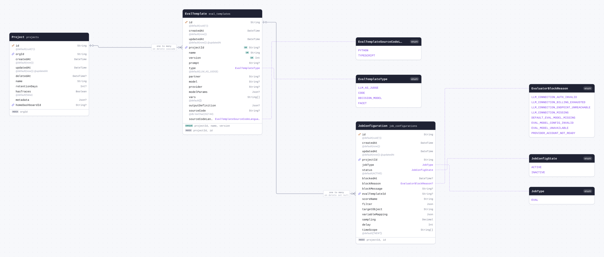

| Field                                         | Type                                                                     | Constraints                         | Default              | Description |
| --------------------------------------------- | ------------------------------------------------------------------------ | ----------------------------------- | -------------------- | ----------- |
| `id`                                          | `String`                                                                 | PK NOT NULL                         | `cuid(1)`            |             |
| `createdAt` (`created_at`)                    | `DateTime`                                                               | NOT NULL                            | `now()`              |             |
| `updatedAt` (`updated_at`)                    | `DateTime`                                                               | NOT NULL                            | `now()` `@updatedAt` |             |
| `projectId` (`project_id`)                    | `String`                                                                 | NULL → [Project.id](#model-Project) |                      |             |
| `name`                                        | `String`                                                                 | NOT NULL                            |                      |             |
| `version`                                     | `Int`                                                                    | NOT NULL                            |                      |             |
| `prompt`                                      | `String`                                                                 | NULL                                |                      |             |
| `type`                                        | [`EvalTemplateType`](#enum-EvalTemplateType)                             | NOT NULL                            | `LLM_AS_JUDGE`       |             |
| `partner`                                     | `String`                                                                 | NULL                                |                      |             |
| `model`                                       | `String`                                                                 | NULL                                |                      |             |
| `provider`                                    | `String`                                                                 | NULL                                |                      |             |
| `modelParams` (`model_params`)                | `Json`                                                                   | NULL                                |                      |             |
| `vars`                                        | `String[]`                                                               | NOT NULL                            | `[]`                 |             |
| `outputDefinition` (`output_schema`)          | `Json`                                                                   | NULL                                |                      |             |
| `sourceCode` (`source_code`)                  | `String` `@db.VarChar(262144)`                                           | NULL                                |                      |             |
| `sourceCodeLanguage` (`source_code_language`) | [`EvalTemplateSourceCodeLanguage`](#enum-EvalTemplateSourceCodeLanguage) | NULL                                |                      |             |

#### Indexes

- `@@index([projectId, id])`
- `@@unique([projectId, name, version])`

#### References

- `projectId` → [Project.id](#model-Project) (many-to-one, on delete Cascade)

#### Referenced by

- `id` ← [JobConfiguration.evalTemplateId](#model-JobConfiguration) (one-to-many, on delete SetNull)

#### Definition

```sql
CREATE TABLE "eval_templates" (
    "id" TEXT NOT NULL,
    "created_at" TIMESTAMP(3) NOT NULL DEFAULT CURRENT_TIMESTAMP,
    "updated_at" TIMESTAMP(3) NOT NULL DEFAULT CURRENT_TIMESTAMP,
    "project_id" TEXT,
    "name" TEXT NOT NULL,
    "version" INTEGER NOT NULL,
    "prompt" TEXT,
    "type" "EvalTemplateType" NOT NULL DEFAULT 'LLM_AS_JUDGE',
    "partner" TEXT,
    "model" TEXT,
    "provider" TEXT,
    "model_params" JSONB,
    "vars" TEXT[] DEFAULT ARRAY[]::TEXT[],
    "output_schema" JSONB,
    "source_code" VARCHAR(262144),
    "source_code_language" "EvalTemplateSourceCodeLanguage",

    CONSTRAINT "eval_templates_pkey" PRIMARY KEY ("id")
);

CREATE INDEX "eval_templates_project_id_id_idx" ON "eval_templates"("project_id", "id");

CREATE UNIQUE INDEX "eval_templates_project_id_name_version_key" ON "eval_templates"("project_id", "name", "version");

ALTER TABLE "eval_templates" ADD CONSTRAINT "eval_templates_project_id_fkey" FOREIGN KEY ("project_id") REFERENCES "projects"("id") ON DELETE CASCADE ON UPDATE CASCADE;
```

<details>
<summary>Queries and their SQL</summary>

**findMany**: Every row

```ts
await prisma.evalTemplate.findMany();
```

```sql
SELECT
  "public"."eval_templates"."id",
  "public"."eval_templates"."created_at",
  "public"."eval_templates"."updated_at",
  "public"."eval_templates"."project_id",
  "public"."eval_templates"."name",
  "public"."eval_templates"."version",
  "public"."eval_templates"."prompt",
  "public"."eval_templates"."type"::text,
  "public"."eval_templates"."partner",
  "public"."eval_templates"."model",
  "public"."eval_templates"."provider",
  "public"."eval_templates"."model_params",
  "public"."eval_templates"."vars",
  "public"."eval_templates"."output_schema",
  "public"."eval_templates"."source_code",
  "public"."eval_templates"."source_code_language"::text
FROM
  "public"."eval_templates"
WHERE
  1 = 1
OFFSET
  $1
-- params: ["0"]
```

**count**: How many rows there are

```ts
await prisma.evalTemplate.count();
```

```sql
SELECT
  COUNT(*) AS "_count$_all"
FROM
  (
    SELECT
      "public"."eval_templates"."id"
    FROM
      "public"."eval_templates"
    WHERE
      1 = 1
    OFFSET
      $1
  ) AS "sub"
-- params: ["0"]
```

**findMany**: Every row with its relations

```ts
await prisma.evalTemplate.findMany({ include: { project: true, JobConfiguration: true } });
```

```sql
SELECT
  "public"."eval_templates"."id",
  "public"."eval_templates"."created_at",
  "public"."eval_templates"."updated_at",
  "public"."eval_templates"."project_id",
  "public"."eval_templates"."name",
  "public"."eval_templates"."version",
  "public"."eval_templates"."prompt",
  "public"."eval_templates"."type"::text,
  "public"."eval_templates"."partner",
  "public"."eval_templates"."model",
  "public"."eval_templates"."provider",
  "public"."eval_templates"."model_params",
  "public"."eval_templates"."vars",
  "public"."eval_templates"."output_schema",
  "public"."eval_templates"."source_code",
  "public"."eval_templates"."source_code_language"::text
FROM
  "public"."eval_templates"
WHERE
  1 = 1
OFFSET
  $1
-- params: ["0"]

SELECT
  "public"."projects"."id",
  "public"."projects"."org_id",
  "public"."projects"."created_at",
  "public"."projects"."updated_at",
  "public"."projects"."deleted_at",
  "public"."projects"."name",
  "public"."projects"."retention_days",
  "public"."projects"."has_traces",
  "public"."projects"."metadata",
  "public"."projects"."home_dashboard_id"
FROM
  "public"."projects"
WHERE
  "public"."projects"."id" IN ($1)
OFFSET
  $2
-- params: ["<projectId of the rows above>","0"]

SELECT
  "public"."job_configurations"."id",
  "public"."job_configurations"."created_at",
  "public"."job_configurations"."updated_at",
  "public"."job_configurations"."project_id",
  "public"."job_configurations"."job_type"::text,
  "public"."job_configurations"."status"::text,
  "public"."job_configurations"."blocked_at",
  "public"."job_configurations"."block_reason"::text,
  "public"."job_configurations"."block_message",
  "public"."job_configurations"."eval_template_id",
  "public"."job_configurations"."score_name",
  "public"."job_configurations"."filter",
  "public"."job_configurations"."target_object",
  "public"."job_configurations"."variable_mapping",
  "public"."job_configurations"."sampling",
  "public"."job_configurations"."delay",
  "public"."job_configurations"."time_scope"
FROM
  "public"."job_configurations"
WHERE
  "public"."job_configurations"."eval_template_id" IN ($1)
OFFSET
  $2
-- params: ["<id of the rows above>","0"]
```

**findUnique**: One row by what is unique to it

```ts
await prisma.evalTemplate.findUnique({ where: { id: "example" } });
```

```sql
SELECT
  "public"."eval_templates"."id",
  "public"."eval_templates"."created_at",
  "public"."eval_templates"."updated_at",
  "public"."eval_templates"."project_id",
  "public"."eval_templates"."name",
  "public"."eval_templates"."version",
  "public"."eval_templates"."prompt",
  "public"."eval_templates"."type"::text,
  "public"."eval_templates"."partner",
  "public"."eval_templates"."model",
  "public"."eval_templates"."provider",
  "public"."eval_templates"."model_params",
  "public"."eval_templates"."vars",
  "public"."eval_templates"."output_schema",
  "public"."eval_templates"."source_code",
  "public"."eval_templates"."source_code_language"::text
FROM
  "public"."eval_templates"
WHERE
  (
    "public"."eval_templates"."id" = $1
    AND 1 = 1
  )
LIMIT
  $2
OFFSET
  $3
-- params: ["example","1","0"]
```

**create**: Create a row

```ts
await prisma.evalTemplate.create({ data: { name: "example", version: 1 } });
```

```sql
INSERT INTO
  "public"."eval_templates" (
    "id",
    "created_at",
    "updated_at",
    "name",
    "version",
    "type",
    "vars"
  )
VALUES
  (
    $1,
    $2,
    $3,
    $4,
    $5,
    CAST($6::text AS "public"."EvalTemplateType"),
    $7
  )
RETURNING
  "public"."eval_templates"."id",
  "public"."eval_templates"."created_at",
  "public"."eval_templates"."updated_at",
  "public"."eval_templates"."project_id",
  "public"."eval_templates"."name",
  "public"."eval_templates"."version",
  "public"."eval_templates"."prompt",
  "public"."eval_templates"."type"::text,
  "public"."eval_templates"."partner",
  "public"."eval_templates"."model",
  "public"."eval_templates"."provider",
  "public"."eval_templates"."model_params",
  "public"."eval_templates"."vars",
  "public"."eval_templates"."output_schema",
  "public"."eval_templates"."source_code",
  "public"."eval_templates"."source_code_language"::text
-- params: ["<cuid(1)>","<now()>","<now()>","example","1","LLM_AS_JUDGE",[]]
```

**update**: Update a row

```ts
await prisma.evalTemplate.update({
  where: { id: "example" },
  data: { createdAt: new Date("2026-01-01T00:00:00.000Z") },
});
```

```sql
UPDATE "public"."eval_templates"
SET
  "created_at" = $1,
  "updated_at" = $2
WHERE
  (
    "public"."eval_templates"."id" = $3
    AND 1 = 1
  )
RETURNING
  "public"."eval_templates"."id",
  "public"."eval_templates"."created_at",
  "public"."eval_templates"."updated_at",
  "public"."eval_templates"."project_id",
  "public"."eval_templates"."name",
  "public"."eval_templates"."version",
  "public"."eval_templates"."prompt",
  "public"."eval_templates"."type"::text,
  "public"."eval_templates"."partner",
  "public"."eval_templates"."model",
  "public"."eval_templates"."provider",
  "public"."eval_templates"."model_params",
  "public"."eval_templates"."vars",
  "public"."eval_templates"."output_schema",
  "public"."eval_templates"."source_code",
  "public"."eval_templates"."source_code_language"::text
-- params: ["2026-01-01T00:00:00.000Z",{"prisma__type":"generatorCall","prisma__value":{"name":"now","args":[],"returnType":{"type":"DateTime"}}},"example"]
```

**delete**: Delete a row

```ts
await prisma.evalTemplate.delete({ where: { id: "example" } });
```

```sql
DELETE FROM "public"."eval_templates"
WHERE
  (
    "public"."eval_templates"."id" = $1
    AND 1 = 1
  )
RETURNING
  "public"."eval_templates"."id",
  "public"."eval_templates"."created_at",
  "public"."eval_templates"."updated_at",
  "public"."eval_templates"."project_id",
  "public"."eval_templates"."name",
  "public"."eval_templates"."version",
  "public"."eval_templates"."prompt",
  "public"."eval_templates"."type"::text,
  "public"."eval_templates"."partner",
  "public"."eval_templates"."model",
  "public"."eval_templates"."provider",
  "public"."eval_templates"."model_params",
  "public"."eval_templates"."vars",
  "public"."eval_templates"."output_schema",
  "public"."eval_templates"."source_code",
  "public"."eval_templates"."source_code_language"::text
-- params: ["example"]
```

</details>

<a id="model-Evaluator"></a>

### Evaluator

Table `evaluators`.

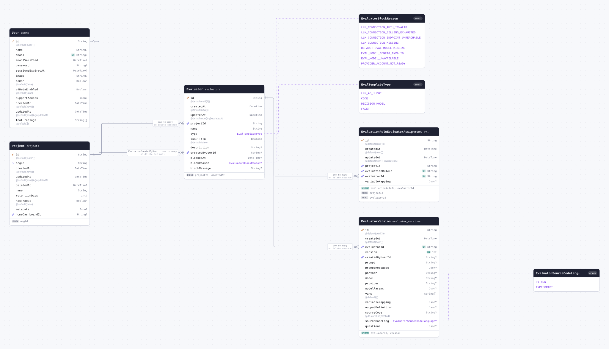

| Field                                    | Type                                                 | Constraints                             | Default              | Description |
| ---------------------------------------- | ---------------------------------------------------- | --------------------------------------- | -------------------- | ----------- |
| `id`                                     | `String`                                             | PK NOT NULL                             | `cuid(1)`            |             |
| `createdAt` (`created_at`)               | `DateTime`                                           | NOT NULL                                | `now()`              |             |
| `updatedAt` (`updated_at`)               | `DateTime`                                           | NOT NULL                                | `now()` `@updatedAt` |             |
| `projectId` (`project_id`)               | `String`                                             | NOT NULL → [Project.id](#model-Project) |                      |             |
| `name`                                   | `String`                                             | NOT NULL                                |                      |             |
| `type`                                   | [`EvalTemplateType`](#enum-EvalTemplateType)         | NOT NULL                                |                      |             |
| `isBuiltIn` (`is_built_in`)              | `Boolean`                                            | NOT NULL                                | `false`              |             |
| `description`                            | `String`                                             | NULL                                    |                      |             |
| `createdByUserId` (`created_by_user_id`) | `String`                                             | NULL → [User.id](#model-User)           |                      |             |
| `blockedAt` (`blocked_at`)               | `DateTime`                                           | NULL                                    |                      |             |
| `blockReason` (`block_reason`)           | [`EvaluatorBlockReason`](#enum-EvaluatorBlockReason) | NULL                                    |                      |             |
| `blockMessage` (`block_message`)         | `String`                                             | NULL                                    |                      |             |

#### Indexes

- `@@index([projectId, createdAt])`

#### References

- `projectId` → [Project.id](#model-Project) (many-to-one, on delete Cascade)
- `createdByUserId` → [User.id](#model-User) (many-to-one, on delete SetNull)

#### Referenced by

- `id` ← [EvaluatorVersion.evaluatorId](#model-EvaluatorVersion) (one-to-many, on delete Cascade)
- `id` ← [EvaluationRuleEvaluatorAssignment.evaluatorId](#model-EvaluationRuleEvaluatorAssignment) (one-to-many, on delete Cascade)

#### Definition

```sql
CREATE TABLE "evaluators" (
    "id" TEXT NOT NULL,
    "created_at" TIMESTAMP(3) NOT NULL DEFAULT CURRENT_TIMESTAMP,
    "updated_at" TIMESTAMP(3) NOT NULL DEFAULT CURRENT_TIMESTAMP,
    "project_id" TEXT NOT NULL,
    "name" TEXT NOT NULL,
    "type" "EvalTemplateType" NOT NULL,
    "is_built_in" BOOLEAN NOT NULL DEFAULT false,
    "description" TEXT,
    "created_by_user_id" TEXT,
    "blocked_at" TIMESTAMP(3),
    "block_reason" "EvaluatorBlockReason",
    "block_message" TEXT,

    CONSTRAINT "evaluators_pkey" PRIMARY KEY ("id")
);

CREATE INDEX "evaluators_project_id_created_at_idx" ON "evaluators"("project_id", "created_at" DESC);

ALTER TABLE "evaluators" ADD CONSTRAINT "evaluators_project_id_fkey" FOREIGN KEY ("project_id") REFERENCES "projects"("id") ON DELETE CASCADE ON UPDATE CASCADE;

ALTER TABLE "evaluators" ADD CONSTRAINT "evaluators_created_by_user_id_fkey" FOREIGN KEY ("created_by_user_id") REFERENCES "users"("id") ON DELETE SET NULL ON UPDATE CASCADE;
```

<details>
<summary>Queries and their SQL</summary>

**findMany**: Every row

```ts
await prisma.evaluator.findMany();
```

```sql
SELECT
  "public"."evaluators"."id",
  "public"."evaluators"."created_at",
  "public"."evaluators"."updated_at",
  "public"."evaluators"."project_id",
  "public"."evaluators"."name",
  "public"."evaluators"."type"::text,
  "public"."evaluators"."is_built_in",
  "public"."evaluators"."description",
  "public"."evaluators"."created_by_user_id",
  "public"."evaluators"."blocked_at",
  "public"."evaluators"."block_reason"::text,
  "public"."evaluators"."block_message"
FROM
  "public"."evaluators"
WHERE
  1 = 1
OFFSET
  $1
-- params: ["0"]
```

**count**: How many rows there are

```ts
await prisma.evaluator.count();
```

```sql
SELECT
  COUNT(*) AS "_count$_all"
FROM
  (
    SELECT
      "public"."evaluators"."id"
    FROM
      "public"."evaluators"
    WHERE
      1 = 1
    OFFSET
      $1
  ) AS "sub"
-- params: ["0"]
```

**findMany**: Every row with its relations

```ts
await prisma.evaluator.findMany({
  include: { project: true, createdByUser: true, versions: true, assignments: true },
});
```

```sql
SELECT
  "public"."evaluators"."id",
  "public"."evaluators"."created_at",
  "public"."evaluators"."updated_at",
  "public"."evaluators"."project_id",
  "public"."evaluators"."name",
  "public"."evaluators"."type"::text,
  "public"."evaluators"."is_built_in",
  "public"."evaluators"."description",
  "public"."evaluators"."created_by_user_id",
  "public"."evaluators"."blocked_at",
  "public"."evaluators"."block_reason"::text,
  "public"."evaluators"."block_message"
FROM
  "public"."evaluators"
WHERE
  1 = 1
OFFSET
  $1
-- params: ["0"]

SELECT
  "public"."projects"."id",
  "public"."projects"."org_id",
  "public"."projects"."created_at",
  "public"."projects"."updated_at",
  "public"."projects"."deleted_at",
  "public"."projects"."name",
  "public"."projects"."retention_days",
  "public"."projects"."has_traces",
  "public"."projects"."metadata",
  "public"."projects"."home_dashboard_id"
FROM
  "public"."projects"
WHERE
  "public"."projects"."id" IN ($1)
OFFSET
  $2
-- params: ["<projectId of the rows above>","0"]

SELECT
  "public"."users"."id",
  "public"."users"."name",
  "public"."users"."email",
  "public"."users"."email_verified",
  "public"."users"."password",
  "public"."users"."sessions_expired_at",
  "public"."users"."image",
  "public"."users"."admin",
  "public"."users"."v4_beta_enabled",
  "public"."users"."support_access",
  "public"."users"."created_at",
  "public"."users"."updated_at",
  "public"."users"."feature_flags"
FROM
  "public"."users"
WHERE
  "public"."users"."id" IN ($1)
OFFSET
  $2
-- params: ["<createdByUserId of the rows above>","0"]

SELECT
  "public"."evaluator_versions"."id",
  "public"."evaluator_versions"."created_at",
  "public"."evaluator_versions"."evaluator_id",
  "public"."evaluator_versions"."version",
  "public"."evaluator_versions"."created_by_user_id",
  "public"."evaluator_versions"."prompt",
  "public"."evaluator_versions"."prompt_messages",
  "public"."evaluator_versions"."partner",
  "public"."evaluator_versions"."model",
  "public"."evaluator_versions"."provider",
  "public"."evaluator_versions"."model_params",
  "public"."evaluator_versions"."vars",
  "public"."evaluator_versions"."variable_mapping",
  "public"."evaluator_versions"."output_definition",
  "public"."evaluator_versions"."source_code",
  "public"."evaluator_versions"."source_code_language"::text,
  "public"."evaluator_versions"."questions"
FROM
  "public"."evaluator_versions"
WHERE
  "public"."evaluator_versions"."evaluator_id" IN ($1)
OFFSET
  $2
-- params: ["<id of the rows above>","0"]

SELECT
  "public"."evaluation_rule_evaluator_assignments"."id",
  "public"."evaluation_rule_evaluator_assignments"."created_at",
  "public"."evaluation_rule_evaluator_assignments"."updated_at",
  "public"."evaluation_rule_evaluator_assignments"."project_id",
  "public"."evaluation_rule_evaluator_assignments"."evaluation_rule_id",
  "public"."evaluation_rule_evaluator_assignments"."evaluator_id",
  "public"."evaluation_rule_evaluator_assignments"."variable_mapping"
FROM
  "public"."evaluation_rule_evaluator_assignments"
WHERE
  "public"."evaluation_rule_evaluator_assignments"."evaluator_id" IN ($1)
OFFSET
  $2
-- params: ["<id of the rows above>","0"]
```

**findUnique**: One row by what is unique to it

```ts
await prisma.evaluator.findUnique({ where: { id: "example" } });
```

```sql
SELECT
  "public"."evaluators"."id",
  "public"."evaluators"."created_at",
  "public"."evaluators"."updated_at",
  "public"."evaluators"."project_id",
  "public"."evaluators"."name",
  "public"."evaluators"."type"::text,
  "public"."evaluators"."is_built_in",
  "public"."evaluators"."description",
  "public"."evaluators"."created_by_user_id",
  "public"."evaluators"."blocked_at",
  "public"."evaluators"."block_reason"::text,
  "public"."evaluators"."block_message"
FROM
  "public"."evaluators"
WHERE
  (
    "public"."evaluators"."id" = $1
    AND 1 = 1
  )
LIMIT
  $2
OFFSET
  $3
-- params: ["example","1","0"]
```

**create**: Create a row

```ts
await prisma.evaluator.create({
  data: { projectId: "example", name: "example", type: "LLM_AS_JUDGE" },
});
```

```sql
INSERT INTO
  "public"."evaluators" (
    "id",
    "created_at",
    "updated_at",
    "project_id",
    "name",
    "type",
    "is_built_in"
  )
VALUES
  (
    $1,
    $2,
    $3,
    $4,
    $5,
    CAST($6::text AS "public"."EvalTemplateType"),
    $7
  )
RETURNING
  "public"."evaluators"."id",
  "public"."evaluators"."created_at",
  "public"."evaluators"."updated_at",
  "public"."evaluators"."project_id",
  "public"."evaluators"."name",
  "public"."evaluators"."type"::text,
  "public"."evaluators"."is_built_in",
  "public"."evaluators"."description",
  "public"."evaluators"."created_by_user_id",
  "public"."evaluators"."blocked_at",
  "public"."evaluators"."block_reason"::text,
  "public"."evaluators"."block_message"
-- params: ["<cuid(1)>","<now()>","<now()>","example","example","LLM_AS_JUDGE",false]
```

**update**: Update a row

```ts
await prisma.evaluator.update({
  where: { id: "example" },
  data: { createdAt: new Date("2026-01-01T00:00:00.000Z") },
});
```

```sql
UPDATE "public"."evaluators"
SET
  "created_at" = $1,
  "updated_at" = $2
WHERE
  (
    "public"."evaluators"."id" = $3
    AND 1 = 1
  )
RETURNING
  "public"."evaluators"."id",
  "public"."evaluators"."created_at",
  "public"."evaluators"."updated_at",
  "public"."evaluators"."project_id",
  "public"."evaluators"."name",
  "public"."evaluators"."type"::text,
  "public"."evaluators"."is_built_in",
  "public"."evaluators"."description",
  "public"."evaluators"."created_by_user_id",
  "public"."evaluators"."blocked_at",
  "public"."evaluators"."block_reason"::text,
  "public"."evaluators"."block_message"
-- params: ["2026-01-01T00:00:00.000Z",{"prisma__type":"generatorCall","prisma__value":{"name":"now","args":[],"returnType":{"type":"DateTime"}}},"example"]
```

**delete**: Delete a row

```ts
await prisma.evaluator.delete({ where: { id: "example" } });
```

```sql
DELETE FROM "public"."evaluators"
WHERE
  (
    "public"."evaluators"."id" = $1
    AND 1 = 1
  )
RETURNING
  "public"."evaluators"."id",
  "public"."evaluators"."created_at",
  "public"."evaluators"."updated_at",
  "public"."evaluators"."project_id",
  "public"."evaluators"."name",
  "public"."evaluators"."type"::text,
  "public"."evaluators"."is_built_in",
  "public"."evaluators"."description",
  "public"."evaluators"."created_by_user_id",
  "public"."evaluators"."blocked_at",
  "public"."evaluators"."block_reason"::text,
  "public"."evaluators"."block_message"
-- params: ["example"]
```

</details>

<a id="model-EvaluatorVersion"></a>

### EvaluatorVersion

Table `evaluator_versions`.

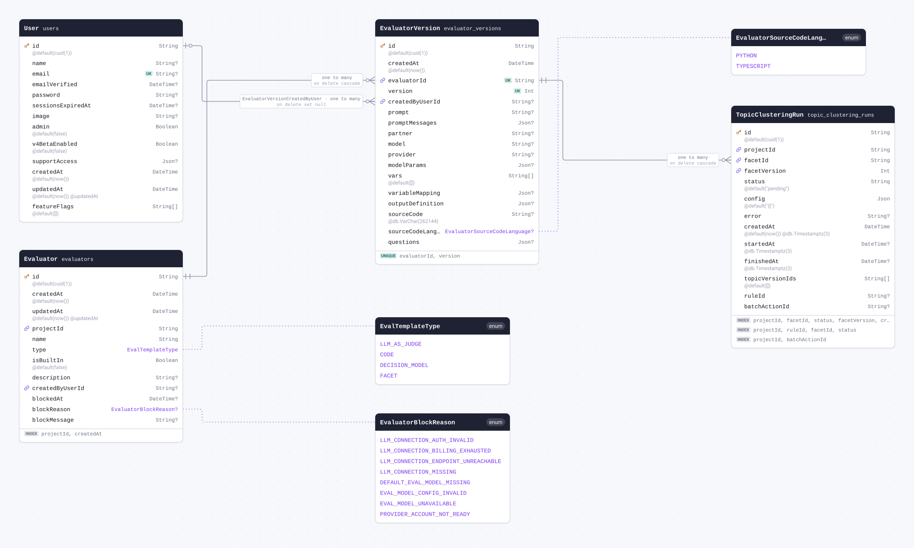

| Field                                         | Type                                                               | Constraints                                 | Default   | Description |
| --------------------------------------------- | ------------------------------------------------------------------ | ------------------------------------------- | --------- | ----------- |
| `id`                                          | `String`                                                           | PK NOT NULL                                 | `cuid(1)` |             |
| `createdAt` (`created_at`)                    | `DateTime`                                                         | NOT NULL                                    | `now()`   |             |
| `evaluatorId` (`evaluator_id`)                | `String`                                                           | NOT NULL → [Evaluator.id](#model-Evaluator) |           |             |
| `version`                                     | `Int`                                                              | NOT NULL                                    |           |             |
| `createdByUserId` (`created_by_user_id`)      | `String`                                                           | NULL → [User.id](#model-User)               |           |             |
| `prompt`                                      | `String`                                                           | NULL                                        |           |             |
| `promptMessages` (`prompt_messages`)          | `Json`                                                             | NULL                                        |           |             |
| `partner`                                     | `String`                                                           | NULL                                        |           |             |
| `model`                                       | `String`                                                           | NULL                                        |           |             |
| `provider`                                    | `String`                                                           | NULL                                        |           |             |
| `modelParams` (`model_params`)                | `Json`                                                             | NULL                                        |           |             |
| `vars`                                        | `String[]`                                                         | NOT NULL                                    | `[]`      |             |
| `variableMapping` (`variable_mapping`)        | `Json`                                                             | NULL                                        |           |             |
| `outputDefinition` (`output_definition`)      | `Json`                                                             | NULL                                        |           |             |
| `sourceCode` (`source_code`)                  | `String` `@db.VarChar(262144)`                                     | NULL                                        |           |             |
| `sourceCodeLanguage` (`source_code_language`) | [`EvaluatorSourceCodeLanguage`](#enum-EvaluatorSourceCodeLanguage) | NULL                                        |           |             |
| `questions`                                   | `Json`                                                             | NULL                                        |           |             |

#### Indexes

- `@@unique([evaluatorId, version])`

#### References

- `evaluatorId` → [Evaluator.id](#model-Evaluator) (many-to-one, on delete Cascade)
- `createdByUserId` → [User.id](#model-User) (many-to-one, on delete SetNull)

#### Referenced by

- `evaluatorId` ← [TopicClusteringRun.facetId](#model-TopicClusteringRun) (one-to-many, on delete Cascade)

#### Definition

```sql
CREATE TABLE "evaluator_versions" (
    "id" TEXT NOT NULL,
    "created_at" TIMESTAMP(3) NOT NULL DEFAULT CURRENT_TIMESTAMP,
    "evaluator_id" TEXT NOT NULL,
    "version" INTEGER NOT NULL,
    "created_by_user_id" TEXT,
    "prompt" TEXT,
    "prompt_messages" JSONB,
    "partner" TEXT,
    "model" TEXT,
    "provider" TEXT,
    "model_params" JSONB,
    "vars" TEXT[] DEFAULT ARRAY[]::TEXT[],
    "variable_mapping" JSONB,
    "output_definition" JSONB,
    "source_code" VARCHAR(262144),
    "source_code_language" "EvaluatorSourceCodeLanguage",
    "questions" JSONB,

    CONSTRAINT "evaluator_versions_pkey" PRIMARY KEY ("id")
);

CREATE UNIQUE INDEX "evaluator_versions_evaluator_id_version_key" ON "evaluator_versions"("evaluator_id", "version" DESC);

ALTER TABLE "evaluator_versions" ADD CONSTRAINT "evaluator_versions_evaluator_id_fkey" FOREIGN KEY ("evaluator_id") REFERENCES "evaluators"("id") ON DELETE CASCADE ON UPDATE CASCADE;

ALTER TABLE "evaluator_versions" ADD CONSTRAINT "evaluator_versions_created_by_user_id_fkey" FOREIGN KEY ("created_by_user_id") REFERENCES "users"("id") ON DELETE SET NULL ON UPDATE CASCADE;
```

<details>
<summary>Queries and their SQL</summary>

**findMany**: Every row

```ts
await prisma.evaluatorVersion.findMany();
```

```sql
SELECT
  "public"."evaluator_versions"."id",
  "public"."evaluator_versions"."created_at",
  "public"."evaluator_versions"."evaluator_id",
  "public"."evaluator_versions"."version",
  "public"."evaluator_versions"."created_by_user_id",
  "public"."evaluator_versions"."prompt",
  "public"."evaluator_versions"."prompt_messages",
  "public"."evaluator_versions"."partner",
  "public"."evaluator_versions"."model",
  "public"."evaluator_versions"."provider",
  "public"."evaluator_versions"."model_params",
  "public"."evaluator_versions"."vars",
  "public"."evaluator_versions"."variable_mapping",
  "public"."evaluator_versions"."output_definition",
  "public"."evaluator_versions"."source_code",
  "public"."evaluator_versions"."source_code_language"::text,
  "public"."evaluator_versions"."questions"
FROM
  "public"."evaluator_versions"
WHERE
  1 = 1
OFFSET
  $1
-- params: ["0"]
```

**count**: How many rows there are

```ts
await prisma.evaluatorVersion.count();
```

```sql
SELECT
  COUNT(*) AS "_count$_all"
FROM
  (
    SELECT
      "public"."evaluator_versions"."id"
    FROM
      "public"."evaluator_versions"
    WHERE
      1 = 1
    OFFSET
      $1
  ) AS "sub"
-- params: ["0"]
```

**findMany**: Every row with its relations

```ts
await prisma.evaluatorVersion.findMany({
  include: { evaluator: true, createdByUser: true, topicClusteringRuns: true },
});
```

```sql
SELECT
  "public"."evaluator_versions"."id",
  "public"."evaluator_versions"."created_at",
  "public"."evaluator_versions"."evaluator_id",
  "public"."evaluator_versions"."version",
  "public"."evaluator_versions"."created_by_user_id",
  "public"."evaluator_versions"."prompt",
  "public"."evaluator_versions"."prompt_messages",
  "public"."evaluator_versions"."partner",
  "public"."evaluator_versions"."model",
  "public"."evaluator_versions"."provider",
  "public"."evaluator_versions"."model_params",
  "public"."evaluator_versions"."vars",
  "public"."evaluator_versions"."variable_mapping",
  "public"."evaluator_versions"."output_definition",
  "public"."evaluator_versions"."source_code",
  "public"."evaluator_versions"."source_code_language"::text,
  "public"."evaluator_versions"."questions"
FROM
  "public"."evaluator_versions"
WHERE
  1 = 1
OFFSET
  $1
-- params: ["0"]

SELECT
  "public"."evaluators"."id",
  "public"."evaluators"."created_at",
  "public"."evaluators"."updated_at",
  "public"."evaluators"."project_id",
  "public"."evaluators"."name",
  "public"."evaluators"."type"::text,
  "public"."evaluators"."is_built_in",
  "public"."evaluators"."description",
  "public"."evaluators"."created_by_user_id",
  "public"."evaluators"."blocked_at",
  "public"."evaluators"."block_reason"::text,
  "public"."evaluators"."block_message"
FROM
  "public"."evaluators"
WHERE
  "public"."evaluators"."id" IN ($1)
OFFSET
  $2
-- params: ["<evaluatorId of the rows above>","0"]

SELECT
  "public"."users"."id",
  "public"."users"."name",
  "public"."users"."email",
  "public"."users"."email_verified",
  "public"."users"."password",
  "public"."users"."sessions_expired_at",
  "public"."users"."image",
  "public"."users"."admin",
  "public"."users"."v4_beta_enabled",
  "public"."users"."support_access",
  "public"."users"."created_at",
  "public"."users"."updated_at",
  "public"."users"."feature_flags"
FROM
  "public"."users"
WHERE
  "public"."users"."id" IN ($1)
OFFSET
  $2
-- params: ["<createdByUserId of the rows above>","0"]

SELECT
  "public"."topic_clustering_runs"."id",
  "public"."topic_clustering_runs"."project_id",
  "public"."topic_clustering_runs"."facet_id",
  "public"."topic_clustering_runs"."facet_version",
  "public"."topic_clustering_runs"."status",
  "public"."topic_clustering_runs"."config",
  "public"."topic_clustering_runs"."error",
  "public"."topic_clustering_runs"."created_at",
  "public"."topic_clustering_runs"."started_at",
  "public"."topic_clustering_runs"."finished_at",
  "public"."topic_clustering_runs"."topic_version_ids",
  "public"."topic_clustering_runs"."rule_id",
  "public"."topic_clustering_runs"."batch_action_id"
FROM
  "public"."topic_clustering_runs"
WHERE
  (
    "public"."topic_clustering_runs"."facet_id" IN ($1)
    AND "public"."topic_clustering_runs"."facet_version" IN ($2)
  )
OFFSET
  $3
-- params: ["<evaluatorId of the rows above>","<version of the rows above>","0"]
```

**findUnique**: One row by what is unique to it

```ts
await prisma.evaluatorVersion.findUnique({ where: { id: "example" } });
```

```sql
SELECT
  "public"."evaluator_versions"."id",
  "public"."evaluator_versions"."created_at",
  "public"."evaluator_versions"."evaluator_id",
  "public"."evaluator_versions"."version",
  "public"."evaluator_versions"."created_by_user_id",
  "public"."evaluator_versions"."prompt",
  "public"."evaluator_versions"."prompt_messages",
  "public"."evaluator_versions"."partner",
  "public"."evaluator_versions"."model",
  "public"."evaluator_versions"."provider",
  "public"."evaluator_versions"."model_params",
  "public"."evaluator_versions"."vars",
  "public"."evaluator_versions"."variable_mapping",
  "public"."evaluator_versions"."output_definition",
  "public"."evaluator_versions"."source_code",
  "public"."evaluator_versions"."source_code_language"::text,
  "public"."evaluator_versions"."questions"
FROM
  "public"."evaluator_versions"
WHERE
  (
    "public"."evaluator_versions"."id" = $1
    AND 1 = 1
  )
LIMIT
  $2
OFFSET
  $3
-- params: ["example","1","0"]
```

**create**: Create a row

```ts
await prisma.evaluatorVersion.create({ data: { evaluatorId: "example", version: 1 } });
```

```sql
INSERT INTO
  "public"."evaluator_versions" (
    "id",
    "created_at",
    "evaluator_id",
    "version",
    "vars"
  )
VALUES
  ($1, $2, $3, $4, $5)
RETURNING
  "public"."evaluator_versions"."id",
  "public"."evaluator_versions"."created_at",
  "public"."evaluator_versions"."evaluator_id",
  "public"."evaluator_versions"."version",
  "public"."evaluator_versions"."created_by_user_id",
  "public"."evaluator_versions"."prompt",
  "public"."evaluator_versions"."prompt_messages",
  "public"."evaluator_versions"."partner",
  "public"."evaluator_versions"."model",
  "public"."evaluator_versions"."provider",
  "public"."evaluator_versions"."model_params",
  "public"."evaluator_versions"."vars",
  "public"."evaluator_versions"."variable_mapping",
  "public"."evaluator_versions"."output_definition",
  "public"."evaluator_versions"."source_code",
  "public"."evaluator_versions"."source_code_language"::text,
  "public"."evaluator_versions"."questions"
-- params: ["<cuid(1)>","<now()>","example","1",[]]
```

**update**: Update a row

```ts
await prisma.evaluatorVersion.update({
  where: { id: "example" },
  data: { createdAt: new Date("2026-01-01T00:00:00.000Z") },
});
```

```sql
UPDATE "public"."evaluator_versions"
SET
  "created_at" = $1
WHERE
  (
    "public"."evaluator_versions"."id" = $2
    AND 1 = 1
  )
RETURNING
  "public"."evaluator_versions"."id",
  "public"."evaluator_versions"."created_at",
  "public"."evaluator_versions"."evaluator_id",
  "public"."evaluator_versions"."version",
  "public"."evaluator_versions"."created_by_user_id",
  "public"."evaluator_versions"."prompt",
  "public"."evaluator_versions"."prompt_messages",
  "public"."evaluator_versions"."partner",
  "public"."evaluator_versions"."model",
  "public"."evaluator_versions"."provider",
  "public"."evaluator_versions"."model_params",
  "public"."evaluator_versions"."vars",
  "public"."evaluator_versions"."variable_mapping",
  "public"."evaluator_versions"."output_definition",
  "public"."evaluator_versions"."source_code",
  "public"."evaluator_versions"."source_code_language"::text,
  "public"."evaluator_versions"."questions"
-- params: ["2026-01-01T00:00:00.000Z","example"]
```

**delete**: Delete a row

```ts
await prisma.evaluatorVersion.delete({ where: { id: "example" } });
```

```sql
DELETE FROM "public"."evaluator_versions"
WHERE
  (
    "public"."evaluator_versions"."id" = $1
    AND 1 = 1
  )
RETURNING
  "public"."evaluator_versions"."id",
  "public"."evaluator_versions"."created_at",
  "public"."evaluator_versions"."evaluator_id",
  "public"."evaluator_versions"."version",
  "public"."evaluator_versions"."created_by_user_id",
  "public"."evaluator_versions"."prompt",
  "public"."evaluator_versions"."prompt_messages",
  "public"."evaluator_versions"."partner",
  "public"."evaluator_versions"."model",
  "public"."evaluator_versions"."provider",
  "public"."evaluator_versions"."model_params",
  "public"."evaluator_versions"."vars",
  "public"."evaluator_versions"."variable_mapping",
  "public"."evaluator_versions"."output_definition",
  "public"."evaluator_versions"."source_code",
  "public"."evaluator_versions"."source_code_language"::text,
  "public"."evaluator_versions"."questions"
-- params: ["example"]
```

</details>

<a id="model-JobConfiguration"></a>

### JobConfiguration

Table `job_configurations`.

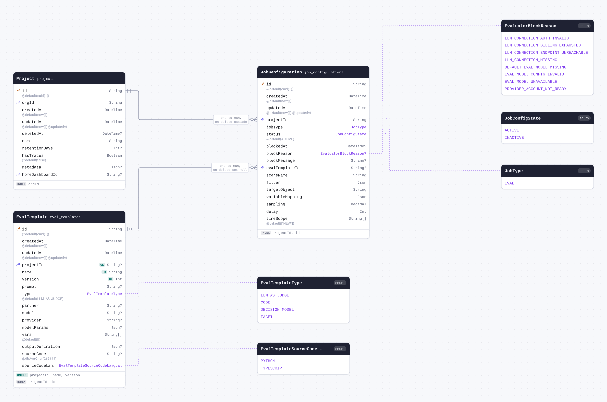

| Field                                  | Type                                                 | Constraints                                   | Default              | Description |
| -------------------------------------- | ---------------------------------------------------- | --------------------------------------------- | -------------------- | ----------- |
| `id`                                   | `String`                                             | PK NOT NULL                                   | `cuid(1)`            |             |
| `createdAt` (`created_at`)             | `DateTime`                                           | NOT NULL                                      | `now()`              |             |
| `updatedAt` (`updated_at`)             | `DateTime`                                           | NOT NULL                                      | `now()` `@updatedAt` |             |
| `projectId` (`project_id`)             | `String`                                             | NOT NULL → [Project.id](#model-Project)       |                      |             |
| `jobType` (`job_type`)                 | [`JobType`](#enum-JobType)                           | NOT NULL                                      |                      |             |
| `status`                               | [`JobConfigState`](#enum-JobConfigState)             | NOT NULL                                      | `ACTIVE`             |             |
| `blockedAt` (`blocked_at`)             | `DateTime`                                           | NULL                                          |                      |             |
| `blockReason` (`block_reason`)         | [`EvaluatorBlockReason`](#enum-EvaluatorBlockReason) | NULL                                          |                      |             |
| `blockMessage` (`block_message`)       | `String`                                             | NULL                                          |                      |             |
| `evalTemplateId` (`eval_template_id`)  | `String`                                             | NULL → [EvalTemplate.id](#model-EvalTemplate) |                      |             |
| `scoreName` (`score_name`)             | `String`                                             | NOT NULL                                      |                      |             |
| `filter`                               | `Json`                                               | NOT NULL                                      |                      |             |
| `targetObject` (`target_object`)       | `String`                                             | NOT NULL                                      |                      |             |
| `variableMapping` (`variable_mapping`) | `Json`                                               | NOT NULL                                      |                      |             |
| `sampling`                             | `Decimal`                                            | NOT NULL                                      |                      |             |
| `delay`                                | `Int`                                                | NOT NULL                                      |                      |             |
| `timeScope` (`time_scope`)             | `String[]`                                           | NOT NULL                                      | `["NEW"]`            |             |

#### Indexes

- `@@index([projectId, id])`

#### References

- `projectId` → [Project.id](#model-Project) (many-to-one, on delete Cascade)
- `evalTemplateId` → [EvalTemplate.id](#model-EvalTemplate) (many-to-one, on delete SetNull)

#### Definition

```sql
CREATE TABLE "job_configurations" (
    "id" TEXT NOT NULL,
    "created_at" TIMESTAMP(3) NOT NULL DEFAULT CURRENT_TIMESTAMP,
    "updated_at" TIMESTAMP(3) NOT NULL DEFAULT CURRENT_TIMESTAMP,
    "project_id" TEXT NOT NULL,
    "job_type" "JobType" NOT NULL,
    "status" "JobConfigState" NOT NULL DEFAULT 'ACTIVE',
    "blocked_at" TIMESTAMP(3),
    "block_reason" "EvaluatorBlockReason",
    "block_message" TEXT,
    "eval_template_id" TEXT,
    "score_name" TEXT NOT NULL,
    "filter" JSONB NOT NULL,
    "target_object" TEXT NOT NULL,
    "variable_mapping" JSONB NOT NULL,
    "sampling" DECIMAL(65,30) NOT NULL,
    "delay" INTEGER NOT NULL,
    "time_scope" TEXT[] DEFAULT ARRAY['NEW']::TEXT[],

    CONSTRAINT "job_configurations_pkey" PRIMARY KEY ("id")
);

CREATE INDEX "job_configurations_project_id_id_idx" ON "job_configurations"("project_id", "id");

ALTER TABLE "job_configurations" ADD CONSTRAINT "job_configurations_project_id_fkey" FOREIGN KEY ("project_id") REFERENCES "projects"("id") ON DELETE CASCADE ON UPDATE CASCADE;

ALTER TABLE "job_configurations" ADD CONSTRAINT "job_configurations_eval_template_id_fkey" FOREIGN KEY ("eval_template_id") REFERENCES "eval_templates"("id") ON DELETE SET NULL ON UPDATE CASCADE;
```

<details>
<summary>Queries and their SQL</summary>

**findMany**: Every row

```ts
await prisma.jobConfiguration.findMany();
```

```sql
SELECT
  "public"."job_configurations"."id",
  "public"."job_configurations"."created_at",
  "public"."job_configurations"."updated_at",
  "public"."job_configurations"."project_id",
  "public"."job_configurations"."job_type"::text,
  "public"."job_configurations"."status"::text,
  "public"."job_configurations"."blocked_at",
  "public"."job_configurations"."block_reason"::text,
  "public"."job_configurations"."block_message",
  "public"."job_configurations"."eval_template_id",
  "public"."job_configurations"."score_name",
  "public"."job_configurations"."filter",
  "public"."job_configurations"."target_object",
  "public"."job_configurations"."variable_mapping",
  "public"."job_configurations"."sampling",
  "public"."job_configurations"."delay",
  "public"."job_configurations"."time_scope"
FROM
  "public"."job_configurations"
WHERE
  1 = 1
OFFSET
  $1
-- params: ["0"]
```

**count**: How many rows there are

```ts
await prisma.jobConfiguration.count();
```

```sql
SELECT
  COUNT(*) AS "_count$_all"
FROM
  (
    SELECT
      "public"."job_configurations"."id"
    FROM
      "public"."job_configurations"
    WHERE
      1 = 1
    OFFSET
      $1
  ) AS "sub"
-- params: ["0"]
```

**findMany**: Every row with its relations

```ts
await prisma.jobConfiguration.findMany({ include: { project: true, evalTemplate: true } });
```

```sql
SELECT
  "public"."job_configurations"."id",
  "public"."job_configurations"."created_at",
  "public"."job_configurations"."updated_at",
  "public"."job_configurations"."project_id",
  "public"."job_configurations"."job_type"::text,
  "public"."job_configurations"."status"::text,
  "public"."job_configurations"."blocked_at",
  "public"."job_configurations"."block_reason"::text,
  "public"."job_configurations"."block_message",
  "public"."job_configurations"."eval_template_id",
  "public"."job_configurations"."score_name",
  "public"."job_configurations"."filter",
  "public"."job_configurations"."target_object",
  "public"."job_configurations"."variable_mapping",
  "public"."job_configurations"."sampling",
  "public"."job_configurations"."delay",
  "public"."job_configurations"."time_scope"
FROM
  "public"."job_configurations"
WHERE
  1 = 1
OFFSET
  $1
-- params: ["0"]

SELECT
  "public"."projects"."id",
  "public"."projects"."org_id",
  "public"."projects"."created_at",
  "public"."projects"."updated_at",
  "public"."projects"."deleted_at",
  "public"."projects"."name",
  "public"."projects"."retention_days",
  "public"."projects"."has_traces",
  "public"."projects"."metadata",
  "public"."projects"."home_dashboard_id"
FROM
  "public"."projects"
WHERE
  "public"."projects"."id" IN ($1)
OFFSET
  $2
-- params: ["<projectId of the rows above>","0"]

SELECT
  "public"."eval_templates"."id",
  "public"."eval_templates"."created_at",
  "public"."eval_templates"."updated_at",
  "public"."eval_templates"."project_id",
  "public"."eval_templates"."name",
  "public"."eval_templates"."version",
  "public"."eval_templates"."prompt",
  "public"."eval_templates"."type"::text,
  "public"."eval_templates"."partner",
  "public"."eval_templates"."model",
  "public"."eval_templates"."provider",
  "public"."eval_templates"."model_params",
  "public"."eval_templates"."vars",
  "public"."eval_templates"."output_schema",
  "public"."eval_templates"."source_code",
  "public"."eval_templates"."source_code_language"::text
FROM
  "public"."eval_templates"
WHERE
  "public"."eval_templates"."id" IN ($1)
OFFSET
  $2
-- params: ["<evalTemplateId of the rows above>","0"]
```

**findUnique**: One row by what is unique to it

```ts
await prisma.jobConfiguration.findUnique({ where: { id: "example" } });
```

```sql
SELECT
  "public"."job_configurations"."id",
  "public"."job_configurations"."created_at",
  "public"."job_configurations"."updated_at",
  "public"."job_configurations"."project_id",
  "public"."job_configurations"."job_type"::text,
  "public"."job_configurations"."status"::text,
  "public"."job_configurations"."blocked_at",
  "public"."job_configurations"."block_reason"::text,
  "public"."job_configurations"."block_message",
  "public"."job_configurations"."eval_template_id",
  "public"."job_configurations"."score_name",
  "public"."job_configurations"."filter",
  "public"."job_configurations"."target_object",
  "public"."job_configurations"."variable_mapping",
  "public"."job_configurations"."sampling",
  "public"."job_configurations"."delay",
  "public"."job_configurations"."time_scope"
FROM
  "public"."job_configurations"
WHERE
  (
    "public"."job_configurations"."id" = $1
    AND 1 = 1
  )
LIMIT
  $2
OFFSET
  $3
-- params: ["example","1","0"]
```

**create**: Create a row

```ts
await prisma.jobConfiguration.create({
  data: {
    projectId: "example",
    jobType: "EVAL",
    scoreName: "example",
    filter: {},
    targetObject: "example",
    variableMapping: {},
    sampling: "9.99",
    delay: 1,
  },
});
```

```sql
INSERT INTO
  "public"."job_configurations" (
    "id",
    "created_at",
    "updated_at",
    "project_id",
    "job_type",
    "status",
    "score_name",
    "filter",
    "target_object",
    "variable_mapping",
    "sampling",
    "delay",
    "time_scope"
  )
VALUES
  (
    $1,
    $2,
    $3,
    $4,
    CAST($5::text AS "public"."JobType"),
    CAST($6::text AS "public"."JobConfigState"),
    $7,
    $8,
    $9,
    $10,
    $11,
    $12,
    $13
  )
RETURNING
  "public"."job_configurations"."id",
  "public"."job_configurations"."created_at",
  "public"."job_configurations"."updated_at",
  "public"."job_configurations"."project_id",
  "public"."job_configurations"."job_type"::text,
  "public"."job_configurations"."status"::text,
  "public"."job_configurations"."blocked_at",
  "public"."job_configurations"."block_reason"::text,
  "public"."job_configurations"."block_message",
  "public"."job_configurations"."eval_template_id",
  "public"."job_configurations"."score_name",
  "public"."job_configurations"."filter",
  "public"."job_configurations"."target_object",
  "public"."job_configurations"."variable_mapping",
  "public"."job_configurations"."sampling",
  "public"."job_configurations"."delay",
  "public"."job_configurations"."time_scope"
-- params: ["<cuid(1)>","<now()>","<now()>","example","EVAL","ACTIVE","example","{}","example","{}","9.99","1",["NEW"]]
```

**update**: Update a row

```ts
await prisma.jobConfiguration.update({
  where: { id: "example" },
  data: { createdAt: new Date("2026-01-01T00:00:00.000Z") },
});
```

```sql
UPDATE "public"."job_configurations"
SET
  "created_at" = $1,
  "updated_at" = $2
WHERE
  (
    "public"."job_configurations"."id" = $3
    AND 1 = 1
  )
RETURNING
  "public"."job_configurations"."id",
  "public"."job_configurations"."created_at",
  "public"."job_configurations"."updated_at",
  "public"."job_configurations"."project_id",
  "public"."job_configurations"."job_type"::text,
  "public"."job_configurations"."status"::text,
  "public"."job_configurations"."blocked_at",
  "public"."job_configurations"."block_reason"::text,
  "public"."job_configurations"."block_message",
  "public"."job_configurations"."eval_template_id",
  "public"."job_configurations"."score_name",
  "public"."job_configurations"."filter",
  "public"."job_configurations"."target_object",
  "public"."job_configurations"."variable_mapping",
  "public"."job_configurations"."sampling",
  "public"."job_configurations"."delay",
  "public"."job_configurations"."time_scope"
-- params: ["2026-01-01T00:00:00.000Z",{"prisma__type":"generatorCall","prisma__value":{"name":"now","args":[],"returnType":{"type":"DateTime"}}},"example"]
```

**delete**: Delete a row

```ts
await prisma.jobConfiguration.delete({ where: { id: "example" } });
```

```sql
DELETE FROM "public"."job_configurations"
WHERE
  (
    "public"."job_configurations"."id" = $1
    AND 1 = 1
  )
RETURNING
  "public"."job_configurations"."id",
  "public"."job_configurations"."created_at",
  "public"."job_configurations"."updated_at",
  "public"."job_configurations"."project_id",
  "public"."job_configurations"."job_type"::text,
  "public"."job_configurations"."status"::text,
  "public"."job_configurations"."blocked_at",
  "public"."job_configurations"."block_reason"::text,
  "public"."job_configurations"."block_message",
  "public"."job_configurations"."eval_template_id",
  "public"."job_configurations"."score_name",
  "public"."job_configurations"."filter",
  "public"."job_configurations"."target_object",
  "public"."job_configurations"."variable_mapping",
  "public"."job_configurations"."sampling",
  "public"."job_configurations"."delay",
  "public"."job_configurations"."time_scope"
-- params: ["example"]
```

</details>

<a id="model-EvaluationRule"></a>

### EvaluationRule

Table `evaluation_rules`.

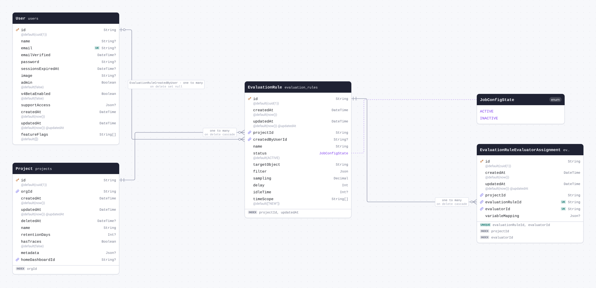

| Field                                    | Type                                     | Constraints                             | Default              | Description |
| ---------------------------------------- | ---------------------------------------- | --------------------------------------- | -------------------- | ----------- |
| `id`                                     | `String`                                 | PK NOT NULL                             | `cuid(1)`            |             |
| `createdAt` (`created_at`)               | `DateTime`                               | NOT NULL                                | `now()`              |             |
| `updatedAt` (`updated_at`)               | `DateTime`                               | NOT NULL                                | `now()` `@updatedAt` |             |
| `projectId` (`project_id`)               | `String`                                 | NOT NULL → [Project.id](#model-Project) |                      |             |
| `createdByUserId` (`created_by_user_id`) | `String`                                 | NULL → [User.id](#model-User)           |                      |             |
| `name`                                   | `String`                                 | NOT NULL                                |                      |             |
| `status`                                 | [`JobConfigState`](#enum-JobConfigState) | NOT NULL                                | `ACTIVE`             |             |
| `targetObject` (`target_object`)         | `String`                                 | NOT NULL                                |                      |             |
| `filter`                                 | `Json`                                   | NOT NULL                                |                      |             |
| `sampling`                               | `Decimal`                                | NOT NULL                                |                      |             |
| `delay`                                  | `Int`                                    | NOT NULL                                |                      |             |
| `idleTime` (`idle_time`)                 | `Int`                                    | NULL                                    |                      |             |
| `timeScope` (`time_scope`)               | `String[]`                               | NOT NULL                                | `["NEW"]`            |             |

#### Indexes

- `@@index([projectId, updatedAt])`

#### References

- `projectId` → [Project.id](#model-Project) (many-to-one, on delete Cascade)
- `createdByUserId` → [User.id](#model-User) (many-to-one, on delete SetNull)

#### Referenced by

- `id` ← [EvaluationRuleEvaluatorAssignment.evaluationRuleId](#model-EvaluationRuleEvaluatorAssignment) (one-to-many, on delete Cascade)

#### Definition

```sql
CREATE TABLE "evaluation_rules" (
    "id" TEXT NOT NULL,
    "created_at" TIMESTAMP(3) NOT NULL DEFAULT CURRENT_TIMESTAMP,
    "updated_at" TIMESTAMP(3) NOT NULL DEFAULT CURRENT_TIMESTAMP,
    "project_id" TEXT NOT NULL,
    "created_by_user_id" TEXT,
    "name" TEXT NOT NULL,
    "status" "JobConfigState" NOT NULL DEFAULT 'ACTIVE',
    "target_object" TEXT NOT NULL,
    "filter" JSONB NOT NULL,
    "sampling" DECIMAL(65,30) NOT NULL,
    "delay" INTEGER NOT NULL,
    "idle_time" INTEGER,
    "time_scope" TEXT[] DEFAULT ARRAY['NEW']::TEXT[],

    CONSTRAINT "evaluation_rules_pkey" PRIMARY KEY ("id")
);

CREATE INDEX "evaluation_rules_project_id_updated_at_idx" ON "evaluation_rules"("project_id", "updated_at" DESC);

ALTER TABLE "evaluation_rules" ADD CONSTRAINT "evaluation_rules_project_id_fkey" FOREIGN KEY ("project_id") REFERENCES "projects"("id") ON DELETE CASCADE ON UPDATE CASCADE;

ALTER TABLE "evaluation_rules" ADD CONSTRAINT "evaluation_rules_created_by_user_id_fkey" FOREIGN KEY ("created_by_user_id") REFERENCES "users"("id") ON DELETE SET NULL ON UPDATE CASCADE;
```

<details>
<summary>Queries and their SQL</summary>

**findMany**: Every row

```ts
await prisma.evaluationRule.findMany();
```

```sql
SELECT
  "public"."evaluation_rules"."id",
  "public"."evaluation_rules"."created_at",
  "public"."evaluation_rules"."updated_at",
  "public"."evaluation_rules"."project_id",
  "public"."evaluation_rules"."created_by_user_id",
  "public"."evaluation_rules"."name",
  "public"."evaluation_rules"."status"::text,
  "public"."evaluation_rules"."target_object",
  "public"."evaluation_rules"."filter",
  "public"."evaluation_rules"."sampling",
  "public"."evaluation_rules"."delay",
  "public"."evaluation_rules"."idle_time",
  "public"."evaluation_rules"."time_scope"
FROM
  "public"."evaluation_rules"
WHERE
  1 = 1
OFFSET
  $1
-- params: ["0"]
```

**count**: How many rows there are

```ts
await prisma.evaluationRule.count();
```

```sql
SELECT
  COUNT(*) AS "_count$_all"
FROM
  (
    SELECT
      "public"."evaluation_rules"."id"
    FROM
      "public"."evaluation_rules"
    WHERE
      1 = 1
    OFFSET
      $1
  ) AS "sub"
-- params: ["0"]
```

**findMany**: Every row with its relations

```ts
await prisma.evaluationRule.findMany({
  include: { project: true, createdByUser: true, assignments: true },
});
```

```sql
SELECT
  "public"."evaluation_rules"."id",
  "public"."evaluation_rules"."created_at",
  "public"."evaluation_rules"."updated_at",
  "public"."evaluation_rules"."project_id",
  "public"."evaluation_rules"."created_by_user_id",
  "public"."evaluation_rules"."name",
  "public"."evaluation_rules"."status"::text,
  "public"."evaluation_rules"."target_object",
  "public"."evaluation_rules"."filter",
  "public"."evaluation_rules"."sampling",
  "public"."evaluation_rules"."delay",
  "public"."evaluation_rules"."idle_time",
  "public"."evaluation_rules"."time_scope"
FROM
  "public"."evaluation_rules"
WHERE
  1 = 1
OFFSET
  $1
-- params: ["0"]

SELECT
  "public"."projects"."id",
  "public"."projects"."org_id",
  "public"."projects"."created_at",
  "public"."projects"."updated_at",
  "public"."projects"."deleted_at",
  "public"."projects"."name",
  "public"."projects"."retention_days",
  "public"."projects"."has_traces",
  "public"."projects"."metadata",
  "public"."projects"."home_dashboard_id"
FROM
  "public"."projects"
WHERE
  "public"."projects"."id" IN ($1)
OFFSET
  $2
-- params: ["<projectId of the rows above>","0"]

SELECT
  "public"."users"."id",
  "public"."users"."name",
  "public"."users"."email",
  "public"."users"."email_verified",
  "public"."users"."password",
  "public"."users"."sessions_expired_at",
  "public"."users"."image",
  "public"."users"."admin",
  "public"."users"."v4_beta_enabled",
  "public"."users"."support_access",
  "public"."users"."created_at",
  "public"."users"."updated_at",
  "public"."users"."feature_flags"
FROM
  "public"."users"
WHERE
  "public"."users"."id" IN ($1)
OFFSET
  $2
-- params: ["<createdByUserId of the rows above>","0"]

SELECT
  "public"."evaluation_rule_evaluator_assignments"."id",
  "public"."evaluation_rule_evaluator_assignments"."created_at",
  "public"."evaluation_rule_evaluator_assignments"."updated_at",
  "public"."evaluation_rule_evaluator_assignments"."project_id",
  "public"."evaluation_rule_evaluator_assignments"."evaluation_rule_id",
  "public"."evaluation_rule_evaluator_assignments"."evaluator_id",
  "public"."evaluation_rule_evaluator_assignments"."variable_mapping"
FROM
  "public"."evaluation_rule_evaluator_assignments"
WHERE
  "public"."evaluation_rule_evaluator_assignments"."evaluation_rule_id" IN ($1)
OFFSET
  $2
-- params: ["<id of the rows above>","0"]
```

**findUnique**: One row by what is unique to it

```ts
await prisma.evaluationRule.findUnique({ where: { id: "example" } });
```

```sql
SELECT
  "public"."evaluation_rules"."id",
  "public"."evaluation_rules"."created_at",
  "public"."evaluation_rules"."updated_at",
  "public"."evaluation_rules"."project_id",
  "public"."evaluation_rules"."created_by_user_id",
  "public"."evaluation_rules"."name",
  "public"."evaluation_rules"."status"::text,
  "public"."evaluation_rules"."target_object",
  "public"."evaluation_rules"."filter",
  "public"."evaluation_rules"."sampling",
  "public"."evaluation_rules"."delay",
  "public"."evaluation_rules"."idle_time",
  "public"."evaluation_rules"."time_scope"
FROM
  "public"."evaluation_rules"
WHERE
  (
    "public"."evaluation_rules"."id" = $1
    AND 1 = 1
  )
LIMIT
  $2
OFFSET
  $3
-- params: ["example","1","0"]
```

**create**: Create a row

```ts
await prisma.evaluationRule.create({
  data: {
    projectId: "example",
    name: "example",
    targetObject: "example",
    filter: {},
    sampling: "9.99",
    delay: 1,
  },
});
```

```sql
INSERT INTO
  "public"."evaluation_rules" (
    "id",
    "created_at",
    "updated_at",
    "project_id",
    "name",
    "status",
    "target_object",
    "filter",
    "sampling",
    "delay",
    "time_scope"
  )
VALUES
  (
    $1,
    $2,
    $3,
    $4,
    $5,
    CAST($6::text AS "public"."JobConfigState"),
    $7,
    $8,
    $9,
    $10,
    $11
  )
RETURNING
  "public"."evaluation_rules"."id",
  "public"."evaluation_rules"."created_at",
  "public"."evaluation_rules"."updated_at",
  "public"."evaluation_rules"."project_id",
  "public"."evaluation_rules"."created_by_user_id",
  "public"."evaluation_rules"."name",
  "public"."evaluation_rules"."status"::text,
  "public"."evaluation_rules"."target_object",
  "public"."evaluation_rules"."filter",
  "public"."evaluation_rules"."sampling",
  "public"."evaluation_rules"."delay",
  "public"."evaluation_rules"."idle_time",
  "public"."evaluation_rules"."time_scope"
-- params: ["<cuid(1)>","<now()>","<now()>","example","example","ACTIVE","example","{}","9.99","1",["NEW"]]
```

**update**: Update a row

```ts
await prisma.evaluationRule.update({
  where: { id: "example" },
  data: { createdAt: new Date("2026-01-01T00:00:00.000Z") },
});
```

```sql
UPDATE "public"."evaluation_rules"
SET
  "created_at" = $1,
  "updated_at" = $2
WHERE
  (
    "public"."evaluation_rules"."id" = $3
    AND 1 = 1
  )
RETURNING
  "public"."evaluation_rules"."id",
  "public"."evaluation_rules"."created_at",
  "public"."evaluation_rules"."updated_at",
  "public"."evaluation_rules"."project_id",
  "public"."evaluation_rules"."created_by_user_id",
  "public"."evaluation_rules"."name",
  "public"."evaluation_rules"."status"::text,
  "public"."evaluation_rules"."target_object",
  "public"."evaluation_rules"."filter",
  "public"."evaluation_rules"."sampling",
  "public"."evaluation_rules"."delay",
  "public"."evaluation_rules"."idle_time",
  "public"."evaluation_rules"."time_scope"
-- params: ["2026-01-01T00:00:00.000Z",{"prisma__type":"generatorCall","prisma__value":{"name":"now","args":[],"returnType":{"type":"DateTime"}}},"example"]
```

**delete**: Delete a row

```ts
await prisma.evaluationRule.delete({ where: { id: "example" } });
```

```sql
DELETE FROM "public"."evaluation_rules"
WHERE
  (
    "public"."evaluation_rules"."id" = $1
    AND 1 = 1
  )
RETURNING
  "public"."evaluation_rules"."id",
  "public"."evaluation_rules"."created_at",
  "public"."evaluation_rules"."updated_at",
  "public"."evaluation_rules"."project_id",
  "public"."evaluation_rules"."created_by_user_id",
  "public"."evaluation_rules"."name",
  "public"."evaluation_rules"."status"::text,
  "public"."evaluation_rules"."target_object",
  "public"."evaluation_rules"."filter",
  "public"."evaluation_rules"."sampling",
  "public"."evaluation_rules"."delay",
  "public"."evaluation_rules"."idle_time",
  "public"."evaluation_rules"."time_scope"
-- params: ["example"]
```

</details>

<a id="model-TracingReadinessSettings"></a>

### TracingReadinessSettings

Table `tracing_readiness_settings`.

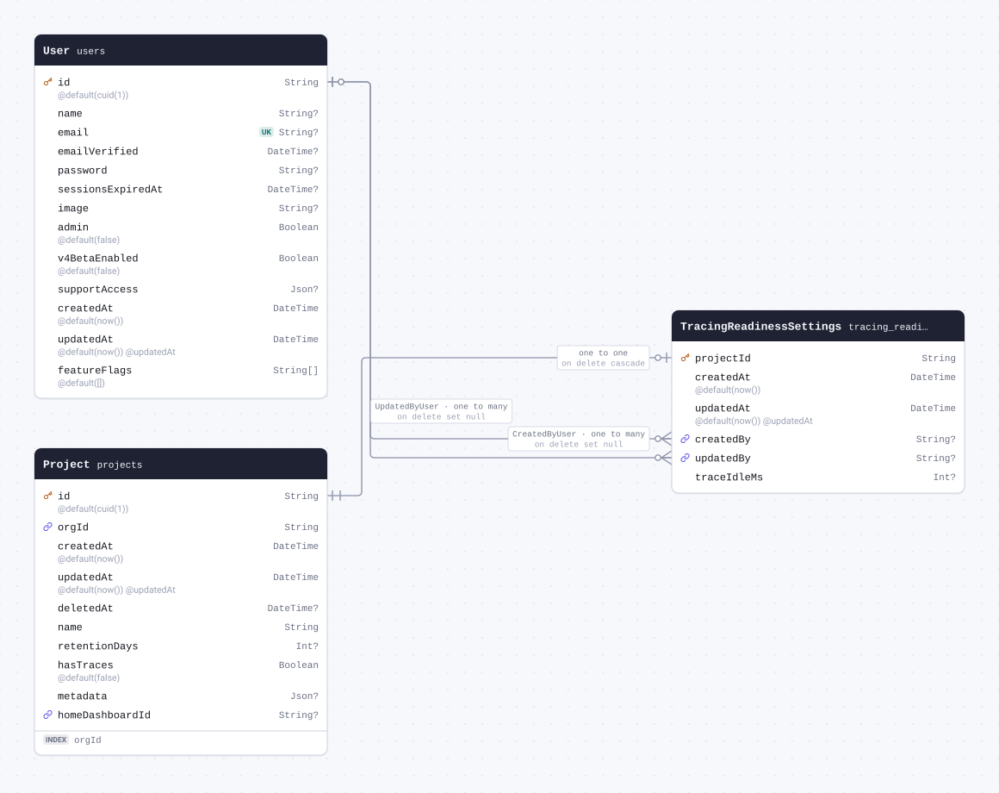

| Field                           | Type       | Constraints                                | Default              | Description |
| ------------------------------- | ---------- | ------------------------------------------ | -------------------- | ----------- |
| `projectId` (`project_id`)      | `String`   | PK NOT NULL → [Project.id](#model-Project) |                      |             |
| `createdAt` (`created_at`)      | `DateTime` | NOT NULL                                   | `now()`              |             |
| `updatedAt` (`updated_at`)      | `DateTime` | NOT NULL                                   | `now()` `@updatedAt` |             |
| `createdBy` (`created_by`)      | `String`   | NULL → [User.id](#model-User)              |                      |             |
| `updatedBy` (`updated_by`)      | `String`   | NULL → [User.id](#model-User)              |                      |             |
| `traceIdleMs` (`trace_idle_ms`) | `Int`      | NULL                                       |                      |             |

#### References

- `projectId` → [Project.id](#model-Project) (one-to-one, on delete Cascade)
- `createdBy` → [User.id](#model-User) (many-to-one, on delete SetNull)
- `updatedBy` → [User.id](#model-User) (many-to-one, on delete SetNull)

#### Definition

```sql
CREATE TABLE "tracing_readiness_settings" (
    "project_id" TEXT NOT NULL,
    "created_at" TIMESTAMP(3) NOT NULL DEFAULT CURRENT_TIMESTAMP,
    "updated_at" TIMESTAMP(3) NOT NULL DEFAULT CURRENT_TIMESTAMP,
    "created_by" TEXT,
    "updated_by" TEXT,
    "trace_idle_ms" INTEGER,

    CONSTRAINT "tracing_readiness_settings_pkey" PRIMARY KEY ("project_id")
);

ALTER TABLE "tracing_readiness_settings" ADD CONSTRAINT "tracing_readiness_settings_project_id_fkey" FOREIGN KEY ("project_id") REFERENCES "projects"("id") ON DELETE CASCADE ON UPDATE CASCADE;

ALTER TABLE "tracing_readiness_settings" ADD CONSTRAINT "tracing_readiness_settings_created_by_fkey" FOREIGN KEY ("created_by") REFERENCES "users"("id") ON DELETE SET NULL ON UPDATE CASCADE;

ALTER TABLE "tracing_readiness_settings" ADD CONSTRAINT "tracing_readiness_settings_updated_by_fkey" FOREIGN KEY ("updated_by") REFERENCES "users"("id") ON DELETE SET NULL ON UPDATE CASCADE;
```

<details>
<summary>Queries and their SQL</summary>

**findMany**: Every row

```ts
await prisma.tracingReadinessSettings.findMany();
```

```sql
SELECT
  "public"."tracing_readiness_settings"."project_id",
  "public"."tracing_readiness_settings"."created_at",
  "public"."tracing_readiness_settings"."updated_at",
  "public"."tracing_readiness_settings"."created_by",
  "public"."tracing_readiness_settings"."updated_by",
  "public"."tracing_readiness_settings"."trace_idle_ms"
FROM
  "public"."tracing_readiness_settings"
WHERE
  1 = 1
OFFSET
  $1
-- params: ["0"]
```

**count**: How many rows there are

```ts
await prisma.tracingReadinessSettings.count();
```

```sql
SELECT
  COUNT(*) AS "_count$_all"
FROM
  (
    SELECT
      "public"."tracing_readiness_settings"."project_id"
    FROM
      "public"."tracing_readiness_settings"
    WHERE
      1 = 1
    OFFSET
      $1
  ) AS "sub"
-- params: ["0"]
```

**findMany**: Every row with its relations

```ts
await prisma.tracingReadinessSettings.findMany({
  include: { project: true, createdByUser: true, updatedByUser: true },
});
```

```sql
SELECT
  "public"."tracing_readiness_settings"."project_id",
  "public"."tracing_readiness_settings"."created_at",
  "public"."tracing_readiness_settings"."updated_at",
  "public"."tracing_readiness_settings"."created_by",
  "public"."tracing_readiness_settings"."updated_by",
  "public"."tracing_readiness_settings"."trace_idle_ms"
FROM
  "public"."tracing_readiness_settings"
WHERE
  1 = 1
OFFSET
  $1
-- params: ["0"]

SELECT
  "public"."projects"."id",
  "public"."projects"."org_id",
  "public"."projects"."created_at",
  "public"."projects"."updated_at",
  "public"."projects"."deleted_at",
  "public"."projects"."name",
  "public"."projects"."retention_days",
  "public"."projects"."has_traces",
  "public"."projects"."metadata",
  "public"."projects"."home_dashboard_id"
FROM
  "public"."projects"
WHERE
  "public"."projects"."id" IN ($1)
OFFSET
  $2
-- params: ["<projectId of the rows above>","0"]

SELECT
  "public"."users"."id",
  "public"."users"."name",
  "public"."users"."email",
  "public"."users"."email_verified",
  "public"."users"."password",
  "public"."users"."sessions_expired_at",
  "public"."users"."image",
  "public"."users"."admin",
  "public"."users"."v4_beta_enabled",
  "public"."users"."support_access",
  "public"."users"."created_at",
  "public"."users"."updated_at",
  "public"."users"."feature_flags"
FROM
  "public"."users"
WHERE
  "public"."users"."id" IN ($1)
OFFSET
  $2
-- params: ["<createdBy of the rows above>","0"]

SELECT
  "public"."users"."id",
  "public"."users"."name",
  "public"."users"."email",
  "public"."users"."email_verified",
  "public"."users"."password",
  "public"."users"."sessions_expired_at",
  "public"."users"."image",
  "public"."users"."admin",
  "public"."users"."v4_beta_enabled",
  "public"."users"."support_access",
  "public"."users"."created_at",
  "public"."users"."updated_at",
  "public"."users"."feature_flags"
FROM
  "public"."users"
WHERE
  "public"."users"."id" IN ($1)
OFFSET
  $2
-- params: ["<updatedBy of the rows above>","0"]
```

**findUnique**: One row by what is unique to it

```ts
await prisma.tracingReadinessSettings.findUnique({ where: { projectId: "example" } });
```

```sql
SELECT
  "public"."tracing_readiness_settings"."project_id",
  "public"."tracing_readiness_settings"."created_at",
  "public"."tracing_readiness_settings"."updated_at",
  "public"."tracing_readiness_settings"."created_by",
  "public"."tracing_readiness_settings"."updated_by",
  "public"."tracing_readiness_settings"."trace_idle_ms"
FROM
  "public"."tracing_readiness_settings"
WHERE
  (
    "public"."tracing_readiness_settings"."project_id" = $1
    AND 1 = 1
  )
LIMIT
  $2
OFFSET
  $3
-- params: ["example","1","0"]
```

**create**: Create a row

```ts
await prisma.tracingReadinessSettings.create({ data: { projectId: "example" } });
```

```sql
INSERT INTO
  "public"."tracing_readiness_settings" ("project_id", "created_at", "updated_at")
VALUES
  ($1, $2, $3)
RETURNING
  "public"."tracing_readiness_settings"."project_id",
  "public"."tracing_readiness_settings"."created_at",
  "public"."tracing_readiness_settings"."updated_at",
  "public"."tracing_readiness_settings"."created_by",
  "public"."tracing_readiness_settings"."updated_by",
  "public"."tracing_readiness_settings"."trace_idle_ms"
-- params: ["example","<now()>","<now()>"]
```

**update**: Update a row

```ts
await prisma.tracingReadinessSettings.update({
  where: { projectId: "example" },
  data: { createdAt: new Date("2026-01-01T00:00:00.000Z") },
});
```

```sql
UPDATE "public"."tracing_readiness_settings"
SET
  "created_at" = $1,
  "updated_at" = $2
WHERE
  (
    "public"."tracing_readiness_settings"."project_id" = $3
    AND 1 = 1
  )
RETURNING
  "public"."tracing_readiness_settings"."project_id",
  "public"."tracing_readiness_settings"."created_at",
  "public"."tracing_readiness_settings"."updated_at",
  "public"."tracing_readiness_settings"."created_by",
  "public"."tracing_readiness_settings"."updated_by",
  "public"."tracing_readiness_settings"."trace_idle_ms"
-- params: ["2026-01-01T00:00:00.000Z",{"prisma__type":"generatorCall","prisma__value":{"name":"now","args":[],"returnType":{"type":"DateTime"}}},"example"]
```

**delete**: Delete a row

```ts
await prisma.tracingReadinessSettings.delete({ where: { projectId: "example" } });
```

```sql
DELETE FROM "public"."tracing_readiness_settings"
WHERE
  (
    "public"."tracing_readiness_settings"."project_id" = $1
    AND 1 = 1
  )
RETURNING
  "public"."tracing_readiness_settings"."project_id",
  "public"."tracing_readiness_settings"."created_at",
  "public"."tracing_readiness_settings"."updated_at",
  "public"."tracing_readiness_settings"."created_by",
  "public"."tracing_readiness_settings"."updated_by",
  "public"."tracing_readiness_settings"."trace_idle_ms"
-- params: ["example"]
```

</details>

<a id="model-EvaluationRuleEvaluatorAssignment"></a>

### EvaluationRuleEvaluatorAssignment

Table `evaluation_rule_evaluator_assignments`.

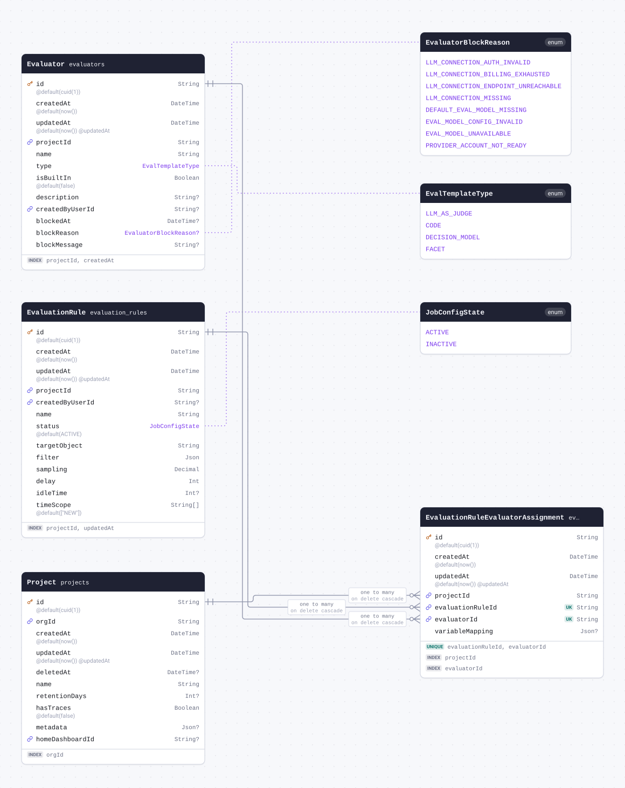

| Field                                     | Type       | Constraints                                           | Default              | Description |
| ----------------------------------------- | ---------- | ----------------------------------------------------- | -------------------- | ----------- |
| `id`                                      | `String`   | PK NOT NULL                                           | `cuid(1)`            |             |
| `createdAt` (`created_at`)                | `DateTime` | NOT NULL                                              | `now()`              |             |
| `updatedAt` (`updated_at`)                | `DateTime` | NOT NULL                                              | `now()` `@updatedAt` |             |
| `projectId` (`project_id`)                | `String`   | NOT NULL → [Project.id](#model-Project)               |                      |             |
| `evaluationRuleId` (`evaluation_rule_id`) | `String`   | NOT NULL → [EvaluationRule.id](#model-EvaluationRule) |                      |             |
| `evaluatorId` (`evaluator_id`)            | `String`   | NOT NULL → [Evaluator.id](#model-Evaluator)           |                      |             |
| `variableMapping` (`variable_mapping`)    | `Json`     | NULL                                                  |                      |             |

#### Indexes

- `@@index([projectId], map: "evaluation_rule_assignments_project_id_idx")`
- `@@index([evaluatorId], map: "evaluation_rule_assignments_evaluator_id_idx")`
- `@@unique([evaluationRuleId, evaluatorId], map: "evaluation_rule_assignments_rule_evaluator_key")`

#### References

- `projectId` → [Project.id](#model-Project) (many-to-one, on delete Cascade)
- `evaluationRuleId` → [EvaluationRule.id](#model-EvaluationRule) (many-to-one, on delete Cascade)
- `evaluatorId` → [Evaluator.id](#model-Evaluator) (many-to-one, on delete Cascade)

#### Definition

```sql
CREATE TABLE "evaluation_rule_evaluator_assignments" (
    "id" TEXT NOT NULL,
    "created_at" TIMESTAMP(3) NOT NULL DEFAULT CURRENT_TIMESTAMP,
    "updated_at" TIMESTAMP(3) NOT NULL DEFAULT CURRENT_TIMESTAMP,
    "project_id" TEXT NOT NULL,
    "evaluation_rule_id" TEXT NOT NULL,
    "evaluator_id" TEXT NOT NULL,
    "variable_mapping" JSONB,

    CONSTRAINT "evaluation_rule_evaluator_assignments_pkey" PRIMARY KEY ("id")
);

CREATE INDEX "evaluation_rule_assignments_project_id_idx" ON "evaluation_rule_evaluator_assignments"("project_id");

CREATE INDEX "evaluation_rule_assignments_evaluator_id_idx" ON "evaluation_rule_evaluator_assignments"("evaluator_id");

CREATE UNIQUE INDEX "evaluation_rule_assignments_rule_evaluator_key" ON "evaluation_rule_evaluator_assignments"("evaluation_rule_id", "evaluator_id");

ALTER TABLE "evaluation_rule_evaluator_assignments" ADD CONSTRAINT "evaluation_rule_evaluator_assignments_project_id_fkey" FOREIGN KEY ("project_id") REFERENCES "projects"("id") ON DELETE CASCADE ON UPDATE CASCADE;

ALTER TABLE "evaluation_rule_evaluator_assignments" ADD CONSTRAINT "evaluation_rule_evaluator_assignments_evaluation_rule_id_fkey" FOREIGN KEY ("evaluation_rule_id") REFERENCES "evaluation_rules"("id") ON DELETE CASCADE ON UPDATE CASCADE;

ALTER TABLE "evaluation_rule_evaluator_assignments" ADD CONSTRAINT "evaluation_rule_evaluator_assignments_evaluator_id_fkey" FOREIGN KEY ("evaluator_id") REFERENCES "evaluators"("id") ON DELETE CASCADE ON UPDATE CASCADE;
```

<details>
<summary>Queries and their SQL</summary>

**findMany**: Every row

```ts
await prisma.evaluationRuleEvaluatorAssignment.findMany();
```

```sql
SELECT
  "public"."evaluation_rule_evaluator_assignments"."id",
  "public"."evaluation_rule_evaluator_assignments"."created_at",
  "public"."evaluation_rule_evaluator_assignments"."updated_at",
  "public"."evaluation_rule_evaluator_assignments"."project_id",
  "public"."evaluation_rule_evaluator_assignments"."evaluation_rule_id",
  "public"."evaluation_rule_evaluator_assignments"."evaluator_id",
  "public"."evaluation_rule_evaluator_assignments"."variable_mapping"
FROM
  "public"."evaluation_rule_evaluator_assignments"
WHERE
  1 = 1
OFFSET
  $1
-- params: ["0"]
```

**count**: How many rows there are

```ts
await prisma.evaluationRuleEvaluatorAssignment.count();
```

```sql
SELECT
  COUNT(*) AS "_count$_all"
FROM
  (
    SELECT
      "public"."evaluation_rule_evaluator_assignments"."id"
    FROM
      "public"."evaluation_rule_evaluator_assignments"
    WHERE
      1 = 1
    OFFSET
      $1
  ) AS "sub"
-- params: ["0"]
```

**findMany**: Every row with its relations

```ts
await prisma.evaluationRuleEvaluatorAssignment.findMany({
  include: { project: true, evaluationRule: true, evaluator: true },
});
```

```sql
SELECT
  "public"."evaluation_rule_evaluator_assignments"."id",
  "public"."evaluation_rule_evaluator_assignments"."created_at",
  "public"."evaluation_rule_evaluator_assignments"."updated_at",
  "public"."evaluation_rule_evaluator_assignments"."project_id",
  "public"."evaluation_rule_evaluator_assignments"."evaluation_rule_id",
  "public"."evaluation_rule_evaluator_assignments"."evaluator_id",
  "public"."evaluation_rule_evaluator_assignments"."variable_mapping"
FROM
  "public"."evaluation_rule_evaluator_assignments"
WHERE
  1 = 1
OFFSET
  $1
-- params: ["0"]

SELECT
  "public"."projects"."id",
  "public"."projects"."org_id",
  "public"."projects"."created_at",
  "public"."projects"."updated_at",
  "public"."projects"."deleted_at",
  "public"."projects"."name",
  "public"."projects"."retention_days",
  "public"."projects"."has_traces",
  "public"."projects"."metadata",
  "public"."projects"."home_dashboard_id"
FROM
  "public"."projects"
WHERE
  "public"."projects"."id" IN ($1)
OFFSET
  $2
-- params: ["<projectId of the rows above>","0"]

SELECT
  "public"."evaluation_rules"."id",
  "public"."evaluation_rules"."created_at",
  "public"."evaluation_rules"."updated_at",
  "public"."evaluation_rules"."project_id",
  "public"."evaluation_rules"."created_by_user_id",
  "public"."evaluation_rules"."name",
  "public"."evaluation_rules"."status"::text,
  "public"."evaluation_rules"."target_object",
  "public"."evaluation_rules"."filter",
  "public"."evaluation_rules"."sampling",
  "public"."evaluation_rules"."delay",
  "public"."evaluation_rules"."idle_time",
  "public"."evaluation_rules"."time_scope"
FROM
  "public"."evaluation_rules"
WHERE
  "public"."evaluation_rules"."id" IN ($1)
OFFSET
  $2
-- params: ["<evaluationRuleId of the rows above>","0"]

SELECT
  "public"."evaluators"."id",
  "public"."evaluators"."created_at",
  "public"."evaluators"."updated_at",
  "public"."evaluators"."project_id",
  "public"."evaluators"."name",
  "public"."evaluators"."type"::text,
  "public"."evaluators"."is_built_in",
  "public"."evaluators"."description",
  "public"."evaluators"."created_by_user_id",
  "public"."evaluators"."blocked_at",
  "public"."evaluators"."block_reason"::text,
  "public"."evaluators"."block_message"
FROM
  "public"."evaluators"
WHERE
  "public"."evaluators"."id" IN ($1)
OFFSET
  $2
-- params: ["<evaluatorId of the rows above>","0"]
```

**findUnique**: One row by what is unique to it

```ts
await prisma.evaluationRuleEvaluatorAssignment.findUnique({ where: { id: "example" } });
```

```sql
SELECT
  "public"."evaluation_rule_evaluator_assignments"."id",
  "public"."evaluation_rule_evaluator_assignments"."created_at",
  "public"."evaluation_rule_evaluator_assignments"."updated_at",
  "public"."evaluation_rule_evaluator_assignments"."project_id",
  "public"."evaluation_rule_evaluator_assignments"."evaluation_rule_id",
  "public"."evaluation_rule_evaluator_assignments"."evaluator_id",
  "public"."evaluation_rule_evaluator_assignments"."variable_mapping"
FROM
  "public"."evaluation_rule_evaluator_assignments"
WHERE
  (
    "public"."evaluation_rule_evaluator_assignments"."id" = $1
    AND 1 = 1
  )
LIMIT
  $2
OFFSET
  $3
-- params: ["example","1","0"]
```

**create**: Create a row

```ts
await prisma.evaluationRuleEvaluatorAssignment.create({
  data: { projectId: "example", evaluationRuleId: "example", evaluatorId: "example" },
});
```

```sql
INSERT INTO
  "public"."evaluation_rule_evaluator_assignments" (
    "id",
    "created_at",
    "updated_at",
    "project_id",
    "evaluation_rule_id",
    "evaluator_id"
  )
VALUES
  ($1, $2, $3, $4, $5, $6)
RETURNING
  "public"."evaluation_rule_evaluator_assignments"."id",
  "public"."evaluation_rule_evaluator_assignments"."created_at",
  "public"."evaluation_rule_evaluator_assignments"."updated_at",
  "public"."evaluation_rule_evaluator_assignments"."project_id",
  "public"."evaluation_rule_evaluator_assignments"."evaluation_rule_id",
  "public"."evaluation_rule_evaluator_assignments"."evaluator_id",
  "public"."evaluation_rule_evaluator_assignments"."variable_mapping"
-- params: ["<cuid(1)>","<now()>","<now()>","example","example","example"]
```

**update**: Update a row

```ts
await prisma.evaluationRuleEvaluatorAssignment.update({
  where: { id: "example" },
  data: { createdAt: new Date("2026-01-01T00:00:00.000Z") },
});
```

```sql
UPDATE "public"."evaluation_rule_evaluator_assignments"
SET
  "created_at" = $1,
  "updated_at" = $2
WHERE
  (
    "public"."evaluation_rule_evaluator_assignments"."id" = $3
    AND 1 = 1
  )
RETURNING
  "public"."evaluation_rule_evaluator_assignments"."id",
  "public"."evaluation_rule_evaluator_assignments"."created_at",
  "public"."evaluation_rule_evaluator_assignments"."updated_at",
  "public"."evaluation_rule_evaluator_assignments"."project_id",
  "public"."evaluation_rule_evaluator_assignments"."evaluation_rule_id",
  "public"."evaluation_rule_evaluator_assignments"."evaluator_id",
  "public"."evaluation_rule_evaluator_assignments"."variable_mapping"
-- params: ["2026-01-01T00:00:00.000Z",{"prisma__type":"generatorCall","prisma__value":{"name":"now","args":[],"returnType":{"type":"DateTime"}}},"example"]
```

**delete**: Delete a row

```ts
await prisma.evaluationRuleEvaluatorAssignment.delete({ where: { id: "example" } });
```

```sql
DELETE FROM "public"."evaluation_rule_evaluator_assignments"
WHERE
  (
    "public"."evaluation_rule_evaluator_assignments"."id" = $1
    AND 1 = 1
  )
RETURNING
  "public"."evaluation_rule_evaluator_assignments"."id",
  "public"."evaluation_rule_evaluator_assignments"."created_at",
  "public"."evaluation_rule_evaluator_assignments"."updated_at",
  "public"."evaluation_rule_evaluator_assignments"."project_id",
  "public"."evaluation_rule_evaluator_assignments"."evaluation_rule_id",
  "public"."evaluation_rule_evaluator_assignments"."evaluator_id",
  "public"."evaluation_rule_evaluator_assignments"."variable_mapping"
-- params: ["example"]
```

</details>

<a id="model-JobExecution"></a>

### JobExecution

Table `job_executions`.

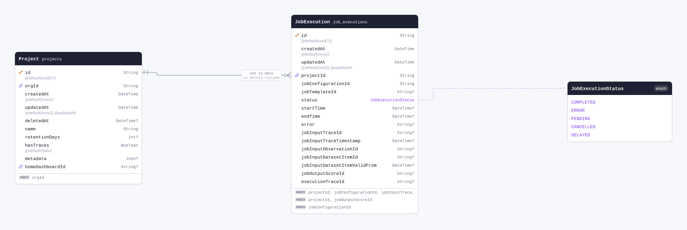

| Field                                                                | Type                                             | Constraints                             | Default              | Description |
| -------------------------------------------------------------------- | ------------------------------------------------ | --------------------------------------- | -------------------- | ----------- |
| `id`                                                                 | `String`                                         | PK NOT NULL                             | `cuid(1)`            |             |
| `createdAt` (`created_at`)                                           | `DateTime`                                       | NOT NULL                                | `now()`              |             |
| `updatedAt` (`updated_at`)                                           | `DateTime`                                       | NOT NULL                                | `now()` `@updatedAt` |             |
| `projectId` (`project_id`)                                           | `String`                                         | NOT NULL → [Project.id](#model-Project) |                      |             |
| `jobConfigurationId` (`job_configuration_id`)                        | `String`                                         | NOT NULL                                |                      |             |
| `jobTemplateId` (`job_template_id`)                                  | `String`                                         | NULL                                    |                      |             |
| `status`                                                             | [`JobExecutionStatus`](#enum-JobExecutionStatus) | NOT NULL                                |                      |             |
| `startTime` (`start_time`)                                           | `DateTime`                                       | NULL                                    |                      |             |
| `endTime` (`end_time`)                                               | `DateTime`                                       | NULL                                    |                      |             |
| `error`                                                              | `String`                                         | NULL                                    |                      |             |
| `jobInputTraceId` (`job_input_trace_id`)                             | `String`                                         | NULL                                    |                      |             |
| `jobInputTraceTimestamp` (`job_input_trace_timestamp`)               | `DateTime`                                       | NULL                                    |                      |             |
| `jobInputObservationId` (`job_input_observation_id`)                 | `String`                                         | NULL                                    |                      |             |
| `jobInputDatasetItemId` (`job_input_dataset_item_id`)                | `String`                                         | NULL                                    |                      |             |
| `jobInputDatasetItemValidFrom` (`job_input_dataset_item_valid_from`) | `DateTime`                                       | NULL                                    |                      |             |
| `jobOutputScoreId` (`job_output_score_id`)                           | `String`                                         | NULL                                    |                      |             |
| `executionTraceId` (`execution_trace_id`)                            | `String`                                         | NULL                                    |                      |             |

#### Indexes

- `@@index([projectId, jobConfigurationId, jobInputTraceId])`
- `@@index([projectId, jobOutputScoreId])`
- `@@index([jobConfigurationId])`

#### References

- `projectId` → [Project.id](#model-Project) (many-to-one, on delete Cascade)

#### Definition

```sql
CREATE TABLE "job_executions" (
    "id" TEXT NOT NULL,
    "created_at" TIMESTAMP(3) NOT NULL DEFAULT CURRENT_TIMESTAMP,
    "updated_at" TIMESTAMP(3) NOT NULL DEFAULT CURRENT_TIMESTAMP,
    "project_id" TEXT NOT NULL,
    "job_configuration_id" TEXT NOT NULL,
    "job_template_id" TEXT,
    "status" "JobExecutionStatus" NOT NULL,
    "start_time" TIMESTAMP(3),
    "end_time" TIMESTAMP(3),
    "error" TEXT,
    "job_input_trace_id" TEXT,
    "job_input_trace_timestamp" TIMESTAMP(3),
    "job_input_observation_id" TEXT,
    "job_input_dataset_item_id" TEXT,
    "job_input_dataset_item_valid_from" TIMESTAMP(3),
    "job_output_score_id" TEXT,
    "execution_trace_id" TEXT,

    CONSTRAINT "job_executions_pkey" PRIMARY KEY ("id")
);

CREATE INDEX "job_executions_project_id_job_configuration_id_job_input_tr_idx" ON "job_executions"("project_id", "job_configuration_id", "job_input_trace_id");

CREATE INDEX "job_executions_project_id_job_output_score_id_idx" ON "job_executions"("project_id", "job_output_score_id");

CREATE INDEX "job_executions_job_configuration_id_idx" ON "job_executions"("job_configuration_id");

ALTER TABLE "job_executions" ADD CONSTRAINT "job_executions_project_id_fkey" FOREIGN KEY ("project_id") REFERENCES "projects"("id") ON DELETE CASCADE ON UPDATE CASCADE;
```

<details>
<summary>Queries and their SQL</summary>

**findMany**: Every row

```ts
await prisma.jobExecution.findMany();
```

```sql
SELECT
  "public"."job_executions"."id",
  "public"."job_executions"."created_at",
  "public"."job_executions"."updated_at",
  "public"."job_executions"."project_id",
  "public"."job_executions"."job_configuration_id",
  "public"."job_executions"."job_template_id",
  "public"."job_executions"."status"::text,
  "public"."job_executions"."start_time",
  "public"."job_executions"."end_time",
  "public"."job_executions"."error",
  "public"."job_executions"."job_input_trace_id",
  "public"."job_executions"."job_input_trace_timestamp",
  "public"."job_executions"."job_input_observation_id",
  "public"."job_executions"."job_input_dataset_item_id",
  "public"."job_executions"."job_input_dataset_item_valid_from",
  "public"."job_executions"."job_output_score_id",
  "public"."job_executions"."execution_trace_id"
FROM
  "public"."job_executions"
WHERE
  1 = 1
OFFSET
  $1
-- params: ["0"]
```

**count**: How many rows there are

```ts
await prisma.jobExecution.count();
```

```sql
SELECT
  COUNT(*) AS "_count$_all"
FROM
  (
    SELECT
      "public"."job_executions"."id"
    FROM
      "public"."job_executions"
    WHERE
      1 = 1
    OFFSET
      $1
  ) AS "sub"
-- params: ["0"]
```

**findMany**: Every row with its relations

```ts
await prisma.jobExecution.findMany({ include: { project: true } });
```

```sql
SELECT
  "public"."job_executions"."id",
  "public"."job_executions"."created_at",
  "public"."job_executions"."updated_at",
  "public"."job_executions"."project_id",
  "public"."job_executions"."job_configuration_id",
  "public"."job_executions"."job_template_id",
  "public"."job_executions"."status"::text,
  "public"."job_executions"."start_time",
  "public"."job_executions"."end_time",
  "public"."job_executions"."error",
  "public"."job_executions"."job_input_trace_id",
  "public"."job_executions"."job_input_trace_timestamp",
  "public"."job_executions"."job_input_observation_id",
  "public"."job_executions"."job_input_dataset_item_id",
  "public"."job_executions"."job_input_dataset_item_valid_from",
  "public"."job_executions"."job_output_score_id",
  "public"."job_executions"."execution_trace_id"
FROM
  "public"."job_executions"
WHERE
  1 = 1
OFFSET
  $1
-- params: ["0"]

SELECT
  "public"."projects"."id",
  "public"."projects"."org_id",
  "public"."projects"."created_at",
  "public"."projects"."updated_at",
  "public"."projects"."deleted_at",
  "public"."projects"."name",
  "public"."projects"."retention_days",
  "public"."projects"."has_traces",
  "public"."projects"."metadata",
  "public"."projects"."home_dashboard_id"
FROM
  "public"."projects"
WHERE
  "public"."projects"."id" IN ($1)
OFFSET
  $2
-- params: ["<projectId of the rows above>","0"]
```

**findUnique**: One row by what is unique to it

```ts
await prisma.jobExecution.findUnique({ where: { id: "example" } });
```

```sql
SELECT
  "public"."job_executions"."id",
  "public"."job_executions"."created_at",
  "public"."job_executions"."updated_at",
  "public"."job_executions"."project_id",
  "public"."job_executions"."job_configuration_id",
  "public"."job_executions"."job_template_id",
  "public"."job_executions"."status"::text,
  "public"."job_executions"."start_time",
  "public"."job_executions"."end_time",
  "public"."job_executions"."error",
  "public"."job_executions"."job_input_trace_id",
  "public"."job_executions"."job_input_trace_timestamp",
  "public"."job_executions"."job_input_observation_id",
  "public"."job_executions"."job_input_dataset_item_id",
  "public"."job_executions"."job_input_dataset_item_valid_from",
  "public"."job_executions"."job_output_score_id",
  "public"."job_executions"."execution_trace_id"
FROM
  "public"."job_executions"
WHERE
  (
    "public"."job_executions"."id" = $1
    AND 1 = 1
  )
LIMIT
  $2
OFFSET
  $3
-- params: ["example","1","0"]
```

**create**: Create a row

```ts
await prisma.jobExecution.create({
  data: { projectId: "example", jobConfigurationId: "example", status: "COMPLETED" },
});
```

```sql
INSERT INTO
  "public"."job_executions" (
    "id",
    "created_at",
    "updated_at",
    "project_id",
    "job_configuration_id",
    "status"
  )
VALUES
  (
    $1,
    $2,
    $3,
    $4,
    $5,
    CAST($6::text AS "public"."JobExecutionStatus")
  )
RETURNING
  "public"."job_executions"."id",
  "public"."job_executions"."created_at",
  "public"."job_executions"."updated_at",
  "public"."job_executions"."project_id",
  "public"."job_executions"."job_configuration_id",
  "public"."job_executions"."job_template_id",
  "public"."job_executions"."status"::text,
  "public"."job_executions"."start_time",
  "public"."job_executions"."end_time",
  "public"."job_executions"."error",
  "public"."job_executions"."job_input_trace_id",
  "public"."job_executions"."job_input_trace_timestamp",
  "public"."job_executions"."job_input_observation_id",
  "public"."job_executions"."job_input_dataset_item_id",
  "public"."job_executions"."job_input_dataset_item_valid_from",
  "public"."job_executions"."job_output_score_id",
  "public"."job_executions"."execution_trace_id"
-- params: ["<cuid(1)>","<now()>","<now()>","example","example","COMPLETED"]
```

**update**: Update a row

```ts
await prisma.jobExecution.update({
  where: { id: "example" },
  data: { createdAt: new Date("2026-01-01T00:00:00.000Z") },
});
```

```sql
UPDATE "public"."job_executions"
SET
  "created_at" = $1,
  "updated_at" = $2
WHERE
  (
    "public"."job_executions"."id" = $3
    AND 1 = 1
  )
RETURNING
  "public"."job_executions"."id",
  "public"."job_executions"."created_at",
  "public"."job_executions"."updated_at",
  "public"."job_executions"."project_id",
  "public"."job_executions"."job_configuration_id",
  "public"."job_executions"."job_template_id",
  "public"."job_executions"."status"::text,
  "public"."job_executions"."start_time",
  "public"."job_executions"."end_time",
  "public"."job_executions"."error",
  "public"."job_executions"."job_input_trace_id",
  "public"."job_executions"."job_input_trace_timestamp",
  "public"."job_executions"."job_input_observation_id",
  "public"."job_executions"."job_input_dataset_item_id",
  "public"."job_executions"."job_input_dataset_item_valid_from",
  "public"."job_executions"."job_output_score_id",
  "public"."job_executions"."execution_trace_id"
-- params: ["2026-01-01T00:00:00.000Z",{"prisma__type":"generatorCall","prisma__value":{"name":"now","args":[],"returnType":{"type":"DateTime"}}},"example"]
```

**delete**: Delete a row

```ts
await prisma.jobExecution.delete({ where: { id: "example" } });
```

```sql
DELETE FROM "public"."job_executions"
WHERE
  (
    "public"."job_executions"."id" = $1
    AND 1 = 1
  )
RETURNING
  "public"."job_executions"."id",
  "public"."job_executions"."created_at",
  "public"."job_executions"."updated_at",
  "public"."job_executions"."project_id",
  "public"."job_executions"."job_configuration_id",
  "public"."job_executions"."job_template_id",
  "public"."job_executions"."status"::text,
  "public"."job_executions"."start_time",
  "public"."job_executions"."end_time",
  "public"."job_executions"."error",
  "public"."job_executions"."job_input_trace_id",
  "public"."job_executions"."job_input_trace_timestamp",
  "public"."job_executions"."job_input_observation_id",
  "public"."job_executions"."job_input_dataset_item_id",
  "public"."job_executions"."job_input_dataset_item_valid_from",
  "public"."job_executions"."job_output_score_id",
  "public"."job_executions"."execution_trace_id"
-- params: ["example"]
```

</details>

<a id="model-DefaultLlmModel"></a>

### DefaultLlmModel

Table `default_llm_models`.

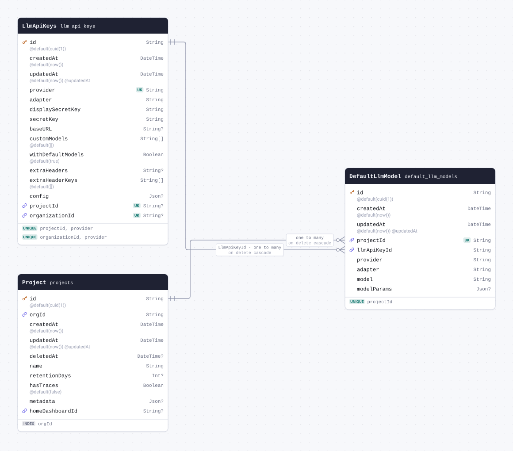

| Field                            | Type       | Constraints                                    | Default              | Description |
| -------------------------------- | ---------- | ---------------------------------------------- | -------------------- | ----------- |
| `id`                             | `String`   | PK NOT NULL                                    | `cuid(1)`            |             |
| `createdAt` (`created_at`)       | `DateTime` | NOT NULL                                       | `now()`              |             |
| `updatedAt` (`updated_at`)       | `DateTime` | NOT NULL                                       | `now()` `@updatedAt` |             |
| `projectId` (`project_id`)       | `String`   | UNIQUE NOT NULL → [Project.id](#model-Project) |                      |             |
| `llmApiKeyId` (`llm_api_key_id`) | `String`   | NOT NULL → [LlmApiKeys.id](#model-LlmApiKeys)  |                      |             |
| `provider`                       | `String`   | NOT NULL                                       |                      |             |
| `adapter`                        | `String`   | NOT NULL                                       |                      |             |
| `model`                          | `String`   | NOT NULL                                       |                      |             |
| `modelParams` (`model_params`)   | `Json`     | NULL                                           |                      |             |

#### Indexes

- `@@unique([projectId])`

#### References

- `projectId` → [Project.id](#model-Project) (many-to-one, on delete Cascade)
- `llmApiKeyId` → [LlmApiKeys.id](#model-LlmApiKeys) (many-to-one, on delete Cascade)

#### Definition

```sql
CREATE TABLE "default_llm_models" (
    "id" TEXT NOT NULL,
    "created_at" TIMESTAMP(3) NOT NULL DEFAULT CURRENT_TIMESTAMP,
    "updated_at" TIMESTAMP(3) NOT NULL DEFAULT CURRENT_TIMESTAMP,
    "project_id" TEXT NOT NULL,
    "llm_api_key_id" TEXT NOT NULL,
    "provider" TEXT NOT NULL,
    "adapter" TEXT NOT NULL,
    "model" TEXT NOT NULL,
    "model_params" JSONB,

    CONSTRAINT "default_llm_models_pkey" PRIMARY KEY ("id")
);

CREATE UNIQUE INDEX "default_llm_models_project_id_key" ON "default_llm_models"("project_id");

ALTER TABLE "default_llm_models" ADD CONSTRAINT "default_llm_models_project_id_fkey" FOREIGN KEY ("project_id") REFERENCES "projects"("id") ON DELETE CASCADE ON UPDATE CASCADE;

ALTER TABLE "default_llm_models" ADD CONSTRAINT "default_llm_models_llm_api_key_id_fkey" FOREIGN KEY ("llm_api_key_id") REFERENCES "llm_api_keys"("id") ON DELETE CASCADE ON UPDATE CASCADE;
```

<details>
<summary>Queries and their SQL</summary>

**findMany**: Every row

```ts
await prisma.defaultLlmModel.findMany();
```

```sql
SELECT
  "public"."default_llm_models"."id",
  "public"."default_llm_models"."created_at",
  "public"."default_llm_models"."updated_at",
  "public"."default_llm_models"."project_id",
  "public"."default_llm_models"."llm_api_key_id",
  "public"."default_llm_models"."provider",
  "public"."default_llm_models"."adapter",
  "public"."default_llm_models"."model",
  "public"."default_llm_models"."model_params"
FROM
  "public"."default_llm_models"
WHERE
  1 = 1
OFFSET
  $1
-- params: ["0"]
```

**count**: How many rows there are

```ts
await prisma.defaultLlmModel.count();
```

```sql
SELECT
  COUNT(*) AS "_count$_all"
FROM
  (
    SELECT
      "public"."default_llm_models"."id"
    FROM
      "public"."default_llm_models"
    WHERE
      1 = 1
    OFFSET
      $1
  ) AS "sub"
-- params: ["0"]
```

**findMany**: Every row with its relations

```ts
await prisma.defaultLlmModel.findMany({ include: { Project: true, LlmApiKey: true } });
```

```sql
SELECT
  "public"."default_llm_models"."id",
  "public"."default_llm_models"."created_at",
  "public"."default_llm_models"."updated_at",
  "public"."default_llm_models"."project_id",
  "public"."default_llm_models"."llm_api_key_id",
  "public"."default_llm_models"."provider",
  "public"."default_llm_models"."adapter",
  "public"."default_llm_models"."model",
  "public"."default_llm_models"."model_params"
FROM
  "public"."default_llm_models"
WHERE
  1 = 1
OFFSET
  $1
-- params: ["0"]

SELECT
  "public"."projects"."id",
  "public"."projects"."org_id",
  "public"."projects"."created_at",
  "public"."projects"."updated_at",
  "public"."projects"."deleted_at",
  "public"."projects"."name",
  "public"."projects"."retention_days",
  "public"."projects"."has_traces",
  "public"."projects"."metadata",
  "public"."projects"."home_dashboard_id"
FROM
  "public"."projects"
WHERE
  "public"."projects"."id" IN ($1)
OFFSET
  $2
-- params: ["<projectId of the rows above>","0"]

SELECT
  "public"."llm_api_keys"."id",
  "public"."llm_api_keys"."created_at",
  "public"."llm_api_keys"."updated_at",
  "public"."llm_api_keys"."provider",
  "public"."llm_api_keys"."adapter",
  "public"."llm_api_keys"."display_secret_key",
  "public"."llm_api_keys"."secret_key",
  "public"."llm_api_keys"."base_url",
  "public"."llm_api_keys"."custom_models",
  "public"."llm_api_keys"."with_default_models",
  "public"."llm_api_keys"."extra_headers",
  "public"."llm_api_keys"."extra_header_keys",
  "public"."llm_api_keys"."config",
  "public"."llm_api_keys"."project_id",
  "public"."llm_api_keys"."organization_id"
FROM
  "public"."llm_api_keys"
WHERE
  "public"."llm_api_keys"."id" IN ($1)
OFFSET
  $2
-- params: ["<llmApiKeyId of the rows above>","0"]
```

**findUnique**: One row by what is unique to it

```ts
await prisma.defaultLlmModel.findUnique({ where: { id: "example" } });
```

```sql
SELECT
  "public"."default_llm_models"."id",
  "public"."default_llm_models"."created_at",
  "public"."default_llm_models"."updated_at",
  "public"."default_llm_models"."project_id",
  "public"."default_llm_models"."llm_api_key_id",
  "public"."default_llm_models"."provider",
  "public"."default_llm_models"."adapter",
  "public"."default_llm_models"."model",
  "public"."default_llm_models"."model_params"
FROM
  "public"."default_llm_models"
WHERE
  (
    "public"."default_llm_models"."id" = $1
    AND 1 = 1
  )
LIMIT
  $2
OFFSET
  $3
-- params: ["example","1","0"]
```

**create**: Create a row

```ts
await prisma.defaultLlmModel.create({
  data: {
    projectId: "example",
    llmApiKeyId: "example",
    provider: "example",
    adapter: "example",
    model: "example",
  },
});
```

```sql
INSERT INTO
  "public"."default_llm_models" (
    "id",
    "created_at",
    "updated_at",
    "project_id",
    "llm_api_key_id",
    "provider",
    "adapter",
    "model"
  )
VALUES
  ($1, $2, $3, $4, $5, $6, $7, $8)
RETURNING
  "public"."default_llm_models"."id",
  "public"."default_llm_models"."created_at",
  "public"."default_llm_models"."updated_at",
  "public"."default_llm_models"."project_id",
  "public"."default_llm_models"."llm_api_key_id",
  "public"."default_llm_models"."provider",
  "public"."default_llm_models"."adapter",
  "public"."default_llm_models"."model",
  "public"."default_llm_models"."model_params"
-- params: ["<cuid(1)>","<now()>","<now()>","example","example","example","example","example"]
```

**update**: Update a row

```ts
await prisma.defaultLlmModel.update({
  where: { id: "example" },
  data: { createdAt: new Date("2026-01-01T00:00:00.000Z") },
});
```

```sql
UPDATE "public"."default_llm_models"
SET
  "created_at" = $1,
  "updated_at" = $2
WHERE
  (
    "public"."default_llm_models"."id" = $3
    AND 1 = 1
  )
RETURNING
  "public"."default_llm_models"."id",
  "public"."default_llm_models"."created_at",
  "public"."default_llm_models"."updated_at",
  "public"."default_llm_models"."project_id",
  "public"."default_llm_models"."llm_api_key_id",
  "public"."default_llm_models"."provider",
  "public"."default_llm_models"."adapter",
  "public"."default_llm_models"."model",
  "public"."default_llm_models"."model_params"
-- params: ["2026-01-01T00:00:00.000Z",{"prisma__type":"generatorCall","prisma__value":{"name":"now","args":[],"returnType":{"type":"DateTime"}}},"example"]
```

**delete**: Delete a row

```ts
await prisma.defaultLlmModel.delete({ where: { id: "example" } });
```

```sql
DELETE FROM "public"."default_llm_models"
WHERE
  (
    "public"."default_llm_models"."id" = $1
    AND 1 = 1
  )
RETURNING
  "public"."default_llm_models"."id",
  "public"."default_llm_models"."created_at",
  "public"."default_llm_models"."updated_at",
  "public"."default_llm_models"."project_id",
  "public"."default_llm_models"."llm_api_key_id",
  "public"."default_llm_models"."provider",
  "public"."default_llm_models"."adapter",
  "public"."default_llm_models"."model",
  "public"."default_llm_models"."model_params"
-- params: ["example"]
```

</details>

<a id="model-TopicConfig"></a>

### TopicConfig

Table `topic_configs`.

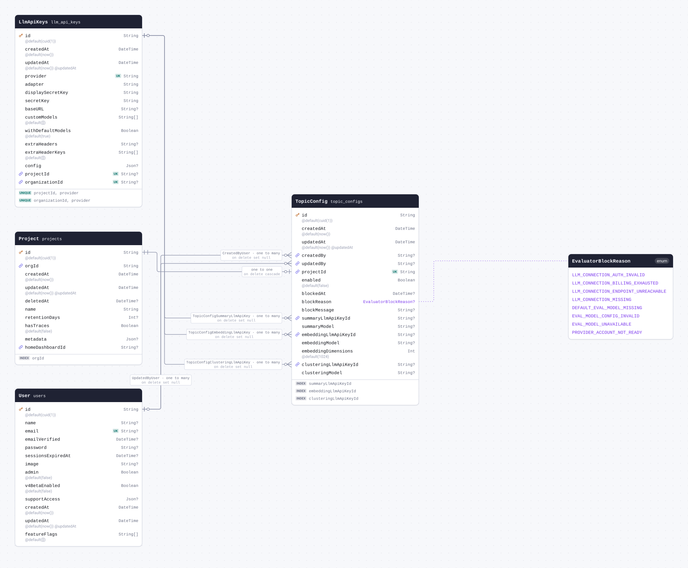

| Field                                                 | Type                                                 | Constraints                                    | Default              | Description |
| ----------------------------------------------------- | ---------------------------------------------------- | ---------------------------------------------- | -------------------- | ----------- |
| `id`                                                  | `String`                                             | PK NOT NULL                                    | `cuid(1)`            |             |
| `createdAt` (`created_at`)                            | `DateTime`                                           | NOT NULL                                       | `now()`              |             |
| `updatedAt` (`updated_at`)                            | `DateTime`                                           | NOT NULL                                       | `now()` `@updatedAt` |             |
| `createdBy` (`created_by`)                            | `String`                                             | NULL → [User.id](#model-User)                  |                      |             |
| `updatedBy` (`updated_by`)                            | `String`                                             | NULL → [User.id](#model-User)                  |                      |             |
| `projectId` (`project_id`)                            | `String`                                             | UNIQUE NOT NULL → [Project.id](#model-Project) |                      |             |
| `enabled`                                             | `Boolean`                                            | NOT NULL                                       | `false`              |             |
| `blockedAt` (`blocked_at`)                            | `DateTime`                                           | NULL                                           |                      |             |
| `blockReason` (`block_reason`)                        | [`EvaluatorBlockReason`](#enum-EvaluatorBlockReason) | NULL                                           |                      |             |
| `blockMessage` (`block_message`)                      | `String`                                             | NULL                                           |                      |             |
| `summaryLlmApiKeyId` (`summary_llm_api_key_id`)       | `String`                                             | NULL → [LlmApiKeys.id](#model-LlmApiKeys)      |                      |             |
| `summaryModel` (`summary_model`)                      | `String`                                             | NULL                                           |                      |             |
| `embeddingLlmApiKeyId` (`embedding_llm_api_key_id`)   | `String`                                             | NULL → [LlmApiKeys.id](#model-LlmApiKeys)      |                      |             |
| `embeddingModel` (`embedding_model`)                  | `String`                                             | NULL                                           |                      |             |
| `embeddingDimensions` (`embedding_dimensions`)        | `Int`                                                | NOT NULL                                       | `1024`               |             |
| `clusteringLlmApiKeyId` (`clustering_llm_api_key_id`) | `String`                                             | NULL → [LlmApiKeys.id](#model-LlmApiKeys)      |                      |             |
| `clusteringModel` (`clustering_model`)                | `String`                                             | NULL                                           |                      |             |

#### Indexes

- `@@index([summaryLlmApiKeyId])`
- `@@index([embeddingLlmApiKeyId])`
- `@@index([clusteringLlmApiKeyId])`

#### References

- `createdBy` → [User.id](#model-User) (many-to-one, on delete SetNull)
- `updatedBy` → [User.id](#model-User) (many-to-one, on delete SetNull)
- `projectId` → [Project.id](#model-Project) (one-to-one, on delete Cascade)
- `summaryLlmApiKeyId` → [LlmApiKeys.id](#model-LlmApiKeys) (many-to-one, on delete SetNull)
- `embeddingLlmApiKeyId` → [LlmApiKeys.id](#model-LlmApiKeys) (many-to-one, on delete SetNull)
- `clusteringLlmApiKeyId` → [LlmApiKeys.id](#model-LlmApiKeys) (many-to-one, on delete SetNull)

#### Definition

```sql
CREATE TABLE "topic_configs" (
    "id" TEXT NOT NULL,
    "created_at" TIMESTAMP(3) NOT NULL DEFAULT CURRENT_TIMESTAMP,
    "updated_at" TIMESTAMP(3) NOT NULL DEFAULT CURRENT_TIMESTAMP,
    "created_by" TEXT,
    "updated_by" TEXT,
    "project_id" TEXT NOT NULL,
    "enabled" BOOLEAN NOT NULL DEFAULT false,
    "blocked_at" TIMESTAMP(3),
    "block_reason" "EvaluatorBlockReason",
    "block_message" TEXT,
    "summary_llm_api_key_id" TEXT,
    "summary_model" TEXT,
    "embedding_llm_api_key_id" TEXT,
    "embedding_model" TEXT,
    "embedding_dimensions" INTEGER NOT NULL DEFAULT 1024,
    "clustering_llm_api_key_id" TEXT,
    "clustering_model" TEXT,

    CONSTRAINT "topic_configs_pkey" PRIMARY KEY ("id")
);

CREATE UNIQUE INDEX "topic_configs_project_id_key" ON "topic_configs"("project_id");

CREATE INDEX "topic_configs_summary_llm_api_key_id_idx" ON "topic_configs"("summary_llm_api_key_id");

CREATE INDEX "topic_configs_embedding_llm_api_key_id_idx" ON "topic_configs"("embedding_llm_api_key_id");

CREATE INDEX "topic_configs_clustering_llm_api_key_id_idx" ON "topic_configs"("clustering_llm_api_key_id");

ALTER TABLE "topic_configs" ADD CONSTRAINT "topic_configs_created_by_fkey" FOREIGN KEY ("created_by") REFERENCES "users"("id") ON DELETE SET NULL ON UPDATE CASCADE;

ALTER TABLE "topic_configs" ADD CONSTRAINT "topic_configs_updated_by_fkey" FOREIGN KEY ("updated_by") REFERENCES "users"("id") ON DELETE SET NULL ON UPDATE CASCADE;

ALTER TABLE "topic_configs" ADD CONSTRAINT "topic_configs_project_id_fkey" FOREIGN KEY ("project_id") REFERENCES "projects"("id") ON DELETE CASCADE ON UPDATE CASCADE;

ALTER TABLE "topic_configs" ADD CONSTRAINT "topic_configs_summary_llm_api_key_id_fkey" FOREIGN KEY ("summary_llm_api_key_id") REFERENCES "llm_api_keys"("id") ON DELETE SET NULL ON UPDATE CASCADE;

ALTER TABLE "topic_configs" ADD CONSTRAINT "topic_configs_embedding_llm_api_key_id_fkey" FOREIGN KEY ("embedding_llm_api_key_id") REFERENCES "llm_api_keys"("id") ON DELETE SET NULL ON UPDATE CASCADE;

ALTER TABLE "topic_configs" ADD CONSTRAINT "topic_configs_clustering_llm_api_key_id_fkey" FOREIGN KEY ("clustering_llm_api_key_id") REFERENCES "llm_api_keys"("id") ON DELETE SET NULL ON UPDATE CASCADE;
```

<details>
<summary>Queries and their SQL</summary>

**findMany**: Every row

```ts
await prisma.topicConfig.findMany();
```

```sql
SELECT
  "public"."topic_configs"."id",
  "public"."topic_configs"."created_at",
  "public"."topic_configs"."updated_at",
  "public"."topic_configs"."created_by",
  "public"."topic_configs"."updated_by",
  "public"."topic_configs"."project_id",
  "public"."topic_configs"."enabled",
  "public"."topic_configs"."blocked_at",
  "public"."topic_configs"."block_reason"::text,
  "public"."topic_configs"."block_message",
  "public"."topic_configs"."summary_llm_api_key_id",
  "public"."topic_configs"."summary_model",
  "public"."topic_configs"."embedding_llm_api_key_id",
  "public"."topic_configs"."embedding_model",
  "public"."topic_configs"."embedding_dimensions",
  "public"."topic_configs"."clustering_llm_api_key_id",
  "public"."topic_configs"."clustering_model"
FROM
  "public"."topic_configs"
WHERE
  1 = 1
OFFSET
  $1
-- params: ["0"]
```

**count**: How many rows there are

```ts
await prisma.topicConfig.count();
```

```sql
SELECT
  COUNT(*) AS "_count$_all"
FROM
  (
    SELECT
      "public"."topic_configs"."id"
    FROM
      "public"."topic_configs"
    WHERE
      1 = 1
    OFFSET
      $1
  ) AS "sub"
-- params: ["0"]
```

**findMany**: Every row with its relations

```ts
await prisma.topicConfig.findMany({
  include: {
    createdByUser: true,
    updatedByUser: true,
    project: true,
    summaryLlmApiKey: true,
    embeddingLlmApiKey: true,
    clusteringLlmApiKey: true,
  },
});
```

```sql
SELECT
  "public"."topic_configs"."id",
  "public"."topic_configs"."created_at",
  "public"."topic_configs"."updated_at",
  "public"."topic_configs"."created_by",
  "public"."topic_configs"."updated_by",
  "public"."topic_configs"."project_id",
  "public"."topic_configs"."enabled",
  "public"."topic_configs"."blocked_at",
  "public"."topic_configs"."block_reason"::text,
  "public"."topic_configs"."block_message",
  "public"."topic_configs"."summary_llm_api_key_id",
  "public"."topic_configs"."summary_model",
  "public"."topic_configs"."embedding_llm_api_key_id",
  "public"."topic_configs"."embedding_model",
  "public"."topic_configs"."embedding_dimensions",
  "public"."topic_configs"."clustering_llm_api_key_id",
  "public"."topic_configs"."clustering_model"
FROM
  "public"."topic_configs"
WHERE
  1 = 1
OFFSET
  $1
-- params: ["0"]

SELECT
  "public"."users"."id",
  "public"."users"."name",
  "public"."users"."email",
  "public"."users"."email_verified",
  "public"."users"."password",
  "public"."users"."sessions_expired_at",
  "public"."users"."image",
  "public"."users"."admin",
  "public"."users"."v4_beta_enabled",
  "public"."users"."support_access",
  "public"."users"."created_at",
  "public"."users"."updated_at",
  "public"."users"."feature_flags"
FROM
  "public"."users"
WHERE
  "public"."users"."id" IN ($1)
OFFSET
  $2
-- params: ["<createdBy of the rows above>","0"]

SELECT
  "public"."users"."id",
  "public"."users"."name",
  "public"."users"."email",
  "public"."users"."email_verified",
  "public"."users"."password",
  "public"."users"."sessions_expired_at",
  "public"."users"."image",
  "public"."users"."admin",
  "public"."users"."v4_beta_enabled",
  "public"."users"."support_access",
  "public"."users"."created_at",
  "public"."users"."updated_at",
  "public"."users"."feature_flags"
FROM
  "public"."users"
WHERE
  "public"."users"."id" IN ($1)
OFFSET
  $2
-- params: ["<updatedBy of the rows above>","0"]

SELECT
  "public"."projects"."id",
  "public"."projects"."org_id",
  "public"."projects"."created_at",
  "public"."projects"."updated_at",
  "public"."projects"."deleted_at",
  "public"."projects"."name",
  "public"."projects"."retention_days",
  "public"."projects"."has_traces",
  "public"."projects"."metadata",
  "public"."projects"."home_dashboard_id"
FROM
  "public"."projects"
WHERE
  "public"."projects"."id" IN ($1)
OFFSET
  $2
-- params: ["<projectId of the rows above>","0"]

SELECT
  "public"."llm_api_keys"."id",
  "public"."llm_api_keys"."created_at",
  "public"."llm_api_keys"."updated_at",
  "public"."llm_api_keys"."provider",
  "public"."llm_api_keys"."adapter",
  "public"."llm_api_keys"."display_secret_key",
  "public"."llm_api_keys"."secret_key",
  "public"."llm_api_keys"."base_url",
  "public"."llm_api_keys"."custom_models",
  "public"."llm_api_keys"."with_default_models",
  "public"."llm_api_keys"."extra_headers",
  "public"."llm_api_keys"."extra_header_keys",
  "public"."llm_api_keys"."config",
  "public"."llm_api_keys"."project_id",
  "public"."llm_api_keys"."organization_id"
FROM
  "public"."llm_api_keys"
WHERE
  "public"."llm_api_keys"."id" IN ($1)
OFFSET
  $2
-- params: ["<summaryLlmApiKeyId of the rows above>","0"]

SELECT
  "public"."llm_api_keys"."id",
  "public"."llm_api_keys"."created_at",
  "public"."llm_api_keys"."updated_at",
  "public"."llm_api_keys"."provider",
  "public"."llm_api_keys"."adapter",
  "public"."llm_api_keys"."display_secret_key",
  "public"."llm_api_keys"."secret_key",
  "public"."llm_api_keys"."base_url",
  "public"."llm_api_keys"."custom_models",
  "public"."llm_api_keys"."with_default_models",
  "public"."llm_api_keys"."extra_headers",
  "public"."llm_api_keys"."extra_header_keys",
  "public"."llm_api_keys"."config",
  "public"."llm_api_keys"."project_id",
  "public"."llm_api_keys"."organization_id"
FROM
  "public"."llm_api_keys"
WHERE
  "public"."llm_api_keys"."id" IN ($1)
OFFSET
  $2
-- params: ["<embeddingLlmApiKeyId of the rows above>","0"]

SELECT
  "public"."llm_api_keys"."id",
  "public"."llm_api_keys"."created_at",
  "public"."llm_api_keys"."updated_at",
  "public"."llm_api_keys"."provider",
  "public"."llm_api_keys"."adapter",
  "public"."llm_api_keys"."display_secret_key",
  "public"."llm_api_keys"."secret_key",
  "public"."llm_api_keys"."base_url",
  "public"."llm_api_keys"."custom_models",
  "public"."llm_api_keys"."with_default_models",
  "public"."llm_api_keys"."extra_headers",
  "public"."llm_api_keys"."extra_header_keys",
  "public"."llm_api_keys"."config",
  "public"."llm_api_keys"."project_id",
  "public"."llm_api_keys"."organization_id"
FROM
  "public"."llm_api_keys"
WHERE
  "public"."llm_api_keys"."id" IN ($1)
OFFSET
  $2
-- params: ["<clusteringLlmApiKeyId of the rows above>","0"]
```

**findUnique**: One row by what is unique to it

```ts
await prisma.topicConfig.findUnique({ where: { id: "example" } });
```

```sql
SELECT
  "public"."topic_configs"."id",
  "public"."topic_configs"."created_at",
  "public"."topic_configs"."updated_at",
  "public"."topic_configs"."created_by",
  "public"."topic_configs"."updated_by",
  "public"."topic_configs"."project_id",
  "public"."topic_configs"."enabled",
  "public"."topic_configs"."blocked_at",
  "public"."topic_configs"."block_reason"::text,
  "public"."topic_configs"."block_message",
  "public"."topic_configs"."summary_llm_api_key_id",
  "public"."topic_configs"."summary_model",
  "public"."topic_configs"."embedding_llm_api_key_id",
  "public"."topic_configs"."embedding_model",
  "public"."topic_configs"."embedding_dimensions",
  "public"."topic_configs"."clustering_llm_api_key_id",
  "public"."topic_configs"."clustering_model"
FROM
  "public"."topic_configs"
WHERE
  (
    "public"."topic_configs"."id" = $1
    AND 1 = 1
  )
LIMIT
  $2
OFFSET
  $3
-- params: ["example","1","0"]
```

**create**: Create a row

```ts
await prisma.topicConfig.create({ data: { projectId: "example" } });
```

```sql
INSERT INTO
  "public"."topic_configs" (
    "id",
    "created_at",
    "updated_at",
    "project_id",
    "enabled",
    "embedding_dimensions"
  )
VALUES
  ($1, $2, $3, $4, $5, $6)
RETURNING
  "public"."topic_configs"."id",
  "public"."topic_configs"."created_at",
  "public"."topic_configs"."updated_at",
  "public"."topic_configs"."created_by",
  "public"."topic_configs"."updated_by",
  "public"."topic_configs"."project_id",
  "public"."topic_configs"."enabled",
  "public"."topic_configs"."blocked_at",
  "public"."topic_configs"."block_reason"::text,
  "public"."topic_configs"."block_message",
  "public"."topic_configs"."summary_llm_api_key_id",
  "public"."topic_configs"."summary_model",
  "public"."topic_configs"."embedding_llm_api_key_id",
  "public"."topic_configs"."embedding_model",
  "public"."topic_configs"."embedding_dimensions",
  "public"."topic_configs"."clustering_llm_api_key_id",
  "public"."topic_configs"."clustering_model"
-- params: ["<cuid(1)>","<now()>","<now()>","example",false,"1024"]
```

**update**: Update a row

```ts
await prisma.topicConfig.update({
  where: { id: "example" },
  data: { createdAt: new Date("2026-01-01T00:00:00.000Z") },
});
```

```sql
UPDATE "public"."topic_configs"
SET
  "created_at" = $1,
  "updated_at" = $2
WHERE
  (
    "public"."topic_configs"."id" = $3
    AND 1 = 1
  )
RETURNING
  "public"."topic_configs"."id",
  "public"."topic_configs"."created_at",
  "public"."topic_configs"."updated_at",
  "public"."topic_configs"."created_by",
  "public"."topic_configs"."updated_by",
  "public"."topic_configs"."project_id",
  "public"."topic_configs"."enabled",
  "public"."topic_configs"."blocked_at",
  "public"."topic_configs"."block_reason"::text,
  "public"."topic_configs"."block_message",
  "public"."topic_configs"."summary_llm_api_key_id",
  "public"."topic_configs"."summary_model",
  "public"."topic_configs"."embedding_llm_api_key_id",
  "public"."topic_configs"."embedding_model",
  "public"."topic_configs"."embedding_dimensions",
  "public"."topic_configs"."clustering_llm_api_key_id",
  "public"."topic_configs"."clustering_model"
-- params: ["2026-01-01T00:00:00.000Z",{"prisma__type":"generatorCall","prisma__value":{"name":"now","args":[],"returnType":{"type":"DateTime"}}},"example"]
```

**delete**: Delete a row

```ts
await prisma.topicConfig.delete({ where: { id: "example" } });
```

```sql
DELETE FROM "public"."topic_configs"
WHERE
  (
    "public"."topic_configs"."id" = $1
    AND 1 = 1
  )
RETURNING
  "public"."topic_configs"."id",
  "public"."topic_configs"."created_at",
  "public"."topic_configs"."updated_at",
  "public"."topic_configs"."created_by",
  "public"."topic_configs"."updated_by",
  "public"."topic_configs"."project_id",
  "public"."topic_configs"."enabled",
  "public"."topic_configs"."blocked_at",
  "public"."topic_configs"."block_reason"::text,
  "public"."topic_configs"."block_message",
  "public"."topic_configs"."summary_llm_api_key_id",
  "public"."topic_configs"."summary_model",
  "public"."topic_configs"."embedding_llm_api_key_id",
  "public"."topic_configs"."embedding_model",
  "public"."topic_configs"."embedding_dimensions",
  "public"."topic_configs"."clustering_llm_api_key_id",
  "public"."topic_configs"."clustering_model"
-- params: ["example"]
```

</details>

<a id="model-SsoConfig"></a>

### SsoConfig

Table `sso_configs`.

| Field                            | Type       | Constraints | Default              | Description |
| -------------------------------- | ---------- | ----------- | -------------------- | ----------- |
| `domain`                         | `String`   | PK NOT NULL | `cuid(1)`            |             |
| `createdAt` (`created_at`)       | `DateTime` | NOT NULL    | `now()`              |             |
| `updatedAt` (`updated_at`)       | `DateTime` | NOT NULL    | `now()` `@updatedAt` |             |
| `authProvider` (`auth_provider`) | `String`   | NOT NULL    |                      |             |
| `authConfig` (`auth_config`)     | `Json`     | NULL        |                      |             |

#### Definition

```sql
CREATE TABLE "sso_configs" (
    "domain" TEXT NOT NULL,
    "created_at" TIMESTAMP(3) NOT NULL DEFAULT CURRENT_TIMESTAMP,
    "updated_at" TIMESTAMP(3) NOT NULL DEFAULT CURRENT_TIMESTAMP,
    "auth_provider" TEXT NOT NULL,
    "auth_config" JSONB,

    CONSTRAINT "sso_configs_pkey" PRIMARY KEY ("domain")
);
```

<details>
<summary>Queries and their SQL</summary>

**findMany**: Every row

```ts
await prisma.ssoConfig.findMany();
```

```sql
SELECT
  "public"."sso_configs"."domain",
  "public"."sso_configs"."created_at",
  "public"."sso_configs"."updated_at",
  "public"."sso_configs"."auth_provider",
  "public"."sso_configs"."auth_config"
FROM
  "public"."sso_configs"
WHERE
  1 = 1
OFFSET
  $1
-- params: ["0"]
```

**count**: How many rows there are

```ts
await prisma.ssoConfig.count();
```

```sql
SELECT
  COUNT(*) AS "_count$_all"
FROM
  (
    SELECT
      "public"."sso_configs"."domain"
    FROM
      "public"."sso_configs"
    WHERE
      1 = 1
    OFFSET
      $1
  ) AS "sub"
-- params: ["0"]
```

**findUnique**: One row by what is unique to it

```ts
await prisma.ssoConfig.findUnique({ where: { domain: "example" } });
```

```sql
SELECT
  "public"."sso_configs"."domain",
  "public"."sso_configs"."created_at",
  "public"."sso_configs"."updated_at",
  "public"."sso_configs"."auth_provider",
  "public"."sso_configs"."auth_config"
FROM
  "public"."sso_configs"
WHERE
  (
    "public"."sso_configs"."domain" = $1
    AND 1 = 1
  )
LIMIT
  $2
OFFSET
  $3
-- params: ["example","1","0"]
```

**create**: Create a row

```ts
await prisma.ssoConfig.create({ data: { authProvider: "example" } });
```

```sql
INSERT INTO
  "public"."sso_configs" (
    "domain",
    "created_at",
    "updated_at",
    "auth_provider"
  )
VALUES
  ($1, $2, $3, $4)
RETURNING
  "public"."sso_configs"."domain",
  "public"."sso_configs"."created_at",
  "public"."sso_configs"."updated_at",
  "public"."sso_configs"."auth_provider",
  "public"."sso_configs"."auth_config"
-- params: ["<cuid(1)>","<now()>","<now()>","example"]
```

**update**: Update a row

```ts
await prisma.ssoConfig.update({
  where: { domain: "example" },
  data: { createdAt: new Date("2026-01-01T00:00:00.000Z") },
});
```

```sql
UPDATE "public"."sso_configs"
SET
  "created_at" = $1,
  "updated_at" = $2
WHERE
  (
    "public"."sso_configs"."domain" = $3
    AND 1 = 1
  )
RETURNING
  "public"."sso_configs"."domain",
  "public"."sso_configs"."created_at",
  "public"."sso_configs"."updated_at",
  "public"."sso_configs"."auth_provider",
  "public"."sso_configs"."auth_config"
-- params: ["2026-01-01T00:00:00.000Z",{"prisma__type":"generatorCall","prisma__value":{"name":"now","args":[],"returnType":{"type":"DateTime"}}},"example"]
```

**delete**: Delete a row

```ts
await prisma.ssoConfig.delete({ where: { domain: "example" } });
```

```sql
DELETE FROM "public"."sso_configs"
WHERE
  (
    "public"."sso_configs"."domain" = $1
    AND 1 = 1
  )
RETURNING
  "public"."sso_configs"."domain",
  "public"."sso_configs"."created_at",
  "public"."sso_configs"."updated_at",
  "public"."sso_configs"."auth_provider",
  "public"."sso_configs"."auth_config"
-- params: ["example"]
```

</details>

<a id="model-VerifiedDomain"></a>

### VerifiedDomain

Table `verified_domains`.

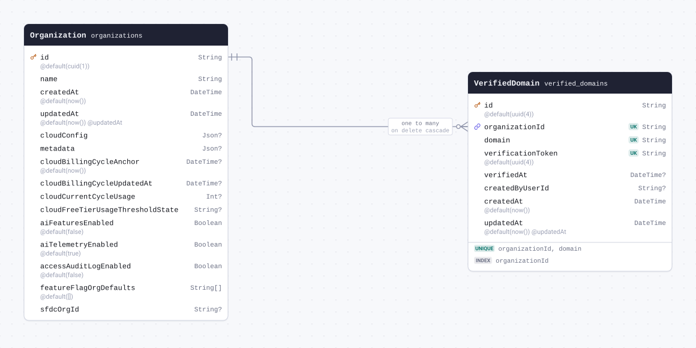

| Field                                      | Type       | Constraints                                       | Default              | Description |
| ------------------------------------------ | ---------- | ------------------------------------------------- | -------------------- | ----------- |
| `id`                                       | `String`   | PK NOT NULL                                       | `uuid(4)`            |             |
| `organizationId` (`organization_id`)       | `String`   | NOT NULL → [Organization.id](#model-Organization) |                      |             |
| `domain`                                   | `String`   | NOT NULL                                          |                      |             |
| `verificationToken` (`verification_token`) | `String`   | UNIQUE NOT NULL                                   | `uuid(4)`            |             |
| `verifiedAt` (`verified_at`)               | `DateTime` | NULL                                              |                      |             |
| `createdByUserId` (`created_by_user_id`)   | `String`   | NULL                                              |                      |             |
| `createdAt` (`created_at`)                 | `DateTime` | NOT NULL                                          | `now()`              |             |
| `updatedAt` (`updated_at`)                 | `DateTime` | NOT NULL                                          | `now()` `@updatedAt` |             |

#### Indexes

- `@@index([organizationId])`
- `@@unique([organizationId, domain])`

#### References

- `organizationId` → [Organization.id](#model-Organization) (many-to-one, on delete Cascade)

#### Definition

```sql
CREATE TABLE "verified_domains" (
    "id" TEXT NOT NULL,
    "organization_id" TEXT NOT NULL,
    "domain" TEXT NOT NULL,
    "verification_token" TEXT NOT NULL,
    "verified_at" TIMESTAMP(3),
    "created_by_user_id" TEXT,
    "created_at" TIMESTAMP(3) NOT NULL DEFAULT CURRENT_TIMESTAMP,
    "updated_at" TIMESTAMP(3) NOT NULL DEFAULT CURRENT_TIMESTAMP,

    CONSTRAINT "verified_domains_pkey" PRIMARY KEY ("id")
);

CREATE UNIQUE INDEX "verified_domains_verification_token_key" ON "verified_domains"("verification_token");

CREATE INDEX "verified_domains_organization_id_idx" ON "verified_domains"("organization_id");

CREATE UNIQUE INDEX "verified_domains_organization_id_domain_key" ON "verified_domains"("organization_id", "domain");

ALTER TABLE "verified_domains" ADD CONSTRAINT "verified_domains_organization_id_fkey" FOREIGN KEY ("organization_id") REFERENCES "organizations"("id") ON DELETE CASCADE ON UPDATE CASCADE;
```

<details>
<summary>Queries and their SQL</summary>

**findMany**: Every row

```ts
await prisma.verifiedDomain.findMany();
```

```sql
SELECT
  "public"."verified_domains"."id",
  "public"."verified_domains"."organization_id",
  "public"."verified_domains"."domain",
  "public"."verified_domains"."verification_token",
  "public"."verified_domains"."verified_at",
  "public"."verified_domains"."created_by_user_id",
  "public"."verified_domains"."created_at",
  "public"."verified_domains"."updated_at"
FROM
  "public"."verified_domains"
WHERE
  1 = 1
OFFSET
  $1
-- params: ["0"]
```

**count**: How many rows there are

```ts
await prisma.verifiedDomain.count();
```

```sql
SELECT
  COUNT(*) AS "_count$_all"
FROM
  (
    SELECT
      "public"."verified_domains"."id"
    FROM
      "public"."verified_domains"
    WHERE
      1 = 1
    OFFSET
      $1
  ) AS "sub"
-- params: ["0"]
```

**findMany**: Every row with its relations

```ts
await prisma.verifiedDomain.findMany({ include: { organization: true } });
```

```sql
SELECT
  "public"."verified_domains"."id",
  "public"."verified_domains"."organization_id",
  "public"."verified_domains"."domain",
  "public"."verified_domains"."verification_token",
  "public"."verified_domains"."verified_at",
  "public"."verified_domains"."created_by_user_id",
  "public"."verified_domains"."created_at",
  "public"."verified_domains"."updated_at"
FROM
  "public"."verified_domains"
WHERE
  1 = 1
OFFSET
  $1
-- params: ["0"]

SELECT
  "public"."organizations"."id",
  "public"."organizations"."name",
  "public"."organizations"."created_at",
  "public"."organizations"."updated_at",
  "public"."organizations"."cloud_config",
  "public"."organizations"."metadata",
  "public"."organizations"."cloud_billing_cycle_anchor",
  "public"."organizations"."cloud_billing_cycle_updated_at",
  "public"."organizations"."cloud_current_cycle_usage",
  "public"."organizations"."cloud_free_tier_usage_threshold_state",
  "public"."organizations"."ai_features_enabled",
  "public"."organizations"."ai_telemetry_enabled",
  "public"."organizations"."access_audit_log_enabled",
  "public"."organizations"."feature_flag_org_defaults",
  "public"."organizations"."sfdc_org_id"
FROM
  "public"."organizations"
WHERE
  "public"."organizations"."id" IN ($1)
OFFSET
  $2
-- params: ["<organizationId of the rows above>","0"]
```

**findUnique**: One row by what is unique to it

```ts
await prisma.verifiedDomain.findUnique({ where: { id: "example" } });
```

```sql
SELECT
  "public"."verified_domains"."id",
  "public"."verified_domains"."organization_id",
  "public"."verified_domains"."domain",
  "public"."verified_domains"."verification_token",
  "public"."verified_domains"."verified_at",
  "public"."verified_domains"."created_by_user_id",
  "public"."verified_domains"."created_at",
  "public"."verified_domains"."updated_at"
FROM
  "public"."verified_domains"
WHERE
  (
    "public"."verified_domains"."id" = $1
    AND 1 = 1
  )
LIMIT
  $2
OFFSET
  $3
-- params: ["example","1","0"]
```

**create**: Create a row

```ts
await prisma.verifiedDomain.create({ data: { organizationId: "example", domain: "example" } });
```

```sql
INSERT INTO
  "public"."verified_domains" (
    "id",
    "organization_id",
    "domain",
    "verification_token",
    "created_at",
    "updated_at"
  )
VALUES
  ($1, $2, $3, $4, $5, $6)
RETURNING
  "public"."verified_domains"."id",
  "public"."verified_domains"."organization_id",
  "public"."verified_domains"."domain",
  "public"."verified_domains"."verification_token",
  "public"."verified_domains"."verified_at",
  "public"."verified_domains"."created_by_user_id",
  "public"."verified_domains"."created_at",
  "public"."verified_domains"."updated_at"
-- params: ["<uuid(4)>","example","example","<uuid(4)>","<now()>","<now()>"]
```

**update**: Update a row

```ts
await prisma.verifiedDomain.update({ where: { id: "example" }, data: { domain: "example" } });
```

```sql
UPDATE "public"."verified_domains"
SET
  "domain" = $1,
  "updated_at" = $2
WHERE
  (
    "public"."verified_domains"."id" = $3
    AND 1 = 1
  )
RETURNING
  "public"."verified_domains"."id",
  "public"."verified_domains"."organization_id",
  "public"."verified_domains"."domain",
  "public"."verified_domains"."verification_token",
  "public"."verified_domains"."verified_at",
  "public"."verified_domains"."created_by_user_id",
  "public"."verified_domains"."created_at",
  "public"."verified_domains"."updated_at"
-- params: ["example",{"prisma__type":"generatorCall","prisma__value":{"name":"now","args":[],"returnType":{"type":"DateTime"}}},"example"]
```

**delete**: Delete a row

```ts
await prisma.verifiedDomain.delete({ where: { id: "example" } });
```

```sql
DELETE FROM "public"."verified_domains"
WHERE
  (
    "public"."verified_domains"."id" = $1
    AND 1 = 1
  )
RETURNING
  "public"."verified_domains"."id",
  "public"."verified_domains"."organization_id",
  "public"."verified_domains"."domain",
  "public"."verified_domains"."verification_token",
  "public"."verified_domains"."verified_at",
  "public"."verified_domains"."created_by_user_id",
  "public"."verified_domains"."created_at",
  "public"."verified_domains"."updated_at"
-- params: ["example"]
```

</details>

<a id="model-PosthogIntegration"></a>

### PosthogIntegration

Table `posthog_integrations`.


| Field                                                  | Type                                                                         | Constraints                                | Default               | Description |
| ------------------------------------------------------ | ---------------------------------------------------------------------------- | ------------------------------------------ | --------------------- | ----------- |
| `projectId` (`project_id`)                             | `String`                                                                     | PK NOT NULL → [Project.id](#model-Project) |                       |             |
| `encryptedPosthogApiKey` (`encrypted_posthog_api_key`) | `String`                                                                     | NOT NULL                                   |                       |             |
| `posthogHostName` (`posthog_host_name`)                | `String`                                                                     | NOT NULL                                   |                       |             |
| `lastSyncAt` (`last_sync_at`)                          | `DateTime`                                                                   | NULL                                       |                       |             |
| `enabled`                                              | `Boolean`                                                                    | NOT NULL                                   |                       |             |
| `createdAt` (`created_at`)                             | `DateTime`                                                                   | NOT NULL                                   | `now()`               |             |
| `exportSource` (`export_source`)                       | [`AnalyticsIntegrationExportSource`](#enum-AnalyticsIntegrationExportSource) | NOT NULL                                   | `TRACES_OBSERVATIONS` |             |
| `backfill`                                             | `Boolean`                                                                    | NOT NULL                                   | `true`                |             |
| `lastError` (`last_error`)                             | `String`                                                                     | NULL                                       |                       |             |
| `lastErrorAt` (`last_error_at`)                        | `DateTime`                                                                   | NULL                                       |                       |             |

#### References

- `projectId` → [Project.id](#model-Project) (many-to-one, on delete Cascade)

#### Definition

```sql
CREATE TABLE "posthog_integrations" (
    "project_id" TEXT NOT NULL,
    "encrypted_posthog_api_key" TEXT NOT NULL,
    "posthog_host_name" TEXT NOT NULL,
    "last_sync_at" TIMESTAMP(3),
    "enabled" BOOLEAN NOT NULL,
    "created_at" TIMESTAMP(3) NOT NULL DEFAULT CURRENT_TIMESTAMP,
    "export_source" "AnalyticsIntegrationExportSource" NOT NULL DEFAULT 'TRACES_OBSERVATIONS',
    "backfill" BOOLEAN NOT NULL DEFAULT true,
    "last_error" TEXT,
    "last_error_at" TIMESTAMP(3),

    CONSTRAINT "posthog_integrations_pkey" PRIMARY KEY ("project_id")
);

ALTER TABLE "posthog_integrations" ADD CONSTRAINT "posthog_integrations_project_id_fkey" FOREIGN KEY ("project_id") REFERENCES "projects"("id") ON DELETE CASCADE ON UPDATE CASCADE;
```

<details>
<summary>Queries and their SQL</summary>

**findMany**: Every row

```ts
await prisma.posthogIntegration.findMany();
```

```sql
SELECT
  "public"."posthog_integrations"."project_id",
  "public"."posthog_integrations"."encrypted_posthog_api_key",
  "public"."posthog_integrations"."posthog_host_name",
  "public"."posthog_integrations"."last_sync_at",
  "public"."posthog_integrations"."enabled",
  "public"."posthog_integrations"."created_at",
  "public"."posthog_integrations"."export_source"::text,
  "public"."posthog_integrations"."backfill",
  "public"."posthog_integrations"."last_error",
  "public"."posthog_integrations"."last_error_at"
FROM
  "public"."posthog_integrations"
WHERE
  1 = 1
OFFSET
  $1
-- params: ["0"]
```

**count**: How many rows there are

```ts
await prisma.posthogIntegration.count();
```

```sql
SELECT
  COUNT(*) AS "_count$_all"
FROM
  (
    SELECT
      "public"."posthog_integrations"."project_id"
    FROM
      "public"."posthog_integrations"
    WHERE
      1 = 1
    OFFSET
      $1
  ) AS "sub"
-- params: ["0"]
```

**findMany**: Every row with its relations

```ts
await prisma.posthogIntegration.findMany({ include: { project: true } });
```

```sql
SELECT
  "public"."posthog_integrations"."project_id",
  "public"."posthog_integrations"."encrypted_posthog_api_key",
  "public"."posthog_integrations"."posthog_host_name",
  "public"."posthog_integrations"."last_sync_at",
  "public"."posthog_integrations"."enabled",
  "public"."posthog_integrations"."created_at",
  "public"."posthog_integrations"."export_source"::text,
  "public"."posthog_integrations"."backfill",
  "public"."posthog_integrations"."last_error",
  "public"."posthog_integrations"."last_error_at"
FROM
  "public"."posthog_integrations"
WHERE
  1 = 1
OFFSET
  $1
-- params: ["0"]

SELECT
  "public"."projects"."id",
  "public"."projects"."org_id",
  "public"."projects"."created_at",
  "public"."projects"."updated_at",
  "public"."projects"."deleted_at",
  "public"."projects"."name",
  "public"."projects"."retention_days",
  "public"."projects"."has_traces",
  "public"."projects"."metadata",
  "public"."projects"."home_dashboard_id"
FROM
  "public"."projects"
WHERE
  "public"."projects"."id" IN ($1)
OFFSET
  $2
-- params: ["<projectId of the rows above>","0"]
```

**findUnique**: One row by what is unique to it

```ts
await prisma.posthogIntegration.findUnique({ where: { projectId: "example" } });
```

```sql
SELECT
  "public"."posthog_integrations"."project_id",
  "public"."posthog_integrations"."encrypted_posthog_api_key",
  "public"."posthog_integrations"."posthog_host_name",
  "public"."posthog_integrations"."last_sync_at",
  "public"."posthog_integrations"."enabled",
  "public"."posthog_integrations"."created_at",
  "public"."posthog_integrations"."export_source"::text,
  "public"."posthog_integrations"."backfill",
  "public"."posthog_integrations"."last_error",
  "public"."posthog_integrations"."last_error_at"
FROM
  "public"."posthog_integrations"
WHERE
  (
    "public"."posthog_integrations"."project_id" = $1
    AND 1 = 1
  )
LIMIT
  $2
OFFSET
  $3
-- params: ["example","1","0"]
```

**create**: Create a row

```ts
await prisma.posthogIntegration.create({
  data: {
    projectId: "example",
    encryptedPosthogApiKey: "example",
    posthogHostName: "example",
    enabled: true,
  },
});
```

```sql
INSERT INTO
  "public"."posthog_integrations" (
    "project_id",
    "encrypted_posthog_api_key",
    "posthog_host_name",
    "enabled",
    "created_at",
    "export_source",
    "backfill"
  )
VALUES
  (
    $1,
    $2,
    $3,
    $4,
    $5,
    CAST(
      $6::text AS "public"."AnalyticsIntegrationExportSource"
    ),
    $7
  )
RETURNING
  "public"."posthog_integrations"."project_id",
  "public"."posthog_integrations"."encrypted_posthog_api_key",
  "public"."posthog_integrations"."posthog_host_name",
  "public"."posthog_integrations"."last_sync_at",
  "public"."posthog_integrations"."enabled",
  "public"."posthog_integrations"."created_at",
  "public"."posthog_integrations"."export_source"::text,
  "public"."posthog_integrations"."backfill",
  "public"."posthog_integrations"."last_error",
  "public"."posthog_integrations"."last_error_at"
-- params: ["example","example","example",true,"<now()>","TRACES_OBSERVATIONS",true]
```

**update**: Update a row

```ts
await prisma.posthogIntegration.update({
  where: { projectId: "example" },
  data: { encryptedPosthogApiKey: "example" },
});
```

```sql
UPDATE "public"."posthog_integrations"
SET
  "encrypted_posthog_api_key" = $1
WHERE
  (
    "public"."posthog_integrations"."project_id" = $2
    AND 1 = 1
  )
RETURNING
  "public"."posthog_integrations"."project_id",
  "public"."posthog_integrations"."encrypted_posthog_api_key",
  "public"."posthog_integrations"."posthog_host_name",
  "public"."posthog_integrations"."last_sync_at",
  "public"."posthog_integrations"."enabled",
  "public"."posthog_integrations"."created_at",
  "public"."posthog_integrations"."export_source"::text,
  "public"."posthog_integrations"."backfill",
  "public"."posthog_integrations"."last_error",
  "public"."posthog_integrations"."last_error_at"
-- params: ["example","example"]
```

**delete**: Delete a row

```ts
await prisma.posthogIntegration.delete({ where: { projectId: "example" } });
```

```sql
DELETE FROM "public"."posthog_integrations"
WHERE
  (
    "public"."posthog_integrations"."project_id" = $1
    AND 1 = 1
  )
RETURNING
  "public"."posthog_integrations"."project_id",
  "public"."posthog_integrations"."encrypted_posthog_api_key",
  "public"."posthog_integrations"."posthog_host_name",
  "public"."posthog_integrations"."last_sync_at",
  "public"."posthog_integrations"."enabled",
  "public"."posthog_integrations"."created_at",
  "public"."posthog_integrations"."export_source"::text,
  "public"."posthog_integrations"."backfill",
  "public"."posthog_integrations"."last_error",
  "public"."posthog_integrations"."last_error_at"
-- params: ["example"]
```

</details>

<a id="model-MixpanelIntegration"></a>

### MixpanelIntegration

Table `mixpanel_integrations`.


| Field                                                                | Type                                                                         | Constraints                                | Default               | Description |
| -------------------------------------------------------------------- | ---------------------------------------------------------------------------- | ------------------------------------------ | --------------------- | ----------- |
| `projectId` (`project_id`)                                           | `String`                                                                     | PK NOT NULL → [Project.id](#model-Project) |                       |             |
| `encryptedMixpanelProjectToken` (`encrypted_mixpanel_project_token`) | `String`                                                                     | NOT NULL                                   |                       |             |
| `mixpanelRegion` (`mixpanel_region`)                                 | `String`                                                                     | NOT NULL                                   |                       |             |
| `lastSyncAt` (`last_sync_at`)                                        | `DateTime`                                                                   | NULL                                       |                       |             |
| `enabled`                                                            | `Boolean`                                                                    | NOT NULL                                   |                       |             |
| `createdAt` (`created_at`)                                           | `DateTime`                                                                   | NOT NULL                                   | `now()`               |             |
| `exportSource` (`export_source`)                                     | [`AnalyticsIntegrationExportSource`](#enum-AnalyticsIntegrationExportSource) | NOT NULL                                   | `TRACES_OBSERVATIONS` |             |
| `backfill`                                                           | `Boolean`                                                                    | NOT NULL                                   | `true`                |             |

#### References

- `projectId` → [Project.id](#model-Project) (many-to-one, on delete Cascade)

#### Definition

```sql
CREATE TABLE "mixpanel_integrations" (
    "project_id" TEXT NOT NULL,
    "encrypted_mixpanel_project_token" TEXT NOT NULL,
    "mixpanel_region" TEXT NOT NULL,
    "last_sync_at" TIMESTAMP(3),
    "enabled" BOOLEAN NOT NULL,
    "created_at" TIMESTAMP(3) NOT NULL DEFAULT CURRENT_TIMESTAMP,
    "export_source" "AnalyticsIntegrationExportSource" NOT NULL DEFAULT 'TRACES_OBSERVATIONS',
    "backfill" BOOLEAN NOT NULL DEFAULT true,

    CONSTRAINT "mixpanel_integrations_pkey" PRIMARY KEY ("project_id")
);

ALTER TABLE "mixpanel_integrations" ADD CONSTRAINT "mixpanel_integrations_project_id_fkey" FOREIGN KEY ("project_id") REFERENCES "projects"("id") ON DELETE CASCADE ON UPDATE CASCADE;
```

<details>
<summary>Queries and their SQL</summary>

**findMany**: Every row

```ts
await prisma.mixpanelIntegration.findMany();
```

```sql
SELECT
  "public"."mixpanel_integrations"."project_id",
  "public"."mixpanel_integrations"."encrypted_mixpanel_project_token",
  "public"."mixpanel_integrations"."mixpanel_region",
  "public"."mixpanel_integrations"."last_sync_at",
  "public"."mixpanel_integrations"."enabled",
  "public"."mixpanel_integrations"."created_at",
  "public"."mixpanel_integrations"."export_source"::text,
  "public"."mixpanel_integrations"."backfill"
FROM
  "public"."mixpanel_integrations"
WHERE
  1 = 1
OFFSET
  $1
-- params: ["0"]
```

**count**: How many rows there are

```ts
await prisma.mixpanelIntegration.count();
```

```sql
SELECT
  COUNT(*) AS "_count$_all"
FROM
  (
    SELECT
      "public"."mixpanel_integrations"."project_id"
    FROM
      "public"."mixpanel_integrations"
    WHERE
      1 = 1
    OFFSET
      $1
  ) AS "sub"
-- params: ["0"]
```

**findMany**: Every row with its relations

```ts
await prisma.mixpanelIntegration.findMany({ include: { project: true } });
```

```sql
SELECT
  "public"."mixpanel_integrations"."project_id",
  "public"."mixpanel_integrations"."encrypted_mixpanel_project_token",
  "public"."mixpanel_integrations"."mixpanel_region",
  "public"."mixpanel_integrations"."last_sync_at",
  "public"."mixpanel_integrations"."enabled",
  "public"."mixpanel_integrations"."created_at",
  "public"."mixpanel_integrations"."export_source"::text,
  "public"."mixpanel_integrations"."backfill"
FROM
  "public"."mixpanel_integrations"
WHERE
  1 = 1
OFFSET
  $1
-- params: ["0"]

SELECT
  "public"."projects"."id",
  "public"."projects"."org_id",
  "public"."projects"."created_at",
  "public"."projects"."updated_at",
  "public"."projects"."deleted_at",
  "public"."projects"."name",
  "public"."projects"."retention_days",
  "public"."projects"."has_traces",
  "public"."projects"."metadata",
  "public"."projects"."home_dashboard_id"
FROM
  "public"."projects"
WHERE
  "public"."projects"."id" IN ($1)
OFFSET
  $2
-- params: ["<projectId of the rows above>","0"]
```

**findUnique**: One row by what is unique to it

```ts
await prisma.mixpanelIntegration.findUnique({ where: { projectId: "example" } });
```

```sql
SELECT
  "public"."mixpanel_integrations"."project_id",
  "public"."mixpanel_integrations"."encrypted_mixpanel_project_token",
  "public"."mixpanel_integrations"."mixpanel_region",
  "public"."mixpanel_integrations"."last_sync_at",
  "public"."mixpanel_integrations"."enabled",
  "public"."mixpanel_integrations"."created_at",
  "public"."mixpanel_integrations"."export_source"::text,
  "public"."mixpanel_integrations"."backfill"
FROM
  "public"."mixpanel_integrations"
WHERE
  (
    "public"."mixpanel_integrations"."project_id" = $1
    AND 1 = 1
  )
LIMIT
  $2
OFFSET
  $3
-- params: ["example","1","0"]
```

**create**: Create a row

```ts
await prisma.mixpanelIntegration.create({
  data: {
    projectId: "example",
    encryptedMixpanelProjectToken: "example",
    mixpanelRegion: "example",
    enabled: true,
  },
});
```

```sql
INSERT INTO
  "public"."mixpanel_integrations" (
    "project_id",
    "encrypted_mixpanel_project_token",
    "mixpanel_region",
    "enabled",
    "created_at",
    "export_source",
    "backfill"
  )
VALUES
  (
    $1,
    $2,
    $3,
    $4,
    $5,
    CAST(
      $6::text AS "public"."AnalyticsIntegrationExportSource"
    ),
    $7
  )
RETURNING
  "public"."mixpanel_integrations"."project_id",
  "public"."mixpanel_integrations"."encrypted_mixpanel_project_token",
  "public"."mixpanel_integrations"."mixpanel_region",
  "public"."mixpanel_integrations"."last_sync_at",
  "public"."mixpanel_integrations"."enabled",
  "public"."mixpanel_integrations"."created_at",
  "public"."mixpanel_integrations"."export_source"::text,
  "public"."mixpanel_integrations"."backfill"
-- params: ["example","example","example",true,"<now()>","TRACES_OBSERVATIONS",true]
```

**update**: Update a row

```ts
await prisma.mixpanelIntegration.update({
  where: { projectId: "example" },
  data: { encryptedMixpanelProjectToken: "example" },
});
```

```sql
UPDATE "public"."mixpanel_integrations"
SET
  "encrypted_mixpanel_project_token" = $1
WHERE
  (
    "public"."mixpanel_integrations"."project_id" = $2
    AND 1 = 1
  )
RETURNING
  "public"."mixpanel_integrations"."project_id",
  "public"."mixpanel_integrations"."encrypted_mixpanel_project_token",
  "public"."mixpanel_integrations"."mixpanel_region",
  "public"."mixpanel_integrations"."last_sync_at",
  "public"."mixpanel_integrations"."enabled",
  "public"."mixpanel_integrations"."created_at",
  "public"."mixpanel_integrations"."export_source"::text,
  "public"."mixpanel_integrations"."backfill"
-- params: ["example","example"]
```

**delete**: Delete a row

```ts
await prisma.mixpanelIntegration.delete({ where: { projectId: "example" } });
```

```sql
DELETE FROM "public"."mixpanel_integrations"
WHERE
  (
    "public"."mixpanel_integrations"."project_id" = $1
    AND 1 = 1
  )
RETURNING
  "public"."mixpanel_integrations"."project_id",
  "public"."mixpanel_integrations"."encrypted_mixpanel_project_token",
  "public"."mixpanel_integrations"."mixpanel_region",
  "public"."mixpanel_integrations"."last_sync_at",
  "public"."mixpanel_integrations"."enabled",
  "public"."mixpanel_integrations"."created_at",
  "public"."mixpanel_integrations"."export_source"::text,
  "public"."mixpanel_integrations"."backfill"
-- params: ["example"]
```

</details>

<a id="model-BlobStorageIntegration"></a>

### BlobStorageIntegration

Table `blob_storage_integrations`.


| Field                                                                 | Type                                                                         | Constraints                                | Default                                                                                                        | Description |
| --------------------------------------------------------------------- | ---------------------------------------------------------------------------- | ------------------------------------------ | -------------------------------------------------------------------------------------------------------------- | ----------- |
| `projectId` (`project_id`)                                            | `String`                                                                     | PK NOT NULL → [Project.id](#model-Project) |                                                                                                                |             |
| `type` (`type`)                                                       | [`BlobStorageIntegrationType`](#enum-BlobStorageIntegrationType)             | NOT NULL                                   |                                                                                                                |             |
| `bucketName` (`bucket_name`)                                          | `String`                                                                     | NOT NULL                                   |                                                                                                                |             |
| `prefix` (`prefix`)                                                   | `String`                                                                     | NOT NULL                                   |                                                                                                                |             |
| `authType` (`auth_type`)                                              | [`StorageIntegrationAuthType`](#enum-StorageIntegrationAuthType)             | NOT NULL                                   | `ACCESS_KEYS`                                                                                                  |             |
| `accessKeyId` (`access_key_id`)                                       | `String`                                                                     | NULL                                       |                                                                                                                |             |
| `secretAccessKey` (`secret_access_key`)                               | `String`                                                                     | NULL                                       |                                                                                                                |             |
| `roleArn` (`role_arn`)                                                | `String`                                                                     | NULL                                       |                                                                                                                |             |
| `externalId` (`external_id`)                                          | `String`                                                                     | NULL                                       |                                                                                                                |             |
| `region` (`region`)                                                   | `String`                                                                     | NOT NULL                                   |                                                                                                                |             |
| `endpoint` (`endpoint`)                                               | `String`                                                                     | NULL                                       |                                                                                                                |             |
| `forcePathStyle` (`force_path_style`)                                 | `Boolean`                                                                    | NOT NULL                                   |                                                                                                                |             |
| `nextSyncAt` (`next_sync_at`)                                         | `DateTime`                                                                   | NULL                                       |                                                                                                                |             |
| `lastSyncAt` (`last_sync_at`)                                         | `DateTime`                                                                   | NULL                                       |                                                                                                                |             |
| `enabled`                                                             | `Boolean`                                                                    | NOT NULL                                   |                                                                                                                |             |
| `exportFrequency` (`export_frequency`)                                | `String`                                                                     | NOT NULL                                   |                                                                                                                |             |
| `fileType` (`file_type`)                                              | [`BlobStorageIntegrationFileType`](#enum-BlobStorageIntegrationFileType)     | NOT NULL                                   | `CSV`                                                                                                          |             |
| `exportMode` (`export_mode`)                                          | [`BlobStorageExportMode`](#enum-BlobStorageExportMode)                       | NOT NULL                                   | `FULL_HISTORY`                                                                                                 |             |
| `exportStartDate` (`export_start_date`)                               | `DateTime`                                                                   | NULL                                       |                                                                                                                |             |
| `exportSource` (`export_source`)                                      | [`AnalyticsIntegrationExportSource`](#enum-AnalyticsIntegrationExportSource) | NOT NULL                                   | `TRACES_OBSERVATIONS`                                                                                          |             |
| `exportFieldGroups` (`export_field_groups`)                           | `String[]`                                                                   | NOT NULL                                   | `["core", "basic", "time", "io", "metadata", "model", "usage", "prompt", "metrics", "tools", "trace_context"]` |             |
| `compressed` (`compressed`)                                           | `Boolean`                                                                    | NOT NULL                                   | `true`                                                                                                         |             |
| `exportTuning` (`export_tuning`)                                      | `Json`                                                                       | NULL                                       |                                                                                                                |             |
| `runStartedAt` (`run_started_at`)                                     | `DateTime`                                                                   | NULL                                       |                                                                                                                |             |
| `backfill`                                                            | `Boolean`                                                                    | NOT NULL                                   | `true`                                                                                                         |             |
| `lastError` (`last_error`)                                            | `String`                                                                     | NULL                                       |                                                                                                                |             |
| `lastErrorAt` (`last_error_at`)                                       | `DateTime`                                                                   | NULL                                       |                                                                                                                |             |
| `lastFailureNotificationSentAt` (`last_failure_notification_sent_at`) | `DateTime`                                                                   | NULL                                       |                                                                                                                |             |
| `createdAt` (`created_at`)                                            | `DateTime`                                                                   | NOT NULL                                   | `now()`                                                                                                        |             |
| `updatedAt` (`updated_at`)                                            | `DateTime`                                                                   | NOT NULL                                   | `now()` `@updatedAt`                                                                                           |             |

#### References

- `projectId` → [Project.id](#model-Project) (many-to-one, on delete Cascade)

#### Definition

```sql
CREATE TABLE "blob_storage_integrations" (
    "project_id" TEXT NOT NULL,
    "type" "BlobStorageIntegrationType" NOT NULL,
    "bucket_name" TEXT NOT NULL,
    "prefix" TEXT NOT NULL,
    "auth_type" "StorageIntegrationAuthType" NOT NULL DEFAULT 'ACCESS_KEYS',
    "access_key_id" TEXT,
    "secret_access_key" TEXT,
    "role_arn" TEXT,
    "external_id" TEXT,
    "region" TEXT NOT NULL,
    "endpoint" TEXT,
    "force_path_style" BOOLEAN NOT NULL,
    "next_sync_at" TIMESTAMP(3),
    "last_sync_at" TIMESTAMP(3),
    "enabled" BOOLEAN NOT NULL,
    "export_frequency" TEXT NOT NULL,
    "file_type" "BlobStorageIntegrationFileType" NOT NULL DEFAULT 'CSV',
    "export_mode" "BlobStorageExportMode" NOT NULL DEFAULT 'FULL_HISTORY',
    "export_start_date" TIMESTAMP(3),
    "export_source" "AnalyticsIntegrationExportSource" NOT NULL DEFAULT 'TRACES_OBSERVATIONS',
    "export_field_groups" TEXT[] DEFAULT ARRAY['core', 'basic', 'time', 'io', 'metadata', 'model', 'usage', 'prompt', 'metrics', 'tools', 'trace_context']::TEXT[],
    "compressed" BOOLEAN NOT NULL DEFAULT true,
    "export_tuning" JSONB,
    "run_started_at" TIMESTAMP(3),
    "backfill" BOOLEAN NOT NULL DEFAULT true,
    "last_error" TEXT,
    "last_error_at" TIMESTAMP(3),
    "last_failure_notification_sent_at" TIMESTAMP(3),
    "created_at" TIMESTAMP(3) NOT NULL DEFAULT CURRENT_TIMESTAMP,
    "updated_at" TIMESTAMP(3) NOT NULL DEFAULT CURRENT_TIMESTAMP,

    CONSTRAINT "blob_storage_integrations_pkey" PRIMARY KEY ("project_id")
);

ALTER TABLE "blob_storage_integrations" ADD CONSTRAINT "blob_storage_integrations_project_id_fkey" FOREIGN KEY ("project_id") REFERENCES "projects"("id") ON DELETE CASCADE ON UPDATE CASCADE;
```

<details>
<summary>Queries and their SQL</summary>

**findMany**: Every row

```ts
await prisma.blobStorageIntegration.findMany();
```

```sql
SELECT
  "public"."blob_storage_integrations"."project_id",
  "public"."blob_storage_integrations"."type"::text,
  "public"."blob_storage_integrations"."bucket_name",
  "public"."blob_storage_integrations"."prefix",
  "public"."blob_storage_integrations"."auth_type"::text,
  "public"."blob_storage_integrations"."access_key_id",
  "public"."blob_storage_integrations"."secret_access_key",
  "public"."blob_storage_integrations"."role_arn",
  "public"."blob_storage_integrations"."external_id",
  "public"."blob_storage_integrations"."region",
  "public"."blob_storage_integrations"."endpoint",
  "public"."blob_storage_integrations"."force_path_style",
  "public"."blob_storage_integrations"."next_sync_at",
  "public"."blob_storage_integrations"."last_sync_at",
  "public"."blob_storage_integrations"."enabled",
  "public"."blob_storage_integrations"."export_frequency",
  "public"."blob_storage_integrations"."file_type"::text,
  "public"."blob_storage_integrations"."export_mode"::text,
  "public"."blob_storage_integrations"."export_start_date",
  "public"."blob_storage_integrations"."export_source"::text,
  "public"."blob_storage_integrations"."export_field_groups",
  "public"."blob_storage_integrations"."compressed",
  "public"."blob_storage_integrations"."export_tuning",
  "public"."blob_storage_integrations"."run_started_at",
  "public"."blob_storage_integrations"."backfill",
  "public"."blob_storage_integrations"."last_error",
  "public"."blob_storage_integrations"."last_error_at",
  "public"."blob_storage_integrations"."last_failure_notification_sent_at",
  "public"."blob_storage_integrations"."created_at",
  "public"."blob_storage_integrations"."updated_at"
FROM
  "public"."blob_storage_integrations"
WHERE
  1 = 1
OFFSET
  $1
-- params: ["0"]
```

**count**: How many rows there are

```ts
await prisma.blobStorageIntegration.count();
```

```sql
SELECT
  COUNT(*) AS "_count$_all"
FROM
  (
    SELECT
      "public"."blob_storage_integrations"."project_id"
    FROM
      "public"."blob_storage_integrations"
    WHERE
      1 = 1
    OFFSET
      $1
  ) AS "sub"
-- params: ["0"]
```

**findMany**: Every row with its relations

```ts
await prisma.blobStorageIntegration.findMany({ include: { project: true } });
```

```sql
SELECT
  "public"."blob_storage_integrations"."project_id",
  "public"."blob_storage_integrations"."type"::text,
  "public"."blob_storage_integrations"."bucket_name",
  "public"."blob_storage_integrations"."prefix",
  "public"."blob_storage_integrations"."auth_type"::text,
  "public"."blob_storage_integrations"."access_key_id",
  "public"."blob_storage_integrations"."secret_access_key",
  "public"."blob_storage_integrations"."role_arn",
  "public"."blob_storage_integrations"."external_id",
  "public"."blob_storage_integrations"."region",
  "public"."blob_storage_integrations"."endpoint",
  "public"."blob_storage_integrations"."force_path_style",
  "public"."blob_storage_integrations"."next_sync_at",
  "public"."blob_storage_integrations"."last_sync_at",
  "public"."blob_storage_integrations"."enabled",
  "public"."blob_storage_integrations"."export_frequency",
  "public"."blob_storage_integrations"."file_type"::text,
  "public"."blob_storage_integrations"."export_mode"::text,
  "public"."blob_storage_integrations"."export_start_date",
  "public"."blob_storage_integrations"."export_source"::text,
  "public"."blob_storage_integrations"."export_field_groups",
  "public"."blob_storage_integrations"."compressed",
  "public"."blob_storage_integrations"."export_tuning",
  "public"."blob_storage_integrations"."run_started_at",
  "public"."blob_storage_integrations"."backfill",
  "public"."blob_storage_integrations"."last_error",
  "public"."blob_storage_integrations"."last_error_at",
  "public"."blob_storage_integrations"."last_failure_notification_sent_at",
  "public"."blob_storage_integrations"."created_at",
  "public"."blob_storage_integrations"."updated_at"
FROM
  "public"."blob_storage_integrations"
WHERE
  1 = 1
OFFSET
  $1
-- params: ["0"]

SELECT
  "public"."projects"."id",
  "public"."projects"."org_id",
  "public"."projects"."created_at",
  "public"."projects"."updated_at",
  "public"."projects"."deleted_at",
  "public"."projects"."name",
  "public"."projects"."retention_days",
  "public"."projects"."has_traces",
  "public"."projects"."metadata",
  "public"."projects"."home_dashboard_id"
FROM
  "public"."projects"
WHERE
  "public"."projects"."id" IN ($1)
OFFSET
  $2
-- params: ["<projectId of the rows above>","0"]
```

**findUnique**: One row by what is unique to it

```ts
await prisma.blobStorageIntegration.findUnique({ where: { projectId: "example" } });
```

```sql
SELECT
  "public"."blob_storage_integrations"."project_id",
  "public"."blob_storage_integrations"."type"::text,
  "public"."blob_storage_integrations"."bucket_name",
  "public"."blob_storage_integrations"."prefix",
  "public"."blob_storage_integrations"."auth_type"::text,
  "public"."blob_storage_integrations"."access_key_id",
  "public"."blob_storage_integrations"."secret_access_key",
  "public"."blob_storage_integrations"."role_arn",
  "public"."blob_storage_integrations"."external_id",
  "public"."blob_storage_integrations"."region",
  "public"."blob_storage_integrations"."endpoint",
  "public"."blob_storage_integrations"."force_path_style",
  "public"."blob_storage_integrations"."next_sync_at",
  "public"."blob_storage_integrations"."last_sync_at",
  "public"."blob_storage_integrations"."enabled",
  "public"."blob_storage_integrations"."export_frequency",
  "public"."blob_storage_integrations"."file_type"::text,
  "public"."blob_storage_integrations"."export_mode"::text,
  "public"."blob_storage_integrations"."export_start_date",
  "public"."blob_storage_integrations"."export_source"::text,
  "public"."blob_storage_integrations"."export_field_groups",
  "public"."blob_storage_integrations"."compressed",
  "public"."blob_storage_integrations"."export_tuning",
  "public"."blob_storage_integrations"."run_started_at",
  "public"."blob_storage_integrations"."backfill",
  "public"."blob_storage_integrations"."last_error",
  "public"."blob_storage_integrations"."last_error_at",
  "public"."blob_storage_integrations"."last_failure_notification_sent_at",
  "public"."blob_storage_integrations"."created_at",
  "public"."blob_storage_integrations"."updated_at"
FROM
  "public"."blob_storage_integrations"
WHERE
  (
    "public"."blob_storage_integrations"."project_id" = $1
    AND 1 = 1
  )
LIMIT
  $2
OFFSET
  $3
-- params: ["example","1","0"]
```

**create**: Create a row

```ts
await prisma.blobStorageIntegration.create({
  data: {
    projectId: "example",
    type: "S3",
    bucketName: "example",
    prefix: "example",
    region: "example",
    forcePathStyle: true,
    enabled: true,
    exportFrequency: "example",
  },
});
```

```sql
INSERT INTO
  "public"."blob_storage_integrations" (
    "project_id",
    "type",
    "bucket_name",
    "prefix",
    "auth_type",
    "region",
    "force_path_style",
    "enabled",
    "export_frequency",
    "file_type",
    "export_mode",
    "export_source",
    "export_field_groups",
    "compressed",
    "backfill",
    "created_at",
    "updated_at"
  )
VALUES
  (
    $1,
    CAST($2::text AS "public"."BlobStorageIntegrationType"),
    $3,
    $4,
    CAST($5::text AS "public"."StorageIntegrationAuthType"),
    $6,
    $7,
    $8,
    $9,
    CAST(
      $10::text AS "public"."BlobStorageIntegrationFileType"
    ),
    CAST($11::text AS "public"."BlobStorageExportMode"),
    CAST(
      $12::text AS "public"."AnalyticsIntegrationExportSource"
    ),
    $13,
    $14,
    $15,
    $16,
    $17
  )
RETURNING
  "public"."blob_storage_integrations"."project_id",
  "public"."blob_storage_integrations"."type"::text,
  "public"."blob_storage_integrations"."bucket_name",
  "public"."blob_storage_integrations"."prefix",
  "public"."blob_storage_integrations"."auth_type"::text,
  "public"."blob_storage_integrations"."access_key_id",
  "public"."blob_storage_integrations"."secret_access_key",
  "public"."blob_storage_integrations"."role_arn",
  "public"."blob_storage_integrations"."external_id",
  "public"."blob_storage_integrations"."region",
  "public"."blob_storage_integrations"."endpoint",
  "public"."blob_storage_integrations"."force_path_style",
  "public"."blob_storage_integrations"."next_sync_at",
  "public"."blob_storage_integrations"."last_sync_at",
  "public"."blob_storage_integrations"."enabled",
  "public"."blob_storage_integrations"."export_frequency",
  "public"."blob_storage_integrations"."file_type"::text,
  "public"."blob_storage_integrations"."export_mode"::text,
  "public"."blob_storage_integrations"."export_start_date",
  "public"."blob_storage_integrations"."export_source"::text,
  "public"."blob_storage_integrations"."export_field_groups",
  "public"."blob_storage_integrations"."compressed",
  "public"."blob_storage_integrations"."export_tuning",
  "public"."blob_storage_integrations"."run_started_at",
  "public"."blob_storage_integrations"."backfill",
  "public"."blob_storage_integrations"."last_error",
  "public"."blob_storage_integrations"."last_error_at",
  "public"."blob_storage_integrations"."last_failure_notification_sent_at",
  "public"."blob_storage_integrations"."created_at",
  "public"."blob_storage_integrations"."updated_at"
-- params: ["example","S3","example","example","ACCESS_KEYS","example",true,true,"example","CSV","FULL_HISTORY","TRACES_OBSERVATIONS",["core","basic","time","io","metadata","model","usage","prompt","metrics","tools","trace_context"],true,true,"<now()>","<now()>"]
```

**update**: Update a row

```ts
await prisma.blobStorageIntegration.update({
  where: { projectId: "example" },
  data: { type: "S3" },
});
```

```sql
UPDATE "public"."blob_storage_integrations"
SET
  "type" = CAST($1::text AS "public"."BlobStorageIntegrationType"),
  "updated_at" = $2
WHERE
  (
    "public"."blob_storage_integrations"."project_id" = $3
    AND 1 = 1
  )
RETURNING
  "public"."blob_storage_integrations"."project_id",
  "public"."blob_storage_integrations"."type"::text,
  "public"."blob_storage_integrations"."bucket_name",
  "public"."blob_storage_integrations"."prefix",
  "public"."blob_storage_integrations"."auth_type"::text,
  "public"."blob_storage_integrations"."access_key_id",
  "public"."blob_storage_integrations"."secret_access_key",
  "public"."blob_storage_integrations"."role_arn",
  "public"."blob_storage_integrations"."external_id",
  "public"."blob_storage_integrations"."region",
  "public"."blob_storage_integrations"."endpoint",
  "public"."blob_storage_integrations"."force_path_style",
  "public"."blob_storage_integrations"."next_sync_at",
  "public"."blob_storage_integrations"."last_sync_at",
  "public"."blob_storage_integrations"."enabled",
  "public"."blob_storage_integrations"."export_frequency",
  "public"."blob_storage_integrations"."file_type"::text,
  "public"."blob_storage_integrations"."export_mode"::text,
  "public"."blob_storage_integrations"."export_start_date",
  "public"."blob_storage_integrations"."export_source"::text,
  "public"."blob_storage_integrations"."export_field_groups",
  "public"."blob_storage_integrations"."compressed",
  "public"."blob_storage_integrations"."export_tuning",
  "public"."blob_storage_integrations"."run_started_at",
  "public"."blob_storage_integrations"."backfill",
  "public"."blob_storage_integrations"."last_error",
  "public"."blob_storage_integrations"."last_error_at",
  "public"."blob_storage_integrations"."last_failure_notification_sent_at",
  "public"."blob_storage_integrations"."created_at",
  "public"."blob_storage_integrations"."updated_at"
-- params: ["S3",{"prisma__type":"generatorCall","prisma__value":{"name":"now","args":[],"returnType":{"type":"DateTime"}}},"example"]
```

**delete**: Delete a row

```ts
await prisma.blobStorageIntegration.delete({ where: { projectId: "example" } });
```

```sql
DELETE FROM "public"."blob_storage_integrations"
WHERE
  (
    "public"."blob_storage_integrations"."project_id" = $1
    AND 1 = 1
  )
RETURNING
  "public"."blob_storage_integrations"."project_id",
  "public"."blob_storage_integrations"."type"::text,
  "public"."blob_storage_integrations"."bucket_name",
  "public"."blob_storage_integrations"."prefix",
  "public"."blob_storage_integrations"."auth_type"::text,
  "public"."blob_storage_integrations"."access_key_id",
  "public"."blob_storage_integrations"."secret_access_key",
  "public"."blob_storage_integrations"."role_arn",
  "public"."blob_storage_integrations"."external_id",
  "public"."blob_storage_integrations"."region",
  "public"."blob_storage_integrations"."endpoint",
  "public"."blob_storage_integrations"."force_path_style",
  "public"."blob_storage_integrations"."next_sync_at",
  "public"."blob_storage_integrations"."last_sync_at",
  "public"."blob_storage_integrations"."enabled",
  "public"."blob_storage_integrations"."export_frequency",
  "public"."blob_storage_integrations"."file_type"::text,
  "public"."blob_storage_integrations"."export_mode"::text,
  "public"."blob_storage_integrations"."export_start_date",
  "public"."blob_storage_integrations"."export_source"::text,
  "public"."blob_storage_integrations"."export_field_groups",
  "public"."blob_storage_integrations"."compressed",
  "public"."blob_storage_integrations"."export_tuning",
  "public"."blob_storage_integrations"."run_started_at",
  "public"."blob_storage_integrations"."backfill",
  "public"."blob_storage_integrations"."last_error",
  "public"."blob_storage_integrations"."last_error_at",
  "public"."blob_storage_integrations"."last_failure_notification_sent_at",
  "public"."blob_storage_integrations"."created_at",
  "public"."blob_storage_integrations"."updated_at"
-- params: ["example"]
```

</details>

<a id="model-ExternalMediaStorageIntegration"></a>

### ExternalMediaStorageIntegration

Table `external_media_storage_integrations`.


| Field                                   | Type                                                                               | Constraints                                | Default              | Description |
| --------------------------------------- | ---------------------------------------------------------------------------------- | ------------------------------------------ | -------------------- | ----------- |
| `projectId` (`project_id`)              | `String`                                                                           | PK NOT NULL → [Project.id](#model-Project) |                      |             |
| `type` (`type`)                         | [`ExternalMediaStorageIntegrationType`](#enum-ExternalMediaStorageIntegrationType) | NOT NULL                                   |                      |             |
| `bucketName` (`bucket_name`)            | `String`                                                                           | NOT NULL                                   |                      |             |
| `prefix` (`prefix`)                     | `String`                                                                           | NULL                                       |                      |             |
| `authType` (`auth_type`)                | [`StorageIntegrationAuthType`](#enum-StorageIntegrationAuthType)                   | NOT NULL                                   | `ACCESS_KEYS`        |             |
| `accessKeyId` (`access_key_id`)         | `String`                                                                           | NULL                                       |                      |             |
| `secretAccessKey` (`secret_access_key`) | `String`                                                                           | NULL                                       |                      |             |
| `roleArn` (`role_arn`)                  | `String`                                                                           | NULL                                       |                      |             |
| `externalId` (`external_id`)            | `String`                                                                           | NULL                                       |                      |             |
| `region` (`region`)                     | `String`                                                                           | NOT NULL                                   |                      |             |
| `endpoint` (`endpoint`)                 | `String`                                                                           | NULL                                       |                      |             |
| `forcePathStyle` (`force_path_style`)   | `Boolean`                                                                          | NOT NULL                                   |                      |             |
| `createdAt` (`created_at`)              | `DateTime`                                                                         | NOT NULL                                   | `now()`              |             |
| `updatedAt` (`updated_at`)              | `DateTime`                                                                         | NOT NULL                                   | `now()` `@updatedAt` |             |

#### References

- `projectId` → [Project.id](#model-Project) (one-to-one, on delete Cascade)

#### Definition

```sql
CREATE TABLE "external_media_storage_integrations" (
    "project_id" TEXT NOT NULL,
    "type" "ExternalMediaStorageIntegrationType" NOT NULL,
    "bucket_name" TEXT NOT NULL,
    "prefix" TEXT,
    "auth_type" "StorageIntegrationAuthType" NOT NULL DEFAULT 'ACCESS_KEYS',
    "access_key_id" TEXT,
    "secret_access_key" TEXT,
    "role_arn" TEXT,
    "external_id" TEXT,
    "region" TEXT NOT NULL,
    "endpoint" TEXT,
    "force_path_style" BOOLEAN NOT NULL,
    "created_at" TIMESTAMP(3) NOT NULL DEFAULT CURRENT_TIMESTAMP,
    "updated_at" TIMESTAMP(3) NOT NULL DEFAULT CURRENT_TIMESTAMP,

    CONSTRAINT "external_media_storage_integrations_pkey" PRIMARY KEY ("project_id")
);

ALTER TABLE "external_media_storage_integrations" ADD CONSTRAINT "external_media_storage_integrations_project_id_fkey" FOREIGN KEY ("project_id") REFERENCES "projects"("id") ON DELETE CASCADE ON UPDATE CASCADE;
```

<details>
<summary>Queries and their SQL</summary>

**findMany**: Every row

```ts
await prisma.externalMediaStorageIntegration.findMany();
```

```sql
SELECT
  "public"."external_media_storage_integrations"."project_id",
  "public"."external_media_storage_integrations"."type"::text,
  "public"."external_media_storage_integrations"."bucket_name",
  "public"."external_media_storage_integrations"."prefix",
  "public"."external_media_storage_integrations"."auth_type"::text,
  "public"."external_media_storage_integrations"."access_key_id",
  "public"."external_media_storage_integrations"."secret_access_key",
  "public"."external_media_storage_integrations"."role_arn",
  "public"."external_media_storage_integrations"."external_id",
  "public"."external_media_storage_integrations"."region",
  "public"."external_media_storage_integrations"."endpoint",
  "public"."external_media_storage_integrations"."force_path_style",
  "public"."external_media_storage_integrations"."created_at",
  "public"."external_media_storage_integrations"."updated_at"
FROM
  "public"."external_media_storage_integrations"
WHERE
  1 = 1
OFFSET
  $1
-- params: ["0"]
```

**count**: How many rows there are

```ts
await prisma.externalMediaStorageIntegration.count();
```

```sql
SELECT
  COUNT(*) AS "_count$_all"
FROM
  (
    SELECT
      "public"."external_media_storage_integrations"."project_id"
    FROM
      "public"."external_media_storage_integrations"
    WHERE
      1 = 1
    OFFSET
      $1
  ) AS "sub"
-- params: ["0"]
```

**findMany**: Every row with its relations

```ts
await prisma.externalMediaStorageIntegration.findMany({ include: { project: true } });
```

```sql
SELECT
  "public"."external_media_storage_integrations"."project_id",
  "public"."external_media_storage_integrations"."type"::text,
  "public"."external_media_storage_integrations"."bucket_name",
  "public"."external_media_storage_integrations"."prefix",
  "public"."external_media_storage_integrations"."auth_type"::text,
  "public"."external_media_storage_integrations"."access_key_id",
  "public"."external_media_storage_integrations"."secret_access_key",
  "public"."external_media_storage_integrations"."role_arn",
  "public"."external_media_storage_integrations"."external_id",
  "public"."external_media_storage_integrations"."region",
  "public"."external_media_storage_integrations"."endpoint",
  "public"."external_media_storage_integrations"."force_path_style",
  "public"."external_media_storage_integrations"."created_at",
  "public"."external_media_storage_integrations"."updated_at"
FROM
  "public"."external_media_storage_integrations"
WHERE
  1 = 1
OFFSET
  $1
-- params: ["0"]

SELECT
  "public"."projects"."id",
  "public"."projects"."org_id",
  "public"."projects"."created_at",
  "public"."projects"."updated_at",
  "public"."projects"."deleted_at",
  "public"."projects"."name",
  "public"."projects"."retention_days",
  "public"."projects"."has_traces",
  "public"."projects"."metadata",
  "public"."projects"."home_dashboard_id"
FROM
  "public"."projects"
WHERE
  "public"."projects"."id" IN ($1)
OFFSET
  $2
-- params: ["<projectId of the rows above>","0"]
```

**findUnique**: One row by what is unique to it

```ts
await prisma.externalMediaStorageIntegration.findUnique({ where: { projectId: "example" } });
```

```sql
SELECT
  "public"."external_media_storage_integrations"."project_id",
  "public"."external_media_storage_integrations"."type"::text,
  "public"."external_media_storage_integrations"."bucket_name",
  "public"."external_media_storage_integrations"."prefix",
  "public"."external_media_storage_integrations"."auth_type"::text,
  "public"."external_media_storage_integrations"."access_key_id",
  "public"."external_media_storage_integrations"."secret_access_key",
  "public"."external_media_storage_integrations"."role_arn",
  "public"."external_media_storage_integrations"."external_id",
  "public"."external_media_storage_integrations"."region",
  "public"."external_media_storage_integrations"."endpoint",
  "public"."external_media_storage_integrations"."force_path_style",
  "public"."external_media_storage_integrations"."created_at",
  "public"."external_media_storage_integrations"."updated_at"
FROM
  "public"."external_media_storage_integrations"
WHERE
  (
    "public"."external_media_storage_integrations"."project_id" = $1
    AND 1 = 1
  )
LIMIT
  $2
OFFSET
  $3
-- params: ["example","1","0"]
```

**create**: Create a row

```ts
await prisma.externalMediaStorageIntegration.create({
  data: {
    projectId: "example",
    type: "S3",
    bucketName: "example",
    region: "example",
    forcePathStyle: true,
  },
});
```

```sql
INSERT INTO
  "public"."external_media_storage_integrations" (
    "project_id",
    "type",
    "bucket_name",
    "auth_type",
    "region",
    "force_path_style",
    "created_at",
    "updated_at"
  )
VALUES
  (
    $1,
    CAST(
      $2::text AS "public"."ExternalMediaStorageIntegrationType"
    ),
    $3,
    CAST($4::text AS "public"."StorageIntegrationAuthType"),
    $5,
    $6,
    $7,
    $8
  )
RETURNING
  "public"."external_media_storage_integrations"."project_id",
  "public"."external_media_storage_integrations"."type"::text,
  "public"."external_media_storage_integrations"."bucket_name",
  "public"."external_media_storage_integrations"."prefix",
  "public"."external_media_storage_integrations"."auth_type"::text,
  "public"."external_media_storage_integrations"."access_key_id",
  "public"."external_media_storage_integrations"."secret_access_key",
  "public"."external_media_storage_integrations"."role_arn",
  "public"."external_media_storage_integrations"."external_id",
  "public"."external_media_storage_integrations"."region",
  "public"."external_media_storage_integrations"."endpoint",
  "public"."external_media_storage_integrations"."force_path_style",
  "public"."external_media_storage_integrations"."created_at",
  "public"."external_media_storage_integrations"."updated_at"
-- params: ["example","S3","example","ACCESS_KEYS","example",true,"<now()>","<now()>"]
```

**update**: Update a row

```ts
await prisma.externalMediaStorageIntegration.update({
  where: { projectId: "example" },
  data: { type: "S3" },
});
```

```sql
UPDATE "public"."external_media_storage_integrations"
SET
  "type" = CAST(
    $1::text AS "public"."ExternalMediaStorageIntegrationType"
  ),
  "updated_at" = $2
WHERE
  (
    "public"."external_media_storage_integrations"."project_id" = $3
    AND 1 = 1
  )
RETURNING
  "public"."external_media_storage_integrations"."project_id",
  "public"."external_media_storage_integrations"."type"::text,
  "public"."external_media_storage_integrations"."bucket_name",
  "public"."external_media_storage_integrations"."prefix",
  "public"."external_media_storage_integrations"."auth_type"::text,
  "public"."external_media_storage_integrations"."access_key_id",
  "public"."external_media_storage_integrations"."secret_access_key",
  "public"."external_media_storage_integrations"."role_arn",
  "public"."external_media_storage_integrations"."external_id",
  "public"."external_media_storage_integrations"."region",
  "public"."external_media_storage_integrations"."endpoint",
  "public"."external_media_storage_integrations"."force_path_style",
  "public"."external_media_storage_integrations"."created_at",
  "public"."external_media_storage_integrations"."updated_at"
-- params: ["S3",{"prisma__type":"generatorCall","prisma__value":{"name":"now","args":[],"returnType":{"type":"DateTime"}}},"example"]
```

**delete**: Delete a row

```ts
await prisma.externalMediaStorageIntegration.delete({ where: { projectId: "example" } });
```

```sql
DELETE FROM "public"."external_media_storage_integrations"
WHERE
  (
    "public"."external_media_storage_integrations"."project_id" = $1
    AND 1 = 1
  )
RETURNING
  "public"."external_media_storage_integrations"."project_id",
  "public"."external_media_storage_integrations"."type"::text,
  "public"."external_media_storage_integrations"."bucket_name",
  "public"."external_media_storage_integrations"."prefix",
  "public"."external_media_storage_integrations"."auth_type"::text,
  "public"."external_media_storage_integrations"."access_key_id",
  "public"."external_media_storage_integrations"."secret_access_key",
  "public"."external_media_storage_integrations"."role_arn",
  "public"."external_media_storage_integrations"."external_id",
  "public"."external_media_storage_integrations"."region",
  "public"."external_media_storage_integrations"."endpoint",
  "public"."external_media_storage_integrations"."force_path_style",
  "public"."external_media_storage_integrations"."created_at",
  "public"."external_media_storage_integrations"."updated_at"
-- params: ["example"]
```

</details>

<a id="model-WebCalloutEndpoint"></a>

### WebCalloutEndpoint

Table `web_callout_endpoints`.


| Field                                       | Type       | Constraints                             | Default              | Description |
| ------------------------------------------- | ---------- | --------------------------------------- | -------------------- | ----------- |
| `id`                                        | `String`   | PK NOT NULL                             | `cuid(1)`            |             |
| `createdAt` (`created_at`)                  | `DateTime` | NOT NULL                                | `now()`              |             |
| `updatedAt` (`updated_at`)                  | `DateTime` | NOT NULL                                | `now()` `@updatedAt` |             |
| `projectId` (`project_id`)                  | `String`   | NOT NULL → [Project.id](#model-Project) |                      |             |
| `name`                                      | `String`   | NOT NULL                                | `"Default"`          |             |
| `url`                                       | `String`   | NOT NULL                                |                      |             |
| `enabled`                                   | `Boolean`  | NOT NULL                                | `true`               |             |
| `toastMessage` (`toast_message`)            | `String`   | NOT NULL                                | `"Callout sent"`     |             |
| `requestHeaders` (`request_headers`)        | `String`   | NULL                                    |                      |             |
| `requestHeaderKeys` (`request_header_keys`) | `String[]` | NOT NULL                                | `[]`                 |             |

#### Indexes

- `@@index([projectId])`
- `@@index([projectId, enabled])`

#### References

- `projectId` → [Project.id](#model-Project) (many-to-one, on delete Cascade)

#### Definition

```sql
CREATE TABLE "web_callout_endpoints" (
    "id" TEXT NOT NULL,
    "created_at" TIMESTAMP(3) NOT NULL DEFAULT CURRENT_TIMESTAMP,
    "updated_at" TIMESTAMP(3) NOT NULL DEFAULT CURRENT_TIMESTAMP,
    "project_id" TEXT NOT NULL,
    "name" TEXT NOT NULL DEFAULT 'Default',
    "url" TEXT NOT NULL,
    "enabled" BOOLEAN NOT NULL DEFAULT true,
    "toast_message" TEXT NOT NULL DEFAULT 'Callout sent',
    "request_headers" TEXT,
    "request_header_keys" TEXT[] DEFAULT ARRAY[]::TEXT[],

    CONSTRAINT "web_callout_endpoints_pkey" PRIMARY KEY ("id")
);

CREATE INDEX "web_callout_endpoints_project_id_idx" ON "web_callout_endpoints"("project_id");

CREATE INDEX "web_callout_endpoints_project_id_enabled_idx" ON "web_callout_endpoints"("project_id", "enabled");

ALTER TABLE "web_callout_endpoints" ADD CONSTRAINT "web_callout_endpoints_project_id_fkey" FOREIGN KEY ("project_id") REFERENCES "projects"("id") ON DELETE CASCADE ON UPDATE CASCADE;
```

<details>
<summary>Queries and their SQL</summary>

**findMany**: Every row

```ts
await prisma.webCalloutEndpoint.findMany();
```

```sql
SELECT
  "public"."web_callout_endpoints"."id",
  "public"."web_callout_endpoints"."created_at",
  "public"."web_callout_endpoints"."updated_at",
  "public"."web_callout_endpoints"."project_id",
  "public"."web_callout_endpoints"."name",
  "public"."web_callout_endpoints"."url",
  "public"."web_callout_endpoints"."enabled",
  "public"."web_callout_endpoints"."toast_message",
  "public"."web_callout_endpoints"."request_headers",
  "public"."web_callout_endpoints"."request_header_keys"
FROM
  "public"."web_callout_endpoints"
WHERE
  1 = 1
OFFSET
  $1
-- params: ["0"]
```

**count**: How many rows there are

```ts
await prisma.webCalloutEndpoint.count();
```

```sql
SELECT
  COUNT(*) AS "_count$_all"
FROM
  (
    SELECT
      "public"."web_callout_endpoints"."id"
    FROM
      "public"."web_callout_endpoints"
    WHERE
      1 = 1
    OFFSET
      $1
  ) AS "sub"
-- params: ["0"]
```

**findMany**: Every row with its relations

```ts
await prisma.webCalloutEndpoint.findMany({ include: { project: true } });
```

```sql
SELECT
  "public"."web_callout_endpoints"."id",
  "public"."web_callout_endpoints"."created_at",
  "public"."web_callout_endpoints"."updated_at",
  "public"."web_callout_endpoints"."project_id",
  "public"."web_callout_endpoints"."name",
  "public"."web_callout_endpoints"."url",
  "public"."web_callout_endpoints"."enabled",
  "public"."web_callout_endpoints"."toast_message",
  "public"."web_callout_endpoints"."request_headers",
  "public"."web_callout_endpoints"."request_header_keys"
FROM
  "public"."web_callout_endpoints"
WHERE
  1 = 1
OFFSET
  $1
-- params: ["0"]

SELECT
  "public"."projects"."id",
  "public"."projects"."org_id",
  "public"."projects"."created_at",
  "public"."projects"."updated_at",
  "public"."projects"."deleted_at",
  "public"."projects"."name",
  "public"."projects"."retention_days",
  "public"."projects"."has_traces",
  "public"."projects"."metadata",
  "public"."projects"."home_dashboard_id"
FROM
  "public"."projects"
WHERE
  "public"."projects"."id" IN ($1)
OFFSET
  $2
-- params: ["<projectId of the rows above>","0"]
```

**findUnique**: One row by what is unique to it

```ts
await prisma.webCalloutEndpoint.findUnique({ where: { id: "example" } });
```

```sql
SELECT
  "public"."web_callout_endpoints"."id",
  "public"."web_callout_endpoints"."created_at",
  "public"."web_callout_endpoints"."updated_at",
  "public"."web_callout_endpoints"."project_id",
  "public"."web_callout_endpoints"."name",
  "public"."web_callout_endpoints"."url",
  "public"."web_callout_endpoints"."enabled",
  "public"."web_callout_endpoints"."toast_message",
  "public"."web_callout_endpoints"."request_headers",
  "public"."web_callout_endpoints"."request_header_keys"
FROM
  "public"."web_callout_endpoints"
WHERE
  (
    "public"."web_callout_endpoints"."id" = $1
    AND 1 = 1
  )
LIMIT
  $2
OFFSET
  $3
-- params: ["example","1","0"]
```

**create**: Create a row

```ts
await prisma.webCalloutEndpoint.create({ data: { projectId: "example", url: "example" } });
```

```sql
INSERT INTO
  "public"."web_callout_endpoints" (
    "id",
    "created_at",
    "updated_at",
    "project_id",
    "name",
    "url",
    "enabled",
    "toast_message",
    "request_header_keys"
  )
VALUES
  ($1, $2, $3, $4, $5, $6, $7, $8, $9)
RETURNING
  "public"."web_callout_endpoints"."id",
  "public"."web_callout_endpoints"."created_at",
  "public"."web_callout_endpoints"."updated_at",
  "public"."web_callout_endpoints"."project_id",
  "public"."web_callout_endpoints"."name",
  "public"."web_callout_endpoints"."url",
  "public"."web_callout_endpoints"."enabled",
  "public"."web_callout_endpoints"."toast_message",
  "public"."web_callout_endpoints"."request_headers",
  "public"."web_callout_endpoints"."request_header_keys"
-- params: ["<cuid(1)>","<now()>","<now()>","example","Default","example",true,"Callout sent",[]]
```

**update**: Update a row

```ts
await prisma.webCalloutEndpoint.update({
  where: { id: "example" },
  data: { createdAt: new Date("2026-01-01T00:00:00.000Z") },
});
```

```sql
UPDATE "public"."web_callout_endpoints"
SET
  "created_at" = $1,
  "updated_at" = $2
WHERE
  (
    "public"."web_callout_endpoints"."id" = $3
    AND 1 = 1
  )
RETURNING
  "public"."web_callout_endpoints"."id",
  "public"."web_callout_endpoints"."created_at",
  "public"."web_callout_endpoints"."updated_at",
  "public"."web_callout_endpoints"."project_id",
  "public"."web_callout_endpoints"."name",
  "public"."web_callout_endpoints"."url",
  "public"."web_callout_endpoints"."enabled",
  "public"."web_callout_endpoints"."toast_message",
  "public"."web_callout_endpoints"."request_headers",
  "public"."web_callout_endpoints"."request_header_keys"
-- params: ["2026-01-01T00:00:00.000Z",{"prisma__type":"generatorCall","prisma__value":{"name":"now","args":[],"returnType":{"type":"DateTime"}}},"example"]
```

**delete**: Delete a row

```ts
await prisma.webCalloutEndpoint.delete({ where: { id: "example" } });
```

```sql
DELETE FROM "public"."web_callout_endpoints"
WHERE
  (
    "public"."web_callout_endpoints"."id" = $1
    AND 1 = 1
  )
RETURNING
  "public"."web_callout_endpoints"."id",
  "public"."web_callout_endpoints"."created_at",
  "public"."web_callout_endpoints"."updated_at",
  "public"."web_callout_endpoints"."project_id",
  "public"."web_callout_endpoints"."name",
  "public"."web_callout_endpoints"."url",
  "public"."web_callout_endpoints"."enabled",
  "public"."web_callout_endpoints"."toast_message",
  "public"."web_callout_endpoints"."request_headers",
  "public"."web_callout_endpoints"."request_header_keys"
-- params: ["example"]
```

</details>

<a id="model-BatchExport"></a>

### BatchExport

Table `batch_exports`.


| Field                        | Type       | Constraints                             | Default              | Description |
| ---------------------------- | ---------- | --------------------------------------- | -------------------- | ----------- |
| `id`                         | `String`   | PK NOT NULL                             | `cuid(1)`            |             |
| `createdAt` (`created_at`)   | `DateTime` | NOT NULL                                | `now()`              |             |
| `updatedAt` (`updated_at`)   | `DateTime` | NOT NULL                                | `now()` `@updatedAt` |             |
| `projectId` (`project_id`)   | `String`   | NOT NULL → [Project.id](#model-Project) |                      |             |
| `userId` (`user_id`)         | `String`   | NOT NULL                                |                      |             |
| `finishedAt` (`finished_at`) | `DateTime` | NULL                                    |                      |             |
| `expiresAt` (`expires_at`)   | `DateTime` | NULL                                    |                      |             |
| `name`                       | `String`   | NOT NULL                                |                      |             |
| `status`                     | `String`   | NOT NULL                                |                      |             |
| `query`                      | `Json`     | NOT NULL                                |                      |             |
| `format`                     | `String`   | NOT NULL                                |                      |             |
| `url`                        | `String`   | NULL                                    |                      |             |
| `log`                        | `String`   | NULL                                    |                      |             |

#### Indexes

- `@@index([projectId, userId])`
- `@@index([status])`

#### References

- `projectId` → [Project.id](#model-Project) (many-to-one, on delete Cascade)

#### Definition

```sql
CREATE TABLE "batch_exports" (
    "id" TEXT NOT NULL,
    "created_at" TIMESTAMP(3) NOT NULL DEFAULT CURRENT_TIMESTAMP,
    "updated_at" TIMESTAMP(3) NOT NULL DEFAULT CURRENT_TIMESTAMP,
    "project_id" TEXT NOT NULL,
    "user_id" TEXT NOT NULL,
    "finished_at" TIMESTAMP(3),
    "expires_at" TIMESTAMP(3),
    "name" TEXT NOT NULL,
    "status" TEXT NOT NULL,
    "query" JSONB NOT NULL,
    "format" TEXT NOT NULL,
    "url" TEXT,
    "log" TEXT,

    CONSTRAINT "batch_exports_pkey" PRIMARY KEY ("id")
);

CREATE INDEX "batch_exports_project_id_user_id_idx" ON "batch_exports"("project_id", "user_id");

CREATE INDEX "batch_exports_status_idx" ON "batch_exports"("status");

ALTER TABLE "batch_exports" ADD CONSTRAINT "batch_exports_project_id_fkey" FOREIGN KEY ("project_id") REFERENCES "projects"("id") ON DELETE CASCADE ON UPDATE CASCADE;
```

<details>
<summary>Queries and their SQL</summary>

**findMany**: Every row

```ts
await prisma.batchExport.findMany();
```

```sql
SELECT
  "public"."batch_exports"."id",
  "public"."batch_exports"."created_at",
  "public"."batch_exports"."updated_at",
  "public"."batch_exports"."project_id",
  "public"."batch_exports"."user_id",
  "public"."batch_exports"."finished_at",
  "public"."batch_exports"."expires_at",
  "public"."batch_exports"."name",
  "public"."batch_exports"."status",
  "public"."batch_exports"."query",
  "public"."batch_exports"."format",
  "public"."batch_exports"."url",
  "public"."batch_exports"."log"
FROM
  "public"."batch_exports"
WHERE
  1 = 1
OFFSET
  $1
-- params: ["0"]
```

**count**: How many rows there are

```ts
await prisma.batchExport.count();
```

```sql
SELECT
  COUNT(*) AS "_count$_all"
FROM
  (
    SELECT
      "public"."batch_exports"."id"
    FROM
      "public"."batch_exports"
    WHERE
      1 = 1
    OFFSET
      $1
  ) AS "sub"
-- params: ["0"]
```

**findMany**: Every row with its relations

```ts
await prisma.batchExport.findMany({ include: { project: true } });
```

```sql
SELECT
  "public"."batch_exports"."id",
  "public"."batch_exports"."created_at",
  "public"."batch_exports"."updated_at",
  "public"."batch_exports"."project_id",
  "public"."batch_exports"."user_id",
  "public"."batch_exports"."finished_at",
  "public"."batch_exports"."expires_at",
  "public"."batch_exports"."name",
  "public"."batch_exports"."status",
  "public"."batch_exports"."query",
  "public"."batch_exports"."format",
  "public"."batch_exports"."url",
  "public"."batch_exports"."log"
FROM
  "public"."batch_exports"
WHERE
  1 = 1
OFFSET
  $1
-- params: ["0"]

SELECT
  "public"."projects"."id",
  "public"."projects"."org_id",
  "public"."projects"."created_at",
  "public"."projects"."updated_at",
  "public"."projects"."deleted_at",
  "public"."projects"."name",
  "public"."projects"."retention_days",
  "public"."projects"."has_traces",
  "public"."projects"."metadata",
  "public"."projects"."home_dashboard_id"
FROM
  "public"."projects"
WHERE
  "public"."projects"."id" IN ($1)
OFFSET
  $2
-- params: ["<projectId of the rows above>","0"]
```

**findUnique**: One row by what is unique to it

```ts
await prisma.batchExport.findUnique({ where: { id: "example" } });
```

```sql
SELECT
  "public"."batch_exports"."id",
  "public"."batch_exports"."created_at",
  "public"."batch_exports"."updated_at",
  "public"."batch_exports"."project_id",
  "public"."batch_exports"."user_id",
  "public"."batch_exports"."finished_at",
  "public"."batch_exports"."expires_at",
  "public"."batch_exports"."name",
  "public"."batch_exports"."status",
  "public"."batch_exports"."query",
  "public"."batch_exports"."format",
  "public"."batch_exports"."url",
  "public"."batch_exports"."log"
FROM
  "public"."batch_exports"
WHERE
  (
    "public"."batch_exports"."id" = $1
    AND 1 = 1
  )
LIMIT
  $2
OFFSET
  $3
-- params: ["example","1","0"]
```

**create**: Create a row

```ts
await prisma.batchExport.create({
  data: {
    projectId: "example",
    userId: "example",
    name: "example",
    status: "example",
    query: {},
    format: "example",
  },
});
```

```sql
INSERT INTO
  "public"."batch_exports" (
    "id",
    "created_at",
    "updated_at",
    "project_id",
    "user_id",
    "name",
    "status",
    "query",
    "format"
  )
VALUES
  ($1, $2, $3, $4, $5, $6, $7, $8, $9)
RETURNING
  "public"."batch_exports"."id",
  "public"."batch_exports"."created_at",
  "public"."batch_exports"."updated_at",
  "public"."batch_exports"."project_id",
  "public"."batch_exports"."user_id",
  "public"."batch_exports"."finished_at",
  "public"."batch_exports"."expires_at",
  "public"."batch_exports"."name",
  "public"."batch_exports"."status",
  "public"."batch_exports"."query",
  "public"."batch_exports"."format",
  "public"."batch_exports"."url",
  "public"."batch_exports"."log"
-- params: ["<cuid(1)>","<now()>","<now()>","example","example","example","example","{}","example"]
```

**update**: Update a row

```ts
await prisma.batchExport.update({
  where: { id: "example" },
  data: { createdAt: new Date("2026-01-01T00:00:00.000Z") },
});
```

```sql
UPDATE "public"."batch_exports"
SET
  "created_at" = $1,
  "updated_at" = $2
WHERE
  (
    "public"."batch_exports"."id" = $3
    AND 1 = 1
  )
RETURNING
  "public"."batch_exports"."id",
  "public"."batch_exports"."created_at",
  "public"."batch_exports"."updated_at",
  "public"."batch_exports"."project_id",
  "public"."batch_exports"."user_id",
  "public"."batch_exports"."finished_at",
  "public"."batch_exports"."expires_at",
  "public"."batch_exports"."name",
  "public"."batch_exports"."status",
  "public"."batch_exports"."query",
  "public"."batch_exports"."format",
  "public"."batch_exports"."url",
  "public"."batch_exports"."log"
-- params: ["2026-01-01T00:00:00.000Z",{"prisma__type":"generatorCall","prisma__value":{"name":"now","args":[],"returnType":{"type":"DateTime"}}},"example"]
```

**delete**: Delete a row

```ts
await prisma.batchExport.delete({ where: { id: "example" } });
```

```sql
DELETE FROM "public"."batch_exports"
WHERE
  (
    "public"."batch_exports"."id" = $1
    AND 1 = 1
  )
RETURNING
  "public"."batch_exports"."id",
  "public"."batch_exports"."created_at",
  "public"."batch_exports"."updated_at",
  "public"."batch_exports"."project_id",
  "public"."batch_exports"."user_id",
  "public"."batch_exports"."finished_at",
  "public"."batch_exports"."expires_at",
  "public"."batch_exports"."name",
  "public"."batch_exports"."status",
  "public"."batch_exports"."query",
  "public"."batch_exports"."format",
  "public"."batch_exports"."url",
  "public"."batch_exports"."log"
-- params: ["example"]
```

</details>

<a id="model-BatchAction"></a>

### BatchAction

Table `batch_actions`.


| Field                                | Type       | Constraints                             | Default              | Description |
| ------------------------------------ | ---------- | --------------------------------------- | -------------------- | ----------- |
| `id`                                 | `String`   | PK NOT NULL                             | `cuid(1)`            |             |
| `createdAt` (`created_at`)           | `DateTime` | NOT NULL                                | `now()`              |             |
| `updatedAt` (`updated_at`)           | `DateTime` | NOT NULL                                | `now()` `@updatedAt` |             |
| `projectId` (`project_id`)           | `String`   | NOT NULL → [Project.id](#model-Project) |                      |             |
| `userId` (`user_id`)                 | `String`   | NOT NULL                                |                      |             |
| `actionType` (`action_type`)         | `String`   | NOT NULL                                |                      |             |
| `tableName` (`table_name`)           | `String`   | NOT NULL                                |                      |             |
| `status`                             | `String`   | NOT NULL                                |                      |             |
| `finishedAt` (`finished_at`)         | `DateTime` | NULL                                    |                      |             |
| `query`                              | `Json`     | NOT NULL                                |                      |             |
| `config`                             | `Json`     | NULL                                    |                      |             |
| `totalCount` (`total_count`)         | `Int`      | NULL                                    |                      |             |
| `processedCount` (`processed_count`) | `Int`      | NULL                                    |                      |             |
| `failedCount` (`failed_count`)       | `Int`      | NULL                                    |                      |             |
| `log`                                | `String`   | NULL                                    |                      |             |

#### Indexes

- `@@index([projectId, userId])`
- `@@index([status])`
- `@@index([projectId, actionType])`

#### References

- `projectId` → [Project.id](#model-Project) (many-to-one, on delete Cascade)

#### Definition

```sql
CREATE TABLE "batch_actions" (
    "id" TEXT NOT NULL,
    "created_at" TIMESTAMP(3) NOT NULL DEFAULT CURRENT_TIMESTAMP,
    "updated_at" TIMESTAMP(3) NOT NULL DEFAULT CURRENT_TIMESTAMP,
    "project_id" TEXT NOT NULL,
    "user_id" TEXT NOT NULL,
    "action_type" TEXT NOT NULL,
    "table_name" TEXT NOT NULL,
    "status" TEXT NOT NULL,
    "finished_at" TIMESTAMP(3),
    "query" JSONB NOT NULL,
    "config" JSONB,
    "total_count" INTEGER,
    "processed_count" INTEGER,
    "failed_count" INTEGER,
    "log" TEXT,

    CONSTRAINT "batch_actions_pkey" PRIMARY KEY ("id")
);

CREATE INDEX "batch_actions_project_id_user_id_idx" ON "batch_actions"("project_id", "user_id");

CREATE INDEX "batch_actions_status_idx" ON "batch_actions"("status");

CREATE INDEX "batch_actions_project_id_action_type_idx" ON "batch_actions"("project_id", "action_type");

ALTER TABLE "batch_actions" ADD CONSTRAINT "batch_actions_project_id_fkey" FOREIGN KEY ("project_id") REFERENCES "projects"("id") ON DELETE CASCADE ON UPDATE CASCADE;
```

<details>
<summary>Queries and their SQL</summary>

**findMany**: Every row

```ts
await prisma.batchAction.findMany();
```

```sql
SELECT
  "public"."batch_actions"."id",
  "public"."batch_actions"."created_at",
  "public"."batch_actions"."updated_at",
  "public"."batch_actions"."project_id",
  "public"."batch_actions"."user_id",
  "public"."batch_actions"."action_type",
  "public"."batch_actions"."table_name",
  "public"."batch_actions"."status",
  "public"."batch_actions"."finished_at",
  "public"."batch_actions"."query",
  "public"."batch_actions"."config",
  "public"."batch_actions"."total_count",
  "public"."batch_actions"."processed_count",
  "public"."batch_actions"."failed_count",
  "public"."batch_actions"."log"
FROM
  "public"."batch_actions"
WHERE
  1 = 1
OFFSET
  $1
-- params: ["0"]
```

**count**: How many rows there are

```ts
await prisma.batchAction.count();
```

```sql
SELECT
  COUNT(*) AS "_count$_all"
FROM
  (
    SELECT
      "public"."batch_actions"."id"
    FROM
      "public"."batch_actions"
    WHERE
      1 = 1
    OFFSET
      $1
  ) AS "sub"
-- params: ["0"]
```

**findMany**: Every row with its relations

```ts
await prisma.batchAction.findMany({ include: { project: true } });
```

```sql
SELECT
  "public"."batch_actions"."id",
  "public"."batch_actions"."created_at",
  "public"."batch_actions"."updated_at",
  "public"."batch_actions"."project_id",
  "public"."batch_actions"."user_id",
  "public"."batch_actions"."action_type",
  "public"."batch_actions"."table_name",
  "public"."batch_actions"."status",
  "public"."batch_actions"."finished_at",
  "public"."batch_actions"."query",
  "public"."batch_actions"."config",
  "public"."batch_actions"."total_count",
  "public"."batch_actions"."processed_count",
  "public"."batch_actions"."failed_count",
  "public"."batch_actions"."log"
FROM
  "public"."batch_actions"
WHERE
  1 = 1
OFFSET
  $1
-- params: ["0"]

SELECT
  "public"."projects"."id",
  "public"."projects"."org_id",
  "public"."projects"."created_at",
  "public"."projects"."updated_at",
  "public"."projects"."deleted_at",
  "public"."projects"."name",
  "public"."projects"."retention_days",
  "public"."projects"."has_traces",
  "public"."projects"."metadata",
  "public"."projects"."home_dashboard_id"
FROM
  "public"."projects"
WHERE
  "public"."projects"."id" IN ($1)
OFFSET
  $2
-- params: ["<projectId of the rows above>","0"]
```

**findUnique**: One row by what is unique to it

```ts
await prisma.batchAction.findUnique({ where: { id: "example" } });
```

```sql
SELECT
  "public"."batch_actions"."id",
  "public"."batch_actions"."created_at",
  "public"."batch_actions"."updated_at",
  "public"."batch_actions"."project_id",
  "public"."batch_actions"."user_id",
  "public"."batch_actions"."action_type",
  "public"."batch_actions"."table_name",
  "public"."batch_actions"."status",
  "public"."batch_actions"."finished_at",
  "public"."batch_actions"."query",
  "public"."batch_actions"."config",
  "public"."batch_actions"."total_count",
  "public"."batch_actions"."processed_count",
  "public"."batch_actions"."failed_count",
  "public"."batch_actions"."log"
FROM
  "public"."batch_actions"
WHERE
  (
    "public"."batch_actions"."id" = $1
    AND 1 = 1
  )
LIMIT
  $2
OFFSET
  $3
-- params: ["example","1","0"]
```

**create**: Create a row

```ts
await prisma.batchAction.create({
  data: {
    projectId: "example",
    userId: "example",
    actionType: "example",
    tableName: "example",
    status: "example",
    query: {},
  },
});
```

```sql
INSERT INTO
  "public"."batch_actions" (
    "id",
    "created_at",
    "updated_at",
    "project_id",
    "user_id",
    "action_type",
    "table_name",
    "status",
    "query"
  )
VALUES
  ($1, $2, $3, $4, $5, $6, $7, $8, $9)
RETURNING
  "public"."batch_actions"."id",
  "public"."batch_actions"."created_at",
  "public"."batch_actions"."updated_at",
  "public"."batch_actions"."project_id",
  "public"."batch_actions"."user_id",
  "public"."batch_actions"."action_type",
  "public"."batch_actions"."table_name",
  "public"."batch_actions"."status",
  "public"."batch_actions"."finished_at",
  "public"."batch_actions"."query",
  "public"."batch_actions"."config",
  "public"."batch_actions"."total_count",
  "public"."batch_actions"."processed_count",
  "public"."batch_actions"."failed_count",
  "public"."batch_actions"."log"
-- params: ["<cuid(1)>","<now()>","<now()>","example","example","example","example","example","{}"]
```

**update**: Update a row

```ts
await prisma.batchAction.update({
  where: { id: "example" },
  data: { createdAt: new Date("2026-01-01T00:00:00.000Z") },
});
```

```sql
UPDATE "public"."batch_actions"
SET
  "created_at" = $1,
  "updated_at" = $2
WHERE
  (
    "public"."batch_actions"."id" = $3
    AND 1 = 1
  )
RETURNING
  "public"."batch_actions"."id",
  "public"."batch_actions"."created_at",
  "public"."batch_actions"."updated_at",
  "public"."batch_actions"."project_id",
  "public"."batch_actions"."user_id",
  "public"."batch_actions"."action_type",
  "public"."batch_actions"."table_name",
  "public"."batch_actions"."status",
  "public"."batch_actions"."finished_at",
  "public"."batch_actions"."query",
  "public"."batch_actions"."config",
  "public"."batch_actions"."total_count",
  "public"."batch_actions"."processed_count",
  "public"."batch_actions"."failed_count",
  "public"."batch_actions"."log"
-- params: ["2026-01-01T00:00:00.000Z",{"prisma__type":"generatorCall","prisma__value":{"name":"now","args":[],"returnType":{"type":"DateTime"}}},"example"]
```

**delete**: Delete a row

```ts
await prisma.batchAction.delete({ where: { id: "example" } });
```

```sql
DELETE FROM "public"."batch_actions"
WHERE
  (
    "public"."batch_actions"."id" = $1
    AND 1 = 1
  )
RETURNING
  "public"."batch_actions"."id",
  "public"."batch_actions"."created_at",
  "public"."batch_actions"."updated_at",
  "public"."batch_actions"."project_id",
  "public"."batch_actions"."user_id",
  "public"."batch_actions"."action_type",
  "public"."batch_actions"."table_name",
  "public"."batch_actions"."status",
  "public"."batch_actions"."finished_at",
  "public"."batch_actions"."query",
  "public"."batch_actions"."config",
  "public"."batch_actions"."total_count",
  "public"."batch_actions"."processed_count",
  "public"."batch_actions"."failed_count",
  "public"."batch_actions"."log"
-- params: ["example"]
```

</details>

<a id="model-Media"></a>

### Media

Table `media`.


| Field                                     | Type                    | Constraints                             | Default              | Description |
| ----------------------------------------- | ----------------------- | --------------------------------------- | -------------------- | ----------- |
| `id`                                      | `String`                | NOT NULL                                |                      |             |
| `sha256Hash` (`sha_256_hash`)             | `String` `@db.Char(44)` | NOT NULL                                |                      |             |
| `projectId` (`project_id`)                | `String`                | NOT NULL → [Project.id](#model-Project) |                      |             |
| `createdAt` (`created_at`)                | `DateTime`              | NOT NULL                                | `now()`              |             |
| `updatedAt` (`updated_at`)                | `DateTime`              | NOT NULL                                | `now()` `@updatedAt` |             |
| `uploadedAt` (`uploaded_at`)              | `DateTime`              | NULL                                    |                      |             |
| `uploadHttpStatus` (`upload_http_status`) | `Int`                   | NULL                                    |                      |             |
| `uploadHttpError` (`upload_http_error`)   | `String`                | NULL                                    |                      |             |
| `bucketPath` (`bucket_path`)              | `String`                | NOT NULL                                |                      |             |
| `bucketName` (`bucket_name`)              | `String`                | NOT NULL                                |                      |             |
| `contentType` (`content_type`)            | `String`                | NOT NULL                                |                      |             |
| `contentLength` (`content_length`)        | `BigInt`                | NOT NULL                                |                      |             |

#### Indexes

- `@@index([projectId, createdAt])`
- `@@unique([projectId, id])`
- `@@unique([projectId, sha256Hash])`

#### References

- `projectId` → [Project.id](#model-Project) (many-to-one, on delete Cascade)

#### Definition

```sql
CREATE TABLE "media" (
    "id" TEXT NOT NULL,
    "sha_256_hash" CHAR(44) NOT NULL,
    "project_id" TEXT NOT NULL,
    "created_at" TIMESTAMP(3) NOT NULL DEFAULT CURRENT_TIMESTAMP,
    "updated_at" TIMESTAMP(3) NOT NULL DEFAULT CURRENT_TIMESTAMP,
    "uploaded_at" TIMESTAMP(3),
    "upload_http_status" INTEGER,
    "upload_http_error" TEXT,
    "bucket_path" TEXT NOT NULL,
    "bucket_name" TEXT NOT NULL,
    "content_type" TEXT NOT NULL,
    "content_length" BIGINT NOT NULL
);

CREATE INDEX "media_project_id_created_at_idx" ON "media"("project_id", "created_at");

CREATE UNIQUE INDEX "media_project_id_id_key" ON "media"("project_id", "id");

CREATE UNIQUE INDEX "media_project_id_sha_256_hash_key" ON "media"("project_id", "sha_256_hash");

ALTER TABLE "media" ADD CONSTRAINT "media_project_id_fkey" FOREIGN KEY ("project_id") REFERENCES "projects"("id") ON DELETE CASCADE ON UPDATE CASCADE;
```

<details>
<summary>Queries and their SQL</summary>

**findMany**: Every row

```ts
await prisma.media.findMany();
```

```sql
SELECT
  "public"."media"."project_id",
  "public"."media"."id",
  "public"."media"."sha_256_hash",
  "public"."media"."created_at",
  "public"."media"."updated_at",
  "public"."media"."uploaded_at",
  "public"."media"."upload_http_status",
  "public"."media"."upload_http_error",
  "public"."media"."bucket_path",
  "public"."media"."bucket_name",
  "public"."media"."content_type",
  "public"."media"."content_length"
FROM
  "public"."media"
WHERE
  1 = 1
OFFSET
  $1
-- params: ["0"]
```

**count**: How many rows there are

```ts
await prisma.media.count();
```

```sql
SELECT
  COUNT(*) AS "_count$_all"
FROM
  (
    SELECT
      "public"."media"."project_id",
      "public"."media"."id"
    FROM
      "public"."media"
    WHERE
      1 = 1
    OFFSET
      $1
  ) AS "sub"
-- params: ["0"]
```

**findMany**: Every row with its relations

```ts
await prisma.media.findMany({ include: { project: true } });
```

```sql
SELECT
  "public"."media"."project_id",
  "public"."media"."id",
  "public"."media"."sha_256_hash",
  "public"."media"."created_at",
  "public"."media"."updated_at",
  "public"."media"."uploaded_at",
  "public"."media"."upload_http_status",
  "public"."media"."upload_http_error",
  "public"."media"."bucket_path",
  "public"."media"."bucket_name",
  "public"."media"."content_type",
  "public"."media"."content_length"
FROM
  "public"."media"
WHERE
  1 = 1
OFFSET
  $1
-- params: ["0"]

SELECT
  "public"."projects"."id",
  "public"."projects"."org_id",
  "public"."projects"."created_at",
  "public"."projects"."updated_at",
  "public"."projects"."deleted_at",
  "public"."projects"."name",
  "public"."projects"."retention_days",
  "public"."projects"."has_traces",
  "public"."projects"."metadata",
  "public"."projects"."home_dashboard_id"
FROM
  "public"."projects"
WHERE
  "public"."projects"."id" IN ($1)
OFFSET
  $2
-- params: ["<projectId of the rows above>","0"]
```

**findUnique**: One row by what is unique to it

```ts
await prisma.media.findUnique({ where: { projectId_id: { projectId: "example", id: "example" } } });
```

```sql
SELECT
  "public"."media"."project_id",
  "public"."media"."id",
  "public"."media"."sha_256_hash",
  "public"."media"."created_at",
  "public"."media"."updated_at",
  "public"."media"."uploaded_at",
  "public"."media"."upload_http_status",
  "public"."media"."upload_http_error",
  "public"."media"."bucket_path",
  "public"."media"."bucket_name",
  "public"."media"."content_type",
  "public"."media"."content_length"
FROM
  "public"."media"
WHERE
  (
    (
      "public"."media"."project_id" = $1
      AND "public"."media"."id" = $2
    )
    AND 1 = 1
  )
LIMIT
  $3
OFFSET
  $4
-- params: ["example","example","1","0"]
```

**create**: Create a row

```ts
await prisma.media.create({
  data: {
    id: "example",
    sha256Hash: "example",
    projectId: "example",
    bucketPath: "example",
    bucketName: "example",
    contentType: "example",
    contentLength: 1n,
  },
});
```

```sql
INSERT INTO
  "public"."media" (
    "id",
    "sha_256_hash",
    "project_id",
    "created_at",
    "updated_at",
    "bucket_path",
    "bucket_name",
    "content_type",
    "content_length"
  )
VALUES
  ($1, $2, $3, $4, $5, $6, $7, $8, $9)
RETURNING
  "public"."media"."project_id",
  "public"."media"."id",
  "public"."media"."sha_256_hash",
  "public"."media"."created_at",
  "public"."media"."updated_at",
  "public"."media"."uploaded_at",
  "public"."media"."upload_http_status",
  "public"."media"."upload_http_error",
  "public"."media"."bucket_path",
  "public"."media"."bucket_name",
  "public"."media"."content_type",
  "public"."media"."content_length"
-- params: ["example","example","example","<now()>","<now()>","example","example","example","1"]
```

**update**: Update a row

```ts
await prisma.media.update({
  where: { projectId_id: { projectId: "example", id: "example" } },
  data: { sha256Hash: "example" },
});
```

```sql
UPDATE "public"."media"
SET
  "sha_256_hash" = $1,
  "updated_at" = $2
WHERE
  (
    (
      "public"."media"."project_id" = $3
      AND "public"."media"."id" = $4
    )
    AND 1 = 1
  )
RETURNING
  "public"."media"."project_id",
  "public"."media"."id",
  "public"."media"."sha_256_hash",
  "public"."media"."created_at",
  "public"."media"."updated_at",
  "public"."media"."uploaded_at",
  "public"."media"."upload_http_status",
  "public"."media"."upload_http_error",
  "public"."media"."bucket_path",
  "public"."media"."bucket_name",
  "public"."media"."content_type",
  "public"."media"."content_length"
-- params: ["example",{"prisma__type":"generatorCall","prisma__value":{"name":"now","args":[],"returnType":{"type":"DateTime"}}},"example","example"]
```

**delete**: Delete a row

```ts
await prisma.media.delete({ where: { projectId_id: { projectId: "example", id: "example" } } });
```

```sql
DELETE FROM "public"."media"
WHERE
  (
    (
      "public"."media"."project_id" = $1
      AND "public"."media"."id" = $2
    )
    AND 1 = 1
  )
RETURNING
  "public"."media"."project_id",
  "public"."media"."id",
  "public"."media"."sha_256_hash",
  "public"."media"."created_at",
  "public"."media"."updated_at",
  "public"."media"."uploaded_at",
  "public"."media"."upload_http_status",
  "public"."media"."upload_http_error",
  "public"."media"."bucket_path",
  "public"."media"."bucket_name",
  "public"."media"."content_type",
  "public"."media"."content_length"
-- params: ["example","example"]
```

</details>

<a id="model-TraceMedia"></a>

### TraceMedia

Table `trace_media`.

| Field                      | Type                                                     | Constraints | Default              | Description |
| -------------------------- | -------------------------------------------------------- | ----------- | -------------------- | ----------- |
| `id`                       | `String`                                                 | PK NOT NULL | `cuid(1)`            |             |
| `projectId` (`project_id`) | `String`                                                 | NOT NULL    |                      |             |
| `createdAt` (`created_at`) | `DateTime`                                               | NOT NULL    | `now()`              |             |
| `updatedAt` (`updated_at`) | `DateTime`                                               | NOT NULL    | `now()` `@updatedAt` |             |
| `mediaId` (`media_id`)     | `String`                                                 | NOT NULL    |                      |             |
| `traceId` (`trace_id`)     | `String`                                                 | NOT NULL    |                      |             |
| `field` (`field`)          | `String`                                                 | NOT NULL    |                      |             |
| `origin`                   | [`MediaAssociationOrigin`](#enum-MediaAssociationOrigin) | NOT NULL    | `UNKNOWN`            |             |

#### Indexes

- `@@index([projectId, mediaId])`
- `@@unique([projectId, traceId, mediaId, field])`

#### Definition

```sql
CREATE TABLE "trace_media" (
    "id" TEXT NOT NULL,
    "project_id" TEXT NOT NULL,
    "created_at" TIMESTAMP(3) NOT NULL DEFAULT CURRENT_TIMESTAMP,
    "updated_at" TIMESTAMP(3) NOT NULL DEFAULT CURRENT_TIMESTAMP,
    "media_id" TEXT NOT NULL,
    "trace_id" TEXT NOT NULL,
    "field" TEXT NOT NULL,
    "origin" "MediaAssociationOrigin" NOT NULL DEFAULT 'UNKNOWN',

    CONSTRAINT "trace_media_pkey" PRIMARY KEY ("id")
);

CREATE INDEX "trace_media_project_id_media_id_idx" ON "trace_media"("project_id", "media_id");

CREATE UNIQUE INDEX "trace_media_project_id_trace_id_media_id_field_key" ON "trace_media"("project_id", "trace_id", "media_id", "field");
```

<details>
<summary>Queries and their SQL</summary>

**findMany**: Every row

```ts
await prisma.traceMedia.findMany();
```

```sql
SELECT
  "public"."trace_media"."id",
  "public"."trace_media"."project_id",
  "public"."trace_media"."created_at",
  "public"."trace_media"."updated_at",
  "public"."trace_media"."media_id",
  "public"."trace_media"."trace_id",
  "public"."trace_media"."field",
  "public"."trace_media"."origin"::text
FROM
  "public"."trace_media"
WHERE
  1 = 1
OFFSET
  $1
-- params: ["0"]
```

**count**: How many rows there are

```ts
await prisma.traceMedia.count();
```

```sql
SELECT
  COUNT(*) AS "_count$_all"
FROM
  (
    SELECT
      "public"."trace_media"."id"
    FROM
      "public"."trace_media"
    WHERE
      1 = 1
    OFFSET
      $1
  ) AS "sub"
-- params: ["0"]
```

**findUnique**: One row by what is unique to it

```ts
await prisma.traceMedia.findUnique({ where: { id: "example" } });
```

```sql
SELECT
  "public"."trace_media"."id",
  "public"."trace_media"."project_id",
  "public"."trace_media"."created_at",
  "public"."trace_media"."updated_at",
  "public"."trace_media"."media_id",
  "public"."trace_media"."trace_id",
  "public"."trace_media"."field",
  "public"."trace_media"."origin"::text
FROM
  "public"."trace_media"
WHERE
  (
    "public"."trace_media"."id" = $1
    AND 1 = 1
  )
LIMIT
  $2
OFFSET
  $3
-- params: ["example","1","0"]
```

**create**: Create a row

```ts
await prisma.traceMedia.create({
  data: { projectId: "example", mediaId: "example", traceId: "example", field: "example" },
});
```

```sql
INSERT INTO
  "public"."trace_media" (
    "id",
    "project_id",
    "created_at",
    "updated_at",
    "media_id",
    "trace_id",
    "field",
    "origin"
  )
VALUES
  (
    $1,
    $2,
    $3,
    $4,
    $5,
    $6,
    $7,
    CAST($8::text AS "public"."MediaAssociationOrigin")
  )
RETURNING
  "public"."trace_media"."id",
  "public"."trace_media"."project_id",
  "public"."trace_media"."created_at",
  "public"."trace_media"."updated_at",
  "public"."trace_media"."media_id",
  "public"."trace_media"."trace_id",
  "public"."trace_media"."field",
  "public"."trace_media"."origin"::text
-- params: ["<cuid(1)>","example","<now()>","<now()>","example","example","example","UNKNOWN"]
```

**update**: Update a row

```ts
await prisma.traceMedia.update({ where: { id: "example" }, data: { projectId: "example" } });
```

```sql
UPDATE "public"."trace_media"
SET
  "project_id" = $1,
  "updated_at" = $2
WHERE
  (
    "public"."trace_media"."id" = $3
    AND 1 = 1
  )
RETURNING
  "public"."trace_media"."id",
  "public"."trace_media"."project_id",
  "public"."trace_media"."created_at",
  "public"."trace_media"."updated_at",
  "public"."trace_media"."media_id",
  "public"."trace_media"."trace_id",
  "public"."trace_media"."field",
  "public"."trace_media"."origin"::text
-- params: ["example",{"prisma__type":"generatorCall","prisma__value":{"name":"now","args":[],"returnType":{"type":"DateTime"}}},"example"]
```

**delete**: Delete a row

```ts
await prisma.traceMedia.delete({ where: { id: "example" } });
```

```sql
DELETE FROM "public"."trace_media"
WHERE
  (
    "public"."trace_media"."id" = $1
    AND 1 = 1
  )
RETURNING
  "public"."trace_media"."id",
  "public"."trace_media"."project_id",
  "public"."trace_media"."created_at",
  "public"."trace_media"."updated_at",
  "public"."trace_media"."media_id",
  "public"."trace_media"."trace_id",
  "public"."trace_media"."field",
  "public"."trace_media"."origin"::text
-- params: ["example"]
```

</details>

<a id="model-ObservationMedia"></a>

### ObservationMedia

Table `observation_media`.

| Field                              | Type                                                     | Constraints | Default              | Description |
| ---------------------------------- | -------------------------------------------------------- | ----------- | -------------------- | ----------- |
| `id`                               | `String`                                                 | PK NOT NULL | `cuid(1)`            |             |
| `projectId` (`project_id`)         | `String`                                                 | NOT NULL    |                      |             |
| `createdAt` (`created_at`)         | `DateTime`                                               | NOT NULL    | `now()`              |             |
| `updatedAt` (`updated_at`)         | `DateTime`                                               | NOT NULL    | `now()` `@updatedAt` |             |
| `mediaId` (`media_id`)             | `String`                                                 | NOT NULL    |                      |             |
| `traceId` (`trace_id`)             | `String`                                                 | NOT NULL    |                      |             |
| `observationId` (`observation_id`) | `String`                                                 | NOT NULL    |                      |             |
| `field` (`field`)                  | `String`                                                 | NOT NULL    |                      |             |
| `origin`                           | [`MediaAssociationOrigin`](#enum-MediaAssociationOrigin) | NOT NULL    | `UNKNOWN`            |             |

#### Indexes

- `@@index([projectId, mediaId])`
- `@@unique([projectId, traceId, observationId, mediaId, field])`

#### Definition

```sql
CREATE TABLE "observation_media" (
    "id" TEXT NOT NULL,
    "project_id" TEXT NOT NULL,
    "created_at" TIMESTAMP(3) NOT NULL DEFAULT CURRENT_TIMESTAMP,
    "updated_at" TIMESTAMP(3) NOT NULL DEFAULT CURRENT_TIMESTAMP,
    "media_id" TEXT NOT NULL,
    "trace_id" TEXT NOT NULL,
    "observation_id" TEXT NOT NULL,
    "field" TEXT NOT NULL,
    "origin" "MediaAssociationOrigin" NOT NULL DEFAULT 'UNKNOWN',

    CONSTRAINT "observation_media_pkey" PRIMARY KEY ("id")
);

CREATE INDEX "observation_media_project_id_media_id_idx" ON "observation_media"("project_id", "media_id");

CREATE UNIQUE INDEX "observation_media_project_id_trace_id_observation_id_media__key" ON "observation_media"("project_id", "trace_id", "observation_id", "media_id", "field");
```

<details>
<summary>Queries and their SQL</summary>

**findMany**: Every row

```ts
await prisma.observationMedia.findMany();
```

```sql
SELECT
  "public"."observation_media"."id",
  "public"."observation_media"."project_id",
  "public"."observation_media"."created_at",
  "public"."observation_media"."updated_at",
  "public"."observation_media"."media_id",
  "public"."observation_media"."trace_id",
  "public"."observation_media"."observation_id",
  "public"."observation_media"."field",
  "public"."observation_media"."origin"::text
FROM
  "public"."observation_media"
WHERE
  1 = 1
OFFSET
  $1
-- params: ["0"]
```

**count**: How many rows there are

```ts
await prisma.observationMedia.count();
```

```sql
SELECT
  COUNT(*) AS "_count$_all"
FROM
  (
    SELECT
      "public"."observation_media"."id"
    FROM
      "public"."observation_media"
    WHERE
      1 = 1
    OFFSET
      $1
  ) AS "sub"
-- params: ["0"]
```

**findUnique**: One row by what is unique to it

```ts
await prisma.observationMedia.findUnique({ where: { id: "example" } });
```

```sql
SELECT
  "public"."observation_media"."id",
  "public"."observation_media"."project_id",
  "public"."observation_media"."created_at",
  "public"."observation_media"."updated_at",
  "public"."observation_media"."media_id",
  "public"."observation_media"."trace_id",
  "public"."observation_media"."observation_id",
  "public"."observation_media"."field",
  "public"."observation_media"."origin"::text
FROM
  "public"."observation_media"
WHERE
  (
    "public"."observation_media"."id" = $1
    AND 1 = 1
  )
LIMIT
  $2
OFFSET
  $3
-- params: ["example","1","0"]
```

**create**: Create a row

```ts
await prisma.observationMedia.create({
  data: {
    projectId: "example",
    mediaId: "example",
    traceId: "example",
    observationId: "example",
    field: "example",
  },
});
```

```sql
INSERT INTO
  "public"."observation_media" (
    "id",
    "project_id",
    "created_at",
    "updated_at",
    "media_id",
    "trace_id",
    "observation_id",
    "field",
    "origin"
  )
VALUES
  (
    $1,
    $2,
    $3,
    $4,
    $5,
    $6,
    $7,
    $8,
    CAST($9::text AS "public"."MediaAssociationOrigin")
  )
RETURNING
  "public"."observation_media"."id",
  "public"."observation_media"."project_id",
  "public"."observation_media"."created_at",
  "public"."observation_media"."updated_at",
  "public"."observation_media"."media_id",
  "public"."observation_media"."trace_id",
  "public"."observation_media"."observation_id",
  "public"."observation_media"."field",
  "public"."observation_media"."origin"::text
-- params: ["<cuid(1)>","example","<now()>","<now()>","example","example","example","example","UNKNOWN"]
```

**update**: Update a row

```ts
await prisma.observationMedia.update({ where: { id: "example" }, data: { projectId: "example" } });
```

```sql
UPDATE "public"."observation_media"
SET
  "project_id" = $1,
  "updated_at" = $2
WHERE
  (
    "public"."observation_media"."id" = $3
    AND 1 = 1
  )
RETURNING
  "public"."observation_media"."id",
  "public"."observation_media"."project_id",
  "public"."observation_media"."created_at",
  "public"."observation_media"."updated_at",
  "public"."observation_media"."media_id",
  "public"."observation_media"."trace_id",
  "public"."observation_media"."observation_id",
  "public"."observation_media"."field",
  "public"."observation_media"."origin"::text
-- params: ["example",{"prisma__type":"generatorCall","prisma__value":{"name":"now","args":[],"returnType":{"type":"DateTime"}}},"example"]
```

**delete**: Delete a row

```ts
await prisma.observationMedia.delete({ where: { id: "example" } });
```

```sql
DELETE FROM "public"."observation_media"
WHERE
  (
    "public"."observation_media"."id" = $1
    AND 1 = 1
  )
RETURNING
  "public"."observation_media"."id",
  "public"."observation_media"."project_id",
  "public"."observation_media"."created_at",
  "public"."observation_media"."updated_at",
  "public"."observation_media"."media_id",
  "public"."observation_media"."trace_id",
  "public"."observation_media"."observation_id",
  "public"."observation_media"."field",
  "public"."observation_media"."origin"::text
-- params: ["example"]
```

</details>

<a id="model-DatasetItemMedia"></a>

### DatasetItemMedia

Table `dataset_item_media`.

| Field                                              | Type       | Constraints | Default              | Description |
| -------------------------------------------------- | ---------- | ----------- | -------------------- | ----------- |
| `id`                                               | `String`   | PK NOT NULL | `cuid(1)`            |             |
| `projectId` (`project_id`)                         | `String`   | NOT NULL    |                      |             |
| `createdAt` (`created_at`)                         | `DateTime` | NOT NULL    | `now()`              |             |
| `updatedAt` (`updated_at`)                         | `DateTime` | NOT NULL    | `now()` `@updatedAt` |             |
| `mediaId` (`media_id`)                             | `String`   | NOT NULL    |                      |             |
| `datasetId` (`dataset_id`)                         | `String`   | NOT NULL    |                      |             |
| `datasetItemId` (`dataset_item_id`)                | `String`   | NOT NULL    |                      |             |
| `datasetItemValidFrom` (`dataset_item_valid_from`) | `DateTime` | NULL        |                      |             |
| `field` (`field`)                                  | `String`   | NOT NULL    |                      |             |
| `jsonPath` (`json_path`)                           | `String`   | NULL        |                      |             |
| `referenceString` (`reference_string`)             | `String`   | NULL        |                      |             |

#### Indexes

- `@@index([projectId, mediaId])`
- `@@index([projectId, datasetId])`
- `@@unique([projectId, datasetItemId, datasetItemValidFrom, field, jsonPath], map: "dataset_item_media_item_version_field_path_key")`

#### Definition

```sql
CREATE TABLE "dataset_item_media" (
    "id" TEXT NOT NULL,
    "project_id" TEXT NOT NULL,
    "created_at" TIMESTAMP(3) NOT NULL DEFAULT CURRENT_TIMESTAMP,
    "updated_at" TIMESTAMP(3) NOT NULL DEFAULT CURRENT_TIMESTAMP,
    "media_id" TEXT NOT NULL,
    "dataset_id" TEXT NOT NULL,
    "dataset_item_id" TEXT NOT NULL,
    "dataset_item_valid_from" TIMESTAMP(3),
    "field" TEXT NOT NULL,
    "json_path" TEXT,
    "reference_string" TEXT,

    CONSTRAINT "dataset_item_media_pkey" PRIMARY KEY ("id")
);

CREATE INDEX "dataset_item_media_project_id_media_id_idx" ON "dataset_item_media"("project_id", "media_id");

CREATE INDEX "dataset_item_media_project_id_dataset_id_idx" ON "dataset_item_media"("project_id", "dataset_id");

CREATE UNIQUE INDEX "dataset_item_media_item_version_field_path_key" ON "dataset_item_media"("project_id", "dataset_item_id", "dataset_item_valid_from", "field", "json_path");
```

<details>
<summary>Queries and their SQL</summary>

**findMany**: Every row

```ts
await prisma.datasetItemMedia.findMany();
```

```sql
SELECT
  "public"."dataset_item_media"."id",
  "public"."dataset_item_media"."project_id",
  "public"."dataset_item_media"."created_at",
  "public"."dataset_item_media"."updated_at",
  "public"."dataset_item_media"."media_id",
  "public"."dataset_item_media"."dataset_id",
  "public"."dataset_item_media"."dataset_item_id",
  "public"."dataset_item_media"."dataset_item_valid_from",
  "public"."dataset_item_media"."field",
  "public"."dataset_item_media"."json_path",
  "public"."dataset_item_media"."reference_string"
FROM
  "public"."dataset_item_media"
WHERE
  1 = 1
OFFSET
  $1
-- params: ["0"]
```

**count**: How many rows there are

```ts
await prisma.datasetItemMedia.count();
```

```sql
SELECT
  COUNT(*) AS "_count$_all"
FROM
  (
    SELECT
      "public"."dataset_item_media"."id"
    FROM
      "public"."dataset_item_media"
    WHERE
      1 = 1
    OFFSET
      $1
  ) AS "sub"
-- params: ["0"]
```

**findUnique**: One row by what is unique to it

```ts
await prisma.datasetItemMedia.findUnique({ where: { id: "example" } });
```

```sql
SELECT
  "public"."dataset_item_media"."id",
  "public"."dataset_item_media"."project_id",
  "public"."dataset_item_media"."created_at",
  "public"."dataset_item_media"."updated_at",
  "public"."dataset_item_media"."media_id",
  "public"."dataset_item_media"."dataset_id",
  "public"."dataset_item_media"."dataset_item_id",
  "public"."dataset_item_media"."dataset_item_valid_from",
  "public"."dataset_item_media"."field",
  "public"."dataset_item_media"."json_path",
  "public"."dataset_item_media"."reference_string"
FROM
  "public"."dataset_item_media"
WHERE
  (
    "public"."dataset_item_media"."id" = $1
    AND 1 = 1
  )
LIMIT
  $2
OFFSET
  $3
-- params: ["example","1","0"]
```

**create**: Create a row

```ts
await prisma.datasetItemMedia.create({
  data: {
    projectId: "example",
    mediaId: "example",
    datasetId: "example",
    datasetItemId: "example",
    field: "example",
  },
});
```

```sql
INSERT INTO
  "public"."dataset_item_media" (
    "id",
    "project_id",
    "created_at",
    "updated_at",
    "media_id",
    "dataset_id",
    "dataset_item_id",
    "field"
  )
VALUES
  ($1, $2, $3, $4, $5, $6, $7, $8)
RETURNING
  "public"."dataset_item_media"."id",
  "public"."dataset_item_media"."project_id",
  "public"."dataset_item_media"."created_at",
  "public"."dataset_item_media"."updated_at",
  "public"."dataset_item_media"."media_id",
  "public"."dataset_item_media"."dataset_id",
  "public"."dataset_item_media"."dataset_item_id",
  "public"."dataset_item_media"."dataset_item_valid_from",
  "public"."dataset_item_media"."field",
  "public"."dataset_item_media"."json_path",
  "public"."dataset_item_media"."reference_string"
-- params: ["<cuid(1)>","example","<now()>","<now()>","example","example","example","example"]
```

**update**: Update a row

```ts
await prisma.datasetItemMedia.update({ where: { id: "example" }, data: { projectId: "example" } });
```

```sql
UPDATE "public"."dataset_item_media"
SET
  "project_id" = $1,
  "updated_at" = $2
WHERE
  (
    "public"."dataset_item_media"."id" = $3
    AND 1 = 1
  )
RETURNING
  "public"."dataset_item_media"."id",
  "public"."dataset_item_media"."project_id",
  "public"."dataset_item_media"."created_at",
  "public"."dataset_item_media"."updated_at",
  "public"."dataset_item_media"."media_id",
  "public"."dataset_item_media"."dataset_id",
  "public"."dataset_item_media"."dataset_item_id",
  "public"."dataset_item_media"."dataset_item_valid_from",
  "public"."dataset_item_media"."field",
  "public"."dataset_item_media"."json_path",
  "public"."dataset_item_media"."reference_string"
-- params: ["example",{"prisma__type":"generatorCall","prisma__value":{"name":"now","args":[],"returnType":{"type":"DateTime"}}},"example"]
```

**delete**: Delete a row

```ts
await prisma.datasetItemMedia.delete({ where: { id: "example" } });
```

```sql
DELETE FROM "public"."dataset_item_media"
WHERE
  (
    "public"."dataset_item_media"."id" = $1
    AND 1 = 1
  )
RETURNING
  "public"."dataset_item_media"."id",
  "public"."dataset_item_media"."project_id",
  "public"."dataset_item_media"."created_at",
  "public"."dataset_item_media"."updated_at",
  "public"."dataset_item_media"."media_id",
  "public"."dataset_item_media"."dataset_id",
  "public"."dataset_item_media"."dataset_item_id",
  "public"."dataset_item_media"."dataset_item_valid_from",
  "public"."dataset_item_media"."field",
  "public"."dataset_item_media"."json_path",
  "public"."dataset_item_media"."reference_string"
-- params: ["example"]
```

</details>

<a id="model-BillingMeterBackup"></a>

### BillingMeterBackup

Table `billing_meter_backups`.

| Field                                     | Type       | Constraints | Default              | Description |
| ----------------------------------------- | ---------- | ----------- | -------------------- | ----------- |
| `stripeCustomerId` (`stripe_customer_id`) | `String`   | NOT NULL    |                      |             |
| `meterId` (`meter_id`)                    | `String`   | NOT NULL    |                      |             |
| `startTime` (`start_time`)                | `DateTime` | NOT NULL    |                      |             |
| `endTime` (`end_time`)                    | `DateTime` | NOT NULL    |                      |             |
| `aggregatedValue` (`aggregated_value`)    | `Int`      | NOT NULL    |                      |             |
| `eventName` (`event_name`)                | `String`   | NOT NULL    |                      |             |
| `orgId` (`org_id`)                        | `String`   | NOT NULL    |                      |             |
| `createdAt` (`created_at`)                | `DateTime` | NOT NULL    | `now()`              |             |
| `updatedAt` (`updated_at`)                | `DateTime` | NOT NULL    | `now()` `@updatedAt` |             |

#### Indexes

- `@@index([stripeCustomerId, meterId, startTime, endTime])`
- `@@unique([stripeCustomerId, meterId, startTime, endTime])`

#### Definition

```sql
CREATE TABLE "billing_meter_backups" (
    "stripe_customer_id" TEXT NOT NULL,
    "meter_id" TEXT NOT NULL,
    "start_time" TIMESTAMP(3) NOT NULL,
    "end_time" TIMESTAMP(3) NOT NULL,
    "aggregated_value" INTEGER NOT NULL,
    "event_name" TEXT NOT NULL,
    "org_id" TEXT NOT NULL,
    "created_at" TIMESTAMP(3) NOT NULL DEFAULT CURRENT_TIMESTAMP,
    "updated_at" TIMESTAMP(3) NOT NULL DEFAULT CURRENT_TIMESTAMP
);

CREATE INDEX "billing_meter_backups_stripe_customer_id_meter_id_start_tim_idx" ON "billing_meter_backups"("stripe_customer_id", "meter_id", "start_time", "end_time");

CREATE UNIQUE INDEX "billing_meter_backups_stripe_customer_id_meter_id_start_tim_key" ON "billing_meter_backups"("stripe_customer_id", "meter_id", "start_time", "end_time");
```

<details>
<summary>Queries and their SQL</summary>

**findMany**: Every row

```ts
await prisma.billingMeterBackup.findMany();
```

```sql
SELECT
  "public"."billing_meter_backups"."stripe_customer_id",
  "public"."billing_meter_backups"."meter_id",
  "public"."billing_meter_backups"."start_time",
  "public"."billing_meter_backups"."end_time",
  "public"."billing_meter_backups"."aggregated_value",
  "public"."billing_meter_backups"."event_name",
  "public"."billing_meter_backups"."org_id",
  "public"."billing_meter_backups"."created_at",
  "public"."billing_meter_backups"."updated_at"
FROM
  "public"."billing_meter_backups"
WHERE
  1 = 1
OFFSET
  $1
-- params: ["0"]
```

**count**: How many rows there are

```ts
await prisma.billingMeterBackup.count();
```

```sql
SELECT
  COUNT(*) AS "_count$_all"
FROM
  (
    SELECT
      "public"."billing_meter_backups"."stripe_customer_id",
      "public"."billing_meter_backups"."meter_id",
      "public"."billing_meter_backups"."start_time",
      "public"."billing_meter_backups"."end_time"
    FROM
      "public"."billing_meter_backups"
    WHERE
      1 = 1
    OFFSET
      $1
  ) AS "sub"
-- params: ["0"]
```

**findUnique**: One row by what is unique to it

```ts
await prisma.billingMeterBackup.findUnique({
  where: {
    stripeCustomerId_meterId_startTime_endTime: {
      stripeCustomerId: "example",
      meterId: "example",
      startTime: new Date("2026-01-01T00:00:00.000Z"),
      endTime: new Date("2026-01-01T00:00:00.000Z"),
    },
  },
});
```

```sql
SELECT
  "public"."billing_meter_backups"."stripe_customer_id",
  "public"."billing_meter_backups"."meter_id",
  "public"."billing_meter_backups"."start_time",
  "public"."billing_meter_backups"."end_time",
  "public"."billing_meter_backups"."aggregated_value",
  "public"."billing_meter_backups"."event_name",
  "public"."billing_meter_backups"."org_id",
  "public"."billing_meter_backups"."created_at",
  "public"."billing_meter_backups"."updated_at"
FROM
  "public"."billing_meter_backups"
WHERE
  (
    (
      "public"."billing_meter_backups"."stripe_customer_id" = $1
      AND "public"."billing_meter_backups"."meter_id" = $2
      AND "public"."billing_meter_backups"."start_time" = $3
      AND "public"."billing_meter_backups"."end_time" = $4
    )
    AND 1 = 1
  )
LIMIT
  $5
OFFSET
  $6
-- params: ["example","example","2026-01-01T00:00:00.000Z","2026-01-01T00:00:00.000Z","1","0"]
```

**create**: Create a row

```ts
await prisma.billingMeterBackup.create({
  data: {
    stripeCustomerId: "example",
    meterId: "example",
    startTime: new Date("2026-01-01T00:00:00.000Z"),
    endTime: new Date("2026-01-01T00:00:00.000Z"),
    aggregatedValue: 1,
    eventName: "example",
    orgId: "example",
  },
});
```

```sql
INSERT INTO
  "public"."billing_meter_backups" (
    "stripe_customer_id",
    "meter_id",
    "start_time",
    "end_time",
    "aggregated_value",
    "event_name",
    "org_id",
    "created_at",
    "updated_at"
  )
VALUES
  ($1, $2, $3, $4, $5, $6, $7, $8, $9)
RETURNING
  "public"."billing_meter_backups"."stripe_customer_id",
  "public"."billing_meter_backups"."meter_id",
  "public"."billing_meter_backups"."start_time",
  "public"."billing_meter_backups"."end_time",
  "public"."billing_meter_backups"."aggregated_value",
  "public"."billing_meter_backups"."event_name",
  "public"."billing_meter_backups"."org_id",
  "public"."billing_meter_backups"."created_at",
  "public"."billing_meter_backups"."updated_at"
-- params: ["example","example","2026-01-01T00:00:00.000Z","2026-01-01T00:00:00.000Z","1","example","example","<now()>","<now()>"]
```

**update**: Update a row

```ts
await prisma.billingMeterBackup.update({
  where: {
    stripeCustomerId_meterId_startTime_endTime: {
      stripeCustomerId: "example",
      meterId: "example",
      startTime: new Date("2026-01-01T00:00:00.000Z"),
      endTime: new Date("2026-01-01T00:00:00.000Z"),
    },
  },
  data: { aggregatedValue: 1 },
});
```

```sql
UPDATE "public"."billing_meter_backups"
SET
  "aggregated_value" = $1,
  "updated_at" = $2
WHERE
  (
    (
      "public"."billing_meter_backups"."stripe_customer_id" = $3
      AND "public"."billing_meter_backups"."meter_id" = $4
      AND "public"."billing_meter_backups"."start_time" = $5
      AND "public"."billing_meter_backups"."end_time" = $6
    )
    AND 1 = 1
  )
RETURNING
  "public"."billing_meter_backups"."stripe_customer_id",
  "public"."billing_meter_backups"."meter_id",
  "public"."billing_meter_backups"."start_time",
  "public"."billing_meter_backups"."end_time",
  "public"."billing_meter_backups"."aggregated_value",
  "public"."billing_meter_backups"."event_name",
  "public"."billing_meter_backups"."org_id",
  "public"."billing_meter_backups"."created_at",
  "public"."billing_meter_backups"."updated_at"
-- params: ["1",{"prisma__type":"generatorCall","prisma__value":{"name":"now","args":[],"returnType":{"type":"DateTime"}}},"example","example","2026-01-01T00:00:00.000Z","2026-01-01T00:00:00.000Z"]
```

**delete**: Delete a row

```ts
await prisma.billingMeterBackup.delete({
  where: {
    stripeCustomerId_meterId_startTime_endTime: {
      stripeCustomerId: "example",
      meterId: "example",
      startTime: new Date("2026-01-01T00:00:00.000Z"),
      endTime: new Date("2026-01-01T00:00:00.000Z"),
    },
  },
});
```

```sql
DELETE FROM "public"."billing_meter_backups"
WHERE
  (
    (
      "public"."billing_meter_backups"."stripe_customer_id" = $1
      AND "public"."billing_meter_backups"."meter_id" = $2
      AND "public"."billing_meter_backups"."start_time" = $3
      AND "public"."billing_meter_backups"."end_time" = $4
    )
    AND 1 = 1
  )
RETURNING
  "public"."billing_meter_backups"."stripe_customer_id",
  "public"."billing_meter_backups"."meter_id",
  "public"."billing_meter_backups"."start_time",
  "public"."billing_meter_backups"."end_time",
  "public"."billing_meter_backups"."aggregated_value",
  "public"."billing_meter_backups"."event_name",
  "public"."billing_meter_backups"."org_id",
  "public"."billing_meter_backups"."created_at",
  "public"."billing_meter_backups"."updated_at"
-- params: ["example","example","2026-01-01T00:00:00.000Z","2026-01-01T00:00:00.000Z"]
```

</details>

<a id="model-LlmSchema"></a>

### LlmSchema

Table `llm_schemas`.


| Field                         | Type              | Constraints                             | Default              | Description |
| ----------------------------- | ----------------- | --------------------------------------- | -------------------- | ----------- |
| `id`                          | `String`          | PK NOT NULL                             | `cuid(1)`            |             |
| `createdAt` (`created_at`)    | `DateTime`        | NOT NULL                                | `now()`              |             |
| `updatedAt` (`updated_at`)    | `DateTime`        | NOT NULL                                | `now()` `@updatedAt` |             |
| `projectId` (`project_id`)    | `String`          | NOT NULL → [Project.id](#model-Project) |                      |             |
| `name` (`name`)               | `String`          | NOT NULL                                |                      |             |
| `description` (`description`) | `String`          | NOT NULL                                |                      |             |
| `schema` (`schema`)           | `Json` `@db.Json` | NOT NULL                                |                      |             |

#### Indexes

- `@@unique([projectId, name])`

#### References

- `projectId` → [Project.id](#model-Project) (many-to-one, on delete Cascade)

#### Definition

```sql
CREATE TABLE "llm_schemas" (
    "id" TEXT NOT NULL,
    "created_at" TIMESTAMP(3) NOT NULL DEFAULT CURRENT_TIMESTAMP,
    "updated_at" TIMESTAMP(3) NOT NULL DEFAULT CURRENT_TIMESTAMP,
    "project_id" TEXT NOT NULL,
    "name" TEXT NOT NULL,
    "description" TEXT NOT NULL,
    "schema" JSON NOT NULL,

    CONSTRAINT "llm_schemas_pkey" PRIMARY KEY ("id")
);

CREATE UNIQUE INDEX "llm_schemas_project_id_name_key" ON "llm_schemas"("project_id", "name");

ALTER TABLE "llm_schemas" ADD CONSTRAINT "llm_schemas_project_id_fkey" FOREIGN KEY ("project_id") REFERENCES "projects"("id") ON DELETE CASCADE ON UPDATE CASCADE;
```

<details>
<summary>Queries and their SQL</summary>

**findMany**: Every row

```ts
await prisma.llmSchema.findMany();
```

```sql
SELECT
  "public"."llm_schemas"."id",
  "public"."llm_schemas"."created_at",
  "public"."llm_schemas"."updated_at",
  "public"."llm_schemas"."project_id",
  "public"."llm_schemas"."name",
  "public"."llm_schemas"."description",
  "public"."llm_schemas"."schema"
FROM
  "public"."llm_schemas"
WHERE
  1 = 1
OFFSET
  $1
-- params: ["0"]
```

**count**: How many rows there are

```ts
await prisma.llmSchema.count();
```

```sql
SELECT
  COUNT(*) AS "_count$_all"
FROM
  (
    SELECT
      "public"."llm_schemas"."id"
    FROM
      "public"."llm_schemas"
    WHERE
      1 = 1
    OFFSET
      $1
  ) AS "sub"
-- params: ["0"]
```

**findMany**: Every row with its relations

```ts
await prisma.llmSchema.findMany({ include: { project: true } });
```

```sql
SELECT
  "public"."llm_schemas"."id",
  "public"."llm_schemas"."created_at",
  "public"."llm_schemas"."updated_at",
  "public"."llm_schemas"."project_id",
  "public"."llm_schemas"."name",
  "public"."llm_schemas"."description",
  "public"."llm_schemas"."schema"
FROM
  "public"."llm_schemas"
WHERE
  1 = 1
OFFSET
  $1
-- params: ["0"]

SELECT
  "public"."projects"."id",
  "public"."projects"."org_id",
  "public"."projects"."created_at",
  "public"."projects"."updated_at",
  "public"."projects"."deleted_at",
  "public"."projects"."name",
  "public"."projects"."retention_days",
  "public"."projects"."has_traces",
  "public"."projects"."metadata",
  "public"."projects"."home_dashboard_id"
FROM
  "public"."projects"
WHERE
  "public"."projects"."id" IN ($1)
OFFSET
  $2
-- params: ["<projectId of the rows above>","0"]
```

**findUnique**: One row by what is unique to it

```ts
await prisma.llmSchema.findUnique({ where: { id: "example" } });
```

```sql
SELECT
  "public"."llm_schemas"."id",
  "public"."llm_schemas"."created_at",
  "public"."llm_schemas"."updated_at",
  "public"."llm_schemas"."project_id",
  "public"."llm_schemas"."name",
  "public"."llm_schemas"."description",
  "public"."llm_schemas"."schema"
FROM
  "public"."llm_schemas"
WHERE
  (
    "public"."llm_schemas"."id" = $1
    AND 1 = 1
  )
LIMIT
  $2
OFFSET
  $3
-- params: ["example","1","0"]
```

**create**: Create a row

```ts
await prisma.llmSchema.create({
  data: { projectId: "example", name: "example", description: "example", schema: {} },
});
```

```sql
INSERT INTO
  "public"."llm_schemas" (
    "id",
    "created_at",
    "updated_at",
    "project_id",
    "name",
    "description",
    "schema"
  )
VALUES
  ($1, $2, $3, $4, $5, $6, $7)
RETURNING
  "public"."llm_schemas"."id",
  "public"."llm_schemas"."created_at",
  "public"."llm_schemas"."updated_at",
  "public"."llm_schemas"."project_id",
  "public"."llm_schemas"."name",
  "public"."llm_schemas"."description",
  "public"."llm_schemas"."schema"
-- params: ["<cuid(1)>","<now()>","<now()>","example","example","example","{}"]
```

**update**: Update a row

```ts
await prisma.llmSchema.update({
  where: { id: "example" },
  data: { createdAt: new Date("2026-01-01T00:00:00.000Z") },
});
```

```sql
UPDATE "public"."llm_schemas"
SET
  "created_at" = $1,
  "updated_at" = $2
WHERE
  (
    "public"."llm_schemas"."id" = $3
    AND 1 = 1
  )
RETURNING
  "public"."llm_schemas"."id",
  "public"."llm_schemas"."created_at",
  "public"."llm_schemas"."updated_at",
  "public"."llm_schemas"."project_id",
  "public"."llm_schemas"."name",
  "public"."llm_schemas"."description",
  "public"."llm_schemas"."schema"
-- params: ["2026-01-01T00:00:00.000Z",{"prisma__type":"generatorCall","prisma__value":{"name":"now","args":[],"returnType":{"type":"DateTime"}}},"example"]
```

**delete**: Delete a row

```ts
await prisma.llmSchema.delete({ where: { id: "example" } });
```

```sql
DELETE FROM "public"."llm_schemas"
WHERE
  (
    "public"."llm_schemas"."id" = $1
    AND 1 = 1
  )
RETURNING
  "public"."llm_schemas"."id",
  "public"."llm_schemas"."created_at",
  "public"."llm_schemas"."updated_at",
  "public"."llm_schemas"."project_id",
  "public"."llm_schemas"."name",
  "public"."llm_schemas"."description",
  "public"."llm_schemas"."schema"
-- params: ["example"]
```

</details>

<a id="model-LlmTool"></a>

### LlmTool

Table `llm_tools`.


| Field                         | Type              | Constraints                             | Default              | Description |
| ----------------------------- | ----------------- | --------------------------------------- | -------------------- | ----------- |
| `id`                          | `String`          | PK NOT NULL                             | `cuid(1)`            |             |
| `createdAt` (`created_at`)    | `DateTime`        | NOT NULL                                | `now()`              |             |
| `updatedAt` (`updated_at`)    | `DateTime`        | NOT NULL                                | `now()` `@updatedAt` |             |
| `projectId` (`project_id`)    | `String`          | NOT NULL → [Project.id](#model-Project) |                      |             |
| `name` (`name`)               | `String`          | NOT NULL                                |                      |             |
| `description` (`description`) | `String`          | NOT NULL                                |                      |             |
| `parameters` (`parameters`)   | `Json` `@db.Json` | NOT NULL                                |                      |             |

#### Indexes

- `@@unique([projectId, name])`

#### References

- `projectId` → [Project.id](#model-Project) (many-to-one, on delete Cascade)

#### Definition

```sql
CREATE TABLE "llm_tools" (
    "id" TEXT NOT NULL,
    "created_at" TIMESTAMP(3) NOT NULL DEFAULT CURRENT_TIMESTAMP,
    "updated_at" TIMESTAMP(3) NOT NULL DEFAULT CURRENT_TIMESTAMP,
    "project_id" TEXT NOT NULL,
    "name" TEXT NOT NULL,
    "description" TEXT NOT NULL,
    "parameters" JSON NOT NULL,

    CONSTRAINT "llm_tools_pkey" PRIMARY KEY ("id")
);

CREATE UNIQUE INDEX "llm_tools_project_id_name_key" ON "llm_tools"("project_id", "name");

ALTER TABLE "llm_tools" ADD CONSTRAINT "llm_tools_project_id_fkey" FOREIGN KEY ("project_id") REFERENCES "projects"("id") ON DELETE CASCADE ON UPDATE CASCADE;
```

<details>
<summary>Queries and their SQL</summary>

**findMany**: Every row

```ts
await prisma.llmTool.findMany();
```

```sql
SELECT
  "public"."llm_tools"."id",
  "public"."llm_tools"."created_at",
  "public"."llm_tools"."updated_at",
  "public"."llm_tools"."project_id",
  "public"."llm_tools"."name",
  "public"."llm_tools"."description",
  "public"."llm_tools"."parameters"
FROM
  "public"."llm_tools"
WHERE
  1 = 1
OFFSET
  $1
-- params: ["0"]
```

**count**: How many rows there are

```ts
await prisma.llmTool.count();
```

```sql
SELECT
  COUNT(*) AS "_count$_all"
FROM
  (
    SELECT
      "public"."llm_tools"."id"
    FROM
      "public"."llm_tools"
    WHERE
      1 = 1
    OFFSET
      $1
  ) AS "sub"
-- params: ["0"]
```

**findMany**: Every row with its relations

```ts
await prisma.llmTool.findMany({ include: { project: true } });
```

```sql
SELECT
  "public"."llm_tools"."id",
  "public"."llm_tools"."created_at",
  "public"."llm_tools"."updated_at",
  "public"."llm_tools"."project_id",
  "public"."llm_tools"."name",
  "public"."llm_tools"."description",
  "public"."llm_tools"."parameters"
FROM
  "public"."llm_tools"
WHERE
  1 = 1
OFFSET
  $1
-- params: ["0"]

SELECT
  "public"."projects"."id",
  "public"."projects"."org_id",
  "public"."projects"."created_at",
  "public"."projects"."updated_at",
  "public"."projects"."deleted_at",
  "public"."projects"."name",
  "public"."projects"."retention_days",
  "public"."projects"."has_traces",
  "public"."projects"."metadata",
  "public"."projects"."home_dashboard_id"
FROM
  "public"."projects"
WHERE
  "public"."projects"."id" IN ($1)
OFFSET
  $2
-- params: ["<projectId of the rows above>","0"]
```

**findUnique**: One row by what is unique to it

```ts
await prisma.llmTool.findUnique({ where: { id: "example" } });
```

```sql
SELECT
  "public"."llm_tools"."id",
  "public"."llm_tools"."created_at",
  "public"."llm_tools"."updated_at",
  "public"."llm_tools"."project_id",
  "public"."llm_tools"."name",
  "public"."llm_tools"."description",
  "public"."llm_tools"."parameters"
FROM
  "public"."llm_tools"
WHERE
  (
    "public"."llm_tools"."id" = $1
    AND 1 = 1
  )
LIMIT
  $2
OFFSET
  $3
-- params: ["example","1","0"]
```

**create**: Create a row

```ts
await prisma.llmTool.create({
  data: { projectId: "example", name: "example", description: "example", parameters: {} },
});
```

```sql
INSERT INTO
  "public"."llm_tools" (
    "id",
    "created_at",
    "updated_at",
    "project_id",
    "name",
    "description",
    "parameters"
  )
VALUES
  ($1, $2, $3, $4, $5, $6, $7)
RETURNING
  "public"."llm_tools"."id",
  "public"."llm_tools"."created_at",
  "public"."llm_tools"."updated_at",
  "public"."llm_tools"."project_id",
  "public"."llm_tools"."name",
  "public"."llm_tools"."description",
  "public"."llm_tools"."parameters"
-- params: ["<cuid(1)>","<now()>","<now()>","example","example","example","{}"]
```

**update**: Update a row

```ts
await prisma.llmTool.update({
  where: { id: "example" },
  data: { createdAt: new Date("2026-01-01T00:00:00.000Z") },
});
```

```sql
UPDATE "public"."llm_tools"
SET
  "created_at" = $1,
  "updated_at" = $2
WHERE
  (
    "public"."llm_tools"."id" = $3
    AND 1 = 1
  )
RETURNING
  "public"."llm_tools"."id",
  "public"."llm_tools"."created_at",
  "public"."llm_tools"."updated_at",
  "public"."llm_tools"."project_id",
  "public"."llm_tools"."name",
  "public"."llm_tools"."description",
  "public"."llm_tools"."parameters"
-- params: ["2026-01-01T00:00:00.000Z",{"prisma__type":"generatorCall","prisma__value":{"name":"now","args":[],"returnType":{"type":"DateTime"}}},"example"]
```

**delete**: Delete a row

```ts
await prisma.llmTool.delete({ where: { id: "example" } });
```

```sql
DELETE FROM "public"."llm_tools"
WHERE
  (
    "public"."llm_tools"."id" = $1
    AND 1 = 1
  )
RETURNING
  "public"."llm_tools"."id",
  "public"."llm_tools"."created_at",
  "public"."llm_tools"."updated_at",
  "public"."llm_tools"."project_id",
  "public"."llm_tools"."name",
  "public"."llm_tools"."description",
  "public"."llm_tools"."parameters"
-- params: ["example"]
```

</details>

<a id="model-Dashboard"></a>

### Dashboard

Table `dashboards`.


| Field                         | Type       | Constraints                         | Default              | Description |
| ----------------------------- | ---------- | ----------------------------------- | -------------------- | ----------- |
| `id`                          | `String`   | PK NOT NULL                         | `cuid(1)`            |             |
| `createdAt` (`created_at`)    | `DateTime` | NOT NULL                            | `now()`              |             |
| `updatedAt` (`updated_at`)    | `DateTime` | NOT NULL                            | `now()` `@updatedAt` |             |
| `createdBy` (`created_by`)    | `String`   | NULL → [User.id](#model-User)       |                      |             |
| `updatedBy` (`updated_by`)    | `String`   | NULL → [User.id](#model-User)       |                      |             |
| `projectId` (`project_id`)    | `String`   | NULL → [Project.id](#model-Project) |                      |             |
| `name` (`name`)               | `String`   | NOT NULL                            |                      |             |
| `description` (`description`) | `String`   | NOT NULL                            |                      |             |
| `definition` (`definition`)   | `Json`     | NOT NULL                            |                      |             |
| `filters` (`filters`)         | `Json`     | NOT NULL                            | `"[]"`               |             |

#### References

- `createdBy` → [User.id](#model-User) (many-to-one, on delete SetNull)
- `updatedBy` → [User.id](#model-User) (many-to-one, on delete SetNull)
- `projectId` → [Project.id](#model-Project) (many-to-one, on delete Cascade)

#### Referenced by

- `id` ← [Project.homeDashboardId](#model-Project) (one-to-many, on delete SetNull)

#### Definition

```sql
CREATE TABLE "dashboards" (
    "id" TEXT NOT NULL,
    "created_at" TIMESTAMP(3) NOT NULL DEFAULT CURRENT_TIMESTAMP,
    "updated_at" TIMESTAMP(3) NOT NULL DEFAULT CURRENT_TIMESTAMP,
    "created_by" TEXT,
    "updated_by" TEXT,
    "project_id" TEXT,
    "name" TEXT NOT NULL,
    "description" TEXT NOT NULL,
    "definition" JSONB NOT NULL,
    "filters" JSONB NOT NULL DEFAULT '[]',

    CONSTRAINT "dashboards_pkey" PRIMARY KEY ("id")
);

ALTER TABLE "dashboards" ADD CONSTRAINT "dashboards_created_by_fkey" FOREIGN KEY ("created_by") REFERENCES "users"("id") ON DELETE SET NULL ON UPDATE CASCADE;

ALTER TABLE "dashboards" ADD CONSTRAINT "dashboards_updated_by_fkey" FOREIGN KEY ("updated_by") REFERENCES "users"("id") ON DELETE SET NULL ON UPDATE CASCADE;

ALTER TABLE "dashboards" ADD CONSTRAINT "dashboards_project_id_fkey" FOREIGN KEY ("project_id") REFERENCES "projects"("id") ON DELETE CASCADE ON UPDATE CASCADE;
```

<details>
<summary>Queries and their SQL</summary>

**findMany**: Every row

```ts
await prisma.dashboard.findMany();
```

```sql
SELECT
  "public"."dashboards"."id",
  "public"."dashboards"."created_at",
  "public"."dashboards"."updated_at",
  "public"."dashboards"."created_by",
  "public"."dashboards"."updated_by",
  "public"."dashboards"."project_id",
  "public"."dashboards"."name",
  "public"."dashboards"."description",
  "public"."dashboards"."definition",
  "public"."dashboards"."filters"
FROM
  "public"."dashboards"
WHERE
  1 = 1
OFFSET
  $1
-- params: ["0"]
```

**count**: How many rows there are

```ts
await prisma.dashboard.count();
```

```sql
SELECT
  COUNT(*) AS "_count$_all"
FROM
  (
    SELECT
      "public"."dashboards"."id"
    FROM
      "public"."dashboards"
    WHERE
      1 = 1
    OFFSET
      $1
  ) AS "sub"
-- params: ["0"]
```

**findMany**: Every row with its relations

```ts
await prisma.dashboard.findMany({
  include: { createdByUser: true, updatedByUser: true, project: true, homeDashboardProjects: true },
});
```

```sql
SELECT
  "public"."dashboards"."id",
  "public"."dashboards"."created_at",
  "public"."dashboards"."updated_at",
  "public"."dashboards"."created_by",
  "public"."dashboards"."updated_by",
  "public"."dashboards"."project_id",
  "public"."dashboards"."name",
  "public"."dashboards"."description",
  "public"."dashboards"."definition",
  "public"."dashboards"."filters"
FROM
  "public"."dashboards"
WHERE
  1 = 1
OFFSET
  $1
-- params: ["0"]

SELECT
  "public"."users"."id",
  "public"."users"."name",
  "public"."users"."email",
  "public"."users"."email_verified",
  "public"."users"."password",
  "public"."users"."sessions_expired_at",
  "public"."users"."image",
  "public"."users"."admin",
  "public"."users"."v4_beta_enabled",
  "public"."users"."support_access",
  "public"."users"."created_at",
  "public"."users"."updated_at",
  "public"."users"."feature_flags"
FROM
  "public"."users"
WHERE
  "public"."users"."id" IN ($1)
OFFSET
  $2
-- params: ["<createdBy of the rows above>","0"]

SELECT
  "public"."users"."id",
  "public"."users"."name",
  "public"."users"."email",
  "public"."users"."email_verified",
  "public"."users"."password",
  "public"."users"."sessions_expired_at",
  "public"."users"."image",
  "public"."users"."admin",
  "public"."users"."v4_beta_enabled",
  "public"."users"."support_access",
  "public"."users"."created_at",
  "public"."users"."updated_at",
  "public"."users"."feature_flags"
FROM
  "public"."users"
WHERE
  "public"."users"."id" IN ($1)
OFFSET
  $2
-- params: ["<updatedBy of the rows above>","0"]

SELECT
  "public"."projects"."id",
  "public"."projects"."org_id",
  "public"."projects"."created_at",
  "public"."projects"."updated_at",
  "public"."projects"."deleted_at",
  "public"."projects"."name",
  "public"."projects"."retention_days",
  "public"."projects"."has_traces",
  "public"."projects"."metadata",
  "public"."projects"."home_dashboard_id"
FROM
  "public"."projects"
WHERE
  "public"."projects"."id" IN ($1)
OFFSET
  $2
-- params: ["<projectId of the rows above>","0"]

SELECT
  "public"."projects"."id",
  "public"."projects"."org_id",
  "public"."projects"."created_at",
  "public"."projects"."updated_at",
  "public"."projects"."deleted_at",
  "public"."projects"."name",
  "public"."projects"."retention_days",
  "public"."projects"."has_traces",
  "public"."projects"."metadata",
  "public"."projects"."home_dashboard_id"
FROM
  "public"."projects"
WHERE
  "public"."projects"."home_dashboard_id" IN ($1)
OFFSET
  $2
-- params: ["<id of the rows above>","0"]
```

**findUnique**: One row by what is unique to it

```ts
await prisma.dashboard.findUnique({ where: { id: "example" } });
```

```sql
SELECT
  "public"."dashboards"."id",
  "public"."dashboards"."created_at",
  "public"."dashboards"."updated_at",
  "public"."dashboards"."created_by",
  "public"."dashboards"."updated_by",
  "public"."dashboards"."project_id",
  "public"."dashboards"."name",
  "public"."dashboards"."description",
  "public"."dashboards"."definition",
  "public"."dashboards"."filters"
FROM
  "public"."dashboards"
WHERE
  (
    "public"."dashboards"."id" = $1
    AND 1 = 1
  )
LIMIT
  $2
OFFSET
  $3
-- params: ["example","1","0"]
```

**create**: Create a row

```ts
await prisma.dashboard.create({
  data: { name: "example", description: "example", definition: {} },
});
```

```sql
INSERT INTO
  "public"."dashboards" (
    "id",
    "created_at",
    "updated_at",
    "name",
    "description",
    "definition",
    "filters"
  )
VALUES
  ($1, $2, $3, $4, $5, $6, $7)
RETURNING
  "public"."dashboards"."id",
  "public"."dashboards"."created_at",
  "public"."dashboards"."updated_at",
  "public"."dashboards"."created_by",
  "public"."dashboards"."updated_by",
  "public"."dashboards"."project_id",
  "public"."dashboards"."name",
  "public"."dashboards"."description",
  "public"."dashboards"."definition",
  "public"."dashboards"."filters"
-- params: ["<cuid(1)>","<now()>","<now()>","example","example","{}","[]"]
```

**update**: Update a row

```ts
await prisma.dashboard.update({
  where: { id: "example" },
  data: { createdAt: new Date("2026-01-01T00:00:00.000Z") },
});
```

```sql
UPDATE "public"."dashboards"
SET
  "created_at" = $1,
  "updated_at" = $2
WHERE
  (
    "public"."dashboards"."id" = $3
    AND 1 = 1
  )
RETURNING
  "public"."dashboards"."id",
  "public"."dashboards"."created_at",
  "public"."dashboards"."updated_at",
  "public"."dashboards"."created_by",
  "public"."dashboards"."updated_by",
  "public"."dashboards"."project_id",
  "public"."dashboards"."name",
  "public"."dashboards"."description",
  "public"."dashboards"."definition",
  "public"."dashboards"."filters"
-- params: ["2026-01-01T00:00:00.000Z",{"prisma__type":"generatorCall","prisma__value":{"name":"now","args":[],"returnType":{"type":"DateTime"}}},"example"]
```

**delete**: Delete a row

```ts
await prisma.dashboard.delete({ where: { id: "example" } });
```

```sql
DELETE FROM "public"."dashboards"
WHERE
  (
    "public"."dashboards"."id" = $1
    AND 1 = 1
  )
RETURNING
  "public"."dashboards"."id",
  "public"."dashboards"."created_at",
  "public"."dashboards"."updated_at",
  "public"."dashboards"."created_by",
  "public"."dashboards"."updated_by",
  "public"."dashboards"."project_id",
  "public"."dashboards"."name",
  "public"."dashboards"."description",
  "public"."dashboards"."definition",
  "public"."dashboards"."filters"
-- params: ["example"]
```

</details>

<a id="model-DashboardWidget"></a>

### DashboardWidget

Table `dashboard_widgets`.


| Field                          | Type                                                         | Constraints                         | Default              | Description |
| ------------------------------ | ------------------------------------------------------------ | ----------------------------------- | -------------------- | ----------- |
| `id`                           | `String`                                                     | PK NOT NULL                         | `cuid(1)`            |             |
| `createdAt` (`created_at`)     | `DateTime`                                                   | NOT NULL                            | `now()`              |             |
| `updatedAt` (`updated_at`)     | `DateTime`                                                   | NOT NULL                            | `now()` `@updatedAt` |             |
| `createdBy` (`created_by`)     | `String`                                                     | NULL → [User.id](#model-User)       |                      |             |
| `updatedBy` (`updated_by`)     | `String`                                                     | NULL → [User.id](#model-User)       |                      |             |
| `projectId` (`project_id`)     | `String`                                                     | NULL → [Project.id](#model-Project) |                      |             |
| `name` (`name`)                | `String`                                                     | NOT NULL                            |                      |             |
| `description` (`description`)  | `String`                                                     | NOT NULL                            |                      |             |
| `view` (`view`)                | [`DashboardWidgetViews`](#enum-DashboardWidgetViews)         | NOT NULL                            |                      |             |
| `dimensions` (`dimensions`)    | `Json`                                                       | NOT NULL                            |                      |             |
| `metrics` (`metrics`)          | `Json`                                                       | NOT NULL                            |                      |             |
| `filters` (`filters`)          | `Json`                                                       | NOT NULL                            |                      |             |
| `chartType` (`chart_type`)     | [`DashboardWidgetChartType`](#enum-DashboardWidgetChartType) | NOT NULL                            |                      |             |
| `chartConfig` (`chart_config`) | `Json`                                                       | NOT NULL                            |                      |             |
| `minVersion` (`min_version`)   | `Int`                                                        | NOT NULL                            | `1`                  |             |

#### References

- `createdBy` → [User.id](#model-User) (many-to-one, on delete SetNull)
- `updatedBy` → [User.id](#model-User) (many-to-one, on delete SetNull)
- `projectId` → [Project.id](#model-Project) (many-to-one, on delete Cascade)

#### Definition

```sql
CREATE TABLE "dashboard_widgets" (
    "id" TEXT NOT NULL,
    "created_at" TIMESTAMP(3) NOT NULL DEFAULT CURRENT_TIMESTAMP,
    "updated_at" TIMESTAMP(3) NOT NULL DEFAULT CURRENT_TIMESTAMP,
    "created_by" TEXT,
    "updated_by" TEXT,
    "project_id" TEXT,
    "name" TEXT NOT NULL,
    "description" TEXT NOT NULL,
    "view" "DashboardWidgetViews" NOT NULL,
    "dimensions" JSONB NOT NULL,
    "metrics" JSONB NOT NULL,
    "filters" JSONB NOT NULL,
    "chart_type" "DashboardWidgetChartType" NOT NULL,
    "chart_config" JSONB NOT NULL,
    "min_version" INTEGER NOT NULL DEFAULT 1,

    CONSTRAINT "dashboard_widgets_pkey" PRIMARY KEY ("id")
);

ALTER TABLE "dashboard_widgets" ADD CONSTRAINT "dashboard_widgets_created_by_fkey" FOREIGN KEY ("created_by") REFERENCES "users"("id") ON DELETE SET NULL ON UPDATE CASCADE;

ALTER TABLE "dashboard_widgets" ADD CONSTRAINT "dashboard_widgets_updated_by_fkey" FOREIGN KEY ("updated_by") REFERENCES "users"("id") ON DELETE SET NULL ON UPDATE CASCADE;

ALTER TABLE "dashboard_widgets" ADD CONSTRAINT "dashboard_widgets_project_id_fkey" FOREIGN KEY ("project_id") REFERENCES "projects"("id") ON DELETE CASCADE ON UPDATE CASCADE;
```

<details>
<summary>Queries and their SQL</summary>

**findMany**: Every row

```ts
await prisma.dashboardWidget.findMany();
```

```sql
SELECT
  "public"."dashboard_widgets"."id",
  "public"."dashboard_widgets"."created_at",
  "public"."dashboard_widgets"."updated_at",
  "public"."dashboard_widgets"."created_by",
  "public"."dashboard_widgets"."updated_by",
  "public"."dashboard_widgets"."project_id",
  "public"."dashboard_widgets"."name",
  "public"."dashboard_widgets"."description",
  "public"."dashboard_widgets"."view"::text,
  "public"."dashboard_widgets"."dimensions",
  "public"."dashboard_widgets"."metrics",
  "public"."dashboard_widgets"."filters",
  "public"."dashboard_widgets"."chart_type"::text,
  "public"."dashboard_widgets"."chart_config",
  "public"."dashboard_widgets"."min_version"
FROM
  "public"."dashboard_widgets"
WHERE
  1 = 1
OFFSET
  $1
-- params: ["0"]
```

**count**: How many rows there are

```ts
await prisma.dashboardWidget.count();
```

```sql
SELECT
  COUNT(*) AS "_count$_all"
FROM
  (
    SELECT
      "public"."dashboard_widgets"."id"
    FROM
      "public"."dashboard_widgets"
    WHERE
      1 = 1
    OFFSET
      $1
  ) AS "sub"
-- params: ["0"]
```

**findMany**: Every row with its relations

```ts
await prisma.dashboardWidget.findMany({
  include: { createdByUser: true, updatedByUser: true, project: true },
});
```

```sql
SELECT
  "public"."dashboard_widgets"."id",
  "public"."dashboard_widgets"."created_at",
  "public"."dashboard_widgets"."updated_at",
  "public"."dashboard_widgets"."created_by",
  "public"."dashboard_widgets"."updated_by",
  "public"."dashboard_widgets"."project_id",
  "public"."dashboard_widgets"."name",
  "public"."dashboard_widgets"."description",
  "public"."dashboard_widgets"."view"::text,
  "public"."dashboard_widgets"."dimensions",
  "public"."dashboard_widgets"."metrics",
  "public"."dashboard_widgets"."filters",
  "public"."dashboard_widgets"."chart_type"::text,
  "public"."dashboard_widgets"."chart_config",
  "public"."dashboard_widgets"."min_version"
FROM
  "public"."dashboard_widgets"
WHERE
  1 = 1
OFFSET
  $1
-- params: ["0"]

SELECT
  "public"."users"."id",
  "public"."users"."name",
  "public"."users"."email",
  "public"."users"."email_verified",
  "public"."users"."password",
  "public"."users"."sessions_expired_at",
  "public"."users"."image",
  "public"."users"."admin",
  "public"."users"."v4_beta_enabled",
  "public"."users"."support_access",
  "public"."users"."created_at",
  "public"."users"."updated_at",
  "public"."users"."feature_flags"
FROM
  "public"."users"
WHERE
  "public"."users"."id" IN ($1)
OFFSET
  $2
-- params: ["<createdBy of the rows above>","0"]

SELECT
  "public"."users"."id",
  "public"."users"."name",
  "public"."users"."email",
  "public"."users"."email_verified",
  "public"."users"."password",
  "public"."users"."sessions_expired_at",
  "public"."users"."image",
  "public"."users"."admin",
  "public"."users"."v4_beta_enabled",
  "public"."users"."support_access",
  "public"."users"."created_at",
  "public"."users"."updated_at",
  "public"."users"."feature_flags"
FROM
  "public"."users"
WHERE
  "public"."users"."id" IN ($1)
OFFSET
  $2
-- params: ["<updatedBy of the rows above>","0"]

SELECT
  "public"."projects"."id",
  "public"."projects"."org_id",
  "public"."projects"."created_at",
  "public"."projects"."updated_at",
  "public"."projects"."deleted_at",
  "public"."projects"."name",
  "public"."projects"."retention_days",
  "public"."projects"."has_traces",
  "public"."projects"."metadata",
  "public"."projects"."home_dashboard_id"
FROM
  "public"."projects"
WHERE
  "public"."projects"."id" IN ($1)
OFFSET
  $2
-- params: ["<projectId of the rows above>","0"]
```

**findUnique**: One row by what is unique to it

```ts
await prisma.dashboardWidget.findUnique({ where: { id: "example" } });
```

```sql
SELECT
  "public"."dashboard_widgets"."id",
  "public"."dashboard_widgets"."created_at",
  "public"."dashboard_widgets"."updated_at",
  "public"."dashboard_widgets"."created_by",
  "public"."dashboard_widgets"."updated_by",
  "public"."dashboard_widgets"."project_id",
  "public"."dashboard_widgets"."name",
  "public"."dashboard_widgets"."description",
  "public"."dashboard_widgets"."view"::text,
  "public"."dashboard_widgets"."dimensions",
  "public"."dashboard_widgets"."metrics",
  "public"."dashboard_widgets"."filters",
  "public"."dashboard_widgets"."chart_type"::text,
  "public"."dashboard_widgets"."chart_config",
  "public"."dashboard_widgets"."min_version"
FROM
  "public"."dashboard_widgets"
WHERE
  (
    "public"."dashboard_widgets"."id" = $1
    AND 1 = 1
  )
LIMIT
  $2
OFFSET
  $3
-- params: ["example","1","0"]
```

**create**: Create a row

```ts
await prisma.dashboardWidget.create({
  data: {
    name: "example",
    description: "example",
    view: "TRACES",
    dimensions: {},
    metrics: {},
    filters: {},
    chartType: "LINE_TIME_SERIES",
    chartConfig: {},
  },
});
```

```sql
INSERT INTO
  "public"."dashboard_widgets" (
    "id",
    "created_at",
    "updated_at",
    "name",
    "description",
    "view",
    "dimensions",
    "metrics",
    "filters",
    "chart_type",
    "chart_config",
    "min_version"
  )
VALUES
  (
    $1,
    $2,
    $3,
    $4,
    $5,
    CAST($6::text AS "public"."DashboardWidgetViews"),
    $7,
    $8,
    $9,
    CAST($10::text AS "public"."DashboardWidgetChartType"),
    $11,
    $12
  )
RETURNING
  "public"."dashboard_widgets"."id",
  "public"."dashboard_widgets"."created_at",
  "public"."dashboard_widgets"."updated_at",
  "public"."dashboard_widgets"."created_by",
  "public"."dashboard_widgets"."updated_by",
  "public"."dashboard_widgets"."project_id",
  "public"."dashboard_widgets"."name",
  "public"."dashboard_widgets"."description",
  "public"."dashboard_widgets"."view"::text,
  "public"."dashboard_widgets"."dimensions",
  "public"."dashboard_widgets"."metrics",
  "public"."dashboard_widgets"."filters",
  "public"."dashboard_widgets"."chart_type"::text,
  "public"."dashboard_widgets"."chart_config",
  "public"."dashboard_widgets"."min_version"
-- params: ["<cuid(1)>","<now()>","<now()>","example","example","TRACES","{}","{}","{}","LINE_TIME_SERIES","{}","1"]
```

**update**: Update a row

```ts
await prisma.dashboardWidget.update({
  where: { id: "example" },
  data: { createdAt: new Date("2026-01-01T00:00:00.000Z") },
});
```

```sql
UPDATE "public"."dashboard_widgets"
SET
  "created_at" = $1,
  "updated_at" = $2
WHERE
  (
    "public"."dashboard_widgets"."id" = $3
    AND 1 = 1
  )
RETURNING
  "public"."dashboard_widgets"."id",
  "public"."dashboard_widgets"."created_at",
  "public"."dashboard_widgets"."updated_at",
  "public"."dashboard_widgets"."created_by",
  "public"."dashboard_widgets"."updated_by",
  "public"."dashboard_widgets"."project_id",
  "public"."dashboard_widgets"."name",
  "public"."dashboard_widgets"."description",
  "public"."dashboard_widgets"."view"::text,
  "public"."dashboard_widgets"."dimensions",
  "public"."dashboard_widgets"."metrics",
  "public"."dashboard_widgets"."filters",
  "public"."dashboard_widgets"."chart_type"::text,
  "public"."dashboard_widgets"."chart_config",
  "public"."dashboard_widgets"."min_version"
-- params: ["2026-01-01T00:00:00.000Z",{"prisma__type":"generatorCall","prisma__value":{"name":"now","args":[],"returnType":{"type":"DateTime"}}},"example"]
```

**delete**: Delete a row

```ts
await prisma.dashboardWidget.delete({ where: { id: "example" } });
```

```sql
DELETE FROM "public"."dashboard_widgets"
WHERE
  (
    "public"."dashboard_widgets"."id" = $1
    AND 1 = 1
  )
RETURNING
  "public"."dashboard_widgets"."id",
  "public"."dashboard_widgets"."created_at",
  "public"."dashboard_widgets"."updated_at",
  "public"."dashboard_widgets"."created_by",
  "public"."dashboard_widgets"."updated_by",
  "public"."dashboard_widgets"."project_id",
  "public"."dashboard_widgets"."name",
  "public"."dashboard_widgets"."description",
  "public"."dashboard_widgets"."view"::text,
  "public"."dashboard_widgets"."dimensions",
  "public"."dashboard_widgets"."metrics",
  "public"."dashboard_widgets"."filters",
  "public"."dashboard_widgets"."chart_type"::text,
  "public"."dashboard_widgets"."chart_config",
  "public"."dashboard_widgets"."min_version"
-- params: ["example"]
```

</details>

<a id="model-TableViewPreset"></a>

### TableViewPreset

Table `table_view_presets`.


| Field                                    | Type       | Constraints                             | Default              | Description |
| ---------------------------------------- | ---------- | --------------------------------------- | -------------------- | ----------- |
| `id`                                     | `String`   | PK NOT NULL                             | `cuid(1)`            |             |
| `createdAt` (`created_at`)               | `DateTime` | NOT NULL                                | `now()`              |             |
| `updatedAt` (`updated_at`)               | `DateTime` | NOT NULL                                | `now()` `@updatedAt` |             |
| `projectId` (`project_id`)               | `String`   | NOT NULL → [Project.id](#model-Project) |                      |             |
| `name` (`name`)                          | `String`   | NOT NULL                                |                      |             |
| `tableName` (`table_name`)               | `String`   | NOT NULL                                |                      |             |
| `createdBy` (`created_by`)               | `String`   | NULL → [User.id](#model-User)           |                      |             |
| `updatedBy` (`updated_by`)               | `String`   | NULL → [User.id](#model-User)           |                      |             |
| `filters` (`filters`)                    | `Json`     | NOT NULL                                |                      |             |
| `columnOrder` (`column_order`)           | `Json`     | NOT NULL                                |                      |             |
| `columnVisibility` (`column_visibility`) | `Json`     | NOT NULL                                |                      |             |
| `searchQuery` (`search_query`)           | `String`   | NULL                                    |                      |             |
| `orderBy` (`order_by`)                   | `Json`     | NULL                                    |                      |             |

#### Indexes

- `@@unique([projectId, tableName, name])`

#### References

- `projectId` → [Project.id](#model-Project) (many-to-one, on delete Cascade)
- `createdBy` → [User.id](#model-User) (many-to-one, on delete SetNull)
- `updatedBy` → [User.id](#model-User) (many-to-one, on delete SetNull)

#### Definition

```sql
CREATE TABLE "table_view_presets" (
    "id" TEXT NOT NULL,
    "created_at" TIMESTAMP(3) NOT NULL DEFAULT CURRENT_TIMESTAMP,
    "updated_at" TIMESTAMP(3) NOT NULL DEFAULT CURRENT_TIMESTAMP,
    "project_id" TEXT NOT NULL,
    "name" TEXT NOT NULL,
    "table_name" TEXT NOT NULL,
    "created_by" TEXT,
    "updated_by" TEXT,
    "filters" JSONB NOT NULL,
    "column_order" JSONB NOT NULL,
    "column_visibility" JSONB NOT NULL,
    "search_query" TEXT,
    "order_by" JSONB,

    CONSTRAINT "table_view_presets_pkey" PRIMARY KEY ("id")
);

CREATE UNIQUE INDEX "table_view_presets_project_id_table_name_name_key" ON "table_view_presets"("project_id", "table_name", "name");

ALTER TABLE "table_view_presets" ADD CONSTRAINT "table_view_presets_project_id_fkey" FOREIGN KEY ("project_id") REFERENCES "projects"("id") ON DELETE CASCADE ON UPDATE CASCADE;

ALTER TABLE "table_view_presets" ADD CONSTRAINT "table_view_presets_created_by_fkey" FOREIGN KEY ("created_by") REFERENCES "users"("id") ON DELETE SET NULL ON UPDATE CASCADE;

ALTER TABLE "table_view_presets" ADD CONSTRAINT "table_view_presets_updated_by_fkey" FOREIGN KEY ("updated_by") REFERENCES "users"("id") ON DELETE SET NULL ON UPDATE CASCADE;
```

<details>
<summary>Queries and their SQL</summary>

**findMany**: Every row

```ts
await prisma.tableViewPreset.findMany();
```

```sql
SELECT
  "public"."table_view_presets"."id",
  "public"."table_view_presets"."created_at",
  "public"."table_view_presets"."updated_at",
  "public"."table_view_presets"."project_id",
  "public"."table_view_presets"."name",
  "public"."table_view_presets"."table_name",
  "public"."table_view_presets"."created_by",
  "public"."table_view_presets"."updated_by",
  "public"."table_view_presets"."filters",
  "public"."table_view_presets"."column_order",
  "public"."table_view_presets"."column_visibility",
  "public"."table_view_presets"."search_query",
  "public"."table_view_presets"."order_by"
FROM
  "public"."table_view_presets"
WHERE
  1 = 1
OFFSET
  $1
-- params: ["0"]
```

**count**: How many rows there are

```ts
await prisma.tableViewPreset.count();
```

```sql
SELECT
  COUNT(*) AS "_count$_all"
FROM
  (
    SELECT
      "public"."table_view_presets"."id"
    FROM
      "public"."table_view_presets"
    WHERE
      1 = 1
    OFFSET
      $1
  ) AS "sub"
-- params: ["0"]
```

**findMany**: Every row with its relations

```ts
await prisma.tableViewPreset.findMany({
  include: { project: true, createdByUser: true, updatedByUser: true },
});
```

```sql
SELECT
  "public"."table_view_presets"."id",
  "public"."table_view_presets"."created_at",
  "public"."table_view_presets"."updated_at",
  "public"."table_view_presets"."project_id",
  "public"."table_view_presets"."name",
  "public"."table_view_presets"."table_name",
  "public"."table_view_presets"."created_by",
  "public"."table_view_presets"."updated_by",
  "public"."table_view_presets"."filters",
  "public"."table_view_presets"."column_order",
  "public"."table_view_presets"."column_visibility",
  "public"."table_view_presets"."search_query",
  "public"."table_view_presets"."order_by"
FROM
  "public"."table_view_presets"
WHERE
  1 = 1
OFFSET
  $1
-- params: ["0"]

SELECT
  "public"."projects"."id",
  "public"."projects"."org_id",
  "public"."projects"."created_at",
  "public"."projects"."updated_at",
  "public"."projects"."deleted_at",
  "public"."projects"."name",
  "public"."projects"."retention_days",
  "public"."projects"."has_traces",
  "public"."projects"."metadata",
  "public"."projects"."home_dashboard_id"
FROM
  "public"."projects"
WHERE
  "public"."projects"."id" IN ($1)
OFFSET
  $2
-- params: ["<projectId of the rows above>","0"]

SELECT
  "public"."users"."id",
  "public"."users"."name",
  "public"."users"."email",
  "public"."users"."email_verified",
  "public"."users"."password",
  "public"."users"."sessions_expired_at",
  "public"."users"."image",
  "public"."users"."admin",
  "public"."users"."v4_beta_enabled",
  "public"."users"."support_access",
  "public"."users"."created_at",
  "public"."users"."updated_at",
  "public"."users"."feature_flags"
FROM
  "public"."users"
WHERE
  "public"."users"."id" IN ($1)
OFFSET
  $2
-- params: ["<createdBy of the rows above>","0"]

SELECT
  "public"."users"."id",
  "public"."users"."name",
  "public"."users"."email",
  "public"."users"."email_verified",
  "public"."users"."password",
  "public"."users"."sessions_expired_at",
  "public"."users"."image",
  "public"."users"."admin",
  "public"."users"."v4_beta_enabled",
  "public"."users"."support_access",
  "public"."users"."created_at",
  "public"."users"."updated_at",
  "public"."users"."feature_flags"
FROM
  "public"."users"
WHERE
  "public"."users"."id" IN ($1)
OFFSET
  $2
-- params: ["<updatedBy of the rows above>","0"]
```

**findUnique**: One row by what is unique to it

```ts
await prisma.tableViewPreset.findUnique({ where: { id: "example" } });
```

```sql
SELECT
  "public"."table_view_presets"."id",
  "public"."table_view_presets"."created_at",
  "public"."table_view_presets"."updated_at",
  "public"."table_view_presets"."project_id",
  "public"."table_view_presets"."name",
  "public"."table_view_presets"."table_name",
  "public"."table_view_presets"."created_by",
  "public"."table_view_presets"."updated_by",
  "public"."table_view_presets"."filters",
  "public"."table_view_presets"."column_order",
  "public"."table_view_presets"."column_visibility",
  "public"."table_view_presets"."search_query",
  "public"."table_view_presets"."order_by"
FROM
  "public"."table_view_presets"
WHERE
  (
    "public"."table_view_presets"."id" = $1
    AND 1 = 1
  )
LIMIT
  $2
OFFSET
  $3
-- params: ["example","1","0"]
```

**create**: Create a row

```ts
await prisma.tableViewPreset.create({
  data: {
    projectId: "example",
    name: "example",
    tableName: "example",
    filters: {},
    columnOrder: {},
    columnVisibility: {},
  },
});
```

```sql
INSERT INTO
  "public"."table_view_presets" (
    "id",
    "created_at",
    "updated_at",
    "project_id",
    "name",
    "table_name",
    "filters",
    "column_order",
    "column_visibility"
  )
VALUES
  ($1, $2, $3, $4, $5, $6, $7, $8, $9)
RETURNING
  "public"."table_view_presets"."id",
  "public"."table_view_presets"."created_at",
  "public"."table_view_presets"."updated_at",
  "public"."table_view_presets"."project_id",
  "public"."table_view_presets"."name",
  "public"."table_view_presets"."table_name",
  "public"."table_view_presets"."created_by",
  "public"."table_view_presets"."updated_by",
  "public"."table_view_presets"."filters",
  "public"."table_view_presets"."column_order",
  "public"."table_view_presets"."column_visibility",
  "public"."table_view_presets"."search_query",
  "public"."table_view_presets"."order_by"
-- params: ["<cuid(1)>","<now()>","<now()>","example","example","example","{}","{}","{}"]
```

**update**: Update a row

```ts
await prisma.tableViewPreset.update({
  where: { id: "example" },
  data: { createdAt: new Date("2026-01-01T00:00:00.000Z") },
});
```

```sql
UPDATE "public"."table_view_presets"
SET
  "created_at" = $1,
  "updated_at" = $2
WHERE
  (
    "public"."table_view_presets"."id" = $3
    AND 1 = 1
  )
RETURNING
  "public"."table_view_presets"."id",
  "public"."table_view_presets"."created_at",
  "public"."table_view_presets"."updated_at",
  "public"."table_view_presets"."project_id",
  "public"."table_view_presets"."name",
  "public"."table_view_presets"."table_name",
  "public"."table_view_presets"."created_by",
  "public"."table_view_presets"."updated_by",
  "public"."table_view_presets"."filters",
  "public"."table_view_presets"."column_order",
  "public"."table_view_presets"."column_visibility",
  "public"."table_view_presets"."search_query",
  "public"."table_view_presets"."order_by"
-- params: ["2026-01-01T00:00:00.000Z",{"prisma__type":"generatorCall","prisma__value":{"name":"now","args":[],"returnType":{"type":"DateTime"}}},"example"]
```

**delete**: Delete a row

```ts
await prisma.tableViewPreset.delete({ where: { id: "example" } });
```

```sql
DELETE FROM "public"."table_view_presets"
WHERE
  (
    "public"."table_view_presets"."id" = $1
    AND 1 = 1
  )
RETURNING
  "public"."table_view_presets"."id",
  "public"."table_view_presets"."created_at",
  "public"."table_view_presets"."updated_at",
  "public"."table_view_presets"."project_id",
  "public"."table_view_presets"."name",
  "public"."table_view_presets"."table_name",
  "public"."table_view_presets"."created_by",
  "public"."table_view_presets"."updated_by",
  "public"."table_view_presets"."filters",
  "public"."table_view_presets"."column_order",
  "public"."table_view_presets"."column_visibility",
  "public"."table_view_presets"."search_query",
  "public"."table_view_presets"."order_by"
-- params: ["example"]
```

</details>

<a id="model-DefaultView"></a>

### DefaultView

Table `default_views`.


| Field                      | Type       | Constraints                             | Default              | Description |
| -------------------------- | ---------- | --------------------------------------- | -------------------- | ----------- |
| `id`                       | `String`   | PK NOT NULL                             | `cuid(1)`            |             |
| `createdAt` (`created_at`) | `DateTime` | NOT NULL                                | `now()`              |             |
| `updatedAt` (`updated_at`) | `DateTime` | NOT NULL                                | `now()` `@updatedAt` |             |
| `projectId` (`project_id`) | `String`   | NOT NULL → [Project.id](#model-Project) |                      |             |
| `userId` (`user_id`)       | `String`   | NULL → [User.id](#model-User)           |                      |             |
| `viewName` (`view_name`)   | `String`   | NOT NULL                                |                      |             |
| `viewId` (`view_id`)       | `String`   | NOT NULL                                |                      |             |

#### Indexes

- `@@index([projectId, viewName])`

#### References

- `projectId` → [Project.id](#model-Project) (many-to-one, on delete Cascade)
- `userId` → [User.id](#model-User) (many-to-one, on delete Cascade)

#### Definition

```sql
CREATE TABLE "default_views" (
    "id" TEXT NOT NULL,
    "created_at" TIMESTAMP(3) NOT NULL DEFAULT CURRENT_TIMESTAMP,
    "updated_at" TIMESTAMP(3) NOT NULL DEFAULT CURRENT_TIMESTAMP,
    "project_id" TEXT NOT NULL,
    "user_id" TEXT,
    "view_name" TEXT NOT NULL,
    "view_id" TEXT NOT NULL,

    CONSTRAINT "default_views_pkey" PRIMARY KEY ("id")
);

CREATE INDEX "default_views_project_id_view_name_idx" ON "default_views"("project_id", "view_name");

ALTER TABLE "default_views" ADD CONSTRAINT "default_views_project_id_fkey" FOREIGN KEY ("project_id") REFERENCES "projects"("id") ON DELETE CASCADE ON UPDATE CASCADE;

ALTER TABLE "default_views" ADD CONSTRAINT "default_views_user_id_fkey" FOREIGN KEY ("user_id") REFERENCES "users"("id") ON DELETE CASCADE ON UPDATE CASCADE;
```

<details>
<summary>Queries and their SQL</summary>

**findMany**: Every row

```ts
await prisma.defaultView.findMany();
```

```sql
SELECT
  "public"."default_views"."id",
  "public"."default_views"."created_at",
  "public"."default_views"."updated_at",
  "public"."default_views"."project_id",
  "public"."default_views"."user_id",
  "public"."default_views"."view_name",
  "public"."default_views"."view_id"
FROM
  "public"."default_views"
WHERE
  1 = 1
OFFSET
  $1
-- params: ["0"]
```

**count**: How many rows there are

```ts
await prisma.defaultView.count();
```

```sql
SELECT
  COUNT(*) AS "_count$_all"
FROM
  (
    SELECT
      "public"."default_views"."id"
    FROM
      "public"."default_views"
    WHERE
      1 = 1
    OFFSET
      $1
  ) AS "sub"
-- params: ["0"]
```

**findMany**: Every row with its relations

```ts
await prisma.defaultView.findMany({ include: { project: true, user: true } });
```

```sql
SELECT
  "public"."default_views"."id",
  "public"."default_views"."created_at",
  "public"."default_views"."updated_at",
  "public"."default_views"."project_id",
  "public"."default_views"."user_id",
  "public"."default_views"."view_name",
  "public"."default_views"."view_id"
FROM
  "public"."default_views"
WHERE
  1 = 1
OFFSET
  $1
-- params: ["0"]

SELECT
  "public"."projects"."id",
  "public"."projects"."org_id",
  "public"."projects"."created_at",
  "public"."projects"."updated_at",
  "public"."projects"."deleted_at",
  "public"."projects"."name",
  "public"."projects"."retention_days",
  "public"."projects"."has_traces",
  "public"."projects"."metadata",
  "public"."projects"."home_dashboard_id"
FROM
  "public"."projects"
WHERE
  "public"."projects"."id" IN ($1)
OFFSET
  $2
-- params: ["<projectId of the rows above>","0"]

SELECT
  "public"."users"."id",
  "public"."users"."name",
  "public"."users"."email",
  "public"."users"."email_verified",
  "public"."users"."password",
  "public"."users"."sessions_expired_at",
  "public"."users"."image",
  "public"."users"."admin",
  "public"."users"."v4_beta_enabled",
  "public"."users"."support_access",
  "public"."users"."created_at",
  "public"."users"."updated_at",
  "public"."users"."feature_flags"
FROM
  "public"."users"
WHERE
  "public"."users"."id" IN ($1)
OFFSET
  $2
-- params: ["<userId of the rows above>","0"]
```

**findUnique**: One row by what is unique to it

```ts
await prisma.defaultView.findUnique({ where: { id: "example" } });
```

```sql
SELECT
  "public"."default_views"."id",
  "public"."default_views"."created_at",
  "public"."default_views"."updated_at",
  "public"."default_views"."project_id",
  "public"."default_views"."user_id",
  "public"."default_views"."view_name",
  "public"."default_views"."view_id"
FROM
  "public"."default_views"
WHERE
  (
    "public"."default_views"."id" = $1
    AND 1 = 1
  )
LIMIT
  $2
OFFSET
  $3
-- params: ["example","1","0"]
```

**create**: Create a row

```ts
await prisma.defaultView.create({
  data: { projectId: "example", viewName: "example", viewId: "example" },
});
```

```sql
INSERT INTO
  "public"."default_views" (
    "id",
    "created_at",
    "updated_at",
    "project_id",
    "view_name",
    "view_id"
  )
VALUES
  ($1, $2, $3, $4, $5, $6)
RETURNING
  "public"."default_views"."id",
  "public"."default_views"."created_at",
  "public"."default_views"."updated_at",
  "public"."default_views"."project_id",
  "public"."default_views"."user_id",
  "public"."default_views"."view_name",
  "public"."default_views"."view_id"
-- params: ["<cuid(1)>","<now()>","<now()>","example","example","example"]
```

**update**: Update a row

```ts
await prisma.defaultView.update({
  where: { id: "example" },
  data: { createdAt: new Date("2026-01-01T00:00:00.000Z") },
});
```

```sql
UPDATE "public"."default_views"
SET
  "created_at" = $1,
  "updated_at" = $2
WHERE
  (
    "public"."default_views"."id" = $3
    AND 1 = 1
  )
RETURNING
  "public"."default_views"."id",
  "public"."default_views"."created_at",
  "public"."default_views"."updated_at",
  "public"."default_views"."project_id",
  "public"."default_views"."user_id",
  "public"."default_views"."view_name",
  "public"."default_views"."view_id"
-- params: ["2026-01-01T00:00:00.000Z",{"prisma__type":"generatorCall","prisma__value":{"name":"now","args":[],"returnType":{"type":"DateTime"}}},"example"]
```

**delete**: Delete a row

```ts
await prisma.defaultView.delete({ where: { id: "example" } });
```

```sql
DELETE FROM "public"."default_views"
WHERE
  (
    "public"."default_views"."id" = $1
    AND 1 = 1
  )
RETURNING
  "public"."default_views"."id",
  "public"."default_views"."created_at",
  "public"."default_views"."updated_at",
  "public"."default_views"."project_id",
  "public"."default_views"."user_id",
  "public"."default_views"."view_name",
  "public"."default_views"."view_id"
-- params: ["example"]
```

</details>

<a id="model-Action"></a>

### Action

Table `actions`.


| Field                      | Type                             | Constraints                             | Default              | Description |
| -------------------------- | -------------------------------- | --------------------------------------- | -------------------- | ----------- |
| `id`                       | `String`                         | PK NOT NULL                             | `cuid(1)`            |             |
| `createdAt` (`created_at`) | `DateTime`                       | NOT NULL                                | `now()`              |             |
| `updatedAt` (`updated_at`) | `DateTime`                       | NOT NULL                                | `now()` `@updatedAt` |             |
| `projectId` (`project_id`) | `String`                         | NOT NULL → [Project.id](#model-Project) |                      |             |
| `type`                     | [`ActionType`](#enum-ActionType) | NOT NULL                                |                      |             |
| `config`                   | `Json`                           | NOT NULL                                |                      |             |

#### Indexes

- `@@index([projectId])`

#### References

- `projectId` → [Project.id](#model-Project) (many-to-one, on delete Cascade)

#### Referenced by

- `id` ← [Automation.actionId](#model-Automation) (one-to-many, on delete Cascade)
- `id` ← [AutomationExecution.actionId](#model-AutomationExecution) (one-to-many, on delete Cascade)

#### Definition

```sql
CREATE TABLE "actions" (
    "id" TEXT NOT NULL,
    "created_at" TIMESTAMP(3) NOT NULL DEFAULT CURRENT_TIMESTAMP,
    "updated_at" TIMESTAMP(3) NOT NULL DEFAULT CURRENT_TIMESTAMP,
    "project_id" TEXT NOT NULL,
    "type" "ActionType" NOT NULL,
    "config" JSONB NOT NULL,

    CONSTRAINT "actions_pkey" PRIMARY KEY ("id")
);

CREATE INDEX "actions_project_id_idx" ON "actions"("project_id");

ALTER TABLE "actions" ADD CONSTRAINT "actions_project_id_fkey" FOREIGN KEY ("project_id") REFERENCES "projects"("id") ON DELETE CASCADE ON UPDATE CASCADE;
```

<details>
<summary>Queries and their SQL</summary>

**findMany**: Every row

```ts
await prisma.action.findMany();
```

```sql
SELECT
  "public"."actions"."id",
  "public"."actions"."created_at",
  "public"."actions"."updated_at",
  "public"."actions"."project_id",
  "public"."actions"."type"::text,
  "public"."actions"."config"
FROM
  "public"."actions"
WHERE
  1 = 1
OFFSET
  $1
-- params: ["0"]
```

**count**: How many rows there are

```ts
await prisma.action.count();
```

```sql
SELECT
  COUNT(*) AS "_count$_all"
FROM
  (
    SELECT
      "public"."actions"."id"
    FROM
      "public"."actions"
    WHERE
      1 = 1
    OFFSET
      $1
  ) AS "sub"
-- params: ["0"]
```

**findMany**: Every row with its relations

```ts
await prisma.action.findMany({
  include: { project: true, automations: true, automationExecutions: true },
});
```

```sql
SELECT
  "public"."actions"."id",
  "public"."actions"."created_at",
  "public"."actions"."updated_at",
  "public"."actions"."project_id",
  "public"."actions"."type"::text,
  "public"."actions"."config"
FROM
  "public"."actions"
WHERE
  1 = 1
OFFSET
  $1
-- params: ["0"]

SELECT
  "public"."projects"."id",
  "public"."projects"."org_id",
  "public"."projects"."created_at",
  "public"."projects"."updated_at",
  "public"."projects"."deleted_at",
  "public"."projects"."name",
  "public"."projects"."retention_days",
  "public"."projects"."has_traces",
  "public"."projects"."metadata",
  "public"."projects"."home_dashboard_id"
FROM
  "public"."projects"
WHERE
  "public"."projects"."id" IN ($1)
OFFSET
  $2
-- params: ["<projectId of the rows above>","0"]

SELECT
  "public"."automations"."id",
  "public"."automations"."name",
  "public"."automations"."trigger_id",
  "public"."automations"."action_id",
  "public"."automations"."created_at",
  "public"."automations"."project_id"
FROM
  "public"."automations"
WHERE
  "public"."automations"."action_id" IN ($1)
OFFSET
  $2
-- params: ["<id of the rows above>","0"]

SELECT
  "public"."automation_executions"."id",
  "public"."automation_executions"."created_at",
  "public"."automation_executions"."updated_at",
  "public"."automation_executions"."source_id",
  "public"."automation_executions"."automation_id",
  "public"."automation_executions"."trigger_id",
  "public"."automation_executions"."action_id",
  "public"."automation_executions"."project_id",
  "public"."automation_executions"."status"::text,
  "public"."automation_executions"."input",
  "public"."automation_executions"."output",
  "public"."automation_executions"."started_at",
  "public"."automation_executions"."finished_at",
  "public"."automation_executions"."error"
FROM
  "public"."automation_executions"
WHERE
  "public"."automation_executions"."action_id" IN ($1)
OFFSET
  $2
-- params: ["<id of the rows above>","0"]
```

**findUnique**: One row by what is unique to it

```ts
await prisma.action.findUnique({ where: { id: "example" } });
```

```sql
SELECT
  "public"."actions"."id",
  "public"."actions"."created_at",
  "public"."actions"."updated_at",
  "public"."actions"."project_id",
  "public"."actions"."type"::text,
  "public"."actions"."config"
FROM
  "public"."actions"
WHERE
  (
    "public"."actions"."id" = $1
    AND 1 = 1
  )
LIMIT
  $2
OFFSET
  $3
-- params: ["example","1","0"]
```

**create**: Create a row

```ts
await prisma.action.create({ data: { projectId: "example", type: "WEBHOOK", config: {} } });
```

```sql
INSERT INTO
  "public"."actions" (
    "id",
    "created_at",
    "updated_at",
    "project_id",
    "type",
    "config"
  )
VALUES
  (
    $1,
    $2,
    $3,
    $4,
    CAST($5::text AS "public"."ActionType"),
    $6
  )
RETURNING
  "public"."actions"."id",
  "public"."actions"."created_at",
  "public"."actions"."updated_at",
  "public"."actions"."project_id",
  "public"."actions"."type"::text,
  "public"."actions"."config"
-- params: ["<cuid(1)>","<now()>","<now()>","example","WEBHOOK","{}"]
```

**update**: Update a row

```ts
await prisma.action.update({
  where: { id: "example" },
  data: { createdAt: new Date("2026-01-01T00:00:00.000Z") },
});
```

```sql
UPDATE "public"."actions"
SET
  "created_at" = $1,
  "updated_at" = $2
WHERE
  (
    "public"."actions"."id" = $3
    AND 1 = 1
  )
RETURNING
  "public"."actions"."id",
  "public"."actions"."created_at",
  "public"."actions"."updated_at",
  "public"."actions"."project_id",
  "public"."actions"."type"::text,
  "public"."actions"."config"
-- params: ["2026-01-01T00:00:00.000Z",{"prisma__type":"generatorCall","prisma__value":{"name":"now","args":[],"returnType":{"type":"DateTime"}}},"example"]
```

**delete**: Delete a row

```ts
await prisma.action.delete({ where: { id: "example" } });
```

```sql
DELETE FROM "public"."actions"
WHERE
  (
    "public"."actions"."id" = $1
    AND 1 = 1
  )
RETURNING
  "public"."actions"."id",
  "public"."actions"."created_at",
  "public"."actions"."updated_at",
  "public"."actions"."project_id",
  "public"."actions"."type"::text,
  "public"."actions"."config"
-- params: ["example"]
```

</details>

<a id="model-Trigger"></a>

### Trigger

Table `triggers`.


| Field                      | Type                                     | Constraints                             | Default              | Description |
| -------------------------- | ---------------------------------------- | --------------------------------------- | -------------------- | ----------- |
| `id`                       | `String`                                 | PK NOT NULL                             | `cuid(1)`            |             |
| `createdAt` (`created_at`) | `DateTime`                               | NOT NULL                                | `now()`              |             |
| `updatedAt` (`updated_at`) | `DateTime`                               | NOT NULL                                | `now()` `@updatedAt` |             |
| `projectId` (`project_id`) | `String`                                 | NOT NULL → [Project.id](#model-Project) |                      |             |
| `eventSource`              | `String`                                 | NOT NULL                                |                      |             |
| `eventActions`             | `String[]`                               | NOT NULL                                |                      |             |
| `filter`                   | `Json`                                   | NULL                                    |                      |             |
| `status` (`status`)        | [`JobConfigState`](#enum-JobConfigState) | NOT NULL                                | `ACTIVE`             |             |

#### Indexes

- `@@index([projectId])`

#### References

- `projectId` → [Project.id](#model-Project) (many-to-one, on delete Cascade)

#### Referenced by

- `id` ← [Automation.triggerId](#model-Automation) (one-to-many, on delete Cascade)
- `id` ← [AutomationExecution.triggerId](#model-AutomationExecution) (one-to-many, on delete Cascade)

#### Definition

```sql
CREATE TABLE "triggers" (
    "id" TEXT NOT NULL,
    "created_at" TIMESTAMP(3) NOT NULL DEFAULT CURRENT_TIMESTAMP,
    "updated_at" TIMESTAMP(3) NOT NULL DEFAULT CURRENT_TIMESTAMP,
    "project_id" TEXT NOT NULL,
    "eventSource" TEXT NOT NULL,
    "eventActions" TEXT[],
    "filter" JSONB,
    "status" "JobConfigState" NOT NULL DEFAULT 'ACTIVE',

    CONSTRAINT "triggers_pkey" PRIMARY KEY ("id")
);

CREATE INDEX "triggers_project_id_idx" ON "triggers"("project_id");

ALTER TABLE "triggers" ADD CONSTRAINT "triggers_project_id_fkey" FOREIGN KEY ("project_id") REFERENCES "projects"("id") ON DELETE CASCADE ON UPDATE CASCADE;
```

<details>
<summary>Queries and their SQL</summary>

**findMany**: Every row

```ts
await prisma.trigger.findMany();
```

```sql
SELECT
  "public"."triggers"."id",
  "public"."triggers"."created_at",
  "public"."triggers"."updated_at",
  "public"."triggers"."project_id",
  "public"."triggers"."eventSource",
  "public"."triggers"."eventActions",
  "public"."triggers"."filter",
  "public"."triggers"."status"::text
FROM
  "public"."triggers"
WHERE
  1 = 1
OFFSET
  $1
-- params: ["0"]
```

**count**: How many rows there are

```ts
await prisma.trigger.count();
```

```sql
SELECT
  COUNT(*) AS "_count$_all"
FROM
  (
    SELECT
      "public"."triggers"."id"
    FROM
      "public"."triggers"
    WHERE
      1 = 1
    OFFSET
      $1
  ) AS "sub"
-- params: ["0"]
```

**findMany**: Every row with its relations

```ts
await prisma.trigger.findMany({
  include: { project: true, automationExecutions: true, automations: true },
});
```

```sql
SELECT
  "public"."triggers"."id",
  "public"."triggers"."created_at",
  "public"."triggers"."updated_at",
  "public"."triggers"."project_id",
  "public"."triggers"."eventSource",
  "public"."triggers"."eventActions",
  "public"."triggers"."filter",
  "public"."triggers"."status"::text
FROM
  "public"."triggers"
WHERE
  1 = 1
OFFSET
  $1
-- params: ["0"]

SELECT
  "public"."projects"."id",
  "public"."projects"."org_id",
  "public"."projects"."created_at",
  "public"."projects"."updated_at",
  "public"."projects"."deleted_at",
  "public"."projects"."name",
  "public"."projects"."retention_days",
  "public"."projects"."has_traces",
  "public"."projects"."metadata",
  "public"."projects"."home_dashboard_id"
FROM
  "public"."projects"
WHERE
  "public"."projects"."id" IN ($1)
OFFSET
  $2
-- params: ["<projectId of the rows above>","0"]

SELECT
  "public"."automation_executions"."id",
  "public"."automation_executions"."created_at",
  "public"."automation_executions"."updated_at",
  "public"."automation_executions"."source_id",
  "public"."automation_executions"."automation_id",
  "public"."automation_executions"."trigger_id",
  "public"."automation_executions"."action_id",
  "public"."automation_executions"."project_id",
  "public"."automation_executions"."status"::text,
  "public"."automation_executions"."input",
  "public"."automation_executions"."output",
  "public"."automation_executions"."started_at",
  "public"."automation_executions"."finished_at",
  "public"."automation_executions"."error"
FROM
  "public"."automation_executions"
WHERE
  "public"."automation_executions"."trigger_id" IN ($1)
OFFSET
  $2
-- params: ["<id of the rows above>","0"]

SELECT
  "public"."automations"."id",
  "public"."automations"."name",
  "public"."automations"."trigger_id",
  "public"."automations"."action_id",
  "public"."automations"."created_at",
  "public"."automations"."project_id"
FROM
  "public"."automations"
WHERE
  "public"."automations"."trigger_id" IN ($1)
OFFSET
  $2
-- params: ["<id of the rows above>","0"]
```

**findUnique**: One row by what is unique to it

```ts
await prisma.trigger.findUnique({ where: { id: "example" } });
```

```sql
SELECT
  "public"."triggers"."id",
  "public"."triggers"."created_at",
  "public"."triggers"."updated_at",
  "public"."triggers"."project_id",
  "public"."triggers"."eventSource",
  "public"."triggers"."eventActions",
  "public"."triggers"."filter",
  "public"."triggers"."status"::text
FROM
  "public"."triggers"
WHERE
  (
    "public"."triggers"."id" = $1
    AND 1 = 1
  )
LIMIT
  $2
OFFSET
  $3
-- params: ["example","1","0"]
```

**create**: Create a row

```ts
await prisma.trigger.create({
  data: { projectId: "example", eventSource: "example", eventActions: ["example"] },
});
```

```sql
INSERT INTO
  "public"."triggers" (
    "id",
    "created_at",
    "updated_at",
    "project_id",
    "eventSource",
    "eventActions",
    "status"
  )
VALUES
  (
    $1,
    $2,
    $3,
    $4,
    $5,
    $6,
    CAST($7::text AS "public"."JobConfigState")
  )
RETURNING
  "public"."triggers"."id",
  "public"."triggers"."created_at",
  "public"."triggers"."updated_at",
  "public"."triggers"."project_id",
  "public"."triggers"."eventSource",
  "public"."triggers"."eventActions",
  "public"."triggers"."filter",
  "public"."triggers"."status"::text
-- params: ["<cuid(1)>","<now()>","<now()>","example","example",["example"],"ACTIVE"]
```

**update**: Update a row

```ts
await prisma.trigger.update({
  where: { id: "example" },
  data: { createdAt: new Date("2026-01-01T00:00:00.000Z") },
});
```

```sql
UPDATE "public"."triggers"
SET
  "created_at" = $1,
  "updated_at" = $2
WHERE
  (
    "public"."triggers"."id" = $3
    AND 1 = 1
  )
RETURNING
  "public"."triggers"."id",
  "public"."triggers"."created_at",
  "public"."triggers"."updated_at",
  "public"."triggers"."project_id",
  "public"."triggers"."eventSource",
  "public"."triggers"."eventActions",
  "public"."triggers"."filter",
  "public"."triggers"."status"::text
-- params: ["2026-01-01T00:00:00.000Z",{"prisma__type":"generatorCall","prisma__value":{"name":"now","args":[],"returnType":{"type":"DateTime"}}},"example"]
```

**delete**: Delete a row

```ts
await prisma.trigger.delete({ where: { id: "example" } });
```

```sql
DELETE FROM "public"."triggers"
WHERE
  (
    "public"."triggers"."id" = $1
    AND 1 = 1
  )
RETURNING
  "public"."triggers"."id",
  "public"."triggers"."created_at",
  "public"."triggers"."updated_at",
  "public"."triggers"."project_id",
  "public"."triggers"."eventSource",
  "public"."triggers"."eventActions",
  "public"."triggers"."filter",
  "public"."triggers"."status"::text
-- params: ["example"]
```

</details>

<a id="model-Automation"></a>

### Automation

Table `automations`.


| Field                      | Type       | Constraints                             | Default   | Description |
| -------------------------- | ---------- | --------------------------------------- | --------- | ----------- |
| `id`                       | `String`   | PK NOT NULL                             | `cuid(1)` |             |
| `name` (`name`)            | `String`   | NOT NULL                                |           |             |
| `triggerId` (`trigger_id`) | `String`   | NOT NULL → [Trigger.id](#model-Trigger) |           |             |
| `actionId` (`action_id`)   | `String`   | NOT NULL → [Action.id](#model-Action)   |           |             |
| `createdAt` (`created_at`) | `DateTime` | NOT NULL                                | `now()`   |             |
| `projectId` (`project_id`) | `String`   | NOT NULL → [Project.id](#model-Project) |           |             |

#### Indexes

- `@@index([projectId, actionId, triggerId])`
- `@@index([projectId, name])`

#### References

- `triggerId` → [Trigger.id](#model-Trigger) (many-to-one, on delete Cascade)
- `actionId` → [Action.id](#model-Action) (many-to-one, on delete Cascade)
- `projectId` → [Project.id](#model-Project) (many-to-one, on delete Cascade)

#### Referenced by

- `id` ← [AutomationExecution.automationId](#model-AutomationExecution) (one-to-many, on delete Cascade)

#### Definition

```sql
CREATE TABLE "automations" (
    "id" TEXT NOT NULL,
    "name" TEXT NOT NULL,
    "trigger_id" TEXT NOT NULL,
    "action_id" TEXT NOT NULL,
    "created_at" TIMESTAMP(3) NOT NULL DEFAULT CURRENT_TIMESTAMP,
    "project_id" TEXT NOT NULL,

    CONSTRAINT "automations_pkey" PRIMARY KEY ("id")
);

CREATE INDEX "automations_project_id_action_id_trigger_id_idx" ON "automations"("project_id", "action_id", "trigger_id");

CREATE INDEX "automations_project_id_name_idx" ON "automations"("project_id", "name");

ALTER TABLE "automations" ADD CONSTRAINT "automations_trigger_id_fkey" FOREIGN KEY ("trigger_id") REFERENCES "triggers"("id") ON DELETE CASCADE ON UPDATE CASCADE;

ALTER TABLE "automations" ADD CONSTRAINT "automations_action_id_fkey" FOREIGN KEY ("action_id") REFERENCES "actions"("id") ON DELETE CASCADE ON UPDATE CASCADE;

ALTER TABLE "automations" ADD CONSTRAINT "automations_project_id_fkey" FOREIGN KEY ("project_id") REFERENCES "projects"("id") ON DELETE CASCADE ON UPDATE CASCADE;
```

<details>
<summary>Queries and their SQL</summary>

**findMany**: Every row

```ts
await prisma.automation.findMany();
```

```sql
SELECT
  "public"."automations"."id",
  "public"."automations"."name",
  "public"."automations"."trigger_id",
  "public"."automations"."action_id",
  "public"."automations"."created_at",
  "public"."automations"."project_id"
FROM
  "public"."automations"
WHERE
  1 = 1
OFFSET
  $1
-- params: ["0"]
```

**count**: How many rows there are

```ts
await prisma.automation.count();
```

```sql
SELECT
  COUNT(*) AS "_count$_all"
FROM
  (
    SELECT
      "public"."automations"."id"
    FROM
      "public"."automations"
    WHERE
      1 = 1
    OFFSET
      $1
  ) AS "sub"
-- params: ["0"]
```

**findMany**: Every row with its relations

```ts
await prisma.automation.findMany({
  include: { trigger: true, action: true, project: true, AutomationExecution: true },
});
```

```sql
SELECT
  "public"."automations"."id",
  "public"."automations"."name",
  "public"."automations"."trigger_id",
  "public"."automations"."action_id",
  "public"."automations"."created_at",
  "public"."automations"."project_id"
FROM
  "public"."automations"
WHERE
  1 = 1
OFFSET
  $1
-- params: ["0"]

SELECT
  "public"."triggers"."id",
  "public"."triggers"."created_at",
  "public"."triggers"."updated_at",
  "public"."triggers"."project_id",
  "public"."triggers"."eventSource",
  "public"."triggers"."eventActions",
  "public"."triggers"."filter",
  "public"."triggers"."status"::text
FROM
  "public"."triggers"
WHERE
  "public"."triggers"."id" IN ($1)
OFFSET
  $2
-- params: ["<triggerId of the rows above>","0"]

SELECT
  "public"."actions"."id",
  "public"."actions"."created_at",
  "public"."actions"."updated_at",
  "public"."actions"."project_id",
  "public"."actions"."type"::text,
  "public"."actions"."config"
FROM
  "public"."actions"
WHERE
  "public"."actions"."id" IN ($1)
OFFSET
  $2
-- params: ["<actionId of the rows above>","0"]

SELECT
  "public"."projects"."id",
  "public"."projects"."org_id",
  "public"."projects"."created_at",
  "public"."projects"."updated_at",
  "public"."projects"."deleted_at",
  "public"."projects"."name",
  "public"."projects"."retention_days",
  "public"."projects"."has_traces",
  "public"."projects"."metadata",
  "public"."projects"."home_dashboard_id"
FROM
  "public"."projects"
WHERE
  "public"."projects"."id" IN ($1)
OFFSET
  $2
-- params: ["<projectId of the rows above>","0"]

SELECT
  "public"."automation_executions"."id",
  "public"."automation_executions"."created_at",
  "public"."automation_executions"."updated_at",
  "public"."automation_executions"."source_id",
  "public"."automation_executions"."automation_id",
  "public"."automation_executions"."trigger_id",
  "public"."automation_executions"."action_id",
  "public"."automation_executions"."project_id",
  "public"."automation_executions"."status"::text,
  "public"."automation_executions"."input",
  "public"."automation_executions"."output",
  "public"."automation_executions"."started_at",
  "public"."automation_executions"."finished_at",
  "public"."automation_executions"."error"
FROM
  "public"."automation_executions"
WHERE
  "public"."automation_executions"."automation_id" IN ($1)
OFFSET
  $2
-- params: ["<id of the rows above>","0"]
```

**findUnique**: One row by what is unique to it

```ts
await prisma.automation.findUnique({ where: { id: "example" } });
```

```sql
SELECT
  "public"."automations"."id",
  "public"."automations"."name",
  "public"."automations"."trigger_id",
  "public"."automations"."action_id",
  "public"."automations"."created_at",
  "public"."automations"."project_id"
FROM
  "public"."automations"
WHERE
  (
    "public"."automations"."id" = $1
    AND 1 = 1
  )
LIMIT
  $2
OFFSET
  $3
-- params: ["example","1","0"]
```

**create**: Create a row

```ts
await prisma.automation.create({
  data: { name: "example", triggerId: "example", actionId: "example", projectId: "example" },
});
```

```sql
INSERT INTO
  "public"."automations" (
    "id",
    "name",
    "trigger_id",
    "action_id",
    "created_at",
    "project_id"
  )
VALUES
  ($1, $2, $3, $4, $5, $6)
RETURNING
  "public"."automations"."id",
  "public"."automations"."name",
  "public"."automations"."trigger_id",
  "public"."automations"."action_id",
  "public"."automations"."created_at",
  "public"."automations"."project_id"
-- params: ["<cuid(1)>","example","example","example","<now()>","example"]
```

**update**: Update a row

```ts
await prisma.automation.update({ where: { id: "example" }, data: { name: "example" } });
```

```sql
UPDATE "public"."automations"
SET
  "name" = $1
WHERE
  (
    "public"."automations"."id" = $2
    AND 1 = 1
  )
RETURNING
  "public"."automations"."id",
  "public"."automations"."name",
  "public"."automations"."trigger_id",
  "public"."automations"."action_id",
  "public"."automations"."created_at",
  "public"."automations"."project_id"
-- params: ["example","example"]
```

**delete**: Delete a row

```ts
await prisma.automation.delete({ where: { id: "example" } });
```

```sql
DELETE FROM "public"."automations"
WHERE
  (
    "public"."automations"."id" = $1
    AND 1 = 1
  )
RETURNING
  "public"."automations"."id",
  "public"."automations"."name",
  "public"."automations"."trigger_id",
  "public"."automations"."action_id",
  "public"."automations"."created_at",
  "public"."automations"."project_id"
-- params: ["example"]
```

</details>

<a id="model-AutomationExecution"></a>

### AutomationExecution

Table `automation_executions`.


| Field                            | Type                                                   | Constraints                                   | Default              | Description |
| -------------------------------- | ------------------------------------------------------ | --------------------------------------------- | -------------------- | ----------- |
| `id`                             | `String`                                               | PK NOT NULL                                   | `cuid(1)`            |             |
| `createdAt` (`created_at`)       | `DateTime`                                             | NOT NULL                                      | `now()`              |             |
| `updatedAt` (`updated_at`)       | `DateTime`                                             | NOT NULL                                      | `now()` `@updatedAt` |             |
| `sourceId` (`source_id`)         | `String`                                               | NOT NULL                                      |                      |             |
| `automationId` (`automation_id`) | `String`                                               | NOT NULL → [Automation.id](#model-Automation) |                      |             |
| `triggerId` (`trigger_id`)       | `String`                                               | NOT NULL → [Trigger.id](#model-Trigger)       |                      |             |
| `actionId` (`action_id`)         | `String`                                               | NOT NULL → [Action.id](#model-Action)         |                      |             |
| `projectId` (`project_id`)       | `String`                                               | NOT NULL → [Project.id](#model-Project)       |                      |             |
| `status` (`status`)              | [`ActionExecutionStatus`](#enum-ActionExecutionStatus) | NOT NULL                                      | `PENDING`            |             |
| `input` (`input`)                | `Json`                                                 | NOT NULL                                      |                      |             |
| `output` (`output`)              | `Json`                                                 | NULL                                          |                      |             |
| `startedAt` (`started_at`)       | `DateTime`                                             | NULL                                          |                      |             |
| `finishedAt` (`finished_at`)     | `DateTime`                                             | NULL                                          |                      |             |
| `error` (`error`)                | `String`                                               | NULL                                          |                      |             |

#### Indexes

- `@@index([triggerId])`
- `@@index([actionId])`
- `@@index([projectId])`

#### References

- `automationId` → [Automation.id](#model-Automation) (many-to-one, on delete Cascade)
- `triggerId` → [Trigger.id](#model-Trigger) (many-to-one, on delete Cascade)
- `actionId` → [Action.id](#model-Action) (many-to-one, on delete Cascade)
- `projectId` → [Project.id](#model-Project) (many-to-one, on delete Cascade)

#### Definition

```sql
CREATE TABLE "automation_executions" (
    "id" TEXT NOT NULL,
    "created_at" TIMESTAMP(3) NOT NULL DEFAULT CURRENT_TIMESTAMP,
    "updated_at" TIMESTAMP(3) NOT NULL DEFAULT CURRENT_TIMESTAMP,
    "source_id" TEXT NOT NULL,
    "automation_id" TEXT NOT NULL,
    "trigger_id" TEXT NOT NULL,
    "action_id" TEXT NOT NULL,
    "project_id" TEXT NOT NULL,
    "status" "ActionExecutionStatus" NOT NULL DEFAULT 'PENDING',
    "input" JSONB NOT NULL,
    "output" JSONB,
    "started_at" TIMESTAMP(3),
    "finished_at" TIMESTAMP(3),
    "error" TEXT,

    CONSTRAINT "automation_executions_pkey" PRIMARY KEY ("id")
);

CREATE INDEX "automation_executions_trigger_id_idx" ON "automation_executions"("trigger_id");

CREATE INDEX "automation_executions_action_id_idx" ON "automation_executions"("action_id");

CREATE INDEX "automation_executions_project_id_idx" ON "automation_executions"("project_id");

ALTER TABLE "automation_executions" ADD CONSTRAINT "automation_executions_automation_id_fkey" FOREIGN KEY ("automation_id") REFERENCES "automations"("id") ON DELETE CASCADE ON UPDATE CASCADE;

ALTER TABLE "automation_executions" ADD CONSTRAINT "automation_executions_trigger_id_fkey" FOREIGN KEY ("trigger_id") REFERENCES "triggers"("id") ON DELETE CASCADE ON UPDATE CASCADE;

ALTER TABLE "automation_executions" ADD CONSTRAINT "automation_executions_action_id_fkey" FOREIGN KEY ("action_id") REFERENCES "actions"("id") ON DELETE CASCADE ON UPDATE CASCADE;

ALTER TABLE "automation_executions" ADD CONSTRAINT "automation_executions_project_id_fkey" FOREIGN KEY ("project_id") REFERENCES "projects"("id") ON DELETE CASCADE ON UPDATE CASCADE;
```

<details>
<summary>Queries and their SQL</summary>

**findMany**: Every row

```ts
await prisma.automationExecution.findMany();
```

```sql
SELECT
  "public"."automation_executions"."id",
  "public"."automation_executions"."created_at",
  "public"."automation_executions"."updated_at",
  "public"."automation_executions"."source_id",
  "public"."automation_executions"."automation_id",
  "public"."automation_executions"."trigger_id",
  "public"."automation_executions"."action_id",
  "public"."automation_executions"."project_id",
  "public"."automation_executions"."status"::text,
  "public"."automation_executions"."input",
  "public"."automation_executions"."output",
  "public"."automation_executions"."started_at",
  "public"."automation_executions"."finished_at",
  "public"."automation_executions"."error"
FROM
  "public"."automation_executions"
WHERE
  1 = 1
OFFSET
  $1
-- params: ["0"]
```

**count**: How many rows there are

```ts
await prisma.automationExecution.count();
```

```sql
SELECT
  COUNT(*) AS "_count$_all"
FROM
  (
    SELECT
      "public"."automation_executions"."id"
    FROM
      "public"."automation_executions"
    WHERE
      1 = 1
    OFFSET
      $1
  ) AS "sub"
-- params: ["0"]
```

**findMany**: Every row with its relations

```ts
await prisma.automationExecution.findMany({
  include: { automation: true, trigger: true, action: true, project: true },
});
```

```sql
SELECT
  "public"."automation_executions"."id",
  "public"."automation_executions"."created_at",
  "public"."automation_executions"."updated_at",
  "public"."automation_executions"."source_id",
  "public"."automation_executions"."automation_id",
  "public"."automation_executions"."trigger_id",
  "public"."automation_executions"."action_id",
  "public"."automation_executions"."project_id",
  "public"."automation_executions"."status"::text,
  "public"."automation_executions"."input",
  "public"."automation_executions"."output",
  "public"."automation_executions"."started_at",
  "public"."automation_executions"."finished_at",
  "public"."automation_executions"."error"
FROM
  "public"."automation_executions"
WHERE
  1 = 1
OFFSET
  $1
-- params: ["0"]

SELECT
  "public"."automations"."id",
  "public"."automations"."name",
  "public"."automations"."trigger_id",
  "public"."automations"."action_id",
  "public"."automations"."created_at",
  "public"."automations"."project_id"
FROM
  "public"."automations"
WHERE
  "public"."automations"."id" IN ($1)
OFFSET
  $2
-- params: ["<automationId of the rows above>","0"]

SELECT
  "public"."triggers"."id",
  "public"."triggers"."created_at",
  "public"."triggers"."updated_at",
  "public"."triggers"."project_id",
  "public"."triggers"."eventSource",
  "public"."triggers"."eventActions",
  "public"."triggers"."filter",
  "public"."triggers"."status"::text
FROM
  "public"."triggers"
WHERE
  "public"."triggers"."id" IN ($1)
OFFSET
  $2
-- params: ["<triggerId of the rows above>","0"]

SELECT
  "public"."actions"."id",
  "public"."actions"."created_at",
  "public"."actions"."updated_at",
  "public"."actions"."project_id",
  "public"."actions"."type"::text,
  "public"."actions"."config"
FROM
  "public"."actions"
WHERE
  "public"."actions"."id" IN ($1)
OFFSET
  $2
-- params: ["<actionId of the rows above>","0"]

SELECT
  "public"."projects"."id",
  "public"."projects"."org_id",
  "public"."projects"."created_at",
  "public"."projects"."updated_at",
  "public"."projects"."deleted_at",
  "public"."projects"."name",
  "public"."projects"."retention_days",
  "public"."projects"."has_traces",
  "public"."projects"."metadata",
  "public"."projects"."home_dashboard_id"
FROM
  "public"."projects"
WHERE
  "public"."projects"."id" IN ($1)
OFFSET
  $2
-- params: ["<projectId of the rows above>","0"]
```

**findUnique**: One row by what is unique to it

```ts
await prisma.automationExecution.findUnique({ where: { id: "example" } });
```

```sql
SELECT
  "public"."automation_executions"."id",
  "public"."automation_executions"."created_at",
  "public"."automation_executions"."updated_at",
  "public"."automation_executions"."source_id",
  "public"."automation_executions"."automation_id",
  "public"."automation_executions"."trigger_id",
  "public"."automation_executions"."action_id",
  "public"."automation_executions"."project_id",
  "public"."automation_executions"."status"::text,
  "public"."automation_executions"."input",
  "public"."automation_executions"."output",
  "public"."automation_executions"."started_at",
  "public"."automation_executions"."finished_at",
  "public"."automation_executions"."error"
FROM
  "public"."automation_executions"
WHERE
  (
    "public"."automation_executions"."id" = $1
    AND 1 = 1
  )
LIMIT
  $2
OFFSET
  $3
-- params: ["example","1","0"]
```

**create**: Create a row

```ts
await prisma.automationExecution.create({
  data: {
    sourceId: "example",
    automationId: "example",
    triggerId: "example",
    actionId: "example",
    projectId: "example",
    input: {},
  },
});
```

```sql
INSERT INTO
  "public"."automation_executions" (
    "id",
    "created_at",
    "updated_at",
    "source_id",
    "automation_id",
    "trigger_id",
    "action_id",
    "project_id",
    "status",
    "input"
  )
VALUES
  (
    $1,
    $2,
    $3,
    $4,
    $5,
    $6,
    $7,
    $8,
    CAST($9::text AS "public"."ActionExecutionStatus"),
    $10
  )
RETURNING
  "public"."automation_executions"."id",
  "public"."automation_executions"."created_at",
  "public"."automation_executions"."updated_at",
  "public"."automation_executions"."source_id",
  "public"."automation_executions"."automation_id",
  "public"."automation_executions"."trigger_id",
  "public"."automation_executions"."action_id",
  "public"."automation_executions"."project_id",
  "public"."automation_executions"."status"::text,
  "public"."automation_executions"."input",
  "public"."automation_executions"."output",
  "public"."automation_executions"."started_at",
  "public"."automation_executions"."finished_at",
  "public"."automation_executions"."error"
-- params: ["<cuid(1)>","<now()>","<now()>","example","example","example","example","example","PENDING","{}"]
```

**update**: Update a row

```ts
await prisma.automationExecution.update({
  where: { id: "example" },
  data: { createdAt: new Date("2026-01-01T00:00:00.000Z") },
});
```

```sql
UPDATE "public"."automation_executions"
SET
  "created_at" = $1,
  "updated_at" = $2
WHERE
  (
    "public"."automation_executions"."id" = $3
    AND 1 = 1
  )
RETURNING
  "public"."automation_executions"."id",
  "public"."automation_executions"."created_at",
  "public"."automation_executions"."updated_at",
  "public"."automation_executions"."source_id",
  "public"."automation_executions"."automation_id",
  "public"."automation_executions"."trigger_id",
  "public"."automation_executions"."action_id",
  "public"."automation_executions"."project_id",
  "public"."automation_executions"."status"::text,
  "public"."automation_executions"."input",
  "public"."automation_executions"."output",
  "public"."automation_executions"."started_at",
  "public"."automation_executions"."finished_at",
  "public"."automation_executions"."error"
-- params: ["2026-01-01T00:00:00.000Z",{"prisma__type":"generatorCall","prisma__value":{"name":"now","args":[],"returnType":{"type":"DateTime"}}},"example"]
```

**delete**: Delete a row

```ts
await prisma.automationExecution.delete({ where: { id: "example" } });
```

```sql
DELETE FROM "public"."automation_executions"
WHERE
  (
    "public"."automation_executions"."id" = $1
    AND 1 = 1
  )
RETURNING
  "public"."automation_executions"."id",
  "public"."automation_executions"."created_at",
  "public"."automation_executions"."updated_at",
  "public"."automation_executions"."source_id",
  "public"."automation_executions"."automation_id",
  "public"."automation_executions"."trigger_id",
  "public"."automation_executions"."action_id",
  "public"."automation_executions"."project_id",
  "public"."automation_executions"."status"::text,
  "public"."automation_executions"."input",
  "public"."automation_executions"."output",
  "public"."automation_executions"."started_at",
  "public"."automation_executions"."finished_at",
  "public"."automation_executions"."error"
-- params: ["example"]
```

</details>

<a id="model-Monitor"></a>

### Monitor

Table `monitors`.


| Field                                       | Type                                                         | Constraints                             | Default              | Description |
| ------------------------------------------- | ------------------------------------------------------------ | --------------------------------------- | -------------------- | ----------- |
| `id`                                        | `String`                                                     | PK NOT NULL                             | `cuid(1)`            |             |
| `createdAt` (`created_at`)                  | `DateTime`                                                   | NOT NULL                                | `now()`              |             |
| `updatedAt` (`updated_at`)                  | `DateTime`                                                   | NOT NULL                                | `now()` `@updatedAt` |             |
| `createdBy` (`created_by`)                  | `String`                                                     | NULL → [User.id](#model-User)           |                      |             |
| `updatedBy` (`updated_by`)                  | `String`                                                     | NULL → [User.id](#model-User)           |                      |             |
| `projectId` (`project_id`)                  | `String`                                                     | NOT NULL → [Project.id](#model-Project) |                      |             |
| `view`                                      | [`MonitorView`](#enum-MonitorView)                           | NOT NULL                                |                      |             |
| `filters`                                   | `Json`                                                       | NOT NULL                                |                      |             |
| `metric`                                    | `Json`                                                       | NOT NULL                                |                      |             |
| `windowMs` (`window_ms`)                    | `BigInt`                                                     | NOT NULL                                |                      |             |
| `cadenceMs` (`cadence_ms`)                  | `BigInt`                                                     | NOT NULL                                |                      |             |
| `thresholdOperator` (`threshold_operator`)  | [`MonitorThresholdOperator`](#enum-MonitorThresholdOperator) | NOT NULL                                |                      |             |
| `alertThreshold` (`alert_threshold`)        | `Decimal`                                                    | NOT NULL                                |                      |             |
| `warningThreshold` (`warning_threshold`)    | `Decimal`                                                    | NULL                                    |                      |             |
| `severity`                                  | [`MonitorSeverity`](#enum-MonitorSeverity)                   | NOT NULL                                | `UNKNOWN`            |             |
| `severityChangedAt` (`severity_changed_at`) | `DateTime`                                                   | NULL                                    |                      |             |
| `noData` (`no_data`)                        | `Json`                                                       | NOT NULL                                |                      |             |
| `renotify`                                  | `Json`                                                       | NOT NULL                                |                      |             |
| `status`                                    | [`MonitorStatus`](#enum-MonitorStatus)                       | NOT NULL                                | `ACTIVE`             |             |
| `schedulerBatchId` (`scheduler_batch_id`)   | `BigInt`                                                     | NOT NULL                                |                      |             |
| `nextRunAt` (`next_run_at`)                 | `DateTime`                                                   | NULL                                    |                      |             |
| `lastPublishedAt` (`last_published_at`)     | `DateTime`                                                   | NULL                                    |                      |             |
| `lastClaimedAt` (`last_claimed_at`)         | `DateTime`                                                   | NULL                                    |                      |             |
| `lastCompletedAt` (`last_completed_at`)     | `DateTime`                                                   | NULL                                    |                      |             |
| `name`                                      | `String`                                                     | NOT NULL                                |                      |             |
| `tags`                                      | `String[]`                                                   | NOT NULL                                | `[]`                 |             |
| `triggerIds` (`trigger_ids`)                | `String[]`                                                   | NOT NULL                                | `[]`                 |             |
| `alertedAt` (`alerted_at`)                  | `DateTime`                                                   | NULL                                    |                      |             |

#### Indexes

- `@@index([projectId])`
- `@@index([schedulerBatchId])`
- `@@index([nextRunAt, schedulerBatchId], map: "monitors_scheduler_tick_idx")`

#### References

- `createdBy` → [User.id](#model-User) (many-to-one, on delete SetNull)
- `updatedBy` → [User.id](#model-User) (many-to-one, on delete SetNull)
- `projectId` → [Project.id](#model-Project) (many-to-one, on delete Cascade)

#### Definition

```sql
CREATE TABLE "monitors" (
    "id" TEXT NOT NULL,
    "created_at" TIMESTAMP(3) NOT NULL DEFAULT CURRENT_TIMESTAMP,
    "updated_at" TIMESTAMP(3) NOT NULL DEFAULT CURRENT_TIMESTAMP,
    "created_by" TEXT,
    "updated_by" TEXT,
    "project_id" TEXT NOT NULL,
    "view" "MonitorView" NOT NULL,
    "filters" JSONB NOT NULL,
    "metric" JSONB NOT NULL,
    "window_ms" BIGINT NOT NULL,
    "cadence_ms" BIGINT NOT NULL,
    "threshold_operator" "MonitorThresholdOperator" NOT NULL,
    "alert_threshold" DECIMAL(65,30) NOT NULL,
    "warning_threshold" DECIMAL(65,30),
    "severity" "MonitorSeverity" NOT NULL DEFAULT 'UNKNOWN',
    "severity_changed_at" TIMESTAMP(3),
    "no_data" JSONB NOT NULL,
    "renotify" JSONB NOT NULL,
    "status" "MonitorStatus" NOT NULL DEFAULT 'ACTIVE',
    "scheduler_batch_id" BIGINT NOT NULL,
    "next_run_at" TIMESTAMP(3),
    "last_published_at" TIMESTAMP(3),
    "last_claimed_at" TIMESTAMP(3),
    "last_completed_at" TIMESTAMP(3),
    "name" TEXT NOT NULL,
    "tags" TEXT[] DEFAULT ARRAY[]::TEXT[],
    "trigger_ids" TEXT[] DEFAULT ARRAY[]::TEXT[],
    "alerted_at" TIMESTAMP(3),

    CONSTRAINT "monitors_pkey" PRIMARY KEY ("id")
);

CREATE INDEX "monitors_project_id_idx" ON "monitors"("project_id");

CREATE INDEX "monitors_scheduler_batch_id_idx" ON "monitors"("scheduler_batch_id");

CREATE INDEX "monitors_scheduler_tick_idx" ON "monitors"("next_run_at", "scheduler_batch_id");

ALTER TABLE "monitors" ADD CONSTRAINT "monitors_created_by_fkey" FOREIGN KEY ("created_by") REFERENCES "users"("id") ON DELETE SET NULL ON UPDATE CASCADE;

ALTER TABLE "monitors" ADD CONSTRAINT "monitors_updated_by_fkey" FOREIGN KEY ("updated_by") REFERENCES "users"("id") ON DELETE SET NULL ON UPDATE CASCADE;

ALTER TABLE "monitors" ADD CONSTRAINT "monitors_project_id_fkey" FOREIGN KEY ("project_id") REFERENCES "projects"("id") ON DELETE CASCADE ON UPDATE CASCADE;
```

<details>
<summary>Queries and their SQL</summary>

**findMany**: Every row

```ts
await prisma.monitor.findMany();
```

```sql
SELECT
  "public"."monitors"."id",
  "public"."monitors"."created_at",
  "public"."monitors"."updated_at",
  "public"."monitors"."created_by",
  "public"."monitors"."updated_by",
  "public"."monitors"."project_id",
  "public"."monitors"."view"::text,
  "public"."monitors"."filters",
  "public"."monitors"."metric",
  "public"."monitors"."window_ms",
  "public"."monitors"."cadence_ms",
  "public"."monitors"."threshold_operator"::text,
  "public"."monitors"."alert_threshold",
  "public"."monitors"."warning_threshold",
  "public"."monitors"."severity"::text,
  "public"."monitors"."severity_changed_at",
  "public"."monitors"."no_data",
  "public"."monitors"."renotify",
  "public"."monitors"."status"::text,
  "public"."monitors"."scheduler_batch_id",
  "public"."monitors"."next_run_at",
  "public"."monitors"."last_published_at",
  "public"."monitors"."last_claimed_at",
  "public"."monitors"."last_completed_at",
  "public"."monitors"."name",
  "public"."monitors"."tags",
  "public"."monitors"."trigger_ids",
  "public"."monitors"."alerted_at"
FROM
  "public"."monitors"
WHERE
  1 = 1
OFFSET
  $1
-- params: ["0"]
```

**count**: How many rows there are

```ts
await prisma.monitor.count();
```

```sql
SELECT
  COUNT(*) AS "_count$_all"
FROM
  (
    SELECT
      "public"."monitors"."id"
    FROM
      "public"."monitors"
    WHERE
      1 = 1
    OFFSET
      $1
  ) AS "sub"
-- params: ["0"]
```

**findMany**: Every row with its relations

```ts
await prisma.monitor.findMany({
  include: { createdByUser: true, updatedByUser: true, project: true },
});
```

```sql
SELECT
  "public"."monitors"."id",
  "public"."monitors"."created_at",
  "public"."monitors"."updated_at",
  "public"."monitors"."created_by",
  "public"."monitors"."updated_by",
  "public"."monitors"."project_id",
  "public"."monitors"."view"::text,
  "public"."monitors"."filters",
  "public"."monitors"."metric",
  "public"."monitors"."window_ms",
  "public"."monitors"."cadence_ms",
  "public"."monitors"."threshold_operator"::text,
  "public"."monitors"."alert_threshold",
  "public"."monitors"."warning_threshold",
  "public"."monitors"."severity"::text,
  "public"."monitors"."severity_changed_at",
  "public"."monitors"."no_data",
  "public"."monitors"."renotify",
  "public"."monitors"."status"::text,
  "public"."monitors"."scheduler_batch_id",
  "public"."monitors"."next_run_at",
  "public"."monitors"."last_published_at",
  "public"."monitors"."last_claimed_at",
  "public"."monitors"."last_completed_at",
  "public"."monitors"."name",
  "public"."monitors"."tags",
  "public"."monitors"."trigger_ids",
  "public"."monitors"."alerted_at"
FROM
  "public"."monitors"
WHERE
  1 = 1
OFFSET
  $1
-- params: ["0"]

SELECT
  "public"."users"."id",
  "public"."users"."name",
  "public"."users"."email",
  "public"."users"."email_verified",
  "public"."users"."password",
  "public"."users"."sessions_expired_at",
  "public"."users"."image",
  "public"."users"."admin",
  "public"."users"."v4_beta_enabled",
  "public"."users"."support_access",
  "public"."users"."created_at",
  "public"."users"."updated_at",
  "public"."users"."feature_flags"
FROM
  "public"."users"
WHERE
  "public"."users"."id" IN ($1)
OFFSET
  $2
-- params: ["<createdBy of the rows above>","0"]

SELECT
  "public"."users"."id",
  "public"."users"."name",
  "public"."users"."email",
  "public"."users"."email_verified",
  "public"."users"."password",
  "public"."users"."sessions_expired_at",
  "public"."users"."image",
  "public"."users"."admin",
  "public"."users"."v4_beta_enabled",
  "public"."users"."support_access",
  "public"."users"."created_at",
  "public"."users"."updated_at",
  "public"."users"."feature_flags"
FROM
  "public"."users"
WHERE
  "public"."users"."id" IN ($1)
OFFSET
  $2
-- params: ["<updatedBy of the rows above>","0"]

SELECT
  "public"."projects"."id",
  "public"."projects"."org_id",
  "public"."projects"."created_at",
  "public"."projects"."updated_at",
  "public"."projects"."deleted_at",
  "public"."projects"."name",
  "public"."projects"."retention_days",
  "public"."projects"."has_traces",
  "public"."projects"."metadata",
  "public"."projects"."home_dashboard_id"
FROM
  "public"."projects"
WHERE
  "public"."projects"."id" IN ($1)
OFFSET
  $2
-- params: ["<projectId of the rows above>","0"]
```

**findUnique**: One row by what is unique to it

```ts
await prisma.monitor.findUnique({ where: { id: "example" } });
```

```sql
SELECT
  "public"."monitors"."id",
  "public"."monitors"."created_at",
  "public"."monitors"."updated_at",
  "public"."monitors"."created_by",
  "public"."monitors"."updated_by",
  "public"."monitors"."project_id",
  "public"."monitors"."view"::text,
  "public"."monitors"."filters",
  "public"."monitors"."metric",
  "public"."monitors"."window_ms",
  "public"."monitors"."cadence_ms",
  "public"."monitors"."threshold_operator"::text,
  "public"."monitors"."alert_threshold",
  "public"."monitors"."warning_threshold",
  "public"."monitors"."severity"::text,
  "public"."monitors"."severity_changed_at",
  "public"."monitors"."no_data",
  "public"."monitors"."renotify",
  "public"."monitors"."status"::text,
  "public"."monitors"."scheduler_batch_id",
  "public"."monitors"."next_run_at",
  "public"."monitors"."last_published_at",
  "public"."monitors"."last_claimed_at",
  "public"."monitors"."last_completed_at",
  "public"."monitors"."name",
  "public"."monitors"."tags",
  "public"."monitors"."trigger_ids",
  "public"."monitors"."alerted_at"
FROM
  "public"."monitors"
WHERE
  (
    "public"."monitors"."id" = $1
    AND 1 = 1
  )
LIMIT
  $2
OFFSET
  $3
-- params: ["example","1","0"]
```

**create**: Create a row

```ts
await prisma.monitor.create({
  data: {
    projectId: "example",
    view: "OBSERVATIONS",
    filters: {},
    metric: {},
    windowMs: 1n,
    cadenceMs: 1n,
    thresholdOperator: "GT",
    alertThreshold: "9.99",
    noData: {},
    renotify: {},
    schedulerBatchId: 1n,
    name: "example",
  },
});
```

```sql
INSERT INTO
  "public"."monitors" (
    "id",
    "created_at",
    "updated_at",
    "project_id",
    "view",
    "filters",
    "metric",
    "window_ms",
    "cadence_ms",
    "threshold_operator",
    "alert_threshold",
    "severity",
    "no_data",
    "renotify",
    "status",
    "scheduler_batch_id",
    "name",
    "tags",
    "trigger_ids"
  )
VALUES
  (
    $1,
    $2,
    $3,
    $4,
    CAST($5::text AS "public"."MonitorView"),
    $6,
    $7,
    $8,
    $9,
    CAST($10::text AS "public"."MonitorThresholdOperator"),
    $11,
    CAST($12::text AS "public"."MonitorSeverity"),
    $13,
    $14,
    CAST($15::text AS "public"."MonitorStatus"),
    $16,
    $17,
    $18,
    $19
  )
RETURNING
  "public"."monitors"."id",
  "public"."monitors"."created_at",
  "public"."monitors"."updated_at",
  "public"."monitors"."created_by",
  "public"."monitors"."updated_by",
  "public"."monitors"."project_id",
  "public"."monitors"."view"::text,
  "public"."monitors"."filters",
  "public"."monitors"."metric",
  "public"."monitors"."window_ms",
  "public"."monitors"."cadence_ms",
  "public"."monitors"."threshold_operator"::text,
  "public"."monitors"."alert_threshold",
  "public"."monitors"."warning_threshold",
  "public"."monitors"."severity"::text,
  "public"."monitors"."severity_changed_at",
  "public"."monitors"."no_data",
  "public"."monitors"."renotify",
  "public"."monitors"."status"::text,
  "public"."monitors"."scheduler_batch_id",
  "public"."monitors"."next_run_at",
  "public"."monitors"."last_published_at",
  "public"."monitors"."last_claimed_at",
  "public"."monitors"."last_completed_at",
  "public"."monitors"."name",
  "public"."monitors"."tags",
  "public"."monitors"."trigger_ids",
  "public"."monitors"."alerted_at"
-- params: ["<cuid(1)>","<now()>","<now()>","example","OBSERVATIONS","{}","{}","1","1","GT","9.99","UNKNOWN","{}","{}","ACTIVE","1","example",[],[]]
```

**update**: Update a row

```ts
await prisma.monitor.update({
  where: { id: "example" },
  data: { createdAt: new Date("2026-01-01T00:00:00.000Z") },
});
```

```sql
UPDATE "public"."monitors"
SET
  "created_at" = $1,
  "updated_at" = $2
WHERE
  (
    "public"."monitors"."id" = $3
    AND 1 = 1
  )
RETURNING
  "public"."monitors"."id",
  "public"."monitors"."created_at",
  "public"."monitors"."updated_at",
  "public"."monitors"."created_by",
  "public"."monitors"."updated_by",
  "public"."monitors"."project_id",
  "public"."monitors"."view"::text,
  "public"."monitors"."filters",
  "public"."monitors"."metric",
  "public"."monitors"."window_ms",
  "public"."monitors"."cadence_ms",
  "public"."monitors"."threshold_operator"::text,
  "public"."monitors"."alert_threshold",
  "public"."monitors"."warning_threshold",
  "public"."monitors"."severity"::text,
  "public"."monitors"."severity_changed_at",
  "public"."monitors"."no_data",
  "public"."monitors"."renotify",
  "public"."monitors"."status"::text,
  "public"."monitors"."scheduler_batch_id",
  "public"."monitors"."next_run_at",
  "public"."monitors"."last_published_at",
  "public"."monitors"."last_claimed_at",
  "public"."monitors"."last_completed_at",
  "public"."monitors"."name",
  "public"."monitors"."tags",
  "public"."monitors"."trigger_ids",
  "public"."monitors"."alerted_at"
-- params: ["2026-01-01T00:00:00.000Z",{"prisma__type":"generatorCall","prisma__value":{"name":"now","args":[],"returnType":{"type":"DateTime"}}},"example"]
```

**delete**: Delete a row

```ts
await prisma.monitor.delete({ where: { id: "example" } });
```

```sql
DELETE FROM "public"."monitors"
WHERE
  (
    "public"."monitors"."id" = $1
    AND 1 = 1
  )
RETURNING
  "public"."monitors"."id",
  "public"."monitors"."created_at",
  "public"."monitors"."updated_at",
  "public"."monitors"."created_by",
  "public"."monitors"."updated_by",
  "public"."monitors"."project_id",
  "public"."monitors"."view"::text,
  "public"."monitors"."filters",
  "public"."monitors"."metric",
  "public"."monitors"."window_ms",
  "public"."monitors"."cadence_ms",
  "public"."monitors"."threshold_operator"::text,
  "public"."monitors"."alert_threshold",
  "public"."monitors"."warning_threshold",
  "public"."monitors"."severity"::text,
  "public"."monitors"."severity_changed_at",
  "public"."monitors"."no_data",
  "public"."monitors"."renotify",
  "public"."monitors"."status"::text,
  "public"."monitors"."scheduler_batch_id",
  "public"."monitors"."next_run_at",
  "public"."monitors"."last_published_at",
  "public"."monitors"."last_claimed_at",
  "public"."monitors"."last_completed_at",
  "public"."monitors"."name",
  "public"."monitors"."tags",
  "public"."monitors"."trigger_ids",
  "public"."monitors"."alerted_at"
-- params: ["example"]
```

</details>

<a id="model-SlackIntegration"></a>

### SlackIntegration

Table `slack_integrations`.


| Field                                              | Type       | Constraints                                    | Default              | Description |
| -------------------------------------------------- | ---------- | ---------------------------------------------- | -------------------- | ----------- |
| `id`                                               | `String`   | PK NOT NULL                                    | `cuid(1)`            |             |
| `projectId` (`project_id`)                         | `String`   | UNIQUE NOT NULL → [Project.id](#model-Project) |                      |             |
| `teamId` (`team_id`)                               | `String`   | NOT NULL                                       |                      |             |
| `teamName` (`team_name`)                           | `String`   | NOT NULL                                       |                      |             |
| `botToken` (`bot_token`)                           | `String`   | NOT NULL                                       |                      |             |
| `botUserId` (`bot_user_id`)                        | `String`   | NOT NULL                                       |                      |             |
| `installerUserId` (`installer_user_id`)            | `String`   | NULL                                           |                      |             |
| `installerSlackUserId` (`installer_slack_user_id`) | `String`   | NULL                                           |                      |             |
| `createdAt` (`created_at`)                         | `DateTime` | NOT NULL                                       | `now()`              |             |
| `updatedAt` (`updated_at`)                         | `DateTime` | NOT NULL                                       | `now()` `@updatedAt` |             |

#### Indexes

- `@@index([teamId])`

#### References

- `projectId` → [Project.id](#model-Project) (one-to-one, on delete Cascade)

#### Definition

```sql
CREATE TABLE "slack_integrations" (
    "id" TEXT NOT NULL,
    "project_id" TEXT NOT NULL,
    "team_id" TEXT NOT NULL,
    "team_name" TEXT NOT NULL,
    "bot_token" TEXT NOT NULL,
    "bot_user_id" TEXT NOT NULL,
    "installer_user_id" TEXT,
    "installer_slack_user_id" TEXT,
    "created_at" TIMESTAMP(3) NOT NULL DEFAULT CURRENT_TIMESTAMP,
    "updated_at" TIMESTAMP(3) NOT NULL DEFAULT CURRENT_TIMESTAMP,

    CONSTRAINT "slack_integrations_pkey" PRIMARY KEY ("id")
);

CREATE UNIQUE INDEX "slack_integrations_project_id_key" ON "slack_integrations"("project_id");

CREATE INDEX "slack_integrations_team_id_idx" ON "slack_integrations"("team_id");

ALTER TABLE "slack_integrations" ADD CONSTRAINT "slack_integrations_project_id_fkey" FOREIGN KEY ("project_id") REFERENCES "projects"("id") ON DELETE CASCADE ON UPDATE CASCADE;
```

<details>
<summary>Queries and their SQL</summary>

**findMany**: Every row

```ts
await prisma.slackIntegration.findMany();
```

```sql
SELECT
  "public"."slack_integrations"."id",
  "public"."slack_integrations"."project_id",
  "public"."slack_integrations"."team_id",
  "public"."slack_integrations"."team_name",
  "public"."slack_integrations"."bot_token",
  "public"."slack_integrations"."bot_user_id",
  "public"."slack_integrations"."installer_user_id",
  "public"."slack_integrations"."installer_slack_user_id",
  "public"."slack_integrations"."created_at",
  "public"."slack_integrations"."updated_at"
FROM
  "public"."slack_integrations"
WHERE
  1 = 1
OFFSET
  $1
-- params: ["0"]
```

**count**: How many rows there are

```ts
await prisma.slackIntegration.count();
```

```sql
SELECT
  COUNT(*) AS "_count$_all"
FROM
  (
    SELECT
      "public"."slack_integrations"."id"
    FROM
      "public"."slack_integrations"
    WHERE
      1 = 1
    OFFSET
      $1
  ) AS "sub"
-- params: ["0"]
```

**findMany**: Every row with its relations

```ts
await prisma.slackIntegration.findMany({ include: { project: true } });
```

```sql
SELECT
  "public"."slack_integrations"."id",
  "public"."slack_integrations"."project_id",
  "public"."slack_integrations"."team_id",
  "public"."slack_integrations"."team_name",
  "public"."slack_integrations"."bot_token",
  "public"."slack_integrations"."bot_user_id",
  "public"."slack_integrations"."installer_user_id",
  "public"."slack_integrations"."installer_slack_user_id",
  "public"."slack_integrations"."created_at",
  "public"."slack_integrations"."updated_at"
FROM
  "public"."slack_integrations"
WHERE
  1 = 1
OFFSET
  $1
-- params: ["0"]

SELECT
  "public"."projects"."id",
  "public"."projects"."org_id",
  "public"."projects"."created_at",
  "public"."projects"."updated_at",
  "public"."projects"."deleted_at",
  "public"."projects"."name",
  "public"."projects"."retention_days",
  "public"."projects"."has_traces",
  "public"."projects"."metadata",
  "public"."projects"."home_dashboard_id"
FROM
  "public"."projects"
WHERE
  "public"."projects"."id" IN ($1)
OFFSET
  $2
-- params: ["<projectId of the rows above>","0"]
```

**findUnique**: One row by what is unique to it

```ts
await prisma.slackIntegration.findUnique({ where: { id: "example" } });
```

```sql
SELECT
  "public"."slack_integrations"."id",
  "public"."slack_integrations"."project_id",
  "public"."slack_integrations"."team_id",
  "public"."slack_integrations"."team_name",
  "public"."slack_integrations"."bot_token",
  "public"."slack_integrations"."bot_user_id",
  "public"."slack_integrations"."installer_user_id",
  "public"."slack_integrations"."installer_slack_user_id",
  "public"."slack_integrations"."created_at",
  "public"."slack_integrations"."updated_at"
FROM
  "public"."slack_integrations"
WHERE
  (
    "public"."slack_integrations"."id" = $1
    AND 1 = 1
  )
LIMIT
  $2
OFFSET
  $3
-- params: ["example","1","0"]
```

**create**: Create a row

```ts
await prisma.slackIntegration.create({
  data: {
    projectId: "example",
    teamId: "example",
    teamName: "example",
    botToken: "example",
    botUserId: "example",
  },
});
```

```sql
INSERT INTO
  "public"."slack_integrations" (
    "id",
    "project_id",
    "team_id",
    "team_name",
    "bot_token",
    "bot_user_id",
    "created_at",
    "updated_at"
  )
VALUES
  ($1, $2, $3, $4, $5, $6, $7, $8)
RETURNING
  "public"."slack_integrations"."id",
  "public"."slack_integrations"."project_id",
  "public"."slack_integrations"."team_id",
  "public"."slack_integrations"."team_name",
  "public"."slack_integrations"."bot_token",
  "public"."slack_integrations"."bot_user_id",
  "public"."slack_integrations"."installer_user_id",
  "public"."slack_integrations"."installer_slack_user_id",
  "public"."slack_integrations"."created_at",
  "public"."slack_integrations"."updated_at"
-- params: ["<cuid(1)>","example","example","example","example","example","<now()>","<now()>"]
```

**update**: Update a row

```ts
await prisma.slackIntegration.update({ where: { id: "example" }, data: { teamId: "example" } });
```

```sql
UPDATE "public"."slack_integrations"
SET
  "team_id" = $1,
  "updated_at" = $2
WHERE
  (
    "public"."slack_integrations"."id" = $3
    AND 1 = 1
  )
RETURNING
  "public"."slack_integrations"."id",
  "public"."slack_integrations"."project_id",
  "public"."slack_integrations"."team_id",
  "public"."slack_integrations"."team_name",
  "public"."slack_integrations"."bot_token",
  "public"."slack_integrations"."bot_user_id",
  "public"."slack_integrations"."installer_user_id",
  "public"."slack_integrations"."installer_slack_user_id",
  "public"."slack_integrations"."created_at",
  "public"."slack_integrations"."updated_at"
-- params: ["example",{"prisma__type":"generatorCall","prisma__value":{"name":"now","args":[],"returnType":{"type":"DateTime"}}},"example"]
```

**delete**: Delete a row

```ts
await prisma.slackIntegration.delete({ where: { id: "example" } });
```

```sql
DELETE FROM "public"."slack_integrations"
WHERE
  (
    "public"."slack_integrations"."id" = $1
    AND 1 = 1
  )
RETURNING
  "public"."slack_integrations"."id",
  "public"."slack_integrations"."project_id",
  "public"."slack_integrations"."team_id",
  "public"."slack_integrations"."team_name",
  "public"."slack_integrations"."bot_token",
  "public"."slack_integrations"."bot_user_id",
  "public"."slack_integrations"."installer_user_id",
  "public"."slack_integrations"."installer_slack_user_id",
  "public"."slack_integrations"."created_at",
  "public"."slack_integrations"."updated_at"
-- params: ["example"]
```

</details>

<a id="model-PendingDeletion"></a>

### PendingDeletion

Table `pending_deletions`.


| Field                      | Type       | Constraints                             | Default              | Description |
| -------------------------- | ---------- | --------------------------------------- | -------------------- | ----------- |
| `id`                       | `String`   | PK NOT NULL                             | `cuid(1)`            |             |
| `projectId` (`project_id`) | `String`   | NOT NULL → [Project.id](#model-Project) |                      |             |
| `object` (`object`)        | `String`   | NOT NULL                                |                      |             |
| `objectId` (`object_id`)   | `String`   | NOT NULL                                |                      |             |
| `isDeleted` (`is_deleted`) | `Boolean`  | NOT NULL                                | `false`              |             |
| `createdAt` (`created_at`) | `DateTime` | NOT NULL                                | `now()`              |             |
| `updatedAt` (`updated_at`) | `DateTime` | NOT NULL                                | `now()` `@updatedAt` |             |

#### Indexes

- `@@index([projectId, object, isDeleted, objectId, id])`
- `@@index([objectId, object])`

#### References

- `projectId` → [Project.id](#model-Project) (many-to-one, on delete Cascade)

#### Definition

```sql
CREATE TABLE "pending_deletions" (
    "id" TEXT NOT NULL,
    "project_id" TEXT NOT NULL,
    "object" TEXT NOT NULL,
    "object_id" TEXT NOT NULL,
    "is_deleted" BOOLEAN NOT NULL DEFAULT false,
    "created_at" TIMESTAMP(3) NOT NULL DEFAULT CURRENT_TIMESTAMP,
    "updated_at" TIMESTAMP(3) NOT NULL DEFAULT CURRENT_TIMESTAMP,

    CONSTRAINT "pending_deletions_pkey" PRIMARY KEY ("id")
);

CREATE INDEX "pending_deletions_project_id_object_is_deleted_object_id_id_idx" ON "pending_deletions"("project_id", "object", "is_deleted", "object_id", "id");

CREATE INDEX "pending_deletions_object_id_object_idx" ON "pending_deletions"("object_id", "object");

ALTER TABLE "pending_deletions" ADD CONSTRAINT "pending_deletions_project_id_fkey" FOREIGN KEY ("project_id") REFERENCES "projects"("id") ON DELETE CASCADE ON UPDATE CASCADE;
```

<details>
<summary>Queries and their SQL</summary>

**findMany**: Every row

```ts
await prisma.pendingDeletion.findMany();
```

```sql
SELECT
  "public"."pending_deletions"."id",
  "public"."pending_deletions"."project_id",
  "public"."pending_deletions"."object",
  "public"."pending_deletions"."object_id",
  "public"."pending_deletions"."is_deleted",
  "public"."pending_deletions"."created_at",
  "public"."pending_deletions"."updated_at"
FROM
  "public"."pending_deletions"
WHERE
  1 = 1
OFFSET
  $1
-- params: ["0"]
```

**count**: How many rows there are

```ts
await prisma.pendingDeletion.count();
```

```sql
SELECT
  COUNT(*) AS "_count$_all"
FROM
  (
    SELECT
      "public"."pending_deletions"."id"
    FROM
      "public"."pending_deletions"
    WHERE
      1 = 1
    OFFSET
      $1
  ) AS "sub"
-- params: ["0"]
```

**findMany**: Every row with its relations

```ts
await prisma.pendingDeletion.findMany({ include: { project: true } });
```

```sql
SELECT
  "public"."pending_deletions"."id",
  "public"."pending_deletions"."project_id",
  "public"."pending_deletions"."object",
  "public"."pending_deletions"."object_id",
  "public"."pending_deletions"."is_deleted",
  "public"."pending_deletions"."created_at",
  "public"."pending_deletions"."updated_at"
FROM
  "public"."pending_deletions"
WHERE
  1 = 1
OFFSET
  $1
-- params: ["0"]

SELECT
  "public"."projects"."id",
  "public"."projects"."org_id",
  "public"."projects"."created_at",
  "public"."projects"."updated_at",
  "public"."projects"."deleted_at",
  "public"."projects"."name",
  "public"."projects"."retention_days",
  "public"."projects"."has_traces",
  "public"."projects"."metadata",
  "public"."projects"."home_dashboard_id"
FROM
  "public"."projects"
WHERE
  "public"."projects"."id" IN ($1)
OFFSET
  $2
-- params: ["<projectId of the rows above>","0"]
```

**findUnique**: One row by what is unique to it

```ts
await prisma.pendingDeletion.findUnique({ where: { id: "example" } });
```

```sql
SELECT
  "public"."pending_deletions"."id",
  "public"."pending_deletions"."project_id",
  "public"."pending_deletions"."object",
  "public"."pending_deletions"."object_id",
  "public"."pending_deletions"."is_deleted",
  "public"."pending_deletions"."created_at",
  "public"."pending_deletions"."updated_at"
FROM
  "public"."pending_deletions"
WHERE
  (
    "public"."pending_deletions"."id" = $1
    AND 1 = 1
  )
LIMIT
  $2
OFFSET
  $3
-- params: ["example","1","0"]
```

**create**: Create a row

```ts
await prisma.pendingDeletion.create({
  data: { projectId: "example", object: "example", objectId: "example" },
});
```

```sql
INSERT INTO
  "public"."pending_deletions" (
    "id",
    "project_id",
    "object",
    "object_id",
    "is_deleted",
    "created_at",
    "updated_at"
  )
VALUES
  ($1, $2, $3, $4, $5, $6, $7)
RETURNING
  "public"."pending_deletions"."id",
  "public"."pending_deletions"."project_id",
  "public"."pending_deletions"."object",
  "public"."pending_deletions"."object_id",
  "public"."pending_deletions"."is_deleted",
  "public"."pending_deletions"."created_at",
  "public"."pending_deletions"."updated_at"
-- params: ["<cuid(1)>","example","example","example",false,"<now()>","<now()>"]
```

**update**: Update a row

```ts
await prisma.pendingDeletion.update({ where: { id: "example" }, data: { object: "example" } });
```

```sql
UPDATE "public"."pending_deletions"
SET
  "object" = $1,
  "updated_at" = $2
WHERE
  (
    "public"."pending_deletions"."id" = $3
    AND 1 = 1
  )
RETURNING
  "public"."pending_deletions"."id",
  "public"."pending_deletions"."project_id",
  "public"."pending_deletions"."object",
  "public"."pending_deletions"."object_id",
  "public"."pending_deletions"."is_deleted",
  "public"."pending_deletions"."created_at",
  "public"."pending_deletions"."updated_at"
-- params: ["example",{"prisma__type":"generatorCall","prisma__value":{"name":"now","args":[],"returnType":{"type":"DateTime"}}},"example"]
```

**delete**: Delete a row

```ts
await prisma.pendingDeletion.delete({ where: { id: "example" } });
```

```sql
DELETE FROM "public"."pending_deletions"
WHERE
  (
    "public"."pending_deletions"."id" = $1
    AND 1 = 1
  )
RETURNING
  "public"."pending_deletions"."id",
  "public"."pending_deletions"."project_id",
  "public"."pending_deletions"."object",
  "public"."pending_deletions"."object_id",
  "public"."pending_deletions"."is_deleted",
  "public"."pending_deletions"."created_at",
  "public"."pending_deletions"."updated_at"
-- params: ["example"]
```

</details>

<a id="model-Survey"></a>

### Survey

Table `surveys`.


| Field                        | Type                             | Constraints                                   | Default   | Description |
| ---------------------------- | -------------------------------- | --------------------------------------------- | --------- | ----------- |
| `id`                         | `String`                         | PK NOT NULL                                   | `cuid(1)` |             |
| `createdAt` (`created_at`)   | `DateTime`                       | NOT NULL                                      | `now()`   |             |
| `surveyName` (`survey_name`) | [`SurveyName`](#enum-SurveyName) | NOT NULL                                      |           |             |
| `response`                   | `Json`                           | NOT NULL                                      |           |             |
| `userId` (`user_id`)         | `String`                         | NULL → [User.id](#model-User)                 |           |             |
| `userEmail` (`user_email`)   | `String`                         | NULL                                          |           |             |
| `orgId` (`org_id`)           | `String`                         | NULL → [Organization.id](#model-Organization) |           |             |

#### References

- `orgId` → [Organization.id](#model-Organization) (many-to-one, on delete Cascade)
- `userId` → [User.id](#model-User) (many-to-one, on delete Cascade)

#### Definition

```sql
CREATE TABLE "surveys" (
    "id" TEXT NOT NULL,
    "created_at" TIMESTAMP(3) NOT NULL DEFAULT CURRENT_TIMESTAMP,
    "survey_name" "SurveyName" NOT NULL,
    "response" JSONB NOT NULL,
    "user_id" TEXT,
    "user_email" TEXT,
    "org_id" TEXT,

    CONSTRAINT "surveys_pkey" PRIMARY KEY ("id")
);

ALTER TABLE "surveys" ADD CONSTRAINT "surveys_org_id_fkey" FOREIGN KEY ("org_id") REFERENCES "organizations"("id") ON DELETE CASCADE ON UPDATE CASCADE;

ALTER TABLE "surveys" ADD CONSTRAINT "surveys_user_id_fkey" FOREIGN KEY ("user_id") REFERENCES "users"("id") ON DELETE CASCADE ON UPDATE CASCADE;
```

<details>
<summary>Queries and their SQL</summary>

**findMany**: Every row

```ts
await prisma.survey.findMany();
```

```sql
SELECT
  "public"."surveys"."id",
  "public"."surveys"."created_at",
  "public"."surveys"."survey_name"::text,
  "public"."surveys"."response",
  "public"."surveys"."user_id",
  "public"."surveys"."user_email",
  "public"."surveys"."org_id"
FROM
  "public"."surveys"
WHERE
  1 = 1
OFFSET
  $1
-- params: ["0"]
```

**count**: How many rows there are

```ts
await prisma.survey.count();
```

```sql
SELECT
  COUNT(*) AS "_count$_all"
FROM
  (
    SELECT
      "public"."surveys"."id"
    FROM
      "public"."surveys"
    WHERE
      1 = 1
    OFFSET
      $1
  ) AS "sub"
-- params: ["0"]
```

**findMany**: Every row with its relations

```ts
await prisma.survey.findMany({ include: { org: true, user: true } });
```

```sql
SELECT
  "public"."surveys"."id",
  "public"."surveys"."created_at",
  "public"."surveys"."survey_name"::text,
  "public"."surveys"."response",
  "public"."surveys"."user_id",
  "public"."surveys"."user_email",
  "public"."surveys"."org_id"
FROM
  "public"."surveys"
WHERE
  1 = 1
OFFSET
  $1
-- params: ["0"]

SELECT
  "public"."organizations"."id",
  "public"."organizations"."name",
  "public"."organizations"."created_at",
  "public"."organizations"."updated_at",
  "public"."organizations"."cloud_config",
  "public"."organizations"."metadata",
  "public"."organizations"."cloud_billing_cycle_anchor",
  "public"."organizations"."cloud_billing_cycle_updated_at",
  "public"."organizations"."cloud_current_cycle_usage",
  "public"."organizations"."cloud_free_tier_usage_threshold_state",
  "public"."organizations"."ai_features_enabled",
  "public"."organizations"."ai_telemetry_enabled",
  "public"."organizations"."access_audit_log_enabled",
  "public"."organizations"."feature_flag_org_defaults",
  "public"."organizations"."sfdc_org_id"
FROM
  "public"."organizations"
WHERE
  "public"."organizations"."id" IN ($1)
OFFSET
  $2
-- params: ["<orgId of the rows above>","0"]

SELECT
  "public"."users"."id",
  "public"."users"."name",
  "public"."users"."email",
  "public"."users"."email_verified",
  "public"."users"."password",
  "public"."users"."sessions_expired_at",
  "public"."users"."image",
  "public"."users"."admin",
  "public"."users"."v4_beta_enabled",
  "public"."users"."support_access",
  "public"."users"."created_at",
  "public"."users"."updated_at",
  "public"."users"."feature_flags"
FROM
  "public"."users"
WHERE
  "public"."users"."id" IN ($1)
OFFSET
  $2
-- params: ["<userId of the rows above>","0"]
```

**findUnique**: One row by what is unique to it

```ts
await prisma.survey.findUnique({ where: { id: "example" } });
```

```sql
SELECT
  "public"."surveys"."id",
  "public"."surveys"."created_at",
  "public"."surveys"."survey_name"::text,
  "public"."surveys"."response",
  "public"."surveys"."user_id",
  "public"."surveys"."user_email",
  "public"."surveys"."org_id"
FROM
  "public"."surveys"
WHERE
  (
    "public"."surveys"."id" = $1
    AND 1 = 1
  )
LIMIT
  $2
OFFSET
  $3
-- params: ["example","1","0"]
```

**create**: Create a row

```ts
await prisma.survey.create({ data: { surveyName: "ORG_ONBOARDING", response: {} } });
```

```sql
INSERT INTO
  "public"."surveys" ("id", "created_at", "survey_name", "response")
VALUES
  (
    $1,
    $2,
    CAST($3::text AS "public"."SurveyName"),
    $4
  )
RETURNING
  "public"."surveys"."id",
  "public"."surveys"."created_at",
  "public"."surveys"."survey_name"::text,
  "public"."surveys"."response",
  "public"."surveys"."user_id",
  "public"."surveys"."user_email",
  "public"."surveys"."org_id"
-- params: ["<cuid(1)>","<now()>","org_onboarding","{}"]
```

**update**: Update a row

```ts
await prisma.survey.update({
  where: { id: "example" },
  data: { createdAt: new Date("2026-01-01T00:00:00.000Z") },
});
```

```sql
UPDATE "public"."surveys"
SET
  "created_at" = $1
WHERE
  (
    "public"."surveys"."id" = $2
    AND 1 = 1
  )
RETURNING
  "public"."surveys"."id",
  "public"."surveys"."created_at",
  "public"."surveys"."survey_name"::text,
  "public"."surveys"."response",
  "public"."surveys"."user_id",
  "public"."surveys"."user_email",
  "public"."surveys"."org_id"
-- params: ["2026-01-01T00:00:00.000Z","example"]
```

**delete**: Delete a row

```ts
await prisma.survey.delete({ where: { id: "example" } });
```

```sql
DELETE FROM "public"."surveys"
WHERE
  (
    "public"."surveys"."id" = $1
    AND 1 = 1
  )
RETURNING
  "public"."surveys"."id",
  "public"."surveys"."created_at",
  "public"."surveys"."survey_name"::text,
  "public"."surveys"."response",
  "public"."surveys"."user_id",
  "public"."surveys"."user_email",
  "public"."surveys"."org_id"
-- params: ["example"]
```

</details>

<a id="model-CloudSpendAlert"></a>

### CloudSpendAlert

Table `cloud_spend_alerts`.


| Field                          | Type       | Constraints                                       | Default              | Description |
| ------------------------------ | ---------- | ------------------------------------------------- | -------------------- | ----------- |
| `id`                           | `String`   | PK NOT NULL                                       | `cuid(1)`            |             |
| `orgId` (`org_id`)             | `String`   | NOT NULL → [Organization.id](#model-Organization) |                      |             |
| `title`                        | `String`   | NOT NULL                                          |                      |             |
| `threshold` (`threshold`)      | `Decimal`  | NOT NULL                                          |                      |             |
| `triggeredAt` (`triggered_at`) | `DateTime` | NULL                                              |                      |             |
| `createdAt` (`created_at`)     | `DateTime` | NOT NULL                                          | `now()`              |             |
| `updatedAt` (`updated_at`)     | `DateTime` | NOT NULL                                          | `now()` `@updatedAt` |             |

#### Indexes

- `@@index([orgId])`

#### References

- `orgId` → [Organization.id](#model-Organization) (many-to-one, on delete Cascade)

#### Definition

```sql
CREATE TABLE "cloud_spend_alerts" (
    "id" TEXT NOT NULL,
    "org_id" TEXT NOT NULL,
    "title" TEXT NOT NULL,
    "threshold" DECIMAL(65,30) NOT NULL,
    "triggered_at" TIMESTAMP(3),
    "created_at" TIMESTAMP(3) NOT NULL DEFAULT CURRENT_TIMESTAMP,
    "updated_at" TIMESTAMP(3) NOT NULL DEFAULT CURRENT_TIMESTAMP,

    CONSTRAINT "cloud_spend_alerts_pkey" PRIMARY KEY ("id")
);

CREATE INDEX "cloud_spend_alerts_org_id_idx" ON "cloud_spend_alerts"("org_id");

ALTER TABLE "cloud_spend_alerts" ADD CONSTRAINT "cloud_spend_alerts_org_id_fkey" FOREIGN KEY ("org_id") REFERENCES "organizations"("id") ON DELETE CASCADE ON UPDATE CASCADE;
```

<details>
<summary>Queries and their SQL</summary>

**findMany**: Every row

```ts
await prisma.cloudSpendAlert.findMany();
```

```sql
SELECT
  "public"."cloud_spend_alerts"."id",
  "public"."cloud_spend_alerts"."org_id",
  "public"."cloud_spend_alerts"."title",
  "public"."cloud_spend_alerts"."threshold",
  "public"."cloud_spend_alerts"."triggered_at",
  "public"."cloud_spend_alerts"."created_at",
  "public"."cloud_spend_alerts"."updated_at"
FROM
  "public"."cloud_spend_alerts"
WHERE
  1 = 1
OFFSET
  $1
-- params: ["0"]
```

**count**: How many rows there are

```ts
await prisma.cloudSpendAlert.count();
```

```sql
SELECT
  COUNT(*) AS "_count$_all"
FROM
  (
    SELECT
      "public"."cloud_spend_alerts"."id"
    FROM
      "public"."cloud_spend_alerts"
    WHERE
      1 = 1
    OFFSET
      $1
  ) AS "sub"
-- params: ["0"]
```

**findMany**: Every row with its relations

```ts
await prisma.cloudSpendAlert.findMany({ include: { org: true } });
```

```sql
SELECT
  "public"."cloud_spend_alerts"."id",
  "public"."cloud_spend_alerts"."org_id",
  "public"."cloud_spend_alerts"."title",
  "public"."cloud_spend_alerts"."threshold",
  "public"."cloud_spend_alerts"."triggered_at",
  "public"."cloud_spend_alerts"."created_at",
  "public"."cloud_spend_alerts"."updated_at"
FROM
  "public"."cloud_spend_alerts"
WHERE
  1 = 1
OFFSET
  $1
-- params: ["0"]

SELECT
  "public"."organizations"."id",
  "public"."organizations"."name",
  "public"."organizations"."created_at",
  "public"."organizations"."updated_at",
  "public"."organizations"."cloud_config",
  "public"."organizations"."metadata",
  "public"."organizations"."cloud_billing_cycle_anchor",
  "public"."organizations"."cloud_billing_cycle_updated_at",
  "public"."organizations"."cloud_current_cycle_usage",
  "public"."organizations"."cloud_free_tier_usage_threshold_state",
  "public"."organizations"."ai_features_enabled",
  "public"."organizations"."ai_telemetry_enabled",
  "public"."organizations"."access_audit_log_enabled",
  "public"."organizations"."feature_flag_org_defaults",
  "public"."organizations"."sfdc_org_id"
FROM
  "public"."organizations"
WHERE
  "public"."organizations"."id" IN ($1)
OFFSET
  $2
-- params: ["<orgId of the rows above>","0"]
```

**findUnique**: One row by what is unique to it

```ts
await prisma.cloudSpendAlert.findUnique({ where: { id: "example" } });
```

```sql
SELECT
  "public"."cloud_spend_alerts"."id",
  "public"."cloud_spend_alerts"."org_id",
  "public"."cloud_spend_alerts"."title",
  "public"."cloud_spend_alerts"."threshold",
  "public"."cloud_spend_alerts"."triggered_at",
  "public"."cloud_spend_alerts"."created_at",
  "public"."cloud_spend_alerts"."updated_at"
FROM
  "public"."cloud_spend_alerts"
WHERE
  (
    "public"."cloud_spend_alerts"."id" = $1
    AND 1 = 1
  )
LIMIT
  $2
OFFSET
  $3
-- params: ["example","1","0"]
```

**create**: Create a row

```ts
await prisma.cloudSpendAlert.create({
  data: { orgId: "example", title: "example", threshold: "9.99" },
});
```

```sql
INSERT INTO
  "public"."cloud_spend_alerts" (
    "id",
    "org_id",
    "title",
    "threshold",
    "created_at",
    "updated_at"
  )
VALUES
  ($1, $2, $3, $4, $5, $6)
RETURNING
  "public"."cloud_spend_alerts"."id",
  "public"."cloud_spend_alerts"."org_id",
  "public"."cloud_spend_alerts"."title",
  "public"."cloud_spend_alerts"."threshold",
  "public"."cloud_spend_alerts"."triggered_at",
  "public"."cloud_spend_alerts"."created_at",
  "public"."cloud_spend_alerts"."updated_at"
-- params: ["<cuid(1)>","example","example","9.99","<now()>","<now()>"]
```

**update**: Update a row

```ts
await prisma.cloudSpendAlert.update({ where: { id: "example" }, data: { title: "example" } });
```

```sql
UPDATE "public"."cloud_spend_alerts"
SET
  "title" = $1,
  "updated_at" = $2
WHERE
  (
    "public"."cloud_spend_alerts"."id" = $3
    AND 1 = 1
  )
RETURNING
  "public"."cloud_spend_alerts"."id",
  "public"."cloud_spend_alerts"."org_id",
  "public"."cloud_spend_alerts"."title",
  "public"."cloud_spend_alerts"."threshold",
  "public"."cloud_spend_alerts"."triggered_at",
  "public"."cloud_spend_alerts"."created_at",
  "public"."cloud_spend_alerts"."updated_at"
-- params: ["example",{"prisma__type":"generatorCall","prisma__value":{"name":"now","args":[],"returnType":{"type":"DateTime"}}},"example"]
```

**delete**: Delete a row

```ts
await prisma.cloudSpendAlert.delete({ where: { id: "example" } });
```

```sql
DELETE FROM "public"."cloud_spend_alerts"
WHERE
  (
    "public"."cloud_spend_alerts"."id" = $1
    AND 1 = 1
  )
RETURNING
  "public"."cloud_spend_alerts"."id",
  "public"."cloud_spend_alerts"."org_id",
  "public"."cloud_spend_alerts"."title",
  "public"."cloud_spend_alerts"."threshold",
  "public"."cloud_spend_alerts"."triggered_at",
  "public"."cloud_spend_alerts"."created_at",
  "public"."cloud_spend_alerts"."updated_at"
-- params: ["example"]
```

</details>

<a id="model-TopicClusteringRun"></a>

### TopicClusteringRun

Table `topic_clustering_runs`.


| Field                                   | Type                            | Constraints                                                        | Default     | Description |
| --------------------------------------- | ------------------------------- | ------------------------------------------------------------------ | ----------- | ----------- |
| `id`                                    | `String`                        | PK NOT NULL                                                        | `cuid(1)`   |             |
| `projectId` (`project_id`)              | `String`                        | NOT NULL → [Project.id](#model-Project)                            |             |             |
| `facetId` (`facet_id`)                  | `String`                        | NOT NULL → [EvaluatorVersion.evaluatorId](#model-EvaluatorVersion) |             |             |
| `facetVersion` (`facet_version`)        | `Int`                           | NOT NULL → [EvaluatorVersion.version](#model-EvaluatorVersion)     |             |             |
| `status`                                | `String`                        | NOT NULL                                                           | `"pending"` |             |
| `config`                                | `Json`                          | NOT NULL                                                           | `"{}"`      |             |
| `error`                                 | `String`                        | NULL                                                               |             |             |
| `createdAt` (`created_at`)              | `DateTime` `@db.Timestamptz(3)` | NOT NULL                                                           | `now()`     |             |
| `startedAt` (`started_at`)              | `DateTime` `@db.Timestamptz(3)` | NULL                                                               |             |             |
| `finishedAt` (`finished_at`)            | `DateTime` `@db.Timestamptz(3)` | NULL                                                               |             |             |
| `topicVersionIds` (`topic_version_ids`) | `String[]`                      | NOT NULL                                                           | `[]`        |             |
| `ruleId` (`rule_id`)                    | `String`                        | NULL                                                               |             |             |
| `batchActionId` (`batch_action_id`)     | `String`                        | NULL                                                               |             |             |

#### Indexes

- `@@index([projectId, facetId, status, facetVersion, createdAt, id], map: "topic_clustering_runs_serving_map_idx")`
- `@@index([projectId, ruleId, facetId, status], map: "topic_clustering_runs_rule_serving_map_idx")`
- `@@index([projectId, batchActionId])`

#### References

- `projectId` → [Project.id](#model-Project) (many-to-one, on delete Cascade)
- `facetId` → [EvaluatorVersion.evaluatorId](#model-EvaluatorVersion) (many-to-one, on delete Cascade)

#### Definition

```sql
CREATE TABLE "topic_clustering_runs" (
    "id" TEXT NOT NULL,
    "project_id" TEXT NOT NULL,
    "facet_id" TEXT NOT NULL,
    "facet_version" INTEGER NOT NULL,
    "status" TEXT NOT NULL DEFAULT 'pending',
    "config" JSONB NOT NULL DEFAULT '{}',
    "error" TEXT,
    "created_at" TIMESTAMPTZ(3) NOT NULL DEFAULT CURRENT_TIMESTAMP,
    "started_at" TIMESTAMPTZ(3),
    "finished_at" TIMESTAMPTZ(3),
    "topic_version_ids" TEXT[] DEFAULT ARRAY[]::TEXT[],
    "rule_id" TEXT,
    "batch_action_id" TEXT,

    CONSTRAINT "topic_clustering_runs_pkey" PRIMARY KEY ("id")
);

CREATE INDEX "topic_clustering_runs_serving_map_idx" ON "topic_clustering_runs"("project_id", "facet_id", "status", "facet_version" DESC, "created_at" DESC, "id" DESC);

CREATE INDEX "topic_clustering_runs_rule_serving_map_idx" ON "topic_clustering_runs"("project_id", "rule_id", "facet_id", "status");

CREATE INDEX "topic_clustering_runs_project_id_batch_action_id_idx" ON "topic_clustering_runs"("project_id", "batch_action_id");

ALTER TABLE "topic_clustering_runs" ADD CONSTRAINT "topic_clustering_runs_project_id_fkey" FOREIGN KEY ("project_id") REFERENCES "projects"("id") ON DELETE CASCADE ON UPDATE CASCADE;

ALTER TABLE "topic_clustering_runs" ADD CONSTRAINT "topic_clustering_runs_facet_id_facet_version_fkey" FOREIGN KEY ("facet_id", "facet_version") REFERENCES "evaluator_versions"("evaluator_id", "version") ON DELETE CASCADE ON UPDATE CASCADE;
```

<details>
<summary>Queries and their SQL</summary>

**findMany**: Every row

```ts
await prisma.topicClusteringRun.findMany();
```

```sql
SELECT
  "public"."topic_clustering_runs"."id",
  "public"."topic_clustering_runs"."project_id",
  "public"."topic_clustering_runs"."facet_id",
  "public"."topic_clustering_runs"."facet_version",
  "public"."topic_clustering_runs"."status",
  "public"."topic_clustering_runs"."config",
  "public"."topic_clustering_runs"."error",
  "public"."topic_clustering_runs"."created_at",
  "public"."topic_clustering_runs"."started_at",
  "public"."topic_clustering_runs"."finished_at",
  "public"."topic_clustering_runs"."topic_version_ids",
  "public"."topic_clustering_runs"."rule_id",
  "public"."topic_clustering_runs"."batch_action_id"
FROM
  "public"."topic_clustering_runs"
WHERE
  1 = 1
OFFSET
  $1
-- params: ["0"]
```

**count**: How many rows there are

```ts
await prisma.topicClusteringRun.count();
```

```sql
SELECT
  COUNT(*) AS "_count$_all"
FROM
  (
    SELECT
      "public"."topic_clustering_runs"."id"
    FROM
      "public"."topic_clustering_runs"
    WHERE
      1 = 1
    OFFSET
      $1
  ) AS "sub"
-- params: ["0"]
```

**findMany**: Every row with its relations

```ts
await prisma.topicClusteringRun.findMany({ include: { project: true, facet: true } });
```

```sql
SELECT
  "public"."topic_clustering_runs"."id",
  "public"."topic_clustering_runs"."project_id",
  "public"."topic_clustering_runs"."facet_id",
  "public"."topic_clustering_runs"."facet_version",
  "public"."topic_clustering_runs"."status",
  "public"."topic_clustering_runs"."config",
  "public"."topic_clustering_runs"."error",
  "public"."topic_clustering_runs"."created_at",
  "public"."topic_clustering_runs"."started_at",
  "public"."topic_clustering_runs"."finished_at",
  "public"."topic_clustering_runs"."topic_version_ids",
  "public"."topic_clustering_runs"."rule_id",
  "public"."topic_clustering_runs"."batch_action_id"
FROM
  "public"."topic_clustering_runs"
WHERE
  1 = 1
OFFSET
  $1
-- params: ["0"]

SELECT
  "public"."projects"."id",
  "public"."projects"."org_id",
  "public"."projects"."created_at",
  "public"."projects"."updated_at",
  "public"."projects"."deleted_at",
  "public"."projects"."name",
  "public"."projects"."retention_days",
  "public"."projects"."has_traces",
  "public"."projects"."metadata",
  "public"."projects"."home_dashboard_id"
FROM
  "public"."projects"
WHERE
  "public"."projects"."id" IN ($1)
OFFSET
  $2
-- params: ["<projectId of the rows above>","0"]

SELECT
  "public"."evaluator_versions"."id",
  "public"."evaluator_versions"."created_at",
  "public"."evaluator_versions"."evaluator_id",
  "public"."evaluator_versions"."version",
  "public"."evaluator_versions"."created_by_user_id",
  "public"."evaluator_versions"."prompt",
  "public"."evaluator_versions"."prompt_messages",
  "public"."evaluator_versions"."partner",
  "public"."evaluator_versions"."model",
  "public"."evaluator_versions"."provider",
  "public"."evaluator_versions"."model_params",
  "public"."evaluator_versions"."vars",
  "public"."evaluator_versions"."variable_mapping",
  "public"."evaluator_versions"."output_definition",
  "public"."evaluator_versions"."source_code",
  "public"."evaluator_versions"."source_code_language"::text,
  "public"."evaluator_versions"."questions"
FROM
  "public"."evaluator_versions"
WHERE
  (
    "public"."evaluator_versions"."evaluator_id" IN ($1)
    AND "public"."evaluator_versions"."version" IN ($2)
  )
OFFSET
  $3
-- params: ["<facetId of the rows above>","<facetVersion of the rows above>","0"]
```

**findUnique**: One row by what is unique to it

```ts
await prisma.topicClusteringRun.findUnique({ where: { id: "example" } });
```

```sql
SELECT
  "public"."topic_clustering_runs"."id",
  "public"."topic_clustering_runs"."project_id",
  "public"."topic_clustering_runs"."facet_id",
  "public"."topic_clustering_runs"."facet_version",
  "public"."topic_clustering_runs"."status",
  "public"."topic_clustering_runs"."config",
  "public"."topic_clustering_runs"."error",
  "public"."topic_clustering_runs"."created_at",
  "public"."topic_clustering_runs"."started_at",
  "public"."topic_clustering_runs"."finished_at",
  "public"."topic_clustering_runs"."topic_version_ids",
  "public"."topic_clustering_runs"."rule_id",
  "public"."topic_clustering_runs"."batch_action_id"
FROM
  "public"."topic_clustering_runs"
WHERE
  (
    "public"."topic_clustering_runs"."id" = $1
    AND 1 = 1
  )
LIMIT
  $2
OFFSET
  $3
-- params: ["example","1","0"]
```

**create**: Create a row

```ts
await prisma.topicClusteringRun.create({
  data: { projectId: "example", facetId: "example", facetVersion: 1 },
});
```

```sql
INSERT INTO
  "public"."topic_clustering_runs" (
    "id",
    "project_id",
    "facet_id",
    "facet_version",
    "status",
    "config",
    "created_at",
    "topic_version_ids"
  )
VALUES
  ($1, $2, $3, $4, $5, $6, $7, $8)
RETURNING
  "public"."topic_clustering_runs"."id",
  "public"."topic_clustering_runs"."project_id",
  "public"."topic_clustering_runs"."facet_id",
  "public"."topic_clustering_runs"."facet_version",
  "public"."topic_clustering_runs"."status",
  "public"."topic_clustering_runs"."config",
  "public"."topic_clustering_runs"."error",
  "public"."topic_clustering_runs"."created_at",
  "public"."topic_clustering_runs"."started_at",
  "public"."topic_clustering_runs"."finished_at",
  "public"."topic_clustering_runs"."topic_version_ids",
  "public"."topic_clustering_runs"."rule_id",
  "public"."topic_clustering_runs"."batch_action_id"
-- params: ["<cuid(1)>","example","example","1","pending","{}","<now()>",[]]
```

**update**: Update a row

```ts
await prisma.topicClusteringRun.update({ where: { id: "example" }, data: { status: "example" } });
```

```sql
UPDATE "public"."topic_clustering_runs"
SET
  "status" = $1
WHERE
  (
    "public"."topic_clustering_runs"."id" = $2
    AND 1 = 1
  )
RETURNING
  "public"."topic_clustering_runs"."id",
  "public"."topic_clustering_runs"."project_id",
  "public"."topic_clustering_runs"."facet_id",
  "public"."topic_clustering_runs"."facet_version",
  "public"."topic_clustering_runs"."status",
  "public"."topic_clustering_runs"."config",
  "public"."topic_clustering_runs"."error",
  "public"."topic_clustering_runs"."created_at",
  "public"."topic_clustering_runs"."started_at",
  "public"."topic_clustering_runs"."finished_at",
  "public"."topic_clustering_runs"."topic_version_ids",
  "public"."topic_clustering_runs"."rule_id",
  "public"."topic_clustering_runs"."batch_action_id"
-- params: ["example","example"]
```

**delete**: Delete a row

```ts
await prisma.topicClusteringRun.delete({ where: { id: "example" } });
```

```sql
DELETE FROM "public"."topic_clustering_runs"
WHERE
  (
    "public"."topic_clustering_runs"."id" = $1
    AND 1 = 1
  )
RETURNING
  "public"."topic_clustering_runs"."id",
  "public"."topic_clustering_runs"."project_id",
  "public"."topic_clustering_runs"."facet_id",
  "public"."topic_clustering_runs"."facet_version",
  "public"."topic_clustering_runs"."status",
  "public"."topic_clustering_runs"."config",
  "public"."topic_clustering_runs"."error",
  "public"."topic_clustering_runs"."created_at",
  "public"."topic_clustering_runs"."started_at",
  "public"."topic_clustering_runs"."finished_at",
  "public"."topic_clustering_runs"."topic_version_ids",
  "public"."topic_clustering_runs"."rule_id",
  "public"."topic_clustering_runs"."batch_action_id"
-- params: ["example"]
```

</details>

## Enums

<a id="enum-ApiKeyScope"></a>

### ApiKeyScope

- `ORGANIZATION`
- `PROJECT`
- `USER`

#### Definition

```sql
CREATE TYPE "ApiKeyScope" AS ENUM ('ORGANIZATION', 'PROJECT', 'USER');
```

<a id="enum-SystemRole"></a>

### SystemRole

- `OWNER`
- `ADMIN`
- `MEMBER`
- `VIEWER`
- `NONE`
- `LEGACY_PROJECT_API_KEY`
- `LEGACY_ORGANIZATION_API_KEY`
- `SCORES_INGEST`
- `INGEST`
- `AI_GATEWAY`

#### Definition

```sql
CREATE TYPE "SystemRole" AS ENUM ('OWNER', 'ADMIN', 'MEMBER', 'VIEWER', 'NONE', 'LEGACY_PROJECT_API_KEY', 'LEGACY_ORGANIZATION_API_KEY', 'SCORES_INGEST', 'INGEST', 'AI_GATEWAY');
```

<a id="enum-GatewayIngestionMode"></a>

### GatewayIngestionMode

- `NONE` (`none`)
- `USAGE` (`usage`)
- `FULL` (`full`)

#### Definition

```sql
CREATE TYPE "GatewayIngestionMode" AS ENUM ('none', 'usage', 'full');
```

<a id="enum-GatewayProvider"></a>

### GatewayProvider

- `OPENAI` (`openai`)
- `ANTHROPIC` (`anthropic`)
- `BEDROCK` (`bedrock`)
- `OPENROUTER` (`openrouter`)
- `XAI` (`xai`)
- `VERCEL` (`vercel`)
- `AZURE` (`azure`)
- `GOOGLE_AI_STUDIO` (`google_ai_studio`)

#### Definition

```sql
CREATE TYPE "GatewayProvider" AS ENUM ('openai', 'anthropic', 'bedrock', 'openrouter', 'xai', 'vercel', 'azure', 'google_ai_studio');
```

<a id="enum-GatewayConnectionStatus"></a>

### GatewayConnectionStatus

- `ENABLED` (`enabled`)
- `DISABLED` (`disabled`)
- `ERROR` (`error`)

#### Definition

```sql
CREATE TYPE "GatewayConnectionStatus" AS ENUM ('enabled', 'disabled', 'error');
```

<a id="enum-InAppAgentConversationVisibilityScope"></a>

### InAppAgentConversationVisibilityScope

- `PERSONAL`
- `PROJECT`

#### Definition

```sql
CREATE TYPE "InAppAgentConversationVisibilityScope" AS ENUM ('PERSONAL', 'PROJECT');
```

<a id="enum-Role"></a>

### Role

- `OWNER`
- `ADMIN`
- `MEMBER`
- `VIEWER`
- `NONE`
- `AI_GATEWAY`

#### Definition

```sql
CREATE TYPE "Role" AS ENUM ('OWNER', 'ADMIN', 'MEMBER', 'VIEWER', 'NONE', 'AI_GATEWAY');
```

<a id="enum-ScoreConfigDataType"></a>

### ScoreConfigDataType

- `CATEGORICAL`
- `NUMERIC`
- `BOOLEAN`
- `TEXT`

#### Definition

```sql
CREATE TYPE "ScoreConfigDataType" AS ENUM ('CATEGORICAL', 'NUMERIC', 'BOOLEAN', 'TEXT');
```

<a id="enum-AnnotationQueueStatus"></a>

### AnnotationQueueStatus

- `PENDING`
- `COMPLETED`

#### Definition

```sql
CREATE TYPE "AnnotationQueueStatus" AS ENUM ('PENDING', 'COMPLETED');
```

<a id="enum-AnnotationQueueObjectType"></a>

### AnnotationQueueObjectType

- `TRACE`
- `OBSERVATION`
- `SESSION`

#### Definition

```sql
CREATE TYPE "AnnotationQueueObjectType" AS ENUM ('TRACE', 'OBSERVATION', 'SESSION');
```

<a id="enum-DatasetStatus"></a>

### DatasetStatus

- `ACTIVE`
- `ARCHIVED`

#### Definition

```sql
CREATE TYPE "DatasetStatus" AS ENUM ('ACTIVE', 'ARCHIVED');
```

<a id="enum-CommentObjectType"></a>

### CommentObjectType

- `TRACE`
- `OBSERVATION`
- `SESSION`
- `PROMPT`

#### Definition

```sql
CREATE TYPE "CommentObjectType" AS ENUM ('TRACE', 'OBSERVATION', 'SESSION', 'PROMPT');
```

<a id="enum-NotificationChannel"></a>

### NotificationChannel

- `EMAIL`

#### Definition

```sql
CREATE TYPE "NotificationChannel" AS ENUM ('EMAIL');
```

<a id="enum-NotificationType"></a>

### NotificationType

- `COMMENT_MENTION`

#### Definition

```sql
CREATE TYPE "NotificationType" AS ENUM ('COMMENT_MENTION');
```

<a id="enum-AuditLogRecordType"></a>

### AuditLogRecordType

- `USER`
- `API_KEY`

#### Definition

```sql
CREATE TYPE "AuditLogRecordType" AS ENUM ('USER', 'API_KEY');
```

<a id="enum-EvalTemplateType"></a>

### EvalTemplateType

- `LLM_AS_JUDGE`
- `CODE`
- `DECISION_MODEL`
- `FACET`

#### Definition

```sql
CREATE TYPE "EvalTemplateType" AS ENUM ('LLM_AS_JUDGE', 'CODE', 'DECISION_MODEL', 'FACET');
```

<a id="enum-EvalTemplateSourceCodeLanguage"></a>

### EvalTemplateSourceCodeLanguage

- `PYTHON`
- `TYPESCRIPT`

#### Definition

```sql
CREATE TYPE "EvalTemplateSourceCodeLanguage" AS ENUM ('PYTHON', 'TYPESCRIPT');
```

<a id="enum-EvaluatorSourceCodeLanguage"></a>

### EvaluatorSourceCodeLanguage

- `PYTHON`
- `TYPESCRIPT`

#### Definition

```sql
CREATE TYPE "EvaluatorSourceCodeLanguage" AS ENUM ('PYTHON', 'TYPESCRIPT');
```

<a id="enum-JobType"></a>

### JobType

- `EVAL`

#### Definition

```sql
CREATE TYPE "JobType" AS ENUM ('EVAL');
```

<a id="enum-JobConfigState"></a>

### JobConfigState

- `ACTIVE`
- `INACTIVE`

#### Definition

```sql
CREATE TYPE "JobConfigState" AS ENUM ('ACTIVE', 'INACTIVE');
```

<a id="enum-EvaluatorBlockReason"></a>

### EvaluatorBlockReason

- `LLM_CONNECTION_AUTH_INVALID`
- `LLM_CONNECTION_BILLING_EXHAUSTED`
- `LLM_CONNECTION_ENDPOINT_UNREACHABLE`
- `LLM_CONNECTION_MISSING`
- `DEFAULT_EVAL_MODEL_MISSING`
- `EVAL_MODEL_CONFIG_INVALID`
- `EVAL_MODEL_UNAVAILABLE`
- `PROVIDER_ACCOUNT_NOT_READY`

#### Definition

```sql
CREATE TYPE "EvaluatorBlockReason" AS ENUM ('LLM_CONNECTION_AUTH_INVALID', 'LLM_CONNECTION_BILLING_EXHAUSTED', 'LLM_CONNECTION_ENDPOINT_UNREACHABLE', 'LLM_CONNECTION_MISSING', 'DEFAULT_EVAL_MODEL_MISSING', 'EVAL_MODEL_CONFIG_INVALID', 'EVAL_MODEL_UNAVAILABLE', 'PROVIDER_ACCOUNT_NOT_READY');
```

<a id="enum-JobExecutionStatus"></a>

### JobExecutionStatus

- `COMPLETED`
- `ERROR`
- `PENDING`
- `CANCELLED`
- `DELAYED`

#### Definition

```sql
CREATE TYPE "JobExecutionStatus" AS ENUM ('COMPLETED', 'ERROR', 'PENDING', 'CANCELLED', 'DELAYED');
```

<a id="enum-BlobStorageIntegrationFileType"></a>

### BlobStorageIntegrationFileType

Type `BlobStorageIntegrationFileType`.

- `JSON`
- `CSV`
- `JSONL`
- `PARQUET`

#### Definition

```sql
CREATE TYPE "BlobStorageIntegrationFileType" AS ENUM ('JSON', 'CSV', 'JSONL', 'PARQUET');
```

<a id="enum-BlobStorageIntegrationType"></a>

### BlobStorageIntegrationType

Type `BlobStorageIntegrationType`.

- `S3`
- `S3_COMPATIBLE`
- `AZURE_BLOB_STORAGE`
- `GOOGLE_CLOUD_STORAGE`

#### Definition

```sql
CREATE TYPE "BlobStorageIntegrationType" AS ENUM ('S3', 'S3_COMPATIBLE', 'AZURE_BLOB_STORAGE', 'GOOGLE_CLOUD_STORAGE');
```

<a id="enum-ExternalMediaStorageIntegrationType"></a>

### ExternalMediaStorageIntegrationType

- `S3`
- `S3_COMPATIBLE`

#### Definition

```sql
CREATE TYPE "ExternalMediaStorageIntegrationType" AS ENUM ('S3', 'S3_COMPATIBLE');
```

<a id="enum-StorageIntegrationAuthType"></a>

### StorageIntegrationAuthType

- `ACCESS_KEYS`
- `ROLE_ARN`

#### Definition

```sql
CREATE TYPE "StorageIntegrationAuthType" AS ENUM ('ACCESS_KEYS', 'ROLE_ARN');
```

<a id="enum-BlobStorageExportMode"></a>

### BlobStorageExportMode

Type `BlobStorageExportMode`.

- `FULL_HISTORY`
- `FROM_TODAY`
- `FROM_CUSTOM_DATE`

#### Definition

```sql
CREATE TYPE "BlobStorageExportMode" AS ENUM ('FULL_HISTORY', 'FROM_TODAY', 'FROM_CUSTOM_DATE');
```

<a id="enum-AnalyticsIntegrationExportSource"></a>

### AnalyticsIntegrationExportSource

Type `AnalyticsIntegrationExportSource`.

- `TRACES_OBSERVATIONS`
- `TRACES_OBSERVATIONS_EVENTS`
- `EVENTS`

#### Definition

```sql
CREATE TYPE "AnalyticsIntegrationExportSource" AS ENUM ('TRACES_OBSERVATIONS', 'TRACES_OBSERVATIONS_EVENTS', 'EVENTS');
```

<a id="enum-MediaAssociationOrigin"></a>

### MediaAssociationOrigin

- `UNKNOWN`
- `CLIENT_UPLOAD`
- `INGESTION_MEDIA_EXTRACTION`
- `INGESTION_FIELD_OVERFLOW`

#### Definition

```sql
CREATE TYPE "MediaAssociationOrigin" AS ENUM ('UNKNOWN', 'CLIENT_UPLOAD', 'INGESTION_MEDIA_EXTRACTION', 'INGESTION_FIELD_OVERFLOW');
```

<a id="enum-DashboardWidgetViews"></a>

### DashboardWidgetViews

- `TRACES`
- `OBSERVATIONS`
- `SCORES_NUMERIC`
- `SCORES_CATEGORICAL`
- `SCORES_BOOLEAN`

#### Definition

```sql
CREATE TYPE "DashboardWidgetViews" AS ENUM ('TRACES', 'OBSERVATIONS', 'SCORES_NUMERIC', 'SCORES_CATEGORICAL', 'SCORES_BOOLEAN');
```

<a id="enum-DashboardWidgetChartType"></a>

### DashboardWidgetChartType

- `LINE_TIME_SERIES`
- `AREA_TIME_SERIES`
- `BAR_TIME_SERIES`
- `HORIZONTAL_BAR`
- `VERTICAL_BAR`
- `PIE`
- `NUMBER`
- `HISTOGRAM`
- `PIVOT_TABLE`

#### Definition

```sql
CREATE TYPE "DashboardWidgetChartType" AS ENUM ('LINE_TIME_SERIES', 'AREA_TIME_SERIES', 'BAR_TIME_SERIES', 'HORIZONTAL_BAR', 'VERTICAL_BAR', 'PIE', 'NUMBER', 'HISTOGRAM', 'PIVOT_TABLE');
```

<a id="enum-ActionType"></a>

### ActionType

- `WEBHOOK`
- `SLACK`
- `GITHUB_DISPATCH`
- `PAGERDUTY`

#### Definition

```sql
CREATE TYPE "ActionType" AS ENUM ('WEBHOOK', 'SLACK', 'GITHUB_DISPATCH', 'PAGERDUTY');
```

<a id="enum-ActionExecutionStatus"></a>

### ActionExecutionStatus

- `COMPLETED`
- `ERROR`
- `PENDING`
- `CANCELLED`

#### Definition

```sql
CREATE TYPE "ActionExecutionStatus" AS ENUM ('COMPLETED', 'ERROR', 'PENDING', 'CANCELLED');
```

<a id="enum-MonitorThresholdOperator"></a>

### MonitorThresholdOperator

- `GT`
- `GTE`
- `LT`
- `LTE`
- `EQ`
- `NEQ`

#### Definition

```sql
CREATE TYPE "MonitorThresholdOperator" AS ENUM ('GT', 'GTE', 'LT', 'LTE', 'EQ', 'NEQ');
```

<a id="enum-MonitorView"></a>

### MonitorView

- `OBSERVATIONS`
- `SCORES_NUMERIC`
- `SCORES_CATEGORICAL`
- `SCORES_BOOLEAN`

#### Definition

```sql
CREATE TYPE "MonitorView" AS ENUM ('OBSERVATIONS', 'SCORES_NUMERIC', 'SCORES_CATEGORICAL', 'SCORES_BOOLEAN');
```

<a id="enum-MonitorSeverity"></a>

### MonitorSeverity

- `PAUSED`
- `UNKNOWN`
- `NO_DATA`
- `OK`
- `WARNING`
- `ALERT`

#### Definition

```sql
CREATE TYPE "MonitorSeverity" AS ENUM ('PAUSED', 'UNKNOWN', 'NO_DATA', 'OK', 'WARNING', 'ALERT');
```

<a id="enum-MonitorStatus"></a>

### MonitorStatus

- `PAUSED`
- `ACTIVE`
- `ERROR_BAD_QUERY`

#### Definition

```sql
CREATE TYPE "MonitorStatus" AS ENUM ('PAUSED', 'ACTIVE', 'ERROR_BAD_QUERY');
```

<a id="enum-SurveyName"></a>

### SurveyName

Type `SurveyName`.

- `ORG_ONBOARDING` (`org_onboarding`)
- `USER_ONBOARDING` (`user_onboarding`)

#### Definition

```sql
CREATE TYPE "SurveyName" AS ENUM ('org_onboarding', 'user_onboarding');
```
